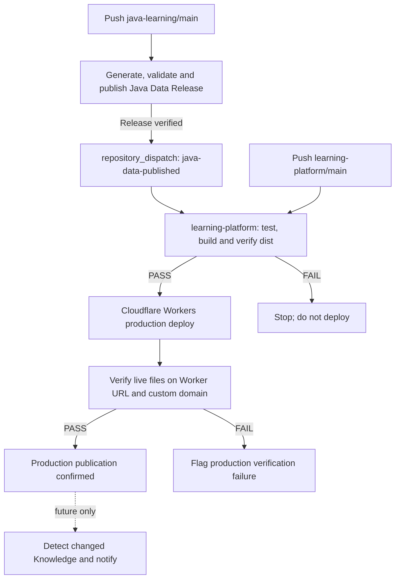

# AGENTS.md

## 1. Purpose

This file is the bootstrap context for AI agents working in `java-learning`.

Read this file before making architecture or code changes. It summarizes the repository structure, source-of-truth rules, Gradle lifecycle, ownership boundaries, current intentional decisions, and the expected workflow when analyzing or modifying code.

This file is intentionally more operational than `ARCHITECTURE.md`.

Use:

```text
AGENTS.md       → how an AI should work in this repository
ARCHITECTURE.md → why the repository is structured this way
README.md       → high-level project orientation
module-generate-agent/GENERAL_AGENT_RULES.md → canonical source of truth for the module-generation workflow, step ordering, routing, prerequisites and delegated step rules
learning-platform/ARCHITECTURE.md (separate repository) → standalone website product/frontend architecture
STRUCTURE.md    → generated module tree/navigation
```

Do not duplicate or infer the numbered module-generation chain from `AGENTS.md`. For any module-generation task, enter through `module-generate-agent/GENERAL_AGENT_RULES.md` and follow the current rule-file routing declared there.

When documentation conflicts with live implementation, inspect the implementation and report the inconsistency instead of silently assuming the documentation is correct.

---

## 2. Repository purpose

`java-learning` is a Java/Spring Boot learning repository organized as a Gradle multi-project/composite build.

It is not one monolithic production application.

The repository is designed so that many independent learning/application modules can reuse the same build automation and shared runtime infrastructure.

Current technical baseline:

```text
Java            21
Spring Boot     3.3.x
Gradle          repository wrapper 8.5
Build language  Groovy custom plugins
Testing         JUnit Platform
Runtime infra   Docker Compose where needed
Portal frontend React 19 + TypeScript + Vite + React Router
```

Do not assume every module has the same runtime architecture or purpose.

---

## 3. Read order

For repository-level work, read in this order:

```text
1. AGENTS.md
2. ARCHITECTURE.md
3. README.md
4. module-generate-agent/GENERAL_AGENT_RULES.md for any module-generation work; follow only the current delegated rule files and upstream inputs it requires
5. settings.gradle
6. build.gradle
7. project-orchestration/
8. project-build/gradle-runtime/
9. project-build/springboot-runtime/
10. learning-platform/ARCHITECTURE.md in the separate frontend repository for website, Cloudflare Worker and Local Run work
11. STRUCTURE.md when module navigation is needed
12. module metadata/build.gradle for the concrete task
13. module source packages only when the requested work requires them
```

Do not read the entire `module/` source tree just to answer a build-system question.

The architecture documentation intentionally does not claim knowledge of package design inside every learning module.

### Learning-content source-of-truth rule

For learning-content creation/refactor, do not treat an existing README/menu as the highest-level curriculum source. The required order is:

```text
module scope / curriculum boundary
        ↓
Roadmap Skeleton
        ↓
approved Module Roadmap
        ↓
README / Knowledge Menu
        ↓
Knowledge lessons
        ↓
API Docs / executable evidence when applicable
        ↓
Video Script / presentation plan
        ↓
Quiz / Interview
```

No new Knowledge Menu/lesson generation should start before the roadmap is reviewed. If downstream work reveals a missing prerequisite or learning milestone, report a **ROADMAP GAP** rather than silently inventing a different curriculum. For legacy modules, design the roadmap independently first, then audit existing Knowledge against it.

Roadmap files live at `roadmap/<language>/roadmap.yml`. `BUILD_ROADMAP` defaults to `TRUE`, `MODULE_LANGUAGE` controls which localized files are provisioned, and each language owns its roadmap independently. Build logic may synchronize the generated schema comment but must preserve the human/AI-owned roadmap content.

Roadmap relation metadata has strict semantics:

- `relatedKnowledge` contains Knowledge category ids from the **same module**. It is supporting/navigation metadata only. In Portal it is always visible on the side opposite the milestone; clicking an item opens the Knowledge tab with that category active. It must not be used to reverse-engineer or redefine milestone order.
- `relatedModules` contains cross-module Portal targets. It renders as secondary/satellite cards and may navigate to another module, but it does not create child roadmap nodes or a nested curriculum graph.
- The numbered milestone marker may pulse when supporting Knowledge exists, but that animation is presentation only and carries no curriculum semantics.
- For legacy modules, `relatedKnowledge` may temporarily map to existing categories even when coverage is imperfect; treat that as migration metadata to refine later, not evidence that the roadmap itself is correct.

---

## 4. Main architecture boundaries

Repository shape:

```text
java-learning/
├── module/                         # learning/application modules
├── internal/                       # internal supporting modules/resources
├── project-build/
│   ├── gradle-runtime/             # Gradle/build-time implementation
│   └── springboot-runtime/         # shared Spring Boot runtime implementation
├── project-orchestration/          # policy/composition layer
├── settings.gradle
├── build.gradle
├── README.md
├── ARCHITECTURE.md
├── AGENTS.md
└── STRUCTURE.md
```

The three infrastructure boundaries are:

```text
project-orchestration
    = WHAT should be applied and WHEN

project-build/gradle-runtime
    = HOW build-time behavior is implemented

project-build/springboot-runtime
    = HOW shared runtime behavior works inside Spring Boot applications
```

Do not move code between these boundaries just to reduce file count.

### Standalone Learning Platform boundary

The former `project-portal/` Spring Boot + Vite application has been **retired and deleted**. Do not recreate a Java portal host, `:project-portal` Gradle module, Cloudflare Pages Functions adapter, or duplicate frontend. `java-learning` owns module source, build conventions, `generatePortalData` data production, and on-demand executable JAR compilation.

The independent `learning-platform` repository owns React website/UI and Cloudflare Worker + Durable Object Local Run API. Java static data flows from `publish-java-data.yml` through the verified `java-data` GitHub Release and `repository_dispatch` to the standalone frontend CI/CD.

A Build JAR button calls the site's Worker, which validates the published fingerprint, reserves a per-module SQLite DO job, checks for a fresh Release/existing workflow, rate-limits only truly new dispatches and invokes `java-learning/.github/workflows/local-run-build.yml`. GitHub Actions resolves the Gradle project itself, uses JDK 21, runs `<resolved-project>:bootJar`, rechecks fingerprint V2 and publishes the `local-run` Release asset. Reused jobs do not dispatch twice; there is no custom FIFO/queue ETA or website-hosted JVM. The GitHub token is a Cloudflare Worker secret, never a browser or project-local `.env` token.

### Separate `learning-platform` delivery pipeline and future update notifications

The standalone site uses **Cloudflare Workers** at `https://nguyendodinhphuong.name.vn`, backed by Worker `learning-platform` and its SQLite Durable Object. No Pages deployment or Java portal application remains. Website delivery is owned by `learning-platform/.github/workflows/verify-and-preview.yml`; this repository owns `.github/workflows/publish-java-data.yml` and `.github/workflows/local-run-build.yml`.

**Implemented today (cross-repository CI/CD):**



- Java is the content producer; its rolling `java-data` GitHub Release contains the verified ZIP and checksum. The publisher runs only for relevant paths or manually, compares generated asset bytes against the verified prior Release, and **skips** Release upload and cross-repository dispatch when unchanged. On actual changes it dispatches only **after** verifying uploaded Release bytes. Frontend builds triggered by the event must confirm its source commit and ZIP SHA-256 against the event payload.
- `learning-platform` consumes and verifies Java static data under `dist/language/java/`, builds React, then deploys the **verified artifact** only when the frontend `main` is pushed or `java-data-published` is received. Pull requests and manual Preview runs do not deploy production. The production job validates deployed content (including Knowledge) against the artifact on both URLs.
- **Future feature only — NOT IMPLEMENTED:** add a Post-Deployment Content Notification stage **after successful production verification**, not merely after a successful Java push, Release upload or frontend build. No Telegram/Email notifications are currently sent by this pipeline.
- Detect **actual content changes**, not every deployment: compare per-file content hashes for Knowledge Markdown, keyed by module route id, language (VI/EN) and stable lesson path/section identity, against a durable **last successfully published/notified baseline**. Distinguish added/updated/removed lessons; an unchanged Knowledge snapshot, UI-only push or ZIP-level/metadata-only checksum change must not announce a new lesson. Expand to Roadmap/Quiz/etc. only by separate explicit scope.
- Persist a baseline outside ephemeral GitHub Actions artifacts and outside the mutable rolling `java-data` Release; retries and reruns must be idempotent. Track per-channel delivery results so a failed Email delivery does not re-send an already successful Telegram notification. Advance a channel's checkpoint only after its send succeeds; decide and document how removals are represented.
- Generate a concise localized update digest with module, affected lesson titles, change type and links to the **live** site. Do not claim to know a prose summary of semantic changes from file hashes alone; use a validated source diff/summary or provide only factual file-level change details.
- Telegram Bot and Email are **separate optional adapters** receiving the same computed change set. Keep `TELEGRAM_BOT_TOKEN`, chat destinations, Email provider API/SMTP credentials and subscriber configuration in scoped secrets/configuration, never in repository Markdown, static assets, release ZIP or browser code. Public mail subscribers require consent and unsubscribe handling. Delivery failures should be visible/retryable **without changing a successfully verified deploy into a deploy failure**.
- No notification implementation, workflow editing, external sends, bot setup, or new GitHub secrets are authorized by this architecture note alone; implement those only when the user requests them.

Current top-level UI direction:

```text
Header
├── Java Learning
├── Home
├── Learning
├── global search UI
├── VI ↔ EN switch
└── Light ↔ Dark theme toggle

Learning
├── generated module hierarchy sidebar
│   ├── module search
│   └── Full tree ↔ Real modules switch
├── knowledge search
├── Overview
├── Menu
├── Knowledge
├── API Docs
├── Quiz
├── Interview
├── Local Run
└── Download action
```

`Overview`, Menu/Knowledge, Roadmap, Quiz, Interview and API Docs consume validated static projections from the Java data publisher; frontend renders this dataset from Cloudflare Static Assets, with lightweight navigation, module details and counts loaded independently. The `Local Run` tab is enabled in Production for published runnable modules. It uses the site's same-origin Cloudflare Worker `/api/local-run/{build,status,artifact}` API and a browser-side public GitHub Release lookup with authenticated Worker fallback. There is no local Spring adapter and no Cloudflare Pages Functions implementation.

Module sibling order may be customized by an optional `module-order.yml` stored in the parent directory being ordered. It governs direct child directories only. Lower numeric `order` sorts first; equal values fall back to alphabetical name order; missing/null order sorts after ordered children and then alphabetically. Without the file, alphabetical behavior remains unchanged. `generateModuleOrder --path=<path-relative-to-module>` is the explicit root authoring task: it preserves existing human-owned order values, adds newly discovered direct children with null order, and removes stale entries. Ordinary Gradle sync/generation must only read this file. `ProjectStructureService` is the sole consumer that applies the order before producing STRUCTURE/module-catalog projections; Portal code must preserve catalog order rather than reread or reinterpret `module-order.yml`.

Local Run artifact freshness uses **Fingerprint V2** (64-character lowercase SHA-256; version marker `local-run-fingerprint-v2`). `ProjectStructureService` hashes a sorted manifest of committed Git object IDs: the module itself, its explicit transitive module dependencies from `properties.json` or literal `build.gradle project(':...')`, and repository-wide Gradle/build inputs listed in `project-build/gradle-runtime/src/main/resources/local-run/fingerprint-v2-roots.txt`. For the shared `project-build/gradle-runtime` tree, all committed blobs except the generated `src/main/resources/structure/module-structure.txt` are included in a deterministic subtree digest; the text tree is derived output and must not invalidate runnable module JARs. The workflow recomputes the same algorithm with `scripts/local-run-fingerprint-v2.py` both before build and immediately before Release upload, comparing current `main` on the latter check. `module-catalog.json` publishes the result as `sourceFingerprint`, and the rolling Release label remains `<MODULE_ID> · fingerprint:<sourceFingerprint>`. Legacy V1 assets are STALE automatically. Shared build directories (including `internal/`) are deliberately conservative and can invalidate multiple modules; unpinned external binary artifacts are not tracked by Git fingerprint alone. Source and catalog must be published together; the Worker/Local Run feature is deployed and enabled on Production, while Preview blocks dispatch server-side.

Every `POST /api/local-run/build` must treat GitHub as the shared source of truth and apply this order before dispatching anything: (1) if the rolling Release already has a fresh module asset, return `AVAILABLE`/`SUCCESS` and do not create a workflow run; (2) otherwise find an active workflow-dispatch run whose `run-name` matches `Local Run <MODULE_ID> · fingerprint:<sourceFingerprint>` and return `REUSED` with that run id; (3) only when neither exists, dispatch a new run and return `DISPATCHED`. The workflow-level module concurrency remains a last-resort race safety net, not the primary deduplication mechanism.

`GITHUB_ACTION_TOKEN` is stored only in the Production Cloudflare Worker secret and needs GitHub Actions read/write permission for dispatch/status and Contents read for Release metadata. Uploading/replacing Release Assets is performed by the dispatched workflow's own `GITHUB_TOKEN` with `contents: write`.

`Home` is currently an intentional placeholder, not a blank page. It tells the user that the home page is being updated and links directly to `Learning`. Keep it lightweight until a real Home information architecture is defined.

Current sidebar behavior is intentional and should be preserved unless the user explicitly changes it:

```text
group row with children and no dashboard
→ if direct children still contain GROUP nodes or are mixed GROUP/MODULE, click the whole row to expand/collapse
→ if the row is a terminal GROUP whose direct children are all leaf MODULE nodes, do not render those modules inline; hover/focus opens a Module Picker and click pins/unpins it
→ for mixed GROUP/MODULE parents, direct leaf MODULE siblings are wrapped only in the presentation layer as virtual one-item Module Pickers so sibling rows keep a consistent interaction shape
→ only one Module Picker may be open at once; outside click or Escape closes it
→ picker modules preserve catalog order and always show a simple 1..N sequence even when no `module-order.yml` exists
→ normal branch hover shows the vertical directional sweep/cue; collapsed = downward, expanded = upward, using `+` / `−`
→ default tree state is fully expanded

module with dashboard only
→ click the whole row to navigate to `/learning/{routeId}`
→ hover shows the left-to-right sweep with a large `›››` cue

module with both children and dashboard
→ do not use a split-action hybrid row
→ render the original node as a structural expand/collapse parent
→ insert a virtual first child with the same label; that child opens a one-item Module Picker for the original module dashboard
→ this is presentation-only: do not create a fake catalog node and do not increment module counts

interaction styling
→ directional color/wave cues are hidden until hover/focus
→ content-bearing/`Real modules` rows do not get a permanent special background merely for qualifying
→ numeric Knowledge/Quiz/Interview/API badges communicate content availability
→ only the active module keeps a persistent selected/highlight state

whole sidebar
→ labels should remain fully readable rather than ellipsized at normal desktop width
→ the sidebar can collapse from a control centered vertically on its right edge
→ when collapsed, main content expands and a centered `>` control on the left screen edge reopens it

module filter self-match
→ preserve the matched node's full subtree

module filter descendant-match
→ preserve only the ancestor path to matching descendants

sidebar `Real modules / Module thật` mode
→ this is a Portal content filter, not the repository-level `gradle.properties` real-module identity rule
→ keep a MODULE when at least one visible learning count is non-zero: Knowledge OR Quiz OR Interview OR API Docs
→ hide a MODULE only when Knowledge=0 AND Quiz=0 AND Interview=0 AND API Docs=0
→ keep required GROUP ancestors
→ remove branches with no qualifying descendants
→ never flatten the hierarchy into a plain module list

sidebar global tree controls
→ `Expand all` / `Collapse all` apply to the currently projected tree
→ manual branch state remains independently collapsible afterward
```

Portal panel-state rules:

```text
Menu
→ default collapsed
→ `+` / `−` branch toggles
→ explicit Expand all / Collapse all

Knowledge
→ multiple sections may be open at the same time
→ opening one section must not close another
→ loaded Markdown is cached while the panel remains mounted

Quiz
→ four answer positions are shuffled once when the localized document loads
→ selected answer/explanation state remains stable while the panel stays mounted

Interview
→ reference answers start collapsed and may be expanded independently
→ expanded-answer state remains stable while the panel stays mounted

API Docs
→ controller + method details default collapsed
→ explicit Expand all / Collapse all
→ reference-only; no live execute/debug control in this panel

tab switching
→ Menu / Knowledge / API Docs / Quiz / Interview are lazy-mounted then kept alive for the current module/language
→ preserve the user's latest expand/collapse state when switching tabs
→ changing module/language establishes a new state boundary
```

The API Reference notice explains that the docs are for learning/reference only and that running/debugging requires local runtime. Its Download action navigates to the module's `Local Run` tab, which owns the real executable-JAR build/download flow. API Docs remains reference-only; do not reintroduce a placeholder Download popover there or turn API Docs itself into a live execution surface.

Theme selection starts from `prefers-color-scheme` and persists user choice in `localStorage`. Capability colors are semantic and theme-independent: Overview gray, Knowledge blue, Quiz amber, Interview teal, API Docs red, Local Run purple, Download green. Light/Dark changes surrounding surfaces/text/borders, not those semantic identities.

Portal frontend styling uses normal CSS files. Avoid inline CSS unless there is a concrete technical reason that cannot be reasonably expressed through classes/stylesheets.

The Portal consumes/aggregates learning capabilities but must not become the source of truth for module metadata, README ownership, Swagger runtime, or Execution Context. Future generated portal data should be a projection from canonical module structure/metadata/resources.

---

## 5. Responsibility model

The repository follows this responsibility split:

```text
Orchestration → capability selection and ordering
Plugin        → Gradle lifecycle wiring
Service       → implementation logic
Task          → explicit execution / side effect
Extension     → typed DSL/configuration surface
Utils         → stateless reusable helpers
```

Prefer this model when adding or refactoring build capabilities.

Avoid putting large algorithms directly in:

```text
root build.gradle
settings.gradle
orchestration plugins
Gradle ext closures
```

unless the behavior is genuinely trivial.

---

## 6. Composite build structure

Root `settings.gradle` includes:

```groovy
pluginManagement {
    includeBuild('project-build/gradle-runtime')
    includeBuild('project-orchestration')
}
```

and applies:

```groovy
id 'com.example.settings-orchestration'
```

`project-orchestration` itself includes `../project-build/gradle-runtime` and depends on:

```text
com.example.learning:gradle-runtime:1.0.0
```

The composite build substitutes that dependency with the local included build.

Do not replace this with ad-hoc copies of Gradle logic in the root project.

---

## 7. Orchestration plugins

Three orchestration entry points exist:

```text
com.example.settings-orchestration
com.example.root-orchestration
com.example.module-orchestration
```

### Settings orchestration

Current order:

```text
PresetSetupPlugin
    ↓
PropertiesSetupPlugin
```

This order matters.

Preset setup performs module discovery, inclusion, metadata synchronization, and settings-time generated information.

Properties setup injects synchronized metadata into Gradle `Project` objects through `projectsLoaded`.

### Root orchestration

Current capabilities:

```text
CatalogSetupPlugin
StructureSetupPlugin
DatabaseSetupPlugin
CleanupSetupPlugin
```

Root-only plugins should remain root-only.

### Module orchestration

Current conceptual flow:

```text
real module guard
    ↓
DependencySetupPlugin
    ↓
ConfigSetupPlugin
    ↓
YmlSetupPlugin
    ↓
EnvSetupPlugin       if enabled
    ↓
ReadmeSetupPlugin    if enabled
    ↓
VideoSetupPlugin     if BUILD_VIDEO=TRUE
    ↓
SwaggerSetupPlugin   if enabled
    ↓
QuizSetupPlugin      if BUILD_QUIZ=TRUE
    ↓
InterviewSetupPlugin if BUILD_INTERVIEW=TRUE
    ↓
ExecutionContextSetupPlugin if BUILD_EXECUTION_CONTEXT=TRUE
    ↓
TaskSetupPlugin      if USE_TASK=TRUE
    ↓
DockerSetupPlugin    if docker-compose.yml exists
```

`ConfigSetupPlugin` and `YmlSetupPlugin` are currently applied to every real module by convention.

---

## 8. Real module identity

A real module is identified physically by a local:

```text
gradle.properties
```

Rule:

```text
<directory>/gradle.properties exists
    → real module

otherwise
    → intermediate/container project or ordinary directory
```

Do not infer module identity from folder name, `IS_MODULE`, or Gradle hierarchy alone.

`IS_MODULE` is legacy and must not be reintroduced as the real-module discriminator.

Physical real-module identity and learning-topic granularity are separate concerns. The local `gradle.properties` rule answers **whether a directory is a real module**; it does not imply that every small concept should be modeled as its own real learning module.

When designing learning modules, prefer one coherent learning domain with enough conceptual depth to support a meaningful curriculum. Smaller concepts such as one keyword, one language rule, one operator, or one narrow behavior should normally become README chapters/Knowledge sections inside a broader module rather than independent modules. Do not split modules merely to increase module count.

Learning-content completeness is not measured by topic/H2/API/Quiz counts alone. A mature module must also have a coherent pedagogical path: an entry mental model/roadmap that explains what the domain is and introduces its major terminology, concept chapters that explain the problem/motivation and relationship to the module before deep rules, and then technical depth/code/runtime behavior. In short, author learning content as `WHAT → WHY → RELATION → HOW → EVIDENCE → PRACTICE`, not as an encyclopedia of isolated definitions.

The first chapter or equivalent entry chapter of a nontrivial learning module must orient a beginner: what the topic is, why it exists, which major terms will appear, how those terms relate, and what order the learner should follow. It need not be named `MentalModel`, but it must serve that role. Coverage correctness does not substitute for this pedagogical coherence.

For Vietnamese (`vi`) learning content, Vietnamese is the primary explanatory language. Do not make the learner translate ordinary prose mentally while also learning the technical concept. Translate ordinary explanatory words such as responsibility, behavior, caller, rule, state, implementation, collaborator, hierarchy, localize change, or procedural code into natural Vietnamese. Keep English when it is a Java keyword/API/type/name or a technical term the learner genuinely needs to recognize/search, and introduce it as Vietnamese first with the English term in parentheses when useful, for example `trạng thái (state)`, `trách nhiệm (responsibility)`, `đa hình (polymorphism)`, `kiểu con (subtype)`. Avoid half-Vietnamese/half-English sentences when a clear Vietnamese phrase exists. Repository-specific exception: learner-facing content must not use the vague filler `nuance` / `nuances`; replace it contextually with a precise VI/EN term such as `điểm cần lưu ý` / `detail`, `điểm khác biệt` / `distinction`, `đặc điểm` / `behavior`, or `caveat`. VI headings may localize the pedagogical chain naturally, e.g. `KHÁI NIỆM`, `VÌ SAO`, `MỐI LIÊN HỆ`, `CƠ CHẾ`, `MINH CHỨNG`, `THỰC HÀNH`, while preserving the same conceptual role as `WHAT → WHY → RELATION → HOW → EVIDENCE → PRACTICE`.

API availability is not a prerequisite for learning-module completeness. A conceptual/library-oriented module may be complete with Knowledge, Quiz and Interview only. Do not force a module into `SERVLET`/`REACTIVE` or create artificial endpoints solely so it can have API Docs. When a `SERVLET`/`REACTIVE` module does contain meaningful learning APIs, those APIs should represent real experiments for Knowledge concepts and follow the Swagger ↔ README relationship contract below.

`module-generate-agent/GENERAL_AGENT_RULES.md` is the canonical source of truth for module-generation scope, workflow order, prerequisites, routing and the delegated authoring/validation rule files. `AGENTS.md` must not maintain a competing copy of that chain.

For Knowledge tasks, treat the three-layer pedagogical model required by the canonical module-generation rules as an authoring requirement, not optional style guidance. A successful build/projection or high relation/assessment coverage does not prove that the learning path is complete. Resolve the current Knowledge rule through `module-generate-agent/GENERAL_AGENT_RULES.md` rather than hard-coding a numbered rule file here.

When bootstrapping a new learning module, prefer the actual settings/module lifecycle: create the local `gradle.properties` marker, let settings synchronization create/synchronize `master.json` and `properties.json`, set module-owned `VALUE` fields, enable `BUILD_README`, then let `ReadmeSetupPlugin` initialize the README language/support structure. Do not manually create generated registries/structure outputs that already have a generator.

Current bootstrap caveat: `SettingInfoGeneratorService` falls back from blank `SERVICE_NAME` to the directory name and validates that result as an enum constant. A new directory name containing `-` is therefore invalid during the first sync while `SERVICE_NAME` is blank. For such a brand-new module, bootstrap once with an enum-safe temporary directory name, set the stable valid `SERVICE_NAME`, then rename to the intended hyphenated directory and rerun Gradle. This is an implementation constraint, not a taxonomy rule.

---

## 9. Module types

Module behavior is controlled by:

```text
MODULE_TYPE
```

Current values:

```text
SERVLET
REACTIVE
LIBRARY
PLATFORM
```

High-level semantics:

```text
SERVLET
→ runnable Spring MVC / Servlet application
→ Java/resources structure
→ Spring Boot executable behavior
→ spring-boot-starter-web
→ generated main class may extend SpringBootServletInitializer

REACTIVE
→ runnable Spring WebFlux application
→ Java/resources structure
→ Spring Boot executable behavior
→ spring-boot-starter-webflux
→ generated main class is a regular @SpringBootApplication class

LIBRARY
→ reusable Java/configuration code
→ Java/resources structure
→ bootJar/bootRun disabled, plain jar enabled

PLATFORM
→ platform/resource/config composition
→ physical Java structure is not automatically created
→ plain jar behavior, not runnable
```

Do not infer type from the path when `MODULE_TYPE` exists.

`APPLICATION` is a legacy value. Metadata synchronization migrates legacy:

```text
APPLICATION → SERVLET
```

Do not add `APPLICATION` back to `ModuleType` as a compatibility alias. New metadata and generated schema must use:

```text
SERVLET,REACTIVE,LIBRARY,PLATFORM
```

Current convention intentionally still gives PLATFORM modules the common Java/Spring Boot plugin baseline because the project currently relies on it for source/build behavior. Do not remove that baseline unless the user explicitly asks to redesign it.

---

## 10. Canonical metadata

Canonical schemas live at:

```text
project-build/gradle-runtime/src/main/resources/automation/master.json
project-build/gradle-runtime/src/main/resources/automation/properties.json
```

Module-local projections:

```text
<module>/master.json
<module>/properties.json
```

`master.json` contains identity and feature flags.

`properties.json` contains detailed settings for enabled feature groups.

Current important master metadata includes:

```text
MODULE_TYPE
MODULE_LANGUAGE
JAVA_BASE_PACKAGE
SERVICE_NAME
SERVICE_NAME_DESCRIBE
IS_MODULE_DEPEND
BUILD_ENV
BUILD_YML
BUILD_README
BUILD_VIDEO
BUILD_QUIZ
BUILD_INTERVIEW
BUILD_TESTER
BUILD_SWAGGER
BUILD_EXECUTION_CONTEXT
BUILD_DATABASE_MODULE
ADD_MODULE_DEPEND
USE_DATABASE
USE_TASK
```

`MODULE_LANGUAGE` is the module-level source of truth for localized documentation/runtime metadata. It is a `list` value in `master.json` (canonical default: `vi,en`) and is reused by README structure/final generation, Video skeleton generation, Swagger description generation, Knowledge metadata synchronization, Quiz/Interview skeleton generation, Portal localized projections, runtime Swagger language grouping, and generated `.env` values. Do not reintroduce per-feature language keys such as `README_LANGUAGE`, `BUILD_SWAGGER_LANGUAGE_LIST`, or task-local `languages` extensions for README/Video/Swagger/Quiz/Interview.

Knowledge section governance is stored next to localized README source, not inside Portal-generated JSON:

```text
src/main/resources/readme/{lang}/knowledge-metadata.yml
```

The Markdown under `readme/{lang}/menu/**/*.md` remains the content/source-of-truth for whether a Knowledge topic exists. `knowledge-metadata.yml` is keyed by README path and exact anchored section id and currently owns these per-section fields:

```yaml
1.Basic/Basic.md:
  thread-state:
    difficulty: ADVANCED
    aiGenerated: true
    reviewed: false
```

Allowed `difficulty` values are `BASIC`, `INTERMEDIATE`, and `ADVANCED`. Missing fields default to `BASIC`, `true`, and `false` respectively. Existing human-owned values must be preserved. Stale file/topic metadata is removed when the explicit `syncMetadataReadme` task rebuilds the metadata skeleton from current Markdown. This synchronization task is intentionally manual/explicit; ordinary Gradle configuration, IDE sync, or Portal browsing must not silently write source metadata.

`syncMetadataReadme` follows `MODULE_LANGUAGE`, only scans real learning modules under `module/` with local `gradle.properties`, and only creates metadata for languages that actually contain README menu Markdown. The canonical Knowledge section identity is an exact heading of the form `## <a id="...">Title</a>`; duplicate section ids within one module/language are invalid.

The visible Knowledge section title is a navigation/card label, not a sentence-length summary of the entire section. Keep it short, scannable, and aligned with the concept that the section opens with. Prefer names such as `OOP là gì?`, `Đóng gói là gì?`, `Dynamic Dispatch`, `Rủi ro của kế thừa`, `What Is OOP?`, or `Inheritance Risks` over explanatory titles such as `Đối tượng là nơi gắn trạng thái với hành vi` or `Encapsulation is more than private fields`. Put the longer claim, motivation, contrast, and pedagogical framing inside the section body. Do not change a stable anchor id merely to improve the visible title; localized VI/EN titles may differ naturally while representing the same concept.

A chapter file containing only an H1 is a valid curriculum scaffold but does not yet define a Knowledge section. Do not run `syncMetadataReadme` just to materialize metadata for H1-only chapter outlines; add real anchored H2 sections first, then synchronize Knowledge governance.

Video scripts are authored YAML presentation artifacts. `BUILD_VIDEO` remains the module Video publication/projection flag (default `FALSE`) and is **not** a signal to generate skeletons during Gradle Sync. The obsolete `VideoStructureService` and `VIDEO_SETUP_PLUGIN` were removed. Video Script YAML is written to Google Sheets at P:S on each Menu C?p 1 parent row by STEP 7 and imported explicitly by module-local `generateModuleVideoFromSheetByLocation`. The import is a full authoritative replacement of `content/video/vi/menu`, including removal of stale scripts, without keeping older publication URLs.

Every Knowledge Menu chapter has one Video file: `content/video/{language}/menu/<ordinal>.<KnowledgeFilenameStem>/video-script.yml` (e.g. `1.Introduction/video-script.yml`). The filename is shared across chapters. The chapter folder's stem supplies Video `categoryId` and its indexed prefix supplies order; YAML contains `title`, `video.url`, and `sections[].items[]` with `type/time/visual/script/purpose`. Each section corresponds exactly to one Knowledge/Menu C?p 2 heading; from the second section onward, its first item is a TRANSITION. All items need complete content and a continuous timeline starting at 00:00. No independent Knowledge/Video metadata file is used.

The Portal Video projector loads YAML and emits `build/learning-data/java/module/{ROUTE_ID}/video/{lang}/index.json` and `content/{categoryId}/script.json` under that route without altering the JSON contracts. `BUILD_VIDEO` remains available for the API Video features elsewhere. The frontend uses the Video index, categoryId and script JSON as before; a blank `video.url` means a complete script without a published recording. Videos are not written beside Knowledge Markdown, and Portal Knowledge scanning must continue to ignore `content/video`.

Quiz follows the same build/orchestration boundary. `BUILD_QUIZ=TRUE` is declared in canonical `automation/master.json`; `project-orchestration` only decides whether to apply `QUIZ_SETUP_PLUGIN`; the actual structure generation lives in `project-build/gradle-runtime`. Active `MODULE_LANGUAGE` values receive `src/main/resources/quiz/{lang}/question.yml`. The generated comment block between `# <quiz-schema>` and `# </quiz-schema>` is derived from canonical `gradle-runtime/src/main/resources/quiz/question-schema.yml` and may be refreshed when the schema changes; the `questions:` content below it is human-owned and must not be overwritten.

The canonical Quiz item contract is single-choice with exactly four stable internal answer ids `A/B/C/D`. Each answer owns both `answer` and `explanation`; `correctAnswerId` stores the correct stable id separately. Each question also carries `aiGenerated`, `reviewed`, optional `readmeRelated {file, anchor}`, and optional `apiRelated {controller, methodSignature}` metadata. Blank/blank relation pairs mean no relation. Portal shuffles answers once when a localized Quiz document is loaded, then reassigns display labels `A/B/C/D` by shuffled position while correctness continues to use the stable internal id. Do not shuffle again on ordinary React re-render. Related Knowledge/API actions are only exposed after the learner selects the correct answer.

Interview mirrors the same build/orchestration boundary with `BUILD_INTERVIEW=TRUE`, `INTERVIEW_SETUP_PLUGIN`, and `src/main/resources/interview/{lang}/question.yml`. The generated block between `# <interview-schema>` and `# </interview-schema>` comes from canonical `gradle-runtime/src/main/resources/interview/question-schema.yml`; `questions:` remains human-owned. Each Interview item contains a nonblank `question` and reference `answer`, `aiGenerated`, `reviewed`, plus the same optional `readmeRelated` and `apiRelated` pair shapes. Portal keeps reference answers collapsed until the learner explicitly opens them, then may expose resolved Related Knowledge/API panels. The THREAD module currently owns localized VI/EN Quiz and Interview content derived from its README; exact relations are filled only when the source supports them rather than inventing a mapping.

Quiz build-time projection performs schema validation and additionally checks relation targets. A blank/blank pair is valid; partial or unresolved README/API pairs are logged as relation warnings, and an API relation is considered Portal-resolvable only when the target method is active (`usage: true`). Interview projection currently performs canonical schema validation and exact static copying; do not claim it has the same build-time relation-target validation until that behavior is implemented.

Do not add new metadata keys casually. Check whether the concept already has an owner and whether it belongs in `master.json` or grouped `properties.json`.

---

## 11. `JAVA_BASE_PACKAGE`

Java package ownership was intentionally moved out of root/global Gradle extra properties.

The canonical default is:

```text
JAVA_BASE_PACKAGE = com.example.learning
```

Modules may override it in their own `master.json`.

Example:

```text
project-build/springboot-runtime/swagger
JAVA_BASE_PACKAGE = com.example.projectbuild.swagger
```

`ModuleStructureService` reads:

```groovy
project.findProperty('JAVA_BASE_PACKAGE')
```

Do not restore hidden global state like:

```groovy
gradle.extensions.extraProperties.set('basePackage', ...)
```

`MAIN_CLASS_PATH` is the source used by IntelliJ run-config generation; do not rebuild the main-class package independently from a global base package.

---

## 12. Metadata synchronization ownership

Canonical schema metadata is build-owned.

Module-local `VALUE` is developer/module-owned.

Current synchronization rule:

```text
canonical key/schema
    ↓
copy DESCRIPTION / TYPE / GROUP / defaults

existing module VALUE is nonblank
    ↓
preserve module VALUE
```

When a canonical field is newly introduced with a default, existing modules receive the default unless they already have a nonblank override.

`MODULE_TYPE` has one explicit legacy migration during synchronization:

```text
APPLICATION → SERVLET
```

This migration is intentional and is not a generic rule that arbitrary module-owned values may be rewritten.

Do not overwrite module-specific nonblank values during schema synchronization.

Do not treat generated module JSON structure as independently authoritative from the canonical schema.

---

## 13. Property injection precedence

`SettingPropertiesInjectionService` injects:

```text
master.json
    ↓ first
properties.json
    ↓ second
```

Therefore, when the same property key exists in both, the later `properties.json` value wins in the Gradle project extra properties.

Preserve this precedence unless a requirement explicitly changes configuration semantics.

---

## 14. Source of truth map

Use this map before changing data:

```text
Real module existence
→ filesystem + local gradle.properties

Canonical master schema
→ gradle-runtime resources/automation/master.json

Canonical grouped settings schema
→ gradle-runtime resources/automation/properties.json

Module-specific values
→ module-local master.json / properties.json VALUE

Plugin registry input
→ plugin registry/generator resources in gradle-runtime

Typed/generated registry
→ generated enums such as ProjectPluginEnum, ModuleListEnum, DatabaseListEnum

Project tree documentation
→ filesystem/module metadata → generated STRUCTURE.md

Portal module/catalog data [current]
→ filesystem/module metadata via ProjectStructureService
→ `build/learning-data/java/module-catalog.json`

Portal module-scoped projections [current/future]
→ canonical README content + localized Knowledge metadata / quiz / Swagger / artifact state
→ `build/learning-data/java/module/{ROUTE_ID}/{feature}/...`

Task DSL reference
→ task definition resources + enabled module features → generated task.gradle
```

Never edit a generated projection as a substitute for editing its source of truth.

---

## 15. Generated artifacts

Important generated artifacts include:

```text
ProjectPluginEnum
ModuleListEnum
DatabaseListEnum
module-depend.json
STRUCTURE.md
module-structure.txt
build/learning-data/java/module-catalog.json
build/learning-data/java/module/{ROUTE_ID}/overview/...
build/learning-data/java/module/{ROUTE_ID}/knowledge/...
build/learning-data/java/module/{ROUTE_ID}/video/{lang}/...
build/learning-data/java/module/{ROUTE_ID}/quiz/{lang}/question.yml
build/learning-data/java/module/{ROUTE_ID}/interview/{lang}/question.yml
build/learning-data/java/module/{ROUTE_ID}/api/{lang}/...
task.gradle
application-merged.yml
generated README/menu fragments
META-INF/execution-context/source-context.json
```

Portal data projections are build-only and must never be copied into a retired Spring Boot portal or edited as authoritative source. `module-catalog.json` stays at the root of `build/learning-data/java`; module-owned projections are namespaced under `build/learning-data/java/module/{ROUTE_ID}/`. Overview and Knowledge are transformed projections; Video is a transformed static projection from authored `video/{lang}/menu/**/*.md`; Quiz and Interview are exact localized `question.yml` copies after build-time schema validation; API metadata is an exact build-time copy of the four canonical localized Swagger YAML files when the complete set exists. Quiz/Interview/API YAML is parsed in-browser, and API rich execution HTML is sanitized before rendering. These projections must follow deterministic/idempotent/write-if-changed rules. The browser must not parse `module-structure.txt` as canonical data.

Generated output must prefer:

```text
deterministic ordering
idempotency
write-if-changed
no duplicate generated content
minimal timestamp churn
```

Do not manually patch generated output unless the task is specifically about the generator output itself and the user understands the source-of-truth implications.

---

## 16. Strict README idempotency

README/internal-menu generation has a strict invariant:

```text
run N times
=
run once
```

Generated menu entries, `<details>` blocks, separators, back-to-top links, and similar generated markup must never duplicate across runs.

Preferred strategy:

```text
identify/remove previous generated structure
    ↓
rebuild from canonical anchor/content structure
```

Do not implement append-only generation for these sections.

### Internal README menu source contract

The explicit task:

```text
generateInternalReadmeMenu
```

operates on human-authored Markdown source and generated navigation markup. Authoring should keep those responsibilities separate.

A minimal chapter source should normally look like:

```markdown
# Chapter title

Optional introduction.

## <a id="stable-section-id">Section title</a>

Section content.
```

The anchored H2 id is the stable navigation/relation identity and should be unique, short, readable and independent from display numbering when possible. The visible H2 text is the localized learner-facing label.

Do not manually author generator-owned navigation markup merely to make a source chapter look like generated output. `generateInternalReadmeMenu` owns structures such as:

```text
Menu
<details> navigation blocks
back-to-top anchors/links
generated separators
```

If generated output is wrong, fix the human-owned source or the generator contract rather than maintaining a second hand-written copy of generated structure.

---

## 17. Human-owned vs generated-owned files

Before editing a file, determine its ownership.

### Human-owned examples

```text
application source code
module build.gradle
module-specific metadata VALUE
application.yml after meaningful content exists
README prose written by developer
main application class after initial generation
```

### Generated-owned examples

```text
ProjectPluginEnum
ModuleListEnum
DatabaseListEnum
STRUCTURE.md
module-depend.json
module-structure.txt
task.gradle
application-merged.yml
generated menu fragments
```

### Mixed ownership example

`master.json`:

```text
schema fields → build-owned
VALUE         → module/developer-owned
```

Never overwrite human-owned content without an explicit requirement.

---

## 18. Gradle lifecycle awareness

Always determine which phase owns the behavior:

```text
Settings / Initialization
Configuration
projectsLoaded
projectsEvaluated
Task execution
Spring runtime
```

Important current examples:

```text
module discovery/include
→ Settings phase

metadata injection into Project
→ projectsLoaded

module plugin wiring
→ project configuration

module dependency resolution
→ deferred until projectsEvaluated

dependency catalog / structure generation
→ projectsEvaluated

explicit destructive/external operation
→ task execution

Spring beans / web configuration
→ application runtime
```

Do not move behavior to an earlier phase just because it makes the code shorter.

---

## 19. Dependency setup

Logical module lookup is based primarily on:

```text
SERVICE_NAME
```

`ModuleProjectUtils` resolves logical service names to Gradle projects.

`DependencySetupPlugin` creates its DSL during configuration but performs the actual dependency wiring after project evaluation.

When propagating dependencies, preserve Gradle configuration semantics.

Do not convert:

```text
annotationProcessor
```

into:

```text
implementation
api
```

just to simplify dependency handling.

---

## 20. Root build policy

Keep root `build.gradle` relatively thin.

Root responsibilities currently include:

```text
plugin versions/declarations
group/version
Java version
repositories
Spring Cloud BOM
module orchestration application
bootJar destination policy
```

Do not move build algorithms or filesystem generators back into root `build.gradle` unless explicitly requested.

---

## 21. Task architecture

The manual task system has two enablement layers.

Layer 1:

```text
USE_TASK=TRUE
→ TaskSetupPlugin is applied
```

Layer 2:

```text
task/module-task-list.json
task/task-extension-list.json
→ feature-specific task plugins selected by propCheck
```

An empty `propCheck` means the task type is always enabled once the task system itself is active.

`task.gradle` is a generated DSL reference, not a human configuration file.

Do not reintroduce `USE_TASK` checking inside every task plugin when orchestration already owns that decision.

### Google Sheets task: current ADC/impersonation and module guard

The module task `generateModuleContentFromSheetByLocation` is registered by `SheetsTaskPlugin` through `TaskSetupPlugin` for eligible `USE_TASK=TRUE` modules. Its **module-local extension with the same name** accepts `fileUrl` (spreadsheet document URL) and `sheetId` (numeric tab `gid`, not spreadsheet ID). For module-local task invocations, `-PfileUrl=<URL> -PsheetID=<GID>` overrides the extension, with aliases `sheetFileUrl` and `sheetId`. This allows Prime to use its verified module mapping without editing build scripts. Otherwise configure these in the module's `build.gradle` or a temporary Gradle init script; **never configure generated `task.gradle`**.

**Module-local Sheet import tasks verify I3 before any service runs.** `GenerateModuleContentFromSheetByLocationTask` and `SheetsMetadataReaderService`:

1. Resolve Google Application Default Credentials (ADC) **at task execution**, not Gradle configuration. When `GOOGLE_SHEETS_IMPERSONATE_SERVICE_ACCOUNT` is set, use short-lived impersonated Service Account credentials with the `spreadsheets.readonly` scope; never require a downloaded Service Account JSON private key. If unset, use the available ADC directly. Reject conflicting already-impersonated identities.
2. Require Google Sheets API and IAM Service Account Credentials API enabled in the appropriate Google Cloud project; the ADC source principal needs `roles/iam.serviceAccountTokenCreator` on the target Service Account for impersonation. The **specific Sheet must separately be shared** with that Service Account (at least Viewer). Enabling an API or possessing an API key does **not** itself authorize reading private spreadsheets. Keep credentials/tokens out of code, logs and repository.
3. Validate `fileUrl` as a Google Sheets HTTPS document URL and `sheetId` as a numeric `gid`. Call `spreadsheets.get` for spreadsheet/tab metadata, batch-read I3 cells across discovered tabs with `spreadsheets.values.batchGet` to reduce quota pressure, and select the exact tab by `gid`. Use only that tab's `I3` as the module-local location guard; subsequent Roadmap reads are separately authorized by the importer.
4. Compute the **actual module `projectDir`** relative to canonical `rootProject.projectDir`, using forward slashes (e.g. `module/platform/development/programming/paradigm/object-oriented`). Compare the complete `I3` value **exactly** to that path; a missing/blank/different value causes `GradleException` and **immediate stop before any content processing**. Do not silently normalize a mismatch to another module, search a different tab, or treat a matching short name as sufficient.
5. After exact I3 matching, `generateModuleContentFromSheetByLocation` runs Roadmap → README → Video. The three independent task names `generateModuleRoadmapFromSheetByLocation`, `generateModuleReadmeFromSheetByLocation`, `generateModuleVideoFromSheetByLocation` each run **only their corresponding service**, sharing the same module-local extension and DRY_RUN/APPLY rules. They never call AI or write to the Sheet.

**Root ByFiles task interface remains unchanged:** `generateModuleContentFromSheetByFiles` still processes every eligible tab (excluding Template), with existing duplicate-location checks and reporting. It and module-local combined task now execute **all four** importers (Roadmap, README, Video, Interview); the individual module-local task names select just one stage. A one-stage APPLY replaces only that stage's owned output subtree.

**Interview was added as the fourth service after the previous 3-way split:** module task `generateModuleInterviewFromSheetByLocation` imports only JSON Interview from `T:W` on the parent A rows and renders the single `src/main/resources/interview/vi/question.yml`. The module-local combined task and the root `generateModuleContentFromSheetByFiles` retain their respective names, inputs, and I3/duplicate guards, but now execute Roadmap, README, Video, **then Interview**. No AI or Sheet write during import. The existing `InterviewSheetNormalizeService` can fill defaults in memory and preserves prior `reviewed/readmeRelated/apiRelated`. Rendered YAML is checked by `InterviewQuestionSchemaService` before `SheetSnapshotReplaceService` installs it. Legacy tabs lacking T:W and tabs lacking all Interview content are SKIPPED without modifying existing Interview; valid partial chapters are accepted, while malformed populated JSON prevents that interview write. A standalone Interview APPLY affects only `interview/vi`.

**Prime end-of-STEP module sync (temp STEPs 2, 3, 4, 5, 6):** After whole-tab worker completion, readback and independent Prime QA PASS, Prime runs the corresponding **module-local ByLocation task**, never root `generateModuleContentFromSheetByFiles` or combined ByLocation. STEP 2 uses `generateModuleRoadmapFromSheetByLocation` DRY_RUN → APPLY. **STEP 3 and STEP 4 invoke README ByLocation DRY_RUN only**; when filename/Knowledge are not yet complete they report `DEFERRED_UNTIL_STEP_5` and DO NOT APPLY or claim module sync. STEP 5 Prime must run `generateModuleReadmeFromSheetByLocation` DRY_RUN → APPLY once after chapter refactor and unique filenames PASS. STEP 6 Prime first runs root `normalizeInterviewQuestionsFromSheet` DRY_RUN → APPLY, then **the exact module's** `generateModuleInterviewFromSheetByLocation` DRY_RUN → APPLY before J3 advances. Pass verified URL/gid as `-PfileUrl`/`-PsheetID`; resolve Gradle path from verified I3, not a guessed path. No per-worker imports or ByFiles. See `temp/GENERAL_AGENT_RULES.md §6`. README importer supports all **12 Knowledge columns C:N**.

**Root ByFiles / ByLocation importer:** The Gradle Sheet import workflow uses only Groovy/Java, Google Sheets read-only APIs, and deterministic schema rules. It does not call AI. ByFiles processes spreadsheet tabs except Template and prevents duplicate I3 targets. Both entrypoints run Roadmap, README, and Video through SheetContentImportCoordinator. The Sheet is the exclusive source of truth for three owned Vietnamese subtrees on APPLY: roadmap/vi, readme/vi/menu, video/vi/menu. Each service prepares and verifies a complete new snapshot before permanently deleting its OLD subtree, then installs and reads back the exact replacement. NO backup, orphan retention, merge of old metadata, preservation of authored video or video.url. APPLY clears the subtree even if the snapshot is identical; an empty valid source cleans the subtree to empty (CLEARED_EMPTY). DRY_RUN never touches the filesystem. Invalid Sheet structure/fragment data stops the affected service before it deletes its old output. An incomplete Menu with missing parent filename skips README/Video import without clearing. No changes to English documentation, module metadata, BUILD_VIDEO, other services, Google Sheets, or Portal. This explicit Sheet importer ownership does not alter canonical VideoStructureService behavior outside Sheet import; consult SETUP_GOOGLE_IAM_AND_ADC.md for details.
**STEP 1 tab formatting:** After cloning `Template` and filling the new tab's `B1`/`I3`, set **rows 1–700 to height 60 px** across the new tab and **all existing columns' `userEnteredFormat.wrapStrategy=CLIP`** in that row range. Use narrow Google Sheets API masks: `updateDimensionProperties.fields=pixelSize` and `repeatCell.fields=userEnteredFormat.wrapStrategy`; do not change cell values, formulas, other formats, or existing tabs/Template during ordinary STEP 1 execution. A separately authorized one-time backfill applied this formatting to all 96 tabs across the three `Module Content` spreadsheets, including their Templates.
- **Split Prime/Worker documentation:** Worker-dispatching temp steps are **STEP 2, 3, 4, 5, 6, 7**, each with matching `temp/worker/STEP_N_WORKER.md`. **Filename naming formerly in STEP 6 remains merged into STEP 5; STEP 6 is NOW a NEW Interview Q&A JSON generation step** (not the retired filename step). Workers independently read the entire matching worker-only file as their only execution contract; Prime reads the Prime file, worker file, general/rules/tab mapping. Missing worker file is a blocker.
- **Minimal handoff (mandatory for any STEP with workers):** Prime sends **only source/read scope and owned work/write scope**, plus the verified resource URL and worker-only file path. Google Sheets jobs use **exactly four lines**: tab URL, read cell coordinates, write cell coordinates, `temp/worker/STEP_N_WORKER.md` path. No pasted source values, extra instructions, summarized rules/worker file, generated answer, Special Note content or old chat context. Worker independently reads its source and completes one assignment end-to-end (read → author/review → QA → preflight → write → exact readback → report → `SLEEPING`). No invented second phase (`PREPARED`/write handoff).
- **Ownership/pool:** default maximum **three workers including ACTIVE and SLEEPING** (unless the current session explicitly overrides); reuse SLEEPING before spawning. STEP 2 = one worker for one tab's Roadmap; STEP 3 = one worker for one tab's two-level Menu; STEP 4 = one worker per Knowledge item; **STEP 5 = one worker per chapter for review C:N, Difficulty O child rows, filename B parent row**; **STEP 6 = one worker per chapter for Interview Q&A JSON T:W on the parent row**; **STEP 7 = one worker per chapter for Video P:S on the parent row**. No overlapping writers/rows; Prime tracks ownership and continues until all assigned work is checked.
- **Sheet authoring cell boundaries (consult live STEPs):** STEP 2 reads `C2`, writes `F:H` milestones; STEP 3 reads `C3`, writes Menu `A20:B...` with parent B initially blank; **STEP 4 writes Knowledge `C:N` (12 × 30k chars) on one child row**; **STEP 5 workers review/refactor C:N, assign Difficulty O on child rows and themselves write English filename `.md` into B on their parent row**; Prime checks all filenames for case-insensitive/kebab-prefix duplicates at the END of STEP 5, corrections only by the corresponding worker. **STEP 6 NEW: Interview JSON only `{"questions":[{"question":"...","answer":"..."}]}` at `T:W` on the actual parent row**, max 4 × 30k Unicode chars; NO AI-generated YAML/default/related fields at this step. Future deterministic normalization may populate defaults/relations back into Sheets. **STEP 7 remains Video Markdown `P:S` on the parent row** (A20 → P20:S20). A populated parent B filename does not turn that row into a child. **Important:** the Groovy README importer now reads all **12 Knowledge cells C:N**, and the Interview importer has been added. The Video importer still needs migration from the old `N1:R` layout to `P:S` on the parent row before APPLY on the new Template.
- **Special Note is currently STEP 2/3 only:** Prime locates the actual `Special Note` **title cell** and the **value cell directly beneath it** in the target tab's Module Project area (currently often `K2` and `K3`), verifies both, and passes **both cell addresses**, never a quote/paraphrase/summary. Worker reads **both cells verbatim** directly from that Sheet, checks the title, uses nonblank module-specific constraints with `C2`/`C3`, and never edits either cell. Missing/ambiguous notes or conflicting constraints are blockers; a blank note value is valid. This does **not** implicitly authorize STEP 4/5/6/7 to read/use Special Note.
- **Safety and completion:** preflight formulas/values/notes/ownership before writes, preserve other regions/tabs/Template and existing human content, verify the written pieces by exact Unicode/newline readback and content/chapter QA. **Only Prime** may update `J3 = STEP N` after **all required work for the tab** passes QA; a partial trial must not advance `J3`. Do not spawn unneeded workers, update source files, commit/push, or run the next STEP as an incidental side effect.
- **STEP 6 final deterministic task:** After ALL Interview Q&A worker chapters pass Prime QA, Prime runs root `normalizeInterviewQuestionsFromSheet -PfileUrl=<URL> -PsheetID=<GID> -PinterviewMode=DRY_RUN` then `-PinterviewMode=APPLY`. The task uses read-only credentials for DRY_RUN and full Sheets write scope (shared Editor) only for APPLY; normalizes T:W parent-row JSON to the complete Interview schema with defaults and parent README file, preserving previously enriched relations, using one preflighted batch and exact readback. **Only then** may Prime mark J3=STEP 6. This task does NOT generate module interview/question.yml, which remains future importer work.

**Current Sheet example, not a hard-coded repository default:** the separate `Module Content 2` spreadsheet has 19 Java-version tabs for which the `Special Note` title/value cells were populated at `K2/K3`. The value supplied for those tabs was exactly: `Note : Hãy chỉ lấy các kiến thức vẫn còn áp dụng đến hiện giờ, không lấy các kiến thức lỗi thời hoặc đã legacy hiện nay`. The `Template` was left unchanged. Earlier generated STEP 2/3 values were cleared on those 19 tabs (`F3:H17` Roadmap and `A20:B...` Menu) as a **one-time Sheets operation**. This is **external Sheets state**, not Gradle task behavior and not a reason to treat historical features that remain useful as obsolete. Per-module notes can also bound Security-in-Java vs general security, or Java Aspect/AOP implementations vs language-agnostic AOP.

---

## 22. YML rules

`application.yml` and `application-merged.yml` have different ownership.

```text
application.yml
→ runtime source of truth for the application
→ human-owned after meaningful content exists

application-merged.yml
→ generated suggestion/reference
→ not runtime source of truth
```

Conceptual flow:

```text
dependency/library/platform config
        +
application config
        ↓
application-merged.yml
        ↓
developer review
        ↓
application.yml
```

Do not make runtime automatically depend on `application-merged.yml` unless the user explicitly redesigns the contract.

YML composition dependencies come from both explicit module configuration and derived capabilities.

Current derived rules include:

```text
MODULE_TYPE=SERVLET
→ SPRING_WEB/application-module.yml

MODULE_TYPE=REACTIVE
→ SPRING_REACTIVE/application-module.yml

BUILD_SWAGGER=TRUE
→ GLOBAL_SWAGGER_CONFIG/application-module.yml
```

The Swagger YML dependency intentionally points to the stack-neutral core, not to the Servlet/Reactive runtime adapters. Do not duplicate the same Swagger YML contract in both adapters unless stack-specific configuration actually becomes necessary.

---

## 23. ENV rules

ENV setup and explicit ENV generation intentionally have different ownership behavior.

Setup phase:

```text
create defaults only when missing
avoid overwriting existing .env
```

Explicit ENV generation task:

```text
developer intentionally invokes generator
→ generator may rebuild/synchronize according to its task contract
```

The `.env` generator intentionally includes a timestamp so the user can see when synchronization/generation happened.

Do not flag the timestamp as an idempotency bug without understanding this explicit product decision.

---

## 24. Swagger build-time ownership

Swagger build automation belongs to:

```text
project-build/gradle-runtime
```

Responsibilities include generation/copying of Swagger-related descriptions, README resources, metadata and task support.

Swagger language selection comes from `MODULE_LANGUAGE` in module `master.json`. `generateApiSwaggerDescription` is a task, not a language-configuration extension; its language input is wired from the injected module property. Runtime `swagger.languages` is likewise bridged from `MODULE_LANGUAGE` (comma-separated when materialized into `.env`).

Per-API human-owned metadata includes fields such as:

```text
summary
description
videoYoutubeId
videoYoutubeTitle
readmeRelated
aiGenerated
reviewed
execution       # human-owned in api-execution.yml
```

`aiGenerated` and `reviewed` default to `true` and `false` for newly discovered API methods. They are human-owned after creation, participate in legacy method-key migration, and must not be overwritten during regeneration. `difficulty` belongs to README Knowledge metadata and must not be added as Swagger API metadata.

`videoYoutubeId` rule:

```text
if missing during generation
→ create default placeholder value

once present
→ never overwrite during regeneration
```

This preservation rule applies to both active entries and historical/stale entries such as `usage=false`.

Do not regenerate human-owned Swagger fields from scratch.

`api-execution.yml` is a mixed-ownership Swagger artifact with the shape:

```text
Controller
    ↓
methodSignature
    ↓
execution  → human-owned HTML
usage      → generated-owned activity flag
```

The method key must use method signature identity rather than method name alone so overloaded controller methods do not collide.

`execution` follows the same preservation rule as other human-owned Swagger metadata:

```text
execution key missing
→ initialize a localized HTML placeholder

execution key already exists
→ preserve it exactly, including intentionally blank content

method no longer exists
→ keep the historical entry and set usage=false
```

When writing or reviewing `execution`, do not treat it as a source-code paraphrase. Its primary role is a **guided execution explanation** that should still teach the experiment to a reader who has not opened the Java source.

Responsibility split:

```text
summary
→ what topic/API is this?

description
→ what is this API intended to demonstrate or teach?

execution
→ how does the experiment unfold step by step, why do the steps matter,
  what source-level evidence supports the behavior, what should the user observe,
  and what conclusion should be learned from the result?
```

For nontrivial learning APIs, `execution` should normally cover these semantic layers when applicable:

```text
1. Concept
   → what the method/experiment is proving

2. Flow
   → what happens step by step at runtime

3. Meaning
   → why each important step matters

4. Code evidence
   → relevant method/advice/lock/future/queue/etc. details from the implementation,
     colocated with the execution step that the code proves

5. Observation
   → which response field, trace event, state, ordering, exception or result proves the behavior

6. Conclusion
   → the learning point the reader should retain
```

Do not require the reader to inspect the source code before the `execution` text becomes understandable. Source-level details are valuable and should remain, but they are evidence for the concept rather than a prerequisite for understanding it.

Code evidence should normally be embedded directly inside the `<li>` for the runtime step it explains instead of being collected into one large code section after the whole flow. The preferred reading order is:

```text
step explanation
→ why the step matters
→ focused code snippet that causes/proves the behavior
→ observation/evidence when applicable
```

Do not force every `<li>` to contain code. Add a snippet only when source lines materially help explain or prove that step. If the same code has already been shown in a nearby step, do not repeat it without a learning reason.

Keep snippets small and focused. Prefer the minimum lines needed to establish the behavior rather than copying complete controllers, services, aspects, helpers, or methods. Code is evidence, not decoration and not a substitute for the explanation.

When useful, identify the source context immediately before the snippet, for example the relevant class/method name. Prefer stable class/file + method identity over source line numbers because line numbers become stale easily.

Because `execution` is raw HTML, escape source characters that could be interpreted as HTML when placing code inside `<pre><code>...</code></pre>` (for example `<` as `&lt;`, `>` as `&gt;`, and `&` as `&amp;` where required).

Prefer concise HTML such as `<p>` + `<ol><li>...</li></ol>` and a final conclusion paragraph. Use YAML block scalars for substantial HTML so punctuation such as `: ` and multiline content remain parse-safe.

### Swagger ↔ README relationship contract

Swagger learning documentation may link controllers and methods back to module README content through human-owned `readmeRelated` metadata.

This contract is manual/semi-manual by design. Do not infer controller-to-README relationships from controller names, package names, folder names, summaries, or semantic similarity. The human declares the relationship; the generator may derive ordering, labels, validation status, and navigation metadata from that relationship.

Controller relationship belongs in `controller-description.yml`:

```yaml
ProxyMentalModelController:
  description: |-
    ...
  readmeRelated:
    file: 3.Proxy/Proxy.md
```

`readmeRelated.file` is relative to `readme/<language>/menu/` and is human-owned. The generator should create the field for newly generated controllers so developers can discover the feature, but once present it must not overwrite the configured value during regeneration.

Controller README resolution rules:

```text
valid file mapping
→ folder name must start with a numeric chapter prefix such as 3.Proxy or 11.ProxyFactory
→ parse that prefix as an integer, never lexicographically
→ read the first Markdown H1 as the localized chapter title
→ display chapter information on a separate line above the controller name

same chapter mapped by multiple controllers
→ sort those controllers alphabetically

missing mapping
→ sort after all valid README-linked controllers, alphabetically
→ VI: Chưa có tài liệu tương ứng trong README
→ EN: No related documentation in README yet

configured file missing or folder prefix invalid
→ mark the mapping invalid
→ warn during generation
→ continue generating Swagger
```

Method relationship belongs in `api-descriptions.yml` under the exact method-signature entry:

```yaml
ProxyMentalModelController:
  inspectProxy():
    summary: ...
    description: ...
    readmeRelated:
      anchor: proxy-demo
    usage: true
```

By default a method inherits the controller `readmeRelated.file`. A method may override the file when its knowledge belongs to another README chapter:

```yaml
readmeRelated:
  file: 11.ProxyFactory/ProxyFactory.md
  anchor: proxy-factory-demo
```

Method mapping is manual. Do not use fuzzy or semantic matching to guess an anchor. Resolve the configured anchor exactly against README anchor markup such as `<a id="proxy-demo">`.

Method README resolution and ordering rules:

```text
valid anchor
→ derive the localized section heading from the heading that owns the anchor
→ derive method order from anchor position inside the resolved README file

multiple methods mapped to the same anchor
→ allowed
→ sort alphabetically within that anchor position

missing mapping
→ sort after methods with valid README mappings, alphabetically
→ VI: Method này chưa có nội dung README
→ EN: This method does not have README content yet

configured file or anchor invalid
→ mark INVALID_FILE or INVALID_ANCHOR as appropriate
→ warn during generation
→ continue generating Swagger
```

README relationships resolve independently for each configured language. Do not silently fall back from VI to EN or from EN to VI when a localized README file or anchor is missing.

The resolved Swagger UI should expose the relationship clearly:

```text
Controller:
Chapter 03 · <localized README H1>
<Controller display name>

Method:
README · Chapter 03 · <localized README section heading>
```

The method README relationship should be clickable and should use the existing Swagger README navigation so the selected README file and anchor open in the same Swagger tab. Do not duplicate the whole README inside an operation panel and do not open a new tab by default.

`readmeRelated.file` and `readmeRelated.anchor` are human-owned metadata. Preserve them for active and stale entries, including `usage=false`. Missing fields should be generated as discoverable blank placeholders rather than omitted entirely.

This contract is implemented across Swagger build-time metadata generation/validation and the shared Swagger runtime/UI. When changing it, keep generator preservation, localized README resolution, OpenAPI sorting/extensions, and same-tab README navigation consistent with one another.

---

## 25. Swagger runtime ownership

Shared Swagger runtime is split into a stack-neutral core plus web-stack adapters:

```text
project-build/springboot-runtime/swagger
project-build/springboot-runtime/swagger-servlet
project-build/springboot-runtime/swagger-reactive
```

Service identities:

```text
GLOBAL_SWAGGER_CONFIG
GLOBAL_SWAGGER_SERVLET
GLOBAL_SWAGGER_REACTIVE
```

Core Java package:

```text
com.example.projectbuild.swagger
```

Core module metadata override:

```text
JAVA_BASE_PACKAGE = com.example.projectbuild.swagger
```

The core owns stack-neutral behavior such as:

```text
DynamicSwaggerAutoConfiguration
DynamicSwaggerCondition
DynamicSwaggerRegistrar
custom Swagger static assets
shared Swagger YAML composition
```

The core uses `springdoc-openapi-starter-common`. It may use `spring-web` as a compile-only API requirement for shared Spring Web types, but it must not own MVC- or WebFlux-specific runtime configuration.

Servlet adapter:

```text
GLOBAL_SWAGGER_SERVLET
→ depends on GLOBAL_SWAGGER_CONFIG
→ springdoc-openapi-starter-webmvc-ui
→ ServletSwaggerAutoConfiguration
→ ServletSwaggerResourceConfiguration implements WebMvcConfigurer
```

Reactive adapter:

```text
GLOBAL_SWAGGER_REACTIVE
→ depends on GLOBAL_SWAGGER_CONFIG
→ springdoc-openapi-starter-webflux-ui
→ ReactiveSwaggerAutoConfiguration
→ ReactiveSwaggerResourceConfiguration implements WebFluxConfigurer
```

`ModuleBuildConfigurationService` selects exactly one runtime adapter when `BUILD_SWAGGER=TRUE`:

```text
MODULE_TYPE=SERVLET
→ GLOBAL_SWAGGER_SERVLET

MODULE_TYPE=REACTIVE
→ GLOBAL_SWAGGER_REACTIVE
```

Do not make `GLOBAL_SWAGGER_CONFIG` depend on both `spring-webmvc` and `spring-webflux`. The adapter split exists so the unused web stack is absent from the consumer dependency graph rather than merely disabled by runtime conditions.

The auto-configuration registration file must live at:

```text
src/main/resources/META-INF/spring/
org.springframework.boot.autoconfigure.AutoConfiguration.imports
```

The core registration references:

```text
com.example.projectbuild.swagger.DynamicSwaggerAutoConfiguration
```

Each adapter also owns its own `META-INF/spring/...AutoConfiguration.imports` entry for the corresponding adapter auto-configuration.

Do not move this file under `static/` or `resources/spring/`.

The package was intentionally moved outside `com.example.learning` so runtime activation does not depend on accidental component scanning by consumer applications.

Preserve auto-configuration-based discovery.

---

## 26. Swagger runtime handoff

Build-time Swagger generation produces classpath resources consumed by the runtime Swagger module.

Conceptual boundary:

```text
gradle-runtime Swagger generation
        ↓
generated/copied classpath resources
        ↓
springboot-runtime/swagger core
        ↓
MODULE_TYPE selects exactly one adapter
        ├── SERVLET  → swagger-servlet
        └── REACTIVE → swagger-reactive
        ↓
Springdoc/OpenAPI runtime behavior
```

Do not make runtime code call back into Gradle services/tasks.

Current runtime supports language-based Swagger grouping and custom README/YAML metadata consumption.

Keep Java runtime dependency selection and YML composition selection separate:

```text
Java runtime
→ Servlet/Reactive adapter selected by MODULE_TYPE

YML composition
→ GLOBAL_SWAGGER_CONFIG shared core
```

---

## 26A. Execution Context and AI integration roadmap

Execution Context is an independent capability. Swagger may be one UI that triggers an HTTP request, but Execution Context must not depend on OpenAPI, springdoc, Swagger UI, GPT, MCP, or tunnel infrastructure.

Current implementation boundaries:

```text
project-build/springboot-runtime/execution-context
    → stack-neutral execution model/store/service/source lookup

project-build/springboot-runtime/execution-context-servlet
    → Spring MVC / Servlet request, response, handler and log capture

project-build/gradle-runtime
    → build-time source-context generation
```

Current service identities:

```text
GLOBAL_EXECUTION_CONTEXT
GLOBAL_EXECUTION_CONTEXT_SERVLET
```

Current Servlet enablement:

```text
BUILD_EXECUTION_CONTEXT=TRUE
        ↓
GLOBAL_EXECUTION_CONTEXT_SERVLET
        ↓
GLOBAL_EXECUTION_CONTEXT
```

Reactive support is not yet implemented. Do not claim that `execution-context-reactive` exists until it is actually added and validated.

The seven-phase roadmap is:

```text
CORE — independent from chat AI
────────────────────────────────────────────

Phase 1: Execution Capture
→ identify the API/controller method that executed
→ capture request / response
→ capture status / duration / exception
→ assign and preserve executionId correlation

Phase 2: Runtime Observation
→ capture logs correlated by executionId
→ capture thread information
→ capture System.out / System.err when enabled
→ support async/virtual-thread observations where propagation is available

Phase 3: Source Context
→ capture/index Controller method source
→ include related Service source where resolvable
→ include Javadoc/README/annotation/config context when available
→ generate source metadata at build time and consume it at runtime

Phase 4: Context Query Service
→ query latest/by-id/recent/time-range/filterable execution history
→ return lightweight ExecutionSummary for list/search
→ return ExperimentContext for detail/export/AI consumers

CONNECTED MODE — delegated external AI integration
────────────────────────────────────────────

Phase 5: AI Tool Bridge
→ prefer Chat On Steroids (CoS) Core as the external MCP/tool bridge
→ let the AI use CoS workspace/terminal tools to read project source and call Phase 4 Execution Context REST endpoints
→ do not add an application-owned MCP adapter unless a future standalone requirement explicitly needs one

Phase 6: Reachability / transport
→ prefer CoS-managed MCP tunnel/transport when remote ChatGPT needs to reach the local workspace/tools
→ the application must not own tunnel credentials, tunnel lifecycle, or provider-specific transport configuration for the current project path

Phase 7: ChatGPT usage through CoS
→ ChatGPT web/app remains the model/conversation host
→ CoS supplies the local tool surface; the application supplies structured Execution Context through Phase 4 REST/query contracts
→ ChatGPT can retrieve runtime context on demand without an embedded Swagger chat and without the application calling the OpenAI API
```

The preferred Connected Mode for this repository is therefore **ChatGPT + Chat On Steroids + existing Execution Context APIs**:

```text
ChatGPT web/app
        ↓
Chat On Steroids Core (MCP/tool bridge)
        ├── project/workspace read tools
        └── terminal / local HTTP access
                    ↓
        Execution Context REST API
                    ↓
        Phase 4 Context Query Service
                    ↓
              ExperimentContext
```

In this path, Phase 5–7 capabilities are **delegated to external tooling rather than implemented as new Spring Boot runtime modules**. The application remains responsible for producing safe, structured runtime context; CoS is responsible for the MCP/tool/tunnel bridge; ChatGPT is responsible for model reasoning and conversation.

A future standalone product may replace CoS with an application-owned MCP adapter and tunnel implementation. If that happens, the new adapter must consume the same Phase 4 query contract and must not duplicate capture, source scanning, or execution correlation.

An **embedded Swagger AI chat** is optional and currently unnecessary for the primary workflow. If later implemented by calling provider APIs directly, it is a separate product mode with server-side credentials/billing. If later implemented by reusing a browser ChatGPT conversation, it requires a separate browser/companion bridge. Neither option is required to complete Phase 5–7 through CoS.

Current implementation/status:

```text
Phase 1  implemented for Servlet baseline
Phase 2  implemented for Servlet baseline
Phase 3  implemented with build-time generated source context + runtime lookup
Phase 4  implemented with ExecutionQuery/ExecutionSummary/ExecutionQueryService + REST/Explorer/export adapters
Phase 5  delegated to Chat On Steroids Core when CoS is configured
Phase 6  delegated to Chat On Steroids tunnel/transport when required
Phase 7  delegated to the user's ChatGPT + CoS connection
```

Phase 3 currently generates a deterministic classpath artifact:

```text
META-INF/execution-context/source-context.json
```

Source identity must include the method signature rather than method name alone so overloaded controller methods cannot collide conceptually:

```text
ControllerFqcn#method(TypeA,TypeB)
```

After Phase 1–3, the neutral domain object is conceptually:

```text
ExperimentContext
├── execution
│   ├── executionId
│   ├── handler/controller/method
│   ├── request
│   ├── response
│   ├── logs
│   ├── exception
│   └── duration
└── sourceContext
    ├── controller source
    ├── documentation
    └── related source
```

### Two user paths when using chat AI

The user must be able to choose between two independent consumption modes. Do not design the system so using chat AI requires MCP/tunnel infrastructure.

**Path A — Manual Mode / portable AI Context Export**

This branches after Phase 4 and is not a separate numbered phase in the seven-phase roadmap. The current Servlet adapter already exposes REST JSON detail and ZIP bundle export.

```text
Execute application/API
        ↓
Execution Context Core (Phase 1–3)
        ↓
Phase 4: Context Query Service
        ↓
AI Context Exporter
        ↓
REST JSON / ZIP bundle
        ↓
user uploads bundle to ChatGPT / Claude / Gemini / another chat AI
```

This path is intentionally vendor-neutral and should not require:

```text
MCP
tunnel
OpenAI API key
ChatGPT-specific runtime code
```

Prefer an AI Context Bundle containing source/context/log information over asking an AI to inspect only a compiled JAR. The application JAR may be optional supporting input, not the primary AI context format.

**Path B — Connected Mode / automatic retrieval through CoS**

This path continues after the shared Phase 4, but Phase 5–7 are delegated to Chat On Steroids instead of being implemented inside the application.

```text
Execute application/API
        ↓
Execution Context Core (Phase 1–3)
        ↓
Phase 4: Context Query Service / REST
        ↓
Phase 5: CoS Core tool bridge
        ↓
Phase 6: CoS tunnel/transport when needed
        ↓
Phase 7: ChatGPT + CoS connected session
        ↓
chat asks for latest/specific execution without manual upload
```

ChatGPT remains the model host. CoS reads the workspace and can query the local Execution Context REST API through its tool surface. The application does not need OpenAI API calls, a repository-owned MCP server, or an embedded Swagger chat for this workflow.

Both paths must consume the same `ExperimentContext`. Manual export and the CoS-driven connected path are consumers; neither owns execution capture, runtime observation, or source scanning.

Target dependency direction:

```text
                       Execution Context Core
                               │
                    ExperimentContext
                               │
                  Phase 4 Query Service
                               │
                ┌──────────────┴──────────────┐
                │                             │
                ▼                             ▼
        Manual AI Exporter            Chat On Steroids Core
                │                     (external integration)
        REST JSON / ZIP                       │
                │                     workspace + terminal
                ▼                             │
        upload to any AI                      ▼
                                      ChatGPT web/app account
```

Do not put CoS, MCP, tunnel, or chat-vendor logic inside `execution-context` core. Do not make `execution-context` depend on Swagger. Keep Phase 4 REST/query contracts stable enough that either CoS or a future standalone MCP adapter can consume them.

Swagger may keep Execution Context inspection/export controls, but an embedded `Connect AI`/floating chat is optional and not required by the current architecture. Do not make Swagger own MCP/tunnel/provider lifecycle.

### Phase 4 implementation contract

Keep Phase 4 split between a neutral core query API and web/UI adapters.

Core types currently are:

```text
ExecutionQuery
ExecutionSummary
ExecutionQueryService
DefaultExecutionQueryService
```

`ExecutionQuery` currently supports:

```text
limit
fromEpochMilli / toEpochMilli
search
httpMethod
path
controller
method
status
failed
minDurationMillis / maxDurationMillis
```

Use `ExecutionSummary` for list/search/history surfaces. Resolve full `ExperimentContext` only for detail, export, or downstream AI consumers. Do not duplicate query predicates in Swagger, Explorer, exporter, or future MCP code.

Current Servlet REST surface:

```text
GET /execution-context/api/executions
GET /execution-context/api/executions/latest
GET /execution-context/api/executions/{executionId}
GET /execution-context/api/executions/{executionId}/export
POST /execution-context/api/export
```

`POST /execution-context/api/export` may export explicit `executionIds` or results selected by an `ExecutionQuery`.

Current ZIP bundle contract includes:

```text
manifest.json
executions/<executionId>/context.json
executions/<executionId>/logs.txt
executions/<executionId>/source/controller-method.java
executions/<executionId>/source/documentation.txt
executions/<executionId>/source/related/*.java
```

The current standalone UI is:

```text
/execution-context/explorer.html
```

Explorer owns execution history, search/time-range filtering, detail inspection, multi-select, and bulk export.

The current store is in-memory. Do not describe execution history as persistent across application restart until a persistent store is implemented and validated.

Swagger integration must stay intentionally narrow per operation:

```text
[ Execute ]
[ View last execution ]
[ Export this execution ]
```

History/search/filter/multi-select/bulk export belong to the separate Execution Context Explorer, not Swagger UI.

Current Swagger integration contract:

```text
Execution Context runtime present
        ↓
OpenAPI operation gets x-execution-context-enabled=true
        ↓
swagger-execution-context.js wraps Swagger UI component `execute`
        ↓
[ Execute ] [ View last execution ] [ Export this execution ]
```

`View last execution` and `Export this execution` must resolve the latest matching execution through the Phase 4 query API by operation path + HTTP method; they must not inspect the in-memory store directly from Swagger code. `/execution-context/**` must remain excluded from the learning/business OpenAPI groups.

---

## 27. Plugin registry

`ProjectPluginEnum` is a generated plugin registry.

It maps:

```text
logical plugin enum
→ plugin ID
→ implementation class
```

Module orchestration uses this registry for capability application.

Do not manually edit stale enum entries as a permanent fix; fix the registry/generator input and regenerate.

Some build plugin packages have moved incrementally over time. Never assume package paths solely from old naming conventions; inspect the current generated registry/source.

---

## 28. Generator scripts

Gradle-runtime generator scripts under:

```text
project-build/gradle-runtime/gradle/
```

have their own local concept named `basePackage` for generating Gradle plugin source packages.

That local generator variable is **not** the same thing as module metadata:

```text
JAVA_BASE_PACKAGE
```

Do not rewrite generator `basePackage` settings merely because module-level Java package ownership changed.

Generator filename lookup must also be safe on both case-insensitive and case-sensitive filesystems. Before creating a generated plugin source file, resolve an existing filename case-insensitively and reuse its actual casing when exactly one match exists. If more than one case-insensitive match exists, fail instead of guessing. This prevents Windows-only success from creating a differently-cased duplicate on Linux CI; for example, an existing `ExecutionContextSetupPlugin.groovy` must not cause generation of a second `ExecutioncontextSetupPlugin.groovy`.

---

## 29. Intentional current decisions

The following are known intentional decisions. Do not "fix" them proactively unless the user asks.

### PLATFORM common setup

PLATFORM currently receives the common Java/Spring Boot plugin baseline.

This is intentional for the current project because source/build behavior relies on it.

### ENV timestamp

Generated `.env` includes a timestamp intentionally so users can see generation/synchronization time.

### ENV ownership asymmetry

Setup-time `.env` creation and explicit ENV generator behavior are intentionally different.

### Google translation branch

`TranslationServiceFactory` has a Google branch that is not implemented and may currently return `null`.

It is not used by the current workflow and is intentionally deferred for future refactoring.

Do not redesign it unless the user is working on Google translation support.

### Database task plugin

`DatabaseTaskPlugin` is currently incomplete/TODO.

Do not treat it as a regression unless the user asks to implement it.

### Tests

The build framework currently does not have a complete `src/test` coverage architecture.

Do not block unrelated work on this unless testing architecture is the task.

---

## 30. Known cleanup that is not automatically a bug

Some things may be candidates for cleanup but should not be changed without scope confirmation, for example:

```text
unused private helper methods
generated task.gradle in infrastructure directories
direct-class imports vs enum-based plugin lookup in different orchestration scopes
debug logging in Swagger runtime/frontend
Gradle 9 deprecation warnings
```

Report them separately from blockers.

Do not mix opportunistic cleanup into a narrowly scoped fix.

---

## 31. Working with module source code

The internal package architecture of `module/` is not globally documented by this file.

When the user asks to work on a specific module, inspect only the relevant module and gather at least:

```text
module path
SERVICE_NAME
MODULE_TYPE
JAVA_BASE_PACKAGE
gradle.properties
master.json
properties.json
build.gradle
direct module dependencies
relevant runtime dependencies
README
source tree needed for the task
```

Do not generalize one module's controller/service/domain conventions to every other module without evidence.

---

## 32. Scope discipline

If the request is about:

```text
build automation
```

do not automatically refactor learning module source.

If the request is about:

```text
one learning/application module
```

do not automatically redesign global Gradle architecture.

If the request is about:

```text
Spring runtime behavior
```

do not move implementation into `gradle-runtime`.

If you discover an unrelated issue, report it separately and continue the requested scope unless it blocks correctness.

---

## 33. User intent: analysis vs editing

Vietnamese phrases frequently used by the repository owner have explicit intent:

```text
"đọc"
"check"
"review"
"đánh giá"
"gợi ý"
"khoan sửa"
"khoan code"
```

normally mean:

```text
inspect/analyze only
do not modify files
```

Only edit when the user clearly authorizes implementation or modification.

When the user says the equivalent of:

```text
"sửa đi"
"hãy sửa"
"tiến hành"
"implement"
```

perform the requested changes within scope.

Do not repeatedly ask for permission once the user has clearly authorized the change.

---

## 34. Evidence-first workflow

Before claiming something is wrong:

1. inspect the live file;
2. trace the consumer/caller;
3. inspect generated output if relevant;
4. inspect lifecycle ordering;
5. run a safe validation when useful;
6. distinguish blocker from cleanup.

Do not conclude from stale documentation, old build output, or file names alone.

If code and generated artifact disagree, determine which one is source of truth before proposing a fix.

---

## 35. Safe validation strategy

Prefer validation that proves integration without causing unrelated changes.

Useful repository command pattern on Windows:

```powershell
java -classpath .\gradle\wrapper\gradle-wrapper.jar org.gradle.wrapper.GradleWrapperMain help --no-daemon --console=plain
```

This uses the repository Gradle wrapper version.

Important: the project targets Java 21.

Before running Java compilation, verify the active Java runtime/toolchain. A shell using Java 17 can fail with:

```text
invalid source release: 21
```

That is an environment mismatch, not automatically a project-source bug.

Also remember that even `help` executes project configuration, and configuration-time generators may synchronize metadata or generated files. Inspect git/status/diff when the task requires proving no unintended mutation.

---

## 36. Destructive and external operations

Be cautious with tasks that can:

```text
delete files/folders
rewrite generated resources
backup/restore databases
update remote whitelist/configuration
start/stop Docker infrastructure
call external APIs with side effects
```

Do not run destructive or external-side-effect tasks merely to "test" architecture.

Prefer read-only inspection or safe configuration/build validation.

If the user explicitly asks to execute such an operation, explain meaningful consequences when necessary and then perform the requested task.

---

## 37. Coding/refactor rules

When editing:

```text
preserve existing behavior unless change is requested
keep changes scoped
prefer small reviewable patches
respect ownership boundaries
preserve deterministic ordering
preserve idempotency
avoid unnecessary file rewrites
fail fast for required invalid configuration
avoid new hidden global state
avoid duplicate source of truth
avoid accidental cross-boundary dependencies
```

Do not create abstractions only because duplication is cosmetically undesirable.

Create abstractions when they reflect a stable shared responsibility.

---

## 38. Error handling expectations

For build infrastructure:

Use contextual `GradleException` or equivalent failure when required configuration or a required operation is invalid.

Avoid patterns like:

```text
println error
return
```

when silently continuing would leave the build in a misleading state.

Optional capabilities may log and skip when the contract says the condition is optional.

---

## 39. Generated content policy

Whenever adding a generator, explicitly define:

```text
input
output
owner
overwrite policy
idempotency strategy
ordering strategy
failure behavior
```

If output can be reconstructed from canonical input, treat it as generated-owned.

If developer edits must survive regeneration, encode preservation rules in the generator.

Do not rely on "developers will remember not to run it twice".

---

## 40. Adding a build capability

Before implementing a new build capability, answer:

```text
scope: Settings / Root / Module / Task?
enablement: metadata flag or physical input?
plugin entry point?
service implementation owner?
task needed?
extension needed?
canonical input?
generated output?
file ownership?
idempotency strategy?
orchestration insertion point?
plugin registry entry needed?
```

If these are unclear, inspect analogous existing capabilities before inventing a new pattern.

---

## 41. Adding a shared runtime capability

Before adding to `springboot-runtime`, define:

```text
runtime purpose
consumer applications
activation mechanism
auto-configuration vs explicit configuration
public properties/configuration surface
runtime dependencies
default behavior
opt-out behavior
classpath resources
build-time handoff, if any
package/component-scan behavior
```

Shared runtime code must not depend on Gradle API or Gradle implementation classes.

When using Spring Boot auto-configuration, verify the `META-INF/spring/...AutoConfiguration.imports` packaging in the built artifact instead of assuming component scanning will mask mistakes.

---

## 42. Documentation rules

When updating repository documentation:

```text
describe current implementation first
do not present a target as current state
do not resurrect legacy paths as active architecture
keep source-of-truth rules explicit
keep generated/human ownership explicit
do not claim knowledge of module package architecture without reading it
```

If a statement is only a proposal, label it as a recommendation/target rather than current behavior.

---

## 43. Current architecture invariants

Preserve these unless the user explicitly changes the architecture:

1. Real module identity comes from local `gradle.properties`.
2. Intermediate Gradle projects are not real modules.
3. Canonical metadata schemas belong to `gradle-runtime`.
4. Nonblank module-local metadata `VALUE` is preserved during sync.
5. `JAVA_BASE_PACKAGE` is module metadata, not a hidden global Settings property.
6. `SERVICE_NAME` is the logical identity used for module lookup.
7. Orchestration decides capabilities; capability owners implement them.
8. Build-time implementation belongs to `gradle-runtime`.
9. Shared Spring Boot runtime implementation belongs to `springboot-runtime`.
10. Runtime code does not depend on Gradle implementation.
11. Generated projections are not canonical source of truth.
12. Generators should be deterministic/idempotent according to their contract.
13. Human-owned content is not overwritten without an explicit contract.
14. External/destructive side effects belong in explicit actions/tasks.
15. `application.yml` is runtime truth; `application-merged.yml` is a generated review artifact.
16. Swagger build-time generation and Swagger runtime consumption are separate boundaries.
17. Active module types are `SERVLET`, `REACTIVE`, `LIBRARY`, and `PLATFORM`; legacy `APPLICATION` migrates to `SERVLET`.
18. `SERVLET` and `REACTIVE` must not accidentally pull each other's web starter through automatic module-type setup.
19. Swagger core is stack-neutral; `GLOBAL_SWAGGER_SERVLET` and `GLOBAL_SWAGGER_REACTIVE` own web-stack-specific runtime dependencies.
20. `BUILD_SWAGGER=TRUE` selects one Java Swagger adapter by `MODULE_TYPE`, while YML composition continues to consume only `GLOBAL_SWAGGER_CONFIG`.
21. Execution Context is independent from Swagger; Swagger may trigger requests or later expose UI, but it does not own capture/source/log correlation.
22. Execution Context Phase 1–4 form the reusable capture/source/query capability; manual export and external AI tooling consume the same query contract and `ExperimentContext`.
23. Chat AI usage has two paths after Phase 4: manual REST JSON/ZIP export, or connected retrieval through Chat On Steroids using workspace/terminal access plus the existing Execution Context REST API.
24. For the current repository, Phase 5–7 are delegated to CoS: Core provides the MCP/tool bridge, CoS provides tunnel/transport when needed, and ChatGPT remains the model/conversation host.
25. The application must not add MCP/tunnel/chat-vendor dependencies merely to support the current CoS workflow. A standalone application-owned MCP path may be added later only when explicitly required.
26. Embedded Swagger AI chat and any browser/companion bridge are optional UX/product features, not requirements for Phase 5–7 through CoS.
27. Swagger `execution` documentation is a guided learning explanation, not merely a code trace; it must explain concept, runtime flow, meaning, observable evidence, and conclusion without requiring the reader to open the source first.
28. The old `project-portal/` application is removed; only the separate `learning-platform` repository owns website presentation. Do not rediscover/register a portal Gradle module.
29. Static learning content is generated through `generatePortalData` and published to Release `java-data`; the frontend is not built inside this Java repository.
30. A distinct `local-run` GitHub Release contains verified executable JARs, never website assets.
31. React routes are served by Cloudflare Workers Static Assets, and `/api/local-run/*` is handled by the Cloudflare Worker, not Spring MVC or Cloudflare Pages Functions.
32. Documentation/learning data remain runtime-independent and must not require a running module Spring Boot application.
33. UI navigation/order come from derived static catalog projections, not hard-coded module trees; the backend validates the full published catalog.
34. The sidebar content filter is distinct from the physical Gradle module rule: qualify by nonempty Roadmap or Knowledge/Quiz/Interview/API availability and preserve ancestors.
35. Sidebar module search distinguishes self-match from descendant-match: self-match keeps the full subtree; descendant-match keeps only the ancestor path. Non-terminal filtered branches remain collapsible; terminal module groups remain picker-based.
36. Sidebar interaction depends on node capability: non-terminal child-only rows use the whole row for expand/collapse; a terminal GROUP whose direct children are all leaf MODULE nodes uses one hover/click Module Picker instead of inline module rows; mixed GROUP/MODULE parents wrap direct leaf MODULE siblings as presentation-only one-item pickers; MODULE nodes with children are rendered as structural parents with a virtual self-module picker child rather than split-action hybrid rows; dashboard-only modules that are not wrapped still navigate as a whole. Only one picker may be open at once, and its modules are numbered 1..N from their catalog order regardless of whether that order came from `module-order.yml` or alphabetical fallback. Virtual wrappers never change generated catalog identity/count. There is no per-module circular `>` navigation button. Tree state starts expanded and still supports global expand/collapse controls for normal branches.
37. Portal Menu and API Docs start collapsed by default, but tab switching must preserve the most recent in-memory expand/collapse state for the current module/language instead of remounting/resetting those panels.
38. Knowledge supports multiple simultaneously expanded sections; opening one section must not implicitly close another. Loaded Markdown remains cached while the panel stays mounted.
39. Portal API Docs are documentation-only in the current architecture: they render static Swagger metadata and guided `execution` content, not live execute/debug controls. Running/debugging requires downloading/running the module locally or using the module's own runtime tooling.
40. Portal API controller/method ordering follows README learning relationships when valid: controller order comes from numeric `readmeRelated.file` chapter order, and method order comes from resolved README anchor position; do not replace this with alphabetical/path ordering.
41. Quiz and Interview are static learning capabilities owned by module-local localized YAML. Their generated schema-comment blocks are build-owned, while `questions:` content is human-owned and must survive regeneration.
42. Quiz answer ids `A/B/C/D` are stable identities, not display positions; shuffle only the displayed order once per localized document load and check correctness against the original id.
43. Interview reference answers are hidden by default and revealed explicitly; Quiz/Interview relation panels must resolve canonical Knowledge/API metadata rather than duplicating content into the question file.
44. `BUILD_VIDEO` defaults to `FALSE`; when enabled it depends on `BUILD_README=TRUE` and mirrors README Menu paths into `video/{lang}/menu` only for missing files.
45. README path/H1/H2 is the structural source of truth for Video skeletons. Existing Video files are human/AI-owned presentation artifacts and ordinary structure sync must not overwrite them.
46. Video mapping intentionally has no stable file id. README rename/move creates a new missing skeleton and leaves the old Video file as an orphan warning; never auto-guess rename or auto-delete the stale Video artifact.
47. `video/` is supporting content, not a module child; module-order/structure discovery must exclude it.
48. Current Video implementation includes source skeletons, build-time Portal Video projection/static delivery, and frontend Video/script rendering inside Knowledge. Video maps by Knowledge category, appears before the corresponding lessons, and keeps script content collapsed/lazy-loaded by default.

---

## 44. Final pre-change checklist

Before editing code, verify:

```text
[ ] I understand the requested scope.
[ ] The user actually asked for an edit, not only analysis.
[ ] I know whether the target file is human-owned, generated-owned, or mixed.
[ ] I know the source of truth.
[ ] I know whether this is build-time or runtime behavior.
[ ] I know the relevant Gradle lifecycle phase.
[ ] I checked for existing metadata/capability patterns before inventing a new one.
[ ] The change does not restore hidden global state.
[ ] The change preserves idempotency/determinism where required.
[ ] The change does not overwrite human-owned data unintentionally.
[ ] Dependency configuration semantics remain correct.
[ ] Package/resource paths are current, not legacy.
[ ] Any validation command uses an appropriate Java/Gradle environment.
[ ] Unrelated cleanup is not mixed into the requested fix.
```

---

## 45. Context summary for another AI

If you only have time to remember one block, remember this:

```text
This repository contains its own small build platform.

project-orchestration
→ policy and capability selection

project-build/gradle-runtime
→ Gradle/build-time implementation

project-build/springboot-runtime
→ shared Spring Boot runtime implementation

Real module
→ directory with local gradle.properties

Canonical metadata
→ gradle-runtime resources/automation

Module values
→ module master.json / properties.json VALUE

JAVA_BASE_PACKAGE
→ module metadata, default com.example.learning

MODULE_TYPE
→ SERVLET | REACTIVE | LIBRARY | PLATFORM
→ legacy APPLICATION migrates to SERVLET

Generated artifacts
→ never treat as canonical input

README/menu generation
→ strict idempotency

application.yml
→ runtime source of truth

application-merged.yml
→ generated review/reference only

Swagger build automation
→ gradle-runtime

Swagger runtime
→ springboot-runtime/swagger = stack-neutral core
→ springboot-runtime/swagger-servlet = MVC adapter
→ springboot-runtime/swagger-reactive = WebFlux adapter
→ SERVLET selects GLOBAL_SWAGGER_SERVLET
→ REACTIVE selects GLOBAL_SWAGGER_REACTIVE
→ YML still composes GLOBAL_SWAGGER_CONFIG
→ Spring Boot AutoConfiguration.imports under META-INF/spring

Shared Servlet exception handling
→ springboot-runtime/exception-handler-servlet
→ SERVICE_NAME = GLOBAL_EXCEPTION_HANDLER
→ auto-configured by default for Servlet applications that consume the module
→ Feign/Mongo handlers are classpath-conditional
→ runtime packages stay under com.example.projectbuild.* and must not scan com.example.learning.*

Execution Context
→ BUILD_EXECUTION_CONTEXT is an independent capability flag
→ springboot-runtime/execution-context = neutral core
→ springboot-runtime/execution-context-servlet = current MVC/Servlet adapter
→ gradle-runtime generates META-INF/execution-context/source-context.json
→ Phase 1–3 = Execution Capture + Runtime Observation + Source Context
→ Manual Mode = export ZIP/JSON and upload to any compatible chat AI
→ Phase 4 Context Query Service is shared by both modes
→ Connected Mode = Phase 5 CoS Core tool bridge → Phase 6 CoS tunnel/transport when needed → Phase 7 ChatGPT + CoS session
→ Phase 5–7 are delegated externally for the current project; no application-owned MCP/tunnel implementation is required
→ preferred Connected Mode keeps ChatGPT as the model host and queries existing Execution Context REST APIs through CoS
→ embedded Swagger AI chat/browser bridge remains optional; API-backed chat, if ever added, is a separate billed/provider-key mode
→ both modes consume the same ExperimentContext

Learning Platform (separate repository)
-> React/Vite frontend + Cloudflare Workers Static Assets and Local Run Worker/SQLite DO
-> Java data producer stays here: `generatePortalData` -> Release `java-data` -> repository_dispatch -> frontend CI/CD
-> On-demand JAR: browser -> Worker/DO -> guarded workflow_dispatch in this Java repository
-> GitHub Actions JDK 21 + resolved module bootJar -> fingerprint V2 check -> Release `local-run` -> download
-> No Spring Boot portal host, Cloudflare Pages Functions, or duplicate frontend in java-learning
-> Frontend catalog navigation is progressive; original generated module content remains source-owned

Do not infer module package architecture globally.
Inspect only the module/source needed for the task.
```
