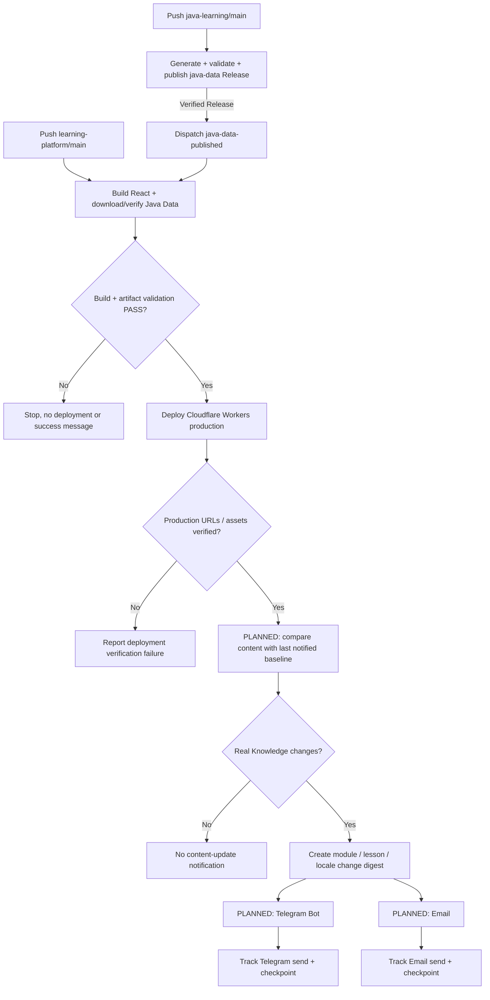

# Java Learning Repository Architecture

**Module progress:** The only checkpoint is `CURRENT_STEP.VALUE` (JSON string) in the verified module's `master.json`. Prime advances it after all QA gates, with no regression and exact readback; do not read or write progress in Google Sheets J3. See `module-generate-agent/rules/PRIME_RULES.md` section 2.


**Reference/Summary architecture:** STEP 2 authors module-wide Reference at Sheet L2/L3 (output `content/reference/references.yml`), STEP 5 authors VI chapter Summary at AC parent/children (headers `Summary` / `Summary Markdown`, compatible paired legacy `Learning Objectives` labels). Independent deterministic tasks `generateModuleReferenceFromSheetByLocation` and `generateModuleSummaryFromSheetByLocation` preflight and clean/fill only their own targets. STEP 12 exports L3/AC to VI Excel, STEP 13 clones VI Summary to EN, STEP 14 translates EN Summary without changing IDs/order, and STEP 15 publishes the shared Reference plus EN Summary to a 29-column EN Sheet/Excel. `generatePortalSummary` projects static JSON separately. See `module-generate-agent/STEP_2.md`, `STEP_5.md`, `STEP_12.md`, `STEP_13.md`, `STEP_14.md`, `STEP_15.md`.

## 1. Mục đích của tài liệu

Tài liệu này mô tả **kiến trúc hiện tại của repository `java-learning`** dựa trên implementation thực tế của project.

Mục tiêu của tài liệu là trả lời các câu hỏi cấp repository:

- Repository được chia thành những boundary nào?
- Build system phát hiện và cấu hình module như thế nào?
- Metadata nào là source of truth?
- `project-orchestration`, `gradle-runtime` và `springboot-runtime` khác nhau ở đâu?
- Generated file và human-owned file được phân biệt như thế nào?
- Build-time capability và runtime capability kết nối với nhau ra sao?
- Một capability mới nên được đặt ở đâu?
- Learning content lấy artifact nào làm upstream source of truth?

Tài liệu này **không phân tích package/source code bên trong `module/`**. `module/` chỉ được đề cập ở mức contract, metadata, build lifecycle và dependency boundary.

---

## 2. Tech baseline

Repository hiện được xây dựng quanh các baseline chính:

- Java 21.
- Spring Boot 3.3.x.
- Gradle multi-project kết hợp composite build.
- Groovy cho phần lớn custom Gradle plugin.
- JUnit Platform cho project có Java plugin.
- Docker Compose cho module cần runtime infrastructure.
- Website UI is owned by the separate `learning-platform` React/Vite repository.

Root project quản lý các plugin và convention dùng chung như:

- Spring Boot.
- Spring Dependency Management.
- Java Library.
- Lombok.
- Docker Compose plugin.
- Spring Cloud BOM.

---

## 3. Repository landscape

```text
java-learning/
├── module/                         # Learning modules
├── internal/                       # Internal supporting modules/resources
├── project-build/
│   ├── gradle-runtime/             # Build-time implementation
│   └── springboot-runtime/         # Shared Spring Boot runtime capability
├── project-orchestration/          # Build composition/policy
├── build.gradle                    # Root project conventions
├── settings.gradle                 # Composite build entry point
├── README.md
├── ARCHITECTURE.md
├── module-generate-agent/
│   └── GENERAL_AGENT_RULES.md      # Canonical source of truth for module-generation workflow/routing
└── STRUCTURE.md                    # Generated module map
```

The repository contains delegated module-generation rule files under `module-generate-agent/`, but this architecture overview intentionally does not enumerate or order them. `GENERAL_AGENT_RULES.md` owns the canonical chain, prerequisites, routing and delegation so the workflow has one source of truth.

Ba boundary quan trọng nhất của infrastructure là:

```text
project-orchestration
        ↓ decides what should run

project-build/gradle-runtime
        ↓ implements build-time behavior

project-build/springboot-runtime
        ↓ implements shared application runtime behavior
```

`module/` là consumer chính của các capability trên, nhưng nội dung package bên trong module nằm ngoài phạm vi tài liệu này.

### 3.0 Learning artifact dependency

Learning modules có thêm một **content architecture** độc lập với Gradle WHAT/WHEN/HOW boundary:

```text
module scope / curriculum boundary
        ↓
Roadmap Skeleton
        ↓
approved Module Roadmap
        ↓
README / Knowledge Menu
        ↓
Knowledge lessons
        ↓
API Docs / executable evidence when applicable
        ↓
Video Script / presentation plan
        ↓
Quiz
        ↓
Interview
        ↓
Portal projection
```

Roadmap là upstream source-of-truth cho learning order và milestone grouping. README/Menu chỉ triển khai roadmap thành Knowledge section cụ thể; API Docs/runtime evidence, Video Script, Quiz và Interview là downstream presentation/reinforcement/evidence và không được tự mở rộng curriculum. Video đặc biệt chỉ được chuyển Knowledge/evidence thành cách trình bày bằng scene/transition/visual/narration, không trở thành technical source of truth mới.

Roadmap có hai optional relation layers nhưng cả hai đều **không phải curriculum source mới**:

```text
relatedKnowledge
→ Knowledge category id trong cùng module
→ supporting/navigation mapping
→ có thể refine sau Knowledge architecture

relatedModules
→ neighboring module route
→ cross-module navigation
→ không tạo child milestone
```

Milestone/order phải được thiết kế và approve độc lập trước. Với legacy content, mapping `relatedKnowledge` tạm thời sang category cũ được phép để migrate Portal nhưng không được reverse-engineer roadmap từ mapping đó.

Roadmap setup không phụ thuộc flag riêng:

```text
MODULE_LANGUAGE
→ RoadmapSetupPlugin (chỉ tạo cấu trúc chung, không ghi đè bài)
→ content/roadmap/<language>/roadmap.yml (do STEP 2/importer author)
→ Portal tự phát hiện Roadmap YAML hợp lệ
```

Mỗi language roadmap tự sở hữu curriculum của nó; Gradle chỉ tạo/sync generated schema comment và không overwrite phần `roadmap:` do human/AI viết.

Với legacy module, roadmap phải được thiết kế độc lập từ module scope/curriculum goal trước, rồi mới audit Knowledge hiện tại. Điều này tránh việc historical menu order vô tình trở thành curriculum mới.

`module-generate-agent/GENERAL_AGENT_RULES.md` là canonical source of truth cho chuỗi module-generation: thứ tự, prerequisite, routing, gap handling và rule file nào được delegated cho từng phase. `ARCHITECTURE.md` chỉ mô tả dependency/boundary ở cấp kiến trúc và không duy trì một bản sao numbered workflow riêng.

### 3.1 Standalone Learning Platform boundary

The legacy application at `project-portal/` has been retired and removed: there is no local Spring MVC portal, Vite frontend, Cloudflare Pages Functions adapter, or `:project-portal` Gradle build task. `java-learning` remains the source of truth for module code, educational assets, static data projection, and executable JAR creation.

`./gradlew generatePortalData` is **retained**: this Gradle task exports learning data, not a standalone Spring Boot portal application. The independent `learning-platform` repository consumes its verified `java-data` Release, derives lightweight navigation/counts/module-details, hosts React on Cloudflare Workers Static Assets, and verifies Production on two domains.

Local Run (Production) uses browser -> `learning-platform` Cloudflare Worker -> SQLite Durable Object coordinator -> `java-learning` GitHub Actions `local-run-build.yml` -> guarded `<resolved-project>:bootJar` -> rolling GitHub Release `local-run` -> browser download. Module/fingerprint V2 are verified in Worker and workflow; duplicate requests reuse the current job, rate-limited dispatches return 429, and module-level GitHub concurrency uses `cancel-in-progress: false`. Cloudflare neither executes Gradle nor stores executable JARs. There is no Java/Cloudflare Pages adapter for Local Run.

The canonical UI/Worker/DO architecture lives in [learning-platform/ARCHITECTURE.md](https://github.com/phuongnguyenit93/learning-platform/blob/main/ARCHITECTURE.md).

### 3.2 Standalone Learning Platform CI/CD and planned notifications

**Implemented:**

- `java-learning/.github/workflows/publish-java-data.yml`: push `main` với thay đổi nội dung module hoặc fingerprint inputs → generate/validate Java learning data → so sánh bytes static output với Release `java-data` đã xác thực checksum (bỏ qua manifest commit metadata) → nếu không đổi thì dừng; nếu đổi thì package/publish/re-download/verify ZIP + SHA-256 và gửi `repository_dispatch` (`java-data-published`) bằng credential chỉ được cấp cho repository đích. Generated `module-structure.txt` không phải trigger hay fingerprint input.
- `learning-platform/.github/workflows/verify-and-preview.yml`: push frontend `main` hoặc nhận `java-data-published` → `npm ci`, tests, build React + download/validate Java data → kiểm tra `dist/language/java/` và static assets → upload artifact. Event từ Java mang source commit và ZIP SHA-256 để frontend không âm thầm tiêu thụ bản Release khác.
- Chỉ khi build PASS, job production deploy `dist/` đã xác thực bằng Wrangler tới Worker `learning-platform` (website `https://nguyendodinhphuong.name.vn`). Kiểm chứng HTTP thực tế trên cả Worker URL và custom domain, so sánh byte/hash của các resource đại diện bao gồm Knowledge VI/EN, catalog, search và JS/CSS. Pull request không deploy; manual Preview được cách ly khỏi production.

**Đề xuất giai đoạn tiếp theo (chưa triển khai):** Post-Deployment Content Change Detection + Notification (Telegram Bot/Email). Một lần build hoặc deploy thành công **chưa chắc** có nội dung Knowledge mới, vì frontend UI, metadata hoặc output đóng gói có thể thay đổi mà lesson không đổi. Chỉ thông báo nội dung sau khi **production validation PASS** và phát hiện diff nội dung thực.



**Trách nhiệm và dữ liệu của phase planned:**

| Boundary | Chủ sở hữu | Contract |
| --- | --- | --- |
| Content source | `java-learning` | Authored Knowledge/menu + generated static projection; GitHub Release là payload được kiểm tra, **không** là lịch sử notification. |
| Build + production verification | `learning-platform` | Cung cấp artifact đã deploy và bằng chứng website phục vụ đúng resource; không gửi “có bài mới” ở thời điểm chỉ build PASS. |
| Content Change Detection | Future post-deploy stage | So sánh **hash từng Knowledge section Markdown** theo module ID, VI/EN, stable section path với snapshot của lần đã thông báo thành công; phân loại added/updated/removed. Không dùng chỉ commit SHA, ZIP SHA hoặc release tag để xác định bài học thay đổi. |
| Diff state / idempotency | Future durable store | Lưu last successfully delivered content version và trạng thái theo channel + recipient ở nơi bền vững (ví dụ storage riêng hoặc release/state record được thiết kế riêng); không trông cậy Actions artifact hết hạn hoặc rolling Release bị ghi đè. |
| Notification fan-out | Future Telegram + Email adapters | Nhận **cùng change set**, gửi tiêu đề module, bài học/locale thay đổi, loại cập nhật và URL trỏ tới production. Channel lỗi được ghi nhận/retry riêng; không gửi lại các bản đã xác nhận thành công. |

Các nguyên tắc khi hiện thực hóa:

1. **Trigger đúng thời điểm:** job notification phụ thuộc kết quả production verification (`needs: production` / điều kiện success), không chạy từ push Java đơn lẻ, Preview, PR, build thất bại hoặc nội dung chưa xuất bản.
2. **Đếm thay đổi ở cấp nội dung:** phân biệt thêm/sửa/xóa Knowledge theo VI/EN; bỏ qua UI-only deploy và trường hợp ZIP/manifest/metadata đổi nhưng nội dung học không đổi. Có thể mở rộng Roadmap/Quiz/Interview/Video bằng yêu cầu riêng, không tự đánh đồng là “Knowledge mới”.
3. **Bảo toàn dữ liệu và chống gửi trùng:** có checkpoint bền vững của snapshot đã giao thành công, deduplication key theo content version + channel + recipient, retry có giới hạn/backoff và thống kê partial success. Nếu không có snapshot hợp lệ, phải có chính sách bootstrap rõ ràng (ví dụ thiết lập baseline, không spam toàn bộ khóa học).
4. **Thông báo chính xác:** chỉ mô tả file/bài và phạm vi thực sự thay đổi. File hash không tự suy ra được điểm mới về mặt ngữ nghĩa; muốn tóm tắt điểm thay đổi phải có diff nội dung, kiểm duyệt/validation phù hợp và link thật đến bài đã deploy.
5. **Quyền và vận hành:** Bot token/Chat ID và Email API/SMTP key/recipient config nằm ở GitHub Actions/Cloudflare secrets hoặc hệ thống quản lý bí mật tương ứng, không nằm trong source Java, frontend bundle, dữ liệu ZIP, log hoặc tài liệu. Với email gửi cho người đăng ký phải có cơ chế consent/unsubscribe. Thất bại gửi thông báo chỉ đánh dấu **notification failure**, không biến một deployment production đã PASS thành “deploy failed”.

**Trạng thái hiện tại:** chỉ CI/CD đến Cloudflare Workers + production verification là **implemented**. Content diff, persistent notification state, Telegram/Email adapter, secrets và scheduled/automatic notification workflow ở mục này là **planned**; tài liệu này không đồng nghĩa đã triển khai hay cấp quyền thực hiện gửi thông báo.

---

## 4. Nguyên tắc phân tầng

Project hiện theo một rule khá rõ:

```text
Orchestration → chọn capability và thứ tự áp dụng
Plugin        → tích hợp với Gradle lifecycle
Service       → chứa implementation logic
Task          → explicit execution entry / side effect
Extension     → typed DSL/configuration surface
Utils         → stateless reusable helper
```

Điểm quan trọng là **orchestration không nên chứa thuật toán implementation chi tiết**.

Ví dụ:

```text
ModuleOrchestrationPlugin
        ↓ luôn áp dụng setup cơ bản cho module thực
ReadmeSetupPlugin
        ↓ wiring lifecycle
Readme service
        ↓ implementation
Readme task
        ↓ explicit execution khi developer gọi
```

---

## 5. Composite build architecture

Root `settings.gradle` nạp hai included build:

```groovy
pluginManagement {
    includeBuild('project-build/gradle-runtime')
    includeBuild('project-orchestration')
}
```

Sau đó apply:

```groovy
plugins {
    id 'com.example.settings-orchestration'
}
```

`project-orchestration` tự nó lại include:

```text
../project-build/gradle-runtime
```

và khai báo dependency:

```text
com.example.learning:gradle-runtime:1.0.0
```

Trong composite build, dependency này được resolve về included build `gradle-runtime`.

Dependency tổng thể:

```text
java-learning
│
├── includeBuild(project-build/gradle-runtime)
│
└── includeBuild(project-orchestration)
        │
        └── depends on gradle-runtime
```

Thiết kế này cho phép custom Settings plugin có classpath ngay từ Gradle initialization phase mà không phải nhét toàn bộ build logic vào root `buildSrc`.

---

## 6. Project orchestration

`project-orchestration` là **policy/composition layer**.

Nó đăng ký ba plugin:

```text
com.example.settings-orchestration
com.example.root-orchestration
com.example.module-orchestration
```

### 6.1 Settings orchestration

`SettingsOrchestrationPlugin` apply theo thứ tự:

```text
PresetSetupPlugin
        ↓
PropertiesSetupPlugin
```

Thứ tự này là một phần của architecture contract.

`PresetSetupPlugin` cần chạy trước để:

- scan repository;
- tìm real module;
- include Gradle project;
- synchronize metadata;
- generate catalog cần thiết ở settings phase.

Sau đó `PropertiesSetupPlugin` đăng callback `projectsLoaded` để inject metadata vào từng Gradle `Project`.

### 6.2 Root orchestration

`RootOrchestrationPlugin` chỉ được phép apply vào root project.

Nó compose:

```text
CatalogSetupPlugin
StructureSetupPlugin
DatabaseSetupPlugin
CleanupSetupPlugin
```

Trong đó:

- Catalog và Structure đợi `projectsEvaluated` trước khi generate output.
- Database plugin đăng ký explicit root tasks.
- Cleanup plugin đăng ký explicit cleanup tasks.

### 6.3 Module orchestration

`ModuleOrchestrationPlugin` là nơi quyết định capability cho từng real module.

Flow hiện tại:

```text
Real module?
    ↓ yes
Resolve SERVICE_NAME
    ↓
DependencySetupPlugin
    ↓
ConfigSetupPlugin
    ↓
YmlSetupPlugin
    ↓
ENV setup        [conditional]
    ↓
README setup     [conditional]
    ↓
Video setup      [conditional]
    ↓
Swagger setup    [conditional]
    ↓
Quiz setup       [conditional]
    ↓
Interview setup  [conditional]
    ↓
Execution Context setup [conditional]
    ↓
Task setup       [conditional]
    ↓
Docker setup     [docker-compose.yml exists]
```

Condition chính:

| Capability | Condition |
| --- | --- |
| ENV | `BUILD_ENV=TRUE` hoặc `BUILD_ENV_PROFILE=TRUE` |
| README | setup mặc định cho module; nội dung dựa trên Knowledge có thật |
| Video | Video YAML hợp lệ tại `<chapter>/video/video-script.yml` |
| Swagger | `BUILD_SWAGGER=TRUE` |
| Quiz | Có câu hỏi Quiz hợp lệ ở thư mục chương |
| Interview | Có câu hỏi Interview hợp lệ ở thư mục chương |
| Execution Context | Servlet modules include the adapter; runtime `execution-context.enabled=true` activates it (default OFF) |
| Task system | `USE_TASK=TRUE` |
| Docker | `docker-compose.yml` tồn tại |

`ConfigSetupPlugin` và `YmlSetupPlugin` được apply cho mọi real module theo convention hiện tại.

---

## 7. Real module contract

Một real module được nhận diện bằng file:

```text
<module>/gradle.properties
```

`gradle.properties` ở đây chủ yếu đóng vai trò **physical marker** để scanner và orchestration phân biệt real module với Gradle intermediate project.

Rule:

```text
có local gradle.properties
        ↓
real module

không có local gradle.properties
        ↓
container / intermediate project
```

Không được giả định rằng mọi Gradle subproject đều là real module.

### 7.1 Physical module identity vs learning granularity

Rule `gradle.properties` ở trên chỉ định nghĩa **physical real-module identity** cho scanner/orchestration. Nó không định nghĩa độ lớn của một learning topic.

Ở tầng learning/content, một real learning module nên đại diện cho một domain/chủ đề đủ thống nhất và đủ sâu để có curriculum riêng. Các concept nhỏ thuộc cùng một mental model nên ưu tiên trở thành README chapter/Knowledge section thay vì bị tách thành nhiều real module cực nhỏ.

Conceptual model:

```text
real learning module
    ↓
coherent learning domain
    ↓
README chapters / Knowledge sections
    ↓
smaller concepts and experiments
```

Ở tầng curriculum, repository phân biệt **content coverage** và **pedagogical coherence**. Một module có đủ chapter/H2/API/Quiz/Interview vẫn có thể là learning experience kém nếu các term chỉ được liệt kê như dictionary mà không có roadmap, motivation và relation.

Learning contract mục tiêu cho một mature module có ba tầng:

```text
Layer 1 — Module mental model / roadmap
→ topic này là gì
→ vì sao nó tồn tại
→ các thuật ngữ lớn là gì
→ chúng liên hệ và nên học theo thứ tự nào

Layer 2 — Concept / chapter story
→ problem trước khi concept xuất hiện
→ vì sao concept hữu ích / được sinh ra
→ concept giải quyết vấn đề bằng mental model nào
→ nó nối với chapter trước/sau ra sao
→ Java biểu diễn concept bằng mechanism/type/API nào

Layer 3 — Technical depth
→ syntax/API
→ compile-time/runtime behavior
→ code evidence
→ rules / edge cases / pitfalls / trade-offs
```

Vì vậy learning flow tổng quát nên đọc được theo hướng:

```text
WHAT → WHY → RELATION → HOW → EVIDENCE → PRACTICE
```

Với content `vi`, đây là **vai trò sư phạm**, không phải requirement phải giữ nguyên heading tiếng Anh. Bản VI dùng tiếng Việt làm ngôn ngữ giải thích chính để giảm cognitive load cho người học. Những từ tiếng Anh thông thường có thể dịch tự nhiên như `responsibility`, `behavior`, `caller`, `rule`, `state`, `implementation`, `collaborator`, `hierarchy`, `procedural code`, `localize change` nên được viết bằng tiếng Việt. English chỉ nên giữ khi đó là Java keyword/API/type/name hoặc technical term learner thực sự cần nhận diện/tra cứu; lần đầu có thể viết `trạng thái (state)`, `trách nhiệm (responsibility)`, `đa hình (polymorphism)`, `kiểu con (subtype)` rồi ưu tiên từ Việt ở phần diễn giải tiếp theo. Repository có một wording exception rõ ràng: learner-facing content không dùng filler `nuance` / `nuances`; phải thay bằng nghĩa cụ thể theo context như `điểm cần lưu ý`, `điểm khác biệt`, `đặc điểm`, `hành vi`, `chi tiết`, hoặc EN equivalent chính xác hơn.

Do đó VI có thể render flow trên thành:

```text
KHÁI NIỆM → VÌ SAO → MỐI LIÊN HỆ → CƠ CHẾ → MINH CHỨNG → THỰC HÀNH
```

hoặc heading tương đương tự nhiên theo context. Không được dịch máy móc Java keyword/API/type, nhưng cũng không được viết câu nửa Việt nửa Anh chỉ vì source term ban đầu là English.

Chapter đầu tiên hoặc entry chapter tương đương của một nontrivial module phải đóng vai trò orientation cho beginner. Tên file không bắt buộc là `MentalModel`, nhưng learner phải hiểu được domain, vocabulary chính và roadmap trước khi gặp deep mechanics.

Các Java language/runtime mechanism cũng không tự động trở thành foundational domain concept chỉ vì chúng nằm trong cùng module. Knowledge phải nói rõ mechanism đó đang implement/hỗ trợ concept nào, được đưa vào để comparison, hay chỉ là boundary handoff sang module khác.

Việc một module có API hay không không quyết định module đó có đủ lớn hay hoàn chỉnh. Knowledge + Quiz + Interview có thể tạo thành learning module hoàn chỉnh cho các topic thiên về language/library/concept. API Docs chỉ là practical experiment layer khi module thực sự có runnable API có giá trị học tập.

Do đó không được đổi một topic tự nhiên thành `SERVLET`/`REACTIVE`, hoặc tạo endpoint giả, chỉ để đạt "đủ bộ" Knowledge/API/Quiz/Interview. Ngược lại, nếu `SERVLET`/`REACTIVE` module có learning API thực sự thì API phải minh họa/chứng minh Knowledge concept và dùng exact README relationship theo Swagger contract.

Workflow order, routing, prerequisites và authoring/validation rule delegation đều phải được resolve từ `module-generate-agent/GENERAL_AGENT_RULES.md`. Tài liệu kiến trúc này không hard-code numbered generation steps để tránh tạo source of truth cạnh tranh.

Ba tầng này là **learning/content contract**, không phải constraint của Gradle/module scanner. Build system vẫn chỉ materialize/present source content; chất lượng roadmap, motivation, transition và conceptual relationship thuộc human/AI-authored curriculum và phải được review độc lập với schema/build correctness.

### 7.2 Bootstrap lifecycle cho learning module mới

Current repository lifecycle khi khởi tạo một learning module mới là:

```text
local gradle.properties
        ↓ settings scanner
real module discovered
        ↓ ModuleConfigurationSyncService
master.json + properties.json synchronized
        ↓ module-owned VALUE configuration
MODULE_LANGUAGE + module đã đăng ký
        ↓ module orchestration / ReadmeSetupPlugin
content/readme/docs/{lang}/menu/<chapter>/knowledge/*.md
        ↓ optional STEP_OPTIONAL_VIDEO after STEP_FINAL
<chapter>/video/video-script.yml (authored via Sheet X:AA)
        ↓ authored Video YAML hợp lệ sau Video QA
Portal Video index.json + content/{categoryId}/script.json
```

`ModuleListEnum`, `module-structure.txt`, `STRUCTURE.md` và các generated registry/structure outputs khác nằm phía generator; bootstrap module không được coi các file này là canonical input để sửa tay.

Concept-oriented module có thể bắt đầu ở `MODULE_TYPE=LIBRARY` với chỉ README capability. Không bắt buộc phải có Java source, module-local `build.gradle`, Video, Swagger, Quiz hay Interview ngay trong phase dựng curriculum skeleton. Video chỉ xuất hiện khi có YAML được author/QA thực tế trong Menu; không cần flag hay Video skeleton khi Gradle Sync.

Current technical caveat: nếu `SERVICE_NAME` còn blank, settings info generation fallback sang directory name rồi validate nó theo enum-constant format. Vì vậy directory mới có dấu `-` sẽ fail bootstrap trước khi có `SERVICE_NAME` hợp lệ. Workaround hiện tại là sync lần đầu bằng tên thư mục tạm hợp lệ theo enum, set stable `SERVICE_NAME`, rename về final taxonomy path, rồi chạy Gradle lại. Đây là bootstrap implementation detail, không phải requirement rằng learning directory phải dùng underscore.

---

## 8. Module metadata architecture

Metadata module được chia thành hai tầng:

```text
master.json
    ↓ high-level identity and feature flags

properties.json
    ↓ detailed configuration of enabled feature groups
```

### 8.1 Canonical schema

Canonical schema nằm trong:

```text
project-build/gradle-runtime/src/main/resources/automation/
├── master.json
└── properties.json
```

Canonical schema sở hữu:

- key nào tồn tại;
- description;
- type;
- group;
- default value;
- metadata cấu trúc khác.

Module-local JSON sở hữu **giá trị cấu hình thực tế của module**.

### 8.2 `master.json`

`master.json` chứa các metadata cấp cao, ví dụ:

```text
MODULE_TYPE
MODULE_LANGUAGE
JAVA_BASE_PACKAGE
SERVICE_NAME
SERVICE_NAME_DESCRIBE
IS_MODULE_DEPEND
BUILD_ENV
BUILD_YML
BUILD_TESTER
BUILD_SWAGGER
BUILD_DATABASE_MODULE
ADD_MODULE_DEPEND
USE_DATABASE
USE_TASK
```

`MODULE_LANGUAGE` là metadata cấp module dùng chung cho mọi capability cần localization. Canonical type là `list`, default hiện tại là `[vi, en]`. README, Video skeleton, Swagger build-time, Knowledge metadata sync, Portal projection và runtime Swagger không sở hữu language list riêng; chúng consume `MODULE_LANGUAGE`. Hai key cũ `README_LANGUAGE` và `BUILD_SWAGGER_LANGUAGE_LIST` đã được loại bỏ khỏi `properties.json`.

`JAVA_BASE_PACKAGE` hiện có canonical default:

```text
com.example.learning
```

Module có quyền override giá trị này.

Ví dụ shared Swagger runtime dùng:

```text
com.example.projectbuild.swagger
```

### 8.3 `properties.json`

`properties.json` chỉ chứa các group đang active.

Một group được xem là active khi metadata tương ứng trong `master.json`:

```text
VALUE = TRUE
và
GROUP != null
```

Ví dụ các group hiện được sử dụng có thể phục vụ:

- ENV;
- YML;
- README;
- Swagger;
- database;
- module dependency;
- task configuration.

### 8.4 Synchronization rule

`ModuleConfigurationSyncService` đồng bộ module-local JSON với canonical schema.

Contract hiện tại:

```text
Canonical schema metadata
        ↓ authoritative

Existing non-blank VALUE in module
        ↓ preserved
```

Nói cách khác:

- schema thuộc build system;
- `VALUE` thuộc module/developer;
- key không còn trong canonical schema có thể bị loại khỏi synchronized output;
- key mới trong canonical schema được thêm vào module khi sync.

### 8.5 Property injection

Sau khi Gradle project hierarchy được tạo, metadata được inject vào `Project.extraProperties`.

Thứ tự:

```text
master.json
    ↓
properties.json
```

Nếu cùng một key xuất hiện ở cả hai nơi thì giá trị được inject sau từ `properties.json` sẽ thắng trong phase này.

Consumer sau đó sử dụng:

```groovy
project.findProperty('...')
```

---

## 9. Module type model

`MODULE_TYPE` có bốn loại chính:

| Type | Physical Java structure | Runnable | Artifact behavior |
| --- | --- | --- | --- |
| `SERVLET` | Có | Có | Spring MVC/Servlet Boot application / `bootJar` |
| `REACTIVE` | Có | Có | Spring WebFlux Boot application / `bootJar` |
| `LIBRARY` | Có | Không | plain `jar`, `bootJar`/`bootRun` disabled |
| `PLATFORM` | Không tự tạo physical Java structure | Không | plain `jar`, `bootJar`/`bootRun` disabled |

Hai runnable type có dependency mặc định khác nhau:

```text
SERVLET
→ spring-boot-starter-web

REACTIVE
→ spring-boot-starter-webflux
```

`APPLICATION` là legacy metadata value và được `ModuleConfigurationSyncService` migrate thành:

```text
APPLICATION → SERVLET
```

Canonical schema và code mới không tiếp tục expose `APPLICATION` như một `ModuleType` hợp lệ.

Common build configuration vẫn được apply trước khi specialized module behavior được quyết định.

Nếu `MODULE_TYPE` blank hoặc invalid:

```text
common setup vẫn chạy
specialized structure/config bị skip
```

---

## 10. Java package ownership

Java base package không còn là global hidden property trong root `settings.gradle`.

Nó hiện là metadata chính thức của từng module:

```text
JAVA_BASE_PACKAGE
```

Flow:

```text
automation/master.json
    JAVA_BASE_PACKAGE=com.example.learning
            ↓
module master.json
            ↓ optional override
SettingPropertiesInjectionService
            ↓
project.JAVA_BASE_PACKAGE
            ↓
ModuleStructureService
```

Với `SERVLET` và `REACTIVE`, `ModuleStructureService` dùng package này để:

- tạo source directory;
- generate main application class nếu chưa tồn tại;
- tạo `MAIN_CLASS_PATH`.

Main class được generate theo web stack:

```text
SERVLET
→ Spring Boot application class có Servlet deployment support

REACTIVE
→ regular @SpringBootApplication main class
→ không phụ thuộc SpringBootServletInitializer
```

`MAIN_CLASS_PATH` sau đó là source of truth cho những consumer như IntelliJ run configuration generation.

IntelliJ task không tự suy luận package lần thứ hai.

```text
JAVA_BASE_PACKAGE
        ↓
ModuleStructureService
        ↓
MAIN_CLASS_PATH
        ↓
IntellijTaskPlugin
```

---

## 11. Gradle runtime

`project-build/gradle-runtime` là **build-time control plane** của repository.

Nó chứa các nhóm responsibility chính:

```text
settings setup
root setup
module setup
manual tasks
generated plugin/catalog source
shared utilities
canonical automation resources
task/extension registry resources
generator scripts for build framework itself
```

### 11.1 Settings layer

Settings layer chịu trách nhiệm:

- scan filesystem;
- include real modules;
- sync `master.json` và `properties.json`;
- generate typed module/database information;
- inject properties vào project hierarchy.

### 11.2 Root layer

Root layer chịu trách nhiệm repository-wide behavior như:

- dependency catalog projection;
- structure documentation;
- database maintenance tasks;
- cleanup tasks.

### 11.3 Module layer

Module layer cung cấp các capability như:

- common/type-specific build configuration;
- source structure;
- module dependency wiring;
- YML setup;
- ENV setup;
- README setup;
- Swagger build-time setup;
- Execution Context build-time source-context setup;
- task dispatcher;
- Docker setup.

### 11.4 Manual task layer

Task plugin cung cấp các action developer chủ động chạy như:

- generate ENV;
- README generation/translation;
- YAML merge;
- IntelliJ run configuration;
- Swagger description generation.

External hoặc destructive side effect nên nằm trong explicit task execution thay vì tự chạy chỉ vì Gradle reload.

---

## 12. Plugin registry architecture

Build framework có generated registry `ProjectPluginEnum`.

Registry biểu diễn mapping:

```text
logical plugin
    ↓
plugin id
    ↓
implementation class
```

Module orchestration sử dụng registry này để apply capability thay vì hardcode implementation class.

Registry là **generated projection**, không phải canonical input.

Các generator script của `gradle-runtime` chịu trách nhiệm cập nhật plugin list, enum và stub khi framework thay đổi.

Generator phải deterministic trên cả Windows và Linux. Khi suy ra tên file plugin, logic hiện lookup file đang tồn tại theo **case-insensitive filename** trước khi tạo mới: đúng một match thì reuse actual casing, nhiều hơn một match thì fail. Rule này tránh trường hợp Windows coi `ExecutionContextSetupPlugin.groovy` và `ExecutioncontextSetupPlugin.groovy` là cùng file nhưng Linux CI lại tạo duplicate rồi làm registry/orchestration lệch implementation class.

---

## 13. Task architecture

Task system có hai tầng enablement.

Tầng 1:

```text
USE_TASK=TRUE
    ↓
TaskSetupPlugin được apply
```

Tầng 2:

`TaskSetupPlugin` đọc:

```text
task/module-task-list.json
task/task-extension-list.json
```

và quyết định task plugin nào được bật theo `propCheck`.

Ví dụ conceptual:

```text
USE_TASK=TRUE
        ↓
Task dispatcher active

README task không còn cần flag
        ↓
README task capability active

BUILD_SWAGGER=TRUE
        ↓
Swagger task capability active

propCheck blank
        ↓
task capability luôn active khi dispatcher đã được bật
```

`task.gradle` là generated DSL reference cho những extension/task đang được expose.

Nó không phải source of truth và không nên chứa manual configuration cần được bảo tồn.

### 13.1 Google Sheets integration — build-time authentication and module identity guard

Phần **module-local** là Gradle manual task, không phải web runtime integration và **chưa phải pipeline import Knowledge/Video**. Orchestration vẫn quyết định `USE_TASK=TRUE` → `TaskSetupPlugin` → `SheetsTaskPlugin`; task/extension `generateModuleContentFromSheetByLocation` nhận `fileUrl` (URL spreadsheet) và `sheetId` (numeric **tab gid**). Task gọi `SheetContentImportCoordinator` để xác minh I3, import Roadmap (nếu có) **chỉ khi task thực thi**, không lấy credentials/đọc mạng ở Gradle configuration phase.

```text
Explicit Gradle task on real module
  ├── fileUrl = Google spreadsheet document URL
  ├── sheetId = tab gid (NOT spreadsheetId)
  └── project.projectDir, rootProject.projectDir
             │
             ▼
GoogleCredentials.getApplicationDefault()           [ADC, source principal A]
             │
             ├── GOOGLE_SHEETS_IMPERSONATE_SERVICE_ACCOUNT configured?
             │       └── IAM Credentials API issues short-lived token for SA B
             │           after checking A's Token Creator permission
             └── otherwise use ADC identity directly
             │
             ▼
Google Sheets API + HttpCredentialsAdapter(credentials)
  ├── spreadsheets.get    → validate spreadsheet and actual tab gid
  └── values.batchGet      → read tab I3 locations with one request
             │
             ▼
Compare I3 with root-relative canonical projectDir (forward slashes)
  ├── exact match  → Roadmap import permitted (DRY_RUN default)
  └── empty/different → GradleException; STOP before processing content
```

**Google Cloud security boundaries are separate:**

- Service Account is an IAM identity belonging to a Google Cloud project; enabling **Google Sheets API** and **IAM Service Account Credentials API** enables calls, but does not grant it permission to arbitrary files.
- ADC authenticates the calling/source principal. With impersonation, that principal needs `roles/iam.serviceAccountTokenCreator` for the target Service Account. The **Google Sheet itself** must be shared with that Service Account (Viewer for read-only access).
- Access token scoped to `spreadsheets.readonly` is short-lived and attached to Sheets API requests via `HttpCredentialsAdapter`; it is **not** a fixed API key or a downloaded Service Account JSON private key. A leaked valid access token remains sensitive until expiry. An ordinary Google API key does not provide the identity/file ACL necessary to read a private Sheet.
- `fileUrl` and `sheetId` are resource locators, **not** credentials. Do not store tokens, keys or secrets in these values or in repository documentation.

**Module identity guard:** STEP 1 stores the repository-root-relative module location in the selected tab's `I3` (e.g. `module/platform/development/programming/paradigm/object-oriented`). The module-local Gradle task derives the real canonical module directory from `project.projectDir` relative to `rootProject.projectDir`; requires exact `I3`, not merely a matching module name. Blank/wrong location throws `GradleException` before import/write. The reader fetches spreadsheet/tab metadata and batch-loads the tab `I3` values to avoid per-tab rate limits; after guard checks, Roadmap import reads only the authorized Roadmap area, never Knowledge/Video. `APPLY` is opt-in.

Implementation: `project-build/gradle-runtime/src/main/groovy/com/example/learning/task/sheets/`. Operational IAM/ADC and local test guide: `project-build/gradle-runtime/SETUP_GOOGLE_IAM_AND_ADC.md`.

**Module-local import task split:** Các importer cũ Roadmap/README/Interview P:S/Quiz T:W/Video/Reference/Summary dùng I3; STEP 6 mới author trong Sheet: Phase 1 thô P25:R26/S25:U26/V25:W26, **Phase 2 và 3 chung vùng 5 hàng P20:R24/S20:U24/V20:W24**, Phase 4 answer/code group riêng 3 hàng từ 27 (Interview P:R, Case Study S:U). Không có importer cho contract mới; không chạy legacy importer hoặc tự nâng STEP.

**Interview importer (fourth branch):** `generateModuleInterviewFromSheetByLocation` reads Interview YAML fragments at P:S on Menu Level 1 parent rows (legacy JSON accepted), normalizes valid fields in memory, validates and writes `content/readme/docs/vi/menu/<chapter>/questions/interview.yml` and `questions/summary.yml` (when authored). Root `normalizeInterviewQuestionsFromSheet` writes normalized YAML back to P:S only after full-tab QA. Combined ByLocation and ByFiles still order Roadmap, README, Video, Interview. Missing P:S and entirely blank sources skip without deleting prior Interview data; malformed populated YAML, fragments, headers or related paths block import. No AI or Sheet write during importer.

**Prime sync checkpoint after worker phases:** STEP 2 Roadmap/Intro/Reference; STEP 3/4 README deferred; STEP 5 Knowledge/Metadata/Summary; STEP 6 Phase 1/2/3 mỗi loại một worker: Phase 2 tạo khung, Phase 3 cập nhật chính YAML trong năm hàng đã dùng, không sinh block Phase 3. Phase 4 một worker/group cho Interview/Case Study theo block ba hàng từ 27; Quiz kết thúc Phase 3. Prime QA theo MAX-FILL/exact readback, không chạy legacy import; STEP 10 Quiz legacy và STEP 11 related riêng.

**Google Sheets → module (ByLocation / ByFiles):** SheetContentImportCoordinator điều phối các importer qua Gradle task, không gọi AI. Sheet là nguồn chuẩn của các cây đầu ra độc lập:
- roadmap/vi: tạo mới roadmap.yml từ F:G:H, không giữ YAML comment, quan hệ hoặc file phụ cũ;
- readme/vi/menu: tạo toàn bộ README từ Menu A:B và Knowledge C:N (12 ô/hàng);
- video của từng chương tại `content/readme/docs/vi/menu/<chapter>/video/video-script.yml`: lấy script `X:AA` trên hàng Menu cấp 1, chỉ thay các file Video đã được preflight theo ownership và dọn orphan Video cũ; không đụng Knowledge/Metadata/Quiz/Interview.

Importer Video preflight toàn tab rồi stage từng chương và thay snapshot chỉ cho file `video/video-script.yml`; rollback nếu commit lỗi. **Không bao giờ xóa nguyên cây Menu**; không đụng roadmap/en, docs/en, BASE/LIST, Knowledge, Metadata, Interview, Quiz hoặc Sheet. Video importer không chạy Portal projection; Portal tự phát hiện file Video hợp lệ ở bước build. Video trống là optional.
Current workflow: STEP 5 Knowledge/metadata/filename/Summary → STEP 6 Interview + Case Study + Quiz (4 Phase) → **STEP 7 mới: liên kết Knowledge nhiều bài/xuyên chương qua `readmeRelated.anchorList`** → **STEP 8 mới: Prime tạo GroupController/GroupService cho group; worker đưa main vào executeCaseY và tách type theo kind/group/case** → **STEP 9 cần viết lại contract kiểm fidelity/package, Prime QA** → STEP 10 (Quiz legacy, chưa gộp) → STEP 11 related legacy/Swagger → STEP 12–15 → FINAL. STEP 7 Swagger **cũ** và STEP 8 **cũ** ngừng; STEP 8 mới chỉ có một lượt worker/group, STEP 9 cũ đồng bộ ngược module→file/Sheet đã hủy; STEP 9 mới theo STEP_9.md và worker/STEP_9_WORKER.md, không renumber STEP 10–15. STEP 7 mới: `worker/STEP_7_WORKER/STEP_7_WORKER_PHASE_1.md` READ Knowledge **một chương + P20:W24**, WRITE một ô staging trong **A14:AD15** (60 ô, mặc định A14/B14/C14) → **Prime merge và APPLY anchorList lần đầu + readback** → `STEP_7_WORKER_PHASE_2.md` ba worker WRITE **trực tiếp và độc lập** toàn bộ Interview **P20:R24**, Case Study **S20:U24**, Quiz **V20:W24**, READ thêm **toàn module Knowledge** (không còn 5-group batch/staging Phase 2) → **Prime chỉ QA/CONFIRM ba vùng và xóa staging**, không APPLY lần hai. STEP 6/7 dùng importer `generateModuleAssessmentsFromSheetByLocation`; không cập nhật CURRENT_STEP chỉ từ Sheet enrichment. **STEP 8 mới**: Prime tạo một Controller/Service mỗi group theo Sheet, một GET endpoint và `executeCaseY()` mỗi case; worker một group/lượt chuyển nguyên main body vào GroupService và tách original types/static methods vào `casestudy/<kind>/groupX/caseY/`. Worker không sửa Controller/bean/signatures, Prime QA sau workers, không rewrite logic hoặc tạo DemoResult; xem STEP_8.md và worker/STEP_8_WORKER.md. Java APIs và Swagger YAML vẫn được giữ; Video optional sau FINAL.

**STEP 8 MỚI — PRIME GROUP CONTROLLER/SERVICE, WORKER TRUNG THÀNH MÃ NGUỒN:** Prime trước worker tạo duy nhất một `casestudy/controller/GroupXController.java` và `casestudy/service/GroupXService.java` mỗi group, mỗi case một GET và method `executeCaseY()` placeholder fail-closed. Một worker xử lý trọn group: nguyên thân main → GroupService.executeCaseY, original types/static methods → `casestudy/<kind>/groupX/caseY/` (utils cùng mẫu). Worker không sửa Controller/header/method signature, không tạo DemoResult; Prime QA sau release và chỉ sửa scaffold mình sở hữu. Lỗi nội dung chỉ được sửa tối thiểu với chứng cứ; Sheet/YAML READ-ONLY, STEP9 pilot cũ chưa hợp layout này.

**STEP 9 — CHỜ VIẾT LẠI SAU STEP8 MỚI:** Contract STEP9 pilot cũ có quyền refactor/xóa helper, không còn an toàn với STEP8 mới bảo toàn từng statement/type/method. Không triển khai STEP9 pilot cũ lên code chuyển đổi nguyên trạng; STEP9 mới sau này chỉ kiểm fidelity/package và lỗi có bằng chứng. Reverse sync đã hủy; Prime vẫn QA-only, không tự sửa/gom code.

| Sheet authoring contract | Đơn vị sở hữu | Nguồn chính | Vùng kết quả |
| --- | --- | --- | --- |
| STEP 1 — Clone tab / setup | Prime trực tiếp, không cần worker | `Template`, module location, mapping TXT | Tab mới: `B1`/`I3`; **700 hàng đầu cao 60 px và CLIP toàn bộ cột hiện có** |
| STEP 2 — Roadmap | Một worker / một tab | `C2` + Special Note | `F:H` theo từng milestone |
| STEP 3 — Menu hai cấp | Một worker / một tab | `C3` + Special Note | `A20:B...` (cha trên hàng A riêng, con B các hàng sau) |
| STEP 4 — Knowledge NEW_FILL ONLY | Một worker / một mục Menu Cấp 2 **còn trống** | Module, ô cha/con và Special Note theo tọa độ Prime | Chỉ `C:N` **khi cả 12 ô trống**; đã có bất kỳ fragment → `SKIPPED_EXISTING`, không review/sửa; STEP 5 review toàn bộ |
| STEP 5 — Chapter review + Difficulty + English filename | Một worker / một Menu Cấp 1 | A/B hàng cha + toàn bộ Menu Cấp 2/Knowledge của chương | **`C:N` refactor + `O` Difficulty hàng con; chính worker ghi `B` hàng cha** |
| STEP 6 — Interview, Case Study, Quiz | Phase 1–3: một worker mỗi loại/Phase; Phase 4: một worker/group/loại Interview hoặc Case Study | A1/B1; nguồn Phase trước đúng loại | **Phase1 P25:R26 / S25:U26 / V25:W26; Phase2 và Phase3 CHUNG P20:R24 / S20:U24 / V20:W24 (5 hàng); Phase4 P:R / S:U, 3 hàng/group từ 27** |
| STEP 10 — Quiz YAML | One worker per Menu Level 1 | A/B parent, B/C:N/O children | **T:W on actual parent row**; 4 choices/explanations and correctAnswerId |
| STEP_OPTIONAL_VIDEO — Video Script | Một worker / một Menu Cấp 1 | H1 from parent A, sections from B/C:N children | **X:AA parent row**, after STEP_FINAL |

**Schema and preservation contracts:**

- Khu `Module Project` của tab hiện dùng `I2/I3 = Location`, `CURRENT_STEP/CURRENT_STEP.VALUE = Current STEP`, `K2/K3 = Special Note`. **Không hardcode tọa độ Special Note như một bất biến:** Prime STEP 2/3 phải xác định ô tiêu đề `Special Note` và ô giá trị bên dưới của **tab thực tế**, gửi **cả hai tọa độ**, tuyệt đối **không chép hoặc tự tóm tắt nội dung**. Worker tự đọc nguyên văn cả hai, áp dụng ranh giới module nếu có và chỉ đọc, không sửa. Nếu nhãn thiếu/mơ hồ hoặc ghi chú xung đột nguồn/quyền ghi → blocker; giá trị ghi chú trống là hợp lệ.
- **Special Note có contract riêng ở STEP 2, 3 và 4.** Với STEP 4, Prime chỉ định đúng tọa độ hai ô tiêu đề/giá trị Special Note; Worker tự đọc nguyên văn khi **tạo bài mới ở C:N trống**. Không đọc lại hoặc áp dụng ghi chú để review/sửa bài đã có; STEP 5 chịu trách nhiệm review/refactor Knowledge. Không suy đoán tọa độ và không tự áp dụng ghi chú cho các STEP khác nếu contract chưa cho phép.
- STEP 2 giữ mỗi milestone `Title (F) / Purpose (G) / Objectives (H)` trên một hàng; STEP 3 giữ đúng hai cấp Menu. **STEP 4 và STEP 5 thống nhất dùng 12 ô Knowledge `C:N` (tối đa 360.000 Unicode chars/hàng)**; STEP 5 thêm `O` Difficulty cho mỗi hàng Menu Cấp 2 với một trong `BASIC`, `INTERMEDIATE`, `ADVANCED`, giữ nguyên validation và màu dropdown. X:AA thuộc Video, không lấn.
- **STEP 5 chapter filenames:** Worker đặt B cha .md và review Knowledge/Difficulty. STEP 6 mới dùng ba vùng cố định P:R, S:U, V:W, không dùng P:S Interview legacy trên từng hàng cha; STEP 10 vẫn là Quiz legacy T:W; Video optional X:AA sau FINAL.
- **Legacy Interview P:S importer:** normalizeInterviewQuestionsFromSheet và generateModuleInterviewFromSheetByLocation vẫn xử lý P:S cũ theo hàng Menu. Các task này không hiểu STEP 6 mới (Phase 1 25–26, Phase 2+3 chung 20–24, Phase 4 từng group 3 hàng từ 27); build/step9/summary vẫn là staging legacy.
- **STEP 10 Quiz YAML (worker + Prime Normalize + Import):** Template header T18=Quiz, T19:W19=Quiz YAML, four adjacent 30k-Unicode cells per parent row. Three Module Content workbooks use the same column ordering: Interview P:S, Quiz T:W, Video X:AA. Worker writes question/answers A–D/explanations/correctAnswerId; `normalizeQuizQuestionsFromSheet` fills filename+ordinal question IDs (retaining existing) and chapter-local Knowledge/API relations, without obsolete flags. Repeated normalized runs are deterministic. Exact readback before module-local `generateModuleQuizFromSheetByLocation`, which validates and replaces chapter-owned `quiz/question.yml` only after full-tab completeness, DRY_RUN/APPLY and Prime QA. `LEGACY_QUESTION_LINKS` temporarily supports file-only until anchor is enriched; strict mode does not. No automatic Quiz skeleton in individual modules.
- **STEP_OPTIONAL_VIDEO (after STEP_FINAL):** X18=Video, X19:AA19=Video Script; worker writes YAML to X:AA on exact parent row with sections aligned to Menu Level 2, SCENE/TRANSITION, timeline, visual/script/purpose. Ensure technical QA equivalent to README but narration natural and not copied from README. After whole-tab QA, Prime runs `generateModuleVideoFromSheetByLocation` DRY_RUN/APPLY, verifies `content/readme/docs/vi/menu/<chapter>/video/video-script.yml` and only then confirms optional completion; **never advances CURRENT_STEP.VALUE**. The optional Video step never reads/writes Interview P:S; Video remains outside STEP 13/14/15 mandatory VI/EN translation despite sharing the Docs tree.
- **Phân biệt contract và code importer:** `ReadmeSheetImportService` đọc **đủ Knowledge `C:N` (12 ô/hàng)**; `O` là Difficulty riêng. `InterviewSheetNormalizeService`/importer dùng `P:S`; `QuizSheetNormalizeService`/importer dùng `T:W`; `VideoSheetImportService` dùng `X:AA` trên đúng hàng cha, không còn dùng N-topic/O:R kiểu cũ.
- Worker preflight giá trị/công thức/metadata của ô đích và ownership trước write; STEP 5 là trường hợp có quyền **thay thế** Knowledge đã tồn tại trong phạm vi của nó, với snapshot, dọn mảnh đuôi và readback. Prime nghiệm thu độc lập và chỉ cập nhật `CURRENT_STEP.VALUE` sau khi **toàn bộ phạm vi tab** đạt QA; thử nghiệm vài chương **không** tự nâng Current STEP. Template, vùng lân cận, notes/format và nội dung không thuộc quyền phải được giữ nguyên.

**External Sheets state is not repository configuration.** For example, `Module Content 2` was updated on 19 Java-version tabs with a module-specific `Special Note` advising use of knowledge still applicable today; the `Template` value was kept blank, and earlier STEP 2/3 generated cell contents on those tabs were intentionally cleared. Those were **one-time Google Sheets edits**, not actions performed by the Gradle validation task or invariants to encode in build logic.

---

## 14. Dependency architecture

Module dependency được resolve bằng stable logical identity:

```text
SERVICE_NAME
```

Thay vì buộc consumer hardcode Gradle path ở mọi nơi, build logic có thể:

```text
SERVICE_NAME
    ↓
ModuleProjectUtils
    ↓
Gradle Project
    ↓
project dependency
```

`DependencySetupPlugin` tạo DSL extension sớm nhưng trì hoãn resolution thực tế tới `projectsEvaluated`.

Điều này cho phép:

- mọi project hoàn thành configuration trước;
- module build script khai báo dependency DSL;
- configuration như `implementation`, `api`, `annotationProcessor` đã tồn tại trước khi dependency được wire.

Dependency catalog được generate sau khi toàn bộ project đã evaluate.

Generated dependency catalog không phải canonical dependency declaration.

---

## 15. Configuration ownership

Một trong những rule quan trọng của repository là phân biệt **human-owned** và **generated**.

### 15.1 Human-owned

Các file trở thành human-owned sau khi được khởi tạo hoặc do developer trực tiếp quản lý, ví dụ:

- application source;
- main application class sau lần generate đầu;
- `application.yml` của application;
- README content do developer viết;
- module-local metadata `VALUE`.

Build automation không được tùy ý overwrite các nội dung này.

### 15.2 Generated

Generated artifact có thể được rebuild hoàn toàn từ source-of-truth khác, ví dụ:

- `ModuleListEnum`;
- `DatabaseListEnum`;
- `ProjectPluginEnum`;
- `module-depend.json`;
- `STRUCTURE.md`;
- `module-structure.txt`;
- `task.gradle`;
- `application-merged.yml`;
- những phần README/menu được đánh dấu là generated.

Developer không nên chỉnh generated output để thay đổi behavior gốc.

---

## 16. Idempotency và determinism

Build automation ưu tiên hai property:

```text
same input → same output
same output → do not rewrite file
```

Nhiều generator hiện thực hiện comparison trước khi write để tránh:

- timestamp thay đổi vô ích;
- IntelliJ nhận file thay đổi không cần thiết;
- generated diff nhiễu;
- duplicate generated markup.

README internal-menu generator còn có requirement chặt hơn:

```text
N lần generate
    =
1 lần generate
```

Generated markup cũ phải được remove/rebuild từ canonical content thay vì append lặp lại.

---

## 17. YML architecture

YML capability phân biệt rõ runtime truth và generated suggestion.

### 17.1 `application.yml`

Đối với application:

```text
application.yml
```

là runtime configuration chính và được xem là **human-owned** sau khi có meaningful content.

YML của library/platform đóng vai trò configuration source/reference cho composition, không tự động biến thành runtime truth của application.

### 17.2 `application-merged.yml`

YML merge task tạo:

```text
application-merged.yml
```

với mục đích:

```text
dependency/module configuration
        +
application configuration
        ↓
generated suggestion
        ↓
developer review
        ↓
application.yml
```

`application-merged.yml` không phải runtime source of truth.

### 17.3 Capability-derived YML dependency

YML composition không chỉ đọc dependency khai báo explicit. Một số dependency được derive trực tiếp từ module type/capability:

```text
MODULE_TYPE=SERVLET
→ SPRING_WEB

MODULE_TYPE=REACTIVE
→ SPRING_REACTIVE

BUILD_SWAGGER=TRUE
→ GLOBAL_SWAGGER_CONFIG
```

Mỗi dependency ở đây đóng góp `application-module.yml` vào graph merge. Vì vậy một module `REACTIVE + BUILD_SWAGGER=TRUE` có conceptual YML graph:

```text
SPRING_REACTIVE/application-module.yml
        +
GLOBAL_SWAGGER_CONFIG/application-module.yml
        +
current module application-module.yml
        ↓
application-merged.yml
```

Swagger adapter Java không được thêm vào YML graph chỉ để phản ánh runtime dependency; YML core được dùng chung cho cả hai web stack.

---

## 18. ENV architecture

ENV setup và explicit ENV generation có ownership khác nhau.

Setup phase ưu tiên **không overwrite existing `.env`**.

Explicit ENV generator được developer chủ động gọi có thể rebuild/synchronize nội dung theo contract của task.

Timestamp trong generated `.env` là intentional metadata để developer biết thời điểm file được generate/sync.

Secret handling không nên biến secret thành canonical committed metadata.

---

## 19. README/documentation architecture

README automation gồm các responsibility chính:

- initialize structure;
- generate internal navigation;
- assemble final README;
- translate Markdown;
- preserve human-owned content;
- expose generated documentation resources cho runtime capability khi cần.

README language structure và `generateFinalReadme` lấy danh sách language trực tiếp từ `MODULE_LANGUAGE`; module `build.gradle` không còn khai báo `generateFinalReadme { languages = ... }`.

Knowledge Markdown và Knowledge governance có ownership tách nhau:

```text
content/readme/docs/{lang}/menu/<chapter>/knowledge/**/*.md
→ canonical content + anchored section existence

content/readme/metadata/{lang}/knowledge-metadata.yml
→ per-section difficulty / AI provenance / review state
```

`knowledge-metadata.yml` có shape theo README relative path rồi exact anchored section id:

```yaml
1.Basic/knowledge/Basic.md:
  thread-state:
    difficulty: ADVANCED
```

`difficulty` chỉ nhận `BASIC | INTERMEDIATE | ADVANCED`; defaults hiện tại là `BASIC`. Root task `syncMetadataReadme` là explicit/manual synchronization: nó đi theo `MODULE_LANGUAGE`, scan real learning module có local `gradle.properties`, rebuild metadata từ current Markdown section, preserve existing current-topic values, loại stale file/topic entry và write only when changed. Ordinary Gradle configuration/IDE sync không được tự ghi file metadata này.

Shared `ReadmeKnowledgeParser` định nghĩa section Knowledge hợp lệ bằng exact anchored H2 dạng `## <a id="...">Title</a>`. Section id phải unique trong một module/language để cả metadata synchronization, Portal projection và API `readmeRelated.anchor` cùng dùng một identity ổn định.

`Title` trong anchored H2 đồng thời được Portal dùng như label của Knowledge card/index. Vì vậy title phải ưu tiên **ngắn, dễ quét, đúng concept** thay vì cố gói toàn bộ kết luận của section vào một câu dài. Title nên khớp với câu hỏi/chủ đề mở đầu của nội dung; phần giải thích như motivation, contrast, claim hoặc caveat để trong body. Ví dụ `OOP là gì?`, `Đóng gói là gì?`, `Dynamic Dispatch`, `Rủi ro của kế thừa` tốt hơn các title dài kiểu `Đối tượng là nơi gắn trạng thái với hành vi`. VI/EN có thể dùng wording tự nhiên khác nhau, nhưng phải giữ cùng concept và cùng anchor id. Việc rút gọn visible title không phải lý do đổi anchor ổn định.

H1 và anchored H2 có hai vai trò khác nhau. H1 có thể được dùng để dựng chapter outline trước; file H1-only chưa tạo Knowledge identity. `syncMetadataReadme` chỉ có ý nghĩa sau khi chapter đã có anchored H2 sections thực sự cần governance. Điều này cho phép phase scaffold curriculum tạo tên chapter trước mà chưa tạo metadata rỗng hoặc giả.

Translation pipeline tách:

```text
prepare markdown
    ↓
translation spans
    ↓
translator
    ↓
render back into markdown
```

Prepare/render là hai phía của cùng một transformation contract; translated spans được replace theo offset an toàn.

Generated documentation phải idempotent.

### 19.1 Video script architecture

Video script là **presentation artifact** tách khỏi README/Knowledge. Nó derive từ Knowledge nhưng không trở thành source of truth kỹ thuật mới.

Enablement contract:

```text
Authored chapter Video YAML hợp lệ
        ↓
PortalVideoProjectionService (publication only)
        ↓
Static index.json + per-chapter script.json
```

Knowledge Menu là structural source of truth; Portal chỉ quét Video trong các `MODULE_LANGUAGE` đã khai báo, không có language list riêng hoặc build flag cho Video.

Canonical path mapping:

```text
content/readme/docs/{lang}/menu/<chapter>/knowledge/*.md
        ↓ chapter + Menu Cấp 2 mapping (optional after FINAL)
content/readme/docs/{lang}/menu/<chapter>/video/video-script.yml
```

Video là YAML trong thư mục con `video/` của mỗi chapter, không phải Markdown của Knowledge; README final-list, internal-menu và Portal Knowledge chỉ quét `knowledge/*.md`. Tách folder giữ boundary rõ:

```text
readme = what to learn
video  = how to present it
```

Không có Video skeleton auto-sync. Authored Video YAML được worker tạo trong Sheet X:AA và importer chỉ ghi file của từng chương sau khi preflight toàn bộ. Skeleton sau đây là ví dụ lịch sử để hiểu nội dung presentation, không phải source tự sinh trong module:

```yaml
---
video:
  url: ""
---
```

Body skeleton chỉ materialize H1, các H2 tương ứng và comment ẩn mô tả format script. Comment contract hiện định nghĩa:

```text
Transition
├── Time
├── Visual
├── Script
└── Purpose

Scene N
├── Time
├── Visual
├── Script
└── Purpose
```

Mỗi H2 là một video section/chapter. Section đầu tiên cần ít nhất một Scene; từ section thứ hai trở đi cần ít nhất một Transition từ section trước và ít nhất một Scene. Số Scene thực tế không bị cố định; content-generation step tự quyết định theo độ sâu Knowledge, code walkthrough hoặc runtime evidence.

Ownership nguồn Video:

```text
Knowledge chapter/section titles + finalized content
→ source of truth for section order and technical correctness

Video URL + Transition/Scene script
→ human/AI-owned presentation content
```

Video **không được tạo skeleton tự động khi Gradle Sync**. Chỉ khi optional STEP Video hoàn thành QA, importer mới ghi file dưới đúng chương:

```text
Knowledge chapter exists + Video absent
→ VALID OPTIONAL STATE; do nothing

Video Sheet parent cell contains validated YAML
→ STAGE chapter/video/video-script.yml and APPLY owned Video snapshot

Video source exists but Knowledge chapter missing
→ BLOCKER; do not create a phantom chapter
```

Repository không có stable Video file id ngoài chapter identity. Khi đổi tên Knowledge chapter, cần rà soát/di chuyển Video YAML và xác minh `categoryId`, URL publish và các section trước khi import snapshot mới. Importer chỉ dọn những `video-script.yml` thuộc ownership sau khi preflight toàn module thành công, không tự đổi chapter hoặc ghi đè bản dịch EN.

`<chapter>/video/` là supporting content directory nằm bên cạnh `knowledge/`, `metadata/`, `interview/`, `quiz/`, không phải module con, không tạo hierarchy mới trong `STRUCTURE.md` hoặc `module-catalog.json`.

Về learning dependency, Video script nằm downstream của finalized Knowledge và có thể dùng API/runtime evidence khi evidence đó tồn tại và có giá trị sư phạm. Exact numbered position, prerequisite và rule-file routing của Video không được duplicate trong `ARCHITECTURE.md`; chúng phải được resolve từ canonical `module-generate-agent/GENERAL_AGENT_RULES.md`.

Canonical unit ở cấp kiến trúc là **một Menu Cấp 1 → một Video YAML optional**, mỗi Menu Cấp 2 là một `sections[]` trong Video theo thứ tự Knowledge. Video nằm ở `content/readme/docs/<lang>/menu/<chapter>/video/video-script.yml`; narration được phép diễn giải/điều phối scene và demo nhưng không được tạo technical claim cạnh tranh với Knowledge. Detailed authoring contract ở `GENERAL_AGENT_RULES.md` và STEP_OPTIONAL_VIDEO.

Current implementation tự phát hiện build-time Portal Video projection (không tạo skeleton). `PortalVideoProjectionService` đọc authored `content/readme/docs/{lang}/menu/<chapter>/video/video-script.yml`, validate Scene/Transition fields, rồi generate:

```text
build/learning-data/java/module/{ROUTE_ID}/video/{lang}/index.json
build/learning-data/java/module/{ROUTE_ID}/video/{lang}/content/{categoryId}/script.json
```

`ProjectStructureService` chỉ expose `video.{lang}` trong `module-catalog.json` khi language đó thực sự có authored Scene content. Vite dùng `build/learning-data/java` làm `publicDir`, sau đó `processResources` copy frontend build vào `classpath:/static`, nên Video projection đi cùng static-first Portal pipeline mà không cần REST endpoint hay copy mechanism riêng.

Frontend dùng Video index và script JSON riêng theo từng chapter; YAML trong `<chapter>/video/` chỉ là authoring source, Portal projection downstream không được write-back vào source.

---

## 20. Build-time Swagger architecture

Swagger có **hai nửa tách biệt**.

Nửa build-time thuộc:

```text
project-build/gradle-runtime
```

Nó chịu trách nhiệm những việc như:

- enable Swagger capability theo metadata;
- chọn shared Swagger runtime adapter theo `MODULE_TYPE`;
- generate/synchronize API description metadata;
- copy README/resources cần thiết vào application artifact;
- expose Swagger generation task.

Task `generateApiSwaggerDescription` thuộc STEP 6 đã được gỡ. Swagger API projection/runtime hiện hữu tiếp tục đọc `MODULE_LANGUAGE` và các YAML đã phát hành; không sinh lại Swagger skeleton qua task cũ.

Runtime dependency selection hiện là:

```text
BUILD_SWAGGER=TRUE + MODULE_TYPE=SERVLET
→ GLOBAL_SWAGGER_SERVLET

BUILD_SWAGGER=TRUE + MODULE_TYPE=REACTIVE
→ GLOBAL_SWAGGER_REACTIVE
```

Trong khi YML capability vẫn derive:

```text
BUILD_SWAGGER=TRUE
→ GLOBAL_SWAGGER_CONFIG
```

Sự tách này là intentional: Java runtime cần stack-specific adapter, còn Swagger YML contract hiện stack-neutral.

Swagger generator coi một số field là **human-owned metadata**. Với API method hiện tại, nhóm này gồm `summary`, `description`, `videoYoutubeId`, `videoYoutubeTitle`, `readmeRelated`. Field chỉ được initialize khi thiếu rồi preserve qua regeneration, kể cả entry historical/stale không còn active. `difficulty` chỉ thuộc Knowledge metadata, không thuộc Swagger API metadata.

Ngoài `api-descriptions.yml`, Swagger build-time hiện còn quản lý metadata execution riêng tại:

```text
swagger/<language>/api-execution.yml
```

File này có mixed ownership:

```text
Controller
    ↓
methodSignature
    ↓
execution  → human-owned HTML
usage      → generated-owned
```

`methodSignature` là identity chính của method thay vì chỉ dùng `methodName`, để overloaded method không collision.

Generator chỉ initialize `execution` khi field chưa tồn tại. Sau khi developer đã viết nội dung, regeneration phải preserve nguyên giá trị đó, kể cả khi entry trở thành historical/stale với `usage=false`. `usage` vẫn do generator đồng bộ theo source hiện tại.

### 20.1 Vai trò học tập của `execution`

`execution` không được xem là bản diễn giải tuần tự của source code. Nó là **guided execution explanation** gắn trực tiếp với API để người học có thể hiểu phần lớn experiment ngay trong Swagger mà chưa cần mở Java source.

Ba lớp metadata có trách nhiệm khác nhau:

```text
summary
→ API/chủ đề này là gì?

description
→ API này dùng để minh họa hoặc chứng minh điều gì?

execution
→ experiment thực sự chạy như thế nào,
  tại sao từng bước quan trọng,
  bằng chứng nào trong code/runtime/response xác nhận behavior,
  và người học cần rút ra kết luận gì?
```

Với learning API không trivial, một `execution` tốt nên bao phủ các lớp sau khi phù hợp:

```text
Concept
→ experiment muốn chứng minh điều gì

Flow
→ request/call đi qua những thành phần nào và theo thứ tự nào

Meaning
→ ý nghĩa của các bước quan trọng, không chỉ tên method nào được gọi

Code evidence
→ chi tiết implementation cụ thể làm phát sinh behavior,
  được đặt ngay tại execution step mà đoạn code đó chứng minh

Observation
→ response field, trace event, thread state, ordering, exception, result... nào là bằng chứng

Conclusion
→ kiến thức cần ghi nhớ sau khi chạy experiment
```

Ví dụ conceptual cho một `@Around` Advice bỏ qua target:

```text
caller
  ↓
Spring AOP proxy
  ↓
@Around advice
  ↓
không gọi proceed()
  ↓
target không chạy
  ↓
advice tự trả kết quả
```

Tài liệu `execution` cần giải thích vì sao việc không xuất hiện target trace là bằng chứng target chưa được thực thi và vì sao điều đó chứng minh quyền điều khiển của `@Around`, thay vì chỉ liệt kê tên controller/service/aspect đã chạy.

Source-level diễn giải vẫn là một phần quan trọng của `execution`, nhưng nó đóng vai trò **technical evidence cho concept**, không phải điều kiện tiên quyết để người đọc hiểu nội dung.

### 20.2 Colocate code evidence với execution step

Code snippet không nên được gom thành một khối source lớn ở cuối `execution` nếu có thể gắn trực tiếp nó với bước runtime tương ứng. Cấu trúc ưu tiên là:

```text
<li>
  bước này đang xảy ra điều gì
  ↓
  tại sao bước này quan trọng
  ↓
  đoạn code ngắn trực tiếp tạo ra/chứng minh behavior
  ↓
  response/trace/state nào cần quan sát nếu phù hợp
</li>
```

Ví dụ với một `@Around` Advice, step giải thích việc Advice không gọi `proceed()` nên đặt ngay snippet chứa phần return trực tiếp trong chính `<li>` đó. Step tiếp theo có thể đặt snippet của target method để cho thấy target sẽ ghi một trace marker nếu thật sự được chạy; việc marker này không xuất hiện trở thành evidence cho conclusion.

Không bắt buộc mọi `<li>` đều có code. Snippet chỉ nên xuất hiện khi source thực sự giúp người học hiểu hoặc kiểm chứng step đó. Nếu một đoạn code đã xuất hiện ở step gần trước và không có thêm ý nghĩa học tập, không duplicate chỉ để làm cho mọi step có cùng hình thức.

Snippet phải nhỏ và tập trung vào evidence cần thiết. Tránh copy nguyên controller/service/aspect/helper hoặc nguyên method dài nếu chỉ vài dòng quyết định behavior. Mục tiêu là giữ mối liên hệ trực tiếp:

```text
concept/meaning
↕
small source evidence
↕
observable runtime result
```

Khi cần chỉ rõ nguồn, ưu tiên class/file + method name thay vì line number vì line number dễ stale sau refactor.

Do `execution` được render dưới dạng raw HTML, code trong `<pre><code>...</code></pre>` phải escape các ký tự có thể bị browser hiểu là HTML, ví dụ `<` → `&lt;`, `>` → `&gt;`, và `&` → `&amp;` khi cần.

HTML nên đủ ngắn để đọc ngay trong Swagger, thường dùng `<p>` và `<ol><li>...</li></ol>`; nội dung dài nên lưu bằng YAML block scalar để an toàn với dấu câu và multiline HTML.

### 20.3 Liên kết Swagger với README learning path

Swagger cần có quan hệ rõ ràng với README để người học biết một controller/method đang thuộc chapter/section kiến thức nào và để thứ tự hiển thị bám theo learning path thay vì phụ thuộc vào tên tag/path.

Thiết kế dùng mô hình **manual relationship + generated derivation**:

```text
human
→ khai báo controller thuộc README file nào
→ khai báo method thuộc README anchor nào

generator
→ validate mapping
→ derive chapter number/title
→ derive section title/position
→ derive sorting/status/navigation metadata
```

Không auto-match controller với README dựa trên tên. Controller name và README chapter name không bắt buộc giống nhau.

#### Controller mapping

`controller-description.yml` sở hữu human-owned mapping:

```yaml
ProxyMentalModelController:
  description: |-
    ...
  readmeRelated:
    file: 3.Proxy/Proxy.md
```

`file` là path tương đối từ:

```text
readme/<language>/menu/
```

Folder chứa file phải có numeric chapter prefix:

```text
3.Proxy/Proxy.md
→ chapterOrder = 3

11.ProxyFactory/ProxyFactory.md
→ chapterOrder = 11
```

Prefix phải parse thành integer, không sort như string. Folder không có numeric prefix hợp lệ làm mapping trở thành invalid.

Chapter title được derive từ Markdown H1 đầu tiên của file. Controller UI hiển thị hai dòng:

```text
Chapter 03 · Spring AOP Proxy Mental Model
Proxy Mental Model Controller
```

Controller sorting:

```text
valid README mapping
→ sort theo chapterOrder

nhiều controller cùng chapter
→ sort alphabetically

không có mapping
→ cuối danh sách
→ sort alphabetically
→ VI: Chưa có tài liệu tương ứng trong README
→ EN: No related documentation in README yet
```

Mapping đã cấu hình nhưng file không tồn tại hoặc chapter prefix không hợp lệ không được coi là “unlinked”; đó là invalid mapping. Generator log warning nhưng vẫn tiếp tục generate Swagger.

#### Method mapping

Method relationship nằm trong `api-descriptions.yml` dưới exact method-signature key:

```yaml
ProxyMentalModelController:
  inspectProxy():
    summary: ...
    description: ...
    readmeRelated:
      anchor: proxy-demo
    usage: true
```

Method mặc định inherit README file từ controller. Khi knowledge của method thuộc chapter/file khác, method được phép override:

```yaml
readmeRelated:
  file: 11.ProxyFactory/ProxyFactory.md
  anchor: proxy-factory-demo
```

Method-to-anchor binding là manual. Generator chỉ exact-match configured anchor với markup README dạng:

```html
<a id="proxy-demo">
```

Không dùng fuzzy search, semantic matching hoặc suy luận từ method name để tự chọn section.

Khi anchor hợp lệ, generator derive:

```text
resolved README file
resolved chapter number/title
section heading chứa anchor
anchor position trong file
```

Anchor position là source cho method order trong controller. Nhiều method được phép map cùng anchor; các method đó sort alphabetical. Method không có mapping hoặc không có valid resolved section nằm sau các method linked và sort alphabetical.

Fallback cho method chưa mapping:

```text
VI: Method này chưa có nội dung README
EN: This method does not have README content yet
```

Configured mapping invalid phải được phân biệt với missing mapping. Resolver có thể biểu diễn trạng thái semantic tương đương:

```text
LINKED
UNLINKED
INVALID_FILE
INVALID_ANCHOR
```

`INVALID_FILE` / `INVALID_ANCHOR` chỉ warning và không fail Swagger generation.

#### Language, ownership và navigation

README relationship resolve độc lập theo từng language. VI thiếu file/anchor không được fallback sang EN và ngược lại; language bị lỗi chỉ nhận warning/status của chính nó.

`readmeRelated.file` và `readmeRelated.anchor` là human-owned metadata. Generator tạo sẵn blank field cho entry mới để feature dễ discover, sau đó preserve nguyên mapping qua regeneration, kể cả historical/stale entry có `usage=false`.

Resolved method UI hiển thị chapter + section để người học vẫn biết context khi method override sang chapter khác:

```text
README · Chapter 03 · 2. Demo trong module
```

Dòng này là navigation action. Click sẽ dùng cơ chế `swagger-readme-config.js` hiện có để mở đúng README file + anchor ngay trong Swagger cùng tab. Không embed toàn bộ README vào operation panel và không mở tab mới mặc định.

Contract này hiện đã được implementation ở cả build-time generator/validator và shared Swagger runtime/UI: generator tạo/preserve mapping, runtime resolve metadata theo language, OpenAPI được sort theo chapter/anchor, và Swagger UI hiển thị/navigation tới README cùng tab.

---

## 21. Spring Boot runtime architecture

`project-build/springboot-runtime` chứa **runtime capability dùng chung cho Spring Boot application**.

Khác với `gradle-runtime`, code ở đây chạy trong application process, không chạy trong Gradle build process.

Runtime không được phụ thuộc ngược Gradle API hoặc build generator.

Swagger runtime hiện được implementation thành ba module phối hợp:

```text
springboot-runtime/swagger
springboot-runtime/swagger-servlet
springboot-runtime/swagger-reactive
```

Execution Context runtime hiện có hai module:

```text
springboot-runtime/execution-context
springboot-runtime/execution-context-servlet
```

Trong đó core là stack-neutral và Servlet adapter sở hữu Spring MVC/Servlet integration. Reactive adapter là target tương lai, chưa phải implementation hiện tại.

Shared exception handling cho Servlet application nằm ở runtime boundary riêng:

```text
springboot-runtime/exception-handler-servlet
SERVICE_NAME=GLOBAL_EXCEPTION_HANDLER
```

Module này dùng Spring Boot auto-configuration để đăng ký common MVC exception handling và chỉ bật các adapter Feign/Mongo khi classpath tương ứng tồn tại. Nó không dùng package `com.example.learning.*`, không component-scan learning modules, và không phải curriculum owner cho Spring MVC exception mechanics.

Các Spring Boot dependency capability dùng chung cũng thuộc runtime boundary này:

\`\`\`text
springboot-runtime/actuator
springboot-runtime/devtools
\`\`\`

Hai module này chỉ sở hữu runtime/dependency wiring. Knowledge tương ứng vẫn thuộc \`module/platform/development/programming/framework/spring-boot/**\`; runtime \`SERVICE_NAME\` có thể được consumer dùng mà không buộc learning module phải kiêm dependency wrapper.

---

## 22. Shared Swagger runtime

Swagger runtime dùng mô hình **stack-neutral core + stack-specific adapter**.

```text
GLOBAL_SWAGGER_CONFIG
        │
        ├── GLOBAL_SWAGGER_SERVLET
        │       └── springdoc-openapi-starter-webmvc-ui
        │
        └── GLOBAL_SWAGGER_REACTIVE
                └── springdoc-openapi-starter-webflux-ui
```

### 22.1 Core `GLOBAL_SWAGGER_CONFIG`

Core là `LIBRARY` module:

```text
project-build/springboot-runtime/swagger
SERVICE_NAME=GLOBAL_SWAGGER_CONFIG
```

Nó dùng Java package riêng:

```text
com.example.projectbuild.swagger
```

thông qua module metadata:

```text
JAVA_BASE_PACKAGE=com.example.projectbuild.swagger
```

Điều này cố ý tách runtime library khỏi default application package:

```text
com.example.learning
```

để Swagger runtime không vô tình hoạt động nhờ component scan của consumer.

Core sở hữu những phần không phụ thuộc web stack:

- `DynamicSwaggerAutoConfiguration`;
- `DynamicSwaggerCondition`;
- `DynamicSwaggerRegistrar`;
- `GroupedOpenApi`/customizer behavior;
- custom Swagger static assets;
- shared Swagger YML composition contract.

Core dùng `springdoc-openapi-starter-common`. Nó không sở hữu `WebMvcConfigurer` hay `WebFluxConfigurer`.

### 22.2 Servlet adapter

```text
project-build/springboot-runtime/swagger-servlet
SERVICE_NAME=GLOBAL_SWAGGER_SERVLET
depends on GLOBAL_SWAGGER_CONFIG
```

Adapter này sở hữu:

- `springdoc-openapi-starter-webmvc-ui`;
- `ServletSwaggerAutoConfiguration`;
- `ServletSwaggerResourceConfiguration implements WebMvcConfigurer`;
- Servlet-specific resource/view mapping.

### 22.3 Reactive adapter

```text
project-build/springboot-runtime/swagger-reactive
SERVICE_NAME=GLOBAL_SWAGGER_REACTIVE
depends on GLOBAL_SWAGGER_CONFIG
```

Adapter này sở hữu:

- `springdoc-openapi-starter-webflux-ui`;
- `ReactiveSwaggerAutoConfiguration`;
- `ReactiveSwaggerResourceConfiguration implements WebFluxConfigurer`;
- Reactive resource mapping;
- reactive root redirect thông qua `RouterFunction` thay vì MVC `ViewControllerRegistry`.

### 22.4 Tại sao phải tách adapter

Mục tiêu là làm cho dependency graph đảm bảo chỉ đúng web stack cần thiết tồn tại:

```text
SERVLET consumer
→ GLOBAL_SWAGGER_SERVLET
→ webmvc-ui
→ không cần GLOBAL_SWAGGER_REACTIVE / webflux-ui

REACTIVE consumer
→ GLOBAL_SWAGGER_REACTIVE
→ webflux-ui
→ không cần GLOBAL_SWAGGER_SERVLET / webmvc-ui
```

Nếu MVC và WebFlux configuration cùng nằm trong core, core phải compile/reference cả hai stack hoặc dựa nhiều hơn vào optional dependency, classloading condition và runtime filtering. Adapter split loại bỏ phần không dùng khỏi graph ngay từ dependency selection.

### 22.5 Auto-configuration contract

Runtime đăng ký Spring Boot auto-configuration bằng:

```text
META-INF/spring/
org.springframework.boot.autoconfigure.AutoConfiguration.imports
```

với class:

```text
com.example.projectbuild.swagger.DynamicSwaggerAutoConfiguration
```

Auto-configuration sử dụng `@AutoConfiguration` và import runtime components cần thiết.

Activation hiện phụ thuộc các điều kiện như:

- Springdoc class tồn tại;
- `swagger.enabled=true`.

Core và mỗi adapter đều đăng auto-configuration qua file `META-INF/spring/org.springframework.boot.autoconfigure.AutoConfiguration.imports` của chính module đó.

### 22.6 Runtime responsibility

Swagger runtime chịu trách nhiệm:

- tạo `GroupedOpenApi` theo configured languages;
- đọc generated Swagger metadata từ classpath;
- đưa README vào OpenAPI information;
- map controller/method metadata vào OpenAPI;
- map YouTube metadata thành OpenAPI extension;
- expose README resources;
- cung cấp custom Swagger UI/static assets;
- hỗ trợ navigation README trong Swagger UI mà không cần reload toàn page.

### 22.7 Build/runtime handoff

Contract giữa hai nửa Swagger là:

```text
gradle-runtime
    ↓ generate/copy resources

application artifact
    ↓ classpath

springboot-runtime/swagger core
    ↓ shared runtime behavior

MODULE_TYPE-selected adapter
    ├── SERVLET  → swagger-servlet
    └── REACTIVE → swagger-reactive
    ↓ stack-specific web integration

Swagger UI / OpenAPI
```

Runtime không gọi Gradle generator ngược trở lại.

---

## 22A. Execution Context và kiến trúc tích hợp chat AI

Execution Context là một runtime/build capability độc lập với Swagger.

Mục tiêu của nó là tạo một `ExperimentContext` trung lập mô tả **execution thực tế vừa xảy ra**, thay vì buộc công cụ AI chỉ suy luận từ source tĩnh.

Boundary hiện tại:

```text
project-build/gradle-runtime
        │
        └── generate source context at build time
                    ↓
       META-INF/execution-context/source-context.json
                    ↓
project-build/springboot-runtime/execution-context
        │
        └── model / store / service / source lookup
                    ↑
project-build/springboot-runtime/execution-context-servlet
        │
        └── request / response / handler / logs / stdout-stderr capture
```

Enablement của Servlet application:

```text
MODULE_TYPE=SERVLET (always packages Execution Context)
        ↓
GLOBAL_EXECUTION_CONTEXT_SERVLET
        ↓
GLOBAL_EXECUTION_CONTEXT
        ↓
execution-context.enabled=true at runtime (default OFF)
```

Swagger không nằm trong dependency chain này. Swagger UI có thể là nơi user bấm Execute, nhưng HTTP request sau đó được Execution Context capture như bất kỳ request bình thường nào.

### 22A.1 Roadmap 7 phase

Bốn phase đầu tạo **Execution Context Core + Query Layer** và không phụ thuộc chat AI:

```text
Phase 1: Execution Capture
→ xác định API/controller method đã chạy
→ request / response
→ status / duration / exception
→ executionId correlation

Phase 2: Runtime Observation
→ logs theo executionId
→ thread information
→ System.out / System.err khi bật
→ async/virtual-thread observation khi context propagation hỗ trợ

Phase 3: Source Context
→ Controller method source
→ related Service source khi resolve được
→ Javadoc / README / annotation / config context khi có
→ source index được generate ở build time và lookup ở runtime

Phase 4: Context Query Service
→ query latest/by-id/recent/time range và filterable execution history
→ `ExecutionSummary` cho list/search
→ `ExperimentContext` cho detail/export/AI

Sau Phase 4 mới tách Manual Mode và Connected Mode.

Với repository hiện tại, Connected Mode **không tiếp tục bằng cách tự xây MCP/tunnel/chat backend trong Spring Boot**. Phase 5–7 được delegate cho Chat On Steroids (CoS):

Phase 5: AI Tool Bridge
→ CoS Core cung cấp MCP/tool surface cho ChatGPT
→ AI dùng workspace/file tools để đọc source và terminal/local HTTP để query Execution Context REST API
→ application không cần tự expose MCP tool riêng cho current path

Phase 6: Reachability / transport
→ CoS quản lý MCP tunnel/transport khi ChatGPT cần reach local machine
→ application không sở hữu tunnel credential/lifecycle/provider-specific configuration

Phase 7: ChatGPT usage through CoS
→ ChatGPT web/app của user tiếp tục host model và conversation
→ CoS nối conversation đó với local tools
→ ChatGPT lấy Execution Context từ REST/query layer hiện có và correlate với project source
```

Connected Mode ưu tiên của repository trở thành:

```text
ChatGPT web/app
        ↓
Chat On Steroids Core
(MCP/tool bridge)
        ├── workspace/file access
        └── terminal / local HTTP
                    ↓
        Execution Context REST API
                    ↓
        Phase 4 Context Query Service
                    ↓
              ExperimentContext
```

Boundary ownership:

```text
Application          → capture/query/serve structured Execution Context
Chat On Steroids     → MCP tools + local workspace/terminal + tunnel/transport
ChatGPT              → reasoning + conversation
```

Luồng này không cần OpenAI API key trong application và không cần embedded Swagger chat. Nếu sau này repository cần chạy độc lập không phụ thuộc CoS, có thể bổ sung application-owned MCP adapter/tunnel như một adapter thay thế; adapter đó vẫn phải consume Phase 4 contract hiện có.

Embedded Swagger AI chat vẫn có thể được nghiên cứu sau, nhưng là optional UX/product mode. Gọi OpenAI API trực tiếp sẽ có credential/billing riêng; reuse ChatGPT browser conversation sẽ cần browser/companion bridge riêng. Cả hai đều không phải requirement của Phase 5–7 hiện tại.

Status hiện tại:

| Phase | Trạng thái hiện tại |
| --- | --- |
| 1. Execution Capture | Implemented cho Servlet baseline |
| 2. Runtime Observation | Implemented cho Servlet baseline |
| 3. Source Context | Implemented bằng build-time generation + runtime lookup |
| 4. Context Query Service | Implemented: `ExecutionQuery`, `ExecutionSummary`, REST query/detail, Explorer, ZIP export |
| 5. AI Tool Bridge | Delegated to Chat On Steroids Core khi CoS được cấu hình |
| 6. Reachability / transport | Delegated to CoS tunnel/transport khi cần |
| 7. ChatGPT usage | Delegated to ChatGPT + CoS connected session |

Phase 5–7 không phải Spring Boot runtime module của repository trong current architecture; chúng là external integration capabilities.

### 22A.2 `ExperimentContext` là contract dùng chung

Conceptual model:

```text
ExperimentContext
├── execution
│   ├── executionId
│   ├── handler/controller/method
│   ├── request
│   ├── response
│   ├── logs
│   ├── exception
│   └── duration
└── sourceContext
    ├── controller source
    ├── documentation
    └── related source
```

Source index dùng method signature identity để không collision khi controller overload method:

```text
ControllerFqcn#method(TypeA,TypeB)
```

Phase 3 output hiện được package vào application artifact dưới:

```text
META-INF/execution-context/source-context.json
```

Điều này cho phép runtime lookup source context khi chạy bằng `bootRun`, Docker hoặc executable JAR mà không cần source tree nằm cạnh process.

### 22A.3 Hai hướng user có thể dùng với công cụ chat AI

Sau Phase 1–4, user có **hai hướng độc lập**. Đây là product/architecture requirement, không chỉ là lựa chọn UI.

#### Hướng A — Manual Mode

User muốn AI hỗ trợ nhưng không muốn MCP/tunnel:

Đây là branch sau Phase 4, không phải một phase đánh số riêng trong roadmap 7 phase. Servlet adapter hiện đã có REST JSON detail và ZIP exporter.

```text
Execute API/application
        ↓
Execution Context Core
        ↓
Phase 4: Context Query Service
        ↓
AI Context Exporter
        ↓
REST JSON / ZIP bundle
        ↓
upload thủ công vào ChatGPT / Claude / Gemini / chat AI khác
```

Manual Mode phải có thể hoạt động mà không cần:

```text
MCP
tunnel
OpenAI API key
ChatGPT-specific runtime dependency
```

Artifact khuyến nghị là **AI Context Bundle** chứa source, request/response, logs, exception, timing và documentation liên quan. Compiled JAR có thể là file bổ sung nếu cần, nhưng không nên là format context chính vì chat AI sẽ phải tự extract/decompile để tìm lại những thông tin repository đã biết sẵn.

#### Hướng B — Connected Mode qua Chat On Steroids

User muốn trải nghiệm tự động mà không phải upload bundle thủ công:

```text
Execute API/application
        ↓
Execution Context Core
        ↓
Phase 4: Context Query Service / REST
        ↓
Phase 5: CoS Core tool bridge
        ↓
Phase 6: CoS tunnel/transport khi cần
        ↓
Phase 7: ChatGPT + CoS connected session
        ↓
"phân tích lần execution vừa chạy"
```

ChatGPT query context thông qua tool surface của CoS. CoS có thể gọi local REST endpoint, đọc source trong workspace và đưa evidence trở lại cùng conversation. Application không cần triển khai MCP server riêng hoặc gọi OpenAI API cho workflow này.

Hai hướng dùng **cùng một `ExperimentContext`**:

```text
                         Execution Context Core
                                  │
                         ExperimentContext
                                  │
                       Phase 4 Query Service
                                  │
                  ┌───────────────┴───────────────┐
                  │                               │
                  ▼                               ▼
          Manual AI Exporter             Chat On Steroids Core
                  │                       (external adapter)
          REST JSON / ZIP                        │
                  │                      workspace + terminal
                  ▼                               │
        Upload to chat AI                        ▼
                                        ChatGPT web/app account
```

Manual exporter và CoS connected path là **consumer/integration layer**, không được sở hữu lại logic capture, log correlation hoặc source scanning.

Swagger tiếp tục tập trung vào run/inspect/export Execution Context. `Connect AI` hoặc floating chat nếu có chỉ là optional UX; không phải dependency hoặc ownership boundary của current Connected Mode.

Phase 4 hiện có thêm **Execution Context Explorer** độc lập với Swagger. Explorer dùng `ExecutionSummary` cho table/search, multi-select execution để bulk export, và chỉ load `ExperimentContext` khi xem detail hoặc export.

Swagger chỉ giữ quick action theo từng operation:

```text
[ Execute ]
[ View last execution ]
[ Export this execution ]
```

History, search/filter, multi-select và bulk export thuộc Execution Context Explorer.

### 22A.4 Phase 4 implementation hiện tại

Phase 4 được chia thành **neutral query contract trong core** và **Servlet/Web adapter**. Query contract không phụ thuộc Swagger UI hay chat vendor.

Core hiện có:

```text
ExecutionQuery
ExecutionSummary
ExecutionQueryService
DefaultExecutionQueryService
```

`ExecutionQuery` hỗ trợ các tiêu chí hiện tại:

```text
limit
from / to
search
httpMethod
path
controller
method
status
failed
minDuration / maxDuration
```

`ExecutionSummary` cố ý chỉ chứa dữ liệu nhẹ phục vụ list/search như execution id, thời gian, HTTP method/path, handler, status, duration, failed flag và log count. `ExperimentContext` đầy đủ chỉ được resolve khi cần xem detail, export hoặc cấp context cho AI consumer.

Servlet adapter expose query/detail API:

```text
GET /execution-context/api/executions
GET /execution-context/api/executions/latest
GET /execution-context/api/executions/{executionId}
```

Export API hiện có:

```text
GET  /execution-context/api/executions/{executionId}/export
POST /execution-context/api/export
```

`POST /execution-context/api/export` hỗ trợ export theo explicit `executionIds` hoặc theo `ExecutionQuery`, nhờ đó Explorer có thể bulk export nhiều execution mà không cần duplicate filtering logic ở frontend.

ZIP bundle hiện có structure chính:

```text
manifest.json
executions/<executionId>/context.json
executions/<executionId>/logs.txt
executions/<executionId>/source/controller-method.java
executions/<executionId>/source/documentation.txt
executions/<executionId>/source/related/*.java
```

`Execution Context Explorer` được serve tại:

```text
/execution-context/explorer.html
```

Explorer sở hữu history/search/time range, detail view, multi-select và bulk export. Đây là UI chính cho việc điều tra execution history; Swagger không được biến thành execution-history dashboard.

Swagger integration chỉ là một adapter tiện ích phía UI. Khi Execution Context runtime có mặt, `DynamicSwaggerRegistrar` đánh dấu operation bằng:

```text
x-execution-context-enabled=true
```

Custom Swagger plugin wrap component `execute` của Swagger UI và bổ sung hai action cạnh nút Execute:

```text
[ Execute ] [ View last execution ] [ Export this execution ]
```

`View last execution` query execution gần nhất bằng `path + httpMethod` rồi mở Explorer theo `executionId`. `Export this execution` dùng cùng query contract để tải ZIP của execution tương ứng. Nếu Swagger đã có response, nút native `Clear` vẫn do Swagger sở hữu và có thể xuất hiện cùng hàng.

Các endpoint `/execution-context/**` bị loại khỏi OpenAPI group để tránh Execution Context tự xuất hiện như learning/business API trong Swagger.

Phase 4 hiện vẫn query trên store runtime hiện tại; persistence ngoài process chưa phải current capability. Vì vậy restart application sẽ mất execution history đang nằm trong in-memory store.

### 22A.5 Boundary với Swagger

Relationship đúng:

```text
Swagger UI ───────┐
                  │ normal HTTP request
                  ▼
        Execution Context Core
                  │
        ┌─────────┴─────────┐
        ▼                   ▼
   AI Exporter         MCP / Query Adapter
```

Không phải:

```text
Execution Context
        ↓
Swagger
        ↓
MCP / AI
```

Nhờ boundary này, Execution Context vẫn reusable cho application không dùng Swagger và có thể phát triển thành library độc lập.

### 22A.6 Giới hạn propagation hiện tại

Servlet baseline hiện correlation tốt với request thread và thread mới kế thừa context. Existing executor pools, một số `@Async`/`CompletableFuture` flow hoặc reactive context cần propagation adapter riêng.

Không được coi `InheritableThreadLocal` là lời giải tổng quát cho mọi concurrency model. Khi mở rộng Phase 2, propagation phải được thiết kế theo execution model tương ứng.

---

## 23. Docker architecture

Docker setup hiện sử dụng **physical capability detection**:

```text
docker-compose.yml exists
        ↓
DockerSetupPlugin
```

Không cần một `BUILD_DOCKER` flag riêng trong orchestration hiện tại.

Điều này phản ánh rule:

> Sự tồn tại của `docker-compose.yml` là declaration rằng module có Docker runtime setup.

---

## 24. Root-level operational tasks

Root project expose một số explicit maintenance operation.

Ví dụ:

```text
backupDatabase
updateMongoWhitelistIP
cleanupFiles
cleanupEmptyFolders
```

Các action có side effect không chạy chỉ vì Gradle sync/reload.

Chúng chỉ chạy khi developer gọi task tương ứng.

---

## 25. Generated repository projections

Một số output giúp developer hoặc build system nhìn repository dưới dạng projection thuận tiện hơn.

Ví dụ:

```text
ModuleListEnum
DatabaseListEnum
ProjectPluginEnum
module-depend.json
STRUCTURE.md
module-structure.txt
task.gradle
```

Nguyên tắc:

```text
canonical input
    ↓
generator
    ↓
projection
```

Không đảo ngược thành:

```text
generated projection
    ↓
canonical source
```

trừ khi architecture contract của artifact đó được thay đổi rõ ràng.

---

## 26. Source of truth matrix

| Concern | Source of truth | Consumer / projection |
| --- | --- | --- |
| Real module identity | local `gradle.properties` | Settings scanner / orchestration |
| Metadata schema | `gradle-runtime` `automation/*.json` | module-local JSON |
| Module config value | module-local JSON `VALUE` | Gradle project properties |
| Java base package | `JAVA_BASE_PACKAGE` | source structure / `MAIN_CLASS_PATH` |
| Module type | `MODULE_TYPE` = `SERVLET | REACTIVE | LIBRARY | PLATFORM` | Config/source/dependency setup |
| Stable module identity | `SERVICE_NAME` | dependency/module lookup |
| Feature enablement | `master.json` flags | orchestration |
| Detailed feature config | `properties.json` | setup/task plugins |
| Runtime application config | application `application.yml` | Spring Boot runtime |
| Suggested composed config | dependency/application YML inputs | `application-merged.yml` |
| Build plugin registry input | plugin definitions/generator inputs | `ProjectPluginEnum` |
| Repository structure | filesystem/module discovery | `STRUCTURE.md` |
| Execution Context enablement | `execution-context.enabled` | Runtime Spring Boot property (default OFF; Servlet adapter always packaged) |
| Execution source context | Java source + build-time scanner/generator | `META-INF/execution-context/source-context.json` |
| Portal module hierarchy/catalog | filesystem/module discovery + module metadata via `ProjectStructureService` | `build/learning-data/java/module-catalog.json` |
| Portal module Overview | `module/**/readme/{lang}/BASE.md` | `build/learning-data/java/module/{ROUTE_ID}/overview/{lang}.md` |
| Portal Knowledge | `module/**/readme/{lang}/menu/**/*.md` anchored sections + `src/main/resources/readme/{lang}/knowledge-metadata.yml` governance | `build/learning-data/java/module/{ROUTE_ID}/knowledge/{lang}/...` |
| Portal Video | authored `module/**/content/readme/docs/{lang}/menu/<chapter>/video/video-script.yml` hợp lệ | `build/learning-data/java/module/{ROUTE_ID}/video/{lang}/index.json` + `content/{categoryId}/script.json` + catalog `video` path |
| Portal Quiz | `content/readme/docs/{lang}/menu/<chapter>/quiz/question.yml` chứa câu hỏi hợp lệ | `build/learning-data/java/module/{ROUTE_ID}/quiz/{lang}/index.json` + chapter `question.yml` + catalog Quiz |
| Portal Interview | `content/readme/docs/{lang}/menu/<chapter>/questions/interview.yml` chứa câu hỏi hợp lệ | `build/learning-data/java/module/{ROUTE_ID}/interview/{lang}/index.json` + chapter `question.yml` + catalog Interview |
| Portal API metadata | complete `module/**/src/main/resources/swagger/{lang}` four-file set | `build/learning-data/java/module/{ROUTE_ID}/api/{lang}/...` + catalog `api` base path |
| Portal production frontend | React/TypeScript source | Vite `dist` → Spring `classpath:/static` |

---

## 27. Gradle lifecycle

Flow tổng thể của một Gradle reload/build:

```text
Gradle start
    ↓
Load included builds
    ↓
Apply SettingsOrchestrationPlugin
    ↓
Preset setup
    ├── scan gradle.properties
    ├── include real modules
    ├── sync master/properties
    └── generate settings-time projections
    ↓
Create project hierarchy
    ↓
PropertiesSetupPlugin / projectsLoaded
    ↓
Inject module metadata into Project
    ↓
Configure root project
    ↓
RootOrchestrationPlugin
    ↓
Configure real modules
    ↓
ModuleOrchestrationPlugin
    ↓
Apply module capabilities
    ↓
projectsEvaluated
    ├── resolve deferred module dependencies
    ├── generate dependency catalog
    └── generate repository structure projection
    ↓
Execute requested tasks
```

The retired `project-portal` Gradle Node/Vite/Spring Boot handoff and Cloudflare Pages deployment have been removed. Separate live workflows remain:

- `java-learning/.github/workflows/publish-java-data.yml` publishes the static dataset to Release `java-data` then dispatches `java-data-published` to the independent website repository.
- `java-learning/.github/workflows/local-run-build.yml` receives guarded `workflow_dispatch(moduleId,sourceFingerprint)` from the website's Worker and produces an executable `bootJar` asset in Release `local-run`. This does not deploy the website.
- `learning-platform/.github/workflows/verify-and-preview.yml` builds/validates the frontend, syncs verified Java data and deploys Cloudflare Production.


---

## 28. Build-time vs runtime boundary

Boundary quan trọng nhất của project:

```text
Gradle process
    │
    │ project-build/gradle-runtime
    │ project-orchestration
    │
    └── produces/wires artifacts/resources
                ↓
Spring Boot application process
    │
    │ project-build/springboot-runtime
    │ application/module runtime code
```

Rules:

1. `project-orchestration` được phép phụ thuộc `gradle-runtime`.
2. `gradle-runtime` không phụ thuộc implementation package của learning module.
3. `springboot-runtime` không chứa Gradle scanning/generation logic.
4. Runtime code không gọi Gradle plugin/task API.
5. Build-time và runtime giao tiếp qua dependency, artifact, metadata và classpath resource.

Portal bổ sung thêm một boundary browser-side:

```text
Gradle build process
    ↓ build React
Spring Boot process
    ↓ serve static files / future APIs
Browser process
    ↓ execute React / client routing / local state
```

Không được mô tả React như code chạy trong JVM. Spring Boot chỉ host static bundle ở current phase; React runtime chạy trong browser.

---

## 29. File ownership rules

Mọi generator mới phải xác định file ownership trước khi implementation.

Ba loại ownership chính:

### Human-owned

Build system được phép initialize nhưng không được overwrite sau khi developer sở hữu nội dung.

### Generated-owned

Build system có quyền rebuild toàn bộ từ canonical inputs.

### Mixed ownership

Một file có schema/structure do build system quản lý nhưng field/value cụ thể do developer sở hữu.

`master.json` là ví dụ điển hình:

```text
schema metadata → build-owned
VALUE           → developer/module-owned
```

Generator phải encode ownership rule rõ ràng thay vì dựa vào assumption.

---

## 30. Architecture invariants

Các invariant dưới đây phản ánh architecture hiện tại và nên được giữ khi mở rộng project:

1. Real module được nhận diện bằng local `gradle.properties`.
2. Intermediate Gradle project không được coi là real module.
3. Canonical module metadata schema thuộc `gradle-runtime`.
4. Module-local non-blank `VALUE` được preserve khi schema sync.
5. `JAVA_BASE_PACKAGE` là module metadata, không phải hidden global settings property.
6. `SERVICE_NAME` là logical identity cho lookup giữa module.
7. Orchestration quyết định capability; implementation nằm dưới capability owner.
8. Build-time implementation thuộc `gradle-runtime`.
9. Shared Spring Boot runtime implementation thuộc `springboot-runtime`.
10. Runtime không phụ thuộc ngược Gradle implementation.
11. Generated projections không phải canonical source of truth.
12. Generator phải deterministic/idempotent trong phạm vi contract của nó.
13. Human-owned content không bị overwrite nếu không có explicit contract.
14. External/destructive side effect phải nằm trong explicit task/action.
15. `application.yml` của application là runtime configuration chính; `application-merged.yml` chỉ là generated reference.
16. Swagger build-time generation và Swagger runtime consumption là hai boundary riêng.
17. `APPLICATION` là legacy `MODULE_TYPE`; sync migrate nó thành `SERVLET` và canonical model chỉ dùng `SERVLET`, `REACTIVE`, `LIBRARY`, `PLATFORM`.
18. `SERVLET` mặc định dùng Spring MVC starter; `REACTIVE` mặc định dùng Spring WebFlux starter.
19. Swagger runtime core phải stack-neutral; MVC/WebFlux-specific code và UI starter thuộc adapter tương ứng.
20. `BUILD_SWAGGER=TRUE` chọn đúng một Java runtime adapter theo `MODULE_TYPE`, trong khi YML composition dùng chung `GLOBAL_SWAGGER_CONFIG`.
21. Execution Context độc lập với Swagger và không được phụ thuộc OpenAPI/springdoc chỉ để capture execution.
22. Phase 1–4 tạo reusable capture/source/query capability; exporter và external AI tooling chỉ consume query contract này, không duplicate capture/source logic.
23. User dùng chat AI có hai hướng sau Phase 4: Manual Mode bằng REST JSON/ZIP upload hoặc Connected Mode qua Chat On Steroids.
24. Current Connected Mode delegate Phase 5–7 cho CoS: Core cung cấp MCP/tool bridge, CoS quản lý tunnel/transport khi cần, ChatGPT host model/conversation.
25. Application không cần application-owned MCP/tunnel/chat backend cho current workflow; standalone MCP integration chỉ bổ sung khi có requirement độc lập khỏi CoS.
26. Embedded Swagger AI chat/browser bridge là optional product UX và không phải requirement của Phase 5–7 hiện tại.
27. Swagger `execution` documentation là guided learning explanation: phải giúp người đọc hiểu concept, flow, ý nghĩa, evidence và conclusion mà không bắt buộc phải mở source code trước.
28. The retired `project-portal/` application is not a Gradle module or content source; frontend and Local Run live exclusively in the separate `learning-platform` repository.
29. `generatePortalData` remains the Java data producer, not an application deployment task.
30. Release `java-data` distributes verified static learning content; Release `local-run` distributes executable JARs.
31. Browser Local Run sends only module ID and fingerprint; guarded Java workflow resolves its own Gradle path and executes `bootJar`.
32. Durable Object single-flight and rate limiting protect dispatch; GitHub Actions concurrency is separate and does not guarantee FIFO.
33. Static-first documentation is independent of module execution and Spring Boot portal hosting.
34. API Docs consume sanitized, static Swagger metadata; live API execution is a separate capability.
35. Quiz/Interview module data, schema and metadata remain producer-owned, never hand-authored in frontend.
36. Do not invent unresolved Knowledge/API relations in frontend projections.
37. Quiz dùng stable internal answer ids `A/B/C/D`; frontend chỉ shuffle display order một lần khi load document và không dùng display position làm correctness identity.
38. Quiz/Interview có  và optional exact Knowledge/API relations. Không tạo relation giả khi README/API không có target trực tiếp phù hợp.

---

## 31. Khi thêm build capability mới

Một build capability mới nên trả lời lần lượt:

1. Scope là Settings, Root hay Module?
2. Nó được enable bằng metadata hay physical input?
3. Plugin entry point là gì?
4. Implementation logic nằm ở service nào?
5. Có explicit task không?
6. Input nào là source of truth?
7. Output nào generated?
8. File ownership là human/generated/mixed?
9. Generation có deterministic/idempotent không?
10. Capability được nối vào orchestration ở phase nào?
11. Có cần extension/task DSL không?
12. Có cần đăng ký vào generated plugin registry không?

---

## 32. Khi thêm shared runtime capability mới

Một capability mới trong `springboot-runtime` nên xác định:

1. Runtime purpose.
2. Consumer application nào có thể dùng.
3. Activation mechanism.
4. Auto-configuration hay explicit configuration.
5. Public properties/configuration surface.
6. Runtime dependencies.
7. Default behavior.
8. Opt-out behavior.
9. Classpath resources cần consume.
10. Build-time handoff nếu capability cần generated metadata.
11. Package phải tránh accidental component scan nếu capability dựa trên auto-configuration.
12. Không được đưa Gradle implementation vào runtime artifact.

Swagger runtime hiện là reference implementation rõ nhất cho boundary này; Actuator và DevTools dùng cùng ownership principle nhưng ở dạng dependency capability wrapper đơn giản hơn.

---

## 33. Phạm vi của `module/`

Trong architecture document này, `module/` chỉ được xem ở các khía cạnh:

- module discovery;
- module type;
- metadata;
- dependency contract;
- build/runtime capability consumption;
- file ownership;
- generated artifacts.

Không có kết luận nào trong tài liệu này về:

- package architecture bên trong module;
- controller/service/repository design của module;
- domain model;
- business behavior;
- mức độ hoàn chỉnh của từng learning topic.

Các nội dung đó cần được khảo sát riêng khi có yêu cầu.

---

## 34. Cách đọc repository

Khi cần hiểu architecture của project, thứ tự đọc được khuyến nghị:

```text
1. README.md
2. ARCHITECTURE.md
3. settings.gradle
4. build.gradle
5. project-orchestration
6. project-build/gradle-runtime
7. project-build/springboot-runtime
8. learning-platform/ARCHITECTURE.md in the separate website repository for UI, Cloudflare API and Local Run
9. STRUCTURE.md
10. metadata/build.gradle của module cần khảo sát
11. source package của module chỉ khi phạm vi công việc yêu cầu
```

Thứ tự này giúp phân biệt rõ:

```text
repository convention
        ↓
build policy
        ↓
build implementation
        ↓
shared runtime
        ↓
module-specific implementation
```

---

## 35. Tóm tắt kiến trúc

Repository hiện không chỉ là một Gradle multi-module project thông thường.

Nó có một build platform nhỏ bên trong chính repository:

```text
Filesystem + module metadata
        ↓
Settings orchestration
        ↓
Metadata synchronization/injection
        ↓
Root + Module orchestration
        ↓
Gradle runtime capabilities
        ↓
Generated build/documentation artifacts
        ↓
Application artifacts
        ↓
Shared Spring Boot runtime capabilities
        │
        ├── Swagger core + web-stack adapters
        │
        └── Execution Context core + Servlet adapter
```

Vai trò của ba phần infrastructure chính có thể tóm gọn:

```text
project-orchestration
    = policy: cái gì được chạy và khi nào

project-build/gradle-runtime
    = build implementation: chạy như thế nào trong Gradle

project-build/springboot-runtime
    = runtime implementation: ứng dụng dùng capability như thế nào khi chạy

learning-platform (separate repository)
    = React learning UI + Cloudflare Worker/SQLite Durable Object
```

`module/` đứng phía consumer của kiến trúc này và vẫn giữ quyền sở hữu nội dung học tập/application cụ thể của từng module.


Static learning content flows to the separate website without a Java portal runtime:

```text
Java modules + metadata -> generatePortalData
  -> verified java-data ZIP + SHA-256 GitHub Release
  -> repository_dispatch -> learning-platform frontend CI/CD
  -> Cloudflare Workers Static Assets -> browser

Click Build JAR -> Cloudflare Worker -> SQLite DO coordination
  -> java-learning GitHub Actions bootJar + fingerprint V2
  -> GitHub Release local-run -> browser Download
```

Execution Context bổ sung một đường dữ liệu khác từ runtime thực tế sang công cụ phân tích:

```text
Application execution
        ↓
Phase 1–4 Execution Context Core + Query Layer
        ↓
ExperimentContext
        ├── Manual Mode → ZIP/JSON → upload vào chat AI
        └── Connected Mode → Context Query/REST → Chat On Steroids → ChatGPT web/app account

Current Phase 5–7 ownership:
Phase 5 tool bridge → CoS Core
Phase 6 tunnel/transport → CoS when needed
Phase 7 conversation/model → ChatGPT connected through CoS

Embedded Swagger AI chat/browser bridge is optional and not required for the current path.
API-backed embedded chat, nếu có, là mode riêng và có provider credential/billing riêng.
```

---

## 36. Evidence boundary

Bản tài liệu này được xây dựng từ source thực tế của:

- root `settings.gradle`;
- root `build.gradle`;
- root README/structure contract;
- `project-orchestration`;
- `project-build/gradle-runtime`;
- `project-build/springboot-runtime/swagger`;
- `project-build/springboot-runtime/execution-context`;
- `project-build/springboot-runtime/execution-context-servlet`;
- `java-learning` Java data publisher, guarded Local Run workflow and the external website data/API contract;
- `learning-platform/ARCHITECTURE.md` (repository frontend riêng) cho standalone product/portal-specific design;
- canonical automation/task resources;
- generated plugin/catalog flow đã được kiểm tra;
- Gradle configuration flow đã được chạy bằng repository Gradle Wrapper 8.5.

Source package bên trong `module/` **không được dùng làm evidence để viết tài liệu này**.

Do đó tài liệu chỉ mô tả module ở mức repository/build/runtime contract, đúng với phạm vi đã xác định.

STEP 8 BLOCKER-RESOLUTION CATALOG (quy định ưu tiên): Worker chuyển code theo STEP 8 bình thường trước; chỉ khi có nguy cơ blocker mới đối chiếu **toàn bộ danh sách điều kiện hiện hành** tại `module-generate-agent/worker/STEP_8_WORKER.md §3B`. Danh sách mở để bổ sung về sau; hiện có `INPUT_REQUIRED` (sửa input Service/Controller cùng group đúng source, không default) và `JVM_ISOLATION_REQUIRED` (giữ main body trong executeCaseY, thêm dispatch JVM con dùng launcher/bootstrap Prime-owned, không tạo runner/JAR riêng per-case). Match mục nào thì áp dụng/test theo đúng mục đó; không có mục phù hợp hoặc bất khả thi về fidelity/safety có chứng cứ mới báo BLOCKER thực sự. Thiếu hạ tầng JVM con báo `PRIME_SETUP_REQUIRED` để Prime chuẩn bị. Manifest có `BLOCKER_RESOLUTION` liệt kê toàn bộ quy tắc đã đối chiếu; không đổi route/bean/nghiệp vụ hay tự sáng tác quy tắc chưa được duyệt; Prime QA sau barrier.
