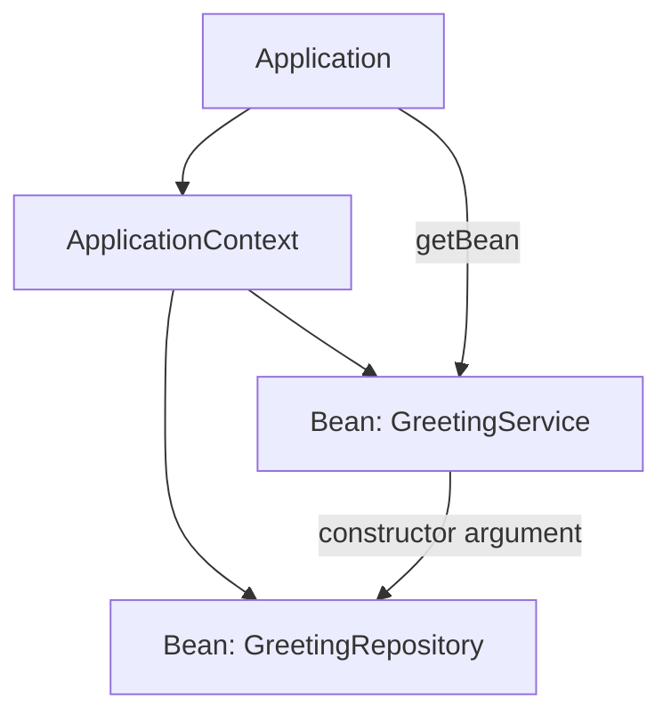

<a id="back-to-top"></a>

# Tổng quan

## Menu
- [Core Container là gì và nằm ở đâu trong Spring Framework](#overview-001)
- [Vấn đề ghép nối đối tượng khi tự khởi tạo bằng new](#overview-002)
- [Đảo ngược điều khiển (IoC) và tiêm phụ thuộc (DI)](#overview-003)
- [Bean, định nghĩa bean và thể hiện đối tượng](#overview-004)
- [Đồ thị phụ thuộc và trách nhiệm của container](#overview-005)
- [BeanFactory, ApplicationContext và các dịch vụ bổ sung](#overview-006)
- [Phân biệt Spring Framework với Spring Boot](#overview-007)
- [Ranh giới với AOP, giao dịch và các mô-đun web](#overview-008)
- [Lộ trình từ mô hình khái niệm đến kiểm chứng cấu hình](#overview-009)

## <a id="overview-001">Core Container là gì và nằm ở đâu trong Spring Framework</a>

<details>
<summary>Xem chi tiết</summary>

# Core Container là gì và nằm ở đâu trong Spring Framework?

## 1. Câu trả lời ngắn: lớp nền tảng quản lý đối tượng của Spring

**Spring Core Container** là nhóm module và cơ chế nền tảng giúp một ứng dụng Java **khai báo, tạo, kết nối, cấu hình và quản lý vòng đời các đối tượng mà Spring phụ trách**. Những đối tượng được container quản lý gọi là **Spring beans**. Thành phần nổi bật nhất là **IoC container** (*Inversion of Control container*), thông thường được truy cập qua giao diện `ApplicationContext`.

Thay vì mỗi đối tượng tự đi tìm hoặc tự tạo tất cả đối tượng cộng tác, ứng dụng mô tả chúng phụ thuộc vào những gì; container đọc cấu hình và **cung cấp các phụ thuộc (Dependency Injection – DI)** khi tạo bean. Nhờ đó mã nghiệp vụ bớt gắn chặt với cách khởi tạo và dễ thay thế thành phần khi kiểm thử.

Một cách phân biệt đơn giản:

- **Core Container**: phần nền trong Spring Framework, gồm nhiều module và API; không phải tên của một class Java duy nhất.
- **IoC container**: cơ chế cụ thể đọc metadata, quản lý bean và lắp ráp quan hệ phụ thuộc.
- **Bean**: một đối tượng được container quản lý; không phải cứ dùng từ khóa `new` trong Java thì đối tượng tự trở thành Spring bean.
- **DI**: một cách hiện thực IoC, trong đó dependency được đưa vào đối tượng thay vì đối tượng tự tìm/tạo dependency.

Ví dụ, `OrderService` cần `OrderRepository`. Nếu tự tạo `new JdbcOrderRepository(...)` trong `OrderService`, lớp dịch vụ trực tiếp biết về việc khởi tạo implementation. Với DI, `OrderService` nhận một `OrderRepository` qua constructor; container chọn và cấp một bean phù hợp theo cấu hình.

**Không đồng nhất container với một web server.** Có thể tạo `ApplicationContext` trong chương trình Java chạy console, một ứng dụng batch hay một tiến trình không dùng HTTP.

## 2. Core Container nằm ở vị trí nào trong Spring Framework?

Spring Framework là tập hợp nhiều **module (artifact/JAR)** với các chức năng khác nhau. Core Container nằm **ở trung tâm/nền của mô hình ứng dụng**, cung cấp khả năng quản lý đối tượng để các phần khác sử dụng:

~~~text
                     ỨNG DỤNG JAVA
                (console, batch, web, ...)
                            |
     +----------------------+----------------------+
     |                      |                      |
   Spring MVC/           Data Access/          Spring AOP/
   Spring WebFlux         Transaction           Messaging/...
     |                      |                      |
     +----------------------+----------------------+
                            |
                CORE CONTAINER (IoC/DI)
                   BeanFactory / Context
                            |
           spring-core, spring-beans,
           spring-context, spring-expression
                            |
                           JVM
~~~

Sơ đồ này là **sơ đồ khái niệm về vai trò**, không phải sơ đồ dependency Maven tuyệt đối: mỗi module có các dependency kỹ thuật riêng, và không phải mọi ứng dụng đều cần tất cả phần phía trên. Ví dụ, `spring-webmvc` xử lý yêu cầu HTTP nhưng vẫn có thể dựa vào `ApplicationContext` để nhận controller, service và các bean khác. AOP/transaction thường **được tích hợp qua cơ chế bean/proxy** chứ không phải chính IoC container tự động bật tất cả hành vi đó.

**Spring Framework khác Spring Boot:**

- **Spring Framework** cung cấp nền tảng DI/IoC cùng các module web, dữ liệu, transaction, AOP... mà ứng dụng lựa chọn.
- **Spring Boot** xây **trên Spring Framework**, giúp cấu hình, khởi động, quản lý phụ thuộc và auto-configuration thuận tiện hơn. Boot **sử dụng Core Container**, không thay thế nó bằng một cơ chế IoC độc lập.
- `@SpringBootApplication` là tiện ích của Boot, **không bắt buộc** để dùng `ApplicationContext` của Spring Framework thuần.
- Có Core Container không có nghĩa là sẵn HTTP server, REST endpoint, database, transaction hoặc Spring Security. Chúng cần module, cấu hình và điều kiện phù hợp.

Ví dụ bài này dùng **Spring Framework trực tiếp**, không cần Boot và không cần máy chủ web.

## 3. Các module ở phần nền và nhiệm vụ chính

| Artifact/module | Vai trò dễ nhớ | Ví dụ API/chức năng |
| --- | --- | --- |
| `spring-core` | Tiện ích cốt lõi và hạ tầng cho Framework | `Resource`, chuyển đổi kiểu, tiện ích nền |
| `spring-beans` | Mô hình bean, metadata và nền của IoC | `BeanFactory`, `BeanDefinition`, wiring các phụ thuộc |
| `spring-context` | Container ở mức ứng dụng và các tính năng đi kèm | `ApplicationContext`, cấu hình bằng annotation, sự kiện, i18n |
| `spring-expression` | Ngôn ngữ biểu thức Spring (SpEL) | Biểu thức `#{...}` trong ngữ cảnh hỗ trợ |
| `spring-context-support` | Tích hợp hỗ trợ bổ sung quanh context | Các adapter/tích hợp chuyên biệt, **không** phải bước bắt buộc cho ví dụ DI đơn giản |

Nhóm module có thể được diễn giải khác nhau tùy sơ đồ tài liệu và phiên bản Spring; bốn artifact đầu là những phần rất thường được nhắc đến khi học IoC. `spring-context-support` là **module hỗ trợ tùy nhu cầu**, không cần thêm chỉ để viết `@Bean`.

Tên artifact Maven dạng `spring-context`, còn các package Java như `org.springframework.context` là **namespace mã nguồn**; đừng nhầm package Java với JAR Maven hay với **JPMS module** (`spring.context`). Khi thêm dependency `spring-context` qua Maven/Gradle, các module cần thiết khác thường được kéo theo **theo dependency transitive**, nên không nhất thiết phải khai báo thủ công từng JAR.

Spring còn có các module khác (`spring-web`, `spring-webmvc`, `spring-jdbc`, `spring-tx`, `spring-aop`, `spring-test`, ...). Chúng cung cấp khả năng chuyên ngành, **không đồng nghĩa** với `spring-core` hay toàn bộ Core Container.

## 4. Cơ chế IoC/DI: Spring quản lý những gì?

Một vòng đời rút gọn của ứng dụng dùng context:

~~~text
Cấu hình (annotation / @Bean / XML / đăng ký bằng code)
                         |
                         v
            Container đọc bean metadata
                         |
                         v
         Xác định cách tạo và nối dependency
                         |
                         v
       Tạo bean, tiêm dependency, khởi tạo
                         |
                         v
      Ứng dụng lấy hoặc được cấp bean để dùng
                         |
                         v
        Đóng context, hủy bean phù hợp
~~~

**Bean definition** là **mô tả/cấu hình** của bean: kiểu, tên, scope, dependency, cách tạo, các callback... Bean instance là **đối tượng thực** sau khi được tạo. Không phải một bean definition luôn bằng một đối tượng ngay lập tức: scope và chính sách khởi tạo ảnh hưởng thời điểm/số lần tạo.

Ba cách cung cấp cấu hình phổ biến:

1. **Java configuration**: `@Configuration` và các factory method `@Bean` khai báo bean; rất dễ thấy dependency qua tham số của factory method.
2. **Component scanning**: `@Component`, `@Service`, `@Repository`, `@Controller` và `@ComponentScan` khi phù hợp để Spring dò thành phần rồi đăng ký bean.
3. **XML hoặc đăng ký programmatic**: vẫn có ứng dụng dùng `ClassPathXmlApplicationContext`, `GenericApplicationContext` hoặc các API đăng ký bean trực tiếp.

**Không phải cứ thêm `@Component` vào class là bean tự xuất hiện**: class đó phải được đưa vào nguồn cấu hình/scan thích hợp. Tương tự, nếu một đối tượng được tự tạo bằng `new` bên ngoài context, annotation DI trên nó không tự được Spring xử lý.

DI phổ biến nhất cho dependency bắt buộc là **constructor injection**:

~~~java
// Đoạn minh họa Java thuần, đặt trong các type thích hợp.
interface EmailSender {
    void send(String message);
}

class NotificationService {
    private final EmailSender sender;

    NotificationService(EmailSender sender) {
        this.sender = sender; // Dependency do caller/container cung cấp.
    }

    void notifyUser() {
        sender.send("Ready");
    }
}
~~~

Vì `NotificationService` nhận interface, khi kiểm thử có thể truyền một implementation giả (*fake*) mà không sửa logic của service. Constructor injection không phải chỉ xuất hiện trong Spring: đó cũng là một kỹ thuật thiết kế Java thuần; **Spring tự động hóa việc tạo/cấp đối tượng** dựa trên cấu hình.

## 5. `BeanFactory` và `ApplicationContext`: hiểu đúng vai trò

| Tiêu chí | `BeanFactory` | `ApplicationContext` |
| --- | --- | --- |
| Vai trò | Giao diện nền cho truy cập/quản lý bean | Giao diện container hướng ứng dụng, **mở rộng** `BeanFactory` |
| API dễ thấy | `getBean(...)`, kiểm tra thông tin bean | Bao gồm API `BeanFactory`; thêm sự kiện, tài nguyên, message/i18n và các tiện ích khác |
| Dùng cho ứng dụng mới | Thường không cần thao tác trực tiếp | **Lựa chọn thông dụng** cho bootstrap Spring |
| Thời điểm khởi tạo singleton | Phụ thuộc implementation/việc cấu hình bootstrap | Thông thường khởi tạo các singleton **không lazy** khi refresh context |
| Ví dụ implementation | `DefaultListableBeanFactory` | `AnnotationConfigApplicationContext`, `ClassPathXmlApplicationContext` |

`ApplicationContext` là **một loại `BeanFactory`**, không phải hai container phải tạo độc lập. Những phần như `BeanPostProcessor`, xử lý annotation và lifecycle được kích hoạt qua quá trình bootstrap phù hợp; chỉ tạo một `DefaultListableBeanFactory` thuần rồi mong mọi annotation tự chạy có thể không đạt kết quả mong đợi.

Không nên suy ra “`BeanFactory` luôn lazy còn `ApplicationContext` luôn eager” như quy tắc tuyệt đối. Scope, lazy-init và cách dùng implementation quyết định chi tiết; cách nói an toàn là `ApplicationContext` thông thường **pre-instantiate các singleton không lazy** khi refresh.

## 6. Thực hành Spring Core Container thuần với Java 17+

Ví dụ hoàn chỉnh này minh họa **container tạo bean và tiêm một dependency bằng tham số `@Bean`**, không dùng Spring Boot, HTTP hay database. Cần **JDK 17+ và Maven 3.9+** (Maven sẽ tải thư viện từ repository ở lần đầu chạy).

Trong thư mục `core-container-demo`, tạo cấu trúc:

~~~text
core-container-demo/
├── pom.xml
└── src/
    └── main/
        └── java/
            └── demo/
                └── CoreContainerDemo.java
~~~

### 6.1. `pom.xml` – khai báo Spring Framework

~~~xml
<?xml version="1.0" encoding="UTF-8"?>
<project xmlns="http://maven.apache.org/POM/4.0.0"
         xmlns:xsi="http://www.w3.org/2001/XMLSchema-instance"
         xsi:schemaLocation="http://maven.apache.org/POM/4.0.0
             https://maven.apache.org/xsd/maven-4.0.0.xsd">
    <modelVersion>4.0.0</modelVersion>
    <groupId>demo</groupId>
    <artifactId>core-container-demo</artifactId>
    <version>1.0.0</version>

    <properties>
        <maven.compiler.release>17</maven.compiler.release>
        <project.build.sourceEncoding>UTF-8</project.build.sourceEncoding>
    </properties>

    <dependencies>
        <dependency>
            <groupId>org.springframework</groupId>
            <artifactId>spring-context</artifactId>
            <version>7.0.9</version>
        </dependency>
    </dependencies>

    <build>
        <plugins>
            <plugin>
                <groupId>org.apache.maven.plugins</groupId>
                <artifactId>maven-compiler-plugin</artifactId>
                <version>3.13.0</version>
            </plugin>
            <plugin>
                <groupId>org.codehaus.mojo</groupId>
                <artifactId>exec-maven-plugin</artifactId>
                <version>3.5.0</version>
                <configuration>
                    <mainClass>demo.CoreContainerDemo</mainClass>
                </configuration>
            </plugin>
        </plugins>
    </build>
</project>
~~~

Version **Spring Framework 7.0.9** được cố định trong ví dụ để mọi người chạy cùng một phiên bản; đây là một bản thuộc dòng 7.0 hỗ trợ **Java 17 làm baseline**, mặc dù dòng Spring 7 khuyến nghị JDK LTS mới hơn cho các dự án phù hợp. Khi dùng trong dự án thật, hãy theo chính sách quản lý dependency/BOM và cập nhật bản vá có hỗ trợ, thay vì tự giữ mãi version học tập này.

### 6.2. `src/main/java/demo/CoreContainerDemo.java`

~~~java
package demo;

import org.springframework.context.annotation.AnnotationConfigApplicationContext;
import org.springframework.context.annotation.Bean;
import org.springframework.context.annotation.Configuration;

public final class CoreContainerDemo {
    private CoreContainerDemo() {
    }

    interface MessageRepository {
        String prefix();
    }

    static final class FixedMessageRepository implements MessageRepository {
        @Override
        public String prefix() {
            return "Xin chao";
        }
    }

    static final class WelcomeService {
        private final MessageRepository repository;

        WelcomeService(MessageRepository repository) {
            this.repository = repository;
        }

        String greet(String name) {
            return repository.prefix() + ", " + name + "!";
        }
    }

    @Configuration(proxyBeanMethods = false)
    static class AppConfig {
        @Bean
        MessageRepository messageRepository() {
            return new FixedMessageRepository();
        }

        @Bean
        WelcomeService welcomeService(MessageRepository repository) {
            return new WelcomeService(repository);
        }
    }

    public static void main(String[] args) {
        try (var context =
                new AnnotationConfigApplicationContext(AppConfig.class)) {
            WelcomeService service = context.getBean(WelcomeService.class);

            System.out.println("message=" + service.greet("Lan"));
            System.out.println("hasBean="
                    + context.containsBean("welcomeService"));
            System.out.println("sameSingleton="
                    + (service == context.getBean(WelcomeService.class)));
            System.out.println("contextType="
                    + context.getClass().getSimpleName());
        }
    }
}
~~~

**Chạy tại thư mục chứa `pom.xml`:**

~~~bash
java -version
mvn -version
mvn -q compile exec:java
~~~

Maven Compiler Plugin biên dịch code với `--release 17` theo property đã khai báo. Maven phụ trách **classpath gồm Spring và dependency transitive**, do đó dùng `javac`/`java` thủ công mà không thiết lập classpath cho JAR Spring sẽ báo thiếu package/class. Lệnh `mvn -q compile exec:java` vừa biên dịch bằng `javac` thông qua plugin, vừa khởi chạy main class.

**Stdout từ bốn câu `System.out.println` của ứng dụng** (không tính thông tin phiên bản ở hai lệnh kiểm tra môi trường, và không tính log/diagnostic do Maven hay logging backend phát sinh ngoài ứng dụng):

~~~text
message=Xin chao, Lan!
hasBean=true
sameSingleton=true
contextType=AnnotationConfigApplicationContext
~~~

Đây là stdout xác định của logic ví dụ: bean tên `welcomeService` được factory method cùng tên đăng ký; mặc định bean có **singleton scope** trong context nên hai lần lấy cùng kiểu cho cùng một instance. Nếu IDE/logging in thêm thông tin vào console, hãy phân biệt nó với bốn dòng do chính chương trình in.

### 6.3. Đối chiếu từng bước trong ví dụ

1. `new AnnotationConfigApplicationContext(AppConfig.class)` tạo context, đăng ký class cấu hình và thực hiện bootstrap/refresh trong cách dùng constructor này.
2. `@Configuration` đánh dấu class `AppConfig` làm nguồn bean definitions; `proxyBeanMethods=false` chọn cách xử lý phù hợp khi **không dựa vào việc gọi trực tiếp `@Bean` method này từ method khác**.
3. `@Bean messageRepository()` tạo bean `MessageRepository` bằng `FixedMessageRepository`.
4. `@Bean welcomeService(MessageRepository repository)` yêu cầu Spring **resolve tham số** từ bean type phù hợp, rồi truyền vào constructor `WelcomeService`. Phương thức `welcomeService` **không tự gọi** `messageRepository()` và không hard-code phụ thuộc trong service.
5. `getBean(WelcomeService.class)` tra cứu bean đã được quản lý; việc gọi `greet("Lan")` sau đó là phương thức Java bình thường trên instance nhận được.
6. `containsBean("welcomeService")` xác minh bean name tồn tại trong context hiện tại.
7. `try-with-resources` đóng context khi rời khối. Một số bean có lifecycle callback được container gọi khi context đóng; **đối tượng Java nói chung không tự biến mất hoặc được GC ngay khi close**.

**Đặt chú ý vào chủ đề chính:** code dịch vụ không import Spring; chỉ class cấu hình và phần bootstrap biết `ApplicationContext`. Đây là một cách giữ business logic dễ kiểm thử ngay cả khi đổi cách cấu hình container.

## 7. Không phải mọi object đều là bean; scope và lifecycle có giới hạn

**Scope `singleton`** là scope mặc định của Spring: một bean definition thường tương ứng với **một instance được chia sẻ trong mỗi container**. Đó **không phải** cam kết chỉ có một object trên toàn JVM hay trên nhiều application contexts.

**Scope `prototype`** thông thường tạo một instance mới mỗi khi container được yêu cầu cấp bean đó. Spring tạo/cấu hình và gọi initialization callbacks phù hợp, nhưng **không tự quản lý toàn bộ destruction callbacks của prototype sau khi đã giao cho caller**. Với scope `request`, `session`... còn phải có context web phù hợp; không dùng được một cách mặc định trong console context ở ví dụ.

**Lifecycle theo ngữ cảnh**: Bean có thể tham gia các bước tạo → inject → khởi tạo → được dùng → kết thúc. `ApplicationContext.close()` xử lý lifecycle cho những bean thuộc phạm vi quản lý phù hợp (đặc biệt singleton), chứ không phải lệnh đóng mọi đối tượng do code từng tạo ra.

**Không nhầm ba khái niệm:**

| Tình huống | Ai tạo/quản lý? | Hệ quả |
| --- | --- | --- |
| `context.getBean(WelcomeService.class)` | Spring Core Container | Truy cập bean đã đăng ký theo type |
| `new WelcomeService(repository)` trong code thường | Chính đoạn code đó | Object Java bình thường; không tự có DI/lifecycle của Spring |
| `new FixedMessageRepository()` bên trong method `@Bean` | Method tạo đối tượng, Spring đăng ký/ quản lý object **trả về** | Object trả về trở thành bean; không phải mọi object trung gian trong method đều thành bean |

Một bean có thể phụ thuộc vào bean khác và tạo thành **đồ thị phụ thuộc (dependency graph)**. Nếu thiếu bean phù hợp, có nhiều bean cùng type mà không có cách phân giải rõ, hoặc có vòng phụ thuộc constructor không giải được, bootstrap có thể thất bại thay vì tạo một graph sai.

## 8. Dùng Core Container khi nào, và khi nào cần module khác?

**Nên dùng Core Container khi:**

- Cần quản lý nhiều service/repository/client với các dependency rõ ràng.
- Muốn thay implementation trong test và tránh tạo dependency bằng `new` rải rác trong business code.
- Cần cấu hình đối tượng theo môi trường và có lifecycle/extension points ở mức ứng dụng.
- Xây dựng console/batch/service/web app có kiến trúc nhiều lớp.

**Chưa nhất thiết cần container** nếu chỉ viết một chương trình Java nhỏ, một vài hàm thuần và không có graph phụ thuộc đáng kể; việc tự tạo đối tượng có thể đơn giản và phù hợp hơn.

**Khi mục tiêu mở rộng:**

| Muốn làm gì? | Phần liên quan | Lưu ý |
| --- | --- | --- |
| Điều phối bean, DI, cấu hình | Core Container | Phạm vi chính của bài này |
| Xây dựng REST/MVC web | Spring Web/Spring MVC hoặc WebFlux | Phải thêm module/cấu hình tương ứng |
| SQL, giao dịch | Spring JDBC/`spring-tx`, tích hợp dữ liệu | DI cung cấp dependency, không tự thực hiện transaction |
| Proxy và cross-cutting advice | Spring AOP và cấu hình tương ứng | Spring không tự áp mọi method call thành advice |
| Auto-configuration, executable app | Spring Boot | Boot khai thác Core Container của Spring Framework |
| Kiểm thử integration bean graph | Spring Test | Có thể dựng context trong test, nhưng phải kiểm soát phạm vi và chi phí khởi tạo |

Spring Core Container là **nền móng cho nhiều chức năng**, không phải toàn bộ tính năng enterprise được bật mặc định.

## 9. Hiểu sai thường gặp và cách tự kiểm tra

1. **“IoC = DI hoàn toàn.”** DI là một cách áp dụng nguyên tắc IoC. Ở mức học Spring, thường thấy IoC được thực hiện qua DI và quản lý đối tượng của container.
2. **“Thêm `spring-core` là đã có đầy đủ `ApplicationContext`.”** Không. Container ở mức ứng dụng nằm trong `spring-context`; Maven sẽ quản lý dependency liên quan khi khai báo artifact đúng.
3. **“`@Component` trên một lớp là Spring tự quản lý nó ở mọi nơi.”** Chỉ khi lớp nằm trong nguồn quét/đăng ký của context thích hợp.
4. **“`@Bean` là annotation đặt lên class.”** Thông dụng nhất là `@Bean` trên **factory method** trong một cấu hình; `@Component` mới dùng trên class để scan.
5. **“DI bắt buộc dùng `@Autowired` ở field.”** Constructor injection hoặc factory-method parameter injection thường rõ ràng và dễ kiểm thử hơn; với đúng một constructor trên component được quản lý, Spring có thể tiêm mà không cần ghi `@Autowired`.
6. **“Singleton của Spring nghĩa là một instance cho mọi context.”** Mặc định là **một instance cho mỗi bean definition trong mỗi context**; tạo thêm context khác có thể có object khác.
7. **“Có `ApplicationContext` thì web server tự chạy.”** Sai. Ví dụ console ở trên không mở cổng HTTP.
8. **“Container tự tạo bean ngay cả khi cấu hình sai.”** Thiếu dependency, mơ hồ giữa nhiều candidate hoặc graph không giải được có thể khiến startup thất bại.
9. **“Gọi `close()` sẽ phá hủy tất cả mọi object Java.”** Sai. Context gọi các callback lifecycle phù hợp; Java GC và lifetime của reference có cơ chế riêng.
10. **“Spring Boot và Spring Framework là một.”** Boot dùng Framework, cung cấp thêm bootstrap, auto-configuration và tiện ích phát triển; nắm Core Container giúp hiểu Boot rõ hơn.

### Bài tập kiểm chứng

- **Bài A – đổi implementation:** thêm `AnotherMessageRepository` và đổi return trong factory method `messageRepository()`. Dự đoán lại duy nhất dòng `message=...` trước khi chạy.
- **Bài B – scope:** dùng `@Scope("prototype")` cho bean `welcomeService`, lấy bean hai lần rồi kiểm tra `==`. Dự đoán vì sao `sameSingleton` trở thành `false` (nên đổi nhãn in thành `sameInstance` cho đúng nghĩa).
- **Bài C – thiếu dependency:** tạm bỏ factory method `messageRepository()` rồi chạy lại. Kiểm tra kiểu exception khi context không resolve được tham số `MessageRepository`. Không chép nguyên một thông điệp exception, vì nó có thể thay đổi theo phiên bản.
- **Bài D – tách cấu hình:** chuyển `AppConfig` thành file riêng, giữ `WelcomeService` thuần Java và xác minh output không đổi.
- **Bài E – compare:** tạo `WelcomeService` thủ công bằng `new` và đặt cạnh phiên bản dùng context. Chỉ ra chỗ dependency được chọn, ai sở hữu lifecycle và khi nào nên dùng mỗi cách.

Mỗi bài tập là **một thay đổi độc lập**, cần khôi phục mã gốc để chạy lại stdout chuẩn ở mục 6.

## 10. Tóm tắt ghi nhớ và tài liệu chính thức

- Core Container là **tầng nền của Spring Framework**, không phải tên đồng nghĩa với Spring Boot hoặc Spring MVC.
- Vai trò trung tâm: **quản lý bean và các dependency** theo cấu hình, cung cấp IoC/DI và lifecycle thích hợp.
- `BeanFactory` là API nền, `ApplicationContext` mở rộng để phục vụ ứng dụng; thực tế thường bắt đầu với `ApplicationContext`.
- Các module quan trọng: `spring-core`, `spring-beans`, `spring-context`, `spring-expression`; `spring-context-support` bổ sung tích hợp khi cần.
- Một chương trình **không dùng HTTP** vẫn có thể tạo context. Điều quan trọng là graph đối tượng được lắp ráp/đưa vào sử dụng đúng theo hợp đồng.

Tài liệu để đối chiếu các API và hành vi theo phiên bản:

- [Spring Framework Overview](https://docs.spring.io/spring-framework/reference/overview.html)
- [Spring IoC Container and Beans](https://docs.spring.io/spring-framework/reference/core/beans/introduction.html)
- [Container Overview](https://docs.spring.io/spring-framework/reference/core/beans/basics.html)
- [Bean Scopes](https://docs.spring.io/spring-framework/reference/core/beans/factory-scopes.html)
- [Spring Framework 7.0 Release Notes](https://github.com/spring-projects/spring-framework/wiki/Spring-Framework-7.0-Release-Notes)

**Kết luận:** Core Container là nơi Spring **tổ chức và nối các đối tượng ứng dụng lại với nhau**. Hiểu vị trí, trách nhiệm và giới hạn của container sẽ giúp học tiếp cấu hình bean, component scanning, injection, scope/lifecycle, AOP, giao dịch và Spring Boot mà không nhầm lẫn giữa các tầng.

</details>

- [Quay lại đầu trang](#back-to-top)

---

## <a id="overview-002">Vấn đề ghép nối đối tượng khi tự khởi tạo bằng new</a>

<details>
<summary>Xem chi tiết</summary>

# Vấn đề ghép nối đối tượng khi tự khởi tạo bằng `new` — Spring Core Container

## 1. Tình huống: nghiệp vụ tự chọn và tự tạo cộng tác viên

Hãy xét một dịch vụ xử lý đơn hàng. Sau khi chấp nhận đơn, nó cần gọi một đối tượng khác để gửi thông báo. Cách viết trực tiếp thường gặp là:

~~~java
class OrderService {
    private final EmailNotifier notifier = new EmailNotifier();

    void placeOrder(String orderId) {
        // Xử lý đơn hàng ...
        notifier.send(orderId);
    }
}
~~~

Đây là **đoạn minh họa**, không phải chương trình biên dịch độc lập: `EmailNotifier` và `send` chưa được định nghĩa ở đây. Vấn đề cần nhận diện không nằm ở cú pháp `new`, mà ở việc **`OrderService` tự quyết định mình phụ thuộc vào lớp cụ thể nào và tự chịu trách nhiệm khởi tạo nó**.

Có hai mối liên hệ cần phân biệt:

- **Phụ thuộc khi sử dụng (*usage dependency*):** `OrderService` cần hành vi gửi thông báo. Đây là nhu cầu nghiệp vụ có thật.
- **Phụ thuộc khi khởi tạo (*construction dependency*):** `OrderService` còn biết tên lớp `EmailNotifier`, constructor, các tham số cấu hình và đôi khi cả chuỗi đối tượng mà `EmailNotifier` cần.

Khi hai việc bị trộn trong một lớp, lớp nghiệp vụ không chỉ **dùng** cộng tác viên mà còn **chọn và lắp ráp** cộng tác viên đó. Đây là một hình thức **ghép nối chặt (*tight coupling*)**.

> `new` không tự động là lỗi thiết kế. Vấn đề đáng chú ý là `new` một *dịch vụ/phụ thuộc có chính sách thay đổi* ở ngay bên trong lớp nghiệp vụ cần dùng nó.

## 2. Ghép nối xuất hiện chính xác ở đâu?

Ở dòng:

~~~java
private final EmailNotifier notifier = new EmailNotifier();
~~~

`OrderService` đã gắn với ít nhất ba quyết định:

1. **Loại triển khai:** phải là `EmailNotifier` thay vì SMS, thông báo nội bộ, gửi qua queue hoặc một bản fake dùng khi kiểm thử.
2. **Cách tạo:** phải có constructor phù hợp; nếu sau này constructor cần `HttpClient`, cấu hình máy chủ hoặc thông tin xác thực, mã tạo có thể phải thay đổi.
3. **Thời điểm và vòng đời:** đối tượng được tạo khi một `OrderService` được khởi tạo; lớp đang sử dụng vô tình chịu trách nhiệm về việc tạo và có thể cả việc dọn dẹp tài nguyên của nó.

Hệ quả thường gặp:

| Khi yêu cầu thay đổi | Nếu tạo phụ thuộc trực tiếp trong dịch vụ | Điều mong muốn |
| --- | --- | --- |
| Đổi cách thông báo | Sửa mã `OrderService` hoặc thêm nhiều `if` chọn triển khai | Thay cấu hình lắp ráp |
| Test đơn hàng không gửi thông báo thật | Khó thay `EmailNotifier` bằng fake | Tiêm đối tượng ghi nhận lời gọi |
| Triển khai cần cấu hình khác môi trường | Dịch vụ phải đọc/biết cấu hình khởi tạo | Tập trung cấu hình ở biên ứng dụng |
| Phụ thuộc tiếp tục cần phụ thuộc khác | Chuỗi `new` lan vào nhiều lớp | Một nơi chịu trách nhiệm dựng object graph |
| Cần quản lý close/lifecycle của cộng tác viên | Dịch vụ có thể không rõ ai sở hữu tài nguyên | Nơi tạo/quản lý quyết định vòng đời |

Một phép đổi tên lớp chưa chắc tạo ra vấn đề lớn. Nhưng với hệ thống có nhiều cộng tác viên, thay đổi quy tắc tạo ở nhiều lớp khiến mã **khó thay thế, khó kiểm thử và khó cấu hình**. Đây là lý do Spring Core Container giải quyết việc tạo và nối các đối tượng cần quản lý.

**Phân biệt:** khai báo trường kiểu interface nhưng vẫn viết `new EmailNotifier()` bên trong dịch vụ chỉ giảm sự phụ thuộc ở **kiểu biến**; nó **chưa tách quyết định khởi tạo** khỏi dịch vụ.

## 3. Ví dụ Java 17 chạy độc lập: thấy sự khác biệt

Ví dụ này dùng thông báo in console, không cần server hay Internet. Cả cách ghép nối chặt và cách nhận phụ thuộc từ bên ngoài đều chạy được, nhưng cách thứ hai cho phép đưa vào một fake khi test.

Lưu tệp **`ManualWiringDemo.java`**:

~~~java
import java.util.ArrayList;
import java.util.List;
import java.util.Objects;

public class ManualWiringDemo {
    interface Notifier {
        void send(String orderId);
    }

    static final class ConsoleNotifier implements Notifier {
        @Override
        public void send(String orderId) {
            System.out.println("CONSOLE " + orderId);
        }
    }

    // Dịch vụ tự chọn lớp triển khai và tự tạo phụ thuộc.
    static final class HardWiredOrderService {
        private final ConsoleNotifier notifier = new ConsoleNotifier();

        void place(String orderId) {
            System.out.println("ORDER " + orderId);
            notifier.send(orderId);
        }
    }

    // Dịch vụ chỉ phụ thuộc vào hợp đồng hành vi.
    static final class OrderService {
        private final Notifier notifier;

        OrderService(Notifier notifier) {
            this.notifier = Objects.requireNonNull(notifier, "notifier");
        }

        void place(String orderId) {
            System.out.println("ORDER " + orderId);
            notifier.send(orderId);
        }
    }

    // Fake kiểm thử: chỉ ghi lại các lời gọi, không gửi gì ra ngoài.
    static final class RecordingNotifier implements Notifier {
        private final List<String> events = new ArrayList<>();

        @Override
        public void send(String orderId) {
            events.add(orderId);
        }

        List<String> events() {
            return events;
        }
    }

    public static void main(String[] args) {
        System.out.println("-- hard-wired --");
        new HardWiredOrderService().place("A01");

        System.out.println("-- injected --");
        new OrderService(new ConsoleNotifier()).place("B02");

        RecordingNotifier fake = new RecordingNotifier();
        new OrderService(fake).place("T03");
        if (!fake.events().equals(List.of("T03"))) {
            throw new AssertionError("Notifier was not called as expected");
        }
        System.out.println("events=" + fake.events());
        System.out.println("test=PASS");
    }
}
~~~

Mở terminal tại thư mục chứa file, dùng **JDK 17+** (PowerShell/CMD hoặc bash):

~~~bash
javac --release 17 -encoding UTF-8 ManualWiringDemo.java
java ManualWiringDemo
~~~

**Stdout chính xác:**

~~~text
-- hard-wired --
ORDER A01
CONSOLE A01
-- injected --
ORDER B02
CONSOLE B02
ORDER T03
events=[T03]
test=PASS
~~~

Giải thích từng phần:

1. `HardWiredOrderService` luôn tạo `ConsoleNotifier`. Muốn thay cách gửi, thường phải sửa chính lớp dịch vụ hoặc thiết kế lại điểm tạo.
2. `OrderService` nhận `Notifier` từ **constructor**. Nó chỉ biết lời gọi `send(orderId)`, không biết cách khởi tạo lớp triển khai.
3. Ở `main`, `new OrderService(new ConsoleNotifier())` vẫn hợp lệ: `main` đang đóng vai trò **composition root**, nơi lắp ráp ứng dụng.
4. Ở phép thử, ta truyền `RecordingNotifier`. Việc kiểm tra `events=[T03]` chứng minh dịch vụ đã gọi đúng cổng thông báo, **không cần** email, kết nối mạng hay Spring context.
5. Ví dụ in `ORDER` để mô tả một thao tác nghiệp vụ mô phỏng; nó **không ghi database thật**. Trong hệ thống thực, bước lưu đơn hàng phải được thực hiện bằng cộng tác viên riêng nếu cần.

Để test thêm nhánh lỗi hoặc thay cách thông báo, chỉ cần đưa vào một triển khai `Notifier` khác. Không cần sửa `OrderService` cho từng môi trường kiểm thử.

## 4. Constructor injection giải quyết được gì?

Trong bản cải tiến:

~~~java
final class OrderService {
    private final Notifier notifier;

    OrderService(Notifier notifier) {
        this.notifier = java.util.Objects.requireNonNull(notifier);
    }

    void place(String id) {
        notifier.send(id);
    }
}
~~~

Đây là **mẫu minh họa**, tách riêng khỏi file hoàn chỉnh ở mục 3. Ba quyết định thiết kế quan trọng:

- **Hợp đồng hành vi:** `Notifier` mô tả *cần làm gì*; các lớp cụ thể quyết định *làm như thế nào*.
- **Injection:** tham chiếu cộng tác viên được truyền vào qua constructor thay vì được tạo trong dịch vụ. Với dependency bắt buộc, trường `final` và constructor thể hiện rõ yêu cầu.
- **Tách nơi lắp ráp:** lớp nghiệp vụ không phải tự tìm, tạo hoặc chọn phương án triển khai.

Đây là ứng dụng của **Dependency Inversion Principle (DIP)** khi tầng nghiệp vụ hướng tới abstraction phù hợp, thay vì hướng thẳng tới chi tiết hạ tầng. **Dependency Injection (DI)** là một kỹ thuật cung cấp cộng tác viên từ bên ngoài; bản thân DI không bắt buộc có Spring hay interface trong mọi trường hợp. Có thể inject cả một lớp cụ thể khi hợp lý, dù abstraction thường có ích nếu thật sự cần thay thế triển khai.

Điểm khác biệt cốt lõi là:

~~~text
Tạo cứng trong dịch vụ:
OrderService ──new──> ConsoleNotifier

Nhận từ ngoài:
Composition root ──new──> ConsoleNotifier
        │
        └──new OrderService(notifier)──> OrderService ──uses──> Notifier
~~~

**Không phải “xóa mọi `new`”:** ta *chuyển quyền quyết định tạo và nối* ra khỏi lớp nghiệp vụ. Một nơi nào đó vẫn phải tạo các đối tượng.

## 5. Kiểm tra mức độ tách phụ thuộc

Đổi kiểu trường sang `Notifier` **chưa đủ** nếu bên trong `OrderService` vẫn gọi `new EmailNotifier()`: dịch vụ vẫn quyết định triển khai và cách khởi tạo. Phép thử thiết kế là hỏi **“ai chọn và tạo collaborator?”**. Với `OrderService(Notifier notifier)`, câu trả lời nằm ở caller/composition root; dịch vụ chỉ gọi hợp đồng `send`.

Đưa việc chọn triển khai ra ngoài giúp thay notifier hoặc cấu hình mà ít phải sửa nghiệp vụ. Nếu hợp đồng hoặc quy tắc xử lý đơn hàng thay đổi, `OrderService` vẫn có thể cần sửa — DI tách trách nhiệm tạo đối tượng, không bảo đảm mã nghiệp vụ bất biến.

## 6. Spring Core Container tham gia ở đâu?

Java thuần đã có thể làm constructor injection như mục 3. Spring thêm một **IoC container** để quản lý các đối tượng được đăng ký là **bean** và lắp ráp chúng dựa trên cấu hình.

- **IoC (*Inversion of Control*):** quyền điều phối tạo, cấu hình và liên kết các bean chuyển từ mã nghiệp vụ sang container/điểm cấu hình.
- **DI (*Dependency Injection*):** một cơ chế để cung cấp các phụ thuộc vào đối tượng; trong ví dụ này là constructor parameter.
- **Bean:** đối tượng được Spring container đăng ký và quản lý trong `ApplicationContext`.
- **Object graph:** mạng các đối tượng phụ thuộc vào nhau, ví dụ `OrderService → Notifier`.

Spring không “biến mất” `new`. Nó chỉ giúp **tập trung các quyết định tạo và nối bean**. Đối tượng được tạo bằng `new` ở nơi tùy ý **không tự động trở thành bean** chỉ vì project sử dụng Spring.

Có thể cung cấp bean qua `@Configuration` + `@Bean` hoặc qua component scanning (`@Component`/`@Service` và constructor injection). Bài này chọn **`@Bean` rõ ràng** để nhìn thấy nơi lắp ráp. Không cần nhầm `@Bean` với code nghiệp vụ và không cần đưa annotation Spring vào chính `OrderService`.

## 7. Chương trình Spring chạy được: chuyển lắp ráp sang configuration

Yêu cầu **JDK 17+**, Apache Maven, khả năng tải dependency Maven khi chạy lần đầu. Ví dụ dùng **Spring Framework 6.2.0** với `spring-context`, không dùng Spring Boot và không cần web server. Spring 6.x yêu cầu Java 17 trở lên.

Tạo cấu trúc:

~~~text
coupling-spring/
├── pom.xml
└── src/
    └── main/
        └── java/
            └── demo/
                └── SpringCouplingDemo.java
~~~

File **`pom.xml`**:

~~~xml
<project xmlns="http://maven.apache.org/POM/4.0.0"
         xmlns:xsi="http://www.w3.org/2001/XMLSchema-instance"
         xsi:schemaLocation="http://maven.apache.org/POM/4.0.0 https://maven.apache.org/xsd/maven-4.0.0.xsd">
    <modelVersion>4.0.0</modelVersion>
    <groupId>edu.example</groupId>
    <artifactId>coupling-spring</artifactId>
    <version>1.0-SNAPSHOT</version>

    <properties>
        <maven.compiler.release>17</maven.compiler.release>
        <project.build.sourceEncoding>UTF-8</project.build.sourceEncoding>
    </properties>

    <dependencies>
        <dependency>
            <groupId>org.springframework</groupId>
            <artifactId>spring-context</artifactId>
            <version>6.2.0</version>
        </dependency>
    </dependencies>

    <build>
        <plugins>
            <plugin>
                <groupId>org.apache.maven.plugins</groupId>
                <artifactId>maven-compiler-plugin</artifactId>
                <version>3.13.0</version>
            </plugin>
            <plugin>
                <groupId>org.codehaus.mojo</groupId>
                <artifactId>exec-maven-plugin</artifactId>
                <version>3.5.0</version>
                <configuration>
                    <mainClass>demo.SpringCouplingDemo</mainClass>
                </configuration>
            </plugin>
        </plugins>
    </build>
</project>
~~~

File **`src/main/java/demo/SpringCouplingDemo.java`**:

~~~java
package demo;

import java.util.Objects;
import org.springframework.context.annotation.AnnotationConfigApplicationContext;
import org.springframework.context.annotation.Bean;
import org.springframework.context.annotation.Configuration;

public class SpringCouplingDemo {
    public interface Notifier {
        void send(String orderId);
    }

    public static final class ConsoleNotifier implements Notifier {
        @Override
        public void send(String orderId) {
            System.out.println("NOTIFY " + orderId);
        }
    }

    public static final class OrderService {
        private final Notifier notifier;

        public OrderService(Notifier notifier) {
            this.notifier = Objects.requireNonNull(notifier, "notifier");
        }

        public void place(String orderId) {
            System.out.println("ORDER " + orderId);
            notifier.send(orderId);
        }
    }

    @Configuration(proxyBeanMethods = false)
    public static class AppConfig {
        @Bean
        public Notifier notifier() {
            return new ConsoleNotifier();
        }

        @Bean
        public OrderService orderService(Notifier notifier) {
            return new OrderService(notifier);
        }
    }

    public static void main(String[] args) {
        try (AnnotationConfigApplicationContext context =
                     new AnnotationConfigApplicationContext(AppConfig.class)) {
            context.getBean(OrderService.class).place("S04");
        }
    }
}
~~~

Từ thư mục `coupling-spring`, chạy:

~~~bash
mvn -q compile exec:java
~~~

**Các dòng stdout do chương trình in:**

~~~text
ORDER S04
NOTIFY S04
~~~

Lệnh Maven có thể phát sinh thông báo khác tùy phiên bản, plugin, môi trường hoặc việc tải dependency; hai dòng trên là **stdout được in bởi logic ví dụ**, không khẳng định toàn bộ output của Maven luôn chỉ có hai dòng.

### Theo vết việc tạo và nối bean

1. `new AnnotationConfigApplicationContext(AppConfig.class)` tạo context và xử lý cấu hình.
2. `@Bean notifier()` trả về một `ConsoleNotifier`. `new` **vẫn tồn tại**, nhưng ở lớp cấu hình thay vì trong `OrderService`.
3. `@Bean orderService(Notifier notifier)` khai báo nhu cầu một bean kiểu `Notifier`; Spring tìm bean phù hợp và truyền nó vào tham số.
4. Spring trả `OrderService` đã được nối phụ thuộc; `context.getBean(OrderService.class)` lấy bean từ container.
5. `place("S04")` gọi đúng hành vi; `try-with-resources` đóng context sau khi dùng.

Mặc định, bean trong Spring có scope `singleton` **theo từng container**. Đây không phải bảo đảm rằng toàn bộ JVM chỉ có đúng một đối tượng cho mọi context. Nếu một kiểu có nhiều bean cùng phù hợp, phải cấu hình rõ lựa chọn (chẳng hạn `@Qualifier`/`@Primary` hoặc inject bằng tên thích hợp); Spring không tự đoán ý định nghiệp vụ.

Trong ví dụ này, nếu đổi `notifier()` để tạo một triển khai khác cùng hợp đồng `Notifier`, phần xử lý `OrderService` không cần đổi. Việc cấu hình vẫn là mã ứng dụng và phải được kiểm thử phù hợp.

## 8. So sánh ba cách lắp ráp

| Tiêu chí | `new` ngay trong dịch vụ | Tự inject bằng Java | Inject qua Spring container |
| --- | --- | --- | --- |
| Dịch vụ biết lớp notifier cụ thể? | Có | Không nếu nhận interface | Không nếu nhận interface |
| Chọn triển khai ở đâu? | Trong dịch vụ | `main`/factory/composition root | `@Configuration`/component setup |
| Cần Spring để hoạt động? | Không | Không | Có cho phần container |
| Thay fake khi unit test | Thường khó hơn | Dễ: truyền qua constructor | Có thể test service thuần bằng constructor; integration test có context |
| Ai quản lý bean lifecycle? | Mã tự tạo | Người lắp ráp/chủ sở hữu | Spring quản lý những bean thuộc context |
| Có hoàn toàn xóa `new` không? | Không | Không | Không |

**Điểm mấu chốt:** Spring là công cụ tổ chức việc tạo/nối các phụ thuộc; ưu điểm về thiết kế xuất phát trước hết từ việc lớp nghiệp vụ **nhận phụ thuộc rõ ràng** thay vì tự khóa vào một triển khai.

Không nhất thiết phải khởi động Spring cho mọi unit test. Với `OrderService(Notifier)`, test logic nghiệp vụ có thể chỉ dùng `RecordingNotifier` như chương trình Java thuần. Integration test của Spring cần kiểm tra cấu hình context và kết nối bean nếu đây là điều cần xác nhận.

## 9. Khi nào `new` hoàn toàn hợp lý?

**`new` không bị cấm** trong ứng dụng Spring. Phân biệt theo mục đích và quyền sở hữu:

- **Value object hoặc dữ liệu tạm:** `new BigDecimal("12.50")`, `new ArrayList<>()`, đối tượng kết quả ngắn hạn... thường không cần làm Spring bean.
- **Đối tượng nội bộ thuộc sở hữu lớp:** nếu chỉ là một chi tiết hiện thực đơn giản và việc tạo không cần cấu hình/thay thế, `new` tại chỗ có thể rõ ràng nhất.
- **Composition root hoặc `@Bean` factory:** `new` để tạo cộng tác viên bên ngoài lớp nghiệp vụ là điều bình thường.
- **Cộng tác viên hạ tầng cần cấu hình, chia sẻ, mock/test, lifecycle:** thường là ứng viên tốt để truyền từ ngoài hoặc đăng ký bean.
- **Đối tượng do thư viện tạo:** không nhất thiết có quyền chọn constructor hay biến thành bean; có thể cần adapter/factory ở đúng lớp biên.

Đừng biến *mọi đối tượng* thành singleton bean: dữ liệu theo một lần yêu cầu, trạng thái thay đổi và tài nguyên có vòng đời riêng cần scope/lifecycle phù hợp. Trái lại, tự `new` một client kết nối ở mỗi lần xử lý mà không quản lý dọn dẹp cũng có thể gây lãng phí hoặc rò rỉ tài nguyên.

Một câu hỏi hữu ích: **“Nếu ngày mai thay cách triển khai hoặc kiểm thử phần này, tôi cần sửa lớp nghiệp vụ hay chỉ đổi cách lắp ráp?”** Nếu luôn phải sửa lớp nghiệp vụ chỉ để đổi hạ tầng, ghép nối thường đang cao hơn mức cần thiết.

## 10. Những hiểu nhầm và lỗi thường gặp

| Hiểu nhầm | Cách hiểu đúng |
| --- | --- |
| “Mọi `new` đều phá DI.” | Chỉ việc lớp nghiệp vụ tự chọn/tạo *phụ thuộc cần tách* mới thường gây vấn đề; tạo value object là bình thường. |
| “Chỉ cần khai báo interface là đã decouple.” | Nếu trong dịch vụ vẫn `new ConcreteNotifier()` thì quyết định tạo vẫn nằm ở đó. |
| “Dùng Spring là không viết `new` nữa.” | `@Bean` factory thường vẫn dùng `new`; thay đổi là nơi điều phối object graph. |
| “Một đối tượng tạo thủ công tự thành Spring bean.” | Không. Chỉ những đối tượng được container đăng ký/quản lý mới nhận các cơ chế container tương ứng. |
| “Bất cứ lớp nào cũng nên `@Autowired` vào field.” | Constructor injection thường rõ dependency bắt buộc hơn và hỗ trợ unit test không cần context. |
| “Spring tự lựa chọn đúng khi có nhiều bean cùng interface.” | Cần quy tắc lựa chọn rõ nếu có nhiều ứng viên; cấu hình mơ hồ có thể làm context khởi động lỗi. |
| “Tách DI là không bao giờ đổi code nghiệp vụ.” | Thay hành vi/hợp đồng nghiệp vụ vẫn cần sửa; DI chủ yếu tách thay đổi chi tiết triển khai/khởi tạo. |
| “Constructor injection tự tránh mọi lỗi vòng phụ thuộc.” | Nếu A cần B và B cần A ngay khi tạo, đó vẫn là vấn đề thiết kế; nên phá vòng thay vì tìm mẹo ẩn nó. |
| “Bean singleton tức là thread-safe.” | Scope không tự bảo đảm an toàn với state thay đổi đồng thời. |
| “Unit test phải bật Spring.” | Logic được inject rõ ràng có thể test với fake thuần Java; chỉ bật context khi cần kiểm thử wiring. |

Một rủi ro bổ sung: đưa `ApplicationContext` vào mỗi lớp rồi tự gọi `getBean(...)` khắp nơi sẽ chuyển phụ thuộc thành **tra cứu ẩn** (Service Locator). Điều đó có thể làm các dependency khó thấy và khó test. Trong dịch vụ nghiệp vụ thông thường, ưu tiên khai báo cộng tác viên bằng constructor.

## 11. Bài tập và đáp án giải thích

**Bài 1 — nhận diện quyết định bị khóa.**

~~~java
class ReportService {
    private final PdfExporter exporter = new PdfExporter();

    void export() {
        exporter.write();
    }
}
~~~

`PdfExporter` ở đây là kiểu minh họa, chưa được định nghĩa. Hỏi: vấn đề chính là gì?

**Đáp án:** `ReportService` quyết định luôn *loại exporter* và *cách tạo exporter*. Khi muốn chuyển sang cách xuất khác hoặc mock trong test, phải thay mã hoặc thiết kế lại lớp. Tạo `Exporter` abstraction và nhận qua constructor là một hướng cải tiến nếu có nhu cầu thay thế thực sự.

**Bài 2 — sửa vị trí tạo.** Với `Notifier` và `OrderService` trong mục 3, muốn dùng fake ở test mà không mở Spring context thì làm thế nào?

**Đáp án:** tạo `RecordingNotifier fake = new RecordingNotifier();` rồi `new OrderService(fake)`. Đối chiếu `fake.events()` để xác nhận tương tác. Test không phải gọi `ConsoleNotifier` thật.

**Bài 3 — tìm `new` hợp lệ.** Tại sao `return new ConsoleNotifier();` trong phương thức `@Bean` không mâu thuẫn với mục tiêu giảm coupling?

**Đáp án:** vị trí này **có nhiệm vụ lắp ráp** và chọn triển khai. Dịch vụ nghiệp vụ chỉ nhận `Notifier`; chi tiết tạo được cô lập ở configuration. Spring quản lý bean trả về.

**Bài 4 — phân biệt cách làm.** Nếu một class nhận `Notifier` qua constructor nhưng chính `main` lại `new ConsoleNotifier()`, đã dùng DI chưa?

**Đáp án:** **Có.** Một đối tượng được truyền từ ngoài vào constructor chính là constructor injection; Spring không phải điều kiện bắt buộc.

**Bài 5 — quyết định có cần bean không.** Một phương thức tạo `new ArrayList<String>()` để gom kết quả tạm thời có nên chuyển thành bean singleton?

**Đáp án:** Thường không. Danh sách tạm mang state theo lời gọi, không phải cộng tác viên hạ tầng chia sẻ. Biến nó thành singleton có thể làm lẫn trạng thái giữa nhiều lần gọi và tăng rủi ro đồng thời.

## 12. Checklist khi gặp mã có nhiều `new`

1. Xác định **lớp nghiệp vụ nào** đang cần hành vi và **lớp cụ thể nào** đang bị tự khởi tạo.
2. Phân biệt giá trị tạm với **service/collaborator** có khả năng thay thế hoặc cần cấu hình.
3. Tìm xem constructor/lifecycle của collaborator có kéo thêm database, network, file hay bí mật cấu hình vào lớp nghiệp vụ không.
4. Thiết kế **hợp đồng nhỏ, có nghĩa** nếu thực sự có nhiều cách triển khai; không tạo interface chỉ vì khuôn mẫu.
5. Dùng **constructor injection** để đưa dependency bắt buộc vào lớp.
6. Chuyển việc chọn/tạo implementation tới **composition root**, factory hoặc Spring `@Configuration`.
7. Test lớp nghiệp vụ với fake đơn giản, kiểm tra hành vi chứ không dựa trên hệ thống ngoài.
8. Test cấu hình Spring riêng khi cần biết các bean được tạo và nối đúng.
9. Kiểm soát vòng đời bean, trạng thái mutable, lỗi cấu hình và các trường hợp có nhiều implementation.
10. Chỉ refactor nơi đem lại lợi ích rõ ràng; tránh biến `new` các đối tượng dữ liệu đơn giản thành cơ chế phức tạp.

**Kết luận:** Điều làm tăng ghép nối không phải riêng từ khóa `new`, mà là để lớp nghiệp vụ **vừa dùng vừa tự quyết định và tạo phụ thuộc cụ thể**. Constructor injection tách hai vai trò này ngay cả trong Java thuần. Spring Core Container tiếp tục hỗ trợ quản lý và nối các bean tại một nơi cấu hình rõ ràng, giúp thay cách triển khai, viết test và quản lý vòng đời dễ hơn khi dự án phát triển.

</details>

- [Quay lại đầu trang](#back-to-top)

---

## <a id="overview-003">Đảo ngược điều khiển (IoC) và tiêm phụ thuộc (DI)</a>

<details>
<summary>Xem chi tiết</summary>

# Đảo ngược điều khiển (IoC) và tiêm phụ thuộc (DI) trong Spring Framework

## 1. Mục tiêu và bức tranh tổng thể

Sau bài này, bạn cần phân biệt được **IoC (Inversion of Control)** và **DI (Dependency Injection)**, giải thích vì sao một lớp nên nhận dependency từ bên ngoài thay vì tự tạo, và dùng Spring IoC container để lắp ghép các đối tượng Java thành một ứng dụng. Bạn sẽ biết vai trò của `BeanFactory`, `ApplicationContext`, bean, `@Configuration`, `@Bean` và cách áp dụng constructor injection với chương trình Java 17+ chạy được.

Ví dụ xuyên suốt: `GreetingService` cần một thành phần `GreetingRepository` để tạo lời chào. Service chỉ nên quan tâm **dùng** khả năng tạo lời chào, không cần biết cách tìm, khởi tạo và quản lý triển khai cụ thể của repository.

### IoC và DI không phải hai tên đồng nghĩa

- **IoC** là nguyên lý **đảo chiều quyền kiểm soát**: thay vì một đối tượng tự điều phối mọi thứ (khởi tạo, tra cứu, lắp ghép collaborator), một thành phần bên ngoài, chẳng hạn Spring container, đảm nhận phần kiểm soát đó.
- **DI** là **một cách cụ thể hiện thực IoC**: dependency của đối tượng được *cung cấp từ bên ngoài*, chẳng hạn qua constructor, tham số factory method hoặc setter.
- **Spring IoC container** là cơ chế Spring tạo, cấu hình, liên kết và quản lý vòng đời của các **bean** theo các bean definition. Nó không điều khiển mọi câu lệnh Java và cũng không tự động quản lý mọi đối tượng được tạo bằng `new`.

`Dependency` ở đây là **một đối tượng/chức năng mà lớp khác cần hợp tác**; đừng nhầm với Maven dependency (thư viện/JAR được khai báo trong `pom.xml`). Maven tải mã thư viện Spring, còn Spring DI kết nối các **đối tượng lúc runtime**.

## 2. Từ nguyên lý IoC đến DI trong mã Java

Giả sử `GreetingService` tự giữ `new EnglishGreetingRepository()`. Khi đó service **vừa dùng vừa chọn cách tạo** repository; đổi nguồn dữ liệu hoặc dùng fake kiểm thử đòi thay trực tiếp lớp nghiệp vụ. DI tách quyết định đó sang caller/container, ví dụ:

```java
interface GreetingRepository {
    String message(String name);
}

final class GreetingService {
    private final GreetingRepository repository;

    GreetingService(GreetingRepository repository) {
        this.repository = java.util.Objects.requireNonNull(repository);
    }

    String greet(String name) {
        return repository.message(name);
    }
}
```

Đây là **mẫu thiết kế Java thuần**, chưa phải một ứng dụng Spring độc lập. `GreetingService` công khai dependency bắt buộc trong constructor; caller vẫn có thể dùng `new GreetingService(repository)`. Khi Spring quản lý các object này, container tìm bean phù hợp và truyền instance vào đúng điểm injection. **IoC là nguyên lý chuyển quyền điều phối; DI là cơ chế cung cấp collaborator từ bên ngoài.**

```text
Caller/Container -> tạo GreetingRepository -> tạo GreetingService(repository)
```

Spring không xóa `new`: factory/composition root vẫn tạo đối tượng. Điểm thay đổi là mã nghiệp vụ không tự chọn implementation và cách cấu hình dependency.

## 3. Spring container làm gì?

Trong Spring Core Container:

1. **Đọc metadata** đăng ký bean (Java `@Configuration` / `@Bean`, component scanning, XML hoặc các hình thức đăng ký khác).
2. **Tạo bean definitions**, hiểu tên, loại, scope, factory method và các thông tin khởi tạo.
3. **Giải quyết dependency**: ví dụ method tạo `GreetingService` cần một `GreetingRepository`, container tìm một bean tương thích và cung cấp nó.
4. **Khởi tạo và quản lý** bean trong phạm vi của container; xử lý các bước lifecycle và cơ chế mở rộng liên quan.
5. **Cung cấp bean** khi ứng dụng gọi `getBean(...)` hoặc khi một bean khác cần nó.

Hai API cần biết:

| Thành phần | Vai trò |
| --- | --- |
| `BeanFactory` | Giao diện nền tảng để truy xuất bean và cấu hình/DI cơ bản |
| `ApplicationContext` | Mở rộng `BeanFactory`: thêm lifecycle thuận tiện, event, message resource và khả năng tích hợp khác; lựa chọn thông thường khi dùng ứng dụng Spring |
| `AnnotationConfigApplicationContext` | Một triển khai `ApplicationContext` có thể nhận Java configuration class, như trong ví dụ bên dưới |
| `Bean` | Đối tượng được đăng ký và quản lý bởi container; không phải tên khác của mọi object Java |
| `Bean definition` | Metadata mô tả cách Spring tạo/quản lý bean đó |

Một container có thể tồn tại độc lập, **không cần Spring Boot, server HTTP hay Spring MVC**. Spring Boot giúp tự động hóa nhiều phần cấu hình/khởi chạy, nhưng nguyên lý IoC và DI nằm trong **Spring Framework**.

### Đường đi của dependency



Mũi tên giữa service và repository biểu diễn **phụ thuộc để thực hiện nhiệm vụ**, không có nghĩa service phải chủ động gọi `context.getBean`. Trong thiết kế DI sạch, service không biết container.

## 4. Chương trình Java 17+ chạy độc lập với Spring Context

Ví dụ dùng **Spring Framework 6.2.19**, Java 17, Maven 3.9+ và `spring-context`. Không cần Spring Boot hay database. Khi chạy lần đầu, Maven cần kết nối tới kho phụ thuộc để tải JAR nếu chưa có trong cache.

Cấu trúc thư mục:

```text
ioc-di-demo/
├── pom.xml
└── src/
    └── main/
        └── java/
            └── demo/
                └── IocDiDemo.java
```

### 4.1. File `pom.xml`

```xml
<?xml version="1.0" encoding="UTF-8"?>
<project xmlns="http://maven.apache.org/POM/4.0.0"
         xmlns:xsi="http://www.w3.org/2001/XMLSchema-instance"
         xsi:schemaLocation="http://maven.apache.org/POM/4.0.0 https://maven.apache.org/xsd/maven-4.0.0.xsd">
    <modelVersion>4.0.0</modelVersion>
    <groupId>demo</groupId>
    <artifactId>ioc-di-demo</artifactId>
    <version>1.0.0</version>

    <properties>
        <maven.compiler.release>17</maven.compiler.release>
        <project.build.sourceEncoding>UTF-8</project.build.sourceEncoding>
    </properties>

    <dependencies>
        <dependency>
            <groupId>org.springframework</groupId>
            <artifactId>spring-context</artifactId>
            <version>6.2.19</version>
        </dependency>
    </dependencies>

    <build>
        <plugins>
            <plugin>
                <groupId>org.apache.maven.plugins</groupId>
                <artifactId>maven-compiler-plugin</artifactId>
                <version>3.14.1</version>
            </plugin>
            <plugin>
                <groupId>org.codehaus.mojo</groupId>
                <artifactId>exec-maven-plugin</artifactId>
                <version>3.5.1</version>
                <configuration>
                    <mainClass>demo.IocDiDemo</mainClass>
                </configuration>
            </plugin>
        </plugins>
    </build>
</project>
```

Chỉ cần khai báo `spring-context`; Maven giải quyết các phụ thuộc transitively cần thiết của phiên bản này. Đừng tự chép một vài JAR rời vào classpath rồi quên các JAR liên quan.

### 4.2. File `src/main/java/demo/IocDiDemo.java`

```java
package demo;

import java.util.Objects;
import org.springframework.context.annotation.AnnotationConfigApplicationContext;
import org.springframework.context.annotation.Bean;
import org.springframework.context.annotation.Configuration;

public final class IocDiDemo {
    private IocDiDemo() {}

    // Hợp đồng mà service cần, không gắn với cách tạo lời chào.
    public interface GreetingRepository {
        String message(String name);
    }

    public static final class EnglishGreetingRepository
            implements GreetingRepository {
        @Override
        public String message(String name) {
            return "Hello, " + name;
        }
    }

    public static final class GreetingService {
        private final GreetingRepository repository;

        public GreetingService(GreetingRepository repository) {
            this.repository = Objects.requireNonNull(
                    repository, "repository must not be null");
        }

        public String greet(String name) {
            if (name == null || name.isBlank()) {
                throw new IllegalArgumentException("name must not be blank");
            }
            return repository.message(name.strip());
        }
    }

    @Configuration(proxyBeanMethods = false)
    public static class AppConfig {
        @Bean
        public GreetingRepository greetingRepository() {
            return new EnglishGreetingRepository();
        }

        @Bean
        public GreetingService greetingService(GreetingRepository repository) {
            return new GreetingService(repository);
        }
    }

    public static void main(String[] args) {
        try (AnnotationConfigApplicationContext context =
                     new AnnotationConfigApplicationContext(AppConfig.class)) {
            GreetingService service = context.getBean(GreetingService.class);

            System.out.println("greeting=" + service.greet(" Lan "));
            System.out.println("singleton=" + (service ==
                    context.getBean(GreetingService.class)));
            System.out.println("repository=" +
                    context.getBean(GreetingRepository.class)
                           .getClass().getSimpleName());
        }

        // Kiểm thử bằng fake qua cùng constructor: không cần Spring container.
        GreetingService fakeService = new GreetingService(
                name -> "Fake: " + name);
        System.out.println("fake=" + fakeService.greet("Minh"));
    }
}
```

Đây là một file Java đầy đủ: một lớp top-level `public`, các interface/class phụ được đặt lồng bên trong. `@Configuration(proxyBeanMethods = false)` phù hợp vì cấu hình **không gọi trực tiếp** method `@Bean` khác; Spring cung cấp dependency qua **tham số của method `greetingService(...)`**.

### 4.3. Biên dịch/chạy bằng Maven

Đứng trong thư mục `ioc-di-demo`, dùng JDK 17+ và Maven:

```bash
java -version
mvn -version
mvn -q clean compile exec:java
```

Lệnh Maven compiler thực hiện biên dịch nguồn Java 17; plugin `exec:java` gọi `demo.IocDiDemo.main`. Output chương trình không phụ thuộc hệ điều hành hay file ngoài.

**Stdout chính xác từ ứng dụng:**

```text
greeting=Hello, Lan
singleton=true
repository=EnglishGreetingRepository
fake=Fake: Minh
```

Các lệnh `java -version` / `mvn -version` và thông tin Maven (nếu hiện ra) **không tính** vào bốn dòng stdout của ứng dụng. `-q` giảm log Maven, nhưng máy có cấu hình logging riêng có thể in thông tin ngoài stdout ứng dụng.

### 4.4. Tùy chọn dùng trực tiếp `javac` và `java`

Nếu muốn quan sát lệnh Java compiler/launcher thay vì để Maven quản lý toàn bộ bước chạy, trước hết nhờ Maven tạo classpath chứa các JAR Spring và dependency transitively:

```bash
mvn -q dependency:build-classpath -Dmdep.outputFile=classpath.txt
```

**Linux/macOS (bash/zsh)**, chạy từ thư mục dự án:

```bash
mkdir -p out
javac --release 17 -encoding UTF-8 -cp "$(cat classpath.txt)" \
  -d out src/main/java/demo/IocDiDemo.java
java -cp "out:$(cat classpath.txt)" demo.IocDiDemo
```

**Windows PowerShell**:

```powershell
$deps = (Get-Content -Raw classpath.txt).Trim()
New-Item -ItemType Directory -Force out | Out-Null
javac --release 17 -encoding UTF-8 -cp "$deps" -d out src/main/java/demo/IocDiDemo.java
java -cp "out;$deps" demo.IocDiDemo
```

Dấu phân cách classpath khác nhau: **dấu `:` trên Unix, `;` trên Windows**. Cả hai đường chạy sinh bốn dòng output như nhau. Đừng chạy `javac IocDiDemo.java` mà không chỉ định classpath nếu Spring JAR chưa có; lỗi `package org.springframework... does not exist` lúc đó không phải lỗi cú pháp IoC/DI.

## 5. Phân tích từng bước: Spring thực sự tiêm gì?

1. `new AnnotationConfigApplicationContext(AppConfig.class)` tạo context và nạp cấu hình `AppConfig`.
2. `@Bean greetingRepository()` cung cấp **bean định danh `greetingRepository`**, kiểu khai báo `GreetingRepository`, instance thực tế `EnglishGreetingRepository`.
3. Spring thấy `@Bean greetingService(GreetingRepository repository)` cần một dependency cùng kiểu. Với **một ứng viên phù hợp**, Spring chuyển instance repository đã đăng ký vào tham số factory method.
4. `new GreetingService(repository)` thực thi **constructor injection**. Service lưu phụ thuộc trong trường `final` và chỉ làm việc qua interface.
5. Mã ứng dụng nhận bean qua `context.getBean(GreetingService.class)`. Hai lần lấy cùng bean mặc định `singleton` trong cùng context, vì vậy phép so sánh reference cho `true`.
6. Khi context đóng (khối `try-with-resources`), Spring thực hiện quy trình đóng context và callback hủy bean phù hợp nếu có. Trong demo không có tài nguyên bên ngoài cần dọn.
7. `fakeService` cuối chương trình **không phải Spring bean**: đó là một object Java thuần được truyền implementation giả qua lambda, minh họa khả năng test class nghiệp vụ **không phụ thuộc Spring**.

Điểm cần phân biệt: Spring không tự biết chọn repository chỉ vì lớp service khai báo một interface. **Phải có bean được đăng ký**; nếu không có ứng viên thỏa mãn, quá trình tạo service thất bại. Nếu có nhiều ứng viên, cần cấu hình cách chọn.

## 6. Ba hình thức dependency injection và lựa chọn thực tế

| Hình thức | Cách hoạt động | Khi nào thích hợp |
| --- | --- | --- |
| **Constructor injection** | Dependency được truyền vào lúc tạo object | Phụ thuộc **bắt buộc**, giữ trường `final`, dễ kiểm tra và unit test; thường là mặc định tốt |
| **Setter/method injection** | Gọi setter hoặc phương thức sau khi object đã được tạo | Phụ thuộc tùy chọn hoặc cần thay đổi cấu hình về sau; bảo đảm trạng thái hợp lệ trước khi dùng |
| **Field injection** | Container điền trực tiếp field, thường với `@Autowired` | Có thể gặp trong code cũ/khung framework; khó tạo object độc lập, khó thấy dependency và không đặt `final` dễ dàng |

Trong ứng dụng mới, thường **ưu tiên constructor injection** cho dependency bắt buộc. Không nên biến một lớp thành đối tượng có hàng chục dependency chỉ vì container tự nối được; đó có thể là dấu hiệu lớp nhận quá nhiều trách nhiệm.

Spring hỗ trợ component scanning:

```java
@Component
class OrderService {
    private final OrderRepository repository;

    OrderService(OrderRepository repository) {
        this.repository = repository;
    }
}
```

Đây là **minh họa**, chưa tự chạy vì cần `OrderRepository` và cấu hình scan. Với một lớp bean chỉ có **một constructor**, Spring có thể dùng constructor ấy để autowire mà **không cần đặt `@Autowired`**. `@ComponentScan` đăng ký các component thuộc package được quét; `@Component` không tự làm lớp được quét nếu không có cấu hình tương ứng. `@Service`, `@Repository` và `@Controller` là các stereotype chuyên biệt; bài này chỉ cần hiểu cơ chế đăng ký bean.

Hai cách chủ yếu:

- **JavaConfig `@Bean`:** thích hợp khi muốn kiểm soát cách tạo object, cấu hình constructor phức tạp hoặc tích hợp lớp thư viện không thể gắn annotation. Demo runnable ở trên dùng cách này.
- **Component scan + constructor injection:** thích hợp với các lớp ứng dụng mà container có thể khởi tạo qua constructor. Cần chú ý phạm vi package, annotation và dependency có sẵn.

Không cần vừa khai báo `@Bean` vừa `@Component` cho **cùng một instance theo ý định**; đăng ký trùng có thể tạo nhiều bean cùng loại và làm việc autowire bị mơ hồ.

## 7. Các lỗi thiết kế/khởi tạo thường gặp

| Tình huống | Hậu quả và cách xử lý |
| --- | --- |
| Không đăng ký bean của dependency | Spring không thể tạo bean cần dependency; kiểm tra `@Bean`, `@ComponentScan`, package và điều kiện cấu hình |
| Có nhiều bean cùng kiểu | Injection theo kiểu có thể mơ hồ; dùng `@Qualifier`, `@Primary` hoặc thay đổi thiết kế/cách đăng ký |
| Vòng phụ thuộc qua constructor: A cần B, B cần A | Container thường không thể hoàn tất việc tạo hai bean; nên tách trách nhiệm hoặc thiết kế lại, không dùng field injection để che vòng |
| `new GreetingService(...)` ở một nơi rồi mong Spring inject tự động | Đối tượng này không do container quản lý; DI do tự bạn truyền hoặc cần lấy bean từ context |
| Service gọi `ApplicationContext.getBean(...)` ở khắp nơi | Chuyển phụ thuộc thành service locator, che dependency và khó unit test; ưu tiên khai báo qua constructor |
| Giữ bean `singleton` có trạng thái request mutable không an toàn | Nhiều caller có thể dùng chung bean; tránh để trạng thái theo request trong trường mutable của singleton |
| Cho rằng `singleton` là một instance cho toàn JVM | Singleton mặc định là **một instance mỗi bean definition trong một container**, không mặc nhiên một instance cho cả JVM |
| Inject bean `prototype` vào singleton rồi mong mỗi lần gọi đều có object mới | Dependency thường được giải quyết lúc tạo singleton; cần cơ chế lấy đối tượng mới phù hợp khi thực sự cần |
| Tự gọi `@Bean` method trong `@Configuration(proxyBeanMethods=false)` | Đó là lời gọi Java thông thường, không được container chặn để tái dùng scoped bean; dùng tham số method hoặc lấy bean qua container ở composition root |
| Bắt mọi lỗi khởi tạo rồi tiếp tục với dependency null | Làm ứng dụng hoạt động ở trạng thái sai; giữ hợp đồng rõ và xử lý lỗi cấu hình từ đầu |

### Scope không phải mức truy cập

Bean có scope mặc định `singleton`. `prototype` yêu cầu tạo object mới cho mỗi lần container được yêu cầu tạo bean theo scope đó. Các scope web như request/session cần môi trường web tương ứng. Chọn scope theo vòng đời dữ liệu, không phải chỉ vì nghĩ `prototype` luôn tốt hơn.

Spring thường quản lý việc hủy **singleton** khi context đóng. Với prototype, container không tự quản lý toàn bộ quá trình hủy sau khi giao object cho caller; mã sử dụng phải quan tâm tới tài nguyên của nó.

## 8. Kiểm thử, thay thế dependency và lợi ích thật sự của DI

Nhờ service chỉ phụ thuộc interface `GreetingRepository`, bạn có thể kiểm thử logic mà không khởi động container:

```java
IocDiDemo.GreetingService service = new IocDiDemo.GreetingService(
        name -> "TEST: " + name);
System.out.println(service.greet("An")); // TEST: An.
```

Đoạn này là **minh họa** đặt trong class/phương thức có thể truy cập `IocDiDemo`, không phải tệp chạy độc lập. Trong demo thực tế, `fakeService` dùng đúng kỹ thuật này.

Trong test, có thể tạo fake implementation ghi lại đối số nhận được rồi kiểm tra service có gọi đúng hay không. Không nhất thiết đưa Spring vào mọi unit test. Nếu mục tiêu là kiểm tra **cấu hình bean thật**, khi đó khởi động một `ApplicationContext` trong integration test mới hữu ích.

Ưu điểm đạt được từ **thiết kế dependency rõ ràng**, không phải chỉ từ việc thêm annotation:

- Có thể đổi triển khai (in-memory sang database, dịch vụ thật sang fake) ở nơi lắp ghép.
- Logic nghiệp vụ ít phụ thuộc vào cơ chế khởi tạo/cấu hình.
- Constructor biểu thị rõ dependency bắt buộc; có thể kiểm tra null sớm.
- Unit test dễ cô lập hơn, cấu hình runtime dễ thay đổi hơn.

Chi phí cũng có thật: quá nhiều bean, cấu hình scan rộng, abstraction không cần thiết, injection mơ hồ hoặc vòng dependency có thể làm chương trình khó theo dõi. Một đối tượng nhỏ không cần collaborator thường **không bắt buộc** phải trở thành Spring bean.

## 9. Câu hỏi tự kiểm tra

1. **IoC khác DI?** IoC là nguyên lý đảo quyền kiểm soát lắp ghép/quản lý; DI là cách cung cấp dependency từ ngoài thay vì class tự tạo/tìm.
2. **Một `new GreetingService(new EnglishGreetingRepository())` có phải DI không?** Có: constructor nhận dependency từ caller dù không dùng Spring. Spring chỉ tự động hóa phần wiring/lifecycle khi object là bean.
3. **`@Bean` có ý nghĩa gì?** Khai báo factory method cung cấp một bean definition cho container; tên mặc định thường là tên method.
4. **Tại sao service không cần `ApplicationContext`?** Nó chỉ cần hợp đồng `GreetingRepository`; phụ thuộc trực tiếp vào container trong domain/service thường không cần thiết.
5. **Vì sao `getBean(GreetingService.class)` gọi hai lần cho cùng reference?** Bean của ví dụ có scope mặc định singleton trong cùng context.
6. **Nếu đăng ký thêm một bean cùng kiểu `GreetingRepository`?** Phân giải theo kiểu có thể mơ hồ; cần chọn rõ ứng viên bằng qualifier/primary hoặc cấu hình phù hợp.
7. **Khi nào dùng constructor injection?** Với dependency thiết yếu để object luôn được tạo ở trạng thái hợp lệ.
8. **Có cần Spring Boot cho ví dụ này?** Không. `AnnotationConfigApplicationContext` thuộc Spring Context, chạy bằng ứng dụng Java thuần.

## 10. Checklist áp dụng vào dự án

- [ ] Xác định class nào **dùng** dependency và class nào chịu trách nhiệm **tạo/cấu hình** dependency.
- [ ] Dùng interface/abstraction khi thực sự giúp thay thế triển khai hoặc cô lập trách nhiệm.
- [ ] Đưa dependency bắt buộc vào constructor thay vì `new` cụ thể trong service.
- [ ] Đăng ký đầy đủ bean definition và kiểm tra đúng phạm vi component scanning nếu dùng.
- [ ] Ưu tiên `ApplicationContext` cho ví dụ IoC Spring; đóng context do chính mình tạo khi kết thúc.
- [ ] Phân biệt bean do container quản lý với đối tượng Java tạo ngoài container.
- [ ] Xác định scope của bean và tránh trạng thái dùng chung không an toàn.
- [ ] Kiểm tra trường hợp thiếu/trùng bean, vòng constructor, lỗi khởi tạo.
- [ ] Chạy ví dụ trên JDK 17+ và đối chiếu bốn dòng stdout.
- [ ] Kiểm thử service bằng fake dependency mà không cần Spring để thấy giá trị của DI.

**Ghi nhớ:** Spring IoC container **quản lý bean và lắp ghép dependency**; DI giúp lớp nhận collaborator từ bên ngoài. Giá trị cốt lõi là **giảm phụ thuộc vào cách tạo và triển khai**, tăng khả năng thay thế/kiểm thử — không phải chỉ đổi mọi lệnh `new` thành annotation.

### Tài liệu chính thức đọc thêm

- [Spring IoC container and beans](https://docs.spring.io/spring-framework/reference/core/beans/introduction.html)
- [Dependency Injection](https://docs.spring.io/spring-framework/reference/core/beans/dependencies/factory-collaborators.html)
- [`@Bean` and `@Configuration`](https://docs.spring.io/spring-framework/reference/core/beans/java/basic-concepts.html)


</details>

- [Quay lại đầu trang](#back-to-top)

---

## <a id="overview-004">Bean, định nghĩa bean và thể hiện đối tượng</a>

<details>
<summary>Xem chi tiết</summary>

# Bean, định nghĩa bean và thể hiện đối tượng trong Spring Core Container

## 1. Ba khái niệm cần tách bạch

Trong Spring Framework, **bean** là đối tượng do Spring IoC container quản lý. Để làm được việc đó, container cần biết **bean được đăng ký theo cấu hình nào** và **khi nào phải tạo hoặc cung cấp một đối tượng thực tế**. Ba thuật ngữ liên quan nhưng không đồng nghĩa:

| Khái niệm | Bản chất | Câu hỏi nó trả lời |
| --- | --- | --- |
| **Bean definition** (`BeanDefinition`) | Metadata/công thức khai báo một bean cho container | Tên gì, tạo bằng cách nào, kiểu gì, scope nào, phụ thuộc gì, lazy hay không? |
| **Bean instance** | Một đối tượng Java thực đã được tạo/cấu hình, nằm trong hoặc được cung cấp qua vòng đời quản lý của Spring | Đối tượng cụ thể nào đã được tạo? Có phải cùng reference với lần lấy trước không? |
| **Bean** | Đối tượng được Spring container quản lý trong ngữ cảnh một bean definition/registration | Spring có thể cung cấp và quản lý đối tượng này theo quy tắc nào? |

Cần nhớ:

- `class UserService` là **kiểu Java**, không tự động là bean.
- `new UserService(...)` tạo một **Java object**; nếu không được đưa qua cơ chế đăng ký/quản lý phù hợp, nó không tự trở thành Spring-managed bean.
- Một phương thức `@Bean UserService userService() {...}` là **nguồn khai báo** để container đăng ký bean definition. Khi container thực thi factory method đó theo scope, đối tượng trả về được quản lý như một bean.
- Một **bean definition** có thể chưa có instance tại thời điểm quan sát, có một instance được chia sẻ, hoặc tạo nhiều instance tùy **scope** và cơ chế khởi tạo.
- Tên bean, tên class và đối tượng là **ba lớp nhận diện khác nhau**. Không nên nói “một class Java = một bean = một instance”.

**Ví dụ tư duy:** bản thiết kế/nguyên liệu (definition) hướng dẫn tạo sản phẩm; sản phẩm cụ thể (instance) là kết quả thực tế. Đây chỉ là phép ví von: container còn có thể xử lý dependency, post-processor, proxy và lifecycle trước khi cung cấp instance.

## 2. Bean definition chứa thông tin gì?

Spring biểu diễn metadata bean bằng các API như `org.springframework.beans.factory.config.BeanDefinition`. Thông tin điển hình:

| Nhóm thông tin | Mục đích | Ví dụ |
| --- | --- | --- |
| Danh tính bean | Tra cứu theo tên và alias, xác định đăng ký nào | `userService`, `mainService` |
| Kiểu/cách tạo | Class, constructor/factory method, đối tượng factory, supplier | `UserService.class`, method `@Bean` |
| Phụ thuộc | Bean khác mà đối tượng cần để được tạo/cấu hình | `UserRepository` truyền qua constructor |
| Scope | Điều chỉnh số lượng/tần suất cung cấp instance | `singleton`, `prototype` |
| Lazy/eager | Khi nào bean có thể được instantiate | `@Lazy` hoặc khởi tạo singleton lúc refresh |
| Giá trị/cấu hình | Property, constructor argument, autowiring metadata | URL, timeout, dependency reference |
| Lifecycle | Các callback khởi tạo/kết thúc được cấu hình phù hợp | `initMethod`, `destroyMethod` |
| Thông tin phụ | Nguồn cấu hình, vai trò, primary/candidate... | Hỗ trợ resolve và quản trị bean |

**Không phải mọi definition đều lưu đủ mọi trường giống nhau.** Tùy loại registration, một phần metadata nằm trong bean definition, một phần được suy ra từ annotation hoặc factory method trong các giai đoạn xử lý container. Đây cũng không phải một object DTO nghiệp vụ thông thường.

### Tên, alias và kiểu khác nhau ra sao?

- Với `@Bean`, tên mặc định **thông thường** là tên phương thức factory, ví dụ method `userService()` tạo bean có tên `userService` (có thể cấu hình bean-name generator hoặc chỉ định `name`).
- `@Bean(name = {"userService", "mainService"})` đăng ký một bean dưới tên chính và một alias. **Alias không tự tạo definition hay instance thứ hai.**
- Hai **definition khác nhau** có thể tạo hai bean cùng class. Vì vậy Spring singleton là **một instance trên mỗi bean definition trong một container** theo quy tắc scope, không phải một object duy nhất của class đó trên toàn JVM.
- Khi lấy bean theo type, nếu có nhiều candidate tương thích và không có quy tắc chọn phù hợp, quá trình resolve có thể báo ambiguity. `@Primary` hoặc `@Qualifier` xử lý bài toán chọn dependency, không phải tạo object thứ hai.

Một `BeanDefinition` được đăng ký có thể được quan sát qua `ConfigurableListableBeanFactory.getBeanDefinition(name)` trong context thích hợp; đó là **metadata**, không phải lời gọi lấy đối tượng như `getBean(name)`.

## 3. Từ định nghĩa đến instance: quá trình diễn ra thế nào?

Sơ đồ khái niệm (các triển khai/extension points cụ thể có thể có thêm bước):

~~~text
Nguồn cấu hình
@Configuration / @Bean / @Component scan / XML / registration bằng code
                 |
                 v
  Phân tích và đăng ký BeanDefinition
                 |
                 v
  BeanFactoryPostProcessor có thể xử lý metadata
                 |
                 v
  Xác định scope, lazy, dependency và điều kiện tạo
                 |
                 v
  Factory/constructor tạo đối tượng Java thực
                 |
                 v
  Inject/cấu hình, BeanPostProcessor, init callbacks
                 |
                 v
  Container cung cấp bean reference cho nơi sử dụng
                 |
                 v
  Đóng context hoặc kết thúc scope: callback phù hợp
~~~

Một số điểm chính:

1. Container **đọc cấu hình** và đăng ký các bean definitions; definition là công thức tạo, **không đồng nhất** với đối tượng đã được tạo.
2. Spring **resolve dependency** trước hoặc trong quá trình tạo và cấu hình bean. Constructor injection, tham số của `@Bean` factory method và property injection là những cơ chế thường gặp.
3. Container gọi constructor hoặc factory method, có thể áp dụng `BeanPostProcessor`, tạo proxy khi cấu hình yêu cầu, rồi chạy initialization callbacks thích hợp trước khi ứng dụng dùng bean.
4. Khi gọi `getBean`, thứ được trả về là **bean object/reference** do container cung cấp. Trong trường hợp có proxy, object được cung cấp có thể là **proxy**, không cùng runtime class với target; không nên xem `getClass()` luôn bằng class gốc.
5. Việc có definition **không bảo đảm** quá trình tạo bean thành công: dependency thiếu, ambiguity, constructor ném exception hoặc vòng phụ thuộc không giải được đều có thể làm bootstrap/lookup thất bại.

### Hai loại extension point dễ nhầm

- `BeanFactoryPostProcessor` chủ yếu tác động vào **bean-definition metadata** trước khi bean thông thường được instantiate.
- `BeanPostProcessor` xử lý **bean instance** trong các giai đoạn khởi tạo. Nó có thể trả về một object thay thế hoặc proxy theo hợp đồng thích hợp.

Không nên gọi `getBean()` bừa bãi bên trong post-processor metadata: hành động đó có thể ép tạo instance quá sớm và khiến một số bước hậu xử lý không diễn ra như mong đợi.

## 4. Một definition có thể tương ứng bao nhiêu instance?

**Scope** quyết định phần rất quan trọng của mối quan hệ giữa bean definition và các instance.

| Scope | Quy tắc điển hình | Gọi `getBean()` hai lần |
| --- | --- | --- |
| `singleton` (mặc định) | Một instance được chia sẻ theo bean definition trong một IoC container | Nhận cùng bean reference (khi không có cơ chế lookup đặc biệt) |
| `prototype` | Container tạo/cấu hình một instance mới mỗi lần yêu cầu bean | Thường nhận hai instance khác nhau |
| `request` | Một bean instance trong phạm vi một HTTP request | Phụ thuộc request hiện hành; cần web-aware context |
| `session` | Gắn theo một HTTP session | Phụ thuộc session hiện hành; cần web-aware context |
| Custom scope | Theo quy tắc do ứng dụng khai báo | Không thể suy ra nếu chưa biết custom scope |

Một **bean definition prototype** là *một công thức có thể tạo nhiều đối tượng*, không có nghĩa có nhiều definition được tự động tạo ra.

**Singleton của Spring khác GoF Singleton:** cùng một class có thể có nhiều singleton beans nếu đăng ký nhiều definition hoặc nhiều contexts. Đặc biệt, Spring không tự bảo đảm đối tượng được tạo bằng `new` ở bên ngoài container dùng chung với singleton bean nào đó.

**Lifecycle:** container thường quản lý việc hủy các singleton phù hợp khi đóng context; đối với prototype, Spring thông thường **không tự gọi đầy đủ destruction callbacks** sau khi đã giao instance cho caller. Với prototype chứa tài nguyên cần đóng, bên dùng phải có chiến lược cleanup phù hợp.

### Lazy không đồng nghĩa với prototype

- Các singleton **không lazy** trong `ApplicationContext` thường được pre-instantiate khi context refresh.
- Bean singleton gắn `@Lazy` thường được tạo khi lần đầu thực sự cần; **definition có thể tồn tại trước instance**.
- Nếu một singleton `@Lazy` là dependency cần thiết của một singleton eager, nó vẫn có thể được tạo trong quá trình khởi động để đáp ứng dependency.
- `@Lazy` không tự đổi scope sang prototype. Lazy quyết định **thời điểm**; scope quyết định **cách chia sẻ/số instance**.

## 5. Đăng ký definition từ đâu?

Spring có một số cách khai báo bean. Ví dụ ngắn trong mục này minh họa **cú pháp**, không phải tệp Java chạy độc lập.

### Cách A — Java configuration với `@Bean`

~~~java
@Configuration(proxyBeanMethods = false)
class AppConfig {
    @Bean
    PaymentService paymentService(PaymentRepository repository) {
        return new PaymentService(repository);
    }
}
~~~

Đoạn trên giả định đã có class `PaymentService`, interface `PaymentRepository`, bean `PaymentRepository` và các import Spring phù hợp. Khi context đọc `AppConfig`, nó đăng ký definition cho `paymentService`; lúc tạo instance, Spring resolve `repository` theo quy tắc injection.

`@Configuration(proxyBeanMethods=false)` phù hợp khi **không gọi trực tiếp các phương thức `@Bean` để lấy bean qua interception**; trong chế độ này lời gọi Java thông thường tới method factory có thể tạo object mới bên ngoài việc lookup singleton của container. Dùng tham số `@Bean` hoặc constructor để biểu diễn dependency rõ ràng.

### Cách B — Component scanning

~~~java
@Component
class EmailSender {
    void send(String message) {
        System.out.println(message);
    }
}
~~~

Class chỉ trở thành bean nếu context đã **đăng ký/quét package** chứa class đó qua `@ComponentScan`, `context.scan(...)` hoặc cơ chế cấu hình tương ứng. Annotation không tự khiến toàn JVM biết đến bean.

### Cách C — XML hoặc programmatic registration

~~~xml
<beans xmlns="http://www.springframework.org/schema/beans"
       xmlns:xsi="http://www.w3.org/2001/XMLSchema-instance"
       xsi:schemaLocation="http://www.springframework.org/schema/beans
           https://www.springframework.org/schema/beans/spring-beans.xsd">
    <bean id="emailSender" class="demo.EmailSender" scope="singleton"/>
</beans>
~~~

Đây là ví dụ **XML cấu hình độc lập về cú pháp**, không dùng để chạy chương trình Java ở mục 6. Programmatic registration còn có thể dùng `GenericApplicationContext` / `BeanDefinitionRegistry` và API định nghĩa bean thích hợp. Các cách khác nhau đều cung cấp **metadata/registration cho container**; không cần biến mọi object thành component scan.

## 6. Ví dụ chạy độc lập: quan sát definition, singleton, prototype và alias

Đây là chương trình **Spring Framework thuần**, không cần Spring Boot, database hay máy chủ HTTP. Nó quan sát rõ: metadata tồn tại **trước lần truy vấn instance lazy**, alias không tạo definition thứ hai, singleton được tái sử dụng và prototype tạo instance mới.

### 6.1. Yêu cầu và cấu trúc dự án

Cần **JDK 17+**, **Maven 3.9+** và internet ở lần tải dependencies đầu. Spring Framework **7.0.9** giữ baseline Java 17; ví dụ khóa phiên bản để giảm sự khác biệt khi chạy lại.

~~~text
bean-definition-demo/
├── pom.xml
└── src/
    └── main/
        └── java/
            └── demo/
                └── BeanDefinitionDemo.java
~~~

### 6.2. Tệp `pom.xml`

~~~xml
<?xml version="1.0" encoding="UTF-8"?>
<project xmlns="http://maven.apache.org/POM/4.0.0"
         xmlns:xsi="http://www.w3.org/2001/XMLSchema-instance"
         xsi:schemaLocation="http://maven.apache.org/POM/4.0.0
             https://maven.apache.org/xsd/maven-4.0.0.xsd">
    <modelVersion>4.0.0</modelVersion>
    <groupId>demo</groupId>
    <artifactId>bean-definition-demo</artifactId>
    <version>1.0.0</version>

    <properties>
        <maven.compiler.release>17</maven.compiler.release>
        <project.build.sourceEncoding>UTF-8</project.build.sourceEncoding>
    </properties>

    <dependencies>
        <dependency>
            <groupId>org.springframework</groupId>
            <artifactId>spring-context</artifactId>
            <version>7.0.9</version>
        </dependency>
    </dependencies>

    <build>
        <plugins>
            <plugin>
                <groupId>org.apache.maven.plugins</groupId>
                <artifactId>maven-compiler-plugin</artifactId>
                <version>3.13.0</version>
            </plugin>
            <plugin>
                <groupId>org.codehaus.mojo</groupId>
                <artifactId>exec-maven-plugin</artifactId>
                <version>3.5.0</version>
                <configuration>
                    <mainClass>demo.BeanDefinitionDemo</mainClass>
                </configuration>
            </plugin>
        </plugins>
    </build>
</project>
~~~

`spring-context` kéo theo các module Spring cần thiết qua Maven dependency graph; không cần tự tải từng JAR `spring-beans`. Maven Compiler Plugin gọi compiler Java với release mục tiêu 17, còn Exec Plugin chạy class `main` với dependency classpath.

### 6.3. Tệp `src/main/java/demo/BeanDefinitionDemo.java`

~~~java
package demo;

import org.springframework.beans.factory.config.BeanDefinition;
import org.springframework.beans.factory.config.ConfigurableBeanFactory;
import org.springframework.context.annotation.AnnotationConfigApplicationContext;
import org.springframework.context.annotation.Bean;
import org.springframework.context.annotation.Configuration;
import org.springframework.context.annotation.Lazy;
import org.springframework.context.annotation.Scope;

public final class BeanDefinitionDemo {
    private BeanDefinitionDemo() {
    }

    public static final class CatalogRepository {
        static int created;
        private final int id;

        CatalogRepository() {
            id = ++created;
        }

        int id() {
            return id;
        }
    }

    public static final class ReportJob {
        static int created;
        private final int id;
        private final CatalogRepository repository;

        ReportJob(CatalogRepository repository) {
            this.repository = repository;
            id = ++created;
        }

        int id() {
            return id;
        }

        CatalogRepository repository() {
            return repository;
        }
    }

    @Configuration(proxyBeanMethods = false)
    public static class AppConfig {
        @Bean(name = {"catalogRepository", "catalogAlias"})
        @Lazy
        public CatalogRepository catalogRepository() {
            return new CatalogRepository();
        }

        @Bean
        @Scope(ConfigurableBeanFactory.SCOPE_PROTOTYPE)
        public ReportJob reportJob(CatalogRepository repository) {
            return new ReportJob(repository);
        }
    }

    public static void main(String[] args) {
        try (var context =
                new AnnotationConfigApplicationContext(AppConfig.class)) {

            BeanDefinition definition =
                    context.getBeanFactory()
                            .getBeanDefinition("catalogRepository");

            System.out.println("definitionExists="
                    + context.containsBeanDefinition("catalogRepository"));
            System.out.println("aliasIsBean="
                    + context.containsBean("catalogAlias"));
            System.out.println("aliasIsDefinition="
                    + context.containsBeanDefinition("catalogAlias"));
            System.out.println("definitionLazy="
                    + definition.isLazyInit());
            System.out.println("repositoryCountBeforeGet="
                    + CatalogRepository.created);

            CatalogRepository first =
                    context.getBean(CatalogRepository.class);
            CatalogRepository second =
                    context.getBean("catalogAlias", CatalogRepository.class);

            System.out.println("repositoryCountAfterGet="
                    + CatalogRepository.created);
            System.out.println("sameSingleton=" + (first == second));

            BeanDefinition reportDefinition =
                    context.getBeanFactory().getBeanDefinition("reportJob");
            System.out.println("reportScope="
                    + reportDefinition.getScope());

            ReportJob reportA = context.getBean(ReportJob.class);
            ReportJob reportB = context.getBean(ReportJob.class);

            System.out.println("samePrototype=" + (reportA == reportB));
            System.out.println("reportIds="
                    + reportA.id() + "," + reportB.id());
            System.out.println("bothUseSameRepository="
                    + (reportA.repository() == first
                    && reportB.repository() == first));
        }
    }
}
~~~

**Chạy trong thư mục `bean-definition-demo` chứa `pom.xml`:**

~~~bash
java -version
mvn -version
mvn -q compile exec:java
~~~

Lệnh `mvn -q compile exec:java` chạy compiler theo cấu hình Maven rồi chạy chương trình. Không dùng `java demo.BeanDefinitionDemo` trực tiếp từ thư mục dự án khi chưa cấu hình đầy đủ classpath thư viện.

**Stdout chính xác của 11 câu `System.out.println` trong ứng dụng** (không tính output của `java -version`, `mvn -version` và log/diagnostic có thể xuất hiện từ Maven hoặc logging backend):

~~~text
definitionExists=true
aliasIsBean=true
aliasIsDefinition=false
definitionLazy=true
repositoryCountBeforeGet=0
repositoryCountAfterGet=1
sameSingleton=true
reportScope=prototype
samePrototype=false
reportIds=1,2
bothUseSameRepository=true
~~~

Mỗi lần chạy chương trình trong một JVM mới, các biến `static created` khởi đầu bằng 0. Bộ đếm là công cụ của ví dụ, không phải property mặc định của Spring.

### 6.4. Giải thích từng kết quả

1. `containsBeanDefinition("catalogRepository")` cho `true`: context đã đăng ký metadata của bean.
2. `containsBean("catalogAlias")` là `true` vì alias trỏ đến registration được biết đến; `containsBeanDefinition("catalogAlias")` là `false` vì alias **không phải một definition khác**.
3. `definition.isLazyInit()` là `true`: annotation `@Lazy` mô tả việc trì hoãn tạo singleton. Trước khi lookup, `CatalogRepository.created=0` vì chưa có bean eager nào cần instance này.
4. Hai lần lookup theo kiểu và theo alias dẫn tới **cùng object** cho singleton; constructor chỉ chạy một lần, nên bộ đếm bằng 1.
5. Bean `reportJob` có scope `prototype`; hai lần `getBean(ReportJob.class)` tạo hai `ReportJob` có id 1 và 2, nên `==` trả `false`.
6. Cả hai prototype được inject **cùng singleton `CatalogRepository`** qua tham số của factory method `reportJob`. Vì thế `bothUseSameRepository=true`.

Một vài chi tiết để đọc kết quả đúng: `getBeanDefinition(...)` trả **metadata**, còn `getBean(...)` trả **đối tượng**; `getScope()` trên bean không khai báo `scope` tường minh có thể trả chuỗi rỗng (nghĩa là mặc định singleton), không nhất thiết chuỗi `singleton`. Do đó ví dụ chủ động in scope của bean prototype vốn có giá trị rõ ràng.

## 7. Bean instance khác các object được tạo thủ công thế nào?

Xét ba trường hợp:

| Cách tạo/nhận đối tượng | Có bean definition tương ứng trong context? | Ai quản lý lifecycle? |
| --- | --- | --- |
| `context.getBean(CatalogRepository.class)` | Có, trong context của ví dụ | Spring quản lý bean theo scope/callback |
| `new CatalogRepository()` ở code ứng dụng bên ngoài Spring | Không vì hành động `new` đơn lẻ | Code tự tạo/chịu trách nhiệm |
| `new CatalogRepository()` trong `@Bean` factory method | Definition do `@Bean` cung cấp; object trả về được quản lý | Spring tiếp nhận **object trả về** như bean |

Không phải mọi object được tạo bên trong factory method đều thành bean. Nếu factory tạo một object tạm `helper` nhưng chỉ trả về một object khác, `helper` không tự là bean nếu không được đăng ký.

**Object reference và bean name cũng không đồng nhất:**

- Cùng bean có thể có **nhiều alias** nhưng chỉ một instance singleton được cung cấp cho tên đó.
- Cùng class có thể có **nhiều bean definitions**, mỗi definition singleton có instance riêng.
- Cùng bean definition prototype có thể sản sinh **nhiều instance**.
- Proxy/AOP có thể khiến reference Spring trả về trỏ đến proxy; đừng dùng `getClass()` hoặc `new` làm phép thử duy nhất cho câu hỏi một đối tượng có được Spring quản lý hay không.

**Không có chuyện Spring thay đổi quy tắc `new` của Java.** Spring chỉ định nghĩa cách đăng ký, tạo/cấu hình và quản lý object thuộc phạm vi container.

## 8. Thời điểm tạo, lifecycle và những giới hạn cần nhớ

Ở mức nhập môn, vòng đời bean thường được học theo mô hình:

~~~text
BeanDefinition có hiệu lực
          |
          v
  Resolve dependencies
          |
          v
  Constructor/factory method
          |
          v
  Inject/cấu hình + hậu xử lý phù hợp
          |
          v
    Init callbacks
          |
          v
  Bean được đưa vào sử dụng
          |
          v
  End of scope / context close
          |
          v
  Destroy callbacks nếu scope hỗ trợ
~~~

Có thể dùng `@Bean(initMethod = "start", destroyMethod = "stop")` khi class có các method thích hợp để container gọi theo lifecycle; với annotation-based component, các callback như `@PostConstruct`/`@PreDestroy` thuộc namespace **`jakarta.annotation`** ở các thế hệ Spring hiện đại.

**Điểm đặc biệt dễ sai:**

- `ApplicationContext` thông thường tạo các singleton **không lazy** khi refresh; đừng mặc định rằng gọi `getBean` luôn là lần constructor chạy đầu.
- `@Lazy` có thể không trì hoãn được bean nếu một singleton eager cần dependency đó ngay khi bootstrap.
- Prototype bean được tạo mỗi lần yêu cầu; Spring không tự chạy đầy đủ destruction callback sau khi giao prototype cho caller. Nếu bean giữ connection/file/socket, cần cơ chế cleanup của caller.
- Inject một prototype vào **constructor của singleton** không tự làm dependency mới mỗi lần singleton gọi method; injection thường xảy ra một lần khi singleton được tạo. Nếu muốn tạo prototype theo từng lần dùng, cần cơ chế lookup/provider thích hợp.
- `context.close()` không đồng nghĩa với Java garbage collection tức thì. Nó kích hoạt lifecycle/shutdown phù hợp; reference còn tồn tại thì object Java vẫn có thể tiếp tục tồn tại.
- Bean đăng ký thất bại khi metadata/dependency thiếu hoặc sai, ambiguity, constructor ném lỗi, chu trình constructor không giải được... Không nên lấy `BeanDefinition` làm chứng cứ rằng instance đã được tạo thành công.

### Khi nào quan sát definition và khi nào lấy instance?

- Xem `BeanDefinition`, scope, lazy và source metadata khi **debug cấu hình container** hoặc xây công cụ mở rộng. Thông thường làm việc qua `ConfigurableListableBeanFactory`/registry trong đúng giai đoạn.
- Dùng dependency injection và nhận object thực qua constructor/`@Bean` parameter khi **viết nghiệp vụ**. Tránh rải `context.getBean` trong mọi service, biến service thành service locator và làm khó kiểm thử.
- Dùng `getBean` có chủ đích ở bootstrap, công cụ thử nghiệm, plugin lookup hoặc nhu cầu dynamic lookup; cần biết scope và chi phí tạo đối tượng.
- Không sửa bean definitions tùy tiện **sau khi context đã tạo các singleton**: metadata thay đổi lúc này không tự tái tạo mọi bean đang tồn tại hoặc tự cập nhật các tham chiếu đã inject.

## 9. Lỗi thường gặp khi nhầm definition với instance

| Nhận định sai | Diễn giải đúng |
| --- | --- |
| “Một `@Bean` method tương đương một object được tạo ngay” | Đó là một nguồn bean definition; thời điểm instantiate tùy scope/lazy/dependency/refresh |
| “`BeanDefinition` là chính bean object” | Definition là metadata, instance là object thực |
| “Một class Java luôn chỉ có một Spring bean” | Có thể đăng ký nhiều definitions của cùng class, hoặc không có definition nào |
| “Hai bean names luôn là hai objects” | Có thể là alias cùng bean, không tạo object mới |
| “Prototype nghĩa là nhiều definitions tự động” | Một definition có thể tạo nhiều instances |
| “Singleton nghĩa là một object cho mọi Spring context/JVM” | Scope mặc định theo **container + bean definition** |
| “Thêm `@Component` là Spring luôn thấy class đó” | Cần scan/registration đúng context |
| “`@Bean` method bị gọi trực tiếp luôn trả bean singleton” | Với `proxyBeanMethods=false`, lời gọi Java trực tiếp vẫn là lời gọi method thông thường |
| “Có `BeanDefinition` thì bean chắc chắn instantiate được” | Tạo bean có thể thất bại vì dependency/config/constructor |
| “Close context phá hủy hết Java objects” | Spring chỉ gọi lifecycle phù hợp; object/reference và GC theo Java |

**Tình huống kiểm tra lỗi hay gặp:** có hai definitions `EmailSender` khác nhau nhưng inject một `EmailSender` mà không quy định candidate. Khi đó việc xác định bean phù hợp có thể mơ hồ và fail lúc tạo bean dùng dependency. Đừng giải quyết bằng cách đổi tên Java class ngẫu nhiên; kiểm tra bean names, types, `@Qualifier`, `@Primary`, factory methods và cấu hình scan.

## 10. Bài tập tự kiểm tra

Thực hiện từng thay đổi **trên một bản sao** và khôi phục code gốc giữa các bài để so sánh stdout chính xác.

1. **Bỏ `@Lazy`** trên `catalogRepository()`: dự đoán `repositoryCountBeforeGet` và lý do. Với default eager singleton trong context hiện tại, nó thường thành `1` ngay sau khi context tạo xong.
2. **Đổi scope `reportJob` về singleton** bằng cách bỏ `@Scope`: dự đoán `samePrototype` (sẽ là `true`) và `reportIds` (thường là `1,1`). Vì tên `samePrototype` lúc này không phù hợp, hãy đổi tên nhãn theo ý nghĩa.
3. **Bỏ alias `catalogAlias`** khỏi `@Bean(name=...)`: dự đoán `containsBean("catalogAlias")` và lời gọi `getBean("catalogAlias", ...)` sẽ ra sao. Có thể kiểm thử qua `NoSuchBeanDefinitionException`.
4. **Thêm một `@Bean` khác cùng kiểu `CatalogRepository` nhưng khác tên**: quan sát vì sao lookup `getBean(CatalogRepository.class)` có thể mơ hồ. Thử `@Qualifier` hoặc lấy theo bean name.
5. **Tạo trực tiếp `new CatalogRepository()` bên ngoài context**: bộ đếm static có tăng không? Spring definition/alias có đổi không? Tại sao object đó không tự thuộc container?
6. **Đặt thử một instance stateful và mutable trong singleton**: mô tả rủi ro khi nhiều luồng dùng chung, và tại sao scope **không** tự bảo đảm thread safety.
7. **Đóng context và giữ một reference**: phân biệt lifecycle callbacks với object GC, tránh khẳng định object bị xóa ngay khi `close()`.

### Tự đánh giá

Bạn đã nắm bài nếu tự giải thích, không cần đoán:

- [ ] Bean definition là gì; nó khác class, bean name và bean instance như thế nào?
- [ ] `containsBeanDefinition`, `getBeanDefinition`, `containsBean` và `getBean` trả lời các câu hỏi gì khác nhau?
- [ ] Một definition singleton so với prototype tạo/cấp bao nhiêu instance?
- [ ] Vì sao alias không tạo thêm bean instance?
- [ ] Vì sao `@Lazy` và scope trả lời **hai câu hỏi khác nhau**?
- [ ] Bằng chứng thực tế nào trong stdout chứng minh definition có trước singleton instance?
- [ ] Thay đổi `@Bean` factory method có thể ảnh hưởng dependency graph/lifecycle ra sao?

## 11. Tóm tắt và tài liệu chính thức

**Ghi nhớ cốt lõi:**

- **Bean definition = metadata/công thức.**
- **Bean instance = object thực được tạo và cung cấp theo scope.**
- **Spring bean = object được IoC container quản lý** trong một registration/context phù hợp.
- Definition có thể tồn tại trước instance; singleton thường chia sẻ một instance, prototype cung cấp instance mới mỗi lần yêu cầu.
- Bean name và alias là tên tra cứu, không phải số lượng object.
- `BeanFactory`/registry quản lý metadata, còn `ApplicationContext` giúp bootstrap và sử dụng ứng dụng; nên ưu tiên DI hơn việc tra `getBean` ở mọi nơi.

Tài liệu chính thức để kiểm tra thêm:

- [Spring – Bean Overview](https://docs.spring.io/spring-framework/reference/core/beans/definition.html)
- [Spring – Bean Scopes](https://docs.spring.io/spring-framework/reference/core/beans/factory-scopes.html)
- [Spring – Lazy-initialized Beans](https://docs.spring.io/spring-framework/reference/core/beans/dependencies/factory-lazy-init.html)
- [Spring – Using the @Bean Annotation](https://docs.spring.io/spring-framework/reference/core/beans/java/bean-annotation.html)
- [Spring – Container Extension Points](https://docs.spring.io/spring-framework/reference/core/beans/factory-extension.html)
- [Spring Framework 7.0 Release Notes](https://github.com/spring-projects/spring-framework/wiki/Spring-Framework-7.0-Release-Notes)

**Kết luận:** Đừng nhầm “Spring **biết cách tạo** bean” với “Spring **đã tạo** một object”, cũng đừng nhầm tên bean với instance. Phân biệt chính xác `BeanDefinition` và bean instance là nền để hiểu dependency injection, scope, lazy loading, proxy, lifecycle và việc debug Core Container.

</details>

- [Quay lại đầu trang](#back-to-top)

---

## <a id="overview-005">Đồ thị phụ thuộc và trách nhiệm của container</a>

<details>
<summary>Xem chi tiết</summary>

# Đồ thị phụ thuộc và trách nhiệm của container — Spring Framework Core Container

## 1. Mục tiêu: nhìn ứng dụng như một đồ thị

Một ứng dụng Java thường gồm nhiều đối tượng cộng tác: service dùng repository, bộ xử lý thanh toán dùng bộ tính giá và bộ ghi audit. **Đồ thị phụ thuộc (dependency graph)** biểu diễn *thành phần nào cần thành phần nào*. Spring **IoC container** đọc cấu hình bean rồi tạo, kết nối và quản lý những thành phần đó.

Sau bài học, bạn có thể:

- Vẽ graph có nhiều tầng, nhiều nhánh, nhiều consumer dùng chung dependency; xác định hướng các cạnh.
- Phân biệt **bean graph** với **method call graph** và quan hệ `extends`/`implements`.
- Giải thích trách nhiệm của `BeanFactory`, `ApplicationContext`, cấu hình bean, dependency resolution và injection.
- Lý giải eager singleton, lazy bean, prototype, vòng phụ thuộc constructor và `@DependsOn` mà không nhầm thứ tự tạo với chiều của cạnh.
- Chạy ví dụ độc lập bằng **Spring Framework 6.2.19 + Java 17+**, Maven hoặc `javac`/`java` và kiểm tra stdout.

Bài này tập trung vào **đồ thị kết nối và ranh giới quản lý của container**. Một dependency có thể được truyền bằng Java thuần mà không cần Spring; Spring giúp **tự động hóa bước lắp ghép dựa trên cấu hình**.

## 2. Node, edge và hướng mũi tên

Trong bài này, **A → B** nghĩa là **bean A phụ thuộc vào bean B**. Nó *không* có nghĩa A tạo trước B, không phải lúc nào A cũng gọi B trong mọi request, và không nói gì về kế thừa kiểu.

Ví dụ:

- `CheckoutService` cần `PriceService` để tính tổng.
- `CheckoutService` cần `AuditTrail` để ghi sự kiện.
- `PriceService` cần `ProductCatalog` để lấy đơn giá.
- Một bean tên `productCatalog` cung cấp implementation `FixedCatalog` cho interface `ProductCatalog`.

~~~mermaid
flowchart LR
    Checkout["checkoutService: CheckoutService"]
    Price["priceService: PriceService"]
    Audit["auditTrail: AuditTrail"]
    Catalog["productCatalog: ProductCatalog / FixedCatalog"]
    Checkout --> Price
    Checkout --> Audit
    Price --> Catalog
~~~

Nhìn theo cấu trúc:

~~~text
checkoutService
├── priceService
│   └── productCatalog
└── auditTrail
~~~

Khi thêm `ReportingService → ProductCatalog`, cả ReportingService và PriceService có thể dùng **cùng một bean** `productCatalog` nếu bean đó là singleton trong cùng context. Do có thể có nhiều cạnh trỏ tới một node, mô hình đúng là **đồ thị**, không chỉ là cây.

**Đọc đúng ba loại quan hệ:**

| Quan hệ | Trả lời câu hỏi | Ví dụ |
| --- | --- | --- |
| Bean dependency graph | Bean nào cần bean nào? | `priceService → productCatalog` |
| Runtime call graph | Method nào gọi method nào? | `PriceService.total() → ProductCatalog.unitPrice()` |
| Type relationship | Class nào implements/extends kiểu nào? | `FixedCatalog implements ProductCatalog` |

Phép gọi một utility static, object được tạo tạm bằng `new` hoặc method nội bộ **không tự động tạo một cạnh bean graph**. Tương tự, cạnh dependency có thể tồn tại dù một luồng chạy cụ thể chưa gọi method của dependency.

### Đỉnh là bean definition hay object?

Cần tách:

1. **Bean definition:** metadata Spring dùng để biết tên, factory/loại bean, scope và cách khởi tạo/cấu hình.
2. **Bean instance:** object thực tế được container tạo/trả về khi cần.
3. **Loại Java:** interface hoặc class mà injection point khai báo.

Một bean definition `singleton` thường ánh xạ tới một instance trên mỗi container; một bean definition `prototype` có thể dẫn tới nhiều instance. Khi có AOP proxy, object được inject có thể là **proxy**, không đơn thuần là class triển khai ban đầu. Do đó *đồ thị definition* không luôn trùng 1–1 với *đồ thị instance tại một thời điểm*.

## 3. Container có trách nhiệm gì?

Spring không yêu cầu một sơ đồ graph nhập bằng tay. Nó đọc cấu hình và các điểm injection để xác định những collaborator cần thiết.

**Bước logic chính:**

1. **Đăng ký bean definitions:** từ `@Configuration`/`@Bean`, component scanning (`@Component`, `@Service`, `@Repository`...), XML hoặc đăng ký bằng API.
2. **Xử lý cấu hình và metadata:** nhận kiểu khai báo, tên, scope, các điều kiện và các cơ chế hậu xử lý cấu hình liên quan.
3. **Phân giải dependency:** với constructor/factory-method arguments, setter/field injection phù hợp, tìm bean ứng viên theo type, qualifier, primary và quy tắc của Spring.
4. **Tạo và cấu hình bean:** tạo các dependency cần thiết, gọi factory/constructor, gán các phụ thuộc và áp dụng extension points tương ứng.
5. **Quản lý vòng đời:** thực thi initialization hooks, giữ bean theo scope, cung cấp bean qua context và gọi destruction hooks thích hợp lúc đóng context/scope.
6. **Báo lỗi cấu hình:** thiếu bean, nhiều bean mơ hồ, chu trình khởi tạo hoặc lỗi ngay trong factory/constructor.

**Không** thuộc trách nhiệm tự động của container: thiết kế logic tính giá, duyệt đơn hàng, xử lý giao dịch nghiệp vụ, xác thực dữ liệu theo domain hoặc bảo đảm thread safety cho singleton chứa trạng thái mutable. Spring có các module khác hỗ trợ những mối quan tâm ấy, nhưng riêng IoC container **không biết nghiệp vụ của bạn**.

### BeanFactory và ApplicationContext

- `BeanFactory` là hợp đồng lõi để tra cứu và làm việc với bean.
- `ApplicationContext` mở rộng các khả năng đó: tích hợp lifecycle thuận tiện, event, message resources, môi trường cấu hình và các cơ chế khác; đây là lựa chọn thông thường khi dùng Spring.
- `AnnotationConfigApplicationContext` là một implementation có thể tạo context trực tiếp từ Java configuration class, không cần Spring Boot/Servlet container.

Ví dụ khai báo:

~~~java
@Bean
PriceService priceService(ProductCatalog catalog) {
    return new PriceService(catalog);
}
~~~

Đây chỉ là **mã minh họa bên trong configuration class**. Tham số `ProductCatalog catalog` nêu một dependency của bean `priceService`. Container giải quyết bean cho tham số ấy rồi gọi factory method.

**Thời điểm đăng ký khác thời điểm khởi tạo:** bean definition có thể đã được biết nhưng bean instance chưa được tạo; mặc định nhiều singleton không lazy được khởi tạo trong lúc `ApplicationContext.refresh()`, còn lazy/prototype có thể chờ đến lúc truy xuất.

## 4. Ví dụ Java 17+ độc lập: graph nhiều tầng

Dùng **Spring Framework 6.2.19**, Maven và JDK 17+. Không cần Spring Boot, database hoặc máy chủ web. Lần đầu Maven có thể cần kết nối Internet để tải JAR.

~~~text
bean-graph-demo/
├── pom.xml
└── src/
    └── main/
        └── java/
            └── demo/
                └── DependencyGraphDemo.java
~~~

### 4.1. File `pom.xml`

~~~xml
<?xml version="1.0" encoding="UTF-8"?>
<project xmlns="http://maven.apache.org/POM/4.0.0"
         xmlns:xsi="http://www.w3.org/2001/XMLSchema-instance"
         xsi:schemaLocation="http://maven.apache.org/POM/4.0.0 https://maven.apache.org/xsd/maven-4.0.0.xsd">
    <modelVersion>4.0.0</modelVersion>
    <groupId>demo</groupId>
    <artifactId>bean-graph-demo</artifactId>
    <version>1.0.0</version>

    <properties>
        <maven.compiler.release>17</maven.compiler.release>
        <project.build.sourceEncoding>UTF-8</project.build.sourceEncoding>
    </properties>

    <dependencies>
        <dependency>
            <groupId>org.springframework</groupId>
            <artifactId>spring-context</artifactId>
            <version>6.2.19</version>
        </dependency>
    </dependencies>

    <build>
        <plugins>
            <plugin>
                <groupId>org.apache.maven.plugins</groupId>
                <artifactId>maven-compiler-plugin</artifactId>
                <version>3.14.1</version>
            </plugin>
            <plugin>
                <groupId>org.codehaus.mojo</groupId>
                <artifactId>exec-maven-plugin</artifactId>
                <version>3.5.1</version>
                <configuration>
                    <mainClass>demo.DependencyGraphDemo</mainClass>
                </configuration>
            </plugin>
        </plugins>
    </build>
</project>
~~~

Maven tự giải quyết các dependency transitively của `spring-context`; chỉ chép mỗi `spring-context.jar` vào classpath thông thường là chưa đủ.

### 4.2. File `src/main/java/demo/DependencyGraphDemo.java`

~~~java
package demo;

import java.util.ArrayList;
import java.util.List;
import java.util.Objects;

import org.springframework.context.annotation.AnnotationConfigApplicationContext;
import org.springframework.context.annotation.Bean;
import org.springframework.context.annotation.Configuration;

public final class DependencyGraphDemo {
    private DependencyGraphDemo() {}

    public interface ProductCatalog {
        int unitPrice(String sku);
    }

    public static final class FixedCatalog implements ProductCatalog {
        @Override
        public int unitPrice(String sku) {
            if (!"BOOK".equals(sku)) {
                throw new IllegalArgumentException("unknown sku");
            }
            return 15;
        }
    }

    public static final class PriceService {
        private final ProductCatalog catalog;

        public PriceService(ProductCatalog catalog) {
            this.catalog = Objects.requireNonNull(catalog);
        }

        public int total(String sku, int quantity) {
            if (quantity <= 0) {
                throw new IllegalArgumentException("quantity must be positive");
            }
            return Math.multiplyExact(catalog.unitPrice(sku), quantity);
        }
    }

    public static final class AuditTrail {
        private final List<String> events = new ArrayList<>();

        public void record(String event) {
            events.add(event);
        }

        public List<String> snapshot() {
            return List.copyOf(events);
        }
    }

    public static final class CheckoutService {
        private final PriceService prices;
        private final AuditTrail audit;

        public CheckoutService(PriceService prices, AuditTrail audit) {
            this.prices = Objects.requireNonNull(prices);
            this.audit = Objects.requireNonNull(audit);
        }

        public String confirm(String sku, int quantity) {
            int total = prices.total(sku, quantity);
            String event = sku + " x " + quantity + " => " + total;
            audit.record(event);
            return event;
        }
    }

    @Configuration(proxyBeanMethods = false)
    public static class AppConfig {
        @Bean
        public ProductCatalog productCatalog() {
            return new FixedCatalog();
        }

        @Bean
        public AuditTrail auditTrail() {
            return new AuditTrail();
        }

        @Bean
        public PriceService priceService(ProductCatalog catalog) {
            return new PriceService(catalog);
        }

        @Bean
        public CheckoutService checkoutService(
                PriceService prices, AuditTrail audit) {
            return new CheckoutService(prices, audit);
        }
    }

    public static void main(String[] args) {
        try (AnnotationConfigApplicationContext context =
                new AnnotationConfigApplicationContext(AppConfig.class)) {

            CheckoutService checkout =
                    context.getBean(CheckoutService.class);
            AuditTrail audit = context.getBean(AuditTrail.class);

            System.out.println("confirm=" + checkout.confirm("BOOK", 2));
            System.out.println("audits=" + audit.snapshot());
            System.out.println("catalogSingleton=" +
                    (context.getBean(ProductCatalog.class) ==
                     context.getBean(ProductCatalog.class)));
            System.out.println("priceSingleton=" +
                    (context.getBean(PriceService.class) ==
                     context.getBean(PriceService.class)));
            System.out.println("priceRegistered=" +
                    context.containsBean("priceService"));
        }
    }
}
~~~

Có **một top-level public class** và các class/interface lồng bên trong, nên tên file là `DependencyGraphDemo.java`. `@Configuration(proxyBeanMethods = false)` dùng được vì các factory method **không gọi trực tiếp nhau**; Spring cung cấp collaborators thông qua tham số method. Nếu tự gọi `priceService(productCatalog())` bên trong `@Bean` ở chế độ này, bạn đang thực hiện lời gọi Java thông thường, có thể tạo instance không theo wiring/singleton mong muốn.

### 4.3. Chạy bằng Maven

Ở thư mục `bean-graph-demo`:

~~~bash
java -version
mvn -version
mvn -q clean compile exec:java
~~~

**Chính xác 5 dòng stdout do chương trình `main` in:**

~~~text
confirm=BOOK x 2 => 30
audits=[BOOK x 2 => 30]
catalogSingleton=true
priceSingleton=true
priceRegistered=true
~~~

Output của `java -version`, `mvn -version` và logging Maven/Spring (nếu cấu hình có) **không tính vào năm dòng stdout ứng dụng**.

### 4.4. Chạy bằng `javac` và `java` trực tiếp

Mã cần classpath có Spring và các thư viện transitively cần thiết. Từ thư mục gốc dự án, nhờ Maven tạo classpath:

~~~bash
mvn -q dependency:build-classpath -Dmdep.outputFile=classpath.txt
~~~

**Linux/macOS (bash/zsh):**

~~~bash
mkdir -p out
javac --release 17 -encoding UTF-8 \
  -cp "$(cat classpath.txt)" \
  -d out src/main/java/demo/DependencyGraphDemo.java
java -cp "out:$(cat classpath.txt)" demo.DependencyGraphDemo
~~~

**Windows PowerShell:**

~~~powershell
$deps = (Get-Content -Raw classpath.txt).Trim()
New-Item -ItemType Directory -Force out | Out-Null
javac --release 17 -encoding UTF-8 -cp "$deps" -d out src/main/java/demo/DependencyGraphDemo.java
java -cp "out;$deps" demo.DependencyGraphDemo
~~~

Dấu phân cách classpath là `:` trên Unix và `;` trên Windows. Hai cách chạy thực thi **cùng một main class** và cho năm dòng output như nhau. Nếu `javac` báo `package org.springframework... does not exist`, hãy kiểm tra classpath/JAR thay vì sửa code DI.

## 5. Đọc graph từ các factory method

| Bean name | Kiểu bean | Cạnh dependency trực tiếp |
| --- | --- | --- |
| `productCatalog` | `ProductCatalog` (object thực tế `FixedCatalog`) | Không có |
| `auditTrail` | `AuditTrail` | Không có |
| `priceService` | `PriceService` | `productCatalog` |
| `checkoutService` | `CheckoutService` | `priceService`, `auditTrail` |

Container lần theo quan hệ:

1. Nó biết các factory method được `@Bean` công bố.
2. Khi cần `priceService`, nó phải có `ProductCatalog` phù hợp; một ứng viên duy nhất là `productCatalog`.
3. Khi cần `checkoutService`, nó phải có `PriceService` và `AuditTrail` phù hợp.
4. Hai lời gọi `context.getBean(ProductCatalog.class)` trong cùng context trả cùng bean **singleton** mặc định: `catalogSingleton=true`.
5. `CheckoutService.confirm(...)` tự tính tiền và ghi audit. Container **không gọi nghiệp vụ confirm tự động**, nó chỉ lắp ghép object để ứng dụng sử dụng.

### Graph hợp lệ không có nghĩa thứ tự khởi tạo được cố định

Với một đồ thị **không có chu trình** và tất cả dependency được khởi tạo trước consumer, bạn có thể suy nghĩ bằng **thứ tự topo**: cần catalog trước price, cần price và audit trước checkout. Nhưng:

- `productCatalog` và `auditTrail` độc lập, nên **không có quy tắc nghiệp vụ** bắt buộc cái nào tạo trước.
- Thứ tự xuất hiện trong sơ đồ hoặc tên method `@Bean` **không phải hợp đồng tổng quát** về startup order.
- Lazy, prototype và những cơ chế tạo theo nhu cầu khiến thời điểm tạo có thể khác.
- Graph có thể chứa **chu trình**; vì vậy không được giả định mọi dependency graph là DAG.

Không viết code dựa vào việc hai singleton **không liên quan** luôn được khởi tạo theo một thứ tự tình cờ quan sát được trên một máy.

## 6. Vòng phụ thuộc và cách xử lý

Một đồ thị không có chu trình thường dễ xây dựng: container có thể giải quyết các node phụ thuộc rồi tạo consumer. **Constructor cycle** điển hình:

~~~java
final class A {
    A(B b) {}
}
final class B {
    B(A a) {}
}
~~~

Đây chỉ là **mã minh họa**, chưa phải chương trình Spring độc lập. Nếu đăng ký A và B làm bean, mỗi constructor bắt buộc nhận bean còn lại, việc tạo A yêu cầu B trong khi tạo B lại yêu cầu A: A → B → A. Spring thường báo lỗi, ví dụ `BeanCurrentlyInCreationException` (có thể nằm trong chuỗi exception bọc khác).

**Hướng xử lý đúng:** xem lại nhiệm vụ của từng class, tách vòng sở hữu, dùng abstraction hoặc sự kiện nếu thực sự phù hợp, và làm dependency trở nên rõ. Đổi ngẫu nhiên constructor injection sang field/setter chỉ nhằm né lỗi có thể tạo bean chưa hoàn chỉnh, không giải quyết được kiến trúc.

Một số setter cycles có thể được giải quyết nhờ cơ chế reference sớm trong cấu hình nhất định, nhưng **không bảo đảm tất cả trường hợp** và không phải lý do để thiết kế vòng phụ thuộc có chủ đích.

## 7. Dependency trực tiếp, `@DependsOn` và thứ tự khởi tạo

Nếu B thực sự **sử dụng đối tượng A**, nên khai báo A là dependency qua constructor/factory argument. Nhưng đôi khi một bean cần một *tác dụng phụ khởi tạo* của bean khác, không nhận reference của nó. Khi ấy có thể dùng `@DependsOn`:

~~~java
@Bean
@org.springframework.context.annotation.DependsOn("auditBootstrap")
public AuditTrail auditTrail() {
    return new AuditTrail();
}
~~~

Đây là ví dụ minh họa, **không thay thế method `auditTrail()` trong chương trình chạy**. Nó chỉ có nghĩa khi đã đăng ký bean tên `auditBootstrap`. Container bảo đảm bean được đặt tên ấy được khởi tạo trước `auditTrail`, **không tự inject nó** làm tham số.

Với các bean singleton, quan hệ `depends-on` cũng có ý nghĩa khi hủy: bean **phụ thuộc** bị hủy trước bean **được phụ thuộc**. Không dùng `@DependsOn` thay cho dependency thực hoặc như cách che cấu trúc sai.

**Cũng không dùng `@Order` để ép mọi singleton khởi tạo theo thứ tự.** `@Order` thường áp dụng cho thứ tự của component trong những tập hợp/cơ chế có hỗ trợ, không phải quy tắc startup order tổng quát.

## 8. Thiếu bean, nhiều ứng viên và dependency được trì hoãn

Nếu injection point yêu cầu `ProductCatalog`:

- **Không có bean ứng viên:** Spring không thể hoàn tất tạo consumer (có thể xuất hiện `NoSuchBeanDefinitionException` / `UnsatisfiedDependencyException`). Kiểm tra cấu hình đăng ký, component scan, điều kiện, profile và kiểu bean được khai báo.
- **Có nhiều ứng viên:** Spring có thể không xác định được một lựa chọn duy nhất (`NoUniqueBeanDefinitionException`). Dùng `@Primary`, `@Qualifier`, hoặc sửa cấu hình để loại mơ hồ khi hợp đồng thật chỉ cần một bean.
- **Thực sự cần nhiều bean:** tùy bài toán, có thể inject `List<ProductCatalog>`, `Map<String,ProductCatalog>` hoặc truy xuất bằng `ObjectProvider<ProductCatalog>`.

**Ví dụ minh họa, chưa phải file độc lập vì `OtherCatalog` chưa khai báo:**

~~~java
@Bean ProductCatalog firstCatalog() { return new FixedCatalog(); }
@Bean ProductCatalog secondCatalog() { return new OtherCatalog(); }
~~~

Hai bean cùng interface có thể khiến điểm injection một giá trị đơn lẻ bị mơ hồ, trừ khi có quy tắc phân giải phù hợp. Đừng suy ra container có thể tự biết implementation nào đúng theo ý định nghiệp vụ.

### Scope ảnh hưởng đồ thị instance

| Scope/cơ chế | Ảnh hưởng |
| --- | --- |
| `singleton` (mặc định) | Một bean instance cho mỗi bean definition trong một context; không phải toàn JVM |
| `prototype` | Container tạo bean mỗi lần có yêu cầu tạo bean tương ứng |
| Prototype inject trực tiếp vào singleton | Thường được giải quyết khi **singleton được tạo**; không tự có prototype mới sau mỗi lời gọi method |
| `@Lazy` | Có thể trì hoãn tạo bean khi chưa cần; không xóa quan hệ dependency logic |
| `ObjectProvider<T>` | Cho phép mã có nhu cầu truy xuất bean sau, khi cần; phù hợp nếu muốn giải quyết động theo từng thao tác |
| Web request/session scope | Cần ngữ cảnh web phù hợp, không tự có trong context Java thuần |

Nếu muốn prototype mới mỗi lần xử lý từ singleton, cần thiết kế thêm cách lấy instance theo lượt (ví dụ provider), **không chỉ gắn annotation scope vào bean đích**.

### Container không tự quản lý mọi object Java

Một instance tạo bằng `new` ngoài container không tự động được inject, nhận callbacks hay được quản lý như bean. Có thể tạo cùng graph bằng tay:

~~~java
ProductCatalog catalog = new FixedCatalog();
AuditTrail audit = new AuditTrail();
PriceService prices = new PriceService(catalog);
CheckoutService checkout = new CheckoutService(prices, audit);
~~~

Đoạn trên **chỉ minh họa trong phạm vi lớp demo**, không phải tệp chạy độc lập. Đây vẫn là dependency injection theo nghĩa thiết kế; Spring cung cấp cơ chế registration, resolution và lifecycle thay vì buộc bạn tự lắp ghép mọi object.

## 9. Vòng đời bean và phần trách nhiệm người lập trình

| Container thường quản lý | Ứng dụng chịu trách nhiệm |
| --- | --- |
| Đăng ký cấu hình và bean definitions | Chia class theo đúng trách nhiệm, chọn abstraction và hợp đồng |
| Chọn ứng viên injection phù hợp | Khai báo dependency bắt buộc công khai, ưu tiên constructor injection |
| Khởi tạo/configure/hậu xử lý managed bean | Viết logic tính tiền, ghi audit, validate và lỗi nghiệp vụ |
| Scope/lifecycle callbacks thích hợp | Quản lý tài nguyên ngoài Spring, trạng thái dùng chung và thread safety |
| Cung cấp bean theo type/name và đóng context | Chọn điểm khởi động, gọi method nghiệp vụ và dừng ứng dụng đúng |

Với `@Bean` có init/destroy callback hoặc bean triển khai lifecycle interfaces, container thực hiện callbacks phù hợp. Nhưng không phải mọi bean đều được hủy như nhau: ví dụ prototype được container tạo nhưng container **không tự quản lý đầy đủ phần hủy sau khi giao cho caller**. Đối với singleton, context thường thực hiện hủy khi được đóng.

Không mặc định bean singleton có thể giữ thông tin theo từng request trong field mutable mà không đồng bộ; nhiều luồng/caller có thể cùng sử dụng instance ấy.

## 10. Debug khi graph lắp ghép thất bại

| Dấu hiệu | Nguyên nhân khả dĩ | Bước điều tra |
| --- | --- | --- |
| `NoSuchBeanDefinitionException` hoặc `UnsatisfiedDependencyException` | Dependency bắt buộc không có ứng viên | Kiểm tra tên/type/scan/package/profile và @Bean |
| `NoUniqueBeanDefinitionException` | Quá nhiều ứng viên cùng kiểu | Dùng qualifier/primary hoặc sửa graph |
| `BeanCurrentlyInCreationException` | Một chu trình khởi tạo | Tìm A→B→…→A và xem lại thiết kế |
| Bean tạo bởi `new` không được inject | Object không do Spring quản lý | Lấy bean từ context hoặc DI thủ công |
| Bean lazy lỗi khi dùng lần đầu | Lỗi wiring bị trì hoãn | Truy các dependencies của bean vừa requested |
| Prototype không mới mỗi lời gọi trên singleton | Dependency được inject một lần | Dùng provider/lookup nếu cần mỗi lần mới |
| Muốn ép thứ tự giữa bean không liên quan | Nhầm declaration order với dependency order | Thể hiện cạnh dependency thực hoặc @DependsOn có chủ đích |
| Context refresh thất bại | Eager singleton có lỗi lúc tạo | Đọc chuỗi `Caused by` tìm dependency gốc |

**Quy trình kiểm tra:**

1. Lấy bean entry point mà ứng dụng đang yêu cầu.
2. Vẽ các cạnh từ constructor/factory method parameters; ghi bean thực tế mà interface được ánh xạ tới.
3. Xác định bean nào thiếu/trùng ứng viên; đừng chỉ nhìn exception wrapper.
4. Tìm chu trình, cả các quan hệ init-only như `@DependsOn`.
5. Kiểm tra scope, `@Lazy` và vị trí provider có thể trì hoãn giải quyết.
6. Đọc nguyên nhân gốc trong `Caused by` hoặc stack trace của bean bị lỗi.
7. Sửa dependency registration/thiết kế, chạy lại ví dụ với output mong đợi.

Không bắt mọi lỗi khởi tạo container rồi tiếp tục ứng dụng với dependency null; thông thường đó là **lỗi cấu hình cần sửa rõ ràng**.

## 11. Kiểm thử hành vi và kiểm thử wiring

Hai loại test bổ sung nhau:

- **Unit test:** tạo service bằng constructor với fake `ProductCatalog`, không cần Spring; kiểm tra `PriceService.total` có logic đúng.
- **Integration test wiring:** tạo `AnnotationConfigApplicationContext(AppConfig.class)` rồi `getBean(CheckoutService.class)` để xác nhận config đăng ký đủ dependency, không mơ hồ và đúng scope.

Đoạn sau chỉ là **minh họa dùng bên trong một method/class nơi truy cập được các nested types**:

~~~java
ProductCatalog fake = sku -> 8;
PriceService prices = new PriceService(fake);
System.out.println(prices.total("ignored", 3)); // 24.
~~~

Unit test PASS không chứng minh cấu hình bean đúng; context khởi tạo thành công cũng không chứng minh nghiệp vụ đúng. Đồ thị rõ ràng giúp **test được cả hai**.

## 12. Những nhầm lẫn cần tránh

1. **Bean graph giống call graph?** Không. Dependency không đồng nghĩa lời gọi method ở mọi đường xử lý.
2. **Spring tự quản lý mọi object được `new`?** Không. Chỉ object/bean được đăng ký và quản lý theo cơ chế phù hợp.
3. **Graph luôn là DAG?** Không. Có thể cấu hình chu trình; constructor cycle thường không được giải quyết.
4. **Có một thứ tự khởi tạo duy nhất?** Không. Dependency áp đặt ràng buộc trước/sau ở những node liên quan; node độc lập không có thứ tự tổng quát phải dựa vào.
5. **`@DependsOn` thay cho DI?** Không; nó yêu cầu init order, không truyền collaborator như constructor/factory parameter.
6. **`@Order` kiểm soát mọi thứ tự tạo singleton?** Không.
7. **`@Lazy` xóa dependency?** Không; chỉ ảnh hưởng thời điểm tạo/truy xuất trong trường hợp phù hợp.
8. **Prototype inject vào singleton tự đổi instance ở mỗi method call?** Không.
9. **Một `@Component` ở bất kỳ package nào tự xuất hiện trong context?** Không, cần đăng ký/scan phù hợp.
10. **Spring IoC container đòi Spring Boot?** Không; chương trình này chỉ dùng `spring-context` với Java 17.

## 13. Bài tập có đáp án

**Bài 1.** Service A cần B, C; cả B và C đều cần D. Vẽ graph, cho biết nếu D là singleton thì B/C có chung D không.

**Đáp án:** Có bốn node theo bean definitions A, B, C, D và các cạnh A→B, A→C, B→D, C→D. Cả B/C có thể nhận **cùng bean singleton D** nếu injection trỏ tới cùng definition trong một context. Không được suy ra toàn context chỉ có bốn object, vì còn config/infrastructure.

**Bài 2.** A nhận B qua constructor, B nhận C, C nhận A. Cần tạo A trước hay C trước?

**Đáp án:** Không có thứ tự constructor nào giải quyết vòng A→B→C→A. Cần thay đổi thiết kế hoặc hợp đồng dependency, không đảo tên các method `@Bean`.

**Bài 3.** Context có hai bean cùng interface `ProductCatalog`; `PriceService` cần một. Spring làm gì?

**Đáp án:** Nếu không có cách chọn duy nhất, injection có thể thất bại vì ambiguity. Sử dụng qualifier/primary hoặc thay đổi đăng ký bean cho rõ.

**Bài 4.** Một bean prototype được inject vào singleton. Mỗi lần singleton gọi collaborator có object mới không?

**Đáp án:** Không tự động. Thông thường singleton giữ instance đã inject khi khởi tạo; muốn mới theo lượt cần provider/lookup tương ứng.

**Bài 5.** `@DependsOn("bootstrap")` có đưa object `bootstrap` vào constructor của bean được annotation không?

**Đáp án:** Không. Nó chỉ khai báo ràng buộc khởi tạo theo tên (và ảnh hưởng thứ tự hủy singleton thích hợp), không tự cung cấp object làm đối số.

## 14. Checklist áp dụng

- [ ] Xác định node là bean nào và phạm vi của từng bean.
- [ ] Vẽ cạnh theo hướng **consumer → dependency**.
- [ ] Đọc được factory/constructor parameter tạo ra mỗi cạnh.
- [ ] Phân biệt kiểu interface, bean definition, object instance và runtime call graph.
- [ ] Kiểm tra bean thiếu/trùng và các quy tắc qualifier/primary.
- [ ] Phát hiện vòng constructor và tránh che dependency bằng service locator.
- [ ] Không dựa vào thứ tự khai báo bean không liên quan.
- [ ] Dùng `@DependsOn` chỉ khi thực sự có nhu cầu thứ tự init đặc biệt.
- [ ] Kiểm tra singleton, prototype, lazy/provider và lifecycle theo nhu cầu.
- [ ] Chạy ví dụ JDK17+ và đối chiếu đúng **năm dòng stdout**.
- [ ] Test hành vi với fake dependency và test wiring bằng context.

**Tóm lại:** Dependency graph trả lời **“bean nào cần bean nào?”**. Spring Core Container cung cấp cơ chế **đăng ký, chọn, tạo, inject và quản lý bean**, còn việc phân chia trách nhiệm và logic kinh doanh đúng vẫn thuộc về người thiết kế ứng dụng.

### Tài liệu chính thức

- [Spring Bean Dependencies](https://docs.spring.io/spring-framework/reference/6.2/core/beans/dependencies/factory-collaborators.html)
- [Java Configuration / @Bean](https://docs.spring.io/spring-framework/reference/6.2/core/beans/java/bean-annotation.html)
- [Composing Java-based Configuration](https://docs.spring.io/spring-framework/reference/6.2/core/beans/java/composing-configuration-classes.html)
- [Using depends-on](https://docs.spring.io/spring-framework/reference/6.2/core/beans/dependencies/factory-dependson.html)


</details>

- [Quay lại đầu trang](#back-to-top)

---

## <a id="overview-006">BeanFactory, ApplicationContext và các dịch vụ bổ sung</a>

<details>
<summary>Xem chi tiết</summary>

# `BeanFactory`, `ApplicationContext` và các dịch vụ bổ sung của Spring Core Container

## 1. Bức tranh tổng thể: ai tạo và nối các bean?

Trong ứng dụng Spring, **IoC container** nắm vai trò khởi tạo, cấu hình, kết nối và quản lý những đối tượng được đăng ký là **Spring bean**. Mã nghiệp vụ thường khai báo các phụ thuộc qua constructor thay vì tự tìm hoặc tự tạo toàn bộ cộng tác viên.

Hai API quan trọng trong Spring Core Container:

- **`BeanFactory`** (`org.springframework.beans.factory.BeanFactory`): giao diện nền tảng để truy xuất bean theo tên hoặc kiểu và để mô tả khả năng quản lý dependency của container.
- **`ApplicationContext`** (`org.springframework.context.ApplicationContext`): giao diện cấp cao **mở rộng năng lực `BeanFactory`**, bổ sung cách làm việc thống nhất với môi trường, tài nguyên, thông điệp quốc tế hóa, sự kiện ứng dụng và những cơ chế khởi tạo/tích hợp khác.

Một `ApplicationContext` cũng có thể được dùng như một `BeanFactory` để gọi `getBean(...)`, nhưng **không phải mọi đối tượng `BeanFactory` đều là `ApplicationContext`**.

~~~text
                  BeanFactory
        tạo/tra cứu bean, dependency, scope
                       ^
                       | API mở rộng
                ApplicationContext
             /         |          \
       Environment  MessageSource  ResourceLoader
          profiles    i18n          Resource
                       |
              ApplicationEventPublisher
                    sự kiện
~~~

Sơ đồ chỉ nêu các chức năng chính, không phải toàn bộ quan hệ kế thừa interface trong thư viện Spring. Ở tầng thực thi, `ApplicationContext` vẫn dùng những thành phần bean factory để thực hiện khởi tạo và nối bean.

## 2. `BeanFactory`: hợp đồng quản lý và truy xuất bean cốt lõi

`BeanFactory` định nghĩa các thao tác quen thuộc:

~~~java
Object bean = factory.getBean("orderService");
OrderService service = factory.getBean(OrderService.class);
boolean known = factory.containsBean("orderService");
boolean singleton = factory.isSingleton("orderService");
~~~

Đây là **mã minh họa**, với biến `factory` và lớp `OrderService` được giả định đã tồn tại. Gọi `getBean` có thể kích hoạt tạo bean tùy container, scope và trạng thái khởi tạo hiện tại.

Những nhiệm vụ liên quan tới bean factory bao gồm:

1. Tra cứu bean bằng **tên, kiểu** hoặc kết hợp tên/kiểu.
2. Áp dụng cấu hình tạo bean: constructor, factory method, dependency và scope.
3. Quản lý một số khía cạnh vòng đời của bean, như khởi tạo và hủy, khi container/bean factory được cấu hình phù hợp.
4. Báo lỗi khi thiếu bean, có nhiều bean cùng phù hợp hoặc cấu hình dependency không thể giải quyết.

**Phân biệt giao diện và lớp thực thi:** `BeanFactory` là interface, không phải constructor dùng như `new BeanFactory()`. `DefaultListableBeanFactory` là một implementation thường dùng khi cần thao tác cấp thấp, ví dụ đăng ký `BeanDefinition` bằng tay.

Một `BeanFactory` đơn giản thường tạo bean **khi lần đầu được yêu cầu**. Tuy nhiên, điều này **không có nghĩa mọi bean factory luôn lazy**, và cũng không phải mỗi lời gọi `getBean` lại tạo một bean mới: điều đó còn tùy scope.

Ví dụ:

~~~java
DefaultListableBeanFactory factory = new DefaultListableBeanFactory();
factory.registerBeanDefinition(
        "greeting", new RootBeanDefinition(Greeting.class));
Greeting greeting = factory.getBean(Greeting.class);
~~~

Đoạn này cần các import từ `org.springframework.beans.factory.support` và lớp `Greeting` có constructor phù hợp. Ví dụ chạy đầy đủ sẽ xuất hiện ở mục 6.

## 3. `ApplicationContext`: bean factory trong ngữ cảnh ứng dụng

Một `ApplicationContext` cung cấp khả năng truy xuất bean như `BeanFactory` **và** tập hợp các dịch vụ thường cần trong ứng dụng. Một số cách triển khai phổ biến:

| Loại context | Công dụng điển hình |
| --- | --- |
| `AnnotationConfigApplicationContext` | Khởi tạo từ lớp `@Configuration` hoặc các lớp component được đăng ký; phù hợp ví dụ Java thuần không cần web |
| `ClassPathXmlApplicationContext` | Đọc cấu hình XML trên classpath khi bảo trì hệ thống dùng XML |
| `FileSystemXmlApplicationContext` | Đọc cấu hình XML từ đường dẫn kiểu file system theo quy tắc của Spring |
| `GenericApplicationContext` | Context có thể đăng ký bean definition hoặc customizer bằng chương trình |
| `WebApplicationContext` | Biến thể dành cho môi trường ứng dụng web khi có Spring Web |

Không cần Spring Boot mới tạo được context. **Spring Framework `spring-context` đã cung cấp `ApplicationContext`**; Spring Boot giúp tự động cấu hình và khởi chạy ứng dụng ở tầng cao hơn.

Ví dụ Java configuration:

~~~java
@Configuration
class AppConfig {
    @Bean
    Notifier notifier() {
        return new ConsoleNotifier();
    }

    @Bean
    OrderService orderService(Notifier notifier) {
        return new OrderService(notifier);
    }
}
~~~

Đây là mã minh họa; `Notifier`, `ConsoleNotifier` và `OrderService` cần được định nghĩa. Spring thấy tham số `Notifier notifier` của `@Bean` và giải quyết bean phụ thuộc tương ứng. Cách tạo bean cụ thể nằm ở lớp cấu hình, không lẫn vào mã nghiệp vụ.

### Vòng đời khởi động: khác biệt cần nhớ

Thông thường, khi gọi `refresh()`, `ApplicationContext` xử lý cấu hình, đăng ký/cài đặt các bộ mở rộng liên quan và **khởi tạo trước các singleton không đánh dấu lazy**. Sau `refresh()`, các bean singleton thông thường đã sẵn sàng để sử dụng.

Với `DefaultListableBeanFactory` dựng thủ công, việc gọi `getBean()` có thể mới tạo instance lần đầu; các processor/phần mở rộng phải được đăng ký hoặc kích hoạt theo cách phù hợp. Vì vậy **không nên kết luận “`BeanFactory` thiếu lifecycle, còn `ApplicationContext` mới có lifecycle”**. Hai loại đều có cơ chế quản lý bean; khác biệt nổi bật là **mức độ tự động thiết lập và tích hợp các dịch vụ ứng dụng**.

- `@Lazy` và scope như `prototype` có thể thay đổi thời điểm tạo bean.
- `singleton` trong Spring là **một instance theo bean definition trong từng container**, không phải một singleton toàn JVM.
- Khởi tạo sớm singleton không đồng nghĩa ứng dụng không bao giờ tạo object về sau.
- Một bean tạo thủ công bằng `new` ngoài container không tự trở thành Spring bean.

## 4. Các dịch vụ bổ sung quan trọng

| Khả năng | `BeanFactory` cơ bản | `ApplicationContext` |
| --- | --- | --- |
| Tra cứu bean, DI, scope | Có | Có |
| Bean definition, khởi tạo và vòng đời | Có qua implementation/cấu hình phù hợp | Có, đồng thời tích hợp và tự phát hiện nhiều extension point khi `refresh` |
| `Environment` / property / profile | Không phải dịch vụ chuẩn của interface `BeanFactory` | Có qua `getEnvironment()` |
| `MessageSource` / i18n | Không phải khả năng chuẩn trực tiếp của interface | Context hỗ trợ qua API `getMessage(...)` |
| `ResourceLoader` | Không phải API trực tiếp trên `BeanFactory` | `getResource(...)` |
| Publish application events | Không phải API trực tiếp trên `BeanFactory` | `publishEvent(...)` |
| Quản lý context lifecycle | Tùy implementation và cách dùng | `refresh`, `close` hoặc `start`/`stop` tùy interface/implementation |
| Phân cấp context | Một số cơ chế bean factory hỗ trợ parent | Các context có thể có parent; phạm vi tên/visibility phụ thuộc cấu hình |

Bảng so sánh **hợp đồng API và cách dùng thông thường**, không tuyên bố rằng không thể tự tích hợp các khả năng tương tự vào một `BeanFactory` cấp thấp.

### 4.1. `Environment`, property và profile

`Environment` đọc các nguồn property như system properties, environment variables hoặc `PropertySource` do ứng dụng thêm vào. Context có thể dùng profile để chọn những bean phù hợp môi trường:

~~~java
String appName = context.getEnvironment()
                        .getProperty("app.title", "Untitled");
~~~

Đây là đoạn minh họa với `context` đã được tạo. Nếu muốn cấu hình profile, thường cần **đặt profile trước khi gọi `refresh()`**. Ví dụ:

~~~java
context.getEnvironment().setActiveProfiles("dev");
context.register(AppConfig.class);
context.refresh();
~~~

Một bean đánh dấu `@Profile("dev")` chỉ được đăng ký khi điều kiện profile phù hợp. **Profile không bảo đảm tính bảo mật**, không phải cơ chế để tự động che bí mật cấu hình, và tên profile cũng không tự tạo bean nếu thiếu định nghĩa tương ứng.

Với nhiều nguồn cấu hình, cần hiểu thứ tự ưu tiên property sources. Những giá trị trùng key có thể bị nguồn ưu tiên cao hơn ghi đè khi truy vấn.

### 4.2. `MessageSource`: thông điệp theo locale

`ApplicationContext` triển khai `MessageSource`, cung cấp:

~~~java
String text = context.getMessage(
        "order.saved", new Object[]{"A01"}, Locale.US);
~~~

Dùng để tra cứu văn bản bằng key và tham số theo locale. Nếu không có mã thông điệp phù hợp mà không cung cấp default, API có thể ném `NoSuchMessageException`.

Khi cấu hình bằng bean, tên đặc biệt **`messageSource`** được context dùng để xác định nguồn thông điệp riêng của ứng dụng. Có thể dùng `ResourceBundleMessageSource` cho các tệp properties ở nhiều locale, hoặc `StaticMessageSource` cho ví dụ/test không cần file ngoài.

`MessageSource` giải quyết chuyện **thông điệp hiển thị**; nó không thay thế `Environment` cho các property cấu hình tùy ý.

### 4.3. `ResourceLoader`: tài nguyên thống nhất

~~~java
Resource resource = context.getResource(
        "classpath:demo/SpringServicesDemo.class");
boolean exists = resource.exists();
~~~

Đây là đoạn minh họa; `Resource` nằm trong `org.springframework.core.io`. Spring hỗ trợ các tiền tố như `classpath:` và `file:` theo cơ chế resource loader và đường dẫn được chỉ định. `Resource` không đồng nghĩa mọi nguồn có thể quy về `java.io.File`:

- Resource trong JAR có thể đọc qua stream nhưng không nhất thiết có một đường dẫn file hệ điều hành thông thường.
- Nếu cần đọc nội dung, dùng `getInputStream()` và **đóng stream** sau sử dụng.
- `getResource` là cơ chế tìm một tài nguyên; việc tìm nhiều tài nguyên theo pattern là khả năng nâng cao của `ResourcePatternResolver`, không nên đánh đồng với mọi URL.

### 4.4. `ApplicationEventPublisher`: sự kiện trong ứng dụng

Context có thể công bố sự kiện:

~~~java
context.publishEvent(new OrderSavedEvent(source, "A01"));
~~~

Một `ApplicationListener<OrderSavedEvent>` hoặc một method `@EventListener` đã đăng ký có thể nhận thông báo. **Mặc định, multicaster chuẩn gọi listener đồng bộ** trong cùng luồng phát sự kiện. Có thể tùy chỉnh executor/cơ chế listener làm thay đổi cách chuyển sự kiện; đừng mặc định event Spring là message queue bền vững, giao dịch phân tán hoặc đảm bảo retry.

Sự kiện giúp các thành phần bớt cần biết trực tiếp về nhau ở bước thông báo, nhưng listener vẫn chạy trong tiến trình/container theo cách cấu hình. Không nên dùng event để che những dependency bắt buộc hoặc biến luồng điều khiển nghiệp vụ thành chuỗi side effect khó theo dõi.

## 5. Khi nào cần `BeanFactory`, khi nào dùng `ApplicationContext`?

Với phần lớn ứng dụng Spring, **`ApplicationContext` là lựa chọn thông thường** vì có DI, vòng đời và những dịch vụ bổ sung được tích hợp. Làm việc trực tiếp với `BeanFactory`/`DefaultListableBeanFactory` hữu ích khi:

- Nghiên cứu cơ chế bean definition, bean creation và extension point của Spring Core Container.
- Viết một thành phần framework/infrastructure có nhu cầu điều khiển bean factory cấp thấp.
- Muốn dựng ví dụ nhỏ để thấy khác biệt giữa API cốt lõi và context.

Không nên chọn `BeanFactory` chỉ vì nghe có vẻ “nhẹ hơn” nếu ứng dụng thực sự cần `Environment`, messages, event listeners và lifecycle tự động: tự lắp những phần này có thể tạo thêm công việc. Cũng không nên dựng cả context cho những object nhỏ không cần quản lý bởi Spring.

Trong mã nghiệp vụ, hãy ưu tiên **constructor injection** vào lớp dịch vụ thay vì đưa `ApplicationContext` vào mọi lớp rồi gọi `getBean(...)` tùy tiện. Cách truy vấn bean mọi nơi giống **Service Locator**, khiến dependency ẩn và unit test khó hơn.

## 6. Ví dụ chạy được bằng Spring Framework 6 và Java 17

Ví dụ này chạy bằng **Spring Framework 6.2.0** và Maven, **không dùng Spring Boot**, không cần server, database hoặc Internet khi chương trình chạy. Lần đầu biên dịch Maven cần tải dependency nếu chưa có cache. Các thông điệp và nguồn cấu hình được thiết lập trực tiếp trong code để đầu ra dễ kiểm chứng.

### 6.1. Cấu trúc project và `pom.xml`

~~~text
spring-services/
├── pom.xml
└── src/main/java/demo/SpringServicesDemo.java
~~~

Tạo file `pom.xml`:

~~~xml
<project xmlns="http://maven.apache.org/POM/4.0.0"
         xmlns:xsi="http://www.w3.org/2001/XMLSchema-instance"
         xsi:schemaLocation="http://maven.apache.org/POM/4.0.0 https://maven.apache.org/xsd/maven-4.0.0.xsd">
    <modelVersion>4.0.0</modelVersion>
    <groupId>edu.example</groupId>
    <artifactId>spring-services</artifactId>
    <version>1.0-SNAPSHOT</version>

    <properties>
        <maven.compiler.release>17</maven.compiler.release>
        <project.build.sourceEncoding>UTF-8</project.build.sourceEncoding>
    </properties>

    <dependencies>
        <dependency>
            <groupId>org.springframework</groupId>
            <artifactId>spring-context</artifactId>
            <version>6.2.0</version>
        </dependency>
    </dependencies>

    <build>
        <plugins>
            <plugin>
                <groupId>org.apache.maven.plugins</groupId>
                <artifactId>maven-compiler-plugin</artifactId>
                <version>3.13.0</version>
            </plugin>
            <plugin>
                <groupId>org.codehaus.mojo</groupId>
                <artifactId>exec-maven-plugin</artifactId>
                <version>3.5.0</version>
                <configuration>
                    <mainClass>demo.SpringServicesDemo</mainClass>
                </configuration>
            </plugin>
        </plugins>
    </build>
</project>
~~~

### 6.2. File `SpringServicesDemo.java`

~~~java
package demo;

import java.util.Locale;
import java.util.Map;

import org.springframework.beans.factory.support.DefaultListableBeanFactory;
import org.springframework.beans.factory.support.RootBeanDefinition;
import org.springframework.context.ApplicationEvent;
import org.springframework.context.ApplicationEventPublisher;
import org.springframework.context.ApplicationListener;
import org.springframework.context.MessageSource;
import org.springframework.context.annotation.AnnotationConfigApplicationContext;
import org.springframework.context.annotation.Bean;
import org.springframework.context.annotation.Configuration;
import org.springframework.context.support.StaticMessageSource;
import org.springframework.core.env.MapPropertySource;
import org.springframework.core.io.Resource;

public class SpringServicesDemo {

    // Đối tượng đơn giản để thử BeanFactory cấp thấp.
    public static final class Greeting {
        public String text() {
            return "hello";
        }
    }

    // Event kiểu ApplicationEvent; có thể dùng event object thông thường khác.
    public static final class OrderSavedEvent extends ApplicationEvent {
        private final String orderId;

        public OrderSavedEvent(Object source, String orderId) {
            super(source);
            this.orderId = orderId;
        }

        public String getOrderId() {
            return orderId;
        }
    }

    public static final class OrderListener
            implements ApplicationListener<OrderSavedEvent> {
        @Override
        public void onApplicationEvent(OrderSavedEvent event) {
            System.out.println("EVENT " + event.getOrderId());
        }
    }

    public static final class OrderService {
        private final ApplicationEventPublisher publisher;

        public OrderService(ApplicationEventPublisher publisher) {
            this.publisher = publisher;
        }

        public void place(String orderId) {
            System.out.println("ORDER " + orderId);
            publisher.publishEvent(new OrderSavedEvent(this, orderId));
        }
    }

    @Configuration(proxyBeanMethods = false)
    public static class AppConfig {
        // Tên bean messageSource có ý nghĩa đặc biệt với ApplicationContext.
        @Bean("messageSource")
        public MessageSource messageSource() {
            StaticMessageSource messages = new StaticMessageSource();
            messages.addMessage("order.saved", Locale.US,
                    "Saved order {0}");
            return messages;
        }

        @Bean
        public OrderListener orderListener() {
            return new OrderListener();
        }

        // Spring cung cấp ApplicationEventPublisher khi tạo bean.
        @Bean
        public OrderService orderService(ApplicationEventPublisher publisher) {
            return new OrderService(publisher);
        }
    }

    public static void main(String[] args) {
        // BeanFactory trực tiếp: đăng ký bean definition thủ công.
        DefaultListableBeanFactory factory =
                new DefaultListableBeanFactory();
        factory.registerBeanDefinition(
                "greeting", new RootBeanDefinition(Greeting.class));
        System.out.println(
                "BeanFactory: " + factory.getBean(Greeting.class).text());

        // ApplicationContext: cấu hình và dịch vụ ở cấp ứng dụng.
        try (AnnotationConfigApplicationContext context =
                     new AnnotationConfigApplicationContext()) {
            context.getEnvironment().getPropertySources().addFirst(
                    new MapPropertySource("demo",
                            Map.of("app.title", "OrdersDemo")));

            context.register(AppConfig.class);
            context.refresh();

            System.out.println("Environment: "
                    + context.getEnvironment().getProperty("app.title"));
            System.out.println("MessageSource: "
                    + context.getMessage("order.saved",
                            new Object[]{"A01"}, Locale.US));

            Resource resource = context.getResource(
                    "classpath:demo/SpringServicesDemo.class");
            System.out.println("Resource exists: " + resource.exists());

            context.getBean(OrderService.class).place("A01");
        }
    }
}
~~~

Từ thư mục chứa `pom.xml`, dùng **JDK 17+** và Maven:

~~~bash
mvn -version
mvn -q compile exec:java
~~~

Hai dòng đầu kiểm tra Maven/JDK, dòng sau biên dịch rồi chạy. **Những dòng stdout do ứng dụng in, theo thứ tự:**

~~~text
BeanFactory: hello
Environment: OrdersDemo
MessageSource: Saved order A01
Resource exists: true
ORDER A01
EVENT A01
~~~

Maven, logging hoặc môi trường xây dựng có thể in thông báo riêng; đây là **stdout do mã ví dụ chủ động in**, không cam kết bản ghi terminal luôn chỉ gồm sáu dòng.

### 6.3. Vì sao có kết quả này?

1. `DefaultListableBeanFactory` đăng ký `Greeting` bằng `RootBeanDefinition`; lời gọi `getBean(Greeting.class)` yêu cầu instance và in `hello`.
2. `AnnotationConfigApplicationContext` tạo context nhưng chưa refresh. Ta thêm `MapPropertySource` vào `Environment`, sau đó đăng ký `AppConfig` và gọi `refresh()`.
3. `getEnvironment().getProperty("app.title")` tra key vừa thêm, trả `OrdersDemo`.
4. Bean đặc biệt `messageSource` cung cấp template `Saved order {0}` cho `Locale.US`; `getMessage` chèn `A01` vào vị trí số 0.
5. `classpath:demo/SpringServicesDemo.class` tồn tại vì Maven đã biên dịch file vào classpath; `Resource.exists()` trả `true`.
6. Spring tạo `OrderService` với đối tượng `ApplicationEventPublisher` do context cung cấp. `place("A01")` in `ORDER A01` và công bố sự kiện.
7. `OrderListener` là bean implement `ApplicationListener<OrderSavedEvent>`, nên nhận event và in `EVENT A01` theo cơ chế multicast đồng bộ mặc định.
8. `try-with-resources` đóng context sau khối. Nếu bean có callback hủy tài nguyên được cấu hình đúng, container sẽ xử lý theo vòng đời tương ứng.

Ví dụ cố ý dùng **hai container riêng**: `factory` để minh họa `BeanFactory` cấp thấp; `context` để minh họa tích hợp dịch vụ. Bean `greeting` chỉ tồn tại trong `factory`; nó **không tự xuất hiện** trong `context`.

## 7. Đọc thiết kế và tránh hiểu nhầm

### 7.1. `getBean` không thay constructor injection trong code nghiệp vụ

~~~java
// Ít nên làm tràn lan trong domain/service:
OrderService service = context.getBean(OrderService.class);
~~~

Gọi trên ở **biên khởi động/demo** là hợp lý để lấy entry point. Nhưng nếu mọi service đều giữ một `ApplicationContext` và tự gọi `getBean` liên tục, đồ thị phụ thuộc bị che khuất.

Mẫu dùng ổn định hơn là khai báo:

~~~java
public OrderService(Notifier notifier, OrderRepository repository) {
    this.notifier = notifier;
    this.repository = repository;
}
~~~

Đây là cú pháp minh họa; `Notifier` và `OrderRepository` cần được định nghĩa. Bean factory/context có thể cung cấp hai dependency thông qua constructor mà code nghiệp vụ không cần biết context.

### 7.2. Metadata và instance dưới góc nhìn API

`BeanFactory` lưu các bean definitions và cung cấp bean object qua `getBean(...)`; `ApplicationContext` dùng chính nền tảng ấy, đồng thời chuẩn bị các dịch vụ như environment, message, resource và event. Bean definition có thể tồn tại trước bean instance, còn `@Component`/`@Bean` chỉ có hiệu lực khi cấu hình liên quan được đăng ký hoặc quét vào context. Bài về *bean definition và instance* đã giải thích sâu trường hợp scope, alias và proxy.

### 7.3. Khác biệt về thời điểm tạo

| Tình huống | Hành vi cần hiểu |
| --- | --- |
| `DefaultListableBeanFactory` mới đăng ký bean definition, chưa `getBean` | Thông thường instance chưa cần tạo |
| `ApplicationContext.refresh()` với singleton không lazy | Thường pre-instantiate singleton khi refresh |
| `@Lazy` | Có thể hoãn tạo tùy cách bean được yêu cầu và phụ thuộc |
| `prototype` | Context/bean factory thường tạo instance mới theo mỗi lần yêu cầu, không tự quản lý đầy đủ bước hủy như singleton |
| Hai `ApplicationContext` riêng cùng một cấu hình | Không nhất thiết chia sẻ singleton instance giữa các context |

Nếu bean có side effect khi khởi tạo, việc khởi động context có thể kích hoạt side effect trước cả khi code gọi `getBean()`. Vì thế tránh để constructor thực hiện I/O khó kiểm soát hoặc công việc kéo dài không cần thiết.

## 8. Lỗi phổ biến khi dùng `ApplicationContext`

| Triệu chứng / hiểu nhầm | Nguyên nhân cần kiểm tra và hướng xử lý |
| --- | --- |
| `NoSuchBeanDefinitionException` | Bean chưa được đăng ký, package chưa scan, profile không khớp, hoặc chọn sai tên/kiểu |
| `NoUniqueBeanDefinitionException` | Nhiều bean ứng viên cùng kiểu; phân biệt bằng `@Qualifier`, `@Primary` hoặc cấu hình hợp lệ |
| `UnsatisfiedDependencyException` | Dependency yêu cầu không thể giải quyết; xem nguyên nhân gốc trong stack trace |
| `BeanCreationException` | Constructor, factory method, injection hoặc initialization gặp lỗi |
| `NoSuchMessageException` | Thiếu key/locale trong `MessageSource`; khai báo message hoặc default phù hợp |
| Resource không tồn tại | Sai tiền tố `classpath:`/`file:` hoặc sai classpath/đường dẫn |
| Event không được nhận | Listener chưa thành bean, không đúng loại event, context chưa sẵn sàng hoặc event được publish vào context khác |
| Tưởng `publishEvent` luôn async | Multicaster chuẩn mặc định đồng bộ; async cần cấu hình có chủ đích |
| `@Profile` không hoạt động | Profile chưa active trước `refresh`, hoặc cấu hình component scan không bao gồm class |
| Bean singleton có lỗi đồng thời | Singleton chỉ nói về số lượng instance theo container; thread safety phải tự thiết kế |
| Đóng context quá sớm | Không dùng bean/nguồn do context quản lý sau khi vòng đời kết thúc |
| Tự tạo đối tượng bằng `new` rồi chờ annotation Spring có hiệu lực | Object ngoài container không tự được xử lý như bean managed |

Cần đặc biệt phân biệt **lỗi cấu hình bean** với lỗi API nghiệp vụ. Ví dụ thiếu bean `OrderService` gây lỗi startup/lookup; còn một đối số `orderId` trống là lỗi validation trong mã nghiệp vụ, không phải nhiệm vụ `ApplicationContext` tự đoán.

## 9. Tự kiểm tra kiến thức

**Câu 1. `ApplicationContext` có thay thế hoàn toàn `BeanFactory` không?**

Không theo nghĩa phủ nhận `BeanFactory`. `ApplicationContext` **kế thừa các khả năng tra cứu bean** và thêm những dịch vụ cấp ứng dụng. Nó sử dụng cơ chế bean factory để thực thi việc quản lý bean.

**Câu 2. Vì sao người dùng Spring thường làm việc với `ApplicationContext`?**

Vì ngoài DI/lookup, context tích hợp cấu hình môi trường, tra thông điệp i18n, truy cập resource, sự kiện ứng dụng và vòng đời khởi động/hủy bean.

**Câu 3. `BeanFactory` chỉ hỗ trợ bean lazy, không hỗ trợ lifecycle — đúng không?**

Không. Đây là cách đơn giản hóa dễ gây sai. Việc lazy hay eager phụ thuộc implementation/cấu hình và quá trình khởi tạo; quản lý lifecycle tồn tại ở tầng bean factory, còn `ApplicationContext` tích hợp và tự động hóa nhiều bước.

**Câu 4. Muốn đổi thông điệp "Saved order A01" sang ngôn ngữ khác thì dùng gì?**

Định nghĩa thông điệp tương ứng locale trong một `MessageSource` thích hợp và gọi `getMessage` với locale mong muốn. Với ứng dụng lớn, file `messages_*.properties` qua `ResourceBundleMessageSource` thường dễ duy trì hơn định nghĩa từng message trong code.

**Câu 5. Vì sao `Resource` không nên luôn ép sang `File`?**

Vì resource có thể nằm trong JAR hoặc nguồn khác không có path file vật lý trực tiếp; đọc stream qua `Resource.getInputStream()` khi phù hợp.

**Câu 6. Một `ApplicationListener` có phải tự động là hệ thống hàng đợi durable không?**

Không. Event nội bộ Spring context mặc định được giao đồng bộ. Nếu cần hàng đợi bền vững, retry, bảo đảm nhận thông điệp giữa process, cần giải pháp tương ứng bên ngoài phần event nội bộ này.

**Câu 7. Có nên inject `ApplicationContext` vào mọi service để tự gọi `getBean` không?**

Thông thường không. Constructor injection làm dependency rõ ràng, dễ unit test; `ApplicationContext` nên nằm ở biên khởi động hoặc trong những thành phần infrastructure thực sự cần dùng dịch vụ của context.

## 10. Checklist áp dụng trong dự án

1. Xác định các lớp thật sự cần là Spring-managed bean.
2. Chọn `@Configuration` + `@Bean` hoặc component scanning một cách rõ ràng.
3. Với dependency bắt buộc, ưu tiên constructor injection.
4. Đăng ký các bean theo scope đúng vòng đời; không tự suy ra singleton là thread-safe.
5. Nếu cấu hình thay đổi theo môi trường, dùng `Environment`/property/profile phù hợp thay vì hard-code ở nhiều nơi.
6. Nếu cần đa ngôn ngữ, dùng `MessageSource` thay vì nhét câu chữ trực tiếp vào mọi service.
7. Khi tải tài nguyên, chọn prefix/path rõ ràng và xử lý stream đúng vòng đời.
8. Nếu publish event, xác định listener, cơ chế đồng bộ/bất đồng bộ và chính sách lỗi.
9. Dùng context ở biên tích hợp; tránh Service Locator tràn lan trong nghiệp vụ.
10. Kiểm tra lỗi thiếu bean, nhiều bean, vòng phụ thuộc và thời điểm lifecycle của bean khi chạy test.

**Kết luận:** `BeanFactory` cung cấp hợp đồng nền tảng để quản lý và truy xuất bean. `ApplicationContext` xây dựng trên nền tảng ấy và tích hợp những dịch vụ ứng dụng như `Environment`, `MessageSource`, `ResourceLoader` và application events. Hiểu rõ ranh giới này giúp chọn API phù hợp, cấu hình Spring có chủ đích và giữ cho lớp nghiệp vụ phụ thuộc vào những cộng tác viên được khai báo rõ ràng, thay vì phụ thuộc ẩn vào container.

</details>

- [Quay lại đầu trang](#back-to-top)

---

## <a id="overview-007">Phân biệt Spring Framework với Spring Boot</a>

<details>
<summary>Xem chi tiết</summary>

# Phân biệt Spring Framework với Spring Boot

## 1. Bản chất: Spring Boot được xây trên Spring Framework

**Spring Framework** là framework cung cấp nền tảng phát triển ứng dụng Java: IoC container, **Dependency Injection (DI)**, quản lý bean, tài nguyên, sự kiện, AOP, transaction, truy cập dữ liệu, lập trình web và nhiều module chuyên biệt. **Spring Boot** là dự án xây **trên Spring Framework**, giúp tạo, cấu hình, đóng gói và vận hành ứng dụng Spring dễ hơn nhờ *auto-configuration*, *starters*, quản lý bộ dependency tương thích và các công cụ khởi động.

Câu ghi nhớ: **Framework cung cấp các khả năng nền; Boot giúp lắp và khởi động ứng dụng dùng các khả năng đó theo convention.** Spring Boot **không thay thế** IoC container bằng một loại container riêng; bean vẫn đi qua các khái niệm Spring như `ApplicationContext`, `BeanDefinition`, `@Bean`, `@Component` và constructor injection.

Không nên nhầm ba điều:
- Một dự án có Spring Framework **không nhất thiết** dùng Spring Boot: ứng dụng console có thể tự tạo `AnnotationConfigApplicationContext` và quản lý vòng đời context.
- Một dự án dùng Spring Boot **vẫn dùng Spring Framework** bên dưới; các API `@Configuration`, `@Bean`, `@Component`, `@Autowired` và `ApplicationContext` tiếp tục hoạt động theo quy tắc Framework.
- **Spring Boot không đồng nghĩa ứng dụng web**. Với starter nền không chứa thư viện Servlet/WebFlux, Boot có thể chạy một chương trình console hoặc tác vụ batch, hoàn toàn không mở cổng HTTP.

### So sánh trực diện

| Câu hỏi | Spring Framework (dùng trực tiếp) | Spring Boot |
| --- | --- | --- |
| Là gì? | Framework nhiều module: container, DI, web, transaction... | Dự án/tooling **xây trên Framework** để bootstrap và cấu hình thuận tiện |
| Ai quản lý bean? | IoC container Spring (`ApplicationContext`/`BeanFactory`) | **Cũng chính IoC container Spring** |
| Điểm bắt đầu thông dụng | Tạo `ApplicationContext` từ cấu hình Java/XML/programmatic | `SpringApplication.run(...)` thường đi cùng `@SpringBootApplication` |
| Khai báo cấu hình | `@Configuration`, `@Bean`, `@ComponentScan`, XML... | Sử dụng lại các cơ chế ấy; bổ sung auto-configuration, starters và property conventions |
| Dependency versions | Dự án tự chọn/đồng bộ hoặc dùng BOM phù hợp | Boot cung cấp BOM/parent quản lý tập phiên bản đã được phối hợp |
| Server HTTP | Có khi thêm module web + bootstrap server thích hợp | **Chỉ xuất hiện khi** có stack web và điều kiện/config thích hợp |
| Packaging | JAR/WAR tùy cách cấu hình build | Có plugin để đóng gói executable JAR/WAR và chạy thuận tiện |
| Có dùng không cần web? | Có | Có |
| Ưu tiên khi nào? | Học rõ IoC/DI, kiểm soát hạ tầng tối thiểu hoặc thư viện độc lập | Phần lớn ứng dụng cần startup/dependency/config có convention, web hoặc batch |

Bảng mô tả **mặc định và cách sử dụng phổ biến**, không phải hai bộ API hoàn toàn tách biệt. Spring Framework cũng có thể dùng BOM hoặc công cụ build hiện đại; Spring Boot cũng cho phép tùy chỉnh mọi thành phần khi cần.

## 2. Core Container nằm ở đâu trong hai mô hình?

Trong hai cách khởi tạo, **Core Container là một**:

~~~text
              NGHIỆP VỤ CỦA ỨNG DỤNG
     Service ----> Repository ----> Data source
                        ^
                        | dependency injection
                        |
           Spring ApplicationContext
            / BeanFactory / Bean graph
                 (Core Container)
                        ^
            +-----------+-----------+
            |                       |
   Dùng Framework trực tiếp       Dùng Spring Boot
   Tạo/configure context          SpringApplication.run(...)
   bằng code/XML                  + auto-configuration
            |                       |
            +--------- JVM ---------+
~~~

**Framework trực tiếp:** bạn thường chủ động khởi tạo `AnnotationConfigApplicationContext`, chỉ định `@Configuration` hoặc `@ComponentScan`, đăng ký cấu hình liên quan và đóng context khi xong.

**Boot:** `SpringApplication.run` tạo/chuẩn bị context phù hợp với loại ứng dụng, đăng ký nguồn cấu hình của bạn, áp dụng các điều kiện auto-configuration và thực hiện quá trình khởi động context. Các bean của bạn vẫn được tạo/inject qua Framework. Đoạn code kinh doanh như `GreetingService` không bắt buộc import class của Spring Boot.

Cụ thể:

- **`spring-core`, `spring-beans`, `spring-context`, `spring-expression`** là những module nền Framework. API `ApplicationContext` thuộc Spring Framework, **không** phải class độc quyền của Boot.
- **`spring-boot`, `spring-boot-autoconfigure`, các `spring-boot-starter-...`** thêm bootstrap, điều kiện cấu hình, conventions và tập phụ thuộc thuận tiện.
- Với ứng dụng Boot có Spring MVC, Boot có thể cấu hình web server/DispatcherServlet/controller theo các điều kiện. Nhưng DispatcherServlet là thành phần của **Spring MVC**; Boot giúp thiết lập nó khi stack và cấu hình cho phép.

**Không áp dụng câu “Framework phải cấu hình tất cả bằng XML; Boot mới dùng annotation”.** Cấu hình Java `@Configuration`/`@Bean` đã là một phần của Framework; Boot kế thừa thay vì phát minh lại chúng.

## 3. `@SpringBootApplication`: tiện ích nào được bật?

Một class khởi động Boot thường viết:

~~~java
// Đoạn minh họa, cần dependency Spring Boot phù hợp.
@SpringBootApplication
public class App {
    public static void main(String[] args) {
        SpringApplication.run(App.class, args);
    }
}
~~~

`@SpringBootApplication` kết hợp ba nhóm ý nghĩa:

1. **`@SpringBootConfiguration`**: class là nguồn cấu hình Spring; annotation này là biến thể chuyên cho Boot của `@Configuration`.
2. **`@EnableAutoConfiguration`**: cho phép Boot cân nhắc cấu hình tự động dựa vào môi trường, classpath, properties, các bean đã khai báo và điều kiện liên quan.
3. **`@ComponentScan`**: quét thành phần trong package của class cấu hình và các package con theo quy tắc mặc định. Vì vậy nên đặt main class tại một **root package** bao trùm phần code ứng dụng.

**Không phải** `@SpringBootApplication` = `@Component` đơn thuần; nó còn kích hoạt auto-configuration và cơ chế nguồn cấu hình của Boot. Ngược lại, Framework thuần vẫn có `@ComponentScan` nếu bạn khai báo rõ ràng; không cần dùng Boot để quét bean.

`SpringApplication.run(...)` trả về một `ConfigurableApplicationContext` (context Spring thực) để ứng dụng có thể dùng/đóng khi cần. Với ứng dụng web, thời gian sống context thường gắn với server; với batch/console, nên thiết kế đường kết thúc và lifecycle tài nguyên rõ ràng.

## 4. Auto-configuration hoạt động ra sao và *không* hoạt động ra sao?

Auto-configuration là cơ chế **đưa vào các bean/configuration mặc định có điều kiện**, không phải hệ thống tự động đoán toàn bộ nghiệp vụ. Các cấu hình có thể phụ thuộc vào:

- **Classpath**: có module/driver/web stack cụ thể không?
- **Bean đang tồn tại**: một cấu hình mặc định có thể không tạo bean khi ứng dụng đã cung cấp bean cùng trách nhiệm/kiểu và thỏa điều kiện tương ứng.
- **Configuration properties**: ví dụ một tính năng được bật/tắt hoặc có địa chỉ kết nối thích hợp.
- **Môi trường/loại ứng dụng**: console, Servlet web hoặc reactive web, profile...
- **Điều kiện Boot định nghĩa cho từng cấu hình**: không có một quy tắc chung rằng “cứ có JAR là mọi bean đều được tạo”.

Các annotation điều kiện như `@ConditionalOnClass`, `@ConditionalOnMissingBean`, `@ConditionalOnProperty` thường xuất hiện trong các auto-configuration. Đây **không phải** lời hứa rằng mọi tính năng Boot đều dùng cả ba điều kiện ấy.

### Ví dụ dễ hiểu

Nếu đưa vào một **web starter** và không vô hiệu hóa web stack, Boot có thể tự cấu hình những thành phần HTTP thích hợp. Nếu chỉ dùng `spring-boot-starter` không có stack Servlet/reactive, Boot chạy như chương trình non-web mà không tự dựng Tomcat.

Nếu ứng dụng định nghĩa một bean cụ thể, một số auto-configurations có thể **back off** (nhường cho bean của bạn) theo điều kiện; một số khác vẫn tồn tại. Cần kiểm tra **conditions evaluation report** hoặc tài liệu của cấu hình đó, không suy đoán từ tên `@Bean`.

Dùng `--debug` khi khởi động Boot để xem thêm thông tin đánh giá điều kiện nếu cấu hình logging cho phép. Report giúp biết **vì sao** một auto-configuration được/không được áp dụng; nó không trực tiếp cho biết service nghiệp vụ đúng hay sai.

## 5. Starter, BOM, plugin và Spring Initializr: từng thứ làm gì?

| Thành phần Boot | Tác dụng thực tế | Không phải |
| --- | --- | --- |
| **Starter** (`spring-boot-starter`, starter web/data...) | Gom dependency thường dùng cho một khả năng | Một framework IoC thứ hai |
| **BOM/managed dependencies** | Quản lý phiên bản của nhiều thư viện tương thích | Tự động bật mọi feature trong dependency |
| **`spring-boot-starter-parent`** (Maven) | Parent build + dependency/plugin conventions | Điều kiện bắt buộc nếu dùng Boot với Gradle hoặc Maven khác |
| **Boot Maven/Gradle plugin** | Chạy/package executable app, build integration | Thay thế `javac` hay JVM |
| **Spring Initializr** (`start.spring.io`) | Công cụ khởi tạo project với metadata, build và dependency đã chọn | Nơi chạy IoC container ở runtime |
| **Externalized configuration** | Truyền tham số qua properties/YAML, environment, command line theo cơ chế Boot | Miễn trừ việc kiểm tra hợp lệ các giá trị cấu hình |

**Starters không phải auto-configuration.** Starter chủ yếu là tập dependency; auto-configuration là **logic có điều kiện** hoạt động khi Boot bootstrap. Cả hai thường đi cùng nhau nên dễ bị hiểu là cùng một thứ.

**Không tự ép phiên bản Spring Framework** trong ứng dụng Boot khi chưa có lý do kiểm soát rõ: BOM Boot thường đã ghép các phiên bản phù hợp. Override tùy tiện `spring-context` có thể làm lệch binary/API compatibility giữa các module.

Khi chuyển dự án giữa Spring Boot **3.x (nền Framework 6.x)** và **4.x (nền Framework 7.x)**, phải đọc migration guides và thay đổi hệ Jakarta/Servlet/testing/library. Cả hai thế hệ hỗ trợ **Java 17+**, nhưng không có nghĩa tất cả dependency/feature cũ đều tương thích ngay.

## 6. Ví dụ 1 — Spring Framework trực tiếp, không có Boot

Ví dụ này tạo `ApplicationContext` **thủ công**, khai báo hai bean và in kết quả. Không cần Spring Boot hay web server.

### 6.1. Cấu trúc dự án

~~~text
framework-console/
├── pom.xml
└── src/main/java/demo/FrameworkConsoleApp.java
~~~

### 6.2. `pom.xml`

~~~xml
<?xml version="1.0" encoding="UTF-8"?>
<project xmlns="http://maven.apache.org/POM/4.0.0"
         xmlns:xsi="http://www.w3.org/2001/XMLSchema-instance"
         xsi:schemaLocation="http://maven.apache.org/POM/4.0.0
                             https://maven.apache.org/xsd/maven-4.0.0.xsd">
    <modelVersion>4.0.0</modelVersion>
    <groupId>demo</groupId>
    <artifactId>framework-console</artifactId>
    <version>1.0.0</version>
    <properties>
        <maven.compiler.release>17</maven.compiler.release>
        <project.build.sourceEncoding>UTF-8</project.build.sourceEncoding>
    </properties>
    <dependencies>
        <dependency>
            <groupId>org.springframework</groupId>
            <artifactId>spring-context</artifactId>
            <version>7.0.9</version>
        </dependency>
    </dependencies>
    <build>
        <plugins>
            <plugin>
                <groupId>org.apache.maven.plugins</groupId>
                <artifactId>maven-compiler-plugin</artifactId>
                <version>3.13.0</version>
            </plugin>
            <plugin>
                <groupId>org.codehaus.mojo</groupId>
                <artifactId>exec-maven-plugin</artifactId>
                <version>3.5.0</version>
                <configuration>
                    <mainClass>demo.FrameworkConsoleApp</mainClass>
                </configuration>
            </plugin>
        </plugins>
    </build>
</project>
~~~

Ví dụ khóa phiên bản **Spring Framework 7.0.9** và release 17 để dễ đối chiếu. Trong dự án thật, cần dùng phiên bản còn được bảo trì phù hợp và xem tài liệu migration khi cập nhật.

### 6.3. `src/main/java/demo/FrameworkConsoleApp.java`

~~~java
package demo;

import org.springframework.context.annotation.AnnotationConfigApplicationContext;
import org.springframework.context.annotation.Bean;
import org.springframework.context.annotation.Configuration;

public final class FrameworkConsoleApp {
    private FrameworkConsoleApp() {
    }

    static final class PrefixSource {
        private final String prefix;

        PrefixSource(String prefix) {
            this.prefix = prefix;
        }

        String value() {
            return prefix;
        }
    }

    static final class GreetingService {
        private final PrefixSource source;

        GreetingService(PrefixSource source) {
            this.source = source;
        }

        String greet(String name) {
            return source.value() + ", " + name + "!";
        }
    }

    @Configuration(proxyBeanMethods = false)
    static class Config {
        @Bean
        PrefixSource prefixSource() {
            return new PrefixSource("Xin chao");
        }

        @Bean
        GreetingService greetingService(PrefixSource source) {
            return new GreetingService(source);
        }
    }

    public static void main(String[] args) {
        try (var context =
                     new AnnotationConfigApplicationContext(Config.class)) {
            GreetingService service = context.getBean(GreetingService.class);
            System.out.println("framework.message=" + service.greet("Lan"));
            System.out.println("framework.singleton="
                    + (service == context.getBean(GreetingService.class)));
        }
    }
}
~~~

### 6.4. Build, chạy và output

Từ thư mục `framework-console` có `pom.xml`, yêu cầu JDK 17+ và Maven 3.9+:

~~~bash
java -version
mvn -version
mvn -q compile exec:java
~~~

**Hai dòng stdout do code ứng dụng in** (không tính output của hai lệnh kiểm tra môi trường, log/diagnostic từ build hoặc logging backend):

~~~text
framework.message=Xin chao, Lan!
framework.singleton=true
~~~

`AnnotationConfigApplicationContext(Config.class)` tạo context và đọc `Config`. Factory method `greetingService(PrefixSource source)` nhận bean `PrefixSource` do container resolve, rồi tạo `GreetingService`. Scope mặc định là singleton, nên hai lần `getBean` của cùng definition trả reference giống nhau. Không có `SpringApplication`, `@SpringBootApplication`, Boot starter hoặc auto-configuration ở chương trình này.

Nếu gọi `javac FrameworkConsoleApp.java` trần mà không đưa các JAR Spring vào classpath, compiler sẽ báo thiếu package. Maven quản lý **transitive classpath** và gọi compiler trong lệnh trên.

## 7. Ví dụ 2 — Spring Boot dùng lại Core Container, vẫn là console

Ví dụ thứ hai thực hiện **cùng chức năng** nhưng để Spring Boot bootstrap context. Không thêm web starter: ứng dụng là console app, **không khởi động HTTP server**.

### 7.1. Cấu trúc dự án

~~~text
boot-console/
├── pom.xml
└── src/main/
    ├── java/demo/BootConsoleApp.java
    └── resources/application.properties
~~~

### 7.2. `pom.xml` và dependency quản lý bởi Boot

~~~xml
<?xml version="1.0" encoding="UTF-8"?>
<project xmlns="http://maven.apache.org/POM/4.0.0"
         xmlns:xsi="http://www.w3.org/2001/XMLSchema-instance"
         xsi:schemaLocation="http://maven.apache.org/POM/4.0.0
                             https://maven.apache.org/xsd/maven-4.0.0.xsd">
    <modelVersion>4.0.0</modelVersion>
    <parent>
        <groupId>org.springframework.boot</groupId>
        <artifactId>spring-boot-starter-parent</artifactId>
        <version>4.1.1</version>
        <relativePath/>
    </parent>
    <groupId>demo</groupId>
    <artifactId>boot-console</artifactId>
    <version>1.0.0</version>
    <properties>
        <java.version>17</java.version>
    </properties>
    <dependencies>
        <dependency>
            <groupId>org.springframework.boot</groupId>
            <artifactId>spring-boot-starter</artifactId>
        </dependency>
    </dependencies>
    <build>
        <plugins>
            <plugin>
                <groupId>org.springframework.boot</groupId>
                <artifactId>spring-boot-maven-plugin</artifactId>
            </plugin>
        </plugins>
    </build>
</project>
~~~

Parent **Boot 4.1.1** cung cấp dependency management, nên không cần ghi version riêng cho `spring-boot-starter` hay `spring-context`. Boot 4.x tương ứng với thế hệ Spring Framework 7.x; ví dụ này giữ JDK 17 làm mức biên dịch. Không kết hợp `spring-boot-starter-parent 4.1.1` với `spring-context` 6.x bị khóa riêng.

### 7.3. `src/main/java/demo/BootConsoleApp.java`

~~~java
package demo;

import org.springframework.boot.SpringApplication;
import org.springframework.boot.autoconfigure.SpringBootApplication;
import org.springframework.context.ConfigurableApplicationContext;
import org.springframework.context.annotation.Bean;

@SpringBootApplication(proxyBeanMethods = false)
public class BootConsoleApp {

    static final class PrefixSource {
        private final String prefix;

        PrefixSource(String prefix) {
            this.prefix = prefix;
        }

        String value() {
            return prefix;
        }
    }

    static final class GreetingService {
        private final PrefixSource source;

        GreetingService(PrefixSource source) {
            this.source = source;
        }

        String greet(String name) {
            return source.value() + ", " + name + "!";
        }
    }

    @Bean
    PrefixSource prefixSource() {
        return new PrefixSource("Xin chao");
    }

    @Bean
    GreetingService greetingService(PrefixSource source) {
        return new GreetingService(source);
    }

    public static void main(String[] args) {
        try (ConfigurableApplicationContext context =
                     SpringApplication.run(BootConsoleApp.class, args)) {
            GreetingService service = context.getBean(GreetingService.class);
            System.out.println("boot.message=" + service.greet("Lan"));
            System.out.println("boot.singleton="
                    + (service == context.getBean(GreetingService.class)));
        }
    }
}
~~~

Các bean vẫn được định nghĩa bằng `@Bean` và nhận dependency qua tham số giống Framework trực tiếp. Sự khác biệt quan trọng là **cách bootstrap/cấu hình**: `SpringApplication.run` tạo context theo Boot, áp dụng các auto-configurations đủ điều kiện, đọc cấu hình ngoài và quản lý các bước startup. `@SpringBootApplication(proxyBeanMethods = false)` không yêu cầu các factory method tự gọi nhau; Spring sẽ inject qua tham số khi tạo bean.

### 7.4. `src/main/resources/application.properties` và chạy

~~~properties
spring.main.banner-mode=off
logging.level.root=OFF
~~~

Hai cấu hình này **chỉ giảm banner/log khi chạy ví dụ**, không quyết định việc ứng dụng có web server hay không. Không khai báo `spring-boot-starter-webmvc`, `spring-boot-starter-webflux` hay server stack nên ví dụ là non-web.

Trong thư mục `boot-console`:

~~~bash
java -version
mvn -version
mvn -q spring-boot:run
~~~

**Hai dòng do các lệnh `System.out.println` trong mã ứng dụng tạo ra** (không bao gồm Maven diagnostic, thông tin JVM hoặc log mà môi trường có thể thêm):

~~~text
boot.message=Xin chao, Lan!
boot.singleton=true
~~~

Có thể kiểm tra thêm packaging:

~~~bash
mvn -q package
java -jar target/boot-console-1.0.0.jar
~~~

Plugin của Boot tạo executable JAR với các dependency cần thiết; đây là **tiện ích build/package**, không thay đổi ý nghĩa `GreetingService` hay quy tắc singleton/DI của Framework.

**Lưu ý về startup:** class `BootConsoleApp` nằm tại package `demo`; nếu bổ sung `@Component` vào `demo.service.MyService`, mặc định component scan bao gồm package con đó. Nếu đặt bean ở package bên ngoài `demo`, cần đăng ký/scan rõ. Trong ví dụ, hai bean được khai báo bằng `@Bean` ngay trên cấu hình khởi động nên không cần tạo class `@Component` riêng.

## 8. So sánh đầu ra và phân tích nguyên nhân

| Quan sát | Framework thuần | Spring Boot |
| --- | --- | --- |
| Entry point | `main` dùng `new AnnotationConfigApplicationContext(...)` | `main` dùng `SpringApplication.run(...)` |
| Đăng ký bean | `@Configuration` + `@Bean` | `@SpringBootApplication` + `@Bean` |
| Dependency injection | Factory method nhận `PrefixSource` | **Cùng quy tắc** factory method nhận `PrefixSource` |
| Lấy bean | `context.getBean(GreetingService.class)` | **Cùng API** `context.getBean(GreetingService.class)` |
| Hai lần lấy bean | `framework.singleton=true` | `boot.singleton=true` |
| Lời chào | `framework.message=Xin chao, Lan!` | `boot.message=Xin chao, Lan!` |
| Tự động cấu hình | Không có cơ chế Boot tự động trong ví dụ | Boot có cơ chế, áp dụng những điều kiện thực sự khớp |
| HTTP server | Không | Không |
| Build/run | Exec Maven Plugin | Boot Maven Plugin, executable JAR |

Ở **cả hai ví dụ**, service thuần Java không import API Spring. Việc có DI là do các factory methods; **khác nhau ở ai khởi tạo context và những tiện ích hạ tầng được thêm khi khởi động**.

Hai chương trình không nhằm chứng minh Boot “mạnh hơn” trong bài toán đơn giản này: ở một ứng dụng console nhỏ, Boot có thêm bootstrap/dependency/plugin và có thể là lựa chọn không cần thiết. Ở ứng dụng gồm web, database, configuration theo môi trường và nhiều integrations, Boot thường giúp giảm cấu hình thủ công và phối hợp phiên bản nhất quán.

## 9. Những hiểu nhầm cần tránh

1. **“Spring Framework và Spring Boot là hai framework DI khác nhau.”** Sai. Boot dùng lại IoC container của Framework.
2. **“Dùng Framework thì bắt buộc XML.”** Sai. `@Configuration`, `@Bean`, component scan và nhiều loại cấu hình đã có trong Framework.
3. **“Boot không cần hiểu Spring.”** Sai. Scope, bean lifecycle, wiring, proxy và transaction vẫn đòi hiểu cơ chế Framework để debug.
4. **“Auto-configuration tự viết service nghiệp vụ.”** Sai. Nó cấu hình **hạ tầng có điều kiện**, không suy ra business rules.
5. **“Có Boot là có REST API/Tomcat.”** Sai. Cần stack web và điều kiện khởi động phù hợp; console Boot không nhất thiết có server.
6. **“Starter là cùng thứ với auto-configuration.”** Sai. Starter gom dependency; auto-configuration là logic điều kiện được bật trong bootstrap Boot.
7. **“Boot thay thế Maven, javac hoặc JVM.”** Sai. Boot hỗ trợ build tool và đóng gói, còn chương trình vẫn được biên dịch/chạy trên công cụ và runtime Java.
8. **“Cứ thêm `@SpringBootApplication` là mọi class cùng project đều được scan.”** Sai. Mặc định scan từ package của main class xuống các package con; có thể tùy chỉnh.
9. **“Spring Boot không thể cấu hình thủ công.”** Sai. Bạn vẫn có thể tự định nghĩa `@Bean`, properties, exclude auto-configurations hoặc dùng cấu hình Framework khi cần.
10. **“Framework là phiên bản cũ, Boot là phiên bản mới thay thế.”** Sai. Đây là **hai dự án liên quan** với các release line riêng; Boot 4.x thường được xây trên Framework 7.x, không phải Framework bị ngừng tồn tại.

## 10. Khi nào chọn cách nào?

Chọn **Framework trực tiếp** khi mục tiêu là:
- Học sâu `ApplicationContext`, bean registration, DI/lifecycle, điều kiện tạo đối tượng, hoặc tự dựng container nhỏ.
- Viết thư viện/integration không cần áp toàn bộ conventions Boot lên bên dùng.
- Xây công cụ console nhỏ, dependency graph đơn giản, hoặc phải kiểm soát rõ ràng từng module và cách bootstrap.

Chọn **Boot** khi mục tiêu là:
- Tạo ứng dụng thực tế cần hệ web/data/messaging/observability mà không muốn tự phối hợp nhiều dependency/configuration.
- Cần conventions cho externalized configuration, profile, test/build/run/package và runtime operations.
- Làm việc nhóm, cần khởi tạo dự án và tái hiện cùng dependency versions nhanh hơn.
- Muốn dùng một starter + properties để khai thác khả năng của Framework và các thư viện tích hợp.

**Đây không phải lựa chọn loại trừ kỹ thuật tuyệt đối.** Một ứng dụng Boot có thể dùng phần lớn API Framework; một ứng dụng Framework không Boot vẫn có thể phát triển tốt và có nhiều chức năng nâng cao nếu được cấu hình đúng. Chọn theo chi phí phát triển, hạ tầng và nhu cầu, không theo khẩu hiệu.

### Nâng cấp và quản lý phiên bản

- Ví dụ khóa **Framework 7.0.9** và **Boot 4.1.1** để trình bày rõ cấu hình. Chúng không có nghĩa luôn là phiên bản khuyến nghị mới nhất ở mọi thời điểm.
- Boot 4.x cần Java 17+ và nền Framework 7.x, với các thay đổi Jakarta EE 11. Khi nâng từ Boot 3.x phải đọc migration guide; không sao chép cấu hình/web starter/plugin giữa hai thế hệ mà không kiểm tra.
- Theo bản vá được hỗ trợ và cảnh báo bảo mật của dự án khi dùng trong sản phẩm, kiểm tra dependency tree và build test sau khi nâng.

## 11. Bài tập tự kiểm tra

1. **Đổi implementation** `PrefixSource` thành trả về `"Hello"` trong mỗi ví dụ. Dự đoán hai dòng `message`; vì sao kết quả tương ứng thay đổi mà không phải sửa `GreetingService`?
2. **Thêm bean thứ hai cùng kiểu** `PrefixSource` với tên khác. Thử dự đoán lỗi ambiguity ở factory method `greetingService(PrefixSource source)`; tìm cách dùng `@Primary`, `@Qualifier` hoặc một hợp đồng chọn bean phù hợp.
3. **Tắt auto-configuration ở Boot** có chủ đích cho một thành phần hạ tầng (khi đã học feature ấy). Hãy kiểm tra điều kiện thực tế trước/sau, đừng khẳng định `@EnableAutoConfiguration` luôn tạo mọi bean.
4. **Biến Boot console thành web app** bằng starter web đúng thế hệ và một controller; xác định phần nào do Spring MVC cung cấp, phần nào Boot tự lắp ráp, và khi nào HTTP server mở cổng. Không coi việc thêm `@RestController` vào project không có web stack là đủ để nhận HTTP request.
5. **Bỏ parent Maven ở Boot** và chuyển sang import BOM/quản lý plugin minh bạch. Hãy chỉ ra phần nào vẫn cần khai báo để `spring-boot:run` và executable JAR hoạt động.
6. **So sánh test:** xây một `GreetingService` bằng `new` với fake `PrefixSource` (không Spring), rồi kiểm thử qua context. Khi nào test thuần Java nhanh/hữu ích hơn, khi nào cần test có container?
7. **Phân tích startup:** so sánh `new AnnotationConfigApplicationContext(...)` với `SpringApplication.run(...)` theo các bước nạp cấu hình, đăng ký bean, resolve DI và lifecycle, chỉ ra phần giống/khác.

### Checklist đã nắm bài

- [ ] Phát biểu đúng **Framework cung cấp gì**, **Boot bổ sung gì** và **mối quan hệ giữa chúng**.
- [ ] Giải thích vì sao cả hai dùng `ApplicationContext` và bean graph của Spring.
- [ ] Nhận diện tác dụng của ba phần trong `@SpringBootApplication`.
- [ ] Phân biệt starter, dependency management, auto-configuration, plugin và Initializr.
- [ ] Giải thích được vì sao ví dụ Boot chỉ có starter nền **không mở HTTP server**.
- [ ] Tự chạy được hai dự án Maven Java 17, dự đoán bốn dòng stdout của ứng dụng và phân biệt chúng với log.
- [ ] Biết khi nào Boot hữu ích và khi nào Framework trực tiếp đã đủ.

## 12. Tài liệu chính thức để học đúng theo phiên bản

- [Spring Framework – Overview](https://docs.spring.io/spring-framework/reference/overview.html)
- [Spring Framework – The IoC Container](https://docs.spring.io/spring-framework/reference/core/beans.html)
- [Spring Framework – Container Overview](https://docs.spring.io/spring-framework/reference/core/beans/basics.html)
- [Spring Boot – Getting Started](https://docs.spring.io/spring-boot/reference/getting-started/index.html)
- [Spring Boot – Using @SpringBootApplication](https://docs.spring.io/spring-boot/reference/using/using-the-springbootapplication-annotation.html)
- [Spring Boot – Auto-configuration](https://docs.spring.io/spring-boot/reference/using/auto-configuration.html)
- [Spring Boot – Build Systems and Starters](https://docs.spring.io/spring-boot/reference/using/build-systems.html)
- [Spring Boot 4.0 Migration Guide](https://github.com/spring-projects/spring-boot/wiki/Spring-Boot-4.0-Migration-Guide)
- [Spring Initializr](https://start.spring.io/)

**Kết luận:** Spring Framework tạo ra **nền tảng IoC/DI và các module ứng dụng**, còn Spring Boot bổ sung **cách khởi động, auto-configuration, starters và tooling** để sử dụng nền tảng ấy nhanh, nhất quán hơn. Học Boot hiệu quả khi vẫn hiểu bean, dependency injection, scope, lifecycle và những giới hạn của Core Container bên dưới.

</details>

- [Quay lại đầu trang](#back-to-top)

---

## <a id="overview-008">Ranh giới với AOP, giao dịch và các mô-đun web</a>

<details>
<summary>Xem chi tiết</summary>

# Ranh giới với AOP, giao dịch và các mô-đun web trong Spring Framework

## 1. Vì sao phải phân biệt các lớp trách nhiệm?

Khi học Spring Core Container, rất dễ đi từ `@Component`, `@Bean` và `@Autowired` sang kết luận rằng container sẽ tự động xử lý cả logging, transaction, HTTP endpoint và mọi hành vi gắn annotation. Kết luận đó **không đúng**.

**Spring Core Container** chịu trách nhiệm chính về **quản lý và lắp ráp bean**: đọc metadata cấu hình, tạo object, giải quyết dependency, áp dụng scope, phối hợp lifecycle và cung cấp `BeanFactory`/`ApplicationContext`. Những cơ chế khác có thể *dựa trên* container để gắn thêm hành vi:

- **Spring AOP:** áp dụng lời khuyên (*advice*) như log, đo thời gian hoặc chính sách chung quanh **lời gọi phương thức** đủ điều kiện, thường thông qua proxy.
- **Spring Transaction Management:** cung cấp hạ tầng khai báo/điều phối giao dịch (chẳng hạn `@Transactional`) và transaction manager thích hợp; ở chế độ phổ biến, sử dụng AOP proxy.
- **Spring Web MVC / WebFlux:** tổ chức tiếp nhận HTTP request, ánh xạ handler, binding, xử lý kết quả/response và lỗi; bean controller/service vẫn do Spring container cung cấp.
- **Spring Boot:** hỗ trợ bootstrap, dependency starter và auto-configuration; **không đồng nghĩa với Spring Core Container** và không phải điều kiện bắt buộc để chạy Spring Framework thuần.

Một ứng dụng console có thể sử dụng `ApplicationContext` mà **không có web server, giao dịch database hoặc aspect**. Một ứng dụng web/transactional vẫn cần IoC container nhưng phải có các thành phần hạ tầng tương ứng.

~~~text
          Spring Boot (nếu chọn dùng)
        bootstrap / auto-configuration
                      |
      +---------------v----------------+
      | Spring Core Container          |
      | BeanFactory / ApplicationContext|
      | bean definitions + DI + lifecycle|
      +----------------+---------------+
                       |
       +---------------+----------------+
       |               |                |
    Spring AOP      Spring Tx       Spring Web
   method proxy   tx interceptor   MVC / WebFlux
       |           + tx manager         |
       +----> service / repository <----+
                    beans
~~~

Sơ đồ thể hiện **quan hệ phối hợp chức năng**, không phải sơ đồ phụ thuộc Maven đầy đủ. AOP, transaction và web là các tính năng/tầng trách nhiệm khác nhau, nhưng tất cả có thể dùng chung các bean do container quản lý.

## 2. Những thứ thuộc Core Container

Một `ApplicationContext` như `AnnotationConfigApplicationContext` có thể thực hiện:

1. Đọc cấu hình bean (`@Configuration`, `@Bean`, component scanning nếu bật).
2. Tạo bean, chọn constructor/factory method, và inject các dependency.
3. Quản lý scope, thường là `singleton` theo từng context; quản lý callback khởi tạo/hủy của bean theo quy tắc tương ứng.
4. Cung cấp `Environment`, resource loading, internationalization qua `MessageSource`, event publication và các tiện ích context khác.
5. Thực thi quá trình khởi động `refresh()`, nơi bean definitions và các post-processor có thể được đăng ký, khám phá và kích hoạt.

Ví dụ cấu hình:

~~~java
@Configuration
class CoreConfig {
    @Bean
    Notifier notifier() {
        return new ConsoleNotifier();
    }

    @Bean
    OrderService orderService(Notifier notifier) {
        return new OrderService(notifier);
    }
}
~~~

Đây là **mã minh họa**, chưa runnable độc lập nếu chưa định nghĩa `Notifier`, `ConsoleNotifier` và `OrderService`. Việc nối `notifier` vào constructor của `OrderService` là **DI thuần túy**; nó **không tự** tạo AOP logging, mở database transaction hoặc công bố REST endpoint.

Bên trong container có cơ chế mở rộng như `BeanPostProcessor`. Các module AOP/transaction có thể đăng ký thêm post-processor và proxy. Do đó ranh giới không phải “Core không liên quan gì tới AOP”, mà là **Core cung cấp nền tảng, còn tính năng chuyên biệt cần hạ tầng và cấu hình riêng**.

### Bảng xác định đúng tầng

| Câu hỏi / hành vi | Trách nhiệm chính |
| --- | --- |
| “Ai tạo `OrderService` và đưa `Repository` vào constructor?” | Core Container (DI / bean factory) |
| “Ai thêm log trước khi gọi một service?” | AOP advice và auto-proxy infrastructure, hoặc mã log thuần |
| “Ai quyết định mở/commit/rollback giao dịch khi gọi service?” | Transaction interceptor + transaction manager + tài nguyên giao dịch |
| “Ai biến `GET /orders/7` thành lời gọi controller?” | Web MVC dispatcher/handler mapping hoặc WebFlux dispatcher |
| “Ai đóng gói mặc định dependency và tự cấu hình server?” | Spring Boot khi được sử dụng |
| “Ai thực thi câu lệnh SQL?” | JDBC/JPA/client database tương ứng, không phải IoC container |
| “Ai thực thi `new` trong `@Bean` factory?” | Mã factory do container gọi, không phải một phép màu loại bỏ `new` |

## 3. Ranh giới với Spring AOP

### 3.1. AOP làm gì?

**Aspect-Oriented Programming (AOP)** nhằm tách những xử lý dùng xuyên nhiều lớp (*cross-cutting concerns*) khỏi luồng nghiệp vụ chính, ví dụ:

- Audit/logging một số method call.
- Đo thời gian, theo dõi metric, trace.
- Áp dụng một chính sách kiểm tra chung quanh method call.
- Thực hiện cơ chế interceptor dùng cho `@Transactional` trong cách cấu hình giao dịch phổ biến.

Các khái niệm nền:

| Thuật ngữ | Ý nghĩa |
| --- | --- |
| **Aspect** | Tập hợp một concern xuyên suốt, ví dụ tracing |
| **Join point** | Vị trí có thể áp dụng hành vi; với Spring AOP dựa trên proxy, chủ yếu là thực thi phương thức của Spring bean |
| **Pointcut** | Điều kiện chọn method/join point |
| **Advice** | Hành vi áp dụng trước/sau/quanh lần gọi |
| **Target** | Đối tượng chứa nghiệp vụ thật |
| **Proxy** | Đối tượng trung gian nhận lời gọi, áp dụng interceptor rồi chuyển tới target |

Spring AOP không có nghĩa tất cả code Java trong ứng dụng đều tự được “weave”. Nó chủ yếu xử lý **method execution của các bean Spring đủ điều kiện** qua proxy. Các điểm nối như field access hay constructor execution không phải phạm vi thông thường của Spring AOP proxy; muốn AOP ở mức bytecode sâu hơn cần công cụ như AspectJ weaving, là cách khác.

### 3.2. Vì sao chỉ thêm `@Aspect` chưa đủ?

Khối sau chỉ là ví dụ cú pháp, **không tự hoạt động chỉ nhờ annotation**:

~~~java
@Aspect
class TraceAspect {
    @Before("execution(* process(..))")
    void beforeProcess() {
        System.out.println("TRACE before");
    }
}
~~~

Cần `org.aspectj.lang.annotation.Aspect`/`Before` và một hạ tầng phát hiện aspect + áp dụng proxy; thường dùng:

- `spring-aop` và thư viện AspectJ phục vụ phân tích pointcut.
- `@EnableAspectJAutoProxy` hoặc cấu hình tự động tương đương.
- Bean chứa aspect được đăng ký vào cùng `ApplicationContext`.
- Target là bean do container quản lý và lời gọi **đi qua proxy**.

`@Aspect` mô tả advice; nó không tự biến một object được `new` bên ngoài container thành bean có interceptor.

### 3.3. Giới hạn quan trọng: self-invocation và proxy

Xét:

~~~java
class PaymentService {
    public void checkout() {
        this.verify();
    }

    public void verify() {
        // logic kiểm tra
    }
}
~~~

Nếu Spring AOP gắn advice cho `verify()` theo proxy, thì `checkout()` gọi `this.verify()` **trực tiếp trên target**, bỏ qua proxy; advice áp dụng cho lời gọi `verify` từ bên ngoài proxy sẽ **không** chạy ở lời gọi nội bộ đó.

Các hệ quả thường gặp:

- JDK dynamic proxy triển khai interface; code nên gọi qua kiểu interface phù hợp. Class-based proxy (CGLIB) tạo subclass khi điều kiện cho phép.
- Với class-based proxy, `final` class không thể được subclass và `final` method không thể bị override để advise; private method cũng không thể được proxy interception theo cách này.
- Lấy bean bằng `getBean(Interface.class)` có thể nhận **proxy**, không phải reference trực tiếp tới target.
- Một lời gọi **qua proxy** và một lời gọi nội bộ qua `this` có thể cho kết quả khác nhau về advice dù business method chạy cùng mã.

Giải pháp thiết kế thường là tách hành vi phải được intercept sang bean riêng và gọi qua dependency được inject. Không nên lạm dụng `AopContext.currentProxy()` vì sẽ buộc domain/service biết hạ tầng AOP.

## 4. Ranh giới với quản lý giao dịch

### 4.1. `@Transactional` không phải một giao dịch tự động từ Core Container

Annotation:

~~~java
@Transactional
public void transferMoney() {
    debitSource();
    creditDestination();
}
~~~

là **mã minh họa**, chưa có các hàm `debitSource`/`creditDestination`. Quan trọng hơn: **chỉ có `@Transactional` không bảo đảm mở, commit hay rollback một transaction**.

Để giao dịch khai báo hoạt động trong cấu hình proxy thông thường, thường cần:

1. Dependency cho transaction abstraction, chẳng hạn module `spring-tx`; với JDBC còn có `spring-jdbc` và driver database.
2. Bật transaction interception, thường bằng `@EnableTransactionManagement` (hoặc auto-configuration phù hợp).
3. Một bean `TransactionManager` phù hợp với tài nguyên: ví dụ `JdbcTransactionManager`/`DataSourceTransactionManager` cho một JDBC `DataSource`, `JpaTransactionManager` cho JPA hoặc giải pháp tương ứng với môi trường.
4. Service là Spring bean; lời gọi cần áp dụng annotation phải đi **qua proxy** ở chế độ proxy.
5. Tài nguyên đọc/ghi **thực sự tham gia cùng transaction**; dùng một connection riêng không được quản lý có thể làm ý định rollback không đúng.

Ví dụ cấu hình **minh họa, không runnable độc lập** vì `DataSource`, JDBC driver, repository và các bean kết nối database phải được cung cấp:

~~~java
@Configuration
@EnableTransactionManagement
class TransactionConfig {
    @Bean
    PlatformTransactionManager transactionManager(DataSource dataSource) {
        return new JdbcTransactionManager(dataSource);
    }
}
~~~

Những tên cần import ở đoạn này:

- `@Configuration`: `org.springframework.context.annotation.Configuration`
- `@EnableTransactionManagement`: `org.springframework.transaction.annotation.EnableTransactionManagement`
- `PlatformTransactionManager`: `org.springframework.transaction.PlatformTransactionManager`
- `DataSource`: `javax.sql.DataSource` (API JDBC trong JDK)
- `JdbcTransactionManager`: `org.springframework.jdbc.support.JdbcTransactionManager`

Với `@Transactional`, mặc định trong Spring 6.x là propagation `REQUIRED`, isolation `DEFAULT` và rollback khi có `RuntimeException`/`Error`; checked exception **không tự gây rollback theo mặc định** trừ khi có quy tắc bổ sung. Spring 6.2 có tùy chọn cấu hình default rollback khác, vì thế khi áp dụng cần kiểm tra policy thực tế.

### 4.2. Proxy giao dịch và database là hai tầng khác nhau

~~~text
Caller
  |
  v
Transactional proxy  [spring-tx + AOP infrastructure]
  |-- mở/tham gia transaction thông qua TransactionManager
  |-- gọi business method
  |-- commit / rollback theo policy
  v
OrderService (business logic)
  |
  v
Repository / JDBC / JPA
  |
  v
Database resource
~~~

`spring-tx` định nghĩa API và interceptor; nó không tự thay database, connection pool, JDBC driver hoặc mapper. `@Transactional` cũng **không biến nhiều hệ thống độc lập thành một distributed transaction** nếu không có giao thức/quản lý phù hợp.

Một lỗi kinh điển:

~~~java
class OrderService {
    public void place() {
        this.save();        // self-invocation trong cùng target
    }

    @Transactional
    public void save() {
        // thao tác với DB
    }
}
~~~

Trong cơ chế proxy mặc định, lời gọi `this.save()` không đi qua transactional proxy; **không thể trông chờ một giao dịch mới được tạo chỉ bởi annotation của `save`**. Nếu `place()` đã chạy trong một giao dịch khác thì nó có thể tiếp tục sử dụng giao dịch hiện hữu; kết luận chính xác là **advice cho `save` không được kích hoạt ở lời gọi nội bộ**.

Để tránh nhầm: hãy gọi method transactional qua Spring-managed dependency/proxy, hoặc cấu trúc lại ranh giới service rõ ràng; kiểm thử tình huống commit/rollback bằng database test thực, không chỉ quan sát log.

### 4.3. Transaction không đồng nghĩa AOP nào cũng là transaction

Spring AOP có thể dùng cho tracing mà **không có database hoặc transaction manager**. Ngược lại, transaction management có thể áp dụng trong một ứng dụng batch/CLI **không có HTTP server**. Các module liên quan, nhưng là các khái niệm và hạ tầng tách biệt.

Với xử lý reactive, cần lựa chọn `ReactiveTransactionManager` và ngữ cảnh reactive phù hợp; không thể suy diễn rằng transaction dựa trên thread-local cho mã JDBC blocking luôn áp dụng nguyên xi cho pipeline reactive.

## 5. Ranh giới với các mô-đun web

### 5.1. IoC container không phải HTTP server

Một `AnnotationConfigApplicationContext` có thể tạo bean cho ứng dụng Java console, CLI, batch hoặc test. Nó **không tự tạo HTTP endpoint** chỉ vì có bean service.

Ví dụ:

~~~java
@Bean
OrderService orderService(OrderRepository repository) {
    return new OrderService(repository);
}
~~~

Đoạn này là minh họa cần khai báo các kiểu liên quan. Bean `OrderService` tồn tại trong context nhưng không có `GET /orders` hoặc cổng 8080 nào tự xuất hiện.

### 5.2. Spring Web MVC: Servlet stack

Mô-đun chính `spring-webmvc` dựa trên Servlet API. Thành phần trung tâm là **`DispatcherServlet`**, một front controller: nhận HTTP request, tìm handler thích hợp, binding tham số, gọi controller, xử lý return value và phản hồi/lỗi.

Một controller minh họa:

~~~java
@RestController
@RequestMapping("/orders")
class OrderController {
    private final OrderLookup lookup;

    OrderController(OrderLookup lookup) {
        this.lookup = lookup;
    }

    @GetMapping("/{id}")
    String find(@PathVariable String id) {
        return lookup.find(id);
    }
}
~~~

Khối này **không runnable độc lập**: còn thiếu định nghĩa `OrderLookup`, import web, component registration, cấu hình dispatcher và runtime web.

Để client thực sự gọi `GET /orders/7`, cần có cấu hình Spring MVC, môi trường servlet/web server tương thích, handler mapping/adapter, HTTP serialization hoặc view resolution và vòng đời web app. Với Spring Boot, những phần thường được auto-configure bằng starter web; với Spring Framework thuần, phải bootstrap web infrastructure tương ứng.

### 5.3. Spring WebFlux: reactive stack

`spring-webflux` là framework web reactive, có front controller **`DispatcherHandler`** và các pipeline dựa trên Reactor/Reactive Streams theo cấu hình phù hợp. Nó có thể chạy trên runtime như Netty hoặc adapter Servlet hỗ trợ.

`WebFlux` không đồng nghĩa đơn giản với “MVC nhưng mọi method async”. Nên hiểu:

- Cách biểu diễn kết quả như `Mono`/`Flux` và luồng xử lý non-blocking/backpressure khi stack và các dependency phù hợp.
- WebFlux có handler mapping, adapter, result handler riêng; không dùng `DispatcherServlet` của Spring MVC làm bộ điều phối mặc định.
- Dùng WebFlux **không tự làm JDBC blocking trở thành non-blocking**. Khi thiết kế hệ thống reactive cần cân nhắc driver, transaction và luồng công việc.
- Core DI vẫn có thể inject service/repository vào web handler như ứng dụng MVC.

### 5.4. Có thể dùng Core, AOP và Tx mà không có Web

Sơ đồ luồng hai kiểu ứng dụng:

~~~text
CLI / Scheduler -----------> Service bean
                                |
Web Client -> Dispatcher -> Controller bean -> Service bean
                                |
                   [AOP / transaction proxy nếu bật]
                                |
                           Repository bean -> DB
~~~

**HTTP dispatcher là một tầng biên**; nó không quyết định bean được tạo như thế nào. **Transaction thường nằm ở service/use-case boundary**, không phụ thuộc việc lời gọi xuất phát từ CLI, HTTP hay job scheduler.

Nếu chỉ cần học cách bean được tạo/inject, hãy chạy ví dụ `AnnotationConfigApplicationContext` không web. Nếu cần test HTTP mapping, mới khởi động hạ tầng MVC/WebFlux. Nếu cần test transaction, phải chuẩn bị transaction manager/tài nguyên để chứng minh commit/rollback.

## 6. Bảng module và phụ thuộc cần nhớ

| Module / sản phẩm | Trách nhiệm điển hình | Không nên suy diễn |
| --- | --- | --- |
| `spring-core`, `spring-beans` | Utility nền, bean factory, dependency wiring | Không phải HTTP router hoặc transaction manager |
| `spring-context` | `ApplicationContext`, config, events, message source | Không tự chạy web server |
| `spring-aop` | Proxy và interceptor cho AOP | Không tự khởi động aspect nếu thiếu registration/config |
| `spring-tx` | Transaction abstraction, advice và annotation | Không tự cung cấp JDBC connection/database |
| `spring-jdbc` | JDBC helper và transaction manager JDBC | Không thay thế database/driver |
| `spring-orm` | Integration cho ORM/JPA | Không phải Core DI; còn cần JPA provider/config |
| `spring-webmvc` | HTTP trên Servlet stack | Không phải một `ApplicationContext` console |
| `spring-webflux` | HTTP reactive stack | Không làm blocking code tự chuyển sang reactive |
| **Spring Boot** (dự án riêng) | Starter, auto-configuration, application bootstrap | Không phải tên khác của Spring Core Container |
| **Spring Security** (dự án riêng) | Authentication/authorization, security filter/method security | Không tự xuất hiện vì có `@Service` |

**Lưu ý về Maven:** danh sách trên mô tả trách nhiệm; dependency transitively đi kèm nhau tùy phiên bản. Có thể thấy `spring-aop` xuất hiện trên classpath do module khác kéo vào, nhưng **có JAR trên classpath không đồng nghĩa advice đã được bật hoặc đang chạy**. Ngược lại, ứng dụng không cần tất cả module để dùng DI thuần.

## 7. Ví dụ Java 17 chạy được: IoC thuần và AOP là hai bước khác nhau

Ví dụ này chạy **không cần Spring Boot, web server, database hay transaction manager**. Nó mở hai `ApplicationContext`:

1. Context đầu chỉ cung cấp `ProcessingService` qua `@Bean`, nên gọi method mà **không có advice**.
2. Context thứ hai cũng tạo service nhưng bật `@EnableAspectJAutoProxy` và đăng ký aspect. Lúc này đối tượng tra cứu qua interface là AOP proxy và có thêm dòng log **trước** business method.

Ta cố tình dùng cùng một business service để quan sát **thay đổi ở hạ tầng**, chứ không phải thay đổi nội dung method.

### 7.1. Dự án Maven

Yêu cầu JDK 17+, Maven và khả năng tải dependency lần đầu. Dùng Spring Framework **6.2.0** (một bản Spring 6 tương thích Java 17). Cấu trúc:

~~~text
spring-boundaries/
├── pom.xml
└── src/
    └── main/
        └── java/
            └── demo/
                └── BoundaryDemo.java
~~~

Tệp `pom.xml`:

~~~xml
<project xmlns="http://maven.apache.org/POM/4.0.0"
         xmlns:xsi="http://www.w3.org/2001/XMLSchema-instance"
         xsi:schemaLocation="http://maven.apache.org/POM/4.0.0 https://maven.apache.org/xsd/maven-4.0.0.xsd">
    <modelVersion>4.0.0</modelVersion>
    <groupId>edu.example</groupId>
    <artifactId>spring-boundaries</artifactId>
    <version>1.0-SNAPSHOT</version>

    <properties>
        <maven.compiler.release>17</maven.compiler.release>
        <project.build.sourceEncoding>UTF-8</project.build.sourceEncoding>
    </properties>

    <dependencies>
        <dependency>
            <groupId>org.springframework</groupId>
            <artifactId>spring-context</artifactId>
            <version>6.2.0</version>
        </dependency>
        <dependency>
            <groupId>org.springframework</groupId>
            <artifactId>spring-aop</artifactId>
            <version>6.2.0</version>
        </dependency>
        <dependency>
            <groupId>org.aspectj</groupId>
            <artifactId>aspectjweaver</artifactId>
            <version>1.9.22.1</version>
        </dependency>
    </dependencies>

    <build>
        <plugins>
            <plugin>
                <groupId>org.apache.maven.plugins</groupId>
                <artifactId>maven-compiler-plugin</artifactId>
                <version>3.13.0</version>
            </plugin>
            <plugin>
                <groupId>org.codehaus.mojo</groupId>
                <artifactId>exec-maven-plugin</artifactId>
                <version>3.5.0</version>
                <configuration>
                    <mainClass>demo.BoundaryDemo</mainClass>
                </configuration>
            </plugin>
        </plugins>
    </build>
</project>
~~~

**Vì sao ghi `spring-aop` và `aspectjweaver` rõ ràng?** Để mục đích AOP của demo không dựa vào giả định dependency tình cờ. Đây là ví dụ `@AspectJ`-style qua Spring AOP **proxy-based**, không yêu cầu agent bytecode weaving.

### 7.2. Tệp Java hoàn chỉnh

Tạo `src/main/java/demo/BoundaryDemo.java`:

~~~java
package demo;

import org.aspectj.lang.annotation.Aspect;
import org.aspectj.lang.annotation.Before;
import org.springframework.aop.support.AopUtils;
import org.springframework.context.annotation.AnnotationConfigApplicationContext;
import org.springframework.context.annotation.Bean;
import org.springframework.context.annotation.Configuration;
import org.springframework.context.annotation.EnableAspectJAutoProxy;
import org.springframework.context.annotation.Import;

public class BoundaryDemo {
    public interface ProcessingService {
        void process(String id);
    }

    public static class DefaultProcessingService implements ProcessingService {
        @Override
        public void process(String id) {
            System.out.println("BUSINESS " + id);
        }
    }

    @Configuration(proxyBeanMethods = false)
    public static class CoreConfig {
        @Bean
        public ProcessingService processingService() {
            return new DefaultProcessingService();
        }
    }

    @Aspect
    public static class TraceAspect {
        @Before("execution(* process(..))")
        public void beforeProcess() {
            System.out.println("TRACE before");
        }
    }

    @Configuration(proxyBeanMethods = false)
    @EnableAspectJAutoProxy
    @Import(CoreConfig.class)
    public static class AopConfig {
        @Bean
        public TraceAspect traceAspect() {
            return new TraceAspect();
        }
    }

    public static void main(String[] args) {
        // 1. Chỉ IoC: bean và constructor/factory method, KHÔNG có aspect.
        try (AnnotationConfigApplicationContext context =
                     new AnnotationConfigApplicationContext(CoreConfig.class)) {
            ProcessingService service =
                    context.getBean(ProcessingService.class);
            System.out.println("CORE proxy=" + AopUtils.isAopProxy(service));
            service.process("A01");
        }

        // 2. IoC + AOP: bật auto-proxy và đăng ký aspect trong context khác.
        try (AnnotationConfigApplicationContext context =
                     new AnnotationConfigApplicationContext(AopConfig.class)) {
            ProcessingService service =
                    context.getBean(ProcessingService.class);
            System.out.println("AOP proxy=" + AopUtils.isAopProxy(service));
            service.process("B02");
        }
    }
}
~~~

Tại thư mục `spring-boundaries`:

~~~bash
mvn -version
mvn -q compile exec:java
~~~

**Các dòng do `BoundaryDemo` chủ động in ra stdout theo thứ tự:**

~~~text
CORE proxy=false
BUSINESS A01
AOP proxy=true
TRACE before
BUSINESS B02
~~~

`mvn -version` còn in thông tin Maven/JDK; Maven hoặc thư viện có thể in thêm log tùy cấu hình và môi trường. Khối trên liệt kê **output của code demo**, không bảo đảm đó là toàn bộ text của terminal. Không cần gửi HTTP request hay kết nối database.

### 7.3. Phân tích vì sao output khác

1. Cả hai context đều đọc bean definition `processingService()` và tạo `DefaultProcessingService` qua `@Bean`: đó là **năng lực IoC**.
2. Ở context đầu, không có proxying infrastructure cho aspect nên `AopUtils.isAopProxy` trả `false` và `process("A01")` chỉ in nghiệp vụ.
3. Ở context thứ hai, `@EnableAspectJAutoProxy` cấu hình việc áp dụng advice, `TraceAspect` là Spring bean và pointcut chọn method `process(..)`. Spring trả proxy của service: `AopUtils.isAopProxy` trả `true`.
4. Lời gọi từ `main` đi **qua proxy**, kích hoạt `@Before` in `TRACE before` rồi target chạy và in `BUSINESS B02`.
5. Ví dụ không đăng ký `PlatformTransactionManager`, không thêm `@Transactional`, không dùng web module. **AOP hoạt động không có nghĩa transaction hoặc HTTP đang hoạt động**.

**Lưu ý:** Pointcut `execution(* process(..))` được cố tình chọn đơn giản trong demo để không phụ thuộc package của service. Trong ứng dụng lớn, hãy giới hạn pointcut theo package/interface/annotation thích hợp để tránh áp dụng advice cho các method trùng tên không mong muốn.

## 8. Thêm giao dịch hoặc web: việc gì thay đổi?

### 8.1. Khi thêm transaction

Một use case ghi dữ liệu vào DB sẽ cần repository và driver/data source thật. Ví dụ luồng:

~~~text
Client (CLI/Web/Job)
    -> Spring-managed Service proxy (@Transactional nếu cấu hình)
    -> Repository (JDBC/JPA)
    -> Database
~~~

Bạn phải thêm transaction manager phù hợp, bật cơ chế transaction, cấu hình data source/JPA và kiểm thử hành vi rollback. **Không thể sửa demo `BoundaryDemo` bằng cách thêm `@Transactional` vào một method rồi tuyên bố có transaction database** khi thiếu tài nguyên.

**Một test chứng minh transaction thật** nên:

- Chuẩn bị dữ liệu trước khi gọi service.
- Trong service, ghi một số dòng rồi cố ý ném một unchecked exception.
- Gọi qua Spring-managed proxy.
- Đọc lại database sau lỗi: dữ liệu đã ghi phải rollback theo policy dự kiến.
- Kiểm tra cả trường hợp lỗi được catch/nuốt và checked exception, vì policy rollback không mặc định giống nhau.

### 8.2. Khi thêm HTTP

Để service được gọi qua HTTP, cần controller và web framework:

~~~text
HTTP GET /orders/7
  -> DispatcherServlet (Spring MVC)
  -> OrderController bean
  -> OrderService bean
  -> repository/data source (nếu có)
  -> HTTP response
~~~

Với WebFlux, thay bộ điều phối bằng `DispatcherHandler` cùng reactive infrastructure. Dịch vụ và repository vẫn có thể là bean, nhưng cách xử lý request/response và semantics của reactive cần kiểm tra riêng.

Đừng đưa logic SQL, HTTP binding hay code tạo bean vào cùng một lớp chỉ vì nó được Spring quản lý. Các tầng có thể tương tác qua interface và constructor injection với trách nhiệm rõ ràng.

## 9. Nhận diện lỗi thường gặp

| Triệu chứng hoặc hiểu nhầm | Giải thích và hướng xử lý |
| --- | --- |
| Có `@Component` nhưng tưởng tự có HTTP endpoint | Cần controller mapping và MVC/WebFlux dispatcher/server |
| Gắn `@Aspect` vào class nhưng advice không chạy | Kiểm tra bean registration, auto-proxy infrastructure, pointcut và lời gọi đi qua proxy |
| Tạo service bằng `new` bên ngoài container rồi chờ advice | Đối tượng đó không tự được Spring proxy |
| Advice chạy khi gọi từ controller nhưng không chạy khi gọi nội bộ | Self-invocation qua `this` bỏ qua proxy |
| Dùng `final` class/method rồi mong class-based proxy advise | Proxy subclass có giới hạn với `final` |
| Gắn `@Transactional` rồi kết luận chắc chắn rollback | Cần transaction interceptor, manager, tài nguyên tham gia và policy đúng |
| Bắt `RuntimeException` bên trong method transactional rồi trả bình thường | Nếu không đánh dấu rollback-only và không ném lỗi ra boundary, có thể commit |
| Dùng transaction JDBC nhưng kết nối riêng không tham gia transaction | Kiểm tra cách lấy connection/binding và manager |
| Coi mỗi HTTP request mặc định là một DB transaction | HTTP dispatcher không tự định nghĩa transaction nghiệp vụ |
| Cho rằng `spring-context` nghĩa là đã có web server | Core `ApplicationContext` chạy được trong CLI, không cần HTTP |
| Dùng WebFlux để kỳ vọng JDBC blocking không làm block | Phải đánh giá blocking dependency, scheduler và reactive driver |
| Dùng Spring Boot rồi nghĩ mọi module Spring tự được thêm | Starter/auto-config chọn thành phần theo dependency và condition, không phải “bật hết” |

## 10. Tình huống luyện tập có đáp án

**Tình huống A.** `@Service class InventoryService` được scan thành bean nhưng không có `@Transactional`, không bật web. Có thể inject vào bean khác không? Có tự rollback khi method ghi DB lỗi không?

**Trả lời:** Nếu scan thành công và dependency không mơ hồ, có thể inject. Nhưng không có đủ căn cứ để kết luận có transaction tự động hoặc rollback. Việc truy cập DB phụ thuộc code và hạ tầng cụ thể.

**Tình huống B.** Có `@EnableAspectJAutoProxy` và `@Aspect`, nhưng service gọi `this.doWork()`. Advice nhắm vào `doWork` có nhất thiết chạy không?

**Trả lời:** Không. Với Spring AOP proxy-based, lời gọi nội bộ trực tiếp không đi qua proxy. Nên tách method cần advice vào collaborator phù hợp hoặc thay cách định ranh giới.

**Tình huống C.** Ứng dụng CLI chỉ cần `@Configuration`, `@Bean` và constructor injection, không HTTP hay DB. Có bắt buộc dùng Spring Boot/web/transaction không?

**Trả lời:** Không. `AnnotationConfigApplicationContext` của Spring Framework có thể khởi tạo và nối bean trong ứng dụng Java không web.

**Tình huống D.** Một controller có `@GetMapping("/ping")` được Spring tạo thành bean trong một `AnnotationConfigApplicationContext` thông thường. Có thể mở trình duyệt truy cập ngay không?

**Trả lời:** Chưa. Cần web dispatcher và runtime HTTP thích hợp. Bean management và HTTP routing là hai khả năng khác nhau.

**Tình huống E.** Nhóm thêm `spring-tx` vào Maven; bây giờ mọi method service đều transactional chưa?

**Trả lời:** Chưa. Thư viện trên classpath không đủ; còn phải kích hoạt cơ chế transaction, có manager và lời gọi phù hợp. Annotation và bean registration là một phần của cấu hình, không phải toàn bộ điều kiện.

## 11. Checklist khi thiết kế ứng dụng Spring

1. **Chia trách nhiệm:** ai sở hữu business logic, ai tạo bean, ai áp dụng advice, ai quản lý transaction, ai tiếp nhận HTTP.
2. **Bắt đầu từ IoC:** định nghĩa các collaborator quan trọng qua bean và constructor injection, tránh service tự tra cứu `ApplicationContext` tràn lan.
3. **AOP có chủ đích:** xác định pointcut/advice cụ thể, gọi qua Spring proxy, kiểm thử cả self-invocation và proxy type.
4. **Transaction rõ ràng:** chọn `TransactionManager` khớp resource, đặt boundary trên use case đúng, test rollback/commit thật.
5. **HTTP ở lớp biên:** controller làm mapping, validation và chuyển dữ liệu; logic nghiệp vụ nên ở service riêng.
6. **Chọn MVC/WebFlux theo nhu cầu:** không dùng WebFlux chỉ vì “nó mới hơn”, cũng không mặc định MVC cần reactive stack.
7. **Hiểu module/dependency:** đưa đúng thư viện cần thiết vào build, không đánh đồng classpath với việc đã bật feature.
8. **Giữ test nhanh:** unit test logic với Java thuần/fake; Spring context test để xác nhận wiring/aspect/tx; web test khi cần kiểm tra mapping và HTTP behavior.
9. **Không tin annotation đơn lẻ:** luôn hỏi “ai đọc metadata này, lúc nào, trên object nào, và lời gọi đi qua hạ tầng nào?”.
10. **Đánh giá lỗi và vòng đời:** singleton mutable có cần đồng bộ? database transaction có rollback? server/context được khởi động/đóng ở đâu?

**Kết luận:** **Core Container giải quyết tạo và nối bean**. **AOP mở rộng lời gọi phương thức bằng proxy/advice**, **transaction management điều phối ranh giới commit/rollback với tài nguyên thật**, còn **Spring MVC/WebFlux xử lý giao thức HTTP**. Chúng bổ trợ lẫn nhau nhưng không thay thế nhau. Hiểu rõ ranh giới giúp tránh lỗi kiểu “có annotation là chạy”, đặt trách nhiệm đúng lớp và xây dựng ứng dụng Spring có thể kiểm thử, bảo trì và mở rộng.

### Tài liệu Spring Framework chính thức để đối chiếu

- [IoC Container và BeanFactory/ApplicationContext](https://docs.spring.io/spring-framework/reference/6.2/core/beans/introduction.html)
- [Spring AOP proxying và self-invocation](https://docs.spring.io/spring-framework/reference/6.2/core/aop/proxying.html)
- [Declarative transactions và @Transactional](https://docs.spring.io/spring-framework/reference/6.2/data-access/transaction/declarative/annotations.html)
- [Spring Web MVC](https://docs.spring.io/spring-framework/reference/web/webmvc.html)
- [Spring WebFlux](https://docs.spring.io/spring-framework/reference/web/webflux.html)

</details>

- [Quay lại đầu trang](#back-to-top)

---

## <a id="overview-009">Lộ trình từ mô hình khái niệm đến kiểm chứng cấu hình</a>

<details>
<summary>Xem chi tiết</summary>

# Lộ trình từ mô hình khái niệm đến kiểm chứng cấu hình — Spring Core Container

## 1. Mục tiêu: từ hiểu nguyên lý đến có bằng chứng ứng dụng hoạt động

Học **Spring Framework Core Container** không nên dừng ở việc thuộc tên `IoC`, `DI`, `bean` hay `ApplicationContext`. Một cấu hình chỉ thực sự hữu ích khi bạn chỉ ra được **ai cần ai**, **bean nào đáp ứng nhu cầu đó**, **container đã tạo và inject đúng đối tượng hay chưa**, và **các giả định vận hành đã được kiểm tra bằng hành vi chạy thật**.

Bài này hướng dẫn một **lộ trình có thể lặp lại** cho ứng dụng nhỏ dùng Java 17+ và Spring Framework: từ bản vẽ khái niệm, thiết kế hợp đồng, khai báo cấu hình, chạy chương trình, kiểm tra bean graph cho đến chẩn đoán một cấu hình sai. Đây là bài **kết nối tư duy với kiểm chứng**; không phải danh mục tất cả annotation của Spring.

### Sau bài này, bạn cần làm được

1. Chuyển yêu cầu nghiệp vụ ngắn thành **các thành phần, ranh giới và dependency có hướng**.
2. Chọn cấu hình Java với `@Configuration`/`@Bean` và **constructor injection** để lắp ghép đúng mô hình.
3. Biết **bean definition**, **bean instance**, **hợp đồng kiểu Java** và **đối tượng không do Spring quản lý** khác nhau thế nào.
4. Chạy một `AnnotationConfigApplicationContext` độc lập, không cần Spring Boot/web server.
5. Kiểm chứng **đăng ký bean**, **identity của các collaborator**, **scope singleton**, **hành vi nghiệp vụ**, **kết quả đầu ra** và **đóng context**.
6. Đưa ra phép thử âm cho **thiếu bean**, **nhiều bean ứng viên**, **vòng constructor**, **cấu hình không được nạp**.
7. Biết khi nào unit test Java thuần là đủ và khi nào phải khởi động Spring context để test wiring.

> **Nguyên tắc học:** Mỗi bước phải có **đầu ra kiểm chứng được**. “Context khởi động không lỗi” chỉ là một dấu hiệu, không chứng minh tất cả logic nghiệp vụ hoặc mọi cạnh phụ thuộc đã đúng.

## 2. Bản đồ toàn bộ lộ trình

~~~mermaid
flowchart TD
    A["Nhu cầu nghiệp vụ"] --> B["Mô hình đối tượng và dependency graph"]
    B --> C["Hợp đồng Java: interface / constructor"]
    C --> D["Bean definitions: @Configuration / @Bean"]
    D --> E["ApplicationContext: đăng ký và refresh"]
    E --> F{"Context khởi tạo được?"}
    F -->|Không| G["Đọc exception: thiếu / trùng / vòng dependency"]
    G --> C
    F -->|Có| H["Lấy bean, kiểm tra identity và scope"]
    H --> I["Chạy hành vi và so sánh stdout"]
    I --> J["Thử test âm, đóng context, cải tiến cấu hình"]
~~~

Có thể tách thành **6 mốc nghiệm thu**:

| Mốc | Sản phẩm phải có | Bằng chứng đạt |
| --- | --- | --- |
| 1 — Concept | Một dependency graph có chiều cạnh rõ | Nói được “consumer cần collaborator nào” |
| 2 — Design | Interface, constructor, hợp đồng method | Có thể khởi tạo/test Java thuần |
| 3 — Configuration | Tập hợp bean definitions tương ứng | Tên/kiểu bean và điểm injection xác định |
| 4 — Bootstrap | `ApplicationContext` chạy được | `refresh()`/khởi tạo hoàn thành |
| 5 — Verification | Phép kiểm tra registration, wiring, behavior | Kết quả PASS/đầu ra kỳ vọng |
| 6 — Failure & lifecycle | Ca thiếu/trùng/vòng dependency, cleanup | Biết cách tái hiện và chẩn đoán lỗi |

**Không đảo lộn hai bước:** nếu chưa biết dependency graph đúng là gì, bạn có thể đăng ký đủ bean để context khởi động nhưng vẫn nối sai triển khai. Ngược lại, một sơ đồ đúng trên giấy chưa bảo đảm container có bean definitions phù hợp.

## 3. Mốc 1 — Mô hình hóa trước khi cấu hình

Giả sử ứng dụng cần tạo lời chào cho người dùng, đồng thời lưu lại mã người đã được phục vụ. Nhu cầu chỉ gồm ba trách nhiệm:

- **Tra tên hiển thị:** `UserDirectory` biết tra một mã người dùng để lấy tên.
- **Tạo lời chào:** `GreetingService` dùng `UserDirectory`, không tự quyết định cách lưu dữ liệu.
- **Điều phối và audit:** `GreetingFacade` sử dụng `GreetingService` cùng `AuditTrail`.

Một sơ đồ hợp lý:

~~~mermaid
flowchart LR
    Facade["greetingFacade : GreetingFacade"]
    Service["greetingService : GreetingService"]
    Directory["userDirectory : UserDirectory"]
    Audit["auditTrail : AuditTrail"]
    Facade -->|"cần"| Service
    Facade -->|"cần"| Audit
    Service -->|"cần"| Directory
~~~

Hướng mũi tên là **consumer → dependency**. `GreetingFacade` không nhất thiết biết lớp triển khai của directory, chỉ cần một service đáp ứng hợp đồng.

Mô hình này gồm bốn bean ứng dụng. Spring còn có thể đăng ký **infrastructure bean definitions** cho chính cơ chế xử lý annotation; vì vậy **không** nên khẳng định toàn bộ `getBeanDefinitionCount()` của context bằng 4. Ta sẽ kiểm tra **bốn tên bean mà chính ứng dụng chủ động đăng ký**.

### Phân biệt ba lớp mô hình

| Lớp | Ví dụ | Điều cần xác minh |
| --- | --- | --- |
| Hợp đồng Java | `interface UserDirectory` | Phương thức, kiểu, ràng buộc đầu vào/đầu ra |
| Dependency logic | `GreetingService → UserDirectory` | Lớp consumer thật sự nhận collaborator đúng |
| Spring configuration | `@Bean UserDirectory userDirectory()` | Container có bean tương thích tại runtime |

**Không phải mọi lệnh `new` đều là lỗi IoC.** `new` trong factory method hoặc composition root là bình thường; vấn đề là lớp nghiệp vụ tự tìm/tạo những dependency mà nó không nên chịu trách nhiệm cấu hình.

### Đặt hợp đồng thành những câu hỏi có thể kiểm thử

- `UserDirectory.displayName("lan")` phải trả `"Lan"` trong triển khai demo.
- `GreetingService.greet("lan")` phải trả `"Xin chao, Lan!"`.
- `GreetingFacade.send("lan")` phải ghi một sự kiện audit **sau khi** tạo lời chào thành công.
- Service và facade phải nhận **cùng các bean singleton** mà context trả về (trong cấu hình minh họa).
- Nếu thiếu `UserDirectory` bắt buộc, cấu hình không được âm thầm thay bằng `null`.

Đây là **acceptance criteria**, không phải nhận định mơ hồ như “Spring chạy tốt”.

## 4. Mốc 2 — Từ dependency sang thiết kế Java

Hãy ưu tiên **constructor injection** cho dependency bắt buộc:

~~~java
interface UserDirectory {
    String displayName(String userId);
}

final class GreetingService {
    private final UserDirectory directory;

    GreetingService(UserDirectory directory) {
        this.directory = java.util.Objects.requireNonNull(directory);
    }

    String greet(String id) {
        return "Xin chao, " + directory.displayName(id) + "!";
    }
}
~~~

**Đây là đoạn minh họa, chưa phải chương trình độc lập.** Nó thể hiện:

1. Service chỉ phụ thuộc **interface**, không phụ thuộc cơ chế lưu dữ liệu cụ thể.
2. Constructor chỉ nhận một collaborator; lớp service **không gọi `ApplicationContext.getBean(...)`** ở trong domain logic.
3. Dependency được lưu vào trường `final`, hạn chế việc đổi tham chiếu sau khởi tạo.
4. Có thể unit test bằng implementation giả **không cần Spring**:

~~~java
UserDirectory fake = id -> "Test";
GreetingService service = new GreetingService(fake);
System.out.println(service.greet("anything")); // Xin chao, Test!
~~~

Ở đây ta đã có **DI theo nghĩa thiết kế**, dù chưa tạo một Spring container. Spring chỉ tự động hóa phần **đăng ký, tìm ứng viên, khởi tạo, injection và lifecycle**.

### Khi nào không cần abstraction?

Đừng tạo interface chỉ vì “học Spring phải có interface”. Nó có giá trị khi biểu thị một hợp đồng rõ, có nhiều cách triển khai, cần fake trong test hoặc phân tách domain với infrastructure. Với một utility thuần tính toán không chứa trạng thái, dùng lớp Java đơn giản vẫn phù hợp.

## 5. Mốc 3 — Đăng ký bean definitions

Trong Spring Java configuration:

~~~java
@Configuration(proxyBeanMethods = false)
class AppConfig {
    @Bean
    UserDirectory userDirectory() {
        return new InMemoryDirectory();
    }

    @Bean
    GreetingService greetingService(UserDirectory directory) {
        return new GreetingService(directory);
    }
}
~~~

**Minh họa chưa độc lập** vì `InMemoryDirectory` chưa xuất hiện ở đoạn riêng này. Mỗi `@Bean` khai báo một **bean definition** từ factory method; **tên bean mặc định thường là tên method**. Tham số `UserDirectory directory` chính là điểm Spring phải resolve từ những bean có sẵn.

Phải biết phân biệt:

- **Đăng ký bean definition:** context biết *cách* tạo bean.
- **Tạo bean instance:** context thực sự chạy factory/constructor ở thời điểm phù hợp.
- **Injection:** đối tượng đã phù hợp được cung cấp cho điểm cần dependency.
- **Use:** code nghiệp vụ chủ động gọi method như bình thường, Spring không tự động gọi `greet` chỉ vì bean được đăng ký.

Với `@Configuration(proxyBeanMethods = false)`, đừng gọi trực tiếp `@Bean` method khác để “lấy bean singleton”. Đó có thể chỉ là lời gọi Java trực tiếp. Hãy khai báo dependency bằng **tham số factory method**, như `greetingService(UserDirectory directory)`, để container giải quyết.

### BeanFactory và ApplicationContext

`BeanFactory` cung cấp cơ chế lõi tra cứu bean; `ApplicationContext` mở rộng khả năng quản lý lifecycle, event, message resource và quá trình bootstrap thuận tiện. Bài này dùng `AnnotationConfigApplicationContext` để khởi động thuần Java.

Mặc định singleton thông thường được khởi tạo khi `ApplicationContext` refresh; `@Lazy` hoặc scope khác có thể trì hoãn. **Bean definition tồn tại không có nghĩa instance đã được tạo**. Đừng dựa vào thứ tự các method được liệt kê làm hợp đồng thứ tự khởi tạo.

## 6. Mốc 4–5 — Dự án hoàn chỉnh với phép kiểm tra chạy thật

Dự án sau dùng **Java 17**, **Maven**, **Spring Framework 6.2.19** qua `spring-context`. Đây là một phiên bản được ghim để tái lập ví dụ, **không phải khẳng định nó là phiên bản Spring mới nhất**. Chương trình không cần Spring Boot, database hay HTTP server.

~~~text
config-verification-demo/
├── pom.xml
└── src/
    └── main/
        └── java/
            └── demo/
                └── ConfigurationVerificationDemo.java
~~~

### 6.1. `pom.xml`

~~~xml
<?xml version="1.0" encoding="UTF-8"?>
<project xmlns="http://maven.apache.org/POM/4.0.0"
         xmlns:xsi="http://www.w3.org/2001/XMLSchema-instance"
         xsi:schemaLocation="http://maven.apache.org/POM/4.0.0 https://maven.apache.org/xsd/maven-4.0.0.xsd">
    <modelVersion>4.0.0</modelVersion>
    <groupId>demo</groupId>
    <artifactId>config-verification-demo</artifactId>
    <version>1.0.0</version>

    <properties>
        <maven.compiler.release>17</maven.compiler.release>
        <project.build.sourceEncoding>UTF-8</project.build.sourceEncoding>
    </properties>

    <dependencies>
        <dependency>
            <groupId>org.springframework</groupId>
            <artifactId>spring-context</artifactId>
            <version>6.2.19</version>
        </dependency>
    </dependencies>

    <build>
        <plugins>
            <plugin>
                <groupId>org.apache.maven.plugins</groupId>
                <artifactId>maven-compiler-plugin</artifactId>
                <version>3.14.1</version>
            </plugin>
            <plugin>
                <groupId>org.codehaus.mojo</groupId>
                <artifactId>exec-maven-plugin</artifactId>
                <version>3.5.1</version>
                <configuration>
                    <mainClass>demo.ConfigurationVerificationDemo</mainClass>
                </configuration>
            </plugin>
        </plugins>
    </build>
</project>
~~~

Maven tự tải `spring-context` cùng dependency transitively cần thiết. Nếu cố dùng riêng một file JAR của Spring ở classpath, compiler hoặc runtime có thể báo thiếu lớp từ các module khác.

### 6.2. `src/main/java/demo/ConfigurationVerificationDemo.java`

~~~java
package demo;

import java.util.ArrayList;
import java.util.List;
import java.util.Objects;

import org.springframework.context.annotation.AnnotationConfigApplicationContext;
import org.springframework.context.annotation.Bean;
import org.springframework.context.annotation.Configuration;

public final class ConfigurationVerificationDemo {
    private ConfigurationVerificationDemo() {}

    public interface UserDirectory {
        String displayName(String userId);
    }

    public static final class InMemoryDirectory
            implements UserDirectory {
        @Override
        public String displayName(String userId) {
            if ("lan".equals(userId)) {
                return "Lan";
            }
            throw new IllegalArgumentException("unknown user");
        }
    }

    public static final class GreetingService {
        private final UserDirectory directory;

        public GreetingService(UserDirectory directory) {
            this.directory = Objects.requireNonNull(directory);
        }

        public String greet(String userId) {
            return "Xin chao, " + directory.displayName(userId) + "!";
        }

        public UserDirectory directory() {
            return directory;
        }
    }

    public static final class AuditTrail {
        private final List<String> events = new ArrayList<>();

        public void record(String userId) {
            events.add(userId);
        }

        public List<String> snapshot() {
            return List.copyOf(events);
        }
    }

    public static final class GreetingFacade {
        private final GreetingService service;
        private final AuditTrail audit;

        public GreetingFacade(GreetingService service, AuditTrail audit) {
            this.service = Objects.requireNonNull(service);
            this.audit = Objects.requireNonNull(audit);
        }

        public String send(String userId) {
            String message = service.greet(userId);
            audit.record(userId);
            return message;
        }

        public GreetingService service() {
            return service;
        }

        public AuditTrail audit() {
            return audit;
        }
    }

    @Configuration(proxyBeanMethods = false)
    public static class AppConfig {
        @Bean
        public UserDirectory userDirectory() {
            return new InMemoryDirectory();
        }

        @Bean
        public AuditTrail auditTrail() {
            return new AuditTrail();
        }

        @Bean
        public GreetingService greetingService(UserDirectory directory) {
            return new GreetingService(directory);
        }

        @Bean
        public GreetingFacade greetingFacade(
                GreetingService service, AuditTrail audit) {
            return new GreetingFacade(service, audit);
        }
    }

    private static void require(boolean condition, String message) {
        if (!condition) {
            throw new IllegalStateException(message);
        }
    }

    public static void main(String[] args) {
        try (AnnotationConfigApplicationContext context =
                new AnnotationConfigApplicationContext(AppConfig.class)) {

            String[] appBeanNames = {
                "userDirectory", "auditTrail",
                "greetingService", "greetingFacade"
            };
            for (String beanName : appBeanNames) {
                require(context.containsBeanDefinition(beanName),
                        "missing bean definition: " + beanName);
            }
            System.out.println("definitions=4/4");

            UserDirectory directory = context.getBean(UserDirectory.class);
            GreetingService service =
                    context.getBean(GreetingService.class);
            AuditTrail audit = context.getBean(AuditTrail.class);
            GreetingFacade facade = context.getBean(GreetingFacade.class);

            require(service.directory() == directory,
                    "service is wired to wrong directory");
            require(facade.service() == service,
                    "facade is wired to wrong service");
            require(facade.audit() == audit,
                    "facade is wired to wrong audit");
            System.out.println("wiring=PASS");

            require(context.getBean(GreetingService.class) == service,
                    "greetingService is not singleton");
            System.out.println("singleton=PASS");

            System.out.println("message=" + facade.send("lan"));
            System.out.println("audit=" + audit.snapshot());
        }
    }
}
~~~

Chương trình có một lớp top-level `public` khớp tên file, các kiểu hỗ trợ là nested types. Các factory method `@Bean` truyền dependency qua **tham số**, không tự gọi nhau. Không cần `@Autowired` trên các factory method: Spring phân giải method arguments của `@Bean`.

Các kiểm tra `require(...)` **luôn được thực thi**. Khác với Java `assert`, chúng **không bị bỏ qua** khi chạy mặc định thiếu cờ `-ea`.

### 6.3. Chạy bằng Maven

Đứng trong thư mục `config-verification-demo`:

~~~bash
java -version
mvn -version
mvn -q clean compile exec:java
~~~

**Stdout chính xác do ứng dụng in khi các kiểm tra PASS:**

~~~text
definitions=4/4
wiring=PASS
singleton=PASS
message=Xin chao, Lan!
audit=[lan]
~~~

Lệnh `java -version`, `mvn -version` và các dòng log Maven/Spring (nếu cấu hình logging hiển thị) không thuộc **năm dòng stdout ứng dụng** này. Nếu một phép kiểm tra `require` thất bại, chương trình **không được phép** in tiếp các dòng PASS sau đó; exception chỉ rõ giả định nào sai.

### 6.4. Biên dịch và chạy trực tiếp bằng `javac`/`java`

Với mã Spring, classpath phải có Spring JAR và các dependency transitively cần thiết. Có thể nhờ Maven tạo file classpath:

~~~bash
mvn -q dependency:build-classpath -Dmdep.outputFile=classpath.txt
~~~

**Linux/macOS (bash/zsh):**

~~~bash
mkdir -p out
javac --release 17 -encoding UTF-8 \
  -cp "$(cat classpath.txt)" \
  -d out src/main/java/demo/ConfigurationVerificationDemo.java
java -cp "out:$(cat classpath.txt)" demo.ConfigurationVerificationDemo
~~~

**Windows PowerShell:**

~~~powershell
$deps = (Get-Content -Raw classpath.txt).Trim()
New-Item -ItemType Directory -Force out | Out-Null
javac --release 17 -encoding UTF-8 -cp "$deps" -d out src/main/java/demo/ConfigurationVerificationDemo.java
java -cp "out;$deps" demo.ConfigurationVerificationDemo
~~~

Dấu `:` phân tách classpath trên Unix; dấu `;` trên Windows. Chạy lại cùng class cho cùng **năm dòng stdout** ở mục 6.3. Lỗi `package org.springframework... does not exist` thường cho biết classpath chưa chứa Spring, **không tự chứng minh logic IoC sai**.

## 7. Đọc các phép kiểm tra: kiểm chứng từng tầng

| Kiểm tra thực hiện | Bằng chứng | Điều nó **không** chứng minh |
| --- | --- | --- |
| `containsBeanDefinition(name)` cho bốn tên | Bốn bean definitions ứng dụng đã được đăng ký | Bean nào đó chắc chắn đã khởi tạo đúng mọi hành vi |
| `getBean(Type.class)` | Container có thể cung cấp một ứng viên kiểu phù hợp | Mọi use case kinh doanh đều đúng |
| So sánh `service.directory() == directory` | Chính bean directory được inject vào service | Implementation directory không có lỗi nghiệp vụ |
| So sánh `facade.service() == service` và `facade.audit() == audit` | Các cạnh wiring được nối đúng object | Mọi đường đi runtime đều gọi collaborator |
| Gọi lại `getBean(GreetingService.class) == service` | Cùng instance singleton trong context này | Mọi bean đều singleton hoặc singleton toàn JVM |
| `facade.send("lan")` và `audit.snapshot()` | Logic lời chào và ghi audit của ca mẫu đúng | Cấu hình môi trường khác cũng đúng |
| `try-with-resources` đóng context | Code đóng context khi thoát khối | Mọi resource tự tạo ngoài container đã được dọn |

**Không nhầm số lượng:** `definitions=4/4` là *bốn bean name ứng dụng có mặt*, **không phải** `context.getBeanDefinitionCount() == 4`. Spring đăng ký các infrastructure definitions khác để hỗ trợ annotation/configuration.

**Không dùng `==` bừa:** so sánh reference ở đây là phép kiểm tra identity trong cấu hình singleton cụ thể. Nó không có nghĩa mọi bean cùng type trong các context khác nhau đều là cùng một object, hoặc prototype/scoped proxy luôn tuân theo các giả định đó.

### Vì sao kiểm tra wiring bằng identity hữu ích?

Một context có thể khởi tạo thành công nhưng chọn sai triển khai của một interface khi nhiều bean cùng tương thích. Nếu biết **đích mong muốn** là một bean cụ thể, có thể kiểm tra tham chiếu được inject khớp bean đó trong test wiring. Với proxy/scoped bean, phải điều chỉnh bằng hợp đồng phù hợp thay vì ép kiểm tra identity của implementation thô.

## 8. Mốc 6 — Thử cấu hình sai một cách có kiểm soát

Sau đường chạy thành công, thử các **negative tests** trên cấu hình tách biệt. Đừng làm hỏng `AppConfig` đang dùng cho happy path rồi mới đánh giá mơ hồ.

### Ca A: thiếu dependency bắt buộc

Ví dụ mã minh họa, cần đặt trong lớp/config phù hợp:

~~~java
@Configuration(proxyBeanMethods = false)
class MissingDirectoryConfig {
    @Bean
    GreetingService greetingService(UserDirectory directory) {
        return new GreetingService(directory);
    }
}
~~~

Khi **chỉ** nạp `MissingDirectoryConfig` và không có bean `UserDirectory` khác, container không thể resolve tham số `directory` cho factory method. Context thường không refresh thành công; chuỗi ngoại lệ có thể gồm `UnsatisfiedDependencyException` hoặc `NoSuchBeanDefinitionException`.

**Quan sát đáng tin:** *context thất bại vì thiếu bean bắt buộc*, không phụ thuộc từng chữ của stack trace — nội dung thông báo, line number và wrapper có thể đổi theo phiên bản/cấu hình.

### Ca B: nhiều bean cạnh tranh

~~~java
@Bean
UserDirectory directoryOne() { return new InMemoryDirectory(); }

@Bean
UserDirectory directoryTwo() { return new InMemoryDirectory(); }
~~~

Đây là **mã minh họa** trong một configuration khác. Nếu một injection point yêu cầu **duy nhất `UserDirectory`** mà có hai ứng viên tương đương, Spring có thể báo `NoUniqueBeanDefinitionException`. Cân nhắc:

- Chọn một bean bằng `@Qualifier` ở injection point.
- Đặt `@Primary` ở bean ứng viên ưu tiên khi có lý do rõ.
- Bỏ đăng ký không cần thiết hoặc sửa thiết kế để hợp đồng trở nên rõ.
- Nếu ứng dụng cần nhiều implementation, inject collection hoặc `ObjectProvider<UserDirectory>` theo nhu cầu.

Lưu ý: Spring có nhiều quy tắc chọn bean (qualifier, primary, fallback, tên tham số, v.v.). **Hai bean cùng kiểu không có nghĩa mọi injection đều chắc chắn thất bại**, nhưng đó là tình huống cần kiểm tra có chủ đích.

### Ca C: vòng constructor

~~~java
final class A {
    A(B b) {}
}

final class B {
    B(A a) {}
}
~~~

Nếu đăng ký A và B đều cần nhau ngay ở constructor, dependency graph có chu trình A→B→A. Không thể hoàn tất thông thường bằng cách “khởi tạo bean nào trước”; bạn cần **đổi thiết kế/ranh giới trách nhiệm**, không dùng field injection như một miếng vá mặc định.

### Ca D: class cấu hình không được đăng ký

Một `@Configuration` hoặc `@Component` tồn tại trong source **không tự động xuất hiện trong context**. Nếu chỉ nạp `OtherConfig.class`, bean trong `AppConfig.class` không được đăng ký trừ khi import/scan/đăng ký nó qua cơ chế tương ứng. Hãy kiểm tra **đối tượng cấu hình đã được cung cấp cho context nào** chứ không chỉ nhìn source có annotation.

### Ca E: dùng `new` ngoài container

~~~java
GreetingService manual = new GreetingService(
        userId -> "Manual");
System.out.println(manual.greet("x")); // Xin chao, Manual!
~~~

Đây là đoạn minh họa bên trong một method có thể truy cập nested classes. `manual` là đối tượng Java thông thường, **không phải bean Spring**. Nó có thể chạy đúng vì caller đã truyền dependency thủ công; đừng kỳ vọng nó nhận callbacks/bean scope của context tự động.

## 9. Lộ trình kiểm tra khi thất bại ở từng giai đoạn

| Giai đoạn | Triệu chứng | Hướng kiểm tra đầu tiên |
| --- | --- | --- |
| Compile Java | `cannot find symbol` / `package org.springframework... does not exist` | Tên class, package, Maven dependency, classpath, JDK |
| Context refresh | `UnsatisfiedDependencyException` | Bean nào cần loại dependency nào; thiếu đăng ký hoặc không scan |
| Candidate selection | `NoUniqueBeanDefinitionException` | Có bao nhiêu bean phù hợp, qualifier/primary, hợp đồng injection |
| Circular wiring | `BeanCurrentlyInCreationException` | Vẽ chu trình dependency constructor/factory |
| Runtime behavior | Xuất sai câu chào | Kiểm tra implementation directory, input, logic service; không quy mọi lỗi cho Spring |
| Scope | Hai lần lấy bean khác identity ngoài mong muốn | Kiểm tra scope, provider, lazy, proxy và context có cùng hay không |
| Lifecycle | Resource chưa đóng hoặc callback không được gọi | Bean có được container quản lý, có đúng scope/lifecycle hook không |
| Startup vs test | Unit test PASS, context FAIL | Unit test không kiểm tra bean registration/wiring; thêm integration smoke test |

**Đọc ngoại lệ từ gốc:** một `BeanCreationException` ở bean cấp trên thường chỉ là hệ quả của bean phụ thuộc bị lỗi. Theo chuỗi `Caused by` để tìm điểm injection, bean definition hoặc constructor/factory đầu tiên gặp vấn đề.

**Đừng** bắt mọi `BeansException` rồi tiếp tục với dependency null: một cấu hình thiếu dependency bắt buộc nên **fail fast** thay vì âm thầm tạo một ứng dụng ở trạng thái sai.

## 10. Kiểm thử theo hai tầng, không phụ thuộc máy móc vào annotation

### Unit test thiết kế Java thuần

Một fake không cần Spring:

~~~java
UserDirectory fake = id -> "Tester";
GreetingService service = new GreetingService(fake);
System.out.println(service.greet("x")); // Xin chao, Tester!
~~~

Đây là đoạn minh họa **không phải file Java độc lập**; có thể đặt trong một method test hoặc trong lớp ví dụ. Unit test tập trung vào kết quả khi thay implementation, xử lý input và tác dụng phụ của logic.

### Integration/smoke test cho cấu hình Spring

Khởi tạo context với configuration thật:

~~~java
try (AnnotationConfigApplicationContext context =
        new AnnotationConfigApplicationContext(AppConfig.class)) {
    GreetingFacade facade = context.getBean(GreetingFacade.class);
    // Kiểm tra bean graph, collaborator identity và hành vi.
}
~~~

Đây cũng là snippet nằm trong chương trình/test có quyền truy cập các nested classes. Kiểm tra cấu hình thật: tên bean đúng, dependency rõ ràng, không thiếu/trùng, scope và hành vi mẫu. Nếu hệ thống có nhiều profile/conditional beans, cần test những **tổ hợp môi trường thực sự được hỗ trợ**, không chỉ một context mặc định.

Không bắt buộc dùng toàn bộ Spring test infrastructure cho ví dụ nhỏ; khi đã có JUnit/Spring Test, có thể đưa phép kiểm tra tương tự vào test tự động. Cần phân biệt: **unit test đúng không chứng minh wiring đúng; wiring đúng không chứng minh business logic đúng**.

## 11. Cách nâng dần độ khó sau ví dụ

Khi đã thấy năm dòng stdout kỳ vọng, tiến theo thứ tự:

1. **Đổi implementation:** tạo một `UserDirectory` khác (ví dụ trả tên từ cấu hình), chọn rõ bean bằng `@Qualifier` khi có nhiều candidate. Kiểm chứng kết quả đổi đúng, không sửa `GreetingService`.
2. **Tách configuration:** chia các factory methods thành config cho infrastructure và service; dùng `@Import` hoặc đăng ký rõ chúng vào context. Kiểm tra không vô tình mất bean.
3. **Thử optional dependency:** nếu audit là tùy chọn theo hợp đồng, nghiên cứu `ObjectProvider<AuditTrail>`/cơ chế nullable phù hợp; đừng biến bắt buộc thành tùy chọn để che lỗi.
4. **Thử scope/lazy:** so sánh singleton với prototype, nhưng không dựa vào `==` cho những scope khác; theo dõi điểm tạo instance.
5. **Quan sát lifecycle:** thêm một bean sở hữu tài nguyên giả với callback destroy rồi đóng context. Phân biệt bean container quản lý và object tạo tay.
6. **Tách unit và integration test:** một bộ test chỉ cần Java thuần, bộ kia thật sự boot context. Chạy trong pipeline build khi hệ thống lớn hơn.

### Khi nào hoàn thành một bài cấu hình?

Một cấu hình được xem là có bằng chứng tối thiểu khi:

- Có mô hình dependency/hợp đồng rõ, không chỉ annotation.
- Đăng ký đủ bean definitions cho các dependency bắt buộc.
- Context có thể bootstrap ở môi trường dự kiến.
- Các điểm wiring quan trọng được kiểm tra, không chỉ `getBean` một lớp bất kỳ.
- Có ca hành vi cho kết quả cụ thể.
- Có ít nhất một ca lỗi cấu hình được hiểu và chẩn đoán đúng.
- Context được đóng khi ứng dụng sở hữu lifecycle của nó.
- Không dựa vào thứ tự init tình cờ, bean name/bean count không kiểm chứng, hoặc môi trường máy riêng.

## 12. Những nhầm lẫn cần tránh

- **“Đọc annotation là biết ứng dụng đã đúng.”** Annotation chỉ nêu metadata; kiểm tra runtime vẫn cần.
- **“Spring container tự làm mọi nghiệp vụ.”** Container cung cấp wiring/lifecycle; hành vi phương thức vẫn do code Java của bạn.
- **“Context khởi động là xong mọi bài test.”** Có thể wiring được nhưng chọn sai implementation hoặc logic sai.
- **“Bean count phải bằng số method `@Bean` mình viết.”** Có thể có infrastructure definitions và cơ chế đăng ký khác; kiểm tra tên mục tiêu thay vì tổng không hiểu rõ.
- **“Singleton là một object trên mọi JVM.”** Singleton mặc định theo một bean definition trong một container.
- **“Có interface thì Spring tự chọn implementation đúng.”** Phải có bean phù hợp; nhiều ứng viên cần phân giải rõ.
- **“`@Lazy` xóa dependency.”** Không; nó chỉ thay đổi thời điểm giải quyết/tạo trong những cấu hình phù hợp.
- **“Cứ bật `-ea` mới kiểm tra được cấu hình.”** Không; dùng phép kiểm tra runtime thông thường/test assertion chạy độc lập với cờ assertions của JVM.
- **“Có Spring Boot mới dùng được IoC.”** Không; ví dụ chạy bằng Spring Framework thuần và Maven.

## 13. Bài tập tự kiểm tra và đáp án

**Bài 1.** `GreetingFacade` phụ thuộc `GreetingService` và `AuditTrail`; `GreetingService` phụ thuộc `UserDirectory`. Vẽ các cạnh, hướng và số bean definitions ứng dụng.

**Đáp án:** Ba cạnh: facade→service, facade→audit, service→directory. Bốn bean definitions ứng dụng được đăng ký. Không suy ra `getBeanDefinitionCount() == 4` cho cả context.

**Bài 2.** Giữ nguyên config nhưng đổi `InMemoryDirectory` để nó trả `"Mai"` khi id là `"lan"`. Cần sửa class nào, stdout nào đổi?

**Đáp án:** Chỉ sửa triển khai directory hoặc cách factory tạo nó; `GreetingService` không phải sửa. Dòng `message=...` thay đổi theo dữ liệu, còn wiring/singleton có thể tiếp tục PASS.

**Bài 3.** Tại sao so sánh `facade.service() == context.getBean(GreetingService.class)` có ý nghĩa trong demo, nhưng không phải quy tắc chung cho mọi scope?

**Đáp án:** Trong demo cả hai lấy cùng singleton từ cùng context. Prototype/scoped proxy/provider có semantics khác, nên không dùng mặc định cùng một phép so identity cho mọi thiết kế.

**Bài 4.** Đăng ký hai bean `UserDirectory` khác nhau, giữ một tham số `UserDirectory directory` không qualifier. Cần kiểm tra gì?

**Đáp án:** Xem toàn bộ quy tắc chọn candidate và xác minh thực tế bean nào được inject. Nếu không có lựa chọn duy nhất, context thất bại vì ambiguity; nên dùng qualifier/primary hoặc thay đổi cách đăng ký.

**Bài 5.** Unit test với fake PASS nhưng `new AnnotationConfigApplicationContext(AppConfig.class)` thất bại. Có mâu thuẫn không?

**Đáp án:** Không. Unit test chỉ chứng minh service làm đúng khi caller truyền dependency; integration test cần xác nhận Spring có **đăng ký và resolve** được dependency thật.

## 14. Checklist áp dụng

- [ ] Viết được yêu cầu nghiệp vụ và các lớp chịu trách nhiệm rõ ràng.
- [ ] Vẽ bean graph theo hướng **consumer → dependency**, tránh phụ thuộc vòng.
- [ ] Thiết kế hợp đồng và constructor injection trước khi đặt annotation.
- [ ] Liệt kê mỗi bean definition: tên, kiểu, factory, scope và dependency.
- [ ] Bootstrap `ApplicationContext` bằng configuration chính xác cần kiểm tra.
- [ ] Kiểm tra sự tồn tại của **bean names mục tiêu**, không giả định tổng số definitions.
- [ ] Kiểm tra wiring thực tế (reference hoặc behavior) ở các cạnh quan trọng.
- [ ] Kiểm tra singleton/lifecycle theo đúng ngữ nghĩa scope.
- [ ] Chạy hành vi mẫu và đối chiếu stdout chuẩn.
- [ ] Chuẩn bị ca lỗi thiếu/trùng bean, vòng constructor, config không được nạp.
- [ ] Đóng context và theo dõi resource thuộc sở hữu ứng dụng.
- [ ] Phân chia test Java thuần và test Spring wiring; không thay thế cái này bằng cái kia.

**Kết luận:** Lộ trình hiệu quả là **mô hình đúng → hợp đồng rõ → bean definitions chính xác → container bootstrap → kiểm chứng wiring và hành vi → kiểm tra các ca thất bại**. Bằng chứng runtime làm cho hiểu biết về IoC/DI và Core Container trở thành năng lực triển khai thực tế.

### Tài liệu chính thức

- [Spring IoC Container — Introduction](https://docs.spring.io/spring-framework/reference/6.2/core/beans/introduction.html)
- [Dependency Injection](https://docs.spring.io/spring-framework/reference/6.2/core/beans/dependencies/factory-collaborators.html)
- [Using @Bean](https://docs.spring.io/spring-framework/reference/6.2/core/beans/java/bean-annotation.html)
- [BeanFactory and ApplicationContext](https://docs.spring.io/spring-framework/reference/6.2/core/beans/beanfactory.html)


</details>

- [Quay lại đầu trang](#back-to-top)
