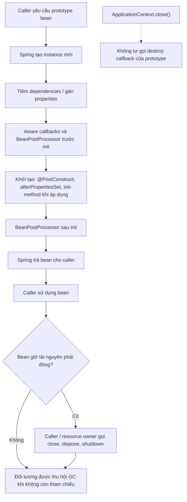

<a id="back-to-top"></a>

# Phạm vi bean

## Menu
- [Scope quyết định quan hệ giữa định nghĩa và thể hiện](#bean-scopes-001)
- [Singleton theo bean và theo container](#bean-scopes-002)
- [Phân biệt singleton Spring với mẫu Singleton GoF](#bean-scopes-003)
- [Prototype và mỗi lần container đáp ứng yêu cầu lấy bean](#bean-scopes-004)
- [Quản lý khởi tạo nhưng không tự hủy bean prototype](#bean-scopes-005)
- [Request, session, application và websocket scope](#bean-scopes-006)
- [Điều kiện cần có của context hỗ trợ phạm vi web](#bean-scopes-007)
- [Khai báo @Scope và các annotation phạm vi web](#bean-scopes-008)
- [Trạng thái dùng chung và an toàn luồng của singleton](#bean-scopes-009)
- [SimpleThreadScope và giới hạn đăng ký, giải phóng tài nguyên](#bean-scopes-010)

## <a id="bean-scopes-001">Scope quyết định quan hệ giữa định nghĩa và thể hiện</a>

<details>
<summary>Xem chi tiết</summary>

# Scope quyết định quan hệ giữa định nghĩa và thể hiện trong Spring Core Container

## 1. Tại sao bean definition chưa cho biết có bao nhiêu object?

Trong Spring Framework, **bean definition** là công thức (recipe) để container biết **cách tạo, cấu hình và quản lý một bean**. Cùng một bean definition, container có thể trả về **một object được dùng chung** hoặc **nhiều object riêng biệt** tùy **scope**. Vì vậy hai câu hỏi phải được tách rời:

1. **Definition:** Spring đã đăng ký thông tin về bean nào, cách tạo ra sao, dependencies là gì?
2. **Instance:** Khi ứng dụng yêu cầu bean, Spring trả object nào, tạo mới hay dùng lại, và object đó tồn tại trong ranh giới nào?

Ví dụ:

```java
@Configuration(proxyBeanMethods = false)
class AppConfig {
    @Bean
    CatalogService catalogService() {
        return new CatalogService();
    }
}
```

Đây là ví dụ ngắn, chưa phải chương trình chạy độc lập. `catalogService` mặc định thuộc **singleton scope**, vì thế mỗi bean definition `catalogService` trong một Spring IoC container thông thường chỉ gắn với **một managed singleton object**.

Nhưng nếu đổi sang:

```java
@Bean
@Scope("prototype")
CatalogService catalogService() {
    return new CatalogService();
}
```

cùng cách khai báo factory method có thể tạo **nhiều CatalogService objects**, mỗi lần container nhận một yêu cầu lấy prototype bean.

**Điểm cốt lõi của chủ đề:** Scope không phải tên loại Java class; nó là **chính sách ánh xạ giữa bean definition và thể hiện (instance)** cùng ranh giới sử dụng/lifecycle của object.

### Mục tiêu học tập

Sau bài, bạn sẽ:

- Hiểu `BeanDefinition` là metadata/factory recipe, không đồng nhất với object.
- Nắm các scope chuẩn: `singleton`, `prototype`, `request`, `session`, `application`, `websocket`.
- Phân biệt Spring singleton **per bean, per container** với GoF Singleton dùng static global instance.
- Hiểu thời điểm bean creation, eager/lazy và scope là **những chiều khác nhau**.
- Biết tại sao một singleton inject prototype qua constructor vẫn giữ **chính một prototype instance đã nhận**.
- Sử dụng `ObjectProvider<T>`/`ObjectFactory<T>` hoặc scoped proxy cho dependency có vòng đời ngắn.
- Đánh giá request/session scope cần **web-aware ApplicationContext**, không tự hoạt động trong plain context.
- Hiểu destruction callback của prototype **không được Spring tự gọi khi context close**.
- Viết @Scope, @RequestScope, @SessionScope, XML scope và thiết lập custom scope.
- Thử nghiệm Java 17/Spring Framework 6.2 với output chính xác, chứng minh singleton identity và prototype multiplicity.
- Tránh các lỗi scope mismatch, stale request state, memory leaks và phụ thuộc sai lifecycle.

## 2. Mô hình từ định nghĩa đến thể hiện

Một bean definition bao gồm những thuộc tính như:

- Bean name/aliases.
- Java class, constructor hoặc factory method.
- Constructor/property dependencies.
- Scope.
- Lazy initialization.
- Initialization/destruction callbacks.
- Qualifiers, primary, role và các metadata khác.

BeanFactory đọc/gặp định nghĩa và thực hiện theo scope:

```text
                         BeanDefinition
            name = "jobUnit", class = JobUnit
            scope = singleton hoặc prototype
                              |
              +---------------+----------------+
              |                                |
              v                                v
         singleton scope                 prototype scope
        +----------------+               +----------------+
request #1 ---> object A                 request #1 ---> object A
request #2 ---> object A                 request #2 ---> object B
request #3 ---> object A                 request #3 ---> object C
        +----------------+               +----------------+
              |                                |
              v                                v
       Một object dùng chung              Nhiều objects tạo từ
       theo bean/container                cùng một recipe
```

Cụm từ “request #1/#2” trong sơ đồ là **yêu cầu BeanFactory lấy bean**, không nhất thiết là HTTP request. HTTP `request` scope sẽ được giải thích riêng.

### 2.1. Một definition có thể tồn tại mà chưa có instance

```java
boolean registered =
        context.getBeanFactory().containsBeanDefinition("jobUnit");
boolean singletonPresent =
        context.getBeanFactory().containsSingleton("jobUnit");
```

Ví dụ chỉ hoạt động khi `context` là `ConfigurableApplicationContext` phù hợp và `jobUnit` đã được khai báo. `containsBeanDefinition` kiểm tra definition trong local registry; `containsSingleton` kiểm tra singleton instance đã được đăng ký trong singleton registry. Hai kết quả không phải lúc nào cũng giống nhau.

Một prototype definition có thể có trong registry nhưng không có singleton instance, bởi **prototype không được cache như singleton**.

### 2.2. Một class có thể có nhiều bean definitions

```java
@Bean("primaryClient")
Client clientA() {
    return new Client("primary");
}

@Bean("backupClient")
Client clientB() {
    return new Client("backup");
}
```

Cả hai definitions cùng trả class `Client`, nhưng nếu đều singleton, Spring vẫn quản lý **hai singleton bean objects khác nhau** — mỗi tên bean có definition và cache entry của riêng nó.

Đừng diễn giải “singleton” là “một instance cho mỗi Java class”. Spring docs gọi đặc tính này là **per-container and per-bean**.

### 2.3. Một object Java chưa chắc là managed bean

```java
Client manual = new Client("manual");
```

Nếu bạn tự dùng `new`, object này **không tự động** có BeanDefinition, scope, injection, initialization callbacks hay destruction callback Spring. Một object có class trùng class của bean được quản lý vẫn có thể nằm **ngoài container**.

## 3. Bảng các scope chuẩn

Spring Framework 6.2 hỗ trợ các scopes sau:

| Scope | Ranh giới instance | Khi nào áp dụng? |
| --- | --- | --- |
| `singleton` | Một object được quản lý cho mỗi bean definition trong mỗi Spring IoC container | Scope mặc định, thường cho service/stateless collaborator |
| `prototype` | Mỗi yêu cầu BeanFactory lấy bean có thể tạo instance mới | Object có trạng thái ngắn hạn, mỗi lần sử dụng riêng |
| `request` | Một object cho mỗi HTTP request | Trạng thái gắn với request đang xử lý |
| `session` | Một object cho mỗi HTTP session | Trạng thái gắn với người dùng/phiên HTTP |
| `application` | Một object cho mỗi `ServletContext` | Trạng thái dùng chung trong một web application/servlet context |
| `websocket` | Một object cho mỗi WebSocket session phù hợp | Thành phần gắn với phiên WebSocket/STOMP |
| Custom scope | Do implementation `Scope` quyết định | Tenant, conversation hoặc mô hình vòng đời riêng |

Bốn web scopes **request, session, application, websocket** yêu cầu **web-aware `ApplicationContext`** tương ứng. `AnnotationConfigApplicationContext` thuần trong chương trình console không tự kích hoạt những scopes này.

Spring còn có `SimpleThreadScope` trong thư viện nhưng **không đăng ký mặc định**. Không coi `thread` là một trong sáu scope chuẩn tự động có sẵn ở mọi context.

### Cảnh báo thuật ngữ

“Request” trong `request scope` là một **HTTP request**; “yêu cầu lấy prototype bean” là **một lần BeanFactory resolve/getBean**, không phải một HTTP request. Một HTTP request có thể gọi `getBean` nhiều lần; các requests đến prototype sẽ nhận nhiều instances trừ khi có cơ chế giữ reference khác.

## 4. Singleton: một thể hiện dùng chung theo định nghĩa/container

### 4.1. Cú pháp Java

```java
@Configuration(proxyBeanMethods = false)
class Config {
    @Bean
    SharedCatalog sharedCatalog() {
        return new SharedCatalog();
    }
}
```

`singleton` là default scope, không cần `@Scope("singleton")`. Nếu muốn explicit:

```java
@Bean
@Scope(ConfigurableBeanFactory.SCOPE_SINGLETON)
SharedCatalog sharedCatalog() {
    return new SharedCatalog();
}
```

Hai snippets minh họa riêng, không đặt cả hai definitions cùng tên vào một class thật. `ConfigurableBeanFactory` thuộc `org.springframework.beans.factory.config`.

### 4.2. Cú pháp XML

```xml
<bean id="sharedCatalog" class="example.SharedCatalog"/>
```

tương đương khai báo scope mặc định, và:

```xml
<bean id="sharedCatalog"
      class="example.SharedCatalog"
      scope="singleton"/>
```

là cách explicit. Trong file XML thật cần root `<beans>` và các namespace/schema hợp lệ.

### 4.3. Identity của singleton

```java
Object first = context.getBean("sharedCatalog");
Object second = context.getBean("sharedCatalog");
boolean same = first == second;
```

Với regular singleton, `same` là `true`. Hai tên alias trỏ cùng singleton definition cũng có thể trả đúng một object. Tuy nhiên nếu lấy `FactoryBean` hoặc AOP proxy, cần phân biệt object đang lấy là **factory, product hay proxy** khi đọc identity.

### 4.4. Khác GoF Singleton

GoF Singleton pattern thường đặt static global holder/constructor hạn chế trong Java class. Spring singleton:

- Ánh xạ theo **bean name/definition + BeanFactory**.
- Có thể có nhiều singleton definitions cùng class.
- Có thể có một instance riêng trong mỗi `ApplicationContext`.
- Không buộc class Java dùng static holder/private constructor.
- Có thể được Spring wrap bằng proxy.
- Được Spring quản lý injection/lifecycle.

Nói “singleton service” trong Spring thường không có nghĩa “Java class đó được phép instantiate đúng một lần trên toàn JVM”.

### 4.5. Singleton không đồng nghĩa thread-safe

Nhiều requests/threads có thể dùng cùng bean singleton. Scope chỉ nói về **chia sẻ object identity**, không tự đồng bộ mutable fields:

```java
// Phản ví dụ về mutable state không thread-safe.
class UnsafeCounter {
    private int count;
    int next() {
        return ++count;
    }
}
```

Nếu bean singleton bị gọi đồng thời, `++count` có thể mất updates. Dùng immutable state hoặc concurrency primitives như `AtomicInteger` khi thực sự cần shared mutation. Với request-specific data, không nên lưu trực tiếp vào field của singleton service.

## 5. Prototype: một bean definition tạo nhiều thể hiện

`prototype` thường dùng cho object stateful hoặc job/request objects có chủ sở hữu rõ.

### 5.1. Java configuration

```java
@Bean
@Scope(ConfigurableBeanFactory.SCOPE_PROTOTYPE)
JobUnit jobUnit() {
    return new JobUnit();
}
```

Hoặc:

```java
@Component
@Scope("prototype")
class JobUnit {
}
```

Hai snippets là **hai cách đăng ký thay thế**, không cùng dùng một class trong một context nếu không chủ động muốn hai definitions.

### 5.2. XML

```xml
<bean id="jobUnit"
      class="example.JobUnit"
      scope="prototype"/>
```

### 5.3. Mỗi lookup của prototype có thể tạo object mới

```java
JobUnit first = context.getBean(JobUnit.class);
JobUnit second = context.getBean(JobUnit.class);

System.out.println(first == second); // false trong trường hợp thường
```

Nhưng đó chỉ đúng nếu `JobUnit` được Spring đăng ký như prototype và không có wrapper/provider layer làm thay đổi ý nghĩa object bạn đang so sánh.

### 5.4. Prototype không phải “một object cho mỗi HTTP request”

Nếu service gọi `getBean(prototypeName)` ba lần trong cùng HTTP request, thông thường có ba prototype instances. Nếu cần **một instance dùng lại xuyên các lookups trong cùng HTTP request**, dùng `request` scope thay vì prototype.

### 5.5. Prototype được tạo khi có nhu cầu

BeanFactory thường không tạo toàn bộ prototype instances lúc `ApplicationContext.refresh()`. Nhưng một eager singleton yêu cầu prototype làm constructor dependency sẽ làm container tạo **một prototype object** ngay khi xây singleton. Xem mục 7.

## 6. Bean definition, scope và lazy/eager là ba trục khác nhau

Ba thuộc tính có liên hệ nhưng không đồng nghĩa:

- **Definition:** Có recipe/metadata được đăng ký hay chưa?
- **Scope:** Bao nhiêu instance và sharing boundary?
- **Laziness:** Khi nào container chủ động tạo một bean singleton?

Ví dụ:

```java
@Bean
@Lazy
SharedCatalog sharedCatalog() {
    return new SharedCatalog();
}
```

Đây vẫn là **singleton scope**. `@Lazy` chỉ làm container có thể trì hoãn việc tạo cho đến first use, trừ khi một eager dependency yêu cầu nó sớm.

`prototype` lại khác: object mới thường xuất hiện cho mỗi lần lookup, không phải có một singleton chờ được tạo muộn.

| Definition | Scope | Lazy? | Nghĩa gần đúng |
| --- | --- | --- | --- |
| `sharedCatalog` | singleton | false | Một bean được pre-instantiate trong ApplicationContext thông thường |
| `rareClient` | singleton | true | Một singleton được tạo khi thật sự được yêu cầu |
| `jobUnit` | prototype | tùy metadata | Một instance mới mỗi lần được yêu cầu |
| `requestState` | request | không thể diễn giải như eager singleton | Một instance theo HTTP request đang active |
| `userPrefs` | session | phụ thuộc active session | Một instance theo HTTP session |

**Không** nghĩ rằng đổi `@Lazy` thành `@Scope("prototype")` là tối ưu “cùng một việc”. Một cái thay thời điểm, cái kia thay identity/multiplicity và lifecycle.

## 7. Bẫy thường gặp: singleton inject prototype chỉ một lần

Xem cấu hình:

```java
@Bean
@Scope("prototype")
TaskUnit taskUnit() {
    return new TaskUnit();
}

@Bean
TaskProcessor taskProcessor(TaskUnit taskUnit) {
    return new TaskProcessor(taskUnit);
}
```

`taskProcessor` là singleton mặc định; Spring chỉ gọi factory method `taskProcessor(TaskUnit)` khi tạo singleton. Tại thời điểm ấy, BeanFactory cung cấp **một** TaskUnit prototype. Processor giữ đúng reference đó:

```text
BeanDefinition taskUnit, scope=prototype
           |
           | một dependency request khi tạo taskProcessor
           v
      TaskUnit instance #1 -----------+
                                       |
                                       v
                           TaskProcessor singleton
                                       |
                  method run() lần 1 / lần 2 / lần 3
                                       |
                                       v
                            vẫn dùng TaskUnit #1
```

Vì vậy nếu `TaskProcessor.run()` kỳ vọng một task state object **mới cho mỗi lần chạy**, constructor-inject prototype trực tiếp là sai semantics.

### 7.1. Điều này không làm prototype đổi thành singleton

Bean definition `taskUnit` **vẫn thuộc prototype scope**. Những lần `context.getBean(TaskUnit.class)` khác có thể tạo TaskUnit #2, #3. Nhưng object mà singleton processor **đã giữ** không tự bị thay mới khi chạy method.

### 7.2. Sửa bằng ObjectProvider

```java
import org.springframework.beans.factory.ObjectProvider;

final class TaskProcessor {
    private final ObjectProvider<TaskUnit> taskUnits;

    TaskProcessor(ObjectProvider<TaskUnit> taskUnits) {
        this.taskUnits = taskUnits;
    }

    void run() {
        TaskUnit fresh = taskUnits.getObject();
        fresh.process();
    }
}
```

Đoạn minh họa cần class `TaskUnit` có method `process()`. Giờ processor giữ provider; từng lần `getObject()` thực hiện **một bean lookup mới**, phù hợp với prototype.

### 7.3. ObjectFactory và jakarta.inject.Provider

Spring có `ObjectFactory<T>` với `getObject()`. `ObjectProvider<T>` mở rộng khả năng lookup thêm `getIfAvailable()`, `getIfUnique()`, streams và những phương thức khác. `jakarta.inject.Provider<T>` có `get()` nếu tích hợp dependency tương ứng.

Dùng loại nào dựa trên semantics thực. Đừng inject `ApplicationContext` vào tất cả business services chỉ để gọi `getBean` bằng chuỗi: đó là service-locator coupling và khó test.

### 7.4. @Lookup method injection

Spring còn hỗ trợ `@Lookup` cho lookup-method injection:

```java
abstract class BatchRunner {
    public void run() {
        TaskUnit fresh = newTaskUnit();
        fresh.process();
    }

    @Lookup
    protected abstract TaskUnit newTaskUnit();
}
```

Đây là đoạn minh họa cần Spring tạo/enhance `BatchRunner` theo cơ chế method injection. **Không áp dụng tùy tiện cho object tạo bởi `@Bean` factory method hoặc object `new` ngoài container**: Spring cần kiểm soát instantiation/enhancement; method/class final hoặc constraints khác có thể làm injection không hoạt động. Trong nhiều thiết kế, `ObjectProvider<T>` đơn giản và minh bạch hơn.

### 7.5. Prototype qua scoped proxy

Nếu Spring inject một **scoped proxy** cho prototype vào singleton, *mỗi lời gọi method qua proxy* có thể tạo một target prototype mới. Đây là semantics khác với “một prototype mới cho mỗi business operation gồm nhiều lời gọi method”.

Nếu một operation cần gọi `prepare()` và `execute()` **trên cùng TaskUnit**, gọi hai method độc lập qua prototype scoped proxy có thể tác động **hai targets khác nhau**. Hãy dùng provider để lấy object một lần ở đầu operation rồi gọi cả hai methods trên cùng reference.

## 8. Ví dụ runnable Java 17: singleton, prototype và provider

Ví dụ hoàn chỉnh này dùng **Spring Framework 6.2.19**, Java 17 và Maven, không cần Spring Boot, server, database hay network ở runtime.

Nó chứng minh:

1. `SharedCatalog` singleton trả cùng reference.
2. Một eager singleton `FixedConsumer` đã được inject một prototype `TaskUnit` lúc context refresh.
3. Hai lần `getBean(TaskUnit.class)` tạo các prototype instances mới.
4. `DynamicConsumer` singleton giữ `ObjectProvider<TaskUnit>` để lấy prototype mới mỗi lần gọi.
5. `RareTool` là lazy **singleton**: chưa tạo sau refresh, được tạo tại first use, rồi trả cùng reference.
6. Cả singleton, prototype và provider đều xuất phát từ **những bean definitions duy nhất cho từng bean name**.

### 8.1. Cấu trúc

```text
scope-recipe-demo/
├── pom.xml
└── src/main/java/demo/
    └── ScopeRecipeDemo.java
```

### 8.2. pom.xml

```xml
<project xmlns="http://maven.apache.org/POM/4.0.0"
         xmlns:xsi="http://www.w3.org/2001/XMLSchema-instance"
         xsi:schemaLocation="
           http://maven.apache.org/POM/4.0.0
           https://maven.apache.org/xsd/maven-4.0.0.xsd">
    <modelVersion>4.0.0</modelVersion>
    <groupId>demo</groupId>
    <artifactId>scope-recipe-demo</artifactId>
    <version>1.0-SNAPSHOT</version>
    <properties>
        <maven.compiler.release>17</maven.compiler.release>
        <project.build.sourceEncoding>UTF-8</project.build.sourceEncoding>
    </properties>
    <dependencies>
        <dependency>
            <groupId>org.springframework</groupId>
            <artifactId>spring-context</artifactId>
            <version>6.2.19</version>
        </dependency>
    </dependencies>
    <build>
        <plugins>
            <plugin>
                <groupId>org.apache.maven.plugins</groupId>
                <artifactId>maven-compiler-plugin</artifactId>
                <version>3.13.0</version>
            </plugin>
            <plugin>
                <groupId>org.codehaus.mojo</groupId>
                <artifactId>exec-maven-plugin</artifactId>
                <version>3.5.0</version>
            </plugin>
        </plugins>
    </build>
</project>
```

### 8.3. Java source đầy đủ

Tạo `src/main/java/demo/ScopeRecipeDemo.java`:

```java
package demo;

import java.util.concurrent.atomic.AtomicInteger;

import org.springframework.beans.factory.ObjectProvider;
import org.springframework.beans.factory.config.ConfigurableBeanFactory;
import org.springframework.context.annotation.AnnotationConfigApplicationContext;
import org.springframework.context.annotation.Bean;
import org.springframework.context.annotation.Configuration;
import org.springframework.context.annotation.Lazy;
import org.springframework.context.annotation.Scope;

public class ScopeRecipeDemo {

    public static final class Sequence {
        private final AtomicInteger next = new AtomicInteger();

        public int nextId() {
            return next.incrementAndGet();
        }
    }

    public static final class SharedCatalog {
        public String name() {
            return "catalog-ready";
        }
    }

    public static final class TaskUnit {
        private final int id;

        public TaskUnit(int id) {
            this.id = id;
        }

        public int id() {
            return id;
        }
    }

    public static final class FixedConsumer {
        private final TaskUnit taskUnit;

        public FixedConsumer(TaskUnit taskUnit) {
            this.taskUnit = taskUnit;
        }

        public int assignedId() {
            return taskUnit.id();
        }

        public TaskUnit taskUnit() {
            return taskUnit;
        }
    }

    public static final class DynamicConsumer {
        private final ObjectProvider<TaskUnit> tasks;

        public DynamicConsumer(ObjectProvider<TaskUnit> tasks) {
            this.tasks = tasks;
        }

        public int newTaskId() {
            return tasks.getObject().id();
        }
    }

    public static final class LazyMarker {
        private boolean created;

        public void mark() {
            created = true;
        }

        public boolean created() {
            return created;
        }
    }

    public static final class RareTool {
        public RareTool(LazyMarker marker) {
            marker.mark();
        }

        public String label() {
            return "rare-ready";
        }
    }

    @Configuration(proxyBeanMethods = false)
    public static class AppConfig {
        @Bean
        public Sequence sequence() {
            return new Sequence();
        }

        @Bean
        public SharedCatalog sharedCatalog() {
            return new SharedCatalog();
        }

        @Bean
        @Scope(ConfigurableBeanFactory.SCOPE_PROTOTYPE)
        public TaskUnit taskUnit(Sequence sequence) {
            return new TaskUnit(sequence.nextId());
        }

        @Bean
        public FixedConsumer fixedConsumer(TaskUnit taskUnit) {
            return new FixedConsumer(taskUnit);
        }

        @Bean
        public DynamicConsumer dynamicConsumer(
                ObjectProvider<TaskUnit> tasks) {
            return new DynamicConsumer(tasks);
        }

        @Bean
        public LazyMarker lazyMarker() {
            return new LazyMarker();
        }

        @Bean
        @Lazy
        public RareTool rareTool(LazyMarker marker) {
            return new RareTool(marker);
        }
    }

    public static void main(String[] args) {
        try (var context =
                     new AnnotationConfigApplicationContext(AppConfig.class)) {

            SharedCatalog catalog1 =
                    context.getBean(SharedCatalog.class);
            SharedCatalog catalog2 =
                    context.getBean(SharedCatalog.class);
            FixedConsumer fixed =
                    context.getBean(FixedConsumer.class);
            DynamicConsumer dynamic =
                    context.getBean(DynamicConsumer.class);
            LazyMarker marker =
                    context.getBean(LazyMarker.class);

            System.out.println("catalog=" + catalog1.name());
            System.out.println("singletonSame=" + (catalog1 == catalog2));
            System.out.println("fixedTaskId=" + fixed.assignedId());

            TaskUnit task2 = context.getBean(TaskUnit.class);
            TaskUnit task3 = context.getBean(TaskUnit.class);
            System.out.println("directPrototypeIds=" +
                    task2.id() + "," + task3.id());
            System.out.println("directPrototypeDifferent=" +
                    (task2 != task3));
            System.out.println("fixedStillFirst=" +
                    (fixed.assignedId() == 1));

            System.out.println("providerPrototypeIds=" +
                    dynamic.newTaskId() + "," + dynamic.newTaskId());

            System.out.println("lazyBeforeLookup=" +
                    marker.created());
            RareTool rare1 = context.getBean(RareTool.class);
            RareTool rare2 = context.getBean(RareTool.class);
            System.out.println("rare=" + rare1.label());
            System.out.println("lazyAfterLookup=" +
                    marker.created());
            System.out.println("lazySingletonSame=" +
                    (rare1 == rare2));
        }
    }
}
```

### 8.4. Chạy

```bash
mvn -q clean compile exec:java -Dexec.mainClass=demo.ScopeRecipeDemo
```

Dự án có thể cần Maven tải dependencies lần đầu; chương trình không phụ thuộc network khi đã có các JAR cần thiết.

### 8.5. Output dự kiến

Các dòng **do chương trình `System.out.println` in**, không tính logs tùy môi trường:

```text
catalog=catalog-ready
singletonSame=true
fixedTaskId=1
directPrototypeIds=2,3
directPrototypeDifferent=true
fixedStillFirst=true
providerPrototypeIds=4,5
lazyBeforeLookup=false
rare=rare-ready
lazyAfterLookup=true
lazySingletonSame=true
```

### 8.6. Vì sao các ID chính xác?

`Sequence` là singleton chứa `AtomicInteger` riêng của **context**. Tạo bean `FixedConsumer` eager yêu cầu `TaskUnit` prototype, nên Spring gọi factory `taskUnit(sequence)` lần đầu và cấp **id=1**.

Không có bean eager nào khác cần TaskUnit ngay ở startup. `DynamicConsumer` chỉ giữ `ObjectProvider<TaskUnit>`, không lấy prototype khi constructor/factory method của dynamic consumer chạy.

Sau refresh, hai lời gọi `context.getBean(TaskUnit.class)` tạo instances mới **id=2** và **id=3**. Hai lần `dynamic.newTaskId()` gọi provider và tạo tiếp **id=4** và **id=5**.

`fixed.assignedId()` vẫn là 1 vì singleton FixedConsumer giữ reference TaskUnit đầu tiên. Đây là hiện tượng **singleton lifetime dài hơn prototype lifetime được inject** chứ không phải Spring vô tình làm prototype trở thành singleton.

### 8.7. Vì sao RareTool không được tạo trước?

`RareTool` là singleton lazy được khai báo bằng `@Lazy` trên `@Bean`. Không bean eager nào trong demo cần RareTool. `LazyMarker` eager có thể được tạo trước, nhưng việc có marker **không** tự kích hoạt RareTool. Vì vậy `marker.created()` là false trước `getBean(RareTool.class)` và true sau đó; hai lookups trả cùng singleton.

### 8.8. Tại sao output không dựa vào thứ tự bean không có dependency?

Sequence IDs chỉ cấp trong `TaskUnit` factory. Để FixedConsumer ra đời cần tạo một TaskUnit; các TaskUnit khác chỉ được yêu cầu bằng những lời gọi `getBean` và `provider.getObject` rõ ràng trong `main`. Các bean khác không tạo TaskUnit, nên không phụ thuộc thứ tự creation của chúng. Không có static global IDs hoặc background threads.

### 8.9. Điểm quan trọng của @Configuration(proxyBeanMethods=false)

Factory methods nhận dependencies qua **tham số**, không direct-call factory khác. Đây là cách đảm bảo BeanFactory quyết định bean identity/scope. Nếu viết `return new FixedConsumer(taskUnit(sequence()))` trong lite configuration, các factory method calls Java trực tiếp có thể tạo objects ngoài container, phá semantics mà demo đang dạy.

## 9. Scope và dependency injection: chú ý vòng đời dài/ngắn

Một vấn đề kiến trúc phổ biến là **long-lived bean** giữ reference tới **short-lived bean**:

```text
Singleton Service
      |
      | inject trực tiếp lúc singleton được tạo
      v
Prototype / Request / Session Bean
      |
      +--> Object cụ thể được giữ qua nhiều lượt gọi
```

Điều này gây hai loại bug:

1. **Prototype được dùng lại ngoài ý định:** singleton chỉ nhận một prototype object lúc khởi tạo.
2. **Request/session scope không hợp lệ hoặc stale:** singleton không thể trực tiếp giữ một request-specific object rồi dùng cho mọi HTTP requests/users.

### 9.1. Nếu dependency thực sự thuộc cùng vòng đời

Có thể inject trực tiếp. Ví dụ singleton service giữ singleton repository là hợp lý; hai object cùng ranh giới container.

### 9.2. Nếu dependency ngắn hơn consumer

Bạn có thể:

- Dùng `ObjectProvider<T>` rồi resolve target tại từng operation.
- Inject **scoped proxy** thay vì target object trực tiếp.
- Truyền request-specific data thành **method parameters** từ controller/use-case layer.
- Tái thiết kế interface để tách mutable state ra khỏi singleton service.
- Dùng method injection nếu phù hợp nhưng chú ý constraints.

### 9.3. Cách tốt cho request-specific business data

Thay vì lưu `currentUserId` trong singleton service field:

```java
// Phản ví dụ:
class UnsafeOrderService {
    private String currentUserId;

    public void setCurrentUserId(String userId) {
        currentUserId = userId;
    }
}
```

nên truyền dữ liệu đến service method:

```java
class OrderService {
    public String createOrder(String userId, String sku) {
        return userId + ":" + sku;
    }
}
```

Đây là hai thiết kế minh họa riêng. Stateless service không chứa per-request mutable state nên dễ chia sẻ giữa threads và tests hơn.

## 10. Request scope: một bean trong một HTTP request

Trong một web-aware `ApplicationContext` có HTTP request active, bean `request` có **một target trên mỗi request**. Hai lần dùng cùng bean trong một request nhận cùng target; request tiếp theo có target mới. `@RequestScope` mặc định dùng class-based scoped proxy, nên singleton controller có thể giữ proxy và gọi đến target hiện tại khi xử lý HTTP.

~~~java
@Component
@RequestScope
class RequestTrace {
    private final String traceId =
            java.util.UUID.randomUUID().toString();

    String id() {
        return traceId;
    }
}
~~~

Đoạn code chỉ minh họa một bean trong môi trường Spring Servlet; cần các import `Component`, `RequestScope` và component scanning phù hợp. Giá trị `traceId` được khởi tạo một lần cho mỗi target, nên các lần gọi `id()` trong cùng HTTP request trả cùng kết quả. Bài chuyên về web scope có ví dụ HTTP hoàn chỉnh để kiểm chứng.

## 11. Session scope: theo HTTP session, không theo mỗi user account vĩnh viễn

`@SessionScope` gắn một target với **một HTTP session**: nhiều requests giữ cùng session ID thường dùng chung target, session khác có target riêng. Một user có thể mở nhiều sessions; nhiều tab cùng cookie có thể dùng chung một session. Với state mutable, cần xem xét đồng thời giữa các HTTP requests cùng session, memory pressure, timeout và serialization/persistence khi hạ tầng yêu cầu.

## 12. Application scope khác singleton scope

`@ApplicationScope` lưu target trong **`ServletContext`**; `singleton` thuộc **bean definition/container**. Một ServletContext có thể liên quan nhiều Spring contexts, còn các JVM/pods khác nhau không tự chia sẻ bộ nhớ. Cả hai scope đều có thể bị nhiều threads truy cập, nên giữ state immutable/stateless hoặc bảo vệ mutation phù hợp.

## 13. WebSocket scope

`websocket` quản lý target theo **WebSocket/STOMP session** trong messaging infrastructure phù hợp, khác HTTP request/session. Mỗi kết nối có state riêng; nhiều messages của cùng kết nối có thể truy cập cùng target và vẫn cần thiết kế concurrency. Spring 6.x có thể khai báo `@Scope("websocket", proxyMode = ScopedProxyMode.TARGET_CLASS)` khi đã cấu hình STOMP broker; annotation `@WebSocketScope` thuộc Spring 7.x.

## 14. Scoped proxy: cùng reference ở consumer, target thay theo scope

Singleton consumer có vòng đời dài hơn request/session bean. **Scoped proxy** cho phép giữ một proxy reference ổn định nhưng mỗi lần gọi method sẽ resolve target theo request/session đang active. Với `ScopedProxyMode.INTERFACES`, injection point dùng interface; `TARGET_CLASS` tạo subclass proxy và chịu giới hạn của `final` class/method. Không truy cập target request ngoài active request.

~~~java
// Snippet trong web-aware Spring configuration; RequestIdentityImpl implements RequestIdentity.
@Bean
@Scope(value = "request", proxyMode = ScopedProxyMode.INTERFACES)
RequestIdentity requestIdentity() {
    return new RequestIdentityImpl();
}
~~~

Proxy được inject vào singleton; giữa hai HTTP requests, reference proxy có thể giống nhưng target khác. Tránh cache target thực trong một singleton field.

## 15. ObjectProvider và scoped proxy: chọn theo ý nghĩa

- **Scoped proxy**: consumer gọi collaborator như một interface/class thông thường; proxy chọn target ở thời điểm method call, phù hợp request/session bean.
- **`ObjectProvider<T>`**: consumer chủ động gọi `getObject()` khi cần, rồi có thể giữ target trong một biến cục bộ xuyên suốt một business operation.
- Với **prototype scoped proxy**, hai method calls có thể tạo hai prototype targets khác nhau. Nếu `prepare()` và `commit()` phải cùng một instance, lấy prototype qua provider **một lần** rồi gọi cả hai methods trên nó.

## 16. Lifecycle: Spring không hủy prototype như singleton

Spring khởi tạo singleton/prototype theo bean lifecycle, nhưng với prototype **không tự thực thi destruction callbacks** khi `ApplicationContext.close()`; caller hoặc một owner riêng phải `close()` các resource cần thiết. Singleton được Spring quản lý destruction theo context khi có callback hợp lệ. Request/session targets theo lifecycle của web scope được hỗ trợ, không phải cứ hết HTTP request là toàn bộ bean Spring biến mất.

Ví dụ: một prototype `AutoCloseable` lấy bằng provider có thể dùng `try (var session = provider.getObject()) { session.run(); }` khi phù hợp. Đây là đoạn định hướng cho bài về prototype cleanup, nơi giải thích callback và xử lý exception chi tiết.

## 17. Khi tạo object: eager/lazy áp dụng tới scopes khác nhau thế nào?

`ApplicationContext.refresh()` thường pre-instantiate **regular non-lazy singleton beans**. Prototype không bị bulk instantiate khi đọc definition, request/session targets cần active web scope.

Nhưng dependency có thể kéo object khác được tạo khi cần:

```text
Eager singleton Processor
   |
   +---- constructor requires prototype Worker
   |                    |
   |                    +--> Tạo Worker khi Processor được tạo
   |
   +---- provider<Worker>
                        |
                        +--> Chưa tạo Worker cho tới getObject()
```

Đừng kết luận “mình đánh `@Lazy` lên bean nên nó sẽ không được tạo ở startup”. Một eager bean constructor-inject bean ấy vẫn có thể kéo nó lên, kể cả khi target là singleton lazy.

### Bean scope không phải creation order

Hai singleton độc lập có thể được tạo theo thứ tự tùy cơ chế bootstrap. Nếu A cần B, Spring resolve B theo dependency graph. `@Order` không phải singleton startup ordering; nó thường dùng để sắp xếp collection injections.

### @DependsOn và scope

`@DependsOn("x")` cho biết dependent bean cần bean `x` được initialized trước, không làm x đổi scope, cũng không biến prototype thành singleton. Một eager bean có `dependsOn` có thể làm bean lazy được tạo sớm.

## 18. FactoryBean và bean scope: hai tầng semantics

`FactoryBean<T>` là Spring contract để bean factory object cung cấp một product object. Đừng nhầm với một `@Bean` factory method.

Khi một bean definition định nghĩa FactoryBean:

- BeanFactory quản lý **factory object** theo scope của definition.
- `getBean("name")` thường trả **product** được factory tạo.
- `getBean("&name")` trả **FactoryBean object**.
- `FactoryBean.isSingleton()` mô tả product singleton semantics từ factory.
- Product/cache/lifecycle còn phụ thuộc loại factory, bean definition, implementation và BeanFactory.

Bởi vậy không thể chỉ nhìn `scope="singleton"` trên FactoryBean definition rồi kết luận mọi lượt `getBean("name")` chắc chắn có product identity như singleton bean thông thường. Hãy xem **cả factory bean scope và product semantics**.

Đây là chủ đề nâng cao; với một class service bình thường khai báo bằng `@Bean`, singleton/prototype vẫn hoạt động theo các quy tắc ở mục 4–8.

## 19. Custom scope: tự định nghĩa ranh giới instance

Khi sáu scopes chuẩn chưa khớp domain, Spring cho phép triển khai `org.springframework.beans.factory.config.Scope`, rồi đăng ký với BeanFactory.

Interface `Scope` có các hợp đồng chính:

- `Object get(String name, ObjectFactory<?> objectFactory)`: tìm hoặc tạo object theo ranh giới scope.
- `Object remove(String name)`: loại object khỏi scope.
- `void registerDestructionCallback(String name, Runnable callback)`.
- `Object resolveContextualObject(String key)`.
- `String getConversationId()`.

Một scope custom cần quyết định **storage**, **isolation boundary**, **cleanup** và **concurrency semantics**. Ví dụ tenant scope phải bảo đảm không để dữ liệu tenant A lẫn sang tenant B.

### 19.1. Đăng ký scope theo API

```java
ConfigurableBeanFactory factory = ...;
factory.registerScope("tenant", tenantScope);
```

Đây là đoạn minh họa, yêu cầu `tenantScope` implementation của `Scope` và đúng giai đoạn BeanFactory configuration. Với ApplicationContext, custom scope thường được đăng ký thông qua `CustomScopeConfigurer` hoặc cấu hình bootstrap phù hợp, **trước khi** những bean thuộc scope đó cần resolve.

### 19.2. XML định nghĩa scope

```xml
<bean id="tenantWorkspace"
      class="example.TenantWorkspace"
      scope="tenant"/>
```

Sẽ không hoạt động nếu container chưa đăng ký scope tên `tenant`. Không phải cứ viết một chuỗi scope mới trong XML thì Spring tự biết quản lý nó.

### 19.3. Custom scope không đồng nghĩa ThreadLocal an toàn

Tenant context trên `ThreadLocal` có thể bị stale/leak khi thread pools tái sử dụng threads. Với reactive processing hoặc virtual threads, correlation và context propagation còn phải được thiết kế đúng. Không tự viết scope storage đơn giản dựa vào global map keyed bằng user string mà chưa giải quyết lifecycle, logout/eviction, concurrent access và memory cleanup.

## 20. Bean aliases, multiple names và scopes

Một bean có thể có nhiều tên thông qua aliases:

```xml
<bean id="catalogClient" class="example.CatalogClient"/>
<alias name="catalogClient" alias="legacyCatalogClient"/>
```

Hai tên ánh xạ tới **cùng bean definition**, không tự tạo hai instances. Nếu definition là singleton, thông thường:

```java
context.getBean("catalogClient")
        == context.getBean("legacyCatalogClient")
```

là true.

Còn nếu bạn đăng ký **hai bean definitions riêng** cùng class nhưng tên khác, chúng có scope/lifecycle riêng:

```java
@Bean("eastClient")
Client eastClient() {
    return new Client("east");
}

@Bean("westClient")
Client westClient() {
    return new Client("west");
}
```

Dù cả hai là singleton, không vì cùng class mà Spring gộp chúng thành một object.

### Injection theo type có thể nhập nhằng

Hai `Client` bean definitions khác nhau khiến `getBean(Client.class)` hoặc constructor injection theo type có thể bị ambiguity. Dùng `@Qualifier`, `@Primary` hoặc tên bean rõ. Scope **không phải tiêu chí chọn một candidate chính xác** nếu có nhiều beans cùng type.

## 21. Định nghĩa inner bean và scope

Trong Spring XML:

```xml
<bean id="processor" class="example.Processor">
    <constructor-arg>
        <bean class="example.Policy"/>
    </constructor-arg>
</bean>
```

Bean `example.Policy` ở trong thẻ `<constructor-arg>` là một **inner bean definition**. Nó không có top-level bean name công khai để `getBean("policy")`. Inner beans thường được tạo như object thuộc ownership của outer bean, và không dùng làm shared singleton độc lập.

Nếu nhiều consumer cùng cần một policy singleton, đăng ký named bean riêng rồi dùng `ref`:

```xml
<bean id="policy" class="example.Policy"/>

<bean id="processor" class="example.Processor">
    <constructor-arg ref="policy"/>
</bean>
```

Đừng lạm dụng inner bean để xây một “singleton toàn cục” vì tên XML thẻ giống nhau. Definition nesting và bean scope phải được hiểu riêng.

## 22. Web scope examples: ví dụ minh họa đúng ngữ cảnh

Một singleton `RequestLoggingService` có thể inject interface `RequestInfo` được đăng ký bằng `@Scope(value="request", proxyMode=ScopedProxyMode.INTERFACES)`. Trong HTTP request đang active, hai lần gọi `requestInfo.correlationId()` tìm cùng request target; HTTP request khác tìm target khác. Plain `AnnotationConfigApplicationContext` trong CLI không tự có HTTP scope. Để chạy thật và so sánh cookie/request/application state, xem các bài web scopes, web-aware context và annotation ở các mục chuyên biệt trong chương.

## 23. Debug các lỗi do scope

| Triệu chứng | Nguyên nhân thường gặp | Cách xử lý |
| --- | --- | --- |
| Hai `getBean()` cho cùng bean name trả cùng object | Bean scope singleton | Expected; kiểm tra `scope` definition |
| Hai `getBean()` cho prototype trả hai object | Prototype semantics | Expected |
| Prototype inject vào singleton bị dùng lại liên tục | Dependency chỉ resolve một lần khi singleton được tạo | `ObjectProvider`/factory per operation |
| Request bean dùng trong CLI báo thiếu scope | Không có web-aware context | Dùng web scope chỉ trong web app hoặc custom mock/register scope cho test |
| `Scope 'request' is not active` | Không có request bound vào thread/dispatch tại lúc target được gọi | Đặt lookup trong request hợp lệ |
| Một session bean bị truy cập nhầm giữa hai users | Shared mutable target/proxy/session binding sai | Sửa scope ownership, không cache target trong singleton |
| Cùng một scoped proxy reference nhưng ID target đổi | Proxy giữ identity, còn target thay theo request | Đây là expected behavior |
| Prototype scoped proxy state “mất” giữa hai methods | Mỗi method invocation có thể tới target mới | Dùng provider lấy target một lần |
| Scope proxy lỗi với final class/method | Proxying limitations | Dùng interface-based proxy hoặc provider |
| Prototype resource không được đóng khi context close | Spring không quản lý destroy callbacks của prototype như singleton | Caller tự cleanup |
| Memory tăng theo số sessions | Session state quá lớn/chưa timeout/invalidation | Thiết kế cleanup, tránh giữ object lớn |
| Singleton field chứa request ID của request trước | Per-request state bị lưu trong long-lived bean | Truyền method parameter hoặc dùng request scope đúng |
| Một class nhưng hai singleton instances | Hai bean definitions hoặc hai contexts | Kiểm tra names/aliases/context boundaries |
| `@Lazy` singleton tạo sau nhưng vẫn same identity | Lazy chỉ thay thời điểm, không đổi scope | Expected |
| Bean prototype xuất hiện ở startup | Eager singleton yêu cầu prototype dependency | Xem constructor/factory method parameters |
| Custom scope không tìm thấy | Chưa đăng ký scope name | `CustomScopeConfigurer`/`registerScope` trước lookup |
| `NoUniqueBeanDefinitionException` | Nhiều candidates cùng type | Qualifier/Primary/tên bean |
| Method `@Bean` bị gọi trực tiếp tạo object ngoài BeanFactory | `proxyBeanMethods=false`/manual config instance | Dùng BeanFactory lookup/injection parameters |
| FactoryBean product identity khó hiểu | Factory vs product scope semantics khác | Kiểm tra `FactoryBean.isSingleton()` |
| Production-only bug với WebSocket session | Messaging infrastructure/scope lifecycle khác tests | Test đúng WebSocket/STOMP setup |

### Quy trình debug

1. Xác minh bean **name/alias** và definition thực tế đã được đăng ký.
2. Tìm `@Scope`/`@RequestScope`/`@SessionScope` hoặc XML `scope="..."`.
3. Xác định **container** nào đang tạo bean (parent, child, test context, app context).
4. Xác định lookup là `getBean`, constructor injection, provider hay scoped proxy.
5. Nếu singleton giữ prototype: kiểm tra injection xảy ra **một lần** hay per-use lookup.
6. Nếu bean web-scoped: xác minh request/session/WebSocket scope đang active.
7. Tách identity của proxy khỏi target instance.
8. Kiểm tra scope-specific cleanup và object ownership.
9. Không gọi `getBean` khi chỉ muốn kiểm tra bean đã được tạo — lookup có thể instantiate.
10. Test với đúng profile/web environment và concurrency/lifecycle nếu có.

## 24. Kiểm thử semantics của scope

### 24.1. Test singleton identity

```java
SharedCatalog a = context.getBean(SharedCatalog.class);
SharedCatalog b = context.getBean(SharedCatalog.class);
if (a != b) {
    throw new AssertionError("SharedCatalog is not singleton");
}
```

Đây là đoạn bổ sung đặt bên trong `main` của project mục 8, khi `context` đang mở.

### 24.2. Test prototype multiplicity

```java
TaskUnit first = context.getBean(TaskUnit.class);
TaskUnit second = context.getBean(TaskUnit.class);
if (first == second) {
    throw new AssertionError("Expected distinct prototype objects");
}
```

Đừng assert literal IDs nếu test khác cũng đã lấy prototype trước; kiểm tra identity và scope contract quan trọng hơn số thứ tự được gắn tùy ngữ cảnh.

### 24.3. Test singleton giữ prototype một lần

```java
FixedConsumer fixed = context.getBean(FixedConsumer.class);
TaskUnit stored = fixed.taskUnit();

if (fixed.taskUnit() != stored) {
    throw new AssertionError("FixedConsumer changed its dependency");
}
```

Nội dung quan trọng là FixedConsumer đã giữ cùng reference. Việc nó cần object mới mỗi lần hay không là **yêu cầu thiết kế**, không phải lỗi Spring.

### 24.4. Test provider tạo prototype mỗi lần

```java
ObjectProvider<TaskUnit> units =
        context.getBeanProvider(TaskUnit.class);
TaskUnit a = units.getObject();
TaskUnit b = units.getObject();
if (a == b) {
    throw new AssertionError("Prototype provider returned same object");
}
```

### 24.5. Test request scope phải mô phỏng HTTP lifecycle

Với Spring web test infrastructure, mock request/session phải được bind đúng vào `RequestContextHolder` hoặc mock web context tương ứng khi kiểm tra target resolution. Tạo plain `AnnotationConfigApplicationContext` rồi trực tiếp `getBean` một request-scoped target không phải integration test web đúng nghĩa.

### 24.6. Test cleanup

Với singleton có `destroyMethod`, đóng context và assert callback phù hợp. Với prototype, viết test chứng minh application caller chịu trách nhiệm close, không đợi context cleanup giúp.

### 24.7. Test scope bằng API BeanFactory mà không tạo target

```java
String scope =
        context.getBeanFactory()
               .getBeanDefinition("taskUnit")
               .getScope();
```

Với `@Scope("prototype")`, scope string là `prototype`. Với scope mặc định, BeanDefinition scope field có thể chưa được ghi explicit (chuỗi rỗng biểu thị default singleton), vì vậy cần hiểu API contract; đừng assert `getScope().equals("singleton")` cho mọi bean mặc định.

## 25. Câu hỏi thường gặp

### Singleton bean có phải được tạo đúng một lần trên toàn JVM?

Không. Nó là singleton **theo bean definition trong mỗi container**. Hai contexts độc lập có thể có hai instances. Hai definitions cùng Java class trong một context cũng có thể có hai singleton instances.

### Prototype có nghĩa một bean mới mỗi HTTP request?

Không. Nó thường là bean mới **mỗi yêu cầu lấy instance** từ BeanFactory. Muốn một bean tồn tại xuyên lookups trong một HTTP request, chọn request scope.

### @Lazy có phải một scope?

Không. `@Lazy` điều chỉnh **thời điểm pre-instantiation**, không đổi instance multiplicity. Lazy singleton vẫn chỉ có một managed singleton instance khi được tạo.

### Bean scope có thay đổi dependencies không?

Scope quyết định khi/how nhiều object được tạo theo bean definition. Dependency injection vẫn cần resolve object phù hợp; nhưng thời điểm/identity được truyền cho consumer chịu ảnh hưởng scope.

### Tại sao prototype bị tạo lúc startup dù không bulk pre-instantiate?

Vì eager singleton có thể **cần prototype làm dependency**, dẫn tới tạo một instance ngay lúc singleton được dựng.

### Một singleton inject prototype có tự thay instance mỗi lần method chạy?

Không. Constructor/property injection diễn ra tại thời điểm tạo singleton, nên reference đã inject thường giữ nguyên. Dùng provider/factory/scoped proxy với semantics được thiết kế nếu cần dynamic instance.

### @RequestScope sử dụng được trong chương trình console không?

Không tự động. Cần web-aware context và active request. Plain ApplicationContext thường không có scope đó, trừ khi bạn tự register/mock scope cho test với ý thức rõ.

### Scoped proxy có cùng reference qua nhiều requests không?

Có thể. Consumer singleton giữ **cùng proxy instance**, nhưng target mà proxy giải quyết theo request/session có thể khác nhau.

### Scoped proxy prototype và ObjectProvider có giống nhau không?

Không. Prototype scoped proxy có thể tạo target mới **mỗi method call**, còn provider cho phép bạn **chủ động lấy một target** bằng `getObject()` rồi dùng cùng target trong một operation.

### Prototype bean có được Spring tự close khi context close không?

Theo semantics Spring thông thường, **không**. Spring gọi init callbacks nhưng không theo dõi và thực hiện mọi prototype destruction callbacks; caller phải quản lý cleanup.

### Application scope có luôn giống singleton?

Không. Application scope ràng theo ServletContext; singleton ràng theo một Spring IoC container. Khi có nhiều contexts chia sẻ một ServletContext, khác biệt có thể quan trọng.

### Spring có tự đăng ký thread scope?

Không. `SimpleThreadScope` tồn tại nhưng **không đăng ký mặc định**, và có lifecycle caveats quan trọng.

### Scope có phải dùng để đảm bảo thread safety?

Không. Scope chỉ nói về **sharing/lifespan**. Nhiều threads có thể dùng cùng singleton hoặc session-scoped object, nên mutable state vẫn cần concurrency design.

### Mọi đối tượng tạo bằng new trong @Bean đều không được Spring quản lý?

Object được **return từ `@Bean` factory method do container gọi** sẽ trở thành managed bean theo definition đó. Nhưng objects phụ được tạo bằng `new` rồi giữ bên trong mà không trả về/đăng ký riêng **không tự thành Spring beans**. Phân biệt rõ “factory method trả object” và “manual new không qua BeanFactory”.

## 26. Bài tập có đáp án

### Bài 1 — Một definition, nhiều objects

`TaskUnit` được khai báo bằng `@Bean @Scope("prototype")`. Hai lần `context.getBean(TaskUnit.class)` có mấy instances thông thường?

**Đáp án:** Hai instances khác nhau từ một bean definition. Scope quy định cơ chế tạo/lookup, không nhân bản definition.

### Bài 2 — Singleton per-container

Hai `AnnotationConfigApplicationContext` độc lập cùng đăng ký `@Bean Cache cache()`. `Cache` singleton ở mỗi context. Hai references có chắc giống nhau không?

**Đáp án:** Không. Mỗi container quản lý singleton riêng.

### Bài 3 — Hai bean names cùng class

Một config có `@Bean("a") Client clientA()` và `@Bean("b") Client clientB()`, cả hai singleton. Có đúng một Client instance trong container không?

**Đáp án:** Không. Hai definitions riêng có thể có hai singleton objects riêng.

### Bài 4 — Lazy singleton

`@Bean @Lazy ExpensiveClient client()` có phải prototype không?

**Đáp án:** Không. Mặc định vẫn singleton; `@Lazy` chỉ thay thời điểm container chủ động tạo.

### Bài 5 — Prototype inject vào singleton

Eager singleton `BatchService` constructor nhận `TaskUnit` prototype. Gọi `batchService.process()` 10 lần có tự nhận 10 TaskUnits không?

**Đáp án:** Không. Constructor được gọi khi singleton tạo và nhận một prototype tại thời điểm đó, rồi giữ reference.

### Bài 6 — ObjectProvider

`BatchService` phải tạo một TaskUnit mới cho mỗi job. Nêu cách giải quyết.

**Đáp án:** Inject `ObjectProvider<TaskUnit>` rồi trong `processOneJob` gọi `getObject()` đúng một lần, sử dụng returned TaskUnit cho cả job.

### Bài 7 — Prototype scoped proxy

Một workflow gọi `proxy.prepare()` rồi `proxy.commit()`. Proxy trỏ prototype scope. Có bảo đảm cùng target object không?

**Đáp án:** Không. Mỗi method call qua prototype scoped proxy có thể nhận target mới. Nếu cần chung state, dùng provider lấy một instance trước.

### Bài 8 — Request scope

Hai lookup cùng bean trong một HTTP request, rồi hai lookup trong HTTP request khác. Có bao nhiêu target request-scoped objects thông thường?

**Đáp án:** Một target cho mỗi request, tổng hai targets giữa hai requests, nếu target được yêu cầu trong cả hai.

### Bài 9 — Session scope

Hai HTTP requests thuộc cùng session sử dụng `CartState` session-scoped. Có thường lấy cùng target không?

**Đáp án:** Có trong một HTTP session còn active, theo scope contract; khác session có target riêng.

### Bài 10 — Scope ở CLI

`@RequestScope` bean được tra cứu trong plain `AnnotationConfigApplicationContext` không có web request. Tại sao có thể lỗi?

**Đáp án:** Request scope chưa được đăng ký/active; web scopes yêu cầu web-aware context và active request lifecycle.

### Bài 11 — Application scope

Spring có hai child WebApplicationContexts cùng liên kết tới một ServletContext. Có thể có khác biệt identity của `application` và `singleton` beans không?

**Đáp án:** Có. Application scope theo ServletContext; singleton theo container/definition. Xem hierarchy, bean names và web infrastructure thực tế.

### Bài 12 — Lifecycle prototype

`@Bean(destroyMethod="close") @Scope("prototype")` tạo TempBuffer. Context đóng có chắc gọi close cho mọi buffer không?

**Đáp án:** Không theo lifecycle prototype mặc định; client/owner chịu trách nhiệm cleanup.

### Bài 13 — Proxy và target

Một singleton service giữ request-scoped proxy; hai requests gọi service. Có thể reference proxy giống nhau nhưng target khác nhau không?

**Đáp án:** Có. Proxy reference ổn định; target được resolve theo active scope của từng request.

### Bài 14 — Custom scope

Developer viết `@Scope("tenant")` nhưng chưa đăng ký Scope implementation. Có hoạt động không?

**Đáp án:** Không khi tenant bean được yêu cầu; cần đăng ký scope `tenant` trước lookup.

### Bài 15 — Thread safety

Một singleton có `int count` và `count++` khi 100 requests đồng thời. Scope singleton tự đảm bảo kết quả đúng không?

**Đáp án:** Không. Cần thread-safe mutable state hoặc thiết kế stateless.

### Bài 16 — Alias

`<bean id="reportClient".../>` có `<alias name="reportClient" alias="oldReportClient"/>`. Hai tên có tạo hai singleton objects không?

**Đáp án:** Không. Alias trỏ cùng bean identity.

### Bài 17 — Prototype vs request

Bạn muốn một `RequestContext` duy nhất trong mỗi HTTP request bất kể code lookup bao nhiêu lần. Chọn `prototype` hay `request`?

**Đáp án:** Chọn request scope. Prototype tạo mới mỗi bean lookup, không giữ một target cho toàn HTTP request.

### Bài 18 — Scope và order

`@Order(1)` trên singleton A, `@Order(2)` trên singleton B. Có nói object A được tạo trước B không?

**Đáp án:** Không. `@Order` thường ảnh hưởng sắp thứ tự collection/candidates, không điều khiển thứ tự tạo singleton.

### Bài 19 — Kết quả chương trình

Trong demo mục 8, vì sao `fixedTaskId=1` nhưng `directPrototypeIds=2,3`?

**Đáp án:** FixedConsumer eager được inject prototype đầu tiên trong startup; các lần `getBean` trong main tạo hai instances tiếp theo.

### Bài 20 — Dynamic ids

Vì sao hai lần `dynamic.newTaskId()` tạo IDs 4 và 5?

**Đáp án:** Consumer giữ provider, không giữ một TaskUnit cụ thể; mỗi `getObject()` tạo prototype mới dùng cùng singleton Sequence counter.

### Bài 21 — Lazy marker

`RareTool` được đánh `@Lazy` và không bean eager nào cần nó. `marker.created()` là gì ngay sau refresh?

**Đáp án:** False. Sau lần đầu `getBean(RareTool.class)`, constructor đánh dấu true; lookup thứ hai trả lại singleton.

### Bài 22 — Scope leak

Singleton giữ trực tiếp `UserPreferences` session target từ request của Alice, rồi xử lý request của Bob. Rủi ro gì?

**Đáp án:** Dùng nhầm/stale state giữa sessions, thậm chí lộ dữ liệu. Inject scoped proxy/provider hoặc truyền dữ liệu request/session đúng boundary; không cache target.

## 27. Checklist thực hành

- [ ] Đã phân biệt bean definition với object instance.
- [ ] Biết mỗi bean definition có scope riêng.
- [ ] Hiểu singleton là **per bean/per container**.
- [ ] Không nhầm singleton với static/global GoF Singleton.
- [ ] Không coi singleton là mặc định thread-safe.
- [ ] Prototype tạo object mới trên mỗi bean lookup.
- [ ] Không nhầm prototype với per HTTP request.
- [ ] Biết singleton inject prototype **chỉ một lần** ở creation/injection.
- [ ] Dùng ObjectProvider/factory khi cần prototype theo mỗi operation.
- [ ] Nếu dùng prototype scoped proxy, đã xác minh semantics theo từng method call.
- [ ] Phân biệt `@Lazy` timing với `@Scope` multiplicity.
- [ ] Hiểu eager bean có thể tạo lazy dependency sớm.
- [ ] Dùng đúng web-aware context cho request/session/application/websocket scopes.
- [ ] Không lookup request-scoped target ngoài request active.
- [ ] Không giữ concrete short-lived target trong long-lived singleton.
- [ ] Scope proxy mode phù hợp interface/class, tránh final proxy limitations.
- [ ] Không lưu mutable request/session data vào singleton fields.
- [ ] Session state có lifecycle, timeout, size và concurrency controls.
- [ ] Application-scoped object không bị nhầm với per-context singleton.
- [ ] Custom scope có storage, conversation key, destruction và cleanup rõ.
- [ ] Không xem thread scope là tự động có sẵn.
- [ ] Prototype resources được caller/owner cleanup.
- [ ] Không dùng direct `new` để kỳ vọng Spring scope/lifecycle.
- [ ] Không direct-call `@Bean` methods trong lite configuration để nhận managed object.
- [ ] Bean aliases và multiple bean definitions được phân biệt rõ.
- [ ] Test identity, scope cardinality, first use, web scope và cleanup.
- [ ] Nếu dùng FactoryBean, đã phân biệt factory vs product scope.
- [ ] Không dùng scope làm “sửa tạm” cho dependency cycle hoặc sai business ownership.

## Tổng kết

**Scope quyết định quan hệ giữa bean definition và thể hiện**: cùng một metadata recipe có thể gắn với **một managed singleton object**, tạo **nhiều prototype instances**, hoặc trả target được quản lý theo **HTTP request, session, ServletContext, WebSocket session hay custom boundary**.

Bốn điều nên ghi nhớ:

1. **Spring singleton = một managed object theo bean definition trong một IoC container**, không phải một object duy nhất cho mọi class/global JVM.
2. **Prototype = tạo instance mới theo mỗi bean lookup**, nhưng singleton inject prototype trực tiếp **chỉ nhận một instance lúc dependency được resolve**.
3. **Scope web = target thay theo active web lifecycle**; dùng scoped proxy, provider hoặc method parameters cho dependencies ngắn hạn trong long-lived consumers.
4. **Lifecycle gắn với scope**: Spring quản lý destruction của singleton theo context, nhưng với prototype thông thường caller phải tự cleanup; `@Lazy` không đổi những semantics này.

Khi thiết kế, hãy chọn scope theo **ownership, lifespan, sharing và concurrency** của object; chọn injection mechanism theo **thời điểm cần collaborator**; rồi kiểm chứng bằng context tests thay vì suy từ Java class name hoặc annotation riêng lẻ.

## Tài liệu tham khảo chính thức

- [Spring Framework 6.2 — Bean Scopes](https://docs.spring.io/spring-framework/reference/6.2/core/beans/factory-scopes.html): sáu scopes chuẩn, singleton/prototype, scoped proxy, web scopes, custom scope và lifecycle.
- [Spring Framework 6.2 — Lazy-initialized Beans](https://docs.spring.io/spring-framework/reference/6.2/core/beans/dependencies/factory-lazy-init.html): bean scope khác eager/lazy behavior.
- [Spring Framework 6.2 — Dependency Injection](https://docs.spring.io/spring-framework/reference/6.2/core/beans/dependencies/factory-collaborators.html): constructor/property wiring, dependency graph.
- [Spring Framework 6.2 — Method Injection](https://docs.spring.io/spring-framework/reference/6.2/core/beans/dependencies/factory-method-injection.html): @Lookup, prototype trong singleton, hạn chế lookup injection.
- [Spring Framework 6.2 — @Scope API](https://docs.spring.io/spring-framework/docs/6.2.19/javadoc-api/org/springframework/context/annotation/Scope.html): scope names và ScopedProxyMode.
- [Spring Framework 6.2 — ObjectProvider API](https://docs.spring.io/spring-framework/docs/6.2.19/javadoc-api/org/springframework/beans/factory/ObjectProvider.html): deferred/dynamic bean lookup.
- [Spring Framework 6.2 — Scope SPI](https://docs.spring.io/spring-framework/docs/6.2.19/javadoc-api/org/springframework/beans/factory/config/Scope.html): custom scope contract.


</details>

- [Quay lại đầu trang](#back-to-top)

---

## <a id="bean-scopes-002">Singleton theo bean và theo container</a>

<details>
<summary>Xem chi tiết</summary>

# Singleton theo bean và theo container trong Spring Framework Core Container

## 1. Câu trả lời ngắn: một bean definition, một container, một managed singleton

Trong Spring Framework, `singleton` là scope mặc định. Khi một **bean definition** được đánh dấu singleton, Spring IoC Container quản lý một shared instance của bean đó trong **phạm vi container sở hữu bean**. Những lần yêu cầu cùng bean name (hoặc alias của bean name đó) trong cùng container thường trả cùng managed object reference.

Nói chính xác hơn:

> **Spring singleton = một shared instance cho mỗi singleton bean definition trong mỗi Spring IoC container.**

Định nghĩa này có hai trục độc lập:

- **Per bean:** hai bean definitions khác nhau, dù cùng Java class, vẫn có thể tạo **hai singleton objects khác nhau** trong cùng container.
- **Per container:** hai Spring `ApplicationContext` độc lập, dù load cùng một `@Configuration` class và dùng cùng bean name, thường quản lý **hai singleton instances khác nhau**.

Quy tắc trên khác hẳn mẫu Singleton của Gang of Four (GoF) thường kiểm soát một instance ở phạm vi class/ClassLoader qua static field hoặc private constructor. Spring singleton **không tự biến Java class thành global singleton**.

Ví dụ:

```java
@Configuration(proxyBeanMethods = false)
class RepositoryConfig {

    @Bean("mainRepository")
    Repository mainRepository() {
        return new Repository("main");
    }

    @Bean("archiveRepository")
    Repository archiveRepository() {
        return new Repository("archive");
    }
}
```

Đây là **snippet minh họa**, cần thêm Spring imports và class `Repository`. Mặc dù cả hai `@Bean` methods trả về **cùng class Repository**, chúng khai báo **hai beans có tên khác nhau**, nên mặc định mỗi definition có singleton instance riêng trong một context.

Giả sử `context` nạp `RepositoryConfig`:

```java
Object first = context.getBean("mainRepository");
Object second = context.getBean("mainRepository");
Object archive = context.getBean("archiveRepository");

System.out.println(first == second);    // true
System.out.println(first == archive);   // false
```

Đây là đoạn minh họa khi cả hai factory methods thực sự tạo object mới, không phải một class trả về cùng static object. Toán tử `==` so **reference identity**, chính là phép kiểm tra cần thiết để phân biệt scope singleton và hai beans khác nhau.

Bài học này giúp trả lời:

1. “Singleton” trong Spring thuộc **class**, **bean name** hay **ApplicationContext**?
2. Hai `@Bean` methods cùng return type có làm chung singleton không?
3. Một bean có alias khác có tạo object thứ hai không?
4. Hai `ApplicationContext` load cùng cấu hình có dùng chung instance không?
5. Vì sao nhiều controllers/services cùng inject một bean lại giữ chung reference?
6. `scope="singleton"` khác `prototype`, `request` và `session` thế nào?
7. Singleton cache, lifecycle, lazy initialization, `FactoryBean` và proxies ảnh hưởng identity ra sao?
8. Container đảm bảo gì về thread-safety, và developer còn phải tự bảo vệ state nào?
9. Làm sao kiểm chứng bằng Java 17+ và Spring Framework 6.2 một cách không phụ thuộc console hash code?

## 2. Mô hình trực quan: định danh bằng bean và container

Giả sử cùng class `ReportStore` được khai hai lần trong Context A, và một lần trong Context B:

```text
                   ApplicationContext A
     +-------------------------------------------+
     | BeanDefinition "primaryStore"  [singleton] |
     |               |                           |
     |               v                           |
     |         ReportStore object #A1             |
     |               ^                           |
     |     getBean("primaryStore") nhiều lần      |
     |                                           |
     | BeanDefinition "backupStore"   [singleton] |
     |               |                           |
     |               v                           |
     |         ReportStore object #A2             |
     +-------------------------------------------+

                   ApplicationContext B
     +-------------------------------------------+
     | BeanDefinition "primaryStore"  [singleton] |
     |               |                           |
     |               v                           |
     |         ReportStore object #B1             |
     +-------------------------------------------+
```

Các identity kỳ vọng khi factory mỗi context tạo object mới:

- A: `getBean("primaryStore")` lặp lại → object #A1.
- A: `getBean("backupStore")` → object #A2, khác #A1.
- B: `getBean("primaryStore")` → object #B1, khác #A1.
- Java class của #A1, #A2, #B1 **có thể giống hệt nhau**.

Vì vậy, nói “Spring chỉ tạo một `ReportStore` cho cả ứng dụng” là một phát biểu thiếu điều kiện. Nếu ứng dụng có nhiều bean definitions hoặc nhiều containers, nó có thể có nhiều `ReportStore` instances hợp lệ.

### 2.1. “Một bean” là khái niệm container metadata

Một Spring bean được nhận diện trong registry bằng **bean definition/registration cùng tên** và scope. Java class chỉ là một phần metadata. Những thuộc tính khác có thể gồm:

| Thuộc tính | Ví dụ | Vai trò |
| --- | --- | --- |
| Bean name | `primaryStore` | Lookup/DI theo tên |
| Alias | `storeForBilling` | Tên khác của cùng bean |
| Factory/class | `ReportStore` hoặc `@Bean` method | Cách Spring tạo bean |
| Scope | `singleton` | Chính sách tái sử dụng object |
| Constructor arguments | Repository/URL/config | Thông tin tạo object |
| Dependencies | `ref`/`@Qualifier`/method parameter | Quan hệ giữa managed beans |
| Lazy | `@Lazy` | Thời điểm khởi tạo |
| Lifecycle | init/destroy callbacks | Chu kỳ quản lý object |
| Candidate metadata | `@Primary`/qualifiers | Chọn bean khi inject by type |

Hai beans có cùng class nhưng khác name/config không phải hai aliases của một bean. Ngược lại, một bean có nhiều aliases vẫn là **một managed bean**.

### 2.2. Singleton không có nghĩa bean được tạo trước mọi thứ

Singleton mô tả **số instance được quản lý/tái sử dụng**, không phải thời điểm tạo. Trong `ApplicationContext`, singleton mặc định thường được eagerly pre-instantiated trong quá trình refresh. Nhưng `@Lazy` có thể trì hoãn tạo bean cho tới khi được yêu cầu, miễn là không có eager dependency kéo nó vào sớm.

Một singleton có thể chưa tồn tại dưới dạng instance, trong khi **bean definition đã tồn tại** trong registry. `containsBean("x")` và `containsSingleton("x")` không phải cùng một phép thử.

## 3. Đối chiếu với GoF Singleton pattern

Spring singleton là **per bean registration và container**; GoF Singleton thông dụng quản lý instance qua static holder/constructor giới hạn ở cấp Java class/ClassLoader. Một Spring `@Bean` có public constructor vẫn có thể singleton, còn GoF instance có thể được một factory trả chung cho nhiều containers. Việc dùng static global instance làm test isolation hoặc resource ownership khó hơn. Bài “Phân biệt singleton Spring với mẫu Singleton GoF” phân tích đầy đủ cơ chế, đưa ví dụ holder và output đối chứng.

## 4. Mặc định singleton trong XML và JavaConfig

### 4.1. XML

```xml
<?xml version="1.0" encoding="UTF-8"?>
<beans xmlns="http://www.springframework.org/schema/beans"
       xmlns:xsi="http://www.w3.org/2001/XMLSchema-instance"
       xsi:schemaLocation="
           http://www.springframework.org/schema/beans
           https://www.springframework.org/schema/beans/spring-beans.xsd">

    <bean id="mainStore" class="demo.Store"/>

    <bean id="backupStore"
          class="demo.Store"
          scope="singleton"/>

</beans>
```

Đoạn là XML cấu hình minh họa; class `demo.Store` phải tồn tại. Hai bean definitions có hai names khác nhau. `scope="singleton"` ở bean thứ hai chỉ viết tường minh chính sách vốn đã là default.

### 4.2. JavaConfig

```java
@Configuration(proxyBeanMethods = false)
class StoreConfig {

    @Bean("mainStore")
    Store mainStore() {
        return new Store("main");
    }

    @Bean("backupStore")
    @Scope("singleton")
    Store backupStore() {
        return new Store("backup");
    }
}
```

Snippet minh họa cần imports và class `Store`. Annotation `@Scope("singleton")` ở bean thứ hai có tính minh họa, vì scope mặc định là singleton.

Đối với một `@Bean` method:
- Default bean name là **method name**, nếu không chỉ định `@Bean("name")`.
- Bean singleton thường được container tạo một lần rồi lưu để các requests sau tái sử dụng.
- Spring có thể chèn BeanPostProcessors, AOP proxies và lifecycle behavior xung quanh việc tạo bean; object trả về từ `getBean` có thể là managed proxy, không nhất thiết raw object được tạo bằng `new` trong method body.
- Direct Java calls tới factory method bên ngoài BeanFactory có semantics riêng, không tự động là bean lookup trong mọi cấu hình.

### 4.3. Component scanning

Một class:

```java
@Component
public class CatalogService {
}
```

thường được scan thành một bean definition (bean name theo naming strategy, ví dụ `catalogService`) với singleton scope mặc định.

Nhưng cùng class có thể được khai báo **thêm một definition khác** qua `@Bean` hoặc registration programmatic với một tên khác. Không có luật “mỗi `@Component` class chỉ có một bean trong toàn hệ thống”; số definitions thực tế do registration sources và collision rules quyết định.

Hãy kiểm soát quét trùng hoặc đăng ký song song. Nếu tên trùng, Spring có thể reject hoặc override tùy registry policy; nếu tên khác, bạn có thể có hai candidates cùng type và gây ambiguity cho by-type injection.

## 5. Hai bean definitions cùng class trong một container

Ví dụ:

```java
@Bean("primaryClient")
HttpClient primaryClient() {
    return new HttpClient("primary");
}

@Bean("auditClient")
HttpClient auditClient() {
    return new HttpClient("audit");
}
```

Đây là snippet không độc lập, class `HttpClient` là một domain type minh họa chứ không phải `java.net.http.HttpClient`. Với cùng context và hai definitions mặc định singleton:

```java
Object p1 = context.getBean("primaryClient");
Object p2 = context.getBean("primaryClient");
Object audit = context.getBean("auditClient");

boolean samePrimary = p1 == p2; // true
boolean differentBeans = p1 != audit; // true
```

### 5.1. Hai beans cùng class không cần có trạng thái giống nhau

`primaryClient` có thể được cấu hình timeout khác `auditClient`; cùng Java class không đồng nghĩa cùng behavior:

```xml
<bean id="primaryClient" class="demo.Client">
    <property name="region" value="north"/>
</bean>

<bean id="auditClient" class="demo.Client">
    <property name="region" value="south"/>
</bean>
```

Mỗi definition có metadata riêng. Singleton của `primaryClient` không thể tự suy ra cũng là singleton của `auditClient`.

### 5.2. By-type injection có thể trở nên ambiguous

Khi có hai beans kiểu `Client`:

```java
@Bean
ReportService reportService(Client client) {
    return new ReportService(client);
}
```

có thể không còn một ứng viên duy nhất. Nếu không có primary/qualifier/selection rule thích hợp, Spring có thể ném `NoUniqueBeanDefinitionException` hoặc bean-creation-related exception.

Giải pháp:
- `@Qualifier("primaryClient") Client client` trong method parameter hoặc constructor.
- `@Primary` trên default bean nếu đúng thiết kế.
- Dùng `List<Client>` khi consumer thực sự cần tất cả candidates.
- Không dùng `@Order` để “tự chọn” một singleton cho single injection; ordering collection và candidate selection là hai vấn đề khác.

### 5.3. Kiểm tra số lượng bằng name, không chỉ class

`context.getBeansOfType(Client.class)` có thể trả mapping của các bean names sang các objects cùng type. Nhưng số entries không phải lúc nào đồng nghĩa số objects vật lý nếu có aliases, FactoryBeans hoặc factories trả cùng reference có chủ đích. Vì vậy kết hợp:
- danh sách tên và definitions;
- `isSingleton("name")`;
- phép so sánh `==` trên references;
- test behavior và proxy semantics.

## 6. Alias: nhiều tên không tạo nhiều singleton

Spring cho phép một definition có nhiều tên.

XML:

```xml
<bean id="primaryStore" class="demo.Store"/>
<alias name="primaryStore" alias="billingStore"/>
<alias name="primaryStore" alias="shippingStore"/>
```

JavaConfig tương ứng:

```java
@Bean(name = {
        "primaryStore", "billingStore", "shippingStore"
})
Store primaryStore() {
    return new Store("primary");
}
```

Các fragments yêu cầu root/imports/classes phù hợp. Ba tên ở đây đều trỏ tới **một bean definition**. Với singleton:

```java
Object primary = context.getBean("primaryStore");
Object billing = context.getBean("billingStore");
Object shipping = context.getBean("shippingStore");

boolean same = primary == billing && billing == shipping;
```

`same` là true nếu các names là aliases đúng của singleton bean. Dùng alias để tương thích legacy naming hoặc chia sẻ tên giữa modules; đừng tạo nhiều `@Bean` methods chỉ để mô phỏng aliases.

### 6.1. Alias không phải bean thứ hai

Một số hệ thống in `getBeanDefinitionNames()` và kết luận alias bị “mất” vì không thấy tên thứ hai trong danh sách definitions. Điều đó là bình thường: alias registry và bean definition registry có semantics riêng.

Để kiểm tra:
- `context.containsBean("billingStore")` có thể trả true.
- `context.getAliases("primaryStore")` trả alias names đã đăng ký.
- `getBean("billingStore") == getBean("primaryStore")` chứng minh reference identity.

### 6.2. Alias không phải `@Primary` hay qualifier tự động

Một alias chỉ là tên khác. Nó không ép Spring chọn bean ấy khi có nhiều beans cùng type. Nếu single dependency ambiguous, dùng qualifier/primary hoặc explicit name lookup có chủ đích.

## 7. Nhiều consumers inject cùng singleton

Một tình huống phổ biến:

```text
       Bean "sharedRepository" (singleton)
                  |
       +----------+----------+
       |                     |
       v                     v
 ServiceA.repository    ServiceB.repository
       |                     |
       +------ same object --+
```

JavaConfig:

```java
@Bean("sharedRepository")
Repository sharedRepository() {
    return new Repository();
}

@Bean("serviceA")
ServiceA serviceA(Repository repository) {
    return new ServiceA(repository);
}

@Bean("serviceB")
ServiceB serviceB(Repository repository) {
    return new ServiceB(repository);
}
```

Đây là đoạn minh họa; để chắc chắn selection đúng nếu nhiều repositories, thêm `@Qualifier("sharedRepository")`.

Spring resolve bean dependency và cung cấp same singleton reference cho các consumers trong **cùng container**. Thực tế, trong một hệ thống có AOP, reference có thể là **same proxy** đại diện managed bean; điều cần giữ là consumers nhận đúng Spring-managed reference chứ không tự `new` một object khác.

### 7.1. Field của consumers không phải hai copies

Nếu `ServiceA` giữ `repository` và `ServiceB` giữ `repository`, đó chỉ là hai Java references trỏ tới cùng object. Gọi phương thức trên một reference có thể thay đổi runtime state được quan sát qua reference kia nếu repository mutable.

Tính chia sẻ này hữu ích cho:
- stateless service beans;
- shared connection pool manager;
- singleton cache;
- configuration registry;
- immutable lookup tables;
- managed cross-cutting infrastructure.

Nhưng cũng tạo rủi ro nếu bean lưu state riêng theo request hoặc user.

### 7.2. Singleton không có nghĩa mỗi method call tạo object

Một controller singleton nhận một service singleton không tạo service mới khi mỗi request đến. Constructor/factory method của singleton thông thường chạy một lần **khi bean được tạo**. Các business method calls trên object đã có có thể chạy rất nhiều lần và có thể chạy đồng thời.

Nếu một singleton method cần object mới mỗi invocation, hãy thiết kế creation riêng: local object `new` không cần container, `ObjectProvider<PrototypeBean>`, factory abstraction hoặc scoped object phù hợp.

## 8. Mỗi `ApplicationContext` thường có cache singleton riêng

Trong một ứng dụng Java, bạn có thể tạo:

```java
var first =
        new AnnotationConfigApplicationContext(MyConfig.class);
var second =
        new AnnotationConfigApplicationContext(MyConfig.class);
```

Đây là snippet minh họa, cần imports/class `MyConfig`. Hai `AnnotationConfigApplicationContext` instances là **hai IoC containers độc lập**. Mỗi context đăng ký bean definitions theo `MyConfig` rồi khởi tạo/cache beans của chính nó.

Với factory method:

```java
@Bean
Widget widget() {
    return new Widget();
}
```

thì thông thường:

```java
Object left = first.getBean("widget");
Object right = second.getBean("widget");

boolean different = left != right; // true
```

**Không được khẳng định “đúng vì cùng classloader sẽ chia sẻ instance”.** Cùng classloader chỉ ảnh hưởng class/static metadata; Spring singleton cache vẫn theo container.

### 8.1. Context test caching là ngoại lệ ở “đếm số contexts”

Spring TestContext Framework có thể **cache/reuse cùng một ApplicationContext** giữa nhiều test cases khi cấu hình context được xem là tương thích. Vì vậy hai test methods dùng `@SpringJUnitConfig` không chắc tự tạo hai containers khác nhau.

Khi cần một context mới cho test isolation, thiết kế test fixtures riêng hoặc sử dụng `@DirtiesContext` trong tình huống đúng; đừng đoán “mỗi test class = context mới”. Đây là khác biệt của test framework reuse, không phải vi phạm singleton scope.

### 8.2. Spring Boot không mặc nhiên là một singleton toàn JVM

Một Spring Boot application run thường có một root application context chính, nhưng có thể có nhiều contexts tùy test setup, parent-child integration, management contexts hay nhiều ứng dụng nhúng trong một JVM. Bean singleton không tự xuyên các context boundaries.

### 8.3. Parent-child context hierarchy

Với context cha/con:
- Child có thể lookup bean ở parent khi không có local bean cùng tên và parent visibility cho phép.
- Nếu child dùng bean parent bằng delegation, reference trả về có thể **chính là singleton thuộc parent**.
- Child có thể đăng ký một local bean cùng tên, che khuất parent bean trong lookup từ child.
- Mỗi context vẫn có singleton cache/ownership của nó; delegation không có nghĩa cache được “hợp nhất” thành một toàn cục.

Do đó phát biểu đúng không phải “mọi hai contexts bắt buộc trả object khác nhau”, mà là **singleton thuộc container sở hữu bean definition**. Nếu child trả parent bean, nó đang trả instance **do parent quản lý**; nếu hai contexts đăng ký definitions độc lập, mỗi cái thường tạo instance riêng.

### 8.4. Một factory trả static instance có thể được hai contexts dùng chung

Ví dụ:

```java
final class GlobalClient {
    static final GlobalClient INSTANCE = new GlobalClient();

    private GlobalClient() {
    }
}

@Configuration(proxyBeanMethods = false)
class SharedConfig {
    @Bean("client")
    GlobalClient client() {
        return GlobalClient.INSTANCE;
    }
}
```

Mã trên minh họa một intentional static instance. Hai contexts cùng dùng `SharedConfig` sẽ nhận **cùng Java object** nếu ClassLoader/class identity cũng dùng chung.

Điều này **không xóa định nghĩa per container**: mỗi context vẫn có một singleton registration/cache entry riêng, nhưng hai factory methods cùng trả reference đã tồn tại. Đó là kết quả của **user factory code**, không phải Spring tự phát minh global singleton.

**Rủi ro:** nếu cùng instance resource được nhiều contexts xem là thuộc sở hữu và cả hai đăng ký destroy callback, object có thể bị đóng nhiều lần. Tránh chia sẻ static resources giữa containers khi lifecycle ownership không rõ.

## 9. Singleton cache và lifecycle

### 9.1. Bean definition khác bean instance

Spring có metadata cho bean name trước khi object được tạo. Singleton instance được lưu trong container sau khi Spring xử lý creation/initialization theo lifecycle. Ở mức conceptual:

```text
BeanDefinition("catalogService", scope=singleton)
                      |
                      v
          BeanFactory cần instance?
                 /          \
               chưa         có
                |           |
          tạo/cấu hình      |
           object           |
                |           |
             cache ----------+
                |
                v
        getBean("catalogService")
          trả managed reference
```

Implementation thực tế của Spring còn có caches/early singleton references/factory handling để hỗ trợ những tình huống phức tạp như circular dependency, AOP và singleton registration. Sơ đồ đơn giản **không** phải một mô tả đầy đủ mọi internal map/lock.

### 9.2. Eager singleton là default trong `ApplicationContext`

Non-lazy singleton thường được tạo khi context refresh hoàn tất. Điều này giúp fail-fast nếu:
- constructor ném exception;
- dependencies không tồn tại;
- init callback lỗi;
- configuration metadata sai.

Dùng `@Lazy` trên bean definition:

```java
@Bean
@Lazy
ExpensiveClient expensiveClient() {
    return new ExpensiveClient();
}
```

có thể trì hoãn tạo bean cho tới khi cần. Nhưng nếu một eager singleton consumer inject dependency này trực tiếp, Spring vẫn phải tạo nó để thỏa dependency. Lazy không thay đổi “mỗi bean definition một singleton” mà chỉ đổi **mốc tạo**.

### 9.3. `containsSingleton` và `isSingleton` không có cùng nghĩa

Spring BeanFactory/registry cung cấp các phép kiểm tra khác nhau:

| API | Ý nghĩa gần đúng |
| --- | --- |
| `containsBean("x")` | Bean với name/alias đó có thể được tìm trong factory/hierarchy phù hợp |
| `containsBeanDefinition("x")` | Có **local bean definition** tên `x` trong registry |
| `containsSingleton("x")` | Có singleton instance đã đăng ký/cache trong singleton registry local |
| `isSingleton("x")` | Bean được xem là singleton khi lookup theo BeanFactory contract |
| `isPrototype("x")` | Bean được xem là prototype theo BeanFactory contract |
| `getBean("x")` | Yêu cầu instance; có thể kích hoạt bean creation |

Đặc biệt, một bean `@Lazy` singleton có thể khiến `containsSingleton("x") == false` trước lookup nhưng `isSingleton("x") == true`. Đừng suy ra “chưa cache” nghĩa là “scope prototype”.

FactoryBeans và scoped proxies có thể khiến câu hỏi `isSingleton(name)` phức tạp hơn; đọc API contract và biết đang hỏi **factory** hay **product**.

### 9.4. Lúc context đóng

Một `ConfigurableApplicationContext` được đóng đúng cách sẽ chạy các destroy callbacks phù hợp cho managed singleton beans. Bean definition không nhất thiết sống mãi trong JVM, và Spring không bảo đảm vẫn sử dụng được managed reference sau khi context đã đóng.

Với JavaConfig:

```java
@Bean(name = "resource", destroyMethod = "close")
ManagedResource resource() {
    return new ManagedResource();
}
```

Container gọi `close` theo lifecycle khi context close bình thường.

Spring còn có **destroy method inference** trên `@Bean` nếu class có public no-argument `close` hoặc `shutdown`; khi không muốn infer callback đó, `@Bean(destroyMethod="")` có thể vô hiệu phần suy luận này, nhưng không tắt mọi lifecycle contract như `DisposableBean`.

### 9.5. Không dùng `System.identityHashCode` làm bằng chứng duy nhất

`System.identityHashCode(obj)` cho một số hữu ích khi debug, nhưng **hai objects khác nhau có thể va chạm cùng identity hash code**. Kiểm tra identity bằng `==`. Nếu cần trình bày stdout ổn định, in boolean từ phép so sánh thay vì dựa vào địa chỉ/hashes biến thiên mỗi run.

## 10. Singleton không tự bảo đảm state thread-safe

Spring công bố singleton đã khởi tạo qua container theo quy tắc lifecycle, nhưng mọi thread gọi business method trên cùng singleton vẫn có thể tranh chấp state mutable. Ví dụ `private int hits;` và `++hits` không atomic, làm mất cập nhật khi gọi đồng thời. Ưu tiên singleton service **stateless**, để dữ liệu từng request trong method parameters/local variables; khi cần shared counter dùng `AtomicInteger` hoặc lock phù hợp.

`final` chỉ giữ reference ổn định; dependency mutable bên trong không tự trở thành thread-safe. `volatile` không biến `count++` thành atomic. Bài “Trạng thái dùng chung và an toàn luồng của singleton” đi sâu Java Memory Model, immutable snapshot, `Atomic*`, concurrent collections và kiểm thử race.

## 11. So sánh singleton với các scopes khác

`singleton` tái sử dụng một managed instance theo bean/container; `prototype` tạo bean mỗi lần container resolve, `request` và `session` ràng theo HTTP request/session trong web context, `application` theo ServletContext, `websocket` theo STOMP session. Web scope cần hạ tầng hỗ trợ; Spring không tự hủy prototype khi context đóng.

Nếu singleton constructor-inject prototype trực tiếp, instance prototype được giữ lại tại thời điểm inject; dùng `ObjectProvider<T>` khi cần tạo mới theo mỗi operation. Nếu inject request bean, dùng scoped proxy hoặc provider trong request đang active. Nhớ rằng proxy reference có thể singleton dù target đổi theo scope.

## 12. Cấu hình Java và trường hợp gọi `@Bean` method trực tiếp

Một trong những lỗi hiểu sai phổ biến: “`@Bean` method chỉ chạy một lần, nên gọi method đó trực tiếp luôn cho singleton”.

Cần phân biệt hai modes.

### 12.1. Full `@Configuration(proxyBeanMethods=true)`

Ở full configuration mode mặc định, Spring có thể tăng cường configuration class bằng CGLIB. Những lời gọi inter-bean method trên managed configuration instance có thể được intercept để trả bean theo scope từ container.

```java
@Configuration
class FullConfig {

    @Bean
    Repository repository() {
        return new Repository();
    }

    @Bean
    Service service() {
        return new Service(repository());
    }
}
```

Đây là snippet minh họa. Trong full mode, lời gọi `repository()` từ `service()` có thể đi qua Spring inter-bean interception và nhận singleton managed object.

### 12.2. `@Configuration(proxyBeanMethods=false)`

Ở lite/non-intercepted mode:

```java
@Configuration(proxyBeanMethods = false)
class LiteConfig {

    @Bean
    Repository repository() {
        return new Repository();
    }

    @Bean
    Service service() {
        return new Service(repository());
    }
}
```

Lời gọi `repository()` trong `service()` là **Java method call thông thường**, có thể tạo raw Repository thứ hai, không phải managed singleton `repository` mà BeanFactory đăng ký.

Cấu hình tốt hơn:

```java
@Bean
Service service(Repository repository) {
    return new Service(repository);
}
```

Factory-method parameter injection bảo đảm BeanFactory cung cấp managed dependency và không phụ thuộc vào inter-bean CGLIB interception.

### 12.3. Gọi method trên một config object do `new` tạo

```java
LiteConfig config = new LiteConfig();
Repository raw = config.repository();
```

Đây không phải `context.getBean("repository")`. Annotation `@Bean` chỉ có semantics Spring khi definition được đăng ký/xử lý trong context; trực tiếp gọi method trên object tự tạo là Java code bình thường.

Hãy kiểm tra identity qua managed API thay vì quan sát method name có `@Bean` rồi suy ra các lời gọi thủ công đều được singleton-cache.

## 13. FactoryBean, alias, và singleton semantics nâng cao

`FactoryBean<T>` khác với `@Bean` factory method:

- Bean definition có thể đăng ký một **factory object** implement `FactoryBean<T>`.
- `getBean("name")` thường yêu cầu **product** do factory cung cấp.
- `getBean("&name")` yêu cầu **factory bean instance**.
- `FactoryBean#isSingleton()` quyết định semantics product object và cache theo contract factory; nó không tự cùng nghĩa với scope của bean definition chứa factory.

Ví dụ conceptual:

```java
FactoryBean<?> factory =
        (FactoryBean<?>) context.getBean("&clientFactory");

Object product = context.getBean("clientFactory");
```

Cần một bean tên `clientFactory` thật sự implement `FactoryBean`. Hai references thường thuộc **hai lớp đối tượng khác nhau**: factory và product.

Một factory singleton có thể tạo product non-singleton, tùy `isSingleton()`. Ngược lại, các singleton products được cache theo product contract. Vì vậy **đừng dùng `isSingleton("name")` một cách mù quáng** rồi cho rằng đã kiểm tra cùng một layer; tìm hiểu API semantics của FactoryBean khi có product/factory indirection.

### 13.1. Một bean name có thể trả AOP proxy

Bean singleton được AOP post-processors bao bọc có thể khiến `getBean("service")` trả proxy. So sánh `==` nhiều lần trên same name vẫn cho thấy managed singleton reference được tái sử dụng, nhưng raw target và proxy không phải cùng Java object.

Điều này không biến singleton thành prototype. Container quản lý một **exposed singleton reference** cho bean đó, có thể là proxy. Nếu thử identity, hãy so **consumer-visible references**, không tự dựng target raw object rồi đòi `==` với proxy.

### 13.2. Bean definitions có thể được thay thế/override

Trong các container/bootstraps cho phép override bean definition, cùng bean name có thể được đăng ký lại có kiểm soát. Đây không phải hành vi nên dựa vào để chia sẻ singleton across modules. Đặc biệt khi test dùng `@MockitoBean` hoặc `@TestBean`, instance quan sát được có thể bị thay/wrap bởi test infrastructure.

Luôn xác định **runtime context và bean definition thực tế** đang được test, không chỉ đọc một file `@Configuration`.

## 14. Ví dụ Java 17+ chạy được: bean identity và context ownership

Demo chứng minh trực tiếp:
- Trong một context, hai lần `getBean("primaryRepo")` trả cùng object.
- `repoAlias` trỏ cùng bean as `primaryRepo`.
- Hai `@Bean` definitions trả cùng class `NamedRepository` nhưng giữ hai objects riêng.
- Hai consumers cùng inject managed primary repository thì giữ chung instance.
- Hai contexts load cùng `DemoConfig` có riêng primary repository khi mỗi factory call tạo object bằng `new`.
- Prototype bean trả instance mới theo mỗi lookup.
- Tự `new NamedRepository` không phải lookup container-managed bean.
- Resource singleton có lifecycle độc lập theo từng context: đóng context thứ nhất không đóng resource thuộc context thứ hai.

**Dự án:** Spring Context 6.2.19, Java 17+, Gradle, không dùng Spring Boot hay database.

### 14.1. Cấu trúc thư mục

```text
spring-singleton-boundaries/
├── settings.gradle
├── build.gradle
└── src/
    └── main/
        └── java/
            └── demo/
                └── SingletonBoundariesDemo.java
```

`settings.gradle`:

```groovy
rootProject.name = 'spring-singleton-boundaries'
```

`build.gradle`:

```groovy
plugins {
    id 'application'
}

repositories {
    mavenCentral()
}

dependencies {
    implementation 'org.springframework:spring-context:6.2.19'
}

application {
    mainClass = 'demo.SingletonBoundariesDemo'
}
```

Spring `spring-context` kéo theo những Spring Beans/Core modules cần thiết; code không sử dụng web scopes. Dùng một Gradle version tương thích với JDK 17+ của bạn.

### 14.2. Java source hoàn chỉnh

Lưu `src/main/java/demo/SingletonBoundariesDemo.java`:

```java
package demo;

import org.springframework.beans.factory.annotation.Qualifier;
import org.springframework.beans.factory.config.ConfigurableBeanFactory;
import org.springframework.context.annotation.AnnotationConfigApplicationContext;
import org.springframework.context.annotation.Bean;
import org.springframework.context.annotation.Configuration;
import org.springframework.context.annotation.Scope;

public final class SingletonBoundariesDemo {

    public static final class NamedRepository {
        private final String name;

        public NamedRepository(String name) {
            this.name = name;
        }

        public String name() {
            return name;
        }
    }

    public static final class CatalogService {
        private final NamedRepository repository;

        public CatalogService(NamedRepository repository) {
            this.repository = repository;
        }

        public NamedRepository repository() {
            return repository;
        }
    }

    public static final class Ticket {
        public Ticket() {
        }
    }

    public static final class ManagedResource {
        private boolean closed;

        public void close() {
            closed = true;
        }

        public boolean isClosed() {
            return closed;
        }
    }

    @Configuration(proxyBeanMethods = false)
    public static class DemoConfig {

        @Bean(name = {"primaryRepo", "repoAlias"})
        public NamedRepository primaryRepo() {
            return new NamedRepository("primary");
        }

        @Bean("archiveRepo")
        public NamedRepository archiveRepo() {
            return new NamedRepository("archive");
        }

        @Bean("catalogService")
        public CatalogService catalogService(
                @Qualifier("primaryRepo")
                NamedRepository repository) {
            return new CatalogService(repository);
        }

        @Bean("auditService")
        public CatalogService auditService(
                @Qualifier("primaryRepo")
                NamedRepository repository) {
            return new CatalogService(repository);
        }

        @Bean("ticket")
        @Scope(ConfigurableBeanFactory.SCOPE_PROTOTYPE)
        public Ticket ticket() {
            return new Ticket();
        }

        @Bean(name = "managedResource",
              destroyMethod = "close")
        public ManagedResource managedResource() {
            return new ManagedResource();
        }
    }

    private static void verify(boolean condition,
                               String message) {
        if (!condition) {
            throw new AssertionError(message);
        }
    }

    public static void main(String[] args) {
        ManagedResource firstResource;
        ManagedResource secondResource;

        try (var second = new AnnotationConfigApplicationContext(
                DemoConfig.class)) {

            secondResource = second.getBean(
                    "managedResource", ManagedResource.class);

            try (var first =
                    new AnnotationConfigApplicationContext(
                            DemoConfig.class)) {

                NamedRepository primary1 = first.getBean(
                        "primaryRepo", NamedRepository.class);
                NamedRepository again = first.getBean(
                        "primaryRepo", NamedRepository.class);
                NamedRepository byAlias = first.getBean(
                        "repoAlias", NamedRepository.class);
                NamedRepository archive = first.getBean(
                        "archiveRepo", NamedRepository.class);
                NamedRepository primary2 = second.getBean(
                        "primaryRepo", NamedRepository.class);

                CatalogService catalog = first.getBean(
                        "catalogService", CatalogService.class);
                CatalogService audit = first.getBean(
                        "auditService", CatalogService.class);

                Object ticket1 = first.getBean("ticket");
                Object ticket2 = first.getBean("ticket");
                NamedRepository outside =
                        new NamedRepository("manual");

                firstResource = first.getBean(
                        "managedResource", ManagedResource.class);

                boolean repeatedSame = primary1 == again;
                boolean aliasSame = primary1 == byAlias;
                boolean definitionsDistinct = primary1 != archive;
                boolean sameClass =
                        primary1.getClass() == archive.getClass();
                boolean consumersShare =
                        catalog.repository() == audit.repository()
                        && catalog.repository() == primary1;
                boolean separateContexts = primary1 != primary2;
                boolean prototypeDistinct = ticket1 != ticket2;
                boolean manualOutside = outside != primary1;
                boolean metadataMatches =
                        first.isSingleton("primaryRepo")
                        && first.isSingleton("archiveRepo")
                        && first.isPrototype("ticket");

                verify(repeatedSame, "Same bean lookup differs");
                verify(aliasSame, "Alias is not same bean");
                verify(definitionsDistinct,
                        "Different definitions unexpectedly shared");
                verify(sameClass, "Repositories not same class");
                verify(consumersShare,
                        "Consumers did not share primary bean");
                verify(separateContexts,
                        "Contexts did not own separate objects");
                verify(prototypeDistinct,
                        "Prototype lookups returned same object");
                verify(manualOutside,
                        "Manual new must not be managed lookup");
                verify(metadataMatches,
                        "Unexpected Spring scope metadata");
                verify(!firstResource.isClosed(),
                        "First resource closed too early");
                verify(!secondResource.isClosed(),
                        "Second resource closed too early");

                System.out.println("sameLookup=" + repeatedSame);
                System.out.println("aliasSame=" + aliasSame);
                System.out.println("sameClass=" + sameClass);
                System.out.println("differentBeanDefinitions=" +
                        definitionsDistinct);
                System.out.println("consumersShare=" + consumersShare);
                System.out.println("differentContexts=" +
                        separateContexts);
                System.out.println("prototypeDifferent=" +
                        prototypeDistinct);
                System.out.println("manualNewDifferent=" +
                        manualOutside);
                System.out.println("scopeMetadataCorrect=" +
                        metadataMatches);
            }

            verify(firstResource.isClosed(),
                    "First context must close its resource");
            verify(!secondResource.isClosed(),
                    "Second context must remain active");

            System.out.println("firstResourceClosed=" +
                    firstResource.isClosed());
            System.out.println("secondResourceStillOpen=" +
                    !secondResource.isClosed());
        }

        verify(secondResource.isClosed(),
                "Second context must close its resource");
        System.out.println("secondResourceClosed=" +
                secondResource.isClosed());
    }
}
```

Code có một top-level public class, domain classes lồng static để tiết kiệm files. `@Configuration(proxyBeanMethods=false)` được dùng vì **mọi `@Bean` method đều nhận managed dependencies qua parameters** chứ không tự gọi factory method khác trực tiếp.

Hai methods `catalogService`/`auditService` cùng return type `CatalogService` nhưng là hai singleton definitions riêng, trong khi cả hai consumers đều giữ **cùng instance** `NamedRepository` dưới bean name `primaryRepo`.

### 14.3. Lệnh chạy và stdout dự kiến

Tại thư mục `spring-singleton-boundaries`:

```bash
gradle run --quiet
```

Nếu có Gradle Wrapper:

```bash
./gradlew run --quiet
```

Windows PowerShell:

```powershell
.\gradlew.bat run --quiet
```

Các dòng do `System.out.println` tạo:

```text
sameLookup=true
aliasSame=true
sameClass=true
differentBeanDefinitions=true
consumersShare=true
differentContexts=true
prototypeDifferent=true
manualNewDifferent=true
scopeMetadataCorrect=true
firstResourceClosed=true
secondResourceStillOpen=true
secondResourceClosed=true
```

Tùy Gradle/logging backend, terminal có thể in thêm dòng ngoài stdout nghiệp vụ. Chương trình dừng bằng `AssertionError` nếu một contract không đạt, không chỉ “in giá trị để người học tự đoán”.

### 14.4. Vì sao từng kết quả đúng?

**`sameLookup=true`:** `getBean("primaryRepo")` hai lần trong cùng container trả managed singleton. Spring không gọi lại `primaryRepo()` mỗi lookup.

**`aliasSame=true`:** `repoAlias` là alias của `primaryRepo`, nên cả hai tên trỏ cùng bean.

**`sameClass=true` và `differentBeanDefinitions=true`:** `primaryRepo` và `archiveRepo` đều là `NamedRepository` nhưng được tạo bởi hai `@Bean` definitions khác nhau. Mỗi factory method dùng `new` một object riêng.

**`consumersShare=true`:** hai factory methods `catalogService` và `auditService` đều yêu cầu `@Qualifier("primaryRepo") NamedRepository`, vì vậy Spring truyền cùng managed primary repository cho hai consumers.

**`differentContexts=true`:** hai `AnnotationConfigApplicationContext` được tạo độc lập; mỗi context gọi factory method của mình để tạo primary repository. Chúng không dùng shared static object.

**`prototypeDifferent=true`:** `Ticket` có `@Scope(PROTOTYPE)`, nên hai lookups trong cùng container tạo hai objects.

**`manualNewDifferent=true`:** `new NamedRepository("manual")` là object độc lập ngoài registration `primaryRepo`. Spring không đồng nhất raw object mới với cached bean chỉ vì Java class giống.

**`scopeMetadataCorrect=true`:** registry cho biết hai repository beans singleton và `ticket` prototype. Metadata test bổ trợ cho identity test, không thay thế identity test.

**Ba dòng Resource:** context `first` đóng trước context `second`. `ManagedResource` thuộc `first` nhận `close()` trong khi resource thuộc `second` vẫn mở. Khi `second` đóng, resource đó mới được đóng. Đây là lifecycle ownership theo **container**, không theo Java class.

### 14.5. Các giới hạn của demo

Ví dụ không chứng minh mọi bean từ hai contexts luôn khác identity: một factory method trả static shared object hoặc context con delegation có thể làm hai lookup trả cùng object. Demo dùng `new` trong từng factory method và hai containers độc lập để cô lập quy tắc thông thường.

Nó cũng không bao phủ AOP proxies, `FactoryBean`, web session/request scope hoặc mutating singleton under concurrent load. Những chủ đề này có semantics riêng cần test bổ sung.

## 15. Debug: khi nào “singleton” trông như tạo nhiều lần?

### 15.1. Có nhiều contexts mà không nhận ra

Một test suite, web app hoặc child-context setup có thể tạo nhiều `ApplicationContext` instances. Nếu log constructor xuất hiện nhiều lần, kiểm tra **bao nhiêu containers đang tồn tại**, không vội kết luận Spring vi phạm singleton scope.

### 15.2. Đăng ký cùng class dưới nhiều bean names

Hai `@Bean` methods hoặc XML `<bean>` definitions dùng cùng class có thể tạo hai objects. Dùng `getBeanDefinitionNames()`/`getBeansOfType(...)` để kiểm tra.

### 15.3. Object được tạo bằng `new` bên ngoài BeanFactory

Mã như:

```java
var rawService = new CatalogService(new Repository());
```

không nhận shared singleton của Spring dù domain classes giống. Nếu cùng lúc Spring có `@Bean CatalogService`, sẽ tồn tại ít nhất một raw instance và một managed instance. Đừng gắn scope semantics lên mọi object của class có annotation.

### 15.4. Direct call tới `@Bean` method trong lite mode

Với `proxyBeanMethods=false`, inter-bean call `repository()` là Java method invocation và có thể tạo object ngoài managed definition. Dùng parameters thay vì direct method calls.

### 15.5. Bean thực ra có `@Scope("prototype")`

Một override annotation, meta-annotation, XML definition hoặc custom scope có thể làm bean không singleton. Kiểm tra `isSingleton(name)`/`isPrototype(name)` trong chính context đang dùng và hiểu proxy/factory semantics.

### 15.6. Proxy và target không trùng object

Một AOP proxy có thể khác raw target object. Gọi `proxy == target` có thể false, nhưng managed bean exposed qua `getBean(name)` vẫn singleton. So sánh reference ở **cùng layer**, đừng trộn raw object và proxy.

### 15.7. FactoryBean trả product với scope khác

`FactoryBean#isSingleton()` điều khiển product caching riêng; factory bean itself có definition scope khác. Cần phân biệt `&beanName` và `beanName` khi điều tra số lượng instances.

### 15.8. Test context được rebuild

`@DirtiesContext` hoặc test configuration changes có thể làm Spring TestContext đóng/recreate context, dẫn tới bean singleton được tạo mới hợp lệ. Thay đổi profile/mock beans/property sources có thể khiến cache key khác nhau.

### 15.9. Lazy singleton chưa tạo ở startup

Bean definition singleton tồn tại nhưng constructor chưa chạy vì `@Lazy`. Lần đầu `getBean` kích hoạt tạo; đây không phải prototype. Kiểm tra `isSingleton` và `containsSingleton` thay vì chỉ đếm log.

### 15.10. Bean được tạo hai lần do lifecycle/circular reference issues

Trong cấu hình phức tạp, BeanPostProcessor/proxy/circular dependency failures hoặc retry ở application level có thể dẫn tới nhiều constructor logs mà chỉ một instance cuối cùng được publish dưới bean name. Đừng dựa vào số dòng constructor log làm **chứng cứ độc lập** về singleton cache; kiểm tra bean definitions, proxying và exception chain.

## 16. Cách kiểm thử scope và ownership có chủ đích

### 16.1. Identity test trong cùng context

```java
Object a = context.getBean("primaryRepo");
Object b = context.getBean("primaryRepo");
assert a == b;
```

Dùng Java assertions cần bật `-ea` khi chạy, hoặc dùng JUnit `assertSame(a,b)` để không phụ thuộc JVM flag. Demo mục 14 dùng helper `verify(...)` ném `AssertionError` trực tiếp.

### 16.2. Multiple definitions test

```java
Object a = context.getBean("primaryRepo");
Object b = context.getBean("archiveRepo");
assert a != b;
```

Đây là expected result nếu hai factory definitions tạo objects riêng. Nếu factory methods intentionally trả một shared static instance, test cần biết contract khác ấy.

### 16.3. Context isolation test

```java
Object left = first.getBean("primaryRepo");
Object right = second.getBean("primaryRepo");
assert left != right;
```

Chỉ diễn đạt khi first và second là **hai containers sở hữu definitions riêng** và không dùng static shared instance/factory delegation. Nó không áp dụng mù quáng cho child context lookup bean của parent.

### 16.4. Alias test

```java
Object primary = context.getBean("primaryRepo");
Object alias = context.getBean("repoAlias");
assert primary == alias;
```

Nếu không bằng nhau, kiểm tra alias có được đăng ký đúng không và đang lookup trên cùng context không.

### 16.5. Consumer reference test

```java
CatalogService a = context.getBean(
        "catalogService", CatalogService.class);
CatalogService b = context.getBean(
        "auditService", CatalogService.class);

assert a != b;
assert a.repository() == b.repository();
```

Đây là điểm hay: **hai service singleton objects khác nhau**, nhưng vẫn **chia sẻ cùng singleton repository**. Học viên thường nhầm “inject cùng type” với “chỉ có một service instance toàn context”.

### 16.6. Lifecycle isolation test

Đóng một context trong khi context khác vẫn hoạt động; kiểm tra resource singleton do context đóng được cleanup, resource context đang mở vẫn active. Không dùng global static counters nếu chúng làm nhiễu boundary giữa contexts; dùng instance state như demo.

### 16.7. Concurrency test

Với singleton counter, chạy nhiều threads gọi `incrementAndGet` và assert tổng chính xác khi dùng atomic/lock. Test này kiểm tra **thread safety business state**, không phải tự kiểm tra singleton scope. Luôn tách hai assertions.

## 17. Những ngộ nhận phổ biến

| Ngộ nhận | Điều đúng |
| --- | --- |
| “Singleton = một instance mỗi Java class” | Spring singleton là per bean definition trong một container |
| “Một JVM chỉ có một Spring singleton của class X” | JVM có thể có nhiều contexts và nhiều definitions |
| “Hai `@Bean` methods cùng return class nên dùng chung object” | Mỗi bean definition độc lập trừ khi factory trả chung reference |
| “Bean alias tạo singleton mới” | Alias là tên khác của cùng bean definition |
| “`@Component` tự đảm bảo không có definition thứ hai” | Nhiều registration sources có thể tạo definitions khác nhau |
| “Hai services inject Repository thì Spring copy Repository” | Managed singleton dependency được dùng chung trong cùng context |
| “Singleton = luôn tạo lúc JVM startup” | Scope khác creation timing; có `@Lazy` và dependency-driven creation |
| “Singleton = thread-safe toàn bộ state” | Container safe-publication, business state vẫn cần synchronization |
| “`@Bean` method luôn singleton dù gọi trực tiếp” | Direct Java calls trong lite mode không phải BeanFactory lookup |
| “Prototype = instance mới sau mỗi service method call” | Prototype tạo theo lookup; singleton injection chỉ resolve một lần |
| “Một resource singleton được hai contexts tự động cùng share” | Thường mỗi container có instance riêng; có ngoại lệ factory trả static |
| “`getBeanDefinitionCount()` bằng số objects” | Definitions, aliases, proxies, FactoryBeans, scopes làm khác biệt |
| “`getClass()` cho biết mọi details bean target” | AOP/scoped proxy có runtime class khác target |
| “Context đóng thì mọi prototype auto cleanup” | Prototype cleanup thường do consumer/owner đảm nhận |
| “Singleton cache của child và parent luôn tách biệt mọi lookup” | Child có thể delegate lookup đến parent-owned singleton |
| “FactoryBean singleton luôn trả singleton product” | Factory scope và `FactoryBean#isSingleton()` là hai tầng |
| “Static singleton chắc chắn an toàn khi được nhiều contexts đóng” | Shared resource có thể bị destroy nhiều lần |
| “Cứ thêm `@Primary` là chỉ còn một bean” | `@Primary` chọn default candidate, không xóa bean khác |
| “Gọi `new Repository()` là nhận bean Spring vì class có annotation” | Raw object không trở thành managed bean chỉ do class annotation |
| “Constructor log nhiều dòng chứng minh Spring tạo nhiều singleton final instances” | Cần kiểm tra container, proxies, failed creations và identity |

## 18. Bài tập có đáp án

### Bài 1 — Một class, hai definitions

Trong một context:

```java
@Bean("left") Store left() { return new Store("left"); }
@Bean("right") Store right() { return new Store("right"); }
```

Hai bean names có thể cùng singleton scope không? Và có cùng instance không?

**Đáp án:** Có, mỗi definition là một singleton. Với factory methods `new` như trên, chúng tạo hai instances riêng.

### Bài 2 — Một definition, hai lookup

`getBean("left")` hai lần trong một context trả gì?

**Đáp án:** Cùng managed singleton reference nếu bean `left` là singleton.

### Bài 3 — Hai contexts

Hai `AnnotationConfigApplicationContext` độc lập cùng register một `@Bean Store store(){return new Store();}`. Có bảo đảm cùng instance không?

**Đáp án:** Không. Mỗi context thường tạo/cache Store riêng; static shared return là một ngoại lệ do factory code.

### Bài 4 — Aliases

`@Bean(name={"store","sharedStore"})` có tạo hai bean definitions không?

**Đáp án:** Không. `sharedStore` là alias của `store`, khi scope singleton hai lookups cùng reference.

### Bài 5 — Hai consumers

Service A và B cùng inject `@Qualifier("store") Store`. Nếu Store singleton, A và B giữ bao nhiêu Store objects?

**Đáp án:** Một shared Store reference từ bean definition đó trong cùng context.

### Bài 6 — Java `new`

`new Store()` trong một unit test có trả object từ `context.getBean(Store.class)` không?

**Đáp án:** Không, trừ khi bạn chủ động đăng ký/trả lại chính object đó; thông thường `new` độc lập với Spring registry.

### Bài 7 — Lazy singleton

`@Bean @Lazy Store store()`, sau refresh `containsSingleton("store")` có thể false. Điều đó chứng minh prototype không?

**Đáp án:** Không. Bean definition vẫn singleton; chỉ chưa instantiated.

### Bài 8 — Primary

Có hai `DataSource` beans, một `@Primary`. Có phải bean kia không còn singleton?

**Đáp án:** Không. Cả hai definitions có thể singleton, `@Primary` chỉ hỗ trợ chọn single dependency.

### Bài 9 — Prototype vào singleton

`ReportService` singleton inject `Ticket` prototype qua constructor một lần. Mỗi `report()` call có một Ticket mới không?

**Đáp án:** Không; singleton giữ prototype object đã inject. Nếu cần mới mỗi operation, dùng provider/factory lookup.

### Bài 10 — Prototype trực tiếp

Hai `context.getBean("ticket")` với prototype scope và factory luôn `new Ticket()` có cùng object không?

**Đáp án:** Không, mỗi lookup nhận một instance mới.

### Bài 11 — Safe publication

Singleton có cấu hình immutable được set trước initialization hoàn tất. Các threads khác lookup từ container có visibility phù hợp không?

**Đáp án:** Container bảo đảm safe publication cho initialized singleton. Nhưng các updates **sau startup** vẫn cần concurrency controls theo Java Memory Model.

### Bài 12 — Mutable counter

Controller singleton có field `int hits` và method `hits++` được gọi đồng thời. Spring tự đảm bảo kết quả đúng không?

**Đáp án:** Không. Cần `AtomicInteger`, synchronization hoặc tránh shared mutable state.

### Bài 13 — Scoped proxy

Một singleton service giữ cùng proxy reference tới request bean. Có phải mọi requests dùng một target object?

**Đáp án:** Không. Proxy reference có thể là singleton, nhưng request target thay đổi theo request scope.

### Bài 14 — Child/parent

Child không có local bean `repo` và lookup parent bean. Có thể trả cùng reference như parent không?

**Đáp án:** Có; child delegate lookup đến parent-owned singleton, không tạo local copy.

### Bài 15 — Child override name

Parent có `repo` singleton, child đăng ký một `repo` definition mới. Lookup từ child có bắt buộc trả parent object?

**Đáp án:** Không; local name có thể che parent. Kiểm tra thực tế parent-child lookup/overriding policies.

### Bài 16 — FactoryBean

`FactoryBean` definition là singleton nhưng `FactoryBean#isSingleton()` cho product false. Product lookup có chắc trả một instance duy nhất không?

**Đáp án:** Không. Factory object scope và product caching là hai semantics khác nhau.

### Bài 17 — Gọi `@Bean` method trực tiếp

Trong `@Configuration(proxyBeanMethods=false)`, method `service()` gọi `repository()` thủ công. Có đảm bảo nhận repository từ bean cache không?

**Đáp án:** Không. Lời gọi là Java bình thường; dùng factory method parameter injection.

### Bài 18 — Destroy callbacks

Hai contexts mỗi cái có `ManagedResource` riêng. Đóng context A có tự đóng resource thuộc B không?

**Đáp án:** Không theo normal ownership; chỉ resource do A quản lý được A cleanup. Nếu cả hai factories intentional return shared static object, cần thận trọng lifecycle double-close.

### Bài 19 — Test context caching

Hai test methods dùng cùng Spring TestContext configuration. Có chắc tạo hai `ApplicationContext` khác nhau?

**Đáp án:** Không. Spring TestContext có caching/reuse policy; cần xác nhận actual context identity.

### Bài 20 — Bean names và types

`@Bean("alpha") Client alpha()` và `@Bean("beta") Client beta()`, cả hai singleton. `getBean(Client.class)` có chắc chọn một không?

**Đáp án:** Không. Khi có nhiều candidates mà không có một ứng viên thắng, type lookup/injection có thể ambiguous; dùng qualifier/primary/named lookup.

## 19. Checklist thực hành

- Đã xác định rõ **bean name/definition** nào đang được nói tới chưa?
- Có đang nhầm Java class identity với Spring bean registration identity không?
- Có bao nhiêu `ApplicationContext`/`BeanFactory` đang chạy?
- Nếu context cha/con, bean được sở hữu bởi container nào?
- Có aliases hay nhiều definitions cùng class không?
- `@Bean` factory methods có tự trả một static shared object không?
- Scope là singleton, prototype hay web/custom scope? Có proxy không?
- Injection tới shared bean có dùng đúng `@Qualifier`/named reference khi có nhiều candidates?
- `@Configuration(proxyBeanMethods=false)` có inter-bean direct calls nguy hiểm không?
- Có code tự `new` một dependency đáng lẽ phải lấy từ container không?
- `@Lazy` có làm bean chưa được instantiate lúc refresh? Có eager consumer kích hoạt nó không?
- Có phân biệt `containsSingleton`, `isSingleton` và `containsBean` không?
- Đã kiểm tra reference identity bằng `==`/`assertSame` thay vì hash code/log text?
- Singleton có giữ mutable request/user data gây race/leak không?
- State mutable sau init có dùng lock, atomic hoặc concurrent structure phù hợp?
- Managed singleton resources có destroy callbacks và được đóng đúng context không?
- Prototype resource có cleanup owner riêng không?
- Tests có dùng context caching làm sai giả định isolation không?
- FactoryBean product và factory instance có bị nhầm khi gọi `&name` không?
- Nếu cần “một instance toàn JVM”, đó có thực sự là requirement hay chỉ là lạm dụng global state?

## 20. Kết luận

**Spring singleton là chính sách container scope, không phải một Java class Singleton pattern.** Một bean definition singleton trong một Spring container được container quản lý như một shared instance; nhiều lookups và consumers tới cùng bean nhận same managed reference. Hai beans cùng class nhưng khác definitions vẫn có thể giữ instances riêng. Hai containers độc lập thường cũng có caches/instances riêng. Alias là nhiều tên cho cùng bean, không phải thêm definition.

Hiểu chính xác ranh giới giúp bạn giải thích vì sao một ứng dụng có hai đối tượng `Repository` dù cả hai đều singleton, vì sao một object bị tạo lại khi integration test dựng context mới, và vì sao constructor của một bean singleton có thể chạy khi context refresh hoặc muộn hơn với `@Lazy`.

Cuối cùng, **singleton không đồng nghĩa thread-safe mutable state**, cũng không đồng nghĩa global resource ownership. Spring bảo đảm container-side safe publication, nhưng business code vẫn phải thiết kế concurrency và cleanup đúng. Hãy kiểm chứng bằng bean name, context identity, scopes, object reference `==` và lifecycle tests.

### Tài liệu Spring Framework chính thức

- [Spring Framework 6.2 — Bean Scopes / Singleton Scope](https://docs.spring.io/spring-framework/reference/6.2/core/beans/factory-scopes.html).
- [Spring Framework 6.2 — Using the `@Bean` Annotation](https://docs.spring.io/spring-framework/reference/6.2/core/beans/java/bean-annotation.html).
- [Spring Framework 6.2 — Basic Concepts: `@Bean` and `@Configuration`](https://docs.spring.io/spring-framework/reference/6.2/core/beans/java/basic-concepts.html).
- [Spring Framework 6.2 — Using `@Configuration` and inter-bean method calls](https://docs.spring.io/spring-framework/reference/6.2/core/beans/java/configuration-annotation.html).
- [Spring Framework 6.2 — Bean Factory API](https://docs.spring.io/spring-framework/reference/6.2/core/beans/beanfactory.html).
- [Spring Framework 6.2 — Bean Lifecycle and Thread Safety/Visibility](https://docs.spring.io/spring-framework/reference/6.2/core/beans/factory-nature.html).
- [Spring Framework 6.2 — Lazy-initialized Beans](https://docs.spring.io/spring-framework/reference/6.2/core/beans/dependencies/factory-lazy-init.html).
- [Spring Framework 6.2 — Singleton beans with prototype dependencies](https://docs.spring.io/spring-framework/reference/6.2/core/beans/factory-scopes.html#beans-factory-scopes-prototype).


</details>

- [Quay lại đầu trang](#back-to-top)

---

## <a id="bean-scopes-003">Phân biệt singleton Spring với mẫu Singleton GoF</a>

<details>
<summary>Xem chi tiết</summary>

# Phân biệt singleton của Spring với mẫu Singleton GoF

## 1. Hai khái niệm có tên giống nhau nhưng đơn vị bảo đảm khác nhau

**Singleton của Spring** là một *bean scope* trong IoC container: với **một bean definition cụ thể trong một container**, Spring quản lý một instance dùng chung. Những lần lấy hoặc tiêm phụ thuộc tham chiếu đến cùng bean đó sẽ nhận lại cùng đối tượng do container cung cấp. Đây là scope **mặc định** của Spring.

**Singleton theo mẫu thiết kế Gang of Four (GoF)** là một cách thiết kế lớp nhằm kiểm soát việc khởi tạo và cung cấp một điểm truy cập chung đến một instance. Trong mô hình Java thông thường, mẫu này thường bảo đảm một instance **cho một lớp trong phạm vi ClassLoader tải lớp đó**, miễn là cách hiện thực không bị phá vỡ bởi những cơ chế tạo đối tượng đặc biệt.

Công thức cần nhớ:

- **Spring singleton = một instance trên mỗi bean definition trong mỗi Spring IoC container.**
- **GoF Singleton = một instance được kiểm soát ở cấp lớp/ClassLoader.**

Do đó, **Spring singleton không có nghĩa là mỗi class Java chỉ có một object trong toàn JVM**. Cùng một lớp có thể sinh nhiều Spring singleton hợp lệ nếu có nhiều bean definition hoặc nhiều container.

## 2. Bảng so sánh

| Khía cạnh | Spring singleton | GoF Singleton |
|---|---|---|
| Đơn vị quản lý | Bean definition (tên/định danh bean) trong một IoC container | Lớp có logic tự kiểm soát khởi tạo |
| Phạm vi thông thường | Mỗi container, mỗi bean | Mỗi ClassLoader đối với cách hiện thực GoF thông dụng |
| Ai quản lý instance? | Spring BeanFactory/ApplicationContext | Mã của lớp (static field, factory method, enum...) |
| Cách lấy instance | Dependency injection, hoặc `context.getBean(...)` | Thường gọi `MySingleton.getInstance()` hoặc hằng enum |
| Constructor | Có thể public và nhận dependency qua constructor | Thường private để chặn `new` từ bên ngoài |
| Hai bean cùng Java class | **Có thể là hai instance khác nhau** nếu đăng ký thành hai bean | Một triển khai GoF thường hướng tới một instance cho class đó |
| Hai Spring context khác nhau | Mỗi context có thể quản lý một instance riêng | Một static singleton thông thường có thể được dùng chung nếu hai context dùng cùng class do cùng ClassLoader tải |
| Cấu hình và DI | Tích hợp quản lý phụ thuộc, cấu hình, khởi tạo và hủy bean | Phải tự thiết kế cách truyền phụ thuộc, khởi tạo và dọn dẹp |
| Thay thế trong unit test | Dễ tiêm mock/fake hoặc khai báo bean thay thế | Gọi static toàn cục làm thay thế và cô lập test khó hơn |
| Bảo đảm thread-safe cho state | **Không tự động** | **Không tự động**; khởi tạo an toàn cũng chưa làm mọi phương thức an toàn |
| Khi nào thích hợp? | Dịch vụ, repository, collaborator do Spring quản lý | Thành phần độc lập framework thật sự cần một điểm truy cập tĩnh |

`@Singleton` không phải cơ chế cần dùng để chọn scope chuẩn trong Spring Framework: cách thường dùng là để mặc định hoặc khai báo `@Scope("singleton")`. Nếu một lớp đồng thời là GoF Singleton và được đăng ký bean trong Spring, hai cơ chế không tự động đồng nhất phạm vi với nhau.

## 3. Spring singleton hoạt động như thế nào?

Giả sử Spring có bean mang tên `paymentService`. Trong cùng `ApplicationContext`, những nơi yêu cầu **bean đó** thông qua injection hoặc `getBean("paymentService")` sẽ chia sẻ tham chiếu được Spring quản lý.

```text
ApplicationContext A
├── bean definition: paymentService  ──> PaymentService object #1
│                                      ↑      ↑       ↑
│                                      |      |       |
│                                  Controller Service Job
└── bean definition: backupService   ──> PaymentService object #2

ApplicationContext B
└── bean definition: paymentService  ──> PaymentService object #3
```

Ba đối tượng trên hoàn toàn có thể cùng kiểu `PaymentService`. Quy tắc singleton vẫn được tuân thủ: mỗi bean definition thuộc một container chỉ có một instance được quản lý ở một thời điểm theo vòng đời tương ứng.

### 3.1. Khai báo trong ứng dụng Spring

Một bean được tạo với `@Component`, `@Service`, `@Repository` hoặc phương thức `@Bean` có scope `singleton` mặc định nếu không khai báo scope khác:

```java
@Service
public class CatalogService {
    private final ProductRepository repository;

    public CatalogService(ProductRepository repository) {
        this.repository = repository;
    }

    public Product findById(long id) {
        return repository.findById(id);
    }
}
```

Đoạn trên là **minh họa thành phần trong một ứng dụng có `ProductRepository`/`Product`**; không phải chương trình độc lập. Không cần private constructor, static `INSTANCE`, hoặc `getInstance()`. Container tạo bean và truyền dependency qua constructor. Nhiều controller dùng `CatalogService` sẽ thường được tiêm cùng một bean của context.

Khai báo tường minh cũng hợp lệ nhưng dư thừa khi dùng scope mặc định:

```java
@Bean
@Scope(ConfigurableBeanFactory.SCOPE_SINGLETON)
CatalogService catalogService(ProductRepository repository) {
    return new CatalogService(repository);
}
```

Nếu dùng đoạn khai báo này, cần import `Bean`, `Scope` và `ConfigurableBeanFactory`, đặt phương thức trong một lớp `@Configuration` hợp lệ, đồng thời có bean `ProductRepository`. Đây là minh họa cấu hình, không ghép trực tiếp với ví dụ `@Service` ở trên để tránh định nghĩa trùng bean ngoài ý muốn.

### 3.2. Khi nào instance được tạo và được tái sử dụng?

Thông thường, singleton bean không được đánh dấu lazy sẽ được khởi tạo khi `ApplicationContext` refresh; `@Lazy` có thể trì hoãn khởi tạo đến lúc cần. Sau khi tạo, container quản lý tham chiếu và cung cấp lại đối tượng cho các lần yêu cầu cùng bean, thay vì gọi constructor lại mỗi lần `getBean()`.

Spring còn quản lý dependency injection và lifecycle callback (chẳng hạn `@PostConstruct`, `@PreDestroy`) theo các quy tắc bean lifecycle. Với container đóng đúng cách, các callback hủy tương ứng có thể được gọi. Một object do `new` trực tiếp bên ngoài Spring không tự nhiên trở thành singleton bean.

Lưu ý: Spring có thể trả về **proxy** do các cơ chế như AOP tạo ra. Khi nói `getBean()` trả cùng instance, ta so sánh tham chiếu bean **do container cung cấp**; không nên suy từ đó rằng đối tượng luôn chính là instance lớp triển khai gốc mà không có proxy.

## 4. GoF Singleton tự kiểm soát việc tạo đối tượng

Một hiện thực phổ biến trong Java 17+ là *initialization-on-demand holder*. JVM bảo đảm quá trình khởi tạo lớp được đồng bộ đúng cách, nên cách này có tính lazy và khởi tạo an toàn mà không phải tự thêm `synchronized` quanh từng lần gọi:

```java
public final class SettingsRegistry {
    private SettingsRegistry() {
    }

    private static final class Holder {
        private static final SettingsRegistry INSTANCE =
                new SettingsRegistry();
    }

    public static SettingsRegistry getInstance() {
        return Holder.INSTANCE;
    }
}
```

Mỗi nơi cùng sử dụng lớp `SettingsRegistry` từ cùng ClassLoader sẽ thường nhận cùng đối tượng khi gọi `getInstance()`. Constructor private ngăn lời gọi `new SettingsRegistry()` thông thường ở bên ngoài lớp. Đây là một **class tự cung cấp singleton**; không cần Spring container để gọi nó.

Tuy nhiên, `static` không đồng nghĩa duy nhất trên mọi process/JVM/ClassLoader. Các cách tương tác đặc biệt với reflection, serialization, cloning hoặc Java instrumentation cũng cần được xét khi thiết kế một Singleton nghiêm ngặt. Java `enum` với một phần tử là một lựa chọn vững hơn cho một số yêu cầu bảo vệ danh tính singleton, nhưng vẫn tồn tại theo phạm vi lớp/ClassLoader chứ không biến thành một instance trên toàn hệ phân tán.

Một GoF Singleton muốn nhận `DataSource`, HTTP client hoặc cấu hình phụ thuộc môi trường phải tự thiết kế phương thức cung cấp những dependency này. Vì vậy trong ứng dụng Spring, ép mọi service thành GoF Singleton thường làm mất lợi ích dependency injection và khó thay thế đối tượng khi test.

## 5. Thí nghiệm chạy được: cùng bean, khác bean, khác container và GoF

Ví dụ sau tạo **hai bean cùng kiểu** trong context thứ nhất, **cùng bean name** ở context thứ hai, rồi đối chiếu với một GoF Singleton. Không cần chạy Spring Boot, servlet hay database.

Yêu cầu: JDK 17+ và Maven 3.9+.

Cấu trúc:

```text
singleton-demo/
├── pom.xml
└── src/main/java/example/SingletonComparison.java
```

File `pom.xml`:

```xml
<project xmlns="http://maven.apache.org/POM/4.0.0"
         xmlns:xsi="http://www.w3.org/2001/XMLSchema-instance"
         xsi:schemaLocation="http://maven.apache.org/POM/4.0.0
                             https://maven.apache.org/xsd/maven-4.0.0.xsd">
    <modelVersion>4.0.0</modelVersion>
    <groupId>example</groupId>
    <artifactId>singleton-demo</artifactId>
    <version>1.0.0</version>

    <properties>
        <maven.compiler.release>17</maven.compiler.release>
        <project.build.sourceEncoding>UTF-8</project.build.sourceEncoding>
    </properties>

    <dependencies>
        <dependency>
            <groupId>org.springframework</groupId>
            <artifactId>spring-context</artifactId>
            <version>6.2.0</version>
        </dependency>
    </dependencies>

    <build>
        <plugins>
            <plugin>
                <groupId>org.apache.maven.plugins</groupId>
                <artifactId>maven-compiler-plugin</artifactId>
                <version>3.13.0</version>
            </plugin>
            <plugin>
                <groupId>org.codehaus.mojo</groupId>
                <artifactId>exec-maven-plugin</artifactId>
                <version>3.5.0</version>
            </plugin>
        </plugins>
    </build>
</project>
```

File `src/main/java/example/SingletonComparison.java`:

```java
package example;

import org.springframework.context.annotation.AnnotationConfigApplicationContext;
import org.springframework.context.annotation.Bean;
import org.springframework.context.annotation.Configuration;

public class SingletonComparison {

    public static void main(String[] args) {
        try (var contextA = new AnnotationConfigApplicationContext(AppConfig.class);
             var contextB = new AnnotationConfigApplicationContext(AppConfig.class)) {

            Service a1 = contextA.getBean("primaryService", Service.class);
            Service a2 = contextA.getBean("primaryService", Service.class);
            Service backup = contextA.getBean("backupService", Service.class);
            Service b1 = contextB.getBean("primaryService", Service.class);

            System.out.println("Same bean in context A: " + (a1 == a2));
            System.out.println("Different beans, same class: " + (a1 == backup));
            System.out.println("Same name, different contexts: " + (a1 == b1));

            var global1 = GlobalSettings.getInstance();
            var global2 = GlobalSettings.getInstance();
            System.out.println("GoF getInstance twice: " + (global1 == global2));

            System.out.println("Spring bean scope: " +
                    contextA.isSingleton("primaryService"));
        }
    }

    public static class Service {
    }

    @Configuration(proxyBeanMethods = false)
    public static class AppConfig {
        @Bean
        public Service primaryService() {
            return new Service();
        }

        @Bean
        public Service backupService() {
            return new Service();
        }
    }

    public static final class GlobalSettings {
        private GlobalSettings() {
        }

        private static final class Holder {
            private static final GlobalSettings INSTANCE =
                    new GlobalSettings();
        }

        public static GlobalSettings getInstance() {
            return Holder.INSTANCE;
        }
    }
}
```

Tại thư mục chứa `pom.xml`, chạy:

```bash
mvn -q compile exec:java -Dexec.mainClass=example.SingletonComparison
```

Stdout của chương trình (bỏ qua log riêng của Maven nếu môi trường hiển thị):

```text
Same bean in context A: true
Different beans, same class: false
Same name, different contexts: false
GoF getInstance twice: true
Spring bean scope: true
```

**Giải thích từng phép so sánh:**

1. `a1 == a2` là `true`: hai lần yêu cầu cùng `primaryService` trong `contextA` lấy cùng Spring singleton.
2. `a1 == backup` là `false`: `primaryService` và `backupService` là hai **bean definition** dù đều trả về `Service`. Mỗi bean riêng vẫn có scope singleton.
3. `a1 == b1` là `false`: hai `ApplicationContext` độc lập tạo bean cùng tên riêng của từng container.
4. Hai lần gọi `GlobalSettings.getInstance()` là `true`: GoF Singleton dùng cùng static holder của lớp đã tải.
5. `isSingleton("primaryService")` là `true`: container xác nhận scope của bean này.

Thí nghiệm này cố ý tạo hai context độc lập. Với cấu trúc **parent/child context**, child có thể ủy quyền tìm bean cho parent, nên phải xem bean thật sự thuộc container nào trước khi kết luận hai lần lookup sẽ tạo hai instance.

## 6. Vì sao scope singleton của Spring không phải cơ chế đồng bộ luồng?

Một Spring singleton thường được nhiều request, worker hoặc thread gọi đồng thời. **Chỉ một instance** là phát biểu về danh tính đối tượng; **thread-safe** là phát biểu về tính đúng đắn khi truy cập đồng thời.

Ví dụ thiết kế nguy hiểm:

```java
@Service
public class CheckoutService {
    private long currentOrderId; // Mutable state dùng chung giữa mọi caller

    public void checkout(long orderId) {
        currentOrderId = orderId;
        // Thread khác có thể ghi đè field này trước khi xử lý xong.
        charge(currentOrderId);
    }

    private void charge(long orderId) {
        // Gọi cổng thanh toán thực tế ở đây.
    }
}
```

Đây là **mã minh họa lỗi thiết kế**, không phải ví dụ chạy độc lập. Request A đặt `currentOrderId = 10`; trước khi A gọi `charge`, request B có thể đổi field thành `20`. A có nguy cơ xử lý nhầm đơn hàng. Đổi thành scope GoF Singleton cũng không xử lý vấn đề.

Cách sửa trong trường hợp không cần chia sẻ trạng thái:

```java
@Service
public class CheckoutService {
    public void checkout(long orderId) {
        charge(orderId); // Dùng tham số/biến cục bộ của từng lần gọi.
    }

    private void charge(long orderId) {
        // Gọi cổng thanh toán thực tế ở đây.
    }
}
```

Nguyên tắc áp dụng: giữ singleton service **stateless** khi có thể; trạng thái cho mỗi request nên nằm trong tham số, biến cục bộ hoặc một đối tượng thuộc đúng vòng đời yêu cầu. Nếu bắt buộc chia sẻ mutable state, cần cơ chế đồng bộ và ràng buộc nhất quán phù hợp (`Atomic*`, lock, thiết kế bất biến, transaction/database...), bất kể chọn Spring hay GoF.

## 7. Những hiểu nhầm thường gặp và cách kiểm tra

### “Một `@Service` singleton nghĩa là chỉ một object của class đó trong ứng dụng?”

Không nhất thiết. `@Service` thông thường đăng ký một bean singleton trong container thực tế đang quét component. Nhưng bạn vẫn có thể tạo một object bằng `new`, định nghĩa thêm bean qua `@Bean`, hoặc tạo container khác. Phạm vi Spring kiểm soát là **bean được quản lý**, không phải tất cả object cùng class.

### “`@Scope("singleton")` và constructor private của GoF là tương đương?”

Không. `@Scope` nói Spring phải quản lý bean như thế nào; constructor private là biện pháp thiết kế Java để giới hạn cách bên ngoài tạo object. Một Spring bean singleton có thể dùng constructor public, và `@Scope("singleton")` không làm constructor đó trở thành private.

### “Spring singleton tự động tồn tại trên mọi server/pod?”

Không. Mỗi JVM/container ứng dụng có các object và registry của chính nó. Trong hệ thống có nhiều replica, singleton không giúp lưu trạng thái dùng chung hoặc bảo đảm một tác vụ toàn cụm chỉ được chạy một lần. Bài toán phân tán cần storage, khóa hoặc cơ chế điều phối khác.

### “Tiêm `prototype` vào `singleton` thì mỗi lần gọi method sẽ nhận prototype mới?”

Không. Với constructor/field injection thông thường, dependency `prototype` được giải quyết **lúc Spring xây dựng singleton**, nên singleton giữ lại instance được tiêm ban đầu. Nếu cần instance mới mỗi lần thao tác, có thể tiêm `ObjectProvider<PrototypeType>` và gọi `getObject()` khi cần. Đây là hành vi dependency injection và phạm vi bean, không phải đặc tính của GoF Singleton.

### “Dùng `getBean()` hai lần thì luôn nhận đối tượng giống nhau?”

Chỉ đúng trong ngữ cảnh đủ điều kiện: **cùng container và cùng singleton bean**, không có logic thay đổi đặc biệt. Với `prototype` hoặc context khác, không được suy như vậy. Đừng kiểm tra bằng `equals()` khi cần xác định cùng tham chiếu: dùng `==`. `context.isSingleton(beanName)` giúp kiểm tra scope, còn `==` kiểm tra danh tính hai tham chiếu đã lấy.

### “Singleton của Spring luôn được khởi tạo ngay lúc ứng dụng bắt đầu?”

Không hoàn toàn. Mặc định singleton thường eager-initialized khi context refresh, nhưng `@Lazy` có thể trì hoãn. Thời điểm tạo và số lượng instance là **hai trục khái niệm khác nhau**.

## 8. Chọn giải pháp nào trong thực tế?

Trong dự án có Spring, ưu tiên để Spring quản lý `@Service`, `@Repository`, `@Component` hoặc đối tượng do `@Bean` trả về, truyền dependency qua constructor và sử dụng singleton mặc định khi dịch vụ không giữ state của từng request. Cách này làm cho lifecycle, cấu hình theo môi trường và thay thế dependency trong test rõ ràng hơn.

Chỉ chọn GoF Singleton có chủ đích khi cần một thực thể độc lập khỏi IoC container với API static và đã xét tác động đến testability, lifecycle, concurrency và ClassLoader. Không cần triển khai `private static INSTANCE` bên trong mọi Spring `@Service`: nó thường tạo **hai tầng quản lý instance** khó hiểu, đồng thời có thể bỏ qua DI.

**Checklist tự kiểm tra:**

- Cùng **bean name**, cùng **container**, scope singleton → cùng tham chiếu do Spring cung cấp.
- Hai **bean name** với hai lần khởi tạo của cùng class → có thể là hai singleton khác nhau.
- Hai **container độc lập** → mỗi container có singleton registry của riêng mình.
- Một class triển khai **GoF Singleton** → logic cấp class/ClassLoader quyết định instance, không phụ thuộc tên Spring bean.
- Cả hai cơ chế → cần thiết kế thread-safety riêng nếu đối tượng chia sẻ mutable state.

## Tài liệu tham khảo chính thức

- Spring Framework — [Bean Scopes](https://docs.spring.io/spring-framework/reference/core/beans/factory-scopes.html): singleton, prototype, phạm vi container và bean.
- Spring Framework — [Using the @Bean Annotation](https://docs.spring.io/spring-framework/reference/core/beans/java/bean-annotation.html): khai báo và cấu hình scope của bean.
- Spring Framework — [Bean Overview](https://docs.spring.io/spring-framework/reference/core/beans/definition.html): bean definition và thành phần metadata.


</details>

- [Quay lại đầu trang](#back-to-top)

---

## <a id="bean-scopes-004">Prototype và mỗi lần container đáp ứng yêu cầu lấy bean</a>

<details>
<summary>Xem chi tiết</summary>

# Prototype scope trong Spring: mỗi lần container đáp ứng yêu cầu lấy bean

## 1. Prototype là gì?

Trong Spring Framework Core Container, mỗi **bean definition** là một công thức để container tạo đối tượng, cấu hình dependency và thực hiện các bước khởi tạo. `scope` quyết định container tái sử dụng đối tượng đã có hay tạo đối tượng mới khi một bean được yêu cầu.

Với `prototype`, **mỗi lần Spring IoC container thực sự giải quyết một yêu cầu lấy bean thuộc scope đó, container tạo và cung cấp một instance mới**. Những yêu cầu điển hình gồm:

- Gọi `applicationContext.getBean(TaskState.class)` hoặc `beanFactory.getBean("taskState")`.
- Container cần một dependency prototype để dựng một bean khác.
- Gọi `ObjectProvider<TaskState>.getObject()` để yêu cầu bean vào đúng thời điểm cần sử dụng.
- Gọi một phương thức `@Lookup` đã được container triển khai để tra cứu bean.

Định nghĩa thường dùng:

~~~java
@Bean
@Scope(ConfigurableBeanFactory.SCOPE_PROTOTYPE)
TaskState taskState() {
    return new TaskState();
}
~~~

Trong một context đã đăng ký bean này, hai lời gọi `getBean(TaskState.class)` độc lập bình thường trả về hai đối tượng khác nhau. Dữ liệu có thể thay đổi bên trong đối tượng thứ nhất không tự động xuất hiện ở đối tượng thứ hai. Đây là **quy tắc theo lần tra cứu/giải quyết bean**, không phải một đối tượng cho mỗi thread, mỗi HTTP request, mỗi transaction hay mỗi lần gọi một phương thức bất kỳ.

So với `singleton` (mặc định), prototype có điểm khác trọng tâm:

| Tiêu chí | `singleton` | `prototype` |
| --- | --- | --- |
| Mỗi lần container lấy cùng bean definition | Trả lại cùng instance trong context | Tạo instance mới cho lần lấy đó |
| Khởi tạo thường gặp | Khi context khởi động nếu không lazy, hoặc khi được yêu cầu | Khi bean thực sự được yêu cầu, bao gồm khi cần để tiêm dependency |
| Trạng thái mutable | Có thể được nhiều nơi dùng chung; phải xử lý an toàn đồng thời | Tách biệt giữa các instance **nếu bên gọi không chia sẻ lại chúng** |
| Dọn dẹp lúc đóng context | Spring gọi destroy callback theo cơ chế lifecycle | Spring **không tự gọi destroy callback** cho prototype đã trao cho bên dùng |

Hai quy tắc quan trọng: **scope gắn với bean definition** (không tự động biến mọi `new TaskState()` thành bean Spring) và **instance mới chỉ được tạo khi có một lần lấy bean mới**.

## 2. Một lần container đáp ứng yêu cầu diễn ra như thế nào?

Xét bean `taskState` khai báo prototype. Một chuỗi yêu cầu điển hình:

~~~text
ApplicationContext
  ├── getBean("taskState") lần 1
  │     └── tạo TaskState A → inject dependencies → init → trả A
  ├── getBean("taskState") lần 2
  │     └── tạo TaskState B → inject dependencies → init → trả B
  └── getBean("taskState") lần 3
        └── tạo TaskState C → inject dependencies → init → trả C

A, B, C là ba instance riêng.
~~~

Mỗi lần tạo, Spring dùng cấu hình của bean definition: lựa chọn constructor/factory method, giải quyết dependency, áp dụng `BeanPostProcessor` và gọi các callback khởi tạo phù hợp trước khi trả bean. Khi đó `prototype` **không có nghĩa là bỏ qua dependency injection hay khởi tạo của Spring**.

Một prototype thường được tạo lúc cần dùng, nhưng “chưa gọi `getBean` thì chưa bao giờ được tạo” là kết luận sai: singleton khởi tạo sớm có constructor parameter là prototype có thể khiến prototype được tạo **ngay khi singleton được dựng**. Ngược lại, một bean prototype không có ai yêu cầu sẽ không được tự động dựng hàng loạt chỉ vì context đã `refresh`.

Tên “prototype” dễ gây nhầm với design pattern Prototype (clone một object mẫu). Spring prototype scope **không đảm bảo sử dụng `clone()`**: thông thường container chạy lại quy trình tạo bean từ bean definition hoặc factory method.

## 3. Ví dụ Java 17 chạy được: `getBean`, trạng thái riêng và singleton

Ví dụ dùng Spring Framework `6.2.0`, Java 17+ và Maven. Cấu trúc:

~~~text
prototype-demo/
├── pom.xml
└── src/main/java/example/PrototypeDemo.java
~~~

Tệp `pom.xml`:

~~~xml
<project xmlns="http://maven.apache.org/POM/4.0.0"
         xmlns:xsi="http://www.w3.org/2001/XMLSchema-instance"
         xsi:schemaLocation="http://maven.apache.org/POM/4.0.0 https://maven.apache.org/xsd/maven-4.0.0.xsd">
    <modelVersion>4.0.0</modelVersion>
    <groupId>example</groupId>
    <artifactId>prototype-demo</artifactId>
    <version>1.0-SNAPSHOT</version>

    <properties>
        <maven.compiler.release>17</maven.compiler.release>
        <project.build.sourceEncoding>UTF-8</project.build.sourceEncoding>
    </properties>

    <dependencies>
        <dependency>
            <groupId>org.springframework</groupId>
            <artifactId>spring-context</artifactId>
            <version>6.2.0</version>
        </dependency>
    </dependencies>

    <build>
        <plugins>
            <plugin>
                <groupId>org.apache.maven.plugins</groupId>
                <artifactId>maven-compiler-plugin</artifactId>
                <version>3.13.0</version>
            </plugin>
            <plugin>
                <groupId>org.codehaus.mojo</groupId>
                <artifactId>exec-maven-plugin</artifactId>
                <version>3.5.0</version>
            </plugin>
        </plugins>
    </build>
</project>
~~~

Tệp `src/main/java/example/PrototypeDemo.java`:

~~~java
package example;

import org.springframework.beans.factory.ObjectProvider;
import org.springframework.beans.factory.config.ConfigurableBeanFactory;
import org.springframework.context.annotation.AnnotationConfigApplicationContext;
import org.springframework.context.annotation.Bean;
import org.springframework.context.annotation.Configuration;
import org.springframework.context.annotation.Scope;

public final class PrototypeDemo {

    public static void main(String[] args) {
        try (var context = new AnnotationConfigApplicationContext(Config.class)) {
            TaskState first = context.getBean(TaskState.class);
            TaskState second = context.getBean(TaskState.class);
            first.mark();

            System.out.println("Hai lần getBean tạo hai object: " + (first != second));
            System.out.println("Trạng thái độc lập: "
                    + (first.value() == 1 && second.value() == 0));

            JobRunner runner = context.getBean(JobRunner.class);
            System.out.println("Runner là singleton: "
                    + (runner == context.getBean(JobRunner.class)));
            System.out.println("Dependency tiêm trực tiếp được giữ lại: "
                    + (runner.injected() == runner.injected()));
            System.out.println("Provider cấp instance mới mỗi lần: "
                    + (runner.fresh() != runner.fresh()));
        }
    }

    @Configuration(proxyBeanMethods = false)
    public static class Config {

        @Bean
        @Scope(ConfigurableBeanFactory.SCOPE_PROTOTYPE)
        public TaskState taskState() {
            return new TaskState();
        }

        @Bean
        public JobRunner jobRunner(TaskState injected,
                                   ObjectProvider<TaskState> provider) {
            return new JobRunner(injected, provider);
        }
    }

    public static final class TaskState {
        private int value;

        public void mark() {
            value++;
        }

        public int value() {
            return value;
        }
    }

    public static final class JobRunner {
        private final TaskState injected;
        private final ObjectProvider<TaskState> provider;

        public JobRunner(TaskState injected, ObjectProvider<TaskState> provider) {
            this.injected = injected;
            this.provider = provider;
        }

        public TaskState injected() {
            return injected;
        }

        public TaskState fresh() {
            return provider.getObject();
        }
    }
}
~~~

Chạy từ thư mục chứa `pom.xml`:

~~~bash
mvn -q compile exec:java -Dexec.mainClass=example.PrototypeDemo
~~~

Stdout mong đợi (không tính thông báo riêng của môi trường Maven):

~~~text
Hai lần getBean tạo hai object: true
Trạng thái độc lập: true
Runner là singleton: true
Dependency tiêm trực tiếp được giữ lại: true
Provider cấp instance mới mỗi lần: true
~~~

Giải thích theo thứ tự: hai `getBean` tạo hai `TaskState`; tăng bộ đếm ở instance đầu không thay đổi instance sau. `JobRunner` mặc định là singleton nên hai lần lấy runner cho cùng reference. Khi dựng runner, Spring đã tạo **một** `TaskState` để tiêm vào tham số `injected`; trường đó giữ nguyên reference khi gọi `runner.injected()` nhiều lần. Ngược lại, mỗi `runner.fresh()` gọi `provider.getObject()`, kích hoạt một lần lấy bean prototype mới.

Ví dụ dùng `@Configuration(proxyBeanMethods = false)` vì các `@Bean` được resolve thông qua container. Không dùng các lời gọi trực tiếp `new Config().taskState()` hoặc `config.taskState()` để kiểm tra lifecycle của bean Spring: gọi Java thông thường không tương đương một lần truy xuất bean qua container.

## 4. Trường hợp quan trọng nhất: prototype được tiêm vào singleton

Giả sử `OrderService` là singleton, `OrderDraft` là prototype:

~~~java
@Component
class OrderService {
    private final OrderDraft draft;

    OrderService(OrderDraft draft) {
        this.draft = draft;
    }

    OrderDraft currentDraft() {
        return draft;
    }
}

@Component
@Scope("prototype")
class OrderDraft {
    // Trạng thái đang soạn đơn
}
~~~

Đây là **đoạn minh họa** với các import Spring tương ứng, không phải chương trình chạy độc lập. Khi Spring dựng `OrderService`, nó tạo một `OrderDraft` rồi tiêm reference vào constructor. Mọi lần gọi `currentDraft()` trên **cùng `OrderService`** đều trả lại instance đã tiêm ấy. Việc đặt scope prototype trên `OrderDraft` không làm trường `draft` tự động biến đổi theo mỗi method call.

Nếu muốn **một draft mới cho mỗi thao tác**, nên lấy bean lúc thao tác diễn ra:

~~~java
@Component
class OrderService {
    private final ObjectProvider<OrderDraft> drafts;

    OrderService(ObjectProvider<OrderDraft> drafts) {
        this.drafts = drafts;
    }

    void placeOrder() {
        OrderDraft draft = drafts.getObject(); // Mỗi lần gọi là một lookup mới
        // Dùng draft này xuyên suốt một thao tác, rồi chủ động giải phóng nếu cần.
    }
}
~~~

`ObjectProvider<T>` được Spring cấp vào injection point; `getObject()` là thời điểm yêu cầu `T` từ container. Nếu `T` mang scope prototype, mỗi lần gọi cung cấp bean mới. Provider có thêm các API như `getIfAvailable()` và `getIfUnique()`, nhưng hành vi “mới mỗi lần” chỉ đúng khi bean **được provider resolve là prototype**, không đúng cho singleton. Nếu cần một đối tượng được dùng thống nhất xuyên suốt một thao tác, **gọi provider một lần và giữ biến cục bộ**; tránh gọi lại ở từng dòng mã làm việc với cùng draft.

Các đường lấy prototype trong singleton:

| Cách truy cập | Bao giờ resolve? | Kết quả với prototype |
| --- | --- | --- |
| Constructor/field/setter inject `T` | Lúc khởi tạo bean nhận dependency | Một instance được giữ theo reference đã inject |
| `ObjectProvider<T>.getObject()` | Mỗi lần gọi `getObject()` | Một instance mới mỗi lần gọi |
| `ObjectFactory<T>.getObject()` | Mỗi lần gọi `getObject()` | Một instance mới mỗi lần gọi |
| `jakarta.inject.Provider<T>.get()` | Mỗi lần gọi `get()` | Một instance mới; cần dependency Jakarta Inject phù hợp |
| `ApplicationContext.getBean(T.class)` | Mỗi lần gọi `getBean` | Một instance mới; mã nghiệp vụ phụ thuộc trực tiếp vào container |
| Phương thức `@Lookup` | Mỗi lần method được Spring override được gọi | Một instance mới nếu bean được lookup là prototype |

Nên ưu tiên `ObjectProvider` khi một singleton cần lấy prototype nhiều lần, vì dễ thể hiện ý định “lấy mới theo nhu cầu” và dễ thay thế trong test. Constructor injection trực tiếp phù hợp khi chỉ cần một dependency tại thời điểm tạo bean nhận nó.

## 5. Các cách cấu hình scope prototype

**Qua `@Bean` trong Java configuration** (như ví dụ chạy ở trên):

~~~java
@Bean
@Scope("prototype")
public TaskState taskState() {
    return new TaskState();
}
~~~

**Qua component scanning**:

~~~java
@Component
@Scope(ConfigurableBeanFactory.SCOPE_PROTOTYPE)
public class WorkerTask {
    // ...
}
~~~

Để ví dụ component-scanning có hiệu lực, ứng dụng phải scan package chứa `WorkerTask` (chẳng hạn cấu hình `@ComponentScan`), và class phải được đăng ký như Spring bean. Nếu đồng thời khai báo nhiều bean cùng type, lookup bằng type có thể cần `@Qualifier` hoặc bean name rõ ràng.

**Qua XML bean definition** trong ứng dụng cấu hình XML:

~~~xml
<bean id="workerTask" class="example.WorkerTask" scope="prototype"/>
~~~

Lưu ý: các cách trên thể hiện ba cơ chế đăng ký bean khác nhau; không khai báo trùng một bean name một cách vô ý.

## 6. Lifecycle: container khởi tạo prototype nhưng không tự destroy

Một lần tạo prototype đi qua các bước chung của bean Spring: dựng instance, resolve/inject dependency, áp dụng các bean post-processor, gọi callback khởi tạo tương ứng (ví dụ `@PostConstruct` hoặc `InitializingBean.afterPropertiesSet()`), rồi trao đối tượng cho bên yêu cầu.

**Giới hạn đặc biệt:** sau khi đã trả prototype cho bên dùng, Spring thường không lưu danh sách instance đó để tự gọi callback hủy về sau. Khi `ApplicationContext.close()`, Spring **không tự động gọi** `@PreDestroy`, `DisposableBean.destroy()` hoặc custom destroy method trên mỗi prototype đã từng tạo. `@PreDestroy` có thể khai báo hợp lệ nhưng vẫn không được gọi tự động cho prototype như đối với singleton.

Vì vậy:

- Nếu bean giữ file handle, socket, connection hay tài nguyên phải đóng, bên nhận cần quy ước ownership và chủ động đóng.
- Một đối tượng triển khai `AutoCloseable` có thể được dùng với `try-with-resources` tại nơi lấy bean: `try (WorkUnit unit = context.getBean(WorkUnit.class)) { unit.execute(); }`. Đây là ví dụ minh họa, giả sử `WorkUnit` triển khai `AutoCloseable`.
- Có thể tổ chức một cơ chế theo dõi và dọn dẹp chuyên biệt (ví dụ custom `BeanPostProcessor`) khi nghiệp vụ thật sự cần; chỉ gắn `@PreDestroy` cho prototype là chưa đủ.
- Prototype không tự hết hạn theo thời gian. Nếu singleton lưu reference prototype vào field hoặc collection dài hạn, instance vẫn tồn tại chừng nào còn được tham chiếu; có thể làm tăng bộ nhớ và giữ tài nguyên.

Phân biệt **Spring hoàn tất giai đoạn tạo bean** với **ứng dụng hoàn tất sử dụng bean**. Với prototype, phần thứ hai là trách nhiệm của mã sử dụng hoặc cơ chế quản lý do ứng dụng thiết kế.

## 7. `@Lookup` và scoped proxy: hiểu chính xác “mỗi lần”

### Lookup method injection

`@Lookup` cho phép Spring tạo subclass động để override method lấy bean (điển hình là prototype), nhờ đó service không trực tiếp gọi container. Ví dụ minh họa:

~~~java
@Component
public abstract class JobService {
    public void handle() {
        WorkerTask task = newTask();
        // Dùng task cho lần xử lý này
    }

    @Lookup
    protected abstract WorkerTask newTask();
}
~~~

Trong cấu hình này, nếu `WorkerTask` là prototype, mỗi lời gọi `newTask()` qua instance do Spring tạo sẽ lấy một bean mới. Vì cần tạo subclass, class và method được override không được `final`. Lookup method injection không hoạt động với các đối tượng được dựng bởi `@Bean` factory method rồi trả về vì container không tạo subclass của đối tượng đó theo cách này. Cách dùng trên là minh họa độc lập với ví dụ Maven.

### Scoped proxy cho prototype

Cấu hình `@Scope(value = "prototype", proxyMode = ScopedProxyMode.TARGET_CLASS)` có thể tiêm một **proxy ổn định** vào singleton; **mỗi method call qua proxy** tìm một target prototype mới. Điều đó dễ gây hiểu nhầm: hai method call kế tiếp lên “cùng proxy” có thể thực thi trên **hai target khác nhau**, vì thế dữ liệu sửa trong method thứ nhất không nhất thiết còn ở method thứ hai. Nếu một thao tác cần gọi nhiều method trên cùng một đối tượng có trạng thái, `ObjectProvider.getObject()` một lần và giữ reference cục bộ thường minh bạch hơn.

Đừng nhầm prototype scoped proxy với request-scoped proxy: proxy request thường chọn cùng target trong một HTTP request; proxy prototype thường tạo target mới **theo mỗi invocation**.

## 8. Lúc nào nên dùng và những lỗi thường gặp

Prototype phù hợp khi mỗi lần thực hiện công việc cần **state mutable độc lập** và đối tượng ấy phải được Spring wiring/configure, ví dụ worker mang trạng thái xử lý một job hoặc một command object đang được bổ sung dữ liệu. Singleton phù hợp hơn cho service/stateless component dùng chung, đặc biệt khi nó không giữ state riêng cho từng tác vụ.

Các lỗi và cách kiểm tra:

1. **“`@Scope("prototype")` nghĩa là mỗi lần gọi method sẽ tự tạo bean mới.”** Sai với reference prototype thông thường. Chỉ một lookup mới (hoặc proxy có hành vi đặc biệt) mới kích hoạt tạo instance mới.
2. **“Tiêm prototype một lần vào singleton thì singleton luôn nhận prototype mới.”** Sai. Constructor/field injection thông thường xảy ra lúc singleton được tạo. Cần `ObjectProvider`, `@Lookup` hoặc giải pháp truy xuất theo nhu cầu tương đương.
3. **“Prototype = một bean cho mỗi HTTP request.”** Sai. Hai lookup trong cùng request tạo hai prototype; còn `request` scope thiết kế một instance cho một request trong web-aware context.
4. **“Prototype mặc định thread-safe.”** Sai. Mỗi instance ban đầu có thể riêng, nhưng khi chia sẻ reference cho nhiều thread, state mutable vẫn cần đồng bộ hoặc giới hạn ownership. Dependencies singleton có trạng thái chia sẻ cũng cần xem xét an toàn đồng thời.
5. **“Đóng context sẽ đóng mọi prototype từng cấp phát.”** Sai. Phải dọn dẹp tài nguyên theo ownership; đừng dựa vào destroy callback tự động.
6. **“Tự `new` một object tương đương `getBean`.”** Sai. `new` bỏ qua wiring, post-processing, AOP proxy và nhiều tiện ích lifecycle mà container thực hiện.
7. **“Prototype giúp giảm cấp phát.”** Thường ngược lại: nhiều lookup có nghĩa nhiều đối tượng hơn. Với đối tượng rất nhỏ chỉ chứa dữ liệu và không cần Spring wiring, tạo object Java thông thường có thể đơn giản hơn.
8. **“Prototype ngăn rò rỉ bộ nhớ.”** Sai. Nếu giữ các instance trong cache/collection không giới hạn hoặc quên đóng resource, chúng vẫn được giữ lại.

### Checklist thực hành

- Đã khai báo `prototype` trên **bean definition** và bean được đăng ký đúng trong context chưa?
- Bên nhận cần **một instance khi khởi tạo**, hay **một instance mới cho mỗi lần xử lý**?
- Tại điểm sử dụng đã thực sự tạo lookup mới (`getBean`/`getObject`/`@Lookup`) chưa?
- Nếu nhiều method cùng làm việc với một job, đã giữ **cùng reference cục bộ** cho toàn bộ job chưa?
- Bên nào chịu trách nhiệm đóng resource, và prototype có bị giữ quá thời gian cần thiết không?
- Đã kiểm tra hành vi bằng `a != b` sau **hai lookup độc lập**, đồng thời xác nhận state không vô tình được chia sẻ qua dependency khác chưa?

## 9. Câu hỏi tự kiểm tra

**Câu 1.** Bean `A` là singleton, bean `B` là prototype. `A` nhận `B` qua constructor rồi gọi `b.run()` 10 lần. Spring tạo bao nhiêu `B` chỉ vì 10 lần `run()` đó?

**Đáp án:** Không tạo thêm `B` nào chỉ do gọi `run()`. Một `B` đã được tạo khi dựng `A` và được tái sử dụng; có thể có các instance `B` khác vì lookup ở nơi khác.

**Câu 2.** Trong cùng một HTTP request, gọi `context.getBean(B.class)` ba lần khi `B` là prototype. Ba kết quả có buộc là cùng object không?

**Đáp án:** Không. Có ba lần lookup prototype độc lập nên thông thường ba instance riêng.

**Câu 3.** `ObjectProvider<B>` được tiêm vào singleton, nhưng `B` thực chất là singleton. Hai `provider.getObject()` có tạo hai đối tượng khác nhau không?

**Đáp án:** Không. Provider tuân theo scope thật của bean được lấy; với singleton, nó trả instance đã được container quản lý.

**Câu 4.** Một prototype có `@PreDestroy`. Khi đóng `AnnotationConfigApplicationContext`, phương thức này chắc chắn được gọi cho tất cả prototype đã lấy không?

**Đáp án:** Không. Ứng dụng cần cơ chế cleanup cho prototype đã nhận.

## Tham khảo chính thức

- [Spring Framework Reference — Bean Scopes](https://docs.spring.io/spring-framework/reference/core/beans/factory-scopes.html)
- [Spring Framework Reference — Method Injection](https://docs.spring.io/spring-framework/reference/core/beans/dependencies/factory-method-injection.html)
- [Spring Framework Reference — Using the @Bean Annotation](https://docs.spring.io/spring-framework/reference/core/beans/java/bean-annotation.html)


</details>

- [Quay lại đầu trang](#back-to-top)

---

## <a id="bean-scopes-005">Quản lý khởi tạo nhưng không tự hủy bean prototype</a>

<details>
<summary>Xem chi tiết</summary>

# Quản lý khởi tạo nhưng không tự hủy bean prototype trong Spring

## 1. Cốt lõi của quy tắc vòng đời

Trong Spring IoC container, bean có scope `prototype` được **tạo một instance mới mỗi lần container nhận yêu cầu lấy bean** (chẳng hạn gọi `getBean()`, hoặc giải quyết một dependency tại thời điểm tạo bean khác). Spring vẫn thực hiện phần **khởi tạo** của bean: xây dựng đối tượng, tiêm dependency, xử lý các bean lifecycle callback và đưa bean đã sẵn sàng cho bên yêu cầu.

Tuy nhiên, sau khi giao prototype bean cho caller, Spring **không tiếp tục theo dõi vòng đời để tự gọi destruction callbacks của instance đó khi container đóng**. Đây là điểm khác biệt trọng yếu so với singleton bean do container quản lý đầy đủ. Code sử dụng prototype phải chịu trách nhiệm giải phóng tài nguyên nếu đối tượng giữ tài nguyên cần đóng.

> **Quy tắc cần nhớ:** Spring thực hiện **creation + dependency injection + initialization** cho prototype bean, nhưng **không tự động thực hiện destruction** của prototype khi `ApplicationContext.close()`. Vì vậy `@PreDestroy`, `DisposableBean.destroy()` hoặc custom `destroy-method` sẽ không được Spring tự gọi cho các prototype instance theo vòng đời mặc định.

Không nên hiểu câu trên là prototype *không được phép hủy*. Đối tượng vẫn có thể có `close()`, `shutdown()` hay phương thức dọn dẹp. Điểm mấu chốt là **caller hoặc một thành phần theo dõi tài nguyên do ứng dụng xây dựng phải chủ động gọi**, thay vì trông đợi cơ chế đóng context của Spring.

## 2. Dòng thời gian vòng đời prototype



Cụm “khi áp dụng” quan trọng vì callback phụ thuộc cách bean được đăng ký và các `BeanPostProcessor` có mặt. Ví dụ, `@PostConstruct` được xử lý khi container có bộ xử lý annotation tương ứng; `InitializingBean.afterPropertiesSet()` là callback được Spring hỗ trợ trực tiếp. Spring gọi nhóm callback khởi tạo cho mỗi lần tạo prototype đủ điều kiện.

Các bước cần phân biệt:

1. **Bean definition:** `@Scope("prototype")`, XML `scope="prototype"`, hoặc cấu hình tương đương đánh dấu cách Spring tạo bean. Một bean definition được dùng để tạo *nhiều* instance theo yêu cầu.
2. **Construction:** Spring gọi constructor hoặc factory method mỗi lần cần instance mới, sau đó resolve và tiêm dependencies.
3. **Initialization:** `BeanPostProcessor` và những callback init được cấu hình chạy cho instance mới, giống ý nghĩa khởi tạo bean thuộc các scope khác.
4. **Handover:** Spring trả instance cho đối tượng hoặc đoạn mã đã yêu cầu. Với prototype, không có hợp đồng container sẽ giữ mọi instance để hủy về sau.
5. **Use and cleanup:** Đối tượng có thể sống lâu hoặc ngắn tùy tham chiếu mà ứng dụng đang giữ. Nếu chứa connection, stream, socket, executor hoặc các tài nguyên khác, thành phần sở hữu phải đóng đúng thời điểm.
6. **Context shutdown:** Việc đóng context kích hoạt destruction của các bean được Spring quản lý vòng đời hủy (đặc biệt singleton), nhưng **không tự động duyệt qua mọi prototype từng cấp phát để hủy**.

Đừng nhầm “Spring không theo dõi destruction” với “Spring hoàn toàn không có liên hệ gì với prototype sau tạo”. Spring vẫn có thể can thiệp trong lúc tạo thông qua `BeanPostProcessor`, injection và proxy; chỉ **cam kết destruction tự động cho prototype** là không có trong hợp đồng scope mặc định.

## 3. So sánh trực tiếp prototype với singleton

| Câu hỏi | Singleton scope | Prototype scope |
|---|---|---|
| Mỗi lần `getBean()` cùng tên trong cùng container? | Thường trả cùng bean instance | Tạo một instance mới mỗi lần yêu cầu |
| Có thực hiện dependency injection? | Có | Có cho mỗi instance được tạo |
| Có callback initialization? | Có | Có cho mỗi instance |
| Có `@PostConstruct` khi được cấu hình hỗ trợ? | Có | Có, cho từng instance |
| Có `InitializingBean.afterPropertiesSet()`? | Có | Có, cho từng instance |
| Container tự gọi destruction khi đóng? | Có với bean/callback destruction phù hợp | **Không**, theo prototype lifecycle mặc định |
| `@PreDestroy` / `DisposableBean.destroy()` / custom destroy method? | Spring có thể gọi theo cấu hình khi container đóng | **Spring không tự gọi** |
| Ai phải quyết định thời điểm giải phóng resource? | Thường container thông qua lifecycle của singleton | Caller hoặc resource owner do ứng dụng quản lý |
| Đối tượng tự biến mất sau mỗi method/request? | Không | **Không**; prototype không đồng nghĩa request scope hoặc GC tức thì |

Một prototype được tạo từ `getBean()` rồi bỏ tham chiếu có thể được garbage collector thu hồi sau này, nhưng **garbage collection không thay thế `close()`** đối với socket, file handle, native resource hay transaction handle. Không dựa vào `finalize()` để dọn dẹp; cơ chế đó không đáng tin cậy và đã bị đánh dấu để loại bỏ trong Java hiện đại.

## 4. Khai báo bean prototype

### 4.1. Dùng `@Bean` và `@Scope`

```java
@Configuration
public class SessionConfiguration {

    @Bean
    @Scope(ConfigurableBeanFactory.SCOPE_PROTOTYPE)
    ProcessingSession processingSession() {
        return new ProcessingSession();
    }
}
```

Đây là *minh họa cấu hình*, giả định có class `ProcessingSession` và import `@Configuration`, `@Bean`, `@Scope`, `ConfigurableBeanFactory` tương ứng. Spring sẽ tạo instance mới khi có yêu cầu lấy bean `processingSession`. Hằng `ConfigurableBeanFactory.SCOPE_PROTOTYPE` bằng chuỗi `"prototype"`; cả hai cách cấu hình đều hợp lệ.

### 4.2. Dùng component scanning

```java
@Component
@Scope("prototype")
public class ReportBuilder {
    public ReportBuilder() {
        // Khởi tạo trạng thái riêng của mỗi lần xây dựng báo cáo.
    }
}
```

Đoạn này là mã minh họa trong dự án đã bật component scanning. Đối tượng `ReportBuilder` không bắt buộc phải có phương thức hủy; nếu chỉ dùng bộ nhớ Java thuần và không nắm tài nguyên bên ngoài, đôi khi **không có gì cần đóng thủ công**.

### 4.3. Dùng XML

```xml
<bean id="reportBuilder" class="example.ReportBuilder" scope="prototype"/>
```

XML chỉ minh họa cùng cơ chế scope nếu class tồn tại và XML được nạp vào context; không phải ví dụ biên dịch độc lập. Có thể cấu hình `init-method` và `destroy-method` trên bean definition, nhưng việc khai báo `destroy-method` **không làm Spring tự hủy prototype**.

## 5. Thí nghiệm Java 17+ chạy độc lập với Spring Context

Thí nghiệm sau cho thấy rõ: mỗi `getBean()` tạo một instance, callback **khởi tạo** chạy hai lần, callback **hủy** không chạy lúc context đóng, và `close()` thủ công mới thực sự giải phóng tài nguyên theo cách ta lập trình.

Yêu cầu: JDK 17+ và Maven 3.9+. Ví dụ dùng Spring Framework 6.2.0, không cần Spring Boot hoặc máy chủ web.

Cấu trúc thư mục:

```text
prototype-lifecycle/
├── pom.xml
└── src/main/java/example/PrototypeLifecycleDemo.java
```

**`pom.xml`**

```xml
<project xmlns="http://maven.apache.org/POM/4.0.0"
         xmlns:xsi="http://www.w3.org/2001/XMLSchema-instance"
         xsi:schemaLocation="http://maven.apache.org/POM/4.0.0
                             https://maven.apache.org/xsd/maven-4.0.0.xsd">
    <modelVersion>4.0.0</modelVersion>
    <groupId>example</groupId>
    <artifactId>prototype-lifecycle</artifactId>
    <version>1.0.0</version>

    <properties>
        <maven.compiler.release>17</maven.compiler.release>
        <project.build.sourceEncoding>UTF-8</project.build.sourceEncoding>
    </properties>

    <dependencies>
        <dependency>
            <groupId>org.springframework</groupId>
            <artifactId>spring-context</artifactId>
            <version>6.2.0</version>
        </dependency>
    </dependencies>

    <build>
        <plugins>
            <plugin>
                <groupId>org.apache.maven.plugins</groupId>
                <artifactId>maven-compiler-plugin</artifactId>
                <version>3.13.0</version>
            </plugin>
            <plugin>
                <groupId>org.codehaus.mojo</groupId>
                <artifactId>exec-maven-plugin</artifactId>
                <version>3.5.0</version>
            </plugin>
        </plugins>
    </build>
</project>
```

**`src/main/java/example/PrototypeLifecycleDemo.java`**

```java
package example;

import java.util.concurrent.atomic.AtomicInteger;
import org.springframework.beans.factory.DisposableBean;
import org.springframework.beans.factory.InitializingBean;
import org.springframework.beans.factory.config.ConfigurableBeanFactory;
import org.springframework.context.annotation.AnnotationConfigApplicationContext;
import org.springframework.context.annotation.Bean;
import org.springframework.context.annotation.Configuration;
import org.springframework.context.annotation.Scope;

public class PrototypeLifecycleDemo {

    public static void main(String[] args) {
        ResourceSession second;

        try (var context = new AnnotationConfigApplicationContext(Config.class)) {
            ResourceSession first = context.getBean(ResourceSession.class);
            second = context.getBean(ResourceSession.class);

            System.out.println("Different instances: " + (first != second));
            System.out.println("Scope is prototype: "
                    + context.isPrototype("resourceSession"));

            first.close(); // Caller quyết định đóng instance thứ nhất.
        } // Đóng Spring context, không hủy prototype thứ hai.

        System.out.println("Second closed after context.close(): "
                + second.isClosed());
        second.close(); // Resource owner phải tự đóng instance thứ hai.
    }

    @Configuration(proxyBeanMethods = false)
    public static class Config {
        @Bean
        @Scope(ConfigurableBeanFactory.SCOPE_PROTOTYPE)
        public ResourceSession resourceSession() {
            return new ResourceSession();
        }
    }

    public static final class ResourceSession
            implements InitializingBean, DisposableBean, AutoCloseable {

        private static final AtomicInteger NEXT_ID = new AtomicInteger();
        private final int id = NEXT_ID.incrementAndGet();
        private boolean closed;

        public ResourceSession() {
            System.out.println("Construct session " + id);
        }

        @Override
        public void afterPropertiesSet() {
            System.out.println("Initialize session " + id);
        }

        @Override
        public void destroy() {
            // Nếu Spring tự hủy bean này, sẽ thấy dòng sau.
            System.out.println("Spring destroy callback " + id);
            close();
        }

        public boolean isClosed() {
            return closed;
        }

        @Override
        public void close() {
            if (!closed) {
                closed = true;
                System.out.println("Manual close session " + id);
            }
        }
    }
}
```

Trong thư mục chứa `pom.xml`, chạy:

```bash
mvn -q compile exec:java -Dexec.mainClass=example.PrototypeLifecycleDemo
```

**Stdout từ chương trình** (không tính log Maven nếu môi trường hiển thị):

```text
Construct session 1
Initialize session 1
Construct session 2
Initialize session 2
Different instances: true
Scope is prototype: true
Manual close session 1
Second closed after context.close(): false
Manual close session 2
```

Từ kết quả:

- Constructor và `afterPropertiesSet()` chạy cho **cả session 1 lẫn 2**: Spring thực hiện khởi tạo mỗi prototype.
- `first != second` là `true`, `isPrototype("resourceSession")` là `true`: mỗi lần lookup tạo đối tượng riêng.
- Sau khi đóng context, `second.isClosed()` vẫn là `false`. **Không có dòng `Spring destroy callback 1/2`**: Spring không tự kích hoạt `DisposableBean.destroy()` cho prototype.
- `first.close()` và `second.close()` đều do mã caller chủ động gọi. Đây là phương thức `AutoCloseable.close()`; nó **không phải** callback tự động của Spring ở scope prototype.
- `AtomicInteger` chỉ dùng để tạo nhãn instance ổn định và an toàn nếu sau này thay đổi sang demo đa luồng. Trong bài này tất cả lời gọi chạy tuần tự trên main thread.

Đây là ví dụ dùng `InitializingBean`/`DisposableBean` để không phải phụ thuộc vào thư viện annotation ngoài Spring. Khi dùng `@PostConstruct`/`@PreDestroy`, quy tắc vẫn giống nhau: `@PostConstruct` có thể chạy cho từng prototype khi được hỗ trợ, còn `@PreDestroy` sẽ **không được Spring gọi tự động** khi đóng context cho prototype.

## 6. Vì sao `@PreDestroy` không chạy cho prototype?

`@PreDestroy` chỉ đánh dấu một callback hủy. Việc Spring có tự chạy callback đó hay không phụ thuộc cơ chế quản lý vòng đời và scope. Với singleton thông thường, Spring giữ bean và đăng ký đường hủy khi context đóng, nên callback phù hợp được gọi. Với prototype, container chủ động tạo bean theo yêu cầu, hoàn tất initialization và giao instance cho caller; container không lưu mọi prototype để điều phối destruction sau đó.

Ví dụ trong ứng dụng có bộ xử lý Jakarta lifecycle annotations (mã minh họa, cần `jakarta.annotation-api` và cấu hình Spring phù hợp):

```java
public class ExportJob implements AutoCloseable {
    @jakarta.annotation.PostConstruct
    public void init() {
        System.out.println("initialized");
    }

    @jakarta.annotation.PreDestroy
    public void destroy() {
        System.out.println("pre-destroy");
        close();
    }

    @Override
    public void close() {
        // Giải phóng resource thực tế.
    }
}
```

Nếu class trên được đăng ký là prototype, việc dùng `@PostConstruct` và `@PreDestroy` trên **cùng một class** không làm hai callback có tính đối xứng: init có thể tự chạy, destroy không được container tự chạy theo mặc định. Thậm chí nếu prototype bean có `@Bean(destroyMethod = "close")`, cách khai báo destroy method không tự chuyển trách nhiệm dọn dẹp sang Spring.

Một đối tượng **không có resource cần đóng** có thể đơn giản ngừng được tham chiếu và về sau được GC thu hồi. Vì vậy điều cần tránh là rò rỉ file/socket/database/native handles, không phải việc mỗi prototype chưa được gọi hàm `destroy()` bằng mọi giá.

## 7. Những cách quản lý cleanup đúng trong ứng dụng

### 7.1. Dùng `try-with-resources` ở nơi thực sự sở hữu prototype

Đây thường là lựa chọn rõ ràng nhất khi một tác vụ lấy prototype, sử dụng trong thời gian ngắn, rồi kết thúc:

```java
@Service
public class ExportService {
    private final ObjectProvider<ExportSession> sessions;

    public ExportService(ObjectProvider<ExportSession> sessions) {
        this.sessions = sessions;
    }

    public void export(long jobId) throws Exception {
        try (ExportSession session = sessions.getObject()) {
            session.run(jobId);
        } // close() luôn được gọi kể cả khi run() ném exception.
    }
}
```

**Đoạn trên là code tích hợp Spring, không phải chương trình độc lập.** Cần một bean `ExportSession` mang scope prototype và class đó phải triển khai `AutoCloseable` với `close()` thực sự giải phóng tài nguyên. Các import tiêu biểu là `org.springframework.stereotype.Service` và `org.springframework.beans.factory.ObjectProvider`. `throws Exception` chỉ biểu diễn hợp đồng minh họa của `run()`/`close()`.

`ObjectProvider.getObject()` yêu cầu Spring cung cấp instance **tại thời điểm gọi**; nếu định nghĩa bean là prototype, mỗi lần này nhận một prototype mới. Khối `try-with-resources` xác định chủ sở hữu và thời điểm dọn dẹp rõ ràng. Nếu `getObject()` hoặc bước khởi tạo ném lỗi trước khi trả object, bean chưa được caller nhận; cần thiết kế factory/init cẩn thận để dọn resource cấp phát dở dang ngay trong quá trình khởi tạo.

### 7.2. Thu hồi tài nguyên qua chủ sở hữu có vòng đời riêng

Nếu resource được dùng lâu hơn một method, hãy chọn một thành phần chịu trách nhiệm rõ ràng: ví dụ session registry, job coordinator hoặc service quản lý toàn bộ phiên còn sống. Thành phần đó ghi nhận những instance được cấp phát, gỡ đăng ký khi đóng và chủ động gọi `close()` vào lúc hoàn thành công việc hoặc shutdown.

Một cách đơn giản về ý tưởng:

```java
ExportSession session = provider.getObject();
try {
    registry.register(session);
    // Sử dụng session trong giai đoạn công việc.
} finally {
    registry.unregister(session);
    session.close();
}
```

Đây là **pseudocode Java theo ngữ cảnh có sẵn `provider` và `registry`**, không phải chương trình chạy độc lập. Với tác vụ bất đồng bộ, không được dùng `finally` đóng ngay khi task mới được submit mà chưa hoàn thành: cleanup phải nằm tại **thời điểm tác vụ thực sự kết thúc** hoặc trong quy trình hủy/cancel an toàn.

Có thể dùng một custom `BeanPostProcessor` để ghi nhận prototype cần hủy, nhưng đây là trách nhiệm tự triển khai và cần tránh giữ tham chiếu lâu gây memory leak. Spring không tự làm registry đó cho toàn bộ prototype.

### 7.3. Dùng scope phù hợp nếu bản chất vòng đời là HTTP request hoặc session

Nếu đối tượng thực sự là dữ liệu của mỗi HTTP request, cân nhắc `request` scope. Nếu vòng đời theo phiên HTTP, cân nhắc `session` scope. Những scope này phụ thuộc môi trường web và có cơ chế gắn với thời điểm kết thúc scope.

**Prototype không đồng nghĩa “mỗi request một bean”**: một HTTP request gọi `getBean()` năm lần có thể nhận năm prototype. Ngược lại, một singleton được inject một prototype thông thường có thể giữ đúng **một prototype** qua nhiều request. Chọn scope phải dựa vào chủ sở hữu và điểm kết thúc vòng đời, không chỉ dựa vào mong muốn “object không dùng chung”.

## 8. Cạm bẫy: inject prototype vào singleton

Xét cấu hình:

```java
@Component
@Scope("prototype")
public class JobContext {
    // State riêng của mỗi công việc.
}

@Service
public class JobService {
    private final JobContext context;

    public JobService(JobContext context) {
        this.context = context;
    }
}
```

**Code minh họa**, giả định Spring component scanning và những import annotation cần thiết.

Spring mặc định tạo một `JobService` singleton; nó giải quyết dependency `JobContext` **một lần khi đang dựng singleton**. Prototype đó được gắn vào field `context`; mọi lần sử dụng `JobService` vẫn đi qua cùng instance field này. Việc đặt `@Scope("prototype")` lên `JobContext` không tự biến field đã inject thành “mỗi lời gọi một instance”.

Nếu cần một context mới cho mỗi lần thực hiện, hãy yêu cầu instance mỗi lần dùng:

```java
@Service
public class JobService {
    private final ObjectProvider<JobContext> contexts;

    public JobService(ObjectProvider<JobContext> contexts) {
        this.contexts = contexts;
    }

    public void runJob() {
        JobContext context = contexts.getObject();
        try {
            // Dùng context cho đúng một công việc.
        } finally {
            // Gọi close() tại đây nếu JobContext giữ resource.
        }
    }
}
```

Hai đoạn trên là **mã minh họa tích hợp**, không đặt chung vào cùng source file nếu trùng tên class `JobService`. Các cách lấy bean khi cần khác gồm `Provider<T>` (khi dùng dependency `jakarta.inject` tương ứng), `@Lookup` method injection, hoặc scoped proxy cho những nhu cầu cụ thể. Dù dùng cách nào, quy tắc cleanup prototype **không tự thay đổi**: tạo mới theo yêu cầu và giải phóng resource khi hoàn tất sử dụng.

## 9. Các tình huống lỗi thực tế và cách sửa

| Tình huống | Nhận định sai | Hậu quả và cách xử lý |
|---|---|---|
| Prototype nắm `InputStream`/file handle | “Đóng context sẽ gọi `@PreDestroy`.” | Handle có thể không đóng; thực hiện `close()` ở nơi sử dụng, ưu tiên `try-with-resources`. |
| Prototype là HTTP/DB client giữ connection | “Spring giữ và dọn tất cả instance đã cấp.” | Mất khả năng kiểm soát số connection đang mở; xác lập owner và release riêng, hoặc cân nhắc dùng pooled singleton client nếu phù hợp. |
| Singleton inject trực tiếp prototype | “Mỗi lần chạy method sẽ có prototype mới.” | Chỉ resolve dependency lúc tạo singleton; dùng `ObjectProvider.getObject()` trong mỗi lần thực hiện. |
| Dùng `prototype` để có đối tượng mới mỗi HTTP request | “Scope prototype bằng request scope.” | Một request có thể có nhiều prototype; chọn request scope nếu cần đúng một instance theo request. |
| Gọi `context.getBean()` rồi bỏ tham chiếu | “GC chắc chắn tự đóng file/socket đúng lúc.” | GC không có thời hạn và không bảo đảm cleanup tài nguyên; dùng `close()` rõ ràng. |
| Tạo prototype hàng loạt và giữ trong registry vô hạn | “Prototype luôn sống ngắn.” | Đối tượng vẫn sống nếu registry giữ tham chiếu; xóa và đóng theo lifecycle công việc. |
| Dùng singleton service có mutable state cho từng tác vụ | “Chuyển sang prototype sẽ tự thread-safe.” | Instance có thể vẫn bị chia sẻ do injection/registry; kiểm soát ownership, concurrency và thời điểm lấy bean. |
| Tự gọi `@PreDestroy` như một phương thức nghiệp vụ | “Annotation biến phương thức thành cleanup tự động.” | Annotation chỉ được container nhận diện trong lifecycle phù hợp; định nghĩa API `close()` rõ ràng để caller gọi. |

Với các resource bên dưới có quy tắc riêng (JDBC connection trả về pool, transactional resource do transaction manager quản lý, executor phải shutdown đúng policy), `close()` cần thực hiện thao tác đúng với hợp đồng của resource đó; không tự áp dụng một hàm đóng chung khi chưa xác định ai đang sở hữu thật sự.

## 10. Kiểm tra vòng đời trong thực tế

Khi nghi ngờ một prototype đang rò rỉ resource, kiểm tra theo thứ tự:

1. **Scope thực tế:** `applicationContext.isPrototype("beanName")`, hoặc xem bean definition qua `BeanFactory`. Đừng suy chỉ từ annotation nếu configuration ghi đè scope.
2. **Điểm tạo bean:** Có bao nhiêu lời gọi `getBean()`, `ObjectProvider.getObject()` hoặc injection vào bean khác? Một prototype được tiêm sẵn vào singleton có thể không được tạo lại mỗi lần phương thức chạy.
3. **Init callback:** Gắn log có định danh instance ở constructor, `@PostConstruct` hoặc `afterPropertiesSet()`; xem có chạy đúng mỗi lần tạo.
4. **Resource ownership:** Liệt kê đối tượng nào mở stream/connection và đoạn mã nào đảm bảo đóng trong cả đường thành công, lỗi và hủy tác vụ.
5. **Shutdown:** Xác nhận có cleanup chủ động cho những prototype sống qua nhiều tác vụ. Không coi `context.close()` là bằng chứng đã giải phóng prototype.
6. **Test:** Test có chủ đích cả nhánh ném exception; xác minh mock `close()` được gọi đúng một lần nếu contract yêu cầu, không chỉ kiểm tra `@PreDestroy` trên prototype.

Một unit/integration test hữu ích nên phân biệt **số lần tạo/init** với **số lần đóng** và xác nhận cleanup ở code sở hữu instance. Khác biệt số đếm này không tự động là lỗi của Spring; nó là đặc trưng scope prototype cần xử lý ở tầng ứng dụng.

## 11. Câu hỏi tự kiểm tra

**Câu 1.** Gọi `context.getBean("reportBuilder")` hai lần với một prototype bean, callback `afterPropertiesSet()` chạy mấy lần?  
**Đáp:** Thường hai lần, một lần cho mỗi instance được tạo thành công.

**Câu 2.** Gọi `context.close()` có bảo đảm gọi `@PreDestroy` trên các prototype đã cấp không?  
**Đáp:** Không. Phải dọn dẹp ở nơi sở hữu prototype hoặc qua cơ chế tracking/cleanup riêng.

**Câu 3.** Vì sao `try-with-resources` phù hợp với prototype có tài nguyên?  
**Đáp:** Nó gắn việc đóng `AutoCloseable` với chính phạm vi sử dụng, bao gồm cả đường ném exception.

**Câu 4.** Inject `prototype` trực tiếp vào singleton có luôn tạo prototype mới mỗi lần gọi method của singleton không?  
**Đáp:** Không. Dependency thông thường được resolve khi singleton được tạo; cần `ObjectProvider`, method injection hoặc cách truy xuất lại theo nhu cầu.

**Câu 5.** Có bắt buộc mọi prototype đều phải triển khai `DisposableBean` hoặc `AutoCloseable` không?  
**Đáp:** Không. Chỉ cần cleanup cho tài nguyên thực sự phải giải phóng; callback destroy dù có khai báo cũng không được Spring tự gọi khi prototype kết thúc.

## Tài liệu tham khảo

- [Spring Framework Reference — Bean Scopes](https://docs.spring.io/spring-framework/reference/core/beans/factory-scopes.html), nhất là mục **The Prototype Scope**: cơ chế khởi tạo và trách nhiệm destruction của prototype.
- [Spring Framework Reference — Lifecycle Callbacks](https://docs.spring.io/spring-framework/reference/core/beans/factory-nature.html): initialization, destruction và callback lifecycle.
- [Spring Framework Reference — Scoped Beans as Dependencies](https://docs.spring.io/spring-framework/reference/core/beans/factory-scopes.html#beans-factory-scopes-sing-prot-interaction): tương tác khi inject prototype vào singleton.


</details>

- [Quay lại đầu trang](#back-to-top)

---

## <a id="bean-scopes-006">Request, session, application và websocket scope</a>

<details>
<summary>Xem chi tiết</summary>

# Request, session, application và WebSocket scope trong Spring Framework

## 1. Vì sao cần web bean scope?

Spring IoC Container quản lý vòng đời của bean theo **scope**. Nếu không chỉ định scope, một bean thường là `singleton`: mỗi định nghĩa bean có một instance trong một Spring IoC container. Trong ứng dụng web, không phải trạng thái nào cũng nên chia sẻ cho toàn bộ request hay người dùng. Spring cung cấp bốn web scope để ràng buộc instance vào vòng đời của HTTP request, HTTP session, ServletContext hoặc phiên WebSocket.

Phân biệt ba khái niệm:
- **Bean definition**: cấu hình Spring biết cách tạo đối tượng.
- **Bean instance**: đối tượng thật được tạo theo bean definition.
- **Scope**: quy tắc Spring tìm/tạo và giữ instance cho một ngữ cảnh cụ thể. Hai lần truy cập cùng bean definition trong *cùng ngữ cảnh scope* thường nhận cùng target instance; khi đổi ngữ cảnh, target có thể khác.

| Scope | Khóa ngữ cảnh | Thời điểm tạo target | Kết thúc / thu hồi | Dùng điển hình |
| --- | --- | --- | --- | --- |
| `request` | Một HTTP request | Lần đầu bean được sử dụng trong request | Kết thúc request và cleanup tương ứng | Request ID, dữ liệu xử lý tạm cho một request |
| `session` | Một HTTP `HttpSession` | Lần đầu dùng trong session đó | Session hết hạn hoặc bị invalidate | Tùy chọn UI, quy trình thao tác có trạng thái cho một phiên |
| `application` | Một `ServletContext` | Lần đầu bean được sử dụng trong web application | ServletContext kết thúc | Trạng thái/cấu hình chia sẻ trong **một instance** ứng dụng |
| `websocket` | Một phiên WebSocket trong hạ tầng Spring STOMP messaging | Lần đầu dùng trong WebSocket session | WebSocket session kết thúc | Bộ đếm/trạng thái riêng của kết nối STOMP |

Các scope này **không** đồng nghĩa với `singleton` hay `prototype`. `singleton` thuộc về từng Spring IoC container; `application` thuộc về `ServletContext`, có thể được nhìn thấy như một servlet context attribute, kể cả khi một ứng dụng có nhiều Spring ApplicationContext. Không scope nào tự làm đối tượng thread-safe, tự đồng bộ các replica của ứng dụng hoặc tự lưu vào database.

### Hình dung nhanh

```text
HTTP request #1 ── request bean R1 ─┐
HTTP request #2 ── request bean R2 ─┴── cùng HTTP session S1 ── session bean S1
HTTP request #3 ── request bean R3 ──── HTTP session S2 ── session bean S2

                         ServletContext A ── application bean A
WebSocket connection W1 ── websocket bean W1
WebSocket connection W2 ── websocket bean W2
```

Mỗi lần HTTP request mới có request bean mới nếu nó truy cập bean đó. Hai request gửi cùng session ID hợp lệ dùng cùng session-scoped target; không gửi hoặc đổi session ID có thể dẫn đến session khác. Một WebSocket session không phải một HTTP request kéo dài và cũng không mặc nhiên là một HTTP session.

## 2. Điều kiện sử dụng và cơ chế quản lý

Bốn web scope chỉ hoạt động khi Spring có web-aware application context và hạ tầng scope tương ứng. Trong Spring MVC xử lý qua `DispatcherServlet`, Spring đã expose request vào ngữ cảnh hiện tại; ứng dụng Spring Boot dùng `spring-boot-starter-web` thường có sẵn điều kiện này. Nếu xử lý servlet ngoài `DispatcherServlet` (ví dụ một số integration), cấu hình `RequestContextListener` hoặc `RequestContextFilter` để bind request context khi thích hợp.

Trong ứng dụng Java SE chỉ dùng `AnnotationConfigApplicationContext` thông thường, không thể kỳ vọng `request`/`session`/`application` được đăng ký và có ngữ cảnh web để resolve; có thể gặp lỗi unknown scope. Với `websocket`, phải bật hạ tầng Spring messaging cho **STOMP over WebSocket** (ví dụ `@EnableWebSocketMessageBroker`); chỉ mở một endpoint WebSocket thô không bảo đảm có Spring websocket bean scope.

Spring lưu một target theo key trong kho của scope tương ứng: request attributes, session attributes, servlet context attributes hoặc WebSocket/SIMP session attributes. Bean được tạo khi có lần truy cập phù hợp, trừ khi cơ chế khởi tạo đặc biệt buộc truy cập trước đó. Với web-scoped target, các lifecycle callback như `@PostConstruct` và destruction callback có thể được áp dụng lúc tạo/hủy scope; không nên giả định kết thúc scope luôn đồng nghĩa server dừng bình thường (crash có thể bỏ qua callback).

## 3. HTTP request scope

`@RequestScope` là composed annotation cho `@Scope("request")`. Mỗi HTTP request có một target bean riêng; nhiều component cùng sử dụng bean trong một request sẽ dùng chung target đó. Sang HTTP request kế tiếp, target mới được tạo khi có nhu cầu.

```java
package edu.example.scopes;

import java.util.UUID;
import org.springframework.stereotype.Component;
import org.springframework.web.context.annotation.RequestScope;

@Component
@RequestScope
public class RequestMarker {
    private final String id = UUID.randomUUID().toString();

    public String id() {
        return id;
    }
}
```

Dùng cho trace/context tạm, memoization chỉ trong request hoặc đối tượng tích lũy kết quả của một lần xử lý. Không dùng để lưu giỏ hàng hay tùy chọn cần tồn tại qua nhiều request. Scope này gắn với **HTTP request**, không phải "một thread": servlet container có thể tái sử dụng thread cho request khác; tác vụ chạy qua `@Async`/`Executor` không tự mang theo request context.

## 4. HTTP session scope

`@SessionScope` là composed annotation cho `@Scope("session")`. Lần đầu bean được dùng trong `HttpSession` S1, Spring tạo target S1; request tiếp theo của cùng S1 tiếp tục sử dụng target S1. Session khác nhận target riêng. Khi session hết hạn hoặc bị `invalidate()`, state gắn với session không còn hợp lệ.

```java
package edu.example.scopes;

import org.springframework.stereotype.Component;
import org.springframework.web.context.annotation.SessionScope;

@Component
@SessionScope
public class SessionVisits {
    private int visits;

    // Một session có thể nhận nhiều request đồng thời.
    public synchronized int next() {
        return ++visits;
    }
}
```

HTTP session thường được nhận diện qua cookie `JSESSIONID`, nhưng cookie chủ yếu giữ *session identifier*; bean thật ở server/session store. Một tab trình duyệt mới thường dùng chung cookie và vì vậy dùng chung HTTP session với tab cũ trong cùng browser profile. "Mỗi user một bean" là cách diễn đạt dễ nhầm: một người có thể có nhiều session; các người dùng/thiết bị cũng không được định danh bằng bean scope.

Thận trọng với dung lượng session và clustered deployment: nếu session cần replicate/serialize, các object lưu trong session cần phù hợp với cơ chế persistence/serialization của hệ thống; Java `Serializable` chỉ là một phần của vấn đề, không phải bảo đảm session tự được chia sẻ qua mọi server. Đừng coi session scope là lớp bảo mật hay nguồn chân lý cho quyền truy cập.

## 5. Application scope

`@ApplicationScope` là composed annotation cho `@Scope("application")`, với target gắn với một `ServletContext`. Nó phù hợp với trạng thái thực sự chia sẻ giữa mọi request/session **trên một web application instance**. Bean cũng xuất hiện như một attribute trong servlet context.

```java
package edu.example.scopes;

import java.util.concurrent.atomic.AtomicLong;
import org.springframework.stereotype.Component;
import org.springframework.web.context.annotation.ApplicationScope;

@Component
@ApplicationScope
public class ApplicationVisits {
    private final AtomicLong count = new AtomicLong();

    public long next() {
        return count.incrementAndGet();
    }
}
```

Nhiều request đồng thời có thể cùng gọi `next()`. `AtomicLong` giúp phép tăng đếm thread-safe; nếu dùng `long` thường và `++` không đồng bộ có thể mất cập nhật. Trong cụm hai JVM/pod, mỗi instance có `ServletContext` và bộ đếm riêng. Nếu cần tổng truy cập cho cả cluster, dùng datastore hoặc metrics backend được thiết kế cho việc đó.

So với `singleton`: nếu hệ thống chỉ có một ApplicationContext trong ServletContext thì hành vi quan sát có thể giống nhau, nhưng *ranh giới lưu trữ* khác nhau. `@ApplicationScope` có mục đích rõ ràng khi cần chia sẻ ở ServletContext, trong khi phần lớn service stateless nên để `singleton` mặc định.

## 6. Ví dụ Spring Boot MVC hoàn chỉnh: quan sát ba HTTP scope

Ví dụ sau chạy với **Java 17+, Maven 3.6.3+ và Spring Boot 3.5.6** (Spring Framework 6.2.x). Đây là một dự án tối thiểu, không cần database. Tạo cấu trúc:

```text
spring-scopes-demo/
├── pom.xml
└── src/main/java/edu/example/scopes/
    ├── ScopeDemoApplication.java
    ├── RequestMarker.java
    ├── SessionVisits.java
    ├── ApplicationVisits.java
    └── ScopeController.java
```

`pom.xml`:

```xml
<?xml version="1.0" encoding="UTF-8"?>
<project xmlns="http://maven.apache.org/POM/4.0.0"
         xmlns:xsi="http://www.w3.org/2001/XMLSchema-instance"
         xsi:schemaLocation="http://maven.apache.org/POM/4.0.0 https://maven.apache.org/xsd/maven-4.0.0.xsd">
    <modelVersion>4.0.0</modelVersion>
    <groupId>edu.example</groupId>
    <artifactId>spring-scopes-demo</artifactId>
    <version>1.0.0</version>
    <properties>
        <java.version>17</java.version>
    </properties>
    <parent>
        <groupId>org.springframework.boot</groupId>
        <artifactId>spring-boot-starter-parent</artifactId>
        <version>3.5.6</version>
        <relativePath/>
    </parent>
    <dependencies>
        <dependency>
            <groupId>org.springframework.boot</groupId>
            <artifactId>spring-boot-starter-web</artifactId>
        </dependency>
    </dependencies>
    <build>
        <plugins>
            <plugin>
                <groupId>org.springframework.boot</groupId>
                <artifactId>spring-boot-maven-plugin</artifactId>
            </plugin>
        </plugins>
    </build>
</project>
```

`ScopeDemoApplication.java`:

```java
package edu.example.scopes;

import org.springframework.boot.SpringApplication;
import org.springframework.boot.autoconfigure.SpringBootApplication;

@SpringBootApplication
public class ScopeDemoApplication {
    public static void main(String[] args) {
        SpringApplication.run(ScopeDemoApplication.class, args);
    }
}
```

Ba tệp `RequestMarker.java`, `SessionVisits.java`, `ApplicationVisits.java` dùng **nguyên văn** các class Java đã trình bày ở mục 3, 4, 5; mỗi class có package `edu.example.scopes` và là public class riêng. Tệp `ScopeController.java`:

```java
package edu.example.scopes;

import org.springframework.web.bind.annotation.GetMapping;
import org.springframework.web.bind.annotation.RestController;

@RestController
public class ScopeController {
    private final RequestMarker requestMarker;
    private final SessionVisits sessionVisits;
    private final ApplicationVisits applicationVisits;

    public ScopeController(RequestMarker requestMarker,
                           SessionVisits sessionVisits,
                           ApplicationVisits applicationVisits) {
        this.requestMarker = requestMarker;
        this.sessionVisits = sessionVisits;
        this.applicationVisits = applicationVisits;
    }

    @GetMapping("/scopes")
    public ScopeInfo getScopes() {
        return new ScopeInfo(
                requestMarker.id(),
                sessionVisits.next(),
                applicationVisits.next()
        );
    }

    public record ScopeInfo(String requestId, int sessionVisits,
                            long applicationVisits) {}
}
```

Controller mặc định là singleton; ba dependency được inject qua proxy do các annotation scope HTTP đã cấu hình. Chỉ khi phương thức gọi đến target, proxy mới resolve bean hiện hành từ scope tương ứng.

Chạy ở thư mục có `pom.xml`:

```bash
mvn spring-boot:run
```

Mở terminal khác, thử hai request dùng chung cookie/session rồi một request có cookie jar khác:

```bash
curl -s -c jar-a.txt -b jar-a.txt http://localhost:8080/scopes
curl -s -c jar-a.txt -b jar-a.txt http://localhost:8080/scopes
curl -s -c jar-b.txt -b jar-b.txt http://localhost:8080/scopes
```

Nếu ứng dụng vừa khởi động và **chỉ** ba lệnh này gọi endpoint, kết quả có dạng (UUID là **ví dụ minh họa**, không cố định):

```json
{"requestId":"2d50fe8b-0d58-4a8e-b514-d363303a65c0","sessionVisits":1,"applicationVisits":1}
{"requestId":"8876aa20-2963-408e-b01d-dfa670aa94a4","sessionVisits":2,"applicationVisits":2}
{"requestId":"4b079e10-eaa4-431d-9b39-cc11c3fc3139","sessionVisits":1,"applicationVisits":3}
```

Giải thích: `requestId` khác nhau sau mỗi HTTP request; `sessionVisits` tăng lên 2 khi cùng jar A và bắt đầu từ 1 ở jar B; `applicationVisits` tăng trên toàn bộ instance. Nếu jar B đã tồn tại, có nhiều client gọi đồng thời hoặc ứng dụng đã nhận request trước đó, số đếm cụ thể có thể khác. Xóa hai file jar để bắt đầu thử hai HTTP session mới; restart app để reset bộ đếm application trong RAM.

**Lưu ý code:** Các snippet mục 3–5 là source đầy đủ của ba tệp được liệt kê, không cần thêm `@Bean` hoặc cấu hình request/session scope cho mẫu Boot MVC này. Không dùng `javac` thuần cho dự án vì cần dependency Spring; Maven sẽ biên dịch và chạy bằng plugin.

## 7. WebSocket scope với STOMP messaging

`websocket` scope trong Spring gắn với **phiên WebSocket của hạ tầng STOMP messaging**, không gắn với từng message. Khi cùng kết nối gửi nhiều message, target bean WebSocket vẫn giữ state; kết nối khác có target khác. Spring lưu bean trong session attributes của thông điệp STOMP/SIMP và thu hồi khi phiên kết thúc.

Bổ sung vào phần `<dependencies>` của `pom.xml` ở ví dụ trên:

```xml
<dependency>
    <groupId>org.springframework.boot</groupId>
    <artifactId>spring-boot-starter-websocket</artifactId>
</dependency>
```

Tạo `StompConfig.java`:

```java
package edu.example.scopes;

import org.springframework.context.annotation.Configuration;
import org.springframework.messaging.simp.config.MessageBrokerRegistry;
import org.springframework.web.socket.config.annotation.EnableWebSocketMessageBroker;
import org.springframework.web.socket.config.annotation.StompEndpointRegistry;
import org.springframework.web.socket.config.annotation.WebSocketMessageBrokerConfigurer;

@Configuration
@EnableWebSocketMessageBroker
public class StompConfig implements WebSocketMessageBrokerConfigurer {
    @Override
    public void registerStompEndpoints(StompEndpointRegistry registry) {
        registry.addEndpoint("/ws");
    }

    @Override
    public void configureMessageBroker(MessageBrokerRegistry registry) {
        registry.setApplicationDestinationPrefixes("/app");
        registry.enableSimpleBroker("/topic");
    }
}
```

Tạo `SocketCounter.java`:

```java
package edu.example.scopes;

import java.util.UUID;
import org.springframework.context.annotation.Scope;
import org.springframework.context.annotation.ScopedProxyMode;
import org.springframework.stereotype.Component;

@Component
@Scope(scopeName = "websocket", proxyMode = ScopedProxyMode.TARGET_CLASS)
public class SocketCounter {
    private final String connectionMarker = UUID.randomUUID().toString();
    private int count;

    public synchronized int next() {
        return ++count;
    }

    public String marker() {
        return connectionMarker;
    }
}
```

Tạo `StompCounterController.java`:

```java
package edu.example.scopes;

import org.springframework.messaging.handler.annotation.MessageMapping;
import org.springframework.messaging.handler.annotation.SendTo;
import org.springframework.stereotype.Controller;

@Controller
public class StompCounterController {
    private final SocketCounter counter;

    public StompCounterController(SocketCounter counter) {
        this.counter = counter;
    }

    @MessageMapping("/count")
    @SendTo("/topic/counts")
    public CountReply count() {
        return new CountReply(counter.marker(), counter.next());
    }

    public record CountReply(String connectionMarker, int count) {}
}
```

Dùng một STOMP client: kết nối WebSocket tới `ws://localhost:8080/ws`; subscribe `/topic/counts`; gửi hai STOMP `SEND` message đến `/app/count`. Với một kết nối mới, phản hồi thường có cùng `connectionMarker` và `count` lần lượt bằng 1, 2; ngắt kết nối, mở WebSocket session mới và gửi tiếp thì `count` của target mới bắt đầu từ 1. `/topic/counts` là **broadcast**: các subscriber khác cũng sẽ thấy message; ví dụ chỉ gửi dữ liệu thử nghiệm, không broadcast thông tin phiên hoặc người dùng nhạy cảm trong hệ thống thực tế.

Mẫu trên dùng cú pháp chạy trên Spring Framework 6.2 và 7.x. Từ **Spring Framework 7.0**, có thể thay `@Scope(scopeName = "websocket", proxyMode = ScopedProxyMode.TARGET_CLASS)` bằng `@WebSocketScope` (import `org.springframework.web.socket.config.annotation.WebSocketScope`); annotation mới mặc định tạo class-based scoped proxy. **Không dùng `@WebSocketScope` với Spring Framework 6.2**, vì phiên bản đó chưa có annotation này.

Một socket thô với `WebSocketHandler` đơn lẻ không đủ để áp dụng trực tiếp ví dụ `@MessageMapping`/STOMP và scope này. `HttpSession` tồn tại lúc handshake cũng không đồng nghĩa WebSocket session; xác thực và ánh xạ user giữa hai giao thức là trách nhiệm khác với bean scope.

## 8. Scoped proxy và inject bean ngắn hạn vào singleton

Ví dụ MVC inject `RequestMarker`, `SessionVisits`, `ApplicationVisits` vào controller singleton. Nếu inject trực tiếp *target* ngắn hạn lúc singleton khởi tạo, Spring có thể không tìm thấy request/session đang hoạt động, hoặc vô tình giữ một target của request đầu tiên. Cách thông dụng là **scoped proxy**.

Luồng thực tế:

```text
Singleton ScopeController (tồn tại lâu)
        |
        +--> proxy RequestMarker (reference ổn định)
                    |
                    +-- HTTP request X --> target RequestMarker X
                    +-- HTTP request Y --> target RequestMarker Y

        +--> proxy SessionVisits
                    |
                    +-- HTTP session A --> target SessionVisits A
                    +-- HTTP session B --> target SessionVisits B
```

`@RequestScope`, `@SessionScope` và `@ApplicationScope` mặc định có `proxyMode = ScopedProxyMode.TARGET_CLASS`, nên mẫu code ở trên inject được class cụ thể. Cấu hình tường minh tương đương:

```java
@Scope(value = "request", proxyMode = ScopedProxyMode.TARGET_CLASS)
```

`TARGET_CLASS` dùng class-based proxy; class `final` hoặc method `final` không phù hợp để proxy bằng cách subclass/intercept. Nếu dùng `ScopedProxyMode.INTERFACES`, injection point cần thích hợp với interface mà proxy implement. Bean proxy cũng không giúp gọi target trong thread không có scope tương ứng.

Lựa chọn khác là inject `ObjectProvider<T>` và tra target **tại thời điểm sử dụng**; ví dụ minh họa sau là đoạn class độc lập về mặt ý tưởng, thay cho `RequestMarker` có proxy ở trên:

```java
// Đăng ký component ở request scope KHÔNG tạo scoped proxy:
@Component
@RequestScope(proxyMode = ScopedProxyMode.NO)
class RequestValue {
    public String value() { return "data in current request"; }
}

@Service
class CurrentRequestService {
    private final ObjectProvider<RequestValue> provider;

    CurrentRequestService(ObjectProvider<RequestValue> provider) {
        this.provider = provider;
    }

    public String read() {
        return provider.getObject().value();
    }
}
```

Snippet này cần các import Spring tương ứng (`Component`, `Service`, `RequestScope`, `ScopedProxyMode`, `ObjectProvider`) và phải chạy trong web-aware context; nó minh họa cách lookup, không phải tệp Java chạy độc lập. Quan trọng: `provider.getObject()` phải được gọi **trong HTTP request đang hoạt động**, không gọi một lần trong constructor rồi cache vào field singleton. Một số tình huống cần đọc trực tiếp request/session có thể inject `HttpServletRequest` hoặc truy cập request attributes qua API phù hợp, nhưng đó là lựa chọn về phụ thuộc web API, không thay đổi quy tắc scope.

## 9. Vòng đời và cleanup

| Sự kiện | Request scope | Session scope | Application scope | WebSocket scope |
| --- | --- | --- | --- | --- |
| Lần đầu truy cập bean | Tạo trong request | Tạo trong HTTP session | Tạo trong ServletContext | Tạo trong WebSocket session |
| Nhiều lần gọi cùng scope | Dùng lại target | Dùng lại target | Dùng lại target | Dùng lại target |
| Request HTTP kế tiếp | Target khác | Có thể cùng target nếu cùng session | Cùng target trên instance đó | Không liên quan trực tiếp |
| Kết thúc scope | Kết thúc request | Invalidate/timeout session | ServletContext dừng | Đóng/kết thúc socket session |

Khi Spring quản lý destruction callback cho scope, `@PreDestroy`/`DisposableBean` được gọi theo lifecycle thông thường. Chẳng hạn, target websocket thường được hủy khi kết nối kết thúc. Không dùng `@PreDestroy` để đảm bảo lưu dữ liệu kinh doanh quan trọng: session timeout, restart bất thường hoặc crash không thay thế transaction/persistence.

Nếu cần chủ động kết thúc HTTP session, dùng `request.getSession(false)` để lấy session đang tồn tại (nếu có), sau đó `session.invalidate()` nếu phù hợp với luồng logout. `getSession(false)` có thể trả `null`; `getSession()` có thể tạo session mới. Không truy cập bean `@SessionScope` sau invalidate trong cùng đường xử lý và giả định nó vẫn là target cũ.

## 10. Lỗi phổ biến và cách chẩn đoán

| Triệu chứng | Nguyên nhân hay gặp | Cách xử lý |
| --- | --- | --- |
| `No Scope registered for scope name 'request'` hoặc tương tự | Dùng container không nhận biết web / thiếu đăng ký scope | Chạy trong Spring MVC web context, kiểm tra cấu hình context |
| `No thread-bound request found` | Gọi request/session-scoped target bên ngoài HTTP request có bind context | Chỉ resolve trong request; chuyển dữ liệu cần thiết qua tham số vào background task |
| Scope ngắn hạn không inject được vào singleton khi startup | Không có proxy/provider hoặc bean đòi target quá sớm | Dùng scoped proxy hoặc `ObjectProvider`; tránh gọi method của target trong constructor singleton |
| State session mất sau mỗi HTTP call | HTTP client không gửi lại session cookie / session expired / ứng dụng chuyển instance không chia sẻ session | Dùng cookie jar, kiểm tra timeout và chiến lược session store |
| Hai tab trình duyệt thấy cùng state | Hai tab cùng HTTP session/cookie | Nếu thực sự cần state theo tab, định nghĩa định danh tab riêng thay vì chỉ dựa `@SessionScope` |
| Mutable application bean cập nhật sai | Shared object được truy cập đồng thời | Dùng immutable data, `AtomicLong`, lock hoặc datastore phù hợp |
| WebSocket bean không resolve | Chưa bật STOMP broker hoặc gọi ngoài SIMP message context | Kiểm tra `@EnableWebSocketMessageBroker`, endpoint, `@MessageMapping`, message headers và phạm vi resolve |
| `@WebSocketScope` không compile | Spring Framework 6.2 chưa cung cấp annotation đó | Dùng `@Scope("websocket", proxyMode = TARGET_CLASS)` trên 6.2 |
| Proxy class gây lỗi với `final` method/class | Class-based proxy cần subclass/override | Dùng class/method có thể proxy hoặc interface-based proxy đúng kiểu |
| State scope biến mất sau deploy/restart | State nằm trong RAM/session store chưa cấu hình | Persist dữ liệu bắt buộc hoặc dùng shared backing store |

**Các nhầm lẫn cần tránh:**
1. `session` là phiên HTTP, không mặc nhiên là user đăng nhập; `websocket` là phiên kết nối STOMP, không phải HTTP session.
2. `application` không đồng nghĩa distributed global singleton; đa instance có state riêng.
3. Scope quản lý *địa chỉ lưu trữ/vòng đời bean*, không thay cho đồng bộ thread, transaction, security hay data persistence.
4. Scoped proxy giữ reference ổn định trong singleton nhưng target được chọn khi gọi method; đừng đọc/giữ target thật ngoài vòng đời của nó.
5. Web scope trong Spring Servlet stack không đồng nhất với request context của ứng dụng WebFlux/Reactor; không áp dụng máy móc cơ chế `ThreadLocal` sang reactive pipeline.

## 11. Tự kiểm tra kiến thức

1. Gửi ba request A1, A2 (cùng `JSESSIONID`) và B1 (cookie khác) vào endpoint. Bean nào đổi ở cả ba lần, bean nào lặp lại ở A1/A2, bean nào chung cả ba trên một JVM?
2. Một singleton service cần request ID hiện tại để log. Vì sao giữ request bean thật trong field singleton là sai? Viết giải pháp qua scoped proxy hoặc provider.
3. Hai pod xử lý cùng một ứng dụng. Nếu bean `@ApplicationScope` giữ bộ đếm trong RAM, vì sao kết quả của hai pod khác nhau?
4. Một kết nối STOMP gửi 10 frame vào `/app/count`. WebSocket-scoped counter có mấy target được dùng? Khi client reconnect, điều gì thay đổi?
5. Tại sao `@SessionScope` không nên được hiểu là "một instance cho một user"?

**Đáp án kiểm chứng:** (1) Request bean khác ở cả ba request; session bean chung cho A1/A2, khác B1; application bean chung trong cùng ServletContext. (2) Singleton sống lâu hơn request, phải resolve target tại runtime. (3) Mỗi pod có ServletContext và memory riêng. (4) Một target cho kết nối nếu chỉ một scope context và bean được truy cập, reconnect tạo target mới. (5) User có thể có nhiều session, một session có thể không có user đăng nhập.

## Tài liệu chính thức

- Spring Framework — Bean Scopes: https://docs.spring.io/spring-framework/reference/core/beans/factory-scopes.html
- Spring Framework — STOMP WebSocket Scope: https://docs.spring.io/spring-framework/reference/web/websocket/stomp/scope.html
- Spring Framework 6.2 — WebSocket Scope (cú pháp `@Scope`): https://docs.spring.io/spring-framework/reference/6.2/web/websocket/stomp/scope.html
- Spring Framework — Scoped bean configuration: https://docs.spring.io/spring-framework/reference/core/beans/java/bean-annotation.html


</details>

- [Quay lại đầu trang](#back-to-top)

---

## <a id="bean-scopes-007">Điều kiện cần có của context hỗ trợ phạm vi web</a>

<details>
<summary>Xem chi tiết</summary>

# Điều kiện cần có của context hỗ trợ phạm vi web trong Spring Framework

## Mục tiêu

Hiểu khi nào các bean thuộc phạm vi `request`, `session`, `application` và `websocket` có thể hoạt động; phân biệt **web-aware Spring ApplicationContext** với **HTTP request hiện hành**; cấu hình đúng cho Spring MVC và cho request đi ngoài `DispatcherServlet`; sử dụng web-scoped bean an toàn trong singleton và chẩn đoán lỗi thường gặp.

## 1. “Context hỗ trợ phạm vi web” có nghĩa gì?

Spring IoC quản lý bean trong `ApplicationContext`. Các scope cơ bản như `singleton` và `prototype` dùng được trong ứng dụng Java thuần. Bốn web scope yêu cầu container có khả năng tương tác với hạ tầng web:

| Scope | Đơn vị chia sẻ bean | Điều kiện sử dụng |
| --- | --- | --- |
| `request` | Một HTTP request | Web-aware `ApplicationContext` và request đang được Spring nhận diện tại thời điểm truy cập |
| `session` | Một HTTP session | Web-aware context và HTTP session/request thích hợp |
| `application` | Một `ServletContext` | Servlet-aware application context đã liên kết với `ServletContext` |
| `websocket` | Một WebSocket session theo cơ chế hỗ trợ của Spring, điển hình STOMP over WebSocket | Hạ tầng WebSocket/STOMP và session scope tương ứng đang hoạt động |

`application` **khác** `singleton`: một bean `singleton` thuộc **một** Spring IoC container, còn bean `application` thuộc **một** `ServletContext` (có thể được nhiều Spring web context trong cùng ứng dụng nhìn thấy như ServletContext attribute).

Một web-aware context không chỉ là “project có dependency `spring-web`”, “đã đặt `@RequestScope`” hay “đang chạy trong JVM có cổng HTTP”. Spring phải khởi tạo loại context phù hợp và đăng ký các `Scope` tương ứng. Với web request/session, luồng thực thi còn cần truy cập được `RequestAttributes` của request hiện tại.

### Hai điều kiện độc lập cần phân biệt

1. **Lúc khởi tạo container:** web-aware context được thiết lập, đăng ký web scopes và liên kết với web runtime tương ứng. Ví dụ trong ứng dụng Servlet MVC là `WebApplicationContext` (có thể có context gốc và context con của `DispatcherServlet`).
2. **Lúc truy cập bean:** đối với `request`/`session`, phải có HTTP request hợp lệ mà Spring đã gắn vào ngữ cảnh xử lý hiện tại. Nếu một job nền gọi scoped bean khi không có request, container web vẫn có thể tồn tại nhưng **scope của request hiện không active**.

Sơ đồ:

```text
Servlet container
  └─ ServletContext
      ├─ WebApplicationContext (đăng ký web scopes)
      │   └─ bean definitions: singleton, request, session, application, ...
      └─ HTTP request → DispatcherServlet / RequestContextFilter / RequestContextListener
                           └─ RequestAttributes gắn với thread xử lý
                               ├─ request-scoped target hiện hành
                               └─ session-scoped target của HTTP session
```

Đặc biệt: có **bean definition** của một web-scoped bean trong container chưa có nghĩa là target bean đã được tạo. Target có thể chỉ được tạo khi có request/session đang hoạt động và có lời gọi thực sự đến nó.

## 2. Container và hạ tầng tối thiểu

### 2.1. Chọn đúng ApplicationContext

Trong mô hình Spring MVC dựa trên Jakarta Servlet:

- `WebApplicationContext` là giao diện `ApplicationContext` có thể truy cập môi trường Servlet; các triển khai cấu hình web như `AnnotationConfigWebApplicationContext`, `XmlWebApplicationContext` được tạo với lifecycle phù hợp.
- `DispatcherServlet` sử dụng `WebApplicationContext`; có thể có root context do `ContextLoaderListener` quản lý và servlet-specific child context. Không phải ứng dụng nào cũng cần tự cấu hình cả hai.
- Với Spring Boot chạy **Servlet web application** (ví dụ có `spring-boot-starter-web` và dùng `SpringApplication.run`), Boot tự thiết lập servlet web context và đăng ký MVC dispatcher cần thiết. Bạn thường chỉ cần khai báo bean với `@RequestScope`, `@SessionScope` hoặc `@ApplicationScope`.

Ví dụ một context độc lập:

```java
// Minh họa context KHÔNG có môi trường web, không phải ứng dụng chạy HTTP.
try (var context = new org.springframework.context.annotation.AnnotationConfigApplicationContext()) {
    context.registerBean("greeting", String.class, () -> "hello");
    context.refresh();
    System.out.println(context.getBean("greeting"));
}
```

Container trên phù hợp với bean thông thường; nó không tự cung cấp request/session web scopes. Nếu đăng ký bean với `@Scope("request")` rồi yêu cầu Spring tạo target qua context loại này, sẽ gặp lỗi liên quan **scope name không được đăng ký** (có thể được bọc trong `BeanCreationException`).

**Không** khắc phục bằng cách tạo tùy tiện một `SimpleThreadScope` dưới tên `request`: “mỗi thread” không đồng nghĩa “mỗi HTTP request”; servlet container tái sử dụng thread, còn xử lý bất đồng bộ có thể đổi thread.

### 2.2. Đảm bảo HTTP request được Spring expose

Trong Spring MVC, `DispatcherServlet` đã expose request và các trạng thái cần thiết. Request đi qua nó **không cần** đăng ký thêm `RequestContextListener` hoặc `RequestContextFilter` chỉ để kích hoạt scope.

Nếu một HTTP request xử lý **ngoài** `DispatcherServlet` (ví dụ servlet hoặc một framework MVC khác cần dùng Spring web-scoped bean), cấu hình **một** trong hai:

- `RequestContextListener`: listener thuộc Servlet API, gắn và dọn ngữ cảnh request cho listener callbacks.
- `RequestContextFilter`: servlet filter gắn request context khi chuỗi filter được gọi; có thể phù hợp khi cần ánh xạ URL/dispatcher types hoặc không thể dùng listener.

Ví dụ web.xml **chọn listener** (ứng dụng Servlet truyền thống):

```xml
<web-app xmlns="https://jakarta.ee/xml/ns/jakartaee"
         version="6.0">
    <listener>
        <listener-class>org.springframework.web.context.request.RequestContextListener</listener-class>
    </listener>
</web-app>
```

Ví dụ **phương án thay thế dùng filter**, không phải phần bắt buộc phải thêm cùng listener:

```xml
<filter>
    <filter-name>requestContextFilter</filter-name>
    <filter-class>org.springframework.web.filter.RequestContextFilter</filter-class>
</filter>
<filter-mapping>
    <filter-name>requestContextFilter</filter-name>
    <url-pattern>/*</url-pattern>
</filter-mapping>
```

Đoạn filter ở trên chỉ là **phần cấu hình đặt bên trong web.xml hợp lệ**, không phải một tài liệu XML độc lập. Hãy kiểm tra ánh xạ URL/dispatcher types khi cần hỗ trợ error/async dispatch. Trên Spring Framework 6+/Spring Boot 3+, API Servlet là `jakarta.servlet.*`; không trộn với `javax.servlet.*` của các phiên bản cũ.

## 3. Cách Spring xác định request/session hiện hành

Trong xử lý Servlet, Spring biểu diễn dữ liệu HTTP request bằng `ServletRequestAttributes` và truy cập qua `RequestContextHolder`. `DispatcherServlet`, `RequestContextFilter` hoặc `RequestContextListener` liên kết dữ liệu đó với thread đang phục vụ request, sau đó dọn liên kết đúng lifecycle.

Khi một bean dùng `request` được yêu cầu, implementation của scope tìm request attributes tương ứng, tạo hoặc tìm target của bean trong request và đăng ký callback dọn dẹp khi request kết thúc. Với `session`, target gắn với session tương ứng, tiếp tục tồn tại qua nhiều request của cùng session cho tới khi session không còn hợp lệ (phụ thuộc lifecycle/session management).

Lưu ý về thời điểm:

- **Container đã khởi động** không có nghĩa mọi thread đều có HTTP request.
- **Lấy proxy** lúc khởi động có thể hợp lệ; **gọi proxy để lấy target** ngoài request mới gây lỗi.
- Hai request từ hai client khác nhau có target `request` riêng. Hai request trong cùng một HTTP session thường chia sẻ target `session`, nếu cookie/session id được duy trì.
- HTTP request mới do cùng thread pool worker phục vụ vẫn phải có target `request` mới; scope không được ràng buộc với danh tính thread.

Có thể kiểm tra ngữ cảnh hiện hành khi chẩn đoán:

```java
import org.springframework.web.context.request.RequestAttributes;
import org.springframework.web.context.request.RequestContextHolder;

RequestAttributes attributes = RequestContextHolder.getRequestAttributes();
if (attributes == null) {
    // Thread này hiện không có request attributes được Spring gắn.
}
```

Đây là **đoạn minh họa đặt trong một method**, không phải file Java độc lập. `getRequestAttributes()` trả `null` nếu không có binding; còn `currentRequestAttributes()` có thể ném `IllegalStateException`. Đừng sử dụng `RequestContextHolder` như kho lưu trạng thái nghiệp vụ tùy ý hoặc cache sống lâu.

## 4. Ví dụ hoàn chỉnh: @RequestScope hoạt động với Spring Boot MVC

Ví dụ sau dùng **Java 17+**, Spring Boot 3.3.13 (Servlet MVC) và Maven. Tạo thư mục:

```text
web-scope-demo/
├── pom.xml
└── src/main/java/demo/
    ├── DemoApplication.java
    ├── RequestToken.java
    └── ScopeController.java
```

**pom.xml**

```xml
<?xml version="1.0" encoding="UTF-8"?>
<project xmlns="http://maven.apache.org/POM/4.0.0"
         xmlns:xsi="http://www.w3.org/2001/XMLSchema-instance"
         xsi:schemaLocation="http://maven.apache.org/POM/4.0.0 https://maven.apache.org/xsd/maven-4.0.0.xsd">
    <modelVersion>4.0.0</modelVersion>
    <groupId>demo</groupId>
    <artifactId>web-scope-demo</artifactId>
    <version>1.0.0</version>

    <parent>
        <groupId>org.springframework.boot</groupId>
        <artifactId>spring-boot-starter-parent</artifactId>
        <version>3.3.13</version>
        <relativePath/>
    </parent>

    <properties>
        <java.version>17</java.version>
    </properties>

    <dependencies>
        <dependency>
            <groupId>org.springframework.boot</groupId>
            <artifactId>spring-boot-starter-web</artifactId>
        </dependency>
    </dependencies>

    <build>
        <plugins>
            <plugin>
                <groupId>org.springframework.boot</groupId>
                <artifactId>spring-boot-maven-plugin</artifactId>
            </plugin>
        </plugins>
    </build>
</project>
```

**src/main/java/demo/DemoApplication.java**

```java
package demo;

import org.springframework.boot.SpringApplication;
import org.springframework.boot.autoconfigure.SpringBootApplication;

@SpringBootApplication
public class DemoApplication {
    public static void main(String[] args) {
        SpringApplication.run(DemoApplication.class, args);
    }
}
```

**src/main/java/demo/RequestToken.java**

```java
package demo;

import java.util.concurrent.atomic.AtomicLong;
import org.springframework.stereotype.Component;
import org.springframework.web.context.annotation.RequestScope;

@Component
@RequestScope
public class RequestToken {
    private static final AtomicLong SEQUENCE = new AtomicLong();
    private final long id = SEQUENCE.incrementAndGet();

    public long id() {
        return id;
    }
}
```

**src/main/java/demo/ScopeController.java**

```java
package demo;

import org.springframework.http.MediaType;
import org.springframework.web.bind.annotation.GetMapping;
import org.springframework.web.bind.annotation.RestController;

@RestController
public class ScopeController {
    private final RequestToken requestToken;

    public ScopeController(RequestToken requestToken) {
        this.requestToken = requestToken;
    }

    @GetMapping(value = "/scope", produces = MediaType.TEXT_PLAIN_VALUE)
    public String scope() {
        long first = requestToken.id();
        long second = requestToken.id();
        return "first=" + first + ",second=" + second;
    }
}
```

Chạy trong thư mục `web-scope-demo`:

```bash
mvn spring-boot:run
```

Mở **terminal thứ hai** và gọi lần lượt (ứng dụng mới chạy, chưa có request nào đến endpoint):

```bash
curl -s http://localhost:8080/scope
curl -s http://localhost:8080/scope
```

Mỗi lệnh nhận một body văn bản, **không kèm newline**:

```text
first=1,second=1
first=2,second=2
```

Các dòng output trên biểu diễn **hai response liên tiếp**, mỗi response là một dòng logic; khi in bằng `curl -s` trực tiếp trong cùng terminal, hai body có thể nối sát nhau nếu terminal không tự chèn newline. Giá trị bộ đếm giả định ứng dụng mới khởi động và hai request này là hai request đầu tiên tạo `RequestToken`.

Vì sao code chạy được dù `ScopeController` mặc định là singleton?

- `@RequestScope` khai báo scope `request` và mặc định dùng **class-based scoped proxy** (`ScopedProxyMode.TARGET_CLASS`).
- Spring inject một **proxy** vào controller singleton; proxy không lưu một `RequestToken` cố định.
- Mỗi lần `requestToken.id()` chạy trong HTTP request, proxy phân giải target của **request hiện tại**. Hai lần gọi trong cùng request dùng cùng một target; request kế tiếp nhận target mới.
- Khi request hoàn tất, request-scoped target hết vòng đời của request; controller singleton còn sống.

**Thử nghiệm đối chứng:** nếu thay `@RequestScope` bằng `@Scope("request")` mà không cấu hình proxy và vẫn constructor-inject vào singleton eager, Spring thường cố resolve target quá sớm khi khởi tạo controller, dẫn tới lỗi request scope chưa active. Có thể sửa bằng `@Scope(value = "request", proxyMode = ScopedProxyMode.TARGET_CLASS)`, giữ `@RequestScope`, hoặc inject `ObjectProvider<RequestToken>` rồi lấy target tại thời điểm có request.

## 5. Inject web-scoped bean vào singleton một cách đúng đắn

Hai cách phổ biến:

### A. Scoped proxy

```java
@Component
@RequestScope
class RequestState {
    public String value() {
        return "per-request";
    }
}

@Service
class BusinessService {
    private final RequestState state;

    BusinessService(RequestState state) {
        this.state = state; // Nhận proxy an toàn lúc khởi tạo singleton.
    }

    String handle() {
        return state.value(); // Target được tìm trong request đang active.
    }
}
```

Đây là **đoạn minh họa hai lớp**, đặt trong một package của ứng dụng Spring MVC. Đừng giả định `handle()` chạy hợp lệ từ scheduler hay `@PostConstruct` của singleton: proxy vẫn đòi request active ở lúc gọi.

### B. ObjectProvider (lazy lookup)

```java
@Service
class BusinessService {
    private final org.springframework.beans.factory.ObjectProvider<RequestState> states;

    BusinessService(org.springframework.beans.factory.ObjectProvider<RequestState> states) {
        this.states = states;
    }

    String handle() {
        return states.getObject().value();
    }
}
```

`ObjectProvider` trì hoãn việc lấy bean cho tới lúc cần; gọi `getObject()` vẫn yêu cầu scope đang active. Nếu dùng `@Scope("request")` không proxy, cách này hữu ích khi không muốn tạo scoped proxy. Những ví dụ ở mục này yêu cầu đủ import Spring tương ứng và nằm trong một ứng dụng web đã cấu hình; ví dụ chạy đầy đủ là ở mục 4.

Không giữ tham chiếu đến **target** web-scoped bean hoặc `HttpServletRequest` bên trong static field, cache dùng chung hay singleton ngoài vòng đời của request/session. Với class-based proxy, chú ý các hạn chế thông thường khi dùng lớp/method `final`, `private`; cân nhắc interface proxy hoặc `ObjectProvider` khi phù hợp.

## 6. Phạm vi session, application và websocket cần gì thêm?

### HTTP session

```java
@Component
@org.springframework.web.context.annotation.SessionScope
class Cart {
    private final java.util.List<String> items = new java.util.ArrayList<>();

    public void add(String item) {
        items.add(item);
    }

    public java.util.List<String> items() {
        return java.util.List.copyOf(items);
    }
}
```

Bean tồn tại theo **HTTP session**, không theo user account toàn hệ thống. Client phải giữ session identifier (thường là cookie); khi session bị invalidate/expire sẽ không còn cùng instance. Với nhiều request đồng thời của cùng session, bean có thể được truy cập đồng thời: cần thiết kế đồng bộ an toàn nếu có mutable state. Trong hệ thống phân tán, chiến lược chia sẻ/persist session và serialization của đối tượng session phụ thuộc hạ tầng triển khai; web scope tự nó không giải quyết vấn đề cluster.

### Servlet application

```java
@Component
@org.springframework.web.context.annotation.ApplicationScope
class AppPreferences {
    public String localeDefault() {
        return "vi-VN";
    }
}
```

Bean thuộc `ServletContext` của web application. Phù hợp với trạng thái cấp ứng dụng Servlet thực sự, nhưng cần thận trọng nếu có nhiều Spring contexts trong cùng `ServletContext` hoặc dữ liệu mutable được cập nhật đồng thời. Scope `application` **không tự biến bean thành biến toàn cục của tất cả JVM/replica**.

### WebSocket

Scope `websocket` trong Spring gắn với WebSocket session (đặc biệt trong hạ tầng messaging/STOMP over WebSocket). Phải có kết nối/session và hạ tầng message processing phù hợp. Tạo bean `@Scope("websocket")` trong ứng dụng chỉ xử lý HTTP REST **không đủ** để kích hoạt scope WebSocket. Request HTTP ban đầu của handshake và vòng đời WebSocket session là hai phạm vi khác nhau.

## 7. Các tình huống dễ gây nhầm lẫn

| Tình huống | Kết quả/biện pháp |
| --- | --- |
| `new AnnotationConfigApplicationContext(...)` rồi dùng `@RequestScope` | Context Java thuần chưa có web scopes; dùng web-aware context khi thực sự chạy Servlet web app |
| Ứng dụng Spring Boot đặt ở chế độ non-web (chẳng hạn `WebApplicationType.NONE`) | Không có servlet request hiện hành; không dùng request/session scoped target như trong MVC |
| Có `WebApplicationContext` nhưng gọi bean `request` từ `@Scheduled` hoặc thread nền | Scope không active trong thread đó; truyền dữ liệu cần thiết thành tham số/job payload |
| Request MVC đi qua `DispatcherServlet` | DispatcherServlet đã expose request; không bắt buộc thêm listener/filter |
| Servlet/JSF request không qua `DispatcherServlet` | Cần `RequestContextListener` hoặc `RequestContextFilter` được map đúng |
| Inject trực tiếp `@Scope("request")` không proxy vào singleton eager | Target có thể bị resolve trước khi có request; dùng `@RequestScope` có proxy hoặc `ObjectProvider` |
| Lưu mutable session bean và có hai HTTP requests song song cùng session | Cùng instance có thể bị truy cập đồng thời; tránh race conditions |
| Khởi tạo background task từ request rồi dùng scoped proxy sau khi response đã kết thúc | Không thể dựa vào request context cũ; chuyển dữ liệu bất biến cần thiết sang task |
| Test tạo Spring context thuần rồi gọi request bean | Dùng `MockHttpServletRequest` + `ServletRequestAttributes` cho unit test có kiểm soát hoặc integration test có Spring MVC đúng hạ tầng |
| Dùng reactive Spring WebFlux | Không bê nguyên giả định Servlet thread binding; dùng cơ chế context và bean lifecycle phù hợp WebFlux/Reactor |

### Cẩn thận với thread pool, async và ThreadLocal

`RequestContextHolder` thường ràng buộc request attributes với thread xử lý. Spring MVC hỗ trợ nhiều luồng async dispatch có cơ chế thiết lập lại context phù hợp, nhưng **không suy ra rằng mọi CompletableFuture, ExecutorService, scheduler hoặc thread mới tự động có request context**.

`RequestContextFilter` có tùy chọn `threadContextInheritable`; mặc định là `false`. Bật `true` bừa bãi đặc biệt nguy hiểm với thread pool có thể tái sử dụng thread: dữ liệu request từ một công việc có thể bị giữ hoặc lộ trong công việc khác. Thay vì truyền request-bound bean qua thread, hãy truyền một DTO/giá trị cần dùng; nếu cần context propagation thì chọn cơ chế được Spring hỗ trợ theo đúng mô hình async.

### Một lỗi có hai nguyên nhân khác nhau

**Lỗi scope chưa đăng ký** (chẳng hạn `No Scope registered for scope name 'request'`) nghĩa là đang dùng context/bean factory chưa thiết lập web scope.

**Lỗi scope đã đăng ký nhưng không active** (chẳng hạn `Scope 'request' is not active for the current thread`) nghĩa là đã biết scope nhưng thiếu request attributes trong thời điểm/thread truy cập. Cả hai đều có thể nổi lên dưới dạng `BeanCreationException` khi Spring tạo bean; phải đọc **root cause** để chọn cách sửa phù hợp.

## 8. Checklist triển khai và kiểm thử

1. Xác định ứng dụng **Servlet MVC** hay **reactive WebFlux**; bài này tập trung vào Servlet MVC.
2. Xác nhận container sử dụng web-aware `ApplicationContext` và Servlet environment có cấu hình hợp lệ.
3. Chọn `@RequestScope`, `@SessionScope`, `@ApplicationScope` đúng theo lifetime mong muốn; chỉ dùng `websocket` khi có hỗ trợ tương ứng.
4. Với request qua `DispatcherServlet`: dùng cấu hình có sẵn. Với đường xử lý ngoài dispatcher: đăng ký và map `RequestContextListener` hoặc `RequestContextFilter` đúng phạm vi.
5. Khi inject web-scoped bean vào singleton: dùng scoped proxy hoặc provider/lazy lookup; không resolve target trong constructor init/scheduler không có request.
6. Kiểm thử hai HTTP requests độc lập, hai requests cùng session và request từ client không mang cookie; quan sát instance được tái sử dụng theo đúng scope.
7. Kiểm thử đường đi ngoài dispatcher, async jobs, thread pool; xử lý mất context hoặc truyền dữ liệu cần thiết đúng cách.
8. Nếu thất bại, kiểm tra **đúng context có đăng ký scope hay chưa**, rồi **đúng thread/request có request attributes hay chưa**.

## 9. Câu hỏi tự kiểm tra

**Hỏi:** Có thể tạo `@RequestScope` bean bằng `AnnotationConfigApplicationContext` không?  
**Đáp:** Annotation không tự kích hoạt web scope. Context Java thuần không có cơ sở tạo target của request-scoped bean; phải dùng môi trường web-aware hoặc thiết lập Scope phù hợp trong kiểm thử riêng biệt.

**Hỏi:** Khi đã chạy Spring MVC, có phải luôn thêm `RequestContextListener` không?  
**Đáp:** Không. `DispatcherServlet` tự gắn request context cho các request mà nó xử lý. Listener/filter cần xem xét khi xử lý Servlet request ngoài dispatcher.

**Hỏi:** Tại sao singleton controller vẫn inject được request bean?  
**Đáp:** Vì `@RequestScope` mặc định sử dụng scoped proxy. Singleton giữ proxy, còn target được phân giải khi gọi trong request hiện hành.

**Hỏi:** Khởi động thành công có bảo đảm mọi chỗ đều gọi được request bean?  
**Đáp:** Không. Request scope chỉ active trong môi trường xử lý request thích hợp, không mặc nhiên active ở scheduler, background worker hay lúc startup.

**Hỏi:** `application` có nghĩa là chia sẻ qua các pod/JVM không?  
**Đáp:** Không. Scope này gắn với `ServletContext` của một web application, không phải distributed store.

## Tài liệu chuẩn

- Spring Framework Reference – [Bean Scopes](https://docs.spring.io/spring-framework/reference/core/beans/factory-scopes.html), đặc biệt phần “Request, Session, Application, and WebSocket Scopes” và “Initial Web Configuration”.
- Spring Framework Reference – [DispatcherServlet](https://docs.spring.io/spring-framework/reference/web/webmvc/mvc-servlet.html).
- Spring Framework Javadoc – [RequestContextFilter](https://docs.spring.io/spring-framework/docs/6.2.16/javadoc-api/org/springframework/web/filter/RequestContextFilter.html).


</details>

- [Quay lại đầu trang](#back-to-top)

---

## <a id="bean-scopes-008">Khai báo @Scope và các annotation phạm vi web</a>

<details>
<summary>Xem chi tiết</summary>

# Khai báo `@Scope` và các annotation phạm vi web trong Spring Framework

## 1. Mục tiêu và bối cảnh

Trong Spring Core Container, **scope (phạm vi bean)** quyết định một bean definition sẽ tương ứng với bao nhiêu đối tượng thực tế, đối tượng được lấy từ đâu và tồn tại trong ngữ cảnh nào. Cùng một class có thể được khai báo với các scope khác nhau để đáp ứng các yêu cầu quản lý trạng thái khác nhau.

Sau bài này, bạn có thể:

- Khai báo scope bằng `@Scope` trên class `@Component` hoặc trên phương thức `@Bean`.
- Phân biệt chính xác `singleton`, `prototype`, `request`, `session`, `application` và `websocket`.
- Sử dụng các annotation chuyên biệt `@RequestScope`, `@SessionScope`, `@ApplicationScope`.
- Giải thích vì sao singleton cần **scoped proxy** hoặc `ObjectProvider` khi dùng một bean có vòng đời ngắn.
- Nhận biết lỗi truy cập scope ngoài ngữ cảnh HTTP, vấn đề chia sẻ trạng thái và giới hạn của proxy.

Phạm vi trình bày tập trung vào cơ chế Spring Framework IoC và các web scope trong ứng dụng **Servlet/Spring MVC**. Ví dụ chạy bằng Java 17 và Spring Boot 3.3.x (Spring Framework 6.1.x).

## 2. Scope thực sự kiểm soát điều gì?

Spring lưu một **bean definition** mô tả cách tạo bean. Scope quy định cách container cung cấp instance cho từng lần truy xuất definition đó. Scope **không** sửa access modifier của Java, không làm một đối tượng trở thành thread-safe và không tự đồng bộ dữ liệu giữa các JVM.

| Scope | Số lượng/vùng dùng chung | Kết thúc vòng đời | Có sẵn ở đâu? |
| --- | --- | --- | --- |
| `singleton` | Một instance trên **một bean definition trong một Spring IoC container** | Khi container đóng | Mọi Spring context |
| `prototype` | Instance mới khi container được yêu cầu tạo/lấy bean | Spring không tự gọi destruction callback của prototype sau khi giao bean cho phía dùng | Mọi Spring context |
| `request` | Một instance cho mỗi HTTP request, mỗi bean definition | Cuối request | Web-aware `ApplicationContext` |
| `session` | Một instance cho mỗi HTTP `HttpSession`, mỗi bean definition | Khi session bị hủy/timeout | Web-aware `ApplicationContext` |
| `application` | Một instance theo `ServletContext` của web application | Khi web application kết thúc | Web-aware `ApplicationContext` |
| `websocket` | Một instance cho mỗi WebSocket session trong ứng dụng STOMP messaging | Khi WebSocket session kết thúc | Ngữ cảnh web có hỗ trợ STOMP/WebSocket scope |

**Hai điểm dễ nhầm:**

1. `singleton` của Spring là một instance **trong phạm vi container**, không nhất thiết là singleton toàn JVM và cũng không đồng nghĩa với mẫu thiết kế singleton Java.
2. `application` gắn với **`ServletContext`**. Nó có thể được chia sẻ giữa nhiều Spring `ApplicationContext` sử dụng cùng `ServletContext`, khác với `singleton` theo từng context. Nó không chia sẻ dữ liệu giữa các instance của ứng dụng đang chạy trên nhiều máy.

Web scope chỉ hoạt động khi scope tương ứng đã được đăng ký và ngữ cảnh hiện tại đang hoạt động. Ví dụ, tải `@RequestScope` trong một `AnnotationConfigApplicationContext` thuần Java có thể gây lỗi không tìm thấy scope; truy cập bean request ngoài HTTP request thường dẫn đến `ScopeNotActiveException`.

## 3. Cú pháp `@Scope`

`@Scope` nằm trong package `org.springframework.context.annotation`. Annotation áp dụng cho **kiểu bean được Spring quản lý** hoặc **factory method `@Bean`**.

### 3.1. Đặt trên `@Component`

~~~java
import org.springframework.beans.factory.config.ConfigurableBeanFactory;
import org.springframework.context.annotation.Scope;
import org.springframework.stereotype.Component;

@Component
@Scope(ConfigurableBeanFactory.SCOPE_PROTOTYPE)
public class ImportJobState {
    // Mỗi lần container yêu cầu bean prototype sẽ tạo một instance mới.
}
~~~

`ConfigurableBeanFactory.SCOPE_PROTOTYPE` tương đương chuỗi `"prototype"`. Với singleton có thể dùng `ConfigurableBeanFactory.SCOPE_SINGLETON` hoặc bỏ `@Scope` vì đó là mặc định.

### 3.2. Đặt trên phương thức `@Bean`

~~~java
import org.springframework.beans.factory.config.ConfigurableBeanFactory;
import org.springframework.context.annotation.Bean;
import org.springframework.context.annotation.Configuration;
import org.springframework.context.annotation.Scope;

@Configuration(proxyBeanMethods = false)
public class JobConfiguration {
    @Bean
    @Scope(ConfigurableBeanFactory.SCOPE_PROTOTYPE)
    public JobToken jobToken() {
        return new JobToken();
    }

    public static class JobToken {
    }
}
~~~

Đoạn trên minh họa cách khai báo một bean prototype; class `JobConfiguration` có thể được Spring phát hiện hoặc đăng ký như một cấu hình. `@Scope` phải nằm trên **definition** thực sự được Spring đăng ký. Gắn `@Scope` lên một đối tượng tạo bằng `new` mà không đăng ký bean không có tác dụng quản lý vòng đời.

### 3.3. Chọn proxy khi khai báo scope

~~~java
import org.springframework.context.annotation.Scope;
import org.springframework.context.annotation.ScopedProxyMode;
import org.springframework.stereotype.Component;

@Component
@Scope(value = "request", proxyMode = ScopedProxyMode.TARGET_CLASS)
public class RequestAuditContext {
    public String description() {
        return "Thông tin gắn với request hiện tại";
    }
}
~~~

Hai cách `@Scope("request")` và `@Scope(scopeName = "request")` đều hợp lệ: `value` và `scopeName` là hai tên bí danh. Thuộc tính `proxyMode` quy định có tạo đối tượng đại diện hay không và loại proxy:

| `ScopedProxyMode` | Ý nghĩa |
| --- | --- |
| `DEFAULT` | Theo mặc định cấu hình component scan; thông thường dẫn đến không tạo scoped proxy |
| `NO` | Không tạo proxy; nhận trực tiếp target khi scope đang hoạt động |
| `INTERFACES` | Proxy dựa trên interface (JDK dynamic proxy); điểm inject nên dùng interface |
| `TARGET_CLASS` | Proxy theo class, phù hợp khi inject bằng concrete type; có giới hạn với `final` class/method |

`@Scope` thông thường không tự bật scoped proxy. Việc gắn `@Scope("request")` đơn thuần chưa giải quyết bài toán singleton phụ thuộc request-scoped bean.

## 4. Ba annotation chuyên biệt cho phạm vi web

Spring Framework cung cấp **composed annotations** trong `org.springframework.web.context.annotation`. Chúng là cách viết rõ ngữ nghĩa hơn cho `@Scope` và đều dùng được trên class component lẫn phương thức `@Bean`.

| Annotation | Tương đương theo scope | Mặc định `proxyMode` | Dùng khi |
| --- | --- | --- | --- |
| `@RequestScope` | `@Scope("request")` | `TARGET_CLASS` | Lưu thông tin tạm trong một HTTP request |
| `@SessionScope` | `@Scope("session")` | `TARGET_CLASS` | Lưu trạng thái riêng cho một HTTP session |
| `@ApplicationScope` | `@Scope("application")` | `TARGET_CLASS` | Trạng thái chung trong một `ServletContext` |

**Điểm rất quan trọng:** `@RequestScope` không hoàn toàn tương đương `@Scope("request")` nếu không xét `proxyMode`. Annotation chuyên biệt **mặc định tạo class-based scoped proxy**; `@Scope("request")` thông thường không làm vậy. Tương tự cho session và application.

### 4.1. `@RequestScope`: một target trong mỗi HTTP request

~~~java
import java.util.UUID;
import org.springframework.stereotype.Component;
import org.springframework.web.context.annotation.RequestScope;

@Component
@RequestScope
public class RequestCorrelation {
    private final String requestId = UUID.randomUUID().toString();

    public String getRequestId() {
        return requestId;
    }
}
~~~

Một request gọi `getRequestId()` nhiều lần trên scoped proxy sẽ nhận cùng `requestId` từ cùng target. HTTP request kế tiếp sử dụng target mới. Đừng nhầm với `@RequestParam`: `@RequestParam` lấy giá trị tham số của HTTP request cho controller; `@RequestScope` thay đổi **vòng đời của một Spring bean**.

Một bean request scope hữu ích để giữ dữ liệu request-specific đã được kiểm tra, trạng thái tính toán tạm, mã truy vết trong call chain. Dữ liệu cần dùng xuyên nhiều HTTP request không nên để ở đây.

### 4.2. `@SessionScope`: một target trong mỗi HTTP session

~~~java
import java.io.Serial;
import java.io.Serializable;
import java.util.concurrent.atomic.AtomicInteger;
import org.springframework.stereotype.Component;
import org.springframework.web.context.annotation.SessionScope;

@Component
@SessionScope
public class SessionVisitCounter implements Serializable {
    @Serial
    private static final long serialVersionUID = 1L;

    private final AtomicInteger visits = new AtomicInteger();

    public int nextVisit() {
        return visits.incrementAndGet();
    }
}
~~~

Những HTTP request mang cùng session ID sẽ truy cập cùng target session-scoped. Người dùng khác có session khác sẽ có bean riêng. Việc hiện thực `Serializable` là lựa chọn phù hợp nếu ứng dụng cần cơ chế serialize/passivate/replicate HTTP session, nhưng còn phụ thuộc vào các field bên trong và hạ tầng session.

Một session có thể nhận **nhiều request đồng thời** (nhiều tab hoặc AJAX), vì vậy session-scoped bean không mặc nhiên thread-safe. Ví dụ dùng `AtomicInteger` để cập nhật bộ đếm an toàn hơn `int++`.

Session scope **không tự xác thực người dùng**: nó dựa vào HTTP session. Không lấy bean scope làm cơ chế thay thế cho Spring Security, và tránh lưu dữ liệu nhạy cảm quá mức cần thiết trong session.

### 4.3. `@ApplicationScope`: một target trong một `ServletContext`

~~~java
import java.util.concurrent.atomic.AtomicLong;
import org.springframework.stereotype.Component;
import org.springframework.web.context.annotation.ApplicationScope;

@Component
@ApplicationScope
public class LocalApplicationMetrics {
    private final AtomicLong requests = new AtomicLong();

    public long nextRequest() {
        return requests.incrementAndGet();
    }
}
~~~

Tất cả session cùng một web application/`ServletContext` nhìn thấy cùng bộ đếm. Nếu khởi chạy hai instance ứng dụng trên hai JVM khác nhau, mỗi instance có bộ đếm riêng. Những trạng thái phải đúng trên cả cụm máy nên dùng cơ sở dữ liệu, Redis hoặc hệ thống phối hợp tương ứng.

`@ApplicationScope` dành cho trạng thái thực sự theo web application. Với phần lớn service không giữ trạng thái, `singleton` thông thường là đủ và đơn giản hơn.

### 4.4. Tùy chỉnh proxy của annotation chuyên biệt

Các annotation chuyên biệt có thuộc tính `proxyMode`:

~~~java
import org.springframework.context.annotation.ScopedProxyMode;
import org.springframework.web.context.annotation.RequestScope;
import org.springframework.stereotype.Component;

@Component
@RequestScope(proxyMode = ScopedProxyMode.NO)
public class TemporaryBuffer {
    public String read() {
        return "temporary";
    }
}
~~~

Khi đặt `NO`, cần bảo đảm việc lấy target xảy ra **trong request hợp lệ**, chẳng hạn thông qua `ObjectProvider<TemporaryBuffer>` ngay bên trong phương thức đang xử lý request. Nếu muốn dùng proxy JDK, khai báo bean implement interface và `@RequestScope(proxyMode = ScopedProxyMode.INTERFACES)` rồi inject bằng interface đó.

## 5. Scoped proxy: vì sao bean singleton vẫn gọi đúng bean theo request?

Controller và service trong Spring MVC thường là `singleton`. Nếu chỉ inject trực tiếp **target request-scoped** vào constructor singleton, Spring phải giải quyết dependency lúc tạo singleton, khi đó thường chưa có request; hoặc một target có vòng đời ngắn bị giữ quá lâu. Scoped proxy giải quyết bất tương thích vòng đời này.

~~~text
Singleton Controller (được tạo lúc khởi động)
    |
    | field requestCorrelation
    v
Scoped Proxy (tham chiếu ổn định trong singleton)
    |
    | mỗi lần gọi phương thức
    v
Tìm target theo HTTP request hiện tại
    |-- Request A --> Target A
    |-- Request B --> Target B
    '-- Request C --> Target C
~~~

Một proxy được inject vào singleton; mỗi lời gọi phương thức hợp lệ được chuyển tiếp tới target của **ngữ cảnh scope hiện tại**. Vì thế:

- Việc tạo singleton không buộc target request phải được tạo ngay.
- Trong cùng request, các lần truy cập cùng bean definition thường nhận cùng target.
- Sang request hoặc session khác, cùng một trường dependency proxy có thể chuyển tới target khác.
- Proxy **không tự tạo HTTP request**. Gọi proxy từ thread không có request được bind vẫn có thể thất bại.

Cách dùng điển hình:

~~~java
import org.springframework.stereotype.Service;

@Service
public class AuditService {
    private final RequestCorrelation requestCorrelation;

    public AuditService(RequestCorrelation requestCorrelation) {
        this.requestCorrelation = requestCorrelation;
    }

    public String describe() {
        // Trường chứa proxy; target được chọn ở thời điểm gọi.
        return "request=" + requestCorrelation.getRequestId();
    }
}
~~~

Đoạn `AuditService` phụ thuộc class `RequestCorrelation` đã khai báo ở mục 4.1; đây là mã ghép vào ứng dụng Spring MVC, không phải một chương trình Java chạy độc lập.

**Chọn `TARGET_CLASS` hay `INTERFACES`?** Với inject theo concrete class, `TARGET_CLASS` thường thuận tiện. Không nên dựa vào class `final` hoặc method `final` cần proxy intercept; cơ chế subclass-based proxy không thể override phương thức final. Với interface rõ ràng, `INTERFACES` cho phép thiết kế phụ thuộc abstraction. Tránh xem scoped proxy là một đối tượng target để lưu cache bằng identity hoặc truy cập trạng thái ở thời điểm không có scope.

## 6. Khi không muốn sử dụng scoped proxy: `ObjectProvider`

`ObjectProvider<T>` (package `org.springframework.beans.factory`) cho phép **lấy bean tại thời điểm cần dùng**. Cách này hữu ích với prototype hoặc request bean có `proxyMode = NO`.

~~~java
import org.springframework.beans.factory.ObjectProvider;
import org.springframework.stereotype.Service;

@Service
public class BufferService {
    private final ObjectProvider<TemporaryBuffer> provider;

    public BufferService(ObjectProvider<TemporaryBuffer> provider) {
        this.provider = provider;
    }

    public String inspectCurrentRequest() {
        TemporaryBuffer buffer = provider.getObject();
        return buffer.read();
    }
}
~~~

Đoạn này dùng class `TemporaryBuffer` ở mục 4.4 và phải được gọi trong HTTP request đang hoạt động. `ObjectProvider` không tự tạo scope và không tự mang request context sang thread khác.

Với prototype:

~~~java
@Component
@Scope("prototype")
public class WorkUnit {
}

@Service
public class WorkFactory {
    private final ObjectProvider<WorkUnit> provider;

    public WorkFactory(ObjectProvider<WorkUnit> provider) {
        this.provider = provider;
    }

    public boolean getTwoDifferentInstances() {
        return provider.getObject() != provider.getObject();
    }
}
~~~

Khi `WorkUnit` đúng là prototype bean, phương thức trên trả về `true`. Nếu inject một `WorkUnit` trực tiếp vào singleton qua constructor và giữ field đó, singleton chỉ nhận một prototype instance tại thời điểm injection. Đây là khác biệt cơ bản giữa **scope định nghĩa việc tạo bean** và **thời điểm dependency được giải quyết**.

## 7. Ví dụ Spring Boot hoàn chỉnh: request, session, application và prototype

Ứng dụng sau đặt tất cả class trong **một file Java** để có thể chạy và kiểm chứng ngay. Spring Boot 3.3.x dùng Spring Framework 6.1.x. Các component bên trong là `public static` nested classes nên được component scan nhận diện; các class target không khai báo `final`.

Cấu trúc dự án:

~~~text
scope-demo/
├── pom.xml
└── src/
    └── main/
        └── java/
            └── com/
                └── example/
                    └── scopes/
                        └── ScopeDemoApplication.java
~~~

### 7.1. `pom.xml`

~~~xml
<?xml version="1.0" encoding="UTF-8"?>
<project xmlns="http://maven.apache.org/POM/4.0.0"
         xmlns:xsi="http://www.w3.org/2001/XMLSchema-instance"
         xsi:schemaLocation="http://maven.apache.org/POM/4.0.0 https://maven.apache.org/xsd/maven-4.0.0.xsd">
    <modelVersion>4.0.0</modelVersion>

    <parent>
        <groupId>org.springframework.boot</groupId>
        <artifactId>spring-boot-starter-parent</artifactId>
        <version>3.3.5</version>
        <relativePath/>
    </parent>

    <groupId>com.example</groupId>
    <artifactId>scope-demo</artifactId>
    <version>0.0.1-SNAPSHOT</version>

    <properties>
        <java.version>17</java.version>
    </properties>

    <dependencies>
        <dependency>
            <groupId>org.springframework.boot</groupId>
            <artifactId>spring-boot-starter-web</artifactId>
        </dependency>
    </dependencies>

    <build>
        <plugins>
            <plugin>
                <groupId>org.springframework.boot</groupId>
                <artifactId>spring-boot-maven-plugin</artifactId>
            </plugin>
        </plugins>
    </build>
</project>
~~~

### 7.2. `src/main/java/com/example/scopes/ScopeDemoApplication.java`

~~~java
package com.example.scopes;

import java.io.Serial;
import java.io.Serializable;
import java.util.LinkedHashMap;
import java.util.Map;
import java.util.UUID;
import java.util.concurrent.atomic.AtomicInteger;

import org.springframework.beans.factory.ObjectProvider;
import org.springframework.beans.factory.config.ConfigurableBeanFactory;
import org.springframework.boot.SpringApplication;
import org.springframework.boot.autoconfigure.SpringBootApplication;
import org.springframework.context.annotation.Scope;
import org.springframework.stereotype.Component;
import org.springframework.web.bind.annotation.GetMapping;
import org.springframework.web.bind.annotation.RestController;
import org.springframework.web.context.annotation.ApplicationScope;
import org.springframework.web.context.annotation.RequestScope;
import org.springframework.web.context.annotation.SessionScope;

@SpringBootApplication
public class ScopeDemoApplication {
    public static void main(String[] args) {
        SpringApplication.run(ScopeDemoApplication.class, args);
    }

    @Component
    @RequestScope
    public static class RequestIdentity {
        private final String id = UUID.randomUUID().toString();

        public String id() {
            return id;
        }
    }

    @Component
    @SessionScope
    public static class SessionCounter implements Serializable {
        @Serial
        private static final long serialVersionUID = 1L;

        private final AtomicInteger counter = new AtomicInteger();

        public int next() {
            return counter.incrementAndGet();
        }
    }

    @Component
    @ApplicationScope
    public static class ApplicationCounter {
        private final AtomicInteger counter = new AtomicInteger();

        public int next() {
            return counter.incrementAndGet();
        }
    }

    @Component
    @Scope(ConfigurableBeanFactory.SCOPE_PROTOTYPE)
    public static class PrototypeTicket {
    }

    @RestController
    public static class ScopeController {
        private final RequestIdentity requestIdentity;
        private final SessionCounter sessionCounter;
        private final ApplicationCounter applicationCounter;
        private final ObjectProvider<PrototypeTicket> tickets;

        public ScopeController(
                RequestIdentity requestIdentity,
                SessionCounter sessionCounter,
                ApplicationCounter applicationCounter,
                ObjectProvider<PrototypeTicket> tickets) {
            this.requestIdentity = requestIdentity;
            this.sessionCounter = sessionCounter;
            this.applicationCounter = applicationCounter;
            this.tickets = tickets;
        }

        @GetMapping("/scopes")
        public Map<String, Object> scopes() {
            String first = requestIdentity.id();
            String second = requestIdentity.id();

            PrototypeTicket ticketA = tickets.getObject();
            PrototypeTicket ticketB = tickets.getObject();

            Map<String, Object> result = new LinkedHashMap<>();
            result.put("requestId", first);
            result.put("sameRequestBean", first.equals(second));
            result.put("sessionCalls", sessionCounter.next());
            result.put("applicationCalls", applicationCounter.next());
            result.put("distinctPrototypeTickets", ticketA != ticketB);
            return result;
        }
    }
}
~~~

**Giải thích các dependency:** `ScopeController` là singleton mặc định. `RequestIdentity`, `SessionCounter` và `ApplicationCounter` được inject dưới dạng scoped proxy nhờ annotation chuyên biệt. `PrototypeTicket` dùng `ObjectProvider` để mỗi lần gọi `getObject()` tạo một target mới.

### 7.3. Chạy và quan sát

Yêu cầu: JDK 17 trở lên và Maven 3.9.x. Từ thư mục chứa `pom.xml`:

~~~bash
mvn spring-boot:run
~~~

Trong terminal khác, gọi endpoint lần lượt:

~~~bash
# Request đầu tiên: lưu cookie phiên.
curl -s -c cookies.txt http://localhost:8080/scopes

# Request thứ hai: dùng lại cùng HTTP session.
curl -s -b cookies.txt -c cookies.txt http://localhost:8080/scopes

# Request thứ ba: không gửi cookie session cũ.
curl -s http://localhost:8080/scopes
~~~

Mỗi response là JSON chứa năm trường:

~~~json
{
  "requestId": "UUID-duoc-tao-tu-request",
  "sameRequestBean": true,
  "sessionCalls": 1,
  "applicationCalls": 1,
  "distinctPrototypeTickets": true
}
~~~

**JSON ở trên là biểu diễn minh họa**, không phải stdout cố định: `requestId` là UUID sinh động và các bộ đếm thay đổi theo thứ tự truy cập, lượt gọi trước đó và thời điểm restart. Các quan sát cần kiểm chứng là:

1. `sameRequestBean` luôn là `true` trong từng HTTP request, bởi cùng target request được truy cập hai lần.
2. `requestId` thường khác giữa các request do mỗi target mới tạo UUID mới (UUID có xác suất trùng cực nhỏ; kiểm thử quyết định hơn nên so sánh object identity trong cùng scope).
3. `sessionCalls` tăng từ 1 lên 2 khi gọi lại với cùng cookie `JSESSIONID`; client không mang cookie cũ bắt đầu một session riêng với bộ đếm 1.
4. `applicationCalls` tiếp tục tăng qua các request, kể cả hai session khác nhau, khi chạy trong cùng một instance ứng dụng.
5. `distinctPrototypeTickets` luôn là `true` vì hai lần lấy prototype nhận hai Java object khác nhau.

Có thể mở thêm một trình duyệt private/incognito để quan sát sự độc lập của session. Nếu ứng dụng chạy dưới load balancer nhiều JVM mà không có session affinity hoặc session store chung, hành vi session và bộ đếm application sẽ còn phụ thuộc hạ tầng triển khai.

## 8. Scope `websocket`: trường hợp đặc biệt

Trong ứng dụng **Spring Messaging với STOMP over WebSocket**, target scope `websocket` sống theo một WebSocket session. Ở Spring Framework 6.x, có thể khai báo:

~~~java
import org.springframework.context.annotation.Scope;
import org.springframework.context.annotation.ScopedProxyMode;
import org.springframework.stereotype.Component;

@Component
@Scope(scopeName = "websocket", proxyMode = ScopedProxyMode.TARGET_CLASS)
public class SocketConversationState {
    private int messages;

    public int nextMessage() {
        return ++messages;
    }
}
~~~

Đoạn trên là **thành phần minh họa**, chỉ có hiệu lực khi ứng dụng đã cấu hình STOMP WebSocket message broker và scope `websocket` tương ứng; không thể tự chạy như một `main()` Java đơn lẻ. Bean nên được truy xuất trong luồng xử lý message đang có WebSocket session. Nếu nhiều message của cùng session có thể xử lý đồng thời, phải bảo vệ mutable state tương ứng.

**Lưu ý phiên bản:** Spring Framework **7.0** bổ sung annotation `@WebSocketScope` với `proxyMode` mặc định `TARGET_CLASS`. Trong dự án Spring Framework **6.1.x / Boot 3.3.x** của ví dụ ở trên, sử dụng `@Scope("websocket", proxyMode = ...)`; không import `@WebSocketScope` từ API 7.x vào dự án 6.x.

WebSocket scope không đồng nghĩa với HTTP `session`: WebSocket session có vòng đời kết nối riêng, còn HTTP session được quản lý bởi Servlet container. Một HTTP session có thể gắn với nhiều WebSocket connection.

## 9. Điều kiện để web scope hoạt động

Trong luồng request do **Spring MVC `DispatcherServlet`** xử lý, Spring thông thường đã đưa request attributes vào ngữ cảnh phù hợp; không phải tự đăng ký listener cho trường hợp phổ biến.

Trong Servlet application có request được xử lý **ngoài `DispatcherServlet`**, có thể cần `RequestContextListener` hoặc `RequestContextFilter` để bind request vào thread xử lý theo hướng dẫn Spring. Điều này cần cấu hình đúng Servlet environment. Web scope không mặc định tồn tại trong một IoC context Java thuần.

Không được suy diễn rằng thread mới hoặc tác vụ `@Async` tự mang theo request/session context. Ví dụ:

~~~java
// Mã minh họa vấn đề: khi chạy ở thread không có request context,
// lời gọi scoped proxy có thể phát sinh ScopeNotActiveException.
executor.execute(() -> requestCorrelation.getRequestId());
~~~

Nếu cần xử lý bất đồng bộ, nên **trích xuất dữ liệu bất biến cần thiết trong request hiện tại**, rồi truyền rõ ràng vào tác vụ. Không dùng scoped proxy để che giấu việc thiếu context. Với WebFlux/reactive processing, cần xét mô hình lưu trữ ngữ cảnh riêng; không mặc định áp dụng các giả định `ThreadLocal` của Servlet MVC.

## 10. Vòng đời, hủy bean và quản lý trạng thái

- Spring thường tạo singleton khi khởi tạo context (trừ lazy). Singleton có thể có init/destroy callback gắn vòng đời container.
- Prototype được Spring khởi tạo và inject dependency khi lấy bean; container không tự chạy destruction callback cho từng prototype được giao ra. Phía sử dụng cần chủ động dọn dẹp tài nguyên.
- Request/session/application/WebSocket scope quản lý target theo ngữ cảnh tương ứng. Callback như `@PreDestroy` có thể chạy khi scope tiêu hủy target theo lifecycle được hỗ trợ, phụ thuộc việc request/session/context được đóng/hủy bình thường.
- Scoped proxy là đối tượng trung gian có thể sống lâu; **target thực** mới mang trạng thái thuộc request hoặc session.
- Scope không cung cấp khóa đồng bộ. Session/app bean có mutable state phải xử lý truy cập đồng thời nếu có nhiều request hoặc nhiều thread.

Không dùng bean scope như nơi lưu mọi dữ liệu nghiệp vụ lâu dài. Trạng thái cần truy vấn, khôi phục sau restart, hoặc chia sẻ giữa nhiều instance nên thuộc hệ thống lưu trữ phù hợp. Luôn cân nhắc rò rỉ thông tin giữa người dùng nếu vô tình đặt request/session state vào singleton/application bean.

## 11. Lỗi phổ biến và cách chẩn đoán

| Hiện tượng | Nguyên nhân thường gặp | Cách xử lý |
| --- | --- | --- |
| `No Scope registered for scope name 'request'` | Context không hỗ trợ/đăng ký web scope | Dùng `WebApplicationContext` phù hợp; kiểm tra môi trường Servlet và cấu hình |
| `ScopeNotActiveException` hoặc `No thread-bound request found` | Lấy target request scope ngoài HTTP request đang bind | Chỉ truy cập trong request hợp lệ hoặc truyền dữ liệu cần thiết sang thread khác |
| Injection request bean vào singleton thất bại lúc startup | `@Scope("request")` không có proxy, target bị resolve khi chưa có request | Dùng `@RequestScope`, chọn `proxyMode` hoặc `ObjectProvider` |
| Cùng một prototype trong mọi lời gọi service | Prototype được inject một lần qua constructor vào singleton | Dùng `ObjectProvider.getObject()` khi cần instance mới |
| Field của `@SessionScope` thay đổi bất thường | Nhiều request trong một session cùng sửa mutable state | Thiết kế immutable hoặc đồng bộ/thread-safe theo nhu cầu |
| `@ApplicationScope` không chia sẻ giữa các pod | Một `ServletContext` trên mỗi instance triển khai | Chuyển trạng thái chia sẻ sang persistence/distributed store |
| Proxy class lỗi hoặc method final không được intercept | Dùng `TARGET_CLASS` với kiểu/phương thức khó proxy | Bỏ `final` ở điểm cần intercept hoặc dùng interface proxy phù hợp |
| Bị mất dữ liệu giữa hai request | Dùng `@RequestScope` cho dữ liệu cần tồn tại lâu hơn | Chọn session hoặc nơi lưu trữ bền vững tùy nhu cầu |
| Áp dụng `@Scope` nhưng không thấy hiệu lực | Object do `new` tạo hoặc class không được Spring đăng ký bean | Đăng ký `@Component`/`@Bean` đúng package và lấy object từ container |
| Import `@WebSocketScope` không tồn tại | Dùng Spring Framework 6.x trong khi annotation thuộc 7.0+ | Trên 6.x dùng `@Scope("websocket", proxyMode = ...)` |

Một cách gỡ lỗi thực dụng là xác nhận **(1)** bean có được đăng ký không, **(2)** scope name là gì, **(3)** proxy có được tạo không, **(4)** thread/request/session hiện tại có hoạt động không, và **(5)** có đang vô tình giữ target trực tiếp trong một singleton không.

## 12. Tiêu chí lựa chọn scope

- **Service thuần, stateless:** giữ `singleton` mặc định; ít chi phí và rõ vòng đời.
- **Mỗi lần yêu cầu bean là một công việc/trạng thái mới:** cân nhắc `prototype` cùng `ObjectProvider`, đồng thời tự quản lý cleanup.
- **Dữ liệu sống đúng một HTTP request:** `@RequestScope`, đặc biệt khi nhiều tầng xử lý cùng cần request-specific context.
- **Dữ liệu cần giữ trong một HTTP session:** `@SessionScope` sau khi cân nhắc bộ nhớ, timeout, phân tán, serialization và concurrency.
- **Dữ liệu gắn với một web application/`ServletContext`:** `@ApplicationScope` khi cần đúng ngữ nghĩa ServletContext; trạng thái toàn cục giữa các JVM phải chuyển sang storage chia sẻ.
- **Dữ liệu gắn với STOMP WebSocket session:** `websocket` scope trong môi trường đã cấu hình phù hợp.

Tự kiểm tra kiến thức: Vì sao một singleton controller có thể sử dụng `@RequestScope` bean cho các request khác nhau mà không cần tạo lại controller? Tại sao inject trực tiếp prototype vào singleton không mang lại prototype mới mỗi lần gọi method? Vì sao `@SessionScope` không bảo đảm thread safety? Nếu giải thích được cả ba bằng **thời điểm dependency được resolve, proxy delegation và ranh giới scope**, bạn đã nắm cơ chế cốt lõi.

## 13. Tài liệu chính thức

- [Spring Framework 6.1 — Bean Scopes](https://docs.spring.io/spring-framework/reference/6.1/core/beans/factory-scopes.html)
- [`@RequestScope` Javadoc (Spring Framework 6.1)](https://docs.spring.io/spring-framework/docs/6.1.13/javadoc-api/org/springframework/web/context/annotation/RequestScope.html)
- [Spring Framework 6.2 — WebSocket Scope](https://docs.spring.io/spring-framework/reference/6.2/web/websocket/stomp/scope.html)
- [`@WebSocketScope` Javadoc (Spring Framework 7.0+)](https://docs.spring.io/spring-framework/docs/current/javadoc-api/org/springframework/web/socket/config/annotation/WebSocketScope.html)


</details>

- [Quay lại đầu trang](#back-to-top)

---

## <a id="bean-scopes-009">Trạng thái dùng chung và an toàn luồng của singleton</a>

<details>
<summary>Xem chi tiết</summary>

# Trạng thái dùng chung và an toàn luồng của singleton trong Spring Framework

## 1. Singleton trong Spring thực sự có ý nghĩa gì?

Mặc định, một bean do Spring IoC Container quản lý có scope `singleton`. Khi cùng một bean definition (cùng định danh) được truy xuất nhiều lần trong **một Spring container**, Spring trả về cùng một đối tượng. Một service/controller singleton thường được nhiều lời gọi đồng thời sử dụng, đặc biệt khi ứng dụng phục vụ nhiều HTTP request, nhiều tác vụ từ executor hoặc nhiều message listener.

```text
                  Spring ApplicationContext
                            |
                  singleton bean: OrderService
                            |
           +----------------+----------------+
           |                |                |
       Thread A         Thread B         Thread C
       request #1       request #2       background job
           |                |                |
           +----------- cùng instance --------+
```

**Điểm cốt lõi:** singleton chỉ quyết định **số lượng và cách chia sẻ instance**. Singleton **không** có nghĩa là các phương thức được Spring tự động khóa, chạy lần lượt, hoặc được đảm bảo thread-safe. Spring không tự biến một field mutable thành atomic và không tự cô lập dữ liệu từng request.

Ranh giới Spring singleton là **per bean definition, per container**. Một lớp có thể được khai báo dưới hai bean name và nhận hai instance khác nhau; hai `ApplicationContext` độc lập hoặc hai JVM/pod không tự chia sẻ một singleton toàn hệ thống. Đây không phải singleton pattern kiểu static instance toàn JVM.

Phân biệt:

- **Stateless singleton**: không giữ dữ liệu thay đổi theo từng request trong field; chỉ dùng tham số, biến cục bộ, dependency an toàn, hoặc cấu hình bất biến. Đây là kiểu ưu tiên cho service nghiệp vụ.
- **Stateful singleton**: giữ field thay đổi trong lúc chạy, ví dụ `lastUserId`, `items`, `count`, cache, trạng thái giao dịch tạm. Cần thiết kế đồng thời rõ ràng nếu nhiều luồng truy cập.
- **Thread-safe**: việc gọi đối tượng đồng thời vẫn bảo toàn những invariant đã định, tránh data race gây sai logic, đồng thời có quy tắc nhìn thấy cập nhật giữa các luồng (memory visibility).
- **Reentrant**: phương thức có thể bị gọi lồng hoặc đồng thời mà vẫn xử lý đúng nhờ thiết kế riêng; từ này không đồng nghĩa mặc nhiên với singleton hay thread-safe.

Một singleton chứa `final Repository repository` không có nghĩa repository và các object nó trả về đều bất biến; độ an toàn phải xét **toàn bộ object graph và hành vi được gọi**.

## 2. Vì sao dễ xảy ra race condition?

Xét một service lưu người đang xử lý bằng field:

```java
import org.springframework.stereotype.Service;

@Service
public class UnsafeGreetingService {
    private String currentName;

    public String greet(String name) {
        currentName = name;             // Ghi field chia sẻ
        return "Hello " + currentName;  // Đọc field chia sẻ
    }
}
```

Đây là đoạn class minh họa; nó cần chạy trong Spring context có component scanning. Nếu hai request cùng gọi `greet`, một thứ tự thực thi hợp lệ có thể là:

| Thời điểm | Request A | Request B |
| --- | --- | --- |
| 1 | `currentName = "An"` | |
| 2 | | `currentName = "Bình"` |
| 3 | Đọc `currentName`, có thể nhận `"Bình"` | |
| 4 | | Đọc `currentName` |

Request A có thể trả `"Hello Bình"` dù tham số của A là `"An"`. Tình huống thực tế còn phụ thuộc lập lịch và quy tắc bộ nhớ JVM: **không phải mỗi lần chạy đều tái hiện được lỗi**. Ngay cả khi mỗi call chạy rất nhanh, vẫn có thể bị interleave giữa hai câu lệnh.

Sửa tốt nhất ở đây là xóa field chứa trạng thái của lời gọi:

```java
import org.springframework.stereotype.Service;

@Service
public class GreetingService {
    public String greet(String name) {
        String message = "Hello " + name;
        return message;
    }
}
```

Biến `message` và tham số `name` thuộc từng lần gọi method, không phải field của bean. Hai thread có stack và lời gọi riêng. Chuỗi `String` bất biến, vì thế ví dụ này không tạo trạng thái dùng chung mutable. Tuy nhiên, nếu một biến local trỏ tới một collection hoặc object **đã dùng chung** thì việc biến đó là local chưa đủ bảo đảm thread-safe.

### Ba loại lỗi cần phân biệt

1. **Race condition / lost update:** nhiều luồng sửa cùng một trạng thái; kết quả phụ thuộc interleaving. Ví dụ `count++` khi chạy đồng thời có thể mất lượt tăng.
2. **Visibility:** một luồng đã ghi nhưng luồng khác không được đảm bảo nhìn thấy cập nhật đúng thời điểm nếu thiếu quan hệ happens-before; compiler/CPU/JVM có thể tối ưu hoặc sắp xếp lại theo Java Memory Model.
3. **Invariant bị phá vỡ:** mỗi field hoặc thao tác riêng có thể an toàn, nhưng tổ hợp nhiều bước không atomic. Ví dụ kiểm tra số dư rồi trừ tiền, hoặc kiểm tra key rồi `put`, có thể sai khi các bước xen kẽ.

`count++` tương đương ý nghĩa với **đọc → cộng → ghi** và không phải một thao tác nguyên tử. `volatile int count` chỉ cung cấp các guarantee về visibility và ordering của đọc/ghi field; `count++` trên `volatile` vẫn không atomic.

## 3. Chọn thiết kế stateless trước khi thêm khóa

Một Spring service thường chỉ nên phối hợp các dependency và xử lý input thành output:

```java
package edu.example.design;

import java.math.BigDecimal;
import org.springframework.stereotype.Service;

@Service
public class PriceService {
    private static final BigDecimal TAX_RATE = new BigDecimal("0.10");

    public BigDecimal totalWithTax(BigDecimal subtotal) {
        return subtotal.multiply(BigDecimal.ONE.add(TAX_RATE));
    }
}
```

Đoạn trên là class Spring component, không phải một chương trình `main` độc lập. `BigDecimal` bất biến; không giữ subtotal của khách hàng trên field. Có thể gọi `totalWithTax` từ nhiều thread với các giá trị khác nhau.

Một vài hướng giảm chia sẻ mutable state:

- **Constructor injection + `final`** cho dependency cần thiết; tránh cập nhật dependency giữa các request.
- **Immutable value object/record** cho dữ liệu trao đổi; mỗi lời gọi tạo giá trị mới khi cần.
- **Local variable** cho intermediate state trong một lần xử lý, thay vì đặt ở field singleton.
- **Dữ liệu nghiệp vụ lâu dài** đưa vào repository/database và quy định transaction/concurrency phù hợp.
- **Per-request state** mang theo tham số hoặc scoped context khi hợp lý; không gắn request DTO vào field singleton.

`final` khóa **reference của field**, không làm object mà nó trỏ tới tự động immutable:

```java
private final java.util.List<String> names = new java.util.ArrayList<>();
// Không thể gán names = listKhac, nhưng names.add("An") vẫn sửa ArrayList.
```

Với dữ liệu chỉ đọc, có thể xây một snapshot rồi công bố bất biến qua `List.copyOf`/`Map.copyOf`. Cần đảm bảo các phần tử cũng bất biến hoặc được sử dụng an toàn nếu muốn bảo đảm toàn bộ dữ liệu không đổi.

## 4. Khi buộc phải giữ trạng thái dùng chung: chọn công cụ đúng

| Nhu cầu | Công cụ thường hợp lý | Giới hạn/điểm cần xét |
| --- | --- | --- |
| Cấu hình chỉ đọc sau khởi tạo | `final` + immutable object | Object bên trong cũng phải bất biến hoặc được quản lý đúng |
| Một counter/sequence đơn giản trong JVM | `AtomicLong`/`AtomicInteger` | Không tự gom nhiều field thành transaction |
| Nhiều thread đếm tần suất với contention lớn | `LongAdder` | `sum()` khi có cập nhật đồng thời không phải snapshot atomic |
| Bảo vệ một invariant nhiều bước | `synchronized`, `ReentrantLock` | Giữ cùng một lock cho mọi bước liên quan; tránh I/O lâu trong lock |
| Một map truy cập đồng thời | `ConcurrentHashMap` | Chuỗi thao tác riêng `get` rồi `put` chưa đủ atomic |
| Cờ trạng thái đọc/ghi đơn giản | `volatile` hoặc `AtomicBoolean` | `volatile` không bảo vệ phép read-modify-write |
| Trạng thái mỗi HTTP request | Tham số/local variable hoặc `@RequestScope` | Không mang theo tự động vào executor thread |
| Trạng thái cho một HTTP session | `@SessionScope` nếu thật sự cần | Hai request cùng session vẫn có thể chạy song song |
| Dữ liệu nhất quán trên nhiều process/pod | DB transaction, optimistic locking, Redis/atomic op thích hợp | JVM lock/atomic chỉ bảo vệ bộ nhớ của một process |

Không có một annotation Spring duy nhất giải quyết mọi trường hợp. Công cụ phải tương ứng với invariant thực tế: đếm, kiểm tra điều kiện, thay đổi nhiều field, truy cập bên ngoài JVM hay cô lập theo request.

### 4.1. AtomicLong: bộ đếm nhất quán trong một JVM

```java
import java.util.concurrent.atomic.AtomicLong;
import org.springframework.stereotype.Service;

@Service
public class RequestCounter {
    private final AtomicLong count = new AtomicLong();

    public long next() {
        return count.incrementAndGet();
    }

    public long current() {
        return count.get();
    }
}
```

Mỗi `incrementAndGet()` là một cập nhật nguyên tử và trả số sau khi tăng. Ví dụ nếu chỉ có một instance counter, 8 thread gọi 1.000 lần/thread, tổng giá trị cuối cùng **chắc chắn là 8.000**, miễn không có lần gọi khác và tất cả tác vụ hoàn tất thành công. Thứ tự các số trả về giữa các thread không được đảm bảo; giá trị cuối thì đúng.

Khi cần hai field luôn biến đổi cùng nhau, không thể coi hai `AtomicLong` độc lập là một transaction. Có thể dùng một immutable record lưu vào `AtomicReference` và cập nhật bằng CAS trên **cả record**, hoặc dùng lock bảo vệ invariant.

### 4.2. synchronized: bảo vệ nhiều bước bằng cùng lock

```java
public final class StockCounter {
    private int available = 10;

    public synchronized boolean reserveOne() {
        if (available <= 0) {
            return false;
        }
        available--;
        return true;
    }

    public synchronized int remaining() {
        return available;
    }
}
```

Hai method `synchronized` instance này dùng cùng monitor `this`. Với mọi truy cập vào `available` đều đi qua các method có khóa, điều kiện `available > 0` và phép giảm nằm trong cùng critical section. Câu lệnh `synchronized` tạo quan hệ happens-before giữa unlock và lần lock sau trên **cùng monitor**, đồng thời bảo vệ tính atomic của cả block.

Không tự ý đọc/ghi trực tiếp `available` từ method không synchronized nếu muốn bảo toàn invariant. Cũng không dùng hai lock riêng cho hai bước của cùng một quy tắc. Với logic gọi I/O, database, service mạng, nên giảm thời gian giữ lock và cân nhắc đặt tính nhất quán tại data store.

### 4.3. ConcurrentHashMap và compound operations

```java
import java.util.concurrent.ConcurrentHashMap;
import java.util.concurrent.atomic.LongAdder;

public final class MetricsByRoute {
    private final ConcurrentHashMap<String, LongAdder> hits =
            new ConcurrentHashMap<>();

    public void record(String route) {
        hits.computeIfAbsent(route, key -> new LongAdder()).increment();
    }

    public long approximateCount(String route) {
        LongAdder adder = hits.get(route);
        return adder == null ? 0L : adder.sum();
    }
}
```

`computeIfAbsent` atomically thiết lập giá trị khi key vắng mặt; các adder là counters riêng theo key. `LongAdder.sum()` hữu ích cho metrics/telemetry, nhưng khi các thread đang cập nhật, tổng đọc được có thể không là snapshot tuyến tính tại một thời điểm. Nếu cần chính xác và nhất quán cho giao dịch, nên dùng công cụ khác.

Đừng dùng `if (!map.containsKey(key)) map.put(key, value)` để kỳ vọng cả hai bước atomic; giữa hai thao tác, một thread khác có thể insert. Tránh tạo side effect ngoài ý muốn trong lambda của `computeIfAbsent` hoặc `compute`, vì hàm có thể được chạy trong quy trình đồng bộ nội bộ và không nên thực hiện tác vụ kéo dài.

### 4.4. volatile dùng ở đâu?

```java
public final class ShutdownSignal {
    private volatile boolean stopping;

    public void requestStop() {
        stopping = true;
    }

    public boolean isStopping() {
        return stopping;
    }
}
```

Khi một thread gọi `requestStop()`, các thread khác đọc `isStopping()` có guarantee visibility phù hợp theo Java Memory Model. Dùng được cho cờ stop đơn giản. Nhưng nếu logic là "đọc nếu false, rồi đặt true sao cho chỉ một thread thắng", hãy dùng `AtomicBoolean.compareAndSet(false, true)` để kết hợp điều kiện và cập nhật atomically.

## 5. Ví dụ thực hành Spring Core chạy trên Java 17+

Dự án này minh họa trực tiếp singleton của **Spring Core Container**, không cần web server. Sử dụng Java 17+, Maven 3.9+ và dependency `spring-context:6.2.18`. Ta tạo một bean singleton `SafeCounter`, lấy bean đó hai lần từ context và tăng nó đồng thời bằng tám thread. Chạy đầy đủ chương trình để có output xác định.

Cấu trúc:

```text
spring-singleton-concurrency/
├── pom.xml
└── src/main/java/edu/example/concurrency/
    ├── AppConfig.java
    ├── SafeCounter.java
    └── App.java
```

**pom.xml**

```xml
<?xml version="1.0" encoding="UTF-8"?>
<project xmlns="http://maven.apache.org/POM/4.0.0"
         xmlns:xsi="http://www.w3.org/2001/XMLSchema-instance"
         xsi:schemaLocation="http://maven.apache.org/POM/4.0.0 https://maven.apache.org/xsd/maven-4.0.0.xsd">
    <modelVersion>4.0.0</modelVersion>
    <groupId>edu.example</groupId>
    <artifactId>spring-singleton-concurrency</artifactId>
    <version>1.0.0</version>
    <properties>
        <maven.compiler.release>17</maven.compiler.release>
        <project.build.sourceEncoding>UTF-8</project.build.sourceEncoding>
    </properties>
    <dependencies>
        <dependency>
            <groupId>org.springframework</groupId>
            <artifactId>spring-context</artifactId>
            <version>6.2.18</version>
        </dependency>
    </dependencies>
    <build>
        <plugins>
            <plugin>
                <groupId>org.apache.maven.plugins</groupId>
                <artifactId>maven-compiler-plugin</artifactId>
                <version>3.13.0</version>
            </plugin>
            <plugin>
                <groupId>org.codehaus.mojo</groupId>
                <artifactId>exec-maven-plugin</artifactId>
                <version>3.5.0</version>
                <configuration>
                    <mainClass>edu.example.concurrency.App</mainClass>
                </configuration>
            </plugin>
        </plugins>
    </build>
</project>
```

**src/main/java/edu/example/concurrency/AppConfig.java**

```java
package edu.example.concurrency;

import org.springframework.context.annotation.Bean;
import org.springframework.context.annotation.Configuration;

@Configuration
public class AppConfig {
    @Bean // Mặc định là singleton trong ApplicationContext này.
    public SafeCounter safeCounter() {
        return new SafeCounter();
    }
}
```

**src/main/java/edu/example/concurrency/SafeCounter.java**

```java
package edu.example.concurrency;

import java.util.concurrent.atomic.AtomicLong;

public final class SafeCounter {
    private final AtomicLong value = new AtomicLong();

    public long increment() {
        return value.incrementAndGet();
    }

    public long get() {
        return value.get();
    }
}
```

**src/main/java/edu/example/concurrency/App.java**

```java
package edu.example.concurrency;

import java.util.ArrayList;
import java.util.List;
import java.util.concurrent.CountDownLatch;
import java.util.concurrent.ExecutorService;
import java.util.concurrent.Executors;
import java.util.concurrent.Future;
import org.springframework.context.annotation.AnnotationConfigApplicationContext;

public class App {
    public static void main(String[] args) throws Exception {
        try (AnnotationConfigApplicationContext context =
                     new AnnotationConfigApplicationContext(AppConfig.class)) {

            SafeCounter first = context.getBean(SafeCounter.class);
            SafeCounter second = context.getBean(SafeCounter.class);
            System.out.println("same singleton: " + (first == second));

            int threadCount = 8;
            int callsPerThread = 1_000;
            ExecutorService executor = Executors.newFixedThreadPool(threadCount);
            CountDownLatch start = new CountDownLatch(1);
            List<Future<?>> futures = new ArrayList<>();

            try {
                for (int t = 0; t < threadCount; t++) {
                    futures.add(executor.submit(() -> {
                        start.await();
                        for (int i = 0; i < callsPerThread; i++) {
                            first.increment();
                        }
                        return null;
                    }));
                }
                start.countDown();
                for (Future<?> future : futures) {
                    future.get();  // Chờ hoàn tất, đồng thời phát hiện lỗi task.
                }
                System.out.println("counter: " + first.get());
            } finally {
                executor.shutdown();
            }
        }
    }
}
```

Chạy tại thư mục chứa `pom.xml`:

```bash
mvn -q compile exec:java
```

**stdout của chương trình:**

```text
same singleton: true
counter: 8000
```

Các log Maven/Spring phát ra môi trường có thể khác nhau; hai dòng trên là output của `System.out.println`. Giá trị `8000` xác định do `AtomicLong` bảo đảm mọi increment và chương trình `Future.get()` đợi đủ tám task. Tác vụ này chỉ có một context, một bean definition `safeCounter` và không có thread khác thay đổi bean. Thời điểm/tên thread thực thi không xác định nhưng không ảnh hưởng giá trị cuối.

**Thử nghiệm đối chiếu:** Nếu thay field `AtomicLong` trong `SafeCounter` bằng `private long value;` rồi đổi `increment()` thành `return ++value;`, chương trình có data race. Giá trị kết thúc **có thể** nhỏ hơn 8000, nhưng cũng có lần vẫn ra 8000 do lịch chạy; không được dùng một lần thấy đúng để chứng minh mã an toàn. Bản chạy chính ở trên cố ý chỉ dùng cách an toàn để có output đáng tin.

> Khi dùng production, chọn phiên bản Spring được dự án hỗ trợ và cập nhật theo chính sách bảo trì; số phiên bản trong POM ở đây nhằm tái hiện ví dụ.

## 6. Vì sao constructor injection, final và @PostConstruct vẫn cần hiểu đúng?

```java
import org.springframework.stereotype.Service;

@Service
public class CheckoutService {
    private final PricePolicy pricePolicy;

    public CheckoutService(PricePolicy pricePolicy) {
        this.pricePolicy = pricePolicy;
    }

    public Money checkout(Order order) {
        return pricePolicy.calculate(order);
    }
}
```

Đây là mã minh họa một component; `PricePolicy`, `Money` và `Order` là các kiểu miền nghiệp vụ cần được định nghĩa trong ứng dụng, không phải chương trình chạy độc lập. Field `pricePolicy` là `final` và được gán trong constructor. Điều đó giúp giữ dependency nhất quán trong cả vòng đời bean và tránh một số vấn đề publication từ khởi tạo không đúng. Nhưng nếu `PricePolicy` chứa `HashMap` bị sửa không đồng bộ, `checkout` vẫn có thể không an toàn.

Vòng đời điển hình của Spring bean là **construct → inject dependencies → initialization callbacks / BeanPostProcessor → publish để sử dụng bình thường**. Có thể khởi tạo cache trong `@PostConstruct`, nhưng không nên để state đang thay đổi tùy tiện sau đó nếu nhiều thread có thể dùng bean. Tránh làm `this` escape từ constructor, chẳng hạn đăng ký vào một global registry hoặc khởi động thread dùng instance chưa khởi tạo xong. Circular dependencies và early references cũng có thể phá giả định về thứ tự khởi tạo đơn giản.

Nếu cache cần cập nhật sau startup, dùng immutable snapshots được publish qua `volatile`/`AtomicReference` hoặc một cơ chế lock phù hợp. Ví dụ:

```java
import java.util.Map;
import java.util.concurrent.atomic.AtomicReference;

public final class SettingsSnapshot {
    private final AtomicReference<Map<String, String>> current =
            new AtomicReference<>(Map.of());

    public void replace(Map<String, String> fresh) {
        current.set(Map.copyOf(fresh));
    }

    public String lookup(String key) {
        return current.get().get(key);
    }
}
```

`Map.copyOf` tạo bản đồ không cho sửa qua API của nó; `AtomicReference.set/get` publish nguyên snapshot. Nếu key/value là object mutable thì phải kiểm soát chúng riêng; ở đây `String` là immutable. Mỗi lần `lookup` nhìn thấy **một snapshot** hoàn chỉnh; không có bước `clear` rồi `putAll` khiến người đọc nhìn thấy map nửa cập nhật.

## 7. Các scope khác có giải quyết mọi vấn đề đồng thời không?

| Scope | Bean được chia sẻ giữa những ai? | Gợi ý |
| --- | --- | --- |
| `singleton` | Những nơi tham chiếu cùng bean trong cùng container | Chọn stateless, immutable hoặc synchronization rõ ràng |
| `prototype` | Mỗi lần container được yêu cầu tạo bean nhận target mới | Tránh chia sẻ target nếu state có tính riêng tư; lifetime do nơi nhận quản lý |
| `request` | Các thành phần cùng một HTTP request | Tách trạng thái request, nhưng không thay thế quy tắc khi cố ý chia sẻ object |
| `session` | Những HTTP request trong cùng HttpSession | Session có thể xử lý **nhiều request đồng thời**, vẫn cần bảo vệ mutable state |
| `application` | Một ServletContext | State dùng chung, chịu concurrency và giới hạn một application instance |
| `websocket` | Một WebSocket/STOMP session tương ứng | Nhiều message trong cùng session vẫn có thể đòi hỏi đồng bộ tùy luồng xử lý |

Đổi bean sang `prototype` chưa chắc sửa được lỗi:

```java
@Component
@Scope("prototype")
class RequestBuffer {
    private final StringBuilder builder = new StringBuilder();

    public void append(String s) { builder.append(s); }
    public String result() { return builder.toString(); }
}

@Service
class WrongSingletonConsumer {
    private final RequestBuffer buffer;

    WrongSingletonConsumer(RequestBuffer buffer) {
        this.buffer = buffer; // Prototype được resolve một lần khi singleton được tạo.
    }
}
```

Đoạn trên cần các import `org.springframework.stereotype.Component`, `Service` và `org.springframework.context.annotation.Scope`. `WrongSingletonConsumer` vẫn dùng **một** `RequestBuffer` được inject lúc tạo singleton; các thread dùng consumer có thể cùng chạm buffer mutable. Nếu thật sự cần instance mới mỗi lần, inject `ObjectProvider<RequestBuffer>` rồi gọi `getObject()` tại thời điểm thao tác, hoặc áp dụng thiết kế scope phù hợp. Đừng giải quyết race condition bằng thay scope ngẫu nhiên.

Với `@RequestScope` và `@SessionScope`, Spring có thể dùng scoped proxy để singleton gọi đúng target của scope đang hoạt động. Scoped proxy **không** tự bảo đảm target thread-safe và không tự chuyển request context sang một tác vụ `@Async`. Trạng thái của HTTP session còn có thể bị hai HTTP request cùng session cập nhật cùng lúc. Nếu cả hai request sửa chung một giỏ hàng/session bean, cần xác định invariant tương tự singleton.

## 8. Những chỗ dễ tưởng nhầm rằng Spring sẽ đồng bộ

**Spring MVC controller:** `@RestController`/`@Controller` thường là singleton bean. Servlet container có thể dùng nhiều request thread gọi handler trên **cùng object controller**. Không giữ biến instance `currentRequest`, `loggedInUser`, request DTO hay response builder trong controller. Dùng parameter của handler, request attributes, model hoặc service có thiết kế phù hợp.

```java
@RestController
class HelloController {
    // Không lưu lastName ở field singleton.
    @GetMapping("/hello")
    String hello(@RequestParam String name) {
        return "Hello " + name;
    }
}
```

Snippet cần các import Spring MVC (`RestController`, `GetMapping`, `RequestParam`) và web starter; nó minh họa một endpoint đơn giản. Mỗi request có tham số `name` riêng.

**@Transactional:** Transaction được quản lý theo invocation và resource context phù hợp. Nó **không khóa một instance singleton Java**; nó cũng không biến `count++` trên field service thành atomic. Tính nhất quán dữ liệu tại DB còn phụ thuộc isolation level, row/version locking và transaction boundaries. Không giữ JPA `EntityManager`/entity mutable dùng trực tiếp xuyên request theo cách chia sẻ không an toàn.

**@Async, @Scheduled, message listeners:** Cùng bean có thể được gọi từ nhiều task/thread. `@Async` có thể chạy song song; `@Scheduled` có thể tương tác với tác vụ khác, và các cơ chế async không làm field shared tự an toàn. Request context gắn thread theo cách thông thường không tự truyền vào thread pool. Tránh dùng `ThreadLocal` như nơi lưu trạng thái thay cho request scope mà không có cleanup `remove()` trong `finally`, vì worker threads được tái sử dụng.

**@Cacheable:** Cache provider có thể bảo vệ cấu trúc lưu trữ cache, nhưng không tự làm các value object mutable được trả về trở thành thread-safe. Nhiều lời gọi đồng thời cũng có thể cùng tính toán cache miss trừ khi cấu hình/engine hỗ trợ coalescing thích hợp; không dựa vào annotation cache để bảo vệ bất kỳ critical section chung nào.

**Prototype, proxy và @Lazy:** Các cơ chế này quyết định cách tạo, resolve hoặc trì hoãn bean; không tự tạo thread confinement cho mutable field của singleton. Spring AOP proxy cũng không mặc nhiên tuần tự hóa method call.

## 9. Kiểm soát đồng thời nhiều cấp độ

Một thay đổi logic có thể cần bảo vệ tại nhiều tầng:

```text
Request thread A --                   +--> singleton service -- AtomicLong / synchronized
Request thread B --/              |
                                  +--> repository / database
                                               |
                                      transaction + version check
                                               |
                                        nhiều instance/pod
```

- **Trong một JVM:** `synchronized`, `Lock`, `Atomic*`, concurrent collection hoặc thiết kế stateless giữ invariant của object.
- **Qua nhiều JVM/pod:** JVM monitor/AtomicLong không phối hợp giữa hai process. Đối với số tồn kho, số dư, uniqueness, idempotency và giới hạn toàn hệ thống, cần biện pháp tại shared store: unique constraint, optimistic locking (`@Version` với JPA), conditional update, database lock, atomic Redis operation khi phù hợp.
- **Tính nhất quán giữa nhiều hệ thống:** một lock Java không mở rộng ra message broker hay dịch vụ khác. Cần thiết kế idempotency, retry và eventual/strong consistency theo yêu cầu thật.

Ví dụ `AtomicLong` làm bộ đếm trong `SafeCounter` ở mục 5 chính xác **cho bean đó**. Nếu deploy hai bản ứng dụng, mỗi bản có counter riêng; tổng ở cả cluster cần thu thập/đồng bộ bên ngoài JVM.

## 10. Kiểm thử race condition và thread safety

Các bài test đơn luồng không kiểm chứng code concurrent. Với object có invariant rõ ràng, thiết kế test có nhiều task, đồng bộ thời điểm bắt đầu bằng `CountDownLatch` hoặc `CyclicBarrier` và **đợi tất cả Future** trước khi assert trạng thái cuối. Ví dụ `App.java` ở mục 5 làm đúng điều này. Một test an toàn về counter có thể kiểm `finalCount == threadCount * incrementsPerThread`.

Cần phân biệt:

- Test đi qua một số interleaving thực tế, **không chứng minh tổng quát** rằng mọi lịch chạy đều đúng.
- Không dựa vào `Thread.sleep` để ép thứ tự thread; giấc ngủ không bảo đảm giao điểm mong muốn.
- Data race có thể không biểu lộ ở máy dev nhưng xuất hiện khi production tăng traffic, đổi CPU/JVM hoặc điều kiện scheduler.
- Dùng stress testing và các công cụ chuyên biệt như **jcstress** khi cần đánh giá các hành vi Java Memory Model ở mức thấp; riêng bài nghiệp vụ nên bắt đầu bằng invariant và integration/concurrency tests đại diện.
- Kiểm tra việc xử lý exception từ task: `submit` lưu exception vào `Future`; nếu không gọi `get`, test có thể bỏ sót lỗi.
- Đánh giá contention và latency: phương án khóa đúng về kết quả nhưng giữ lock quá lâu có thể gây nghẽn; chỉ tối ưu khi có bằng chứng profiling/load test.

Một checklist review ngắn cho bất kỳ singleton nào có field:

1. Field có thay đổi **sau thời điểm khởi tạo** không?
2. Có đường đi nào cho hai thread cùng truy cập, gồm MVC, scheduled, async, listener, websocket không?
3. Có invariant liên quan nhiều thao tác hoặc nhiều object không?
4. Ai sở hữu state? Đây là dữ liệu của request, session, toàn instance hay toàn cluster?
5. Có guarantee publication/visibility/happens-before không? Mọi đường đọc/ghi có tuân theo cùng cơ chế đồng bộ không?
6. Test đồng thời có kiểm được invariant và lấy exception của các task không?

## 11. Lỗi thường gặp và cách sửa

| Lỗi | Tại sao sai | Cách khắc phục |
| --- | --- | --- |
| `@Service` singleton giữ `currentUser` | Request ghi đè trạng thái của nhau | Dùng method parameter hoặc request context phù hợp |
| `volatile long count; count++;` | `++` không atomic | `AtomicLong.incrementAndGet()` hoặc lock |
| Dùng `HashMap` rồi sửa từ nhiều thread | Cấu trúc và visibility không được bảo vệ | `ConcurrentHashMap` và operation atomic phù hợp |
| Dùng `Collections.synchronizedMap` nhưng kiểm tra-rồi-put ngoài lock | Các method riêng an toàn không làm chuỗi thao tác atomic | Bao toàn bộ compound operation trong cùng lock hoặc dùng `computeIfAbsent` |
| `final List` nên cho rằng bất biến | `final` chỉ cố định reference | Dùng immutable copy hoặc bảo vệ cập nhật |
| Dùng `@Scope("prototype")` để chữa singleton state | Prototype có thể vẫn bị giữ bởi singleton nhận inject một lần | Tách state; lookup prototype tại runtime khi cần |
| Giữ `@SessionScope` mutable mà không khóa | Request song song có thể chia sẻ cùng session bean | Chọn invariant và dùng synchronization phù hợp |
| Cho rằng `@Transactional` tự bảo vệ Java field | Transaction DB không tạo monitor lock cho singleton | Phân biệt Java concurrency với DB consistency |
| Dùng `synchronized` để giữ tổng counter trong nhiều pod | Lock chỉ nằm trong JVM đó | Dùng shared storage/atomic update ngoài JVM |
| Sửa nhiều field bằng nhiều `Atomic*` và coi như một transaction | Không bảo toàn invariant giữa các field | Dùng một atomic snapshot hoặc lock |
| Test với một lần chạy không thấy race | Không quan sát được race không đồng nghĩa không tồn tại | Stress test, invariant-based assertions, review JMM |

## 12. Bài tập tự đánh giá

1. Hai request gọi cùng `@Service` và đều ghi `private String lastUser`. Bean singleton này có an toàn không? Vì sao?
2. Nếu `private final AtomicLong counter` nằm trong singleton, 16 thread mỗi thread gọi `incrementAndGet()` 250 lần, giá trị sau khi tất cả task thành công là bao nhiêu?
3. Vì sao `volatile int counter` chưa đủ để `counter++` chính xác? Nêu một cách sửa.
4. `@SessionScope` có thể bị nhiều thread cùng truy cập không? Lấy ví dụ hai request cùng cookie.
5. Một singleton inject trực tiếp một prototype mutable: khi bean singleton được tạo, có phải mỗi request sử dụng prototype mới không?
6. Hai replica dùng `synchronized` trên các singleton riêng để quản lý cùng SKU còn 1 sản phẩm. Liệu hệ thống tránh được oversell không?
7. Bạn muốn thay một map cấu hình trong runtime mà mọi request luôn đọc trọn một phiên bản nhất quán. Dùng immutable snapshot + `AtomicReference` như thế nào?
8. Khi nào chọn `LongAdder` thay `AtomicLong` và vì sao `sum()` không phù hợp nếu cần một snapshot tuyệt đối chính xác giữa các update?

**Gợi ý đáp án:** (1) Không, field shared mutable tạo race/data leak. (2) 4.000. (3) Read-modify-write gồm nhiều bước; `AtomicInteger.incrementAndGet()` hoặc lock. (4) Có, trình duyệt có thể gửi hai request cùng session đồng thời. (5) Không, prototype được resolve một lần ở lúc injection trừ khi dùng lookup/provider. (6) Không, mỗi lock chỉ trong một JVM; dùng shared store với bảo vệ nhất quán. (7) Tạo immutable `Map.copyOf` rồi publish qua `set`; mỗi reader `get` một snapshot. (8) Dùng cho counters thống kê cập nhật nhiều; `sum` không snapshot atomic khi có cập nhật.

## Tài liệu tham khảo

- Spring Framework Reference — Bean Scopes (singleton, prototype và web scopes): https://docs.spring.io/spring-framework/reference/core/beans/factory-scopes.html
- Spring Framework Reference — Using `@PostConstruct` and `@PreDestroy`: https://docs.spring.io/spring-framework/reference/core/beans/annotation-config/postconstruct-and-predestroy-annotations.html
- Java SE 17 — `AtomicLong`: https://docs.oracle.com/en/java/javase/17/docs/api/java.base/java/util/concurrent/atomic/AtomicLong.html
- Java SE 17 — `ConcurrentHashMap`: https://docs.oracle.com/en/java/javase/17/docs/api/java.base/java/util/concurrent/ConcurrentHashMap.html
- Java Language Specification — Chapter 17: Threads and Locks (happens-before, synchronization, volatile): https://docs.oracle.com/javase/specs/jls/se17/html/jls-17.html


</details>

- [Quay lại đầu trang](#back-to-top)

---

## <a id="bean-scopes-010">SimpleThreadScope và giới hạn đăng ký, giải phóng tài nguyên</a>

<details>
<summary>Xem chi tiết</summary>

# SimpleThreadScope trong Spring: đăng ký, cách hoạt động và giới hạn giải phóng tài nguyên

## 1. Mục tiêu và phạm vi

`SimpleThreadScope` là một cài đặt của giao diện `org.springframework.beans.factory.config.Scope`, nằm trong `org.springframework.context.support`. Nó giữ **một instance của mỗi bean name cho mỗi Java thread** trong phạm vi một đối tượng scope được đăng ký với BeanFactory. Khi cùng thread hỏi lại bean cùng tên, Spring trả về instance đã lưu; khi thread khác hỏi, scope tạo hoặc lấy instance riêng của thread đó.

Bài học này tập trung vào: cách đăng ký vì scope **không có sẵn mặc định**, cách `ThreadLocal` chi phối vòng đời, hành vi trong thread pool và `@Async`, giới hạn nghiêm trọng về destruction callback, cách chủ động cleanup và cách chọn giải pháp thay thế.

> Cần phân biệt: **thread-bound** nghĩa là gắn với danh tính thread đang thực thi; không có nghĩa là một HTTP request, một job nghiệp vụ, một transaction hoặc một tác vụ bất đồng bộ sẽ tự động có một scope riêng.

## 2. Cơ chế lưu bean theo thread

Có thể hình dung nội bộ `SimpleThreadScope` như sau (mã giả, không phải source đầy đủ):

```java
// Mỗi SimpleThreadScope có một ThreadLocal chứa Map theo bean name.
private final ThreadLocal<Map<String, Object>> storage =
        ThreadLocal.withInitial(HashMap::new);

Object get(String beanName, ObjectFactory<?> factory) {
    Map<String, Object> beansOfCurrentThread = storage.get();
    Object bean = beansOfCurrentThread.get(beanName);
    if (bean == null) {
        bean = factory.getObject();
        beansOfCurrentThread.put(beanName, bean);
    }
    return bean;
}
```

- **Cùng thread + cùng bean name:** nhận lại cùng đối tượng cho đến khi bean bị xóa khỏi map của thread đó.
- **Hai thread khác nhau:** có hai map riêng; lần truy cập đầu tiên của mỗi thread thường tạo hai bean khác nhau.
- **Hai bean name trong cùng thread:** có hai phần tử độc lập, dù chúng cùng Java class.
- **Hai Spring context:** không mặc nhiên chia sẻ bean thread-scope vì mỗi context/đăng ký scope có vòng đời và kho lưu riêng.
- **Thread kết thúc:** dữ liệu thread-local có thể được GC khi không còn tham chiếu, nhưng đó **không phải** một sự kiện Spring chạy `destroy()` hoặc `@PreDestroy`.

Ví dụ với bean `workState`: main thread có thể giữ `workState#1`; worker thread có thể giữ `workState#2`. Khi thread pool chạy hai tác vụ liên tiếp trên **cùng worker**, cả hai có thể gặp `workState#2`, dù chúng là hai yêu cầu nghiệp vụ khác nhau.

`getConversationId()` của `SimpleThreadScope` trả về **tên thread hiện tại**, hữu ích để chẩn đoán nhưng không phải ID duy nhất toàn hệ thống: hai thread có thể trùng tên.

## 3. Đăng ký bắt buộc trước khi sử dụng

`SimpleThreadScope` **không được tự đăng ký** dưới key `"thread"` trong những Spring ApplicationContext thông dụng. Khai báo `@Scope("thread")` thôi chưa đủ. Nếu bean được tạo/truy cập khi key chưa tồn tại, Spring có thể ném `IllegalStateException` vì không có scope `thread` được đăng ký.

**Cách A – đăng ký trực tiếp** với `ConfigurableBeanFactory` trước khi refresh/tạo bean theo scope:

```java
AnnotationConfigApplicationContext context =
        new AnnotationConfigApplicationContext();

context.getBeanFactory().registerScope("thread", new SimpleThreadScope());
context.register(AppConfig.class);
context.refresh();
```

Đây là phần minh họa; ví dụ chạy hoàn chỉnh ở mục 5. Trong tình huống khác, có thể dùng `ConfigurableBeanFactory.registerScope(String, Scope)` trên factory **đúng của context**. Key `"thread"` do ứng dụng tự chọn nhưng phải khớp chính xác với `@Scope("thread")`; không nên đặt trùng các tên built-in như `singleton`, `prototype`.

**Cách B – khai báo `CustomScopeConfigurer`** dưới dạng `BeanFactoryPostProcessor`:

```java
import org.springframework.beans.factory.config.CustomScopeConfigurer;
import org.springframework.context.annotation.Bean;
import org.springframework.context.annotation.Configuration;
import org.springframework.context.support.SimpleThreadScope;

@Configuration(proxyBeanMethods = false)
class ThreadScopeRegistration {
    @Bean
    static CustomScopeConfigurer threadScopeConfigurer() {
        CustomScopeConfigurer configurer = new CustomScopeConfigurer();
        configurer.addScope("thread", new SimpleThreadScope());
        return configurer;
    }
}
```

Class cấu hình trên là một **mảnh tích hợp**, cần được Spring quét hoặc `@Import` vào ứng dụng. Phương thức `@Bean static` giúp đăng ký processor ở giai đoạn sớm, trước khi tạo các bean thông thường. Một ứng dụng chỉ cần **một cách đăng ký có chủ đích** cho cùng key trong cùng BeanFactory; đừng vô tình ghi đè đăng ký scope hiện có.

Khai báo bean sử dụng scope:

```java
@Bean
@Scope("thread")
WorkerState workerState() {
    return new WorkerState();
}
```

Đoạn vừa rồi cũng là **mảnh minh họa** (giả định đã có lớp `WorkerState` và các import liên quan).

## 4. Scope của bean khác với scope của nơi sử dụng bean

Giả sử một singleton inject trực tiếp một bean `thread` trong lúc singleton được xây dựng:

```java
@Service
class ReportService {
    private final WorkerState workerState;

    ReportService(WorkerState workerState) {
        this.workerState = workerState;
    }
}
```

Nếu không có scoped proxy hoặc cơ chế truy xuất lười, đối tượng `workerState` có thể được lấy đúng **một lần lúc tạo singleton**, rồi chính tham chiếu đó được singleton giữ và sử dụng từ nhiều thread. Điều này phá vỡ ý định "mỗi thread một instance".

Hai cách xử lý:

**Dùng scoped proxy** để proxy singleton giải quyết target theo thread tại **mỗi lần gọi method**:

```java
@Bean
@Scope(value = "thread", proxyMode = ScopedProxyMode.TARGET_CLASS)
WorkerState workerState() {
    return new WorkerState();
}
```

`ScopedProxyMode.TARGET_CLASS` cần target thích hợp để tạo class-based proxy (chú ý class/method `final`). Với interface, có thể cân nhắc `ScopedProxyMode.INTERFACES`. Proxy không thay đổi ranh giới thread: gọi từ thread khác sẽ giải quyết target của thread đó, **không tự mang instance của thread cũ sang**.

**Dùng `ObjectProvider<WorkerState>`**, rồi gọi `getObject()` đúng thời điểm thực thi:

```java
@Service
class ReportService {
    private final ObjectProvider<WorkerState> states;

    ReportService(ObjectProvider<WorkerState> states) {
        this.states = states;
    }

    void execute() {
        WorkerState state = states.getObject();
        // Dùng state trong thread hiện tại.
    }
}
```

Các mảnh ví dụ ở mục này cần ghép với định nghĩa bean/import tương ứng; chúng minh họa vấn đề injection chứ không phải các chương trình độc lập.

## 5. Ví dụ Java 17+ chạy được

Dự án Gradle tối thiểu (JDK 17+, Gradle 8+) có hai tệp:

`build.gradle`:

```groovy
plugins {
    id 'application'
}

repositories {
    mavenCentral()
}

dependencies {
    implementation 'org.springframework:spring-context:6.2.18'
}

java {
    toolchain {
        languageVersion = JavaLanguageVersion.of(17)
    }
}

application {
    mainClass = 'ThreadScopeDemo'
}
```

`src/main/java/ThreadScopeDemo.java`:

```java
import java.util.concurrent.ExecutorService;
import java.util.concurrent.Executors;
import java.util.concurrent.TimeUnit;
import java.util.concurrent.atomic.AtomicInteger;

import org.springframework.beans.factory.DisposableBean;
import org.springframework.context.annotation.AnnotationConfigApplicationContext;
import org.springframework.context.annotation.Bean;
import org.springframework.context.annotation.Configuration;
import org.springframework.context.annotation.Scope;
import org.springframework.context.support.SimpleThreadScope;

public class ThreadScopeDemo {
    static class WorkState implements DisposableBean {
        private static final AtomicInteger NEXT = new AtomicInteger();
        final int id = NEXT.incrementAndGet();

        @Override
        public void destroy() {
            System.out.println("destroy " + id);
        }
    }

    @Configuration(proxyBeanMethods = false)
    static class AppConfig {
        @Bean
        @Scope("thread")
        WorkState workState() {
            return new WorkState();
        }
    }

    public static void main(String[] args) throws Exception {
        try (AnnotationConfigApplicationContext context =
                     new AnnotationConfigApplicationContext()) {

            // Đăng ký scope trước khi context.refresh().
            context.getBeanFactory()
                    .registerScope("thread", new SimpleThreadScope());
            context.register(AppConfig.class);
            context.refresh();

            WorkState main1 = context.getBean(WorkState.class);
            WorkState main2 = context.getBean(WorkState.class);

            ExecutorService pool = Executors.newSingleThreadExecutor(
                    task -> new Thread(task, "demo-worker"));
            try {
                int workerId1 = pool.submit(
                        () -> context.getBean(WorkState.class).id).get();
                int workerId2 = pool.submit(
                        () -> context.getBean(WorkState.class).id).get();

                System.out.println("mainSame=" + (main1 == main2));
                System.out.println("mainId=" + main1.id);
                System.out.println("workerIds="
                        + workerId1 + "," + workerId2);
                System.out.println("mainDiffWorker="
                        + (main1.id != workerId1));
            } finally {
                pool.shutdown();
                if (!pool.awaitTermination(5, TimeUnit.SECONDS)) {
                    pool.shutdownNow();
                }
            }
        }
    }
}
```

Chạy từ thư mục dự án:

```bash
gradle run --quiet
# Hoặc ./gradlew run --quiet nếu dự án đã có Gradle Wrapper.
```

**Các dòng do chương trình in ra qua `System.out`**:

```text
mainSame=true
mainId=1
workerIds=2,2
mainDiffWorker=true
```

Giải thích:

1. Hai lần `getBean` trên main thread trả về đúng một `WorkState#1`.
2. Executor có **một worker cố định**: hai task chạy nối tiếp lấy chung `WorkState#2`.
3. Main thread và worker thread có bean riêng.
4. Không có dòng `destroy 1` hoặc `destroy 2` dù đã `shutdown` executor và đóng Spring context. Đây là giới hạn quan trọng: các callback hủy của bean theo `SimpleThreadScope` **không được thực thi tự động**. Tùy cấu hình logging, Spring có thể thêm cảnh báo về callback không được hỗ trợ vào log; chúng không thuộc bốn dòng `System.out` nêu trên.

`WorkState implements DisposableBean` được đưa vào có chủ đích để chứng minh: có cấu hình destruction **không đồng nghĩa** scope này sẽ chủ động hủy đối tượng.

## 6. Giới hạn vòng đời và giải phóng tài nguyên

Spring giao cho `Scope.registerDestructionCallback(name, callback)` khả năng nhận callback khi scoped bean cần được hủy. Tuy nhiên, cài đặt `SimpleThreadScope` **không hỗ trợ chạy các destruction callback**: nó bỏ qua yêu cầu và ghi cảnh báo. Vì vậy không được dựa vào các hook sau để tự giải phóng bean ở scope này:

- `@PreDestroy`;
- `DisposableBean.destroy()`;
- phương thức `destroyMethod` được cấu hình trên `@Bean`;
- cleanup dự kiến diễn ra khi bean rời scope hoặc khi context đóng.

### Vì sao `remove(name)` vẫn chưa đủ?

`Scope.remove("workState")` chỉ **bỏ tham chiếu bean khỏi map của thread hiện tại** và trả về bean bị bỏ (hoặc `null`). Lời gọi này **không tự chạy** destruction callback, không tự đóng `AutoCloseable`, không quét bean thuộc các thread khác.

Đây là tình huống dễ gây hiểu nhầm:

```java
Object removed = context.getBeanFactory()
        .getRegisteredScope("thread")
        .remove("workState");
// removed không còn được cache trong map của thread hiện tại,
// nhưng DisposableBean.destroy() chưa được tự gọi.
```

Đoạn trên là **mảnh minh họa**, giả định đang ở nơi có biến `context` đã mở và `workState` không dùng scoped proxy.

### Cleanup chủ động trong phạm vi do ứng dụng kiểm soát

Nếu muốn tiếp tục dùng `SimpleThreadScope`, chỉ dùng cho bean mà ứng dụng **tự điều khiển được việc kết thúc tác vụ và dọn dẹp**. Ví dụ, thực hiện trên **chính thread đã dùng bean**:

```java
try {
    WorkState current = context.getBean(WorkState.class);
    // Sử dụng current trong công việc của thread này.
} finally {
    Object removed = context.getBeanFactory()
            .getRegisteredScope("thread")
            .remove("workState");
    if (removed instanceof DisposableBean disposable) {
        disposable.destroy(); // Do ứng dụng chủ động gọi.
    }
}
```

Đây là mảnh ghép từ chương trình mục 5, **không phải chương trình Java độc lập**. Cách gọi `destroy()` thủ công chỉ hợp lý với hợp đồng cleanup bạn thực sự sở hữu. Nó **không tương đương** toàn bộ cơ chế Spring destruction (chẳng hạn xử lý `@PreDestroy` qua post-processor). Nếu tài nguyên có `close()` rõ ràng, nên viết quản lý `AutoCloseable`/`try-with-resources` sao cho luôn close, rồi xóa cache đúng thread; cẩn thận tránh dùng lại một bean đã close.

Các trường hợp có kết nối cơ sở dữ liệu, socket, stream, lock, buffer lớn, transaction handle hoặc tài nguyên native cần cleanup chắc chắn **không nên mặc định được đưa vào `SimpleThreadScope`**. Nếu nhiệm vụ là triển khai một scope thực sự có vòng đời hoàn chỉnh, cần tự cài đặt `Scope` có quản lý callback, điểm kết thúc scope, và kiểm thử cleanup ở mọi đường thoát (bình thường, lỗi, hủy).

## 7. Thread pool: nguồn lỗi dễ gặp nhất

Thread pool giữ worker sống và **tái sử dụng thread**. Vì `SimpleThreadScope` khóa dữ liệu theo thread nên hai tác vụ độc lập có thể thấy **cùng bean**, như ví dụ chạy ở mục 5.

```text
Task A -> pool-worker-1 -> thread-local["workState"] -> bean #2
Task B -> pool-worker-1 -> thread-local["workState"] -> bean #2 (còn từ A)
Task C -> pool-worker-2 -> thread-local["workState"] -> bean #3
```

Hệ quả:

- **Rò rỉ dữ liệu giữa tác vụ:** trạng thái người dùng, correlation ID hoặc dữ liệu bảo mật của task A có thể bị task B đọc lại nếu không reset.
- **Giữ tài nguyên quá lâu:** worker sống hàng giờ/ngày, nên map thread-local vẫn có thể giữ đối tượng nặng dù nghiệp vụ đã kết thúc.
- **Khó dự đoán instance:** một request có thể đổi worker hoặc một workflow chia nhiều task; không thể suy ra "một job = một bean" chỉ từ scope `thread`.
- **Khó cleanup toàn cục:** `remove` trên main thread không xóa map của các worker khác; muốn cleanup cần cơ chế thực thi trên đúng worker và kiểm soát toàn bộ tác vụ.

`@Async`, `CompletableFuture.supplyAsync` và các executor không tự truyền `ThreadLocal` của thread gọi sang thread chạy task. Dùng scoped proxy cũng không thay đổi điều đó. Đặc biệt, một tác vụ logic đổi thread giữa các giai đoạn sẽ nhìn thấy các bean thread-scope khác nhau.

**Virtual threads (Java 21+)** có `ThreadLocal` riêng nhưng vẫn **không biến `SimpleThreadScope` thành task/request scope đúng nghĩa**. Một virtual thread riêng cho mỗi tác vụ có thể giảm việc worker tái sử dụng trạng thái, nhưng vẫn không cung cấp destruction callback; việc thread kết thúc cũng không đồng nghĩa tài nguyên đã được close. Các chương trình reactive có thể đổi thread trong một luồng xử lý, nên không nên dùng thread scope để mô hình hóa reactive context.

## 8. So sánh với scope và cơ chế thay thế

| Giải pháp | Ranh giới instance | Vòng đời/cleanup | Khi nên dùng |
| --- | --- | --- | --- |
| `singleton` | Một bean name trong một Spring container | Spring quản lý destruction khi đóng context | Service không trạng thái, dùng chung an toàn giữa các thread |
| `prototype` | Mỗi lần yêu cầu bean là lần tạo mới | Spring không tự quản lý destruction hoàn chỉnh sau khi trao bean | Đối tượng ngắn hạn, caller chủ động dọn dẹp |
| `SimpleThreadScope` | Một bean name / một thread / một scope instance | **Không có callback cleanup tự động** | Demo thread-local, tác vụ có thread ownership rất rõ và không giữ tài nguyên cần hủy |
| `request` | Một HTTP request trong web-aware context | Scope tích hợp vòng đời request và callback hủy | Trạng thái đúng vòng đời HTTP request |
| `session` | Một HTTP session trong web-aware context | Theo lifecycle session | Trạng thái gắn với một phiên người dùng, không gắn với thread |
| Tham số phương thức / object mới + `try-with-resources` | Theo tác vụ do code xác định | Caller chủ động close, kể cả khi lỗi | Trạng thái ngắn hạn hoặc tài nguyên bắt buộc giải phóng |
| `TaskDecorator` hoặc cơ chế context propagation chuyên dụng | Theo ngữ cảnh thực thi được truyền rõ ràng | Tùy cơ chế, cần reset trong `finally` | Truyền thông tin request/correlation qua executor khi thực sự cần |

**Với ứng dụng web:** nếu cần bean đúng một lần cho mỗi request, dùng `@RequestScope` thay vì `@Scope("thread")`. Một HTTP request có thể chuyển thread; đồng thời một servlet worker có thể phục vụ nhiều HTTP request khác nhau.

**Với xử lý nền:** nếu state chỉ tồn tại trong một công việc, thường rõ ràng và an toàn hơn khi tạo state ở đầu job, truyền nó qua tham số tới các hàm, rồi đóng trong `finally` hoặc `try-with-resources`. Nếu cần custom scope, phải thiết kế "job started/job completed" và cleanup rõ ràng.

## 9. Kiểm tra một custom thread scope

Nếu bắt buộc dùng thread scope trong ứng dụng hoặc bài thử nghiệm, nên có các kiểm tra hành vi sau:

1. **Chưa đăng ký:** `@Scope("thread")` được truy cập phải cho thấy lỗi thiếu scope; đăng ký đúng key và đúng thời điểm sẽ giải quyết được.
2. **Cùng thread:** hai lần `getBean` cùng tên trả cùng reference.
3. **Khác thread:** hai thread nhận đối tượng khác nhau.
4. **Thread pool tái sử dụng:** hai task trên một worker vẫn nhận cùng bean nếu không remove/reset.
5. **Tháo bean:** chạy `remove` trên chính worker khiến lần truy cập sau tạo đối tượng mới, nhưng destructor không tự chạy.
6. **Đóng context:** thử `@PreDestroy`/`DisposableBean` phải xác nhận không thể trông cậy vào callback từ `SimpleThreadScope`.
7. **Lỗi giữa chừng:** bảo đảm cleanup trong `finally`, không chỉ ở đường chạy thành công.
8. **Singleton dependency:** kiểm chứng scoped proxy hoặc `ObjectProvider` nhận target phù hợp với thread thực thi.

Một kiểm thử "đã giải phóng tài nguyên" phải quan sát việc `close/destroy` thực sự được gọi hoặc tài nguyên thực sự đã đóng; **việc map không còn tham chiếu hoặc GC có thể xảy ra không đủ làm bằng chứng**.

## 10. Lỗi phổ biến và cách xử lý

| Triệu chứng | Nguyên nhân điển hình | Cách kiểm tra hoặc sửa |
| --- | --- | --- |
| `No Scope registered for scope name 'thread'` hoặc `IllegalStateException` | Chưa đăng ký trước khi bean được tạo | Đăng ký bằng `registerScope` trước `refresh`, hoặc cấu hình `CustomScopeConfigurer` từ sớm |
| Hai request khác nhau đọc chung state | Servlet/worker thread được tái sử dụng | Dùng `request` scope hoặc quản lý state theo request/job |
| Một singleton luôn thấy cùng một instance | Inject trực tiếp scoped bean lúc khởi tạo singleton | `ObjectProvider` hoặc scoped proxy, kiểm tra thời điểm resolve |
| Bean không được close sau khi xong việc | `SimpleThreadScope` bỏ qua destruction callback | Tự close trong `finally` đúng thread hoặc thay bằng scope có lifecycle |
| `remove` không có tác dụng với worker | Gọi `remove` trên thread khác | Gọi cleanup đúng thread hoặc thiết kế job-scope chủ động |
| `@Async` không thấy state của caller | Chuyển sang executor thread có thread-local riêng | Truyền dữ liệu cần thiết rõ ràng, hoặc dùng cơ chế truyền context thích hợp |
| Log xuất hiện cảnh báo destruction callback | Bean có cấu hình destroy nhưng scope không hỗ trợ | Không dựa vào callback đó; thay thiết kế quản lý lifecycle |
| Tên thread giống nhau nhưng bean khác | `getConversationId()` chỉ phản ánh tên thread | Dùng identity/reference và mô hình ownership thực tế, không dùng tên như key độc nhất |

## 11. Checklist lựa chọn trước khi đưa vào ứng dụng

- Scope `thread` đã được đăng ký chính xác trong BeanFactory quản lý bean chưa?
- Nghiệp vụ có bảo đảm **một tác vụ luôn sống đúng trên một Java thread** không?
- Có executor/thread pool, `@Async`, virtual threads hoặc reactive pipeline có thể tái phân phối công việc không?
- Một worker có tái sử dụng state từ tác vụ trước và gây rò rỉ dữ liệu không?
- Bean có chứa tài nguyên cần `close()`/`destroy()`/`@PreDestroy` không? Nếu có, đâu là **điểm cleanup thực thi được**?
- Singleton có nắm giữ trực tiếp instance thay vì proxy/provider không?
- Đã kiểm tra riêng trường hợp success, exception, timeout, cancellation và context shutdown chưa?

**Quy tắc quyết định:** `SimpleThreadScope` rất hữu ích để học cơ chế custom `Scope` và `ThreadLocal`, hoặc dùng cho trạng thái gắn với thread có kiểm soát. Nếu mục tiêu thật là "mỗi HTTP request", "mỗi tác vụ bất đồng bộ", "mỗi transaction" hoặc "tự hủy tài nguyên", hãy chọn abstraction phản ánh đúng vòng đời đó.

## 12. Nguồn đối chiếu chính thức

- Spring Framework — [Bean Scopes và Using a Custom Scope](https://docs.spring.io/spring-framework/reference/core/beans/factory-scopes.html).
- Spring Framework Javadoc — [SimpleThreadScope](https://docs.spring.io/spring-framework/docs/6.2.18/javadoc-api/org/springframework/context/support/SimpleThreadScope.html).
- Spring Framework Javadoc — [Scope interface](https://docs.spring.io/spring-framework/docs/6.2.18/javadoc-api/org/springframework/beans/factory/config/Scope.html).
- Spring Framework Javadoc — [CustomScopeConfigurer](https://docs.spring.io/spring-framework/docs/6.2.18/javadoc-api/org/springframework/beans/factory/config/CustomScopeConfigurer.html).

Các nguồn trên xác nhận `SimpleThreadScope` không được đăng ký mặc định và không hỗ trợ lifecycle cleanup đầy đủ. Những ví dụ vận hành thread pool cho thấy vì sao phạm vi theo Java thread không thay thế phạm vi theo request hoặc job.


</details>

- [Quay lại đầu trang](#back-to-top)
