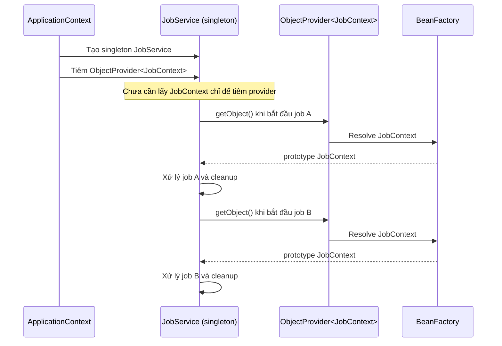

<a id="back-to-top"></a>

# Phụ thuộc khác phạm vi

## Menu
- [Vì sao prototype tiêm trực tiếp vào singleton không đổi mỗi lần gọi](#cross-scope-dependencies-001)
- [Lấy đối tượng đúng thời điểm bằng ObjectProvider](#cross-scope-dependencies-002)
- [Scoped proxy và cách chọn đối tượng đích theo scope](#cross-scope-dependencies-003)
- [ScopedProxyMode.INTERFACES và TARGET_CLASS](#cross-scope-dependencies-004)
- [Giới hạn proxy dựa trên lớp và phương thức có thể chặn](#cross-scope-dependencies-005)
- [Lỗi ScopeNotActiveException khi phạm vi chưa hoạt động](#cross-scope-dependencies-006)
- [Lookup method injection bằng @Lookup](#cross-scope-dependencies-007)
- [Giới hạn @Lookup với lớp final và đối tượng do @Bean tạo](#cross-scope-dependencies-008)
- [Thiết kế, đăng ký và kiểm soát vòng đời Scope tùy biến](#cross-scope-dependencies-009)

## <a id="cross-scope-dependencies-001">Vì sao prototype tiêm trực tiếp vào singleton không đổi mỗi lần gọi</a>

<details>
<summary>Xem chi tiết</summary>

# Vì sao prototype tiêm trực tiếp vào singleton không đổi mỗi lần gọi?

## 1. Vấn đề cần hiểu

Trong Spring Framework Core Container, `singleton` là scope mặc định: đối với một bean definition, container giữ một bean instance để tái sử dụng. `prototype` có nghĩa là **mỗi lần Spring được yêu cầu cung cấp bean prototype**, container tạo một instance mới.

Nghe có vẻ mâu thuẫn khi ta khai báo một bean `prototype`, inject nó qua constructor vào singleton, rồi gọi phương thức singleton nhiều lần mà vẫn nhận cùng instance. Hành vi này **đúng với quy tắc scope**.

> **Câu trả lời cốt lõi:** Spring giải quyết dependency khi nó **tạo và lắp ráp singleton**. Một instance prototype được tạo tại thời điểm đó và được lưu trong field/constructor parameter của singleton. Các lần gọi phương thức của singleton sau này chỉ đọc lại tham chiếu Java đã lưu; chúng không tự trở thành yêu cầu lấy bean mới từ Spring.

Nếu muốn có prototype mới **mỗi lần thực hiện một nghiệp vụ**, phải yêu cầu Spring lấy bean **tại thời điểm nghiệp vụ chạy**, chẳng hạn bằng `ObjectProvider<T>.getObject()` hoặc lookup method.

### Mục tiêu học tập

Sau bài này bạn có thể:

- Phân biệt **mỗi lần container được yêu cầu tạo bean** với **mỗi lần gọi method Java**.
- Giải thích thời điểm dependency được resolve trong constructor injection, field injection và setter injection.
- Quan sát chính xác singleton giữ nguyên một prototype và cách lấy prototype mới theo nhu cầu.
- Chọn giữa direct injection, `ObjectProvider`, `@Lookup` và scoped proxy dựa trên vòng đời cần thiết.
- Tránh lỗi giữ mutable state giữa các lời gọi và hiểu trách nhiệm dọn dẹp prototype.

## 2. Hai scope hoạt động độc lập

Hãy xem hai bean definition:

~~~java
@Component
@Scope(ConfigurableBeanFactory.SCOPE_PROTOTYPE)
class CalculationState {
}

@Service
class CalculationService {
    private final CalculationState state;

    CalculationService(CalculationState state) {
        this.state = state;
    }

    CalculationState currentState() {
        return state;
    }
}
~~~

Đây là **mã minh họa**: cần các import Spring, component scan và application context để chạy. `CalculationState` được khai báo `prototype`; `CalculationService` không có `@Scope` nên mặc định `singleton`.

| Sự kiện | Spring có được yêu cầu cung cấp `CalculationState` mới không? | Kết quả |
| --- | --- | --- |
| Container tạo `CalculationService` và resolve constructor argument | Có | Tạo prototype P1 và inject vào service |
| Gọi `service.currentState()` lần 1 | Không | Trả field đang trỏ P1 |
| Gọi `service.currentState()` lần 2 | Không | Vẫn là P1 |
| Gọi `context.getBean(CalculationState.class)` | Có | Tạo prototype P2 |
| Gọi lại `context.getBean(CalculationState.class)` | Có | Tạo prototype P3 |

Một instance P1 có thể được sử dụng mãi bên trong singleton mà vẫn **không biến bean definition prototype thành singleton**. Nếu nơi khác yêu cầu `CalculationState` từ container, mỗi lần yêu cầu vẫn nhận một prototype mới.

**Scope mô tả cách container trả bean khi được hỏi, không mô tả tần suất gọi method của object đang giữ bean đó.**

## 3. Diễn tiến từ lúc tạo singleton đến khi chạy nghiệp vụ

Với constructor injection, ta có thể biểu diễn thứ tự như sau:

~~~text
ApplicationContext khởi động
        |
        v
Spring đọc bean definition
        |
        v
Spring chuẩn bị tạo CalculationService (singleton)
        |
        +----> Resolve dependency CalculationState
        |                  |
        |                  v
        |          Prototype P1 được tạo
        |                  |
        +<-----------------+
        |
        v
new CalculationService(P1)
        |
        v
Container cache singleton CalculationService
        |
        +---- service.currentState() ---> P1
        +---- service.currentState() ---> P1
        +---- service.currentState() ---> P1
        |
        +---- context.getBean(CalculationState) ---> P2
        +---- context.getBean(CalculationState) ---> P3
~~~

Những điểm quyết định:

1. **Dependency resolution diễn ra tại thời điểm tạo singleton.** Với non-lazy singleton, thời điểm đó thường là trong quá trình khởi tạo Spring context; với lazy singleton, là lúc singleton lần đầu được tạo.
2. Constructor chỉ chạy **một lần cho instance singleton đó**. Nó nhận P1, rồi lưu tham chiếu vào field `state`.
3. `currentState()` là method Java thông thường. Không có `BeanFactory.getBean(...)`, provider, lookup hay proxy nào trong đường gọi này để Spring tạo P2.
4. `@Scope("prototype")` vẫn có hiệu lực khi Spring nhận **yêu cầu mới** cho bean prototype từ provider, BeanFactory hoặc injection point khác.
5. Trong Spring, một singleton là một bean instance **trong một container trên mỗi bean definition**, không nhất thiết là một đối tượng duy nhất trong toàn JVM.

### Constructor, field và setter injection có khác nhau không?

Ba hình thức injection thông dụng đều xảy ra trong quá trình container tạo/cấu hình object:

~~~java
// Constructor injection: prototype được resolve cho constructor.
public WorkerService(WorkState workState) {
    this.workState = workState;
}

// Field injection: prototype được resolve khi Spring populate field.
@Autowired
private WorkState workState;

// Setter injection: prototype được resolve khi Spring gọi setter.
@Autowired
void setWorkState(WorkState workState) {
    this.workState = workState;
}
~~~

Ba đoạn trên minh họa **ba lựa chọn thay thế trong một class**, không ghép nguyên xi cùng một lúc. Cả ba đều không làm Spring inject lại một prototype mới **sau mỗi lần** gọi method nghiệp vụ. Tự gọi một setter với object mới là một hành động Java riêng, không phải đặc tính tự động của prototype.

## 4. Ví dụ chạy được bằng Java 17 và Spring Context 6.1

Đây là ứng dụng Java thuần sử dụng `AnnotationConfigApplicationContext`. Không cần Spring Boot hoặc máy chủ HTTP. Ví dụ chứng minh cả **direct injection giữ một prototype** và **`ObjectProvider` lấy prototype mới** bằng phép so sánh object identity và output xác định.

### 4.1. Cấu trúc thư mục

~~~text
prototype-singleton-demo/
├── pom.xml
└── src/
    └── main/
        └── java/
            └── com/
                └── example/
                    └── demo/
                        └── PrototypeSingletonDemo.java
~~~

### 4.2. `pom.xml`

~~~xml
<?xml version="1.0" encoding="UTF-8"?>
<project xmlns="http://maven.apache.org/POM/4.0.0"
         xmlns:xsi="http://www.w3.org/2001/XMLSchema-instance"
         xsi:schemaLocation="http://maven.apache.org/POM/4.0.0 https://maven.apache.org/xsd/maven-4.0.0.xsd">
    <modelVersion>4.0.0</modelVersion>

    <groupId>com.example</groupId>
    <artifactId>prototype-singleton-demo</artifactId>
    <version>1.0.0</version>

    <properties>
        <maven.compiler.release>17</maven.compiler.release>
        <project.build.sourceEncoding>UTF-8</project.build.sourceEncoding>
    </properties>

    <dependencies>
        <dependency>
            <groupId>org.springframework</groupId>
            <artifactId>spring-context</artifactId>
            <version>6.1.13</version>
        </dependency>
    </dependencies>

    <build>
        <plugins>
            <plugin>
                <groupId>org.apache.maven.plugins</groupId>
                <artifactId>maven-compiler-plugin</artifactId>
                <version>3.13.0</version>
            </plugin>
            <plugin>
                <groupId>org.codehaus.mojo</groupId>
                <artifactId>exec-maven-plugin</artifactId>
                <version>3.3.0</version>
                <configuration>
                    <mainClass>com.example.demo.PrototypeSingletonDemo</mainClass>
                </configuration>
            </plugin>
        </plugins>
    </build>
</project>
~~~

### 4.3. `PrototypeSingletonDemo.java`

~~~java
package com.example.demo;

import java.util.concurrent.atomic.AtomicInteger;

import org.springframework.beans.factory.ObjectProvider;
import org.springframework.beans.factory.config.ConfigurableBeanFactory;
import org.springframework.context.annotation.AnnotationConfigApplicationContext;
import org.springframework.context.annotation.Bean;
import org.springframework.context.annotation.Configuration;
import org.springframework.context.annotation.Scope;

public class PrototypeSingletonDemo {

    public static void main(String[] args) {
        try (AnnotationConfigApplicationContext context =
                     new AnnotationConfigApplicationContext(AppConfig.class)) {

            FixedConsumer fixed = context.getBean(FixedConsumer.class);
            ProviderConsumer dynamic = context.getBean(ProviderConsumer.class);

            JobState fixedFirst = fixed.current();
            JobState fixedSecond = fixed.current();

            JobState dynamicFirst = dynamic.newJob();
            JobState dynamicSecond = dynamic.newJob();

            System.out.println(
                    "Same singleton service: " +
                    (fixed == context.getBean(FixedConsumer.class)));

            System.out.println(
                    "Directly injected prototype reused: " +
                    (fixedFirst == fixedSecond));

            System.out.println(
                    "Direct state counter: " +
                    fixed.process() + ", " + fixed.process());

            System.out.println(
                    "ObjectProvider gives new prototypes: " +
                    (dynamicFirst != dynamicSecond));

            System.out.println(
                    "Two getBean calls give new prototypes: " +
                    (context.getBean(JobState.class) !=
                     context.getBean(JobState.class)));
        }
    }

    @Configuration(proxyBeanMethods = false)
    public static class AppConfig {
        @Bean
        @Scope(ConfigurableBeanFactory.SCOPE_PROTOTYPE)
        public JobState jobState() {
            return new JobState();
        }

        @Bean
        public FixedConsumer fixedConsumer(JobState jobState) {
            return new FixedConsumer(jobState);
        }

        @Bean
        public ProviderConsumer providerConsumer(
                ObjectProvider<JobState> jobStates) {
            return new ProviderConsumer(jobStates);
        }
    }

    public static class JobState {
        private final AtomicInteger steps = new AtomicInteger();

        public int nextStep() {
            return steps.incrementAndGet();
        }
    }

    public static class FixedConsumer {
        private final JobState state;

        public FixedConsumer(JobState state) {
            this.state = state;
        }

        public JobState current() {
            return state;
        }

        public int process() {
            return state.nextStep();
        }
    }

    public static class ProviderConsumer {
        private final ObjectProvider<JobState> jobStates;

        public ProviderConsumer(ObjectProvider<JobState> jobStates) {
            this.jobStates = jobStates;
        }

        public JobState newJob() {
            return jobStates.getObject();
        }
    }
}
~~~

Các class `JobState`, `FixedConsumer` và `ProviderConsumer` được khai báo ở dạng `public static` nested class để gom trọn ví dụ trong một file; các bean thực sự được đăng ký bằng `@Bean` trong `AppConfig`. Để quan sát cùng đối tượng Java, dùng `==`, không dùng `equals()` vì `equals()` có thể được override theo giá trị nghiệp vụ.

`@Configuration(proxyBeanMethods = false)` vẫn hợp lệ ở đây: từng dependency được Spring truyền vào **tham số factory method**, không có lời gọi trực tiếp từ một `@Bean` method sang một `@Bean` method khác.

### 4.4. Lệnh chạy

Cài JDK 17+ và Maven 3.9+, mở terminal tại thư mục chứa `pom.xml` rồi chạy:

~~~bash
mvn -q compile exec:java
~~~

Output chính xác từ các câu lệnh `System.out.println`:

~~~text
Same singleton service: true
Directly injected prototype reused: true
Direct state counter: 1, 2
ObjectProvider gives new prototypes: true
Two getBean calls give new prototypes: true
~~~

Maven có thể ghi thêm thông báo ra stderr tùy môi trường. Năm dòng trên là stdout chủ động của chương trình, có thể đối chiếu trực tiếp.

### 4.5. Giải thích từng kết quả

- **`Same singleton service: true`:** hai lần gọi `context.getBean(FixedConsumer.class)` trả về cùng singleton trong context.
- **`Directly injected prototype reused: true`:** `FixedConsumer` đã lưu một `JobState` trong field. Gọi `current()` hai lần chỉ trả cùng tham chiếu đó.
- **`Direct state counter: 1, 2`:** do cùng target được giữ, số bước tích lũy qua hai lần gọi `process()`. Nếu công việc cần một trạng thái trống mỗi lần, đây có thể là bug nghiệp vụ.
- **`ObjectProvider gives new prototypes: true`:** mỗi lần `getObject()` là một yêu cầu mới đối với prototype, nên hai object khác nhau.
- **`Two getBean calls give new prototypes: true`:** truy xuất bean prototype trực tiếp từ Spring context cũng tạo instance mới mỗi lần.

Việc `FixedConsumer` giữ một prototype không ảnh hưởng đến các lần lấy `JobState` ở nơi khác. Các instance do provider hoặc `context.getBean(...)` tạo không làm thay đổi field `state` đã inject.

## 5. Tình huống thực tế: state của từng lần xử lý bị giữ qua nhiều request

Giả sử có một singleton service quản lý hoạt động xuất báo cáo và một prototype chứa danh sách lỗi của một lần xuất:

~~~java
@Component
@Scope("prototype")
class ExportState {
    private final List<String> errors = new ArrayList<>();

    void addError(String error) {
        errors.add(error);
    }

    int errorCount() {
        return errors.size();
    }
}

@Service
class ExportService {
    private final ExportState state;

    ExportService(ExportState state) {
        this.state = state;
    }

    int export(boolean invalidInput) {
        if (invalidInput) {
            state.addError("Invalid input");
        }
        return state.errorCount();
    }
}
~~~

Đoạn này là **mã minh họa cần import `@Component`, `@Service`, `@Scope` và `java.util`** trong một ứng dụng đã bật component scan. Nếu gọi:

~~~java
service.export(true);
service.export(false);
~~~

Lời gọi thứ hai vẫn có thể trả về `1`, mặc dù input lần hai hợp lệ, vì cùng object `ExportState` được tái sử dụng. Trong ứng dụng web, nhiều request có thể dùng chung singleton service, khiến dữ liệu các request chảy vào cùng object prototype đã bị singleton giữ lâu dài.

Đổi annotation `@Scope("prototype")` sang chuỗi khác hoặc thêm nhiều method xử lý trong service không làm Spring tự inject lại dependency. Cần thay đổi **thời điểm lấy instance**.

## 6. Cách khuyến nghị: inject `ObjectProvider<Prototype>`

`ObjectProvider<T>` thuộc `org.springframework.beans.factory`. Container inject một provider, còn singleton yêu cầu target mới khi logic cần. Cách này giữ constructor injection và dễ kiểm thử.

~~~java
import org.springframework.beans.factory.ObjectProvider;
import org.springframework.stereotype.Service;

@Service
public class ExportService {
    private final ObjectProvider<ExportState> states;

    public ExportService(ObjectProvider<ExportState> states) {
        this.states = states;
    }

    public int export(boolean invalidInput) {
        ExportState state = states.getObject(); // Lấy 1 prototype mới cho lần export.
        if (invalidInput) {
            state.addError("Invalid input");
        }
        return state.errorCount();
    }
}
~~~

Đây là **class minh họa thay thế** cho `ExportService` ở mục 5; không đặt hai định nghĩa cùng tên trong một source file. Khi sử dụng, `ExportState` vẫn phải được Spring đăng ký với `@Scope("prototype")`.

Nếu chạy tuần tự:

~~~java
System.out.println(service.export(true));
System.out.println(service.export(false));
~~~

Kết quả sẽ là:

~~~text
1
0
~~~

Vì mỗi lần `export(...)` bắt đầu bằng một instance `ExportState` mới và chỉ dùng một instance đó trong suốt lần xử lý. Quy tắc thiết kế quan trọng là:

> **Lấy một prototype cho mỗi đơn vị công việc, lưu biến cục bộ và tái sử dụng biến đó trong chính công việc ấy.**

Không gọi `states.getObject()` lặp lại cho từng thao tác đọc/ghi trên cùng trạng thái nếu các thao tác cần làm việc với **cùng một object**:

~~~java
// Sai nếu state cần được chia sẻ giữa hai bước:
states.getObject().addError("E1");
int count = states.getObject().errorCount(); // Object thứ hai: 0

// Đúng: lấy một lần, dùng xuyên suốt một nghiệp vụ:
ExportState state = states.getObject();
state.addError("E1");
int count = state.errorCount(); // 1
~~~

**Lưu ý:** `ObjectProvider.getObject()` không đảm bảo object mới nếu bean target là singleton: chính **scope của target** quy định trả một instance hay nhiều instance. Provider chỉ trì hoãn hành động lookup đến thời điểm gọi.

## 7. Cách khác: `@Lookup` method injection

Spring có thể tự ghi đè một method trong bean do container tạo, để mỗi lần gọi method đó container truy xuất bean theo tên hoặc kiểu trả về. Annotation là `org.springframework.beans.factory.annotation.Lookup`.

~~~java
import org.springframework.beans.factory.annotation.Lookup;
import org.springframework.stereotype.Component;

@Component
public class LookupExportService {

    public int export(boolean invalidInput) {
        ExportState state = createState();
        if (invalidInput) {
            state.addError("Invalid input");
        }
        return state.errorCount();
    }

    @Lookup("exportState")
    protected ExportState createState() {
        // Khi được Spring tạo và xử lý đúng, phương thức này
        // được override bằng lookup do container thực hiện.
        throw new IllegalStateException("Spring lookup was not applied");
    }
}
~~~

Đây là **đoạn minh họa đặt trong ứng dụng có `ExportState` prototype được đăng ký với tên `exportState`** (mặc định khi class `ExportState` được component scan); class phải được Spring tạo qua component scan hoặc cơ chế tạo bean hỗ trợ method injection. Không trực tiếp `new LookupExportService()` rồi kỳ vọng method được Spring thay thế.

Cơ chế:

1. Spring tạo một subclass tại runtime bằng CGLIB.
2. Subclass override `createState()`.
3. Mỗi lần `export(...)` gọi `createState()`, method override lấy `ExportState` từ container.
4. Với bean definition `prototype`, lookup mới trả instance mới.

Các giới hạn cần nhớ:

- Class chứa lookup method và chính method đó không thể là `final`, vì subclass cần override.
- Lookup method **không làm việc trên một instance được trả ra từ `@Bean` factory method**. Spring không tự tạo subclass của object đã được factory method tạo sẵn.
- Method injection phụ thuộc Spring container và làm luồng cấp dependency ít tường minh hơn constructor-injected `ObjectProvider`.
- Đối tượng mà method trả về vẫn tuân theo scope đã khai báo. Nếu `exportState` là singleton, `@Lookup` mỗi lần vẫn có thể trả cùng bean.

Với ứng dụng cần code rõ ràng, dễ unit test, `ObjectProvider<T>` thường dễ hiểu và dễ kiểm soát hơn.

## 8. Cách khác: `ObjectFactory`, `Provider` và `BeanFactory`

Các cơ chế sau cũng thực hiện lookup tại thời điểm cần dùng:

| Cách | Cú pháp ý tưởng | Đặc điểm |
| --- | --- | --- |
| `ObjectProvider<T>` | `provider.getObject()` | API Spring, hỗ trợ lazy/optional access, linh hoạt khi inject |
| `ObjectFactory<T>` | `factory.getObject()` | API Spring tối giản; có thể inject để nhận bean theo nhu cầu |
| `jakarta.inject.Provider<T>` | `provider.get()` | API chuẩn Jakarta Inject, cần dependency `jakarta.inject-api` phù hợp trên classpath |
| `BeanFactory` | `beanFactory.getBean(ExportState.class)` | Hoạt động nhưng service phụ thuộc rõ vào container/service locator |
| `ApplicationContext` | `context.getBean(ExportState.class)` | Truy xuất được nhưng kéo trách nhiệm container vào service |

Ví dụ với `ObjectFactory`:

~~~java
@Service
class FactoryExportService {
    private final ObjectFactory<ExportState> factory;

    FactoryExportService(ObjectFactory<ExportState> factory) {
        this.factory = factory;
    }

    ExportState createState() {
        return factory.getObject();
    }
}
~~~

Đoạn minh họa cần import `ObjectFactory` từ `org.springframework.beans.factory` và các annotation Spring tương ứng. Bean `ExportState` vẫn phải có scope prototype. Cũng như `ObjectProvider`, mỗi lần gọi factory là một yêu cầu mới, nên kết quả phụ thuộc scope được cấu hình.

Không nên giải quyết vấn đề bằng cách gọi `new ExportState()` ngay trong service nếu `ExportState` cần Spring injection, lifecycle callbacks, AOP hoặc các tiện ích của container. `new` tạo đối tượng Java thuần và bỏ qua quản lý bean của Spring.

## 9. Scoped proxy với prototype: dùng được nhưng phải hiểu phạm vi của lời gọi

Một lựa chọn là đăng ký prototype với scoped proxy:

~~~java
@Component
@Scope(
    value = ConfigurableBeanFactory.SCOPE_PROTOTYPE,
    proxyMode = ScopedProxyMode.TARGET_CLASS
)
public class OperationState {
    private String value;

    public void setValue(String value) {
        this.value = value;
    }

    public String getValue() {
        return value;
    }
}
~~~

Đoạn này là class minh họa; cần import `Component`, `Scope`, `ScopedProxyMode` và `ConfigurableBeanFactory`.

Khi inject `OperationState` vào singleton, dependency được giữ thường là **proxy**, không phải một target prototype duy nhất. Proxy sẽ truy xuất target theo scope khi chuyển tiếp lời gọi method. Với prototype, mỗi lần lookup target có thể tạo một object khác; vì vậy:

~~~java
// Mã mô tả tình huống thường gặp với prototype scoped proxy.
operationState.setValue("READY");
String result = operationState.getValue();
~~~

**Không được mặc định `result` là `"READY"`**. Lời gọi `setValue` và `getValue` có thể được chuyển tiếp tới hai target prototype khác nhau. Đây là điểm rất khác so với `@RequestScope` hoặc `@SessionScope`: trong cùng request/session, scope tương ứng thường giữ cùng target cho các lời gọi, còn prototype không có khái niệm cache theo một nghiệp vụ.

Nếu một lần xử lý cần **một state riêng nhưng ổn định qua nhiều method calls**, hãy lấy đúng một object từ `ObjectProvider` và lưu vào biến cục bộ. Prototype scoped proxy phù hợp hơn khi từng lời gọi method cần một target độc lập, không phụ thuộc state đã lưu từ lời gọi trước.

Proxy dựa trên class có giới hạn với class/method `final`; proxy theo interface đòi hỏi điểm inject thích hợp. Việc thêm proxy không làm mutable target tự động thread-safe.

## 10. Còn `@Lazy` thì sao?

`@Lazy` thường điều khiển **thời điểm khởi tạo**, không định nghĩa lại scope từ `prototype` thành một scope khác. Ví dụ:

~~~java
@Component
@Lazy
class ExpensiveService {
    // ...
}
~~~

Đoạn này trì hoãn việc khởi tạo bean (tùy hoàn cảnh đăng ký/lấy bean); không thể suy ra rằng mọi lời gọi phương thức trên bean đó tạo object mới.

`@Lazy` đặt trên injection point có thể tạo một proxy giải quyết dependency khi sử dụng, nhưng đó là **cơ chế lazy-resolution proxy riêng** và hành vi cần xét theo bean target. Dùng `ObjectProvider` khi ý định của bạn là **yêu cầu một prototype mới có chủ đích tại từng lần xử lý**, vì code nêu rõ chỗ lookup và số lần tạo.

Không nhầm ba câu hỏi:

- **Khi nào tạo?** — lazy/eager initialization.
- **Mỗi lần container lookup thì lấy bao nhiêu instance?** — bean scope.
- **Khi nào chương trình thực hiện lookup mới?** — direct injection, provider, lookup method hoặc proxy.

## 11. Đánh đổi về vòng đời và hiệu năng

### 11.1. Prototype không được Spring tự hủy toàn bộ sau khi giao cho client

Spring quản lý quá trình tạo, dependency injection và initialization callback cho prototype, nhưng **không tự chạy destruction callback của từng prototype đã giao cho client** như với singleton lúc đóng context.

~~~java
@Component
@Scope("prototype")
class FileProcessingSession implements AutoCloseable {
    // Giả định class nắm một tài nguyên cần giải phóng.

    @Override
    public void close() {
        // Đóng resource thật tại đây.
    }
}
~~~

Trong code sử dụng, bên nhận phải quản lý tài nguyên sau khi xong công việc, ví dụ `try-with-resources` nếu bean implement `AutoCloseable`:

~~~java
try (FileProcessingSession session = sessions.getObject()) {
    // xử lý bằng session
}
~~~

Đoạn này là minh họa cần có `ObjectProvider<FileProcessingSession> sessions` và một bean prototype đã đăng ký; logic đóng tài nguyên cụ thể tùy nghiệp vụ. Không dựa vào `@PreDestroy` của prototype để tự chạy sau mỗi lời gọi `getObject()`.

### 11.2. Mỗi lần lookup có chi phí

Mỗi prototype mới có thể phải thực hiện constructor, dependency injection, bean post-processing và initialization. Nếu object chỉ là một POJO nhỏ, không có dependency nào của Spring, cân nhắc tạo một **đối tượng Java thông thường** ngay tại tầng nghiệp vụ thay vì tạo Spring bean prototype. Trái lại, nếu cần container quản lý dependency/AOP, dùng factory/provider phù hợp.

### 11.3. Không tự động thread-safe

Một singleton có thể được nhiều request/thread dùng đồng thời. Nếu singleton giữ trực tiếp một prototype có mutable state, trạng thái ấy vẫn bị **chia sẻ giữa các lời gọi trên cùng singleton**, và rất dễ race condition. `prototype` không tự bảo đảm thread-safety.

`ObjectProvider.getObject()` có thể giúp mỗi lần xử lý nhận một state độc lập, nhưng nếu bạn lưu state mới đó vào một field chung của singleton thì vẫn có nguy cơ race. Phạm vi biến cục bộ và cách truyền đối tượng giữa các thread vẫn quyết định độ an toàn.

## 12. Chọn cách nào?

| Yêu cầu thực tế | Phương án phù hợp | Vì sao |
| --- | --- | --- |
| Dependency dùng chung, không mang trạng thái theo lần xử lý | Inject trực tiếp một singleton | Đơn giản, tránh tạo object thừa |
| Tạo một dependency prototype **một lần khi singleton được khởi tạo** rồi giữ lâu | Inject prototype trực tiếp | Đúng nếu chủ đích là giữ instance đó |
| Mỗi lần gọi nghiệp vụ cần một prototype mới, dùng xuyên suốt nhiều bước | Inject `ObjectProvider<T>` và lấy một lần vào biến cục bộ | Rõ thời điểm tạo và phạm vi sử dụng |
| Cần lookup ở một method trên bean do Spring tạo | `@Lookup` | Spring override method để cấp bean lúc gọi |
| Có sẵn abstraction kiểu factory tối giản | `ObjectFactory<T>` hoặc `Provider<T>` | Chỉ yêu cầu bean khi cần |
| Từng lời gọi method phải resolve target theo scope | Scoped proxy | Thích hợp khi semantics của scope khớp nhu cầu |
| Object chỉ là dữ liệu/tính toán thuần Java | Tạo bằng constructor/factory Java thông thường | Tránh phụ thuộc container không cần thiết |

Hãy đặc biệt thận trọng với `@Scope("prototype", proxyMode = ScopedProxyMode.TARGET_CLASS)` nếu công việc gồm nhiều thao tác ghi/đọc liên tiếp trên một state. Đối tượng đích có thể thay đổi giữa các phương thức.

## 13. Checklist chẩn đoán khi prototype “không đổi”

Khi một bean được đánh dấu prototype nhưng thấy nhiều lời gọi cùng sử dụng object, kiểm tra theo thứ tự:

1. **Ai thực hiện lần lookup mới?** Method Java đang gọi có thật sự gọi `ObjectProvider.getObject()`, `@Lookup` hay `BeanFactory.getBean(...)`, hay chỉ đọc một field?
2. **Target scope có thực sự là prototype?** `@Scope` phải áp dụng cho bean definition đang inject, không chỉ một class chưa được container đăng ký.
3. **Singleton được khởi tạo khi nào?** Constructor/field/setter injection thông thường giải quyết dependency tại lúc tạo singleton.
4. **Có bao nhiêu instance được lấy?** Không đánh đồng gọi method nghiệp vụ nhiều lần với gọi container nhiều lần.
5. **Có proxy không?** Phải phân biệt identity của proxy và identity của target; một proxy ổn định không nói rằng mọi method đều chạy trên cùng target.
6. **Có giữ target trong singleton field sau lookup không?** Dù provider lấy target mới một lần, lưu lâu trong singleton lại tạo chia sẻ.
7. **Có nhầm scope với Java equality không?** Kiểm tra bằng `==` hoặc identity phù hợp, không dựa duy nhất vào `equals()` hay một field dữ liệu tình cờ giống nhau.
8. **Có bỏ qua quản lý bean không?** Object tạo bằng `new` bên ngoài container sẽ không nhận scope/injection của Spring.

Một cách kiểm tra ngắn trong Java:

~~~java
JobState fromProvider1 = provider.getObject();
JobState fromProvider2 = provider.getObject();

System.out.println(fromProvider1 == fromProvider2); // false nếu prototype.
~~~

Đoạn minh họa cần `provider` là một `ObjectProvider<JobState>` do Spring cung cấp và `JobState` được đăng ký là prototype. Nếu nhận `true`, kiểm tra bean definition, cách khởi tạo provider và code thực sự đang chạy.

## 14. Câu hỏi tự kiểm tra

**Câu 1:** `@Scope("prototype")` đặt trên `ExportState`, singleton `ExportService` inject `ExportState` qua constructor. Gọi `export()` 100 lần tạo bao nhiêu state cho field constructor đó?

**Đáp án:** Một instance `ExportState` cho lần tạo singleton `ExportService` đó; các lần gọi `export()` thông thường không làm Spring inject lại dependency.

**Câu 2:** Đổi sang inject `ObjectProvider<ExportState>`. Nếu gọi `getObject()` 3 lần trong một method thì có mấy object?

**Đáp án:** Ba instance khác nhau khi bean `ExportState` là prototype và không có proxy/cơ chế trả instance khác; nếu muốn chỉ một instance cho cả method, gọi provider một lần rồi dùng biến cục bộ.

**Câu 3:** `@Lookup` trên một method `final` hoặc method của instance tạo bởi `@Bean` factory có giải quyết được không?

**Đáp án:** Không theo cơ chế lookup-method injection chuẩn: method/class cần cho phép Spring tạo subclass và override; với instance trả từ factory method `@Bean`, Spring không chủ động tạo subclass của instance đó.

**Câu 4:** Tại sao `@Scope("prototype")` không ngăn singleton service vô tình chia sẻ state giữa nhiều thread?

**Đáp án:** Scope chỉ quy định hành vi tạo object lúc lookup. Singleton có thể giữ và chia sẻ cùng một tham chiếu prototype trong field, nên mọi thread truy cập field đó vẫn có thể cùng đọc/ghi một object.

## 15. Tài liệu Spring chính thức

- [Spring Framework Reference — Bean Scopes](https://docs.spring.io/spring-framework/reference/core/beans/factory-scopes.html): `singleton`, `prototype` và tương tác giữa singleton với prototype dependency.
- [Spring Framework Reference — Method Injection](https://docs.spring.io/spring-framework/reference/core/beans/dependencies/factory-method-injection.html): lookup method injection, `@Lookup`, CGLIB và giới hạn với `@Bean` factory methods.
- [Spring Framework Reference — Dependency Injection](https://docs.spring.io/spring-framework/reference/core/beans/dependencies/factory-collaborators.html): thời điểm lắp ráp dependency do container quản lý.
- [Spring Framework Reference — Classpath Scanning and Managed Components](https://docs.spring.io/spring-framework/reference/core/beans/classpath-scanning.html): cách đăng ký bean bằng annotation và semantics liên quan đến `@Bean`.


</details>

- [Quay lại đầu trang](#back-to-top)

---

## <a id="cross-scope-dependencies-002">Lấy đối tượng đúng thời điểm bằng ObjectProvider</a>

<details>
<summary>Xem chi tiết</summary>

# Lấy đối tượng đúng thời điểm bằng ObjectProvider trong Spring

## 1. Vấn đề: bean phụ thuộc có vòng đời khác bean đang sử dụng

Trong Spring Core Container, dependency injection thường giải quyết phụ thuộc khi Spring **tạo đối tượng nhận dependency**. Cách đó phù hợp với những dịch vụ có cùng vòng đời, nhưng cần chú ý khi một bean **singleton** muốn sử dụng một bean **prototype** mới cho từng tác vụ.

Giả sử `ReportService` là singleton, còn `ReportContext` có scope `prototype`. Nếu tiêm trực tiếp `ReportContext` qua constructor, Spring tạo một `ReportContext` khi xây dựng `ReportService`. Singleton giữ lại tham chiếu này; **các lần gọi method về sau không tự động tạo prototype khác**.

```java
@Service
public class ReportService {
    private final ReportContext context;

    public ReportService(ReportContext context) {
        this.context = context; // Resolve một lần khi tạo ReportService.
    }

    public void generate() {
        context.write(); // Dùng lại instance đã tiêm.
    }
}
```

Đây là **mã minh họa trong ứng dụng Spring**, giả định `ReportContext` tồn tại, là prototype bean và có method `write()`. Cần import `@Service`; đoạn này không phải chương trình độc lập. Nếu `context` chứa trạng thái của báo cáo đang xử lý, việc tái sử dụng nó cho nhiều công việc có thể gây sai dữ liệu và vấn đề đồng thời.

Giải pháp thường dùng: **tiêm một `ObjectProvider<ReportContext>` vào singleton**, rồi gọi `getObject()` ngay tại điểm bắt đầu công việc. Khi đó Spring chỉ resolve đối tượng đích ở thời điểm thật sự cần.

```java
@Service
public class ReportService {
    private final ObjectProvider<ReportContext> contexts;

    public ReportService(ObjectProvider<ReportContext> contexts) {
        this.contexts = contexts;
    }

    public void generate() {
        ReportContext context = contexts.getObject(); // Resolve tại đây.
        context.write();
    }
}
```

Đoạn mã này cũng là minh họa tích hợp; cần import `org.springframework.beans.factory.ObjectProvider` và `org.springframework.stereotype.Service`. Nếu `ReportContext` nắm tài nguyên cần đóng, method thực tế phải có trách nhiệm cleanup phù hợp, như ví dụ chạy đầy đủ ở dưới.

**Ý chính:** `ObjectProvider<T>` là một điểm truy xuất đối tượng theo kiểu `T` thông qua Spring `BeanFactory`. Spring cung cấp một provider có thể được tiêm vào các bean khác, cho phép **trì hoãn lookup của đối tượng đích** đến mỗi lần gọi API provider. Việc mỗi lookup tạo mới hay trả cùng instance **vẫn do scope của bean đích quyết định**.

## 2. Cơ chế resolve theo thời điểm



Có hai thời điểm riêng:

1. **Tiêm provider:** Spring tạo singleton `JobService` và cung cấp đối tượng `ObjectProvider<JobContext>`. Việc tiêm provider bản thân nó không đòi phải dựng `JobContext` ngay.
2. **Lấy object đích:** Khi chạy `provider.getObject()`, provider hỏi container để giải quyết bean kiểu `JobContext`. Container áp dụng bean definition, dependency injection, scope và initialization như một lần lấy bean thông thường.

Với `prototype`, mỗi `getObject()` thông thường tạo một instance mới. Với `singleton`, nhiều lần gọi provider trả về cùng singleton do container quản lý. Với `request` hoặc scope khác, lookup tuân theo vòng đời scope đó; gọi ngoài một scope đang hoạt động có thể gây lỗi. Provider **không biến một bean singleton thành prototype** và **không làm mỗi object tự động thread-safe**.

Một điểm tinh tế về “lazy”: tiêm provider trì hoãn **việc chính bean dùng provider yêu cầu lấy đối tượng**. Điều đó không nhất thiết ngăn Spring tạo sẵn một *singleton đích không được đánh dấu lazy* khi context khởi động: singleton eager initialization có thể vẫn diễn ra độc lập. Nếu cần trì hoãn cả việc tạo singleton đích, phải xét `@Lazy` hoặc cấu hình initialization tương ứng.

## 3. Sử dụng API nào của ObjectProvider?

`ObjectProvider<T>` thuộc package `org.springframework.beans.factory`, mở rộng `ObjectFactory<T>` và triển khai `Iterable<T>`. Nó hỗ trợ lookup bắt buộc, dependency tùy chọn và lựa chọn ứng viên.

| API | Trường hợp sử dụng | Khi không có bean đích | Khi có nhiều bean phù hợp mà không chọn được duy nhất |
|---|---|---|---|
| `getObject()` | Phụ thuộc bắt buộc tại thời điểm gọi | Ném `NoSuchBeanDefinitionException` (thuộc nhóm `BeansException`) | Thường ném `NoUniqueBeanDefinitionException` |
| `getIfAvailable()` | Bean có thể vắng mặt | Trả `null` | Vẫn có thể ném `NoUniqueBeanDefinitionException` |
| `getIfAvailable(defaultSupplier)` | Có giá trị mặc định khi vắng bean | Dùng `Supplier` tạo fallback | Vẫn có thể lỗi không duy nhất |
| `ifAvailable(consumer)` | Chỉ xử lý nếu bean tồn tại | Không gọi `Consumer` | Vẫn có thể lỗi không duy nhất |
| `getIfUnique()` | Chỉ lấy khi có ứng viên chọn được duy nhất | Trả `null` | Trả `null` nếu thực sự không thể xác định một ứng viên |
| `getIfUnique(defaultSupplier)` | Fallback khi thiếu ứng viên duy nhất | Dùng fallback | Dùng fallback nếu không có ứng viên duy nhất |
| `ifUnique(consumer)` | Chỉ xử lý khi lựa chọn được duy nhất | Không gọi `Consumer` | Không gọi khi không xác định được duy nhất |
| `stream()` / iterator | Duyệt tất cả bean phù hợp với provider | Stream/iterator rỗng | Duyệt nhiều instance; không bắt buộc chọn một |
| `orderedStream()` | Duyệt nhiều bean theo thứ tự Spring xác định | Stream rỗng | Duyệt theo comparator, có xét `Ordered`/`@Order` khi thích hợp |
| `getObject(args)` | Yêu cầu tạo/resolve với tham số khởi tạo truyền tường minh trong trường hợp được hỗ trợ | Vẫn báo lỗi nếu thiếu bean | Vẫn phải phân giải ứng viên |

Các overload nhận `Supplier<T>`/ `Consumer<T>` thuộc Java 8 functional interfaces. Provider sẽ tra cứu đối tượng mỗi lần dùng các API này; chúng không giữ một bản snapshot cố định của toàn bộ kết quả ngay từ lúc injection. Kết quả cụ thể còn phụ thuộc qualifier, `@Primary`, quy tắc autowire candidate và trạng thái hiện tại của container.

### 3.1. Bắt buộc phải có đối tượng: getObject()

```java
TaskContext current = contexts.getObject();
```

Chọn khi mỗi lần xử lý chắc chắn cần một bean ứng với kiểu/qualifier đang yêu cầu. Không nên nuốt `NoSuchBeanDefinitionException` hay `NoUniqueBeanDefinitionException` để che lỗi cấu hình cốt lõi: hãy khai báo bean phù hợp hoặc làm rõ ứng viên bằng `@Qualifier`/`@Primary` theo yêu cầu thiết kế.

### 3.2. Phụ thuộc tùy chọn: getIfAvailable() và ifAvailable()

```java
public final class MetricsReporter {
    private final ObjectProvider<MetricsClient> metrics;

    public MetricsReporter(ObjectProvider<MetricsClient> metrics) {
        this.metrics = metrics;
    }

    public void record(String event) {
        metrics.ifAvailable(client -> client.record(event));
    }
}
```

Đây là **mã minh họa**: cần import `ObjectProvider` và một interface/class `MetricsClient` có method `record(String)`, đồng thời phải đăng ký `MetricsReporter` dưới dạng Spring bean nếu muốn container inject constructor. Nếu không có `MetricsClient`, có thể bỏ qua việc ghi metric. Nếu có *nhiều* ứng viên mà không chọn được một, `ifAvailable` không phải cơ chế “lấy đại một cái”.

Có thể dùng fallback:

```java
MetricsClient client = metrics.getIfAvailable(() -> new NoopMetricsClient());
```

Mã này là ví dụ theo ngữ cảnh có sẵn kiểu `MetricsClient` và `NoopMetricsClient` hợp lệ. **Fallback tự tạo bởi `Supplier` không mặc nhiên là bean được container quản lý**: nếu fallback cần Spring DI/lifecycle, hãy khai báo/cấu hình theo cách phù hợp.

### 3.3. Phụ thuộc chỉ hợp lệ khi xác định một ứng viên: getIfUnique()

```java
NotificationChannel channel = channels.getIfUnique();
if (channel != null) {
    channel.send("Ready");
}
```

Đây là minh họa khi có `ObjectProvider<NotificationChannel> channels`. Nếu không có ứng viên thì trả `null`. Nếu có nhiều ứng viên nhưng một ứng viên được chọn là duy nhất theo quy tắc resolution (chẳng hạn một `@Primary` hợp lệ), provider vẫn có thể trả instance đó. Nếu các ứng viên vẫn nhập nhằng, `getIfUnique()` trả `null`, khác với `getIfAvailable()` có thể ném lỗi không duy nhất.

**Không dùng `getIfUnique()` để âm thầm bỏ qua một dependency thực sự bắt buộc**: thiếu ứng viên duy nhất thường nên được phát hiện, sửa cấu hình và có test.

### 3.4. Cần nhiều bean: stream() và orderedStream()

```java
public final class DispatchPipeline {
    private final ObjectProvider<DispatchHandler> handlers;

    public DispatchPipeline(ObjectProvider<DispatchHandler> handlers) {
        this.handlers = handlers;
    }

    public void dispatch(Message message) {
        handlers.orderedStream().forEach(handler -> handler.handle(message));
    }
}
```

Mã trên là minh họa tích hợp: cần kiểu `DispatchHandler` với `handle(Message)` và các import tương ứng. `orderedStream()` theo comparator thông dụng của Spring, nên `@Order` hoặc `Ordered` có thể điều khiển thứ tự nếu được cấu hình. `stream()` và iterator **không cam kết thứ tự nghiệp vụ**; đừng dựa vào thứ tự đăng ký nếu yêu cầu chạy pipeline có thứ tự ổn định.

Lưu ý khi duyệt provider chứa prototype: việc duyệt để lấy instance có thể **tạo các prototype mới**. Nếu mỗi instance nắm tài nguyên, cần đóng chúng tương ứng; không xem `stream()` là phép liệt kê metadata vô hại.

## 4. Ví dụ chạy được: singleton lấy một prototype mới cho từng công việc

Ví dụ sau dùng **Spring Framework Core Container thuần**, không cần Spring Boot, servlet hay database. Một `JobService` singleton dùng `ObjectProvider<WorkSession>` để tạo một `WorkSession` prototype riêng cho từng lần thực thi, rồi đóng nó bằng `try-with-resources`.

**Yêu cầu:** Java 17+, Maven 3.9+.

Cấu trúc:

```text
object-provider-demo/
├── pom.xml
└── src/main/java/example/ObjectProviderDemo.java
```

Tệp `pom.xml`:

```xml
<project xmlns="http://maven.apache.org/POM/4.0.0"
         xmlns:xsi="http://www.w3.org/2001/XMLSchema-instance"
         xsi:schemaLocation="http://maven.apache.org/POM/4.0.0
                             https://maven.apache.org/xsd/maven-4.0.0.xsd">
    <modelVersion>4.0.0</modelVersion>
    <groupId>example</groupId>
    <artifactId>object-provider-demo</artifactId>
    <version>1.0.0</version>
    <properties>
        <maven.compiler.release>17</maven.compiler.release>
        <project.build.sourceEncoding>UTF-8</project.build.sourceEncoding>
    </properties>
    <dependencies>
        <dependency>
            <groupId>org.springframework</groupId>
            <artifactId>spring-context</artifactId>
            <version>6.2.0</version>
        </dependency>
    </dependencies>
    <build>
        <plugins>
            <plugin>
                <groupId>org.apache.maven.plugins</groupId>
                <artifactId>maven-compiler-plugin</artifactId>
                <version>3.13.0</version>
            </plugin>
            <plugin>
                <groupId>org.codehaus.mojo</groupId>
                <artifactId>exec-maven-plugin</artifactId>
                <version>3.5.0</version>
            </plugin>
        </plugins>
    </build>
</project>
```

Tệp `src/main/java/example/ObjectProviderDemo.java`:

```java
package example;

import java.util.concurrent.atomic.AtomicInteger;
import org.springframework.beans.factory.ObjectProvider;
import org.springframework.beans.factory.config.ConfigurableBeanFactory;
import org.springframework.context.annotation.AnnotationConfigApplicationContext;
import org.springframework.context.annotation.Bean;
import org.springframework.context.annotation.Configuration;
import org.springframework.context.annotation.Scope;

public class ObjectProviderDemo {
    public static void main(String[] args) {
        try (var context = new AnnotationConfigApplicationContext(Config.class)) {
            JobService jobs = context.getBean(JobService.class);

            jobs.execute("job-A");
            jobs.execute("job-B");

            System.out.println("Same JobService: "
                    + (jobs == context.getBean(JobService.class)));
            System.out.println("Sessions created: "
                    + WorkSession.NEXT_ID.get());
        }
    }

    @Configuration(proxyBeanMethods = false)
    public static class Config {
        @Bean
        @Scope(ConfigurableBeanFactory.SCOPE_PROTOTYPE)
        public WorkSession workSession() {
            return new WorkSession();
        }

        @Bean
        public JobService jobService(ObjectProvider<WorkSession> sessions) {
            return new JobService(sessions);
        }
    }

    public static final class JobService {
        private final ObjectProvider<WorkSession> sessions;

        public JobService(ObjectProvider<WorkSession> sessions) {
            this.sessions = sessions;
        }

        public void execute(String jobName) {
            try (WorkSession session = sessions.getObject()) {
                session.run(jobName);
            }
        }
    }

    public static final class WorkSession implements AutoCloseable {
        private static final AtomicInteger NEXT_ID = new AtomicInteger();
        private final int id = NEXT_ID.incrementAndGet();

        public WorkSession() {
            System.out.println("create session " + id);
        }

        public void run(String jobName) {
            System.out.println("run " + jobName + " using " + id);
        }

        @Override
        public void close() {
            System.out.println("close session " + id);
        }
    }
}
```

Chạy tại thư mục chứa `pom.xml`:

```bash
mvn -q compile exec:java -Dexec.mainClass=example.ObjectProviderDemo
```

Stdout của chương trình (không tính log Maven nếu môi trường hiển thị):

```text
create session 1
run job-A using 1
close session 1
create session 2
run job-B using 2
close session 2
Same JobService: true
Sessions created: 2
```

**Vì sao output này hợp lý?**

1. `JobService` được đăng ký bằng `@Bean` mà không đặt scope khác, nên mặc định là singleton trong context này. Lần `getBean(JobService.class)` sau vẫn nhận cùng tham chiếu.
2. Lúc tạo `JobService`, Spring tiêm `ObjectProvider<WorkSession>`, không tiêm sẵn một `WorkSession` vào field.
3. `execute("job-A")` gọi `sessions.getObject()`, nên tạo `WorkSession` số 1. `execute("job-B")` gọi lại provider và tạo số 2 vì `workSession` thuộc scope prototype.
4. Mỗi session được `try-with-resources` gọi `close()` khi khối hoàn tất. Việc cleanup do code sở hữu prototype đảm nhiệm; Spring không tự destroy prototype khi `ApplicationContext` đóng.
5. `AtomicInteger` tạo ID ổn định để minh họa. Hai job chạy tuần tự; chương trình không thực hiện xử lý đa luồng.

Nếu thay `@Scope(PROTOTYPE)` bằng singleton cho `workSession`, provider sẽ tra cứu cùng singleton giữa các lần gọi; ví dụ cũng không còn phù hợp về **ownership** vì `try-with-resources` sẽ đóng một đối tượng dùng chung sau công việc đầu tiên. Do đó, **không được chỉ đổi scope mà giữ nguyên mọi giả định lifecycle**.

## 5. Dùng ObjectProvider cho dependency có scope khác

### 5.1. Singleton sử dụng prototype

Đây là tình huống tiêu biểu:

```text
Singleton JobService
  -> ObjectProvider<WorkSession>
     -> getObject() khi bắt đầu Job 1 -> WorkSession #1
     -> getObject() khi bắt đầu Job 2 -> WorkSession #2
     -> getObject() khi bắt đầu Job 3 -> WorkSession #3
```

Giữ provider trong singleton là hợp lệ; provider chịu trách nhiệm lookup vào `BeanFactory` mỗi lần gọi. Giữ **kết quả** `getObject()` trong một field singleton suốt vòng đời ứng dụng lại dễ làm mất lợi ích tạo mới theo từng công việc.

Với prototype có tài nguyên bên ngoài (file, socket, client hoặc tài nguyên nội bộ), Spring thực hiện creation/injection/initialization nhưng **không tự gọi destruction callback khi container đóng**. Vì vậy code sử dụng bean phải gọi `close()` hoặc tổ chức cleanup theo đúng vòng đời tác vụ. Không đồng nhất `@PreDestroy` với việc prototype sẽ tự được giải phóng.

### 5.2. Singleton sử dụng request-scoped bean

Trong ứng dụng web, có thể có singleton service cần thông tin thuộc mỗi HTTP request. `ObjectProvider<RequestInfo>` cho phép singleton hỏi bean request scope trong ngữ cảnh request hiện tại:

```java
@Service
public class RequestLogger {
    private final ObjectProvider<RequestInfo> info;

    public RequestLogger(ObjectProvider<RequestInfo> info) {
        this.info = info;
    }

    public void log() {
        RequestInfo current = info.getObject();
        current.writeLog();
    }
}
```

Đây là **mã minh họa** cho ứng dụng web đã đăng ký `RequestInfo` với scope `request`, không phải chương trình độc lập. Trong request hợp lệ, nhiều lookup của request-scoped bean thường tham chiếu cùng instance thuộc request đó. Ngoài phạm vi request đang hoạt động, thao tác `getObject()` có thể ném lỗi kiểu `ScopeNotActiveException`; `getIfAvailable()` cũng không phải cách bảo đảm mọi lỗi scope trở thành `null`.

Nếu service cần truy cập request scope xuyên suốt các tầng, còn có scoped proxy. Chọn provider khi việc truy xuất tại một **điểm cụ thể trong method** làm hành vi rõ ràng; chọn proxy nếu muốn gọi giao diện gần như dependency thông thường và môi trường cho phép. Cả hai giải pháp vẫn phụ thuộc scope đúng lúc được gọi.

### 5.3. Bean tùy chọn theo môi trường

Một ứng dụng có thể cài plugin audit/metrics chỉ ở một số môi trường. Tiêm `ObjectProvider<AuditClient>` cho phép code sử dụng `ifAvailable()` hoặc `getIfAvailable()` khi module audit có bean, đồng thời hoạt động được nếu không có bean tương ứng.

Tuy nhiên, phụ thuộc **không bắt buộc** cần được xác định rõ từ yêu cầu nghiệp vụ. Nếu thanh toán, quyền truy cập hoặc lưu giao dịch bắt buộc phải có thành phần chuyên trách, việc dùng API optional để bỏ qua silently có thể khiến ứng dụng chạy sai mà khó phát hiện.

## 6. Kiểm soát nhiều bean cùng kiểu: @Qualifier và @Primary

Giả sử ứng dụng có hai implementation của `Sender`: `EmailSender` và `SmsSender`. Injection point kiểu `ObjectProvider<Sender>` không chỉ tự động biết nên lấy cái nào. Tùy cấu hình, gọi `getObject()` có thể báo không duy nhất.

Nếu cần rõ đích theo tên/qualifier:

```java
@Service
public class AlertService {
    private final ObjectProvider<Sender> email;

    public AlertService(@Qualifier("emailSender") ObjectProvider<Sender> email) {
        this.email = email;
    }

    public void send(String message) {
        email.getObject().send(message);
    }
}
```

Ví dụ này **chỉ minh họa cách injection**: cần bean `emailSender`, interface `Sender` có `send(String)` và import `@Service`, `@Qualifier`, `ObjectProvider`. Qualifier tại injection point sẽ giới hạn ứng viên được provider xem xét. Nếu gọi `getObject()` nhiều lần trên một `emailSender` singleton, vẫn lấy lại singleton đó; qualifier **không tạo scope mới**.

Với trường hợp nhiều bean nhưng một ứng viên được đánh dấu `@Primary`, thuật toán chọn ứng viên có thể xác định một bean duy nhất theo quy tắc autowiring. `getIfUnique()` xử lý tình huống này linh hoạt hơn suy luận “có hơn một bean => luôn null”. Ngược lại, nếu **không có một ứng viên được chọn duy nhất**, `getIfUnique()` trả `null`, còn `getObject()`/ `getIfAvailable()` có thể ném lỗi không duy nhất.

Nếu cần xử lý **mọi** implementation thay vì một, hãy dùng `stream()` hoặc `orderedStream()`. Thường injection `List<Sender>` là đủ nếu tập dependency cần được xác định ngay lúc tạo bean; provider thích hợp khi muốn trì hoãn truy xuất hoặc cần tính động theo trạng thái hiện tại của container.

## 7. getObject(Object... args): tham số khởi tạo tại thời điểm lookup

API `getObject(args)` hỗ trợ truyền các đối số khởi tạo tường minh tương tự `BeanFactory.getBean(name, args)`. Tình huống thường được cân nhắc là prototype bean có constructor hoặc factory method nhận tham số do caller cung cấp lúc chạy.

```java
InvoiceDraft draft = drafts.getObject(invoiceNumber);
```

Đây là **mã minh họa theo ngữ cảnh** có `ObjectProvider<InvoiceDraft> drafts` và một bean definition có khả năng nhận `invoiceNumber` trong quá trình tạo instance. Phải kiểm chứng phương thức tạo thực tế có hỗ trợ runtime arguments; không phải bean nào cũng có thể nhận args tùy ý. Với singleton đã được tạo sẵn, không thể kỳ vọng mỗi `getObject(args)` thay đổi lại constructor state hoặc tái khởi tạo một singleton có sẵn.

Dùng API này khi số lượng/kiểu constructor arguments được thiết kế rõ ràng. Nếu phần lớn dữ liệu là tham số nghiệp vụ thay đổi liên tục, một factory service thông thường nhận các tham số đó cũng có thể biểu đạt ý định tốt hơn.

## 8. So sánh với các cách lấy dependency khác

| Cách | Khi dependency được resolve | Trường hợp thường dùng |
|---|---|---|
| Inject trực tiếp `T` | Khi tạo bean nhận dependency (trừ cơ chế lazy/proxy) | Cùng lifecycle, dependency luôn tồn tại |
| Inject `ObjectProvider<T>` | Mỗi khi code gọi phương thức lookup của provider | Cần đối tượng đúng thời điểm, optional bean, lookup prototype/request scope, truy xuất nhiều bean |
| Inject `ObjectFactory<T>` | Khi gọi `getObject()` | Hợp đồng factory gọn, không cần các API optional/stream của provider |
| Inject `jakarta.inject.Provider<T>` | Khi gọi `get()` | Muốn dùng chuẩn Jakarta Inject, cần dependency tương ứng |
| `@Lookup` method injection | Khi Spring ghi đè method lookup và code gọi method đó | Muốn trừu tượng hóa việc tìm bean; có hạn chế đối với final class/method và cách khởi tạo bean |
| Scoped proxy | Khi gọi qua proxy trong scope đang hoạt động | Muốn dependency trông như bình thường trong code, ví dụ request scope |
| Tự gọi `ApplicationContext.getBean(...)` | Mỗi lúc tự gọi | Một số điểm tích hợp đặc biệt; khiến code nghiệp vụ phụ thuộc trực tiếp container |

`ObjectProvider` thường hợp lý khi yêu cầu chỉ là lấy dependency *tại thời điểm sử dụng* và muốn constructor vẫn khai báo rõ mọi phụ thuộc. Điều đó giữ thiết kế dựa trên DI mà không phải biến service thành một service locator gọi `ApplicationContext` ở khắp nơi.

Không nhất thiết mọi dependency đều cần provider. Nếu `OrderService` dùng `OrderRepository` singleton và không có yêu cầu tùy chọn/lazy/dynamic lookup, constructor injection trực tiếp dễ đọc và dễ kiểm thử hơn.

## 9. Vòng đời, concurrency và transaction khi resolve muộn

**ObjectProvider không quản lý việc tự hủy prototype.** Với một prototype `AutoCloseable`, `try-with-resources` ở nơi sử dụng sẽ rõ nghĩa. Với một bean scope request, đừng tự đóng resource do request scope/container sở hữu nếu hợp đồng đã giao trách nhiệm cho scope đó. Với singleton, tránh gọi `close()` sau mỗi lookup vì có thể làm hỏng instance chung.

**ObjectProvider không tự bảo đảm thread safety.** Hai thread cùng dùng một `ObjectProvider<WorkSession>` để lấy prototype có thể nhận hai đối tượng khác nhau theo scope, nhưng các shared dependencies vẫn có thể không an toàn đồng thời. Với singleton đích, cả hai thread có thể được trả cùng object như bình thường.

**Resolve đúng thời điểm không có nghĩa truyền transaction context sang thread khác.** Nếu `getObject()` được gọi trong một thread khác, request scope, security context và transaction thread-bound có thể không còn hiệu lực. Cần thiết kế thread boundary, propagation và context activation rõ ràng cho các tác vụ bất đồng bộ.

**Tự tạo object bằng `new` không thay thế hoàn toàn provider.** `new WorkSession()` không mặc nhiên có dependency injection, BeanPostProcessor, configuration hay lifecycle initialization mà Spring áp dụng cho bean. Nếu cần Spring quản lý creation nhưng caller quản lý resource usage, lookup qua provider và close có chủ đích thường thích hợp.

## 10. Lỗi phổ biến và cách xử lý

| Sai lầm | Vì sao sai | Cách sửa |
|---|---|---|
| Inject prototype trực tiếp vào singleton rồi mong nó đổi sau mỗi lần gọi | Injection thường được giải quyết một lần lúc tạo singleton | Inject `ObjectProvider<Prototype>` và gọi `getObject()` trong từng tác vụ |
| Gọi provider một lần trong constructor rồi lưu kết quả vào field | Đã biến dynamic lookup thành một dependency cố định | Lưu provider, chỉ giữ instance trong phạm vi công việc thực tế |
| Cứ gọi `getObject()` là sẽ có object mới | Scope bean đích quyết định; singleton vẫn dùng chung | Kiểm tra `@Scope`/bean definition và thời điểm lookup |
| Dùng `getIfAvailable()` để tránh lỗi nhiều ứng viên | Optional không có nghĩa tự lựa chọn giữa các bean nhập nhằng | Thêm `@Qualifier`/`@Primary`, hoặc dùng `getIfUnique()`/stream phù hợp |
| Dùng `getIfUnique()` để bỏ qua dependency bắt buộc | Lỗi cấu hình bị che bằng `null` | Dùng `getObject()` và sửa cấu hình khi bắt buộc |
| Coi `ObjectProvider` làm mọi singleton hoàn toàn lazy | Singleton khác có thể eager-init khi context refresh | Kết hợp `@Lazy` khi thật sự cần trì hoãn khởi tạo |
| Lấy prototype có connection nhưng không đóng | Spring không tự gọi destruction callbacks của prototype | Chỉ định owner và dùng `try-with-resources`/cleanup đúng vòng đời |
| Lấy request-scoped bean ngoài HTTP request | Không có active scope để resolve | Chỉ gọi trong ngữ cảnh scope hợp lệ hoặc thiết kế truyền dữ liệu rõ ràng |
| Duyệt `stream()` khi mong thứ tự cố định | Stream mặc định không đảm bảo thứ tự nghiệp vụ | Dùng `orderedStream()` với `@Order`/`Ordered` khi cần |
| Lạm dụng provider cho mọi constructor dependency | Khó đọc và che phụ thuộc cần thiết của lớp | Chỉ dùng khi lifecycle/timing/optionality thực sự yêu cầu |

### 10.1. Kiểm tra trong ứng dụng đang chạy

Nếu ứng dụng không tạo đúng đối tượng mong đợi, hãy xác nhận từng điểm:

1. **Bean definition:** `context.isPrototype("beanName")` và `context.isSingleton("beanName")` cho biết scope mà factory xác định cho tên bean; với các custom scope, cần xem định nghĩa tương ứng.
2. **Injection point:** code đang giữ `ObjectProvider<T>` thật sự, hay đã gọi `getObject()` sớm và cache object kết quả?
3. **Thời điểm:** log constructor/initialization để phân biệt lúc singleton được tạo với lúc prototype được resolve.
4. **Ứng viên:** đối chiếu các bean cùng kiểu, qualifier, `@Primary`, trạng thái bean definition và component scanning nếu gặp `NoSuchBeanDefinitionException`/`NoUniqueBeanDefinitionException`.
5. **Scope active:** kiểm tra request/session scope có đang hoạt động khi gọi provider, nhất là khi chạy async hoặc gọi từ scheduler.
6. **Cleanup:** test cả nhánh thành công, thất bại và cancellation để không rò rỉ prototype có tài nguyên.

Tập trung xác nhận **từng lần gọi provider dẫn đến instance nào**, thay vì chỉ đếm số lượng bean class trong toàn JVM.

## 11. Câu hỏi tự luyện

**1. Vì sao singleton inject trực tiếp prototype vẫn thường dùng lại cùng prototype?**  
Vì constructor/field injection cho singleton được giải quyết lúc xây dựng singleton; bean prototype được tạo cho lần resolution đó và được giữ lại trong field.

**2. `ObjectProvider<Prototype>.getObject()` hai lần có luôn cùng object?**  
Với một prototype bean Spring thông thường, hai lần resolve riêng sẽ tạo hai instance khác nhau. Cách phân giải còn phụ thuộc bean definition, factory method và scope thực tế.

**3. `ObjectProvider<Singleton>.getObject()` hai lần thì sao?**  
Thường nhận cùng singleton do container quản lý. Provider trì hoãn lookup, không tự thay scope.

**4. Khi không có bean, `getObject()` khác `getIfAvailable()` thế nào?**  
`getObject()` báo lỗi thiếu bean, còn `getIfAvailable()` trả `null` hoặc dùng `Supplier` fallback nếu sử dụng overload tương ứng.

**5. Khi có hai ứng viên không có ứng viên ưu tiên, `getIfAvailable()` có trả null không?**  
Không nên kỳ vọng như vậy: nó vẫn có thể ném `NoUniqueBeanDefinitionException`. `getIfUnique()` mới hỗ trợ trường hợp không xác định được một ứng viên duy nhất.

**6. Có thể coi `ObjectProvider` là cách để Spring tự đóng prototype không?**  
Không. Provider giúp lấy bean đúng lúc; code sở hữu prototype có tài nguyên vẫn phải quản lý việc đóng đúng vòng đời.

## Tài liệu chính thức

- [Spring Framework 6.2 API — ObjectProvider](https://docs.spring.io/spring-framework/docs/6.2.0/javadoc-api/org/springframework/beans/factory/ObjectProvider.html): hợp đồng và API lookup bắt buộc, tùy chọn, duy nhất và stream.
- [Spring Reference — Bean Scopes](https://docs.spring.io/spring-framework/reference/core/beans/factory-scopes.html): scope singleton, prototype và các web scope.
- [Spring Reference — Scoped Beans as Dependencies](https://docs.spring.io/spring-framework/reference/core/beans/factory-scopes.html#beans-factory-scopes-sing-prot-interaction): vấn đề inject prototype vào singleton.
- [Spring Reference — Using JSR-330 Standard Annotations](https://docs.spring.io/spring-framework/reference/core/beans/standard-annotations.html): cách dùng provider theo chuẩn injection.


</details>

- [Quay lại đầu trang](#back-to-top)

---

## <a id="cross-scope-dependencies-003">Scoped proxy và cách chọn đối tượng đích theo scope</a>

<details>
<summary>Xem chi tiết</summary>

# Scoped proxy trong Spring Core Container: cơ chế chọn target theo scope

## 1. Vấn đề: bean sống dài cần dùng dependency sống ngắn

Trong Spring IoC container, bean có **scope khác nhau** có thời điểm tạo, thời gian tồn tại và quy tắc tái sử dụng khác nhau. Ví dụ, một `CheckoutService` mặc định là `singleton`, còn `CurrentCart` cần tồn tại theo một HTTP session; hoặc `RequestInfo` chỉ tồn tại trong từng HTTP request.

Khi một bean sống dài (ví dụ singleton) nhận **trực tiếp instance** của bean sống ngắn qua constructor, Spring giải quyết dependency tại lúc dựng singleton. Reference đã inject được giữ nguyên. Đây không phải lúc nào cũng là điều mong muốn: singleton phải xử lý nhiều request/session, trong khi dữ liệu phải đúng với **request/session đang thực thi**.

**Scoped proxy** là một đối tượng trung gian do Spring tạo và inject thay cho target thật. Dependency giữ **cùng proxy** qua nhiều lần dùng; mỗi lần gọi phương thức trên proxy, Spring xác định target đang phù hợp với scope, rồi chuyển lời gọi đến target đó.

~~~text
Singleton service
    │ tham chiếu ổn định
    ▼
Scoped proxy (P)
    │ mỗi lần gọi method: tra cứu target theo scope hiện hành
    ▼
Target thực tế
    ├── request A → target R-A
    ├── request B → target R-B
    ├── session S1 → target S1
    └── prototype → target mới ở mỗi lần method invocation
~~~

Cần phân biệt rõ:

- **Proxy**: đối tượng facade do container cấp cho nơi inject; thường tồn tại như một bean singleton trong context.
- **Target**: đối tượng nghiệp vụ thật mà proxy lấy từ container và gọi phương thức.
- **Scope**: quy tắc Spring dùng để quyết định lần tra cứu này phải lấy lại target đã có hay tạo target mới.
- **Scope context**: ngữ cảnh xác định “đang thuộc request nào, session nào, v.v.”. Với web scopes, context phải đang hoạt động trong luồng thực thi tương ứng.

Scoped proxy **không tự chọn target ngẫu nhiên** và không clone target. Nó giải quyết lại bean qua container, để chính scope cung cấp đúng instance.

## 2. Cơ chế hoạt động khi gọi method

Khai báo một bean có scope phù hợp cùng `proxyMode` khiến Spring đăng ký proxy đại diện cho bean đó. Ở mức triển khai, scoped proxy thường dựa vào `ScopedProxyFactoryBean` và một target source; tên nội bộ của bean target có dạng `scopedTarget.<tên-bean>`. Đây là chi tiết hữu ích để đọc log/BeanFactory, không phải API nghiệp vụ cần tự truy cập.

Quy trình logic:

1. Spring khởi tạo singleton cần dependency và **inject proxy P**, chưa cần buộc target request/session phải tồn tại ngay lúc này.
2. Mã gọi `P.process()` khi đang có một scope context phù hợp.
3. Proxy yêu cầu container lấy target thực qua target source, tương đương tra cứu bean target bằng tên.
4. BeanFactory áp dụng quy tắc scope: tạo instance mới hoặc trả instance đã lưu trong scope.
5. Proxy chuyển lời gọi `process()` đến target được tìm thấy; method chạy trên trạng thái của target ấy.
6. Trong lời gọi kế tiếp, proxy **tra cứu lại**. Đối tượng được chọn có thể giống hoặc khác, tùy scope context và loại scope.

~~~text
service.run()
   │
   ▼
proxy.process()
   │
   ▼
BeanFactory → Scope.get(beanName, objectFactory)
                       │
             ┌─────────┴──────────┐
             │ đã có target hợp lệ?│
             └─────────┬──────────┘
                  có   │   chưa
             ┌─────────┴──────────┐
             ▼                    ▼
        trả target cũ       tạo target mới
             └─────────┬──────────┘
                       ▼
                 target.process()
~~~

Sơ đồ minh họa ý nghĩa của scope, **không phải pseudocode tái hiện nguyên xi mọi nhánh nội bộ** của Spring. Với `prototype`, quy tắc là tạo mới mỗi lần container cần target. Với `request` hoặc `session`, scope thường lưu một target cho cùng request/session và trả lại nó ở những lần gọi sau trong phạm vi đó.

Một lần gọi qua proxy có thể chọn một target; **những lời gọi method tiếp theo trên cùng proxy không mặc nhiên dùng lại target trước**. Để có nhiều method thao tác trên đúng một prototype instance, phải lấy và giữ reference target theo nhu cầu, xem mục 7.

## 3. Spring chọn target theo từng loại scope ra sao?

| Scope của bean target | Khóa/ngữ cảnh tái sử dụng | Hai method call trên cùng scoped proxy | Hệ quả |
| --- | --- | --- | --- |
| `singleton` | Cùng một Spring container | Thường cùng target singleton | Scoped proxy thường không có ích |
| `prototype` | Không cache target theo scope | **Target mới cho từng invocation qua proxy** | State sửa ở call trước có thể không còn ở call sau |
| `request` | HTTP request hiện hành | Cùng target trong cùng request; request khác có target khác | Phù hợp thông tin gắn với một request |
| `session` | HTTP session hiện hành | Cùng target trong một session; session khác có target khác | Phù hợp giỏ hàng/trạng thái phiên theo người dùng |
| `application` | `ServletContext` trong web app | Cùng target trong phạm vi web application | Khác `singleton` nếu có nhiều Spring contexts dùng chung `ServletContext` |
| Custom scope | Khóa/lifetime do implementation của `Scope` quy định | Phụ thuộc logic custom scope | Phải đăng ký scope và quản lý context/lifecycle đúng |

Điểm then chốt là **proxy tự nó không mang ý nghĩa “một target mỗi request” hoặc “một target mỗi method”**: chính **scope của target** quyết định kết quả.

### Đối chiếu qua các lượt gọi

~~~text
1) Target scope = prototype
   Proxy P → call #1 → T1
   Proxy P → call #2 → T2
   Proxy P → call #3 → T3       (T1, T2, T3 khác nhau)

2) Target scope = request
   Request A: P → call #1 → RA
              P → call #2 → RA
   Request B: P → call #1 → RB  (RB khác RA)

3) Target scope = session
   Session S1, request A: P → call #1 → TS1
   Session S1, request B: P → call #2 → TS1
   Session S2, request C: P → call #1 → TS2
~~~

Ví dụ session giả định session S1 vẫn hợp lệ và cùng ứng dụng quản lý scope. Khi session hết hạn hoặc bị invalidate, target thuộc session đó kết thúc vòng đời theo cơ chế quản lý của scope.

### Khi không có scope context phù hợp

Inject một request-scoped proxy vào singleton có thể thành công lúc khởi động ứng dụng. Nhưng khi gọi method qua proxy **ngoài một HTTP request đang được ràng buộc** (ví dụ từ `main`, background scheduler, thread tự tạo), Spring không thể tìm target request hợp lệ; thường phát sinh `ScopeNotActiveException` hoặc một ngoại lệ scope nền tương ứng. Scoped proxy chỉ **trì hoãn tra cứu target**, không tự tạo HTTP request giả.

Trong Spring MVC, `DispatcherServlet` giúp thiết lập request context khi xử lý request. Trong môi trường servlet khác, `RequestContextFilter` hoặc `RequestContextListener` có thể hỗ trợ bind request. Không mặc định coi request context sẽ tự truyền sang `@Async`, executor thread hay CompletableFuture chạy ở thread khác.

## 4. Khai báo scoped proxy bằng annotation

Annotation `@Scope` có thuộc tính `proxyMode` với ba lựa chọn cần nhớ:

- `ScopedProxyMode.NO`: không tạo scoped proxy; inject bình thường theo thời điểm dependency được resolve.
- `ScopedProxyMode.TARGET_CLASS`: tạo proxy dựa trên lớp target (CGLIB/subclass). Nơi inject có thể phụ thuộc concrete type nếu lớp/method cho phép proxy.
- `ScopedProxyMode.INTERFACES`: tạo JDK dynamic proxy dựa trên interface. Nơi inject phải dùng kiểu interface mà proxy triển khai.

Đặt scope và proxy mode trên bean definition, chẳng hạn:

~~~java
@Component
@Scope(value = "prototype", proxyMode = ScopedProxyMode.TARGET_CLASS)
public class ReportPart {
    public void render() {
        // ...
    }
}
~~~

Hoặc trên Java configuration:

~~~java
@Bean
@Scope(value = "prototype", proxyMode = ScopedProxyMode.INTERFACES)
public ReportPartApi reportPart() {
    return new ReportPartImpl();
}
~~~

Hai đoạn trên là **mẫu cấu hình độc lập**, giả định lớp/interface có thật, import annotation Spring thích hợp và component scan hoặc config được đăng ký trong context.

Với web scopes, Spring có annotation tiện dụng:

~~~java
@Component
@RequestScope
public class CurrentRequestData {
    public String requestId() {
        return "...";
    }
}

@Component
@SessionScope
public class ShoppingCart {
    // State trong một HTTP session
}
~~~

`@RequestScope` và `@SessionScope` mặc định sử dụng `ScopedProxyMode.TARGET_CLASS`. Có thể viết `@SessionScope(proxyMode = ScopedProxyMode.INTERFACES)` nếu bean implements interface và nơi inject dùng interface đó.

Các đoạn dùng `request`/`session` chỉ có ý nghĩa trong **web-aware ApplicationContext** đang quản lý những scope này. Với plain `AnnotationConfigApplicationContext` không đăng ký request/session scope, cấu hình sẽ không tự biến thành web application.

### Interface proxy và class proxy

| Kiểu | Cơ chế | Cần chú ý |
| --- | --- | --- |
| `INTERFACES` | JDK proxy implements interface | Injection type phải là interface; không thể ép proxy thành concrete implementation |
| `TARGET_CLASS` | CGLIB subclass của class target | Không proxy được class `final`; method `final` hoặc `private` không thể được override/intercept |

Nếu chọn `INTERFACES` nhưng service khai báo constructor `CheckoutService(ShoppingCartImpl cart)`, injection theo implementation có thể thất bại vì proxy chỉ implements `ShoppingCart` interface. Đổi constructor thành `CheckoutService(ShoppingCart cart)` hoặc cân nhắc target-class proxy khi thật sự cần concrete type.

Nếu class target là `final` (đặc biệt gặp ở record), target-class scoped proxy không thể kế thừa class đó. Ưu tiên interface hoặc đổi thiết kế, thay vì cố gắn proxy vào class không proxy được.

Cần bảo đảm các **phương thức nghiệp vụ đi qua proxy** là những method có thể được proxy intercept. Không dựa vào `private` hoặc `final` methods để kích hoạt tra cứu target mới theo scope.

## 5. Ví dụ Java 17 chạy được: prototype proxy được giữ trong singleton

Ví dụ sau cho thấy **reference đến proxy không đổi**, nhưng target của từng lời gọi method trên proxy prototype là object mới. Dùng Spring Framework 6.2.19 và Java 17+. Không cần Spring Boot, web server hay HTTP request.

Cây tệp:

~~~text
scoped-proxy-demo/
├── pom.xml
└── src/main/java/example/ScopedProxyDemo.java
~~~

`pom.xml`:

~~~xml
<project xmlns="http://maven.apache.org/POM/4.0.0"
         xmlns:xsi="http://www.w3.org/2001/XMLSchema-instance"
         xsi:schemaLocation="http://maven.apache.org/POM/4.0.0 https://maven.apache.org/xsd/maven-4.0.0.xsd">
    <modelVersion>4.0.0</modelVersion>
    <groupId>example</groupId>
    <artifactId>scoped-proxy-demo</artifactId>
    <version>1.0.0</version>

    <properties>
        <maven.compiler.release>17</maven.compiler.release>
        <project.build.sourceEncoding>UTF-8</project.build.sourceEncoding>
    </properties>

    <dependencies>
        <dependency>
            <groupId>org.springframework</groupId>
            <artifactId>spring-context</artifactId>
            <version>6.2.19</version>
        </dependency>
    </dependencies>

    <build>
        <plugins>
            <plugin>
                <groupId>org.apache.maven.plugins</groupId>
                <artifactId>maven-compiler-plugin</artifactId>
                <version>3.13.0</version>
            </plugin>
            <plugin>
                <groupId>org.codehaus.mojo</groupId>
                <artifactId>exec-maven-plugin</artifactId>
                <version>3.5.0</version>
            </plugin>
        </plugins>
    </build>
</project>
~~~

`src/main/java/example/ScopedProxyDemo.java`:

~~~java
package example;

import java.util.concurrent.atomic.AtomicInteger;

import org.springframework.beans.factory.config.ConfigurableBeanFactory;
import org.springframework.context.annotation.AnnotationConfigApplicationContext;
import org.springframework.context.annotation.Bean;
import org.springframework.context.annotation.Configuration;
import org.springframework.context.annotation.Scope;
import org.springframework.context.annotation.ScopedProxyMode;

public final class ScopedProxyDemo {
    public static void main(String[] args) {
        try (var context = new AnnotationConfigApplicationContext(Config.class)) {
            JobService service = context.getBean(JobService.class);
            WorkState proxy = service.state();

            System.out.println("Singleton giữ cùng proxy: "
                    + (proxy == service.state()));
            System.out.println("getBean trả cùng proxy: "
                    + (proxy == context.getBean(WorkState.class)));

            int firstId = proxy.instanceId();
            int secondId = proxy.instanceId();
            System.out.println("Hai lời gọi chọn target khác nhau: "
                    + (firstId != secondId));

            proxy.increment();
            System.out.println("Đọc ở lời gọi kế tiếp thấy: " + proxy.value());
        }
    }

    @Configuration(proxyBeanMethods = false)
    public static class Config {
        @Bean
        @Scope(value = ConfigurableBeanFactory.SCOPE_PROTOTYPE,
               proxyMode = ScopedProxyMode.TARGET_CLASS)
        public WorkState workState() {
            return new WorkState();
        }

        @Bean
        public JobService jobService(WorkState workState) {
            return new JobService(workState);
        }
    }

    // Không đặt final: Spring cần tạo subclass làm scoped proxy.
    public static class WorkState {
        private static final AtomicInteger NEXT = new AtomicInteger();
        private final int instanceId = NEXT.incrementAndGet();
        private int value;

        public int instanceId() {
            return instanceId;
        }

        public void increment() {
            value++;
        }

        public int value() {
            return value;
        }
    }

    public static final class JobService {
        private final WorkState state;

        public JobService(WorkState state) {
            this.state = state;
        }

        public WorkState state() {
            return state;
        }
    }
}
~~~

Chạy ở thư mục `scoped-proxy-demo`:

~~~bash
mvn -q compile exec:java -Dexec.mainClass=example.ScopedProxyDemo
~~~

Stdout dự kiến của chương trình (không tính log/chẩn đoán của Maven nếu môi trường in thêm):

~~~text
Singleton giữ cùng proxy: true
getBean trả cùng proxy: true
Hai lời gọi chọn target khác nhau: true
Đọc ở lời gọi kế tiếp thấy: 0
~~~

Vì sao dòng cuối là `0`, không phải `1`? `proxy.increment()` tăng biến `value` trên target prototype của **lời gọi thứ nhất**. `proxy.value()` là một **lời gọi qua proxy khác**, Spring chọn một target prototype mới có `value=0`. Đây là hành vi đúng theo cấu hình, nhưng thường không phù hợp khi muốn duy trì state của một job qua nhiều method call.

`context.getBean(WorkState.class)` trong cấu hình này trả về **proxy của bean `workState`**, không bắt buộc là một target mới cho bên gọi. Nếu lấy bean từ container rồi giữ proxy trong biến cục bộ, mỗi lần gọi method trên biến ấy vẫn tra cứu lại target theo scope.

**Lưu ý về dependency**: `spring-context` trong Maven kéo theo các module Spring cần thiết, bao gồm cơ chế proxy trong Spring AOP. Mã demo là chương trình Java đầy đủ; những ví dụ ngắn khác trong README chỉ minh họa API/cấu hình và có thể cần các import hoặc dependency của ứng dụng thực.

## 6. Scoped proxy với request và session trong ứng dụng web

Một ví dụ thiết kế:

~~~java
public interface CartView {
    int itemCount();
}

// Các class dưới đây là minh họa trong ứng dụng web có component scanning.
@Component
@SessionScope(proxyMode = ScopedProxyMode.INTERFACES)
public class SessionCart implements CartView {
    private int count;

    @Override
    public int itemCount() {
        return count;
    }

    public void addOne() {
        count++;
    }
}

@Service
public class CartSummaryService {
    private final CartView cart;

    public CartSummaryService(CartView cart) {
        this.cart = cart;  // Proxy stable, target được chọn theo session.
    }

    public int currentCount() {
        return cart.itemCount();
    }
}
~~~

Đây là mã minh họa chia thành các type/file phù hợp, không phải một file Java độc lập vì có nhiều `public` type và thiếu các import Spring. Khi người dùng thuộc cùng một HTTP session truy cập hai request liên tiếp, `currentCount()` được proxy chuyển tới target `SessionCart` của session đó. Với hai session khác nhau, hai target khác nhau. `CartSummaryService` vẫn có thể là singleton.

Lưu ý ở ví dụ interface proxy: `CartView` chỉ khai báo `itemCount()`, nên nơi nhận proxy dưới type `CartView` không thể gọi `addOne()` trực tiếp. Nếu cần thao tác thêm hàng, hãy thiết kế cả hành vi đó vào interface hoặc điều chỉnh interface/class proxy phù hợp.

Với request scope:

~~~java
@Component
@RequestScope
public class RequestAudit {
    private final String marker = java.util.UUID.randomUUID().toString();

    public String marker() {
        return marker;
    }
}

@Service
public class AuditService {
    private final RequestAudit audit;

    public AuditService(RequestAudit audit) {
        this.audit = audit;
    }

    public String auditMarker() {
        return audit.marker();
    }
}
~~~

`AuditService` giữ request-scoped proxy. Trong cùng request, hai lần gọi `auditMarker()` nhận cùng `marker` vì scope dùng cùng target. Sang request khác, một target `RequestAudit` khác được tạo với marker khác. Không dùng UUID để lập luận danh tính chắc chắn ở mức toán học; tiêu chí chính xác của scope là **reference identity** của target.

Cả hai ví dụ yêu cầu ứng dụng Spring Web MVC hoặc web-aware container thích hợp; chúng minh họa dependency/scoped proxy, không bao gồm `@Controller` hay cấu hình khởi động web server.

## 7. Chọn scoped proxy hay `ObjectProvider`?

**Scoped proxy** phù hợp khi collaborator muốn gọi một dependency như object bình thường, và một lần gọi method cần tìm target đúng của request/session đang hoạt động. Mã client giữ reference proxy ổn định, không phải tự viết lệnh lookup. Điều này đặc biệt tiện với `request`, `session` hoặc custom scope có caching theo context.

**`ObjectProvider<T>`** phù hợp khi mã nghiệp vụ cần **chủ động quyết định thời điểm lấy bean**, nhất là lúc muốn dùng **cùng một prototype target cho cả một quy trình nhiều bước**.

Ví dụ prototype có state không dùng proxy:

~~~java
@Component
@Scope(ConfigurableBeanFactory.SCOPE_PROTOTYPE)
public class Draft {
    private int lines;

    public void addLine() {
        lines++;
    }

    public int lineCount() {
        return lines;
    }
}

@Service
public class DraftService {
    private final ObjectProvider<Draft> drafts;

    public DraftService(ObjectProvider<Draft> drafts) {
        this.drafts = drafts;
    }

    public int createTwoLineDraft() {
        Draft draft = drafts.getObject(); // Một target prototype thực.
        draft.addLine();
        draft.addLine();
        return draft.lineCount();         // Kết quả: 2.
    }
}
~~~

Đây là các lớp minh họa cho ứng dụng có component scanning, không phải chương trình standalone. Với prototype **không cấu hình scoped proxy** như ví dụ này, mỗi `drafts.getObject()` lấy một target độc lập và bạn giữ nguyên reference `draft` qua các lời gọi.

**Bẫy kết hợp:** nếu `Draft` được cấu hình **scoped proxy**, thì `ObjectProvider<Draft>.getObject()` thường cũng giải quyết **bean proxy** theo tên/type được đăng ký. Bản thân việc gọi provider một lần không đảm bảo “giữ nguyên target prototype” khi sau đó gọi nhiều method trên proxy! Để giữ một target prototype cho cả thao tác, tổ chức một bean prototype **không proxy** để provider lấy trực tiếp; hoặc sử dụng factory API thiết kế riêng cho việc tạo draft.

Bảng lựa chọn:

| Nhu cầu | Lựa chọn thường phù hợp | Vì sao |
| --- | --- | --- |
| Singleton đọc thông tin của **request hiện hành** | `@RequestScope` + scoped proxy | Tự chọn target cho request hiện hành ở từng method call |
| Singleton dùng trạng thái **session hiện hành** | `@SessionScope` + scoped proxy | Cùng target được tái sử dụng qua các request cùng session |
| Mỗi job cần một object mutable; nhiều lời gọi dùng chung object ấy | Unproxied prototype + `ObjectProvider.getObject()` một lần/job | Giữ reference target nhất quán suốt job |
| Đúng một dependency lúc dựng collaborator; không cần đổi theo ngữ cảnh | Inject trực tiếp | Đơn giản, đủ khi lifetime tương thích |
| Mã phải kiểm soát lookup, optional dependency | `ObjectProvider` hoặc `ObjectFactory` | Tường minh thời điểm container tạo/trả bean |

Các phương án khác gồm `jakarta.inject.Provider<T>` hoặc `@Lookup` (lookup-method injection); chúng vẫn dựa vào scope khi thực sự resolve bean. Không phải mọi vấn đề trạng thái đều cần scoped proxy: nếu đối tượng chỉ là dữ liệu Java thuần và không cần DI/lifecycle, tạo object thường có thể đơn giản hơn.

## 8. Những tình huống tinh tế dễ hiểu sai

### 8.1. Self-invocation bên trong target

Giả sử target có `outer()` và `inner()`:

~~~java
public void outer() {
    inner(); // this.inner(): cùng target đang chạy outer().
}
~~~

Sau khi gọi `proxy.outer()`, container đã chọn target cho lần invocation này. Lời gọi `this.inner()` xảy ra **bên trong target**, không quay lại proxy để chọn target khác. Ngược lại, gọi `proxy.outer()` rồi `proxy.inner()` từ bên ngoài là **hai lần đi qua proxy**; với prototype scope, thường nhận hai target khác nhau.

Điều này cùng nguyên lý “self-invocation bỏ qua proxy” của Spring AOP, nhưng ở đây đang xét hậu quả đối với **việc lựa chọn target theo scope**.

### 8.2. Inject proxy và lưu target là hai việc khác nhau

Nếu singleton lưu proxy trong field, mỗi method call thông qua field có thể chọn target phù hợp với context hiện tại. Nếu singleton bằng cách khác tự lấy **target thật** rồi lưu lâu dài vào field, target ấy có thể bị sử dụng ngoài lifetime mong muốn; request/session state có nguy cơ bị giữ hoặc dùng nhầm giữa người dùng.

Đừng suy luận target identity từ `proxy == proxy`, `System.identityHashCode(proxy)` hay `proxy.getClass()`. Những biểu thức đó quan sát **proxy**, không chứng minh target bên dưới giống nhau.

### 8.3. Constructor, init và destroy của target

Tạo proxy lúc dựng context không đồng nghĩa đã tạo target request/session. Target thường được tạo khi scope được truy vấn và chưa có instance phù hợp. Khi target được tạo, Spring vẫn thực hiện wiring, bean post-processing và callback khởi tạo như các bean Spring khác.

- `request`/`session`: vòng đời target và destroy callback gắn với lúc scope kết thúc theo cơ chế container/web framework, trong điều kiện scope đã đăng ký hủy phù hợp.
- `prototype`: Spring khởi tạo và giao instance nhưng **không tự động gọi destroy callback cho từng prototype target** sau khi dùng xong. Nếu giữ tài nguyên cần đóng, thiết kế ownership/cleanup tường minh.
- Proxy không thể tự biến mọi target thành singleton hoặc tự kéo dài lifetime của request/session.

### 8.4. Thread, async và request context

Không giả định “cùng user” có nghĩa request context hiện hành ở mọi thread. Với `@Async`, `ExecutorService`, scheduled task hoặc message listener, thường không có HTTP request được bind vào thread; scoped proxy request có thể không resolve được target. Nếu nghiệp vụ cần request data trong tác vụ async, nên **trích xuất dữ liệu cần thiết** thành giá trị độc lập và truyền vào task, hoặc dùng cơ chế propagate context được cấu hình và kiểm chứng rõ ràng. Không lưu đại trà toàn bộ request/session proxy vào tác vụ kéo dài ngoài web request.

### 8.5. Hệ quả hiệu năng và tính đúng

Mỗi method call đi qua scoped proxy phát sinh bước chọn target; với prototype có thể phát sinh tạo instance thường xuyên. Mô hình “increment ở method A, read ở method B” sai khi hai method chạy trên hai prototype target. Với request/session scope, các lời gọi trong cùng context thường dùng lại target nên mô hình stateful có thể phù hợp hơn.

Lựa chọn scope theo **đơn vị trạng thái cần nhất quán**: request, session, job, hay toàn context; không chọn chỉ vì mong muốn code constructor injection ngắn hơn.

## 9. Lỗi thường gặp và cách xử lý

| Triệu chứng | Nguyên nhân điển hình | Cách xử lý |
| --- | --- | --- |
| Singleton luôn thấy state của request đầu tiên | Inject target sống ngắn trực tiếp, hoặc tự cache target | Inject request-scoped proxy, tránh lưu target ngoài scope |
| Gọi method ngoài HTTP request báo scope không active | Không có request-bound context | Gọi trong lifecycle request hoặc truyền dữ liệu cần thiết sang xử lý nền |
| Prototype proxy “mất state” giữa hai method | Mỗi invocation chọn target prototype mới | Dùng unproxied prototype + provider một lần mỗi job |
| Bean theo interface báo thiếu implementation khi inject concrete type | Chọn `INTERFACES` (JDK proxy) nhưng injection đòi class | Inject theo interface hoặc chọn `TARGET_CLASS` nếu khả thi |
| Class `final`/method `final` không proxy đúng | CGLIB cần subclass/override | Dùng interface proxy, bỏ `final` khi phù hợp, hoặc đổi thiết kế |
| Gọi `new MyBean()` không thấy scope/proxy/AOP | Object được tạo ngoài Spring container | Lấy bean từ Spring hoặc DI theo đúng bean definition |
| Test call request proxy trên plain context thất bại | Chưa đăng ký web scope/context | Dùng web test context/MockMvc hoặc thiết lập mock scope hợp lệ |
| Log cho thấy proxy giống nhau nhưng user data khác | So sánh proxy thay vì target | Kiểm tra identity/state bên trong method target theo từng context |
| Prototype giữ resource không được dọn | Prototype không được Spring tự destroy theo mặc định | Đóng resource theo ownership, không trông chờ context close |

## 10. Checklist thiết kế và tự kiểm tra

Trước khi cấu hình scoped proxy, xác định: **bean nào cần state theo scope**, **bean nào giữ reference lâu hơn**, **mỗi lời gọi method có cần cùng target với lần trước không**, **web/custom scope context đang active ở đâu**, và **bạn đang inject proxy qua interface hay class**.

Một checklist thực hành ngắn:

1. Bean target được khai báo scope đúng (`prototype`/`request`/`session`/custom scope) và thực sự được Spring đăng ký.
2. Đã bật proxy qua `@Scope(proxyMode = ...)` hoặc annotation web phù hợp.
3. Kiểu injection khớp với JDK interface proxy hay CGLIB target-class proxy.
4. Method sử dụng đi qua proxy, không dựa vào `private`/`final` method hoặc self-invocation để chọn target mới.
5. Đã kiểm chứng **cùng request/session dùng cùng target**, và **scope khác nhau dùng target khác nhau**.
6. Nếu dùng prototype stateful, đã chọn cơ chế giữ một target cho **trọn thao tác** khi cần.
7. Đã có chiến lược xử lý thiếu active scope, request context qua async và cleanup tài nguyên.

### Câu hỏi tự kiểm tra

**Câu 1.** Singleton giữ một request-scoped proxy `P`. Trong request A, nó gọi `P.read()` hai lần, sau đó request B gọi một lần. Có bao nhiêu target request tối thiểu cần tạo?

**Đáp án:** Hai target (một cho A, một cho B), giả sử cả hai request đều lần đầu truy cập bean đó và context hoạt động hợp lệ. Hai method call trong request A dùng lại target A.

**Câu 2.** Singleton giữ prototype-scoped proxy `P`. Gọi `P.addItem()` rồi `P.total()`. `total()` nhất thiết thấy item vừa thêm không?

**Đáp án:** Không. Hai lời gọi qua proxy thường chọn hai prototype target khác nhau. Cần một target giữ xuyên suốt thao tác nếu nghiệp vụ yêu cầu state liên tục.

**Câu 3.** Cùng một session có hai HTTP request khác nhau. Session-scoped proxy chọn hai target khác nhau hay giống nhau?

**Đáp án:** Cùng target trong session còn hoạt động, nếu cùng web application/scope và không bị invalidate hay thay đổi scope state.

**Câu 4.** Có thể inject request-scoped proxy vào singleton khi khởi động web app trước request đầu tiên không?

**Đáp án:** Có. Proxy có thể được dựng và inject trước; target request thực chỉ cần được resolve khi có request context. Gọi method ngoài request thì không có target phù hợp và có thể báo lỗi scope.

**Câu 5.** Nếu `@Scope(proxyMode = INTERFACES)` tạo JDK proxy, có thể inject nó như lớp triển khai cụ thể không?

**Đáp án:** Không nên. Proxy JDK triển khai interface, không phải instance của class implementation. Constructor/field cần dùng interface mà proxy hỗ trợ.

## 11. Tài liệu tham khảo

- [Spring Framework Reference — Bean Scopes và Scoped Beans as Dependencies](https://docs.spring.io/spring-framework/reference/core/beans/factory-scopes.html)
- [Spring Framework Reference — Classpath Scanning and Managed Components](https://docs.spring.io/spring-framework/reference/core/beans/classpath-scanning.html)
- [Spring Framework Reference — Proxying Mechanisms](https://docs.spring.io/spring-framework/reference/core/aop/proxying.html)
- [Spring Framework Javadoc — Scope](https://docs.spring.io/spring-framework/docs/current/javadoc-api/org/springframework/context/annotation/Scope.html)
- [Spring Framework Javadoc — ScopedProxyMode](https://docs.spring.io/spring-framework/docs/current/javadoc-api/org/springframework/context/annotation/ScopedProxyMode.html)


</details>

- [Quay lại đầu trang](#back-to-top)

---

## <a id="cross-scope-dependencies-004">ScopedProxyMode.INTERFACES và TARGET_CLASS</a>

<details>
<summary>Xem chi tiết</summary>

# ScopedProxyMode.INTERFACES và ScopedProxyMode.TARGET_CLASS trong Spring Framework

## Mục tiêu học tập

Khi một bean có vòng đời ngắn (ví dụ `request`, `session` hoặc `prototype`) được dùng bởi một bean có vòng đời dài hơn (thường là `singleton`), Spring có thể chèn **scoped proxy** vào nơi phụ thuộc. Hai tùy chọn `ScopedProxyMode.INTERFACES` và `ScopedProxyMode.TARGET_CLASS` quyết định **kiểu proxy được tạo, những kiểu Java nào proxy có thể được inject vào và những phương thức nào được chuyển tiếp**.

Sau bài này, bạn có thể:

1. Giải thích sự khác biệt giữa **proxy ổn định** và **target thay đổi theo scope**.
2. Chọn đúng `INTERFACES` hoặc `TARGET_CLASS` dựa trên hợp đồng interface, kiểu injection và giới hạn của lớp Java.
3. Phân biệt `DEFAULT`, `NO`, `INTERFACES` và `TARGET_CLASS`; hiểu mặc định của `@Scope` khác mặc định của `@RequestScope`/`@SessionScope`.
4. Tự chạy một ứng dụng Spring Boot MVC minh họa hai loại proxy, kiểm tra nhiều lời gọi trong cùng request và nhiều request khác nhau.
5. Chẩn đoán lỗi inject concrete class khi proxy chỉ có interface, lỗi scope không active và lỗi proxy với `final`/`private`.

## 1. Vấn đề: phụ thuộc có scope ngắn hơn bean đang sử dụng

Spring mặc định tạo bean ở phạm vi `singleton`: một instance cho mỗi bean definition trong một IoC container. Nhưng bean `request` tồn tại cho một HTTP request, `session` cho một HTTP session; bean `prototype` được tạo mới mỗi khi container được yêu cầu cung cấp instance.

Xét phụ thuộc sau (đoạn code giải thích ý tưởng, các lớp sẽ được viết đầy đủ ở mục 4):

~~~java
@Service
class OrderService {
    private final RequestIdentity requestIdentity;

    OrderService(RequestIdentity requestIdentity) {
        this.requestIdentity = requestIdentity;
    }

    String currentIdentity() {
        return requestIdentity.value();
    }
}
~~~

`OrderService` mặc định là singleton, trong khi `RequestIdentity` được định nghĩa là request-scoped. Nếu inject trực tiếp **target** khi singleton được tạo, thời điểm startup thường chưa có request; ngay cả khi tạo target thành công trong một request nào đó thì giữ một target cố định cũng không đáp ứng kỳ vọng “mỗi request một instance”.

**Scoped proxy** thay thế tham chiếu trực tiếp đến target bằng một đối tượng trung gian có thể inject lâu dài:

~~~text
Singleton OrderService
         |
         | giữ reference ổn định
         v
     Scoped proxy
         |
         | mỗi lời gọi cần target
         v
  Scope hiện hành (request/session/...)
         |
         +---- Request #1 ---> RequestIdentity target A
         |
         +---- Request #2 ---> RequestIdentity target B
~~~

Trong request #1, các lời gọi qua proxy cùng trỏ đến target A; trong request #2, proxy tìm target B. Cùng một **đối tượng proxy** có thể được singleton giữ lại, nhưng **đối tượng target** do scope quyết định. Proxy **không tự tạo hoặc duy trì HTTP request**; phải có web-aware context và request/session thực sự active khi truy cập target.

Đây là chức năng của **Core Container, IoC và bean scopes**. Nó dùng cơ chế proxy tương tự Spring AOP, nhưng lý do tạo proxy ở đây là **phân giải bean theo phạm vi**, không phải tự động thêm transaction, cache hay aspect nghiệp vụ.

## 2. Bốn giá trị của enum ScopedProxyMode

Import:

~~~java
import org.springframework.context.annotation.ScopedProxyMode;
~~~

| Giá trị | Ý nghĩa | Có tạo scoped proxy? | Khi nào phù hợp? |
| --- | --- | --- | --- |
| `DEFAULT` | Theo mặc định cấu hình của bước đăng ký bean, thường tương đương `NO` nếu không có cấu hình khác | Tùy cấu hình | Khi muốn kế thừa cấu hình scan; cần kiểm tra giá trị thực |
| `NO` | Không dùng scoped proxy | Không | Lấy bean trong đúng scope bằng `ObjectProvider`, lookup trực tiếp hoặc khi dependency có cùng vòng đời thích hợp |
| `INTERFACES` | Tạo JDK dynamic proxy thực thi các interface mà target công khai triển khai | Có | Người dùng phụ thuộc thông qua interface; ưu tiên hợp đồng trừu tượng |
| `TARGET_CLASS` | Tạo proxy theo lớp, dựa trên CGLIB, bằng một subclass của target type | Có | Phải inject theo concrete class hoặc cần expose phương thức không thuộc interface |

**Không nhầm mặc định:**

- `@Scope("request")` tương đương `@Scope(value = "request", proxyMode = ScopedProxyMode.DEFAULT)` nếu không chỉ định riêng; `DEFAULT` **thường** là `NO`.
- `@RequestScope`, `@SessionScope` và `@ApplicationScope` là các annotation chuyên biệt cho web scope; thuộc tính `proxyMode` mặc định là **`TARGET_CLASS`**.
- `@RequestScope(proxyMode = ScopedProxyMode.INTERFACES)` hoặc `@SessionScope(proxyMode = ScopedProxyMode.INTERFACES)` sẽ ghi đè mặc định đó.
- `@Scope(value = "request", proxyMode = ScopedProxyMode.TARGET_CLASS)` nói rõ cả scope và cơ chế tạo proxy.

Vì vậy, không thể kết luận rằng “Spring mặc định dùng JDK proxy khi class có interface” cho **mọi scoped proxy**: ở đây lựa chọn được chỉ định trực tiếp bởi `ScopedProxyMode`. Các mặc định chọn proxy trong những cơ chế AOP khác là vấn đề riêng.

## 3. So sánh INTERFACES và TARGET_CLASS

### 3.1. INTERFACES — JDK dynamic proxy

Khai báo:

~~~java
public interface UserView {
    String displayName();
}

@Component
@RequestScope(proxyMode = ScopedProxyMode.INTERFACES)
public class RequestUserView implements UserView {
    @Override
    public String displayName() {
        return "user-from-current-request";
    }
}
~~~

Các đoạn trong mục 3 chỉ minh họa cấu trúc; mục 4 có dự án biên dịch/chạy độc lập với đầy đủ file và import.

JDK dynamic proxy là một object sinh ra ở runtime, **implements các interface** cần thiết thay vì extends `RequestUserView`. Các lời gọi qua interface được đưa đến bộ xử lý proxy; scoped proxy tìm target phù hợp với scope đang active rồi gọi phương thức của target.

Cách inject đúng:

~~~java
@Service
class UserService {
    private final UserView userView;

    UserService(UserView userView) {
        this.userView = userView;
    }

    String read() {
        return userView.displayName();
    }
}
~~~

**Điểm bắt buộc:** collaborator phải phụ thuộc vào `UserView` (hoặc một interface được proxy expose), không phải `RequestUserView`. Proxy JDK thông thường **không phải** instance của implementation class:

~~~java
// Ý nghĩa kiểu Java:
UserView view = /* proxy được Spring inject */;
// view instanceof UserView       -> true
// view instanceof RequestUserView -> false
~~~

Nếu constructor của singleton yêu cầu `RequestUserView` trong khi bean đó đã được expose dưới dạng JDK interface proxy, Spring không thể dùng proxy để thỏa mãn kiểu concrete class. Lỗi thực tế phụ thuộc điểm injection và cấu hình, thường được bọc trong `UnsatisfiedDependencyException` hoặc có nguyên nhân “bean không đúng kiểu”/“không tìm thấy bean phù hợp”.

JDK proxy cần target thực thi **ít nhất một interface thích hợp**. Nó chỉ expose những phương thức khai báo trên các interface được proxy; một phương thức public chỉ tồn tại ở implementation sẽ không được gọi qua kiểu `UserView` nếu interface không khai báo nó.

Một implementation `final` vẫn có thể được JDK proxy bao bọc **thông qua interface**, vì JDK proxy không cần kế thừa implementation. Điều này khác với class-based proxy.

### 3.2. TARGET_CLASS — CGLIB subclass proxy

Khai báo:

~~~java
@Component
@RequestScope(proxyMode = ScopedProxyMode.TARGET_CLASS)
public class RequestIdentity {
    public String value() {
        return "request-data";
    }
}
~~~

Spring tạo một subclass proxy tương thích với `RequestIdentity` (thường nhận diện bằng tên runtime chứa dấu hiệu `$$SpringCGLIB$$`). Vì proxy là subclass, injection theo concrete class hoạt động:

~~~java
@Service
class IdentityService {
    private final RequestIdentity identity;

    IdentityService(RequestIdentity identity) {
        this.identity = identity;
    }

    String read() {
        return identity.value();
    }
}
~~~

Lựa chọn này thích hợp khi không có interface hoặc API người dùng cần một phương thức của class không nằm trong interface. Nó **không bắt buộc** bạn tự thêm thư viện CGLIB riêng: phiên bản Spring Framework hiện đại đã đóng gói CGLIB trong `spring-core`.

Các giới hạn từ mô hình subclass:

- **`final class` không thể được subclass**, nên không thể tạo CGLIB proxy từ class final.
- **`final method` không thể bị override/intercept**. Đừng gọi một phương thức final và kỳ vọng nó chuyển tiếp đến scoped target như phương thức public có thể override.
- **`private method` không thể override/intercept**; tương tự với một số phương thức package-private không truy cập được từ subclass.
- Với Java modules, visibility/access của các package có thể hạn chế việc sinh subclass proxy; cân nhắc thiết kế module và quyền truy cập phù hợp.
- Trong Kotlin, class và method mặc định final, cần mở rộng phù hợp hoặc chọn interface proxy.

Không nên “sửa” lỗi bằng cách đổi tất cả lớp thành public/non-final vô điều kiện. Trước hết xem xét có thể định nghĩa interface ổn định và dùng `INTERFACES` hay không.

### 3.3. Bảng quyết định

| Câu hỏi | `INTERFACES` | `TARGET_CLASS` |
| --- | --- | --- |
| Proxy Java là gì? | JDK dynamic proxy | Subclass proxy bằng CGLIB |
| Bean target cần implement interface? | Có | Không |
| Có thể inject vào thuộc tính/constructor kiểu interface? | Có, khi interface được expose | Có, nếu class implement interface đó |
| Có thể inject vào kiểu concrete implementation? | Không | Có, vì proxy kế thừa concrete class |
| Gọi phương thức chỉ có trên concrete class? | Không qua interface proxy | Có khi phương thức đủ điều kiện được intercept |
| Target là final class? | Có thể, nếu interface phù hợp | Không |
| Target có public final method cần proxy? | Có thể proxy lời gọi qua interface | Không intercept được final method |
| Proxy tự làm request/session active? | Không | Không |
| Số target theo request/session khác nhau? | Theo scope, như nhau ở cả hai mode | Theo scope, như nhau ở cả hai mode |
| Có cần dependency CGLIB độc lập? | Không | Không trong Spring hiện đại |

**Nguyên tắc chọn:** Nếu API có interface rõ ràng và tất cả nơi sử dụng đều inject theo interface, `INTERFACES` là lựa chọn tốt. Nếu phải inject implementation class, `TARGET_CLASS` phù hợp hơn, miễn class/method có thể proxy. Cả hai không thay đổi lifetime của target.

## 4. Ví dụ chạy độc lập với Java 17 và Spring Boot MVC

Ví dụ cố ý tạo **hai request-scoped beans** và inject cả hai vào một controller singleton: một bean được proxy bằng interface, một bean bằng concrete class. Có thể chạy bằng JDK 17+ và Maven 3.9+.

Cây thư mục:

~~~text
scoped-proxy-demo/
├── pom.xml
└── src/main/java/demo/
    ├── ScopedProxyApplication.java
    ├── Greeting.java
    ├── RequestGreeting.java
    ├── RequestNumber.java
    └── ProxyController.java
~~~

### 4.1. pom.xml

~~~xml
<?xml version="1.0" encoding="UTF-8"?>
<project xmlns="http://maven.apache.org/POM/4.0.0"
         xmlns:xsi="http://www.w3.org/2001/XMLSchema-instance"
         xsi:schemaLocation="http://maven.apache.org/POM/4.0.0 https://maven.apache.org/xsd/maven-4.0.0.xsd">
    <modelVersion>4.0.0</modelVersion>
    <groupId>demo</groupId>
    <artifactId>scoped-proxy-demo</artifactId>
    <version>1.0.0</version>

    <parent>
        <groupId>org.springframework.boot</groupId>
        <artifactId>spring-boot-starter-parent</artifactId>
        <version>3.3.13</version>
        <relativePath/>
    </parent>

    <properties>
        <java.version>17</java.version>
    </properties>

    <dependencies>
        <dependency>
            <groupId>org.springframework.boot</groupId>
            <artifactId>spring-boot-starter-web</artifactId>
        </dependency>
    </dependencies>

    <build>
        <plugins>
            <plugin>
                <groupId>org.springframework.boot</groupId>
                <artifactId>spring-boot-maven-plugin</artifactId>
            </plugin>
        </plugins>
    </build>
</project>
~~~

`spring-boot-starter-web` thiết lập Spring MVC/Servlet web context cho request scope; `spring-context` và `spring-aop` đến từ Spring dependencies. Không cần tự tạo `RequestContextFilter` vì request đến endpoint này được xử lý bởi `DispatcherServlet`.

### 4.2. ScopedProxyApplication.java

~~~java
package demo;

import org.springframework.boot.SpringApplication;
import org.springframework.boot.autoconfigure.SpringBootApplication;

@SpringBootApplication
public class ScopedProxyApplication {
    public static void main(String[] args) {
        SpringApplication.run(ScopedProxyApplication.class, args);
    }
}
~~~

### 4.3. Greeting.java — interface được client nhìn thấy

~~~java
package demo;

public interface Greeting {
    String identity();
}
~~~

### 4.4. RequestGreeting.java — INTERFACES

~~~java
package demo;

import java.util.concurrent.atomic.AtomicInteger;
import org.springframework.context.annotation.ScopedProxyMode;
import org.springframework.stereotype.Component;
import org.springframework.web.context.annotation.RequestScope;

@Component
@RequestScope(proxyMode = ScopedProxyMode.INTERFACES)
public class RequestGreeting implements Greeting {
    private static final AtomicInteger NEXT_ID = new AtomicInteger();
    private final int id = NEXT_ID.incrementAndGet();

    @Override
    public String identity() {
        return "interface=" + id;
    }
}
~~~

Mỗi request có một **target `RequestGreeting`** riêng. Target mới nhận id tăng dần để thấy rõ hai request dùng hai instance khác nhau. Bean được expose cho nơi sử dụng bằng JDK interface proxy; nơi inject cần khai báo kiểu `Greeting`.

### 4.5. RequestNumber.java — TARGET_CLASS

~~~java
package demo;

import java.util.concurrent.atomic.AtomicInteger;
import org.springframework.context.annotation.ScopedProxyMode;
import org.springframework.stereotype.Component;
import org.springframework.web.context.annotation.RequestScope;

@Component
@RequestScope(proxyMode = ScopedProxyMode.TARGET_CLASS)
public class RequestNumber {
    private static final AtomicInteger NEXT_ID = new AtomicInteger();
    private final int id = NEXT_ID.incrementAndGet();

    public String identity() {
        return "class=" + id;
    }
}
~~~

`RequestNumber` không implement interface. Class proxy được inject trực tiếp qua kiểu `RequestNumber`. Phương thức public `identity()` không final, nên proxy có thể intercept và truy cập target thuộc request hiện hành.

### 4.6. ProxyController.java — singleton nhận hai proxy

~~~java
package demo;

import java.lang.reflect.Proxy;
import org.springframework.aop.support.AopUtils;
import org.springframework.http.MediaType;
import org.springframework.web.bind.annotation.GetMapping;
import org.springframework.web.bind.annotation.RestController;

@RestController
public class ProxyController {
    private final Greeting greeting;
    private final RequestNumber number;

    public ProxyController(Greeting greeting, RequestNumber number) {
        this.greeting = greeting;
        this.number = number;
    }

    @GetMapping(value = "/types", produces = MediaType.TEXT_PLAIN_VALUE)
    public String types() {
        boolean jdk = Proxy.isProxyClass(greeting.getClass());
        boolean cglib = AopUtils.isCglibProxy(number);
        return "jdk=" + jdk + ",cglib=" + cglib + "\n";
    }

    @GetMapping(value = "/probe", produces = MediaType.TEXT_PLAIN_VALUE)
    public String probe() {
        String i1 = greeting.identity();
        String c1 = number.identity();
        String i2 = greeting.identity();
        String c2 = number.identity();
        return i1 + "\n" + c1 + "\n" + i2 + "\n" + c2 + "\n";
    }
}
~~~

`ProxyController` không khai báo scope riêng nên là singleton. Constructor nhận hai proxy, không yêu cầu tạo trước hai request-scoped targets. Endpoint `/types` kiểm tra **kiểu proxy** mà chưa gọi phương thức nghiệp vụ của target. Endpoint `/probe` gọi mỗi proxy hai lần trong cùng HTTP request.

### 4.7. Lệnh chạy và kết quả

Tại thư mục `scoped-proxy-demo`:

~~~bash
mvn spring-boot:run
~~~

Mở terminal khác, chạy tuần tự:

~~~bash
curl -s http://localhost:8080/types
curl -s http://localhost:8080/probe
curl -s http://localhost:8080/probe
~~~

Kỳ vọng trong ứng dụng vừa khởi động, không có request nào khác tạo target của hai bean:

~~~text
jdk=true,cglib=true
interface=1
class=1
interface=1
class=1
interface=2
class=2
interface=2
class=2
~~~

`/types` cho thấy đối tượng phía `Greeting` là JDK dynamic proxy, còn phía `RequestNumber` là CGLIB proxy. Mỗi response `/probe` có hai dòng cho cùng target loại interface và hai dòng cho cùng target loại class. Ở request kế tiếp, hai target đổi sang instance mới.

**Phạm vi ý nghĩa của output:** Số `1` và `2` giả định không có request khác đến `/probe`; nếu có request song song, bộ đếm có thể khác. Tính chất quan trọng vẫn là **hai lần gọi cùng bean trong một request cho cùng id; request khác nhận target khác**. Các chuỗi output được ghép bằng newline, nên hiển thị trên terminal không bị dính dòng.

### 4.8. Thử thay đổi để hiểu rõ cơ chế

1. Trong `RequestGreeting`, đổi `INTERFACES` thành `TARGET_CLASS`. Endpoint vẫn hoạt động: CGLIB proxy có thể được inject qua interface `Greeting`, vì subclass của `RequestGreeting` cũng implement `Greeting`. Tuy nhiên `/types` sẽ cho `jdk=false,cglib=true`.
2. Trong `RequestNumber`, thử đổi `TARGET_CLASS` thành `INTERFACES` **mà không thêm interface**. Đây là cấu hình không phù hợp: JDK proxy không thể expose API của class không có interface thích hợp; Spring có thể báo lỗi khi tạo proxy/khởi động hoặc không thể đáp ứng điểm injection concrete class. Kết quả cụ thể phụ thuộc cấu hình/runtime, nên đọc nguyên nhân gốc.
3. Giữ `INTERFACES` cho `RequestGreeting`, sau đó đổi constructor `ProxyController(Greeting greeting, ...)` thành constructor đòi `RequestGreeting greeting`. Proxy JDK không phải `RequestGreeting`; kiểu injection không phù hợp, dù target phía sau là instance `RequestGreeting`.
4. Đặt `final` lên `RequestNumber` trong khi giữ `TARGET_CLASS`. CGLIB không thể kế thừa class final; ứng dụng sẽ gặp lỗi tạo proxy. Đổi sang interface-based proxy (sau khi thêm interface) hoặc bỏ ràng buộc class final khi có lý do thiết kế phù hợp.
5. Thay `@RequestScope(proxyMode = ...)` bằng `@Scope(value = "prototype", proxyMode = ...)` trong một thí nghiệm **riêng**: mỗi lần gọi qua scoped proxy có thể resolve **một prototype target mới**, nên không còn quy tắc “một target cho một request”. Điều này đến từ `prototype` scope, không từ proxy mode.

## 5. Vì sao hai proxy có lifetime khác target?

Spring đăng ký một proxy đứng tại tên bean mà client yêu cầu; bean đích được quản lý riêng theo scope (trong triển khai scoped proxy của Spring thường có bean target nội bộ với tiền tố `scopedTarget.`).

Có thể hình dung:

~~~text
Bean được client inject: greeting
  └── scoped proxy (ổn định)
       └── target lookup theo request (nội bộ: scopedTarget.requestGreeting)
             ├── Request A: target instance #1
             └── Request B: target instance #2
~~~

Tên nội bộ là chi tiết hiện thực, dùng để đọc log/diagnostics; code nghiệp vụ không nên gọi trực tiếp các bean `scopedTarget.*`.

**Hai lớp trách nhiệm:**

- **Proxy mode** định nghĩa hình dạng Java của proxy (`INTERFACES` hay `TARGET_CLASS`) và những lời gọi có thể đi qua nó.
- **Bean scope** định nghĩa cách tạo, tái sử dụng và hủy target (`request`/`session`/`prototype`/custom). Đổi proxy mode **không** đổi quy luật scope.

Ví dụ `@SessionScope(proxyMode = ScopedProxyMode.INTERFACES)` hoạt động với HTTP session thay vì request. Client cần duy trì session cookie; các request thuộc cùng session tìm cùng target cho tới khi session kết thúc. Nếu bean session có mutable state, hãy lưu ý nhiều request đồng thời có thể cùng truy cập target; chọn proxy mode không tự đảm bảo thread-safety.

## 6. @Scope, @RequestScope, @SessionScope, @Bean và component scan

### 6.1. Khai báo bằng @Scope

~~~java
@Component
@Scope(value = "request", proxyMode = ScopedProxyMode.INTERFACES)
class ScopedByInterface implements BusinessApi {
    @Override
    public String execute() {
        return "ok";
    }
}
~~~

Ở đây `BusinessApi` là một interface của ứng dụng (cần khai báo riêng). Đây là cách tường minh khi bạn dùng một scope tên `request` và muốn JDK proxy. Nếu dùng `@Scope("request")` không khai báo `proxyMode`, `DEFAULT` thường không tạo scoped proxy.

### 6.2. Khai báo bằng annotation chuyên biệt

~~~java
@Component
@RequestScope(proxyMode = ScopedProxyMode.INTERFACES)
class PerRequestService implements BusinessApi {
    @Override
    public String execute() {
        return "ok";
    }
}

@Component
@SessionScope(proxyMode = ScopedProxyMode.TARGET_CLASS)
class PerSessionState {
    public String current() {
        return "current";
    }
}
~~~

Các snippet ở mục 6 là ví dụ khai báo trong ứng dụng có package/import thích hợp, **không phải một chương trình standalone**. `@RequestScope` và `@SessionScope` vốn đã có `TARGET_CLASS` làm giá trị mặc định cho `proxyMode`; chỉ cần ghi rõ khi chủ động đổi hoặc muốn nhấn mạnh ý đồ.

### 6.3. Bean đăng ký qua @Bean

~~~java
@Configuration
class AppConfig {
    @Bean
    @Scope(value = "request", proxyMode = ScopedProxyMode.INTERFACES)
    BusinessApi businessApi() {
        return new BusinessImpl();
    }
}
~~~

Ở đây `BusinessImpl implements BusinessApi`, không phải một bean component riêng cùng tên. `@Scope` áp dụng được cho method `@Bean`, không chỉ cho `@Component`. Khi dùng interface proxy, khai báo kiểu API return là interface rõ ràng. Nếu dùng class proxy, bảo đảm class thực tế có thể được subclass và Spring có đủ thông tin kiểu bean.

### 6.4. DEFAULT không phải một “kiểu proxy thứ ba”

`DEFAULT` thể hiện kế thừa mặc định trong metadata/configuration. Trong nhiều trường hợp nó trở thành `NO`, nhưng một component scan có thể cấu hình mặc định khác cho scoped proxy. Vì thế khi đọc code cần đối chiếu cấu hình registration, annotation tổng hợp và giá trị `proxyMode` cuối cùng; **không** kết luận chỉ dựa trên literal `DEFAULT`.

`NO` được chọn khi thực sự không muốn proxy. Nếu singleton cần lấy request-scoped target đúng lúc xử lý request, có thể dùng lookup trì hoãn như `ObjectProvider` thay vì giữ target ngay lúc constructor chạy.

## 7. Khi nào nên dùng ObjectProvider thay vì scoped proxy?

Proxy giúp mã sử dụng rất tự nhiên (`service.operation()`) nhưng vẫn là object trung gian với ràng buộc kiểu. `ObjectProvider<T>` là một giải pháp khác: trì hoãn lookup tới thời điểm cần target.

Ví dụ minh họa, `RequestData` là bean `request` được cấu hình với `proxyMode = ScopedProxyMode.NO`:

~~~java
import org.springframework.beans.factory.ObjectProvider;
import org.springframework.stereotype.Service;

@Service
class ReportService {
    private final ObjectProvider<RequestData> provider;

    ReportService(ObjectProvider<RequestData> provider) {
        this.provider = provider;
    }

    String render() {
        RequestData data = provider.getObject();
        return data.value();
    }
}
~~~

Không có request active, `provider.getObject()` cũng không thể lấy target của request scope. `ObjectProvider` không thay đổi vòng đời target; nó chỉ đưa việc phân giải ra **thời điểm gọi** thay vì constructor injection. Ưu điểm là có thể phụ thuộc vào concrete type ngay cả khi target không được proxy; nhược điểm là ứng dụng phải gọi `getObject()` chủ động.

Trường hợp `prototype`, `ObjectProvider.getObject()` nhiều lần tạo nhiều target mới. Nếu muốn giữ một prototype instance trong suốt một tác vụ cụ thể, **lấy một lần rồi truyền/giữ trong phạm vi tác vụ đó**; không kỳ vọng proxy tự giữ cố định instance cho cả tác vụ.

## 8. Cơ chế lời gọi và những trường hợp không đi qua proxy

### 8.1. Cần có scope đang active

Khi gọi `greeting.identity()` trong controller của ví dụ, Spring đang xử lý HTTP request, nên scope `request` biết target hiện hành. Nếu chuyển lời gọi ấy sang `@Scheduled`, constructor singleton, callback startup hoặc một thread nền không có request context, proxy **vẫn tồn tại** nhưng việc lấy target có thể ném lỗi kiểu:

~~~text
Scope 'request' is not active for the current thread
~~~

Có thể gặp thông báo lồng nhau về `No thread-bound request found`. Kiểm tra nơi gọi, request binding và thread; đổi `INTERFACES` sang `TARGET_CLASS` **không** chữa nguyên nhân “scope chưa active”.

Nếu một bean dùng scope tùy biến mà scope chưa đăng ký, thông báo lại thiên về “No Scope registered for scope name ...”. Cần phân biệt “scope chưa được đăng ký” với “đã đăng ký nhưng không active”.

### 8.2. Lời gọi trong target và self-invocation

Một lời gọi từ object bên ngoài đến proxy được intercept; còn target có thể gọi `this.otherMethod()` nội bộ mà không thực hiện thêm một lượt phân giải target qua proxy. Điều này quan trọng nhất khi lập luận về lời gọi AOP được advice; với scoped proxy, đối tượng đang thực thi đã là target của scope hiện hành.

Ví dụ khái niệm:

~~~java
public String operation() {
    return this.helper(); // Gọi trực tiếp trên target hiện hành.
}
~~~

Cách gọi này không tự tạo thêm một request-scoped instance. Đừng giải thích mọi lời gọi method trong class là một lần tra scope độc lập.

### 8.3. final/private và class proxy

Đối với CGLIB subclass proxy, lời gọi method cần có khả năng bị intercept. Method `final` không thể override; `private` không thể override từ subclass. Một rủi ro thực tế là những phương thức này có thể thực thi ở trạng thái của **proxy object**, không phải scoped target mong muốn. Đừng dựa vào hành vi đó để truy cập state theo request.

Với JDK dynamic proxy, chỉ những lời gọi qua interface được expose mới được intercept. Một target final class vẫn có thể đáp ứng interface proxy, nhưng nếu method không có trên interface, client không thể gọi method ấy qua reference interface.

### 8.4. Proxy không giải quyết hết vấn đề đồng thời

`request` tách dữ liệu giữa request độc lập; `session` có thể được truy cập đồng thời từ hai request cùng session. Dùng `TARGET_CLASS` hay `INTERFACES` không cung cấp đồng bộ hóa, locking, transaction isolation hoặc session distribution. Với mutable state, áp dụng nguyên tắc thread-safety và session persistence phù hợp hệ thống.

## 9. Lỗi phổ biến và cách sửa

| Triệu chứng | Nguyên nhân có thể | Hướng xử lý |
| --- | --- | --- |
| Inject bean request-scoped qua implementation class báo thiếu bean/sai kiểu | Cấu hình `INTERFACES` nên Spring expose JDK proxy, không phải subclass implementation | Inject qua interface hoặc đổi sang `TARGET_CLASS` khi class có thể được subclass |
| Proxy class JDK chỉ thấy các method trong interface | Interface chưa khai báo phương thức cần gọi | Bổ sung vào hợp đồng interface hoặc cân nhắc class proxy |
| `No Scope registered for scope name 'request'` | Dùng context không đăng ký web scopes, ví dụ standalone `AnnotationConfigApplicationContext` | Dùng web-aware Spring context, hoặc scope test được đăng ký phù hợp |
| `Scope 'request' is not active for the current thread` | Resolve target ngoài HTTP request đang được Spring expose | Gọi trong request, truyền data sang background task, hoặc thay thiết kế |
| Startup lỗi vì CGLIB không thể subclass | Bean class `final` hoặc có ràng buộc access/module | Chọn `INTERFACES` nếu có interface hoặc thay đổi thiết kế class |
| Gọi public final method không có kết quả scoped-target mong muốn | `TARGET_CLASS` không intercept được final method | Dùng public overridable method hoặc giao diện với `INTERFACES` |
| Singleton khởi tạo thất bại vì bean request chưa active | Dùng `@Scope("request")` mà không tạo proxy, target bị lấy quá sớm | Dùng `@RequestScope` (mặc định TARGET_CLASS), proxy mode rõ ràng hoặc `ObjectProvider` |
| Cùng một bean session bị ghi dữ liệu chồng chéo | Hai HTTP requests đồng thời cùng truy cập session target | Thiết kế dữ liệu bất biến/đồng bộ truy cập; proxy mode không giải quyết |
| Thấy một proxy được inject nên nghĩ chỉ có một target | Nhầm lifetime proxy với lifetime bean thuộc scope | Theo dõi id target qua các request trong ví dụ |
| `@EnableTransactionManagement(proxyTargetClass = true)` nhưng bean scoped proxy vẫn khó inject | Nhầm lựa chọn proxy cho transaction AOP với metadata scoped proxy | Kiểm tra `@Scope(proxyMode = ...)`/`@RequestScope` của bean và kiểu injection thực tế |

Khi chẩn đoán bean đã được proxy, có thể dùng:

~~~java
import org.springframework.aop.support.AopUtils;

boolean jdkProxy = AopUtils.isJdkDynamicProxy(bean);
boolean classProxy = AopUtils.isCglibProxy(bean);
~~~

Đây là snippet dùng trong method đang có biến `bean`, không phải chương trình riêng. `AopUtils` có thể nhận diện nhiều proxy Spring AOP nói chung, **không chứng minh proxy đó nhất thiết là scoped proxy**. Muốn xác nhận mục đích scoped proxy, hãy xem annotation/bean definition và scope của target.

## 10. Các lưu ý thiết kế

- **Thiết kế dựa trên interface:** Cân nhắc `INTERFACES` nếu client cần hợp đồng ổn định và không phải phụ thuộc implementation class. Nó hữu ích khi implementation có method không public trong API hoặc class final.
- **Phụ thuộc kiểu cụ thể:** `TARGET_CLASS` giữ tính tương thích kiểu concrete class, thuận lợi cho code cũ nhưng phụ thuộc khả năng subclass/override.
- **Không chọn chỉ vì hiệu năng:** Chi phí JDK proxy so với CGLIB proxy thường không phải yếu tố quyết định trong nghiệp vụ web; quy tắc scope, loại injection, correctness và khả năng bảo trì quan trọng hơn.
- **Tránh giữ target ngoài scope:** Không đưa request target vào static field, cache toàn cục hoặc một singleton stateful dùng lại; chỉ giữ proxy hoặc giá trị dữ liệu đã trích xuất đúng lifetime.
- **Không truyền nguyên proxy request sang async worker** nếu worker không có request context; truyền một DTO mang thông tin cần thiết.
- **Không trộn khái niệm proxy mode của scoped bean với lựa chọn proxy toàn cục của AOP**: property cấu hình AOP của Spring Boot và annotation `@EnableAspectJAutoProxy` phục vụ các trường hợp khác; luôn đọc metadata scope trên bean đang xét.
- **Định nghĩa bean rõ ràng:** Tránh đăng ký hai bean cùng trách nhiệm vừa qua component scan vừa qua `@Bean` nếu không có chủ ý; lựa chọn proxy mode không giải quyết ambiguity khi nhiều candidates trùng kiểu.

## 11. Checklist lựa chọn và kiểm thử

1. Xác định bean đích thực sự thuộc scope nào (`request`, `session`, `prototype`, v.v.).
2. Xác định người dùng bean sẽ inject theo **interface** hay **concrete class**.
3. Nếu inject theo interface và target implement interface công khai: thử `INTERFACES`.
4. Nếu inject theo concrete class và class/method có thể subclass/override: thử `TARGET_CLASS`.
5. Không suy đoán mặc định: `@Scope` mặc định `DEFAULT` thường là `NO`, trong khi `@RequestScope`/`@SessionScope` mặc định `TARGET_CLASS`.
6. Xác nhận trong thử nghiệm có scope active khi gọi bean; thử cả request đầu tiên lẫn request kế tiếp.
7. Kiểm tra hai lời gọi trong cùng request và hai request khác nhau; kết quả phải tuân theo target scope, không theo proxy mode.
8. Kiểm tra class final, final/private methods, type mismatch và request bị mất khi thực thi trên thread nền.
9. Dùng `Proxy.isProxyClass(...)` hoặc `AopUtils` để xác nhận proxy type khi chẩn đoán; đối chiếu với metadata scope để tránh nhầm loại proxy khác.
10. Dùng `ObjectProvider<T>` nếu cần lookup chủ động hoặc muốn tránh giới hạn kiểu của scoped proxy.

## 12. Tự kiểm tra kiến thức

**Câu 1.** Vì sao một singleton có thể nhận `@RequestScope` bean lúc startup dù chưa có HTTP request?  
**Đáp:** Singleton nhận **proxy**, chưa cần tạo target. Khi code gọi phương thức qua proxy trong request, Spring mới tìm target của request hiện tại.

**Câu 2.** Với `@RequestScope(proxyMode = ScopedProxyMode.INTERFACES)`, một bean `CheckoutImpl implements Checkout` nên được inject bằng `Checkout` hay `CheckoutImpl`?  
**Đáp:** Dùng `Checkout`, vì JDK proxy implements interface mà không extends `CheckoutImpl`.

**Câu 3.** `@RequestScope` không khai báo `proxyMode` tương đương `@Scope("request")` không khai báo `proxyMode` chứ?  
**Đáp:** Không. `@RequestScope` mặc định `TARGET_CLASS`; `@Scope` mặc định `DEFAULT`, thường tương đương `NO` nếu không có default override.

**Câu 4.** Có thể dùng `TARGET_CLASS` cho class final không?  
**Đáp:** Không, vì CGLIB phải tạo subclass. Nếu có interface phù hợp, có thể dùng `INTERFACES`.

**Câu 5.** Chuyển `INTERFACES` sang `TARGET_CLASS` có sửa lỗi “request scope is not active” không?  
**Đáp:** Không. Lỗi phát sinh vì không có request scope active khi resolve target; kiểu proxy không tạo thêm request.

**Câu 6.** Với `@Scope(value = "prototype", proxyMode = TARGET_CLASS)`, tại sao hai lời gọi trên cùng proxy có thể đi đến hai targets?  
**Đáp:** Proxy phân giải target từ scope khi gọi; scope prototype trả instance mới theo lần lookup. Điều này khác request scope, nơi lookup trong cùng request sẽ trả cùng target.

**Câu 7.** Vì sao một phương thức final trên class-based proxy có thể gây lỗi logic dù chương trình biên dịch?  
**Đáp:** CGLIB subclass không override/intercept được final method. Không có bảo đảm lời gọi đó chuyển tiếp đúng tới scoped target; thiết kế API qua method có thể intercept hoặc qua interface.

## Tài liệu tham khảo chính thức

- Spring Framework Reference — [Bean Scopes; Scoped Beans as Dependencies](https://docs.spring.io/spring-framework/reference/core/beans/factory-scopes.html).
- Spring Framework Reference — [Using the @Bean Annotation: @Scope and scoped-proxy](https://docs.spring.io/spring-framework/reference/core/beans/java/bean-annotation.html).
- Spring Framework Reference — [Classpath Scanning and Managed Components](https://docs.spring.io/spring-framework/reference/core/beans/classpath-scanning.html).
- Spring Framework Reference — [Proxying Mechanisms](https://docs.spring.io/spring-framework/reference/6.2/core/aop/proxying.html).
- Spring Framework Javadoc — [ScopedProxyMode (6.2)](https://docs.spring.io/spring-framework/docs/6.2.16/javadoc-api/org/springframework/context/annotation/ScopedProxyMode.html).
- Spring Framework Javadoc — [RequestScope (6.1)](https://docs.spring.io/spring-framework/docs/6.1.13/javadoc-api/org/springframework/web/context/annotation/RequestScope.html).


</details>

- [Quay lại đầu trang](#back-to-top)

---

## <a id="cross-scope-dependencies-005">Giới hạn proxy dựa trên lớp và phương thức có thể chặn</a>

<details>
<summary>Xem chi tiết</summary>

# Giới hạn proxy dựa trên lớp và phương thức có thể chặn trong Spring Framework

## 1. Bối cảnh: dependency khác scope và tại sao Spring cần proxy

Trong Spring IoC Container, bean `singleton` được tạo một lần cho mỗi bean definition trong một container, còn bean `prototype` được tạo mỗi lần Spring thực sự yêu cầu tạo instance. Các web scope như `request` và `session` giữ instance theo request hoặc HTTP session. Khi singleton phụ thuộc trực tiếp vào một bean có vòng đời ngắn hơn, cần xác định **thời điểm** Spring chọn target của dependency.

Xét thiết kế:

```java
@Service
class ReportService {
    private final UserContext userContext;

    ReportService(UserContext userContext) {
        this.userContext = userContext;
    }

    String report() {
        return userContext.currentUser();
    }
}
```

`UserContext` ở đây là bean đại diện dữ liệu từng request; đoạn mã minh họa này không chạy độc lập vì thiếu định nghĩa `UserContext` và import. Nếu inject **target thật** khi tạo `ReportService` singleton, ta gặp lệch vòng đời: lúc khởi tạo singleton có thể chưa có HTTP request, hoặc singleton có nguy cơ giữ trạng thái một request quá lâu. Với **scoped proxy**, singleton nhận một reference ổn định; proxy tìm target tương ứng với scope đang hoạt động vào thời điểm gọi phương thức.

```text
                         Spring IoC Container
                               |
                          ReportService
                          (singleton)
                               |
                               v
                    UserContext scoped proxy
                               |
            +------------------+------------------+
            |                                     |
     HTTP request A                          HTTP request B
       target A                                target B

Singleton giữ PROXY lâu dài;
proxy chọn TARGET theo request khi gọi method có thể chặn.
```

Điều này có hai hệ quả thiết kế:

1. Proxy phải đứng ở **ranh giới lời gọi**: chỉ các lời gọi đi qua proxy và vào những phương thức có thể được proxy chặn mới được chuyển hướng đúng.
2. Loại proxy quyết định bean có thể được biểu diễn dưới dạng class hay interface và các phương thức nào có thể được chặn.

Đối với request/session scope, `@RequestScope` và `@SessionScope` có `proxyMode` mặc định là `ScopedProxyMode.TARGET_CLASS`. Đối với `@Scope("prototype")` thông thường, không mặc định tạo scoped proxy; có thể yêu cầu bằng thuộc tính `proxyMode`. Một prototype có scoped proxy sẽ được tạo target mới **theo từng lần gọi phương thức được proxy chuyển tiếp**, vì mỗi lần resolve prototype là một lần tạo mới. Vì vậy một quy trình cần cùng một target xuyên suốt nhiều method call thường hợp với `ObjectProvider` hơn.

## 2. Proxy dựa trên lớp (class-based proxy / CGLIB) hoạt động như thế nào?

Khi chọn `ScopedProxyMode.TARGET_CLASS`, Spring tạo proxy có thể gán được vào kiểu class của target. Thông thường Spring dùng CGLIB, tạo ra **lớp con tại runtime** (CGLIB được repackaged trong `spring-core`). Proxy ghi đè các instance method có thể override; mã chặn được tạo bởi Spring có thể resolve scoped target trước khi chuyển lời gọi.

```text
class UserContext
      ▲
      | extends
class UserContext$$SpringCGLIB$$...     (proxy, tên class chỉ minh họa)
      |
      +-- public String currentUser()  → intercept → scoped target.currentUser()

class UserContext (scoped target thật)
      |
      +-- logic nghiệp vụ và trạng thái theo request/session
```

Ví dụ annotation tạo class proxy:

```java
import org.springframework.context.annotation.Scope;
import org.springframework.context.annotation.ScopedProxyMode;
import org.springframework.stereotype.Component;

@Component
@Scope(value = "request", proxyMode = ScopedProxyMode.TARGET_CLASS)
public class UserContext {
    public String currentUser() {
        return "user-of-current-request";
    }
}
```

Class trên minh họa syntax, nhưng chỉ chạy đúng trong Spring web-aware context với request thực. Class proxy cho phép injection bằng `UserContext` (concrete type), vì proxy là subtype của `UserContext`.

**Không nhầm lẫn hai vai trò:**

- `Scoped proxy` chủ yếu chọn đúng target theo scope, ví dụ HTTP request.
- `Spring AOP proxy` có thể áp dụng advice như transaction, cache, security, logging vào các method call được hỗ trợ.

Cả hai dùng cơ chế proxy và cùng chịu giới hạn override/interface. Tuy nhiên hành vi nghiệp vụ khác nhau: bỏ qua proxy AOP có thể mất advice; bỏ qua scoped proxy có thể không resolve đúng target trong scope. Cũng không nên nhầm lớp CGLIB hỗ trợ `@Configuration(proxyBeanMethods=true)` (intercept lời gọi đến method `@Bean`) với scoped proxy được nói đến ở đây; chúng có mục đích cấu hình khác nhau.

## 3. Phương thức nào CGLIB có thể chặn?

Điều kiện nền tảng là một lớp con Java có thể **override** method và Spring có thể tiếp cận method qua proxy. Bảng dưới đây giả định Spring dùng class-based proxy, không dùng AspectJ weaving.

| Thành phần Java | CGLIB class proxy chặn được? | Lý do / lưu ý |
| --- | --- | --- |
| `public` instance method, không `final` | **Có**, trường hợp chuẩn | Subclass override và chuyển lời gọi qua interceptor |
| `protected` instance method, không `final` | **Có thể**, nếu method truy cập được | Việc advice cụ thể còn chịu chính sách/matching của từng Spring facility |
| package-private instance method | **Tùy khả năng truy cập** | Method không visible với subclass ở package khác là bất khả override; nên cung cấp public API khi proxy là chủ ý |
| `public final` hoặc `protected final` method | **Không** | `final` cấm override, vì thế không thể chặn qua subclass |
| `private` method | **Không** | Method private không được kế thừa để override |
| `static` method | **Không** theo proxy instance | Gọi tĩnh được bind theo class, không dispatch đến override của proxy |
| Constructor | **Không** | Constructor không phải instance method có thể override |
| Toàn bộ class `final` / Java `record` | **Không tạo được class proxy** cho class đó | Lớp con không thể `extends` class `final` |
| `abstract` instance method | Có thể bị override về mặt Java, nhưng cần target hiện thực cụ thể | Không xem là cách vượt qua yêu cầu về bean instance có thể tạo |
| Method chỉ có trên implementation, không có trong interface | CGLIB **có thể** chặn nếu overridable | JDK interface proxy chỉ cung cấp method qua interface |

Điểm cần cẩn trọng với method không public: từ Spring Framework 6.x, một số tiện ích AOP như transaction có thể hỗ trợ protected/package-private trên class-based proxy; nhưng **khả năng kỹ thuật CGLIB override** và **quy tắc annotation/advisor có áp dụng** là hai bước riêng. Trước khi dựa vào chúng, kiểm tra tài liệu của annotation cụ thể và thử trên phiên bản Spring hiện dùng. Public method qua proxy là lựa chọn rõ ràng nhất.

### 3.1. Lớp final và record

```java
@Scope(value = "request", proxyMode = ScopedProxyMode.TARGET_CLASS)
@Component
public final class FinalRequestContext {
    public String userId() {
        return "U1";
    }
}
```

Đoạn trên cần import `Scope`, `ScopedProxyMode` và `Component`; nó cố ý minh họa cấu hình **không hợp lệ**. Spring không thể sinh subclass cho `FinalRequestContext` vì class là `final`. Khi cần khởi tạo proxy, ứng dụng có thể gặp lỗi tạo bean, thường kèm `AopConfigException`/lỗi CGLIB trong chuỗi nguyên nhân; không dựa vào text ngoại lệ chính xác vì khác phiên bản và kiểu cấu hình.

`record` trong Java cũng là class `final`, nên không dùng record như một class-based scoped proxy target. Record rất tốt làm immutable value trả về từ service; có thể cho một service thông thường trả về record mỗi request thay vì biến chính record thành scoped bean cần subclass.

Kotlin mặc định tạo class/method `final` nếu không đánh dấu `open`. Khi tích hợp Spring, cần bảo đảm các class/method dùng class proxy có thể được mở rộng; plugin Kotlin Spring/all-open có thể hỗ trợ trong các trường hợp được cấu hình.

### 3.2. final method: proxy có thể được tạo nhưng method không được chuyển tiếp như mong đợi

```java
public class RequestData {
    private final String token = "stored-in-real-target";

    public String ordinaryMethod() {
        return token;
    }

    public final String finalMethod() {
        return token;
    }

    private String helper() {
        return token;
    }

    public String ordinaryCallsPrivate() {
        return helper();
    }
}
```

Nếu một scoped class proxy kế thừa `RequestData`:

- `ordinaryMethod()` có thể được intercept và chuyển đến target tương ứng của scope.
- `finalMethod()` **không thể override**, do đó lời gọi vào proxy không được interceptor scoped target chuyển tiếp theo cách bình thường. Nó có thể chạy method kế thừa ngay trên **đối tượng proxy**, nên trạng thái đọc được có thể không phải trạng thái của target thật. Không được dựa vào việc trả về `token` của method đó.
- `helper()` private không phải điểm có thể chặn độc lập. Nhưng nếu proxy chuyển `ordinaryCallsPrivate()` vào target thật, rồi trên target gọi `helper()`, hàm private vẫn **chạy bình thường trên target**. "Không thể chặn" không có nghĩa "private method bị vô hiệu hóa".

Ví dụ `RequestData` chỉ minh họa mặt kỹ thuật, không phải chương trình chạy Spring đầy đủ; tránh gọi `finalMethod()` trên scoped proxy để suy ra target. Spring thường tạo proxy qua Objenesis để không cần gọi constructor target hai lần, làm việc quan sát field chưa được khởi tạo trên proxy càng không đáng tin. Không dựa vào tình cờ cùng giá trị giữa proxy và target như một hợp đồng.

### 3.3. static, constructor và các vấn đề bổ sung

Class-based proxy không biến Java static dispatch thành dynamic dispatch; lời gọi `ClassName.staticMethod()` vẫn không qua proxy. Constructor của target chạy khi Spring thực sự tạo target theo vòng đời bean; lời gọi constructor không đi qua method interceptor của proxy.

Một vài giới hạn thực tế khác:

- Constructor/package access hoặc các ràng buộc Java visibility có thể khiến Spring không tạo subclass như mong muốn.
- Java Platform Module System (JPMS) có quy định module access và `opens`. Proxy class qua CGLIB có thể không tạo được cho một số kiểu trong module/package đóng; ví dụ cố proxy class từ `java.lang` trên module path sẽ bị giới hạn rất mạnh.
- Bean không public, nested private class hoặc API không thể truy cập có thể làm cấu hình proxy phức tạp, khó kiểm chứng.
- Các method từ `Object` như `equals`, `hashCode`, `toString` có xử lý đặc biệt tùy cơ chế proxy; đừng dùng chúng để suy đoán target scoped hiện hành hoặc identity giữa các request.
- Proxy không tự làm các field mutable thread-safe; kể cả target là session-scoped, nhiều HTTP request cùng session có thể chạy song song.

## 4. Proxy dựa trên interface (JDK dynamic proxy) là lựa chọn thay thế

Nếu interface biểu diễn đầy đủ hành vi bên ngoài, có thể chọn `ScopedProxyMode.INTERFACES`:

```java
public interface CurrentUser {
    String id();
}
```

```java
import org.springframework.context.annotation.ScopedProxyMode;
import org.springframework.stereotype.Component;
import org.springframework.web.context.annotation.RequestScope;

@Component
@RequestScope(proxyMode = ScopedProxyMode.INTERFACES)
public final class HttpCurrentUser implements CurrentUser {
    @Override
    public String id() {
        return "resolved-for-request";
    }
}
```

Trong ứng dụng thực, service singleton nên nhận `CurrentUser`:

```java
import org.springframework.stereotype.Service;

@Service
public class AuditService {
    private final CurrentUser currentUser;

    public AuditService(CurrentUser currentUser) {
        this.currentUser = currentUser;
    }

    public String currentActor() {
        return currentUser.id();
    }
}
```

Ba source trên cần đặt thành ba file Java tương ứng với tên public type, chung package; chạy trong web-aware Spring MVC context. `HttpCurrentUser` là `final` nhưng **JDK dynamic proxy không cần extends implementation**, vì vậy proxy interface vẫn hợp lệ. Spring tạo proxy có thể gán cho `CurrentUser`. Chọn inject `CurrentUser`, không inject `HttpCurrentUser`:

```java
// Không hợp với proxy INTERFACES:
private final HttpCurrentUser currentUser;

// Hợp với proxy INTERFACES:
private final CurrentUser currentUser;
```

JDK proxy chỉ expose các phương thức thuộc interface mà nó implement. Nếu `HttpCurrentUser` có thêm method `internalDetail()` không khai báo trên `CurrentUser`, consumer giữ proxy `CurrentUser` không gọi trực tiếp được method đó. Java cast từ JDK proxy sang `HttpCurrentUser` cũng không hợp lệ. Với JDK proxy, lời gọi qua interface sẽ chuyển qua invocation handler sang target, kể cả khi implementation method ở class là `final`; điều kiện là method đó thỏa hợp đồng interface và được xử lý qua proxy. Chính vì thế interface giúp tránh giới hạn không subclass được class `final`.

| Tiêu chí | `TARGET_CLASS` (CGLIB) | `INTERFACES` (JDK proxy) |
| --- | --- | --- |
| Proxy tạo kiểu gì? | Subclass của target class | Object implement một hay nhiều interface |
| Điểm inject phù hợp | Concrete class hoặc interface của nó | Interface |
| Target class `final` | Không phù hợp | Có thể dùng, nếu có interface |
| Target method `final` | Không chặn qua override | Lời gọi qua interface vẫn chuyển tới implementation |
| Method riêng chỉ khai báo trong class | Có thể proxy nếu overridable | Không được expose qua proxy interface |
| Khả năng mở rộng API | Phụ thuộc tính kế thừa | Phụ thuộc contract của interface |
| Ưu tiên | Cần inject concrete type và class có thể proxy | Có interface nghiệp vụ ổn định, muốn hỗ trợ implementation final |

Đối với code không thể thêm interface hoặc không muốn dùng proxy, `ObjectProvider<T>`/lookup tại điểm sử dụng là một phương án kiểm soát target rõ ràng.

## 5. Ví dụ Spring Core hoàn chỉnh: proxy subclass và prototype dependency

Ví dụ sau chạy không cần Servlet container hay web server, giúp quan sát chính xác cách một singleton giữ class-based scoped proxy. Ta dùng `prototype` vì Spring Core luôn hỗ trợ scope này. Nguyên tắc giới hạn class/method cũng giải thích vì sao request/session-scoped class proxy phải dùng những method có thể chặn.

Yêu cầu: **JDK 17+, Maven 3.9+**. Ví dụ đặt dependency Spring Framework **6.2.19**. Chương trình giữ proxy ổn định và tạo hai target prototype khác nhau cho hai lần gọi. Khi đang làm việc với Spring Framework 7.x, có thể thay version phù hợp với bộ dependency dự án.

Cấu trúc:

```text
class-proxy-demo/
├── pom.xml
└── src/main/java/edu/example/proxy/
    ├── App.java
    ├── AppConfig.java
    ├── VisitToken.java
    └── Viewer.java
```

**pom.xml**

```xml
<?xml version="1.0" encoding="UTF-8"?>
<project xmlns="http://maven.apache.org/POM/4.0.0"
         xmlns:xsi="http://www.w3.org/2001/XMLSchema-instance"
         xsi:schemaLocation="http://maven.apache.org/POM/4.0.0 https://maven.apache.org/xsd/maven-4.0.0.xsd">
    <modelVersion>4.0.0</modelVersion>
    <groupId>edu.example</groupId>
    <artifactId>class-proxy-demo</artifactId>
    <version>1.0.0</version>
    <properties>
        <maven.compiler.release>17</maven.compiler.release>
        <project.build.sourceEncoding>UTF-8</project.build.sourceEncoding>
    </properties>
    <dependencies>
        <dependency>
            <groupId>org.springframework</groupId>
            <artifactId>spring-context</artifactId>
            <version>6.2.19</version>
        </dependency>
    </dependencies>
    <build>
        <plugins>
            <plugin>
                <groupId>org.apache.maven.plugins</groupId>
                <artifactId>maven-compiler-plugin</artifactId>
                <version>3.13.0</version>
            </plugin>
            <plugin>
                <groupId>org.codehaus.mojo</groupId>
                <artifactId>exec-maven-plugin</artifactId>
                <version>3.5.0</version>
                <configuration>
                    <mainClass>edu.example.proxy.App</mainClass>
                </configuration>
            </plugin>
        </plugins>
    </build>
</project>
```

**src/main/java/edu/example/proxy/VisitToken.java**

```java
package edu.example.proxy;

import java.util.concurrent.atomic.AtomicInteger;

public class VisitToken {
    private static final AtomicInteger SEQUENCE = new AtomicInteger();

    private final int number = SEQUENCE.incrementAndGet();

    // Phải có thể override nếu muốn class proxy chuyển lời gọi vào target.
    public int number() {
        return number;
    }
}
```

**src/main/java/edu/example/proxy/Viewer.java**

```java
package edu.example.proxy;

public class Viewer {
    private final VisitToken tokenProxy;

    public Viewer(VisitToken tokenProxy) {
        this.tokenProxy = tokenProxy;
    }

    public int number() {
        return tokenProxy.number();
    }
}
```

**src/main/java/edu/example/proxy/AppConfig.java**

```java
package edu.example.proxy;

import org.springframework.beans.factory.config.ConfigurableBeanFactory;
import org.springframework.context.annotation.Bean;
import org.springframework.context.annotation.Configuration;
import org.springframework.context.annotation.Scope;
import org.springframework.context.annotation.ScopedProxyMode;

@Configuration(proxyBeanMethods = false)
public class AppConfig {
    @Bean
    @Scope(value = ConfigurableBeanFactory.SCOPE_PROTOTYPE,
           proxyMode = ScopedProxyMode.TARGET_CLASS)
    public VisitToken visitToken() {
        return new VisitToken();
    }

    @Bean
    public Viewer viewer(VisitToken visitToken) {
        return new Viewer(visitToken);
    }
}
```

**src/main/java/edu/example/proxy/App.java**

```java
package edu.example.proxy;

import org.springframework.context.annotation.AnnotationConfigApplicationContext;

public class App {
    public static void main(String[] args) {
        try (AnnotationConfigApplicationContext context =
                     new AnnotationConfigApplicationContext(AppConfig.class)) {

            VisitToken firstProxy = context.getBean(VisitToken.class);
            VisitToken secondProxy = context.getBean(VisitToken.class);
            Viewer viewer = context.getBean(Viewer.class);

            int firstTargetNumber = viewer.number();
            int secondTargetNumber = viewer.number();

            System.out.println("same proxy: " + (firstProxy == secondProxy));
            System.out.println("distinct targets: "
                    + (firstTargetNumber != secondTargetNumber));
            System.out.println("positive ids: "
                    + (firstTargetNumber > 0 && secondTargetNumber > 0));
        }
    }
}
```

Chạy từ thư mục chứa `pom.xml`:

```bash
mvn -q compile exec:java
```

**stdout của ba câu lệnh `println`:**

```text
same proxy: true
distinct targets: true
positive ids: true
```

Giải thích: Spring đăng ký scoped proxy ở tên bean `visitToken`; target prototype thật nằm sau cơ chế resolve. `getBean(VisitToken.class)` lặp lại trả về cùng proxy singleton do bean definition proxy được quản lý ở scope singleton. `Viewer` cũng singleton và giữ reference ấy; mỗi lần `tokenProxy.number()` được intercept, prototype target mới được tạo, nên số nhận được là hai số khác nhau và dương.

Kết quả chỉ nêu quan hệ giữa các giá trị vì số nguyên tuyệt đối có thể thay đổi nếu một bean khác truy cập target sớm. Đây là **prototype scoped proxy**, không phải phép đo request/session scope; điểm cần quan sát là cơ chế subclass và chuyển lời gọi.

**Thử thay đổi:** Đánh dấu `VisitToken` là `final` hoặc chuyển method `number()` thành `final`. Với class `final`, việc tạo CGLIB class proxy sẽ không thành công. Với method `final`, proxy không thể override để chuyển tiếp lời gọi; nếu phương thức đọc field thì có thể quan sát trạng thái proxy thay vì target và không được dựa vào kết quả. Hai biến thể này là anti-pattern được phân tích, **không** phải phần của mẫu runnable đang đưa ra.

## 6. Tình huống tương đương với request scope

Trong ứng dụng Spring MVC, giả sử context dùng để xử lý request có dạng:

```java
package edu.example.web;

import java.util.UUID;
import org.springframework.stereotype.Component;
import org.springframework.web.context.annotation.RequestScope;

@Component
@RequestScope
public class RequestTrace {
    private final String id = UUID.randomUUID().toString();

    public String id() {
        return id;
    }
}
```

```java
package edu.example.web;

import org.springframework.stereotype.Service;

@Service
public class TraceService {
    private final RequestTrace trace;

    public TraceService(RequestTrace trace) {
        this.trace = trace;
    }

    public String currentTrace() {
        return trace.id();
    }
}
```

Hai class trên là thành phần Spring MVC, cần web-aware ApplicationContext, annotation scanning và lời gọi chạy trong request; chúng không phải chương trình `main` độc lập. `@RequestScope` mặc định dùng `TARGET_CLASS` và phương thức `id()` là public, không final. Spring inject class-based proxy vào `TraceService` singleton. Trong một request, target `RequestTrace` được tái sử dụng; sang request khác, target khác và có ID khác. Đổi `RequestTrace` thành `final class` sẽ làm proxy class-based không tạo được, còn đổi `id()` thành `final` làm proxy mất khả năng chặn method đó.

Điều này **không** đồng nghĩa mọi lời gọi đến `TraceService.currentTrace()` đều hợp lệ. Khi gọi từ background thread bên ngoài request binding, scoped proxy không tìm được request context; thường phát sinh `ScopeNotActiveException` hoặc nguyên nhân như "No thread-bound request found". Proxy giải quyết chênh lệch lifecycle, nhưng không tự tạo request context hay truyền nó sang executor.

Các annotation `@SessionScope`, `@ApplicationScope` cũng mặc định tạo class-based scoped proxy theo Spring annotation model. Cần cân nhắc khả năng cùng một session bean được nhiều request thread truy cập đồng thời, dù các method đều được proxy đúng.

## 7. Self-invocation: lời gọi nội bộ có đi qua proxy?

Với **Spring AOP proxy** như `@Transactional`, `@Cacheable` hoặc một advice custom, lời gọi `this.anotherMethod()` từ trong target thường **không** quay qua proxy. Xét mã minh họa:

```java
@Service
public class PaymentService {
    public void placeOrder() {
        charge(); // this.charge(): gọi trực tiếp bên trong target
    }

    @Transactional
    public void charge() {
        // Database operations
    }
}
```

Đoạn này cần import `Service` và `Transactional` cùng cấu hình Spring transaction tương ứng; nó không phải project chạy độc lập. Nếu code khác gọi `paymentService.placeOrder()` qua proxy nhưng `placeOrder()` không có advice transaction, lời gọi nội bộ đến `charge()` không tự kích hoạt advice `@Transactional` trên `charge`. Nếu code bên ngoài gọi `paymentService.charge()` **qua proxy**, advice có thể áp dụng theo điều kiện transaction config và method signature.

```text
External caller → proxy → target.placeOrder()
                                  |
                                  +-- this.charge() [bypass proxy AOP]

External caller → proxy → advice → target.charge()
```

**Phân biệt với scoped proxy:** Khi external caller đã gọi một public method qua scoped proxy, proxy chọn scoped target; nếu method trên target gọi helper nội bộ (private, public...), helper vẫn chạy trên **chính target đã chọn**. Self-invocation lúc đó không tự chuyển sang target của scope khác, và thường không cần chuyển scope lần nữa. Nhưng nếu helper cần một advice AOP khác, self-invocation vẫn có thể bỏ qua advice ấy. Đây là lý do không nên khái quát rằng mọi internal call đều làm hỏng scoped bean.

Giải pháp khi cần advice chặn method:

1. Đưa method cần advice sang một Spring bean cộng tác khác và gọi thông qua bean được inject, để lời gọi thực sự đi qua proxy.
2. Nếu đã có interface hợp lý, dùng interface-based proxy với method cần gọi nằm trong interface.
3. Chỉ khi có lý do rõ ràng mới dùng `AopContext.currentProxy()` và bật exposeProxy, vì nó ràng buộc code nghiệp vụ vào cơ chế Spring proxy.
4. Nếu cần chặn **self-invocation/constructor/private method** ở mức bytecode, Spring AOP proxy không đáp ứng; xem xét AspectJ weaving hoặc cấu trúc lại lời gọi phù hợp. Weaving có ràng buộc triển khai riêng.

## 8. ObjectProvider: tránh subclass proxy hoặc điều khiển target theo thao tác

Khi concrete class là final, hoặc một nghiệp vụ cần giữ **cùng một target prototype qua nhiều method call**, có thể inject `ObjectProvider<T>` và yêu cầu target **trong method**, lúc ngữ cảnh scope sẵn sàng:

```java
import org.springframework.beans.factory.ObjectProvider;
import org.springframework.stereotype.Service;

@Service
public class GenerateReportService {
    private final ObjectProvider<ReportBuilder> builders;

    public GenerateReportService(ObjectProvider<ReportBuilder> builders) {
        this.builders = builders;
    }

    public String createReport(String title) {
        ReportBuilder builder = builders.getObject();
        builder.title(title);
        builder.addLine("Content");
        return builder.build();
    }
}
```

Đoạn này là minh họa API; `ReportBuilder` cần là bean prototype do ứng dụng khai báo, có các method `title`, `addLine` và `build`. `getObject()` resolve target khi thực sự chạy. Nếu prototype, mỗi lần `createReport` gọi `getObject()` sẽ nhận instance mới rồi **giữ instance đó** qua ba method. Nếu dùng một prototype scoped proxy gọi `title`, `addLine` và `build` riêng lẻ, mỗi lần gọi có thể đi đến target khác, làm mất dữ liệu tích lũy.

Với request-scoped target, `ObjectProvider.getObject()` chỉ thành công khi đang có request scope hoạt động. Nếu gọi từ lúc ứng dụng startup hoặc background task thiếu request context thì vẫn lỗi. Dùng provider không tự kéo dài vòng đời scope và không tự copy request context.

Lựa chọn thực tế:

| Tình huống | Cách làm |
| --- | --- |
| Singleton cần gọi một method của request bean ở mỗi HTTP request, class không final | `@RequestScope` / `@Scope(..., TARGET_CLASS)` và public overridable method |
| Class final nhưng có interface dùng chung ổn định | `ScopedProxyMode.INTERFACES`, inject theo interface |
| Cần target prototype riêng cho **cả một thao tác nhiều bước** | `ObjectProvider<T>.getObject()` một lần trong thao tác |
| Không muốn phụ thuộc web bean | Truyền request data dưới dạng method parameters hoặc DTO immutable |
| Proxy cần chặn private/static/constructor | Thiết kế lại API; proxy Java thông thường không đáp ứng |
| AOP advice cần hiệu lực trên gọi nội bộ | Đưa qua bean collaborator/proxy hoặc dùng weaving trong trường hợp có cơ sở |

## 9. Chẩn đoán lỗi thực tế

| Dấu hiệu | Nguyên nhân khả dĩ | Cách kiểm tra và sửa |
| --- | --- | --- |
| `Cannot subclass final class` / bean creation failure | `TARGET_CLASS` với class final hoặc record | Gỡ final nếu hợp lý, chuyển sang interface proxy hoặc provider |
| Method final đọc state sai, khác target | Proxy subclass không intercept final method | Làm method cần dispatch không final; gọi qua interface proxy; không suy luận từ tình cờ kết quả đúng |
| Method private có `@Transactional` nhưng không tạo transaction | Private method không phải điểm advise qua Spring proxy | Đặt transaction boundary trên public method được gọi qua proxy hoặc tách bean |
| `No thread-bound request found` | Resolve request target ngoài web request | Gọi trong request; truyền dữ liệu cần thiết vào task bất đồng bộ |
| Inject implementation class khi dùng `INTERFACES` bị lỗi type | JDK proxy không là subtype của implementation | Inject interface đã khai báo |
| Prototype injected singleton chỉ tạo một lần | Injection trực tiếp resolve target tại khởi tạo | `ObjectProvider` hoặc prototype scoped proxy khi phù hợp |
| Prototype scoped proxy trả state thiếu giữa nhiều method | Mỗi intercepted method resolve target mới | Lấy một target qua provider và dùng trọn thao tác |
| `@Transactional` trên method gọi nội bộ không có hiệu lực | Self-invocation bỏ qua proxy AOP | Chuyển lời gọi qua bean được proxy |
| Proxy lỗi dưới Java module path | Module/package không mở cho subclass/reflective access | Kiểm tra module exports/opens, dùng interface proxy khi phù hợp |
| Kotlin bean hoạt động khi không proxy nhưng fail khi proxy | Class/method mặc định final | Đảm bảo class/method mở để Spring có thể proxy hoặc dùng interface |

### Debug có hệ thống

- Xác nhận bean definition thực sự có `scope` mong muốn và `proxyMode` phù hợp.
- Xem type tại điểm injection, không mặc định giả định proxy là class thật. Với một bean AOP, `AopUtils.isAopProxy(bean)` và `AopUtils.isCglibProxy(bean)` có thể hữu ích khi debug. Chúng là API Spring, không nên đưa logic phân nhánh dựa trên proxy type vào nghiệp vụ.
- Kiểm tra cách lời gọi được thực hiện: external caller đi qua injected proxy hay đang dùng `new`, `this.`, self-invocation, hoặc method final/private?
- Nếu cần trace thực tế, bật logging phù hợp cho bean creation/AOP tại môi trường thử nghiệm và kiểm tra exception root cause; không dựa vào tên proxy sinh động dạng `$$SpringCGLIB$$...` làm API ổn định.
- Đặt một integration test trong web-aware context và chạy **hai request** để xác nhận target theo scope, đồng thời test những method proxy được gọi.
- Nếu có yêu cầu an toàn luồng, test riêng concurrency/invariant. Proxy không thay thế kiểm thử thread safety.

## 10. Quy tắc thiết kế nên nhớ

1. **Class-based scoped proxy cần class có thể subclass và method có thể override.** Tránh `final` ở class/method cần Spring chặn; `private`, `static` và constructor không thể được intercept bằng subclass proxy.
2. **Public method rõ ràng là điểm mở rộng đáng tin nhất.** Protected/package-private chỉ nên dùng sau khi kiểm chứng visibility và facility cụ thể.
3. **Inject qua interface khi contract ổn định hoặc implementation final.** JDK proxy không expose concrete type; dependency cần khai báo bằng interface.
4. **Phân biệt proxy với target:** bean được inject có thể là proxy sống lâu; mỗi lời gọi hợp lệ mới resolve target phù hợp với `request`, `session` hoặc `prototype`.
5. **Một target prototype cho nhiều bước nên lấy một lần bằng provider.** Scoped proxy của prototype có thể resolve đối tượng khác nhau cho từng method call.
6. **Self-invocation bỏ qua advice của Spring AOP proxy.** Nó không đồng nghĩa helper trên target sẽ không chạy, nhưng có thể làm annotation advice mất tác dụng.
7. **Đừng nhầm lifecycle, interception và concurrency.** Scope/proxy quyết định truy xuất instance; transaction, đồng bộ thread và consistency dữ liệu là các thiết kế riêng.

## 11. Câu hỏi tự kiểm tra

1. Vì sao class `final` không thể được đại diện bằng class-based CGLIB scoped proxy? `record` có gặp giới hạn tương tự không?
2. Một class không final có `public final String id()`. Proxy class-based có thể tạo không? Nó có chặn `id()` để delegate vào request target không?
3. Private helper được gọi từ một public method đã được scoped proxy chuyển vào target: helper có chạy không? Nó có được intercept độc lập không?
4. Nếu một singleton inject bean prototype qua `@Scope(value="prototype", proxyMode=TARGET_CLASS)`, hai method call trên proxy có được cùng một target không?
5. Vì sao interface-based proxy dùng được implementation final nhưng không inject proxy vào field typed bằng implementation?
6. Ngoài Spring AOP proxy, tại sao `this.pay()` gọi từ `placeOrder()` có thể làm `@Transactional` trên `pay()` không được áp dụng?
7. Để giữ một `ReportBuilder` prototype cho `setTitle`, `addLine` và `build` trong cùng thao tác, nên chọn provider hay scoped proxy gọi ba lần?
8. Một request-scoped proxy được gọi trong `@Async` mà thread mới không có request context: class có non-final method thì có tự chạy đúng không?

**Đáp án gợi ý:** (1) CGLIB phải tạo subclass, final class/record cấm kế thừa. (2) Có thể tạo proxy của class nhưng không intercept final method. (3) Helper chạy trên target nếu public method đã delegate; bản thân private method không thể override/intercept. (4) Không bảo đảm cùng target, mỗi intercepted call có thể tạo prototype mới. (5) JDK proxy implement interface chứ không extends implementation. (6) Self-invocation chạy trên target, bỏ qua interception của proxy. (7) Provider, lấy target một lần mỗi thao tác. (8) Không; thiếu scope context khi resolve target sẽ lỗi.

## Tài liệu chính thức

- Spring Framework — Bean Scopes; Scoped Beans as Dependencies; Choosing the Type of Proxy to Create: https://docs.spring.io/spring-framework/reference/core/beans/factory-scopes.html
- Spring Framework — Proxying Mechanisms (CGLIB/JDK, final/private, Java modules, self-invocation): https://docs.spring.io/spring-framework/reference/core/aop/proxying.html
- Spring Framework — Declaring a Pointcut (phương thức được proxy chặn): https://docs.spring.io/spring-framework/reference/core/aop/ataspectj/pointcuts.html
- Spring Framework — `@Scope` và `scoped-proxy`: https://docs.spring.io/spring-framework/reference/core/beans/java/bean-annotation.html
- Spring Framework — Classpath Scanning and Managed Components (mặc định proxy của `@RequestScope`/`@SessionScope`): https://docs.spring.io/spring-framework/reference/core/beans/classpath-scanning.html


</details>

- [Quay lại đầu trang](#back-to-top)

---

## <a id="cross-scope-dependencies-006">Lỗi ScopeNotActiveException khi phạm vi chưa hoạt động</a>

<details>
<summary>Xem chi tiết</summary>

# Lỗi ScopeNotActiveException khi phạm vi chưa hoạt động trong Spring Framework

## 1. Bối cảnh: bean có scope nhưng không có ngữ cảnh hoạt động

Spring Core Container có thể quản lý các bean thuộc `singleton`, `prototype` và những scope gắn với môi trường web như `request`, `session`, `application`. Một bean được **đăng ký** thành công không có nghĩa scope của nó đang **hoạt động tại mọi thời điểm và mọi thread**.

Ví dụ, `@RequestScope` yêu cầu một HTTP request hiện hành. Khi một singleton service gọi method trên request-scoped proxy từ `ApplicationRunner` lúc ứng dụng khởi động, từ `@Scheduled`, hoặc từ một thread chạy nền không có request context, Spring thường không tìm thấy target request bean và báo `ScopeNotActiveException`.

Mục tiêu bài học:

- Hiểu chính xác ngoại lệ `ScopeNotActiveException` xuất hiện khi nào và tầng nào phát sinh.
- Phân biệt **scope đã đăng ký** với **scope đang active**; phân biệt scope, bean definition, target bean và scoped proxy.
- Lần theo `Caused by` để xác định thiếu request context, gọi bean quá sớm, chuyển thread hoặc cấu hình web không phù hợp.
- Tái hiện lỗi bằng ví dụ Spring Boot/Java 17 chạy được, đối chiếu truy cập ngoài HTTP request và trong controller.
- Áp dụng cách sửa theo nguyên nhân: thay thời điểm gọi, lấy dữ liệu trong request rồi truyền sang background task, dùng `ObjectProvider` đúng chỗ, cấu hình `RequestContextListener`/`RequestContextFilter` khi thực sự cần.
- Tránh các cách sửa sai như dùng `ThreadLocal` thủ công, sao chép servlet request sang thread tùy ý hoặc đổi bean thành singleton chỉ để hết lỗi.

Phạm vi chính là **Spring Framework Servlet/MVC** với các web scope và bean phụ thuộc khác vòng đời. Spring WebFlux dùng mô hình reactive context riêng, được lưu ý ở phần cuối.

## 2. `ScopeNotActiveException` là gì?

`org.springframework.beans.factory.support.ScopeNotActiveException` là một subtype của `BeanCreationException`, được Spring Framework giới thiệu từ phiên bản 5.3 để báo rằng **scope đích của một bean không active**, ví dụ request/session scope. Khi Spring yêu cầu target bean từ một scope đã đăng ký nhưng không thể hoạt động trong ngữ cảnh hiện tại, ngoại lệ này có thể được phát sinh.

Một stack trace thường có hình thức gần như:

~~~text
org.springframework.beans.factory.support.ScopeNotActiveException:
Error creating bean with name 'scopedTarget.requestToken':
Scope 'request' is not active for the current thread;
consider defining a scoped proxy for this bean if you intend
to refer to it from a singleton

Caused by: java.lang.IllegalStateException:
No thread-bound request found: Are you referring to request
attributes outside of an actual web request, or processing a
request outside of the originally receiving thread?
~~~

Đây là **ví dụ rút gọn, mang tính minh họa**. Văn bản chính xác của thông báo, tên bean và các stack frames có thể thay đổi giữa các phiên bản Spring và cấu hình.

Các dấu hiệu cần đọc:

- `ScopeNotActiveException`: Spring đang yêu cầu target bean của một scope không active.
- `scopedTarget.requestToken`: trong trường hợp có scoped proxy, bean đích thực có thể được Spring đặt tên bằng tiền tố `scopedTarget.`; tên thật phụ thuộc bean definition.
- `Scope 'request' is not active for the current thread`: thời điểm lookup, thread hiện hành không có request attributes hợp lệ cho scope request.
- `Caused by: No thread-bound request found`: nguyên nhân trực tiếp thường nằm tại `RequestContextHolder.currentRequestAttributes()`, không phải thiếu dependency Java.
- Đoạn “consider defining a scoped proxy” là gợi ý chung của exception; **ngay cả khi đã có proxy**, vẫn có thể nhận thông báo đó nếu gọi proxy ngoài request.

**Không nên bắt exception rồi trả giá trị mặc định một cách mù quáng**. Nếu nghiệp vụ bắt buộc có thông tin của HTTP request, lỗi này thường cho thấy luồng thực thi đang sử dụng context sai hoặc đã vượt khỏi vòng đời request.

## 3. Scope được đăng ký khác với scope đang hoạt động

Hai điều kiện độc lập cần được thỏa mãn:

| Điều kiện | Ý nghĩa | Khi thiếu |
| --- | --- | --- |
| **Scope đã đăng ký** | `BeanFactory` biết cách lấy bean thuộc `request`, `session` hay custom scope | Có thể báo `IllegalStateException: No Scope registered for scope name 'request'` |
| **Scope đang active** | Tại thời điểm lookup có ngữ cảnh hợp lệ, ví dụ `RequestAttributes` được bind cho thread xử lý HTTP request | Có thể báo `ScopeNotActiveException` với root cause “No thread-bound request found” |

`@RequestScope` hoặc `@Scope("request")` khai báo **scope của bean**, không tự tạo một HTTP request hay kích hoạt request context cho mã chạy nền.

Ví dụ các tình huống:

| Nơi thực thi | Request scope có sẵn? | Lưu ý |
| --- | --- | --- |
| Controller Spring MVC xử lý request qua `DispatcherServlet` | Thông thường **có** | `DispatcherServlet` cung cấp request attributes |
| Service singleton được controller gọi đồng bộ trong cùng thread request | Thông thường **có** | Scoped proxy/lookup dùng đúng request |
| Constructor hoặc `@PostConstruct` của singleton lúc startup | Thông thường **không** | Tạo singleton không đồng nghĩa có HTTP request |
| `ApplicationRunner`/`CommandLineRunner` | Thông thường **không** | Dù embedded server đã khởi tạo |
| `@Scheduled` | Thông thường **không** | Task chạy trong scheduler thread |
| `@Async` hoặc `CompletableFuture.supplyAsync` | **Không được mặc định có** | Luồng thực thi có thể chuyển sang executor thread |
| Controller được gọi trực tiếp bằng `new` trong unit test | Không tự nhiên có request context | Không qua Spring MVC test infrastructure |
| Servlet/filter ngoài `DispatcherServlet` | Phụ thuộc cấu hình | Có thể cần `RequestContextFilter`/`RequestContextListener` |

“Thông thường” ở đây phản ánh cấu hình Spring MVC chuẩn; custom scope, custom thread binding và asynchronous dispatch có thể thay đổi chi tiết. Đừng suy ra scope active chỉ vì cùng JVM hoặc cùng ứng dụng.

### Khác biệt giữa “không active” và “chưa đăng ký”

Với `AnnotationConfigApplicationContext` không phải web context, nếu định nghĩa một bean ở scope `request` rồi cố lấy, container có thể báo scope **chưa được đăng ký**. Đó là vấn đề cấu hình container.

Trong một Servlet web application, `request` scope có thể đã được đăng ký đầy đủ nhưng vẫn **không active trên worker thread**. Đó là vấn đề ngữ cảnh lúc truy cập.

Hai tình huống cần cách sửa khác nhau: dùng context phù hợp để **đăng ký scope**, hoặc thực hiện lookup trong ngữ cảnh scope đang hoạt động.

## 4. Cơ chế: từ scoped proxy đến exception

Giả sử có request-scoped bean được inject vào singleton:

~~~java
import org.springframework.stereotype.Component;
import org.springframework.web.context.annotation.RequestScope;

@Component
@RequestScope
public class RequestToken {
    public String value() {
        return "Token thuộc request hiện tại";
    }
}
~~~

~~~java
import org.springframework.stereotype.Service;

@Service
public class TokenService {
    private final RequestToken token;

    public TokenService(RequestToken token) {
        this.token = token;
    }

    public String inspect() {
        return token.value();
    }
}
~~~

Đây là **hai file class minh họa** trong ứng dụng Spring MVC có component scanning. Annotation `@RequestScope` mặc định tạo scoped proxy kiểu `TARGET_CLASS` trong Spring Framework 6.x, nên singleton `TokenService` giữ proxy chứ không giữ cứng target của một request.

Trình tự khi gọi `TokenService.inspect()`:

~~~text
Singleton TokenService
       |
       | token.value()
       v
Request-scoped proxy
       |
       | tìm target bean theo scope "request"
       v
Spring RequestScope
       |
       +-- Có RequestAttributes bind với thread?
               |
               +-- Có --> target bean của request hiện tại
               |                |
               |                '--> value() thành công
               |
               '-- Không --> IllegalStateException
                                  |
                                  v
                         ScopeNotActiveException
~~~

Điểm quan trọng: **proxy hoãn lookup đến lúc gọi**, nhưng proxy **không tạo ra ngữ cảnh request**. Khi truy cập từ thread không có request, proxy cũng thất bại.

Nếu đổi `@RequestScope` thành `@Scope("request")` mà không bật proxy, singleton có thể cố resolve target ngay trong quá trình xây dựng; kết quả vẫn có thể là `ScopeNotActiveException` nhưng phát sinh **sớm hơn**, chẳng hạn lúc startup. Với `@RequestScope` có proxy, startup có thể thành công và lỗi chỉ xuất hiện khi method cần target được gọi ngoài request.

## 5. Ví dụ Spring Boot hoàn chỉnh: tái hiện lỗi và truy cập hợp lệ

Ví dụ dưới đây chạy trên **Java 17+**, **Spring Boot 3.3.5** (Spring Framework 6.1.x), sử dụng Servlet/Spring MVC. Một `ApplicationRunner` chủ động truy cập request-scoped bean ngoài HTTP request và bắt đúng ngoại lệ để minh họa. Cùng singleton service sẽ được gọi thành công khi một HTTP request thực sự đến controller.

### 5.1. Cấu trúc dự án

~~~text
scope-not-active-demo/
├── pom.xml
└── src/
    └── main/
        └── java/
            └── com/
                └── example/
                    └── scope/
                        └── ScopeNotActiveDemo.java
~~~

### 5.2. `pom.xml`

~~~xml
<?xml version="1.0" encoding="UTF-8"?>
<project xmlns="http://maven.apache.org/POM/4.0.0"
         xmlns:xsi="http://www.w3.org/2001/XMLSchema-instance"
         xsi:schemaLocation="http://maven.apache.org/POM/4.0.0 https://maven.apache.org/xsd/maven-4.0.0.xsd">
    <modelVersion>4.0.0</modelVersion>

    <parent>
        <groupId>org.springframework.boot</groupId>
        <artifactId>spring-boot-starter-parent</artifactId>
        <version>3.3.5</version>
        <relativePath/>
    </parent>

    <groupId>com.example</groupId>
    <artifactId>scope-not-active-demo</artifactId>
    <version>1.0.0</version>

    <properties>
        <java.version>17</java.version>
    </properties>

    <dependencies>
        <dependency>
            <groupId>org.springframework.boot</groupId>
            <artifactId>spring-boot-starter-web</artifactId>
        </dependency>
    </dependencies>

    <build>
        <plugins>
            <plugin>
                <groupId>org.springframework.boot</groupId>
                <artifactId>spring-boot-maven-plugin</artifactId>
            </plugin>
        </plugins>
    </build>
</project>
~~~

### 5.3. `ScopeNotActiveDemo.java`

~~~java
package com.example.scope;

import java.util.Map;
import java.util.UUID;

import org.springframework.beans.factory.support.ScopeNotActiveException;
import org.springframework.boot.ApplicationArguments;
import org.springframework.boot.ApplicationRunner;
import org.springframework.boot.SpringApplication;
import org.springframework.boot.autoconfigure.SpringBootApplication;
import org.springframework.stereotype.Component;
import org.springframework.stereotype.Service;
import org.springframework.web.bind.annotation.GetMapping;
import org.springframework.web.bind.annotation.RestController;
import org.springframework.web.context.annotation.RequestScope;

@SpringBootApplication
public class ScopeNotActiveDemo {

    public static void main(String[] args) {
        SpringApplication.run(ScopeNotActiveDemo.class, args);
    }

    @Component
    @RequestScope
    public static class RequestToken {
        private final String id = UUID.randomUUID().toString();

        public String id() {
            return id;
        }
    }

    @Service
    public static class TokenService {
        private final RequestToken token;

        public TokenService(RequestToken token) {
            this.token = token; // Proxy request scope được inject.
        }

        public String tokenId() {
            return token.id(); // Target được tìm khi thực sự gọi.
        }
    }

    @Component
    public static class StartupProbe implements ApplicationRunner {
        private final TokenService service;

        public StartupProbe(TokenService service) {
            this.service = service;
        }

        @Override
        public void run(ApplicationArguments args) {
            try {
                service.tokenId();
                System.out.println("outside-request: unexpected success");
            } catch (ScopeNotActiveException ex) {
                System.out.println(
                    "outside-request: ScopeNotActiveException");
            }
        }
    }

    @RestController
    public static class TokenController {
        private final TokenService service;

        public TokenController(TokenService service) {
            this.service = service;
        }

        @GetMapping("/token")
        public Map<String, Object> token() {
            String first = service.tokenId();
            String second = service.tokenId();

            return Map.of(
                "sameWithinRequest", first.equals(second),
                "tokenId", first
            );
        }
    }
}
~~~

Ba nested bean class đều `public static`, để Spring component scan có thể nhận diện chúng độc lập mà chỉ cần một source file. `TokenService` là singleton mặc định; `RequestToken` là request-scoped target. `StartupProbe` chạy sau khi ứng dụng được khởi động nhưng **không nằm trong một HTTP request**, nên truy cập `service.tokenId()` không có target request.

### 5.4. Chạy ứng dụng

Cài JDK 17+ và Maven 3.9+, tại thư mục chứa `pom.xml` chạy:

~~~bash
mvn spring-boot:run
~~~

Trong log khi `ApplicationRunner` chạy, dòng stdout do chương trình tự in:

~~~text
outside-request: ScopeNotActiveException
~~~

Log Spring Boot/Maven xuất hiện xung quanh dòng trên tùy cấu hình và môi trường. Nếu điều kiện môi trường bị tùy chỉnh để bind request attributes vào runner thì hành vi có thể khác, nhưng trong cấu hình Servlet Boot tiêu chuẩn runner không có HTTP request.

Dùng terminal khác gọi:

~~~bash
curl -s http://localhost:8080/token
~~~

Response JSON có dạng:

~~~json
{
  "sameWithinRequest": true,
  "tokenId": "UUID-duoc-sinh-cho-request"
}
~~~

**Đây là mẫu định dạng, không phải JSON literal có UUID cố định.** Giá trị `tokenId` là UUID thật, thứ tự field JSON có thể khác; `sameWithinRequest` là `true` bởi hai lần gọi trong cùng request dùng chung target.

Gọi endpoint lần nữa:

~~~bash
curl -s http://localhost:8080/token
~~~

Request sau nhận `tokenId` mới (trừ xác suất UUID tình cờ trùng rất nhỏ). Như vậy **cùng một singleton service hoạt động khác nhau tùy nơi gọi**, bởi request scope được resolve theo HTTP request trên thread hiện tại.

### 5.5. Tại sao bắt exception trong runner mà ứng dụng vẫn chạy?

Ví dụ chủ động catch `ScopeNotActiveException` trong `StartupProbe` để ứng dụng tiếp tục phục vụ `/token`. Trong chương trình thực tế, nếu không catch, ngoại lệ từ startup runner có thể làm Spring Boot khởi động thất bại. Việc catch ở đây là **phục vụ minh họa**; không khuyến nghị bắt và bỏ qua ngoại lệ trong luồng nghiệp vụ bình thường.

## 6. Các nguyên nhân phổ biến

### 6.1. Dùng request/session bean quá sớm khi singleton khởi tạo

~~~java
@Service
public class EarlyService {
    public EarlyService(RequestToken token) {
        // Trong một singleton được tạo khi startup:
        // Nếu là scoped proxy, lời gọi dưới đây cần target ngay.
        System.out.println(token.id());
    }
}
~~~

Đây là **mã minh họa**, phụ thuộc `RequestToken` từ mục 5. Khi singleton được tạo trước một HTTP request, constructor gọi `token.id()` và kích hoạt scoped proxy lookup trong lúc scope chưa active. `@PostConstruct`, `InitializingBean.afterPropertiesSet()` và một số bean initialization callback cũng có thể gây tương tự.

Cách sửa: giữ reference proxy trong field nhưng **chỉ gọi method cần request state khi thực sự đang xử lý request**. Nếu tác vụ khởi động không cần thông tin request, tách nó khỏi dependency request-specific.

### 6.2. Thiếu scoped proxy khi inject dependency scope ngắn vào singleton

~~~java
@Component
@Scope("request")
class RawRequestState {
}
~~~

Với cách này, không có đảm bảo tạo proxy mặc định giống `@RequestScope`. Khi singleton inject bean trực tiếp, container có thể phải tạo target tại startup và gặp lỗi không active.

Khắc phục: dùng `@RequestScope`, hoặc khai báo rõ:

~~~java
@Component
@Scope(
    value = "request",
    proxyMode = ScopedProxyMode.TARGET_CLASS
)
class RequestState {
}
~~~

Đây là hai **định nghĩa bean ví dụ riêng** (không dùng cả hai trong một class); cần import `Component`, `Scope` và `ScopedProxyMode`. Bật proxy giải quyết vấn đề **thời điểm injection**, không hợp lệ hóa việc gọi target ngoài request.

### 6.3. Gọi trong task nền, scheduler hoặc event khởi động

Các entry point thường gặp:

- `@Scheduled` trong singleton service.
- `ApplicationRunner`/`CommandLineRunner` hoặc listener của `ApplicationReadyEvent`.
- Job worker xử lý hàng đợi.
- Message listener ngoài Servlet request.
- Executor chạy việc trì hoãn sau khi HTTP response kết thúc.

Không nên inject bean `@RequestScope` vào các task đó rồi gọi như thể request context luôn có mặt. Hãy tách dependency request-only; truyền dữ liệu nghiệp vụ cần thiết vào job theo một kiểu DTO/record thông thường.

### 6.4. Thread chuyển qua `@Async` hoặc `CompletableFuture`

Request attributes trong Servlet MVC thường gắn với thread xử lý request. Một executor thread độc lập không tự nhận `RequestAttributes` từ request thread.

~~~java
// Mã minh họa đặt trong một phương thức xử lý HTTP request.
CompletableFuture<String> future = CompletableFuture.supplyAsync(
    () -> requestToken.id()
);
~~~

Dù closure giữ tham chiếu đến `requestToken`, tham chiếu đó thường là **scoped proxy**, và khi task chạy trong common pool, proxy phải tìm target theo **thread của task**, nơi có thể không có request. Kết quả có thể là `ScopeNotActiveException`.

Không bảo đảm việc “lúc tạo future vẫn đang trong request” làm future hợp lệ. `@Async` cũng cần xét executor/propagation cụ thể; không có đảm bảo mặc định kế thừa web request scope.

### 6.5. Servlet request không đi qua `DispatcherServlet`

Spring MVC `DispatcherServlet` thường tự bind request attributes cho luồng xử lý request. Nhưng ứng dụng Servlet có thể nhận request qua servlet/filter hoặc tích hợp khác **nằm ngoài đường đi của `DispatcherServlet`**. Nếu mã đó muốn truy cập Spring web-scoped bean, cần cơ chế expose request context phù hợp.

Spring cung cấp `RequestContextListener` và `RequestContextFilter` cho trường hợp này. Đăng ký phụ thuộc môi trường; không nên thêm cả hai theo thói quen khi ứng dụng Spring MVC thông thường đã hoạt động.

### 6.6. Test không tạo HTTP request context

Trong unit test thuần:

~~~java
TokenService service = /* singleton đã được khởi tạo trong test */;
service.tokenId(); // Có thể lỗi nếu không có request scope active.
~~~

Đây là mã minh họa, không tự chạy. Tạo `ApplicationContext` đơn thuần không tương đương một HTTP request. Để test hành vi thực trong Spring MVC, dùng `MockMvc` với web test context, hoặc thiết lập `MockHttpServletRequest`/`RequestContextHolder` có kiểm soát nếu chỉ test một service dùng request context. Cần cleanup sau test để tránh rò `ThreadLocal` sang test khác.

## 7. Sửa đúng theo nơi chạy code

### Trường hợp A: logic thuộc HTTP request

Với controller/service đồng bộ trong request Spring MVC, giữ `@RequestScope` (hoặc `@SessionScope`) và chỉ sử dụng target trong luồng xử lý request:

~~~java
@RestController
class RequestController {
    private final TokenService service;

    RequestController(TokenService service) {
        this.service = service;
    }

    @GetMapping("/inspect")
    String inspect() {
        return service.tokenId();
    }
}
~~~

Đoạn này chỉ minh họa cách thiết kế controller, không thêm vào ứng dụng ở mục 5 nếu không cần endpoint `/inspect`. Nó dựa trên `TokenService` đã đăng ký với Spring.

### Trường hợp B: logic chạy background — trích xuất dữ liệu trước khi chuyển thread

Thay vì cho async task truy cập scoped proxy, đọc dữ liệu cần thiết **bên trong HTTP request**, rồi truyền snapshot bất biến sang task.

~~~java
// Record Java 17: chỉ chứa dữ liệu cần thiết cho công việc nền.
public record JobContext(String requestId, String operation) {
}
~~~

~~~java
// Trong phương thức được gọi từ HTTP request hợp lệ:
String requestId = requestToken.id();
JobContext snapshot = new JobContext(requestId, "export");

// Worker dùng snapshot, không dùng RequestToken scoped proxy.
CompletableFuture<String> future = CompletableFuture.supplyAsync(
    () -> snapshot.operation() + ":" + snapshot.requestId()
);
~~~

Hai đoạn này là **mã minh họa**, cần import `CompletableFuture`, có biến `requestToken` được inject và có thread executor tùy ứng dụng. `JobContext` có thể là record độc lập, không cần là Spring bean.

Ưu điểm:

1. Worker chỉ nhận giá trị đã xác định, không phải tìm request attributes.
2. Không phụ thuộc thread nào đang chạy.
3. Có thể lưu hoặc truyền DTO sang queue theo nhu cầu.
4. Dễ xác định dữ liệu nào được phép đi qua biên request/background.

Chỉ snapshot các dữ liệu thực sự cần thiết và được phép giữ lại. Không đưa nguyên `HttpServletRequest`, `HttpSession` hoặc mutable request-scoped bean vào queue để sử dụng sau khi request kết thúc.

### Trường hợp C: chỉ muốn trì hoãn lấy bean — dùng `ObjectProvider`

~~~java
@Service
class RequestReadingService {
    private final ObjectProvider<RequestToken> provider;

    RequestReadingService(ObjectProvider<RequestToken> provider) {
        this.provider = provider;
    }

    String inspect() {
        return provider.getObject().id();
    }
}
~~~

Đây là class minh họa; cần `import org.springframework.beans.factory.ObjectProvider;` và các import Spring tương ứng. `ObjectProvider` hữu ích vì container chưa phải lấy target ngay khi singleton được tạo. Nhưng **`provider.getObject()` vẫn đòi hỏi request scope active** tại thời điểm gọi.

**Sai lầm quan trọng:** `ObjectProvider.getIfAvailable()` không phải thuốc chữa mọi lỗi scope. Nó xử lý tình huống không có bean phù hợp theo semantics API, chứ không bảo đảm “trả null” thay vì exception khi scope tồn tại nhưng không active. Nếu target request scope bị truy cập ngoài request, vẫn phải xử lý đúng ngữ cảnh.

### Trường hợp D: phải xử lý Servlet request ngoài Spring MVC

Trong Servlet application có các request hợp lệ xử lý ngoài `DispatcherServlet`, có thể cấu hình một trong hai lựa chọn:

**RequestContextListener** — ví dụ đăng ký qua Servlet `web.xml`:

~~~xml
<listener>
    <listener-class>
        org.springframework.web.context.request.RequestContextListener
    </listener-class>
</listener>
~~~

**RequestContextFilter** — ví dụ cấu hình qua Spring Boot Servlet registration:

~~~java
import org.springframework.boot.web.servlet.FilterRegistrationBean;
import org.springframework.context.annotation.Bean;
import org.springframework.context.annotation.Configuration;
import org.springframework.web.filter.RequestContextFilter;

@Configuration(proxyBeanMethods = false)
public class RequestBindingConfig {
    @Bean
    FilterRegistrationBean<RequestContextFilter> requestContextFilter() {
        FilterRegistrationBean<RequestContextFilter> bean =
            new FilterRegistrationBean<>(new RequestContextFilter());
        bean.addUrlPatterns("/*");
        return bean;
    }
}
~~~

Đoạn `RequestBindingConfig` là cấu hình Spring Boot Servlet độc lập; chỉ thêm **khi thực sự cần** xử lý request ngoài đường đi mặc định. Đây không phải cách khiến job không có HTTP request tự nhiên có request context. Đăng ký filter/listener phải phù hợp với servlet mapping, dispatch types và môi trường thực tế.

**Trong Spring MVC chuẩn**, `DispatcherServlet` đã expose request attributes; trước khi đăng ký thêm filter/listener cần xác định có thực sự thiếu binding trong một request hợp lệ không.

## 8. Vì sao không nên “copy request context” tùy ý sang thread mới?

Một số cách sửa lan truyền trên mạng lấy:

~~~java
RequestAttributes attrs = RequestContextHolder.getRequestAttributes();
~~~

rồi gọi `RequestContextHolder.setRequestAttributes(attrs)` trong executor thread. Phương pháp này có rủi ro:

- Request objects/attributes do Servlet container quản lý có vòng đời hữu hạn; background task có thể chạy **sau khi request kết thúc**.
- Nhiều loại request attributes, session attributes và đối tượng liên quan **không được thiết kế để truy cập đồng thời** từ thread tùy ý.
- Việc không reset `RequestContextHolder` trong thread pool có thể khiến giá trị của một request rò sang request khác.
- `RequestContextHolder.setRequestAttributes(..., true)` sử dụng inheritable thread-local trong một số trường hợp, nhưng thread pool tái sử dụng thread và có thể kế thừa context không đúng. Không dùng như cách sửa mặc định.
- Một context được copy không kéo dài vòng đời request thật, không bảo đảm thread-safety và không tự tạo transactional/security context phù hợp.

Nếu framework cung cấp mô hình async request chính thức, dùng cơ chế được hỗ trợ trong chính lifecycle đó; với việc chạy nền độc lập và kéo dài, **truyền dữ liệu cần thiết** rõ ràng thường dễ kiểm soát hơn.

## 9. Session scope cũng có thể lỗi khi không có HTTP request

`@SessionScope` quản lý bean theo một `HttpSession`. Việc có session trong trình duyệt **không có nghĩa** thread chạy nền đang có ngữ cảnh truy cập session của request hiện tại.

~~~java
@Component
@SessionScope
public class SessionPreferences {
    private String language = "vi";

    public String getLanguage() {
        return language;
    }
}
~~~

Đây là class minh họa, cần import `Component` và `SessionScope`. Nếu một background task gọi scoped proxy của `SessionPreferences` trong thread không có request attributes, nó cũng có thể gặp `ScopeNotActiveException`. `@SessionScope` không biến HTTP session thành kho dữ liệu toàn cục có thể truy cập tùy ý từ mọi thread.

Nếu task nền cần preference, hãy trích xuất `language` khi nhận request, xác thực nó và chuyển dạng giá trị sang job. Nếu dữ liệu cần truy cập lâu dài hoặc giữa các server, hãy dùng một nguồn lưu trữ phù hợp (DB/session store) với định danh và kiểm soát truy cập thích hợp.

`@ApplicationScope` có vòng đời ServletContext và thường ít phụ thuộc request thread hơn, nhưng vẫn cần web application context thích hợp. Không đổi một bean request/session state sang application scope chỉ để dập lỗi: điều đó có thể gây **chia sẻ dữ liệu giữa nhiều người dùng**.

## 10. Test lỗi và test cách sửa mà không phụ thuộc log tùy ý

Có hai tầng kiểm thử nên phân biệt:

1. **Test ngoài request:** xác nhận truy cập scoped target trong ngữ cảnh không có request thực sự thất bại như mong đợi.
2. **Test trong HTTP request:** xác nhận cùng scoped proxy truy cập được target khi đi qua web request infrastructure.

Ví dụ test integration với Maven dependency `spring-boot-starter-test`, class đặt trong `src/test/java/com/example/scope/ScopeNotActiveDemoTest.java`. Thêm dependency test vào `pom.xml`:

~~~xml
<dependency>
    <groupId>org.springframework.boot</groupId>
    <artifactId>spring-boot-starter-test</artifactId>
    <scope>test</scope>
</dependency>
~~~

Class test:

~~~java
package com.example.scope;

import static org.assertj.core.api.Assertions.assertThat;
import static org.assertj.core.api.Assertions.assertThatThrownBy;
import static org.springframework.test.web.servlet.request.MockMvcRequestBuilders.get;
import static org.springframework.test.web.servlet.result.MockMvcResultMatchers.jsonPath;
import static org.springframework.test.web.servlet.result.MockMvcResultMatchers.status;

import org.junit.jupiter.api.Test;
import org.springframework.beans.factory.support.ScopeNotActiveException;
import org.springframework.beans.factory.annotation.Autowired;
import org.springframework.boot.test.autoconfigure.web.servlet.AutoConfigureMockMvc;
import org.springframework.boot.test.context.SpringBootTest;
import org.springframework.test.web.servlet.MockMvc;
import org.springframework.web.context.request.RequestContextHolder;

@SpringBootTest
@AutoConfigureMockMvc
class ScopeNotActiveDemoTest {

    @Autowired
    private ScopeNotActiveDemo.TokenService service;

    @Autowired
    private MockMvc mockMvc;

    @Test
    void outsideHttpRequest_failsToResolveRequestScopedTarget() {
        RequestContextHolder.resetRequestAttributes();

        assertThatThrownBy(service::tokenId)
            .isInstanceOf(ScopeNotActiveException.class);
    }

    @Test
    void insideHttpRequest_resolvesTargetAndReusesIt() throws Exception {
        mockMvc.perform(get("/token"))
            .andExpect(status().isOk())
            .andExpect(jsonPath("$.sameWithinRequest").value(true))
            .andExpect(jsonPath("$.tokenId").isNotEmpty());

        assertThat(service).isNotNull();
    }
}
~~~

Test dùng `MockMvc` tạo môi trường web request giả lập để controller chạy và xác minh target. Test thứ nhất cố tình không có request context trước khi gọi `service.tokenId()`; test thứ hai đi qua `MockMvc`. Trong test suite thực tế, cần bảo đảm test isolation và cleanup request attributes nếu có code khác thiết lập thủ công.

Lệnh chạy:

~~~bash
mvn test
~~~

Đây là ví dụ integration test cho ứng dụng ở mục 5, sử dụng JUnit Jupiter/AssertJ/MockMvc do `spring-boot-starter-test` cung cấp. Kết quả đáng quan sát là **hai test pass**; không cam kết dòng stdout Maven cố định vì output test runner thay đổi theo plugin và môi trường.

## 11. Quy trình chẩn đoán `ScopeNotActiveException`

Khi gặp exception trong ứng dụng thật, trả lời theo thứ tự:

**Bước 1 — Xác định bean và scope.** Tìm tên bean trong exception, chú ý prefix `scopedTarget.` nếu có; tìm `@RequestScope`, `@SessionScope`, `@Scope(...)` hoặc bean definition programmatic tương ứng.

**Bước 2 — Đọc đến root cause.** `No thread-bound request found` thường chỉ ra thiếu request attributes. Nếu thấy `No Scope registered for scope name ...` thì ngữ cảnh bean factory chưa đăng ký scope, khác với request bị mất giữa threads.

**Bước 3 — Xác định nơi bắt đầu lời gọi.** Controller qua `DispatcherServlet`? Constructor singleton? `@PostConstruct`? `ApplicationRunner`? `@Async`? Scheduler? Message listener? Event handler? Một controller gọi service không bảo đảm các lời gọi service từ những entry point khác cũng có request.

**Bước 4 — Tìm điểm chuyển thread.** Dò `CompletableFuture`, `ExecutorService`, `@Async`, reactive publisher hoặc callback chạy muộn. Chú ý chỗ bean proxy được **gọi method**, không chỉ nơi proxy được inject.

**Bước 5 — Kiểm tra proxy hoặc provider.** Nếu exception xuất hiện lúc startup, xem dependency request-scoped có bị resolve trực tiếp trước request không. Nếu startup bình thường nhưng runtime lỗi, kiểm tra **lúc proxy/provider lookup target**.

**Bước 6 — Chọn cách sửa theo nghiệp vụ.** Request-only logic ở trong request; background logic nhận snapshot/ID/dữ liệu bất biến; request ngoài `DispatcherServlet` cấu hình binding đúng; context không phải web cần thay container hoặc thiết kế lại dependency.

**Bước 7 — Viết test tái hiện chính xác.** Một test ngoài request và một test HTTP request giúp tránh “sửa được startup nhưng vẫn hỏng ở background”.

### Bảng phân biệt lỗi

| Triệu chứng | Nguyên nhân có khả năng | Hành động |
| --- | --- | --- |
| `ScopeNotActiveException` khi `ApplicationRunner` gọi service | Không có HTTP request lúc startup | Tránh truy cập request target trong runner |
| `ScopeNotActiveException` trong `@Async` | Executor thread không có request attributes | Copy dữ liệu cần thiết trước khi submit task |
| `ScopeNotActiveException` trong constructor singleton | Resolve request target quá sớm, hoặc gọi scoped proxy quá sớm | Scoped proxy/provider và trì hoãn **lời gọi target** tới request |
| “No thread-bound request found” trong Servlet request đặc biệt | Không đi qua đường bind của `DispatcherServlet` | Xem `RequestContextFilter`/`RequestContextListener` |
| “No Scope registered for scope name 'request'” | Container thuần Java không đăng ký web scope | Dùng web-aware context phù hợp |
| Job truy cập `@SessionScope` nhưng thất bại | Có session ID không đồng nghĩa có request binding trên thread | Truyền preference/ID vào job |
| Sau khi bật proxy vẫn lỗi runtime | Proxy giải quyết injection nhưng target vẫn cần scope | Kiểm tra điểm gọi method và nơi thread chạy |
| Dữ liệu bị rò giữa người dùng sau khi đổi scope | Chọn singleton/application để dập lỗi request scope | Khôi phục ranh giới dữ liệu, đặt state đúng scope/storage |

## 12. Những điều không nên nhầm

### Scoped proxy không tạo ngữ cảnh mới

`@RequestScope` mặc định dùng `ScopedProxyMode.TARGET_CLASS`. Proxy giúp một bean sống lâu (ví dụ singleton) giữ reference ổn định tới bean sống ngắn, nhưng không thể làm một background thread thành HTTP request thread.

### `ObjectProvider` trì hoãn lookup, không miễn trừ scope

`ObjectProvider<RequestToken>` có thể inject thành công vào singleton; `getObject()` ở ngoài request vẫn có khả năng throw `ScopeNotActiveException`. Chỉ trì hoãn lookup **không đủ** nếu thời điểm sau đó cũng không có scope.

### `@Lazy` không biến request scope thành singleton

`@Lazy` có thể trì hoãn khởi tạo hoặc tạo proxy lazy trong một số injection point, nhưng không thay đổi yêu cầu phải có request context khi target thuộc `request`. Đừng dùng `@Lazy` như giải pháp phổ quát cho thiếu scope.

### Không phải mọi exception về bean đều do scope

`NoSuchBeanDefinitionException` báo thiếu bean definition phù hợp; `UnsatisfiedDependencyException` thường báo quá trình lắp ráp dependency thất bại; `BeanCurrentlyInCreationException` có thể liên quan vòng phụ thuộc. `ScopeNotActiveException` được nhận diện bằng **scope không active** và root cause tương ứng. Nó là một subtype của `BeanCreationException`, nên cần đọc toàn bộ cause chain.

### Không áp dụng giả định Servlet `ThreadLocal` trực tiếp cho WebFlux

Spring WebFlux sử dụng pipeline reactive, có thể chuyển thread và quản lý context bằng Reactor Context. Các mô hình gắn servlet request vào thread qua `RequestContextHolder` không phải thiết kế chung để mang mọi metadata qua reactive chain. Khi sử dụng WebFlux, hãy tuân thủ cơ chế `ServerWebExchange`/reactive context và các scope/capability mà ứng dụng hỗ trợ, thay vì chép nguyên cách sửa của MVC.

## 13. Câu hỏi kiểm tra

**Câu 1:** Vì sao `@RequestScope` bean inject vào singleton thành công nhưng `ApplicationRunner` gọi method lại ném `ScopeNotActiveException`?

**Đáp án:** Annotation chuyên biệt thường tạo proxy, nên lúc inject không cần target thật. Khi runner gọi method, proxy phải resolve target; runner không có HTTP request hiện hành, nên request scope không active.

**Câu 2:** Chuyển từ inject `RequestToken` sang inject `ObjectProvider<RequestToken>` có bảo đảm `getObject()` chạy được trong `@Scheduled` không?

**Đáp án:** Không. Provider trì hoãn lookup, nhưng scheduler thread vẫn thường không có request context. Cần thay đổi thiết kế dữ liệu/job hoặc điểm lookup.

**Câu 3:** Có thể tạo `@RequestScope` bean trong `AnnotationConfigApplicationContext` Java thuần và sử dụng như bean web bình thường không?

**Đáp án:** Không tự nhiên. Plain application context không tự đăng ký các web scope mặc định. Lỗi chưa đăng ký scope khác với trường hợp một web-aware context đã đăng ký request scope nhưng thread hiện hành thiếu request attributes.

**Câu 4:** Trong service được controller gọi, muốn chạy xuất báo cáo sau khi trả HTTP response, nên giữ nguyên `HttpServletRequest` hay truyền một DTO chứa thông tin cần thiết?

**Đáp án:** Truyền DTO/snapshot dữ liệu cần thiết trong lúc request còn hiệu lực. Worker background không nên phụ thuộc vào vòng đời của servlet request hoặc scoped proxy.

**Câu 5:** Vì sao việc đổi `RequestToken` từ `@RequestScope` sang `@ApplicationScope` để hết lỗi có thể nguy hiểm?

**Đáp án:** Nó thay đổi ranh giới dữ liệu từ từng HTTP request sang dùng chung trong web application. Thông tin request/user riêng có thể bị chia sẻ giữa các request/người dùng, trái với yêu cầu nghiệp vụ.

## 14. Tài liệu chính thức để đối chiếu

- [Spring Framework — Bean Scopes](https://docs.spring.io/spring-framework/reference/core/beans/factory-scopes.html): web-aware application context, cách kích hoạt request binding, scoped proxy và `ObjectProvider`.
- [`ScopeNotActiveException` Javadoc (Spring Framework 6.1)](https://docs.spring.io/spring-framework/docs/6.1.11/javadoc-api/org/springframework/beans/factory/support/ScopeNotActiveException.html): quan hệ với `BeanCreationException` và ý nghĩa exception.
- [`RequestScope` Javadoc (Spring Framework 6.1)](https://docs.spring.io/spring-framework/docs/6.1.11/javadoc-api/org/springframework/web/context/request/RequestScope.html): cần thread-bound `RequestAttributes` và cơ chế cung cấp.
- [`RequestContextHolder` Javadoc](https://docs.spring.io/spring-framework/docs/6.1.11/javadoc-api/org/springframework/web/context/request/RequestContextHolder.html): cách Spring lưu request attributes hiện tại; phân biệt `getRequestAttributes()` và `currentRequestAttributes()`.
- [`@RequestScope` Annotation Javadoc](https://docs.spring.io/spring-framework/docs/6.1.11/javadoc-api/org/springframework/web/context/annotation/RequestScope.html): `proxyMode` mặc định.


</details>

- [Quay lại đầu trang](#back-to-top)

---

## <a id="cross-scope-dependencies-007">Lookup method injection bằng @Lookup</a>

<details>
<summary>Xem chi tiết</summary>

# Lookup method injection bằng @Lookup trong Spring Framework

## 1. Bài toán: singleton cần lấy bean có vòng đời ngắn hơn

Một Spring bean thường có scope `singleton`: trong cùng container, Spring cung cấp cùng một instance cho các lần tra cứu bean đó. Ngược lại, scope `prototype` tạo một instance mới mỗi lần container nhận yêu cầu tạo/lấy bean.

Vấn đề xuất hiện khi một singleton cần **một prototype mới cho mỗi lần chạy nghiệp vụ**. Cách inject trực tiếp sau đây không đáp ứng yêu cầu:

```java
@Component
class BatchProcessor {
    private final WorkUnit workUnit;

    BatchProcessor(WorkUnit workUnit) {
        this.workUnit = workUnit;
    }

    void process() {
        workUnit.run();
    }
}
```

Giả sử `WorkUnit` đã được đăng ký dưới scope `prototype`. Spring resolve constructor dependency **một lần khi tạo `BatchProcessor` singleton**, nên mọi lần `process()` dùng lại đúng instance `workUnit` đã được inject.

`@Lookup` giải quyết trường hợp cần **tra cứu một bean khác vào thời điểm gọi method**. Container sinh một subclass tại runtime để thay thế nội dung một method được đánh dấu `@Lookup` bằng lời gọi tới `BeanFactory`. Vì vậy, singleton có thể gọi method lookup nhiều lần và nhận prototype mới từng lần.

> `@Lookup` không tự làm bean đích trở thành prototype. Scope của bean **được tra cứu** vẫn quyết định số instance: tra cứu một singleton nhiều lần vẫn nhận cùng singleton; tra cứu prototype nhiều lần sẽ nhận các instance mới.

## 2. @Lookup là gì, đặt ở đâu?

Annotation đầy đủ: `org.springframework.beans.factory.annotation.Lookup`, có `@Target(METHOD)` và `@Retention(RUNTIME)`.

Hai cách chỉ ra bean cần tra cứu:

```java
// Spring suy ra bean đích từ kiểu trả về WorkUnit.
@Lookup
protected WorkUnit createWorkUnit() {
    throw new UnsupportedOperationException("Spring must override this method");
}

// Spring dùng bean name cụ thể.
@Lookup("specialWorkUnit")
protected WorkUnit createSpecialWorkUnit() {
    throw new UnsupportedOperationException("Spring must override this method");
}
```

Đây là **hai phương án minh họa độc lập**; một lớp thực tế có thể chỉ dùng phương án phù hợp.

- `@Lookup`, không truyền `value`: resolve bean dựa trên **kiểu trả về** của method, tương đương ý tưởng `getBean(WorkUnit.class, ...)`.
- `@Lookup("specialWorkUnit")`: resolve theo **bean name**, tương đương ý tưởng `getBean("specialWorkUnit", ...)`. Cách này hữu ích khi có nhiều bean cùng kiểu.
- Method có thể `abstract` hoặc có thân mặc định (stub). Spring ghi đè method được phép override khi nó tự tạo bean chứa method đó.
- Method được annotate phải là **instance method có thể bị override**; không dùng `private`, `static` hoặc `final`.
- Lớp chứa lookup method phải có thể subclass; lớp `final` không phù hợp.
- Trị trả về nên là kiểu bean đích hoặc kiểu cha/interface phù hợp; bean đích phải tồn tại và có thể resolve đúng scope lúc lookup.

Nếu bạn khai báo method body ném exception như trên, exception **không xuất hiện** khi gọi bean đã được Spring tạo và enhancement thành công, vì subclass gọi `BeanFactory` thay cho stub. Exception giúp phát hiện việc ai đó khởi tạo class trực tiếp bằng `new` hoặc test không qua Spring.

## 3. Spring làm gì khi ứng dụng chạy?

Luồng làm việc lý tưởng:

```text
ApplicationContext tạo BatchProcessor singleton
  -> phát hiện metadata @Lookup trên createWorkUnit()
  -> Spring tạo subclass động dựa trên CGLIB
  -> singleton thực tế là một instance của subclass
  -> BatchProcessor.process()
      -> gọi createWorkUnit() qua virtual dispatch
      -> implementation do Spring sinh gọi BeanFactory
      -> BeanFactory lấy/tạo bean WorkUnit theo scope được cấu hình
      -> trả WorkUnit cho process()
```

Điều này khác với `@Autowired` trên field/constructor, vốn resolve dependency lúc bean nhận injection. `@Lookup` là **phụ thuộc được lấy khi method chạy**.

Một điểm dễ nhầm: khi method `process()` của singleton gọi `this.createWorkUnit()`, lời gọi vẫn đi vào implementation đã **override trong subclass**, nên có lookup mới. Trong trường hợp này, không nên áp dụng máy móc quy tắc self-invocation của Spring AOP proxy; cơ chế `@Lookup` dựa vào method overriding trên chính đối tượng được container tạo.

Nhưng hành vi đó chỉ đúng khi:

1. Đối tượng gọi là **bean do Spring container trực tiếp tạo**, đã được method injection.
2. Method lookup có thể override.
3. Bean đích đã đăng ký và scope của nó đang hoạt động.
4. Không gọi lookup trên instance do `new` tạo thủ công.

## 4. Ví dụ hoàn chỉnh Java 17+: singleton lấy prototype mới

Ví dụ sử dụng Spring Framework 6.2.x và Java 17, không cần Spring Boot. Tạo cấu trúc:

```text
lookup-demo/
  settings.gradle
  build.gradle
  src/main/java/LookupDemo.java
```

`settings.gradle`:

```groovy
rootProject.name = 'lookup-demo'
```

`build.gradle`:

```groovy
plugins {
    id 'application'
}

repositories {
    mavenCentral()
}

dependencies {
    implementation 'org.springframework:spring-context:6.2.18'
}

java {
    toolchain {
        languageVersion = JavaLanguageVersion.of(17)
    }
}

application {
    mainClass = 'LookupDemo'
}
```

`src/main/java/LookupDemo.java`:

```java
import java.util.concurrent.atomic.AtomicInteger;

import org.springframework.beans.factory.annotation.Lookup;
import org.springframework.beans.factory.config.ConfigurableBeanFactory;
import org.springframework.context.annotation.AnnotationConfigApplicationContext;
import org.springframework.context.annotation.Scope;
import org.springframework.stereotype.Component;

public class LookupDemo {

    @Component
    @Scope(ConfigurableBeanFactory.SCOPE_PROTOTYPE)
    public static class WorkUnit {
        private static final AtomicInteger NEXT = new AtomicInteger();
        private final int id = NEXT.incrementAndGet();

        public int id() {
            return id;
        }
    }

    @Component("namedTask")
    @Scope(ConfigurableBeanFactory.SCOPE_PROTOTYPE)
    public static class NamedTask {
        private final String label;

        public NamedTask(String label) {
            this.label = label;
        }

        public String label() {
            return label;
        }
    }

    @Component
    public static class WorkManager {
        private final WorkUnit constructorInjected;

        // Chỉ inject đúng một lần khi tạo singleton WorkManager.
        public WorkManager(WorkUnit constructorInjected) {
            this.constructorInjected = constructorInjected;
        }

        public WorkUnit fixedUnit() {
            return constructorInjected;
        }

        // Spring tìm bean theo return type WorkUnit.
        @Lookup
        protected WorkUnit createUnit() {
            throw new UnsupportedOperationException(
                    "Only Spring-managed instances support this lookup");
        }

        // Spring tìm bean theo name và truyền label tới constructor.
        @Lookup("namedTask")
        protected NamedTask createNamedTask(String label) {
            throw new UnsupportedOperationException(
                    "Only Spring-managed instances support this lookup");
        }

        public WorkUnit newUnit() {
            return createUnit();
        }

        public NamedTask newNamedTask(String label) {
            return createNamedTask(label);
        }
    }

    public static void main(String[] args) {
        try (AnnotationConfigApplicationContext context =
                     new AnnotationConfigApplicationContext()) {

            // Spring phải tự tạo các bean definition được đăng ký.
            context.register(WorkUnit.class, NamedTask.class, WorkManager.class);
            context.refresh();

            WorkManager manager = context.getBean(WorkManager.class);

            WorkUnit fixed1 = manager.fixedUnit();
            WorkUnit fixed2 = manager.fixedUnit();
            WorkUnit fresh1 = manager.newUnit();
            WorkUnit fresh2 = manager.newUnit();

            NamedTask task1 = manager.newNamedTask("alpha");
            NamedTask task2 = manager.newNamedTask("beta");

            System.out.println("sameSingleton="
                    + (manager == context.getBean(WorkManager.class)));
            System.out.println("fixedSame=" + (fixed1 == fixed2));
            System.out.println("lookupFresh=" + (fresh1 != fresh2));
            System.out.println("lookupDiffFromFixed="
                    + (fresh1 != fixed1 && fresh2 != fixed1));
            System.out.println("taskNames="
                    + task1.label() + "," + task2.label());
            System.out.println("namedTaskFresh=" + (task1 != task2));
        }
    }
}
```

Chạy bằng Gradle 8+ đã cài:

```bash
gradle run --quiet
# Nếu đã có Gradle Wrapper:
# ./gradlew run --quiet
```

Các dòng mà `System.out.println` của chương trình in ra:

```text
sameSingleton=true
fixedSame=true
lookupFresh=true
lookupDiffFromFixed=true
taskNames=alpha,beta
namedTaskFresh=true
```

Không phụ thuộc giá trị `id` để diễn giải output, vì thứ tự khởi tạo bean có thể thay đổi khi mở rộng ví dụ. Điều cần kiểm tra là **identity của các đối tượng**.

**Giải thích kết quả:**

1. `WorkManager` là singleton; tra cứu cùng bean vẫn trả cùng manager.
2. `fixed1 == fixed2` vì dependency đã được inject một lần khi tạo manager.
3. `createUnit()` được Spring override, gọi BeanFactory theo kiểu `WorkUnit` mỗi lần; `WorkUnit` có scope prototype nên mỗi lần được instance mới.
4. `@Lookup("namedTask")` chỉ định đúng bean name; hai tham số chuỗi được dùng làm **constructor arguments** khi bean prototype `NamedTask` được tạo, nên tên lần lượt là `alpha` và `beta`.
5. Hai `NamedTask` cũng khác identity vì bean có scope prototype.

Spring có thể hiển thị log ở ngoài các dòng `System.out`; chúng không phải stdout do logic ví dụ tự in.

## 5. Truyền tham số vào lookup method

Theo Javadoc của `@Lookup`, khi lookup method có parameters, Spring chuyển chúng thành đối số của lời gọi `BeanFactory.getBean(...)` để dùng làm **tham số constructor hoặc factory method** của bean đích.

Ví dụ cô đọng:

```java
@Lookup("namedTask")
protected NamedTask createNamedTask(String label) {
    return null; // Thân được Spring ghi đè ở runtime.
}

// Khi được gọi từ bean Spring đã enhance:
NamedTask task = createNamedTask("invoice-42");
```

Đây là đoạn trích minh họa, không phải chương trình độc lập. Phải tồn tại bean tên `namedTask` có constructor/factory method nhận được `String` tương ứng. Method lookup không nhận mọi argument như business method theo kiểu "tự bind": từng tham số phải khớp cách Spring tạo bean.

Phân biệt rõ:

- `@Lookup` không thay thế `@Value`, `@Autowired` hoặc cấu hình dependencies cố định.
- Những tham số runtime truyền qua lookup chủ yếu thích hợp với bean được tạo mới (điển hình `prototype`).
- Đừng giả định có thể đổi constructor arguments của một singleton đã tồn tại: scope singleton vẫn giữ instance cũ.
- Nếu bean đích có nhiều constructors/factory methods quá tải, nên thiết kế signature rõ ràng hoặc đăng ký bean bằng phương án ít mơ hồ.

## 6. Lookup theo tên hay theo kiểu trả về?

### Theo kiểu: @Lookup

```java
@Lookup
protected WorkUnit createUnit() {
    return null;
}
```

Ưu điểm là không phụ thuộc bean name dạng chuỗi, phù hợp khi chỉ có một ứng viên được resolve cho kiểu `WorkUnit`. Nếu có nhiều bean cùng kiểu, cấu hình `@Primary`/`@Qualifier` tại definition hoặc chọn lookup theo tên theo yêu cầu nghiệp vụ. Không giả định phương thức không ghi tên sẽ tùy ý chọn một bean khi việc resolve mơ hồ.

### Theo tên: @Lookup("beanName")

```java
@Lookup("specialWorkUnit")
protected WorkUnit createSpecialUnit() {
    return null;
}
```

Cách này giúp yêu cầu chính xác bean `specialWorkUnit`, với điều kiện bean tồn tại và có kiểu phù hợp với return type. Sai tên bean sẽ làm lookup thất bại tại runtime khi gọi method. Trường hợp bean name thay đổi trong quá trình refactor phải cập nhật chuỗi tương ứng.

Cả hai cách **không thêm caching ở lookup method**; chỉ scope của bean đích quyết định có tái sử dụng instance hay không.

## 7. Những giới hạn quan trọng của @Lookup

### 7.1. Class và method cần được phép override

Spring tạo subclass runtime. Các khai báo sau không dùng được cho mục đích override:

```java
// Không dùng làm bean cần được subclass để implement @Lookup.
public final class FinalManager {
    // ...
}

// Method final không thể bị override.
@Lookup
public final WorkUnit createUnit() {
    return null;
}

// Method private không phải virtual override point.
@Lookup
private WorkUnit createPrivateUnit() {
    return null;
}
```

Đây là các **anti-example minh họa**; không ghép chúng vào ví dụ chạy ở mục 4. `static` method cũng không thể được override theo cơ chế instance subclass này. Với các dự án Kotlin, class/method mặc định final nên cần bảo đảm mở rộng được (chẳng hạn dùng `open` hoặc compiler plugin phù hợp).

### 7.2. @Lookup không hoạt động với bean được trả về từ @Bean factory method

Spring cần **quyền tạo instance bằng cơ chế subclassing của container**. Đoạn sau không phải cách đáng tin để kích hoạt `@Lookup`:

```java
@Configuration
class AppConfig {
    @Bean
    WorkManager workManager(WorkUnit workUnit) {
        return new WorkManager(workUnit);
    }
}
```

Đây là anti-example minh họa trên cùng kiểu `WorkManager` của mục 4. Mặc dù Spring quản lý bean sau khi factory method trả về, instance đã được `new WorkManager(...)` bên trong phương thức `@Bean`. Container không thể thay thế đối tượng đang được trả về bằng subclass sinh động cho lookup method. Khi gọi `newUnit()` trên instance đó, stub `createUnit()` có thể ném `UnsupportedOperationException`.

**Cách đúng** là để Spring tự instantiate lớp chứa `@Lookup`, chẳng hạn:

```java
context.register(WorkManager.class);
```

hoặc khai báo `@Component` và bật component scanning phù hợp để Spring xử lý bean definition từ class; bảo đảm không đồng thời tạo thêm một bean `WorkManager` khác bằng `@Bean` gây mơ hồ.

Nếu thực sự cần factory method `@Bean` để tạo manager (ví dụ constructor có logic đặc biệt), dùng `ObjectProvider<WorkUnit>` như mục 9 thay cho `@Lookup`.

### 7.3. Tự new một đối tượng không kích hoạt container

```java
WorkManager manager = new WorkManager(new WorkUnit());
manager.newUnit(); // Stub throws, vì không có Spring-generated subclass.
```

`@Lookup` không phải cơ chế Java reflection biến mọi instance của class thành Spring bean. Chỉ đối tượng container đã tạo với lookup override mới có hành vi mong đợi.

### 7.4. @Lookup không tạo scope và không tự chuyển ngữ cảnh

- Bean đích scope singleton -> lookup nhiều lần vẫn là một singleton.
- Bean đích scope prototype -> mỗi lookup thường là một instance mới.
- Bean đích scope request/session -> phải có request/session scope đang hoạt động. Gọi ngoài context thích hợp có thể gặp lỗi scope không active.
- Lookup chạy trên worker của `@Async` sẽ resolve bean theo **ngữ cảnh hiện có ở thread gọi lookup**, không tự sao chép HTTP request hoặc thread-local context từ thread ban đầu.

### 7.5. Lifecycle của prototype vẫn thuộc trách nhiệm caller

`@Lookup` chỉ yêu cầu **lấy bean**, không bổ sung destruction semantics. Với scope prototype, Spring chạy các bước khởi tạo thường lệ nhưng không tự gọi các destruction callback của từng prototype sau khi caller dùng xong.

Vì vậy, `@PreDestroy` hoặc `DisposableBean.destroy()` của prototype thường **không tự được gọi** chỉ nhờ method lookup hay khi đóng context. Nếu bean cần đóng tài nguyên, thiết kế caller đóng rõ ràng. Ví dụ với một prototype thực thi `AutoCloseable`:

```java
try (ExpensiveUnit unit = manager.newExpensiveUnit()) {
    unit.execute();
}
```

Đây là **mảnh thiết kế minh họa**: giả định `ExpensiveUnit implements AutoCloseable` và manager có lookup method tương ứng. Phải tự bảo đảm `close()` có nghĩa đúng và bean không bị dùng lại sau khi đóng.

## 8. Phân biệt lookup method với @Bean, scoped proxy và ObjectProvider

| Cơ chế | Thời điểm chọn dependency | Điều kiện | Khi dùng |
| --- | --- | --- | --- |
| Inject prototype trực tiếp vào constructor singleton | Một lần khi tạo singleton | Bean prototype đã có definition | Singleton giữ cố định một collaborator; **không** phù hợp nếu muốn instance mới mỗi lần |
| `@Lookup` | Mỗi lần gọi method lookup | Bean chứa method phải được Spring tự instantiate qua class và method override được | Muốn che giấu `BeanFactory` trong code nghiệp vụ, cần prototype mới theo từng lần sử dụng |
| `ObjectProvider<T>.getObject()` | Mỗi lần caller gọi provider | Injection provider hoạt động với cả bean trả về từ `@Bean` factory method | Muốn dependency lookup tường minh, dễ kiểm thử và ít phụ thuộc subclassing |
| Scoped proxy | Mỗi lần gọi method trên proxy (resolve target theo scope) | Scope cấu hình proxy và đang active | Bean dài hạn giữ proxy tới target thuộc scope ngắn hơn, ví dụ request scope |
| `ApplicationContext.getBean(...)` | Mỗi lần gọi container | Caller phải có context/BeanFactory | Công cụ, hạ tầng; business code chấp nhận phụ thuộc trực tiếp Spring container |

Một khác biệt tinh tế: **scoped proxy** thường duy trì một reference proxy trong singleton, còn `@Lookup` làm cho method trả về **bean target được tra cứu ngay lần gọi đó**. Với prototype, bạn có thể lấy instance và sử dụng liên tiếp qua nhiều method trước khi tạo instance tiếp theo; với proxy prototype, mỗi lần invoke method trên proxy có thể resolve target mới (theo cách proxy/scope triển khai). Hãy chọn theo cách collaborator được dùng thực tế.

## 9. Giải pháp thay thế bằng ObjectProvider

`ObjectProvider<T>` thường dễ làm rõ ý định hơn `@Lookup`, nhất là khi class được tạo từ `@Bean` factory method hoặc phải unit test không có Spring.

Ví dụ minh họa hoàn chỉnh logic class:

```java
import org.springframework.beans.factory.ObjectProvider;

public final class WorkManagerWithProvider {
    private final ObjectProvider<WorkUnit> units;

    public WorkManagerWithProvider(ObjectProvider<WorkUnit> units) {
        this.units = units;
    }

    public int runOnce() {
        WorkUnit unit = units.getObject();
        return unit.id();
    }
}
```

Đoạn này là **một class minh họa**, giả định `WorkUnit` được định nghĩa như mục 4 và provider được Spring inject. Không có điều kiện phải subclass `WorkManagerWithProvider`; lớp có thể `final`.

Khai báo trong configuration class:

```java
@Configuration(proxyBeanMethods = false)
class ProviderConfig {
    @Bean
    WorkManagerWithProvider providerManager(
            ObjectProvider<LookupDemo.WorkUnit> units) {
        return new WorkManagerWithProvider(units);
    }
}
```

Ở đây cần dùng `ObjectProvider<LookupDemo.WorkUnit>` và import `ObjectProvider`, `Bean`, `Configuration` tương ứng. Đây là **mảnh cấu hình minh họa**, không phải phần cần thêm vào `LookupDemo.java` để chương trình mục 4 chạy. Với `WorkUnit` prototype, mỗi `getObject()` giải quyết một prototype mới.

Nếu cần truyền runtime constructor args, `ObjectProvider.getObject(Object... args)` có overload thích hợp (bảo đảm bean đích hỗ trợ constructor/factory arguments). Với bean thông thường không cần arguments, dùng `getObject()` là cách đơn giản nhất.

**Vì sao provider dễ test hơn?** Trong unit test, có thể cấp một provider giả trả về các `WorkUnit` mong muốn, rồi kiểm tra số lần gọi và kết quả; không cần khởi tạo Spring ApplicationContext hoặc dựa vào CGLIB.

## 10. Kiểm thử @Lookup đúng cách

### Integration test qua Spring container

Các assertion quan trọng:

```java
WorkManager manager = context.getBean(WorkManager.class);
WorkUnit a = manager.newUnit();
WorkUnit b = manager.newUnit();

assert a != b;                      // Khi WorkUnit là prototype.
assert manager.fixedUnit()
        == manager.fixedUnit();      // Constructor injection cố định.
assert a != manager.fixedUnit();
```

Đây là trích đoạn từ mẫu mục 4; giả định biến `context` đã được khởi tạo đúng và chạy JVM với `-ea` nếu dùng Java `assert`. Trong dự án thực tế, ưu tiên JUnit 5 `assertNotSame` và kiểm thử bằng container.

### Pure unit test, không bật Spring

Với lookup method **cụ thể** (không abstract), bạn có thể tạo subclass thử nghiệm ghi đè phương thức:

```java
class TestWorkManager extends LookupDemo.WorkManager {
    TestWorkManager(LookupDemo.WorkUnit unit) {
        super(unit);
    }

    @Override
    protected LookupDemo.WorkUnit createUnit() {
        return new LookupDemo.WorkUnit();
    }
}
```

Đây là class hỗ trợ test, không thuộc ví dụ chính. Spring có thể subclass ở runtime, nhưng trong unit test bạn chủ động cung cấp implementation. Nếu method lookup khai báo `abstract` thì cả unit test cũng phải cài đặt method trước khi khởi tạo class.

Nếu test chỉ gọi `new WorkManager(...)` rồi kỳ vọng `@Lookup` tự hoạt động, test đó đang bỏ qua cơ chế mà Spring cung cấp. Một integration test với `AnnotationConfigApplicationContext` là cách xác minh chính xác wiring và enhancement.

### Tình huống cần đưa vào test

1. Hai lần lookup cùng prototype trả **reference khác nhau**.
2. Hai lần lookup cùng singleton trả **reference giống nhau**.
3. Khi không chỉ định tên và có nhiều bean cùng kiểu, cấu hình resolve phải xác định rõ ứng viên.
4. `@Lookup("x")` phải trỏ tới bean name thực sự đăng ký.
5. Method có runtime args phải chuyển đúng tham số tới constructor/factory method.
6. Factory-method-created owner bean không được kỳ vọng có lookup override.
7. Các bean scoped như request/session phải được gọi trong context hợp lệ.
8. Nếu prototype giữ tài nguyên, test phải quan sát cleanup ở caller.

## 11. Lỗi thường gặp và cách chẩn đoán

| Biểu hiện | Nguyên nhân | Hướng xử lý |
| --- | --- | --- |
| Mỗi lần gọi vẫn cùng đối tượng | Bean đích thực tế là `singleton` | Kiểm tra `@Scope("prototype")`/bean definition, không chỉ annotation trên method |
| Stub của lookup method bị chạy | Tạo owner bằng `new` hoặc factory method `@Bean` trả instance đã xây dựng | Để Spring instantiate owner từ class definition; hoặc chuyển sang `ObjectProvider` |
| Không thể sinh subclass/override | Class `final`, method `final`/`private`/`static` | Dùng class và instance method có thể override |
| `NoUniqueBeanDefinitionException` | Lookup theo type có nhiều ứng viên không phân giải được | Chỉ định `@Lookup("beanName")` hoặc làm rõ bean selection |
| `NoSuchBeanDefinitionException` | Chưa đăng ký bean đích, sai tên, sai type | Xem bean name, component scan, điều kiện cấu hình, kiểu trả về |
| Scope không hoạt động | Tra cứu request/session bean ngoài ngữ cảnh hợp lệ | Đưa lookup vào scope hợp lệ, hoặc thiết kế lại ranh giới dữ liệu |
| Runtime args không khớp constructor | Parameters của method không phù hợp cách tạo bean | Thiết kế constructor/factory method nhận đúng đối số |
| Prototype giữ tài nguyên mãi | Lầm tưởng `@Lookup` sẽ kích hoạt destruction callback | Caller đóng tài nguyên rõ ràng; dùng `try-with-resources`/`finally` |
| Unit test ném `UnsupportedOperationException` | Test dùng object Java thuần, chưa được Spring enhance | Subclass stub, inject provider hoặc integration test |
| Lỗi trong native-image/AOT hoặc môi trường giới hạn dynamic subclass | Thiết kế phụ thuộc runtime-generated subclass | Kiểm chứng công cụ build/runtime mục tiêu; cân nhắc `ObjectProvider` để giảm phụ thuộc dynamic method replacement |

Lưu ý: loại exception cụ thể có thể được Spring wrap trong ngoại lệ cấp cao hơn khi lỗi xảy ra trong quá trình tạo bean. Hãy xem **root cause** (không chỉ exception ngoài cùng).

## 12. Khi nào nên chọn @Lookup?

Chọn `@Lookup` khi tất cả điều sau đúng:

- Có bean do container tạo cần giữ lâu (điển hình singleton).
- Nó phải lấy một bean khác vào **đúng thời điểm sử dụng**.
- Scope của bean đích đã được xác định, thường là prototype.
- Lớp chứa method được Spring trực tiếp instantiate, có thể subclass và method có thể override.
- Bạn chấp nhận cơ chế container-generated subclass và cần API lookup ngắn gọn.

Nên ưu tiên `ObjectProvider` hoặc factory abstraction khi class có thể được tạo bởi `@Bean`, yêu cầu dễ mock/unit test, hoặc muốn cấu trúc ít phụ thuộc vào bytecode method injection. Dùng scoped proxy khi muốn injection một reference mà mỗi lần gọi đều resolve target theo scope đang hoạt động.

Không dùng `@Lookup` để mặc định giải quyết **thread safety** hoặc quản lý lifetime của tài nguyên: mỗi prototype chỉ là một object mới, còn việc dùng đồng thời và đóng tài nguyên vẫn phải được thiết kế.

## 13. Nguồn chính thức

- [Spring Framework Reference — Method Injection](https://docs.spring.io/spring-framework/reference/core/beans/dependencies/factory-method-injection.html): cơ chế lookup, CGLIB, abstract/concrete methods và giới hạn factory methods.
- [Spring Framework API — @Lookup (6.2.x)](https://docs.spring.io/spring-framework/docs/6.2.18/javadoc-api/org/springframework/beans/factory/annotation/Lookup.html): khai báo annotation, chọn target theo type/name, chuyển runtime arguments tới BeanFactory.
- [Spring Framework Reference — Bean Scopes](https://docs.spring.io/spring-framework/reference/core/beans/factory-scopes.html): singleton/prototype lifecycle và lý do constructor injection một prototype vào singleton không tạo instance mới mỗi invocation.
- [Maven Central — spring-context 6.2.18](https://central.sonatype.com/artifact/org.springframework/spring-context/6.2.18): artifact version cho ví dụ Gradle.

Các nguyên tắc chính: `@Lookup` là **tra cứu dependency bằng method do Spring ghi đè**, không phải annotation biến scope; scope của target, cách tạo owner và lifecycle của target đều phải được xác định riêng.


</details>

- [Quay lại đầu trang](#back-to-top)

---

## <a id="cross-scope-dependencies-008">Giới hạn @Lookup với lớp final và đối tượng do @Bean tạo</a>

<details>
<summary>Xem chi tiết</summary>

# Giới hạn @Lookup với lớp final và đối tượng do @Bean tạo

## 1. Vấn đề và kết luận cần nắm

Trong Spring Core Container, **lookup method injection** là kỹ thuật để một bean, thường là **singleton**, yêu cầu một bean khác ở thời điểm chạy method, thường là bean **prototype** cần có instance mới cho mỗi công việc. Annotation `@Lookup` cho phép khai báo một method mà Spring sẽ thay thế bằng logic truy xuất bean từ container.

Tuy nhiên, `@Lookup` **không hoạt động với mọi loại class và mọi cách đăng ký bean**. Hai giới hạn cốt lõi:

1. **Class có lookup method không được là `final`, và lookup method không được là `final`.** Spring cần tạo **subclass động** và override method; Java cấm subclass `final class` và cấm override `final method`.
2. **Lookup method injection không hoạt động trên đối tượng được tạo bởi factory method, đặc biệt là sản phẩm trả về từ phương thức `@Bean` trong `@Configuration`.** Spring nhận instance đã được factory method tạo nên không có cơ hội dùng một subclass động để thay thế việc khởi tạo instance đó.

Các giới hạn này được mô tả trực tiếp trong tài liệu *Method Injection* của Spring Framework; đây là giới hạn cơ chế, không phải một quy tắc đặt tên annotation.

**Cách chọn thực tế:** dùng `@Lookup` cho class/method có thể override, được Spring **trực tiếp khởi tạo bằng constructor và quản lý như một bean definition**. Với class `final`, method `final`, hoặc sản phẩm của `@Bean`, hãy cân nhắc **tiêm `ObjectProvider<T>` hoặc `ObjectFactory<T>`**, rồi gọi `getObject()` tại thời điểm cần sử dụng.

## 2. Nhắc lại vì sao cần @Lookup trong phụ thuộc khác phạm vi

Giả sử một `CheckoutService` là singleton nhưng cần `CheckoutAttempt` scope prototype cho mỗi lần xử lý. Nếu viết constructor injection trực tiếp:

```java
@Service
public class CheckoutService {
    private final CheckoutAttempt attempt;

    public CheckoutService(CheckoutAttempt attempt) {
        this.attempt = attempt;
    }

    public void process() {
        attempt.execute();
    }
}
```

Đoạn trên là **mã minh họa**, cần class `CheckoutAttempt` cùng bean definition prototype, và import `@Service`. Singleton `CheckoutService` được tạo một lần; dependency prototype được resolve khi singleton đó được tạo. Vì thế nhiều lần gọi `process()` vẫn thường dùng **cùng object đã inject**, không phải instance mới theo mỗi lời gọi.

Nếu `CheckoutService` đủ điều kiện cho lookup method injection, có thể viết:

```java
@Component
public class CheckoutService {
    public void process() {
        CheckoutAttempt attempt = newAttempt();
        attempt.execute();
    }

    @Lookup("checkoutAttempt")
    protected CheckoutAttempt newAttempt() {
        throw new IllegalStateException("Spring phải override method này");
    }
}
```

Đây cũng là **mã minh họa tích hợp**; cần các import `@Component`, `@Lookup`, bean tên `checkoutAttempt` và method `execute()`. Khi Spring tự tạo một bean `CheckoutService` theo constructor thông thường và xử lý `@Lookup`, container tạo một **subclass động** với phiên bản `newAttempt()` được override. Khi `process()` gọi method đó trên bean do Spring cung cấp, lời gọi được chuyển thành lookup bean đích.

Phần thân method gốc ở trên cố ý ném lỗi để việc **không được Spring override** lộ rõ. Nếu đang sử dụng object do `new CheckoutService()` bên ngoài Spring tạo, method gốc vẫn chạy và ném `IllegalStateException`. Annotation không khiến bytecode của mọi object cùng class tự biến đổi.

Nếu không khai báo tên trong `@Lookup`, Spring có thể resolve bean đích theo **kiểu trả về** của method. Khai báo `@Lookup("checkoutAttempt")` rõ tên hữu ích khi container có nhiều bean cùng kiểu; tên đó phải khớp bean definition.

## 3. Cơ chế kỹ thuật: vì sao Java final chặn được @Lookup

Spring áp dụng **method injection bằng subclass động dựa trên CGLIB**. Về ý tưởng, khi Spring đang tạo bean một class như sau:

```java
public class CommandManager {
    @Lookup("command")
    protected Command obtainCommand() {
        throw new UnsupportedOperationException();
    }
}
```

Spring cần tạo một lớp con có hành vi **tương đương** mã giải thích sau:

```java
// PSEUDOCODE để hình dung cơ chế, không phải Java source Spring tạo ra.
class CommandManagerGeneratedSubclass extends CommandManager {
    @Override
    protected Command obtainCommand() {
        return beanFactory.getBean("command", Command.class);
    }
}
```

Mã thứ hai chỉ là **pseudocode theo ngữ cảnh có `Command`, `beanFactory`**, không biên dịch độc lập; subclass thực do Spring sinh bằng bytecode. Ý nghĩa quan trọng nằm ở từ khóa `extends` và `@Override`:

- Để dùng `extends CommandManager`, `CommandManager` phải cho phép subclassing.
- Để `@Override obtainCommand()`, method phải là instance method có thể override.
- Khi client gọi method trên **instance subclass do container cấp**, Java virtual dispatch sẽ đi vào implementation mà Spring sinh.
- Khi client tự tạo instance gốc bằng `new CommandManager()`, không có subclass này và không có lookup injection.
- Dù Spring override thành công, **scope bean đích vẫn quyết định** mỗi lookup là object mới hay object cũ. `@Lookup` không tự chuyển singleton thành prototype.

### 3.1. Lớp final: không thể sinh subclass

```java
@Component
public final class FinalCommandManager {
    @Lookup("command")
    protected Command obtainCommand() {
        throw new UnsupportedOperationException();
    }
}
```

**Mẫu cấu hình sai; không dùng để chạy:** cần type `Command` tương ứng, nhưng dù bean đích có tồn tại thì Spring vẫn không thể sinh subclass từ `FinalCommandManager`. Không có cơ chế override theo `@Lookup` trên class `final`. Tùy đường tạo bean và phiên bản Spring, vấn đề có thể xuất hiện lúc tạo bean hoặc khi gọi method; **không giả định một exception cố định** trong mọi cấu hình.

Không nên chỉ bỏ `final` cho có nếu tính bất biến của class hoặc giới hạn kiến trúc yêu cầu `final`: có thể giữ class `final` và dùng provider qua constructor.

### 3.2. Method final: subclass cũng không override được

```java
@Component
public class FinalMethodManager {
    @Lookup("command")
    protected final Command obtainCommand() {
        throw new UnsupportedOperationException();
    }
}
```

**Mẫu cấu hình sai.** Class `FinalMethodManager` có thể được subclass, nhưng Java **cấm override** method `protected final obtainCommand()`. Việc có `@Lookup` trên method không loại bỏ cấm đoán này. Một số trường hợp Spring vẫn tạo được bean, nhưng lời gọi method `final` sẽ không được chuyển thành lookup như mong đợi; hành vi lỗi chính xác phụ thuộc cách xử lý cấu hình. Không được dựa vào việc annotation tồn tại làm bằng chứng method injection đang hoạt động.

### 3.3. Các kiểu method khác cũng không phù hợp

`static` method không có virtual dispatch như instance method nên không thể override. `private` method không được subclass override. Constructor không phải method để override. Vì vậy nên thiết kế lookup method thành **instance method `protected` hoặc `public` không `final`**, có kiểu trả về chỉ rõ bean cần lấy. Có thể khai báo `abstract` nếu cơ chế đăng ký bean chấp nhận class trừu tượng đó và Spring tự tạo subclass, hoặc cung cấp một method concrete làm stub (thường thuận tiện hơn với component scanning và unit test).

Ví dụ Java 17 về khả năng override, không cần Spring:

```java
public class FinalRulesDemo {
    static class Parent {
        protected String changeable() { return "parent"; }
        protected final String fixed() { return "fixed"; }
    }

    static class Child extends Parent {
        @Override
        protected String changeable() { return "child"; }
        // Không thể override fixed() ở đây.
    }

    public static void main(String[] args) {
        Parent obj = new Child();
        System.out.println(obj.changeable());
        System.out.println(obj.fixed());
    }
}
```

Lưu thành `FinalRulesDemo.java`, chạy:

```bash
javac FinalRulesDemo.java
java FinalRulesDemo
```

Stdout chính xác:

```text
child
fixed
```

Nếu thêm một method `fixed()` cùng chữ ký vào `Child`, `javac` báo lỗi do không thể override method `final`. Tương tự, nếu đổi `Parent` thành `final class Parent`, câu lệnh `extends Parent` không thể biên dịch. Đây là các quy tắc của Java mà Spring không thể bỏ qua.

## 4. Giới hạn riêng của sản phẩm do @Bean tạo

Đặt cạnh hai cách tạo cùng một loại service:

```java
@Component
public class ContainerCreatedManager {
    @Lookup("taskContext")
    protected TaskContext currentContext() {
        throw new UnsupportedOperationException();
    }
}
```

Ở trường hợp này, Spring có thể trực tiếp chọn class để khởi tạo và thay bằng subclass động khi nó đủ điều kiện. `@Component` và component scanning (hoặc đăng ký class trực tiếp trong `AnnotationConfigApplicationContext`) đưa bean definition để container sở hữu quá trình khởi tạo.

Ngược lại:

```java
@Configuration(proxyBeanMethods = false)
public class AppConfig {
    @Bean
    FactoryCreatedManager factoryCreatedManager() {
        return new FactoryCreatedManager();
    }
}

public class FactoryCreatedManager {
    @Lookup("taskContext")
    protected TaskContext currentContext() {
        throw new UnsupportedOperationException();
    }
}
```

Đây là **mã minh họa**, cần các import Spring và class `TaskContext`. Ở đây Spring gọi **factory method** `factoryCreatedManager()` và nhận object do `new FactoryCreatedManager()` trả về. Container không trực tiếp chọn một subclass để thay câu lệnh `new` đã nằm trong factory method. **`@Lookup` trên `FactoryCreatedManager.currentContext()` không được thay thế** theo cơ chế lookup method injection thông thường.

Phân biệt kỹ ba tình huống:

| Bean và vị trí annotation | Có thể dùng lookup method injection? | Vì sao? |
|---|---|---|
| `@Component` class non-final, method `@Lookup` non-final, do Spring tự khởi tạo | **Có**, nếu bean definition và lookup target hợp lệ | Spring trực tiếp khởi tạo subclass động |
| Đối tượng **được trả về** bởi `@Bean FactoryCreatedManager factoryCreatedManager()`, class sản phẩm có `@Lookup` | **Không** theo cơ chế chuẩn | Factory tạo sẵn instance sản phẩm; Spring không thay instance gốc thành subclass |
| Method `@Bean` nằm trên `@Configuration` class và trả về một bean khác | **Không phải bản thân `@Lookup`** | `@Bean` là cách khai báo/factory tạo bean; không đồng nghĩa lookup method injection |

**`@Configuration(proxyBeanMethods = true)` không sửa được giới hạn này.** Chế độ đó liên quan đến việc Spring intercept các lời gọi `@Bean` method trong lớp cấu hình để giữ semantics bean reference; nó **khác** việc thay `@Lookup` trong **class sản phẩm** do factory method trả về. Không dùng `proxyBeanMethods=true` như mẹo kích hoạt lookup method injection trên sản phẩm `@Bean`.

Cũng đừng nhầm rằng mọi class được gắn `@Configuration` mặc nhiên không bao giờ dùng `@Lookup`. Điểm cần xét là **bean chứa lookup method được khởi tạo như thế nào**; câu hỏi ở đây nói đến **object được factory method `@Bean` tạo ra**. Tránh khái quát thành “hễ dự án dùng `@Bean` thì mọi `@Lookup` đều vô hiệu”.

## 5. Thí nghiệm Spring Java 17+: @Lookup được ghi đè, @Bean không được ghi đè

Bài thực hành này đặt hai đường khởi tạo cạnh nhau. `ComponentManager` do Spring trực tiếp tạo, có `@Lookup` làm việc; `FactoryManager` được một `@Bean` method trả về, nên method `@Lookup` của nó không được override. Cuối cùng `ProviderManager` cho thấy cách giải quyết trường hợp `@Bean` một cách đáng tin bằng `ObjectProvider`.

**Yêu cầu:** JDK 17+ và Maven 3.9+. Dùng Spring Framework 6.2.0 (Core Container thuần, không yêu cầu Spring Boot hay server).

Cấu trúc:

```text
lookup-limits/
├── pom.xml
└── src/main/java/example/LookupLimitsDemo.java
```

Tệp `pom.xml`:

```xml
<project xmlns="http://maven.apache.org/POM/4.0.0"
         xmlns:xsi="http://www.w3.org/2001/XMLSchema-instance"
         xsi:schemaLocation="http://maven.apache.org/POM/4.0.0
                             https://maven.apache.org/xsd/maven-4.0.0.xsd">
    <modelVersion>4.0.0</modelVersion>
    <groupId>example</groupId>
    <artifactId>lookup-limits</artifactId>
    <version>1.0.0</version>
    <properties>
        <maven.compiler.release>17</maven.compiler.release>
        <project.build.sourceEncoding>UTF-8</project.build.sourceEncoding>
    </properties>
    <dependencies>
        <dependency>
            <groupId>org.springframework</groupId>
            <artifactId>spring-context</artifactId>
            <version>6.2.0</version>
        </dependency>
    </dependencies>
    <build>
        <plugins>
            <plugin>
                <groupId>org.apache.maven.plugins</groupId>
                <artifactId>maven-compiler-plugin</artifactId>
                <version>3.13.0</version>
            </plugin>
            <plugin>
                <groupId>org.codehaus.mojo</groupId>
                <artifactId>exec-maven-plugin</artifactId>
                <version>3.5.0</version>
            </plugin>
        </plugins>
    </build>
</project>
```

Tệp `src/main/java/example/LookupLimitsDemo.java`:

```java
package example;

import java.util.concurrent.atomic.AtomicInteger;
import org.springframework.beans.factory.ObjectProvider;
import org.springframework.beans.factory.annotation.Lookup;
import org.springframework.beans.factory.config.ConfigurableBeanFactory;
import org.springframework.context.annotation.AnnotationConfigApplicationContext;
import org.springframework.context.annotation.Bean;
import org.springframework.context.annotation.Configuration;
import org.springframework.context.annotation.Scope;
import org.springframework.stereotype.Component;

public class LookupLimitsDemo {

    public static void main(String[] args) {
        try (var ctx = new AnnotationConfigApplicationContext(
                Config.class, ComponentManager.class)) {

            ComponentManager component = ctx.getBean(ComponentManager.class);
            WorkUnit first = component.createWorkUnit();
            WorkUnit second = component.createWorkUnit();

            System.out.println("Component lookup A: " + first.id());
            System.out.println("Component lookup B: " + second.id());
            System.out.println("Different prototypes: " + (first != second));

            FactoryManager factory = ctx.getBean(FactoryManager.class);
            try {
                factory.createWorkUnit();
                System.out.println("Unexpected factory lookup success");
            } catch (IllegalStateException ex) {
                System.out.println("Factory lookup: original stub invoked");
            }

            ProviderManager provider = ctx.getBean(ProviderManager.class);
            WorkUnit third = provider.createWorkUnit();
            WorkUnit fourth = provider.createWorkUnit();

            System.out.println("Provider lookup A: " + third.id());
            System.out.println("Provider lookup B: " + fourth.id());
            System.out.println("Provider objects differ: " + (third != fourth));
        }
    }

    // Bean prototype được dùng làm target của cả ba cách lookup.
    public static final class WorkUnit {
        private static final AtomicInteger SEQUENCE = new AtomicInteger();
        private final int id = SEQUENCE.incrementAndGet();

        public int id() {
            return id;
        }
    }

    @Configuration(proxyBeanMethods = false)
    public static class Config {
        @Bean
        @Scope(ConfigurableBeanFactory.SCOPE_PROTOTYPE)
        public WorkUnit workUnit() {
            return new WorkUnit();
        }

        // Spring nhận FactoryManager đã được factory method tạo.
        @Bean
        public FactoryManager factoryManager() {
            return new FactoryManager();
        }

        // Factory method vẫn dùng provider injection thành công.
        @Bean
        public ProviderManager providerManager(ObjectProvider<WorkUnit> units) {
            return new ProviderManager(units);
        }
    }

    // Class này được đăng ký TRỰC TIẾP với container (qua ctx).
    @Component
    public static class ComponentManager {
        @Lookup("workUnit")
        public WorkUnit createWorkUnit() {
            throw new IllegalStateException("Spring did not override @Lookup");
        }
    }

    // Instance này lại được trả về bởi @Bean factoryManager().
    public static class FactoryManager {
        @Lookup("workUnit")
        public WorkUnit createWorkUnit() {
            throw new IllegalStateException("Factory stub was not overridden");
        }
    }

    // Không cần subclass động: provider giữ logic tra bean khi cần.
    public static final class ProviderManager {
        private final ObjectProvider<WorkUnit> units;

        public ProviderManager(ObjectProvider<WorkUnit> units) {
            this.units = units;
        }

        public WorkUnit createWorkUnit() {
            return units.getObject();
        }
    }
}
```

Điểm cố ý trong thiết kế ví dụ:

- `ComponentManager` là **public static nested class**, non-final và có lookup method public non-final, nên Spring có thể sinh subclass. Class này được đăng ký trực tiếp vào `AnnotationConfigApplicationContext`, không phải sản phẩm của method `@Bean`.
- `FactoryManager` cũng non-final và method cũng non-final; ví dụ loại trừ yếu tố `final` để chỉ ra **riêng giới hạn khởi tạo qua factory method**.
- `ProviderManager` cố ý là `final`, vẫn hoạt động với `ObjectProvider<WorkUnit>` vì provider không cần subclass `ProviderManager`.
- `WorkUnit` có thể là `final` vì nó là **bean đích được tra cứu**, không phải **class cần tạo subclass để override `@Lookup`**. Giới hạn `final` ở đây áp dụng đối với **class chứa lookup method**, không mặc nhiên áp dụng cho mọi bean được lookup. Đừng gán nhầm hạn chế cho target.
- Hai method bị annotation `@Lookup` có stub ném exception để rõ ràng xác định khi nào Spring đã override.

Trong thư mục chứa `pom.xml`, chạy:

```bash
mvn -q compile exec:java -Dexec.mainClass=example.LookupLimitsDemo
```

Stdout dự kiến của chương trình (không kể log riêng của Maven):

```text
Component lookup A: 1
Component lookup B: 2
Different prototypes: true
Factory lookup: original stub invoked
Provider lookup A: 3
Provider lookup B: 4
Provider objects differ: true
```

**Đối chiếu từng dòng:**

1. `ctx.getBean(ComponentManager.class)` nhận instance do Spring tạo với subclass động. Hai lần gọi `component.createWorkUnit()` resolve `workUnit` scope prototype và nhận đối tượng có ID 1 và 2.
2. `Different prototypes: true` xác nhận hai tham chiếu khác nhau. `@Lookup` tự nó **không** tạo prototype; annotation `@Scope(PROTOTYPE)` trên target mới là yếu tố tạo mới mỗi lần lookup.
3. `factory.createWorkUnit()` chạy **stub trong class gốc**; lỗi `IllegalStateException` được bắt để chương trình tiếp tục. Đây là hậu quả đối tượng `FactoryManager` được `@Bean` factory method tạo sẵn.
4. `provider.createWorkUnit()` gọi `ObjectProvider.getObject()`; lần gọi thứ ba và thứ tư tạo `WorkUnit` ID 3 và 4.
5. `Provider objects differ: true` minh họa việc dùng provider vẫn làm việc trong một class `final` được tạo từ `@Bean`.

Nếu thay class `ComponentManager` thành `final` hoặc method `createWorkUnit()` thành `final`, **đừng coi mẫu này vẫn hợp lệ**. Nó vi phạm yêu cầu subclass/override của method injection. Không cần đưa những cấu hình sai này vào ví dụ chạy chính, vì kết quả startup/thời điểm lỗi có thể phụ thuộc cách container tạo bean và cấu hình annotation.

## 6. Vấn đề với Kotlin: class và method mặc định final

Kotlin mặc định tạo class và member function **final**, trái với Java nơi class/method thường có thể kế thừa nếu không đánh dấu `final`. Vì vậy mã Kotlin kiểu:

```kotlin
@Component
class TaskManager {
    @Lookup("task")
    fun newTask(): Task {
        error("Not overridden")
    }
}
```

có thể gặp đúng giới hạn subclass/override. Đây là mã minh họa, cần `Task` và Spring Kotlin setup; không phải chương trình độc lập.

Có thể dùng `open class TaskManager` và `open fun newTask()` trong ngữ cảnh phù hợp. Trong dự án có plugin Kotlin `kotlin-spring`/`all-open`, một số annotation Spring có thể khiến class/member được biên dịch thành `open` theo cấu hình; **phải xác nhận bytecode và plugin setup thực tế**, không coi mọi `final` đã biến mất. Nếu không muốn phụ thuộc việc class có mở được hay không, `ObjectProvider<T>` thường biểu đạt nhu cầu rõ ràng hơn.

## 7. Vì sao @Bean/proxyBeanMethods có thể gây nhầm lẫn?

Có nhiều cơ chế dùng kỹ thuật tạo proxy/subclass trong Spring nhưng chúng giải quyết các vấn đề khác nhau:

| Cơ chế | Mục tiêu | Đối tượng được can thiệp |
|---|---|---|
| `@Lookup` method injection | Resolve bean khi method được gọi, ví dụ lấy prototype mới | **Class chứa lookup method** do container trực tiếp tạo |
| `@Configuration(proxyBeanMethods = true)` | Intercept lời gọi giữa các method `@Bean` nhằm áp dụng semantics bean trong full configuration class | **Lớp cấu hình** và lời gọi `@Bean` method của nó |
| Spring AOP proxy | Áp dụng advice ở các join point hỗ trợ như lời gọi method qua proxy | Tham chiếu bean được proxy (JDK interface proxy/CGLIB proxy tùy cấu hình) |
| `ObjectProvider<T>` | Tra cứu dependency khi code gọi `getObject()` | Provider tương tác với `BeanFactory`; không cần subclass client |

Việc thấy một `@Configuration` được enhance bằng CGLIB **không có nghĩa** object do `@Bean` method trả về cũng được Spring tạo thành subclass hỗ trợ `@Lookup`. Việc bật `proxyBeanMethods` là quyết định cho semantics configuration class, không phải cách sửa lookup method trên sản phẩm `@Bean`.

Các loại proxy/AOP có thể có hạn chế riêng với `final`; tuy nhiên, tránh lấy một quy tắc AOP rồi áp dụng máy móc vào mọi trường hợp `@Lookup`. Khi debug, luôn xác định **bean nào** được subclass, **method nào** được override và **ai** tạo instance.

## 8. Thay @Lookup bằng ObjectProvider khi có giới hạn

Một thiết kế có thể hoạt động ngay cả khi class được `final` và do `@Bean` tạo:

```java
public final class InvoiceProcessor {
    private final ObjectProvider<InvoiceWork> works;

    public InvoiceProcessor(ObjectProvider<InvoiceWork> works) {
        this.works = works;
    }

    public void process(String invoiceId) {
        InvoiceWork work = works.getObject();
        work.execute(invoiceId);
    }
}

@Configuration(proxyBeanMethods = false)
class InvoiceConfig {
    @Bean
    InvoiceProcessor invoiceProcessor(ObjectProvider<InvoiceWork> works) {
        return new InvoiceProcessor(works);
    }
}
```

Đây là **mã tích hợp minh họa**, không phải chương trình độc lập. Cần import `ObjectProvider`, `@Configuration`, `@Bean`, đăng ký `InvoiceWork` bean và cung cấp `execute(String)`. Cách này có hai ưu điểm trực tiếp:

1. `InvoiceProcessor` có thể giữ `final` để bảo vệ thiết kế class.
2. `@Bean` factory nhận provider do Spring inject và chủ động truyền vào constructor; không cần Spring thay thế object đã tạo.

**Cách `ObjectProvider` hoạt động:** tại `works.getObject()`, Spring tra bean đích theo định nghĩa và scope hiện hành. Nếu `InvoiceWork` là prototype, mỗi lần tra thường tạo instance mới; nếu singleton, provider trả cùng singleton. Việc dùng provider không tự động đổi scope và không bảo đảm thread safety.

Khi phụ thuộc có thể tùy chọn, `getIfAvailable()`/ `ifAvailable(...)` có thể phù hợp. Khi có nhiều implementation, hãy khai báo qualifier/ưu tiên phù hợp hoặc duyệt `stream()`/`orderedStream()`; đừng dùng `getObject()` mà bỏ qua lỗi chọn nhiều bean. Việc sử dụng provider để tra bean qua tên/kiểu chỉ khác cách gọi, còn quy tắc scope và bean resolution vẫn thuộc Spring container.

### 8.1. Chọn giữa @Lookup và provider

| Tiêu chí | `@Lookup` | `ObjectProvider<T>` |
|---|---|---|
| Resolve ở thời điểm method chạy | Có, khi Spring override thành công | Có, khi gọi API provider |
| Class client được phép final | Không | Có |
| Method client được phép final | Lookup method: không | Method dùng provider có thể final |
| Bean client được `@Bean` method tạo | Không hỗ trợ lookup injection trên sản phẩm | Hỗ trợ tiêm provider vào `@Bean` method hoặc constructor |
| Cần Spring sinh subclass client | Có | Không |
| Mức độ thể hiện phụ thuộc trong constructor | Lookup dependency xuất hiện gián tiếp trong annotation method | Provider được khai báo trực tiếp ở constructor |
| Test thuần Java khi không khởi tạo Spring | Cần stub/override lookup method nếu gọi nó | Có thể truyền fake provider; test kiểm soát lookup rõ hơn |
| Bean đích prototype | Mỗi lookup được container tạo mới theo scope | Mỗi `getObject()` được container tạo mới theo scope |
| Bean đích singleton | Trả về singleton hiện có | Trả về singleton hiện có |
| Cleanup prototype | Client tự chịu trách nhiệm | Client tự chịu trách nhiệm |

Một phương án bổ sung là **factory do ứng dụng định nghĩa** như `WorkUnitFactory` với method `newWorkUnit()`; factory đó có thể tự nhận `ObjectProvider` hoặc được cài bằng implementation phù hợp. Khi logic tạo có nhiều tham số nghiệp vụ, factory với interface rõ ràng có thể dễ test hơn việc gọi trực tiếp container.

### 8.2. Dọn dẹp prototype do provider hoặc lookup trả về

Bất kể dùng `@Lookup` hay `ObjectProvider`, Spring **không tự gọi destroy callback cho prototype bean** sau khi giao instance cho caller. Nếu prototype giữ stream, socket, connection hay tài nguyên cần release, caller/resource owner phải đóng đúng lúc. Ví dụ một `WorkSession implements AutoCloseable` có thể được dùng:

```java
try (WorkSession session = sessions.getObject()) {
    session.execute();
}
```

Đoạn này là minh họa trong ngữ cảnh có `ObjectProvider<WorkSession> sessions`. Với kết quả `@Lookup`, dùng `try (WorkSession session = createSession()) { ... }` theo nguyên tắc tương tự. **Không tự đóng bean singleton dùng chung** sau mỗi lần lookup; cleanup phải phù hợp đúng ownership và scope.

## 9. Một số lỗi thường gặp trong ứng dụng

### 9.1. “Tôi đã thêm @Lookup nhưng method vẫn chạy code gốc”

Kiểm tra **đối tượng được tạo như thế nào**:

- Nếu code gọi `new Service()`, đó là object Java thuần, Spring không tạo subclass cho object đã tạo bên ngoài container.
- Nếu service là kết quả một `@Bean` factory method, lookup method injection không thay method trên sản phẩm đó.
- Nếu service thuộc `final class`, hoặc method được đánh dấu `final`, CGLIB không thể override như yêu cầu.
- Nếu method là `private`/`static`, cũng không nên kỳ vọng cơ chế override.
- Nếu bean được quản lý trực tiếp đúng cách, xác minh bean definition, tên bean đích và scope.

Nếu method gốc trả về `null` thay vì ném lỗi, vấn đề có thể xuất hiện như `NullPointerException` rất xa nơi đăng ký bean. Với ví dụ học tập, một stub ném `IllegalStateException` giúp lỗi lộ rõ; với production, thường ưu tiên một thiết kế provider/factory dễ kiểm soát.

### 9.2. “Bean đích là final, nên @Lookup không được phép?”

Không nhất thiết. Hạn chế subclassing của `@Lookup` nằm ở **class chứa method cần ghi đè**. Bean đích, chẳng hạn `WorkUnit`, có thể là class `final` được Spring tạo bằng `@Bean`; container vẫn có thể resolve nó nếu bean definition hợp lệ. Trong ví dụ chạy ở phần 5, `WorkUnit` là `final` nhưng component `@Lookup` vẫn lấy được nó.

### 9.3. “@Lookup có bảo đảm object mới ở mọi lời gọi?”

Không. `@Lookup` resolve bean theo **scope**. Nếu bean đích là singleton thì hai lookup có thể trả cùng object. Khi cần một instance cho mỗi lần chạy, phải thật sự khai báo scope prototype hoặc một scope phù hợp ngữ nghĩa công việc.

### 9.4. “Bật proxyBeanMethods = true có giải quyết @Lookup trên @Bean product?”

Không. Nó thay đổi cách intercept method `@Bean` ở class `@Configuration`, không biến sản phẩm do factory trả về thành subclass lookup của sản phẩm đó. Hãy dùng `ObjectProvider`, `ObjectFactory` hoặc factory abstraction nếu cần resolve muộn.

### 9.5. “Vì sao test dùng new không hoạt động, nhưng chạy trong Spring thì có?”

Vì `@Lookup` dựa vào **subclass do Spring tạo**. Unit test gọi trực tiếp `new ComponentManager()` sẽ chạy method gốc. Có thể test qua integration context, tạo test subclass override lookup method để trả fake, hoặc refactor dùng provider được truyền qua constructor. Các bài test nên khẳng định số instance trong phạm vi cần thiết, không chỉ kiểm tra annotation có tồn tại.

### 9.6. “Với nhiều bean cùng return type, @Lookup không ghi tên vẫn chạy?”

Phụ thuộc quy tắc chọn bean của Spring, qualifier và `@Primary`. Nếu không xác định duy nhất một target, lookup theo return type có thể thất bại do nhập nhằng. `@Lookup("beanName")` chỉ định rõ bean target, miễn là tên và type tương thích.

### 9.7. “Có nên dùng @Lookup để giải quyết vòng phụ thuộc hoặc scope web?”

`@Lookup` chủ yếu giải quyết **lúc nào cần tra bean**; nó không phải công cụ chung để chữa mọi vòng phụ thuộc. Với request/session scope, phương án `ObjectProvider` hoặc scoped proxy thường trực quan hơn, nhưng thao tác vẫn phải diễn ra khi scope cần thiết đang hoạt động. Nếu không có active request, không được giả định lookup sẽ tự tạo ra request context.

## 10. Checklist triển khai và kiểm chứng

Trước khi chấp nhận một `@Lookup` trong dự án Spring, trả lời lần lượt:

1. **Bean chứa lookup method:** Spring có trực tiếp tạo instance của class này từ constructor bean definition, hay object lại được `@Bean`/factory method bên ngoài trả về?
2. **Khả năng override:** Class có `final` không? Method có `final`, `private`, `static` không? Với Kotlin, plugin `all-open` có thật sự mở class/member?
3. **Bean đích:** Tên trong `@Lookup("...")` có tồn tại? Nếu tra theo type, có một ứng viên xác định được không?
4. **Scope đích:** Có thật sự là `prototype` khi muốn nhận object mới? Nếu là singleton, kết quả có thể cùng tham chiếu qua nhiều lookup.
5. **Đường gọi:** Đang gọi method trên bean **do Spring trả về**, hay trên một object tự `new`/bản sao khác?
6. **Tài nguyên và đồng thời:** Object được lấy có nắm tài nguyên cần đóng, mutable state hoặc scoped context phụ thuộc thread không?
7. **Test:** Có test thực tế rằng hai lần lấy prototype là hai instance khác nhau, và với class do `@Bean` tạo thì provider thay thế hoạt động?

Phép thử nhỏ có thể dùng trong integration test:

```java
ComponentManager manager = ctx.getBean(ComponentManager.class);
WorkUnit a = manager.createWorkUnit();
WorkUnit b = manager.createWorkUnit();
boolean fresh = a != b;
```

Đây là **mã minh họa trong ngữ cảnh có `ctx` Spring context** từ ví dụ phần 5. `fresh` là `true` khi `workUnit` prototype và lookup injection được áp dụng thành công. Không suy ra chỉ từ tên method `createWorkUnit` hoặc annotation mà bỏ qua việc chạy thực.

## 11. Câu hỏi tự kiểm tra

**1. Vì sao `final class` ngăn `@Lookup` hoạt động?**  
Vì Spring cần sinh subclass động để override method; Java không cho phép một class khác `extends` lớp `final`.

**2. Vì sao `final method` trong một class không final vẫn không hợp lệ?**  
Vì dù Spring có thể subclass class đó, method `final` vẫn không thể override.

**3. Một `@Bean` method trả về object có method `@Lookup`; Spring tự ghi đè method đó không?**  
Không theo cơ chế chuẩn. Factory đã tạo sẵn object; container không thể thay việc tạo object thành một subclass động.

**4. `@Configuration(proxyBeanMethods=true)` có chữa được vấn đề trên không?**  
Không. Nó can thiệp lời gọi các phương thức `@Bean` trong configuration class; không tự tạo subclass cho sản phẩm `@Bean`.

**5. Bean target là `final class` có luôn ngăn một bean khác dùng `@Lookup` để tìm nó không?**  
Không. Class cần có khả năng subclass là class **chứa lookup method**; target class chỉ phải đáp ứng quy tắc tạo và scope của bean target.

**6. Nếu client phải là `final` hoặc được tạo từ `@Bean`, nên dùng gì?**  
Dùng `ObjectProvider<T>`/ `ObjectFactory<T>` hoặc một factory rõ ràng, gọi lookup ở đúng điểm cần bean.

**7. `@Lookup` của một bean target singleton có tạo instance mới mỗi lần gọi không?**  
Không. Lookup chỉ lấy bean theo scope; singleton vẫn thường trả cùng instance.

## Tài liệu chính thức

- [Spring Framework Reference — Method Injection](https://docs.spring.io/spring-framework/reference/core/beans/dependencies/factory-method-injection.html): nêu trực tiếp giới hạn `final class`, `final method` và sản phẩm của `@Bean` factory method.
- [Spring Framework API — @Lookup](https://docs.spring.io/spring-framework/docs/6.2.0/javadoc-api/org/springframework/beans/factory/annotation/Lookup.html): semantics annotation, lookup theo bean name/return type và yêu cầu bean do container khởi tạo qua constructor.
- [Spring Framework Reference — Bean Scopes](https://docs.spring.io/spring-framework/reference/core/beans/factory-scopes.html): singleton/prototype và lý do cần lookup đúng thời điểm.
- [Spring Framework API — ObjectProvider](https://docs.spring.io/spring-framework/docs/6.2.0/javadoc-api/org/springframework/beans/factory/ObjectProvider.html): giải pháp provider thay thế cho lookup method injection.


</details>

- [Quay lại đầu trang](#back-to-top)

---

## <a id="cross-scope-dependencies-009">Thiết kế, đăng ký và kiểm soát vòng đời Scope tùy biến</a>

<details>
<summary>Xem chi tiết</summary>

# Thiết kế, đăng ký và kiểm soát vòng đời Scope tùy biến trong Spring Framework

## 1. Vì sao cần tự xây dựng Scope?

**Bean scope** trả lời câu hỏi: *Với một bean definition, Spring nên cung cấp cùng một instance trong khoảng thời gian hoặc ngữ cảnh nào?* Scope mặc định `singleton` giữ một instance trên mỗi bean definition trong một IoC container; `prototype` tạo instance cho từng lần container được yêu cầu. Trong ứng dụng web còn có `request`, `session`, `application` và `websocket` khi context tương ứng hỗ trợ.

Những vòng đời của nghiệp vụ đôi khi không trùng với scope sẵn có. Ví dụ:

- Một **lần chạy job** phải chia sẻ một đối tượng trạng thái giữa các bước, nhưng job tiếp theo cần đối tượng mới.
- Một **lượt xử lý batch** có cache ngắn hạn và phải xóa cache khi batch kết thúc.
- Một **conversation/wizard** gồm nhiều bước cần giữ trạng thái đến khi người dùng kết thúc cuộc hội thoại.
- Một **đơn vị công việc** có tài nguyên được tạo lúc truy cập đầu tiên, rồi đóng có kiểm soát khi công việc hoàn tất.

Lúc đó, Spring cho phép bạn định nghĩa một scope mới bằng giao diện `org.springframework.beans.factory.config.Scope`, đặt tên (chẳng hạn `operation`), đăng ký nó với `ConfigurableBeanFactory` và gắn tên scope lên bean definition.

Đây là cơ chế thuộc **Spring Core Container / Dependency Injection**. Scope tùy biến quản lý *lifetime và identity* của target bean, không tự xử lý transaction, cơ chế khóa, HTTP request, bảo mật, hay đồng bộ giữa các JVM.

### Kết quả học tập

Sau bài này bạn có thể:

1. Thiết kế đúng ranh giới *scope identity*, thời điểm kích hoạt, lưu trữ và kết thúc.
2. Hiểu ý nghĩa và hợp đồng của năm phương thức trong `Scope` SPI.
3. Đăng ký scope trước khi Spring tạo các bean phụ thuộc bằng `registerScope` hoặc `CustomScopeConfigurer`.
4. Dùng `@Scope`, scoped proxy và `ObjectProvider` để phối hợp bean ngắn vòng đời với singleton.
5. Chủ động chạy destruction callbacks, tránh leak với thread pool, xử lý concurrency, exception và test vòng đời.
6. Chạy ví dụ Java 17 + Spring Framework và kiểm tra mỗi operation có target riêng, cleanup chạy đúng một lần.

## 2. Phân biệt bean definition, scope storage, proxy và target

Trong Spring, bean definition chứa thông tin Spring cần để tạo bean: class/factory method, dependency, cấu hình lifecycle và tên scope. **Scope** là bộ phận giữ hoặc tra cứu các *target object* của những bean dùng cùng tên scope đó.

~~~text
ApplicationContext / BeanFactory
  ├── bean definition: scopedState; scope="operation"
  │       └── scoped proxy (nếu khai báo proxyMode)
  │                 └── Scope.get(targetName, ObjectFactory)
  │                         ├── operation A → ScopedState #1
  │                         └── operation B → ScopedState #2
  └── bean definition: worker; scope="singleton"
          └── giữ tham chiếu đến scoped proxy
~~~

Nếu một singleton giữ **target** được tạo trong operation A, nó sẽ vô tình dùng dữ liệu cũ ở operation B. Thay vào đó, singleton có thể giữ **scoped proxy**, hoặc yêu cầu target bằng `ObjectProvider` trong lúc operation đang active.

**Không đồng nhất ba thời điểm sau:**

1. **Đăng ký scope:** BeanFactory biết tên `operation` trỏ đến một đối tượng triển khai `Scope`.
2. **Đăng ký bean definition:** Bean `scopedState` tuyên bố dùng `operation`; nếu proxy được cấu hình, Spring có thể tạo proxy trước khi operation bắt đầu.
3. **Tạo target:** Khi ứng dụng thực sự gọi qua proxy/provider và scope đang active, `Scope.get(...)` mới lấy hoặc tạo target tương ứng.

Đổi từ `ScopedProxyMode.INTERFACES` sang `TARGET_CLASS` chỉ thay *kiểu proxy*, không thay quy tắc target được tạo hoặc hủy bởi scope.

## 3. Thiết kế hợp đồng vòng đời trước khi viết code

Một scope tùy biến phải quy định rõ những câu hỏi sau:

| Khía cạnh | Cần quyết định | Ví dụ scope `operation` |
| --- | --- | --- |
| Khóa ngữ cảnh | Ai xác định một phiên scope? | Mỗi lần gọi `begin(operationId)` |
| Kích hoạt | Khi nào truy cập bean là hợp lệ? | Giữa `begin` và `end` của cùng thread |
| Identity | Hai lần tra cùng bean ở cùng ngữ cảnh có cùng instance? | Có |
| Lưu trữ | Instance được giữ ở đâu? | Map gắn với `ThreadLocal` trong bản mẫu |
| Tạo mới | Ai thực sự tạo bean? | `ObjectFactory.getObject()` do Spring cung cấp |
| Loại bỏ sớm | Nếu bỏ một bean riêng lẻ thì sao? | `remove(name)` bỏ instance và callback của nó |
| Hủy tự nhiên | Ai chạy callback khi scope kết thúc? | `end()` chạy callbacks, sau đó giải phóng state |
| Truyền ngữ cảnh | Operation có tự đi qua thread khác? | Không trong bản mẫu |
| Đồng thời | Có nhiều thread chia sẻ cùng ngữ cảnh không? | Không; mỗi thread có scope state riêng |
| Lỗi | Nếu callback ném exception thì sao? | Tiếp tục callback khác, cuối cùng dọn state và báo lỗi |

**Scope identity phải khớp khái niệm nghiệp vụ.** `ThreadLocal` chỉ thích hợp cho *một operation gắn với một thread*; nó không tự trở thành scope cho một HTTP request, distributed job, Reactor subscription hoặc mọi tác vụ của thread pool. Nếu một operation chạy qua nhiều thread, cần cơ chế lưu state theo operation-id và context propagation có kiểm soát; thay cấu trúc lưu trữ mà vẫn giữ đúng vòng đời/callback.

Với scope có thể được truy cập đồng thời từ nhiều thread, phải thiết kế **atomic get-or-create theo (scope-id, bean-name)**, cơ chế kết thúc khi vẫn có người dùng và đồng bộ destruction callbacks. Chỉ dùng `ConcurrentHashMap` không tự giải quyết race giữa tạo/hủy/đóng scope.

## 4. Scope SPI: năm phương thức quan trọng

Giao diện:

~~~java
package org.springframework.beans.factory.config;

public interface Scope {
    Object get(String name, ObjectFactory<?> objectFactory);
    Object remove(String name);
    void registerDestructionCallback(String name, Runnable callback);
    Object resolveContextualObject(String key);
    String getConversationId();
}
~~~

Đây là **chữ ký giản lược minh họa**: bỏ annotation nullability và Javadoc, không phải mã nguồn để biên dịch như một tệp ứng dụng. `ObjectFactory` thuộc `org.springframework.beans.factory.ObjectFactory`.

### 4.1. get(String name, ObjectFactory<?> objectFactory)

Đây là phương thức trung tâm, Spring gọi để truy xuất target:

1. Kiểm tra scope đang **active**; nếu không, thường ném `IllegalStateException`.
2. Tìm target theo tên bean trong vùng lưu trữ của scope hiện hành.
3. Nếu target đã có, trả lại **đúng instance đó**.
4. Nếu chưa có, gọi `objectFactory.getObject()` để **Spring tạo và khởi tạo target**, lưu lại rồi trả về.

Không tạo target bằng `new TargetClass()` trong scope implementation: làm vậy bỏ qua dependency injection, `BeanPostProcessor`, initialization và lifecycle của Spring. `ObjectFactory` đã được BeanFactory cung cấp để tạo bean theo metadata tương ứng.

`get(...)` không nên trả `null`; lifecycle contract yêu cầu trả object. Không gọi `ObjectFactory.getObject()` mỗi lần trong scope mà mục tiêu là “một instance mỗi operation”: như vậy sẽ biến scope thành gần như prototype, khiến cùng công việc nhận nhiều target.

### 4.2. remove(String name)

Loại một target riêng lẻ khỏi storage và trả về instance đã bỏ, hoặc `null` nếu không có. Nếu có destruction callback cho bean đó, scope implementation **nên xóa callback khỏi registry** để tránh chạy lại khi kết thúc scope.

Một điểm dễ nhầm: theo hợp đồng `Scope`, `remove()` **không bắt buộc tự chạy destruction callback**; trong trường hợp remove được gọi qua BeanFactory, bên gọi có thể chịu trách nhiệm hủy bean phù hợp. Vì thế không nên tùy tiện vừa chạy callback trong `remove` vừa để caller hủy cùng bean lần thứ hai.

Để kết thúc **toàn bộ scope**, tạo API riêng như `end()` hoặc `closeConversation(id)`: API đó chạy callback của những target còn lại, xóa storage và giải phóng ngữ cảnh.

### 4.3. registerDestructionCallback(String name, Runnable callback)

Spring dùng phương thức này để đăng ký thao tác cleanup nếu scoped bean có cấu hình destruction thực sự (ví dụ `@PreDestroy`, `DisposableBean` hoặc method khai báo bằng `@Bean(destroyMethod = "...")`).

Trách nhiệm của scope: giữ callback cùng lifecycle của instance và **thực thi khi instance/scope được hủy tự nhiên**. Callback không tự chạy chỉ vì Java garbage collector thu hồi proxy, cũng không được bảo đảm tự chạy khi đóng `ApplicationContext` nếu custom scope không chủ động kết thúc những context state đã mở.

Nếu scope không hỗ trợ callback, tài nguyên như kết nối, buffer hoặc cache có thể bị giữ quá lâu. Một implementation production nên:

- Cho phép callbacks được thêm trong lúc target được tạo.
- Không chạy callback hai lần.
- Chạy cleanup cho những instance còn tồn tại ngay cả khi một callback khác bị lỗi.
- Dọn tham chiếu đến instance/callback khỏi storage để tránh memory leak.
- Chốt rõ thứ tự hủy; thường có thể chạy theo **thứ tự ngược** với lúc callbacks được đăng ký, nhưng dependency phức tạp cần thiết kế riêng.
- Ghi nhận lỗi dọn dẹp theo cơ chế quan sát của ứng dụng, không im lặng nuốt mọi exception.

**Phân biệt:** `prototype` có lifecycle hủy khác: Spring không tự theo dõi và dọn mọi prototype instance sau khi trả về client. Trong custom scope, chính implementation có thể chủ động thu thập và gọi callbacks nếu được BeanFactory đăng ký.

### 4.4. resolveContextualObject(String key)

Cho phép phân giải một đối tượng/phần thông tin của scope theo khóa cụ thể. Ví dụ custom operation scope có thể hỗ trợ khóa `"operationId"` để truy cập id ngữ cảnh hiện hành.

Nếu không có contextual object tương ứng, có thể trả `null`. Không nên dùng API này làm một service locator tùy tiện hoặc cho phép truy cập dữ liệu nhạy cảm ngoài ngữ cảnh hiện tại. Với scope chưa active, implementation có thể ném `IllegalStateException` nhất quán với `get`.

### 4.5. getConversationId()

Trả identifier của **ngữ cảnh scope hiện hành** nếu có ý nghĩa. Với HTTP session scope, đó thường là session id; với `operation`, đó có thể là operation id. Có thể trả `null` nếu scope không có identifier phù hợp.

Tên `conversation` ở đây mang tính khái niệm của Scope SPI: không có nghĩa bạn bắt buộc xây dựng web conversation hoặc lưu thông tin trong HTTP session.

## 5. Đăng ký scope đúng thời điểm

### 5.1. registerScope: con đường tường minh

Spring cung cấp:

~~~java
ConfigurableBeanFactory beanFactory = /* BeanFactory của context */;
beanFactory.registerScope("operation", new OperationScope());
~~~

`registerScope(String, Scope)` liên kết tên phạm vi với một implementation. Việc đăng ký cần xảy ra **trước khi bean definition dùng scope đó được resolve để tạo target**; thực tế nên thực hiện ngay trong giai đoạn cấu hình BeanFactory, trước khi context bắt đầu eager singleton creation.

Không tái sử dụng `singleton` hoặc `prototype` làm tên custom scope: đây là hai scope lõi không thể override theo cách này. Hãy dùng tên riêng thể hiện semantics: `operation`, `batch`, `conversation`... và tránh trùng các scope khác đã đăng ký.

Trong ví dụ chạy ở mục 6, thứ tự bảo đảm:

~~~java
AnnotationConfigApplicationContext context = new AnnotationConfigApplicationContext();
OperationScope operationScope = new OperationScope();
context.getBeanFactory().registerScope("operation", operationScope);
context.register(AppConfig.class);
context.refresh();
~~~

Đoạn này nằm trong method Java của chương trình bên dưới. `refresh()` là ranh giới khởi tạo context; cấu hình proxy và các singleton có thể được thiết lập trong giai đoạn đó.

### 5.2. CustomScopeConfigurer trong cấu hình Spring

Spring có `CustomScopeConfigurer`, một `BeanFactoryPostProcessor` chuyên đăng ký scopes. Đây là lựa chọn thích hợp khi để Spring bootstrap toàn bộ context từ configuration:

~~~java
@Bean
static CustomScopeConfigurer customScopeConfigurer() {
    CustomScopeConfigurer configurer = new CustomScopeConfigurer();
    configurer.addScope("operation", new OperationScope());
    return configurer;
}
~~~

Snippet giả định method nằm trong lớp `@Configuration` và có import của `CustomScopeConfigurer`. Khai báo `@Bean static` giúp Spring tạo BeanFactoryPostProcessor sớm, tránh phải khởi tạo instance configuration class quá sớm chỉ để tạo post-processor.

**Lưu ý về cùng một instance:** Nếu code nghiệp vụ phải gọi `begin()/end()` trên scope implementation, nó cần tham chiếu đến **đúng đối tượng scope đã đăng ký với BeanFactory**. Đừng vô tình tạo hai `new OperationScope()` rồi điều khiển bản không được đăng ký. Với trường hợp này, có thể quản lý đối tượng bằng bootstrap rõ ràng như mục 6, hoặc thiết kế factory/registrar phù hợp.

Một lựa chọn linh hoạt hơn là tự tạo `BeanFactoryPostProcessor` gọi `beanFactory.registerScope("operation", scope)`. Cả hai cách đăng ký phù hợp hơn việc cố đăng ký quá muộn trong constructor của một singleton khác.

### 5.3. Khai báo scope cho bean

~~~java
@Component
@Scope(value = "operation", proxyMode = ScopedProxyMode.TARGET_CLASS)
public class OperationState {
    public String status() {
        return "active";
    }
}
~~~

Snippet minh họa này nằm trong ứng dụng đã đăng ký tên scope `operation`. Bạn cũng có thể áp dụng `@Scope` trên method `@Bean` hoặc dùng thuộc tính `scope` trong XML bean definition. Một tên scope custom **không tự xuất hiện** chỉ vì bạn ghi annotation; BeanFactory vẫn phải đăng ký scope implementation tương ứng.

Nếu `@Scope("operation")` để `proxyMode` mặc định `DEFAULT`, thường không có scoped proxy. Để inject vào singleton mà không lấy target trước giờ, hãy cấu hình proxy hoặc dùng lazy lookup.

## 6. Ví dụ hoàn chỉnh: scope “operation” với begin/end và cleanup

Ví dụ Java 17 sau **không cần Spring Boot, servlet hay HTTP server**. Nó minh họa cách mở một operation, tái sử dụng cùng target trong operation đó, tạo target mới trong operation tiếp theo và gọi callback cleanup khi operation đóng.

### 6.1. Cấu trúc dự án

~~~text
operation-scope-demo/
├── pom.xml
└── src/
    └── main/
        └── java/
            └── demo/
                └── ScopeLifecycleDemo.java
~~~

**pom.xml** — Spring Framework `6.2.9` và Java 17:

~~~xml
<?xml version="1.0" encoding="UTF-8"?>
<project xmlns="http://maven.apache.org/POM/4.0.0"
         xmlns:xsi="http://www.w3.org/2001/XMLSchema-instance"
         xsi:schemaLocation="http://maven.apache.org/POM/4.0.0 https://maven.apache.org/xsd/maven-4.0.0.xsd">
    <modelVersion>4.0.0</modelVersion>
    <groupId>demo</groupId>
    <artifactId>operation-scope-demo</artifactId>
    <version>1.0.0</version>

    <properties>
        <maven.compiler.release>17</maven.compiler.release>
        <project.build.sourceEncoding>UTF-8</project.build.sourceEncoding>
    </properties>

    <dependencies>
        <dependency>
            <groupId>org.springframework</groupId>
            <artifactId>spring-context</artifactId>
            <version>6.2.9</version>
        </dependency>
    </dependencies>

    <build>
        <plugins>
            <plugin>
                <groupId>org.apache.maven.plugins</groupId>
                <artifactId>maven-compiler-plugin</artifactId>
                <version>3.13.0</version>
            </plugin>
            <plugin>
                <groupId>org.codehaus.mojo</groupId>
                <artifactId>exec-maven-plugin</artifactId>
                <version>3.5.0</version>
            </plugin>
        </plugins>
    </build>
</project>
~~~

**src/main/java/demo/ScopeLifecycleDemo.java**

~~~java
package demo;

import java.util.ArrayList;
import java.util.Collections;
import java.util.LinkedHashMap;
import java.util.List;
import java.util.Map;
import java.util.Objects;
import java.util.concurrent.atomic.AtomicInteger;

import org.springframework.beans.factory.ObjectFactory;
import org.springframework.beans.factory.config.Scope;
import org.springframework.context.annotation.AnnotationConfigApplicationContext;
import org.springframework.context.annotation.Bean;
import org.springframework.context.annotation.Configuration;
import org.springframework.context.annotation.ScopedProxyMode;

public class ScopeLifecycleDemo {

    public static void main(String[] args) {
        try (AnnotationConfigApplicationContext context =
                     new AnnotationConfigApplicationContext()) {

            // 1. Khởi tạo và đăng ký đúng instance của custom scope.
            OperationScope operationScope = new OperationScope();
            context.getBeanFactory().registerScope("operation", operationScope);

            // 2. Nạp bean definitions rồi khởi động container.
            context.register(AppConfig.class);
            context.refresh();

            // 3. Đây là singleton, giữ một scoped proxy.
            Worker worker = context.getBean(Worker.class);

            // 4. Mở / đóng lần lượt hai phạm vi nghiệp vụ.
            for (String operationId : List.of("op-A", "op-B")) {
                operationScope.begin(operationId);
                try {
                    int first = worker.currentStateId();
                    int second = worker.currentStateId();

                    System.out.println(
                            "operation=" + operationScope.getConversationId()
                                    + " first=" + first
                                    + " second=" + second);
                } finally {
                    operationScope.end();
                }
            }
        }
    }

    @Configuration(proxyBeanMethods = false)
    public static class AppConfig {

        @Bean(destroyMethod = "cleanup")
        @org.springframework.context.annotation.Scope(
                value = "operation",
                proxyMode = ScopedProxyMode.TARGET_CLASS)
        public ScopedState scopedState() {
            return new ScopedState();
        }

        @Bean
        public Worker worker(ScopedState scopedState) {
            return new Worker(scopedState);
        }
    }

    public static class Worker {
        private final ScopedState scopedState;

        public Worker(ScopedState scopedState) {
            this.scopedState = scopedState;
        }

        public int currentStateId() {
            return scopedState.id();
        }
    }

    public static class ScopedState {
        private static final AtomicInteger NEXT_ID = new AtomicInteger();
        private final int id = NEXT_ID.incrementAndGet();

        public int id() {
            return id;
        }

        public void cleanup() {
            System.out.println("destroy=" + id);
        }
    }

    public static class OperationScope implements Scope {
        private final ThreadLocal<Bucket> current = new ThreadLocal<>();

        // Chỉ một operation active trên mỗi thread trong ví dụ này.
        public void begin(String operationId) {
            Objects.requireNonNull(operationId, "operationId");
            if (current.get() != null) {
                throw new IllegalStateException("Operation already active");
            }
            current.set(new Bucket(operationId));
        }

        // Hủy các target còn lại rồi luôn tháo ThreadLocal.
        public void end() {
            Bucket bucket = requireActive();
            try {
                List<Runnable> callbacks =
                        new ArrayList<>(bucket.destructionCallbacks.values());
                Collections.reverse(callbacks);

                RuntimeException failure = null;
                for (Runnable callback : callbacks) {
                    try {
                        callback.run();
                    } catch (RuntimeException ex) {
                        if (failure == null) {
                            failure = ex;
                        } else {
                            failure.addSuppressed(ex);
                        }
                    }
                }
                if (failure != null) {
                    throw failure;
                }
            } finally {
                bucket.beans.clear();
                bucket.destructionCallbacks.clear();
                current.remove();
            }
        }

        @Override
        public Object get(String name, ObjectFactory<?> objectFactory) {
            Bucket bucket = requireActive();
            return bucket.beans.computeIfAbsent(
                    name, ignored -> Objects.requireNonNull(
                            objectFactory.getObject(), "Scoped bean is null"));
        }

        @Override
        public Object remove(String name) {
            Bucket bucket = requireActive();
            bucket.destructionCallbacks.remove(name);
            return bucket.beans.remove(name);
        }

        @Override
        public void registerDestructionCallback(
                String name, Runnable callback) {
            requireActive().destructionCallbacks.put(
                    name, Objects.requireNonNull(callback));
        }

        @Override
        public Object resolveContextualObject(String key) {
            Bucket bucket = requireActive();
            return "operationId".equals(key) ? bucket.operationId : null;
        }

        @Override
        public String getConversationId() {
            return requireActive().operationId;
        }

        private Bucket requireActive() {
            Bucket bucket = current.get();
            if (bucket == null) {
                throw new IllegalStateException("No active operation scope");
            }
            return bucket;
        }

        private static class Bucket {
            final String operationId;
            final Map<String, Object> beans = new LinkedHashMap<>();
            final Map<String, Runnable> destructionCallbacks =
                    new LinkedHashMap<>();

            Bucket(String operationId) {
                this.operationId = operationId;
            }
        }
    }
}
~~~

### 6.2. Biên dịch và chạy

Đảm bảo `java -version` và `mvn -version` báo JDK 17 trở lên. Tại thư mục `operation-scope-demo`:

~~~bash
mvn -q compile exec:java -Dexec.mainClass=demo.ScopeLifecycleDemo
~~~

**Kết quả stdout của chương trình** (không tính thông báo riêng của Maven nếu môi trường in thêm):

~~~text
operation=op-A first=1 second=1
destroy=1
operation=op-B first=2 second=2
destroy=2
~~~

Giải thích từng quan sát:

1. `Worker` là singleton nên được tạo trong `context.refresh()`; constructor chỉ nhận proxy class của `ScopedState`.
2. `begin("op-A")` mở một `Bucket` mới. Lần đầu gọi `worker.currentStateId()`, proxy yêu cầu target, scope gọi `ObjectFactory.getObject()` và tạo `ScopedState` có id 1.
3. Lần gọi thứ hai trong **cùng operation** lấy lại instance có id 1.
4. `end()` gọi destruction callback mà Spring đã đăng ký cho bean có `destroyMethod="cleanup"`. Vì vậy xuất hiện `destroy=1`.
5. `begin("op-B")` tạo một `Bucket` khác. Target mới có id 2; đến `end()` thì callback in `destroy=2`.

Dù `Worker` giữ **cùng proxy**, object `ScopedState` phía sau thay đổi theo operation. Hai thao tác `begin/end` được điều khiển bởi mã ứng dụng, không có server hoặc request context ẩn nào làm thay.

### 6.3. Tại sao code trên không dùng @PostConstruct để kiểm tra bean?

Một singleton có thể được tạo khi context refresh, tức là **trước `begin()`**. Nếu trong constructor, `@PostConstruct` hoặc bean initialization method của `Worker` bạn gọi `scopedState.id()`, scoped proxy sẽ thử resolve target khi `OperationScope` chưa active và nhận lỗi. Constructor chỉ nên lưu proxy; lời gọi target diễn ra sau khi operation bắt đầu.

### 6.4. Vì sao dùng try/finally thay vì gọi end sau code nghiệp vụ?

Nếu mã xử lý phát sinh exception mà `end()` nằm sau đoạn code thường, cleanup có thể bị bỏ qua. `finally` bảo đảm cơ hội chạy callback và xóa ThreadLocal dù công việc thành công hay thất bại. Trong ứng dụng production, nên đóng gói API thành `AutoCloseable` và dùng `try-with-resources` nếu cần đảm bảo mọi caller tuân thủ:

~~~java
try (OperationHandle handle = operationManager.open("op-C")) {
    worker.process();
}
~~~

Đây là **API thiết kế minh họa**, không có sẵn trong Spring và không được định nghĩa trong chương trình ở mục 6. Với triển khai thực, `OperationHandle.close()` cần idempotent hoặc kiểm soát double close, ràng buộc thread/ownership và gọi end đúng phạm vi.

### 6.5. Giới hạn cố ý của ví dụ

Scope trong mục 6 được thiết kế cho **operation tuần tự, một thread mỗi lần**, vì:

- `ThreadLocal` chỉ lưu state trên đúng thread đã gọi `begin()`.
- `LinkedHashMap` không được đồng bộ; an toàn trong giới hạn một thread.
- `begin()` từ chối mở lồng nhau. Muốn nested operations cần stack ngữ cảnh, logic phục hồi context trước và quy tắc target visibility.
- `get()` không hỗ trợ truy cập đồng thời trong cùng một Bucket. Nếu chia sẻ qua nhiều thread, phải có lock/lifecycle coordination.
- Khi thread kết thúc đột ngột trước `finally`, cleanup không được bảo đảm. Ở môi trường có thread pool, bỏ quên `end()` sẽ làm thread tái sử dụng mang state cũ và có thể leak bộ nhớ/dữ liệu.
- Đây là minh họa trong một JVM, không có persistence/distributed coordination.

Những giới hạn trên là **thuộc tính của implementation ví dụ**, không phải ràng buộc bắt buộc của giao diện Spring `Scope`.

## 7. Đăng ký scope trong ứng dụng Spring Boot hoặc ứng dụng lớn

Nếu ứng dụng do Spring Boot tạo context tự động, bạn thường không tự viết `AnnotationConfigApplicationContext`. Có hai hướng:

**Hướng A — dùng BeanFactoryPostProcessor tạo và đăng ký scope:**

~~~java
@Configuration
class ScopeRegistrationConfig {

    @Bean
    static org.springframework.beans.factory.config.BeanFactoryPostProcessor
    registerOperationScope() {
        return beanFactory ->
                beanFactory.registerScope("operation", new OperationScope());
    }
}
~~~

Đây là **snippet tích hợp**, yêu cầu `OperationScope` có sẵn trong package ứng dụng. Nếu cần điều khiển begin/end, phải cung cấp một cách lấy lại **chính instance** đã đăng ký, chẳng hạn một coordinator/factory với lifecycle phù hợp. Tránh tạo duplicate scope state.

**Hướng B — CustomScopeConfigurer:**

~~~java
@Configuration
class ScopeRegistrationConfig {

    @Bean
    static org.springframework.beans.factory.config.CustomScopeConfigurer
    customScopes() {
        var configurer =
                new org.springframework.beans.factory.config.CustomScopeConfigurer();
        configurer.addScope("operation", new OperationScope());
        return configurer;
    }
}
~~~

`CustomScopeConfigurer` là BeanFactoryPostProcessor do Spring cung cấp, hỗ trợ đăng ký scope theo tên. Trong cấu hình XML, có thể khai báo bean `CustomScopeConfigurer` và map `scopes` tương ứng.

**Không đăng ký scope trễ ở một controller/service constructor:** Eager singleton initialization có thể xảy ra trước đó và scoped bean chưa được nhận diện đúng. Đăng ký trong giai đoạn BeanFactory preparation/BFPP là cách ổn định hơn.

Với nhiều `ApplicationContext` (ví dụ parent/child web contexts), đăng ký ở **BeanFactory chứa bean definitions liên quan**. Custom scope storage và registry thuộc từng BeanFactory; cùng một tên trên hai contexts không mặc nhiên dùng chung cùng đối tượng `Scope` hoặc cùng target.

## 8. Scope khác vòng đời và tương tác với singleton/prototype

### 8.1. Inject ngắn vòng đời vào singleton

~~~java
@Service
class JobService {
    private final OperationState state;

    JobService(OperationState state) {
        this.state = state;
    }

    void execute() {
        state.process();
    }
}
~~~

Nếu `OperationState` được khai báo `@Scope(value = "operation", proxyMode = ScopedProxyMode.TARGET_CLASS)`, singleton `JobService` có thể giữ scoped proxy. Khi `execute()` được gọi trong một operation active, proxy tìm target thích hợp.

Nếu dùng `INTERFACES`, code phải inject qua interface được proxy expose; JDK proxy không phải instance của concrete implementation class. Nếu class final, class-based proxy không thể subclass. Đây là vấn đề *proxy type* khác với trách nhiệm *lifecycle storage* của custom scope.

### 8.2. ObjectProvider khi muốn tự quyết định thời điểm lấy target

~~~java
@Service
class JobService {
    private final ObjectProvider<OperationState> states;

    JobService(ObjectProvider<OperationState> states) {
        this.states = states;
    }

    void execute() {
        OperationState current = states.getObject();
        current.process();
    }
}
~~~

Snippet minh họa cần các import `org.springframework.beans.factory.ObjectProvider`, `org.springframework.stereotype.Service`, một class `OperationState` thực tế và scope đã đăng ký. Có thể dùng `@Scope("operation")` **không proxy** cho target trong trường hợp này. `getObject()` gọi lúc operation đã active; nếu gọi ngoài operation, scope có thể ném `IllegalStateException`. Provider không tự mở scope hoặc làm bean “an toàn đa luồng”.

### 8.3. Đừng lấy target và giữ vĩnh viễn

Nếu client làm như sau:

~~~java
OperationState cached = provider.getObject();
// Lưu cached vào static/global singleton field, rồi dùng lại trong operation khác.
~~~

thì custom scope không thể tự thay target của tham chiếu `cached`. Khi lifetime của scope kết thúc, resource có thể đã bị dọn trong khi caller vẫn giữ reference. Hãy truyền dữ liệu cần thiết ra khỏi scope thay vì giữ target hoặc dùng scoped proxy khi cần hành vi tra target theo ngữ cảnh.

### 8.4. Scope khác singleton/prototype thế nào?

| Scope | Lúc gọi lấy bean | Ai xác định điểm hết đời? | Dọn target |
| --- | --- | --- | --- |
| `singleton` | Cùng bean instance theo bean definition trong container | Container / context | Spring thực hiện destruction khi container đóng đúng quy trình |
| `prototype` | Tạo instance mới khi được BeanFactory lookup | Caller quyết định sử dụng đến đâu | Caller tự chịu trách nhiệm cleanup; Spring không theo dõi để tự gọi destroy cho mọi instance |
| `operation` tự định nghĩa | Cùng target trong một operation, target khác trong operation kế | Application-defined `end()` | Scope implementation chạy callbacks và giải phóng state |
| `request` có sẵn trong web-aware context | Cùng target trong HTTP request | HTTP request lifecycle | Web scope implementation đảm nhận cleanup theo lifecycle |

Khi so sánh, cần phân biệt **target thực tế** với proxy: cùng một scoped proxy có thể được dùng qua nhiều operation, song target của nó thay đổi.

## 9. Kiểm soát hủy và loại bỏ sớm

### 9.1. Callback đến từ đâu?

Khi Spring tạo target qua `ObjectFactory` và bean có destruction metadata, BeanFactory đăng ký destruction logic với implementation `Scope` bằng `registerDestructionCallback`. Ví dụ dùng `@Bean(destroyMethod = "cleanup")` tạo callback đóng `ScopedState`.

Những cơ chế liên quan gồm:

- `@PreDestroy` (với Jakarta annotation API nếu ứng dụng dùng).
- `DisposableBean.destroy()`.
- `@Bean(destroyMethod = "...")` hoặc metadata destroy method khác.

Không phải mọi bean đều đăng ký callback: bean không có logic destruction có thể không tạo callback nào; chỉ việc rời scope storage vẫn cần được thực hiện.

### 9.2. Đóng scope là hành động chủ động của application

Một custom scope không tự động biết thời điểm “job hoàn tất” hoặc “conversation kết thúc” chỉ nhờ container. Người thiết kế phải đưa `end()` vào đúng execution boundary, ví dụ finally block của job dispatcher hoặc hook kết thúc conversation, và chắc chắn mọi nhánh đều thực hiện cleanup.

Đóng `ApplicationContext` **không thay thế** việc chốt tất cả các scope context tự quản lý trên nhiều thread. Chỉ cần gọi `context.close()` không có nghĩa một custom `ThreadLocal` scope sẽ tự thu thập state từ mọi thread: dữ liệu đó có thể không còn truy cập được từ thread đang đóng container.

### 9.3. Xóa riêng một bean

Trong ví dụ, `OperationScope.remove(name)`:

- Xóa target khỏi `beans`.
- Xóa destruction callback tương ứng khỏi `destructionCallbacks`.
- Trả target đã xóa (hoặc `null`).

Đó là hành vi đúng theo contract phổ biến của `Scope.remove`: không tự chạy callback vì bên gọi có thể thực hiện destroy. Nếu ứng dụng cung cấp API “invalidate bean”, cần quyết định rõ API đó chỉ evict hay còn hủy resource theo đúng một đường chịu trách nhiệm, tránh double destroy hoặc resource leak.

### 9.4. Thứ tự dọn và lỗi

Ở bản mẫu, callbacks chạy ngược thứ tự đăng ký. Nếu một callback ném `RuntimeException`, code vẫn chạy các callback còn lại, gắn lỗi phát sinh khác vào `suppressed`, và cuối cùng xóa maps/ThreadLocal trong `finally`.

Trong hệ thống phức tạp cần xét thêm:

- Thứ tự hủy theo quan hệ bean dependencies.
- Callback có thể thay đổi cấu trúc scope hay tạo target khác trong lúc đóng.
- Callback treo/chặn lâu, timeout/cancellation.
- Phân biệt lỗi nghiệp vụ ban đầu và lỗi cleanup để không vô tình che mất nguyên nhân gốc.
- Logging/metrics cho callback thất bại.
- Thread interrupt và các loại `Error` nghiêm trọng; hệ thống phải có chính sách xử lý rõ ràng.

Ví dụ chỉ bắt `RuntimeException` để đủ ngắn; production cleanup phức tạp có thể cần error policy mạnh hơn và trạng thái `closing` để từ chối tạo target mới khi scope đang kết thúc.

## 10. Concurrency, context propagation và phân tán

### 10.1. ThreadLocal là một chiến lược, không phải định nghĩa scope

Đối với `ThreadLocal`:

~~~text
Thread T1: begin("A") → target#1 → end() → remove ThreadLocal
Thread T2: begin("B") → target#2 → end() → remove ThreadLocal
Thread T1: begin("C") → target#3 → end() → remove ThreadLocal
~~~

Thậm chí T1 được thread pool dùng lại, lần `begin("C")` phải tạo state mới. Nếu quên `end()`, lần gọi kế tiếp trên cùng thread có thể báo “Operation already active” và vẫn giữ references. Nguy hiểm hơn, implementation lỏng lẻo có thể vô tình trộn dữ liệu của hai tác vụ.

Đừng dùng `InheritableThreadLocal` như cách tổng quát để chia sẻ scope trong `ExecutorService`: các pool worker được tái sử dụng và không có quan hệ lifetime một-một với task. Với async/reactive workflows, hãy dùng cơ chế context propagation phù hợp hoặc scope keyed theo logical operation, cùng chiến lược ownership/cleanup rõ ràng.

### 10.2. Nếu cùng một operation chạy trên nhiều thread

Bạn cần thiết kế lại thành map `operationId → bucket`, hoặc một storage của framework thích hợp:

1. Có cơ chế mang `operationId` đến mọi execution segment.
2. Cùng operationId phải tìm cùng bucket (nếu semantics nghiệp vụ yêu cầu chia sẻ).
3. `get(name, factory)` đồng bộ việc tạo bean để không tạo trùng instance.
4. Không đóng bucket khi vẫn có in-flight users.
5. Quyết định có dùng reference count, lease, timeout hay explicit ownership hay không.
6. Khi kết thúc, dừng tạo mới, chờ/quyết định xử lý yêu cầu còn hoạt động, chạy callbacks, evict storage.
7. Nếu operation nằm trên nhiều node/JVM, dữ liệu và lifecycle cần distributed coordination riêng; một map in-memory của một JVM không chia sẻ state với node khác.

**Scope isolation không tự bảo đảm thread safety của bean.** Nếu một scoped target có `ArrayList` mutable và nhiều thread cùng dùng, target vẫn có thể race.

### 10.3. Timeout và cleanup khi client mất kết nối

Với conversation dài hạn hoặc session do ứng dụng tự định nghĩa, caller có thể không gọi `end()` vì crash/network drop. Production scope thường cần TTL/idle eviction/scheduled cleanup theo chính sách, ranh giới quyền sở hữu và xử lý retry/idempotency. Cần tránh callback hủy resource khi một tác vụ hợp lệ vẫn đang truy cập.

## 11. Chiến lược kiểm thử Scope tùy biến

Nên kiểm thử cả hợp đồng SPI lẫn tích hợp container.

### 11.1. Kiểm thử thao tác đơn vị

Với một implementation tương tự ví dụ:

- Gọi `get("x", factory)` **trước begin** phải báo scope chưa active.
- `begin("A")`; hai lần `get("x", factory)` trả **cùng object**, factory chỉ được gọi một lần.
- Gọi `get("y", factory)` tạo object khác.
- `resolveContextualObject("operationId")` và `getConversationId()` trả id A; khóa lạ trả `null`.
- Đăng ký callbacks, gọi `end()`: callbacks chạy đúng một lần, state được tháo.
- `begin("B")`; `get("x", factory)` tạo object mới.
- `remove("x")` trả instance cũ và xóa callback; sau đó `get("x", factory)` tạo target mới nếu operation vẫn active.
- `begin(...)` khi đang active phải bị từ chối theo API ví dụ.
- Để callback ném lỗi, xác minh callbacks khác vẫn chạy và `ThreadLocal` không còn state.
- Với nhiều threads, kiểm chứng isolation theo hợp đồng được thiết kế.

### 11.2. Kiểm thử tích hợp BeanFactory

Chạy ví dụ mục 6 và xác minh:

- Scope đã đăng ký trước khi refresh.
- `Worker` singleton được tạo dù chưa có operation.
- Proxy không resolve target trong constructor.
- Hai lời gọi trong một operation dùng cùng instance.
- Operation tiếp theo có target mới.
- `@Bean(destroyMethod = "cleanup")` được gọi sau từng operation, không gọi hai lần.
- Sau `end()`, gọi target qua proxy sẽ thất bại rõ ràng vì scope inactive.
- `context.close()` không bị hiểu nhầm là thay thế cơ chế `end()`.

Nếu dùng JUnit 5, giữ cùng Spring context nhưng mở và đóng operation riêng trong `@BeforeEach`/`@AfterEach`, tuyệt đối không để state của test trước chảy qua test tiếp theo. Với test đa luồng, kiểm thử không chỉ unique ids mà cả callback timing và không có data race.

## 12. Các lỗi thường gặp và chẩn đoán

| Triệu chứng | Nguyên nhân thường gặp | Cách sửa |
| --- | --- | --- |
| `No Scope registered for scope name 'operation'` | Quên đăng ký scope hoặc đăng ký vào sai BeanFactory | Đăng ký đúng tên, đúng container, trước khi resolve target |
| `Scope 'operation' is not active for the current thread` | Gọi target ngoài `begin/end`, hoặc gọi trong thread khác | Đặt call trong operation active hoặc cung cấp context propagation đúng thiết kế |
| Singleton khởi tạo lỗi khi inject custom-scoped bean | Đã inject target trực tiếp, scope chưa active | Sử dụng scoped proxy hoặc `ObjectProvider` với lazy lookup |
| Mỗi lời gọi cho id mới dù cùng operation | `get` luôn gọi object factory, không cache theo bean name | Cache kết quả theo (active scope identity, bean name) |
| Operation tiếp theo vẫn có id cũ | Lưu target vào singleton/static field, hoặc không xóa state khi đóng | Giữ proxy/provider, chốt `end` và xóa storage |
| Method cleanup không chạy | Không lưu/chạy callback, bean không có destruction metadata, hoặc thiếu `end` | Đăng ký callback đúng SPI, tạo execution boundary bao đủ finally |
| Callback chạy hai lần | Vừa gọi trong `remove` vừa để caller hủy, hoặc `end` được gọi lặp không bảo vệ | Xác định duy nhất trách nhiệm destroy và bảo đảm idempotency khi cần |
| Thread pool có dữ liệu từ job trước | Quên xóa `ThreadLocal` | Dọn trong `finally`, kiểm soát lifecycle toàn bộ job |
| Exception cleanup làm bỏ qua cleanup các bean khác | `end` dừng ở callback đầu tiên lỗi | Chạy đầy đủ callbacks, tổng hợp lỗi và dọn state trong finally |
| Hai threads tạo cùng bean hai lần | Storage/get-or-create không atomic trong multi-thread scope | Đồng bộ per scope/key và điều phối đóng scope |
| Đổi `proxyMode` nhưng lỗi scope vẫn còn | Kiểu proxy không tạo context active hoặc sửa registry | Chẩn đoán riêng proxy typing, registry và scope activation |
| CGLIB không tạo proxy được | Bean target là final class hoặc phương thức cần intercept final/private | Dùng interface-based proxy hoặc thiết kế class có thể proxy |
| Một operation “chia sẻ” qua nhiều JVM nhưng trạng thái khác nhau | Scope chỉ lưu memory cục bộ mỗi JVM | Thiết kế distributed state và cluster lifecycle |

Khi gặp một lỗi, phân loại theo thứ tự: **(1) tên scope đã đăng ký? (2) đúng BeanFactory? (3) có active context? (4) proxy/provider lấy target tại đúng thời điểm? (5) storage và cleanup có đúng semantics?** Đọc root cause của `BeanCreationException`/`ScopeNotActiveException` thay vì chỉ nhìn thông báo ngoài cùng.

## 13. Những nguyên tắc dùng trong dự án thật

1. **Ưu tiên scope sẵn có** khi semantics đã khớp; custom scope làm tăng trách nhiệm lifecycle, observability và concurrency.
2. Định nghĩa rõ identity: key nào, ai mở/đóng, khi nào cùng target, thời gian sống tối đa.
3. Giao việc tạo bean cho Spring qua `ObjectFactory`; đừng bypass dependency injection.
4. Đăng ký scope sớm và đặt tên tránh xung đột với `singleton`/`prototype` cũng như scopes web.
5. Khi inject vào singleton, dùng scoped proxy hoặc `ObjectProvider`; không giữ target qua nhiều scope lifetimes.
6. Đảm bảo mỗi target được hủy **đúng một lần** theo hợp đồng, nhất là khi có remove/eviction.
7. Bọc execution boundary trong `try/finally` hoặc `try-with-resources` và luôn giải phóng ThreadLocal.
8. Nếu có concurrency hoặc cross-thread execution, thiết kế context propagation, synchronization và shutdown sequencing trước khi dùng.
9. Đừng giả định context close tự dọn toàn bộ state thuộc custom scope mà bạn tạo bên ngoài lifecycle container.
10. Kiểm thử cả happy path lẫn cancellation, lỗi khi tạo bean, lỗi callback, nested calls, pool reuse và nhiều contexts.

## 14. Tự kiểm tra

**Câu 1.** Vì sao `Scope.get` nên gọi `objectFactory.getObject()` thay vì `new`?

**Trả lời:** Vì ObjectFactory do BeanFactory cấp sẽ tạo bean theo Spring metadata, bao gồm dependency injection và lifecycle callbacks, trong khi `new` tự viết không được Spring xử lý như một bean target.

**Câu 2.** Nếu bean operation-scoped được inject vào singleton mà không có proxy, điều gì có thể xảy ra?

**Trả lời:** Singleton có thể cố lấy target ngay khi khởi tạo mà operation chưa active, hoặc giữ cố định một target thuộc operation trước. Dùng scoped proxy/`ObjectProvider` để phân giải lúc có operation.

**Câu 3.** `Scope.remove(name)` có bắt buộc gọi destruction callback không?

**Trả lời:** Không. Contract cho phép caller đảm nhận destruction. Scope implementation nên loại callback đã đăng ký để tránh hủy trùng; việc đóng toàn scope cần cơ chế gọi callbacks riêng.

**Câu 4.** Vì sao `ThreadLocal` scope phải xóa dữ liệu trong finally?

**Trả lời:** Thread pool worker có thể được tái sử dụng. Nếu state vẫn gắn với thread sau operation, nó có thể rò dữ liệu và giữ tham chiếu đến những object lẽ ra phải được hủy.

**Câu 5.** Đăng ký `operation` trong `BeanFactory` có tự mở một operation hay không?

**Trả lời:** Không. Đăng ký chỉ tạo mapping tên → Scope implementation. Application còn phải thực hiện bước kích hoạt và kết thúc ngữ cảnh theo semantics của scope.

**Câu 6.** Khi một scope được nhiều threads cùng truy cập, dùng `ConcurrentHashMap` có đủ chưa?

**Trả lời:** Chưa. Cần điều phối get/create/destroy, vòng đời đang đóng, race với callback, ownership và các yêu cầu đang chạy. Scope chỉ đúng khi không thể cung cấp target đã bị hủy hoặc tạo trùng ngoài semantics dự kiến.

**Câu 7.** Tại sao bean operation-scoped có `@Bean(destroyMethod="cleanup")` trong ví dụ in thông báo “destroy” sau `end()`?

**Trả lời:** Spring đăng ký destruction callback của target với custom scope; API `end()` do ứng dụng tự thiết kế thực thi callback rồi bỏ storage. Đây là trách nhiệm chủ động của scope implementation.

## Tài liệu tham khảo

- Spring Framework Reference — [Bean Scopes / Custom Scopes](https://docs.spring.io/spring-framework/reference/core/beans/factory-scopes.html#beans-factory-scopes-custom).
- Spring Framework API — [Scope SPI](https://docs.spring.io/spring-framework/docs/6.2.9/javadoc-api/org/springframework/beans/factory/config/Scope.html).
- Spring Framework API — [ConfigurableBeanFactory.registerScope](https://docs.spring.io/spring-framework/docs/6.2.9/javadoc-api/org/springframework/beans/factory/config/ConfigurableBeanFactory.html#registerScope(java.lang.String,org.springframework.beans.factory.config.Scope)).
- Spring Framework API — [CustomScopeConfigurer](https://docs.spring.io/spring-framework/docs/6.2.9/javadoc-api/org/springframework/beans/factory/config/CustomScopeConfigurer.html).
- Spring Framework Reference — [Scoped Beans as Dependencies](https://docs.spring.io/spring-framework/reference/core/beans/factory-scopes.html#beans-factory-scopes-other-injection).


</details>

- [Quay lại đầu trang](#back-to-top)
