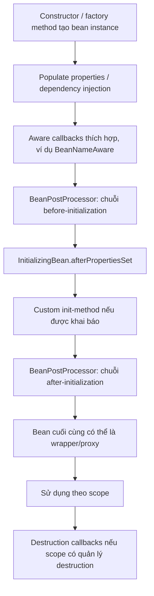

<a id="back-to-top"></a>

# Vòng đời bean

## Menu
- [Các bước tạo đối tượng, tiêm phụ thuộc và khởi tạo](#bean-lifecycle-001)
- [Callback @PostConstruct sau khi hoàn tất cung cấp phụ thuộc](#bean-lifecycle-002)
- [InitializingBean.afterPropertiesSet và @Bean(initMethod)](#bean-lifecycle-003)
- [Thứ tự khi kết hợp nhiều cơ chế khởi tạo](#bean-lifecycle-004)
- [BeanPostProcessor trước và sau callback khởi tạo](#bean-lifecycle-005)
- [SmartInitializingSingleton sau khi tạo các singleton thông thường](#bean-lifecycle-006)
- [Giới hạn gọi bean khác hoặc làm việc nặng trong callback khởi tạo](#bean-lifecycle-007)
- [Callback @PreDestroy, DisposableBean và destroyMethod](#bean-lifecycle-008)
- [Suy luận close, shutdown và tắt suy luận bằng destroyMethod rỗng](#bean-lifecycle-009)
- [Giải phóng tài nguyên và giới hạn callback hủy với prototype](#bean-lifecycle-010)

## <a id="bean-lifecycle-001">Các bước tạo đối tượng, tiêm phụ thuộc và khởi tạo</a>

<details>
<summary>Xem chi tiết</summary>

# Vòng đời bean Spring: các bước tạo đối tượng, tiêm phụ thuộc và khởi tạo

## 1. Mục tiêu và bức tranh tổng thể

Spring Core Container quản lý các đối tượng được khai báo thành **bean**: container biết cách tạo chúng, xác định những phụ thuộc cần cung cấp, thực hiện cấu hình, gọi các callback khởi tạo và (với những scope thích hợp) dọn dẹp khi kết thúc vòng đời.

Cần tách ba hoạt động rất dễ bị gọi chung là “khởi tạo”:

1. **Instantiation — tạo đối tượng:** tạo instance Java bằng constructor, factory method hoặc một cơ chế instantiation phù hợp.
2. **Dependency injection / property population — tiêm phụ thuộc và điền thuộc tính:** gắn những bean/value mà instance cần để hoạt động, thông qua constructor/factory method, setter, field hoặc property binding tùy cấu hình.
3. **Initialization — khởi tạo bean sau khi có dependency:** các bước Spring gọi sau khi điền dependency để kiểm tra cấu hình, chuẩn bị cấu trúc dữ liệu hoặc thực hiện callback như `@PostConstruct`, `InitializingBean.afterPropertiesSet()` và custom `initMethod`.

Một bean **đã được Java tạo bằng constructor** chưa chắc đã **hoàn tất việc khởi tạo trong Spring**. Bean thường chỉ sẵn sàng cho code ứng dụng sử dụng sau khi Spring chạy xong các bước tạo, tiêm, callback và bean post-processing cần thiết.

Đây là quy trình **điển hình** cho bean thông thường; Spring có các điểm mở rộng như `FactoryBean`, `InstantiationAwareBeanPostProcessor`, proxy và custom scope có thể thay đổi một số thao tác cụ thể. Đừng xem sơ đồ rút gọn là một danh sách nội bộ bất biến cho mọi loại bean.

~~~text
Bean definition và metadata
          │
          ▼
Container xác định cần tạo bean
          │
          ▼
Giải quyết dependency dùng cho constructor/factory method
          │
          ▼
Tạo instance (constructor / factory method)
          │
          ▼
Tiêm dependency còn lại (field, setter, properties ...)
          │
          ▼
Các *Aware callback và xử lý tiền khởi tạo
          │
          ▼
@PostConstruct
          │
          ▼
InitializingBean.afterPropertiesSet()
          │
          ▼
Custom init method (nếu khai báo)
          │
          ▼
BeanPostProcessor sau khởi tạo (có thể trả proxy)
          │
          ▼
Bean đã sẵn sàng để ứng dụng lấy và sử dụng
          │
          ▼
Khi scope/container kết thúc: destroy callbacks, nếu được quản lý
~~~

**Điểm tinh tế:** `@PostConstruct` được xử lý bởi một `BeanPostProcessor` của Spring, vì vậy nó xảy ra **trong pha các post-processor trước khởi tạo**. Các custom `postProcessBeforeInitialization()` có thứ tự riêng; không nên khẳng định tất cả custom “before” callback luôn xảy ra trước `@PostConstruct`. Sơ đồ đặt `@PostConstruct` ở đúng vị trí tương đối với `afterPropertiesSet()` và custom init method, nhưng lược bỏ thứ tự giữa nhiều post-processor khác nhau.

## 2. Spring lấy thông tin để tạo bean ở đâu?

Spring không tự quản lý tất cả object trong JVM. Nó chỉ quản lý những bean được đăng ký qua bean definition hoặc cơ chế tương đương.

Một vài cách đăng ký thường gặp:

~~~java
@Component
class OrderRepository {
}

@Service
class OrderService {
    private final OrderRepository repository;

    OrderService(OrderRepository repository) {
        this.repository = repository;
    }
}
~~~

Khi package được `@ComponentScan` quét và đăng ký, container có metadata để tạo `OrderRepository` và `OrderService`.

Cách cấu hình Java:

~~~java
@Configuration
class ShopConfig {
    @Bean
    OrderRepository orderRepository() {
        return new OrderRepository();
    }

    @Bean
    OrderService orderService(OrderRepository repository) {
        return new OrderService(repository);
    }
}
~~~

Các đoạn cấu hình ngắn ở trên là **minh họa**, không phải một chương trình Java standalone với đủ import và `main`; mã hoàn chỉnh có thể chạy nằm ở mục 7.

Các nguồn bean definition thường gặp gồm `@Component`/`@Service`/`@Repository`, các phương thức `@Bean`, cấu hình XML, đăng ký bean qua API hoặc thông qua framework tích hợp. Metadata có thể bao gồm bean name, class/factory, scope, constructor arguments, property values, lazy flag, điều kiện đăng ký, init/destroy methods và quan hệ phụ thuộc.

Ở giai đoạn `ApplicationContext.refresh()`, Spring xử lý metadata, áp dụng các `BeanFactoryPostProcessor`/**BeanDefinitionRegistryPostProcessor**, đăng ký `BeanPostProcessor`, rồi **thông thường pre-instantiate các singleton không lazy**. Vì thế khi một `AnnotationConfigApplicationContext` vừa được tạo, nhiều singleton có thể đã đi qua đủ lifecycle, dù ứng dụng chưa gọi `getBean()` lần nào.

Không nhầm:

- `BeanFactoryPostProcessor` tác động tới **bean definitions/container configuration trước khi phần lớn bean thông thường được khởi tạo**.
- `BeanPostProcessor` tác động tới **mỗi bean instance** trong các thời điểm thích hợp của quá trình tạo/khởi tạo.

Nếu bean không được đăng ký thành Spring bean, câu lệnh `new OrderService(...)` do ứng dụng tự gọi là tạo object Java bình thường; Spring không tự chạy dependency injection, callback hay proxy cho object đó.

## 3. Bước tạo đối tượng (instantiation)

### 3.1. Chọn constructor hoặc factory method

Spring trước tiên phải xác định cách có được instance.

- Với component class, Spring có thể gọi constructor của class sau khi resolve các constructor arguments.
- Với phương thức `@Bean`, Spring gọi factory method tương ứng; instance do method trả về trở thành bean được quản lý và tiếp tục trải qua các bước wiring/lifecycle.
- Với bean definition chuyên biệt hoặc `FactoryBean`, quy trình tạo object có thể khác; nên phân biệt **đối tượng factory** với **sản phẩm do factory cung cấp**.
- `InstantiationAwareBeanPostProcessor` có thể tham gia trước/sau khi tạo instance, thậm chí tạo proxy thay thế trong một số trường hợp.

Khi dùng constructor injection:

~~~java
@Service
class InvoiceService {
    private final InvoiceRepository repository;

    InvoiceService(InvoiceRepository repository) {
        this.repository = repository;
    }
}
~~~

Spring **phải tìm/chuẩn bị được `InvoiceRepository` trước khi gọi constructor `InvoiceService`**, bởi constructor cần argument đó. Với class chỉ có một constructor, Spring hiện đại có thể tự dùng constructor ấy mà không cần `@Autowired` trên constructor. Nếu class có nhiều constructor, việc chọn constructor phụ thuộc annotation và các quy tắc constructor resolution.

Tại thời điểm bắt đầu chạy body constructor, các argument đã được truyền vào, nhưng **field hoặc setter injection của chính bean đó có thể chưa diễn ra**. Đặc biệt, `@PostConstruct` vẫn chưa chạy, nên không được giả định đối tượng đã hoàn toàn initialized.

### 3.2. Phân biệt ba cấp “đối tượng đã có”

~~~text
Constructor được gọi        → Object Java đã được tạo
Dependency được điền        → Object đã có các tham chiếu/cấu hình
Init callbacks hoàn tất     → Bean đã được Spring khởi tạo xong
Post-processing hoàn tất    → Object Spring công bố cho người dùng có thể là proxy
~~~

Đây là lý do không nên cho `this` thoát ra khỏi constructor sang một thread khác, đăng ký callback bất đồng bộ giữ reference chưa hoàn thành, hoặc đưa instance vào một static registry khi container còn đang wiring. Người khác có thể dùng nó trước khi dependency/callback hoàn tất.

### 3.3. Constructor/factory method thất bại thì sao?

Nếu constructor ném exception hoặc dependency bắt buộc chưa tìm được, Spring không thể hoàn tất quá trình tạo bean. Ứng dụng có thể nhận `BeanCreationException` với nguyên nhân sâu hơn là `UnsatisfiedDependencyException`, `NoSuchBeanDefinitionException` hoặc exception do chính code nghiệp vụ ném ra. Khi singleton eager cần thiết không tạo được, quá trình refresh context thường thất bại.

## 4. Bước tiêm phụ thuộc (dependency injection)

Mục tiêu của DI là **cung cấp collaborator và configuration từ container**, thay vì để mỗi bean tự tạo/tra cứu những dependency đó. Spring chọn dependency theo type, bean name, qualifier, primary designation và các quy tắc autowiring liên quan.

### 4.1. Constructor injection

~~~java
@Service
class PaymentService {
    private final PaymentGateway gateway;

    PaymentService(PaymentGateway gateway) {
        this.gateway = gateway;
    }
}
~~~

Ưu điểm: dependency bắt buộc được nêu rõ; có thể khai báo `final`; dễ test bằng cách tự truyền fake/stub; giảm nguy cơ object tồn tại ở trạng thái chưa đủ dependency. Với dependency không thể thiếu, **constructor injection thường là lựa chọn ưu tiên**.

Thời điểm: Spring phải resolve dependency **trước** khi gọi constructor. Nếu các dependency là singleton, container thường lấy lại singleton hiện có hoặc tạo chúng trước. Nếu dependency là prototype, mỗi lần giải quyết bean prototype cho một yêu cầu sẽ cấp một instance phù hợp với scope ấy; injection một lần vào singleton vẫn giữ reference đó, không tự thay ở từng method call.

### 4.2. Setter injection

~~~java
@Component
class NotificationService {
    private EmailClient client;

    @Autowired
    public void setClient(EmailClient client) {
        this.client = client;
    }
}
~~~

Spring tạo `NotificationService` trước, rồi trong bước property population, cơ chế autowiring gọi setter với bean `EmailClient` đã resolve. Khi chạy setter, object đã tồn tại nhưng **chưa đến pha init hoàn chỉnh**.

Setter injection phù hợp với một số dependency cấu hình được hoặc khi cần khả năng thay đổi dependency, nhưng phải kiểm tra invariants: code dùng bean trước khi setter chạy có thể thấy field chưa có giá trị. Nếu không dùng constructor injection, `@PostConstruct` là vị trí hợp lý để xác nhận đã nhận đủ dependency bắt buộc.

### 4.3. Field injection

~~~java
@Component
class MailWorker {
    @Autowired
    private EmailClient emailClient;
}
~~~

Spring dùng post-processor như `AutowiredAnnotationBeanPostProcessor` để điền field sau khi tạo instance. Cách này ít code, nhưng làm dependency bớt rõ ràng, khó tạo object thuần trong unit test và không phù hợp để đảm bảo `final` dependency bằng constructor. Nên cân nhắc constructor injection trong code ứng dụng.

### 4.4. Injection của `@Bean` factory method

~~~java
@Bean
ReportService reportService(ReportRepository repository,
                            Clock clock) {
    return new ReportService(repository, clock);
}
~~~

Trong đoạn này, `repository` và `clock` là **tham số factory method**, Spring resolve chúng trước khi gọi method. Chúng tương tự constructor injection về điều kiện “có dependency trước khi tạo instance” nhưng hành động thực tế là gọi một phương thức factory để trả về object.

Không trộn lẫn hai khái niệm: tự gọi `new Config().reportService(...)` là code Java bình thường; Spring chỉ quản lý bean khi chính container tham gia thực thi bean definition.

### 4.5. Optional, collection, qualifier

Nếu có nhiều bean cùng interface, autowiring chỉ theo type có thể mơ hồ. Dùng `@Qualifier("beanName")`, `@Primary` hoặc tên tham số (khi metadata hỗ trợ) để làm rõ. Thiếu bean bắt buộc gây lỗi khởi tạo; với dependency thực sự optional có thể dùng `Optional<T>` hay `ObjectProvider<T>`. Với tập hợp nhiều bean, Spring hỗ trợ inject `List<T>`/`Map<String,T>` theo quy tắc tương ứng.

`ObjectProvider<T>` cho phép **lùi thời điểm resolve** dependency đến lúc gọi `getObject()`. Việc tiêm provider thành công chưa đảm bảo target mà provider sẽ yêu cầu sau này tồn tại trong mọi scope context; ví dụ request-scoped bean có thể không lấy được khi không có HTTP request đang hoạt động.

## 5. Các callback giữa DI và khởi tạo

Sau khi đã tạo bean và hoàn tất property population, Spring đưa bean qua các lifecycle extension points. Ba nhóm cần phân biệt:

| Điểm mở rộng | Vai trò và giới hạn |
| --- | --- |
| `BeanNameAware`, `BeanFactoryAware`, `ApplicationContextAware` | Cho bean nhận thông tin container khi cần; một số callback được xử lý qua infrastructure processor |
| `BeanPostProcessor.postProcessBeforeInitialization` | Quan sát/chỉnh bean trước các init callback chuẩn; `@PostConstruct` cũng do một processor quản lý |
| `@PostConstruct`, `InitializingBean.afterPropertiesSet()`, custom `initMethod` | Khởi tạo state của **chính bean**, theo thứ tự này nếu ba callback là ba phương thức riêng |
| `BeanPostProcessor.postProcessAfterInitialization` | Có thể trả lại bean ban đầu hoặc một wrapper/proxy |

Ví dụ, bean muốn biết bean name có thể implement `BeanNameAware.setBeanName(String)`. Với Spring 6+, `@PostConstruct` dùng `jakarta.annotation.PostConstruct` và cần infrastructure xử lý annotation. Nó diễn ra trong pha before-initialization, nên không thể khẳng định **mọi custom** `postProcessBeforeInitialization` đều chạy trước `@PostConstruct`; thứ tự của những processor cụ thể có thể khác nhau.

`@Primary`, qualifier, scope và tên bean không tự quyết định thứ tự init methods trong **một bean**. Các callback nên xác thực cấu hình hoặc xây dựng state nhỏ gọn; tránh biến chúng thành nơi gọi `getBean()` tùy ý hay tác vụ nghiệp vụ dài. Sau bước after-initialization, tham chiếu Spring trả về có thể là proxy khác với raw target. Bài `BeanPostProcessor` trình bày sâu về thứ tự processor và proxy; bài về kết hợp callback có demo trace riêng.

## 6. Khi nào bean được xem là sẵn sàng?

Với bean thông thường, sau khi container hoàn tất initialization và post-processing, instance được trả cho người yêu cầu và/hoặc cache theo scope phù hợp. Những bean singleton không lazy thường đã sẵn sàng khi `ApplicationContext.refresh()` hoàn tất.

Ví dụ về thời điểm:

~~~text
T0: load bean definitions
T1: đăng ký BeanPostProcessor
T2: tạo singleton dependency D
T3: tạo singleton service S, resolve/inject D
T4: chạy init callbacks của S
T5: hoàn tất post-processing, có thể tạo proxy của S
T6: ApplicationContext.refresh() hoàn tất
T7: application code gọi getBean(S.class), lấy bean/proxy đã có
~~~

Với `@Lazy` singleton, quá trình tạo có thể chuyển đến lần đầu thực sự cần bean (nhưng có thể vẫn phải tạo sớm nếu một singleton eager khác phụ thuộc vào nó mà không có lazy proxy). Với `prototype`, quá trình tạo/DI/khởi tạo diễn ra **mỗi lần container phải tạo một prototype target mới**. Để dùng prototype theo từng lần thao tác trong singleton, cần `ObjectProvider` hoặc lookup tương tự.

**Sẵn sàng của từng bean không đồng nghĩa toàn ứng dụng đã sẵn sàng nhận lưu lượng**. Công việc phải chờ **tất cả singleton** đã được tạo có thể đặt tại `SmartInitializingSingleton.afterSingletonsInstantiated()`. Công việc cần toàn context refresh xong có thể phản ứng `ContextRefreshedEvent`; tác vụ có startup/shutdown lifecycle riêng có thể dùng `SmartLifecycle`.

Đặc biệt, không nên dùng `@PostConstruct` để khởi chạy công việc blocking dài hoặc thao tác phức tạp truy cập bean khác có nguy cơ deadlock trong lúc container giữ singleton creation lock. Hook này nên ngắn, chắc chắn, chủ yếu kiểm tra trạng thái/chuẩn bị dữ liệu cục bộ.

## 7. Ví dụ Java 17 chạy được: constructor → setter DI → init callbacks

Ví dụ dùng **Java 17**, **Maven** và **Spring Framework 6.2.19**. Nó tạo bean bằng Java configuration, inject dependency qua constructor/factory method và setter, sau đó chạy các callback theo thứ tự. Thêm phần hủy để nhìn thấy ranh giới lifecycle khi đóng context.

Cấu trúc tệp:

~~~text
spring-bean-lifecycle/
├── pom.xml
└── src/main/java/example/BeanLifecycleDemo.java
~~~

Tệp `pom.xml`:

~~~xml
<project xmlns="http://maven.apache.org/POM/4.0.0"
         xmlns:xsi="http://www.w3.org/2001/XMLSchema-instance"
         xsi:schemaLocation="http://maven.apache.org/POM/4.0.0 https://maven.apache.org/xsd/maven-4.0.0.xsd">
    <modelVersion>4.0.0</modelVersion>
    <groupId>example</groupId>
    <artifactId>spring-bean-lifecycle</artifactId>
    <version>1.0.0</version>

    <properties>
        <maven.compiler.release>17</maven.compiler.release>
        <project.build.sourceEncoding>UTF-8</project.build.sourceEncoding>
    </properties>

    <dependencies>
        <dependency>
            <groupId>org.springframework</groupId>
            <artifactId>spring-context</artifactId>
            <version>6.2.19</version>
        </dependency>
        <dependency>
            <groupId>jakarta.annotation</groupId>
            <artifactId>jakarta.annotation-api</artifactId>
            <version>2.1.1</version>
        </dependency>
    </dependencies>

    <build>
        <plugins>
            <plugin>
                <groupId>org.apache.maven.plugins</groupId>
                <artifactId>maven-compiler-plugin</artifactId>
                <version>3.13.0</version>
            </plugin>
            <plugin>
                <groupId>org.codehaus.mojo</groupId>
                <artifactId>exec-maven-plugin</artifactId>
                <version>3.5.0</version>
            </plugin>
        </plugins>
    </build>
</project>
~~~

Tệp `src/main/java/example/BeanLifecycleDemo.java`:

~~~java
package example;

import jakarta.annotation.PostConstruct;
import jakarta.annotation.PreDestroy;

import org.springframework.beans.factory.BeanNameAware;
import org.springframework.beans.factory.DisposableBean;
import org.springframework.beans.factory.InitializingBean;
import org.springframework.beans.factory.annotation.Autowired;
import org.springframework.context.annotation.AnnotationConfigApplicationContext;
import org.springframework.context.annotation.Bean;
import org.springframework.context.annotation.Configuration;

public final class BeanLifecycleDemo {

    public static void main(String[] args) {
        try (var context =
                     new AnnotationConfigApplicationContext(Config.class)) {
            ManagedJob job = context.getBean(ManagedJob.class);
            job.execute();
        } // context.close(): Spring hủy các singleton đủ điều kiện.
    }

    @Configuration(proxyBeanMethods = false)
    public static class Config {
        @Bean
        public Repository repository() {
            return new Repository("orders");
        }

        @Bean
        public Validator validator() {
            return new Validator();
        }

        @Bean(initMethod = "customInit",
              destroyMethod = "customDestroy")
        public ManagedJob managedJob(Repository repository) {
            return new ManagedJob(repository);
        }
    }

    public static final class Repository {
        private final String name;

        public Repository(String name) {
            this.name = name;
        }

        public String name() {
            return name;
        }
    }

    public static final class Validator {
        public boolean accept(Repository repository) {
            return repository != null && !repository.name().isBlank();
        }
    }

    public static class ManagedJob
            implements BeanNameAware, InitializingBean, DisposableBean {

        private final Repository repository;
        private Validator validator;
        private String beanName;

        public ManagedJob(Repository repository) {
            this.repository = repository;
            System.out.println("1. Constructor: repository = " + repository.name());
        }

        @Autowired
        public void setValidator(Validator validator) {
            this.validator = validator;
            System.out.println("2. Setter injection: validator da co");
        }

        @Override
        public void setBeanName(String name) {
            this.beanName = name;
            System.out.println("3. BeanNameAware: " + name);
        }

        @PostConstruct
        public void postConstruct() {
            if (!validator.accept(repository)) {
                throw new IllegalStateException("Dependency chua hop le");
            }
            System.out.println("4. @PostConstruct: dependencies hop le");
        }

        @Override
        public void afterPropertiesSet() {
            System.out.println("5. InitializingBean.afterPropertiesSet");
        }

        public void customInit() {
            System.out.println("6. @Bean initMethod");
        }

        public void execute() {
            if (!"managedJob".equals(beanName)) {
                throw new IllegalStateException("Sai bean name");
            }
            System.out.println("7. Business method");
        }

        @PreDestroy
        public void preDestroy() {
            System.out.println("8. @PreDestroy");
        }

        @Override
        public void destroy() {
            System.out.println("9. DisposableBean.destroy");
        }

        public void customDestroy() {
            System.out.println("10. @Bean destroyMethod");
        }
    }
}
~~~

Chạy từ thư mục chứa `pom.xml`:

~~~bash
mvn -q compile exec:java -Dexec.mainClass=example.BeanLifecycleDemo
~~~

Stdout do chương trình in (không tính log riêng do môi trường Maven tạo):

~~~text
1. Constructor: repository = orders
2. Setter injection: validator da co
3. BeanNameAware: managedJob
4. @PostConstruct: dependencies hop le
5. InitializingBean.afterPropertiesSet
6. @Bean initMethod
7. Business method
8. @PreDestroy
9. DisposableBean.destroy
10. @Bean destroyMethod
~~~

**Giải thích chính xác theo mã:**

- Bean `repository` được resolve để làm **argument của factory method** `managedJob(Repository repository)`; bên trong factory method, code gọi constructor `new ManagedJob(repository)` nên dòng 1 xuất hiện.
- Spring tạo object trước rồi xử lý `@Autowired` setter `setValidator`, nên dòng 2 xảy ra **trước** init callbacks.
- Sau property population, `BeanNameAware.setBeanName` được gọi, tạo dòng 3.
- Các callback init cho cùng bean chạy theo `@PostConstruct` → `afterPropertiesSet` → custom `initMethod`, tạo dòng 4, 5, 6.
- `context.getBean(ManagedJob.class)` trong `main` lấy singleton đã sẵn sàng, rồi ứng dụng gọi `execute()` tạo dòng 7.
- Khi kết thúc `try-with-resources`, context đóng và gọi `@PreDestroy` → `DisposableBean.destroy` → custom `destroyMethod`, tạo dòng 8, 9, 10.

Trong ví dụ này không có bean mang tên `managedJob` nào khác và không có custom `BeanPostProcessor` làm đổi hành vi. `@Autowired` và `@PostConstruct` được xử lý vì `AnnotationConfigApplicationContext` đăng ký các annotation processors tiêu chuẩn. Spring có thể dựng một vài infrastructure beans khác trước, nhưng chúng không in ra stdout nên không đổi thứ tự 10 dòng trên.

Tại sao `@Bean(initMethod = ...)` có tác dụng với một object đã được tạo bằng `new` trong factory method? Bởi **Spring gọi phương thức @Bean để lấy object**, sau đó **đưa object ấy qua quy trình lifecycle**. Trong khi đó, code người dùng tự gọi `new ManagedJob(...)` bên ngoài container sẽ không được Spring tự động inject setter hay chạy callback.

## 8. Tự quan sát BeanPostProcessor

Để thấy rõ **một điểm mở rộng khác** trong vòng đời, ứng dụng có thể đăng ký `BeanPostProcessor`. Đoạn sau là cấu hình minh họa; có thể đặt bên trong class `Config` của ví dụ, với các import tương ứng:

~~~java
@Bean
static BeanPostProcessor tracingProcessor() {
    return new BeanPostProcessor() {
        @Override
        public Object postProcessBeforeInitialization(
                Object bean, String beanName) {
            if ("managedJob".equals(beanName)) {
                System.out.println("BPP before init");
            }
            return bean;
        }

        @Override
        public Object postProcessAfterInitialization(
                Object bean, String beanName) {
            if ("managedJob".equals(beanName)) {
                System.out.println("BPP after init");
            }
            return bean;
        }
    };
}
~~~

Import: `org.springframework.beans.factory.config.BeanPostProcessor`. **Đừng áp dụng đoạn thêm này nếu đang đối chiếu stdout đúng 10 dòng ở mục 7** vì các dòng trace sẽ xuất hiện thêm. Đây là một phần mở rộng riêng biệt để quan sát lifecycle.

Khi khai báo post-processor bằng `@Bean`, nên sử dụng **static factory method** (như mẫu) và ít dependency để tránh khởi tạo sớm một số bean trước khi tất cả post-processors được đăng ký. Một BeanPostProcessor thường được gọi trên nhiều bean khác nhau, nên ví dụ lọc theo tên `managedJob`.

Dòng “BPP before init” không nên gắn cứng vị trí *trước* `@PostConstruct` khi chưa kiểm soát thứ tự của `CommonAnnotationBeanPostProcessor` và custom processor. Nó chắc chắn nằm trước các callback như `afterPropertiesSet` và custom init theo contract cơ bản; “BPP after init” nằm sau các callback init đó. `BeanPostProcessor` trả một object khác có thể thay thế/proxy bean mà client nhìn thấy; đừng dựa vào `bean == getBean(...)` nếu ứng dụng có proxy.

## 9. Singleton, prototype, lazy và ảnh hưởng đến các bước lifecycle

Scope và độ lazy ảnh hưởng đến **khi nào** các bước được thực hiện, không xóa đi ý nghĩa của instantiation/DI/init.

| Loại bean | Khi nào tạo thông thường? | DI và init diễn ra khi nào? | Khi đóng context |
| --- | --- | --- | --- |
| Singleton mặc định | Trong `refresh()`, nếu non-lazy | Một lần khi tạo singleton | Spring thực hiện destroy callback khi phù hợp |
| `@Lazy` singleton | Khi được yêu cầu lần đầu, trừ trường hợp bị kéo tạo sớm | Một lần khi thực sự được tạo | Nếu bean đã tạo và được quản lý, destroy khi context đóng |
| Prototype | Mỗi lần container giải quyết yêu cầu tạo prototype | Mỗi instance được tạo đều trải qua DI/init | Spring **không tự gọi** destroy callback cho từng prototype được trao |
| Request scope | Khi cần trong request hiện hành | Một lần cho target được scope tạo | Dọn dẹp theo vòng đời request và scope |
| Session scope | Khi cần trong session hiện hành | Một lần cho target được scope tạo | Dọn dẹp theo vòng đời session và scope |

Ví dụ singleton A có constructor nhận prototype B: **B được tạo lúc container cần dựng A**, chứ không chờ đến lần đầu gọi method trên A; các lần gọi A.method() sau đó không tự làm B khởi tạo lại. Nếu A cần một B mới cho mỗi thao tác, dùng provider/lookup theo nhu cầu hoặc cơ chế proxy với semantics phù hợp.

Nếu một prototype mới được tạo năm lần, các callback `@PostConstruct`/`afterPropertiesSet`/`initMethod` của nó cũng có thể được gọi năm lần tương ứng. Đừng sử dụng prototype làm resource owner rồi kỳ vọng container gọi `@PreDestroy` cho mỗi instance khi đóng ứng dụng.

## 10. Chú ý khi init method tương tác với AOP, transaction và thread

**Proxy/transaction:** Với Spring AOP proxy thông thường, init callback chạy trên target trước khi việc post-processing hoàn tất. Gọi `this.transactionalMethod()` từ `@PostConstruct` là self-invocation và không đi qua advice của proxy. Nếu cần chạy nghiệp vụ có transaction sau startup, hãy sử dụng collaborator được inject qua proxy và lifecycle hook đúng mốc.

**Thread và công việc nặng:** Khởi chạy một thread từ constructor hoặc callback init có thể công bố một bean chưa hoàn tất initialization. Ngoài ra, init callback trong quá trình tạo singleton có thể giữ creation lock; gọi nhiều bean khác, đợi tác vụ bất đồng bộ hoặc I/O không timeout có rủi ro circular dependency, deadlock và startup bị treo. Dành callback cho validation và cấu trúc dữ liệu cục bộ; công việc cần tất cả eager singletons nên cân nhắc `SmartInitializingSingleton`, event refresh hoặc `SmartLifecycle` tùy mục tiêu.

**Vòng phụ thuộc:** `A(B)` và `B(A)` qua constructor không có trật tự dựng hợp lệ. Chuyển bừa sang field/setter injection có thể chỉ che thiết kế coupling, và cấu hình cho phép circular references thay đổi theo môi trường. Hãy làm rõ hợp đồng phụ thuộc, tách nhiệm vụ hoặc dùng lazy lookup có chủ đích. Phần riêng về rủi ro trong init callbacks sẽ minh họa lock, timeouts và cách khởi động tác vụ nền an toàn.

## 11. Các lỗi thường gặp và cách chẩn đoán

| Hiện tượng | Nguyên nhân có thể | Cách kiểm tra/sửa |
| --- | --- | --- |
| `@PostConstruct` không chạy | Class được tạo bằng `new` ngoài Spring; annotation sai package; processor chưa đăng ký | Bảo đảm object là Spring bean; dùng `jakarta.annotation.PostConstruct` với Spring 6; kiểm tra context configuration |
| Setter `@Autowired` không được gọi | Bean không đi qua autowiring processor hoặc không do context phù hợp quản lý | Kiểm tra bean registration và annotation processors |
| `NullPointerException` trong constructor khi truy cập field `@Autowired` | Field injection chưa xảy ra | Chuyển dependency bắt buộc sang constructor |
| Bean chạy init hai lần trong quan sát | Có hai instance/contexts, proxy/lifecycle khác nhau, hoặc code tự gọi callback | Log bean name, context identity và điểm khởi tạo; không tự gọi init method |
| Không thể resolve dependency | Không có bean, nhiều candidate, sai qualifier/generic | Đọc cause của `UnsatisfiedDependencyException`/`NoUniqueBeanDefinitionException`; bổ sung bean hoặc qualifier |
| Bean không khởi tạo khi app start | `@Lazy`/prototype hoặc condition không đăng ký | Kiểm tra scope, lazy flag và có ai yêu cầu bean chưa |
| Bean được khởi tạo “quá sớm” | Singleton eager hoặc dependency của bean khác kéo tạo | Xem dependency graph và phạm vi `@Lazy` |
| `@Transactional` không hoạt động trong `@PostConstruct` | Init chạy trên target chưa qua AOP entry point | Chuyển logic tới thời điểm sau khi proxy sẵn sàng, gọi qua bean khác/proxy |
| Context start thất bại khi init | Callback ném exception, có I/O/validation không hợp lệ | Xem exception gốc trong `BeanCreationException`, kiểm tra các tham số và config |
| Prototype không chạy `@PreDestroy` khi đóng context | Spring không tự quản lý destroy phase của các prototype đã cấp | Quy ước bên nhận đóng resource |
| Thứ tự các bean độc lập khác dự kiến | Không có thứ tự tùy ý bảo đảm giữa các bean không có dependency | Đừng dựa vào order ngẫu nhiên; khai báo dependency thực hoặc dùng hook app lifecycle phù hợp |
| Test thuần `new` khác test Spring context | Unit test không có container wiring | Truyền collaborator thủ công hoặc chạy Spring test context khi cần test lifecycle |

**Khi debug, đặt log có kiểm soát ở constructor, setter, `@PostConstruct`, init callbacks và method nghiệp vụ**; phân biệt khi nào bean được tạo với khi nào request gọi `getBean()`. Trong bối cảnh AOP, có thể in cả class của object do context cung cấp để nhận biết proxy, nhưng đừng dựa vào tên class do proxy sinh ra làm contract API.

## 12. Checklist thực hành và bài tập

Trước khi coi một bean đã cấu hình đúng, tự kiểm tra:

1. Bean definition xuất phát từ component scanning, `@Bean`, XML hay đăng ký API nào? Object có thật do container quản lý không?
2. Bean scope và độ lazy là gì? Điều gì kích hoạt lần tạo instance đầu tiên?
3. Dependency bắt buộc đã có tại constructor/factory method chưa? Dependency nào chỉ được setter/field inject sau đó?
4. Có dùng field được inject trong constructor trước khi injection diễn ra không?
5. Init callback có chỉ kiểm tra/cấu hình state cục bộ, hay đang làm công việc nguy hiểm/quá nặng?
6. Nếu nhiều callback cùng tồn tại, đã hiểu thứ tự `@PostConstruct` → `afterPropertiesSet` → custom init chưa?
7. Bean có được thay bằng proxy sau init không? Có đang gọi AOP advice bên trong constructor/init/self-invocation không?
8. Đã xác định owner của resource và destroy mechanism tương ứng với scope chưa?
9. Khi lỗi, có đọc **root cause** của `BeanCreationException` để biết lỗi ở instantiation, DI hay initialization không?

### Bài 1 — Constructor và field injection

Một component có constructor gọi `emailSender.send()`, trong khi `emailSender` chỉ được đánh dấu `@Autowired` trên field. Lỗi có thể xảy ra ở đâu?

**Đáp án:** Constructor chạy trước field injection, nên `emailSender` có thể còn `null`. Nếu dependency bắt buộc, đưa `EmailSender` vào constructor argument.

### Bài 2 — Thứ tự init callbacks

Một bean có ba method khác nhau, lần lượt dùng `@PostConstruct`, `InitializingBean.afterPropertiesSet()` và `@Bean(initMethod="prepare")`. Thứ tự gọi là gì?

**Đáp án:** `@PostConstruct` → `afterPropertiesSet()` → `prepare()`, giả sử bean tạo và điền dependency thành công.

### Bài 3 — Singleton và lần `getBean()` thứ hai

Một singleton non-lazy đã được Spring tạo lúc context refresh. Sau đó hai lần `getBean(MyService.class)` được gọi. Constructor, DI và init có chạy thêm hai lần không?

**Đáp án:** Không. Hai lần lookup thường nhận lại cùng singleton đã initialized; không tạo hay init thêm bean đó.

### Bài 4 — Prototype nhận từ singleton

`SingletonWorker` nhận một `PrototypeTask` qua constructor. Mỗi lần `worker.perform()` có tự inject một `PrototypeTask` mới không?

**Đáp án:** Không. Dependency được resolve một lần khi dựng `SingletonWorker`. Muốn tạo prototype mới mỗi thao tác, truy xuất theo nhu cầu bằng `ObjectProvider<PrototypeTask>` hoặc factory thích hợp.

### Bài 5 — Post-processor và @PostConstruct

Có thể chắc chắn mọi custom `BeanPostProcessor.postProcessBeforeInitialization` đều chạy trước `@PostConstruct` không?

**Đáp án:** Không. `@PostConstruct` được xử lý qua một BeanPostProcessor của Spring; thứ tự các post-processors ảnh hưởng vị trí tương đối. Chỉ nên dựa vào các contract/thứ tự được bảo đảm.

## 13. Tài liệu tham khảo chính thức

- [Spring Framework — Customizing the Nature of a Bean (Lifecycle Callbacks)](https://docs.spring.io/spring-framework/reference/core/beans/factory-nature.html)
- [Spring Framework — Container Extension Points: BeanFactoryPostProcessor và BeanPostProcessor](https://docs.spring.io/spring-framework/reference/core/beans/factory-extension.html)
- [Spring Framework — Using @PostConstruct and @PreDestroy](https://docs.spring.io/spring-framework/reference/core/beans/annotation-config/postconstruct-and-predestroy-annotations.html)
- [Spring Framework — Dependency Injection](https://docs.spring.io/spring-framework/reference/core/beans/dependencies/factory-collaborators.html)
- [Spring Framework — Bean Scopes](https://docs.spring.io/spring-framework/reference/core/beans/factory-scopes.html)


</details>

- [Quay lại đầu trang](#back-to-top)

---

## <a id="bean-lifecycle-002">Callback @PostConstruct sau khi hoàn tất cung cấp phụ thuộc</a>

<details>
<summary>Xem chi tiết</summary>

# Callback @PostConstruct sau khi hoàn tất cung cấp phụ thuộc trong Spring Framework

## 1. @PostConstruct giải quyết vấn đề gì?

Trong Spring IoC Container, Spring thường tạo bean bằng constructor hoặc factory method, cung cấp các dependency và property đã khai báo, sau đó mới chạy các callback khởi tạo. Annotation `@PostConstruct` đánh dấu một method cần được Spring gọi **sau khi việc dependency injection và property population thông thường của bean đã hoàn tất**, trước khi bean được coi là hoàn thành giai đoạn khởi tạo thông thường.

```java
import jakarta.annotation.PostConstruct;
import org.springframework.stereotype.Component;

@Component
public class ExampleService {
    @PostConstruct
    public void initialize() {
        // Chuẩn bị trạng thái cần thiết sau khi dependency đã được inject.
    }
}
```

Đoạn trên là một component Spring; muốn callback được chạy phải tạo bean bằng container đã đăng ký processor cho annotation tương ứng. Gọi `new ExampleService()` trực tiếp sẽ **không** khiến Spring tự gọi `initialize()`.

Đây là hook vòng đời **mỗi lần một bean target được tạo và được Spring khởi tạo**, không phải hook mỗi HTTP request, mỗi lần gọi method, hay toàn bộ hệ thống đã khởi động thành công. Với singleton eager thông thường, callback được gọi một lần trong một `ApplicationContext` cho bean definition ấy. Với prototype hoặc scoped target, callback gắn với **mỗi lần target được tạo**; với lazy singleton, callback thường chờ đến lần bean được khởi tạo thật.

### Khi nào dùng?

Các tác vụ phù hợp với `@PostConstruct` gồm:

- Kiểm tra ràng buộc của cấu hình sau khi inject `@Value` hoặc dependency qua setter.
- Chuẩn bị một immutable lookup table, bộ chuyển đổi, parser hoặc cấu trúc dữ liệu dùng nhiều lần trong bean.
- Tính một giá trị phụ thuộc cả constructor argument lẫn property được Spring gán sau constructor.
- Đăng ký tài nguyên nội bộ nhỏ, xác lập trạng thái "ready" có kiểm soát trước khi bean được sử dụng bình thường.
- Phát hiện lỗi cấu hình sớm bằng exception rõ ràng ngay trong quá trình khởi tạo bean.

Hạn chế dùng hook này cho network call dài, blocking mãi, tự chạy background thread, gửi sự kiện nghiệp vụ hoặc thực thi hành động có side effect khó rollback. Các tác vụ đó có thể cần cơ chế startup sau khi context refresh (`ApplicationRunner`/`CommandLineRunner` trong Spring Boot, `ContextRefreshedEvent`, `SmartLifecycle` tùy bài toán) và cơ chế shutdown riêng.

## 2. @PostConstruct đứng ở đâu trong vòng đời bean?

Một đường đi điển hình của Spring-managed bean không có vòng tham chiếu bất thường:

```text
1. Spring tìm bean definition và chọn constructor / factory method
                          |
                          v
2. Khởi tạo instance: constructor chạy
                          |
                          v
3. Populate properties và dependency injection:
   @Autowired field, @Autowired setter, @Value, @Resource ...
                          |
                          v
4. Aware callbacks liên quan (BeanNameAware, BeanFactoryAware ...)
   và các BeanPostProcessor chạy trước initialize
                          |
                          v
5. @PostConstruct                <-- hook của bài học này
                          |
                          v
6. InitializingBean.afterPropertiesSet()
                          |
                          v
7. Custom init method (ví dụ @Bean(initMethod = "init"))
                          |
                          v
8. BeanPostProcessor sau initialize
   (có thể tạo/wrap AOP proxy)
                          |
                          v
9. Bean được cung cấp cho consumer và hoạt động
                          |
                          v
10. Khi destroy scope/container: callback hủy phù hợp
```

Đây là sơ đồ học tập cho quy trình tạo bean thông thường. Chính xác hơn, `CommonAnnotationBeanPostProcessor` xử lý `@PostConstruct` trong pha `postProcessBeforeInitialization`. Có thể có nhiều `BeanPostProcessor` chạy trước/sau initialization; thứ tự giữa các processor tùy cấu hình và quy tắc ordering. Do đó sơ đồ không bảo đảm toàn bộ processor chạy trước `@PostConstruct`, và Spring có thể có các trường hợp phức tạp như early reference/proxy và circular dependency.

Điều Spring cam kết là callback khởi tạo chạy khi dependency đã được **cung cấp** cho bean theo bean definition. Nó **không** có nghĩa:
- Mọi singleton trong context đã khởi tạo hết.
- Mọi lazy dependency/proxy đã resolve target bên trong.
- Ứng dụng HTTP đã sẵn sàng nhận traffic.
- Tất cả database/messaging service bên ngoài đang hoạt động.
- Không còn bất kỳ công việc bất đồng bộ nào đang diễn ra.
- Một bean được quản lý bởi một container khác cũng đã sẵn sàng.

Phần lớn quan hệ dependency trực tiếp bình thường đã được resolve trước khi callback trên bean consumer chạy. Nếu cần thứ tự giữa các bean không có injection relationship, khai báo quan hệ rõ ràng bằng dependency hoặc `@DependsOn` theo nhu cầu; `@Order` không phải công cụ phổ quát điều khiển startup order.

## 3. Phân biệt constructor injection, field/setter injection và @PostConstruct

### Constructor injection

```java
@Component
class InvoiceService {
    private final TaxPolicy taxPolicy;

    InvoiceService(TaxPolicy taxPolicy) {
        this.taxPolicy = taxPolicy;
        // taxPolicy đã có sẵn trong constructor.
    }
}
```

`TaxPolicy` là interface/bean của ứng dụng cần định nghĩa riêng; đoạn mã chỉ minh họa và cần import `Component`. Nếu toàn bộ dữ liệu cần thiết nằm trong constructor và object có thể được khởi tạo hoàn toàn ngay lúc đó, **constructor là lựa chọn ưu tiên**: dependency bắt buộc thể hiện rõ và field có thể `final`.

### Setter hoặc field injection

```java
@Component
class InvoiceService {
    @Autowired
    private TaxPolicy taxPolicy;

    InvoiceService() {
        // Ở đây taxPolicy vẫn chưa được gán bằng @Autowired.
    }

    @PostConstruct
    void init() {
        // taxPolicy đã được inject trong đường khởi tạo bình thường.
    }
}
```

Cần import `Component`, `Autowired`, `PostConstruct` và định nghĩa `TaxPolicy`. Với field injection, constructor chạy **trước** khi Spring gán field. Với `@Autowired` setter, setter được gọi trong giai đoạn population. Vì thế không nên truy cập field-injected dependency trong constructor. Sau khi injection thông thường kết thúc, `@PostConstruct` có thể dùng chúng để chuẩn bị dữ liệu dẫn xuất.

Không coi "đã inject" là "luôn non-null" nếu bạn tự khai báo injection optional, `@Autowired(required = false)`, `Optional<T>`, `@Nullable` hoặc property không bắt buộc. Callback vẫn cần kiểm tra constraint thật.

### @Value và cấu hình

```java
@Component
class RuntimeSettings {
    @Value("${features.max-items:100}")
    private int maxItems;

    @PostConstruct
    void validate() {
        if (maxItems <= 0) {
            throw new IllegalStateException(
                    "features.max-items must be positive");
        }
    }
}
```

Trong một Spring context có `@Value` property resolution phù hợp, callback kiểm tra giá trị **sau khi binding/injection**. Nhưng với Spring Boot, nếu nhiều cấu hình liên quan nhau, `@ConfigurationProperties` kết hợp validation thường phù hợp hơn cho cấu hình kiểu dữ liệu rõ ràng. Ví dụ trên là fragment minh họa, không phải Java executable độc lập.

## 4. API đúng trong Java 17+ và Spring Framework hiện đại

Dùng `jakarta.annotation.PostConstruct` trong Spring Framework 6.x/7.x (đã chuyển từ namespace Java EE/Jakarta cũ). **Không** nhập nhầm `javax.annotation.PostConstruct` khi build Spring 6+/Boot 3+.

```java
import jakarta.annotation.PostConstruct;
```

Java SE 17 không tích hợp sẵn Jakarta Annotations API. Với Maven/Spring Framework, cần có dependency chứa `jakarta.annotation`; thường Spring Boot starter đã cung cấp thông qua dependency graph, nhưng ứng dụng Spring Core tối thiểu nên khai báo rõ nếu cần.

Các nguyên tắc cho method:
- Phương thức instance, không truyền tham số, kiểu trả về `void`.
- Không là static method.
- Nên có tên thể hiện nghiệp vụ, ví dụ `validateConfiguration` hoặc `buildIndex`.
- Nên tránh checked exception; nếu cần báo lỗi khởi tạo, ném `IllegalStateException`/exception không checked có ý nghĩa.
- Có thể là method private/package-private/public theo điều kiện truy cập của runtime; dùng phương thức đơn giản không phụ thuộc proxy là cách an toàn khi làm việc với Java module access.
- Không yêu cầu return object hoặc gán lại field reference; Spring chỉ gọi method, không lấy return value.
- Với nhiều method `@PostConstruct`, thứ tự giữa các hook trong hierarchy/phạm vi xử lý annotation có thể phức tạp; nên gom các bước có phụ thuộc thứ tự vào một callback rõ ràng.
- Tránh chỉ định lại cùng logic qua các lifecycle hook khác nếu không cần.

Theo hợp đồng Jakarta `PostConstruct`, method thực hiện initialization sau injection, chỉ chạy một lần cho mỗi instance target được khởi tạo trong vòng đời quản lý tương ứng. Spring có thể hỗ trợ phương thức visibility khác nhau, nhưng khi dùng JPMS cần để ý package/module access.

### Điều kiện Spring nhận ra annotation

Trong ứng dụng cấu hình bằng `AnnotationConfigApplicationContext` hoặc Spring Boot, `CommonAnnotationBeanPostProcessor` thường được đăng ký tự động. Cơ chế này xử lý cả `@PostConstruct`, `@PreDestroy` và `@Resource`. Với `BeanFactory` mức thấp hoặc cấu hình XML tối giản, phải đăng ký annotation processors/`<context:annotation-config/>` thích hợp; nếu không Spring có thể tạo bean mà bỏ qua annotation.

Một object do ứng dụng tạo bằng `new`, object được deserialize hoặc object được framework khác tạo mà không đi qua Spring bean lifecycle sẽ **không tự chạy** callback của Spring. Nếu cần wiring object đã tạo sẵn, phải chủ động dùng API/container phù hợp và hiểu rõ lifecycle/ownership của đối tượng đó.

## 5. Ví dụ Spring Core hoàn chỉnh: quan sát constructor → injection → @PostConstruct

Ví dụ này dùng **Java 17+, Maven 3.9+, Spring Framework 6.2.12** và chỉ cần Core Container, không cần web server. Tất cả source đều được liệt kê, không dùng DB. Ta tạo một `Catalog` bằng constructor injection, nhận thêm `Formatter` qua setter `@Autowired`, rồi tạo snapshot đã xử lý trong `@PostConstruct`. Chương trình đồng thời minh họa thứ tự của `InitializingBean`, `@Bean(initMethod=...)` và các callback hủy.

Cấu trúc dự án:

```text
postconstruct-demo/
├── pom.xml
└── src/main/java/edu/example/lifecycle/
    ├── Main.java
    ├── AppConfig.java
    ├── SourceData.java
    ├── Formatter.java
    └── Catalog.java
```

**pom.xml**

```xml
<?xml version="1.0" encoding="UTF-8"?>
<project xmlns="http://maven.apache.org/POM/4.0.0"
         xmlns:xsi="http://www.w3.org/2001/XMLSchema-instance"
         xsi:schemaLocation="http://maven.apache.org/POM/4.0.0 https://maven.apache.org/xsd/maven-4.0.0.xsd">
    <modelVersion>4.0.0</modelVersion>
    <groupId>edu.example</groupId>
    <artifactId>postconstruct-demo</artifactId>
    <version>1.0.0</version>
    <properties>
        <maven.compiler.release>17</maven.compiler.release>
        <project.build.sourceEncoding>UTF-8</project.build.sourceEncoding>
    </properties>
    <dependencies>
        <dependency>
            <groupId>org.springframework</groupId>
            <artifactId>spring-context</artifactId>
            <version>6.2.12</version>
        </dependency>
        <dependency>
            <groupId>jakarta.annotation</groupId>
            <artifactId>jakarta.annotation-api</artifactId>
            <version>2.1.1</version>
        </dependency>
    </dependencies>
    <build>
        <plugins>
            <plugin>
                <groupId>org.apache.maven.plugins</groupId>
                <artifactId>maven-compiler-plugin</artifactId>
                <version>3.13.0</version>
            </plugin>
            <plugin>
                <groupId>org.codehaus.mojo</groupId>
                <artifactId>exec-maven-plugin</artifactId>
                <version>3.5.0</version>
                <configuration>
                    <mainClass>edu.example.lifecycle.Main</mainClass>
                </configuration>
            </plugin>
        </plugins>
    </build>
</project>
```

**src/main/java/edu/example/lifecycle/SourceData.java**

```java
package edu.example.lifecycle;

public record SourceData(String text) {
}
```

**src/main/java/edu/example/lifecycle/Formatter.java**

```java
package edu.example.lifecycle;

public class Formatter {
    public String format(String input) {
        return input.toUpperCase(java.util.Locale.ROOT);
    }
}
```

**src/main/java/edu/example/lifecycle/Catalog.java**

```java
package edu.example.lifecycle;

import jakarta.annotation.PostConstruct;
import jakarta.annotation.PreDestroy;
import org.springframework.beans.factory.DisposableBean;
import org.springframework.beans.factory.InitializingBean;
import org.springframework.beans.factory.annotation.Autowired;

public class Catalog implements InitializingBean, DisposableBean {
    private final SourceData source;
    private Formatter formatter;
    private String preparedValue;

    public Catalog(SourceData source) {
        this.source = source;
        System.out.println("1. constructor: " + source.text());
    }

    @Autowired
    public void setFormatter(Formatter formatter) {
        this.formatter = formatter;
        System.out.println("2. @Autowired setter");
    }

    @PostConstruct
    public void prepare() {
        // Cả constructor dependency lẫn setter dependency đều có sẵn.
        preparedValue = formatter.format(source.text());
        System.out.println("3. @PostConstruct: " + preparedValue);
    }

    @Override
    public void afterPropertiesSet() {
        System.out.println("4. afterPropertiesSet()");
    }

    public void customInit() {
        System.out.println("5. custom init()");
    }

    public String value() {
        return preparedValue;
    }

    @PreDestroy
    public void beforeDestroy() {
        System.out.println("7. @PreDestroy");
    }

    @Override
    public void destroy() {
        System.out.println("8. DisposableBean.destroy()");
    }

    public void customDestroy() {
        System.out.println("9. custom destroy()");
    }
}
```

**src/main/java/edu/example/lifecycle/AppConfig.java**

```java
package edu.example.lifecycle;

import org.springframework.context.annotation.Bean;
import org.springframework.context.annotation.Configuration;

@Configuration(proxyBeanMethods = false)
public class AppConfig {
    @Bean
    public SourceData sourceData() {
        return new SourceData("spring");
    }

    @Bean
    public Formatter formatter() {
        return new Formatter();
    }

    @Bean(initMethod = "customInit", destroyMethod = "customDestroy")
    public Catalog catalog(SourceData sourceData) {
        return new Catalog(sourceData);
    }
}
```

**src/main/java/edu/example/lifecycle/Main.java**

```java
package edu.example.lifecycle;

import org.springframework.context.annotation.AnnotationConfigApplicationContext;

public class Main {
    public static void main(String[] args) {
        try (AnnotationConfigApplicationContext context =
                     new AnnotationConfigApplicationContext(AppConfig.class)) {
            Catalog catalog = context.getBean(Catalog.class);
            System.out.println("6. value(): " + catalog.value());
        }
        // try-with-resources đóng context, gọi các destroy callbacks
    }
}
```

Tại thư mục `postconstruct-demo`, chạy:

```bash
mvn -q compile exec:java
```

**Các dòng stdout do ứng dụng in:**

```text
1. constructor: spring
2. @Autowired setter
3. @PostConstruct: SPRING
4. afterPropertiesSet()
5. custom init()
6. value(): SPRING
7. @PreDestroy
8. DisposableBean.destroy()
9. custom destroy()
```

Spring/Maven có thể tạo thêm log phụ thuộc môi trường, nhưng các dòng `System.out.println` ở trên có thứ tự xác định trong ví dụ một bean không có cycle/proxy tùy biến. `AnnotationConfigApplicationContext(AppConfig.class)` refresh context ngay trong constructor, khiến `catalog` singleton được khởi tạo **trước** khi `context.getBean(...)` trong `Main`. Bởi vậy thứ tự 1–5 xuất hiện trước 6. `try-with-resources` đóng context khi kết thúc block nên callback hủy 7–9 chạy tiếp.

Điểm quan trọng nhất của mẫu: constructor chỉ có `SourceData`; `Formatter` được inject về sau bằng `@Autowired` setter. Trong `prepare()`, cả hai đã sẵn sàng. Nếu viết `formatter.format(...)` ở constructor của `Catalog`, `formatter` còn `null` và gây lỗi.

Ba cơ chế khởi tạo khác nhau áp dụng trên cùng bean ở thứ tự `@PostConstruct` → `InitializingBean.afterPropertiesSet()` → configured `initMethod`. Ba cơ chế hủy tương ứng chạy theo `@PreDestroy` → `DisposableBean.destroy()` → custom destroy method, nếu bean được hủy qua lifecycle do Spring quản lý. Trong ứng dụng thật, thường chỉ chọn **một** cách cho mỗi mục đích để giữ code gọn.

## 6. Cách Spring thực thi @PostConstruct bên dưới

Annotation chỉ là metadata. `CommonAnnotationBeanPostProcessor` (thông qua cơ chế `InitDestroyAnnotationBeanPostProcessor`) là thành phần nhận diện và gọi method được đánh dấu.

Một phiên bản rút gọn của quá trình:

```text
createBeanInstance()
  └─ resolve constructor/factory dependencies
  └─ construct instance

populateBean()
  └─ AutowiredAnnotationBeanPostProcessor inject @Autowired/@Value...
  └─ các processor/property population phù hợp khác

initializeBean()
  └─ invoke Aware callbacks như BeanNameAware
  └─ apply BeanPostProcessors.beforeInitialization(...)
       └─ CommonAnnotationBeanPostProcessor gọi @PostConstruct
  └─ invoke InitializingBean.afterPropertiesSet()
  └─ invoke configured init methods
  └─ apply BeanPostProcessors.afterInitialization(...)
       └─ có thể wrap bean bằng proxy
```

Các API ở trên mô tả logic ở mức khái niệm, không phải source copy đầy đủ của một phiên bản Spring. Với BeanPostProcessor do ứng dụng viết, thứ tự thực tế còn phụ thuộc priority/order; tuyệt đối không dùng sơ đồ này để bảo đảm rằng tất cả bean khác đã tạo hoặc tất cả AOP advice đã bắt đầu có hiệu lực.

**Hệ quả khi dùng AOP:** `@PostConstruct` thường được gọi trên **raw target bean**, trước khi target được bao bởi AOP proxy cuối cùng. Do đó một lệnh tự gọi method có `@Transactional`, `@Async`, `@Cacheable` hoặc advice khác từ `@PostConstruct` không phải con đường đáng tin để kích hoạt advice đó. Ngay cả với method public, self-invocation trên target bỏ qua Spring AOP proxy.

Ví dụ cần tránh:

```java
@Service
class CacheBootstrap {
    @PostConstruct
    void init() {
        refreshInTransaction(); // Không kỳ vọng proxy @Transactional intercept.
    }

    @Transactional
    public void refreshInTransaction() {
        // Tương tác DB...
    }
}
```

Snippet này cần import `@Service`, `@PostConstruct`, `@Transactional` và cấu hình transaction, chỉ minh họa chống pattern, không phải chương trình chạy độc lập. Nếu cần thực thi transaction tại startup, chuyển lời gọi qua bean collaborator được Spring quản lý và chọn thời điểm phù hợp khi transaction infrastructure đã sẵn sàng; thường initialization hook sau context refresh phù hợp hơn với startup task.

## 7. @PostConstruct so với các lifecycle hook khác

| Cơ chế | Khi nào chạy? | Mục đích và lưu ý |
| --- | --- | --- |
| Constructor / `@Bean` factory | Tạo instance | Phù hợp nhất để thiết lập bất biến và dependency bắt buộc qua constructor |
| Setter / field `@Autowired`, `@Value` | Giai đoạn inject/populate | Cung cấp dependency/config chưa có trong constructor |
| `@PostConstruct` | Sau injection, trong pha trước init của BeanPostProcessor | Validate và chuẩn bị state sau khi inject |
| `InitializingBean.afterPropertiesSet()` | Sau `@PostConstruct` | Hook Spring-specific cho initialization |
| `@Bean(initMethod = "...")` / XML init-method | Sau `afterPropertiesSet()` khi cùng bean kết hợp đủ cơ chế | Hook cấu hình bên ngoài class |
| `BeanPostProcessor.postProcessAfterInitialization` | Sau các init callback | Có thể wrap bean, ví dụ tạo AOP proxy |
| `SmartInitializingSingleton.afterSingletonsInstantiated()` | Sau khi pre-instantiation của singleton không-lazy kết thúc | Phù hợp logic cần đa số singleton eager đã sẵn sàng; không đồng nghĩa mọi bean lazy/prototype đã tạo |
| `ContextRefreshedEvent` | Context refresh thành công | Hook cấp ApplicationContext; có thể nhận nhiều lần nếu refresh |
| `ApplicationRunner` / `CommandLineRunner` (Boot) | Sau Spring Boot context startup theo quy trình Boot | Chạy startup logic cấp ứng dụng; không thay thế bean init |
| `SmartLifecycle` | Theo phase start/stop container | Quản lý các thành phần sống dài như listener/consumer |
| `@PreDestroy` | Trong destruction lifecycle phù hợp | Dọn tài nguyên trước các callback destroy khác |

**Chọn hook theo việc cần biết:**
- Cần dependency riêng của bean → constructor hoặc `@PostConstruct`.
- Cần hầu hết eager singleton đã tạo → `SmartInitializingSingleton`.
- Cần việc cấp application sau khi Spring Boot khởi động context → runner hoặc event tương ứng.
- Cần kiểm soát start/stop service lâu dài → `SmartLifecycle`.
- Cần giải phóng tài nguyên → `@PreDestroy`/`destroyMethod`, với giới hạn scope.

Một `ApplicationReadyEvent` trong Spring Boot là sự kiện Boot báo ứng dụng ready theo quy trình startup; đây cũng **không** chứng minh tất cả external dependency đang healthy. Đừng dùng `@PostConstruct` chỉ để chạy một lần tác vụ sau khi server nhận request, vì thời điểm bean được tạo có thể trước server sẵn sàng.

## 8. Khác nhau theo singleton, prototype và web scopes

| Scope | Số lần `@PostConstruct` được gọi | Destruction callback |
| --- | --- | --- |
| `singleton` | Một lần khi target bean được tạo trong container (mặc định eager) | Khi container shutdown đúng quy trình |
| Lazy singleton | Một lần ở thời điểm target lần đầu được khởi tạo | Khi context shutdown nếu target đã tồn tại |
| `prototype` | Mỗi lần Spring tạo một prototype target và khởi tạo nó | Spring **không** tự theo dõi để hủy từng prototype như singleton; consumer chịu trách nhiệm cleanup |
| `request` | Một lần cho mỗi request-scoped target được sử dụng/tạo | Thường khi request scope kết thúc |
| `session` | Một lần cho mỗi HTTP-session-scoped target được tạo | Khi session hết hạn/invalidate |
| `application` | Một lần cho mỗi target trong ServletContext scope | Khi scope/context ứng dụng được kết thúc |
| `websocket` (STOMP) | Một lần cho mỗi WebSocket-session-scoped target được tạo | Khi phiên WebSocket kết thúc |

Một request có thể không tạo request-scoped bean nếu không có đường truy cập đến nó. Tương tự, WebSocket session tồn tại không tự tạo mọi bean websocket scope. `@PostConstruct` chạy khi **instance mục tiêu được khởi tạo**, không phải ngay khi scope được khai báo.

Với bean `prototype` được inject vào singleton bằng constructor, target prototype thường chỉ được tạo một lần **tại thời điểm injection của singleton**. `@PostConstruct` của prototype đó không chạy mỗi lần singleton gọi method của dependency. Muốn mỗi nghiệp vụ có prototype mới, dùng `ObjectProvider<T>.getObject()` vào đúng thời điểm; mỗi target mới sẽ đi qua initialization riêng. Nếu dùng prototype scoped proxy thì việc resolve target có thể diễn ra ở mỗi intercepted method call; cân nhắc state cần giữ nhiều bước.

Với request/session scoped proxy, singleton có thể giữ reference proxy nhưng target `@PostConstruct` thường chạy lần đầu có request/session cần target. Callback thuộc target, **không phải mỗi lời gọi qua proxy**. Proxy cũng không tự mang request context sang thread `@Async`.

## 9. Xử lý exception tại @PostConstruct

Nếu `@PostConstruct` ném runtime exception khi tạo một singleton eager, Spring thường dừng quá trình tạo bean và dẫn đến lỗi khởi tạo context (ví dụ `BeanCreationException` bọc nguyên nhân). Đây là cơ chế **fail fast** hữu ích nếu config bắt buộc không hợp lệ.

```java
@PostConstruct
void validateAndPrepare() {
    if (endpoint == null || endpoint.isBlank()) {
        throw new IllegalStateException("endpoint must be configured");
    }
    parsedEndpoint = java.net.URI.create(endpoint);
}
```

Ví dụ là một fragment của bean có field `endpoint` và `parsedEndpoint`; chúng cần được định nghĩa/inject trong class. Throw làm startup thất bại nếu bean được eagerly instantiated. Nhưng nếu bean lazy hoặc scoped target chưa được tạo, lỗi sẽ xuất hiện muộn tại lần resolve đầu tiên; không được khẳng định mọi validation sẽ xảy ra ngay lúc application startup.

Một số nguyên tắc:
- Thông báo exception nên chứa key cấu hình và hành động sửa, tránh lộ token/password trong error.
- Tránh bắt exception rồi chỉ log và cho bean đi tiếp ở trạng thái nửa khởi tạo.
- Nếu mở file/socket trước lúc throw, cân nhắc try/finally hoặc cleanup ngay trong method. Không dựa vào `@PreDestroy` để rollback mọi trường hợp initialize thất bại: container có thể chưa đăng ký destroy callback cho bean bị lỗi khởi tạo.
- Với external service có thể tạm thời không sẵn sàng, phân biệt **config invalid** (fail fast) với **dependency unavailable** (retry/backoff/readiness). Không dùng busy loop vô hạn trong initialization thread.

## 10. An toàn luồng, công bố trạng thái và tác vụ nền

Một use case tốt là build immutable snapshot trước khi bean được publish:

```java
import java.util.List;
import java.util.Map;
import jakarta.annotation.PostConstruct;
import org.springframework.stereotype.Component;

@Component
class RouteIndex {
    private Map<String, Integer> index = Map.of();

    @PostConstruct
    void prepare() {
        List<String> routes = List.of("/users", "/orders");
        index = Map.of(routes.get(0), 1, routes.get(1), 2);
    }

    int priority(String route) {
        return index.getOrDefault(route, 0);
    }
}
```

Lần publish bình thường của bean qua Spring container giúp consumer truy cập bean đã khởi tạo, và map sau khi build không bị mutate. Trong ví dụ, map immutable rất phù hợp cho nhiều request cùng đọc. Điều đó **không** có nghĩa mọi `HashMap` mutable ghi sau startup đều an toàn: nếu có runtime update, cần lock, immutable replacement qua `volatile`/`AtomicReference`, hoặc concurrent data structure đúng invariant.

### Không khởi động thread bằng cách làm rò rỉ this trong callback

```java
@PostConstruct
void riskyStart() {
    new Thread(() -> useAllBeanState()).start();
}
```

Fragment trên không tự biên dịch vì thiếu method `useAllBeanState`. Nó cố ý mô tả cách dùng cần thận trọng: thread được khởi chạy trước khi các callback init còn lại kết thúc và trước khi bean được publish dưới dạng proxy cuối cùng, có thể quan sát state không đúng kỳ vọng. Việc quản lý stop/join thread cũng phức tạp, nhất là khi bean khởi tạo lỗi hoặc container shutdown.

Nếu cần worker/thread pool:
- Để Spring quản lý `TaskExecutor`/`TaskScheduler` hoặc component có lifecycle phù hợp.
- Chuẩn bị cấu hình nhẹ trong `@PostConstruct`.
- Bắt đầu thực sự khi application/bean lifecycle cho phép, với cơ chế shutdown và error handling rõ.
- Đừng dùng `Thread.sleep` trong init như thủ thuật "đợi mọi bean".
- Giữ method initialize đủ nhanh để tránh kéo dài thời gian khởi động ứng dụng.

## 11. Lỗi thường gặp và cách khắc phục

| Hiện tượng | Nguyên nhân thường gặp | Cách xử lý |
| --- | --- | --- |
| `@PostConstruct` không chạy | Object tạo bằng `new`, không do Spring quản lý; annotation processor chưa đăng ký | Để Spring tạo bean, dùng `AnnotationConfigApplicationContext`/Boot hoặc đăng ký processor |
| Không compile được import `javax.annotation.PostConstruct` trên Spring 6+ | Dùng namespace cũ / thiếu dependency | Import `jakarta.annotation.PostConstruct` và dependency Jakarta tương thích |
| Field `@Autowired` null trong constructor | Constructor chạy trước field/setter injection | Dùng constructor injection hoặc trì hoãn thao tác đến `@PostConstruct` |
| `@PostConstruct` vẫn thấy null | Injection optional, property chưa khai báo, object ngoài container, xử lý cycle bất thường | Kiểm tra bean wiring, required/Optional và container ownership |
| `@Transactional`/`@Async` trên method được gọi trong `@PostConstruct` không có hiệu lực | Initialization xảy ra trước final AOP proxy; self-invocation | Đưa logic sang collaborator được proxy và trigger ở lifecycle thích hợp |
| Startup chậm/hang | Block network/DB hoặc chạy job dài trong init | Tách workload startup, timeout/retry hợp lý, dùng runner/lifecycle |
| Bean lazy chỉ chạy callback khi request đầu tiên đến | Target chưa được khởi tạo trước đó | Đây là bình thường; nếu cần eager validation, thiết kế dependency/trigger rõ |
| Prototype có callback init nhưng cleanup không chạy | Container không tự quản lý đầy đủ destruction của prototype | Consumer tự đóng resource hoặc dùng scope/lifecycle phù hợp |
| Test với Mockito `new` object và kỳ vọng hook chạy | Unit test không tạo Spring bean | Gọi setup tường minh trong pure unit test hoặc dùng integration test với context |
| `@PostConstruct` lặp lại trên nhiều app instance | Mỗi replica/pod/context có lifecycle riêng | Không dùng làm global exactly-once job; cần distributed coordination |
| Method init được gọi trước khi tất cả bean khác ready | Hook per-bean, không phải whole-app ready event | Dùng lifecycle cấp context/runner nếu cần |
| Runtime cập nhật state sau `@PostConstruct` gây race | Init xong không làm field shared mutable tự thread-safe | Immutable snapshot/lock/atomic theo invariant |

### Chẩn đoán theo từng bước

1. Bean có thực sự được Spring quản lý và được tạo chưa? Kiểm tra container scan/`@Bean`, singleton lazy, active profile, condition.
2. Method có import đúng `jakarta.annotation.PostConstruct`, signature không tham số và `void` không?
3. Có `CommonAnnotationBeanPostProcessor` trong context hiện tại không?
4. Dependency đã được cung cấp chưa, và có optional/lazy/proxy nào có thể resolve muộn không?
5. Có exception sớm hoặc circular reference làm bean initialization thất bại không?
6. Logic đang chạy trên raw target ở init hay đang cần advice chỉ có khi lời gọi đi qua proxy?
7. Callback dự kiến chạy mỗi bean instance, mỗi request hay chỉ một lần toàn cluster? Nếu kỳ vọng khác, hãy đổi thiết kế lifecycle.

## 12. Tình huống thực hành và câu hỏi tự đánh giá

**Tình huống A — cache danh mục đọc nhiều lần:** Một bean inject `ProductRepository` và cần xây một chỉ mục bất biến trước khi service bắt đầu nhận lời gọi. Dùng `@PostConstruct` được nếu dữ liệu nhỏ, lấy dữ liệu nhanh, muốn thất bại khi cấu hình sai và không đòi hỏi transaction/advice qua self-call. Nếu cần load hàng triệu record từ remote service, cân nhắc readiness và startup orchestration khác.

**Tình huống B — kiểm tra cấu hình:** Bean được Spring inject `@Value("${file.format:csv}")`, cần báo lỗi nếu giá trị khác `csv`/`json`. `@PostConstruct` là vị trí hợp lý để validate sau binding. Nếu tham số cấu hình nhiều field và có constraint cấu trúc, hãy xem `@ConfigurationProperties` validation.

**Tình huống C — tự khởi động subscriber:** Bean muốn mở connection, register listener, retry khi disconnect. `@PostConstruct` có thể chuẩn bị dependency/config, nhưng startup/shutdown của listener có trạng thái kéo dài nên thường hợp với `SmartLifecycle` hoặc listener container đã được Spring quản lý.

Câu hỏi:
1. Vì sao `@Autowired` field không có sẵn trong constructor nhưng có thể có sẵn ở `@PostConstruct`?
2. Nếu bean implement `InitializingBean` và có `@Bean(initMethod="customInit")`, thứ tự ba callback init là gì?
3. `@PostConstruct` của singleton lazy chạy khi nào?
4. Prototype bean được yêu cầu tạo ba lần, mỗi target có `@PostConstruct`: sẽ chạy bao nhiêu lần?
5. Vì sao `@PreDestroy` không đáng tin để hủy một prototype bean do Spring tạo?
6. Một method `@PostConstruct` gọi `this.fetch()` với `@Transactional`: có được Spring AOP tự đảm bảo transaction không?
7. Một bean `@RequestScope` đã được proxied nhưng target chưa từng resolve: callback init của target chạy chưa?
8. Bean có `@PostConstruct` chạy xong có nghĩa server HTTP và toàn bộ integration bên ngoài đã ready chưa?
9. Tại sao gọi `new MyComponent()` trong test không tự gọi `@PostConstruct`?
10. Khi nào nên dùng constructor thay cho callback init?

**Đáp án:** (1) Field injection xảy ra sau constructor, trước initialization. (2) `@PostConstruct` → `afterPropertiesSet()` → custom init method. (3) Khi bean thật được tạo lần đầu, không mặc định khi context refresh. (4) Ba lần, nếu cả ba instance thực sự do Spring khởi tạo. (5) Container không quản lý automatic destroy cho prototype. (6) Không, self-invocation/raw target có thể bypass proxy. (7) Chưa; callback gắn với target khi tạo. (8) Chưa. (9) Vì object không đi qua Spring lifecycle processors. (10) Khi đủ dependency bắt buộc để thiết lập invariant tại thời điểm construction.

## Tài liệu chính thức

- Spring Framework — Using @PostConstruct and @PreDestroy: https://docs.spring.io/spring-framework/reference/core/beans/annotation-config/postconstruct-and-predestroy-annotations.html
- Spring Framework — Customizing the Nature of a Bean (lifecycle callbacks, order): https://docs.spring.io/spring-framework/reference/core/beans/factory-nature.html
- Spring Framework — Annotation-based Container Configuration: https://docs.spring.io/spring-framework/reference/core/beans/annotation-config.html
- Spring Framework — Using @Autowired: https://docs.spring.io/spring-framework/reference/core/beans/annotation-config/autowired.html
- Spring Framework — Using the @Bean Annotation: https://docs.spring.io/spring-framework/reference/core/beans/java/bean-annotation.html
- Spring Framework — Container Extension Points (BeanPostProcessor): https://docs.spring.io/spring-framework/reference/core/beans/factory-extension.html
- Jakarta Annotations specification — @PostConstruct: https://jakarta.ee/specifications/annotations/2.1/apidocs/jakarta.annotation/jakarta/annotation/postconstruct


</details>

- [Quay lại đầu trang](#back-to-top)

---

## <a id="bean-lifecycle-003">InitializingBean.afterPropertiesSet và @Bean(initMethod)</a>

<details>
<summary>Xem chi tiết</summary>

# InitializingBean.afterPropertiesSet và @Bean(initMethod) trong vòng đời bean Spring

## 1. Vì sao bean cần giai đoạn initialization?

Spring IoC Container không chỉ gọi constructor để tạo một object. Container còn xác định dependency, inject cấu hình, chạy các bean post-processor và cho phép bean thực hiện **khởi tạo sau khi dependency đã sẵn sàng** (*initialization callback*). Đây là nơi bean có thể xác thực cấu hình, xây dựng cấu trúc dữ liệu dẫn xuất hoặc mở tài nguyên cần thiết cho hoạt động của chính nó.

Hai cơ chế trọng tâm của bài:

- `InitializingBean.afterPropertiesSet()`: bean **implements interface của Spring** và Spring gọi method này sau khi properties/dependencies được thiết lập.
- `@Bean(initMethod = "tenMethod")`: cấu hình bean definition để Spring **gọi một method tùy chọn trên bean được factory method tạo ra**, không bắt class đó implements interface Spring.

Chúng là hai cách khác nhau để tham gia **cùng pha initialization**. Có thể dùng cả hai trên một bean; khi đó phải hiểu thứ tự callback và trách nhiệm của từng callback để không khởi tạo lặp hoặc tạo side effect không mong muốn.

Kết quả mong đợi sau bài:

1. Chỉ ra vị trí chính xác của hai callback trong vòng đời bean.
2. Khai báo và sử dụng đúng `InitializingBean` lẫn `@Bean(initMethod = ...)`.
3. Biết thứ tự khi kết hợp với `@PostConstruct` và vòng đời destroy.
4. Viết một ví dụ Spring Framework 6.x/Java 17+ chạy được, kiểm chứng thứ tự callback bằng stdout.
5. Phân biệt callback khởi tạo với constructor, `@Bean` factory method, `BeanPostProcessor`, `@Lazy` và các startup hook như `ApplicationRunner`.
6. Chẩn đoán lỗi method không tồn tại, dependency chưa có, callback throw exception, hoặc thực hiện initialization hai lần.

**Phạm vi:** Spring Framework Core Container. Các ví dụ chạy bằng Java 17 và Spring Context 6.1.x; không bắt buộc Spring Boot hoặc máy chủ HTTP.

## 2. Mô hình vòng đời: callback nằm ở đâu?

Một thứ tự đơn giản hóa cho một bean Spring thông thường:

~~~text
Đọc bean definition
        |
        v
Chọn constructor / factory method
        |
        v
Tạo object Java
        |
        v
Điền dependency, properties và thực hiện aware callbacks
        |
        v
BeanPostProcessor trước initialization
  (ví dụ xử lý @PostConstruct)
        |
        v
InitializingBean.afterPropertiesSet()
        |
        v
Custom init method từ bean definition
  (ví dụ @Bean(initMethod = "connect"))
        |
        v
BeanPostProcessor sau initialization
  (có thể tạo proxy AOP)
        |
        v
Bean sẵn sàng được sử dụng qua container
        |
        v
Khi scope kết thúc: destruction callbacks được hỗ trợ
~~~

Sơ đồ mô tả luồng phổ biến của một bean được container tạo thành công. Trên thực tế có nhiều extension point khác nhau, lazy bean, scoped proxy, circular dependency và các bean post-processor có thể thay đổi chi tiết. Điều cần ghi nhớ là **các init callback chạy sau khi dependency của bean đã được gán, trước khi hoàn tất initialization của bean**.

Nếu ba cơ chế đều có mặt **trên cùng một bean** và tên method khác nhau, thứ tự được Spring tài liệu hóa là:

1. Method gắn `@PostConstruct`.
2. `InitializingBean.afterPropertiesSet()`.
3. Custom init method được khai báo bằng `@Bean(initMethod = "...")` hoặc metadata tương đương.

Các `BeanPostProcessor` được Spring gọi trước và sau giai đoạn initialization, không đồng nghĩa mọi post-processor hoạt động ở cùng một thời điểm. Ví dụ xử lý `@PostConstruct` là công việc trong bước *before initialization*. Bean có thể được AOP bọc sau các callback initialization, nên không nên giả định lời gọi trong init method đã đi qua proxy cuối cùng.

## 3. `InitializingBean.afterPropertiesSet()`

### 3.1. Interface và hợp đồng

`InitializingBean` thuộc package:

~~~java
import org.springframework.beans.factory.InitializingBean;
~~~

Interface định nghĩa một method:

~~~java
public interface InitializingBean {
    void afterPropertiesSet() throws Exception;
}
~~~

Đây là chữ ký hợp đồng của interface để giải thích API; bạn **không cần tự khai báo lại interface** trong project. Spring gọi method một lần cho mỗi lần **container thực hiện initialization của bean instance đó**, sau khi đã cung cấp dependencies/properties qua cơ chế quản lý bean tương ứng.

Ví dụ class bean:

~~~java
import org.springframework.beans.factory.InitializingBean;

public class ReportFormatter implements InitializingBean {
    private String prefix;

    public void setPrefix(String prefix) {
        this.prefix = prefix;
    }

    @Override
    public void afterPropertiesSet() {
        if (prefix == null || prefix.isBlank()) {
            throw new IllegalStateException("prefix must not be blank");
        }
    }

    public String format(String value) {
        return prefix + value;
    }
}
~~~

Đây là **class có thể biên dịch nếu có Spring Beans trên classpath**; muốn được Spring gọi `afterPropertiesSet()` tự động, cần đăng ký instance bằng Spring bean definition (ví dụ `@Bean` hoặc `@Component` cùng cấu hình dependency).

Spring đảm bảo các dependency thuộc quá trình lắp ráp bình thường đã được gán trước callback. Do đó `afterPropertiesSet()` phù hợp cho:

- Xác thực nhiều properties phụ thuộc nhau.
- Chuyển đổi cấu hình thành cấu trúc dữ liệu sẵn dùng.
- Chuẩn bị tài nguyên nội bộ yêu cầu các dependency đã được cung cấp.
- Phát hiện cấu hình bất hợp lệ ngay khi container khởi tạo bean thay vì chờ đến request đầu tiên.

Tuy nhiên, **“properties đã được gán” không có nghĩa toàn bộ ứng dụng hoặc mọi bean khác đã khởi tạo xong**. Tránh coi đây là hook cho công việc cần tất cả service của ứng dụng đã hoàn tất startup.

### 3.2. Có thể throw exception

Method trong interface khai báo `throws Exception`. Nếu initialization thất bại, bạn có thể ném exception có ý nghĩa:

~~~java
@Override
public void afterPropertiesSet() {
    if (endpoint == null || endpoint.isBlank()) {
        throw new IllegalStateException("endpoint is required");
    }
    if (retryCount < 0) {
        throw new IllegalArgumentException("retryCount must be >= 0");
    }
}
~~~

Đoạn này minh họa một method nằm bên trong class đã có fields `endpoint` và `retryCount`. Nó không phải file Java độc lập.

Khi callback ném exception, việc tạo bean **không hoàn tất thành công**. Với singleton được tạo eagerly khi context refresh, lỗi thường khiến context khởi động thất bại, được bọc trong ngoại lệ tạo bean có cause gốc. Với lazy bean, lỗi có thể chỉ xuất hiện ở lần lấy bean đầu tiên.

### 3.3. Mặt đánh đổi

Ưu điểm:

- Method rõ ràng, tên thống nhất, không phải cấu hình chuỗi tên method.
- IDE và compiler kiểm tra việc implements interface.
- Phù hợp khi class thuộc ứng dụng Spring và bạn muốn biểu đạt contract “cần được khởi tạo sau injection”.

Nhược điểm:

- Class business phụ thuộc API Spring qua `InitializingBean`.
- Không thể thêm interface này vào class thư viện bên thứ ba mà bạn không sửa được.
- Nếu gọi `afterPropertiesSet()` thủ công hoặc gọi lại trong logic bình thường, có thể tạo side effect lặp; chỉ nên để container quản lý lifecycle.

Nếu cần giữ class không phụ thuộc Spring, hãy cân nhắc custom init method ở bean definition.

## 4. `@Bean(initMethod = "...")`

### 4.1. Cú pháp

`@Bean` thuộc `org.springframework.context.annotation.Bean`. Thuộc tính `initMethod` nhận **tên method của bean instance mà factory method trả về**.

~~~java
import org.springframework.context.annotation.Bean;
import org.springframework.context.annotation.Configuration;

@Configuration(proxyBeanMethods = false)
public class FormatterConfig {

    @Bean(initMethod = "prepare")
    public ExternalFormatter externalFormatter() {
        return new ExternalFormatter("ORDER-");
    }
}
~~~

Class phụ thuộc:

~~~java
public class ExternalFormatter {
    private final String prefix;
    private boolean prepared;

    public ExternalFormatter(String prefix) {
        this.prefix = prefix;
    }

    public void prepare() {
        if (prefix == null || prefix.isBlank()) {
            throw new IllegalStateException("prefix missing");
        }
        prepared = true;
    }

    public String format(String value) {
        if (!prepared) {
            throw new IllegalStateException("formatter not initialized");
        }
        return prefix + value;
    }
}
~~~

Hai đoạn trên thuộc **hai file class trong cùng package**; khi đăng ký `FormatterConfig` vào một `ApplicationContext`, Spring gọi `externalFormatter()` để tạo object, sau đó gọi `prepare()` như custom init callback. Không cần viết `implements InitializingBean` trong `ExternalFormatter`.

Nên khai báo custom initialization là một instance method không tham số; ví dụ điển hình là `public void prepare()`. Tránh thiết kế method init phụ thuộc tham số nghiệp vụ: hãy inject chúng trước bằng constructor/setter/factory method rồi init dựa trên state đã có.

### 4.2. Method nào được Spring gọi?

Phân biệt hai method:

~~~java
@Bean(initMethod = "prepare")
public ExternalFormatter externalFormatter() { // Factory method
    return new ExternalFormatter("ORDER-");
}
~~~

- `externalFormatter()` thuộc **class cấu hình**: phương thức factory tạo và trả bean object.
- `prepare()` thuộc **ExternalFormatter instance**: initialization callback được Spring gọi **sau khi object đã được tạo và lắp ráp**.
- String `"prepare"` là tên method được lookup từ bean instance; không phải tên bean và không phải tên factory method.

Nếu factory method tự gọi `prepare()` rồi vẫn khai báo `initMethod = "prepare"`, nhiều khả năng cùng công việc chạy **hai lần**: một lần thủ công trong factory method và một lần khi Spring gọi init callback. Hãy chọn một nơi chịu trách nhiệm gọi.

### 4.3. Khác gì với `@PostConstruct`?

`@PostConstruct` đặt trực tiếp trên method của bean class:

~~~java
import jakarta.annotation.PostConstruct;

public class ExternalFormatter {
    @PostConstruct
    public void validate() {
        // Được gọi trong pha before initialization nếu processor được đăng ký.
    }
}
~~~

Đây là đoạn minh họa cho **một class khác hoặc phiên bản thay thế** của ví dụ; để chạy cần Jakarta Annotation API và processor tương ứng trong Spring context.

`@PostConstruct` có ích khi bạn sở hữu class và muốn khai báo lifecycle ngay tại class. `@Bean(initMethod)` có ích khi bạn muốn giữ class thuần Java hoặc class đến từ thư viện ngoài mà không thể thêm annotation vào source.

Trong Spring Framework 6.x, package tiêu chuẩn là `jakarta.annotation.PostConstruct`. Không import nhầm `javax.annotation.PostConstruct` từ ứng dụng đời cũ mà không kiểm tra khả năng tương thích.

## 5. Ví dụ hoàn chỉnh Java 17 + Spring Context 6.1: quan sát ba callback

Ví dụ này đặt toàn bộ Java code vào một file `LifecycleDemo.java`, dùng Maven để tải dependency. Nó chứng minh:

- `@Bean` factory method chạy khi container cần tạo bean.
- Constructor chạy khi Java object được tạo.
- `@PostConstruct` chạy trước `afterPropertiesSet()`.
- `afterPropertiesSet()` chạy trước `@Bean(initMethod = "open")`.
- Chỉ sau các callback đó, ta lấy bean đã ready từ context.
- Khi context đóng, custom destroy callback chạy.

### 5.1. Cấu trúc

~~~text
lifecycle-demo/
├── pom.xml
└── src/
    └── main/
        └── java/
            └── com/
                └── example/
                    └── lifecycle/
                        └── LifecycleDemo.java
~~~

### 5.2. File `pom.xml`

~~~xml
<?xml version="1.0" encoding="UTF-8"?>
<project xmlns="http://maven.apache.org/POM/4.0.0"
         xmlns:xsi="http://www.w3.org/2001/XMLSchema-instance"
         xsi:schemaLocation="http://maven.apache.org/POM/4.0.0 https://maven.apache.org/xsd/maven-4.0.0.xsd">
    <modelVersion>4.0.0</modelVersion>

    <groupId>com.example</groupId>
    <artifactId>lifecycle-demo</artifactId>
    <version>1.0.0</version>

    <properties>
        <maven.compiler.release>17</maven.compiler.release>
        <project.build.sourceEncoding>UTF-8</project.build.sourceEncoding>
    </properties>

    <dependencies>
        <dependency>
            <groupId>org.springframework</groupId>
            <artifactId>spring-context</artifactId>
            <version>6.1.13</version>
        </dependency>
        <dependency>
            <groupId>jakarta.annotation</groupId>
            <artifactId>jakarta.annotation-api</artifactId>
            <version>2.1.1</version>
        </dependency>
    </dependencies>

    <build>
        <plugins>
            <plugin>
                <groupId>org.apache.maven.plugins</groupId>
                <artifactId>maven-compiler-plugin</artifactId>
                <version>3.13.0</version>
            </plugin>
            <plugin>
                <groupId>org.codehaus.mojo</groupId>
                <artifactId>exec-maven-plugin</artifactId>
                <version>3.3.0</version>
                <configuration>
                    <mainClass>com.example.lifecycle.LifecycleDemo</mainClass>
                </configuration>
            </plugin>
        </plugins>
    </build>
</project>
~~~

### 5.3. File `src/main/java/com/example/lifecycle/LifecycleDemo.java`

~~~java
package com.example.lifecycle;

import jakarta.annotation.PostConstruct;
import org.springframework.beans.factory.InitializingBean;
import org.springframework.context.annotation.AnnotationConfigApplicationContext;
import org.springframework.context.annotation.Bean;
import org.springframework.context.annotation.Configuration;

public class LifecycleDemo {

    public static void main(String[] args) {
        try (AnnotationConfigApplicationContext context =
                     new AnnotationConfigApplicationContext(Config.class)) {

            ManagedClient client = context.getBean(ManagedClient.class);
            System.out.println("5. Application uses ready bean: " + client.isReady());
        }
    }

    @Configuration(proxyBeanMethods = false)
    public static class Config {

        @Bean(initMethod = "open", destroyMethod = "shutdown")
        public ManagedClient managedClient() {
            System.out.println("0. @Bean factory method");
            return new ManagedClient("demo-endpoint");
        }
    }

    public static class ManagedClient implements InitializingBean {
        private final String endpoint;
        private boolean postConstructDone;
        private boolean afterPropertiesSetDone;
        private boolean ready;

        public ManagedClient(String endpoint) {
            this.endpoint = endpoint;
            System.out.println("1. Constructor");
        }

        @PostConstruct
        public void annotatedInit() {
            if (endpoint == null || endpoint.isBlank()) {
                throw new IllegalStateException("Endpoint is required");
            }
            postConstructDone = true;
            System.out.println("2. @PostConstruct");
        }

        @Override
        public void afterPropertiesSet() {
            if (!postConstructDone) {
                throw new IllegalStateException("@PostConstruct was not called");
            }
            afterPropertiesSetDone = true;
            System.out.println("3. InitializingBean.afterPropertiesSet");
        }

        public void open() {
            if (!afterPropertiesSetDone) {
                throw new IllegalStateException("Properties are not ready");
            }
            ready = true;
            System.out.println("4. @Bean(initMethod = open)");
        }

        public boolean isReady() {
            return ready;
        }

        public void shutdown() {
            ready = false;
            System.out.println("6. @Bean(destroyMethod = shutdown)");
        }
    }
}
~~~

`Config` được đăng ký bằng `AnnotationConfigApplicationContext(Config.class)`. Bean `ManagedClient` được tạo bởi method `managedClient()`. `AnnotationConfigApplicationContext` cũng đăng ký các annotation processors tiêu chuẩn; khi `jakarta.annotation.PostConstruct` có mặt trên classpath, callback `annotatedInit()` được xử lý bởi `CommonAnnotationBeanPostProcessor`.

Class `ManagedClient` là `static` nested class, vì vậy không phụ thuộc outer instance. Các method và import đều có trong file, không cần servlet, database hoặc kết nối mạng để chạy chương trình.

### 5.4. Lệnh chạy

Yêu cầu: JDK 17 trở lên, Maven 3.9.x. Từ thư mục `lifecycle-demo` chạy:

~~~bash
mvn -q compile exec:java
~~~

Những dòng `System.out.println` của chương trình, theo đúng thứ tự:

~~~text
0. @Bean factory method
1. Constructor
2. @PostConstruct
3. InitializingBean.afterPropertiesSet
4. @Bean(initMethod = open)
5. Application uses ready bean: true
6. @Bean(destroyMethod = shutdown)
~~~

Maven, logging framework và plugin có thể phát sinh log bên ngoài các dòng trên; đây là **stdout do các method trong ví dụ tạo ra**. Thứ tự này thể hiện rõ hai phương thức khởi tạo `afterPropertiesSet()` và `open()` được container gọi trước khi `context.getBean(...)` cung cấp bean hoàn tất initialization cho đoạn mã `main`.

### 5.5. Vì sao `shutdown()` chỉ chạy khi đóng context?

Ví dụ sử dụng `try-with-resources` vì `AnnotationConfigApplicationContext` implements `AutoCloseable`. Kết thúc block, `context.close()` được gọi tự động; với bean singleton và `destroyMethod = "shutdown"`, Spring thực thi custom destroy method. Trong ứng dụng chạy liên tục, destruction callback có thể chạy khi context được đóng, chẳng hạn lúc shutdown hợp lệ.

`initMethod` và `destroyMethod` là hai callback độc lập. Không suy ra bean prototype được container tự hủy ở cuối một request/công việc: Spring **không tự theo dõi để hủy prototype đã giao cho caller** như đối với singleton. Phạm vi bean ảnh hưởng số lần khởi tạo và nơi quản lý hủy.

## 6. So sánh hai cơ chế chính

| Tiêu chí | `InitializingBean.afterPropertiesSet()` | `@Bean(initMethod = "...")` |
| --- | --- | --- |
| Khai báo ở đâu? | Trong bean class bằng `implements InitializingBean` | Ở bean factory method/bean definition trong class cấu hình |
| Tên method | Cố định: `afterPropertiesSet()` | Tên tùy ý, dạng chuỗi trong `initMethod` |
| Dependency vào API Spring trong class | Có | Không bắt buộc |
| Có thể cấu hình cho class thư viện ngoài không sửa source? | Không trực tiếp | Có |
| Khi nào gọi? | Sau khi dependency/properties của instance được lắp ráp | Sau `afterPropertiesSet()` nếu có, cùng pha init |
| Validation bằng compiler | Bảo đảm implements method đúng interface | Chuỗi tên method không được compiler kiểm tra lúc build Java |
| Thường dùng cho | Bean do project sở hữu, muốn lifecycle contract tường minh | Bean từ thư viện, bean thuần Java, cấu hình init bên ngoài class |
| Có áp dụng cho `@Component` không? | Có, nếu class implements interface và được Spring quản lý | `@Bean(initMethod)` chỉ đặt trên `@Bean` method; với component có thể dùng `@PostConstruct` hoặc metadata khác |

**Không có quy tắc rằng phải luôn kết hợp cả hai.** Nếu chỉ cần xác thực dependency, chọn một callback là đủ. Kết hợp nhiều callback chỉ khi có lý do rõ ràng cho mỗi giai đoạn; tránh phân tán một giao thức khởi tạo qua quá nhiều method khó kiểm tra.

### Khác nhau giữa “factory tạo object” và “init hoàn tất object”

Ví dụ:

~~~java
@Bean(initMethod = "initialize")
public CacheIndex cacheIndex() {
    CacheIndex index = new CacheIndex();
    index.setCapacity(100);
    return index;
}
~~~

Spring gọi `cacheIndex()` để nhận object, sau đó gọi `initialize()` theo bean metadata. Đây là **đoạn minh họa**; class `CacheIndex` cần có constructor, setter và method `initialize()` tương ứng.

Nếu bạn viết:

~~~java
@Bean(initMethod = "initialize")
public CacheIndex cacheIndex() {
    CacheIndex index = new CacheIndex();
    index.setCapacity(100);
    index.initialize();
    return index;
}
~~~

Thì `initialize()` đã được gọi trong factory và sẽ lại được container gọi như init method. Không viết cả hai trừ khi method thật sự được thiết kế idempotent và có lý do gọi lặp (thường là dấu hiệu cấu hình sai).

## 7. Tính nhất quán: `@PostConstruct`, `afterPropertiesSet` và custom init

Khi kết hợp ba cách trên, chúng phải có **tên method riêng biệt** để các trách nhiệm rõ ràng:

~~~java
public class IndexBuilder implements InitializingBean {
    @PostConstruct
    public void validateConfiguration() {
        // 1. Kiểm tra giá trị đã inject.
    }

    @Override
    public void afterPropertiesSet() {
        // 2. Tính cấu trúc dữ liệu dựa trên cấu hình.
    }

    public void warmUp() {
        // 3. Chuẩn bị dữ liệu cần thiết để phục vụ request.
    }
}
~~~

Cấu hình:

~~~java
@Bean(initMethod = "warmUp")
public IndexBuilder indexBuilder() {
    return new IndexBuilder();
}
~~~

Hai đoạn trên minh họa cách khai báo cùng một bean; để chạy cần import `InitializingBean`, `PostConstruct` và `Bean`, cùng context hỗ trợ annotation. Spring bảo đảm thứ tự **`validateConfiguration()` → `afterPropertiesSet()` → `warmUp()`** trong trường hợp callback được đăng ký thành công và không ném exception.

Nếu một method được khai báo trùng tên theo nhiều cơ chế lifecycle, Spring có xử lý chống gọi trùng theo hợp đồng lifecycle; tuy nhiên đừng dùng điều đó để tạo cấu hình khó đọc. Tốt hơn là **không gán một method vừa làm `@PostConstruct`, vừa được khai báo là `initMethod`**.

### Khi nào class không nên implements `InitializingBean`?

Đối với domain model hoặc thư viện độc lập Spring, tách hành vi khởi tạo thành method thuần:

~~~java
public class RuleEngine {
    public void prepare() {
        // Logic thuần Java, không phụ thuộc framework.
    }
}
~~~

Sau đó gắn method vào bean definition:

~~~java
@Bean(initMethod = "prepare")
public RuleEngine ruleEngine() {
    return new RuleEngine();
}
~~~

Thiết kế này vẫn cho phép test class bằng `new RuleEngine()` trong unit test, bằng cách gọi `prepare()` rõ ràng. Spring chỉ tự kích hoạt method khi object được container tạo như bean.

## 8. Vòng đời phụ thuộc scope và lazy initialization

### 8.1. Singleton mặc định

Một bean singleton non-lazy thường được Spring khởi tạo trong quá trình refresh context. Do đó `afterPropertiesSet()` và custom `initMethod` thường chạy khi ứng dụng khởi động. Các lần gọi `getBean(...)` sau đó trả singleton đã khởi tạo; chúng **không lặp lại init callback**.

~~~java
@Bean(initMethod = "initialize")
public ServiceRegistry serviceRegistry() {
    return new ServiceRegistry();
}
~~~

Đây là ví dụ minh họa; class `ServiceRegistry` có method `initialize()` không tham số. Việc gọi `context.getBean(ServiceRegistry.class)` 100 lần không khiến `initialize()` tự chạy 100 lần nếu chỉ có một singleton bean definition trong context đó.

### 8.2. Prototype

Với prototype, mỗi lần container được yêu cầu cung cấp target mới thì tạo một instance mới và thực hiện initialization trên instance đó:

~~~java
@Bean(initMethod = "prepare")
@Scope(ConfigurableBeanFactory.SCOPE_PROTOTYPE)
public WorkSession workSession() {
    return new WorkSession();
}
~~~

Bean này yêu cầu import `Scope` và `ConfigurableBeanFactory`; class `WorkSession` phải có method `prepare()`. Nếu gọi `context.getBean(WorkSession.class)` hai lần, Spring khởi tạo hai object khác nhau và `prepare()` chạy cho từng object.

**Lưu ý:** Spring không tự thực hiện destroy callbacks cho prototype sau khi giao object. Nếu `prepare()` mở resource cần đóng, phía lấy prototype cần chủ động quản lý resource và cleanup, ví dụ dùng `AutoCloseable` khi phù hợp.

### 8.3. Lazy singleton

~~~java
@Bean(initMethod = "prepare")
@Lazy
public ExpensiveIndex expensiveIndex() {
    return new ExpensiveIndex();
}
~~~

Đây là đoạn minh họa cần import `Lazy` và class `ExpensiveIndex` tương ứng. Khi lazy singleton thực sự được tạo lần đầu, callback mới chạy. Tuy nhiên nếu một non-lazy singleton khác cần dependency này trong quá trình startup, Spring vẫn có thể tạo nó sớm để thỏa mãn dependency.

**Phân biệt:** Scope quyết định *bao nhiêu instance*, còn lazy initialization quyết định *khi nào instance được tạo*. Callback chạy theo quá trình tạo instance, không theo mỗi lần sử dụng một method thông thường.

### 8.4. Request/session và scoped bean

Callback initialization của một request-scoped hoặc session-scoped target diễn ra khi target thật được tạo trong scope tương ứng, không phải chỉ bởi việc singleton giữ một scoped proxy. Với `@RequestScope`, mỗi request có thể tạo target riêng và chạy init callback riêng.

Nếu init method của singleton cố lấy request-scoped target ngay tại startup khi request scope chưa active, có thể dẫn tới `ScopeNotActiveException`. Đừng mở HTTP request giả hoặc thay đổi scope toàn cục chỉ để cho callback chạy: tách việc khởi tạo vào đúng ngữ cảnh.

## 9. Lỗi thường gặp với `@Bean(initMethod)`

### 9.1. Method không tồn tại hoặc sai tên

~~~java
@Bean(initMethod = "intialize") // Sai chính tả: thiếu chữ "i".
public WorkerClient workerClient() {
    return new WorkerClient();
}
~~~

Nếu class `WorkerClient` chỉ có method `initialize()` thì configuration trỏ đến method khác tên. Spring có thể thất bại khi tạo bean, với cause phản ánh việc không tìm thấy init method hợp lệ.

Vì `initMethod` là **chuỗi ký tự**, IDE không phải lúc nào cũng bắt lỗi này lúc compile. Khi đổi tên method, nhớ sửa bean definition và có integration test khởi tạo context.

### 9.2. Method init yêu cầu tham số nghiệp vụ

~~~java
public void initialize(String path) {
    // Method này không phù hợp cho initMethod chỉ định theo tên.
}
~~~

Custom init method theo cấu hình nên là **method không tham số**. Truyền `path` vào constructor hoặc qua dependency:

~~~java
public WorkerClient(String path) {
    this.path = path;
}

public void initialize() {
    // Dùng this.path đã có.
}
~~~

Hai đoạn là minh họa cho cùng một class `WorkerClient` có field `path` và các import/cấu hình liên quan.

### 9.3. Không đăng ký bean với Spring

~~~java
WorkerClient client = new WorkerClient("logs");
client.doWork();
~~~

Đoạn này tạo object bằng Java `new`. Spring không tự nhìn thấy instance nên **không chạy** `InitializingBean.afterPropertiesSet()` hoặc `@Bean(initMethod)` cho object ấy. Nếu muốn Spring quản lý initialization, phải lấy bean qua Spring context/bean definition thay vì tự tạo rồi mong callback tự chạy.

### 9.4. Gọi method khởi tạo thủ công hai lần

~~~java
@Bean(initMethod = "initialize")
public WorkerClient workerClient() {
    WorkerClient client = new WorkerClient("logs");
    client.initialize(); // Gọi thủ công lần 1.
    return client;        // Spring gọi lần 2 theo initMethod.
}
~~~

Đoạn này minh họa **anti-pattern**. Khi initialization có side effect như tạo kết nối, đăng ký listener hoặc ghi dữ liệu, gọi hai lần có thể gây rò tài nguyên, tạo duplicate registration hoặc thay đổi state khó dự đoán.

### 9.5. Callback ném exception nhưng root cause bị che khuất

Một số thông báo xuất hiện dưới dạng `BeanCreationException`, `UnsatisfiedDependencyException` hoặc lỗi refresh context. Lần theo `Caused by` đến exception được ném bên trong `afterPropertiesSet()` hoặc custom init method.

Không xử lý bằng cách bắt toàn bộ exception rồi im lặng để container giữ một bean chưa sẵn sàng. Nếu bean bắt buộc phải có cấu hình hợp lệ, **fail fast với lỗi rõ ràng** thường an toàn hơn.

### 9.6. Dùng callback để làm việc dài hoặc phụ thuộc startup toàn hệ thống

Không khuyến nghị chạy một công việc hàng phút, gọi API mạng thiếu timeout hoặc khởi chạy vô hạn background thread trực tiếp trong `afterPropertiesSet()`. Điều này trì hoãn việc tạo bean/container và làm khó shutdown.

Tùy bài toán, hãy phân biệt:

- Khởi tạo **nội bộ bean**: `@PostConstruct`, `afterPropertiesSet`, custom `initMethod`.
- Hành vi **sau khi Spring Boot application đã tạo context**: cân nhắc `ApplicationRunner`/`CommandLineRunner` (nếu sử dụng Boot).
- Quản lý start/stop service nền theo vòng đời application context: `Lifecycle`/`SmartLifecycle` khi phù hợp.

Đây là các hợp đồng có mục đích khác nhau. Không đồng nhất `afterPropertiesSet()` với “ứng dụng hoàn toàn ready để phục vụ tất cả request”.

## 10. Khi bean dùng dependency đã inject

Một use case phù hợp là object được tạo bởi `@Bean` cần dependency ở constructor, sau đó khởi tạo cấu trúc dùng dependency ấy.

~~~java
public class PriceRuleIndex {
    private final RuleRepository repository;
    private List<String> rules;

    public PriceRuleIndex(RuleRepository repository) {
        this.repository = repository;
    }

    public void rebuild() {
        this.rules = List.copyOf(repository.loadRuleNames());
    }

    public List<String> rules() {
        return rules;
    }
}
~~~

Cấu hình:

~~~java
@Configuration(proxyBeanMethods = false)
class PriceRuleConfig {

    @Bean(initMethod = "rebuild")
    PriceRuleIndex priceRuleIndex(RuleRepository repository) {
        return new PriceRuleIndex(repository);
    }
}
~~~

Đây là **mã ghép minh họa**, không phải chương trình độc lập: cần interface `RuleRepository` với `loadRuleNames()`, các import Java/Spring và một implementation của repository được Spring đăng ký.

Spring resolve `RuleRepository` vào tham số `priceRuleIndex(...)` trước khi tạo index. Sau khi factory method trả index, Spring gọi `rebuild()` để tạo snapshot. Nếu method `rebuild()` throw exception, bean creation thất bại.

Cần cân nhắc ứng dụng thực tế: nếu `repository.loadRuleNames()` gọi database/network trong startup thì cần timeout, retry policy và yêu cầu sẵn sàng của hạ tầng. Init callback không phải transaction boundary mặc định; nếu cần cơ chế transaction/AOP, phải kiểm tra lúc proxy được tạo và cách tương tác với service tương ứng.

### Vì sao không gọi transaction-proxied method bằng `this` trong init?

Các lifecycle callbacks ban đầu làm việc với bean target trước khi một số AOP proxy được hoàn thiện. Lời gọi `this.transactionalMethod()` trong `afterPropertiesSet()` không thể dựa vào advice `@Transactional` của proxy ngoài.

Nếu init cần nghiệp vụ giao dịch, tách phần đó sang một component đã được container quản lý ở thời điểm phù hợp, hoặc sử dụng API programmatic như `TransactionTemplate` theo thiết kế transaction, thay vì giả định self-invocation đi qua proxy.

## 11. Phân biệt callback với `BeanPostProcessor`

`InitializingBean` là một **interface do chính bean triển khai**, còn `BeanPostProcessor` là extension point áp dụng xử lý tới những bean khác.

Hai method tổng quát:

~~~java
Object postProcessBeforeInitialization(Object bean, String beanName);
Object postProcessAfterInitialization(Object bean, String beanName);
~~~

Đây là chữ ký ý tưởng của `BeanPostProcessor`; trong API có khai báo mặc định và nullable contract theo phiên bản, vì vậy đoạn trên chỉ minh họa vị trí xử lý, không phải định nghĩa interface đầy đủ.

Đối với một bean bình thường:

1. Spring gọi các `BeanPostProcessor.postProcessBeforeInitialization(...)`.
2. Một processor xử lý `@PostConstruct` khi có.
3. Spring gọi `InitializingBean.afterPropertiesSet()`.
4. Spring gọi custom init method từ bean definition.
5. Spring gọi các `BeanPostProcessor.postProcessAfterInitialization(...)`.

Trong thực tế có thứ tự và cơ chế nội bộ của nhiều processors; mục tiêu ở đây là phân biệt trách nhiệm. Đừng tự gọi `afterPropertiesSet()` bên trong `BeanPostProcessor` nếu container sẽ tự gọi, tránh duplicate callback.

Nếu cần kiểm tra toàn bộ pipeline, hãy viết integration test có một processor log event và assert thứ tự theo hành vi mong muốn; trong bài này ví dụ `LifecycleDemo` đã chứng minh thứ tự ba initialization mechanisms.

## 12. Cách kiểm thử initialization hiệu quả

### 12.1. Test contract của chính class

Với bean thuần Java, tạo object và gọi custom init method để kiểm thử validation hoặc state nội bộ:

~~~java
ExternalFormatter formatter = new ExternalFormatter("ORDER-");
formatter.prepare();
System.out.println(formatter.format("42"));
~~~

Output của ví dụ class ở mục 4:

~~~text
ORDER-42
~~~

Đoạn chạy cần class `ExternalFormatter` đúng theo mẫu mục 4. Nó là test hành vi Java thuần, **không** chứng minh Spring tự gọi `prepare()`.

### 12.2. Test thực tế qua Spring container

Để kiểm tra `@Bean(initMethod)` thực sự được cấu hình, khởi tạo `AnnotationConfigApplicationContext` chứa class `@Configuration`, gọi `getBean(...)` rồi assert trạng thái:

~~~java
try (var context =
         new AnnotationConfigApplicationContext(FormatterConfig.class)) {
    ExternalFormatter bean = context.getBean(ExternalFormatter.class);
    if (!"ORDER-42".equals(bean.format("42"))) {
        throw new AssertionError("Initialization callback did not run");
    }
}
~~~

Đoạn trên là phần code có thể đặt trong `main` hoặc test method và cần import `AnnotationConfigApplicationContext`. Nó dùng `FormatterConfig` và `ExternalFormatter` ở mục 4.

### 12.3. Kiểm tra số lần gọi

Với một singleton bean, initialization chỉ xảy ra **khi instance được tạo**, không phải sau mỗi `getBean()`. Đối với prototype, mỗi instance do Spring tạo có vòng đời initialization riêng.

Nếu muốn test số lần gọi mà không phụ thuộc log, tạo class `CounterBean` với một field đếm trong init callback và assert. Tuy nhiên tránh dùng `static` counter dùng chung nhiều test/context nếu không reset đúng cách; nó có thể khiến test không độc lập.

### 12.4. Kiểm tra failure path

Tạo một bean với cấu hình thiếu bắt buộc, ví dụ blank endpoint trong `afterPropertiesSet()`, rồi khởi tạo context và assert nó thất bại với cause có ý nghĩa. Điều này hữu ích hơn chỉ kiểm tra “context starts” vì xác nhận chính sách **fail fast** khi cấu hình sai.

## 13. Câu hỏi hay gặp

**Vì sao dùng `@Bean(initMethod)` khi đã có constructor?**

Constructor nên bảo đảm object được tạo hợp lệ và gán các dependency bắt buộc. Custom init hữu ích khi cần thực hiện một bước riêng **sau khi Spring đã lắp ráp bean**, nhất là với setter injection hoặc bean class của thư viện ngoài. Nếu logic đơn giản và có đủ dữ liệu trong constructor, không cần thêm init callback.

**`afterPropertiesSet()` có được gọi sau khi “mọi bean trong toàn ứng dụng” đã sẵn sàng không?**

Không. Nó đảm bảo quá trình lắp ráp **bean hiện tại** đã đến pha initialization. Nhiều bean khác có thể chưa được tạo, đặc biệt lazy bean. Không dùng method này làm tín hiệu toàn ứng dụng đã ready.

**Nếu class implements `InitializingBean` nhưng được tạo bằng `new` thì sao?**

Chỉ là object Java. Method `afterPropertiesSet()` không tự chạy. Phải có một bean factory của Spring trực tiếp quản lý instance qua bean definition và thực hiện lifecycle.

**`@Bean(initMethod)` có dùng được trên `@Component` class không?**

Không đặt `@Bean(initMethod)` lên class; `@Bean` là annotation của **method tạo bean**. Với component class, thường dùng `@PostConstruct` hoặc implements `InitializingBean`. Custom init name cũng có thể khai báo qua bean definition programmatic/XML nếu thiết kế yêu cầu.

**Nếu class vừa có `@PostConstruct`, vừa `InitializingBean`, vừa custom `initMethod` thì thứ tự ra sao?**

`@PostConstruct` trước, tiếp đó `afterPropertiesSet()`, cuối cùng custom init method, với điều kiện các callback đã được đăng ký và có tên khác nhau.

**Callback có chạy qua Spring AOP proxy hay `@Transactional` không?**

Không nên giả định như vậy. Initialization thường chạy trên target trước khi proxy AOP hoàn tất. Nếu logic init cần transaction, tổ chức luồng thực thi phù hợp với thời điểm proxy và transaction manager hoạt động.

**Có thể dùng `@Bean(initMethod)` để tự tạo connection pool không?**

Có thể cấu hình callback cho class bên thứ ba, nhưng hầu hết thư viện/framework pool đã có vòng đời và factory config riêng. Phải hiểu ownership và destroy callback để tránh mở pool hai lần hoặc không đóng tài nguyên đúng lúc.

## 14. Các lỗi thường gặp và hướng khắc phục

| Biểu hiện | Nguyên nhân có thể | Hướng xử lý |
| --- | --- | --- |
| `afterPropertiesSet()` không chạy | Class bị tạo bằng `new` hoặc chưa được đăng ký bean | Đăng ký vào Spring context và lấy từ container |
| Spring báo không tìm thấy init method | Sai chuỗi `initMethod` hoặc method không có chữ ký phù hợp | Kiểm tra tên, tham số, accessibility và bean class thực tế |
| Callback chạy hai lần | Factory method gọi init thủ công rồi khai báo `initMethod` | Để Spring gọi một lần; tránh trùng trách nhiệm |
| Exception lúc context startup | Init callback throw exception trên eager singleton | Đọc root cause, kiểm tra cấu hình và dependency |
| Lỗi chỉ xuất hiện ở lần `getBean()` đầu tiên | Bean `@Lazy` | Test cả đường truy xuất lazy |
| Kết quả init khác giữa các lần lấy prototype | Mỗi lookup tạo và init một instance mới | Xem lại scope nếu kỳ vọng dùng chung |
| `@Transactional` không có tác dụng trong init | Target chưa đi qua proxy hoặc gọi self-invocation | Tách logic transactional sang luồng phù hợp |
| Bean giữ socket/file sau khi context đóng | Thiếu cleanup hoặc dùng prototype và kỳ vọng container hủy | Dùng destroy lifecycle với singleton hoặc cleanup thủ công với prototype |
| Một bean cần bean khác “đã hoàn tất startup” | Coi init callback là global startup hook | Dùng cơ chế startup orchestration phù hợp, tránh dependency ngầm |
| `@PostConstruct` không chạy | Thiếu processor/annotation dependency hoặc import API sai | Kiểm tra `jakarta.annotation` và Spring bean post-processing |

## 15. Checklist áp dụng trong dự án thực tế

Trước khi thêm lifecycle initialization, tự kiểm tra:

1. **Bean do Spring quản lý?** Nếu chỉ tạo bằng `new`, callback của Spring không tự chạy.
2. **Cần hook sau injection thật không?** Nếu constructor đã đủ, hãy giữ logic trong constructor.
3. **Đã chọn một cơ chế rõ ràng?** `InitializingBean` khi chấp nhận phụ thuộc Spring; `@Bean(initMethod)` khi muốn class thuần hoặc thư viện ngoài.
4. **Init callback có idempotent không?** Không nên vô tình đăng ký hai cơ chế hoặc gọi thủ công lặp.
5. **Dependency cần thiết đã được inject?** Xác thực state và fail fast bằng thông báo rõ ràng.
6. **Có I/O ngoài process không?** Đặt timeout và chính sách lỗi, tránh startup treo vô hạn.
7. **Có phụ thuộc AOP/transaction không?** Nhớ callback chạy trong lifecycle trước khi proxy cuối cùng được trả.
8. **Scope là gì?** Singleton, prototype, lazy, request/session đều quyết định khi nào và bao nhiêu lần initialization diễn ra.
9. **Ai cleanup tài nguyên?** Cấu hình destroy method phù hợp, đặc biệt nếu bean thuộc prototype.
10. **Đã có test thực sự tạo Spring context?** Unit test gọi init thủ công không thay thế được test annotation/bean definition.

## 16. Tài liệu chính thức

- [Spring Framework — Customizing the Nature of a Bean](https://docs.spring.io/spring-framework/reference/core/beans/factory-nature.html): initialization callbacks, `InitializingBean`, custom init method và thứ tự khi kết hợp lifecycle mechanisms.
- [Spring Framework 6.1 — `InitializingBean` Javadoc](https://docs.spring.io/spring-framework/docs/6.1.x/javadoc-api/org/springframework/beans/factory/InitializingBean.html): API và ý nghĩa `afterPropertiesSet()`.
- [Spring Framework 6.1 — `@Bean` Javadoc](https://docs.spring.io/spring-framework/docs/6.1.x/javadoc-api/org/springframework/context/annotation/Bean.html): `initMethod` và `destroyMethod`.
- [Spring Framework — Using the `@Bean` Annotation](https://docs.spring.io/spring-framework/reference/core/beans/java/bean-annotation.html): cách factory method đăng ký bean definition.
- [Spring Framework — Bean Scopes](https://docs.spring.io/spring-framework/reference/core/beans/factory-scopes.html): khác biệt lifecycle theo singleton, prototype và các scope khác.


</details>

- [Quay lại đầu trang](#back-to-top)

---

## <a id="bean-lifecycle-004">Thứ tự khi kết hợp nhiều cơ chế khởi tạo</a>

<details>
<summary>Xem chi tiết</summary>

# Thứ tự khi kết hợp nhiều cơ chế khởi tạo bean trong Spring Framework

## 1. Vấn đề cần giải quyết

Trong Spring Core Container, một bean có thể đồng thời sử dụng **constructor**, dependency injection, các giao diện `Aware`, `@PostConstruct`, `InitializingBean.afterPropertiesSet()`, phương thức khởi tạo riêng (`init-method`/`@Bean(initMethod = ...)`), và `BeanPostProcessor`. Mỗi cơ chế tham gia ở một điểm khác nhau trong quá trình tạo bean.

Câu hỏi trọng tâm là: **khi cùng một bean khai báo nhiều cơ chế khởi tạo, Spring gọi chúng theo thứ tự nào, tại sao thứ tự đó quan trọng, và cơ chế nào có thể làm thay đổi luồng chuẩn?**

Với một bean được Spring quản lý và ba cơ chế callback khởi tạo thông dụng có **ba tên phương thức khác nhau**, Spring cam kết thứ tự:

1. Phương thức đánh dấu **`@PostConstruct`**.
2. **`InitializingBean.afterPropertiesSet()`**.
3. Phương thức khởi tạo tùy chỉnh, ví dụ **`@Bean(initMethod = "customInit")`** hoặc `init-method` trong XML.

Thứ tự này được công bố trong Spring Framework Reference, phần **Combining Lifecycle Mechanisms**. Đây là **thứ tự các callback khởi tạo bên trong cùng một bean**, không phải một lời hứa rằng mọi bean trong ứng dụng được tạo theo thứ tự khai báo class, `@Bean` hay thứ tự trong source code.

## 2. Dòng đời khởi tạo một bean: nhìn toàn cảnh

Đối với một bean thông thường được container tạo và hoàn tất không có vòng phụ thuộc phức tạp, sơ đồ đơn giản hóa như sau:

```text
Đăng ký bean definition; xử lý cấu hình BeanFactory
                  |
                  v
          Khởi tạo instance
        (constructor/factory method)
                  |
                  v
      Gắn dependencies/properties
      (ví dụ @Autowired, setter)
                  |
                  v
         BeanNameAware /
      BeanClassLoaderAware /
         BeanFactoryAware
                  |
                  v
 BeanPostProcessor.beforeInitialization
    (trong chuỗi này có xử lý
     @PostConstruct thông qua
     annotation post-processor)
                  |
                  v
  InitializingBean.afterPropertiesSet()
                  |
                  v
        Custom init-method
                  |
                  v
 BeanPostProcessor.afterInitialization
         (có thể bọc AOP proxy)
                  |
                  v
          Bean sẵn sàng dùng
```

Sơ đồ mô tả **điểm móc chuẩn của Spring**, không khẳng định mọi triển khai `BeanPostProcessor` đều chạy trước `@PostConstruct`. `@PostConstruct` **được chính một post-processor xử lý trong giai đoạn before-initialization**. Vì vậy khi thêm nhiều processor, thứ tự chi tiết phải xét `PriorityOrdered`, `Ordered` và quy tắc đăng ký của chúng.

Các giai đoạn có ý nghĩa khác nhau:

| Giai đoạn | Spring đang làm gì? | Bean có thể dựa vào điều gì? |
| --- | --- | --- |
| Instantiate | Gọi constructor hoặc factory method | Các tham số constructor; chưa được phép giả định mọi field/setter injection đã xong |
| Populate properties | Chèn dependencies/giá trị cấu hình | Dependencies đã được resolve theo wiring bình thường |
| Aware callbacks | Cung cấp một số metadata/hạ tầng container | Ví dụ bean name hoặc `BeanFactory` |
| Before-initialization processors | Kiểm tra, trang trí, kích hoạt annotation lifecycle | `@PostConstruct` có thể chạy tại đây |
| `afterPropertiesSet` | Callback của `InitializingBean` | Các dependencies cần thiết đã được đặt |
| Custom init method | Callback có tên được cấu hình | Callback trước đó trên cùng bean đã hoàn tất thành công |
| After-initialization processors | Hoàn thiện bean, có thể trả wrapper/proxy | Instance cuối cùng được expose có thể là proxy |

**Không đồng nhất “khởi tạo đối tượng Java” với “bean đã sẵn sàng”.** Constructor chạy trước khi Spring hoàn thành toàn bộ dependency injection và lifecycle callbacks. Một bean có thể đã có instance mà các callback khởi tạo chưa chạy xong.

## 3. Ba cơ chế khởi tạo có thể kết hợp

Trọng tâm của bài là **quan sát thứ tự** khi một bean bật đồng thời ba callbacks với tên khác nhau. Khác nhau ở nơi khai báo và cách gắn với Spring:

| Callback | Nơi khai báo | Điều Spring cần biết |
| --- | --- | --- |
| `@PostConstruct void prepare()` | Method trên bean class, `jakarta.annotation.PostConstruct` | Annotation processor hỗ trợ Jakarta; method không tham số |
| `InitializingBean.afterPropertiesSet()` | Bean class implement interface Spring | `afterPropertiesSet()` là hợp đồng interface; class phụ thuộc API Spring |
| `@Bean(initMethod = "warmUp")` | Method đăng ký bean trong Java configuration | Bean instance có method `warmUp()` phù hợp, không tham số |

Đối với bean có đầy đủ ba hooks, hãy dự đoán trace `postConstruct → afterPropertiesSet → customInit`. Đó là thứ tự của **ba phương thức phân biệt** được Spring bảo đảm; thứ tự khai báo trong file Java hoặc `@Order` không sắp xếp lại ba callbacks. Nếu cấu hình cùng một tên method ở nhiều cơ chế, Spring có logic tránh gọi lặp phương thức đó; đừng dựa vào khai báo trùng để chạy nhiều lần.

`@Bean(initMethod = "warmUp")` cũng có thể được khai báo tương đương qua XML `init-method="warmUp"`, nhưng chỉ cần chọn một con đường đăng ký bean trong thí nghiệm. Để hiểu chi tiết cú pháp và đánh đổi coupling, xem bài `InitializingBean`/`initMethod`; mục tiếp theo cung cấp project Gradle độc lập để quan sát trace thực tế, bao gồm before/after processor.

## 4. Chương trình Java 17+ hoàn chỉnh quan sát chính xác thứ tự

Tạo dự án Gradle nhỏ để thực nghiệm trực tiếp với Spring Framework 6.2.x. Dự án này không cần Spring Boot.

```text
bean-init-order/
├── settings.gradle
├── build.gradle
└── src/main/java/BeanInitOrderDemo.java
```

### settings.gradle

```groovy
rootProject.name = 'bean-init-order'
```

### build.gradle

```groovy
plugins {
    id 'application'
}

repositories {
    mavenCentral()
}

dependencies {
    implementation 'org.springframework:spring-context:6.2.18'
    implementation 'jakarta.annotation:jakarta.annotation-api:2.1.1'
}

java {
    toolchain {
        languageVersion = JavaLanguageVersion.of(17)
    }
}

application {
    mainClass = 'BeanInitOrderDemo'
}
```

`jakarta.annotation-api` được khai báo tường minh để bảo đảm `@PostConstruct` và `@PreDestroy` có trên compile/runtime classpath. Ví dụ dùng Java 17, Gradle 8+ và mạng để tải dependencies nếu chúng chưa được cache.

### src/main/java/BeanInitOrderDemo.java

```java
import jakarta.annotation.PostConstruct;
import jakarta.annotation.PreDestroy;

import org.springframework.beans.factory.BeanNameAware;
import org.springframework.beans.factory.DisposableBean;
import org.springframework.beans.factory.InitializingBean;
import org.springframework.beans.factory.annotation.Autowired;
import org.springframework.context.annotation.AnnotationConfigApplicationContext;
import org.springframework.context.annotation.Bean;
import org.springframework.context.annotation.Configuration;

public class BeanInitOrderDemo {

    public static final class Helper {
    }

    public static class ManagedTask
            implements BeanNameAware, InitializingBean, DisposableBean {

        private Helper helper;

        public ManagedTask() {
            System.out.println("01 constructor");
        }

        @Autowired
        public void setHelper(Helper helper) {
            this.helper = helper;
            System.out.println("02 dependency injection");
        }

        @Override
        public void setBeanName(String name) {
            System.out.println("03 BeanNameAware: " + name);
        }

        @PostConstruct
        public void postConstruct() {
            if (helper == null) {
                throw new IllegalStateException("helper not injected");
            }
            System.out.println("04 @PostConstruct");
        }

        @Override
        public void afterPropertiesSet() {
            System.out.println("05 afterPropertiesSet");
        }

        public void customInit() {
            System.out.println("06 customInit");
        }

        @PreDestroy
        public void preDestroy() {
            System.out.println("08 @PreDestroy");
        }

        @Override
        public void destroy() {
            System.out.println("09 DisposableBean.destroy");
        }

        public void customDestroy() {
            System.out.println("10 customDestroy");
        }
    }

    @Configuration(proxyBeanMethods = false)
    public static class Config {

        @Bean
        public Helper helper() {
            return new Helper();
        }

        @Bean(initMethod = "customInit",
              destroyMethod = "customDestroy")
        public ManagedTask managedTask() {
            return new ManagedTask();
        }
    }

    public static void main(String[] args) {
        try (AnnotationConfigApplicationContext context =
                     new AnnotationConfigApplicationContext(Config.class)) {
            ManagedTask task = context.getBean(ManagedTask.class);
            System.out.println("07 bean ready: " + (task != null));
        }
    }
}
```

Chạy tại thư mục dự án:

```bash
gradle run --quiet
# Nếu đã tạo Gradle Wrapper thì cũng có thể:
# ./gradlew run --quiet
```

Các dòng do chương trình in bằng `System.out`, theo thứ tự:

```text
01 constructor
02 dependency injection
03 BeanNameAware: managedTask
04 @PostConstruct
05 afterPropertiesSet
06 customInit
07 bean ready: true
08 @PreDestroy
09 DisposableBean.destroy
10 customDestroy
```

Thư viện logging có thể phát thêm thông tin môi trường tùy cấu hình; các dòng trên là output mà **logic chương trình** chủ động in.

### Vì sao thứ tự này ổn định?

- `new ManagedTask()` chạy trong `@Bean` factory method, tạo đối tượng và in `01`.
- Spring xử lý `@Autowired` trên setter `setHelper` khi populate properties, trước các lifecycle init callbacks; in `02`.
- `BeanNameAware.setBeanName` được container gọi sau property population, trước initialization callbacks; in `03`. Tên bean từ method `@Bean managedTask()` là `managedTask`.
- `CommonAnnotationBeanPostProcessor` nhận diện `@PostConstruct` trong chuỗi before-initialization processors, in `04`.
- `InitializingBean.afterPropertiesSet` được gọi sau đó, in `05`.
- `initMethod = "customInit"` kích hoạt method tùy chỉnh, in `06`.
- `getBean` sau khi context đã refresh nhận bean đã khởi tạo; in `07`.
- Khi `try-with-resources` đóng context, Spring gọi destruction callbacks của **singleton** do nó quản lý theo thứ tự `@PreDestroy` → `DisposableBean.destroy` → custom destroy, in `08` tới `10`.

Bean `Helper` không tự in gì, nên ví dụ tập trung vào một bean cần quan sát. Việc Spring resolve `Helper` trước lúc gọi setter không làm thay đổi thứ tự mà bài học đo lường.

## 5. Vì sao không nên bỏ qua các bước trước @PostConstruct?

Cùng một bean có thể nhận dependency qua constructor, field hoặc setter. Với setter/field injection, Spring gọi constructor trước, sau đó mới populate properties. Vì vậy:

```java
@Component
class BadExample {
    @Autowired
    private DataSource dataSource;

    BadExample() {
        // dataSource thường vẫn null ở thời điểm này.
        // Không gọi dataSource.getConnection() tại đây.
    }

    @PostConstruct
    void initialize() {
        // Dependency injection bình thường đã hoàn thành.
        // Kiểm tra cấu hình rồi mới mở/kết nối tài nguyên nếu cần.
    }
}
```

Đây là **anti-example minh họa**, chưa chứa các import/bean definition cần thiết. Phần bình luận trong constructor mô tả field injection thường gặp, không phải quy tắc áp dụng cho constructor injection.

Nếu dependency được yêu cầu trong constructor, hãy **constructor-inject** dependency đó:

```java
@Component
class BetterExample {
    private final DataSource dataSource;

    BetterExample(DataSource dataSource) {
        this.dataSource = dataSource;
    }
}
```

Spring cung cấp tham số constructor khi tạo bean. Điều này giúp class xác lập invariant sớm, ít trạng thái nửa khởi tạo; nhưng không nên gọi phương thức tùy ý trên bean khác trong constructor nếu phụ thuộc ngược hoặc proxy lifecycle còn chưa sẵn sàng.

Trong `@PostConstruct`, các dependency bình thường đã được cung cấp, nhưng **không đảm bảo toàn bộ context đã refresh** hoặc các singleton không liên quan đã hoàn thành initialization. Nếu cần một sự kiện sau khi mọi singleton non-lazy đã được tạo, xem `SmartInitializingSingleton` ở mục 9.

## 6. BeanPostProcessor nằm ở đâu so với @PostConstruct?

`BeanPostProcessor` định nghĩa hai hook:

```java
Object postProcessBeforeInitialization(Object bean, String beanName);
Object postProcessAfterInitialization(Object bean, String beanName);
```

Đây là **chữ ký API minh họa**; Spring thực tế định nghĩa chúng trên interface `BeanPostProcessor`.

Ở mức pipeline, Spring làm tương đương:

```java
// MÃ GIẢ minh họa thứ tự, không phải source chạy độc lập.
Object bean = instantiateAndPopulate();
invokeAwareInterfaces(bean);
bean = applyBeanPostProcessorsBeforeInitialization(bean);
invokeInitializingBean(bean);
invokeCustomInitMethod(bean);
bean = applyBeanPostProcessorsAfterInitialization(bean);
return bean;
```

**Chi tiết mấu chốt:** `@PostConstruct` không chạy trong một bước tách biệt đứng bên ngoài mọi `BeanPostProcessor`. Spring dùng `CommonAnnotationBeanPostProcessor` (kế thừa từ `InitDestroyAnnotationBeanPostProcessor`) để chạy method được annotate trong **before-initialization processing**.

Vì vậy một user-defined `BeanPostProcessor.postProcessBeforeInitialization` có thể quan sát bean **trước hoặc sau `@PostConstruct`**, tùy thứ tự processor. Đừng ghi một thứ tự cứng kiểu “mọi before-processor → `@PostConstruct`”. Điều Spring bảo đảm khi kết hợp ba callback là `@PostConstruct` trước `afterPropertiesSet` rồi trước custom init, với những tên method khác nhau.

`postProcessAfterInitialization` chạy sau các init callback ở pipeline thông thường và có thể trả về proxy. Một proxy AOP được tạo tại đây có thể thay đổi đối tượng được client nhận qua `getBean`, nhưng không làm callback `@PostConstruct` của target chạy lại.

### Ví dụ processor riêng chỉ để quan sát

```java
import org.springframework.beans.factory.config.BeanPostProcessor;

class TraceProcessor implements BeanPostProcessor {
    @Override
    public Object postProcessBeforeInitialization(
            Object bean, String beanName) {
        if ("managedTask".equals(beanName)) {
            System.out.println("before-init processor");
        }
        return bean;
    }

    @Override
    public Object postProcessAfterInitialization(
            Object bean, String beanName) {
        if ("managedTask".equals(beanName)) {
            System.out.println("after-init processor");
        }
        return bean;
    }
}
```

Class là **mảnh minh họa độc lập**, chưa được đăng ký vào ví dụ mục 4. Nếu tích hợp nó, output sẽ thêm các dòng và thứ tự của dòng `before-init processor` so với `@PostConstruct` phụ thuộc order giữa các post-processors; không được coi output mục 4 còn giữ nguyên.

Khi cần can thiệp chính xác thứ tự processor, tìm hiểu `PriorityOrdered`, `Ordered` và `@Order` đối với **các bean processor**, cùng quy tắc register programmatically. Đăng ký processor quá muộn sẽ không tác động tới các bean đã được tạo.

## 7. Khi cả ba cơ chế khai báo cùng một method

Spring Reference nói rõ: nếu nhiều cơ chế init cùng **tham chiếu cùng một method name**, Spring không gọi method đó lặp lại chỉ để thỏa từng khai báo. Thí dụ:

```java
public class SharedInit {
    @PostConstruct
    public void initialize() {
        System.out.println("initialize");
    }
}

@Configuration
class SharedInitConfig {
    @Bean(initMethod = "initialize")
    SharedInit sharedInit() {
        return new SharedInit();
    }
}
```

Đây là mảnh minh họa cần import tương ứng. Mục tiêu là làm rõ *cùng method `initialize`* được đánh dấu `@PostConstruct` và đồng thời cấu hình `initMethod = "initialize"`; Spring nhận diện và tránh gọi method hai lần khi callback trùng nhau.

Đừng dùng trùng method name để suy luận rằng mọi callback đều chạy hai lần. Nếu muốn đo lường thứ tự, đặt tên **khác nhau** như `postConstruct`, `afterPropertiesSet` và `customInit` ở mục 4.

Trong trường hợp chỉ gọi một method từ method khác do lập trình viên tự viết, đó là **lời gọi Java bình thường** và có thể làm logic lặp lại. Hành vi tránh gọi trùng nói trên chỉ nói về xử lý lifecycle callbacks của container.

## 8. Thứ tự hủy khi kết hợp nhiều cơ chế

Tuy đề bài trọng tâm là khởi tạo, không nên nhầm trình tự đối xứng khi đóng bean. Với **singleton được container quản lý**, có ba callback hủy mang tên khác nhau:

1. `@PreDestroy`.
2. `DisposableBean.destroy()`.
3. Custom destroy method, ví dụ `@Bean(destroyMethod = "customDestroy")`.

Đó là thứ tự trong chương trình mục 4. Callback hủy được gọi khi context đóng bình thường (hoặc trong một số tình huống container phá hủy bean). Không nên suy ra rằng **mọi scope** đều được Spring quản lý destruction giống singleton.

| Scope | Init callback | Destruction callback |
| --- | --- | --- |
| `singleton` | Chạy khi container tạo bean | Spring quản lý khi context đóng hoặc bean được hủy |
| `prototype` | Chạy mỗi lần Spring tạo bean mới | Spring **không tự quản lý** destruction của prototype sau khi trao cho caller |
| `request` / `session` | Chạy khi tạo instance trong scope đang hoạt động | Phụ thuộc lifecycle scope trong web-aware context |
| Custom scope | Phụ thuộc cách triển khai scope | Phải xem scope đó có chạy destruction callback không |

Đối với prototype có `AutoCloseable`/socket/file stream, caller cần chủ động cleanup (ví dụ `try-with-resources`), bất kể callback init của prototype đã chạy.

Đối với `@Bean`, Spring còn có khả năng **suy đoán destroy method** như `close` hoặc `shutdown` khi phù hợp. Nếu yêu cầu kiểm soát chính xác, cấu hình tên tường minh hoặc tắt inference theo quy tắc API thay vì đoán Spring có gọi một phương thức nào đó hay không.

## 9. Phân biệt init callback với tín hiệu context đã sẵn sàng

Ba callback `@PostConstruct`, `afterPropertiesSet` và custom init diễn ra khi **từng bean** được khởi tạo. Chúng không có nghĩa toàn bộ ứng dụng đã khởi động.

### SmartInitializingSingleton

`SmartInitializingSingleton.afterSingletonsInstantiated()` được gọi khi container đã hoàn tất giai đoạn **pre-instantiation các singleton thường (non-lazy)**. Phù hợp khi một bean cần thao tác sau khi các singleton thông thường đã được dựng, ví dụ rà soát registry.

```java
import org.springframework.beans.factory.SmartInitializingSingleton;

class RegistryVerifier implements SmartInitializingSingleton {
    @Override
    public void afterSingletonsInstantiated() {
        // Chạy sau vòng pre-instantiation singleton thông thường.
        // Không đồng nghĩa prototype/lazy bean đã được tạo.
    }
}
```

Class trên là mảnh minh họa; phải đăng ký nó làm bean. Không dùng callback này như lời hứa rằng mọi lazy singleton, prototype, request bean đã có instance. Đây cũng không phải callback chạy lại mỗi lần tạo prototype.

### ContextRefreshedEvent

`ContextRefreshedEvent` được phát sau khi `ApplicationContext` đã hoàn tất lần refresh tương ứng. Nó nằm ở **cấp context**, có thể xuất hiện ở những lần refresh tiếp theo tùy loại context, và trong phân cấp context có thể cần lọc event source.

```java
import org.springframework.context.event.ContextRefreshedEvent;
import org.springframework.context.event.EventListener;

class ReadyListener {
    @EventListener
    public void onReady(ContextRefreshedEvent event) {
        // Xử lý mốc refresh của context nếu thực sự cần.
    }
}
```

Đây là mảnh minh họa chưa đăng ký bean. Đừng chuyển toàn bộ init logic trong `@PostConstruct` sang event chỉ để tránh hiểu thứ tự; sự kiện cấp context phục vụ mục tiêu khác. Spring Boot có thêm runner/availability events, nhưng đó là **đời sống ứng dụng Spring Boot**, nằm ngoài hợp đồng init callback của Spring Core.

### Lifecycle / SmartLifecycle

`Lifecycle.start/stop` và `SmartLifecycle` dành cho các component cần bật/tắt dịch vụ (consumer, listener, worker loop). Chúng không thay thế `@PostConstruct` khi chỉ cần kiểm tra cấu hình. Việc tự động khởi động của `SmartLifecycle` và pha `phase` là chủ đề **orchestration**; không trộn nó vào thứ tự ba init callbacks của một bean.

## 10. @DependsOn và @Order không sắp xếp ba callback khởi tạo

Hai annotation thường bị dùng nhầm để cố “sửa thứ tự”:

- `@DependsOn("databaseClient")` đặt quan hệ phụ thuộc giữa **các bean**: trước khi khởi tạo bean phụ thuộc, container cần tạo và khởi tạo bean được phụ thuộc. Nó **không** đổi thứ tự `@PostConstruct` → `afterPropertiesSet` → custom init bên trong mỗi bean.
- `@Order`/`Ordered` ảnh hưởng thứ tự ở các cơ chế Spring có hỗ trợ ordering (ví dụ một số tập hợp bean, processors), **không** mặc định bảo đảm thứ tự tạo mọi bean singleton bất kể quan hệ phụ thuộc.

Ví dụ sơ đồ:

```text
DatabaseClient:
    constructor -> inject -> @PostConstruct -> afterPropertiesSet -> init

OrderService (@DependsOn("databaseClient")):
    constructor -> inject -> @PostConstruct -> afterPropertiesSet -> init
```

`@DependsOn` ảnh hưởng **bean nào phải hoàn tất trước**, còn trật tự **các callback bên trong bean** vẫn giữ nguyên.

Nếu muốn bảo đảm một bean chạy sau bean khác vì cần dùng API của dependency, thông thường constructor injection đã biểu đạt mối quan hệ phù hợp. `@DependsOn` hữu ích khi dependency không biểu hiện trực tiếp qua injection nhưng vẫn có ràng buộc initialization. Tránh dùng annotation này để che lỗi circular dependency hoặc tạo coupling không rõ ràng.

## 11. Trình tự có thể thay đổi ở đâu?

### Bean do factory method tạo

Một `@Bean` method tạo instance bằng `new` **vẫn được Spring áp dụng injection, Aware và các init callbacks** sau khi phương thức trả về. Ví dụ mục 4 chứng minh điều đó. Nhưng **logic bạn tự gọi trong thân factory method** chạy trước khi method trả về và không thể tự động bị Spring dời đến giai đoạn `@PostConstruct`.

Nếu bạn viết:

```java
@Bean(initMethod = "customInit")
ManagedTask managedTask() {
    ManagedTask task = new ManagedTask();
    task.customInit(); // Caller gọi thủ công ngay trong factory method.
    return task;
}
```

Đây là **anti-example** không được ghép vào chương trình chính. Với cấu hình này, `customInit` được gọi thủ công trước khi Spring hoàn tất injection, rồi container còn có thể gọi callback init được cấu hình sau đó. Không nhầm đó là cơ chế “Spring tự chạy init hai lần”. Hãy để callback lifecycle do container quản lý.

### BeanPostProcessor tạo proxy hoặc thay reference

`postProcessAfterInitialization` có thể trả một object khác (thường proxy AOP) so với instance nguyên thủy. Vì vậy:

- Callback init thường chạy trên target, trước khi proxy cuối cùng được trao.
- Nếu bạn kiểm tra class runtime từ `getBean()`, có thể thấy proxy type.
- Không gọi các method nghiệp vụ phụ thuộc advice trong `@PostConstruct` rồi kỳ vọng advice chạy như lời gọi qua bean proxy.
- Tránh publish `this` ra thread/global registry trong constructor hoặc init callback, vì object có thể chưa hoàn tất lifecycle và chưa qua proxy.

### Early bean creation và circular dependency

`BeanPostProcessor` được đăng ký sớm; nếu cấu hình processor tạo dependency khác quá sớm, bean đó có thể không được mọi processor xử lý đầy đủ, dẫn đến cảnh báo về auto-proxying. Circular dependencies cũng gây hành vi khác biệt hoặc lỗi khi container không thể resolve. Ưu tiên sửa cấu trúc dependency; không dựa vào thứ tự khai báo để “may mắn chạy”.

### @Lazy và prototype

- Singleton `@Lazy` có callback init khi thực sự được tạo, **không bắt buộc tại thời điểm context refresh**.
- Prototype có callback init mỗi lần container tạo instance, nhưng destruction không được tự gọi như singleton.
- Dependency injection có thể kéo một lazy bean vào sớm nếu bean khác cần nó ngay.
- `@PostConstruct` không chạy lại mỗi lần gọi method nghiệp vụ; callback gắn với **lần tạo bean instance**.

## 12. Lỗi thường gặp và cách sửa

| Triệu chứng | Hiểu nhầm/nguyên nhân | Cách xử lý |
| --- | --- | --- |
| `@PostConstruct` không chạy | Tạo instance bằng `new` ngoài Spring; thiếu Jakarta annotation processing; sai namespace | Đăng ký bean đúng container; dùng `jakarta.annotation.PostConstruct` trong Spring 6+, có annotation API và processor |
| `NullPointerException` trong constructor | Đọc field được `@Autowired` nhưng injection chưa chạy | Dùng constructor injection hoặc dời logic sang callback init |
| Custom init chạy “sớm” hoặc hai lần | Dev gọi thủ công trong `@Bean` method, đồng thời cấu hình `initMethod` | Chỉ cấu hình một điểm gọi lifecycle, bỏ lời gọi thủ công |
| Kết quả before-processor và `@PostConstruct` khác kỳ vọng | `@PostConstruct` vốn được thực thi qua một before-initialization processor | Kiểm tra thứ tự đăng ký/`Ordered` của post-processors |
| `afterPropertiesSet` chạy trước custom init | Hành vi đúng theo hợp đồng Spring, dù trong file khai báo custom init trước | Xây method init sao cho tuân theo thứ tự Spring |
| Bean lazy chưa chạy init lúc startup | Chưa ai yêu cầu tạo bean đó | Kiểm tra `@Lazy` và thời điểm `getBean`/dependency resolution |
| Prototype không chạy `@PreDestroy` khi context đóng | Spring không theo dõi destruction của từng prototype | Caller tự cleanup |
| Logic init gọi method có `@Transactional` nhưng không có transaction | Method gọi nội bộ trước proxy AOP cuối cùng hoàn tất | Chuyển công việc qua service đã sẵn sàng sau context startup; thiết kế giao dịch tường minh |
| Mong `@Order` sắp xếp thứ tự khởi tạo singleton | `@Order` không phải dependency graph | Dùng dependency injection hoặc `@DependsOn` |
| Dùng `SmartInitializingSingleton` rồi đòi cả lazy/prototype đã có | Callback chỉ sau vòng pre-instantiation các singleton bình thường | Xác định lại cột mốc readiness phù hợp |
| Gọi network/DB trong init làm toàn context không khởi động | Exception thoát khỏi callback khiến Spring không hoàn tất bean creation | Kiểm tra cấu hình, tách kiểm chứng và retry/health phù hợp; không nuốt lỗi bắt buộc |

## 13. Hướng dẫn thiết kế thực tế

**Chỉ dùng một init mechanism cho một trách nhiệm khi có thể.** Ví dụ: giữ `@PostConstruct` để xác thực state đã inject, còn method nghiệp vụ riêng `startPolling()` để bắt đầu worker đúng giai đoạn application-ready. Nếu bắt buộc phối hợp nhiều cơ chế (thường khi tích hợp thư viện cũ), gán mỗi callback một trách nhiệm rõ ràng và ghi nhận thứ tự để người bảo trì không phụ thuộc ngẫu nhiên vào implementation detail.

Một mẫu phân công dễ kiểm soát:

1. **Constructor**: lập bất biến của đối tượng từ constructor arguments; không publish `this`.
2. **Dependency injection**: container cung cấp bean/cấu hình.
3. **`@PostConstruct`**: validate config đã đủ, chuẩn bị state cục bộ.
4. **`afterPropertiesSet`** (nếu interface đã là hợp đồng thư viện): kiểm tra/bảo đảm trạng thái riêng mà interface cam kết.
5. **Custom init** (nếu cần): thực thi bước tích hợp legacy còn lại.
6. **After-initialization**: để post-processors/proxy hoàn thành.
7. **Context-level readiness**: chạy công việc đòi hỏi toàn context ở đúng mốc, không giả định init của một bean có nghĩa mọi bean đã sẵn sàng.
8. **Destruction**: quản lý shutdown/cleanup ở scope thực sự hỗ trợ, xác định rõ ownership của tài nguyên.

Lưu ý các callback init có thể ném exception. Nếu exception không được xử lý, container có thể thất bại khi tạo bean và hủy các singleton đã hoàn thành trước đó. Không nên gắn side effect không thể đảo ngược vào callback init khi chưa có cách rollback/bù trừ và xử lý khởi động lại.

## 14. Tự kiểm chứng bài học

Có thể thay đổi chương trình mục 4 rồi kiểm tra một lần thay đổi:

1. **Bỏ `@PostConstruct`**: output không còn `04 @PostConstruct`; `afterPropertiesSet` và custom init vẫn chạy theo thứ tự riêng.
2. **Bỏ `implements InitializingBean`** và method override: không còn `05 afterPropertiesSet`; custom init vẫn chạy.
3. **Bỏ `initMethod = "customInit"`**: Spring không tự gọi method tùy chỉnh, trừ khi code của bạn gọi thủ công ở nơi khác.
4. **Đổi `@Bean` thành prototype scope**: mỗi lần lấy instance đều có chuỗi init; khi đóng context, không tự mong Spring gọi destruction cho prototype đó.
5. **Thêm `@Lazy` cho singleton**: quan sát rằng các callback có thể lùi tới khi bean thực sự được yêu cầu.
6. **Thêm một custom BeanPostProcessor**: ghi log before/after; đối chiếu vị trí tương đối và hiểu `@PostConstruct` nằm trong before-chain.
7. **Cho `customInit()` ném exception**: context khởi tạo thất bại; bean không được công bố là khởi tạo thành công.

Khi viết test JUnit, nên kiểm tra **danh sách sự kiện** thay vì chỉ nhìn log. Ví dụ dùng `List<String> events` theo dependency test để ghi `"postConstruct"`, `"afterPropertiesSet"`, `"customInit"`, rồi assert chính xác thứ tự. Đối với test có nhiều thread, không dùng danh sách thường chia sẻ mà không đồng bộ.

## 15. Ghi nhớ những ranh giới quan trọng

| Câu hỏi | Câu trả lời chính xác |
| --- | --- |
| Ba callback khởi tạo khác tên chạy theo thứ tự nào? | `@PostConstruct` → `afterPropertiesSet()` → custom `initMethod` |
| Constructor ở đâu? | Trước property injection và trước ba callback init |
| `@Autowired` chạy trước `@PostConstruct`? | Có trong vòng đời injection bình thường của bean được container quản lý |
| `BeanNameAware` ở đâu? | Sau populate properties và trước chuỗi initialization callbacks thông thường |
| Mọi `postProcessBeforeInitialization` đều trước `@PostConstruct`? | **Không**; `@PostConstruct` được một post-processor kích hoạt trong before-chain |
| AOP proxy đã hoàn chỉnh khi chạy `@PostConstruct`? | Thông thường chưa; post-processors có thể proxy sau init |
| Cùng init method khai báo ở nhiều cơ chế sẽ bị gọi trùng? | Spring nhận diện và tránh duplicate lifecycle invocation cho method trùng |
| Các bean khác nhau được tạo theo thứ tự dòng trong `@Configuration`? | Không có bảo đảm tổng quát; phụ thuộc quan hệ wiring, lazy/eager, custom processors |
| Thứ tự hủy của ba callback khác tên? | `@PreDestroy` → `DisposableBean.destroy()` → custom destroy method |
| Prototype có được tự hủy lúc đóng context? | Không; caller chịu trách nhiệm lifecycle sau khi nhận prototype |

## 16. Nguồn tham khảo chính thức

- Spring Framework Reference — [Lifecycle Callbacks / Combining Lifecycle Mechanisms](https://docs.spring.io/spring-framework/reference/6.2/core/beans/factory-nature.html): thứ tự `@PostConstruct`, `afterPropertiesSet`, custom init, và thứ tự ba callback hủy.
- Spring Framework Reference — [Container Extension Points: BeanPostProcessor](https://docs.spring.io/spring-framework/reference/core/beans/factory-extension.html): before/after initialization, processor ordering, early instantiation và proxying.
- Spring Framework Reference — [Annotation-based Container Configuration](https://docs.spring.io/spring-framework/reference/6.2/core/beans/annotation-config.html): annotation processors được đăng ký bởi `AnnotationConfigApplicationContext`.
- Spring Framework Reference — [Bean Scopes](https://docs.spring.io/spring-framework/reference/core/beans/factory-scopes.html): callback init của prototype, giới hạn destruction và singleton dependencies.
- Maven Central — [spring-context 6.2.18](https://central.sonatype.com/artifact/org.springframework/spring-context/6.2.18): phiên bản dependency dùng trong chương trình Java 17.

Khi dùng đồng thời nhiều cơ chế trên **cùng một bean**, chỉ cần nhớ trục chuẩn **`@PostConstruct` → `afterPropertiesSet()` → custom init**; mọi phân tích sâu hơn phải xem thêm thời điểm injection, thứ tự `BeanPostProcessor`, scope của bean và thời điểm ứng dụng/context thực sự sẵn sàng.


</details>

- [Quay lại đầu trang](#back-to-top)

---

## <a id="bean-lifecycle-005">BeanPostProcessor trước và sau callback khởi tạo</a>

<details>
<summary>Xem chi tiết</summary>

# BeanPostProcessor trước và sau callback khởi tạo trong Spring Core Container

## 1. Mục đích và vị trí trong vòng đời bean

**BeanPostProcessor** (BPP) là điểm mở rộng của Spring IoC container để xử lý **một bean instance** trong quá trình khởi tạo. Thay vì chỉ gọi constructor và tiêm dependency, Spring cho phép các processor quan sát, xác thực, điều chỉnh hoặc trả về wrapper/proxy của bean trước khi đưa nó tới code sử dụng.

Hai phương thức quan trọng nhất là:

- **`postProcessBeforeInitialization(Object bean, String beanName)`**: chạy trước `InitializingBean.afterPropertiesSet()` và custom `init-method` thông thường.
- **`postProcessAfterInitialization(Object bean, String beanName)`**: chạy sau các initialization callbacks đó, trước khi bean cuối cùng được đưa tới nơi sử dụng.

Hai phương thức này được gọi **quanh initialization callbacks**, không phải “before constructor” và “after khi chương trình đã chạy xong”. Mỗi phương thức trả về tham chiếu object để Spring dùng ở bước tiếp theo. Một processor chỉ ghi log thường trả về chính `bean`; một processor chuyên xử lý proxy có thể trả về một đối tượng thay thế hợp lệ.

Điểm đặc biệt quan trọng là **`@PostConstruct` được một `BeanPostProcessor` chuyên trách gọi trong pha before-initialization**. Vì vậy không được dạy rằng tất cả BPP-before chạy xong rồi Spring mới gọi `@PostConstruct`; vị trí tương đối của `@PostConstruct` và một BPP tự viết phụ thuộc vào thứ tự các processor đã được đăng ký.

Đối với bean do Spring quản lý, xử lý này thường diễn ra mỗi lần bean instance được tạo: singleton thông thường trải qua một lần khởi tạo, còn prototype có thể trải qua một lần khởi tạo **trên mỗi lần container tạo instance**. Một lần `getBean()` trên singleton đã có không tự làm BPP chạy lại.

## 2. Mô hình vòng đời tổng quát



**`@PostConstruct` nằm trong bước D**, do processor quản lý lifecycle annotations thực hiện; không thể coi nó là một khối luôn đứng sau **toàn bộ** chuỗi D. Đây là sự khác biệt giữa khái niệm “pha” và “thứ tự cụ thể của nhiều processor”.

Giải thích các bước:

1. **Instantiation**: Spring gọi constructor hoặc một factory method để có instance. `BeanPostProcessor.before` không phải callback trước constructor. Các SPI khác như `InstantiationAwareBeanPostProcessor` có hook sớm hơn, nhưng đó là chủ đề khác.
2. **Dependency resolution/injection**: Spring resolve constructor dependencies và điền field/setter/properties theo cơ chế đã cấu hình. `@Autowired` thường được xử lý bởi infrastructure post-processor ở thời điểm phù hợp; không vì thế mà mọi BPP-before tự thực hiện injection.
3. **Aware callbacks**: các callback kiểu `BeanNameAware`, `BeanClassLoaderAware`, `BeanFactoryAware` được thực hiện trong giai đoạn thích hợp trước chuỗi BPP-before chuẩn. Một số Aware khác do processor chuyên trách đảm nhiệm.
4. **BPP before-initialization**: Spring lần lượt gọi `postProcessBeforeInitialization` trên các processor. `@PostConstruct` có thể được gọi ngay trong chuỗi này.
5. **Khởi tạo theo contract bean**: `InitializingBean.afterPropertiesSet()`, sau đó custom init method như `@Bean(initMethod = "initialize")`, nếu mỗi callback có cấu hình tương ứng.
6. **BPP after-initialization**: các processor nhận bean đã qua init thông thường; chúng có thể trả lại bean gốc hoặc đối tượng thay thế như proxy.
7. **Đưa bean cho caller**: dependency injection và `ApplicationContext.getBean()` nhận tham chiếu bean cuối cùng. Nếu có proxy, caller có thể không cầm tham chiếu target gốc.
8. **Destruction theo scope**: khi vòng đời kết thúc, Spring sử dụng destruction callbacks phù hợp, nếu scope/container có quản lý bước hủy. Callback after-initialization **không phải** destruction callback.

Quy trình trên là mô hình chuẩn giúp hiểu ứng dụng; các cơ chế nâng cao như early references để xử lý vòng phụ thuộc và các BeanPostProcessor chuyên biệt có thể bổ sung bước hoặc đường xử lý.

## 3. API BeanPostProcessor và cách trả kết quả

Interface có tên đầy đủ `org.springframework.beans.factory.config.BeanPostProcessor`. Các chữ ký trọng tâm (trích lược để học, **không tự định nghĩa lại interface này trong dự án**) là:

```java
public interface BeanPostProcessor {
    default Object postProcessBeforeInitialization(
            Object bean, String beanName) {
        return bean;
    }

    default Object postProcessAfterInitialization(
            Object bean, String beanName) {
        return bean;
    }
}
```

Mã này mô tả **hình dạng API chính**, không phải source đầy đủ của thư viện Spring. Khi dùng trong code thực tế, import interface đã có từ Spring.

Hai tham số:

- `bean`: object **đang được xử lý tại bước này**, có thể là object gốc hoặc wrapper mà một processor đi trước trả về.
- `beanName`: định danh bean trong container. Hữu ích để tránh áp dụng logic vào toàn bộ infrastructure beans.

Giá trị trả về:

- **Trả lại `bean`**: cách đúng khi không muốn thay thế đối tượng.
- **Trả proxy/wrapper hợp lệ**: được phép nếu object tương thích type, semantic DI, lifecycle và các processor tiếp theo.
- **Trả `null`**: theo hợp đồng BPP, các post-processors kế tiếp trong pha tương ứng sẽ không tiếp tục được gọi. Không dùng `null` như cách “loại bỏ bean” hoặc skip có chủ đích nếu không hiểu rõ hậu quả.

Một processor ghi log đơn giản:

```java
public final class TraceProcessor implements BeanPostProcessor {

    @Override
    public Object postProcessBeforeInitialization(
            Object bean, String beanName) {
        if ("customerService".equals(beanName)) {
            System.out.println("before: " + beanName);
        }
        return bean;
    }

    @Override
    public Object postProcessAfterInitialization(
            Object bean, String beanName) {
        if ("customerService".equals(beanName)) {
            System.out.println("after: " + beanName);
        }
        return bean;
    }
}
```

Đây là **class minh họa tích hợp**, cần import `BeanPostProcessor` và đăng ký processor dưới dạng bean Spring trong context tương ứng. Mã chưa khai báo `customerService`, nên bản thân snippet không phải ứng dụng hoàn chỉnh. Nó cho thấy cách lọc theo `beanName` và trả nguyên object để không vô tình đổi identity.

Nếu class có annotation `@Component` nhưng được tạo bằng `new TraceProcessor()` rồi chỉ dùng như object Java bình thường, nó **không tự trở thành** BPP đã đăng ký với container. Spring phải có bean definition của processor hoặc được đăng ký bằng API tương ứng.

## 4. Thí nghiệm hoàn chỉnh: quan sát thứ tự callback

Chương trình dưới đây dùng **Spring Framework Core Container**, không cần Spring Boot, servlet hoặc database. Một `Widget` implement `BeanNameAware`, `InitializingBean`, `DisposableBean`, thêm custom init/destroy. Một `TraceProcessor` in ra chính xác điểm trước và sau initialization.

**Yêu cầu**: JDK 17+ và Maven 3.9+. Cấu trúc:

```text
bpp-lifecycle/
├── pom.xml
└── src/main/java/example/BppLifecycleDemo.java
```

Tệp `pom.xml`:

```xml
<project xmlns="http://maven.apache.org/POM/4.0.0"
         xmlns:xsi="http://www.w3.org/2001/XMLSchema-instance"
         xsi:schemaLocation="http://maven.apache.org/POM/4.0.0
                             https://maven.apache.org/xsd/maven-4.0.0.xsd">
    <modelVersion>4.0.0</modelVersion>
    <groupId>example</groupId>
    <artifactId>bpp-lifecycle</artifactId>
    <version>1.0.0</version>

    <properties>
        <maven.compiler.release>17</maven.compiler.release>
        <project.build.sourceEncoding>UTF-8</project.build.sourceEncoding>
    </properties>

    <dependencies>
        <dependency>
            <groupId>org.springframework</groupId>
            <artifactId>spring-context</artifactId>
            <version>6.2.0</version>
        </dependency>
    </dependencies>

    <build>
        <plugins>
            <plugin>
                <groupId>org.apache.maven.plugins</groupId>
                <artifactId>maven-compiler-plugin</artifactId>
                <version>3.13.0</version>
            </plugin>
            <plugin>
                <groupId>org.codehaus.mojo</groupId>
                <artifactId>exec-maven-plugin</artifactId>
                <version>3.5.0</version>
            </plugin>
        </plugins>
    </build>
</project>
```

Tệp `src/main/java/example/BppLifecycleDemo.java`:

```java
package example;

import org.springframework.beans.factory.BeanNameAware;
import org.springframework.beans.factory.DisposableBean;
import org.springframework.beans.factory.InitializingBean;
import org.springframework.beans.factory.config.BeanPostProcessor;
import org.springframework.context.annotation.AnnotationConfigApplicationContext;
import org.springframework.context.annotation.Bean;
import org.springframework.context.annotation.Configuration;

public class BppLifecycleDemo {

    public static void main(String[] args) {
        try (var context =
                     new AnnotationConfigApplicationContext(AppConfig.class)) {
            Widget widget = context.getBean("widget", Widget.class);
            System.out.println("07 application: " + widget.render());
        } // Đóng context -> destruction callbacks của singleton Widget.
    }

    @Configuration(proxyBeanMethods = false)
    public static class AppConfig {

        // Đăng ký BPP đủ sớm mà không phải tạo AppConfig trước.
        @Bean
        public static TraceProcessor traceProcessor() {
            return new TraceProcessor();
        }

        @Bean(name = "widget",
              initMethod = "customInit",
              destroyMethod = "customDestroy")
        public Widget widget() {
            return new Widget();
        }
    }

    public static final class TraceProcessor implements BeanPostProcessor {
        @Override
        public Object postProcessBeforeInitialization(
                Object bean, String beanName) {
            if ("widget".equals(beanName)) {
                System.out.println("03 BPP.before");
            }
            return bean;
        }

        @Override
        public Object postProcessAfterInitialization(
                Object bean, String beanName) {
            if ("widget".equals(beanName)) {
                System.out.println("06 BPP.after");
            }
            return bean;
        }
    }

    public static final class Widget
            implements BeanNameAware, InitializingBean, DisposableBean {

        public Widget() {
            System.out.println("01 constructor");
        }

        @Override
        public void setBeanName(String beanName) {
            System.out.println("02 BeanNameAware: " + beanName);
        }

        @Override
        public void afterPropertiesSet() {
            System.out.println("04 InitializingBean.afterPropertiesSet");
        }

        public void customInit() {
            System.out.println("05 custom init");
        }

        public String render() {
            return "ready";
        }

        @Override
        public void destroy() {
            System.out.println("08 DisposableBean.destroy");
        }

        public void customDestroy() {
            System.out.println("09 custom destroy");
        }
    }
}
```

Tại thư mục chứa `pom.xml`, chạy:

```bash
mvn -q compile exec:java -Dexec.mainClass=example.BppLifecycleDemo
```

**Stdout từ chương trình** (không tính log Maven riêng của môi trường):

```text
01 constructor
02 BeanNameAware: widget
03 BPP.before
04 InitializingBean.afterPropertiesSet
05 custom init
06 BPP.after
07 application: ready
08 DisposableBean.destroy
09 custom destroy
```

### 4.1. Vì sao có thứ tự này?

- **01**: Spring gọi factory method `widget()`; phương thức đó tạo object bằng constructor `new Widget()`.
- **02**: Spring nhận biết `BeanNameAware` và gọi `setBeanName("widget")` trước chuỗi BPP-before.
- **03**: `TraceProcessor.postProcessBeforeInitialization()` được áp dụng trên bean có tên `widget`.
- **04**: Spring gọi `InitializingBean.afterPropertiesSet()` sau pha before-init.
- **05**: Thuộc tính `@Bean(initMethod = "customInit")` khiến Spring gọi custom init method sau `afterPropertiesSet()`.
- **06**: Spring gọi `TraceProcessor.postProcessAfterInitialization()` sau hai callback khởi tạo.
- **07**: Caller `getBean("widget")` và gọi `render()` trên bean đã hoàn tất initialization.
- **08**: Khi khối `try` kết thúc, `AnnotationConfigApplicationContext.close()` chạy; `DisposableBean.destroy()` được gọi cho singleton.
- **09**: Custom destroy method `customDestroy()` được gọi sau `DisposableBean.destroy()` trong hợp đồng cấu hình này.

Đây là chuỗi in tuần tự có thể đối chiếu bằng mắt, không phải kết quả may rủi của thread scheduling. Mã chạy một thread và dùng một bean ứng dụng duy nhất để log. BPP chỉ in nếu `beanName` là `widget`, vì container có thể khởi tạo thêm bean cấu hình/infrastructure mà không liên quan đến bài thực hành.

**Vì sao `Widget` có thể `final`?** Chương trình chỉ cần BPP quan sát và trả object nguyên trạng; không có yêu cầu Spring subclass class `Widget` theo phương thức `@Lookup`. Giới hạn subclass/proxy class-based là vấn đề riêng khi thật sự tạo loại proxy cần kế thừa class, không phải quy tắc cấm `final` đối với mọi BPP.

**Vì sao ví dụ không thêm `@PostConstruct`?** Vì callback đó chạy bằng processor riêng trong pha before; nếu thêm cùng một lúc và không kiểm soát thứ tự processor, có thể tạo kỳ vọng sai về việc log của một custom BPP luôn đứng trước `@PostConstruct`. Phần tiếp theo giải thích chính xác mối quan hệ.

## 5. @PostConstruct nằm trong chính chuỗi before-initialization

Trong một Spring context có hỗ trợ các lifecycle annotations từ Jakarta, `CommonAnnotationBeanPostProcessor` (dựa trên `InitDestroyAnnotationBeanPostProcessor`) quản lý callbacks như `@PostConstruct` và `@PreDestroy`. Đối với method được đánh dấu `@PostConstruct`, processor đó thực hiện việc gọi method **trong callback before-initialization của chính nó**.

Đoạn mã minh họa:

```java
public class CacheService {
    private Cache cache;

    @jakarta.annotation.PostConstruct
    public void initialize() {
        cache = new Cache();
    }
}
```

Đây **không phải mã chạy độc lập**; cần class `Cache`, dependency annotation và bean definition trong Spring context hỗ trợ xử lý annotation. Cách viết nhằm cho thấy annotation nằm trên method cần được gọi sau dependency injection.

Nếu có hai processor `CommonAnnotationBeanPostProcessor` và `TraceProcessor`, thì:

```text
bean đã được inject
  |
  +--> BPP.before #1
  |
  +--> BPP.before #2 (một processor tại đây có thể gọi @PostConstruct)
  |
  +--> InitializingBean.afterPropertiesSet()
  |
  +--> custom init-method
  |
  +--> BPP.after #1
  |
  +--> BPP.after #2
  |
  v
bean cuối cùng
```

Thứ tự cụ thể của `#1` và `#2` tùy registration/ordering. Nếu `CommonAnnotationBeanPostProcessor` đứng trước `TraceProcessor`, phương thức `@PostConstruct` có thể chạy **trước** log BPP-before của `TraceProcessor`. Nếu vị trí khác, log sẽ khác. Vì vậy câu “before luôn chạy trước PostConstruct” là **thiếu chính xác**.

Trong cấu hình lifecycle thông dụng, nếu trên cùng một bean có cả `@PostConstruct`, `InitializingBean.afterPropertiesSet()` và custom init method thì thứ tự callback điển hình là:

1. `@PostConstruct` (trong pha before của processor quản lý annotation).
2. `InitializingBean.afterPropertiesSet()`.
3. Custom init method.

Nếu cấu hình nhiều cơ chế trỏ vào **chính cùng một method**, framework có các điều kiện tránh gọi trùng ở những trường hợp phù hợp; không nên thiết kế side effects dựa vào việc gọi một method nhiều lần. Với init chứa I/O hoặc đăng ký resource, cần thêm tính idempotent/cơ chế cleanup phù hợp.

Một mặt khác: `@PreDestroy` là **destruction callback**, không phải hành động thực hiện bởi `postProcessAfterInitialization()`. Hai chữ “post” và “after” rất dễ khiến người học nhầm thời điểm.

## 6. Đăng ký BeanPostProcessor cho đúng thời điểm

Một BPP chỉ hữu ích khi Spring biết về nó **trước lúc tạo những bean cần xử lý**. Các lựa chọn tiêu biểu:

- Đăng ký class triển khai `BeanPostProcessor` qua component scanning hoặc trực tiếp bean definition.
- Tạo BPP bằng một factory method `@Bean` như demo phía trên.
- Với những cấu hình thấp hơn, đăng ký chương trình vào `ConfigurableBeanFactory.addBeanPostProcessor(...)`.

Trong ví dụ demo:

```java
@Bean
public static TraceProcessor traceProcessor() {
    return new TraceProcessor();
}
```

Phương thức factory được khai báo **static** để Spring có thể tạo BPP mà không phải khởi tạo instance class `@Configuration` chỉ để gọi nó. Đây là thực hành quan trọng với `@Bean` factory methods cho BPP và `BeanFactoryPostProcessor`: tạo infrastructure bean **sớm**, tránh làm mất cơ hội post-processing của những bean bị khởi tạo quá sớm.

Một sai lầm là viết method tạo BPP không `static`, rồi inject nhiều dependencies phức tạp vào class cấu hình. Khi Spring cần BPP, nó có thể buộc phải dựng cả class cấu hình hoặc những dependency chưa kịp đi qua toàn bộ processor; khi đó xuất hiện cảnh báo bean không đủ điều kiện được tất cả BPP xử lý.

Nên để return type của `@Bean` phản ánh rõ BPP, ví dụ `TraceProcessor` implements `BeanPostProcessor`, thay vì trả một kiểu quá chung khiến container khó nhận biết loại processor ở giai đoạn phát hiện sớm.

**Quan trọng:** BPP và một số infrastructure beans do Spring phải khởi tạo rất sớm **không nhất thiết được chính toàn bộ tập BPP xử lý đầy đủ**. Không dựa vào callback của BPP A để “đảm bảo” BPP B cũng được A xử lý như một bean nghiệp vụ.

## 7. Nhiều processor trong cùng context

Với BPP A và BPP B, chuỗi xử lý có thể được hình dung:

```text
bean được tạo và tiêm dependency
     |
     v
A.before(bean) -> object1
     |
     v
B.before(object1) -> object2
     |
     v
afterPropertiesSet / custom init của bean đang được xử lý
     |
     v
A.after(object2) -> object3
     |
     v
B.after(object3) -> object4
     |
     v
container đưa object4 cho caller
```

Đây là **mô hình giải thích**, không bảo đảm object1–object4 là bốn instances khác nhau. Phần lớn BPP trả lại chính object đầu vào; trường hợp tạo proxy phải có yêu cầu và cơ chế hợp lệ.

Với các BPP được Spring tự phát hiện từ bean definitions, container có quy tắc sắp xếp liên quan `PriorityOrdered`, `Ordered` và `@Order`, tùy loại processor và cách đăng ký. Khi thêm BPP theo chương trình bằng `addBeanPostProcessor(...)`, **thứ tự đăng ký** chi phối thứ tự xử lý theo cơ chế đó; không thể mặc định việc implementing `Ordered` sẽ tự sắp lại tất cả processor đã thêm bằng tay.

Không suy đoán thứ tự từ tên class hoặc từ vị trí `@Bean` methods trong source. Nếu thứ tự quan trọng cho tính đúng đắn, hãy làm rõ thứ tự BPP và kiểm chứng bằng integration test với context thực tế.

Các cân nhắc khi BPP được áp dụng cho nhiều bean:

- Không lưu “bean vừa xử lý” trong field mutable đơn lẻ nếu container có thể khởi tạo nhiều instance hoặc xử lý đồng thời.
- Tránh truy cập `ApplicationContext.getBean()` bừa bãi bên trong callback; điều đó có thể làm bean khác bị tạo quá sớm hoặc tạo vòng phụ thuộc.
- Nếu cần log, dùng `beanName`/class một cách có kiểm soát. Gọi `bean.toString()` đôi khi kích hoạt logic hoặc đụng proxy lazy.
- Đừng giả định BPP chỉ xử lý `@Component`: những bean được container quản lý từ `@Bean`, XML hay bean definitions phù hợp cũng có thể đi qua chuỗi BPP.
- Không mặc định BPP của một container áp dụng cho bean thuộc một container độc lập khác.

## 8. Sau initialization có thể sinh proxy

Một chức năng quan trọng của hạ tầng Spring là trả về **proxy** thay vì reference đến target ban đầu. Pha after-initialization là một vị trí thường dùng để tạo wrapper.

```java
@Override
public Object postProcessAfterInitialization(Object bean, String beanName) {
    if ("paymentService".equals(beanName)) {
        // Pseudocode: thực tế cần tạo proxy hợp lệ bằng Spring AOP.
        return createProxyFor(bean);
    }
    return bean;
}
```

Đây là **pseudocode minh họa**, không phải Java code độc lập; `createProxyFor` là tên tượng trưng, không phải method API Spring có sẵn. Muốn làm thật, cần dùng các thành phần như `ProxyFactory` hoặc cơ chế Spring AOP/declarative đã được framework hỗ trợ.

Những hệ quả:

1. **Instance đã init không luôn cùng identity với bean cuối cùng mà caller lấy.** Callback init có thể chạy trên target, còn caller được cấp proxy.
2. **Processor sau có thể nhận proxy của processor trước.** Chúng phải tương thích với type và đặc tính object đang được chuyển tiếp.
3. **Proxy AOP có các giới hạn riêng** liên quan method `final`, khả năng subclass class hoặc interface proxy, self-invocation và cách method được gọi. Không đồng nhất mọi giới hạn proxy với mọi cách cài BPP.
4. **BPP callbacks không chạy trên mọi lời gọi nghiệp vụ.** Chúng tham gia **vòng đời tạo bean**. Nếu proxy được tạo thành công, chính proxy mới có thể can thiệp method calls ở runtime.
5. **Vòng phụ thuộc có thể làm quá trình phức tạp hơn**, vì Spring có cơ chế early bean reference và các extension interfaces chuyên biệt. Đừng cho rằng mọi cấu hình luôn là một đường duy nhất không có ngoại lệ.

Không tự ý trả về proxy kiểu khác hoàn toàn so với dependency injection contract. Một BPP “thay object bất kỳ” có thể khiến `getBean(SomeConcreteClass.class)` không còn hợp lệ hoặc làm các bean dùng constructor injection thất bại.

## 9. Phân biệt những hook dễ nhầm

| Cơ chế | Thao tác chủ yếu | Thời điểm |
|---|---|---|
| `BeanFactoryPostProcessor` | Chỉnh/đọc **bean definitions**, chưa cần instance ứng dụng | Trước giai đoạn khởi tạo bean thông thường |
| `BeanDefinitionRegistryPostProcessor` | Đăng ký/chỉnh các bean definitions trong registry | Rất sớm, trước các singleton ứng dụng |
| `BeanPostProcessor.postProcessBeforeInitialization` | Xử lý **bean instance** | Sau tạo/injection, trước `InitializingBean` và custom init |
| `@PostConstruct` | Initialization method của bean | Do lifecycle annotation processor gọi trong pha BPP-before |
| `InitializingBean.afterPropertiesSet` | Callback init cấp interface | Sau pha BPP-before thông thường |
| Custom `init-method` | Callback init cấu hình trên bean | Sau `afterPropertiesSet` trong chuỗi init thông thường |
| `BeanPostProcessor.postProcessAfterInitialization` | Xử lý bean sau init, có thể trả wrapper | Sau các init callbacks thông thường |
| `DisposableBean.destroy` / `@PreDestroy` | Dọn dẹp tài nguyên khi bean được hủy | Khi scope/container thực sự quản lý destruction |
| `SmartInitializingSingleton.afterSingletonsInstantiated` | Callback sau khi các singleton thông thường đã được pre-instantiate | Cuối giai đoạn singleton bootstrap |

**BeanFactoryPostProcessor và BeanPostProcessor khác nhau ở đối tượng xử lý**: một cái thường làm việc với metadata/bean definitions; cái kia làm việc với actual bean instance. Không dùng BPP để tùy tiện sửa metadata của cả registry trong khi bean đã bắt đầu được tạo.

**BPP-after và destruction khác nhau ở thời điểm**: after-initialization diễn ra trước khi sử dụng bean; destruction thuộc kết thúc vòng đời. Với prototype bean, Spring tạo và khởi tạo mỗi instance theo yêu cầu nhưng mặc định **không tự gọi destruction callbacks của instance prototype khi context đóng**. Caller/resource owner phải chủ động dọn tài nguyên cần đóng.

## 10. Khi nào tự triển khai BeanPostProcessor?

Hợp lý khi xây dựng **hạ tầng chung**: processor cho một custom annotation được nhiều bean sử dụng, bổ sung validation sau dependency injection, chuẩn hóa trạng thái bean theo một contract công khai, instrumentation toàn container, hoặc wrapper/proxy có yêu cầu rõ ràng.

Ví dụ một rule đơn giản:

```java
public class ValidationBpp implements BeanPostProcessor {
    @Override
    public Object postProcessBeforeInitialization(
            Object bean, String name) {
        if (bean instanceof ConfigurableEndpoint endpoint) {
            endpoint.validateConfiguration();
        }
        return bean;
    }
}
```

Đây là **snippet minh họa**, cần interface `ConfigurableEndpoint` có method `validateConfiguration()`, import `BeanPostProcessor` và đăng ký `ValidationBpp` vào context. BPP-before có thể thích hợp nếu validation chỉ yêu cầu các dependencies đã được inject; nếu validation cần bean đã hoàn thành `afterPropertiesSet()`, phải xem pha after hoặc cấu trúc lifecycle khác.

Không nên dùng BPP cho việc chỉ riêng **một bean** cần setup local; trong nhiều trường hợp `@PostConstruct`, custom init method hoặc constructor validation đơn giản hơn và dễ test hơn. Nếu mục tiêu là chặn lời gọi method runtime, hãy cân nhắc Spring AOP trước khi tự viết một proxy từ BPP. Nếu muốn “chạy một lần khi ứng dụng sẵn sàng”, cần hook application startup phù hợp thay vì mặc định callback của một bean tương đương lúc toàn ứng dụng đã sẵn sàng.

## 11. Lỗi phổ biến, nguyên nhân và hướng sửa

| Hiện tượng / hiểu nhầm | Nguyên nhân | Cách xử lý |
|---|---|---|
| Tưởng `BPP.before` chạy trước constructor | Nhầm before-*initialization* với before-*instantiation* | Xác định rõ thứ tự constructor → injection → before → init |
| Tưởng `BPP.after` chạy lúc shutdown | Nhầm after-init với destruction | Dùng `@PreDestroy`, `DisposableBean`, custom destroy phù hợp |
| `@PostConstruct` log trước custom BPP.before | `@PostConstruct` do một BPP khác gọi trong chuỗi before | Xem registration/ordering, không áp đặt thứ tự sai |
| Trả `null` từ BPP để loại bỏ bean | `null` dừng chuỗi BPP hiện tại, không phải xóa bean | Trả bean gốc hoặc wrapper hợp lệ |
| Bean tự `new` không có callback | Object không do Spring quản lý | Lấy bean qua DI/container nếu cần lifecycle |
| Singleton `getBean()` nhiều lần nhưng BPP chỉ log một lần | Singleton đã được khởi tạo và tái sử dụng | Phân biệt số lần lookup với số lần tạo instance |
| Prototype xuất hiện nhiều callback init | Container tạo instance prototype mới mỗi yêu cầu | Xác nhận bean scope và số lần thực sự yêu cầu |
| BPP không tác động bean hạ tầng tạo quá sớm | Processor chưa đăng ký đủ sớm | Kiểm tra BPP registration và dependencies |
| BPP đăng ký bằng non-static `@Bean` gây warning | Có thể khởi tạo configuration/dependency quá sớm | Ưu tiên static `@Bean`, return type nhận diện được |
| BPP-after trả proxy làm cast concrete class thất bại | Proxy có type khác target theo chiến lược đang dùng | Thiết kế interface/type contract phù hợp |
| Vòng phụ thuộc khi BPP gọi `getBean()` | Kéo bean mới vào khi context chưa sẵn sàng | Giảm lookup lồng nhau, phụ thuộc tối thiểu |
| Trộn `BeanFactoryPostProcessor` với BPP | Nhầm metadata và instance lifecycle | Chọn hook đúng điểm mở rộng |
| Dùng BPP trên prototype rồi nghĩ Spring sẽ auto-destroy nó | BPP init không đổi destruction contract của prototype | Xác định caller/resource owner có cleanup |

### 11.1. Cách debug khi thứ tự callback không như kỳ vọng

Kiểm tra theo thứ tự:

1. **Bean thực sự do ai tạo?** Đối tượng `new` thủ công sẽ không tự nhận lifecycle của Spring.
2. **Bean scope nào?** `context.isSingleton(beanName)`/`isPrototype(beanName)` giúp nhận diện vòng đời do container biết.
3. **BPP có được đăng ký đúng context?** Tên bean processor, return type của `@Bean`, cách component scanning và thời điểm khởi tạo có thể ảnh hưởng.
4. **Có nhiều BPP không?** `@PostConstruct`, autowiring và AOP có processor chuyên biệt; những extension hooks khác nhau không có cùng vị trí.
5. **Callback trước đó có ném lỗi không?** Nếu `afterPropertiesSet()` ném exception, chuỗi khởi tạo không hoàn thành như trường hợp bình thường; không thể kỳ vọng log after xuất hiện.
6. **Bean nhận được có là proxy?** Có thể quan sát runtime class/identity nhưng không in `toString()` vô tội vạ trên proxy lazy.
7. **Có early initialization không?** Những bean infrastructure có thể được tạo trước khi mọi processor sẵn sàng.
8. **Test có đúng đích không?** Assert thứ tự dựa trên contract của bean cụ thể và processor thực tế, không trên thứ tự ngẫu nhiên giữa nhiều bean không liên quan.

Có thể gắn log bằng `beanName` và một ID thuộc context thay vì log dữ liệu thuộc bean, bởi processor có thể gặp configuration object và chứa các tham chiếu nhạy cảm. Với bean đa luồng hoặc prototype được tạo song song, bộ đếm chung cần có chiến lược đồng bộ nếu thật sự cần số thứ tự tin cậy.

## 12. Tình huống trước và sau: giải thích lỗi lifecycle

**Trước:** đội ngũ muốn kiểm tra một trường cấu hình sau khi Spring inject. Họ đưa kiểm tra vào constructor, khi field injection chưa diễn ra, nên gặp `null` và tưởng Spring không tiêm dependency.

**Sau:** chuyển validation vào `@PostConstruct` nếu chỉ liên quan một bean; hoặc một BPP-before chung nếu cần thực thi cùng một contract trên nhiều bean đã được inject. Nếu rule cần object sau custom init, chuyển sang điểm lifecycle sau init, đồng thời kiểm tra khả năng proxy.

**Trước:** một BPP-after gọi API công việc và ghi DB mỗi lần bean khởi tạo, rồi đội ngũ kỳ vọng sẽ gọi API đó cho mỗi HTTP request.

**Sau:** để BPP chịu trách nhiệm cấu hình/wrapper trong **giai đoạn tạo bean**. Nếu yêu cầu chạy với mỗi request hoặc mỗi lời gọi method, dùng tầng controller/service/interceptor/AOP phù hợp. Với singleton, BPP-after không tự chạy lại cho mỗi request.

**Trước:** một callback `@PreDestroy` không được gọi trên prototype và đội ngũ cho rằng BPP.after có thể thay thế.

**Sau:** tạo contract cleanup rõ ràng ở resource owner, ví dụ `AutoCloseable` kết hợp `try-with-resources`. Nếu bean thực sự có vòng đời do scope khác quản lý, chọn scope tương ứng. Đây là trách nhiệm destruction tách biệt initialization.

## 13. Bài tập kiểm tra kiến thức

**1. Một `BeanPostProcessor` xử lý bean trước constructor hay trước `afterPropertiesSet()`?**  
Trước `afterPropertiesSet()`, sau khi object đã được tạo và đi qua giai đoạn injection thích hợp.

**2. Khi bean có `BeanNameAware`, `InitializingBean`, custom init, BPP-before và BPP-after, thứ tự điển hình thế nào?**  
Constructor/factory, dependency injection, `BeanNameAware`, BPP-before, `afterPropertiesSet()`, custom init, BPP-after, caller dùng bean.

**3. `@PostConstruct` đứng ở đâu trong chuỗi?**  
Bên trong pha BPP-before thông qua annotation processor. Không được khẳng định nó luôn chạy sau tất cả custom BPP-before.

**4. Có thể tạo proxy từ `postProcessAfterInitialization()` không?**  
Có, nếu triển khai đúng hợp đồng về type, lifecycle và các processor khác. BPP thông thường chỉ trả lại bean.

**5. `postProcessAfterInitialization()` có phải hàm hủy bean không?**  
Không. Destruction callbacks xử lý lúc kết thúc vòng đời phù hợp, ví dụ `DisposableBean.destroy()`.

**6. Hai lần `getBean()` trên cùng singleton làm BPP chạy bao nhiêu lần?**  
Thông thường BPP init chỉ chạy khi singleton instance được tạo, rồi container tái sử dụng nó.

**7. Với prototype, hai lần tạo bean có thể nhận mấy lần callback trước/sau init?**  
Thường hai chu kỳ nếu cả hai lần container thực sự tạo hai instance. Điều đó không tự động tạo destruction callback.

**8. Trả `null` từ BPP để bỏ qua một bean có hợp lý?**  
Không. Nó chặn các BPP tiếp theo trong pha đang xử lý và có thể gây hệ quả bất ngờ.

**9. Vì sao `static @Bean` được khuyến nghị cho BPP?**  
Giúp đăng ký processor sớm mà không cần khởi tạo instance `@Configuration` chỉ để gọi factory method của BPP.

**10. `BeanFactoryPostProcessor` khác `BeanPostProcessor` ở đâu?**  
Một bên xử lý bean definition/metadata, bên còn lại xử lý bean instance trong quá trình tạo bean.

## Tài liệu chính thức

- [Spring Framework Reference — BeanPostProcessor](https://docs.spring.io/spring-framework/reference/core/beans/factory-extension.html#beans-factory-extension-bpp): cơ chế callback, thứ tự và đăng ký processor.
- [Spring Framework Reference — Lifecycle Callbacks](https://docs.spring.io/spring-framework/reference/core/beans/factory-nature.html): `@PostConstruct`, `InitializingBean`, custom init và destruction.
- [Spring Framework 6.2 API — BeanPostProcessor](https://docs.spring.io/spring-framework/docs/6.2.0/javadoc-api/org/springframework/beans/factory/config/BeanPostProcessor.html): hai callback, ý nghĩa trả về và xử lý chuỗi processor.
- [Spring Framework API — CommonAnnotationBeanPostProcessor](https://docs.spring.io/spring-framework/docs/6.2.0/javadoc-api/org/springframework/context/annotation/CommonAnnotationBeanPostProcessor.html): processor xử lý lifecycle annotations.
- [Spring Framework Reference — Bean Scopes](https://docs.spring.io/spring-framework/reference/core/beans/factory-scopes.html): scope singleton, prototype và vòng đời bean.


</details>

- [Quay lại đầu trang](#back-to-top)

---

## <a id="bean-lifecycle-006">SmartInitializingSingleton sau khi tạo các singleton thông thường</a>

<details>
<summary>Xem chi tiết</summary>

# SmartInitializingSingleton sau khi tạo các singleton thông thường trong Spring Framework

## 1. Vấn đề: có những tác vụ cần đợi cả pha khởi tạo singleton

Trong Spring IoC Container, một bean được tạo, inject dependencies, thực thi các callback như `@PostConstruct` và `InitializingBean.afterPropertiesSet()`, rồi mới được xem là đã khởi tạo xong. Các callback đó thuộc về **từng bean riêng lẻ**. Chúng không có nghĩa toàn bộ những singleton khác đều đã được tạo xong.

Một số công việc phải chờ **hết pha pre-instantiation của các singleton thông thường (regular, non-lazy singleton)**, ví dụ:

- Kiểm tra cấu hình liên quan nhiều component, khi các singleton mặc định eager đã được khởi tạo.
- Tổng hợp metadata từ những bean cùng interface sau khi chúng hoàn thành initialization thông thường.
- Xây dựng một chỉ mục các strategy/handler đã đăng ký trong container, tránh vô tình yêu cầu Spring tạo bean khác quá sớm.
- Xác thực ràng buộc chéo, chẳng hạn phải có ít nhất một handler xử lý một loại sự kiện.
- Hoàn thiện một registry nội bộ trước khi ApplicationContext phát sự kiện refresh thành công.

Spring cung cấp callback **`org.springframework.beans.factory.SmartInitializingSingleton`** cho mục đích này. Interface xuất hiện từ Spring Framework 4.1 và còn được sử dụng trong Spring Framework 6.x/7.x.

```java
package org.springframework.beans.factory;

public interface SmartInitializingSingleton {
    void afterSingletonsInstantiated();
}
```

Đây là chữ ký API minh họa từ Spring, **không** phải source bạn tự khai báo lại trong dự án. Một bean singleton có thể `implements SmartInitializingSingleton`; khi `BeanFactory` hoàn thành pha tạo singleton thông thường, Spring gọi `afterSingletonsInstantiated()` trên instance phù hợp.

**Điều bảo đảm:** tại thời điểm callback được gọi, các **regular singleton bean** đã được tạo và khởi tạo xong theo thuật toán tạo singleton thông thường. **Điều không bảo đảm:** mọi bean lazy, prototype, request/session scoped đã có instance; tất cả external service đã ready; hay mọi logic startup cấp ứng dụng đã hoàn thành.

## 2. Vị trí callback trong vòng đời Spring Container

Một đường đi điển hình khi refresh một Spring `ApplicationContext`:

```text
ApplicationContext.refresh()
   |
   +-- đọc/xử lý bean definitions
   +-- đăng ký BeanFactoryPostProcessor / BeanPostProcessor
   +-- chuẩn bị infrastructure (event multicaster, v.v.)
   |
   +-- finishBeanFactoryInitialization(...)
   |     |
   |     +-- preInstantiateSingletons()
   |           |
   |           +-- tạo các singleton thông thường chưa lazy
   |           |     +-- constructor / @Bean factory
   |           |     +-- dependency injection
   |           |     +-- @PostConstruct
   |           |     +-- InitializingBean.afterPropertiesSet()
   |           |     +-- custom init method
   |           |     +-- BeanPostProcessor sau khởi tạo
   |           |
   |           +-- SmartInitializingSingleton.afterSingletonsInstantiated()
   |
   +-- finishRefresh()
         |
         +-- khởi động lifecycle processor / SmartLifecycle theo cấu hình
         +-- publish ContextRefreshedEvent
```

Sơ đồ là tổng quan hữu ích đối với `AbstractApplicationContext`/`DefaultListableBeanFactory` thông thường. Một số cơ chế đặc biệt như background initialization, circular references, factory beans và custom context có thể có chi tiết khác. Không dùng sơ đồ làm cam kết tuyệt đối về thứ tự **giữa các singleton độc lập**.

### Các mốc cần phân biệt

| Mốc | Khi nào? | Có biết tất cả regular singleton đã tạo xong? |
| --- | --- | --- |
| Constructor | Tạo chính bean đó | Không |
| Field/setter injection | Populate dependencies của bean | Không |
| `@PostConstruct` | Initialization của từng target sau injection | Không |
| `InitializingBean.afterPropertiesSet()` | Kết thúc pha khởi tạo cục bộ của bean | Không |
| `@Bean(initMethod=...)` | Custom initialization method cho bean | Không |
| `BeanPostProcessor.postProcessAfterInitialization` | Sau init của từng bean; có thể tạo proxy | Không |
| `SmartInitializingSingleton.afterSingletonsInstantiated()` | Cuối pha pre-instantiation của singleton | **Có**, trong phạm vi regular singleton |
| `ContextRefreshedEvent` | ApplicationContext refresh hoàn tất | Context đã refresh; hook ở cấp context |
| `ApplicationRunner`/`CommandLineRunner` (Spring Boot) | Sau quá trình khởi tạo Boot context | Startup logic của Boot, không phải hook từng bean |

Thường `@PostConstruct` của bean A chạy **trước** `afterSingletonsInstantiated()` của bean B. Mọi bean thông thường đã hoàn tất initialization khi callback của B bắt đầu, nhưng callback `afterSingletonsInstantiated()` của **các bean khác** có thể chưa chạy.

Đó là giới hạn quan trọng: **không** coi callback của bean A là bằng chứng callback của bean B đã hoàn tất. Nếu A thực sự phụ thuộc kết quả riêng từ callback B, thiết kế cơ chế phối hợp hoặc tổ chức một bean orchestration duy nhất, thay vì trông chờ thứ tự đăng ký bean.

## 3. Cách Spring gọi interface này

Trong triển khai phổ biến của Spring, `DefaultListableBeanFactory.preInstantiateSingletons()` có hai bước về mặt ý tưởng:

1. Duyệt danh sách bean definition và khởi tạo các singleton cần eagerly instantiated. Các bean có dependency được tạo theo yêu cầu của hệ thống dependency graph.
2. Sau khi kết thúc bước đó, tìm các singleton đã tạo có triển khai `SmartInitializingSingleton` và gọi `afterSingletonsInstantiated()`.

```text
Bean definitions:
   alpha       -> singleton eager
   beta        -> singleton eager
   inspector   -> singleton eager, implements SmartInitializingSingleton
   lazyCache   -> singleton @Lazy
   factory     -> prototype

Trong pre-instantiation:
   alpha, beta, inspector được khởi tạo theo quy tắc Spring
   (thứ tự cụ thể phụ thuộc dependencies/definitions).

Sau khi các regular singleton đã được tạo:
   inspector.afterSingletonsInstantiated()

Nếu về sau mới gọi getBean("lazyCache"):
   lazyCache được tạo theo yêu cầu;
   callback đã qua không được tự gọi lại cho lazyCache.
```

Điểm khác với `InitializingBean`: `afterPropertiesSet()` chạy tại **cuối quá trình tạo một bean cụ thể**, nên nếu nó lấy tất cả bean theo type bằng `getBeansOfType()` thì có nguy cơ khởi tạo những bean chưa tới lượt. `afterSingletonsInstantiated()` dành cho việc này vì regular singleton đã đi hết bước eager initialization.

Tuy nhiên `getBeansOfType(SomeType.class)` vẫn có thể chạm tới **lazy bean** hoặc `FactoryBean` tùy API và cách khai báo. Vì vậy nói “không vô tình khởi tạo singleton thông thường quá sớm” không có nghĩa “mọi lookup đều không tạo thêm object”. Trong môi trường có lazy beans, cân nhắc `getBeanNamesForType(type, includeNonSingletons, allowEagerInit)` để phát hiện tên mà không yêu cầu eager init của FactoryBean; ngay cả khi đã có tên, chỉ `getBean()` khi thực sự muốn instantiate.

## 4. Ví dụ Spring Core đầy đủ chạy được với Java 17+

Ví dụ sử dụng Spring Framework **6.2.18**, Java 17+ và Maven 3.9+; không cần Spring Boot, web server hay database. Chúng ta khai báo hai singleton `Module` và một `ModuleInspector`. Mỗi module đặt cờ `initialized` trong `InitializingBean.afterPropertiesSet()`. Cuối pha tạo singleton, inspector tìm hai module, kiểm tra cả hai đã được initialize, rồi in kết quả. Output không dựa vào thứ tự tạo hai module.

**Cấu trúc dự án:**

```text
smart-singletons/
├── pom.xml
└── src/main/java/edu/example/smart/
    ├── AppConfig.java
    ├── Module.java
    ├── ModuleInspector.java
    └── Main.java
```

**pom.xml**

```xml
<?xml version="1.0" encoding="UTF-8"?>
<project xmlns="http://maven.apache.org/POM/4.0.0"
         xmlns:xsi="http://www.w3.org/2001/XMLSchema-instance"
         xsi:schemaLocation="http://maven.apache.org/POM/4.0.0 https://maven.apache.org/xsd/maven-4.0.0.xsd">
    <modelVersion>4.0.0</modelVersion>
    <groupId>edu.example</groupId>
    <artifactId>smart-singletons</artifactId>
    <version>1.0.0</version>
    <properties>
        <maven.compiler.release>17</maven.compiler.release>
        <project.build.sourceEncoding>UTF-8</project.build.sourceEncoding>
    </properties>
    <dependencies>
        <dependency>
            <groupId>org.springframework</groupId>
            <artifactId>spring-context</artifactId>
            <version>6.2.18</version>
        </dependency>
    </dependencies>
    <build>
        <plugins>
            <plugin>
                <groupId>org.apache.maven.plugins</groupId>
                <artifactId>maven-compiler-plugin</artifactId>
                <version>3.13.0</version>
            </plugin>
            <plugin>
                <groupId>org.codehaus.mojo</groupId>
                <artifactId>exec-maven-plugin</artifactId>
                <version>3.5.0</version>
                <configuration>
                    <mainClass>edu.example.smart.Main</mainClass>
                </configuration>
            </plugin>
        </plugins>
    </build>
</project>
```

**src/main/java/edu/example/smart/Module.java**

```java
package edu.example.smart;

import org.springframework.beans.factory.InitializingBean;

public final class Module implements InitializingBean {
    private final String name;
    private boolean initialized;

    public Module(String name) {
        this.name = name;
    }

    @Override
    public void afterPropertiesSet() {
        // Được Spring gọi trong initialization của riêng module này.
        initialized = true;
    }

    public String name() {
        return name;
    }

    public boolean initialized() {
        return initialized;
    }
}
```

**src/main/java/edu/example/smart/ModuleInspector.java**

```java
package edu.example.smart;

import java.util.ArrayList;
import java.util.Comparator;
import java.util.List;
import org.springframework.beans.factory.SmartInitializingSingleton;
import org.springframework.context.ApplicationContext;

public final class ModuleInspector implements SmartInitializingSingleton {
    private final ApplicationContext context;
    private boolean checked;

    public ModuleInspector(ApplicationContext context) {
        this.context = context;
    }

    @Override
    public void afterSingletonsInstantiated() {
        // Đúng thời điểm: các regular singleton khác đã init xong.
        List<Module> modules =
                new ArrayList<>(context.getBeansOfType(Module.class).values());
        modules.sort(Comparator.comparing(Module::name));

        if (modules.size() != 2 ||
                modules.stream().anyMatch(m -> !m.initialized())) {
            throw new IllegalStateException("Modules are not fully initialized");
        }

        String names = String.join(",",
                modules.stream().map(Module::name).toList());
        checked = true;
        System.out.println("callback: " + names + " initialized");
    }

    public boolean checked() {
        return checked;
    }
}
```

**src/main/java/edu/example/smart/AppConfig.java**

```java
package edu.example.smart;

import org.springframework.context.ApplicationContext;
import org.springframework.context.annotation.Bean;
import org.springframework.context.annotation.Configuration;

@Configuration(proxyBeanMethods = false)
public class AppConfig {
    @Bean
    public Module alpha() {
        return new Module("alpha");
    }

    @Bean
    public Module beta() {
        return new Module("beta");
    }

    @Bean
    public ModuleInspector inspector(ApplicationContext context) {
        return new ModuleInspector(context);
    }
}
```

**src/main/java/edu/example/smart/Main.java**

```java
package edu.example.smart;

import org.springframework.context.annotation.AnnotationConfigApplicationContext;

public class Main {
    public static void main(String[] args) {
        try (AnnotationConfigApplicationContext context =
                new AnnotationConfigApplicationContext(AppConfig.class)) {
            ModuleInspector inspector = context.getBean(ModuleInspector.class);
            System.out.println("main: checked=" + inspector.checked());
        }
    }
}
```

Chạy trong thư mục chứa `pom.xml`:

```bash
mvn -q compile exec:java
```

**Các dòng do chương trình in ra `System.out` (theo thứ tự):**

```text
callback: alpha,beta initialized
main: checked=true
```

Maven/Spring có thể có log riêng; hai dòng trên là output ứng dụng. `AnnotationConfigApplicationContext(AppConfig.class)` đã gọi `refresh()` trong constructor, nên callback được gọi **trước** khi câu lệnh `context.getBean(ModuleInspector.class)` ở `Main` chạy. Mảng tên module được sort trước khi in nên kết quả độc lập với việc Spring chọn tạo `alpha` hay `beta` trước. Đây là chương trình một context, không có bean lazy hay lifecycle callback khác can thiệp.

**Tại sao ví dụ chứng minh đúng điểm học?** Nếu `afterSingletonsInstantiated()` được gọi, cả `alpha` và `beta` đã có instance và đã hoàn thành `InitializingBean.afterPropertiesSet()`; điều kiện kiểm tra `initialized()` đều đúng. Nếu đổi `ModuleInspector` để làm cùng phép tìm kiếm trong constructor hoặc `@PostConstruct` của inspector, việc lookup có thể kích hoạt tạo những module chưa được tạo trước đó. Đó là side effect mà callback cuối pha singleton giúp tránh đối với regular singleton.

### Phiên bản với interface marker

Cơ chế này không yêu cầu bean phải khai báo annotation đặc biệt. Bất kỳ singleton thích hợp nào cũng có thể implement interface:

```java
@Component
public class StartupRegistry implements SmartInitializingSingleton {
    @Override
    public void afterSingletonsInstantiated() {
        // Validate hoặc tổng hợp registry từ các regular singleton đã tạo.
    }
}
```

Đoạn này minh họa; khi dùng, import `org.springframework.stereotype.Component` và `org.springframework.beans.factory.SmartInitializingSingleton`, đặt trong component-scan context. Nếu class không được đăng ký thành Spring singleton bean, sẽ không có callback dù nó implements interface.

## 5. Khái niệm “tất cả singleton” có giới hạn chính xác

Phải đọc cụm “all regular singleton beans” theo đúng ngữ cảnh. Nó chỉ những singleton thông thường được xử lý ở pha pre-instantiation, **không** phải “mọi object thuộc mọi scope trên mọi container”.

| Trường hợp | Có nằm trong bảo đảm cuối pre-instantiation? | Kết luận về callback |
| --- | --- | --- |
| Singleton mặc định eager, được Spring quản lý | Có, trường hợp chuẩn | Nếu implement interface thì callback được gọi |
| Singleton `@Lazy` chưa tạo trong lúc bootstrap | Không | Tạo muộn theo yêu cầu không khiến callback tự được gọi lại |
| Prototype | Không | Không được gọi `afterSingletonsInstantiated()` theo hợp đồng scope |
| HTTP request/session/application scoped target | Không thuộc regular singleton pre-instantiation | Không trông chờ callback này theo mỗi request/session |
| WebSocket scoped target | Không | Dùng cơ chế vòng đời phù hợp với WebSocket session |
| Bean mới đăng ký/tạo sau context refresh | Không được hồi tố | Callback bootstrap không phải listener động cho bean mới |
| Singleton ở **ApplicationContext khác** | Không thuộc cùng BeanFactory | Mỗi container xử lý pha bootstrap của mình |

**Lazy singleton:** Nếu định nghĩa một bean `@Lazy` và chỉ gọi `getBean()` sau khi context refresh, dù nó implements `SmartInitializingSingleton`, callback **không tự chạy** cho singleton tạo theo nhu cầu sau bootstrap. Vì vậy, không đặt tính năng bắt buộc của lazy service vào callback này. Với lazy bean, việc phải làm khi tạo nên nằm ở constructor, `@PostConstruct` hoặc `InitializingBean` của chính bean đó.

Ví dụ anti-pattern (đoạn minh họa):

```java
@Lazy
@Component
class LazyIndexer implements SmartInitializingSingleton {
    @Override
    public void afterSingletonsInstantiated() {
        // Không kỳ vọng được gọi nếu LazyIndexer mới tạo sau bootstrap.
    }
}
```

Đoạn trên cần import `Lazy`, `Component` và `SmartInitializingSingleton`; nó không phải source chạy độc lập. Nếu bean lazy vô tình bị dependency hoặc lookup khác buộc tạo **trước khi** pha bootstrap kết thúc, hành vi quan sát có thể khác; quy tắc an toàn là **không dựa** vào callback này cho lazy-on-demand singleton.

**Bean từ factory:** `FactoryBean` và `SmartFactoryBean` có quy tắc phát hiện kiểu và eager initialization riêng, khác một object singleton thông thường. Không nên suy từ tên/loại `FactoryBean` rằng mọi sản phẩm của factory đều đã được tạo khi callback chạy; nếu thiết kế yêu cầu, kiểm tra flags và bảo đảm instance cụ thể qua dependency rõ ràng.

**Background bootstrap:** Spring Framework 6.2 giới thiệu tùy chọn `@Bean(bootstrap = Bean.Bootstrap.BACKGROUND)` đối với một số cách cấu hình. Những singleton background thường phải hoàn tất trong giai đoạn hoàn thiện startup thông thường; bean vừa `@Lazy` vừa background có thể được hoàn tất trễ hơn. Khi cần một quan hệ happens-before cụ thể, khai báo dependency explicit thay vì dựa vào giả định thứ tự thread.

## 6. So sánh với @PostConstruct, InitializingBean và ContextRefreshedEvent

### @PostConstruct: initialization của *chính bean*

```java
@Component
class SchemaLoader {
    @PostConstruct
    void loadOwnSchema() {
        // Dependency đã được inject cho bean này.
    }
}
```

Cần import `Component` và `jakarta.annotation.PostConstruct`; đây là fragment minh họa. Callback chạy trong giai đoạn tạo instance, không đợi tất cả unrelated singletons. Phù hợp validate property, tạo parser, chuẩn bị map bất biến. Với Spring 6+/Java 17, dùng `jakarta.annotation.PostConstruct`, không dùng `javax.annotation.PostConstruct` cũ.

### InitializingBean.afterPropertiesSet(): cũng thuộc từng bean

```java
public class LocalIndex implements InitializingBean {
    @Override
    public void afterPropertiesSet() {
        // Sau populate properties của LocalIndex,
        // nhưng có thể trước lúc singleton khác được tạo.
    }
}
```

Đây là fragment cần import `org.springframework.beans.factory.InitializingBean`. `InitializingBean` bị ràng buộc trực tiếp với Spring API, và khác `SmartInitializingSingleton` ở phạm vi thời gian: callback này ngay sau local initialization; callback “smart” sau **toàn bộ pha pre-instantiation**.

### ContextRefreshedEvent: sự kiện cấp context

```java
@Component
class ContextObserver {
    @EventListener(ContextRefreshedEvent.class)
    public void refreshed() {
        // ApplicationContext vừa refresh thành công.
    }
}
```

Đoạn này cần các import `Component`, `EventListener` và `ContextRefreshedEvent`. Event có ý nghĩa cấp `ApplicationContext`, nên trong parent/child context hierarchy, listener có thể thấy event của các context khác nhau tùy cách truyền sự kiện và listener được đăng ký. Nếu chỉ cần cuối pha tạo singleton của một BeanFactory, `SmartInitializingSingleton` tránh việc phải phân biệt event nguồn.

Ngoài ra, `SmartInitializingSingleton` thuộc module `spring-beans` và làm việc cả với `ListableBeanFactory` phù hợp, không bắt buộc phải có cả hệ thống event của `ApplicationContext`. Ngược lại, `ContextRefreshedEvent` yêu cầu context có cơ chế event.

### Khi nào dùng ApplicationRunner / CommandLineRunner?

Trong Spring Boot, runner phù hợp với công việc khởi động cấp ứng dụng sau khi container đã được refresh, chẳng hạn đọc tham số CLI hoặc chạy logic bootstrap có điều kiện. Đừng dùng `SmartInitializingSingleton` chỉ vì muốn thực hiện job “một lần toàn cluster”: nếu có 3 replica, mỗi instance/container vẫn có pha bootstrap riêng.

### Khi nào dùng Lifecycle / SmartLifecycle?

Nếu cần **start/stop một kết nối, polling loop, consumer hay scheduled task**, nên dùng `Lifecycle`/`SmartLifecycle` hoặc infrastructure Spring quản lý. Chúng hỗ trợ start/stop và `SmartLifecycle` cung cấp phase cùng khả năng auto-startup. `SmartInitializingSingleton` chỉ có một callback init, không quản lý shutdown, hủy task, readiness hoặc lifecycle restart.

| Yêu cầu | Lựa chọn thường thích hợp |
| --- | --- |
| Khởi tạo một bean từ dependencies của chính nó | Constructor / `@PostConstruct` / `InitializingBean` |
| Tổng hợp nhiều regular singleton sau bootstrap | `SmartInitializingSingleton` |
| Phản ứng khi ApplicationContext refresh | `ContextRefreshedEvent` |
| Startup logic cấp Spring Boot | `ApplicationRunner`/`CommandLineRunner` |
| Quản lý start, stop, phase, cleanup cho task sống lâu | `SmartLifecycle` / `Lifecycle` |
| Chỉ định bean X tạo trước bean Y | Dependency constructor hoặc `@DependsOn` |
| Tác vụ chỉ chạy một lần trên toàn cluster | Coordination/leader election/lock bên ngoài JVM, tùy nghiệp vụ |

## 7. Dùng getBeansOfType và registry đúng cách

Một pattern hợp lý là các strategy singleton đăng ký bằng Spring, cuối pha startup xây một registry:

```java
public interface Exporter {
    String format();
    byte[] export(byte[] input);
}
```

```java
@Component
class ExportRegistry implements SmartInitializingSingleton {
    private final ListableBeanFactory factory;
    private Map<String, Exporter> byFormat = Map.of();

    ExportRegistry(ListableBeanFactory factory) {
        this.factory = factory;
    }

    @Override
    public void afterSingletonsInstantiated() {
        Map<String, Exporter> collected = new HashMap<>();

        for (Exporter exporter : factory.getBeansOfType(Exporter.class).values()) {
            Exporter previous = collected.putIfAbsent(exporter.format(), exporter);
            if (previous != null) {
                throw new IllegalStateException(
                        "Duplicate exporter format: " + exporter.format());
            }
        }
        byFormat = Map.copyOf(collected);
    }

    public Exporter require(String format) {
        Exporter exporter = byFormat.get(format);
        if (exporter == null) {
            throw new IllegalArgumentException("Unknown format: " + format);
        }
        return exporter;
    }
}
```

Các snippet registry minh họa một cách áp dụng, không phải project chạy độc lập. Chúng cần import `Component`, `ListableBeanFactory`, `SmartInitializingSingleton`, `Map` và `HashMap`; các implementation cụ thể của `Exporter` phải có trong ứng dụng. Registry dùng `putIfAbsent` để phát hiện trùng key và `Map.copyOf` tạo map bất biến khi xong. Cơ chế này giả định registry được sử dụng **sau** khi callback hoàn tất. Đừng làm bean khác gọi `registry.require(...)` ngay trong `@PostConstruct` của nó, vì lúc ấy callback registry có thể chưa được gọi.

Nếu registry phải được update động lúc runtime, callback bootstrap không đủ. Khi đó cần thêm cơ chế update có synchronization/publication đúng: immutable snapshots qua `AtomicReference<Map<...>>`, application events theo bài toán, hoặc mô hình đăng ký explicit.

**Thận trọng khi tìm theo type:**
- `getBeansOfType(Exporter.class)` trả bean theo type mà container có thể xác định. Trong cấu hình đa dạng, proxy, generics hoặc `FactoryBean` có thể ảnh hưởng type detection.
- Lookup có thể tạo lazy singleton mà trước đó chưa được tạo. Chỉ scan “tất cả” khi chấp nhận tác động đó, hoặc dùng API liệt kê tên không eager và lọc theo scope/bean definition.
- Nếu cần loại bỏ prototype khỏi registry, phải xét scope thực tế. Lookup theo type không đồng nghĩa danh sách chỉ singleton.
- Nếu exporter phụ thuộc ngược vào registry và registry lại gọi exporter trong callback, phải tránh cycle/logic gọi quá sớm.
- Khi nhiều exporter cung cấp cùng format, quy định conflict policy rõ. Không được mặc định chiến thắng thuộc bean “tạo trước” vì thứ tự không phải hợp đồng ứng dụng.
- Một số bean hạ tầng có thể tạo proxy ở bước post-processing; callback cuối pha pre-instantiation giúp truy cập những bean thông thường đã qua initialization, nhưng vẫn phải dùng public API và không giả định target type là implementation cụ thể.

## 8. Thứ tự callback giữa các SmartInitializingSingleton

Giả sử hai bean độc lập cùng implement `SmartInitializingSingleton`:

```java
@Component
class RegistryA implements SmartInitializingSingleton {
    @Override
    public void afterSingletonsInstantiated() {
        // Điền dữ liệu A.
    }
}

@Component
class RegistryB implements SmartInitializingSingleton {
    @Override
    public void afterSingletonsInstantiated() {
        // Dùng dữ liệu A?
    }
}
```

Các class trên cần import `Component` và `SmartInitializingSingleton`. Không nên giả định callback của A chắc chắn chạy trước callback B dựa vào thứ tự tên, cách scan classpath, hay chỉ vì đánh dấu `@Order`. Interface này không có contract về sequencing các callback có quan hệ phụ thuộc. Chúng có thể được gọi theo thứ tự đăng ký singleton trong triển khai cụ thể, nhưng thứ tự đó có thể thay đổi khi cấu hình thay đổi.

Để đáp ứng invariant “B cần kết quả hoàn tất của A”, có thể:
1. Gom việc dựng A và B trong **một** orchestration bean; gọi `prepareA()` rồi `prepareB()` trong cùng callback.
2. Đặt dữ liệu A ở state đã chuẩn bị trong local init (`@PostConstruct`) của A, để callback B đọc dữ liệu đó sau pre-instantiation.
3. Nếu đây là việc quản lý process chạy lâu hoặc có nhiều phase, dùng `SmartLifecycle` với phase/depends-on phù hợp.
4. Thiết kế một API tường minh trả về dữ liệu hoàn chỉnh, tránh phụ thuộc timing của hai callback.

`@DependsOn("registryA")` bảo đảm dependency được **khởi tạo** trước bean phụ thuộc, nhưng không đồng nghĩa callback `afterSingletonsInstantiated()` của registry A đã chạy trước callback của B: cả hai callback đều thuộc pha sau cùng. Đây là khác biệt dễ bỏ sót giữa thứ tự bean initialization và thứ tự callback smart.

## 9. Nếu callback ném exception

`afterSingletonsInstantiated()` chạy trong quá trình Spring hoàn tất bootstrap. Nếu method ném unchecked exception, context refresh có thể thất bại; ứng dụng thường báo startup error kèm nguyên nhân. Với registry cần đảm bảo nhất quán, đây có thể là cơ chế **fail fast** phù hợp:

```java
@Override
public void afterSingletonsInstantiated() {
    if (requiredStrategies.isEmpty()) {
        throw new IllegalStateException(
                "No strategy bean registered for this application");
    }
}
```

Đây là fragment thuộc một class đã implement interface, cần field `requiredStrategies` có kiểu phù hợp; không phải source chạy độc lập. Nếu callback tạo tài nguyên rồi thất bại, đừng trông chờ mọi cleanup hook sẽ chạy trong mọi tình huống, đặc biệt khi process crash hoặc context chưa refresh xong. Quản lý cleanup cục bộ và chỉ publish trạng thái hoàn chỉnh khi validate xong.

Phân biệt:
- **Vi phạm cấu hình bắt buộc**: nên ném exception rõ, dừng startup.
- **Service ngoài tạm thời chưa sẵn sàng**: tránh loop vô hạn hoặc chặn khởi động không có timeout; cân nhắc readiness/retry sau startup.
- **Tác vụ bất đồng bộ dài**: dùng lifecycle component/runner phù hợp, không khởi thread tự phát từ callback rồi bỏ mặc shutdown.

Một bean được tạo trong startup callback có thể kéo theo side effect mới và làm “regular singleton đã tạo xong” trở nên khó quan sát hơn; hãy giữ callback hướng vào **validation, registry synthesis, chuẩn bị state** dựa trên các dependency đã có.

## 10. Concurrency, các container và phạm vi ứng dụng

`SmartInitializingSingleton` thường chạy đồng bộ trong quá trình `preInstantiateSingletons()` của một BeanFactory thông thường. Nhưng callback **không** cấp một lock cho mọi singleton hay làm mọi object trở nên thread-safe. Nếu callback publish registry mutable cho nhiều request sau đó, bạn vẫn cần bảo đảm người đọc chỉ nhìn trạng thái hoàn chỉnh và mọi update runtime được đồng bộ đúng.

Với ứng dụng không expose bean ra thread khác trước khi khởi tạo xong, lưu snapshot immutable trong callback có thể đủ cho nhiều luồng cùng đọc sau startup. Tuy nhiên nếu bean tự escape vào thread khác trong constructor/init hoặc cập nhật state sau khi publish, không được dựa vào bootstrap callback để thay synchronization.

### Parent/child contexts

Một ứng dụng có thể có root ApplicationContext và một hoặc nhiều child contexts (ví dụ các thành phần web được cấu hình riêng). Mỗi BeanFactory bootstrap singleton của **chính nó**. Callback trong child không làm root/child thành một phạm vi singleton toàn JVM. Nếu cần phối hợp contexts, làm rõ nơi sở hữu bean và lifetime, không mặc định callback “một lần cho mọi ApplicationContext”.

### Nhiều process/pod

Nhiều replica triển khai cùng ứng dụng đều có BeanFactory riêng và chạy callback bootstrap của chúng. Không dùng `afterSingletonsInstantiated()` để thực hiện migration, gửi email, reset data hoặc chạy job chỉ được phép xảy ra **chính xác một lần toàn hệ thống**. Đối với việc đó, dùng migration tooling, DB constraint, distributed leader/lock hoặc job service có semantics phù hợp.

### Khi dùng Spring Boot

Trong Spring Boot, `ApplicationContext` được refresh trước khi các runner được thực thi; `SmartInitializingSingleton` thuộc quá trình bean factory bootstrap, không phải callback “server đã bắt đầu nghe port”. Nếu cần đảm bảo hệ thống sẵn sàng phục vụ traffic, dùng cơ chế lifecycle và readiness của Boot phù hợp, xác minh từng external dependency theo yêu cầu, thay vì đồng nhất callback này với trạng thái Ready.

## 11. Những lỗi thường gặp

| Lỗi/triệu chứng | Nguyên nhân | Cách khắc phục |
| --- | --- | --- |
| Method `afterSingletonsInstantiated()` không được gọi | Object tạo bằng `new` hoặc không đăng ký thành Spring-managed singleton | Đăng ký `@Component`/`@Bean` phù hợp, để BeanFactory tạo instance |
| Lazy singleton được tạo sau startup nhưng callback không chạy | Callback chỉ có ở cuối pha pre-instantiation | Dùng `@PostConstruct`/`InitializingBean` cho initialization của bean lazy |
| Prototype implements interface nhưng không có callback | Interface không phải lifecycle per prototype | Dùng local initialization phù hợp |
| Bean A trong `@PostConstruct` lấy toàn bộ beans theo type | Lookup có thể khiến bean khác bị eager initialized sớm | Chuyển registry toàn bộ regular singleton sang callback smart |
| Gọi `getBeansOfType()` và bất ngờ thấy bean lazy tạo mới | Method có thể instantiate bean được liệt kê | Dùng type/name discovery có kiểm soát, lọc scope và tránh gọi `getBean` không cần |
| Registry bị đọc trước callback | Bean khác gọi registry trong local init | Tránh lookup lúc local init, thiết kế readiness hoặc tạo sau bootstrap |
| Chỉ định `@Order`/`@DependsOn` và kỳ vọng callback smart có thứ tự | Khởi tạo bean trước không bảo đảm callback smart chạy trước | Gom orchestration hoặc chọn lifecycle có phase |
| Khởi động background consumer trực tiếp từ callback | Interface không hỗ trợ stop/phase/readiness | Dùng `SmartLifecycle`, listener container, executor do Spring quản lý |
| Test gọi `getBean` mà không thấy smart callback | Test dùng BeanFactory chưa gọi `preInstantiateSingletons()` hoặc object không đi qua container | Dùng `AnnotationConfigApplicationContext.refresh()` hoặc gọi bootstrap trên BeanFactory phù hợp |
| Callback bị chạy ở nhiều pod | Mỗi context có lifecycle riêng | Thiết kế phối hợp distributed khi cần exactly-once |
| Callback chạy trước `ContextRefreshedEvent` | Đây là thứ tự chuẩn trong context refresh | Chọn `ContextRefreshedEvent` nếu cần sự kiện cấp context |
| Callback báo lỗi làm startup fail | Vi phạm invariant hoặc unchecked exception | Validate có chủ đích, nêu lý do rõ và xử lý cleanup |
| Xây registry mutable rồi cập nhật về sau không đồng bộ | Callback bootstrap không đồng nghĩa synchronization runtime | Dùng immutable snapshot/atomic publication hoặc lock đúng invariant |

## 12. Bài tập tự kiểm tra

1. `@PostConstruct` khác `SmartInitializingSingleton.afterSingletonsInstantiated()` ở khía cạnh nào?
2. Trong context có 5 singleton eager, một inspector implements interface, tại thời điểm callback inspector bắt đầu thì những regular singleton đó đã hoàn thành initialization thông thường chưa?
3. Một bean `@Lazy` chưa tạo lúc startup nhưng mới được tạo bằng `getBean` sau context refresh. Callback smart của bean đó có tự chạy không?
4. Một bean prototype implements `SmartInitializingSingleton`, cứ tạo prototype mới là callback smart được gọi chứ?
5. Nếu từ `@PostConstruct` của bean A gọi `getBeansOfType(Handler.class)`, điều gì có thể xảy ra với các bean chưa đến lượt tạo?
6. Vì sao `afterSingletonsInstantiated()` thích hợp để build registry của các strategy eager singleton?
7. `@DependsOn("A")` cho bean B có bảo đảm callback smart của A chạy trước callback smart của B không?
8. Chọn hook nào để quản lý start/stop một consumer chạy lâu dài?
9. Một Spring Boot service có 4 pod. Callback smart của một bean singleton được gọi mấy lần tổng cộng nếu mỗi pod có một container tương ứng và callback đủ điều kiện?
10. Nếu cần đọc tất cả singleton mà không tạo `FactoryBean` sớm, bạn cần cân nhắc tham số nào của `getBeanNamesForType`?
11. Có nên dùng callback smart để xác định HTTP server đang sẵn sàng nhận traffic không?
12. Trong ví dụ runnable, tại sao `callback: alpha,beta initialized` được in trước `main: checked=true`?

**Đáp án gợi ý:**

1. `@PostConstruct` chạy theo vòng đời **mỗi bean**; callback smart chạy sau pha tạo regular singleton.
2. Có, trong phạm vi bảo đảm của pre-instantiation.
3. Không; bean lazy-on-demand sau bootstrap không được gọi lại callback đó.
4. Không; prototype không thuộc callback smart của singleton bootstrap.
5. Lookup có thể khởi tạo các handler còn chưa được tạo, làm phát sinh side effect trong local initialization của A.
6. Các regular singleton đã tạo và local init xong, tránh tạo chúng quá sớm chỉ vì quét registry.
7. Không; phụ thuộc khởi tạo không xác lập thứ tự giữa hai callback smart.
8. `Lifecycle`/`SmartLifecycle` hoặc container quản lý listener/consumer.
9. Có thể bốn lần, mỗi container một lần; không phải một lần toàn cluster.
10. Tham số `allowEagerInit` và quy tắc lọc singleton/FactoryBean; không lấy kết quả lookup làm bảo đảm không side effect nếu sau đó gọi `getBean()`.
11. Không; đây là mốc BeanFactory bootstrap, không phải health/readiness.
12. Constructor `AnnotationConfigApplicationContext(AppConfig.class)` gọi refresh trước khi trả về, nên callback bootstrap hoàn tất trước khi main lấy bean.

## Tài liệu chính thức

- Spring Framework 6.2.18 — `SmartInitializingSingleton` Javadoc: https://docs.spring.io/spring-framework/docs/6.2.18/javadoc-api/org/springframework/beans/factory/SmartInitializingSingleton.html
- Spring Framework — Bean Lifecycle / Customizing Bean Nature: https://docs.spring.io/spring-framework/reference/core/beans/factory-nature.html
- Spring Framework — Java-based Container Configuration, singleton startup, lazy and depends-on: https://docs.spring.io/spring-framework/reference/core/beans/java/composing-configuration-classes.html
- Spring Framework — `ConfigurableListableBeanFactory.preInstantiateSingletons()`: https://docs.spring.io/spring-framework/docs/6.2.18/javadoc-api/org/springframework/beans/factory/config/ConfigurableListableBeanFactory.html
- Spring Framework — `ListableBeanFactory` và `getBeansOfType`: https://docs.spring.io/spring-framework/docs/6.2.18/javadoc-api/org/springframework/beans/factory/ListableBeanFactory.html
- Spring Framework — `SmartLifecycle`: https://docs.spring.io/spring-framework/docs/6.2.18/javadoc-api/org/springframework/context/SmartLifecycle.html


</details>

- [Quay lại đầu trang](#back-to-top)

---

## <a id="bean-lifecycle-007">Giới hạn gọi bean khác hoặc làm việc nặng trong callback khởi tạo</a>

<details>
<summary>Xem chi tiết</summary>

# Giới hạn gọi bean khác hoặc làm việc nặng trong callback khởi tạo của Spring

## 1. Mục đích và nguyên tắc

Spring quản lý vòng đời của bean: tạo instance, giải quyết dependency, tiêm thuộc tính, gọi callback khởi tạo, áp dụng bean post-processing rồi cung cấp bean đã hoàn chỉnh cho ứng dụng. `@PostConstruct`, `InitializingBean.afterPropertiesSet()` và `@Bean(initMethod = "...")` là các callback **trong quá trình tạo chính bean đó**.

**Quy tắc thực hành:** callback khởi tạo chỉ nên kiểm tra tính hợp lệ của cấu hình và chuẩn bị trạng thái nội bộ nhỏ, có chi phí dự đoán được. Không dùng callback như điểm khởi chạy mọi nghiệp vụ, job nặng, mạng, database hay thread nền.

Tài liệu chính thức của Spring nhấn mạnh `@PostConstruct` và initialization methods nói chung được thực thi trong **singleton creation lock** đối với singleton đang tạo. Bean chỉ được xem là hoàn toàn initialized sau khi callback trả về; truy cập bean khác không kiểm soát ở giai đoạn này làm tăng nguy cơ **initialization deadlock**. Với công việc cần thực hiện sau khi eager singleton hoàn tất, có `SmartInitializingSingleton.afterSingletonsInstantiated()`, `ContextRefreshedEvent` hoặc `(Smart)Lifecycle`.

Điều này **không đồng nghĩa** mọi lời gọi method của dependency đã inject đều bị cấm. Việc đọc dữ liệu immutable đã có hoặc kiểm tra invariant đơn giản có thể phù hợp. Điều nên tránh là truy cập động kéo theo tạo bean khác, kích hoạt chuỗi nghiệp vụ lớn hoặc chờ một tác vụ phụ thuộc vào container đang bootstrap.

## 2. Lifecycle và thời điểm bean thật sự sẵn sàng

~~~text
ApplicationContext.refresh()
  ├─ Đọc bean definitions, đăng ký BeanPostProcessor
  ├─ Resolve constructor/factory method arguments
  ├─ Tạo bean instance
  ├─ Tiêm setter/field/property dependencies
  ├─ Các Aware callbacks và post-processing trước khởi tạo
  │     └─ @PostConstruct được xử lý trong giai đoạn này
  ├─ InitializingBean.afterPropertiesSet()
  ├─ Custom initMethod / init-method
  ├─ BeanPostProcessor sau khởi tạo (có thể tạo proxy)
  ├─ Bean hoàn tất và được container quản lý theo scope
  ├─ Tạo xong các singleton eager khác
  ├─ SmartInitializingSingleton.afterSingletonsInstantiated()
  ├─ LifecycleProcessor thực hiện startup các lifecycle beans phù hợp
  └─ Publish ContextRefreshedEvent; kết thúc refresh()
~~~

Đây là sơ đồ khái niệm của bean thông thường. Có những trường hợp đặc biệt như `FactoryBean`, proxy sớm, bean lazily initialized, custom post-processor hoặc circular dependencies. Không suy ra từ sơ đồ rằng tất cả post-processor trước initialization chắc chắn chạy trước `@PostConstruct`: annotation này được xử lý bởi một post-processor tương ứng, còn thứ tự giữa các post-processors có contract riêng.

Nếu khai báo ba callback **khác method** trong cùng bean, thứ tự thông dụng Spring bảo đảm là:

1. Method `@PostConstruct`.
2. `InitializingBean.afterPropertiesSet()`.
3. Custom init method (ví dụ `@Bean(initMethod = "initialize")`).

**Bean đã được Java constructor tạo** chưa có nghĩa là **Spring đã hoàn tất bean**. Init callback vẫn có thể chạy trước khi AOP proxy bên ngoài được hình thành. Nếu đối tượng bị đưa cho thread khác quá sớm, thread ấy có thể thấy state chưa hoàn thiện hoặc raw target không đi qua interceptor.

### Scope thay đổi thời điểm chạy callback

| Scope | Thời điểm callback init chạy | Rủi ro cụ thể |
| --- | --- | --- |
| Singleton non-lazy | Thường trong context refresh | Blocking callback kéo dài bootstrap |
| Singleton `@Lazy` | Khi lần đầu cần bean, có thể sau refresh | Request đầu tiên chậm; bean vẫn đang trong creation |
| Prototype | Mỗi lần container tạo một instance mới | Chi phí/side effect lặp nhiều lần |
| Request | Khi target được tạo trong HTTP request | Làm chậm request đầu của scope |
| Session | Khi target được tạo trong HTTP session | Làm chậm lần đầu truy cập session state |

Spring không tự gọi destroy callback cho từng prototype đã được trao; với bean giữ resource phải có owner rõ ràng.

## 3. Singleton creation lock và vòng chờ

Spring cần đồng bộ hóa việc tạo singleton để không có nhiều luồng tùy tiện dựng cùng một bean và để bean được công bố đúng lúc. Một init method chờ công việc bên ngoài có thể làm chính quá trình tạo bean bị kẹt.

~~~text
Luồng STARTUP:
    đang tạo bean A
    A.@PostConstruct()
       ├─ submit một task T
       └─ Future.get() chờ T hoàn tất

Luồng EXECUTOR:
    task T cần applicationContext.getBean(A.class)
       └─ chờ quá trình tạo A hoàn tất

STARTUP đang chờ EXECUTOR
EXECUTOR đang chờ STARTUP
→ vòng chờ có thể gây deadlock
~~~

Sơ đồ là **kịch bản nguy cơ**, không bảo đảm mọi cấu hình Spring đều deadlock đúng cách này; tùy bean graph, framework có thể báo `BeanCurrentlyInCreationException`, trả early reference trong trường hợp cho phép, hoặc block. Nhưng cấu trúc chờ vòng tròn cần được loại bỏ.

Các hoạt động thường dẫn tới rủi ro:

- Gọi `applicationContext.getBean(...)` hoặc `getBeansOfType(...)` khi chưa biết bean nào đã được tạo, kéo thêm singleton khác vào bootstrap.
- Gọi một service khác mà service ấy thực hiện lazy lookup hoặc gọi ngược bean đang khởi tạo.
- Khởi chạy thread, rồi `join()`/`Future.get()` ngay trong callback.
- Dùng latch, lock hoặc monitor phụ thuộc vào event chỉ phát sau `refresh()`.
- Mở kết nối network/DB không có timeout hoặc retry vô hạn.
- Tạo executor/consumer/scheduler bắt đầu xử lý ngay khi các dependency và proxy chưa initialized.

**Không phải mọi `getBean()` đều chắc chắn deadlock**. Một bean đơn giản đã initialized có thể được lấy thành công. Rủi ro là callback đang giữ trạng thái tạo bean của container, trong khi logic được gọi có thể thay đổi hoặc kéo thêm dependencies theo thời gian. Thiết kế dài hạn không nên phụ thuộc vào thứ tự khởi tạo ngẫu nhiên.

## 4. Những việc thích hợp trong `@PostConstruct`

Callback init phù hợp với **validation cục bộ, setup dữ liệu nhỏ và invariant của chính bean**.

~~~java
@Component
public class RetrySettings {
    private final int attempts;
    private Map<String, Integer> delays;

    public RetrySettings(@Value("3") int attempts) {
        this.attempts = attempts;
    }

    @PostConstruct
    void validateAndPrepare() {
        if (attempts < 1 || attempts > 10) {
            throw new IllegalStateException("attempts out of range");
        }
        delays = Map.of("fast", 100, "normal", 500);
    }

    public int delay(String priority) {
        return delays.getOrDefault(priority, 1000);
    }
}
~~~

Đây là **snippet minh họa**, cần các import `java.util.Map`, `jakarta.annotation.PostConstruct`, `org.springframework.stereotype.Component` và `org.springframework.beans.factory.annotation.Value`; component scanning cần được bật. `@Value("3")` là literal nhằm làm rõ vòng đời. Callback thực hiện kiểm tra và tạo `Map` nhỏ, không I/O, không chờ external service và không lấy thêm bean.

Nếu constructor có thể thiết lập đầy đủ state, hãy cân nhắc bỏ hẳn callback:

~~~java
public final class RetryDefaults {
    private final Map<String, Integer> delays;

    public RetryDefaults() {
        delays = Map.of("fast", 100, "normal", 500);
    }
}
~~~

Snippet thứ hai cần import `Map`. Các `final` fields rõ ràng thường giúp object đơn giản, dễ test và giảm phụ thuộc vào thứ tự lifecycle.

### Fail fast hợp lý

Nếu cấu hình sai khiến bean không thể hoạt động, `@PostConstruct` có thể ném `IllegalStateException` với thông báo đủ rõ. Spring thường bọc lỗi tạo bean vào `BeanCreationException`; với eager singleton, context refresh có thể thất bại. Điều này hợp lý với invariant bắt buộc, **khác** với việc làm cả ứng dụng thất bại vì một optional remote cache tạm thời không hoạt động.

## 5. Những hành vi không nên thực hiện trong callback

| Công việc | Vấn đề | Hướng xử lý |
| --- | --- | --- |
| Warm cache hàng triệu bản ghi | Giữ startup, tốn RAM, ngoại lệ giữa chừng | Hook hậu singleton, job riêng, timeout và readiness |
| Gọi API REST/gRPC nhiều lần | Remote outage, DNS, retry vô hạn | Timeout, backoff có hạn; startup workflow có quản lý |
| DB schema migration | Lock DB, cạnh tranh nhiều replica | Flyway/Liquibase hoặc deployment migration |
| Start consumer/long-running scheduler | Chạy trước khi app initialized; thiếu stop | `SmartLifecycle` |
| `Future.get()` đợi task từ init | Task có thể cần bean/lock startup | Tách orchestration ra sau local init |
| `Thread.sleep()` đợi bean khác | Không biểu diễn dependency; race khó chẩn đoán | Constructor injection và readiness condition |
| Quét tất cả beans trong init | Có thể kích hoạt tạo bean quá sớm | `SmartInitializingSingleton` nếu cần eager singletons |
| Gọi proxy request/session ở startup | Chưa có active request/session | Dùng ở request handler có context hợp lệ |
| Gọi `@Transactional` method bằng `this` | Không qua proxy-based AOP advice | Chuyển sang collaborator qua proxy sau init |
| Tạo thread giữ `this` | Bean chưa đầy đủ; unmanaged lifecycle | Executor và lifecycle quản lý |

Không có mức thời gian cố định mà Spring “cho phép dưới N ms và cấm trên N ms”. Vấn đề là **nhiệm vụ có phải local initialization hay một hoạt động runtime độc lập**, tác động lên creation lock, tính bounded của công việc, và cách xử lý thất bại.

## 6. `@Transactional` và proxy trong init callback

Một lỗi điển hình:

~~~java
@Service
class PaymentService {
    @PostConstruct
    void init() {
        reconcilePayments();
    }

    @Transactional
    public void reconcilePayments() {
        // Truy vấn và cập nhật dữ liệu thanh toán.
    }
}
~~~

Đây là **phản ví dụ minh họa**, chưa có import và transaction manager, không phải chương trình standalone. Lời gọi `reconcilePayments()` từ `init()` tương đương `this.reconcilePayments()`: self-invocation trên target **không đi qua Spring AOP proxy**. Ngoài ra callback chạy khi bean vẫn đang khởi tạo; không thể kỳ vọng transaction advice, `@Async` hay caching advice hoạt động y như lời gọi từ một bean khác qua proxy.

Cách sửa là tách trách nhiệm:

~~~text
Bean A: @PostConstruct → chỉ validate cấu hình cục bộ

StartupCoordinator: hook sau khi eager singletons initialized
       ↓ gọi collaborator được Spring inject
TransactionalPaymentService (proxy của Spring)
       ↓ thực hiện nghiệp vụ @Transactional
~~~

Để transaction thật sự có hiệu lực vẫn cần bật transaction management, có transaction manager thích hợp, một public/proxy-interceptable method và lời gọi **qua Spring proxy**. Chuyển hook tự nó không thiết lập transaction.

### Request/session scoped proxies

Inject một request-scoped proxy vào singleton có thể thành công ngay lúc startup. Nhưng **gọi method qua proxy** khi không có HTTP request đang bound thường dẫn đến scope-not-active exception. Callback khởi tạo của một singleton không tạo ra HTTP request giả. Chỉ dùng request data trong active request, hoặc trích xuất thành dữ liệu độc lập để truyền sang background job.

## 7. `BeanPostProcessor` và bean khởi tạo quá sớm

`BeanPostProcessor` là extension point được container đăng ký tương đối sớm để can thiệp các bean tạo sau. Nếu BeanPostProcessor phụ thuộc trực tiếp hoặc gián tiếp vào service nghiệp vụ, service có thể bị tạo **trước khi tất cả post-processors được đăng ký**, khiến nó không đủ điều kiện full post-processing, bao gồm auto-proxying trong một số trường hợp. Spring có thể log cảnh báo bean không eligible cho tất cả BeanPostProcessors.

Với `@Bean` tạo BeanPostProcessor, thường nên dùng **static factory method** và hạn chế dependency:

~~~java
@Configuration
class ExtensionConfig {
    @Bean
    static BeanPostProcessor loggingProcessor() {
        return new BeanPostProcessor() {
            @Override
            public Object postProcessBeforeInitialization(
                    Object bean, String beanName) {
                return bean;
            }
        };
    }
}
~~~

Đoạn này là snippet, cần import `BeanPostProcessor`, `@Bean`, `@Configuration`. Ví dụ không chứa nghiệp vụ ở processor. Đừng sử dụng `BeanFactoryPostProcessor` để `getBean()` nghiệp vụ sớm; extension point đó chủ yếu chỉnh **bean definitions**, không nên kích hoạt bean instances trong phase cấu hình.

## 8. `SmartInitializingSingleton`: sau khi eager singletons được tạo

`org.springframework.beans.factory.SmartInitializingSingleton` cung cấp:

~~~java
void afterSingletonsInstantiated();
~~~

Callback chạy ở cuối pha pre-instantiation các **regular singleton non-lazy**, ngoài local init method của từng singleton. Nếu cần tiếp cận danh sách eager singleton hoặc gọi collaborator đã được dựng, đây là lựa chọn hợp lý.

~~~java
@Component
class IndexWarmup implements SmartInitializingSingleton {
    private final IndexService index;

    IndexWarmup(IndexService index) {
        this.index = index;
    }

    @Override
    public void afterSingletonsInstantiated() {
        index.validateLocalMetadata();
    }
}
~~~

Đây là snippet; giả định ứng dụng có `IndexService`, các import Spring tương ứng và metadata validation nhanh.

**Giới hạn chính xác:**

- Hook này không tự chạy cho prototype, request/session bean và **không bảo đảm** chạy cho singleton `@Lazy` chỉ được tạo sau giai đoạn eager bootstrap.
- Các eager singleton đã initialized không có nghĩa **external systems** đã sẵn sàng, hoặc traffic readiness đã đạt.
- Hook **không tự async**; một callback mất 30 giây vẫn làm startup chậm 30 giây.
- Với asynchronous worker cần start/stop thực sự, Spring javadoc khuyến nghị dùng `Lifecycle` hoặc `SmartLifecycle`.

## 9. `ContextRefreshedEvent`: sau giai đoạn refresh

Có thể dùng `ApplicationListener<ContextRefreshedEvent>` hoặc `@EventListener` để thực thi logic sau khi context hoàn tất những bước khởi tạo trong refresh.

~~~java
@Component
class StartupVerifier {
    private final ExternalCheck check;

    StartupVerifier(ExternalCheck check) {
        this.check = check;
    }

    @EventListener(ContextRefreshedEvent.class)
    public void onContextRefreshed() {
        check.verifyWithTimeout();
    }
}
~~~

Đây là snippet: `ExternalCheck` cần được cung cấp và method thực sự phải có deadline, có import `EventListener`, `ContextRefreshedEvent`, `Component`.

**Lưu ý:**

- Event listener thông thường được invoke **đồng bộ** bởi multicaster mặc định. I/O lâu trong listener vẫn có thể làm `refresh()` chậm.
- Có thể có nhiều contexts (cha/con), hoặc nhiều lần refresh; event có thể đến nhiều lần. Dùng filtering và idempotence nếu operation có side effect.
- Mốc `ContextRefreshedEvent` không đồng nghĩa với **application readiness**. `ApplicationReadyEvent` là hook của Spring Boot và có semantics cao hơn Spring Core Container.

Ví dụ lọc context nếu listener chỉ dành cho context cụ thể:

~~~java
if (event.getApplicationContext() != expectedContext) {
    return;
}
~~~

Đây là snippet, với `expectedContext` được xác định đúng trong ứng dụng.

## 10. `SmartLifecycle`: start/stop một tiến trình dài hạn

Một job polling, consumer hoặc scheduler cần cả **startup và shutdown**, không chỉ một callback init. `SmartLifecycle` hỗ trợ:

- `start()`: khởi động thành phần.
- `stop()` hoặc `stop(Runnable)`: ngừng thành phần; với shutdown async, gọi callback **sau** khi đã dừng.
- `isRunning()`: trạng thái.
- `isAutoStartup()`: có khởi động khi refresh không.
- `getPhase()`: thứ tự tương đối. **Phase thấp start trước, phase cao stop trước** trong quy trình shutdown điển hình.

~~~java
public final class PollerLifecycle implements SmartLifecycle {
    private volatile boolean running;

    @Override
    public void start() {
        // Đăng ký polling worker qua executor được quản lý.
        running = true;
    }

    @Override
    public void stop() {
        // Dừng polling và đóng tài nguyên theo hợp đồng thực tế.
        running = false;
    }

    @Override
    public void stop(Runnable callback) {
        try {
            stop();
        } finally {
            callback.run();
        }
    }

    @Override
    public boolean isRunning() {
        return running;
    }

    @Override
    public boolean isAutoStartup() {
        return true;
    }

    @Override
    public int getPhase() {
        return 0;
    }
}
~~~

Đây là **skeleton minh họa**, không phải worker production vì chưa có executor, queue và xử lý concurrency thực. Cần import `org.springframework.context.SmartLifecycle` và đăng ký bean. Nếu `stop()` asynchronous, không được gọi `callback.run()` trước khi shutdown đã hoàn tất thật. `running=true` cũng không chứng minh business readiness.

## 11. Ví dụ Java 17 chạy được: init ngắn và hai mốc hậu init

Ví dụ độc lập sử dụng Java 17, Maven và Spring Framework 6.2.12. Không dùng Spring Boot, web server hay các công việc async khó đoán stdout.

Cấu trúc thư mục:

~~~text
safe-startup/
├── pom.xml
└── src/main/java/example/SafeStartupDemo.java
~~~

Tệp `pom.xml`:

~~~xml
<project xmlns="http://maven.apache.org/POM/4.0.0"
         xmlns:xsi="http://www.w3.org/2001/XMLSchema-instance"
         xsi:schemaLocation="http://maven.apache.org/POM/4.0.0 https://maven.apache.org/xsd/maven-4.0.0.xsd">
    <modelVersion>4.0.0</modelVersion>
    <groupId>example</groupId>
    <artifactId>safe-startup</artifactId>
    <version>1.0.0</version>

    <properties>
        <maven.compiler.release>17</maven.compiler.release>
        <project.build.sourceEncoding>UTF-8</project.build.sourceEncoding>
    </properties>

    <dependencies>
        <dependency>
            <groupId>org.springframework</groupId>
            <artifactId>spring-context</artifactId>
            <version>6.2.12</version>
        </dependency>
        <dependency>
            <groupId>jakarta.annotation</groupId>
            <artifactId>jakarta.annotation-api</artifactId>
            <version>2.1.1</version>
        </dependency>
    </dependencies>

    <build>
        <plugins>
            <plugin>
                <groupId>org.apache.maven.plugins</groupId>
                <artifactId>maven-compiler-plugin</artifactId>
                <version>3.13.0</version>
            </plugin>
            <plugin>
                <groupId>org.codehaus.mojo</groupId>
                <artifactId>exec-maven-plugin</artifactId>
                <version>3.5.0</version>
            </plugin>
        </plugins>
    </build>
</project>
~~~

Tệp `src/main/java/example/SafeStartupDemo.java`:

~~~java
package example;

import java.util.Map;
import jakarta.annotation.PostConstruct;
import org.springframework.beans.factory.SmartInitializingSingleton;
import org.springframework.context.ApplicationListener;
import org.springframework.context.annotation.AnnotationConfigApplicationContext;
import org.springframework.context.annotation.Bean;
import org.springframework.context.annotation.Configuration;
import org.springframework.context.event.ContextRefreshedEvent;

public final class SafeStartupDemo {
    public static void main(String[] args) {
        try (var context =
                 new AnnotationConfigApplicationContext(Config.class)) {
            LocalRules rules = context.getBean(LocalRules.class);
            if (rules.weight("urgent") != 10) {
                throw new IllegalStateException("Unexpected rules");
            }
            System.out.println("6. Main: context refreshed");
        }
    }

    @Configuration(proxyBeanMethods = false)
    public static class Config {
        @Bean(initMethod = "prepare")
        public LocalRules localRules() {
            return new LocalRules("vn");
        }

        @Bean
        public StartupHooks startupHooks(LocalRules rules) {
            return new StartupHooks(rules);
        }
    }

    public static final class LocalRules {
        private final String region;
        private Map<String, Integer> weights;

        public LocalRules(String region) {
            this.region = region;
            System.out.println("1. Constructor: region configured");
        }

        @PostConstruct
        public void validate() {
            if (region.isBlank()) {
                throw new IllegalStateException("Region required");
            }
            System.out.println("2. @PostConstruct: validation");
        }

        public void prepare() {
            weights = Map.of("urgent", 10, "normal", 5);
            System.out.println("3. initMethod: local map");
        }

        public int weight(String key) {
            return weights.getOrDefault(key, 0);
        }
    }

    public static final class StartupHooks
            implements SmartInitializingSingleton,
                       ApplicationListener<ContextRefreshedEvent> {
        private final LocalRules rules;

        public StartupHooks(LocalRules rules) {
            this.rules = rules;
        }

        @Override
        public void afterSingletonsInstantiated() {
            if (rules.weight("normal") != 5) {
                throw new IllegalStateException("Rules not ready");
            }
            System.out.println("4. Eager singletons initialized");
        }

        @Override
        public void onApplicationEvent(ContextRefreshedEvent event) {
            System.out.println("5. ContextRefreshedEvent received");
        }
    }
}
~~~

Lệnh chạy:

~~~bash
mvn -q compile exec:java -Dexec.mainClass=example.SafeStartupDemo
~~~

Stdout chính xác từ `System.out.println` của chương trình (không tính log Maven hoặc logger hệ thống):

~~~text
1. Constructor: region configured
2. @PostConstruct: validation
3. initMethod: local map
4. Eager singletons initialized
5. ContextRefreshedEvent received
6. Main: context refreshed
~~~

Giải thích:

1. Spring gọi factory method `localRules()`, factory dùng constructor `LocalRules("vn")`.
2. `@PostConstruct` validate một string thuộc state nội bộ, không lấy bean khác hoặc làm I/O.
3. `initMethod="prepare"` tạo một `Map` nhỏ; lúc này bean hoàn thành các callback nội bộ.
4. `StartupHooks` là singleton eager; `afterSingletonsInstantiated` chạy sau pre-instantiation của các eager singletons, nên `LocalRules` đã sẵn sàng.
5. `ContextRefreshedEvent` được phát trong quá trình refresh của context duy nhất.
6. Sau khi constructor `AnnotationConfigApplicationContext(Config.class)` hoàn tất, `main` mới in dòng 6.

Code phân biệt đúng **local init**, **sau eager singleton initialization** và **context refresh**. Nó không tạo task async nên thứ tự sáu dòng xác định. Nếu thêm executor/thread, thứ tự hoàn tất tùy scheduling và synchronization; không được bịa một stdout cố định.

## 12. Chuyển warmup nguy hiểm ra khỏi local init

**Trước — việc nặng trong callback:**

~~~java
@Component
class ProductCache {
    private final ProductApi api;

    ProductCache(ProductApi api) {
        this.api = api;
    }

    @PostConstruct
    void init() {
        api.downloadFullCatalog();
    }
}
~~~

Đây là phản ví dụ minh họa, không phải file Java standalone. Nếu network chậm, `ProductCache` chưa fully initialized trong suốt thời gian `downloadFullCatalog()` chờ. Remote outage biến thành lỗi bootstrap.

**Sau — init nhẹ, warmup ở hook phù hợp:**

~~~java
@Component
class ProductCache {
    private final ProductApi api;

    ProductCache(ProductApi api) {
        this.api = api;
    }

    @PostConstruct
    void validateLocalState() {
        // Chỉ kiểm tra cấu hình cục bộ.
    }

    void warmup() {
        api.downloadCatalogWithDeadline();
    }
}

@Component
class ProductCacheWarmup implements SmartInitializingSingleton {
    private final ProductCache cache;

    ProductCacheWarmup(ProductCache cache) {
        this.cache = cache;
    }

    @Override
    public void afterSingletonsInstantiated() {
        cache.warmup();
    }
}
~~~

Hai class minh họa yêu cầu type `ProductApi` và import Spring phù hợp. Cách này chuyển external I/O sang mốc sau eager singleton initialization, **nhưng vẫn đồng bộ**: một lần download 2 phút sẽ kéo dài startup 2 phút. Nếu cache optional hoặc warmup rất tốn thời gian, cần managed executor/job và readiness phù hợp. Không giả định `SmartInitializingSingleton` tự chuyển công việc sang background.

## 13. Chọn hook phù hợp từng mục tiêu

| Mục tiêu thật | Lựa chọn | Giới hạn cần nhớ |
| --- | --- | --- |
| Validate config và build local map nhỏ | Constructor/`@PostConstruct`/`initMethod` | Không nên phụ thuộc vào bean khác chưa sẵn sàng |
| Cần gọi collaborator sau khi regular eager singletons hoàn tất | `SmartInitializingSingleton` | Không bao gồm lazy/prototype, vẫn có thể block |
| Cần làm việc ở mốc refresh context | `ContextRefreshedEvent` | Có thể đồng bộ và phát nhiều lần |
| Worker/consumer phải start và stop theo pha | `SmartLifecycle` | Phải quản lý thực tế resource và shutdown callback |
| Logic sau khi Boot đã chạy startup runners | `ApplicationReadyEvent` (Spring Boot) | Không thuộc API Core Container thuần |
| DB migration/seed có phiên bản | Flyway/Liquibase hoặc deployment job | Cần coordination khi nhiều replica |
| Job lớn, retry/cancel, theo dõi tiến độ | Managed executor/job queue | Readiness và policy failure phải tách khỏi local bean init |
| Xử lý của mỗi HTTP request | Request handler/service | Không thể thay bằng application startup callback |

“Sau singleton init” **không bảo đảm mọi external system healthy**. Mỗi lựa chọn có sự khác biệt giữa **bean được tạo xong**, **context refresh xong** và **ứng dụng thực sự sẵn sàng xử lý traffic**.

## 14. Timeout, lỗi startup, idempotence và cleanup

### 14.1. Validation bắt buộc và lỗi tạm thời

- Cấu hình cục bộ không hợp lệ: **fail fast** trong init là hợp lý.
- External API đang outage nhưng có fallback: thường nên báo degraded health và retry có giới hạn; đừng chờ vô hạn trong init.
- Một hạ tầng bắt buộc chưa ready: policy có thể là chặn readiness, giới hạn thời gian startup hoặc từ chối khởi động theo yêu cầu vận hành.

Phải phân biệt lỗi **bắt buộc** với lỗi **recoverable**; đừng nuốt exception rồi tuyên bố “ready” khi chức năng cốt lõi chưa dùng được.

### 14.2. Timeouts

External I/O cần connect timeout, read/request timeout và tổng deadline. Retry nên có giới hạn, backoff và chính sách tránh nhiều replica cùng retry dồn dập. Timeout ngăn treo vô hạn nhưng **không sửa deadlock do chu trình dependency**, vì vậy vẫn phải loại bỏ vòng chờ.

### 14.3. Idempotence

Một `ContextRefreshedEvent` có thể đến nhiều lần khi có context hierarchy hoặc refresh lại. Nhiều instance của ứng dụng có thể đồng thời chạy một job lúc startup. Nếu job tạo bảng, gửi message hay ghi vào DB, cần idempotence, unique key, locking hoặc migration orchestration thích hợp; Spring event không bảo đảm exactly-once cho side effects ngoài JVM.

### 14.4. Cleanup

Thread, executor, subscription, socket và file handle cần owner rõ ràng, shutdown callback và thời gian dừng có giới hạn. Với `SmartLifecycle.stop(Runnable)`, callback phải được gọi **khi đã dừng xong**. Đừng dựa vào `@PreDestroy` như một cơ chế tự dừng mọi thread tự tạo nếu không có code cleanup. Khi startup thất bại giữa chừng, không được mặc định mọi destroy callback trên object khởi tạo dở đều chạy; cần `try/finally` hoặc cơ chế cleanup có kiểm soát.

## 15. Chẩn đoán khi ứng dụng treo ở startup

Khi ứng dụng log “Creating bean ...” mãi không xong, thực hiện:

1. Lấy thread dump; kiểm tra thread khởi động bị kẹt ở `@PostConstruct`, `Future.get()`, DB read, socket read, lock hay call graph nào.
2. Vẽ dependency graph từ bean đang tạo; xác định lệnh gọi nào từ callback làm tạo bean khác hoặc quay lại chính bean ấy.
3. Kiểm tra bean có AOP proxy không; phân biệt raw target và proxy, self-invocation và external invocation.
4. Đo duration của constructor, setters, callbacks, listeners và lifecycle start. Cài timeout trên external I/O.
5. Kiểm tra `refresh()` chưa hoàn tất vì init, `SmartInitializingSingleton` hay synchronous event listener.
6. Nếu thấy warning bean “not eligible for getting processed by all BeanPostProcessors”, xem có BeanPostProcessor nào kéo service tạo quá sớm.
7. Test với API chậm, DB offline, executor không có worker, parent-child contexts, startup failure và shutdown có in-flight task.

Đừng khắc phục startup hang chỉ bằng cách tăng thời gian chờ vô hạn.

## 16. Sai lầm thường gặp

| Triệu chứng | Nguyên nhân điển hình | Sửa thế nào |
| --- | --- | --- |
| Init callback gọi hàng loạt service | Truy cập bean khác quá sớm | Giữ init local; dùng hook hậu eager singleton |
| `BeanCurrentlyInCreationException` | Circular dependency | Tách nhiệm vụ và phá vòng phụ thuộc |
| `@Transactional` vô hiệu trong init | `this` bỏ qua proxy | Gọi collaborator qua Spring proxy sau init |
| `@Async` không async khi gọi nội bộ | Self-invocation | Tách bean, quản lý executor và lifecycle |
| Request proxy lỗi từ startup | Chưa có active request | Chỉ dùng trong HTTP request |
| Boot mất phút để start | DB/network/warmup trong callback | Timeout, chuyển job, readiness |
| Chuyển `@PostConstruct` sang listener nhưng vẫn chậm | Listener thường đồng bộ | Async có quản lý hoặc quy trình job riêng |
| `afterSingletonsInstantiated` không chạy | Bean lazy/prototype | Xem scope và contract của hook |
| Listener chạy hai lần | Context hierarchy/refresh lặp | Lọc context, idempotence |
| Shutdown treo | Worker thiếu stop/cancel hoặc callback shutdown | `SmartLifecycle`, graceful stop có deadline |
| Bean không được auto-proxy | Được tạo quá sớm bởi BeanPostProcessor | Đơn giản hóa processor và dependency |
| Prototype cứ làm I/O ở mỗi lookup | Callback init chạy theo instance | Đưa I/O ra khỏi prototype hoặc cache phù hợp |

## 17. Câu hỏi tự kiểm tra

**Câu 1.** Trong `@PostConstruct` gọi `getBean(OtherService.class)` có luôn deadlock không?

**Đáp án:** Không. Nhưng callback nằm trong quá trình tạo bean và có thể kéo dependency chưa initialized, gây vòng phụ thuộc hoặc deadlock. Chỉ sử dụng tương tác local, rõ ràng và ngắn; tránh dynamic bean resolution không cần thiết.

**Câu 2.** Chuyển warmup 90 giây sang `SmartInitializingSingleton` làm startup hoàn tất tức thì?

**Đáp án:** Không. Hook vẫn chạy đồng bộ. Nó giải quyết thời điểm tạo các eager singleton, không tự chạy async.

**Câu 3.** `@EventListener(ContextRefreshedEvent.class)` có bảo đảm chạy đúng một lần và async?

**Đáp án:** Không. Nó có thể chạy đồng bộ và nhận nhiều events/context refresh. Cần cấu hình dispatch và idempotence nếu yêu cầu.

**Câu 4.** Gọi một method `@Transactional` qua `this` từ init callback có chắc có transaction không?

**Đáp án:** Không. Self-invocation bỏ qua advice của proxy-based Spring AOP; bean còn đang initialization.

**Câu 5.** Worker cần start theo thứ tự và stop gracefully. Chọn `@PostConstruct` hay `SmartLifecycle`?

**Đáp án:** `SmartLifecycle`, vì có phase, start, stop và shutdown callback.

**Câu 6.** Bean prototype có `@PostConstruct` gọi external API. Nếu `getBean` 100 lần thì API chỉ gọi một lần?

**Đáp án:** Không. Mỗi prototype instance mới có initialization callback riêng; external I/O có thể lặp 100 lần. Cần chuyển sang mô hình phù hợp với đơn vị trạng thái và cache.

## 18. Tài liệu tham khảo chính thức

- [Spring Framework — Customizing the Nature of a Bean / Initialization Callbacks](https://docs.spring.io/spring-framework/reference/core/beans/factory-nature.html)
- [Spring Framework — Container Extension Points](https://docs.spring.io/spring-framework/reference/core/beans/factory-extension.html)
- [Spring Framework — Bean Scopes](https://docs.spring.io/spring-framework/reference/core/beans/factory-scopes.html)
- [Spring Javadoc — SmartInitializingSingleton](https://docs.spring.io/spring-framework/docs/current/javadoc-api/org/springframework/beans/factory/SmartInitializingSingleton.html)
- [Spring Javadoc — SmartLifecycle](https://docs.spring.io/spring-framework/docs/current/javadoc-api/org/springframework/context/SmartLifecycle.html)
- [Spring Framework — Proxying Mechanisms](https://docs.spring.io/spring-framework/reference/core/aop/proxying.html)


</details>

- [Quay lại đầu trang](#back-to-top)

---

## <a id="bean-lifecycle-008">Callback @PreDestroy, DisposableBean và destroyMethod</a>

<details>
<summary>Xem chi tiết</summary>

# Callback @PreDestroy, DisposableBean và destroyMethod trong Spring Framework

## Mục tiêu

Spring IoC container không chỉ tạo và inject bean. Khi vòng đời của bean kết thúc, container còn có thể gọi các **destruction callbacks** để bean đóng tài nguyên đã sở hữu: kết nối mạng, file handle, thread pool, listener, buffer hoặc client bên ngoài. Ba cách cấu hình quan trọng là `@PreDestroy`, `org.springframework.beans.factory.DisposableBean` và **custom destroy method** trên bean definition, thường thấy dưới dạng `@Bean(destroyMethod = "close")`.

Bài học thuộc phần **Vòng đời bean** của Spring Framework Core Container. Sau khi học, bạn sẽ biết cách chọn callback, hiểu thứ tự chạy khi kết hợp, dùng đúng với các scope, cấu hình shutdown và tránh lỗi rò rỉ tài nguyên. Ví dụ chính sử dụng **Java 17 và Spring Framework 6**, có thể chạy với Maven và cho stdout xác định.

## 1. Destruction callback là gì?

Mỗi bean có một vòng đời do container và scope quyết định. Với một singleton thông thường:

~~~text
Đọc BeanDefinition
       ↓
Tạo instance, inject dependencies
       ↓
Initialization callbacks:
  @PostConstruct → InitializingBean.afterPropertiesSet()
                 → @Bean(initMethod="...") (nếu có)
       ↓
Bean phục vụ ứng dụng
       ↓
ApplicationContext đóng hoặc bean bị hủy
       ↓
Destruction callbacks:
  @PreDestroy → DisposableBean.destroy()
              → custom destroy method (nếu có)
       ↓
Giải phóng tài nguyên và ngừng dùng bean
~~~

Đây là sơ đồ khái quát cho lifecycle. Thực tế Spring còn dùng `BeanPostProcessor`, quản lý scope, proxy, dependency graph và startup/shutdown phases.

**Không đồng nhất destruction callback với Java garbage collection**: `@PreDestroy` không phải finalizer và không chạy mỗi khi một object hết tham chiếu. Chỉ khi Spring hoặc scope có trách nhiệm quản lý bean thực sự kích hoạt destruction lifecycle thì các callback thích hợp mới được gọi. Với object tự `new` bên ngoài container, Spring không có trách nhiệm lifecycle.

**Không đồng nhất destroy với rollback hay nghiệp vụ cuối cùng bắt buộc hoàn tất.** Khi JVM bị dừng cưỡng bức, process crash hoặc máy mất điện, callback không được bảo đảm chạy. Các yêu cầu bền vững dữ liệu cần commit/recovery độc lập với shutdown.

### Ví dụ về resource cần đóng

Một client dùng riêng cho bean có thể cần `client.close()`; một background poller cần dừng nhận việc, chờ các tác vụ còn chạy và giải phóng executor; một object đã đăng ký callback với thư viện khác cần unregister. Ngược lại, nếu resource thuộc quyền sở hữu của container khác hoặc là client dùng chung, việc tùy tiện đóng nó trong bean này có thể khiến các bean khác lỗi. Luôn xác định **resource ownership** trước khi viết callback.

## 2. So sánh ba cách khai báo

| Cơ chế | Cách sử dụng | Khi nào nên chọn? | Phụ thuộc của class vào Spring |
| --- | --- | --- | --- |
| `@PreDestroy` | Annotation trên instance method | Class ứng dụng cần cleanup và do Spring quản lý | Không phụ thuộc `DisposableBean`; dùng Jakarta annotation |
| `DisposableBean` | Implement interface, override `destroy()` | Infrastructure bean được thiết kế phụ thuộc Spring | Có, qua `org.springframework.beans.factory.DisposableBean` |
| Custom `destroyMethod` | Chỉ định method trong `@Bean` hoặc XML | Resource thuộc thư viện bên ngoài, không sửa được class | Không cần, vì metadata nằm ở configuration |
| Inferred method | Spring tự dò `close()/shutdown()` cho `@Bean` thích hợp | Bean từ thư viện có API close chuẩn | Không cần |

Các cơ chế không loại trừ nhau. Cùng một bean có thể dùng cả ba, nhưng nếu chỉ cần một thao tác cleanup, thường chỉ nên chọn **một cơ chế rõ ràng** để giảm rủi ro gọi trùng và giúp maintenance dễ hơn.

## 3. @PreDestroy: khai báo trong class

Với Spring Framework 6+ và Spring Boot 3+, import:

~~~java
import jakarta.annotation.PreDestroy;
~~~

Ví dụ một bean ứng dụng:

~~~java
package demo;

import jakarta.annotation.PreDestroy;
import org.springframework.stereotype.Component;

@Component
public class MetricsBuffer {
    private boolean closed;

    public void append(String event) {
        if (closed) {
            throw new IllegalStateException("Buffer is closed");
        }
        // Ghi event vào buffer thật của ứng dụng.
    }

    @PreDestroy
    public void cleanup() {
        if (!closed) {
            closed = true;
            // Flush rồi đóng buffer do bean này sở hữu.
        }
    }
}
~~~

Đây là **class minh họa**, chưa phải một ứng dụng độc lập; cần application context quét package `demo` để Spring đăng ký bean và xử lý annotation. Spring thường phát hiện `@PreDestroy` bằng `CommonAnnotationBeanPostProcessor` (thuộc nhóm destruction-aware processors được container sử dụng khi hủy).

### Method nên có hình thức nào?

- Dùng một method **instance**, **không tham số**, **trả về void**.
- Có thể là method không public nếu reflection access hợp lệ; với Java module system cần lưu ý mở package khi thích hợp.
- Không tạo thêm bean mới trong lúc container đang đóng.
- Không dùng callback để khởi chạy luồng xử lý nghiệp vụ mới.
- Nên idempotent nếu cùng resource còn được đóng từ đường khác.
- Cleanup nên chạy nhanh, có timeout cho network I/O và không block vô thời hạn.

Trên những dự án cũ dùng Spring Framework 5.x, annotation có thể được import từ `javax.annotation.PreDestroy`. Với Spring 6+, Jakarta là namespace đúng. Đừng trộn `javax.annotation` cũ với `jakarta.annotation` mới.

### @PreDestroy khác @PostConstruct ra sao?

`@PostConstruct` chạy **sau khi inject dependencies và trước khi bean được dùng bình thường**; `@PreDestroy` chạy trong quá trình container/scope hủy bean. Cả hai là callback ở những giai đoạn khác nhau. `@PreDestroy` không tự động được gọi khi bạn gọi trực tiếp một phương thức nghiệp vụ có tên `close()`.

## 4. DisposableBean.destroy(): interface chuyên biệt của Spring

Giao diện Spring có hợp đồng:

~~~java
package org.springframework.beans.factory;

public interface DisposableBean {
    void destroy() throws Exception;
}
~~~

Đây là chữ ký rút gọn của API để giải thích, không phải file cần tự tạo.

Ví dụ class implement interface:

~~~java
package demo;

import org.springframework.beans.factory.DisposableBean;
import org.springframework.stereotype.Component;

@Component
public class BackgroundSession implements DisposableBean {
    private boolean disposed;

    @Override
    public void destroy() throws Exception {
        if (!disposed) {
            disposed = true;
            System.out.println("session disposed");
        }
    }
}
~~~

Khi bean được Spring hủy theo lifecycle phù hợp, container gọi `destroy()`. Phương thức được khai báo có thể `throws Exception`, nhưng người viết vẫn cần thiết kế error handling cho cleanup. Một exception trong shutdown không nhất thiết được propagate trở lại caller ở mọi kiểu scope/implementation; cần log có thông tin và đảm bảo các resource khác có cơ hội được giải phóng.

**Ưu điểm:** callback được diễn đạt thành contract rõ ràng; dễ nhận diện với code hạ tầng phụ thuộc Spring.

**Hạn chế:** domain class/utility class giờ phụ thuộc vào Spring API. Tài liệu Spring ưu tiên `@PreDestroy` hoặc custom method nếu muốn giảm coupling.

### DisposableBean không phải AutoCloseable

`DisposableBean.destroy()` được Spring gọi khi hủy một bean được quản lý. `AutoCloseable.close()` là Java interface, hỗ trợ `try-with-resources`. Spring có thể suy luận `close()` thành destruction method khi bean definition phù hợp, nhưng điều đó **không** biến mọi object implements `AutoCloseable` thành Spring-managed bean.

## 5. Custom destroy method thông qua bean definition

Cơ chế thứ ba cho phép class tài nguyên không cần chứa bất kỳ Spring annotation hay interface nào. Người cấu hình bean xác định method cần chạy khi hủy.

Ví dụ API client của thư viện ngoài có method `shutdown()`:

~~~java
@Configuration
public class ExternalClientConfig {
    @Bean(destroyMethod = "shutdown")
    public ExternalClient externalClient() {
        return new ExternalClient();
    }
}
~~~

Đây là **snippet minh họa**, giả định `ExternalClient` là class của thư viện có method `shutdown()`. Chèn trong một class `@Configuration` với import `org.springframework.context.annotation.Bean`, `Configuration` tương ứng.

Khi target bean được destroy, Spring gọi method `shutdown()` đã đăng ký. Nếu class của thư viện chỉ có method `close()` thì khai báo tương tự:

~~~java
@Bean(destroyMethod = "close")
public ExternalClient externalClient() {
    return new ExternalClient();
}
~~~

Trong cấu hình XML, metadata tương ứng:

~~~xml
<bean id="externalClient"
      class="example.ExternalClient"
      destroy-method="shutdown"/>
~~~

Đoạn XML là một phần của file cấu hình `<beans>`, không phải XML hoàn chỉnh. Các dự án dùng Java configuration hiện đại thường dùng `@Bean`.

### Vì sao đây là cách phù hợp cho thư viện bên thứ ba?

Với một thư viện mạng, bạn không thể sửa mã nguồn để thêm `@PreDestroy` hay `implements DisposableBean`. Nhưng bạn có thể cung cấp method factory và khai báo tên cleanup. Code thư viện vẫn giữ tính độc lập với Spring; ownership và thời điểm đóng nằm trong configuration.

## 6. Cơ chế inferred destroy method của @Bean

Với phương thức `@Bean`, giá trị mặc định `destroyMethod = "(inferred)"` cho phép Spring nhận diện một phương thức `public close()` hoặc `public shutdown()` không tham số trên bean instance khi thích hợp. Một bean implement `AutoCloseable`/`Closeable` cũng có `close()` để Spring nhận diện; việc này xảy ra khi container thực sự kiểm soát destruction lifecycle. Nó **không** có nghĩa Spring sẽ tự động đóng mọi object tạo bằng `new` hoặc mọi component có method `close()`.

Nếu resource được hệ thống khác sở hữu, có thể khai `@Bean(destroyMethod = "")` để tắt suy luận custom destroy method của bean definition đó. Cấu hình này **không tắt** `@PreDestroy` hoặc `DisposableBean.destroy()` độc lập. Nếu callback nào trực tiếp gọi `close()`, vẫn phải xem lại hợp đồng ownership.

Bài tiếp theo kiểm chứng riêng thứ tự nhận diện `close`/`shutdown`, hành vi khi tắt inference, method signatures và các ví dụ có thể chạy. Trong bài này, điều cần nhớ là **configured/inferred destroy method là một trong ba nhóm destruction hooks**, đứng sau `@PreDestroy` và `DisposableBean` khi mỗi hook là một phương thức khác nhau.

## 7. Thứ tự callbacks khi kết hợp

Khi một bean có ba callback riêng biệt, Spring thực thi theo thứ tự:

1. `@PreDestroy` method.
2. `DisposableBean.destroy()`.
3. Custom configured destroy method (ví dụ `@Bean(destroyMethod = "finish")`).

~~~text
Target được Spring quyết định hủy
       |
       v
BeanPostProcessor gọi method @PreDestroy
       |
       v
DisposableBean.destroy()
       |
       v
@Bean(destroyMethod = "finish")
       |
       v
Hoàn tất destruction lifecycle
~~~

**Đây là thứ tự của các callback bên trong cùng một bean.** Với nhiều beans, thứ tự hủy phụ thuộc quan hệ giữa bean, scope và context. Không có quy tắc rằng tất cả `@PreDestroy` của mọi beans phải chạy trước tất cả `DisposableBean.destroy()` của mọi beans.

Thứ tự trên cũng khác với các initialization callbacks (`@PostConstruct` → `InitializingBean.afterPropertiesSet()` → custom `initMethod`); đừng đảo lẫn startup và shutdown.

## 8. Ví dụ độc lập chạy với Java 17: cả ba callback trên một bean

### 8.1. Thư mục

~~~text
destroy-callback-demo/
├── pom.xml
└── src/main/java/demo/
    └── DestroyCallbackDemo.java
~~~

### 8.2. pom.xml

Ví dụ dùng Spring Framework 6.2.9 và Jakarta Annotations 2.1.1:

~~~xml
<?xml version="1.0" encoding="UTF-8"?>
<project xmlns="http://maven.apache.org/POM/4.0.0"
         xmlns:xsi="http://www.w3.org/2001/XMLSchema-instance"
         xsi:schemaLocation="http://maven.apache.org/POM/4.0.0 https://maven.apache.org/xsd/maven-4.0.0.xsd">
    <modelVersion>4.0.0</modelVersion>
    <groupId>demo</groupId>
    <artifactId>destroy-callback-demo</artifactId>
    <version>1.0.0</version>

    <properties>
        <maven.compiler.release>17</maven.compiler.release>
        <project.build.sourceEncoding>UTF-8</project.build.sourceEncoding>
    </properties>

    <dependencies>
        <dependency>
            <groupId>org.springframework</groupId>
            <artifactId>spring-context</artifactId>
            <version>6.2.9</version>
        </dependency>
        <dependency>
            <groupId>jakarta.annotation</groupId>
            <artifactId>jakarta.annotation-api</artifactId>
            <version>2.1.1</version>
        </dependency>
    </dependencies>

    <build>
        <plugins>
            <plugin>
                <groupId>org.apache.maven.plugins</groupId>
                <artifactId>maven-compiler-plugin</artifactId>
                <version>3.13.0</version>
            </plugin>
            <plugin>
                <groupId>org.codehaus.mojo</groupId>
                <artifactId>exec-maven-plugin</artifactId>
                <version>3.5.0</version>
            </plugin>
        </plugins>
    </build>
</project>
~~~

### 8.3. src/main/java/demo/DestroyCallbackDemo.java

~~~java
package demo;

import jakarta.annotation.PreDestroy;
import org.springframework.beans.factory.DisposableBean;
import org.springframework.context.annotation.AnnotationConfigApplicationContext;
import org.springframework.context.annotation.Bean;
import org.springframework.context.annotation.Configuration;

public class DestroyCallbackDemo {

    public static void main(String[] args) {
        try (AnnotationConfigApplicationContext context =
                     new AnnotationConfigApplicationContext(AppConfig.class)) {

            ManagedResource resource = context.getBean(ManagedResource.class);
            resource.use();
        }

        System.out.println("context closed");
    }

    @Configuration(proxyBeanMethods = false)
    public static class AppConfig {

        @Bean(destroyMethod = "finish")
        public ManagedResource managedResource() {
            return new ManagedResource();
        }
    }

    public static class ManagedResource implements DisposableBean {
        private boolean closed;

        public ManagedResource() {
            System.out.println("resource created");
        }

        public void use() {
            if (closed) {
                throw new IllegalStateException("Already closed");
            }
            System.out.println("resource in use");
        }

        @PreDestroy
        public void beforeDestroy() {
            System.out.println("1. @PreDestroy");
        }

        @Override
        public void destroy() {
            System.out.println("2. DisposableBean.destroy()");
        }

        public void finish() {
            if (!closed) {
                closed = true;
                System.out.println("3. @Bean(destroyMethod=finish)");
            }
        }
    }
}
~~~

### 8.4. Chạy

Từ thư mục `destroy-callback-demo`:

~~~bash
java -version
mvn -version
mvn -q compile exec:java -Dexec.mainClass=demo.DestroyCallbackDemo
~~~

**Stdout của chương trình** (không bao gồm thông báo của Maven nếu có):

~~~text
resource created
resource in use
1. @PreDestroy
2. DisposableBean.destroy()
3. @Bean(destroyMethod=finish)
context closed
~~~

**Giải thích kết quả:**

- `AnnotationConfigApplicationContext` đọc `AppConfig`, tạo `ManagedResource` dưới dạng singleton và đăng ký destruction metadata.
- Constructor in `resource created`. `resource.use()` in `resource in use`.
- Kết thúc khối `try` khiến `context.close()` chạy, ngay cả khi thân `try` ném exception.
- Spring gọi `beforeDestroy()` do `@PreDestroy`, tiếp theo `destroy()` qua interface `DisposableBean`, cuối cùng `finish()` từ `@Bean(destroyMethod = "finish")`.
- Chương trình in `context closed` **sau** khi `close()` hoàn tất.

Ví dụ không dùng Spring Boot hoặc HTTP server, nên stdout độc lập với request. Các method có tên khác nhau nhằm chứng minh thứ tự callback chính xác. Đoạn code đã bao gồm package, imports, tên file, nested configuration và main phù hợp Java 17+.

### 8.5. Thí nghiệm tự làm

1. Bỏ `@PreDestroy` trên `beforeDestroy()` rồi chạy lại: chỉ còn interface callback và custom method.
2. Bỏ `implements DisposableBean` và method `destroy()`: method custom vẫn được gọi khi Spring đóng singleton.
3. Thay `destroyMethod = "finish"` bằng `destroyMethod = ""`: Spring không còn gọi custom `finish()` thông qua bean definition; hai callback còn lại không bị tắt.
4. Thử dùng một class khác chỉ có public `close()` trong `@Bean` mà không ghi destroy method: quan sát tính năng inferred method.
5. Thay đoạn `try-with-resources` bằng một context được tạo nhưng không đóng: đừng kỳ vọng callback tự chạy ngay sau khi `main` hoàn tất nếu không có shutdown hook.
6. Tạo hai beans có dependency thật để quan sát thứ tự hủy giữa dependent và dependency, không chỉ thứ tự ba callback bên trong một bean.

## 9. Khi nào Spring thực sự chạy callback?

### 9.1. Singleton

Với một singleton do `ApplicationContext` tạo và quản lý, container chịu trách nhiệm destruction. Trong chương trình Java thuần, dùng:

~~~java
try (AnnotationConfigApplicationContext context =
             new AnnotationConfigApplicationContext(AppConfig.class)) {
    // Sử dụng beans.
} // context.close() được gọi tự động.
~~~

Đây là **snippet trong một method**, dựa vào `AppConfig` của ví dụ trên. Có thể gọi `context.close()` thủ công; bản thân `ConfigurableApplicationContext` còn cung cấp `registerShutdownHook()` để JVM có cơ hội đóng container khi shutdown thông thường.

Trong Spring Boot, context và shutdown hook được framework quản lý theo runtime. Khi nhận tín hiệu dừng bình thường và có đủ thời gian, Spring điều phối stop/close và destruction. Nhưng process bị dừng cưỡng bức hoặc crash không bảo đảm callback chạy. Không sử dụng destruction callbacks làm nơi duy nhất lưu dữ liệu quan trọng.

### 9.2. Prototype: không tự động destroy sau khi trả instance

Với `@Scope("prototype")`, Spring tạo và khởi tạo bean theo mỗi lần container được yêu cầu, nhưng **không giữ danh sách tất cả prototype instances đã giao cho caller để auto destroy khi ApplicationContext đóng**.

Ví dụ ý tưởng:

~~~java
@Bean(destroyMethod = "close")
@Scope("prototype")
public TempHandle tempHandle() {
    return new TempHandle();
}
~~~

Đây là snippet yêu cầu một class `TempHandle` có `close()`, import `@Scope` và Spring configuration thích hợp. Dù có metadata destroy method, **caller vẫn phải chủ động xử lý vòng đời resource của từng prototype instance**. Có thể gọi `close()` nếu caller sở hữu resource, hoặc dùng API destruction tường minh của bean factory khi muốn áp dụng Spring lifecycle hooks.

Điều này cũng đúng khi prototype được inject vào singleton: nếu chỉ inject một instance trong constructor, singleton giữ tham chiếu tới instance đó, không tự lấy prototype mới ở mỗi lời gọi. Khi cần lookup động, dùng `ObjectProvider<T>` hoặc thiết kế scoped proxy phù hợp; cleanup của target vẫn phải được quyết định.

### 9.3. Request, session và application

Trong một `WebApplicationContext` hỗ trợ web scopes, Spring lưu target request/session theo HTTP request/session. Destruction callbacks được scope phối hợp vào thời điểm target hết đời, chẳng hạn request kết thúc hoặc session bị invalidate/expire.

| Scope | Phạm vi target | Điểm kết thúc điển hình |
| --- | --- | --- |
| `request` | Một HTTP request | Spring hoàn tất vòng đời request |
| `session` | Một HTTP session | Session invalidate hoặc expire |
| `application` | Một ServletContext | Kết thúc lifecycle application/ServletContext |
| Custom scope | Do ứng dụng định nghĩa | Scope implementation quyết định |

Một scoped proxy có thể được inject vào singleton, nhưng **proxy không đồng nghĩa target**. Target request có thể được tạo và hủy trong một request trong khi singleton/proxy vẫn sống; callback áp dụng cho target theo scope, không phải mọi lần gọi method trên proxy.

### 9.4. Custom scope và destruction callbacks

Một implementation của `org.springframework.beans.factory.config.Scope` cần hỗ trợ:

~~~java
void registerDestructionCallback(String name, Runnable callback);
~~~

Spring gửi destruction callback vào scope khi bean có metadata cần dọn dẹp. Scope implementation phải lưu và **gọi callback khi target/scope kết thúc**, nếu không bean có thể bị bỏ khỏi storage nhưng resource chưa được đóng.

`Scope.remove(String name)` thường có nhiệm vụ bỏ target/callback khỏi registry và trả target về để caller có thể hủy theo trách nhiệm riêng. Nó không phải lời hứa rằng callback luôn được gọi tại `remove`. Một API custom `end()`/`closeConversation()` cần điều phối cleanup các target còn lại, bảo đảm gọi đúng một lần và giải phóng storage.

## 10. Thứ tự hủy giữa nhiều bean

Thứ tự ba callbacks là quy luật **bên trong một bean**. Giữa các bean, Spring cố gắng tôn trọng dependency: bean phụ thuộc có cơ hội cleanup **trước** bean mà nó phụ thuộc khi container hủy singleton.

Ví dụ `InvoiceService` dùng `RemoteClient`:

~~~text
Khi khởi tạo:
RemoteClient → InvoiceService

Khi đóng context:
InvoiceService cleanup
       ↓
RemoteClient cleanup
~~~

Điều này cho phép `InvoiceService` flush dữ liệu thông qua client trước khi `RemoteClient` đóng socket. Nếu mối quan hệ không được thể hiện bằng injection, có thể cần metadata phụ thuộc như `@DependsOn` (khi thật sự phù hợp), nhưng đừng lạm dụng để chỉ định thứ tự tùy ý.

Khi context đang đóng, callback không nên gọi `context.getBean()` để tạo thêm singleton mới. Các dependency có thể đang được hủy; tạo bean mới trong shutdown là thiết kế không ổn định.

### SmartLifecycle khác destruction callback

Với thành phần có background threads hoặc worker queue, việc “ngừng nhận job” có thể cần xảy ra trước khi “đóng socket”. Spring có `Lifecycle` và `SmartLifecycle` để tham gia startup/shutdown phases; shutdown thông thường sẽ xử lý stop rồi đến general bean destruction.

`SmartLifecycle.stop(Runnable)` hữu ích khi cần điều phối graceful stop có thời hạn. Sau đó `@PreDestroy` hoặc custom destroy method đóng tài nguyên còn lại. Tuy nhiên trong một số tình huống bất thường, destroy có thể được gọi mà không nhận stop callback đầy đủ; cleanup vẫn phải an toàn.

## 11. Những nguyên tắc viết cleanup đáng tin

### 11.1. Resource ownership

Chỉ đóng tài nguyên mà bean thực sự sở hữu. Nếu bean nhận từ Spring-managed singleton khác, bean cung cấp resource mới là owner điển hình; nếu object tham chiếu tới connection pool chung, đừng đóng toàn pool từ một request-scoped bean.

### 11.2. Idempotency

Một resource có thể bị đóng trực tiếp bởi ứng dụng và lại được Spring đóng khi context shutdown. Thiết kế close chịu được lời gọi lặp là an toàn hơn, khi hợp đồng resource cho phép.

~~~java
package demo;

import java.util.concurrent.atomic.AtomicBoolean;

public class SafeResource implements AutoCloseable {
    private final AtomicBoolean closed = new AtomicBoolean();

    @Override
    public void close() {
        if (!closed.compareAndSet(false, true)) {
            return;
        }
        System.out.println("closed once");
    }

    public static void main(String[] args) {
        SafeResource resource = new SafeResource();
        resource.close();
        resource.close();
    }
}
~~~

Chạy độc lập với Java 17:

~~~bash
javac -d . SafeResource.java
java demo.SafeResource
~~~

Kết quả stdout:

~~~text
closed once
~~~

File nguồn trên cần đặt tên `SafeResource.java` (dù chứa package `demo`, lệnh `javac -d .` sẽ tạo output đúng package). `AtomicBoolean` ngăn việc thực thi cleanup body lặp lại trong các lời gọi đồng thời. Nó không tự quản lý các nhiệm vụ đang sử dụng resource; với tài nguyên có in-flight requests cần cơ chế đồng bộ và quiescence thích hợp.

### 11.3. Lỗi khi dọn tài nguyên

Cleanup có thể ném exception do network hoặc I/O. Thiết kế nên có logging đủ thông tin, giới hạn thời gian và cố gắng giải phóng các resource còn lại. Không nên giả định exception trong `@PreDestroy` sẽ được ném ra caller `context.close()` theo cùng cách ở mọi Spring version/processor/scope. Trách nhiệm chính là shutdown có thể tiếp tục và lỗi được quan sát.

Ví dụ một method đóng hai resource:

~~~java
public void closeBoth(AutoCloseable first, AutoCloseable second)
        throws Exception {
    Exception failure = null;
    try {
        first.close();
    } catch (Exception ex) {
        failure = ex;
    }
    try {
        second.close();
    } catch (Exception ex) {
        if (failure == null) {
            failure = ex;
        } else {
            failure.addSuppressed(ex);
        }
    }
    if (failure != null) {
        throw failure;
    }
}
~~~

Đây là **method minh họa**, không phải class độc lập. Mục tiêu là không bỏ qua resource thứ hai chỉ vì việc đóng resource thứ nhất lỗi. Trong bean thật, cần bảo đảm thứ tự đóng và quyền sở hữu của cả hai.

### 11.4. Tránh block vô hạn

Đừng chờ `Thread.join()` vô hạn hoặc một HTTP response không có timeout từ callback hủy. Khi stop, ngừng nhận công việc, signal các threads, chờ có giới hạn; nếu có thời hạn shutdown của nền tảng triển khai, phối hợp các phase phù hợp. Callback có thể chạy trên thread đóng context, nên block sẽ kéo dài quá trình tắt ứng dụng.

### 11.5. Không dùng destructor làm nơi ghi nghiệp vụ không thể mất

Destruction callbacks không được bảo đảm chạy trong mọi cách process kết thúc. Transaction commit, outbox, durable queue và recovery phải diễn ra trong luồng nghiệp vụ hoặc hạ tầng persistence thích hợp. Callback chỉ nên đảm nhiệm cleanup và graceful shutdown.

## 12. Kiểm thử vòng đời

Một test tốt cần khiến Spring **thực sự hủy bean**, rồi kiểm tra tác dụng. Chỉ gọi trực tiếp `bean.cleanup()` không chứng minh Spring đã nhận diện annotation.

Các ca nên thử:

1. Singleton được tạo trong `AnnotationConfigApplicationContext`; callback chưa chạy trước khi đóng context và chạy sau `close()`.
2. Cùng một bean có đủ ba callbacks khác tên; xác nhận thứ tự `@PreDestroy` → `DisposableBean.destroy()` → custom method.
3. Bean `@Bean` có public `close()` và không chỉ định destroy method: xác nhận inference khi bean phù hợp.
4. `@Bean(destroyMethod = "")`: xác nhận chỉ phần inferred method bị tắt, không mất callback annotation/interface khác.
5. Prototype đã được cấp cho caller: xác nhận context close **không** tự hủy tất cả prototype targets; cleanup thuộc trách nhiệm caller.
6. Request-scoped target: trong HTTP integration test, xác nhận callback xảy ra theo request lifecycle chứ không phải vòng đời singleton proxy.
7. Error path: bean resource close thất bại; logging và cleanup các resource khác vẫn được thiết kế hợp lý.
8. Two-bean dependency: dependent cleanup trước dependency trong singleton shutdown bình thường.
9. Idempotency: đóng resource lặp không gây phá dữ liệu hoặc exception vô lý.
10. Không để context test rò rỉ; dùng try-with-resources/finally cho test tạo container riêng.

Nếu dùng Spring TestContext caching, context có thể còn sống qua nhiều test methods. Destruction của singleton **không nhất thiết chạy sau từng test method**, mà khi context thật sự bị đóng hoặc bị evict khỏi cache. Kiểm tra startup/shutdown bằng một context tường minh để giảm nhầm lẫn.

## 13. Lỗi thường gặp và cách sửa

| Hiện tượng | Nguyên nhân khả dĩ | Cách sửa |
| --- | --- | --- |
| `@PreDestroy` không được gọi | Object được tạo bằng `new` ngoài Spring | Giao lifecycle cho container hoặc chủ động cleanup từ owner |
| Annotation không nhận diện | Sai namespace `javax`/`jakarta`, thiếu xử lý annotation | Dùng `jakarta.annotation.PreDestroy` với Spring 6+ và context hỗ trợ |
| Không thấy callback khi main kết thúc | Context Java thuần chưa được close, không có hook | Dùng `try-with-resources` hoặc đăng ký shutdown hook |
| `@Bean` gọi `close()` dù không khai báo | Inferred destroy method mặc định | Kiểm tra ownership; dùng `destroyMethod = ""` khi có lý do hợp lệ |
| Tắt inference nhưng vẫn thấy callback | Còn `@PreDestroy` hoặc `DisposableBean` | Xem toàn bộ destruction metadata |
| Prototype không được cleanup ở context close | Spring không tự quản lý destruction cho prototype đã trả | Caller đóng tài nguyên hoặc dùng bean destruction API phù hợp |
| Method `shutdown` không chạy | Sai tên/signature, bean chưa tạo hoặc scope chưa đóng | Kiểm tra metadata, target, scope và log |
| Vẫn còn thread/socket sau khi shutdown | Cleanup chưa thực thi, không xử lý triệt để hoặc close chờ lỗi | Theo dõi resource ownership và shutdown path |
| Callback bị gọi nhiều lần qua code ứng dụng | Resource đóng cả thủ công lẫn bởi container | Idempotency và quy ước một owner |
| Thứ tự hủy resource không đúng | Không khai báo dependency thật giữa beans | Dùng injection và metadata phụ thuộc chính xác |
| Shutdown treo | Callback block, đợi thread/network vô hạn | Stop phase phù hợp, timeout và cancellation |
| Callback phụ thuộc request context rồi lỗi khi app đóng | Không có HTTP request active trong singleton shutdown | Tách dữ liệu nghiệp vụ khỏi request-bound context |
| Test không thấy destructor | Test context còn được cache | Đóng context riêng để kiểm chứng lifecycle |
| Callback không chạy khi process bị SIGKILL | OS kết thúc cưỡng bức, Spring không được chạy | Có cơ chế recovery, đừng dựa vào callback cho dữ liệu quan trọng |

### Trình tự chẩn đoán

Kiểm tra: **(1)** object có thật sự là Spring bean không; **(2)** target đã được tạo chưa; **(3)** scope nào sở hữu target; **(4)** điểm kết thúc lifecycle đã xảy ra chưa; **(5)** bean có callback metadata gì; **(6)** callback có lỗi hoặc bị timeout không; **(7)** còn ai tham chiếu hoặc sử dụng tài nguyên đã đóng không. Đừng đổi ba cơ chế một cách thử-sai mà chưa xác định nguyên nhân.

## 14. Câu hỏi tự kiểm tra

**Hỏi 1: Có thể chỉ thêm `@PreDestroy` lên một object tạo bằng `new` rồi kỳ vọng Spring tự đóng không?**  
**Đáp:** Không. Object cần thuộc Spring-managed lifecycle, hoặc caller phải tự cleanup.

**Hỏi 2: Một singleton có `@PreDestroy`, `DisposableBean.destroy()` và `@Bean(destroyMethod="finish")`. Với ba method khác tên, thứ tự là gì?**  
**Đáp:** `@PreDestroy` trước, `DisposableBean.destroy()` tiếp theo, custom `finish()` cuối cùng.

**Hỏi 3: Đặt `@Bean(destroyMethod = "")` có làm mất `@PreDestroy` không?**  
**Đáp:** Không. Nó chỉ tắt inferred custom destroy method, không vô hiệu hóa các lifecycle mechanisms khác.

**Hỏi 4: Vì sao BeanFactory không tự destroy tất cả prototype instances?**  
**Đáp:** Sau khi tạo và trả prototype target cho caller, container không tiếp tục theo dõi từng instance để dọn khi đóng context; caller có trách nhiệm cleanup.

**Hỏi 5: Có cần khai báo `destroyMethod = "close"` cho mọi `@Bean` trả về AutoCloseable không?**  
**Đáp:** Không nhất thiết. Spring `@Bean` mặc định hỗ trợ inferred close/shutdown trên bean thích hợp. Khai báo rõ có thể giúp thể hiện ownership, nhưng phải hiểu inference và không đóng resource dùng chung sai owner.

**Hỏi 6: Shutdown hook đảm bảo cleanup ngay cả khi JVM bị kill cưỡng bức chứ?**  
**Đáp:** Không. Hook có cơ hội chạy khi JVM shutdown bình thường; crash/SIGKILL không bảo đảm.

**Hỏi 7: Một request-scoped bean được inject qua proxy vào singleton. Callback target chạy khi singleton đóng hay khi request kết thúc?**  
**Đáp:** Theo lifecycle của target trong request scope; proxy singleton là đối tượng khác, không kéo dài target qua mọi request.

**Hỏi 8: Tại sao `SmartLifecycle.stop()` và `@PreDestroy` không nên bị đồng nhất?**  
**Đáp:** Stop tham gia quá trình ngừng hoạt động có điều phối của context, còn destruction callbacks chủ yếu dọn tài nguyên của bean; khi shutdown bất thường có thể không có mọi stop signal như mong đợi.

## Tài liệu tham khảo chính thức

- [Spring Framework Reference — Customizing the Nature of a Bean](https://docs.spring.io/spring-framework/reference/core/beans/factory-nature.html), phần *Destruction Callbacks* và *Combining Lifecycle Mechanisms*.
- [Spring Framework Reference — Bean Scopes](https://docs.spring.io/spring-framework/reference/core/beans/factory-scopes.html), phần lifecycle theo scope.
- [Spring Framework Reference — Using the @Bean Annotation](https://docs.spring.io/spring-framework/reference/core/beans/java/bean-annotation.html), phần inferred destroy method và `destroyMethod`.
- [Spring Framework Javadoc — DisposableBean](https://docs.spring.io/spring-framework/docs/6.2.9/javadoc-api/org/springframework/beans/factory/DisposableBean.html).
- [Spring Framework Javadoc — Bean](https://docs.spring.io/spring-framework/docs/6.2.9/javadoc-api/org/springframework/context/annotation/Bean.html).
- [Jakarta Annotations — PreDestroy](https://jakarta.ee/specifications/annotations/2.1/apidocs/jakarta.annotation/jakarta/annotation/PreDestroy.html).


</details>

- [Quay lại đầu trang](#back-to-top)

---

## <a id="bean-lifecycle-009">Suy luận close, shutdown và tắt suy luận bằng destroyMethod rỗng</a>

<details>
<summary>Xem chi tiết</summary>

# Suy luận `close()`, `shutdown()` và tắt suy luận bằng `destroyMethod = ""` trong Spring

## 1. Mục tiêu và vấn đề thực tế

Spring Core Container không chỉ tạo và inject bean. Khi container **thực sự sở hữu vòng đời** của bean, nó còn có thể gọi các callback hủy lúc bean được giải phóng. Với bean được khai báo bởi phương thức `@Bean`, Spring hỗ trợ một tiện ích quan trọng: **tự suy luận destroy method**. Nếu đối tượng có phương thức `close()` hoặc `shutdown()` phù hợp, container có thể đăng ký callback đó mà không cần developer ghi `@Bean(destroyMethod = "close")` hoặc `@Bean(destroyMethod = "shutdown")`.

Điều này giúp các bean quản lý tài nguyên như client, pool, executor, factory hoặc kết nối được đóng khi `ApplicationContext` kết thúc. Nhưng nó cũng có thể gây lỗi nghiêm trọng nếu bean trỏ tới **tài nguyên được chia sẻ hoặc do bên ngoài Spring sở hữu**: Spring vô tình đóng tài nguyên khiến ứng dụng/hệ thống khác đang sử dụng bị ảnh hưởng.

Để tránh tự suy luận, dùng:

```java
@Bean(destroyMethod = "")
ExternalClient externalClient() {
    return obtainExternallyManagedClient();
}
```

Đoạn mã chỉ minh họa cấu hình; `ExternalClient` và `obtainExternallyManagedClient()` giả định là API cụ thể của ứng dụng. Điều cốt lõi: **chuỗi rỗng `""` tắt inferred destroy-method của `@Bean`**, không có nghĩa nó xóa mọi lifecycle callback khác.

Bài học giải thích chính xác quy tắc suy luận, những trường hợp Spring gọi hủy, khác biệt giữa `""` và `"(inferred)"`, sự tương tác với `AutoCloseable`, `DisposableBean`, `@PreDestroy`, các scope và cách viết ví dụ quan sát được.

## 2. Giá trị mặc định của @Bean.destroyMethod

Trong Spring Framework 6.x, annotation `org.springframework.context.annotation.Bean` có thuộc tính:

```java
String destroyMethod() default "(inferred)";
```

Đây là **chữ ký rút gọn từ API**, không phải toàn bộ source code. Chuỗi đặc biệt `"(inferred)"` yêu cầu Spring tìm phương thức hủy trên **đối tượng bean** phù hợp quy tắc inference.

Ví dụ:

```java
@Configuration(proxyBeanMethods = false)
class ResourceConfig {
    @Bean
    ResourcePool pool() {
        return new ResourcePool();
    }
}
```

Đây là **mảnh minh họa**; giả định `ResourcePool` có method `public void close()`. Vì `@Bean` mặc định dùng `"(inferred)"`, khi singleton `pool` bị container hủy, Spring có thể gọi `pool.close()`.

Ba dạng cấu hình cần phân biệt:

| Khai báo | Ý nghĩa | Tác động |
| --- | --- | --- |
| `@Bean` | Sử dụng mặc định `destroyMethod = "(inferred)"` | Spring thử tìm callback `close`/`shutdown` hoặc hợp đồng close phù hợp |
| `@Bean(destroyMethod = "(inferred)")` | Yêu cầu suy luận một cách tường minh | Về ý nghĩa tương đương giá trị mặc định |
| `@Bean(destroyMethod = "close")` | Chỉ định tên phương thức | Spring gọi phương thức `close()` đã được cấu hình khi bean bị hủy |
| `@Bean(destroyMethod = "shutdown")` | Chỉ định tên phương thức | Spring gọi `shutdown()` theo cấu hình |
| `@Bean(destroyMethod = "cleanup")` | Chỉ định phương thức tùy chỉnh | Spring gọi `cleanup()` khi bean bị hủy |
| `@Bean(destroyMethod = "")` | Không cấu hình custom/inferred destroy method qua thuộc tính này | Không tự suy luận `close()`/`shutdown()`; các callback độc lập có thể vẫn hoạt động |

Giá trị `""` là **chuỗi rỗng thực sự**, không phải `null`, không phải một space `" "` và không phải tên method. Thông thường cũng không cần thiết đặt `initMethod = ""` để tắt suy luận hủy: `initMethod` và `destroyMethod` là hai thuộc tính với các quy tắc khác nhau.

## 3. Spring suy luận những phương thức nào?

Khi dùng chế độ mặc định `"(inferred)"`, Spring kiểm tra bean cho các phương thức hủy có signature phù hợp, đặc biệt:

- `public close()`, **không tham số**;
- `public shutdown()`, **không tham số**;
- `close()` trên các kiểu triển khai `java.io.Closeable` hoặc `java.lang.AutoCloseable`.

Hợp đồng của `AutoCloseable` yêu cầu `close()` công khai, không tham số và có thể khai báo checked exception. Bean không nhất thiết phải implements `AutoCloseable` mới được Spring gọi `close`: một phương thức công khai cùng tên và đúng signature cũng là ứng viên inference.

### 3.1. close() không cần implements AutoCloseable

```java
public class LegacyPool {
    public void close() {
        System.out.println("LegacyPool.close");
    }
}

@Configuration(proxyBeanMethods = false)
class PoolConfig {
    @Bean
    LegacyPool legacyPool() {
        return new LegacyPool();
    }
}
```

Đây là **mảnh mã minh họa**. `LegacyPool` không implements `AutoCloseable`, nhưng `close()` vẫn là ứng viên. Khi container đóng bean singleton trong điều kiện bình thường, Spring gọi `close()`.

### 3.2. shutdown() cũng là ứng viên

```java
public class BackgroundService {
    public void shutdown() {
        System.out.println("BackgroundService.shutdown");
    }
}

@Configuration(proxyBeanMethods = false)
class ServiceConfig {
    @Bean
    BackgroundService backgroundService() {
        return new BackgroundService();
    }
}
```

Đây là mảnh minh họa. Nếu không có phương thức `close()` được ưu tiên/khớp và bean đủ điều kiện suy luận, Spring nhận diện `shutdown()`. Không nên suy ra rằng method mang tên `stop()`, `terminate()`, `release()` hoặc `dispose()` cũng được tự đoán trong mọi trường hợp. Với các tên tùy chỉnh đó, hãy khai báo `destroyMethod` rõ ràng.

### 3.3. Signature phải phù hợp

```java
class InvalidInference {
    public void close(boolean force) {
        // Có tham số: không phải public no-arg close() cần tìm.
    }

    public void shutdown(String reason) {
        // Có tham số: không phải public no-arg shutdown().
    }

    private void close() {
        // Private: không phải public candidate thông thường.
    }
}
```

Đoạn trên là **anti-example** để minh họa, không phải class dùng trong chương trình chạy ở mục 6. Phương thức `close` overloaded hoặc private không làm đúng hợp đồng public no-arg inference. Nếu API chỉ cung cấp cleanup có tham số, cần viết một method adapter không tham số rồi cấu hình tường minh hoặc tổ chức bean thành wrapper quản lý lifecycle.

Khi một class có **cả** `close()` và `shutdown()`, đừng xây business logic dựa trên việc Spring sẽ gọi cả hai. Chọn một API hủy làm hợp đồng chính thức, khai báo `destroyMethod` tường minh nếu cần kiểm soát. Inference không có nghĩa “gọi tất cả method mang tên cleanup”.

## 4. Khi nào callback hủy thực sự chạy?

Việc Spring phát hiện được `close()`/`shutdown()` chưa đủ. Bean phải đang nằm trong vòng đời mà container có quyền quản lý destruction.

### 4.1. Singleton được quản lý bởi context

Ví dụ:

```java
try (AnnotationConfigApplicationContext context =
             new AnnotationConfigApplicationContext(PoolConfig.class)) {
    LegacyPool pool = context.getBean(LegacyPool.class);
    // Dùng bean.
}
// context.close() chạy do try-with-resources;
// Spring thực thi callbacks của các singleton được quản lý.
```

Đây là mảnh minh họa; phụ thuộc vào các định nghĩa `PoolConfig` và `LegacyPool` ở mục 3, đồng thời cần import `AnnotationConfigApplicationContext`. Khi `close()` trên context thực thi, Spring hủy các singleton thích hợp và phát callback.

Trong ứng dụng thực tế, `ConfigurableApplicationContext.close()`, `registerShutdownHook()` hoặc cơ chế quản lý lifecycle của môi trường chạy sẽ quyết định thời điểm close của context. **Không nên kỳ vọng Spring tự chạy callback chỉ vì chương trình đi qua cuối một hàm Java hoặc đối tượng hết reference.**

### 4.2. Prototype

Với `@Scope("prototype")`, Spring tạo và khởi tạo một bean mới mỗi lần bean được yêu cầu. Nhưng sau khi trả prototype cho caller, container **không chủ động theo dõi toàn bộ destruction lifecycle của từng prototype**.

```java
@Bean
@Scope(ConfigurableBeanFactory.SCOPE_PROTOTYPE)
LegacyPool temporaryPool() {
    return new LegacyPool();
}
```

Mảnh này cần import `Scope` và `ConfigurableBeanFactory`. Dù `LegacyPool` có public `close()` và method `@Bean` dùng mặc định `"(inferred)"`, caller **không được mặc định kỳ vọng Spring tự close từng prototype khi context shutdown**. Caller cần chủ động đóng tài nguyên.

### 4.3. Request/session/custom scope

Ở các scope khác, cleanup phụ thuộc vòng đời và khả năng thực thi destruction callbacks của **scope implementation**. Một custom scope có thể không hỗ trợ callback hủy; vì vậy `@Bean(destroyMethod = "close")` không tạo được phép màu nếu scope không có điểm teardown.

### 4.4. Bean được dùng chung bên ngoài

Nếu một đối tượng là shared resource do JNDI, ứng dụng khác hoặc hạ tầng bên ngoài nắm quyền sở hữu, điều kiện “Spring có thể nhìn thấy method `close()`” **không đồng nghĩa** “Spring có quyền đóng resource đó”. Đây là trường hợp điển hình cần `destroyMethod = ""`.

## 5. destroyMethod="" tác động chính xác tới những gì?

`@Bean(destroyMethod = "")` vô hiệu hóa suy luận qua thuộc tính `@Bean.destroyMethod`, kể cả trường hợp lớp triển khai `AutoCloseable`/`Closeable`. Tuy nhiên:

- `@PreDestroy` là một lifecycle callback được annotation processor xử lý độc lập.
- `DisposableBean.destroy()` là hợp đồng callback hủy của Spring, cũng được xử lý độc lập.
- Custom bean post-processors hoặc cơ chế quản lý scope/container bên ngoài có thể có cleanup riêng.
- Việc một đối tượng **tự được đóng bởi code khác** không bị chặn bởi giá trị của annotation.

Bảng minh họa:

| Bean thực tế có | `@Bean` mặc định | `@Bean(destroyMethod = "")` |
| --- | --- | --- |
| Chỉ `public close()` | Có thể gọi `close()` lúc destroy | Không tự suy luận gọi `close()` |
| Chỉ `public shutdown()` | Có thể gọi `shutdown()` lúc destroy | Không tự suy luận gọi `shutdown()` |
| Implements `AutoCloseable`, chỉ có `close()` | `close()` được nhận diện | Không tự suy luận gọi `close()` |
| Có `@PreDestroy void cleanup()` | Callback `@PreDestroy` được xử lý | `@PreDestroy` vẫn được xử lý |
| Implements `DisposableBean` | Spring gọi `destroy()` theo giao diện | Spring vẫn gọi `destroy()` |
| Có method `cleanup()` không annotate | Không được suy luận từ tên tùy ý | Không được suy luận từ tên tùy ý |
| Prototype giữ tài nguyên | Init chạy khi tạo; destroy thường do caller quản lý | Caller vẫn phải quản lý destroy |

Điểm quan trọng nhất: **“Tắt inference” không phải “tắt toàn bộ destruction”.** Nếu mục đích là giữ tài nguyên external không bị đóng, bạn phải kiểm tra cả `@PreDestroy`, `DisposableBean`, các hooks khác và logic đóng thủ công.

## 6. Ví dụ Java 17+ hoàn chỉnh: so sánh sáu cơ chế

Chương trình dưới đây chứng minh bằng **kết quả quan sát được**:

1. Bean có `close()` được suy luận mặc định.
2. Bean có `shutdown()` được suy luận mặc định.
3. Bean có `close()` nhưng `destroyMethod = ""` thì không bị Spring tự close.
4. Custom destroy method khác tên được gọi khi cấu hình tường minh.
5. `DisposableBean.destroy()` **vẫn chạy** dù `destroyMethod = ""`.
6. `@PreDestroy` **vẫn chạy** dù `destroyMethod = ""`.
7. Prototype đã được lấy từ container không tự được destroy khi context đóng.

Dự án tối thiểu:

```text
destroy-inference-demo/
├── settings.gradle
├── build.gradle
└── src/main/java/DestroyInferenceDemo.java
```

### settings.gradle

```groovy
rootProject.name = 'destroy-inference-demo'
```

### build.gradle

```groovy
plugins {
    id 'application'
}

repositories {
    mavenCentral()
}

dependencies {
    implementation 'org.springframework:spring-context:6.2.18'
    implementation 'jakarta.annotation:jakarta.annotation-api:2.1.1'
}

java {
    toolchain {
        languageVersion = JavaLanguageVersion.of(17)
    }
}

application {
    mainClass = 'DestroyInferenceDemo'
}
```

### src/main/java/DestroyInferenceDemo.java

```java
import java.util.ArrayList;
import java.util.List;

import jakarta.annotation.PreDestroy;

import org.springframework.beans.factory.DisposableBean;
import org.springframework.beans.factory.config.ConfigurableBeanFactory;
import org.springframework.context.annotation.AnnotationConfigApplicationContext;
import org.springframework.context.annotation.Bean;
import org.springframework.context.annotation.Configuration;
import org.springframework.context.annotation.Scope;

public class DestroyInferenceDemo {

    private static final List<String> EVENTS = new ArrayList<>();

    public static final class CloseResource implements AutoCloseable {
        private final String name;

        public CloseResource(String name) {
            this.name = name;
        }

        @Override
        public void close() {
            EVENTS.add("close:" + name);
        }
    }

    public static final class ShutdownResource {
        private final String name;

        public ShutdownResource(String name) {
            this.name = name;
        }

        public void shutdown() {
            EVENTS.add("shutdown:" + name);
        }
    }

    public static final class CustomResource {
        public void release() {
            EVENTS.add("release:explicit");
        }
    }

    public static final class DisposableResource
            implements DisposableBean, AutoCloseable {

        @Override
        public void destroy() {
            EVENTS.add("destroy:contract");
        }

        @Override
        public void close() {
            EVENTS.add("close:disposable");
        }
    }

    public static final class AnnotatedResource implements AutoCloseable {
        @PreDestroy
        public void beforeDestroy() {
            EVENTS.add("preDestroy:annotation");
        }

        @Override
        public void close() {
            EVENTS.add("close:annotated");
        }
    }

    @Configuration(proxyBeanMethods = false)
    public static class Config {

        @Bean
        public CloseResource inferredClose() {
            return new CloseResource("inferred");
        }

        @Bean
        public ShutdownResource inferredShutdown() {
            return new ShutdownResource("inferred");
        }

        @Bean(destroyMethod = "")
        public CloseResource externalOwned() {
            return new CloseResource("external");
        }

        @Bean(destroyMethod = "release")
        public CustomResource explicitRelease() {
            return new CustomResource();
        }

        @Bean(destroyMethod = "")
        public DisposableResource contractStillRuns() {
            return new DisposableResource();
        }

        @Bean(destroyMethod = "")
        public AnnotatedResource annotationStillRuns() {
            return new AnnotatedResource();
        }

        @Bean
        @Scope(ConfigurableBeanFactory.SCOPE_PROTOTYPE)
        public CloseResource prototypeResource() {
            return new CloseResource("prototype");
        }
    }

    public static void main(String[] args) {
        try (AnnotationConfigApplicationContext context =
                     new AnnotationConfigApplicationContext(Config.class)) {

            // Tạo ít nhất một prototype; caller chưa tự close nó.
            context.getBean("prototypeResource", CloseResource.class);

            System.out.println("eventsBeforeClose=" + EVENTS.size());
        } // Context tự đóng, chạy destruction callbacks của singletons.

        EVENTS.stream().sorted().forEach(System.out::println);
    }
}
```

Chạy (Gradle 8+, JDK 17+):

```bash
gradle run --quiet
# Hoặc ./gradlew run --quiet nếu dự án đã tạo wrapper.
```

**Các dòng chương trình in từ `System.out`**:

```text
eventsBeforeClose=0
close:inferred
destroy:contract
preDestroy:annotation
release:explicit
shutdown:inferred
```

Thứ tự các dòng **sau `eventsBeforeClose=0` đã được sắp xếp** bằng `stream().sorted()` để output không phụ thuộc thứ tự phá hủy nhiều bean singleton không có quan hệ dependency với nhau. Đó là một kỹ thuật quan trọng khi xây ví dụ hoặc test: thứ tự các bean bị hủy **khác** với thứ tự callback bên trong **một bean**.

Giải thích từng trường hợp:

- `inferredClose`: Spring nhìn thấy `CloseResource implements AutoCloseable` có `close()`; log `close:inferred`.
- `inferredShutdown`: Spring nhận diện `public shutdown()`; log `shutdown:inferred`.
- `externalOwned`: dù cùng `CloseResource`, bean này ghi `destroyMethod = ""`; **không có** log `close:external`.
- `explicitRelease`: method `release()` không phải tên được tự suy luận; cấu hình `destroyMethod = "release"` khiến log `release:explicit` xuất hiện.
- `contractStillRuns`: `DisposableResource implements DisposableBean`; log `destroy:contract` vẫn xuất hiện, nhưng **không có** `close:disposable` vì đã tắt inferred close.
- `annotationStillRuns`: phương thức `@PreDestroy` vẫn được gọi; log `preDestroy:annotation`, nhưng **không có** `close:annotated`.
- `prototypeResource`: đã được lấy từ container nhưng không tự được Spring destroy; **không có** `close:prototype`.

Nếu bỏ cấu hình `destroyMethod = ""` trên `externalOwned`, bean đó sẽ xuất hiện trong danh sách destruction callbacks và được `close()`. Nếu thay bằng `@Bean(destroyMethod = "close")` thì Spring cũng dùng explicit close hook.

## 7. Khi một bean kết hợp nhiều callback hủy

Spring cho phép một bean có đồng thời:

- `@PreDestroy`;
- `DisposableBean.destroy()`;
- Một custom destroy method cấu hình tại bean definition (bao gồm method inferred).

Với **các phương thức khác nhau** và container thực thi destruction của bean, thứ tự tổng quát trong cùng bean là:

```text
@PreDestroy
   ↓
DisposableBean.destroy()
   ↓
custom destroy-method (ví dụ close, shutdown, cleanup)
```

Đây là thứ tự quy định cho **các lifecycle callbacks trong cùng một bean**. Đừng nhầm với thứ tự bean A và bean B được hủy: chuyện đó phụ thuộc dependency graph, container implementation và các quan hệ lifecycle khác.

Nếu cùng một method được Spring phát hiện qua nhiều cơ chế, container có logic tránh gọi lifecycle method trùng một cách máy móc. Dù vậy, không nên trộn `DisposableBean.destroy()` với một custom method khác cũng gọi lại `destroy()` bên trong vì ứng dụng tự gọi chồng hoàn toàn có thể gây side effect hai lần.

Khi bean implement `DisposableBean`, Spring nhận diện hợp đồng `destroy()` độc lập với `@Bean.destroyMethod`. Việc vô hiệu inference **không xóa method `destroy()` do giao diện Spring yêu cầu**. Tương tự, `@PreDestroy` được hỗ trợ bởi `DestructionAwareBeanPostProcessor`; callback đó không biến mất do một thuộc tính của `@Bean`.

### Khi @PreDestroy lại chủ động gọi close()

```java
@PreDestroy
void cleanup() {
    close();
}
```

Mảnh này minh họa một class có method `close()` tự định nghĩa. Dù bean có `@Bean(destroyMethod = "")`, phương thức `cleanup()` vẫn chạy và **code của chính bạn vẫn gọi `close()`**. Nếu có external ownership, cần rà soát cả method body chứ không chỉ annotation.

## 8. Phân biệt initMethod và destroyMethod

`@Bean` có cả `initMethod` và `destroyMethod`. Tuy cùng nhận tên method nhưng **thời điểm và default khác nhau**:

| Thuộc tính | Default thông dụng | Khi nào gọi? | Có tự suy luận close/shutdown? |
| --- | --- | --- | --- |
| `initMethod` | `""` | Lúc bean được khởi tạo sau bước dependency injection và các init callbacks trước đó | Không |
| `destroyMethod` | `"(inferred)"` | Lúc container quản lý hủy bean | Có, khi phù hợp |

Ví dụ:

```java
@Bean(initMethod = "connect", destroyMethod = "close")
Client client() {
    return new Client();
}
```

Đây là mảnh minh họa; class `Client` cần có phương thức `connect()` và `close()` phù hợp. Mục tiêu:

- `connect()` chạy khi Spring hoàn tất init của bean theo lifecycle.
- `close()` chạy khi Spring hủy bean singleton/container-owned đúng thời điểm.
- Không được suy ra `connect()` tự bị gọi nếu bỏ `initMethod = "connect"` chỉ vì method tên là `connect`.

Nếu mục tiêu là tắt inferred destroy, cần **chính xác**:

```java
@Bean(destroyMethod = "")
Client externalClient() {
    return externalClientFromRegistry();
}
```

Mảnh ví dụ trên giả định client lấy từ một registry có lifecycle bên ngoài.

## 9. Phân biệt @Bean và các cách đăng ký bean khác

### 9.1. @Bean methods

`@Bean` có default `destroyMethod = "(inferred)"`. Đây là cơ chế được bài học nhấn mạnh, áp dụng ở Java configuration.

### 9.2. Component scanning

Một bean đăng ký bởi `@Component` có thể được container xử lý destruction qua `@PreDestroy` hoặc `DisposableBean` và những hợp đồng đặc biệt khác. Nhưng **không nên sao chép máy móc mệnh đề “mọi component scan bean đều có @Bean(destroyMethod='(inferred)')”**, vì `@Component` không có thuộc tính `destroyMethod`.

Nếu yêu cầu cụ thể “không cho container gọi close theo suy luận”, hãy kiểm tra **loại bean definition và ownership thực sự** thay vì đặt `@Bean(destroyMethod = "")` lên một method không tạo bean đó. Với bean trả về bởi `@Bean`, dùng annotation ở factory method là cách trực tiếp.

### 9.3. XML configuration

Trong XML, có cơ chế `destroy-method` của từng `<bean>` và `default-destroy-method` trên `<beans>`. Giá trị đặc biệt `(inferred)` cũng có thể dùng để bật inference.

```xml
<beans xmlns="http://www.springframework.org/schema/beans"
       xmlns:xsi="http://www.w3.org/2001/XMLSchema-instance"
       xsi:schemaLocation="
         http://www.springframework.org/schema/beans
         https://www.springframework.org/schema/beans/spring-beans.xsd">

    <bean id="pool"
          class="example.ResourcePool"
          destroy-method="(inferred)"/>

</beans>
```

Đây là XML minh họa, cần class `example.ResourcePool` thật. Không giả định mọi khai báo XML không có `destroy-method` đều có cùng default như `@Bean`. Muốn inference trong XML thì cấu hình rõ ràng theo cơ chế XML áp dụng.

### 9.4. Programmatic bean definitions

Đăng ký `RootBeanDefinition` hoặc bean factory bằng code cũng có thể khai báo destroy method hoặc inferred mode. Nhưng cách thiết lập phụ thuộc API bean definition cụ thể, khác với annotation `@Bean`. Để giữ bài học sát mục tiêu, chỉ cần nhớ rằng **inference xuất phát từ metadata của bean definition**, không phải một special method Java luôn tự gọi khi garbage collector hoạt động.

## 10. Tắt inference khi bean không thuộc sở hữu của context

Tình huống sử dụng `destroyMethod = ""` rõ ràng nhất là **borrowed resource**:

- Client/pool được lấy từ JNDI do application server sở hữu.
- Shared executor được quản lý bởi hạ tầng khác.
- Đối tượng singleton đến từ global registry của một thư viện, được nhiều container dùng chung.
- Resource wrapper trả về từ nhà cung cấp có lifecycle riêng.
- Bean façade chỉ cung cấp reference tới external service/client đã được khởi tạo và quản lý bên ngoài.

Ví dụ:

```java
@Configuration(proxyBeanMethods = false)
class ExternalResources {
    @Bean(destroyMethod = "")
    SharedConnectionPool sharedPool(ExternalPoolRegistry registry) {
        return registry.getSharedPool();
    }
}
```

Mảnh này cần import `Configuration`/`Bean` và các kiểu `SharedConnectionPool`/`ExternalPoolRegistry` do ứng dụng định nghĩa. Nếu `SharedConnectionPool` có `close()`, không nên để container bất ngờ gọi method đó vào lúc một trong nhiều context bị đóng, trong khi các bên còn lại vẫn đang dùng chung pool.

**Quy tắc ownership:**

- **Spring sở hữu tài nguyên** và là nơi tạo/quyết định teardown: để inferred callback hoạt động hoặc dùng explicit destroy method.
- **Ứng dụng nhận resource mượn từ bên ngoài**: cân nhắc `destroyMethod = ""` và kiểm tra tất cả callback khác.
- **Caller tạo prototype và nhận quyền sở hữu:** caller phải tự close.
- **Có nhiều owner tiềm năng:** xác định rõ một owner chịu trách nhiệm close; tránh đóng nhiều lần hoặc quá sớm.

Không dùng `destroyMethod = ""` chỉ để loại bỏ thông báo lỗi ở shutdown nếu thực tế pool/socket/executor đang cần cleanup. Điều đó có thể biến một lỗi cấu hình thành resource leak khó phát hiện.

## 11. So sánh tắt inference với tự đóng bằng AutoCloseable

Một bean implements `AutoCloseable` không có nghĩa Spring có quyền đóng đối tượng đó ở mọi trường hợp. `AutoCloseable` chỉ xác định **API đóng**, còn lifecycle ownership tùy thiết kế.

### Tài nguyên do Spring sở hữu

```java
@Bean
MySocketClient ownedClient() {
    return new MySocketClient();
}
```

Giả định `MySocketClient implements AutoCloseable`. Mặc định inference giúp context thực thi cleanup khi hủy singleton. Nên để Spring đóng nếu bean chỉ tồn tại trong context và không còn ai dùng sau shutdown.

### Tài nguyên được mượn

```java
@Bean(destroyMethod = "")
MySocketClient borrowedClient(ResourceRegistry registry) {
    return registry.borrowSharedClient();
}
```

Container chỉ quản lý **bean reference**, không nên quyết định close cho client được mượn. Tuy nhiên, nếu bean có `@PreDestroy` hoặc `DisposableBean` tự đóng client, vẫn cần sửa mã/hợp đồng ownership tương ứng.

### Prototype dùng try-with-resources

```java
try (MySocketClient oneTaskClient = context.getBean(MySocketClient.class)) {
    oneTaskClient.send();
}
```

Mảnh này giả định bean phù hợp được cấu hình prototype và implements `AutoCloseable`. Caller chủ động đóng đúng ranh giới công việc. Tránh đặt cùng reference vào một singleton chia sẻ rồi đóng từ nhiều caller nếu lifecycle không được thiết kế để dùng chung.

## 12. Lỗi thường gặp và cách chẩn đoán

| Biểu hiện | Nguyên nhân khả dĩ | Cách kiểm tra/sửa |
| --- | --- | --- |
| `close()` được gọi dù không ghi `destroyMethod` | `@Bean` mặc định `"(inferred)"` và class có public no-arg `close` hoặc `AutoCloseable` | Đối chiếu bean definition; nếu resource bên ngoài sở hữu, dùng `destroyMethod = ""` |
| `shutdown()` chạy khi context đóng | Bean có public no-arg `shutdown()` và inference đang bật | Nếu Spring là owner, hành vi có thể đúng; nếu không, tắt inference |
| `close(boolean)` không được Spring gọi | Method có tham số, không khớp no-arg signature | Tạo adapter no-arg hoặc explicit lifecycle logic |
| `release()` không được gọi | Tên `release` không phải ứng viên inference tiêu chuẩn | `@Bean(destroyMethod = "release")` |
| Đã ghi `destroyMethod = ""` nhưng `destroy()` vẫn chạy | Bean implements `DisposableBean` | Đây là callback độc lập; sửa hợp đồng ownership/lifecycle |
| Đã ghi `destroyMethod = ""` nhưng `@PreDestroy` vẫn chạy | Annotation lifecycle độc lập | Rà soát `@PreDestroy` và phương thức nó gọi |
| Inferred cleanup không chạy trên prototype | Container không tự theo dõi destruction của từng prototype được cấp cho caller | Caller chủ động cleanup |
| Context không đóng nhưng bean vẫn sống | Không có lifecycle termination của container | Đóng context đúng cách, dùng shutdown hook/môi trường quản lý |
| Bean external bị đóng khiến dịch vụ khác lỗi | Chia sẻ resource nhưng không tắt callback Spring | Xác định một owner duy nhất; đặt `destroyMethod = ""` và rà soát callback độc lập |
| Method hủy ném exception | Cleanup thực thi thất bại; có thể ảnh hưởng quá trình shutdown và để lại tài nguyên chưa release | Xem root cause, ghi log hữu ích, thiết kế cleanup an toàn và idempotent |
| Hai callback hủy đều gọi `close()` | Code user tự chồng `@PreDestroy` với explicit/inferred close | Phân phối trách nhiệm rõ ràng, tránh gọi lại cùng thao tác |
| Test không thấy callback của Spring | Test khởi tạo đối tượng qua `new` hoặc không đóng context | Khởi tạo qua Spring và gọi `context.close()`/try-with-resources |
| Tắt inference trên nhầm bean | Cấu hình `@Bean` không phải bean definition thực sự đang được dùng | Kiểm tra bean name, class, context, qualifier và nguồn registration |

## 13. Kiểm thử lifecycle mà không phụ thuộc thứ tự bean bị hủy

Khi viết test, nên kiểm tra **sự xuất hiện/vắng mặt của sự kiện** chứ không khẳng định thứ tự toàn bộ singleton được destroy nếu không có dependency order rõ ràng.

Ví dụ ý tưởng JUnit 5:

```java
assertTrue(events.contains("close:inferred"));
assertTrue(events.contains("shutdown:inferred"));
assertTrue(events.contains("destroy:contract"));
assertTrue(events.contains("preDestroy:annotation"));

assertFalse(events.contains("close:external"));
assertFalse(events.contains("close:disposable"));
assertFalse(events.contains("close:annotated"));
assertFalse(events.contains("close:prototype"));
```

Đây là **mảnh assertion minh họa**, giả định biến `events` và các static import của JUnit đã có. Không phải lớp test đầy đủ.

Đối với nhiều callback trên **cùng bean**, có thể ghi log thành danh sách theo thứ tự và assert `@PreDestroy` xảy ra trước `DisposableBean.destroy`, rồi tới method được cấu hình. Trong ví dụ mục 6, các callback nằm ở các bean khác nhau, nên `sorted()` chỉ giúp output xác định khi trình bày.

Các kịch bản hữu ích để kiểm thử:

1. Một bean chỉ có public `close()`, không implements interface.
2. Một bean chỉ có public `shutdown()`.
3. Một bean `AutoCloseable` dùng inferred/default.
4. Cùng bean đó chuyển thành `@Bean(destroyMethod = "")`.
5. Một bean vừa implements `DisposableBean` vừa có `close()`.
6. Một bean có `@PreDestroy`.
7. Bean bị lấy từ prototype scope rồi đóng context.
8. Bean lấy từ external registry đã bị đóng ở context nào khác hay chưa.
9. Cleanup bị lỗi hoặc gọi nhiều lần: resource có trạng thái idempotent không?

**Tách kiểm thử unit và integration**: unit test có thể gọi `close()` trực tiếp để kiểm tra nội bộ class, nhưng muốn kiểm thử Spring có **suy luận và gọi method** thì cần dựng/đóng ApplicationContext thật.

## 14. Lưu ý khi áp dụng cho executor, connection pool và dịch vụ nền

Với executor hoặc thread pool, `shutdown()` có thể là bước bắt đầu ngừng nhận công việc mới, trong khi chờ các task hoàn thành có thể cần thêm `awaitTermination` hoặc cơ chế stop có kiểm soát. Inference chọn một method `shutdown()` **không bảo đảm mọi task đã dừng, mọi thread đã join hoặc mọi request đang xử lý đã hoàn tất**.

Tương tự:

- `close()` của database pool có thể đóng kết nối; cần đảm bảo traffic đã ngừng và giao dịch đang xử lý được phối hợp.
- `close()` của HTTP client có thể giải phóng sockets; không đóng trước khi background job hoàn thành.
- `shutdown()` của message consumer có thể yêu cầu ack/flush; cần phân biệt đóng tài nguyên với drain workload.
- `SmartLifecycle.stop()` và `phase` thuộc orchestration của lifecycle; có thể thực thi ở giai đoạn stop trước việc hủy singleton, nhưng không làm mất vai trò của inferred destroy callback cuối vòng đời.

Nếu ứng dụng cần graceful shutdown phức tạp, chỉ một callback inferred có thể **không đủ**. Thiết kế rõ các bước stop accepting → finish/drain tasks → close resources, kiểm thử startup/shutdown thực tế và chọn `Lifecycle`/`SmartLifecycle` khi thích hợp. Dùng `destroyMethod = "shutdown"` nếu tên API đích rõ ràng; đừng dựa trên inference trong hệ thống mà thứ tự shutdown có ảnh hưởng độ tin cậy.

## 15. Checklist trước khi bật hoặc tắt inference

- Bean thật sự được tạo bởi phương thức `@Bean` hay một registration mechanism khác?
- Giá trị `@Bean.destroyMethod` đang là mặc định `"(inferred)"`, explicit name hay `""`?
- Class runtime có `public close()`, `public shutdown()` hoặc implements `Closeable`/`AutoCloseable` không?
- Bean được quản lý bởi scope nào? Với prototype, ai chịu trách nhiệm close?
- Tài nguyên được Spring tạo và sở hữu hoàn toàn, hay mượn từ JNDI, shared registry, pool ngoài?
- Có `@PreDestroy` hoặc `DisposableBean.destroy()` vẫn được kích hoạt dù `destroyMethod = ""` không?
- Có logic custom callback tự gọi `close()`/`shutdown()` hoặc đóng resource từ nơi khác không?
- Context có được đóng đúng cách không? Có shutdown hook/môi trường quản lý tương ứng không?
- Cleanup có thực hiện đúng thứ tự với workload đang chạy không?
- Đã kiểm thử cả trường hợp callback chạy **một lần**, không chạy khi external-owned, và shutdown thất bại chưa?

## 16. Nguồn đọc thêm chính thức

1. [Spring Framework Reference — Using the @Bean Annotation](https://docs.spring.io/spring-framework/reference/core/beans/java/bean-annotation.html): mặc định phát hiện `close`/`shutdown`, cơ chế vô hiệu `destroyMethod = ""` và ví dụ tài nguyên được quản lý từ bên ngoài.
2. [Spring Framework Reference — Customizing the Nature of a Bean](https://docs.spring.io/spring-framework/reference/core/beans/factory-nature.html): hủy singleton, `DisposableBean`, inferred destroy method, XML `(inferred)` và `AutoCloseable`.
3. [Spring Framework 6.2 Javadoc — @Bean](https://docs.spring.io/spring-framework/docs/6.2.18/javadoc-api/org/springframework/context/annotation/Bean.html): default `destroyMethod = "(inferred)"`, method signatures, điều kiện lifecycle của bean.
4. [Spring Framework Reference — Bean Scopes](https://docs.spring.io/spring-framework/reference/core/beans/factory-scopes.html): vì sao prototype không có destruction lifecycle do container tự quản lý sau khi bàn giao bean.
5. [Maven Central — spring-context 6.2.18](https://central.sonatype.com/artifact/org.springframework/spring-context/6.2.18): dependency Spring Framework dùng trong ví dụ.

Quy tắc sử dụng: **để inferred destruction hoạt động khi Spring sở hữu tài nguyên; cấu hình `@Bean(destroyMethod = "")` khi Spring chỉ mượn tài nguyên có phương thức đóng; đồng thời kiểm tra riêng `@PreDestroy` và `DisposableBean` vì hai callback này không bị tắt bởi chuỗi rỗng.**


</details>

- [Quay lại đầu trang](#back-to-top)

---

## <a id="bean-lifecycle-010">Giải phóng tài nguyên và giới hạn callback hủy với prototype</a>

<details>
<summary>Xem chi tiết</summary>

# Giải phóng tài nguyên và giới hạn callback hủy với prototype trong Spring Framework

## 1. Vấn đề: tạo prototype rất dễ, nhưng ai đóng tài nguyên?

Trong Spring Core Container, một bean có scope `prototype` được tạo mới mỗi khi container nhận yêu cầu lấy bean đó. Spring thực hiện các bước tạo object, inject dependency và **initialization callbacks**. Nhưng **sau khi giao prototype instance cho phía yêu cầu, container không tự quản lý toàn bộ vòng đời hủy của instance ấy** như với singleton.

Đây là điều đặc biệt quan trọng khi bean nắm giữ tài nguyên cần giải phóng: file handle, socket, JDBC connection, streaming session, native buffer, thread hoặc subscription. Nếu chỉ trông chờ `@PreDestroy`, `DisposableBean.destroy()`, `@Bean(destroyMethod = "...")` hay `AutoCloseable.close()` được Spring tự gọi khi context đóng, prototype có thể bị giữ tài nguyên quá lâu.

> **Quy tắc:** Với một prototype do Spring cấp, **bên nhận và sử dụng instance phải thiết kế cách kết thúc vòng đời và cleanup của chính instance đó**. Spring không tự theo dõi mọi prototype đã cấp để gọi destruction callbacks khi `ApplicationContext.close()`.

Sau bài này, bạn có thể:

- Phân biệt rõ **initialization**, **destruction callbacks** và **phạm vi trách nhiệm** của Spring với prototype.
- Biết tại sao `@PreDestroy`, `DisposableBean`, custom `destroyMethod` không được tự động gọi cho prototype chỉ vì context đóng.
- Chọn cách đóng resource bằng `AutoCloseable`/try-with-resources, `finally` hoặc một factory/use-scope quản lý ownership.
- Biết khi nào có thể chủ động gọi `ConfigurableBeanFactory.destroyBean(beanName, instance)`, nó khác `close()` trực tiếp như thế nào.
- Xử lý được prototype được inject vào singleton, ngoại lệ giữa chừng, các luồng chạy đồng thời và trường hợp prototype thực ra không cần giữ resource.
- Thử bằng ví dụ hoàn chỉnh Java 17 + Spring Context 6.1, có output chính xác và kiểm chứng vòng đời.

## 2. So sánh trách nhiệm của Spring với từng scope

Một **bean definition** mô tả cách Spring tạo và quản lý bean. Scope quyết định container cấp instance theo ranh giới nào. Vòng đời hủy không được suy ra chỉ từ việc bean implement `AutoCloseable`.

| Scope | Khi Spring tạo bean | Initialization callback | Destruction callback tự động |
| --- | --- | --- | --- |
| `singleton` | Thông thường một instance cho một bean definition/container | Chạy khi instance được tạo | Spring thường gọi khi context đóng bình thường |
| `prototype` | Mỗi yêu cầu lấy target tạo instance mới | Chạy cho từng target mới | **Không được container tự gọi sau khi giao instance** |
| `request` | Theo HTTP request | Chạy khi target của request được tạo | Scope web có thể gọi khi request kết thúc |
| `session` | Theo HTTP session | Chạy khi target của session được tạo | Scope web có thể gọi lúc session hết hạn/bị hủy |
| `application` | Theo `ServletContext` | Chạy khi target được tạo | Theo vòng đời web application |
| Custom scope | Phụ thuộc implementation | Theo quá trình tạo bean | Chỉ khi scope hỗ trợ và kích hoạt destruction callback đúng |

Bảng phản ánh cách Spring Framework quản lý scope trong môi trường phù hợp. Với web scope hoặc custom scope, việc chạy destruction callback còn phụ thuộc lifecycle của scope và shutdown bình thường. Nó không bảo đảm cleanup khi JVM bị `kill -9`, máy mất điện hay process crash.

### “Prototype không bị Spring hủy” có nghĩa chính xác là gì?

Khi gọi `context.getBean(MyPrototype.class)`, Spring vẫn thực hiện những việc phía **creation/initialization**: instantiate, dependency injection, bean post-processing và init callback. Sau khi trả object cho caller, Spring không giữ danh sách tất cả prototype để tự gọi destroy callback tương ứng lúc context đóng. Người nhận chịu trách nhiệm cleanup.

Điều này **không có nghĩa** các destruction callback vô dụng cho prototype: bạn có thể kích hoạt xử lý hủy có chủ đích bằng cơ chế Spring như `ConfigurableBeanFactory.destroyBean(beanName, instance)`, hoặc gọi phương thức đóng resource do bean cung cấp. Cần chọn đúng contract.

### Một prototype có resource khác với một prototype chỉ mang dữ liệu

- Một `CalculationContext` chỉ chứa `List`, `Map`, số đếm và cấu trúc heap thông thường thường **không cần phương thức hủy riêng**. Java garbage collector thu hồi heap khi không còn reference.
- Một `FileSession` đang giữ `InputStream`, `RandomAccessFile`, socket hoặc native handle cần **đóng tài nguyên rõ ràng**; đợi GC có thể gây cạn file descriptor, pool slot hoặc bộ nhớ native.
- Một prototype tự tạo thread hoặc executor cần chính sách stop/shutdown phù hợp; không được giả định biến Java hết scope là thread tự ngừng.

**GC không phải lifecycle callback.** Thu hồi memory và kết thúc tài nguyên hữu hạn là hai vấn đề khác nhau.

## 3. Các callback hủy: cơ chế và giới hạn

### 3.1. `@PreDestroy`

Một phương thức gắn `jakarta.annotation.PreDestroy` có thể được Spring gọi trong quá trình hủy **một bean mà lifecycle destruction thực sự được Spring xử lý**.

~~~java
import jakarta.annotation.PreDestroy;

public class ResourceOwner {
    @PreDestroy
    public void release() {
        System.out.println("release resources");
    }
}
~~~

Đây là class minh họa; muốn callback được Spring xử lý, phải đăng ký bean trong container có annotation processing. Trên Spring 6.x sử dụng `jakarta.annotation.PreDestroy`, không mặc định dùng import `javax.annotation.PreDestroy` của các ứng dụng cũ.

Nếu `ResourceOwner` là **singleton**, khi đóng context bình thường Spring có thể gọi callback. Nếu nó là **prototype đã được cấp cho caller**, đừng kỳ vọng context shutdown tự gọi callback cho instance đó.

### 3.2. `DisposableBean.destroy()`

Interface của Spring:

~~~java
import org.springframework.beans.factory.DisposableBean;

public class ResourceOwner implements DisposableBean {
    @Override
    public void destroy() {
        System.out.println("Spring destruction callback");
    }
}
~~~

Với singleton được container quản lý, Spring tự gọi `destroy()` trong pha hủy. Với prototype, việc `implements DisposableBean` **không thay đổi chính sách Spring không tự theo dõi prototype sau khi giao đi**.

Trade-off: class phụ thuộc trực tiếp vào Spring API. Với đối tượng tài nguyên có thể dùng độc lập, `AutoCloseable` thường là hợp đồng Java dễ tái sử dụng hơn.

### 3.3. Custom `@Bean(destroyMethod = "...")`

~~~java
@Configuration(proxyBeanMethods = false)
class ResourceConfiguration {
    @Bean(destroyMethod = "disconnect")
    @Scope(ConfigurableBeanFactory.SCOPE_PROTOTYPE)
    ExternalClient externalClient() {
        return new ExternalClient();
    }
}
~~~

Đây là đoạn cấu hình minh họa: `ExternalClient` phải có phương thức `disconnect()` không tham số, cùng các import Spring cần thiết. Tên `destroyMethod` được khai báo trên bean definition, nhưng **không làm Spring tự hủy prototype khi context đóng**.

Ưu điểm của custom destroy method: class `ExternalClient` không cần biết Spring, phù hợp với thư viện bên ngoài.

### 3.4. `AutoCloseable` và cơ chế suy luận destroy method

Với Java-config `@Bean`, Spring có thể suy luận một public no-arg `close()` hoặc `shutdown()` là destroy method khi `destroyMethod` không được chỉ định. Hành vi này hữu ích cho **singleton** do Spring toàn quyền quản lý:

~~~java
@Bean // Có thể suy luận close() cho singleton bean này.
ManagedChannel managedChannel() {
    return new ManagedChannel();
}
~~~

Nếu không muốn Spring gọi method suy luận của bean `@Bean`, có thể dùng `@Bean(destroyMethod = "")`; ví dụ khi tài nguyên thực sự do một owner bên ngoài quản lý. Tuy nhiên, điều này **không vô hiệu hóa mọi cơ chế callback khác** như `DisposableBean` nếu bean có triển khai interface đó.

Với **prototype**, dù bean được khai báo `@Bean(destroyMethod = "close")`, cơ chế suy luận hay cấu hình method chỉ quyết định **sẽ làm gì nếu destruction được chủ động kích hoạt**; nó không tạo bộ theo dõi tự hủy prototype.

## 4. Sơ đồ đầy đủ: nơi Spring dừng quản lý prototype

~~~text
Caller yêu cầu bean prototype
           |
           v
BeanFactory tạo object mới
           |
           v
Inject dependencies / properties
           |
           v
BeanPostProcessor + init callbacks
           |
           v
Trả prototype P1 cho caller
           |
           +---- Caller dùng P1 trong nghiệp vụ
           |               |
           |               v
           |        Caller chịu trách nhiệm cleanup
           |               |
           |               +-- P1.close()
           |               '-- beanFactory.destroyBean(name, P1)
           |
           '-- ApplicationContext.close()
                        |
                        +-- Hủy singleton thuộc container
                        '-- KHÔNG tự lần ra P1 để hủy
~~~

Phân biệt hai mốc:

- **Initialization boundary:** Spring tạo instance, chạy callback như `@PostConstruct`, `InitializingBean.afterPropertiesSet()`, custom `initMethod`.
- **Ownership boundary:** Spring giao prototype cho code của caller; caller phải xác định kết thúc sử dụng và xử lý các tài nguyên của nó.

Nếu prototype được inject trực tiếp vào singleton, instance prototype có thể bị giữ trong field của singleton rất lâu. Dù singleton có vòng đời do Spring quản lý, **không có quy tắc tổng quát rằng Spring sẽ tự gọi destroy callback cho dependency prototype đó**. Chủ sở hữu singleton có thể phải chịu trách nhiệm dọn dẹp prototype mình giữ.

## 5. Ví dụ hoàn chỉnh: Spring Context 6.1, Java 17 và hai cách dọn dẹp

Chương trình sau cố tình tạo hai prototype. Prototype thứ nhất được hủy **chủ động qua BeanFactory**. Prototype thứ hai không bị Spring tự đóng khi context shutdown; caller sẽ tự gọi `close()` sau đó. Một singleton `AutoCloseable` minh họa hành vi khác biệt.

### 5.1. Cấu trúc dự án

~~~text
prototype-cleanup-demo/
├── pom.xml
└── src/
    └── main/
        └── java/
            └── com/
                └── example/
                    └── cleanup/
                        └── PrototypeCleanupDemo.java
~~~

### 5.2. File `pom.xml`

~~~xml
<?xml version="1.0" encoding="UTF-8"?>
<project xmlns="http://maven.apache.org/POM/4.0.0"
         xmlns:xsi="http://www.w3.org/2001/XMLSchema-instance"
         xsi:schemaLocation="http://maven.apache.org/POM/4.0.0 https://maven.apache.org/xsd/maven-4.0.0.xsd">
    <modelVersion>4.0.0</modelVersion>

    <groupId>com.example</groupId>
    <artifactId>prototype-cleanup-demo</artifactId>
    <version>1.0.0</version>

    <properties>
        <maven.compiler.release>17</maven.compiler.release>
        <project.build.sourceEncoding>UTF-8</project.build.sourceEncoding>
    </properties>

    <dependencies>
        <dependency>
            <groupId>org.springframework</groupId>
            <artifactId>spring-context</artifactId>
            <version>6.1.13</version>
        </dependency>
        <dependency>
            <groupId>jakarta.annotation</groupId>
            <artifactId>jakarta.annotation-api</artifactId>
            <version>2.1.1</version>
        </dependency>
    </dependencies>

    <build>
        <plugins>
            <plugin>
                <groupId>org.apache.maven.plugins</groupId>
                <artifactId>maven-compiler-plugin</artifactId>
                <version>3.13.0</version>
            </plugin>
            <plugin>
                <groupId>org.codehaus.mojo</groupId>
                <artifactId>exec-maven-plugin</artifactId>
                <version>3.3.0</version>
                <configuration>
                    <mainClass>com.example.cleanup.PrototypeCleanupDemo</mainClass>
                </configuration>
            </plugin>
        </plugins>
    </build>
</project>
~~~

### 5.3. File `PrototypeCleanupDemo.java`

~~~java
package com.example.cleanup;

import java.util.concurrent.atomic.AtomicBoolean;
import java.util.concurrent.atomic.AtomicInteger;

import jakarta.annotation.PostConstruct;
import jakarta.annotation.PreDestroy;
import org.springframework.beans.factory.config.ConfigurableBeanFactory;
import org.springframework.context.annotation.AnnotationConfigApplicationContext;
import org.springframework.context.annotation.Bean;
import org.springframework.context.annotation.Configuration;
import org.springframework.context.annotation.Scope;

public class PrototypeCleanupDemo {

    public static void main(String[] args) {
        PrototypeLease second;

        try (AnnotationConfigApplicationContext context =
                     new AnnotationConfigApplicationContext(Config.class)) {

            PrototypeLease first = context.getBean(PrototypeLease.class);
            second = context.getBean(PrototypeLease.class);

            System.out.println("Different prototypes: " + (first != second));

            // Chủ động kích hoạt Spring destruction callbacks cho first.
            context.getBeanFactory()
                .destroyBean("prototypeLease", first);
            System.out.println("First closed: " + first.isClosed());

            System.out.println("Closing ApplicationContext");
        }

        // Context đã đóng singleton, nhưng không tự đóng prototype second.
        System.out.println("Second closed after context: " + second.isClosed());

        // Caller giải phóng second bằng Java contract trực tiếp.
        second.close();
        System.out.println("Second closed manually: " + second.isClosed());
    }

    @Configuration(proxyBeanMethods = false)
    public static class Config {

        @Bean
        SingletonLease singletonLease() {
            return new SingletonLease();
        }

        @Bean(destroyMethod = "close")
        @Scope(ConfigurableBeanFactory.SCOPE_PROTOTYPE)
        PrototypeLease prototypeLease() {
            return new PrototypeLease();
        }
    }

    public static class SingletonLease implements AutoCloseable {
        public SingletonLease() {
            System.out.println("Singleton created");
        }

        @Override
        public void close() {
            System.out.println("Singleton closed by Spring");
        }
    }

    public static class PrototypeLease implements AutoCloseable {
        private static final AtomicInteger SEQUENCE = new AtomicInteger();

        private final int number = SEQUENCE.incrementAndGet();
        private final AtomicBoolean closed = new AtomicBoolean();

        public PrototypeLease() {
            System.out.println("Prototype created #" + number);
        }

        @PostConstruct
        public void initialize() {
            System.out.println("Prototype initialized #" + number);
        }

        @PreDestroy
        public void beforeDestroy() {
            System.out.println("Prototype @PreDestroy #" + number);
        }

        @Override
        public void close() {
            if (closed.compareAndSet(false, true)) {
                System.out.println("Prototype closed #" + number);
            }
        }

        public boolean isClosed() {
            return closed.get();
        }
    }
}
~~~

Các class được khai báo `public static` bên trong một file Java để tiện học. Chúng được đăng ký qua phương thức `@Bean`; `AnnotationConfigApplicationContext(Config.class)` nhận dạng và xử lý `@Configuration`. `jakarta.annotation-api` cung cấp `@PostConstruct` và `@PreDestroy` theo namespace tương ứng với Spring Framework 6.x.

Trong ví dụ:

- `SingletonLease` là singleton vì `@Bean` không chỉ định scope khác. Spring có thể suy luận `close()` làm destroy callback.
- `PrototypeLease` là prototype. Spring chạy `@PostConstruct` cho mỗi instance mới.
- `destroyBean("prototypeLease", first)` cố ý yêu cầu Spring thực thi **đường hủy** cho `first`: `@PreDestroy`, sau đó custom `close()` theo cấu hình.
- `second` vẫn mở sau khi context đóng. Cuối cùng caller tự đóng nó qua `AutoCloseable`; hành động đóng trực tiếp **không tự gọi method `@PreDestroy`**.

### 5.4. Chạy chương trình

Yêu cầu JDK 17+ và Maven 3.9.x. Chạy tại thư mục chứa `pom.xml`:

~~~bash
mvn -q compile exec:java
~~~

Các dòng stdout chủ động từ chương trình, theo đúng thứ tự:

~~~text
Singleton created
Prototype created #1
Prototype initialized #1
Prototype created #2
Prototype initialized #2
Different prototypes: true
Prototype @PreDestroy #1
Prototype closed #1
First closed: true
Closing ApplicationContext
Singleton closed by Spring
Second closed after context: false
Prototype closed #2
Second closed manually: true
~~~

Maven hoặc logging framework có thể in thông tin khác tùy môi trường; bảng trên chỉ phản ánh những lệnh `System.out.println` trong mã.

**Điểm cần quan sát:** Không có dòng `Prototype @PreDestroy #2` khi đóng context. Prototype thứ hai vẫn mở cho đến khi caller gọi `second.close()`. Điều này không phải bug của Spring: prototype **không nằm trong danh sách destruction callbacks tự động của container** sau khi instance được giao đi.

### 5.5. Khác nhau giữa `destroyBean` và `close()`

| Gọi | Ai thực hiện? | Callback kỳ vọng cho ví dụ |
| --- | --- | --- |
| `context.getBean(PrototypeLease.class)` | Spring tạo target | Constructor, dependency injection, `@PostConstruct` |
| `beanFactory.destroyBean("prototypeLease", first)` | Caller đề nghị Spring xử lý hủy cho một instance cụ thể | `@PreDestroy`, `close()` vì bean definition có `destroyMethod = "close"` |
| `second.close()` | Caller gọi contract Java | Chỉ method `close()` do class định nghĩa |
| `context.close()` | Spring hủy bean/container do nó quản lý | Singleton `close()`; **không tự đóng prototype `second`** |

Khi gọi `destroyBean`, sử dụng đúng **bean name của definition** và đúng **instance đã lấy từ factory**. API này là phần của `ConfigurableBeanFactory`, tức API cấu hình/hạ tầng Spring. Nếu ứng dụng chỉ cần đóng tài nguyên Java bình thường, `AutoCloseable.close()` thường đơn giản hơn, giảm phụ thuộc tới bean factory.

## 6. Cách khuyến nghị: try-with-resources

Khi một prototype đại diện cho **một phiên làm việc có điểm bắt đầu/kết thúc rõ ràng**, hãy thiết kế class implements `AutoCloseable` và lấy nó tại đầu một đơn vị công việc.

~~~java
import java.io.IOException;
import org.springframework.beans.factory.ObjectProvider;

public final class ExportService {
    private final ObjectProvider<ExportSession> sessions;

    public ExportService(ObjectProvider<ExportSession> sessions) {
        this.sessions = sessions;
    }

    public void export() throws IOException {
        try (ExportSession session = sessions.getObject()) {
            session.writeHeader();
            session.writeBody();
        } // close() tự gọi kể cả khi writeBody() ném exception.
    }
}
~~~

Đây là class minh họa, không tự chạy độc lập; `ExportSession` cần được triển khai như `AutoCloseable` với `writeHeader()`, `writeBody()` và `close()`. Trong ứng dụng Spring, đăng ký `ExportSession` là prototype và đăng ký `ExportService` làm bean nếu muốn inject `ObjectProvider`.

Một implementation ý tưởng:

~~~java
public final class ExportSession implements AutoCloseable {
    private final java.io.ByteArrayOutputStream buffer =
        new java.io.ByteArrayOutputStream();

    public void writeHeader() throws java.io.IOException {
        buffer.write("HEADER\n".getBytes(java.nio.charset.StandardCharsets.UTF_8));
    }

    public void writeBody() throws java.io.IOException {
        buffer.write("BODY\n".getBytes(java.nio.charset.StandardCharsets.UTF_8));
    }

    @Override
    public void close() throws java.io.IOException {
        buffer.close();
    }
}
~~~

Lưu ý: `ByteArrayOutputStream.close()` không có hiệu ứng đóng tài nguyên bên ngoài; đoạn này chỉ thể hiện đúng kiểu Java và cú pháp try-with-resources. Trong mã thực tế, `ExportSession` có thể giữ `FileOutputStream`, `InputStream`, socket hoặc resource khác cần giải phóng thật. Khi đó phải xử lý ownership và khả năng ném `IOException` đúng thiết kế.

**Tránh hiểu sai:** `ObjectProvider.getObject()` không tự đóng prototype; chính try-with-resources kích hoạt `close()`. Đồng thời, `close()` Java trực tiếp không tự kích hoạt `@PreDestroy` hoặc `DisposableBean.destroy()` trừ khi chính code `close()` của bạn gọi logic ấy.

### Trường hợp muốn cả lifecycle callback của Spring

Nếu cleanup logic chỉ đặt trong `@PreDestroy` và `DisposableBean.destroy()` mà `close()` không làm thay, có thể tạo một **owner/factory wrapper** gọi `beanFactory.destroyBean(beanName, instance)` trong `close()` của wrapper:

~~~java
import org.springframework.beans.factory.config.ConfigurableBeanFactory;

public final class SpringOwnedHandle<T> implements AutoCloseable {
    private final ConfigurableBeanFactory factory;
    private final String beanName;
    private final T instance;
    private boolean closed;

    public SpringOwnedHandle(
            ConfigurableBeanFactory factory,
            String beanName,
            T instance) {
        this.factory = factory;
        this.beanName = beanName;
        this.instance = instance;
    }

    public T get() {
        return instance;
    }

    @Override
    public void close() {
        if (!closed) {
            closed = true;
            factory.destroyBean(beanName, instance);
        }
    }
}
~~~

Đây là một **class Java hoàn chỉnh về hình thức**, nhưng để dùng trong ứng dụng cần code tạo handle từ một bean factory còn hoạt động, bean name đúng và instance phù hợp; không giả định đa luồng an toàn vì `closed` không được đồng bộ. Nếu nhiều thread có thể gọi `close()` cùng lúc, dùng `AtomicBoolean.compareAndSet(false, true)`.

Cách này tạo một lớp phụ thuộc Spring infrastructure. Chỉ dùng khi cần thực thi đúng chain destruction callbacks của Spring; với resource thông thường, đóng trực tiếp qua `AutoCloseable` thường dễ bảo trì hơn.

## 7. Tại sao inject prototype trực tiếp vào singleton có thể làm tình hình tệ hơn?

Xét:

~~~java
@Component
@Scope("prototype")
class TemporaryWriter implements AutoCloseable {
    @Override
    public void close() {
        // Đóng tài nguyên.
    }
}

@Service
class BatchService {
    private final TemporaryWriter writer;

    BatchService(TemporaryWriter writer) {
        this.writer = writer;
    }

    void process() {
        // Mỗi lần gọi method vẫn dùng cùng writer đã inject.
    }
}
~~~

Đây là mã minh họa cần import `Component`, `Scope` và `Service`. Khi Spring tạo một instance singleton `BatchService`, nó resolve constructor dependency một lần và inject một `TemporaryWriter` prototype. Singleton sau đó giữ tham chiếu này trong field.

Hệ quả:

1. Prototype đó **không mới cho mỗi lần gọi `process()`**.
2. Nó có thể sống lâu bằng singleton nếu field không được thay thế.
3. Spring không tự đăng ký callback hủy riêng cho prototype chỉ vì nó được inject vào singleton.
4. Nếu writer không thread-safe, nhiều request gọi singleton có thể truy cập cùng writer.
5. Nếu service không chủ động cleanup, tài nguyên bị giữ đến khi caller giải phóng hoặc process kết thúc.

Giải pháp phù hợp thường là inject `ObjectProvider<TemporaryWriter>` vào singleton, lấy một writer **trong mỗi lần `process()`** và đóng trong `try-with-resources`:

~~~java
@Service
class BatchService {
    private final ObjectProvider<TemporaryWriter> writers;

    BatchService(ObjectProvider<TemporaryWriter> writers) {
        this.writers = writers;
    }

    void process() {
        try (TemporaryWriter writer = writers.getObject()) {
            // Thực hiện công việc với đúng writer này.
        } catch (Exception ex) {
            throw new IllegalStateException("Processing failed", ex);
        }
    }
}
~~~

Đây là phiên bản **thay thế** của `BatchService` ở trên, không định nghĩa hai class trùng tên trong một package. Nếu `TemporaryWriter.close()` không khai báo checked exception, có thể bỏ việc catch chung; đặt exception handling theo logic nghiệp vụ và đảm bảo không che mất lỗi chính.

## 8. Khi muốn Spring quản lý hủy toàn bộ prototype bằng BeanPostProcessor

Tài liệu Spring nêu khả năng dùng custom `BeanPostProcessor` giữ tham chiếu đến những prototype cần dọn dẹp rồi tự xử lý tài nguyên sau đó. Đây là lựa chọn **nâng cao**:

- Một registry phải theo dõi instance nào đã tạo, thuộc owner nào và khi nào thực sự hết sử dụng.
- Nếu chỉ thêm mọi prototype vào `List` toàn cục rồi chờ context close, registry có thể giữ các object và tài nguyên quá lâu, tạo rò memory.
- Phải tránh cleanup khi prototype còn đang được request/job khác sử dụng.
- Phải bảo đảm registry thread-safe khi nhiều worker tạo/hủy prototype song song.
- Nếu cleanup bằng Spring destruction callbacks, phải tránh double-destroy cho một instance.

Do đó, chỉ chọn cách này khi hệ thống có **ownership/lifecycle manager được thiết kế rõ ràng**. Nó không phải phương án mặc định cho mỗi prototype chỉ giữ một file hoặc socket. Thường tốt hơn là thiết kế `AutoCloseable` và giữ object trong lexical scope của `try-with-resources`.

## 9. Tại sao `@PreDestroy` không đồng nghĩa với `close()`?

Có ba dạng “dọn dẹp” cần phân biệt:

| Cơ chế | Người kích hoạt | Chạy khi nào |
| --- | --- | --- |
| `@PreDestroy` | Spring destruction lifecycle (hoặc framework có hỗ trợ annotation) | Khi destruction callback thực sự được dispatch |
| `DisposableBean.destroy()` | Spring destruction lifecycle | Khi Spring dispatch callback cho bean |
| `AutoCloseable.close()` | Code Java như `try-with-resources` hoặc Spring nếu được cấu hình/suy luận làm destroy method | Khi caller hoặc Spring thật sự gọi `close()` |

Một method `@PreDestroy` không nhất thiết là method `close()`. Gọi `close()` không tự động quét annotation để gọi tất cả lifecycle callback. Ngược lại, nếu `@PreDestroy` method và inferred `close()` cùng tồn tại trên bean singleton, Spring có thể kích hoạt cả hai; cần thiết kế để **không cleanup cùng tài nguyên hai lần theo cách nguy hiểm**.

Một số người viết cả:

~~~java
@PreDestroy
public void stop() {
    close();
}

@Override
public void close() {
    // release
}
~~~

Nếu bean cũng có custom/inferred `destroyMethod = "close"`, Spring có thể gọi `stop()` rồi `close()` thêm lần nữa. Đừng dựa vào suy đoán về cơ chế bỏ trùng callback cho thiết kế. Hãy lựa chọn một owner và một điểm cleanup, hoặc bảo đảm `close()` idempotent.

### Idempotency là gì?

Một method đóng **idempotent** có thể được gọi nhiều lần mà không tạo tác dụng xấu hay cố giải phóng cùng handle nhiều lần. Ví dụ:

~~~java
private final AtomicBoolean closed = new AtomicBoolean();

@Override
public void close() {
    if (closed.compareAndSet(false, true)) {
        // Đóng resource thật đúng một lần.
    }
}
~~~

Mã trên là đoạn bên trong một class implement `AutoCloseable`, cần `import java.util.concurrent.atomic.AtomicBoolean;`. Cần quyết định rõ hành vi nếu cleanup ném exception: atomic flag được set trước thao tác đóng có nghĩa caller không tự retry bằng cùng method; đôi khi phải dùng state machine hoặc xử lý retry ở resource manager.

## 10. Destruction callback có đảm bảo chạy khi process bị tắt đột ngột?

Không. Ngay cả singleton được Spring quản lý cũng không thể dựa vào callback hủy trong mọi sự cố.

| Tình huống | Có thể chạy cleanup? | Ghi chú |
| --- | --- | --- |
| `AnnotationConfigApplicationContext.close()` bình thường | Có, với singleton được container quản lý | Trừ khi lỗi hoặc lifecycle đặc biệt |
| Spring Boot shutdown hợp lệ với shutdown hook | Có thể | Phụ thuộc quá trình shutdown và hệ thống |
| `System.exit(...)` và shutdown hooks được chạy | Có thể | Không bảo đảm nếu hook lỗi/hết thời gian |
| JVM crash, `kill -9`, mất điện | Không thể bảo đảm | Callback Java không có cơ hội chạy |
| Prototype đã giao ra và sau đó context đóng | **Không tự động** | Caller vẫn chịu trách nhiệm |
| Prototype trong `try-with-resources` | Java cố gọi `close()` khi rời block | Phụ thuộc đường thực thi và việc JVM còn hoạt động |

Với tài nguyên quan trọng, cần cơ chế bền vững ở cấp hệ thống: transaction boundary, timeout, lease, server-side expiration, connection pool hoặc recovery sau crash. Lifecycle callback là cơ chế cleanup hợp lệ trong luồng chạy bình thường, **không phải bảo đảm chống mọi sự cố**.

## 11. Đặc biệt với connection pool, JDBC và HTTP client

Không phải cứ có resource là tự viết prototype:

- **Connection pool / HTTP client thread-safe** thường nên được quản lý dài hạn, hay là singleton `@Bean` với destroy method thích hợp. Tạo cả một pool mới cho từng prototype request là rất tốn kém và có thể làm cạn kết nối.
- **Connection hoặc stream mượn từ pool** nên được lấy và trả trong phạm vi giao dịch/công việc, thường qua `try-with-resources` hoặc infrastructure quản lý resource. “Đóng” một pooled connection thường mang nghĩa trả lại pool.
- **Spring transaction management** có thể bind connection vào transaction hiện hành. Không tự ý đóng resource đã được framework quản lý thay cho transaction manager.
- **File handle, socket, archive writer** do prototype **thật sự sở hữu** nên có contract đóng rõ ràng, thường là `AutoCloseable`.

Cần xác định **ai sở hữu resource**, không chỉ nhìn thấy method `close()`. Nếu bean chỉ tham chiếu một resource chung do singleton sở hữu, prototype không nên đóng resource chung khi nó kết thúc.

## 12. Thiết kế ownership rõ ràng

Một prototype có thể có những quan hệ:

~~~text
Singleton ResourceManager
      |
      | mở/cho mượn
      v
Prototype WorkSession  <-- một lần công việc sở hữu
      |
      | sử dụng resource được mượn
      v
Close / release vào cuối công việc
      |
      v
ResourceManager tiếp tục tồn tại
~~~

**Các câu hỏi cần trả lời trong code review:**

1. Ai gọi Spring để lấy prototype?
2. Ai quyết định instance không được dùng nữa?
3. Ai gọi `close()` hoặc `destroyBean(...)` và ở nhánh thành công/thất bại nào?
4. Prototype có giữ resource riêng hay chỉ mượn resource chung?
5. `close()` có thể bị gọi đồng thời hoặc hai lần không?
6. Nếu initialization thất bại giữa chừng, resource nào đã mở và cách rollback?
7. Nếu tác vụ async kéo dài, ai bảo đảm cleanup ở thời điểm tác vụ thật sự kết thúc?
8. Bean proxy có khiến bạn đang đóng **proxy** thay vì **target resource** không?

Với những bean chỉ giữ dữ liệu tính toán thuần Java, có thể không cần callback hủy. Với bean giữ tài nguyên, trách nhiệm cleanup phải hiển thị trong API thay vì kỳ vọng GC hoặc Spring context sẽ đoán giúp.

## 13. Cleanup khi exception xảy ra giữa công việc

### 13.1. `try-with-resources` bao phủ cả đường lỗi

~~~java
try (WorkSession session = sessions.getObject()) {
    session.stepOne();
    session.stepTwo();  // Nếu ném exception, close() vẫn được gọi.
}
~~~

Đây là mã minh họa; `sessions` là `ObjectProvider<WorkSession>`, `WorkSession` implements `AutoCloseable`. Compiler sinh block `finally` để gọi `close()`, và nếu cả phần body lẫn `close()` đều throw, lỗi `close()` thường được lưu là *suppressed exception* của lỗi chính.

### 13.2. Nếu factory đã mở tài nguyên nhưng constructor/init thất bại?

Không thể dựa vào một prototype **chưa được tạo hoàn chỉnh và chưa giao cho caller** để caller cleanup. Với resource mở ngay trong constructor hoặc init method, nên áp dụng exception safety:

~~~java
public ResourceSession(Path path) throws IOException {
    this.stream = Files.newOutputStream(path);
    try {
        validateConfiguration();
    } catch (RuntimeException | Error ex) {
        try {
            stream.close();
        } catch (IOException cleanupFailure) {
            ex.addSuppressed(cleanupFailure);
        }
        throw ex;
    }
}
~~~

Đây là đoạn constructor minh họa bên trong `ResourceSession`; class cần field `OutputStream stream`, method `validateConfiguration()`, các import `Path`, `Files`, `IOException`. Nó thể hiện cách cleanup tài nguyên đã mở khi khởi tạo thất bại. Trong thiết kế tốt hơn, có thể trì hoãn việc mở tài nguyên đến một factory có khả năng cleanup rõ ràng hoặc dùng `try-with-resources` ngay tại chỗ acquire.

### 13.3. Nếu `close()` thất bại?

Không nên nuốt mọi lỗi đóng tài nguyên. Tùy ngữ cảnh, log có correlation ID, gắn suppressed exception hoặc truyền exception ra ngoài theo contract của API. Với pool/network, đôi khi đóng tài nguyên có thể thất bại vì state đã hỏng; cần có chính sách phục hồi thay vì retry vô hạn.

## 14. Prototype, scoped proxy và giới hạn của `try-with-resources`

Giả sử bean prototype được khai báo với proxy:

~~~java
@Component
@Scope(
    value = "prototype",
    proxyMode = ScopedProxyMode.TARGET_CLASS
)
public class ProxiedWorker implements AutoCloseable {
    public void work() {
        // ...
    }

    @Override
    public void close() {
        // ...
    }
}
~~~

Đây là class minh họa, cần import `Component`, `Scope` và `ScopedProxyMode`.

Một **prototype scoped proxy** có thể resolve target khác nhau cho **mỗi method invocation**. Nếu caller có reference đến proxy và viết:

~~~java
try (ProxiedWorker worker = injectedWorkerProxy) {
    worker.work();
}
~~~

Không nên mặc định `work()` và `close()` chạy trên cùng target. Target của lời gọi `work()` có thể khác target của `close()`; khi đó công việc thực tế không được đóng đúng tài nguyên. Đây là một lý do quan trọng để **không coi prototype scoped proxy là resource handle ổn định**.

Với resource cần nhiều lời gọi trên **cùng instance**, lấy target prototype trực tiếp từ `ObjectProvider.getObject()` và lưu trong biến cục bộ của một công việc. Khi bean không bật scoped proxy, provider trả target prototype để `try-with-resources` đóng đúng object.

## 15. Tình huống bất đồng bộ, nhiều thread và đóng quá sớm

Một method singleton có thể giao prototype cho thread khác:

~~~java
WorkSession session = sessions.getObject();
executor.submit(() -> session.process());
session.close(); // Nguy cơ đóng trước khi background task dùng xong.
~~~

Đây là đoạn minh họa; `executor` là một `ExecutorService`. Không thể đóng session ở thread gọi ngay sau khi submit rồi kỳ vọng worker đã xong. Cần đặt cleanup vào đúng đường hoàn thành của task:

~~~java
executor.submit(() -> {
    try (WorkSession session = sessions.getObject()) {
        session.process();
    }
});
~~~

Nếu `sessions.getObject()` không được phép gọi ở worker thread vì dependency gắn request scope, phải truyền snapshot dữ liệu cần thiết thay vì truyền scoped proxy. Với prototype thông thường, có thể lấy trong worker nếu container còn sống.

Nhiều thread dùng chung một prototype vẫn phải tự đồng bộ mutable state. Scope prototype **không bảo đảm thread-safety**. Với task hủy/chạy đồng thời, thiết kế ownership và synchronization sao cho `close()` không xảy ra trong khi `process()` vẫn đang sử dụng resource.

## 16. Kiểm thử chính sách cleanup của prototype

Bài test tốt phải kiểm tra cả **được đóng** và **không được Spring tự đóng** theo hợp đồng:

1. Tạo context từ `@Configuration`.
2. Lấy hai prototype và kiểm tra chúng không trùng object identity.
3. Xác nhận initialization callback đã chạy trên cả hai.
4. Gọi `beanFactory.destroyBean(name, first)`, kiểm tra `first` đã đóng.
5. Đóng context và xác nhận `second` chưa đóng.
6. Gọi `second.close()`, kiểm tra `second` đã đóng.
7. Kiểm tra singleton có destroy callback được Spring gọi.

Ví dụ main ở mục 5 đã kiểm chứng tuần tự đủ các bước này qua stdout. Trong test automation, ưu tiên assert `boolean`/counter/state thay vì chỉ so khớp text log, vì framework có thể in thêm thông tin.

Nếu kiểm thử có prototype mở tài nguyên thật, luôn cleanup trong `finally` hoặc try-with-resources **ngay cả khi assertion thất bại**. Test không nên rò file handle vì một nhánh `assertThat(...)` ném exception.

## 17. Lỗi phổ biến và cách xử lý

| Biểu hiện | Nguyên nhân | Cách xử lý |
| --- | --- | --- |
| `@PreDestroy` không chạy khi đóng context | Instance là prototype đã giao cho caller | Cleanup chủ động; dùng `close()` hoặc `destroyBean(...)` theo contract |
| `DisposableBean.destroy()` không được tự gọi | Prototype không được Spring theo dõi để hủy tự động | Thiết kế owner, không phụ thuộc context shutdown |
| Có `destroyMethod = "close"` mà prototype vẫn mở | Khai báo callback không đồng nghĩa tự kích hoạt | Caller gọi `close()` hoặc kích hoạt destruction có chủ đích |
| Bean singleton đóng nhưng prototype không | Singleton thuộc danh sách hủy của container, prototype không | Đúng hành vi; xử lý riêng prototype |
| Resource bị đóng hai lần | `@PreDestroy` và inferred `close()` cùng đóng, hoặc hai owner gọi | Một nơi sở hữu cleanup, `close()` idempotent khi phù hợp |
| Resource đóng rồi mà job vẫn chạy | Cleanup xảy ra trước khi async task hoàn tất | Gắn ownership theo vòng đời thực của job |
| File/socket bị rò khi exception | Không dùng `try/finally` hoặc `try-with-resources` | Bao mọi đường kết thúc trong cleanup |
| Prototype bị giữ lâu trong singleton field | Direct injection chỉ resolve một lần | Provider/factory per operation; cleanup từng instance |
| Shutdown context không giải phóng resource | Nhầm JVM shutdown với cleanup prototype | Thiết kế hủy chủ động và timeout/recovery |
| `close()` trên proxy không đóng đúng target | Prototype proxy có thể chọn target khác cho mỗi lời gọi | Lấy target thật bằng provider và giữ biến cục bộ |
| Cleanup sai tài nguyên chung | Prototype chỉ mượn resource do singleton khác sở hữu | Chỉ trả/giải phóng lease, không đóng resource manager |
| Container context đóng trong khi worker còn chạy | Worker giữ prototype/context ngoài lifetime hợp lệ | Chốt lifecycle job, ngừng nhận task, đợi/cancel và cleanup có tổ chức |

## 18. Hướng dẫn chọn chiến lược

**Đối tượng chỉ mang dữ liệu:** Không cần tạo resource cleanup giả. Prototype mới hoặc object Java `new` bình thường có thể để GC quản lý.

**Đối tượng giữ resource riêng trong một method:** Dùng `AutoCloseable` và `try-with-resources`. Inject `ObjectProvider<T>` vào singleton để tạo prototype ở đầu method, rồi dùng một instance xuyên suốt công việc.

**Đối tượng phải chạy chính xác lifecycle callbacks của Spring:** Cân nhắc `ConfigurableBeanFactory.destroyBean(beanName, instance)` từ lớp owner có kiểm soát. Hãy nêu rõ vì sao gọi framework API thay vì `close()` Java.

**Thư viện có `close()` hoặc `shutdown()`:** Khai báo một singleton `@Bean` nếu thư viện là client/pool dùng chung; Spring thường tự suy luận destroy method cho `@Bean`. Đặt `destroyMethod` rõ ràng khi có yêu cầu đặc biệt.

**Nhiều tác vụ bất đồng bộ:** Gắn việc tạo và giải phóng prototype vào **mỗi task**, không vào thread submit hoặc shutdown context. Khi cần giới hạn tài nguyên, dùng pool/semaphore/lease phù hợp.

**Muốn “Spring tự đóng mọi prototype khi context close”:** Đây không phải hành vi mặc định. Nếu thật sự cần một registry lifecycle, phải có owner rõ ràng, quy tắc kết thúc sử dụng, synchronization và kiểm tra memory retention. Thông thường quản lý trực tiếp bằng scope của công việc đơn giản hơn.

## 19. Câu hỏi tự kiểm tra

**Câu 1:** Một `@Bean` prototype có `@PreDestroy` và `destroyMethod = "close"`. Sau khi gọi `getBean()`, nếu chỉ `context.close()` thì hai callback có tự chạy không?

**Đáp án:** Không tự động cho prototype đã giao cho caller. Container không theo dõi toàn bộ prototype instance để destroy vào lúc close. Cần cleanup chủ động.

**Câu 2:** `context.getBeanFactory().destroyBean("prototypeLease", lease)` có khác `lease.close()` không?

**Đáp án:** Có. `destroyBean` dùng bean definition để thực hiện Spring destruction lifecycle (chẳng hạn `@PreDestroy`, `DisposableBean`, custom destroy method). `close()` gọi trực tiếp một method Java. Cả hai phải được gọi ở thời điểm resource thực sự hết sử dụng.

**Câu 3:** Vì sao `@Bean(destroyMethod = "")` không phải cách “tắt mọi destroy callback”?

**Đáp án:** Nó vô hiệu hóa custom destroy-method inference/name theo bean definition; các cơ chế như `DisposableBean.destroy()` vẫn có contract riêng. Với prototype, vấn đề chính là không tự trigger destruction chứ không phải chỉ thiếu cấu hình method.

**Câu 4:** Một singleton inject trực tiếp một prototype `FileWriter`. Tại sao nhiều lần gọi singleton không tạo writer mới và writer có thể bị giữ lâu?

**Đáp án:** Dependency prototype được resolve khi singleton tạo, một object được lưu trong field. Các method calls không tự yêu cầu Spring tạo prototype mới. Cần provider/factory per operation và cleanup theo lifecycle.

**Câu 5:** Nếu prototype scope proxy implements `AutoCloseable`, có thể bảo đảm `proxy.work()` và `proxy.close()` tác động cùng target không?

**Đáp án:** Không. Prototype scoped proxy có thể lấy target mới cho từng lời gọi. Hãy giữ tham chiếu trực tiếp tới một target prototype lấy từ provider khi công việc cần state/resource ổn định.

**Câu 6:** Có cần `@PreDestroy` cho prototype chỉ giữ `List<String>` không?

**Đáp án:** Thường không. Nếu không giữ tài nguyên ngoài heap hay cần hoàn nguyên side effect, Java GC xử lý memory khi object không còn reachable. Không thêm callback hủy chỉ để “cho đủ lifecycle”.

## 20. Tài liệu chính thức

- [Spring Framework — Bean Scopes](https://docs.spring.io/spring-framework/reference/core/beans/factory-scopes.html): hợp đồng prototype, initialization callback, giới hạn destruction callback và việc caller cần cleanup.
- [Spring Framework — Customizing the Nature of a Bean](https://docs.spring.io/spring-framework/reference/core/beans/factory-nature.html): `@PreDestroy`, `DisposableBean`, custom destroy method, thứ tự callback.
- [Spring Framework — Using the @Bean Annotation](https://docs.spring.io/spring-framework/reference/core/beans/java/bean-annotation.html): `destroyMethod`, suy luận `close()`/`shutdown()`, `destroyMethod = ""`.
- [ConfigurableBeanFactory Javadoc — `destroyBean(String, Object)`](https://docs.spring.io/spring-framework/docs/6.1.6/javadoc-api/org/springframework/beans/factory/config/ConfigurableBeanFactory.html): API kích hoạt destruction theo bean definition cho một bean instance cụ thể.
- [Spring Framework — Method Injection](https://docs.spring.io/spring-framework/reference/core/beans/dependencies/factory-method-injection.html): cách lấy prototype mới khi một singleton cần dependency theo từng lần xử lý.


</details>

- [Quay lại đầu trang](#back-to-top)
