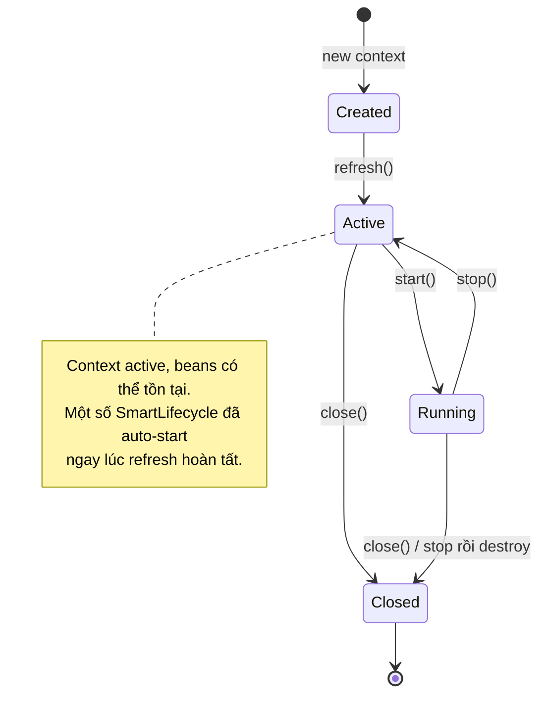
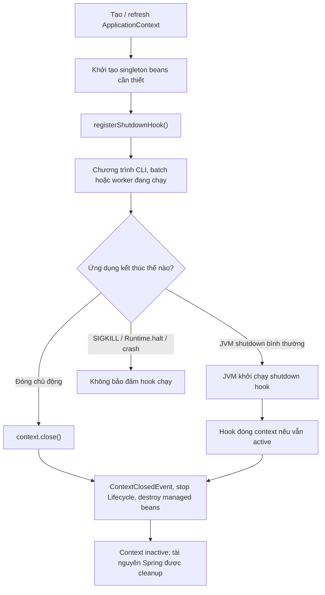

<a id="back-to-top"></a>

# Vòng đời context

## Menu
- [ConfigurableApplicationContext và các giai đoạn refresh](#context-lifecycle-001)
- [Nạp định nghĩa, chạy post-processor và tạo singleton](#context-lifecycle-002)
- [Phân biệt refresh, start, stop và close](#context-lifecycle-003)
- [Lifecycle cho thành phần cần khởi động, dừng chủ động](#context-lifecycle-004)
- [SmartLifecycle, autoStartup và thứ tự phase](#context-lifecycle-005)
- [Dừng có callback hoàn tất và giới hạn thời gian](#context-lifecycle-006)
- [registerShutdownHook và kết thúc ứng dụng ngoài môi trường web](#context-lifecycle-007)
- [Thất bại khi refresh và dọn dẹp tài nguyên đã tạo](#context-lifecycle-008)

## <a id="context-lifecycle-001">ConfigurableApplicationContext và các giai đoạn refresh</a>

<details>
<summary>Xem chi tiết</summary>

# ConfigurableApplicationContext và các giai đoạn refresh trong Spring Framework

## 1. ApplicationContext là gì, vì sao cần ConfigurableApplicationContext?

Trong Spring Core Container, **`ApplicationContext`** là giao diện đại diện cho container đã biết các bean definition, cung cấp bean, event, resource, message resolution và thông tin môi trường. Mã nghiệp vụ thường chỉ cần giao diện đọc này hoặc inject một dependency cụ thể.

**`ConfigurableApplicationContext`** mở rộng các khả năng quản trị vòng đời: có thể cấu hình context trước khi khởi động, yêu cầu `refresh()`, `start()`, `stop()`, `close()`, đăng ký application listener, shutdown hook và làm việc với `ConfigurableEnvironment`. Khi xây dựng ứng dụng/framework hoặc khởi tạo Spring container bằng tay, ta sử dụng API quản trị này.

Hai ví dụ quen thuộc:
- `AnnotationConfigApplicationContext`: container độc lập dùng `@Configuration`, `@Component` và Java annotation; tạo bằng constructor rỗng, `register(...)` rồi gọi `refresh()`.
- `ClassPathXmlApplicationContext`: context đọc bean definitions từ XML trên classpath, có cách xây dựng context đặc thù. Không cần XML nếu ứng dụng Java hiện đại dùng annotation config.

Ví dụ về sự khác nhau ở mức giao diện:

```java
import org.springframework.context.ApplicationContext;
import org.springframework.context.ConfigurableApplicationContext;

void useBeans(ApplicationContext context) {
    Object service = context.getBean("someService"); // Tra bean đang có.
}

void manageContext(ConfigurableApplicationContext context) {
    context.start(); // Tín hiệu Lifecycle, KHÔNG thay refresh().
    context.stop();
    context.close(); // Kết thúc vòng đời context.
}
```

Đây là fragment minh họa API, chưa phải chương trình Java độc lập (các method phải nằm trong một class). Trong ứng dụng do Spring Boot quản lý, không tùy tiện gọi `refresh()` hoặc `close()` từ một HTTP request: framework thường chịu trách nhiệm điều phối vòng đời chung.

### Những trạng thái cần phân biệt

```text
CONSTRUCTED (chưa refresh)
     |
     | register / scan / customize Environment / BeanFactoryPostProcessor
     v
refresh() đang chạy:
     prepare -> bean definitions -> processors -> infrastructure
               -> instantiate regular singletons -> finish refresh
     |
     v
ACTIVE / REFRESHED
     |                  |
     | start()/stop()   | getBean()/publishEvent()/ứng dụng phục vụ công việc
     | điều khiển        |
     | Lifecycle beans  |
     +------------------+
     |
     v
close() / shutdown
     |
     v
CLOSED (tài nguyên được giải phóng theo lifecycle)
```

`isActive()` cho biết context đã được đánh dấu active và chưa đóng; cờ này được bật từ **đầu** `refresh()`, nên không được dùng riêng nó để chứng minh toàn bộ ứng dụng đã ready. Khái niệm “context đã refresh hoàn tất”, “Lifecycle component đã start”, “server đang nhận kết nối” và “external dependency healthy” là những điều khác nhau.

## 2. Vòng đời điển hình của AnnotationConfigApplicationContext

Có hai cách khởi tạo phổ biến:

**Cách 1 — constructor thực hiện refresh ngay:**

```java
try (var context = new AnnotationConfigApplicationContext(AppConfig.class)) {
    MyService bean = context.getBean(MyService.class);
}
```

Constructor nhận class cấu hình sẽ đăng ký class và **refresh context** trước khi trả về. `AppConfig` và `MyService` trong fragment cần được định nghĩa trong dự án.

**Cách 2 — chủ động làm rõ giai đoạn cấu hình:**

```java
try (var context = new AnnotationConfigApplicationContext()) {
    context.register(AppConfig.class);
    context.getEnvironment().setActiveProfiles("dev");
    context.refresh();
    MyService bean = context.getBean(MyService.class);
}
```

Mẫu này cho phép thay đổi cấu hình môi trường **trước** `refresh()`. `register(AppConfig.class)` chưa chạy hết bean lifecycle; nó khai báo cấu hình đầu vào. Sau `refresh()` mới có container đã hoàn thành bootstrap. Trong thực tế nên chọn một cơ chế quản lý cấu hình rõ ràng, tránh thay đổi active profile trễ khi bean definitions đã được xử lý.

Với `AnnotationConfigApplicationContext`, cơ chế bean factory là `GenericApplicationContext`: **chỉ refresh một lần** trên cùng instance. Gọi `refresh()` lần thứ hai không phải cách “nạp lại” application từ đầu; nó có thể ném `IllegalStateException`. Một số triển khai khác như `ClassPathXmlApplicationContext`/`AbstractRefreshableApplicationContext` có hỗ trợ làm mới lặp lại khi context còn mở. Vì vậy không suy ra từ tên method rằng mọi `ConfigurableApplicationContext` đều hot-reload được.

## 3. Danh sách đầy đủ các pha chính trong refresh()

`AbstractApplicationContext.refresh()` là mẫu thuật toán (template method) chung cho nhiều context implementations. Nó đảm bảo các bước chuẩn bị, cấu hình container, tạo singleton, thông báo sự kiện và dọn dẹp khi thất bại. Đây là **thứ tự khái niệm** của các pha trọng tâm trong Spring Framework 6.x; cách triển khai chi tiết có thể khác giữa các subclass/phiên bản.

```text
refresh()
  |
  +--  1. prepareRefresh()
  |       state, startup time, property sources, required properties
  |
  +--  2. obtainFreshBeanFactory()
  |       nạp/lấy BeanFactory và bean definitions
  |
  +--  3. prepareBeanFactory(beanFactory)
  |       standard resolvers, Aware, ApplicationContext integration
  |
  +--  4. postProcessBeanFactory(beanFactory)
  |       subclass hook (chẳng hạn WebApplicationContext)
  |
  +--  5. invokeBeanFactoryPostProcessors(beanFactory)
  |       cấu hình/biến đổi bean definitions trước khi tạo bean thường
  |
  +--  6. registerBeanPostProcessors(beanFactory)
  |       đăng ký processor cho vòng đời từng bean
  |
  +--  7. initMessageSource()
  |       internationalized message resolution
  |
  +--  8. initApplicationEventMulticaster()
  |       hạ tầng phân phối application events
  |
  +--  9. onRefresh()
  |       subclass hook, ví dụ một số web context dựng web infrastructure
  |
  +-- 10. registerListeners()
  |       application listeners và early application events
  |
  +-- 11. finishBeanFactoryInitialization(beanFactory)
  |       chuẩn bị conversion service, preInstantiateSingletons()
  |       tạo các singleton thông thường, khởi tạo + callback tương ứng
  |
  +-- 12. finishRefresh()
          clear caches / lifecycleProcessor.onRefresh()
          publish ContextRefreshedEvent
  |
  +-- refresh completed successfully
```

Cần phân biệt **mốc đăng ký infrastructure** với **mốc chạy method của bean**. Việc đăng ký `BeanPostProcessor` tại bước 6 không đồng nghĩa tất cả bean người dùng đã được tạo. Bean singleton thường được khởi tạo ở bước 11, lúc các processor đã có cơ hội áp dụng vào lifecycle từng target.

### Bảng tra cứu nhanh

| Pha | Việc chính | Hệ quả quan sát |
| --- | --- | --- |
| `prepareRefresh` | Đánh dấu startup, chuẩn bị property sources, validate required properties | Config thiếu bắt buộc có thể làm refresh fail |
| `obtainFreshBeanFactory` | Lấy hoặc nạp BeanFactory/bean definitions | Class cấu hình và bean definitions được container quản lý |
| `prepareBeanFactory` | Thiết lập hạ tầng mặc định (class loader, expression resolver, resolvable dependencies, v.v.) | Bean có thể nhận một số `Aware` dependencies |
| `postProcessBeanFactory` | Hook cho subclass | Web context có thể thêm hỗ trợ môi trường web |
| `invokeBeanFactoryPostProcessors` | Chạy processors của **bean definition** | `@Configuration`/`@Bean`, component scanning được xử lý đúng cơ chế |
| `registerBeanPostProcessors` | Đăng ký processors của **bean instance** | Hỗ trợ `@Autowired`, `@PostConstruct`, proxy/AOP theo cấu hình |
| `initMessageSource` | MessageSource | `getMessage(...)` khả dụng theo context |
| `initApplicationEventMulticaster` | Hệ thống publish/listen events | Các event có nơi phân phối |
| `onRefresh` | Hook của context implementation | Context đặc thù hoàn thành bước riêng |
| `registerListeners` | Đăng ký listener và phát event sớm phù hợp | Listener nhận sự kiện lifecycle theo khả năng |
| `finishBeanFactoryInitialization` | Tạo eager singleton, chạy initialization callbacks | Singleton mặc định đã khởi tạo |
| `finishRefresh` | Kết thúc bootstrap, khởi động auto-start Lifecycle thích hợp, publish refresh event | `ContextRefreshedEvent` xuất hiện |

Các tên method trên thuộc cơ chế implementation của `AbstractApplicationContext`; chúng không phải “12 method mà ứng dụng luôn tự gọi”. Ứng dụng gọi một lần `refresh()`, Spring tự thực hiện thuật toán. Không tự gọi các method `protected` hoặc tìm cách thay đổi thứ tự chúng từ mã nghiệp vụ.

## 4. Các pha 1–4: chuẩn bị môi trường và BeanFactory

### 4.1. prepareRefresh()

Spring đặt thời điểm khởi động, thiết lập active state, khởi tạo property sources qua hook `initPropertySources()` và xác nhận các required properties đã khai báo trong `Environment`. Ngoài ra, context chuẩn bị hạ tầng giữ các event được phát khi listener chưa sẵn sàng.

Chẳng hạn code cấu hình trước refresh:

```java
AnnotationConfigApplicationContext context =
        new AnnotationConfigApplicationContext();
context.getEnvironment().setRequiredProperties("app.region");
context.register(AppConfig.class);
context.refresh(); // Fail nếu app.region chưa có trong Environment.
```

Đây là fragment cần class `AppConfig` và xử lý `close()` phù hợp. `setRequiredProperties` thuộc `ConfigurablePropertyResolver` của `ConfigurableEnvironment`; `refresh()` sẽ validate và có thể ném exception trước khi tạo singleton thông thường. Ví dụ không tạo thêm property `app.region` nên cố ý minh họa nhánh thiếu cấu hình.

**Không nhầm cờ `isActive()` với startup completed**: `prepareRefresh()` có thể đặt active flag trước khi phần lớn các bước còn lại xảy ra.

### 4.2. obtainFreshBeanFactory()

Giai đoạn này lấy một `ConfigurableListableBeanFactory` đại diện cho cấu hình bean. Ở một số context có thể refresh nhiều lần, Spring tạo một bean factory mới và đọc lại cấu hình; ở `GenericApplicationContext`, bean factory đã có từ trước và không được phép khởi tạo lại tùy tiện.

`BeanFactory` lưu bean definitions, scope, dependency graph và tạo instance. `ApplicationContext` là lớp tích hợp thêm event, resources, messages và lifecycle orchestration. Không phải mọi BeanFactory đều tự phát `ContextRefreshedEvent` như ApplicationContext.

### 4.3. prepareBeanFactory() và postProcessBeanFactory()

Spring cấu hình các thành phần hỗ trợ chuẩn như class loader, expression resolution, property editors, integration `ApplicationContextAware`/`EnvironmentAware` và các resolvable dependencies. Với context web, các subclass bổ sung wiring liên quan ServletContext/request/session ở hook phù hợp.

Phần lớn ứng dụng **không cần override** các hook này. Chúng dành cho tác giả infrastructure hoặc custom `ApplicationContext`; ứng dụng thường cấu hình thông qua `@Configuration`, `@Bean` và các extension point công khai.

## 5. Các pha 5–6: xử lý metadata trước, instance sau

Đây là điểm nối giữa **khai báo bean** và **khởi tạo bean**, đồng thời giải thích vì sao Spring không đơn giản quét class rồi lập tức gọi constructor:

| Extension point | Thao tác chính | Thời điểm trong `refresh()` |
| --- | --- | --- |
| `BeanDefinitionRegistryPostProcessor` | Đăng ký/chỉnh `BeanDefinition`, chẳng hạn phát hiện `@Configuration` và `@Bean` qua `ConfigurationClassPostProcessor` | Pha 5, trước factory processors thông thường |
| `BeanFactoryPostProcessor` | Chỉnh metadata, resolve cấu hình và placeholders | Pha 5, trước khi tạo các singleton ứng dụng |
| `BeanPostProcessor` | Inject, thực hiện callback hoặc bọc proxy quanh **instance** | Đăng ký ở pha 6, được gọi khi từng bean được tạo |

Ví dụ, `AutowiredAnnotationBeanPostProcessor` xử lý các injection points thích hợp; `CommonAnnotationBeanPostProcessor` tham gia callback `@PostConstruct`/`@PreDestroy` khi các API annotation tương ứng có sẵn. Với một singleton thông thường, luồng cục bộ gồm **constructor/factory → injection → before-initialization processors (có thể bao gồm `@PostConstruct`) → `afterPropertiesSet`/custom init → after-initialization processors (có thể tạo proxy)**. Mốc `SmartInitializingSingleton.afterSingletonsInstantiated()` đến sau vòng pre-instantiation và trước `ContextRefreshedEvent`.

Nếu processor cố gọi `getBean()` quá sớm, nó có thể tạo service trước khi các processors khác được đăng ký đầy đủ, gây thiếu injection/proxy kỳ vọng. Bài tiếp theo đi sâu vào cách đăng ký, thứ tự và kiểm thử post-processors; ở bài này chỉ cần nhớ **pha 5 xử lý definitions, pha 6 chuẩn bị xử lý instances, pha 11 khởi tạo eager singletons**.

## 6. Các pha 7–10: messages, events và context-specific infrastructure

`initMessageSource()` thiết lập bean có tên `messageSource` nếu tồn tại, hoặc fallback thích hợp để hỗ trợ internationalized messages. Người dùng thường khai báo `MessageSource` qua cấu hình thay vì override pha lifecycle.

`initApplicationEventMulticaster()` tạo hoặc lấy `ApplicationEventMulticaster` theo tên quy ước của Spring. Mặc định event listener thường chạy đồng bộ trong thread publish; nếu cấu hình executor bất đồng bộ, thứ tự và thời điểm hoàn tất thay đổi. **Không** mặc định dựa vào mọi listener đã làm xong mọi tác vụ bên ngoài khi một event được publish.

`onRefresh()` là hook cho subclass, ví dụ infrastructure của web application. Nó chạy **trước** pha khởi tạo tất cả regular singleton. Một bean tạo bởi infrastructure riêng có thể gây side effect sớm; không viết logic dựa vào giả định thứ tự classpath scanning giữa những bean độc lập.

`registerListeners()` đưa các listener đăng ký tĩnh hoặc bean `ApplicationListener` vào event multicaster, và phát các early application events đã được giữ lại. Với `@EventListener`, infrastructure adapter xử lý annotation thành listener tương ứng; không tự giả định mọi listener được khởi tạo trước pha singleton.

### Các event chuẩn của context

| Event | Thời điểm thường gặp | Ý nghĩa |
| --- | --- | --- |
| `ContextRefreshedEvent` | Cuối `refresh()` thành công | Context đã load definitions, processors, eager singletons và hoàn thành quá trình refresh |
| `ContextStartedEvent` | Sau lệnh `start()` | Lifecycle beans được gửi tín hiệu start |
| `ContextStoppedEvent` | Sau lệnh `stop()` | Lifecycle beans được gửi tín hiệu stop |
| `ContextClosedEvent` | Trong `close()`/shutdown hook | Context đang đóng, chuẩn bị hủy singleton và giải phóng tài nguyên |

Một parent/child ApplicationContext hierarchy có thể khiến event từ child được truyền lên parent. Listener cần kiểm tra `event.getApplicationContext()` nếu nghiệp vụ chỉ dành cho đúng context của nó. Event không phải thông điệp distributed: các context ở JVM/pod khác nhau không tự nhận cùng một Spring event.

## 7. Hai pha cuối: singleton pre-instantiation và finishRefresh

Ở `finishBeanFactoryInitialization(beanFactory)`, Spring hoàn thiện conversion service và những thiết lập cần thiết, sau đó gọi `preInstantiateSingletons()` trên BeanFactory tương ứng. Các singleton eager thông thường được tạo, inject, initialize. Spring không đảm bảo mọi singleton độc lập được tạo theo thứ tự class name hoặc file source; dependency và configuration quyết định nhiều phần trình tự.

Ở `finishRefresh()`, `LifecycleProcessor.onRefresh()` được gọi trước khi `ContextRefreshedEvent` được publish. Với các `SmartLifecycle` bean auto-start, Spring có thể khởi động chúng ở đây theo phase/depends-on. **Vì vậy listener `ContextRefreshedEvent` có thể thấy lifecycle components đã nhận auto-start**, nhưng không có nghĩa tất cả external dependency hoặc tác vụ asynchronous mà chúng khởi chạy đã hoạt động healthy.

`SmartLifecycle` khác `SmartInitializingSingleton`:
- `SmartInitializingSingleton`: callback một lần cuối pre-instantiation của regular singleton, thích hợp validate/xây registry.
- `SmartLifecycle`: tham gia start/stop, có phase và autoStartup, thích hợp listener, consumer hoặc component chạy dài.
- `ContextRefreshedEvent`: tín hiệu cấp ApplicationContext sau refresh, có thể có nhiều lần với implementation hỗ trợ refresh lại.
- `ApplicationRunner`/`CommandLineRunner`: extension Spring Boot chạy sau context refresh theo quy trình Boot, không thuộc 12 pha cơ bản của Spring Core `refresh()`.

## 8. Ví dụ Java 17+ chạy đầy đủ: quan sát refresh, start/stop, close

Mẫu sau dùng **Java 17+, Maven 3.9+ và Spring Framework 6.2.19**, không cần Spring Boot, servlet hay database. Ta tạo `AnnotationConfigApplicationContext` ở trạng thái chưa refresh, đăng ký config, gọi `refresh()` và quan sát thứ tự callback, event.

### Cấu trúc dự án

```text
context-refresh-demo/
├── pom.xml
└── src/main/java/edu/example/context/
    ├── AppConfig.java
    ├── DemoBean.java
    ├── ContextEvents.java
    └── Main.java
```

**pom.xml:**

```xml
<?xml version="1.0" encoding="UTF-8"?>
<project xmlns="http://maven.apache.org/POM/4.0.0"
         xmlns:xsi="http://www.w3.org/2001/XMLSchema-instance"
         xsi:schemaLocation="http://maven.apache.org/POM/4.0.0 https://maven.apache.org/xsd/maven-4.0.0.xsd">
    <modelVersion>4.0.0</modelVersion>
    <groupId>edu.example</groupId>
    <artifactId>context-refresh-demo</artifactId>
    <version>1.0.0</version>
    <properties>
        <maven.compiler.release>17</maven.compiler.release>
        <project.build.sourceEncoding>UTF-8</project.build.sourceEncoding>
    </properties>
    <dependencies>
        <dependency>
            <groupId>org.springframework</groupId>
            <artifactId>spring-context</artifactId>
            <version>6.2.19</version>
        </dependency>
    </dependencies>
    <build>
        <plugins>
            <plugin>
                <groupId>org.apache.maven.plugins</groupId>
                <artifactId>maven-compiler-plugin</artifactId>
                <version>3.13.0</version>
            </plugin>
            <plugin>
                <groupId>org.codehaus.mojo</groupId>
                <artifactId>exec-maven-plugin</artifactId>
                <version>3.5.0</version>
                <configuration>
                    <mainClass>edu.example.context.Main</mainClass>
                </configuration>
            </plugin>
        </plugins>
    </build>
</project>
```

**src/main/java/edu/example/context/DemoBean.java:**

```java
package edu.example.context;

import org.springframework.beans.factory.DisposableBean;
import org.springframework.beans.factory.InitializingBean;
import org.springframework.beans.factory.SmartInitializingSingleton;

public final class DemoBean
        implements InitializingBean, SmartInitializingSingleton, DisposableBean {

    public DemoBean() {
        System.out.println("bean: constructor");
    }

    @Override
    public void afterPropertiesSet() {
        System.out.println("bean: afterPropertiesSet");
    }

    @Override
    public void afterSingletonsInstantiated() {
        System.out.println("bean: afterSingletonsInstantiated");
    }

    @Override
    public void destroy() {
        System.out.println("bean: destroy");
    }
}
```

**src/main/java/edu/example/context/ContextEvents.java:**

```java
package edu.example.context;

import org.springframework.context.ApplicationListener;
import org.springframework.context.event.ApplicationContextEvent;
import org.springframework.context.event.ContextClosedEvent;
import org.springframework.context.event.ContextRefreshedEvent;
import org.springframework.context.event.ContextStartedEvent;
import org.springframework.context.event.ContextStoppedEvent;

public final class ContextEvents
        implements ApplicationListener<ApplicationContextEvent> {

    @Override
    public void onApplicationEvent(ApplicationContextEvent event) {
        if (event instanceof ContextRefreshedEvent) {
            System.out.println("event: refreshed");
        } else if (event instanceof ContextStartedEvent) {
            System.out.println("event: started");
        } else if (event instanceof ContextStoppedEvent) {
            System.out.println("event: stopped");
        } else if (event instanceof ContextClosedEvent) {
            System.out.println("event: closed");
        }
    }
}
```

**src/main/java/edu/example/context/AppConfig.java:**

```java
package edu.example.context;

import org.springframework.context.annotation.Bean;
import org.springframework.context.annotation.Configuration;

@Configuration(proxyBeanMethods = false)
public class AppConfig {
    @Bean
    public DemoBean demoBean() {
        return new DemoBean();
    }

    @Bean
    public ContextEvents contextEvents() {
        return new ContextEvents();
    }
}
```

**src/main/java/edu/example/context/Main.java:**

```java
package edu.example.context;

import org.springframework.context.annotation.AnnotationConfigApplicationContext;

public final class Main {
    public static void main(String[] args) {
        AnnotationConfigApplicationContext context =
                new AnnotationConfigApplicationContext();

        System.out.println("before refresh: active=" + context.isActive());
        context.register(AppConfig.class);

        try {
            context.refresh();
            System.out.println("after refresh: active=" + context.isActive());

            context.start();
            context.stop();
        } finally {
            context.close();
        }

        System.out.println("after close: active=" + context.isActive());
    }
}
```

Chạy trong thư mục chứa `pom.xml`:

```bash
mvn -q compile exec:java
```

**Các dòng `System.out.println` của chương trình, theo thứ tự:**

```text
before refresh: active=false
bean: constructor
bean: afterPropertiesSet
bean: afterSingletonsInstantiated
event: refreshed
after refresh: active=true
event: started
event: stopped
event: closed
bean: destroy
after close: active=false
```

Spring/Maven có thể tạo log riêng, nhưng các dòng `System.out` là kết quả xác định của chương trình tối giản này khi refresh thành công. Lưu ý `context.start()` và `context.stop()` **vẫn phát event** dù mẫu không có custom `Lifecycle` bean nào cần start hoặc stop. `close()` phát `ContextClosedEvent` trước khi các singleton được destroy, vì vậy event đóng được in **trước** `bean: destroy`.

Mẫu cố ý không gọi `refresh()` lần thứ hai: `AnnotationConfigApplicationContext` không hỗ trợ refresh lại cùng instance. Trong production, dùng context do framework quản lý và đóng theo vòng đời ứng dụng, tránh gọi `close()` giữa request còn chạy.

## 9. Cấu hình context trước refresh và trách nhiệm quản lý

`ConfigurableApplicationContext` cho phép cấu hình thêm trước khi bootstrap. Một số API thường gặp:

| API | Tác dụng | Thời điểm nên gọi |
| --- | --- | --- |
| `setEnvironment(...)` | Cung cấp `ConfigurableEnvironment` riêng | Trước refresh |
| `getEnvironment().setActiveProfiles(...)` | Chọn profile | Trước xử lý bean definitions/refresh |
| `addBeanFactoryPostProcessor(...)` | Thêm processor cấp BeanFactory | Trước refresh |
| `addApplicationListener(...)` | Đăng ký listener tĩnh | Trước refresh hoặc sau khi event system active, theo API |
| `setParent(...)` | Đặt parent context | Trước refresh |
| `refresh()` | Bootstrap container | Theo quy tắc implementation, thường một lần |
| `getBeanFactory()` | Truy cập nội bộ ConfigurableListableBeanFactory | Dùng cẩn trọng, thường cho framework/infrastructure |
| `registerShutdownHook()` | JVM hook tự đóng context khi shutdown | Khi app tự quản lý context mà chưa có shutdown manager khác |
| `start()/stop()` | Gửi tín hiệu Lifecycle | Sau refresh, không thay thế refresh/close |
| `close()` | Đóng context, hủy singleton | Khi kết thúc ứng dụng/container |

Đừng tự gắn `registerShutdownHook()` rồi cũng chủ động gọi `close()` mà lo bean chắc chắn bị destroy hai lần: Spring có cơ chế tránh close trùng trên cùng context, nhưng thiết kế shutdown vẫn nên có **một nơi chịu trách nhiệm chính**. `try-with-resources` thuận tiện cho CLI/test tự tạo context vì `ConfigurableApplicationContext` hỗ trợ `close()`.

### BeanFactoryPostProcessor nên được đăng ký ở đâu?

Ví dụ fragment:

```java
AnnotationConfigApplicationContext ctx =
        new AnnotationConfigApplicationContext();
ctx.addBeanFactoryPostProcessor(factory -> {
    // Chỉnh metadata trước khi bean thông thường được instantiate.
});
ctx.register(AppConfig.class);
ctx.refresh();
```

Đây chỉ là đoạn minh họa, chưa có `AppConfig` và cleanup. Callback nhận `ConfigurableListableBeanFactory` cho phép truy cập bean definitions; tránh gọi `factory.getBean(...)` tùy tiện bên trong để không tạo instance quá sớm.

Nếu cần tùy biến definitions thông qua Java config, ưu tiên các annotation/spring extension đã hỗ trợ, chỉ dùng processor cấp thấp khi thật sự cần thay đổi metadata.

## 10. Refresh thất bại: exception, rollback và cleanup

Khi refresh gặp exception, Spring chủ động dọn các singleton đã tạo trong BeanFactory theo cơ chế lifecycle, hủy context bootstrap và báo lỗi ra caller. `ConfigurableApplicationContext.refresh()` có contract tránh để lại các singleton đã tạo dở trong một lần startup thất bại. Tuy nhiên điều đó **không bảo đảm hoàn tác mọi side effect** của mã ứng dụng: nếu `@PostConstruct` tự gửi email, ghi DB, mở socket ngoài kiểm soát hoặc start thread, Spring không thể “undo” các thao tác ấy một cách tự động.

```text
refresh()
  |
  +-- prepare, process bean definitions, instantiate beans
  |
  +-- @PostConstruct / factory method / processor ném exception
  |
  +-- destroy already-created singletons (best effort)
  +-- cancelRefresh() / reset status
  +-- propagate failure tới caller
```

Các điểm cần lưu ý:
- Cấu hình không hợp lệ, thiếu dependency và vòng phụ thuộc không hỗ trợ thường phát sinh `BeansException` hoặc `BeanCreationException` với nguyên nhân chi tiết.
- Bean lazy có thể không được tạo tại startup; lỗi trong bean đó có thể chỉ xuất hiện tại lần gọi đầu tiên, **không** nhất thiết trong refresh.
- Một context chỉ cho refresh một lần có thể không được retry refresh sau lỗi; tạo instance context mới và sửa nguyên nhân thay vì gọi lại bừa bãi.
- Cleanup phụ thuộc việc singleton đã được Spring quản lý đầy đủ hay chưa. Nếu tạo resource rồi ném exception giữa constructor/init, nên tự đảm bảo cleanup cục bộ.
- Nhiều context ở parent-child hierarchy có vòng đời độc lập; close child không tự đóng parent, và không coi refresh child là refresh toàn bộ hierarchy.

Mẫu fail-fast phù hợp: dùng `@ConfigurationProperties` validation, constructor preconditions hoặc `@PostConstruct` kiểm tra điều kiện bắt buộc; nếu resource ngoài có thể tạm không sẵn sàng, cần readiness/retry/timeout rõ ràng thay vì treo vô hạn ở refresh.

## 11. start(), stop(), close() và các sự kiện không thay thế nhau

`refresh()` **tạo và chuẩn bị** container. `start()` và `stop()` thuộc `Lifecycle` control; chúng gửi tín hiệu đến các `Lifecycle` bean được quản lý và publish context events tương ứng. `close()` **kết thúc** context: publish closing event, dừng lifecycle components qua processor phù hợp và destroy singleton.

```text
          refresh
 NEW  ----------------->  CONTEXT REFRESHED
                                  |
                                  | start()
                                  v
                           Lifecycle STARTED
                                  |
                                  | stop()
                                  v
                           Lifecycle STOPPED
                                  |
                                  | start()
                                  v
                           Lifecycle STARTED
                                  |
                                  | close()
                                  v
                            CONTEXT CLOSED
```

Đây là mô hình khái niệm; trong Spring, một số `SmartLifecycle` bean có thể **auto-start ngay trong finishRefresh()` mà không cần ứng dụng gọi `start()`. Khi `stop()` được gọi, context vẫn còn tồn tại và thường vẫn có thể `getBean()`; chỉ các components quản lý `Lifecycle` nhận tín hiệu dừng. `stop()` không destroy mọi singleton, không xóa toàn bộ definitions và không khởi tạo lại chúng khi `start()`.

Sau `close()`, context kết thúc vòng đời; không gọi `refresh()`/`start()` như cách tái sử dụng một context đã đóng. Với các implementation hỗ trợ nhiều refresh khi **chưa đóng**, đó là ngoại lệ có quy tắc riêng, không biến context đã close thành reusable container.

### SmartLifecycle có phase

`SmartLifecycle` cung cấp `isAutoStartup()`, `getPhase()` và callback `stop(Runnable)` (cùng các method của `Lifecycle`). Tùy version, Spring xử lý startup theo phase tăng dần, shutdown theo phase giảm dần, kết hợp dependency ordering. Nếu cần consumer đợi repository hoặc connection infrastructure, khai báo dependency và phase rõ ràng; không dựa vào listener `ContextRefreshedEvent` để giải quyết toàn bộ thứ tự startup.

## 12. Các bẫy thường gặp với refresh trong Spring Boot, Web và test

### 12.1. Gọi refresh() lại để “reload configuration”

Trong `AnnotationConfigApplicationContext` và nhiều context quản lý bởi Spring Boot, gọi lại `refresh()` không phải cơ chế reload cấu hình runtime hợp lệ. Nó có thể thất bại vì implementation không hỗ trợ multiple refresh. Nếu cần thay đổi cấu hình lúc runtime, thiết kế dynamic config có lifecycle rõ, publish immutable snapshot, hoặc xây lại context mới theo nhu cầu kiểm soát.

### 12.2. Thay Environment sau refresh và mong bean thay đổi

`@Value`, `@ConfigurationProperties`, `@Profile` và `@Conditional` được xử lý ở các giai đoạn khác nhau. Việc gọi `environment.setActiveProfiles("prod")` sau refresh không có nghĩa Spring sẽ tự hủy/tạo lại bean theo profile mới. Bean definitions đã được xử lý, singleton đã tạo. Đặt các profile/property sources trước refresh, hoặc dùng cơ chế refresh cấu hình đặc thù có kiểm soát khi ứng dụng cung cấp.

### 12.3. Khởi chạy job lâu trong @PostConstruct

`@PostConstruct` chạy trong initialization của bean, thường trước `finishRefresh()`. Job mạng kéo dài có thể làm context startup chậm, timeout hoặc fail; lời gọi self-invocation đến method `@Transactional`/`@Async` cũng có thể bỏ qua proxy. Dùng lifecycle hook phù hợp sau refresh hoặc `SmartLifecycle` cho component dài hạn. Trong Spring Boot có thể dùng runner nếu công việc cần thực thi cấp ứng dụng.

### 12.4. Hiểu sai ContextRefreshedEvent là server đã healthy

Event xác nhận context refresh hoàn thành, không chứng minh database, Kafka, Redis, DNS, external API hay readiness của server đã sẵn sàng tuyệt đối. Trong Spring Boot, actuator health/readiness có semantics riêng và cần cấu hình theo hệ thống. Nếu listener `ContextRefreshedEvent` gọi external service trực tiếp, cần timeout/retry/failure policy rõ.

### 12.5. Tạo bean thủ công ngoài container

`new MyService()` không đi qua Spring BeanFactory, vì thế nó không nhận tự động injection, BeanPostProcessor, init callbacks hay destruction management. Đối với dependencies cần container quản lý, hãy khai báo `@Bean`, `@Component`/scan hoặc factory infrastructure phù hợp. Đừng dùng `getBean()` ở khắp code nghiệp vụ nếu constructor injection đã giải quyết được.

### 12.6. ApplicationListener được gọi nhiều lần khi có child context

Một context hierarchy có thể truyền `ApplicationEvent` từ child lên parent. Listener nên kiểm tra `event.getApplicationContext() == myContext` khi nó chỉ muốn xử lý refresh của chính context; ngoài ra một implementation hỗ trợ hot refresh có thể phát event nhiều lần. Không coi `ContextRefreshedEvent` là global exactly-once job.

### 12.7. Đăng ký listener quá muộn

`addApplicationListener(...)` sau khi `ContextRefreshedEvent` đã được phát không tự phát lại sự kiện quá khứ. Nếu bạn cần quan sát lần refresh đầu tiên, đăng ký listener **trước** `refresh()` (hoặc khai báo listener bean sẵn). Cơ chế event thông thường không cung cấp replay lịch sử cho mọi subscriber đến muộn.

### 12.8. Quên close() khi tạo context trong integration test / CLI

Context có thể giữ thread pool, connection, singleton resource. Với `AnnotationConfigApplicationContext` tự tạo, dùng `try-with-resources` hoặc `finally { context.close(); }`. `close()` kích hoạt lifecycle shutdown và các destruction callbacks của singleton; prototype được container tạo thường không tự có đầy đủ destruction management như singleton. Framework test Spring có context cache và quản lý vòng đời riêng, không tùy ý đóng cached context trong từng test.

## 13. Debug khi context không startup hoặc startup sai thứ tự

Một checklist thực hành:

1. **Xác nhận context implementation**: `AnnotationConfigApplicationContext`, `ClassPathXmlApplicationContext`, `WebApplicationContext` hay Spring Boot context? Khả năng refresh lại khác nhau.
2. **Kiểm tra cấu hình trước refresh**: active profiles, property sources, required properties, class scanning, `@Import` và `@Bean` definitions.
3. **Xem root cause của exception**: `NoSuchBeanDefinitionException`, `BeanCreationException`, circular dependencies, constructor exceptions hoặc BeanPostProcessor failures.
4. **Phân biệt giai đoạn**: nếu chưa vào `finishBeanFactoryInitialization()`, lỗi có thể thuộc parsing/processor/infrastructure; nếu lỗi trong `@PostConstruct`, bean đã qua constructor và phần lớn injection.
5. **Quan sát events**: log `ContextRefreshedEvent` và `ContextClosedEvent`, kiểm tra đúng application context khi có parent-child.
6. **Chẩn đoán init order**: thiếu dependency relationship? Ghi rõ `@DependsOn` hoặc constructor dependency; `@Order` không phải công cụ chung điều phối mọi lần tạo singleton.
7. **Kiểm tra lazy beans**: một bean lazy hỏng có thể không gây lỗi ngay lúc refresh, nhưng fail ở request đầu tiên.
8. **Theo dõi bean post-processors**: dependency của processor có bị tạo trước khi infrastructure hoàn tất không? Đây là nguồn lỗi proxy/injection khó thấy.
9. **Tránh blocking vô hạn**: timeout, retry policy và quản lý background work ở đúng lifecycle.
10. **Xem xét shutdown**: context đóng chưa? `@PreDestroy`/`DisposableBean`/custom destroy method được đăng ký và scope có được Spring quản lý hủy không?

### Theo dõi thời gian startup

Spring cung cấp API `ApplicationStartup` để ghi nhận các startup steps. `BufferingApplicationStartup` có thể thu các bước vào buffer phục vụ phân tích; `FlightRecorderApplicationStartup` tích hợp Java Flight Recorder cho profiling chi tiết hơn. Đây là instrumentation giúp biết đoạn nào chậm, không thay đổi thứ tự/hợp đồng vòng đời. Với Spring Boot, các tính năng startup endpoint/observability liên quan cần cấu hình phù hợp nếu muốn expose dữ liệu đo.

## 14. Tự kiểm tra

1. `ApplicationContext` khác `ConfigurableApplicationContext` ở mục đích sử dụng nào?
2. `new AnnotationConfigApplicationContext(AppConfig.class)` đã gọi `refresh()` hay chưa?
3. Khi dùng constructor rỗng của `AnnotationConfigApplicationContext`, cần thao tác nào sau `register(...)` để tạo eager singleton?
4. `BeanFactoryPostProcessor` và `BeanPostProcessor` khác nhau ở thời điểm và đối tượng bị xử lý như thế nào?
5. `@PostConstruct` của bean A có bảo đảm bean B không có dependency với A đã được tạo không?
6. Khi nào `SmartInitializingSingleton.afterSingletonsInstantiated()` chạy so với `ContextRefreshedEvent`?
7. Vì sao `isActive() == true` chưa đủ chứng minh refresh đã hoàn thành và server ready?
8. Gọi `start()` có tạo lại singleton hay chạy lại `@PostConstruct` không?
9. Lệnh `stop()` có giống `close()` không? Vì sao?
10. `ContextClosedEvent` xuất hiện trước hay sau khi Spring destroy singleton thông thường?
11. Có thể gọi `refresh()` lần thứ hai với một `AnnotationConfigApplicationContext` không?
12. Khi `@Bean` factory tạo resource rồi init ném exception, Spring có rollback mọi side effect ngoài container không?
13. Nếu code thêm listener sau khi context đã refresh, listener có tự nhận `ContextRefreshedEvent` trước đó không?
14. Nếu context có parent và child, close child có đóng parent không?
15. Một ứng dụng có ba pod, mỗi pod một context. `ContextRefreshedEvent` có phải chỉ phát đúng một lần trên toàn cluster không?

**Đáp án gợi ý:**

1. `ApplicationContext` là API sử dụng bean/services; `ConfigurableApplicationContext` thêm quản trị startup, environment và shutdown.
2. Có, constructor đó đăng ký cấu hình và refresh.
3. Gọi `refresh()` đúng một lần.
4. Factory processor biến đổi metadata trước instantiate; bean processor tham gia lifecycle instance.
5. Không; hook chỉ của bean A.
6. Smart callback cuối pre-instantiation; refresh event phát sau `finishRefresh()`.
7. Active được bật ở đầu refresh, không phải health signal.
8. Không; chỉ tín hiệu cho `Lifecycle` beans và phát event started.
9. Không; stop không destroy context, close chấm dứt lifecycle và hủy singleton.
10. Trước, trong quy trình đóng thông thường.
11. Không; generic bean factory không hỗ trợ nhiều lần refresh.
12. Không; phải chủ động kiểm soát side effects bên ngoài.
13. Không; events không tự được replay.
14. Không; mỗi context có vòng đời riêng.
15. Không; mỗi context/pod có refresh event của nó.

## Tài liệu chính thức

- Spring Framework — Additional Capabilities of the ApplicationContext (lifecycle events): https://docs.spring.io/spring-framework/reference/core/beans/context-introduction.html
- Spring Framework — `ConfigurableApplicationContext` Javadoc: https://docs.spring.io/spring-framework/docs/6.2.x/javadoc-api/org/springframework/context/ConfigurableApplicationContext.html
- Spring Framework — `AbstractApplicationContext` Javadoc (`refresh()` và các template hooks): https://docs.spring.io/spring-framework/docs/6.2.x/javadoc-api/org/springframework/context/support/AbstractApplicationContext.html
- Spring Framework — `AbstractRefreshableApplicationContext` Javadoc (refreshable context): https://docs.spring.io/spring-framework/docs/6.2.x/javadoc-api/org/springframework/context/support/AbstractRefreshableApplicationContext.html
- Spring Framework — `AnnotationConfigApplicationContext` Javadoc: https://docs.spring.io/spring-framework/docs/6.2.x/javadoc-api/org/springframework/context/annotation/AnnotationConfigApplicationContext.html
- Spring Framework — Container Extension Points: https://docs.spring.io/spring-framework/reference/core/beans/factory-extension.html
- Spring Framework — `SmartInitializingSingleton` Javadoc: https://docs.spring.io/spring-framework/docs/6.2.x/javadoc-api/org/springframework/beans/factory/SmartInitializingSingleton.html
- Spring Framework — Customizing the Nature of a Bean: https://docs.spring.io/spring-framework/reference/core/beans/factory-nature.html


</details>

- [Quay lại đầu trang](#back-to-top)

---

## <a id="context-lifecycle-002">Nạp định nghĩa, chạy post-processor và tạo singleton</a>

<details>
<summary>Xem chi tiết</summary>

# Vòng đời ApplicationContext: nạp định nghĩa, chạy post-processor và tạo singleton

## 1. Mục tiêu và ý nghĩa

Một Spring `ApplicationContext` không đơn giản “quét class rồi gọi constructor”. Trong lúc `refresh()`, container đi qua nhiều bước được thiết kế có thứ tự: **đọc và đăng ký bean definitions**, mở cơ hội cho những extension point chỉnh sửa metadata, **đăng ký các processor chạy trên instance**, cuối cùng **tạo các singleton không lazy** và công bố sự kiện context đã refresh.

Hiểu trình tự này giúp trả lời những câu hỏi thường gặp:

- Vì sao `BeanFactoryPostProcessor` thay đổi metadata trước khi bean được tạo?
- `BeanDefinitionRegistryPostProcessor` khác `BeanFactoryPostProcessor` ở quyền gì?
- Vì sao `BeanPostProcessor` được đăng ký trước lúc khởi tạo bean nghiệp vụ?
- Tại sao constructor, `@PostConstruct`, `afterPropertiesSet()`, custom init, `SmartInitializingSingleton` và `ContextRefreshedEvent` xuất hiện vào những thời điểm khác nhau?
- “Singleton được tạo lúc startup” có ngoại lệ nào với `@Lazy`, `prototype` và `FactoryBean`?
- Khi nào việc gọi `getBean()` sớm làm phá vỡ kỳ vọng post-processing?

Bài học tập trung vào **Core Container của Spring Framework 6.2**, áp dụng được cho các phiên bản 6.x có cùng hợp đồng. Spring Boot bổ sung auto-configuration, runners và một số lifecycle event; chúng nằm ở lớp cao hơn, không thay đổi nguyên tắc cơ bản này.

## 2. Bốn đối tượng cần phân biệt

| Khái niệm | Là gì? | Ví dụ |
| --- | --- | --- |
| **Bean definition** | Metadata/container recipe mô tả class/factory method, scope, dependencies, lazy, init/destroy callbacks | `BeanDefinition`, `RootBeanDefinition` |
| **Bean instance** | Đối tượng thực sự được container tạo hoặc nhận từ factory, có lifecycle riêng | `new OrderService(...)` |
| **BeanFactory** | Thành phần giữ definitions, tạo và tra cứu beans, quản lý scope | `ConfigurableListableBeanFactory`, `DefaultListableBeanFactory` |
| **ApplicationContext** | Container cấp cao tích hợp BeanFactory với Environment, events, resources, internationalization và lifecycle | `AnnotationConfigApplicationContext`, `GenericApplicationContext` |

Từ khóa dễ nhầm: “bean đã đăng ký” có thể chỉ **bean definition tồn tại**, hoàn toàn chưa có instance. `containsBeanDefinition("orderService")` có thể trả `true` trước khi constructor của `OrderService` chạy.

`BeanDefinition` thường ghi nhận type/constructor args/property values/scope/lazy flags. Các bean definition còn có thể gắn factory method, parent definition hoặc cấu hình cần được hậu xử lý trước khi cuối cùng tạo instance.

## 3. Bức tranh tổng thể của refresh()

Trong các `AbstractApplicationContext`, `refresh()` là điểm điều phối quan trọng. Sơ đồ giản lược, giữ các giai đoạn trọng tâm:

```text
refresh()
  |
  +--> prepareRefresh()
  |       - trạng thái khởi động, environment
  |
  +--> obtainFreshBeanFactory()
  |       - có/đưa về BeanFactory phù hợp
  |       - nạp bean definitions tùy loại context
  |
  +--> prepareBeanFactory()
  |       - class loader, expression resolver,
  |         một số Aware/processor nền tảng
  |
  +--> postProcessBeanFactory() [hook của subclass]
  |
  +--> invokeBeanFactoryPostProcessors()
  |       - BeanDefinitionRegistryPostProcessor
  |       - BeanFactoryPostProcessor
  |       - xử lý @Configuration, @Bean, @Import,
  |         @ComponentScan, placeholders... khi phù hợp
  |
  +--> registerBeanPostProcessors()
  |       - chuẩn bị processor xử lý bean instance
  |
  +--> initMessageSource()
  +--> initApplicationEventMulticaster()
  +--> onRefresh() [hook của subclass]
  +--> registerListeners()
  |
  +--> finishBeanFactoryInitialization()
  |       - còn bước chuẩn bị/metadata khác
  |       - preInstantiateSingletons()
  |       - tạo singleton non-lazy bình thường
  |       - callback SmartInitializingSingleton
  |
  +--> finishRefresh()
          - khởi động lifecycle processor thích hợp
          - phát ContextRefreshedEvent
          - thông báo context hoàn thành refresh
```

Đây là bản diễn giải định hướng học tập, **không phải copy nguyên source**. Chẳng hạn với `GenericApplicationContext` hoặc `AnnotationConfigApplicationContext`, một số definitions đã được đăng ký **trước** `refresh()` qua `register(...)`, `registerBean(...)` hay registry APIs. Với những context đọc XML, definitions có thể được nạp trong quá trình `obtainFreshBeanFactory()`. Đừng khẳng định mọi loại context “chỉ bắt đầu đăng ký definitions sau khi gọi `refresh()`”.

**Bất biến quan trọng:** các processor xử lý **metadata của BeanFactory** phải được chạy trước vòng khởi tạo hàng loạt singleton thông thường. Các `BeanPostProcessor` cần được đăng ký trước khi bean nghiệp vụ được tạo để có cơ hội áp dụng đầy đủ.

## 4. Nạp và xây dựng bean definitions

### 4.1. Nguồn bean definition

Spring có thể nhận metadata từ nhiều nguồn:

- XML `<bean>`: class, constructor args, property values, scope, init/destroy methods.
- `@Configuration` và `@Bean`: phương thức factory trở thành bean definition; class cấu hình cũng có definition.
- `@Component`, `@Service`, `@Repository` và `@Controller`: component scanning phát hiện class và tạo definitions.
- `@Import`, `ImportSelector`, `ImportBeanDefinitionRegistrar`: thêm nội dung cấu hình/definitions theo hợp đồng.
- Java API: `GenericApplicationContext.registerBean(...)` hoặc `BeanDefinitionRegistry.registerBeanDefinition(...)`.
- Extension points: `BeanDefinitionRegistryPostProcessor` có thể đăng ký thêm definitions trước lúc tạo bean nghiệp vụ.

Các cách trên không mặc nhiên tạo instance ngay khi vừa đăng ký. `@ComponentScan` cũng không “new mọi class ở lúc scan”: nó đưa metadata vào registry để container xử lý về sau.

### 4.2. Class metadata và runtime instance

Ví dụ một định nghĩa chương trình:

```java
BeanDefinition definition = BeanDefinitionBuilder
        .genericBeanDefinition(ReportService.class)
        .setScope(BeanDefinition.SCOPE_SINGLETON)
        .setLazyInit(false)
        .getBeanDefinition();

registry.registerBeanDefinition("reportService", definition);
```

Đây là **mảnh code minh họa**, yêu cầu `registry` kiểu `BeanDefinitionRegistry` và một class `ReportService` thực sự tồn tại; không phải chương trình Java độc lập. `registerBeanDefinition` ở đây chủ yếu đưa *recipe* vào registry. Constructor sẽ chạy khi bean cần được tạo, thường trong `preInstantiateSingletons()` nếu nó là singleton non-lazy bình thường.

Đăng ký hai definition cùng tên, alias, bean definition override và điều kiện cấu hình là các chủ đề độc lập. Với production, tránh dựa trên quy tắc override theo mặc định vì có thể khác giữa container/configuration.

### 4.3. @ConfigurationClassPostProcessor

`ConfigurationClassPostProcessor` là extension point tiêu biểu: nó là `BeanDefinitionRegistryPostProcessor` và diễn giải `@Configuration`, `@ComponentScan`, `@Import`, `@Bean` cùng các cấu trúc cấu hình liên quan. Do nó có thể phát hiện và đăng ký **thêm** bean definitions, việc chạy bước cấu hình phải hoàn thành trước khi Spring quyết định vòng khởi tạo singleton thông thường.

Một class:

```java
@Configuration(proxyBeanMethods = false)
class AppConfiguration {
    @Bean
    ServiceA serviceA() {
        return new ServiceA();
    }
}
```

không nên được hiểu như “ngay khi đọc annotation, Spring đã gọi `serviceA()` và tạo `ServiceA`”. Method `@Bean` trở thành một factory recipe; Spring gọi phương thức ở thời điểm bean thực sự được yêu cầu theo scope.

Đây là mảnh cấu hình minh họa, chưa bao gồm imports và definitions của `ServiceA`.

## 5. BeanDefinitionRegistryPostProcessor: can thiệp vào registry

Giao diện `org.springframework.beans.factory.support.BeanDefinitionRegistryPostProcessor` mở rộng `BeanFactoryPostProcessor` với thêm method:

```java
void postProcessBeanDefinitionRegistry(
        BeanDefinitionRegistry registry);
```

Đây là chữ ký minh họa từ interface. Nó cho phép đăng ký hoặc điều chỉnh bean definitions **trước khi các `BeanFactoryPostProcessor` thông thường được phát hiện và chạy**.

Một implementation có hai điểm móc:

```java
class CustomRegistrar implements BeanDefinitionRegistryPostProcessor {

    @Override
    public void postProcessBeanDefinitionRegistry(
            BeanDefinitionRegistry registry) {
        // Registry phase: thêm/chỉnh definitions.
    }

    @Override
    public void postProcessBeanFactory(
            ConfigurableListableBeanFactory beanFactory) {
        // BeanFactory phase: xem/chỉnh factory metadata.
    }
}
```

Đây là mảnh minh họa; cần imports của `BeanDefinitionRegistryPostProcessor`, `BeanDefinitionRegistry` và `ConfigurableListableBeanFactory`. Hai method thuộc **hai pha gọi khác nhau** dù cùng một instance processor.

Các công việc hợp lý trong registry phase: thêm bean definition có điều kiện, chỉnh scope/lazy flag, tạo synthetic infrastructure bean definition, hoặc tích hợp một cơ chế cấu hình riêng. Vì đây là lúc container còn đang xây dựng metadata, **không gọi `getBean()` chỉ để “xem bean có chạy không”**: điều đó có thể làm instance bị tạo quá sớm, trước khi các processor khác sẵn sàng.

### Registry processor có thể tiếp tục đăng ký processor khác

Spring phải xử lý trường hợp một `BeanDefinitionRegistryPostProcessor` đăng ký thêm một `BeanDefinitionRegistryPostProcessor` khác. Vì vậy một cách triển khai chuẩn sẽ tiếp tục tìm các registry processors chưa chạy trước khi kết thúc pha registry. Điều này là một lý do không thể suy luận đơn giản thứ tự chỉ dựa vào vị trí các method Java trong source.

Khi các registry processors được Spring tự phát hiện thành beans, `PriorityOrdered` và `Ordered` giúp sắp xếp **trong nhóm phù hợp**; với processor đăng ký trực tiếp qua `ConfigurableApplicationContext.addBeanFactoryPostProcessor(...)`, thứ tự đăng ký chương trình là yếu tố áp dụng cho nhóm đó, và metadata order không được dùng theo cùng cách.

## 6. BeanFactoryPostProcessor: chỉnh định nghĩa trước khi tạo bean

`BeanFactoryPostProcessor` định nghĩa:

```java
void postProcessBeanFactory(
        ConfigurableListableBeanFactory beanFactory);
```

Đây là chữ ký API minh họa. Processor này xử lý **BeanFactory và bean definitions**, không xử lý **một bean instance vừa được constructor tạo**.

Ví dụ hợp lý:

- Sửa property value có trong `BeanDefinition`.
- Áp dụng cấu hình placeholder bằng `PropertySourcesPlaceholderConfigurer`.
- Đăng ký custom scope bằng `CustomScopeConfigurer`.
- Điều chỉnh metadata để các bean sau này được tạo đúng.

Thứ tự logic tổng quát:

```text
Definitions đã có trong registry
    -> registry post-processors chạy
    -> factory post-processors chạy
    -> BeanPostProcessors được đăng ký
    -> singleton thường được tạo
```

**Lưu ý**: nếu code của một `BeanFactoryPostProcessor` chủ động gọi `getBean()`, nó **có thể ép khởi tạo một bean sớm**. Điều đó phá vỡ lợi thế của giai đoạn metadata và có thể khiến bean không được xử lý đầy đủ bởi `BeanPostProcessor` hoặc AOP proxy. Đây là anti-pattern đáng tránh.

### BeanFactoryPostProcessor so với BeanPostProcessor

| Tiêu chí | BeanFactoryPostProcessor | BeanPostProcessor |
| --- | --- | --- |
| Đối tượng được xử lý | BeanFactory và metadata/bean definitions | Bean instance |
| Thời điểm điển hình | Trong `invokeBeanFactoryPostProcessors()`, trước tạo singleton thông thường | Trong quá trình khởi tạo từng bean |
| API trọng tâm | `postProcessBeanFactory(...)` | `postProcessBeforeInitialization(...)` / `postProcessAfterInitialization(...)` |
| Ví dụ | `PropertySourcesPlaceholderConfigurer`, `CustomScopeConfigurer` | `CommonAnnotationBeanPostProcessor`, auto-proxy creators |
| Sai lầm phổ biến | Gọi `getBean` quá sớm | Nhầm với chỉnh bean definition |
| Có thể thêm bean definitions? | Không phải mục đích chính của BFPP thường | Không phải nhiệm vụ của BPP |
| Sắp xếp bằng | `PriorityOrdered`/`Ordered` với auto-detected BFPP, quy tắc riêng khi add thủ công | `PriorityOrdered`/`Ordered` tùy cách đăng ký BPP |

`BeanDefinitionRegistryPostProcessor` là trường hợp chuyên biệt có quyền làm việc với registry, khác với `BeanFactoryPostProcessor` thông thường.

## 7. Đăng ký BeanPostProcessor trước khi tạo singleton

`BeanPostProcessor` cung cấp hai hook thường gặp:

```java
Object postProcessBeforeInitialization(
        Object bean, String beanName);

Object postProcessAfterInitialization(
        Object bean, String beanName);
```

Chúng chạy cho từng bean được Spring tạo và qua pipeline tương ứng; processor có thể trả nguyên instance hoặc một wrapper/proxy. Spring đăng ký các bean implement `BeanPostProcessor` vào BeanFactory ở giai đoạn `registerBeanPostProcessors()`, trước việc `finishBeanFactoryInitialization()` tạo các singleton non-lazy bình thường.

### BeanPostProcessor không đồng nghĩa “sau mọi callback”

Trên một bean được Spring quản lý thông thường:

```text
instantiate
 -> dependency injection/populate properties
 -> BeanNameAware / BeanFactoryAware và các aware hooks cơ bản
 -> postProcessBeforeInitialization (chuỗi các processor)
      [có thể xử lý @PostConstruct trong chuỗi này]
 -> InitializingBean.afterPropertiesSet()
 -> custom init-method
 -> postProcessAfterInitialization (chuỗi các processor)
      [có thể tạo AOP proxy]
 -> bean sẵn sàng được publish
```

`@PostConstruct` được xử lý bởi lifecycle annotation processor (thường `CommonAnnotationBeanPostProcessor`) trong **before-initialization chain**. Vì vậy không đúng khi nói “mọi user-defined before processor nhất thiết chạy trước `@PostConstruct`”. Thứ tự giữa các processor liên quan còn phụ thuộc order/registration.

Một proxy AOP thường được tạo/hoàn tất trong các post-processing stages. Nếu bạn gọi method cần advice ở constructor hoặc `@PostConstruct`, đừng giả định method đi qua proxy cuối cùng.

### Tại sao chính các processor đôi khi không được đầy đủ AOP?

`BeanPostProcessor` và dependency mà chúng cần có thể phải tạo **sớm để container đủ khả năng xử lý các bean khác**. Vì vậy chúng có thể không đủ điều kiện auto-proxying do các processor còn lại chưa đăng ký. Spring có thể log dạng “not eligible for getting processed by all BeanPostProcessors”, tùy cấu hình. Đây là tín hiệu phải kiểm tra dependency graph và thời điểm tạo bean, không nên tắt logging rồi bỏ qua.

## 8. finishBeanFactoryInitialization() và non-lazy singleton

Khi metadata processors đã chạy, BeanPostProcessors đã được đăng ký và các thành phần hỗ trợ của context đã chuẩn bị, Spring thực hiện `finishBeanFactoryInitialization(beanFactory)`. Trong các bước bên trong, lệnh then chốt là `preInstantiateSingletons()`.

**Mục tiêu:** tạo trước phần lớn các bean `singleton` có `lazy-init=false` để phát hiện sớm lỗi wiring/cấu hình và chuẩn bị ứng dụng phục vụ.

Một singleton thông thường lúc này trải qua:

1. Xác định và chọn constructor hoặc factory method.
2. Resolve constructor arguments và dependencies cần thiết.
3. Instantiate đối tượng.
4. Populate property/field/setter dependencies.
5. Gọi callbacks `Aware` phù hợp.
6. Chạy `BeanPostProcessor` trước khởi tạo, bao gồm lifecycle annotation callbacks.
7. Gọi `InitializingBean.afterPropertiesSet()` nếu có.
8. Gọi custom init method nếu cấu hình.
9. Chạy `BeanPostProcessor` sau khởi tạo; có thể trả AOP proxy.
10. Lưu/expose singleton hoàn tất trong registry singleton.

Một vài chi tiết ở đây có thể được Spring tối ưu, gọi sớm theo dependency hoặc xử lý đặc biệt cho FactoryBean/AOP/circular references. Đừng coi danh sách trên là bảo đảm mọi bean đều được tạo cùng một cách.

### Singleton nào không nhất thiết được tạo ngay?

- `@Lazy` singleton chưa bị bean eager nào cần tới.
- `prototype` không được tạo hàng loạt chỉ vì có definition.
- `request`/`session` phụ thuộc scope và ngữ cảnh đang hoạt động.
- Bean không có definition độc lập mà chỉ được tạo bởi code thủ công `new` thì không thuộc quá trình container quản lý.
- Với `FactoryBean`, cần phân biệt singleton **factory object** và **product** do `getObject()` trả về; có trường hợp đặc biệt liên quan `SmartFactoryBean` và eager initialization.

### Depends-on, constructor dependency và thứ tự

Spring tôn trọng quan hệ dependency thật sự: một bean có constructor parameter cần bean khác sẽ kéo bean phụ thuộc vào vòng tạo trước; `@DependsOn` khai báo dependency cần khởi tạo trước. Điều này **không tạo ra một thứ tự tổng quát** cho các singleton không liên quan.

Không dựa vào thứ tự khai báo các method `@Bean`, thứ tự tên class hoặc thứ tự quét package như một hợp đồng startup. `@Order` cũng không có nghĩa mọi singleton sẽ được instantiate theo order đó.

## 9. Sau khi tạo singleton: SmartInitializingSingleton và ContextRefreshedEvent

`SmartInitializingSingleton.afterSingletonsInstantiated()` chạy ở cuối vòng pre-instantiation singleton thông thường. Nó hữu ích khi một singleton phải thực hiện bước kiểm tra sau khi **các singleton eager thông thường đã được tạo**, mà không muốn vô tình tạo chúng quá sớm trong `@PostConstruct`.

```java
public class RegistryCheck implements SmartInitializingSingleton {
    @Override
    public void afterSingletonsInstantiated() {
        // Kiểm tra sau vòng non-lazy singleton pre-instantiation.
    }
}
```

Đây là mảnh code minh họa, cần interface import và class được đăng ký làm bean singleton. Callback này **không chạy trên các prototype** và không đương nhiên chạy cho singleton lazy được tạo muộn. Nó cũng không nghĩa toàn bộ hệ thống bên ngoài (database, queue, network) đã healthy.

Đến `finishRefresh()`, container sử dụng lifecycle processor để start các thành phần lifecycle thích hợp, sau đó phát `ContextRefreshedEvent`. Ứng dụng có thể lắng nghe mốc này:

```java
@Component
class RefreshedListener {
    @EventListener
    void ready(ContextRefreshedEvent event) {
        // Một ApplicationContext vừa refresh xong.
    }
}
```

Đây là mảnh minh họa yêu cầu import `Component`, `EventListener` và `ContextRefreshedEvent`. Với context hierarchy, sự kiện từ child có thể propagate đến parent; nếu cần chỉ xử lý context cụ thể, hãy lọc `event.getApplicationContext()`.

**Không đồng nhất callback init của từng bean với event context đã refresh.** Ở `@PostConstruct` của bean A, các singleton khác có thể chưa hoàn tất. Sau `ContextRefreshedEvent`, lần refresh tương ứng đã hoàn tất, nhưng vẫn có lazy beans hoặc prototype chưa tạo.

## 10. Ví dụ thực hành Java 17+ quan sát chuỗi sự kiện

Mẫu sau dùng Spring Framework 6.2.x không phụ thuộc Spring Boot. Nó cố ý **đăng ký một registry processor, một factory processor và một instance post-processor qua Java API** để luồng chạy quan sát được, rồi tạo một singleton non-lazy và đóng context. Không dùng component scanning trong ví dụ này nhằm tách rõ các pha.

Cấu trúc:

```text
context-startup-demo/
├── settings.gradle
├── build.gradle
└── src/main/java/ContextStartupDemo.java
```

### settings.gradle

```groovy
rootProject.name = 'context-startup-demo'
```

### build.gradle

```groovy
plugins {
    id 'application'
}

repositories {
    mavenCentral()
}

dependencies {
    implementation 'org.springframework:spring-context:6.2.19'
}

java {
    toolchain {
        languageVersion = JavaLanguageVersion.of(17)
    }
}

application {
    mainClass = 'ContextStartupDemo'
}
```

### src/main/java/ContextStartupDemo.java

```java
import org.springframework.beans.factory.BeanNameAware;
import org.springframework.beans.factory.DisposableBean;
import org.springframework.beans.factory.InitializingBean;
import org.springframework.beans.factory.SmartInitializingSingleton;
import org.springframework.beans.factory.config.BeanPostProcessor;
import org.springframework.beans.factory.config.ConfigurableListableBeanFactory;
import org.springframework.beans.factory.support.BeanDefinitionBuilder;
import org.springframework.beans.factory.support.BeanDefinitionRegistry;
import org.springframework.beans.factory.support.BeanDefinitionRegistryPostProcessor;
import org.springframework.context.ApplicationListener;
import org.springframework.context.annotation.AnnotationConfigApplicationContext;
import org.springframework.context.event.ContextRefreshedEvent;

public class ContextStartupDemo {

    static class Registrar implements BeanDefinitionRegistryPostProcessor {
        @Override
        public void postProcessBeanDefinitionRegistry(
                BeanDefinitionRegistry registry) {
            System.out.println("01 BDRPP.registry");
            registry.registerBeanDefinition(
                    "task",
                    BeanDefinitionBuilder
                            .genericBeanDefinition(TrackedTask.class)
                            .setInitMethodName("customInit")
                            .setDestroyMethodName("customDestroy")
                            .getBeanDefinition()
            );
        }

        @Override
        public void postProcessBeanFactory(
                ConfigurableListableBeanFactory beanFactory) {
            System.out.println("02 BDRPP.factory");
        }
    }

    static class TracingPostProcessor implements BeanPostProcessor {
        @Override
        public Object postProcessBeforeInitialization(
                Object bean, String beanName) {
            if ("task".equals(beanName)) {
                System.out.println("06 BPP.before");
            }
            return bean;
        }

        @Override
        public Object postProcessAfterInitialization(
                Object bean, String beanName) {
            if ("task".equals(beanName)) {
                System.out.println("09 BPP.after");
            }
            return bean;
        }
    }

    public static class TrackedTask
            implements BeanNameAware, InitializingBean,
                       SmartInitializingSingleton,
                       ApplicationListener<ContextRefreshedEvent>,
                       DisposableBean {

        public TrackedTask() {
            System.out.println("04 constructor");
        }

        @Override
        public void setBeanName(String beanName) {
            System.out.println("05 BeanNameAware " + beanName);
        }

        @Override
        public void afterPropertiesSet() {
            System.out.println("07 afterPropertiesSet");
        }

        public void customInit() {
            System.out.println("08 customInit");
        }

        @Override
        public void afterSingletonsInstantiated() {
            System.out.println("10 afterSingletonsInstantiated");
        }

        @Override
        public void onApplicationEvent(ContextRefreshedEvent event) {
            System.out.println("11 ContextRefreshedEvent");
        }

        @Override
        public void destroy() {
            System.out.println("13 DisposableBean.destroy");
        }

        public void customDestroy() {
            System.out.println("14 customDestroy");
        }
    }

    public static void main(String[] args) {
        try (AnnotationConfigApplicationContext context =
                     new AnnotationConfigApplicationContext()) {

            // Đăng ký registry/factory processors trước refresh().
            context.addBeanFactoryPostProcessor(new Registrar());
            context.addBeanFactoryPostProcessor(
                    beanFactory -> System.out.println(
                            "03 BFPP.definition=" +
                            beanFactory.containsBeanDefinition("task")));

            // Đăng ký một BPP thủ công trước khi tạo bean nghiệp vụ.
            context.getBeanFactory().addBeanPostProcessor(
                    new TracingPostProcessor());

            context.refresh();

            TrackedTask first = context.getBean(TrackedTask.class);
            TrackedTask second = context.getBean(TrackedTask.class);
            System.out.println("12 sameSingleton=" + (first == second));
        }
    }
}
```

Chạy từ thư mục chứa `build.gradle`:

```bash
gradle run --quiet
# Nếu đã tạo Gradle Wrapper trong dự án:
# ./gradlew run --quiet
```

Các dòng do **chương trình tự in ra qua System.out**:

```text
01 BDRPP.registry
02 BDRPP.factory
03 BFPP.definition=true
04 constructor
05 BeanNameAware task
06 BPP.before
07 afterPropertiesSet
08 customInit
09 BPP.after
10 afterSingletonsInstantiated
11 ContextRefreshedEvent
12 sameSingleton=true
13 DisposableBean.destroy
14 customDestroy
```

**Vì sao thứ tự này phù hợp?**

1. `Registrar` được context đăng ký thủ công và chạy pha registry đầu tiên; method đó đưa definition `task` vào registry.
2. `Registrar.postProcessBeanFactory` chạy trong pha factory processor của registrar.
3. BFPP lambda chạy sau pha registrar và quan sát `containsBeanDefinition("task") == true`, chứng tỏ definition đã có mà task chưa cần được instantiate.
4. `refresh()` đến `finishBeanFactoryInitialization()` và tạo `TrackedTask` là singleton mặc định; constructor in `04`.
5. `BeanNameAware` chạy trong bước initialize bean; tên do registry đặt là `task`.
6. `TracingPostProcessor` đã được add trước refresh, nên nhận callback before.
7. `InitializingBean.afterPropertiesSet` chạy, sau đó custom init tên `customInit` được định nghĩa trong bean metadata.
8. `TracingPostProcessor` nhận after callback.
9. `SmartInitializingSingleton.afterSingletonsInstantiated` chạy khi pre-instantiation singleton thông thường kết thúc.
10. `ContextRefreshedEvent` được phát trong bước hoàn tất refresh. `TrackedTask` cũng là `ApplicationListener`, nên được gọi.
11. Hai `getBean(TrackedTask.class)` trả cùng singleton.
12. Khi `try-with-resources` đóng context, `DisposableBean.destroy()` chạy trước custom destroy của cùng bean.

Nếu thêm bean/processor khác vào chương trình, log có thể xen thêm event hoặc thứ tự gián tiếp thay đổi. Đó là lý do chương trình sử dụng những method đơn giản và in số thứ tự một cách có chủ đích. Logging của framework không phải một phần của các dòng `System.out` được liệt kê.

## 11. Biến thể: @PostConstruct đứng ở đâu?

Có thể mở rộng `TrackedTask` bằng:

```java
import jakarta.annotation.PostConstruct;

@PostConstruct
public void initAnnotated() {
    System.out.println("@PostConstruct");
}
```

Đây là mảnh code để thêm vào class của chương trình, cần dependency `jakarta.annotation:jakarta.annotation-api` có mặt trong classpath khi cần. Khi Spring đăng ký lifecycle annotation processor, method này chạy trong chuỗi `BeanPostProcessor.postProcessBeforeInitialization`. Nó diễn ra **trước `afterPropertiesSet` và trước custom init**, nhưng vị trí tương đối giữa log `BPP.before` tự đăng ký và `@PostConstruct` phụ thuộc thứ tự các post-processors. Không ghép mảnh code này rồi kỳ vọng output in sẵn ở mục 10 còn nguyên.

Với ba init mechanism khác tên trên cùng bean, Spring quy định:

```text
@PostConstruct
 -> InitializingBean.afterPropertiesSet()
 -> custom init-method
```

Đó là thứ tự của callback init trên **từng bean**, độc lập với việc các bean không liên quan có được tạo trước hay sau nhau.

## 12. Cách Spring sắp thứ tự post-processors

### 12.1. Factory-level processors

Khi container **tự phát hiện** `BeanDefinitionRegistryPostProcessor` hoặc `BeanFactoryPostProcessor` là bean, các interface `PriorityOrdered` và `Ordered` có thể điều khiển thứ tự **trong nhóm xử lý tương ứng**. Spring cần hoàn tất pha registry trước khi làm tiếp các BFPP thường.

Một điểm quan trọng: `@Order` trên class bean **không tự thay thế** quy tắc ordering của `BeanFactoryPostProcessor`. Javadoc nêu `@Order` không được tính cho BFPP beans, trong khi `PriorityOrdered` và `Ordered` được dùng nếu processor được tự phát hiện.

Nếu đăng ký trực tiếp processor bằng `context.addBeanFactoryPostProcessor(...)`, chúng được áp dụng theo **registration order** phù hợp với cơ chế programmatic; `PriorityOrdered`/`Ordered` của chúng không được Spring dùng như khi processor được autodetect.

### 12.2. Instance-level processors

`BeanPostProcessor` làm việc với objects. Các BPP auto-detected có thứ tự gắn với `PriorityOrdered`/`Ordered` hoặc thứ tự đăng ký phù hợp. Khi bạn gọi trực tiếp `beanFactory.addBeanPostProcessor(...)`, thứ tự đăng ký tương ứng có ý nghĩa, và các processor vừa được đăng ký cũng có thể ảnh hưởng việc auto-detected BPP còn lại được gọi như thế nào.

Khi phải kiểm soát thứ tự nhiều BPP, hãy test trên Spring version triển khai cụ thể, kiểm tra order contract và không tạo bean nghiệp vụ trước lúc processors đã được đăng ký.

### 12.3. Không lấy @Order để sắp xếp mọi singleton

`@Order` có nhiều mục đích, ví dụ sắp xếp collection dependency hoặc các extension point hỗ trợ ordering. Nó **không là tổng thứ tự instantiate tất cả singleton**. Nếu service A cần B sẵn sàng trước, hãy khai báo constructor dependency hoặc `@DependsOn` ở trường hợp phù hợp.

## 13. @Lazy, prototype, request scope và thay đổi thời điểm tạo

| Loại bean | Có definition ở lúc refresh? | Thời điểm instance xuất hiện |
| --- | --- | --- |
| Eager singleton thông thường | Có | Thường trong `preInstantiateSingletons()`, có thể sớm hơn khi dependency cần |
| `@Lazy` singleton | Có | Khi lần đầu thực sự cần; có thể bị eager bean yêu cầu ngay lúc refresh |
| Prototype | Có | Mỗi lần BeanFactory tạo/resolve một prototype (trừ trường hợp reference prototype được giữ cố định ở bean khác) |
| Request-scoped | Có | Khi request scope active và bean được yêu cầu |
| Session-scoped | Có | Khi session scope active và bean được yêu cầu |
| `FactoryBean` | Có definition của factory | Factory và product có lifecycle/cache semantics riêng; xem scope và contract của factory |

Ví dụ:

```java
@Configuration(proxyBeanMethods = false)
class LazyConfig {
    @Bean
    @Lazy
    ExpensiveClient expensiveClient() {
        return new ExpensiveClient();
    }
}
```

Đây là mảnh minh họa, class `ExpensiveClient` chưa được định nghĩa. Definition có thể đã tồn tại khi context refresh hoàn thành mà instance `ExpensiveClient` chưa từng được tạo. Nhưng nếu singleton eager phụ thuộc trực tiếp vào `ExpensiveClient` lúc constructor injection, bean có thể bị tạo ngay để thỏa dependency dù annotated lazy.

Với prototype, bean cũng nhận BeanPostProcessors/init callbacks mỗi lần được tạo qua container. Spring không tự theo dõi hoàn chỉnh destruction cho prototype sau khi giao cho caller; caller cần chủ động cleanup.

## 14. FactoryBean: khởi tạo factory không đồng nhất với product

`FactoryBean<T>` là một Spring contract đặc biệt: bean definition thường biểu diễn **factory**; gọi `getBean("name")` có thể lấy **product** do `getObject()` tạo, còn `getBean("&name")` lấy factory.

Do đó hai câu hỏi cần tách riêng:

1. Khi nào **factory instance** được tạo/khởi tạo?
2. Khi nào **product** được tạo và cache hay không, theo `FactoryBean.isSingleton()` cùng BeanFactory semantics?

Không nên khẳng định rằng “vì factory singleton eager nên tất cả product của mọi FactoryBean chắc chắn cũng eager”. `SmartFactoryBean.isEagerInit()` và cách lookup/type resolution có thể ảnh hưởng trường hợp cụ thể. BeanPostProcessor có thể xử lý cả factory object và những sản phẩm theo quy tắc hỗ trợ của container.

Khi debug, dùng bean name/`&` prefix chính xác và kiểm tra bean definition, `FactoryBean` implementation cùng điều kiện lazy/eager của version hiện tại.

## 15. Bean creation sớm: vì sao nguy hiểm?

Một số cảnh báo kiểu:

```text
Bean 'x' is not eligible for getting processed by all BeanPostProcessors
```

cho thấy instance `x` được tạo khi bộ processor chưa hoàn thiện (tùy Spring version và hoàn cảnh cụ thể). Những nguyên nhân có thể gồm:

- Một `BeanFactoryPostProcessor` gọi `getBean("x")` trong `postProcessBeanFactory`.
- Constructor của một `BeanPostProcessor` yêu cầu quá nhiều beans nghiệp vụ.
- Auto-proxy creator hoặc processor liên quan khởi tạo dependencies sớm.
- Bean phải được khởi tạo sớm để xử lý metadata/processor trước khi mọi infrastructure hoàn tất.

Ví dụ anti-pattern:

```java
class BadFactoryProcessor implements BeanFactoryPostProcessor {
    @Override
    public void postProcessBeanFactory(
            ConfigurableListableBeanFactory beanFactory) {
        // Không nên làm thế chỉ để "validate" một bean nghiệp vụ.
        Object service = beanFactory.getBean("businessService");
        System.out.println(service);
    }
}
```

Đây là mảnh minh họa; cần import `BeanFactoryPostProcessor` và `ConfigurableListableBeanFactory`. Do BFPP chạy ở giai đoạn metadata, `getBean` có thể làm `businessService` bị instantiate trước khi nhiều `BeanPostProcessor` auto-detected được đăng ký.

Cách thay thế: xác thực **metadata** của bean definition ở giai đoạn factory processor; nếu phải làm việc với instance, chuyển logic tới callback sau singleton initialization như `SmartInitializingSingleton` hoặc một sự kiện phù hợp, nhưng chỉ khi đó là đúng mốc nghiệp vụ.

## 16. Xác minh context đã tạo singleton thật sự

Một số quan sát có giá trị:

```java
ConfigurableListableBeanFactory factory =
        context.getBeanFactory();

boolean hasDefinition = factory.containsBeanDefinition("task");
boolean hasSingleton = factory.containsSingleton("task");
boolean singletonConfigured = factory.getBeanDefinition("task").isSingleton();
```

Đây là mảnh minh họa, giả định `context` là `AnnotationConfigApplicationContext` đã được khởi tạo, đồng thời cần import `ConfigurableListableBeanFactory`. Chúng trả lời các câu hỏi **khác nhau**:

- `containsBeanDefinition`: recipe có tồn tại trong local BeanFactory hay không.
- `containsSingleton`: singleton instance mang name tương ứng đã được đăng ký trong singleton cache hay chưa.
- `BeanDefinition.isSingleton`: metadata nói scope singleton hay không, không chứng minh instance đã tồn tại.

Đặc biệt, trước `refresh` với `AnnotationConfigApplicationContext`, không nên chủ động gọi các factory APIs tùy ý vốn yêu cầu context đã active chỉ để thăm dò; cách an toàn trong bài demo là đọc registry metadata khi phù hợp, rồi đọc runtime state sau `refresh()`.

Nếu cần kiểm tra **số singleton**, `getSingletonCount()` đếm những singleton instance đã đăng ký trong cache, bao gồm nhiều infrastructure beans, không thể đồng nhất với tổng số class có `@Component` hoặc số definition trong registry.

### Log và breakpoint hữu ích

Bật log mức debug/trace cho các package Spring beans/context thích hợp trong môi trường local để theo dõi bean definition, dependency resolution và bean instantiation. Tùy phiên bản, thông báo log cụ thể có thể đổi; đừng viết test dựa trên text log nội bộ cố định.

Các điểm gỡ lỗi có ích:

- `AbstractApplicationContext.refresh()` để theo dõi các pha.
- `PostProcessorRegistrationDelegate.invokeBeanFactoryPostProcessors(...)`.
- `PostProcessorRegistrationDelegate.registerBeanPostProcessors(...)`.
- `DefaultListableBeanFactory.preInstantiateSingletons()`.
- `AbstractAutowireCapableBeanFactory.createBean(...)` / `doCreateBean(...)`.
- `AbstractAutowireCapableBeanFactory.initializeBean(...)`.
- `AbstractApplicationContext.finishRefresh()`.

Tên method/class là cơ sở để đọc source Spring Framework; chúng không phải API mà business code nên phụ thuộc.

## 17. Những hiểu nhầm thường gặp

| Hiểu nhầm | Chính xác hơn |
| --- | --- |
| “Scan xong là tất cả object đã được new” | Scan tạo/đăng ký definitions; tạo instance là pha riêng |
| “BFPP là callback chạy trên bean object” | BFPP làm việc trên factory/definition; BPP mới làm việc với instance |
| “Registry post-processor chỉ đọc definitions” | BDRPP có thể thêm/sửa definitions trong registry |
| “Mọi singleton chỉ được tạo trong finishBeanFactoryInitialization” | Đó là vòng eager chung; dependencies/infrastructure có thể bị tạo sớm |
| “@Lazy bean chắc chắn không tạo cho tới sau startup” | Nếu eager bean phụ thuộc nó, lazy bean có thể cần tạo ngay |
| “@Order luôn điều khiển constructor order” | Không; dependency graph và lifecycle hooks mới là điều kiện cần xét |
| “Bean đã có definition nghĩa là getBean trả sẵn object” | Definition có thể tồn tại khi object chưa instantiate |
| “@PostConstruct là một callback chạy sau mọi BeanPostProcessor” | Nó do lifecycle processor kích hoạt trong before-initialization chain |
| “SmartInitializingSingleton báo tất cả beans mọi scope đều có instance” | Chỉ mốc kết thúc regular singleton pre-instantiation |
| “ContextRefreshedEvent nghĩa là tất cả tài nguyên ngoài đều ready” | Event chỉ bảo đảm lần refresh của context đã hoàn tất |
| “BeanFactoryPostProcessor dùng để sửa state của bean” | Nên chỉnh metadata, tránh tạo object sớm |
| “FactoryBean eager nghĩa là product luôn eager” | Factory và product là hai đối tượng, behavior còn phụ thuộc FactoryBean contract |

## 18. Checklist thiết kế và kiểm thử

Trước khi tạo một custom extension point:

1. Bạn muốn **thêm bean definitions** hay chỉ chỉnh metadata của definitions đã có? Chọn `BeanDefinitionRegistryPostProcessor` hoặc `BeanFactoryPostProcessor` cho đúng.
2. Bạn muốn thay đổi instance ngay lúc nó được tạo? Chọn `BeanPostProcessor`.
3. Bạn muốn init logic **trên một bean sau dependency injection**? Dùng `@PostConstruct`, `InitializingBean` hoặc custom init method, tránh logic dài/blocking gọi nhiều bean khác.
4. Bạn cần công việc chạy **sau các non-lazy singletons**? Cân nhắc `SmartInitializingSingleton`.
5. Bạn cần mốc context hoàn thành refresh? Lắng nghe `ContextRefreshedEvent`, cân nhắc hierarchy/event phát lặp.
6. Bean là singleton eager, singleton lazy, prototype hay custom scope? Scope quyết định instance creation và ownership.
7. Có processor nào gọi `getBean()` trong constructor/BFPP và đẩy bean nghiệp vụ vào đường early initialization?
8. Có dependency edge thực sự/`@DependsOn`, hay bạn đang dựa vào thứ tự class scanning không được cam kết?
9. Bean có lifecycle state, tài nguyên socket, pool, executor hoặc AOP proxy cần sẵn sàng trước khi dùng?
10. Có test xác nhận event order, number of instances và cleanup không?

### Các ca kiểm thử nên có

- Sau registry processor, `containsBeanDefinition("task") == true` nhưng constructor chưa chạy.
- BFPP chạy trước `TrackedTask` constructor.
- BPP before/after của `task` chạy quanh init callbacks.
- Singleton `task` được lấy hai lần là cùng reference.
- Sau singleton pre-instantiation, `SmartInitializingSingleton` chạy trước `ContextRefreshedEvent`.
- Đóng context gọi destruction callbacks của singleton theo hợp đồng.
- Khi chuyển bean sang `@Lazy`, việc tạo instance có thể lùi tới lần `getBean` đầu tiên.
- Khi chuyển sang prototype, hai `getBean` độc lập cho ra hai instance.
- Gọi `getBean` sớm trong BFPP có thể làm lệch expected behavior và không nên được coi là cách khởi tạo chuẩn.

## 19. Kết nối với cách thiết kế ứng dụng

Trong ứng dụng web hoặc service, việc hiểu rõ pipeline ảnh hưởng trực tiếp đến chất lượng code:

**Cấu hình**: sử dụng `@Bean`, `@Configuration`, `@ComponentScan` và classpath scanner để nạp metadata; tránh side effect trong constructors của configuration classes.

**Processor metadata**: các cơ chế như placeholder resolution, custom scopes hoặc configuration registration nên triển khai trước phase singleton instantiation. Điều này giúp container có metadata đúng để wiring ổn định.

**Processor instance**: annotation support, lifecycle callbacks và AOP cần được gắn vào container trước khi bean được tạo; thiết kế processor tránh phụ thuộc quá rộng vào business services.

**Các singleton nghiệp vụ**: constructor injection làm dependency graph rõ ràng, kiểm chứng invariant sớm; `@PostConstruct` chỉ kiểm tra và chuẩn bị state cục bộ, tránh khởi chạy background thread hoặc truy vấn mạng kéo dài khi container còn trong quá trình tạo beans.

**Readiness**: nếu cần bước khởi động ứng dụng sau khi có đầy đủ singletons, chọn hook có mốc đúng như `SmartInitializingSingleton`, `ContextRefreshedEvent` hoặc `SmartLifecycle`. Mốc lifecycle của Spring Core không đồng nghĩa liveness/readiness ở load balancer hoặc trạng thái các hệ thống bên ngoài.

**Shutdown**: context refresh và context close là hai nửa vòng đời khác nhau. Singleton destruction, `@PreDestroy`, `DisposableBean` và `destroyMethod` xảy ra khi container quản lý teardown; prototype không tự được container quản lý destruction sau khi giao cho caller.

## 20. Tài liệu chuẩn để đối chiếu

- [Spring Framework Reference — Container Extension Points](https://docs.spring.io/spring-framework/reference/core/beans/factory-extension.html): mục `BeanFactoryPostProcessor` và `BeanPostProcessor`, khác biệt metadata so với instance, early initialization và ordering.
- [Spring Framework Reference — Annotation-based Container Configuration](https://docs.spring.io/spring-framework/reference/core/beans/annotation-config.html): đăng ký annotation processors và lifecycle handling.
- [Spring Framework Reference — Classpath Scanning and Managed Components](https://docs.spring.io/spring-framework/reference/core/beans/classpath-scanning.html): component scanning, stereotypes và registration.
- [Spring Framework 6.2 Javadoc — BeanDefinitionRegistryPostProcessor](https://docs.spring.io/spring-framework/docs/6.2.x/javadoc-api/org/springframework/beans/factory/support/BeanDefinitionRegistryPostProcessor.html): hợp đồng registry phase.
- [Spring Framework 6.2 Javadoc — BeanFactoryPostProcessor](https://docs.spring.io/spring-framework/docs/6.2.x/javadoc-api/org/springframework/beans/factory/config/BeanFactoryPostProcessor.html): xử lý metadata trước khi tạo instance và semantics ordering.
- [Spring Framework 6.2 Javadoc — SmartInitializingSingleton](https://docs.spring.io/spring-framework/docs/6.2.x/javadoc-api/org/springframework/beans/factory/SmartInitializingSingleton.html): callback cuối vòng pre-instantiation singleton.
- [Spring Framework 6.2 Javadoc — AbstractApplicationContext](https://docs.spring.io/spring-framework/docs/6.2.x/javadoc-api/org/springframework/context/support/AbstractApplicationContext.html): `refresh` và các pha context lifecycle.
- [Spring Framework 6.2 Javadoc — DefaultListableBeanFactory](https://docs.spring.io/spring-framework/docs/6.2.x/javadoc-api/org/springframework/beans/factory/support/DefaultListableBeanFactory.html): singleton pre-instantiation và BeanFactory API.

**Chuỗi quan trọng để ghi nhớ:** **bean definitions → registry/factory post-processors → đăng ký BeanPostProcessors → khởi tạo eager singletons → SmartInitializingSingleton → ContextRefreshedEvent**. Mỗi bước có một trách nhiệm riêng; hiểu đúng ranh giới này giúp triển khai Spring Core Container an toàn và giải thích chính xác các lỗi khởi tạo.


</details>

- [Quay lại đầu trang](#back-to-top)

---

## <a id="context-lifecycle-003">Phân biệt refresh, start, stop và close</a>

<details>
<summary>Xem chi tiết</summary>

# Phân biệt refresh, start, stop và close trong vòng đời Spring ApplicationContext

## 1. Bốn thao tác có bốn trách nhiệm khác nhau

`ApplicationContext` là container IoC của Spring. Khi muốn chủ động quản lý vòng đời context, API cần xem là `ConfigurableApplicationContext`, vì interface này khai báo các thao tác `refresh()`, `start()`, `stop()`, `close()` và trạng thái như `isActive()`, `isRunning()`.

Điểm cần nhớ:

- **`refresh()`**: chuẩn bị và kích hoạt một context theo quy trình khởi tạo Spring: xử lý bean definitions và hạ tầng, đăng ký `BeanPostProcessor`, khởi tạo những singleton không lazy, hoàn tất refresh và phát `ContextRefreshedEvent`. Với context hỗ trợ `LifecycleProcessor`, refresh cũng thực hiện bước khởi động tự động những `SmartLifecycle` có `isAutoStartup() == true`.
- **`start()`**: yêu cầu `LifecycleProcessor` khởi động các bean tham gia `Lifecycle`, rồi phát `ContextStartedEvent`. Nó không tạo lại container và không chạy lại toàn bộ dependency injection của mọi singleton.
- **`stop()`**: yêu cầu `LifecycleProcessor` dừng các bean `Lifecycle` đang hoạt động, rồi phát `ContextStoppedEvent`. Context vẫn còn hoạt động, bean definitions và các singleton thông thường vẫn tồn tại; có thể gọi `start()` sau `stop()`.
- **`close()`**: đóng context, phát `ContextClosedEvent`, dừng lifecycle components, hủy các bean có destruction lifecycle được Spring quản lý, đóng bean factory nếu phù hợp và giải phóng tài nguyên container. Đây là **kết thúc vòng đời context**, không phải một lần pause có thể `start()` để tiếp tục.

Tóm tắt bằng bốn câu:

> **refresh = khởi tạo/thiết lập context; start = cho lifecycle components chạy; stop = cho lifecycle components tạm dừng; close = shutdown và cleanup container.**

Cần phân biệt `context.isActive()` với `context.isRunning()`: một context có thể **active nhưng không running** sau khi gọi `stop()`; chính trạng thái “active” làm rõ stop không phải close. `isRunning()` phản ánh trạng thái do `LifecycleProcessor` báo cáo theo contract của Spring, không phải phép đo mọi thread hoặc task thực tế trong JVM.

## 2. Bảng đối chiếu ngữ nghĩa

| Tiêu chí | `refresh()` | `start()` | `stop()` | `close()` |
|---|---|---|---|---|
| Mục tiêu | Xây dựng/kích hoạt context và các bean cần tạo sớm | Bắt đầu hoạt động của `Lifecycle` beans | Dừng hoạt động của `Lifecycle` beans | Kết thúc context và dọn dẹp |
| Xử lý/đăng ký hạ tầng container | Có, là phần chính của refresh | Không làm lại refresh | Không làm lại refresh | Đóng/giải phóng hạ tầng đã tạo |
| Tạo singleton non-lazy thông thường | Có, ở pha hoàn tất tạo bean | Không phải trách nhiệm chính | Không | Không |
| Gọi `Lifecycle.start()` | Có thể, với `SmartLifecycle` auto-start khi refresh | Có, qua `LifecycleProcessor` | Không | Không phải thao tác start |
| Gọi `Lifecycle.stop()` | Không phải mục tiêu chung; có thể dừng instance cũ theo từng loại refreshable context | Không | Có, với bean đang running | Có trong quá trình shutdown, với bean đang running |
| Phát sự kiện chính | `ContextRefreshedEvent` | `ContextStartedEvent` | `ContextStoppedEvent` | `ContextClosedEvent` |
| Tự chạy destruction callbacks? | Không phải thao tác hủy thông thường; refresh lại trên context hỗ trợ có thể thay thế/hủy bean cũ | Không | Không | Có, theo quy tắc scope và callback |
| Context còn dùng được sau lời gọi? | Có nếu refresh thành công | Có | Có; có thể `start()` lại | Context đã đóng; không tiếp tục dùng như đang active |
| Có thể gọi nhiều lần? | **Phụ thuộc implementation**; nhiều context như `GenericApplicationContext` chỉ cho refresh một lần | Có thể gọi sau refresh để điều khiển lifecycle | Có thể gọi sau refresh để điều khiển lifecycle | Đóng lần nữa thường không tạo shutdown mới; không coi là khả năng khôi phục |
| Bản chất thao tác | Bootstrap/re-bootstrap nếu implementation cho phép | Runtime lifecycle transition | Runtime lifecycle transition | Terminal cleanup |

Bảng mô tả contract và hành vi thông thường của Spring. Nó không bảo đảm `stop()` sẽ dừng mọi thread mà ứng dụng tự tạo: chỉ các thành phần có cơ chế lifecycle tương ứng mới được container điều phối.

## 3. Máy trạng thái để hiểu refresh, start, stop, close



Sơ đồ chỉ ra **đường đi điển hình**, không ép `Active` và `Running` là hai trạng thái loại trừ hoàn toàn ở mức Java API. Trong thực tế `isActive()` có thể là `true` ngay cả khi `isRunning()` cũng là `true`; “Running” có thể hiểu là **Active + đã start lifecycle processor**. Khi có `SmartLifecycle` auto-start, refresh có thể làm một số lifecycle beans chạy ngay mà không cần lời gọi `context.start()` riêng.

Các điều kiện thực tế:

1. **Created → refreshed:** với `AnnotationConfigApplicationContext()` không tham số, sau khi `register(...)` thường phải gọi `refresh()` tường minh. Với constructor `new AnnotationConfigApplicationContext(AppConfig.class)`, Spring **đã gọi refresh trong constructor**.
2. **Active → running:** `start()` sử dụng `LifecycleProcessor` để gọi các bean `Lifecycle` chưa running theo contract. Nó không “bật lại” singleton đã bị destroy.
3. **Running → active:** `stop()` tắt/đình chỉ hoạt động của những `Lifecycle` beans. Không có bước đóng bean factory hoặc hủy tất cả singleton.
4. **Active/running → closed:** `close()` thực hiện quá trình hủy context. Không giả định có thể dùng `start()` sau đó để tiếp tục như trước.
5. **Một lần refresh khác:** không mặc định hợp lệ. `GenericApplicationContext` và các biến thể kế thừa (như `AnnotationConfigApplicationContext`) **chỉ hỗ trợ một lần refresh**; một số `AbstractRefreshableApplicationContext` có thể refresh lại, tái xây dựng bean factory. Cần xét đúng concrete class.

## 4. Refresh cụ thể thực hiện những bước nào?

Ở mức khái niệm, `AbstractApplicationContext.refresh()` tiến hành một quy trình nhiều bước. Những bước trọng tâm thường gồm:

```text
refresh()
  prepareRefresh()
  obtainFreshBeanFactory()
  prepareBeanFactory(beanFactory)
  postProcessBeanFactory(beanFactory)
  invokeBeanFactoryPostProcessors(beanFactory)
  registerBeanPostProcessors(beanFactory)
  initMessageSource()
  initApplicationEventMulticaster()
  onRefresh()                           // hook của context subclass
  registerListeners()
  finishBeanFactoryInitialization()     // non-lazy singletons
  finishRefresh()                       // lifecycle onRefresh + ContextRefreshedEvent
```

Đây là **sơ đồ luồng rút gọn** của `AbstractApplicationContext`, nhằm giải thích trách nhiệm `refresh()`; không phải mã ứng dụng cần tự gọi các method nội bộ. Hành vi và các hook thực tế phụ thuộc loại context, phiên bản Spring và các extension đã đăng ký.

### 4.1. Xử lý bean definitions và các processor

Spring chuẩn bị bean factory, chạy `BeanFactoryPostProcessor`/registry extensions (bao gồm cơ chế xử lý cấu hình `@Configuration`, `@Bean`, component scanning trong cấu hình thích hợp), rồi đăng ký `BeanPostProcessor`. Các processor phục vụ dependency injection, `@PostConstruct` và nhiều khả năng hạ tầng khác có thể tham gia chuỗi tạo bean.

Điều này lý giải vì sao `refresh()` thường là lúc phần lớn cấu hình và lỗi bean được phát hiện, còn `start()` không phải API dùng để “chạy lại” toàn bộ quy trình đọc configuration hoặc inject dependency.

### 4.2. Khởi tạo singleton không lazy

Ở bước hoàn tất bean factory, Spring **pre-instantiate các non-lazy singleton beans** thích hợp. Constructor, dependency injection, initialization callbacks như `@PostConstruct`, `InitializingBean.afterPropertiesSet()` và custom init method có thể chạy tại đây.

Không suy rằng **mọi bean đều phải được tạo ngay trong refresh**: `@Lazy` có thể trì hoãn singleton; prototype được tạo mỗi lần có lookup thực sự; các scope khác tuân theo cơ chế riêng. Một số dependency hoặc infrastructure bean có thể được tạo sớm hơn bước này.

### 4.3. Kết thúc refresh và thông báo

Khi hoàn tất, Spring khởi tạo hoặc sử dụng `LifecycleProcessor` để gọi hook `onRefresh()`, qua đó **auto-start các `SmartLifecycle` được cấu hình auto-start**, rồi công bố `ContextRefreshedEvent`. Có nghĩa một message consumer hoặc thành phần nền cài `SmartLifecycle` có thể bắt đầu làm việc **ngay khi context refresh hoàn tất**, trước khi chương trình tự gọi `context.start()`.

Điểm cần nhớ: `ContextRefreshedEvent` khác `ContextStartedEvent`. Một refresh thông thường **không tương đương** với việc ứng dụng đã gọi `start()` tường minh, dù có cơ chế auto-start cho SmartLifecycle.

### 4.4. Refresh lần thứ hai không phải reload vô hại

Một số context có bean factory được thiết kế refreshable, chẳng hạn nhánh `AbstractRefreshableApplicationContext`, có thể hỗ trợ tạo bean factory mới khi refresh. Điều đó có thể làm instance cũ bị thay thế, callback hủy chạy cho bean cũ và state đang giữ ở phía caller trở nên không phù hợp.

Ngược lại, `AnnotationConfigApplicationContext` kế thừa `GenericApplicationContext` vốn có bean factory nội bộ chỉ hỗ trợ refresh một lần. Lần refresh thứ hai sẽ không phải một cách reload annotation configuration được bảo đảm; đừng gọi thử trên production với kỳ vọng tự cập nhật bean.

Nếu mục tiêu là cập nhật config động, hãy thiết kế cơ chế refreshable property/config riêng theo thư viện và phạm vi của ứng dụng, không dùng `refresh()` như một giải pháp runtime reload chung cho tất cả context.

## 5. Start và stop điều khiển Lifecycle beans

`start()` và `stop()` của `ConfigurableApplicationContext` được ủy quyền tới `LifecycleProcessor`. Processor mặc định (thường là `DefaultLifecycleProcessor`) tìm các bean tham gia interface `Lifecycle` và gọi callback phù hợp.

Một bean cần chủ động khai báo cách bắt đầu/dừng:

```java
import org.springframework.context.Lifecycle;

public class PollingWorker implements Lifecycle {
    private volatile boolean running;

    @Override
    public void start() {
        running = true;
    }

    @Override
    public void stop() {
        running = false;
    }

    @Override
    public boolean isRunning() {
        return running;
    }
}
```

Đây là **class Java minh họa**, không tạo thread poll thật. Trong ứng dụng production, chỉ đặt boolean không đủ dừng một thread: `stop()` phải báo dừng, ngừng nhận việc, xử lý task đang chạy theo chính sách, và giải phóng hoặc hoàn tất tài nguyên phù hợp.

### 5.1. Không phải mọi bean đều nhận start/stop

Một service thông thường:

```java
@Service
public class PricingService {
    public long priceInCents(long base) {
        return base;
    }
}
```

Đây là mã minh họa cần import `@Service`. Nó **không implement `Lifecycle`**, nên `context.start()` và `context.stop()` không tự gọi method đặc biệt nào trên service này. Service có thể vẫn được lấy qua `getBean()` và thực thi method sau khi context đã `stop()` nếu không có chính sách khác ngăn điều đó.

Vì thế, đừng dùng `stop()` như công tắc toàn cục để chặn mọi request hoặc đóng tất cả connection. Những gì thực sự được dừng phụ thuộc các bean có lifecycle interface, context hierarchy và implementation.

### 5.2. Có thể gọi start lại sau stop

Với một bean `Lifecycle` có implementation đúng, luồng thông dụng là:

```text
context.refresh()
context.start()    -> Lifecycle.start()
context.stop()     -> Lifecycle.stop()
context.start()    -> Lifecycle.start() lần nữa
context.close()    -> stop bean đang running, sau đó hủy bean phù hợp
```

Các thao tác `start()`/`stop()` **không có nghĩa context khởi tạo lại bean**. Nếu worker cần hỗ trợ pause/resume, implementation phải tự bảo đảm trạng thái, idempotency và an toàn đồng thời. Ví dụ, một executor đã bị `shutdown()` vĩnh viễn không thể gọi `start()` để sống lại nếu `start()` không tạo executor mới đúng cách.

## 6. SmartLifecycle: vì sao refresh có thể tự khởi động bean?

`SmartLifecycle` là interface mở rộng `Lifecycle` dành cho thành phần cần điều phối startup/shutdown nâng cao. Nó cung cấp thêm các contract như:

- **`isAutoStartup()`**: cho biết bean có nên tự khởi động trong bước refresh hay không. Trong triển khai `SmartLifecycle` thông thường, default là **auto-start enabled**.
- **`getPhase()`**: xác định phase để sắp thứ tự start/stop giữa các lifecycle beans. Phase thấp thường start trước phase cao; khi shutdown stop theo chiều ngược lại. Không dựa vào thứ tự khai báo `@Bean` làm chính sách startup.
- **`stop(Runnable callback)`**: callback phục vụ cơ chế stop có thể bất đồng bộ. Bean phải **gọi `callback.run()` khi thực sự hoàn thành việc dừng**; nếu quên, processor có thể phải chờ đến timeout theo cấu hình.
- **`isRunning()`**: phản ánh đúng trạng thái thành phần đang chạy để processor quyết định gọi callback phù hợp.

Ví dụ minh họa `SmartLifecycle` với auto-start **tắt** để người đọc thấy sự khác biệt:

```java
@Component
public class OptionalPoller implements SmartLifecycle {
    private volatile boolean running;

    @Override
    public boolean isAutoStartup() {
        return false;
    }

    @Override
    public void start() {
        running = true;
    }

    @Override
    public void stop() {
        running = false;
    }

    @Override
    public boolean isRunning() {
        return running;
    }

    @Override
    public void stop(Runnable callback) {
        try {
            stop();
        } finally {
            callback.run();
        }
    }
}
```

Đây là **snippet tích hợp**, cần import `@Component`, `SmartLifecycle`. `OptionalPoller` phải được đăng ký trong context; snippet không phải chương trình độc lập. Với `isAutoStartup() == false`, `refresh()` không tự khởi động poller này. Sau khi context đã refresh, `context.start()` **vẫn có thể khởi động** nó vì explicit start khác quyết định auto-start lúc refresh. Nếu bỏ override `isAutoStartup()` và để default auto-start, nó có thể bắt đầu từ pha finish-refresh.

`stop(Runnable)` ở đây dừng đồng bộ để dễ hiểu; với shutdown thực sự bất đồng bộ, chỉ gọi callback **sau khi worker đã dừng**, không gọi ngay lúc mới gửi tín hiệu stop. Chọn phase cần hiểu quan hệ phụ thuộc: một consumer thường phải dừng nhận thêm công việc trước khi các tài nguyên mà nó phụ thuộc bị hủy.

**Lưu ý về `isRunning()` của context:** nó gắn với vòng đời của `LifecycleProcessor`, không cam kết mọi `SmartLifecycle` có trạng thái trùng nhau. Nếu cần kiểm chứng một worker cụ thể, hãy kiểm tra `worker.isRunning()` hoặc metric của worker, thay vì suy từ một cờ cấp context.

## 7. Ví dụ thực hành Java 17+: refresh → start → stop → start → close

Thí nghiệm sau dùng **Spring Framework Core Container**, không cần Spring Boot, servlet hoặc database. Mục tiêu là tách bạch giai đoạn context đang active, một `Lifecycle` bean chạy/dừng, và destruction callback khi đóng container.

Để output dễ dự đoán, bean `Worker` chỉ implement **`Lifecycle` thông thường** (không phải `SmartLifecycle` auto-start); do đó việc refresh context sẽ tạo bean nhưng **không tự gọi `Worker.start()`**. Bean cũng implement `DisposableBean` để phân biệt `stop()` và `destroy()`.

Yêu cầu: JDK 17+ và Maven 3.9+.

Cấu trúc:

```text
context-lifecycle-demo/
├── pom.xml
└── src/main/java/example/ContextLifecycleDemo.java
```

**Tệp `pom.xml`:**

```xml
<project xmlns="http://maven.apache.org/POM/4.0.0"
         xmlns:xsi="http://www.w3.org/2001/XMLSchema-instance"
         xsi:schemaLocation="http://maven.apache.org/POM/4.0.0
                             https://maven.apache.org/xsd/maven-4.0.0.xsd">
    <modelVersion>4.0.0</modelVersion>
    <groupId>example</groupId>
    <artifactId>context-lifecycle-demo</artifactId>
    <version>1.0.0</version>

    <properties>
        <maven.compiler.release>17</maven.compiler.release>
        <project.build.sourceEncoding>UTF-8</project.build.sourceEncoding>
    </properties>

    <dependencies>
        <dependency>
            <groupId>org.springframework</groupId>
            <artifactId>spring-context</artifactId>
            <version>6.2.19</version>
        </dependency>
    </dependencies>

    <build>
        <plugins>
            <plugin>
                <groupId>org.apache.maven.plugins</groupId>
                <artifactId>maven-compiler-plugin</artifactId>
                <version>3.13.0</version>
            </plugin>
            <plugin>
                <groupId>org.codehaus.mojo</groupId>
                <artifactId>exec-maven-plugin</artifactId>
                <version>3.5.0</version>
            </plugin>
        </plugins>
    </build>
</project>
```

**Tệp `src/main/java/example/ContextLifecycleDemo.java`:**

```java
package example;

import org.springframework.beans.factory.DisposableBean;
import org.springframework.context.Lifecycle;
import org.springframework.context.annotation.AnnotationConfigApplicationContext;
import org.springframework.context.annotation.Bean;
import org.springframework.context.annotation.Configuration;

public class ContextLifecycleDemo {

    public static void main(String[] args) {
        var context = new AnnotationConfigApplicationContext();
        try {
            context.register(AppConfig.class);
            System.out.println("before refresh: active=" + context.isActive());

            context.refresh();

            Worker worker = context.getBean(Worker.class);
            System.out.println("after refresh: active=" + context.isActive()
                    + ", running=" + worker.isRunning());

            context.start();
            System.out.println("after start: running=" + worker.isRunning());

            context.stop();
            System.out.println("after stop: active=" + context.isActive()
                    + ", running=" + worker.isRunning());

            context.start();
            System.out.println("after restart: running=" + worker.isRunning());

            context.close();
            System.out.println("after close: active=" + context.isActive()
                    + ", running=" + worker.isRunning()
                    + ", destroyed=" + worker.isDestroyed());
        } finally {
            context.close(); // An toàn khi đoạn chạy kết thúc bất thường.
        }
    }

    @Configuration(proxyBeanMethods = false)
    public static class AppConfig {
        @Bean
        public Worker worker() {
            return new Worker();
        }
    }

    public static final class Worker implements Lifecycle, DisposableBean {
        private boolean running;
        private boolean destroyed;

        public Worker() {
            System.out.println("construct worker");
        }

        @Override
        public void start() {
            running = true;
            System.out.println("Lifecycle.start");
        }

        @Override
        public void stop() {
            running = false;
            System.out.println("Lifecycle.stop");
        }

        @Override
        public boolean isRunning() {
            return running;
        }

        @Override
        public void destroy() {
            destroyed = true;
            System.out.println("DisposableBean.destroy");
        }

        public boolean isDestroyed() {
            return destroyed;
        }
    }
}
```

Trong thư mục có `pom.xml`, thực thi:

```bash
mvn -q compile exec:java -Dexec.mainClass=example.ContextLifecycleDemo
```

Stdout dự kiến của đoạn mã (bỏ qua log Maven riêng của môi trường):

```text
before refresh: active=false
construct worker
after refresh: active=true, running=false
Lifecycle.start
after start: running=true
Lifecycle.stop
after stop: active=true, running=false
Lifecycle.start
after restart: running=true
Lifecycle.stop
DisposableBean.destroy
after close: active=false, running=false, destroyed=true
```

### 7.1. Vì sao có đúng những dòng này?

1. Context được tạo từ constructor rỗng; `register(AppConfig.class)` đăng ký class cấu hình, chưa tự refresh. `isActive()` vẫn `false`.
2. Khi `refresh()`, container xử lý configuration rồi tạo singleton bean `worker` không lazy; constructor in `construct worker`.
3. Vì `Worker` chỉ implement `Lifecycle`, không phải `SmartLifecycle` tự động khởi động, `worker.isRunning()` vẫn `false` ngay sau refresh.
4. `context.start()` khiến lifecycle processor gọi `worker.start()`; worker chuyển thành running. Không có constructor thứ hai.
5. `context.stop()` gọi `worker.stop()`. `context.isActive()` vẫn `true`, `destroy()` chưa chạy.
6. Lời gọi `context.start()` tiếp theo có thể chạy lại `worker.start()` vì worker đang stopped.
7. `context.close()` thực hiện shutdown: dừng worker đang running trước khi destroy singleton, nên log `Lifecycle.stop` rồi `DisposableBean.destroy`. Context thành inactive và object còn được biến local `worker` tham chiếu vẫn phản ánh cờ của bản thân nó.
8. `finally` đóng context lần nữa theo kiểu phòng vệ; Spring context đã đóng không thực hiện lại chuỗi shutdown trên. Việc đóng lại **không** khiến bean sống lại.

Ví dụ thể hiện đúng ranh giới `stop` so với `close`: cả hai có thể gọi `Lifecycle.stop` nhưng **chỉ close mới dẫn tới destruction callback của singleton**.

### 7.2. Thử nghiệm biến thể một cách có chủ đích

- **Biến thể A:** bỏ `context.start()` đầu tiên rồi gọi `stop()`. Worker vốn không running nên Spring không có lý do gọi `Worker.stop()` cho worker đó; đừng mong stdout giữ nguyên.
- **Biến thể B:** cho `Worker` implement `SmartLifecycle` với `isAutoStartup()==true`. Khi refresh, worker có thể được start tự động; trạng thái sau refresh thay đổi. Cần cập nhật expected output và xử lý `stop(Runnable)` đúng contract.
- **Biến thể C:** đánh dấu `@Bean @Lazy` cho worker. Khi không có dependency nào buộc tạo worker, nó có thể chưa được khởi tạo lúc pre-instantiate singletons. Việc gọi `getBean(Worker.class)` có thể tạo instance muộn hơn.
- **Biến thể D:** gọi `context.refresh()` lần thứ hai trên `AnnotationConfigApplicationContext`. Đây là tình huống **không được hỗ trợ** của loại context này; không sử dụng để “restart worker”.
- **Biến thể E:** sau `context.stop()`, gọi `context.getBean(Worker.class)` vẫn thường lấy bean từ context active; sau `close()`, không nên xem `getBean()` là thao tác bình thường được hỗ trợ.

## 8. Bốn loại sự kiện và thứ tự liên quan

Spring công bố các event ở cấp context mà listener có thể quan sát:

| Sự kiện | Trigger trực tiếp điển hình | Ý nghĩa |
|---|---|---|
| `ContextRefreshedEvent` | `ApplicationContext.refresh()` hoàn thành bước refresh | Context đã được khởi tạo hoặc làm mới thành công |
| `ContextStartedEvent` | `ApplicationContext.start()` | Context được yêu cầu start lifecycle components |
| `ContextStoppedEvent` | `ApplicationContext.stop()` | Context được yêu cầu stop lifecycle components |
| `ContextClosedEvent` | `ApplicationContext.close()` | Context đang đi vào shutdown |

Trong Spring `AbstractApplicationContext` thông thường, khi `close()`, `ContextClosedEvent` được phát trong quá trình shutdown, **trước** bước dừng lifecycle processor và hủy singleton beans. Do đó listener của `ContextClosedEvent` không nên giả định tất cả bean đã bị destroy; đây là một dịp xử lý shutdown notification khi phần lớn infrastructure còn khả dụng. Với các extension khác, hãy kiểm chứng thứ tự cụ thể.

Một listener nhận các event:

```java
@Component
public class LifecycleEventLogger {
    @EventListener
    public void onRefreshed(ContextRefreshedEvent event) {
        System.out.println("context refreshed");
    }

    @EventListener
    public void onStarted(ContextStartedEvent event) {
        System.out.println("context started");
    }

    @EventListener
    public void onStopped(ContextStoppedEvent event) {
        System.out.println("context stopped");
    }

    @EventListener
    public void onClosed(ContextClosedEvent event) {
        System.out.println("context closed");
    }
}
```

Đây là **mã minh họa tích hợp**, cần import `@Component` (`org.springframework.stereotype.Component`), `@EventListener` (`org.springframework.context.event.EventListener`) và bốn lớp event từ `org.springframework.context.event`. Listener phải được đăng ký trong context (ví dụ qua component scanning); nó không thuộc chương trình chạy phần 7 và không được tính vào stdout ở đó.

**Chú ý:** lifecycle event không đồng nhất với “bean đã chạy thành công nghiệp vụ”. `ContextStartedEvent` nghĩa là context đã gọi start processor và phát event, nhưng không phải lời cam kết một pipeline bên ngoài, kết nối mạng hoặc tác vụ nền đã hoàn tất toàn bộ readiness riêng. Tùy ứng dụng, cần readiness/liveness/health checks bổ sung.

Một listener không nên gọi `refresh()` hoặc `close()` bừa bãi từ bên trong callback vì có thể tạo vòng đời tái nhập hoặc gián đoạn quá trình hiện tại.

## 9. Phân biệt context lifecycle và bean lifecycle

Người học thường gặp hai nhóm callback:

1. **Context lifecycle**: `refresh()`, `start()`, `stop()`, `close()`, context events và điều phối lifecycle processor.
2. **Bean lifecycle**: constructor, dependency injection, `BeanPostProcessor` before/after init, `@PostConstruct`, `InitializingBean`, `@PreDestroy`, `DisposableBean`, custom init/destroy.

Một singleton service thông thường thường được **tạo và init lúc refresh**, nhưng `context.start()` không gọi lại `@PostConstruct`. Tương tự, `context.stop()` không chạy `@PreDestroy`; destruction thuộc shutdown có điều kiện, khi `close()` hoặc khi một bean được hủy theo một đường riêng.

### 9.1. Singleton và prototype khi close

Với singleton có destruction callbacks và được quản lý theo container, close thường kích hoạt `@PreDestroy`, `DisposableBean.destroy()` hoặc custom destroy theo hợp đồng. Nhưng với prototype, Spring quản lý creation, injection và initialization rồi giao bean cho caller; container **không tự gọi destruction callbacks của các prototype đã cấp phát khi context close**.

Ví dụ, nếu `prototype` trả `AutoCloseable`, caller phải có quy tắc gọi `close()` hoặc giao trách nhiệm cho resource owner phù hợp. Đừng chờ `context.stop()` hoặc `context.close()` để dọn toàn bộ prototype không do Spring quản lý hủy.

### 9.2. Context.close không phải System.exit

`context.close()` dọn tài nguyên container. Nó không tự kết thúc JVM. Nếu ứng dụng còn non-daemon threads do code ngoài Spring tạo và không đóng, process vẫn có thể tồn tại. Hãy triển khai đúng `Lifecycle`, `SmartLifecycle`, `DisposableBean` hoặc API resource shutdown để bảo đảm threads/clients dừng an toàn.

Ngược lại, việc kết thúc JVM bất ngờ không bảo đảm toàn bộ cleanup theo thứ tự. Với ứng dụng chạy dài hạn, thường đăng ký shutdown hook qua `ConfigurableApplicationContext.registerShutdownHook()` (hoặc để Spring Boot điều phối) nếu phù hợp môi trường; sau đó container có thể được đóng khi JVM thực thi shutdown hooks. Đây là cơ chế hỗ trợ, không bảo đảm xử lý được tình huống process bị kill cưỡng bức.

## 10. Thứ tự start và stop của nhiều Lifecycle beans

Nếu thành phần A phụ thuộc B đã chạy, thường B phải start trước A; khi shutdown thì A nên stop trước B. Spring cung cấp **phase** và quan hệ dependency để hỗ trợ thứ tự lifecycle của `SmartLifecycle`.

Ví dụ:

```text
B = message transport / network client
A = message consumer phụ thuộc B

Start: B sẵn sàng -> A nhận message
Stop:  A ngừng nhận message -> B đóng kết nối
```

Với `SmartLifecycle.getPhase()`, các bean có phase thấp thường được start trước; phase cao được stop trước. Spring cũng xem xét những quan hệ dependency được biết để bảo đảm bean dependency được start trước dependent và dừng sau dependent trong các trường hợp hỗ trợ. Không cố gắng phụ thuộc thứ tự alphabet của bean name.

Nếu một SmartLifecycle thực hiện stop bất đồng bộ, `stop(Runnable callback)` phải gọi callback đúng lúc hoàn tất để lifecycle processor có thể tiếp tục. Việc callback không được gọi có thể dẫn đến timeout khi shutdown, ảnh hưởng các giai đoạn tiếp theo.

**Lưu ý về tải thực tế:** `stop()` không tự abort tất cả tác vụ nền. Một implementation đúng cần chính sách: ngừng nhận request/job mới, cho task đang chạy hoàn tất hay hủy có kiểm soát, xử lý timeout và đóng resource. Việc chỉ gán `running=false` như ví dụ học tập là minh họa contract, chưa phải một worker production.

## 11. Phân biệt rõ trong Spring Boot

Spring Boot tạo và refresh `ApplicationContext` trong quy trình `SpringApplication.run(...)`, sau đó phát các sự kiện và chạy startup callbacks ở mức Boot như `ApplicationRunner`/`CommandLineRunner`. Những bước đó **không đồng nghĩa** chương trình phải chủ động gọi `context.start()` sau `SpringApplication.run()`.

Những thành phần `SmartLifecycle` auto-start có thể đã bắt đầu trong refresh. Các runner được Spring Boot kích hoạt bởi cơ chế startup riêng, không phải do `ContextStartedEvent` mặc nhiên chạy. Cần phân biệt readiness của Boot với hai cờ `isActive()` và `isRunning()` của core context.

Các trường hợp điều khiển context sống lâu (Spring Boot web/server) thường do framework quản lý; đừng gọi `stop()` hoặc `close()` từ mỗi HTTP request. Nếu cần tắt ứng dụng có kiểm soát, dùng lifecycle/actuator/shutdown orchestration phù hợp kiến trúc và bảo đảm request in-flight được xử lý theo chính sách.

## 12. Các hiểu nhầm phổ biến

| Hiểu nhầm | Điều đúng và cách xử lý |
|---|---|
| “`start()` mới làm Spring tạo bean” | `refresh()` thực hiện phần lớn bootstrap và tạo singleton non-lazy; `start()` điều phối `Lifecycle` beans. |
| “`refresh()` luôn tương đương `start()`” | Một số `SmartLifecycle` được auto-start trong refresh, nhưng context không mặc nhiên phát `ContextStartedEvent`. |
| “`stop()` đóng connection và xóa mọi bean” | Nó gọi lifecycle stop trên các beans tham gia, không tự hủy tất cả singleton và bean factory. |
| “`stop()` rồi `start()` tạo bean singleton mới” | Không. Bean thường giữ nguyên identity; chỉ lifecycle state thay đổi nếu implementation hỗ trợ. |
| “`close()` xong có thể `start()` lại” | Không dùng context đã đóng như context active; tạo context mới hoặc dùng cơ chế reload phù hợp. |
| “Mọi `ApplicationContext` có thể `refresh()` nhiều lần” | Không. `GenericApplicationContext` và `AnnotationConfigApplicationContext` chỉ hỗ trợ một lần refresh. |
| “Constructor `AnnotationConfigApplicationContext(Config.class)` chưa refresh” | Constructor này tự đăng ký và refresh; constructor rỗng thì có thể register trước rồi gọi refresh thủ công. |
| “`ContextClosedEvent` nghĩa là tất cả singleton đã destroy xong” | Sự kiện thường được phát **trước** lifecycle stop và destroyBeans trong quá trình close. |
| “`close()` luôn dọn mọi prototype” | Spring mặc định không quản lý destruction của prototype đã được giao cho caller. |
| “`stop()` bảo đảm mọi business method không thể được gọi” | Một bean không implement `Lifecycle` vẫn có thể hoạt động; chính ứng dụng phải kiểm soát traffic/công việc. |
| “`isRunning()` là hệ thống đã sẵn sàng phục vụ request” | Đây là trạng thái của lifecycle processor; readiness còn phụ thuộc thành phần cụ thể và health checks. |
| “`close()` chắc chắn kết thúc process ngay” | JVM có thể còn non-daemon threads do các thành phần khác tạo. |
| “`@PreDestroy` chạy khi `stop()`” | Destruction callback thông thường gắn với hủy bean/container, không phải một lần lifecycle stop. |

### 12.1. Gọi refresh sai thời điểm

Nếu dùng `new AnnotationConfigApplicationContext()` rồi gọi `getBean()` trước `refresh()`, context chưa có bean factory được khởi tạo đầy đủ và thường sẽ báo lỗi trạng thái chưa refresh. Phải `register(...)` và `refresh()` trước khi yêu cầu bean.

Đừng lập trình:

```java
var context = new AnnotationConfigApplicationContext();
context.register(AppConfig.class);
context.start(); // Sai mục đích: start không thay thế refresh.
```

Đoạn trên là **minh họa một thiết kế sai**, giả định có `AppConfig`. `start()` không phải API thay cho khởi tạo bean factory; cần gọi `context.refresh()` rồi mới quản lý lifecycle.

### 12.2. Không dùng refresh như nút restart cho AnnotationConfigApplicationContext

Một cách viết sai khác:

```java
var ctx = new AnnotationConfigApplicationContext(AppConfig.class);
ctx.stop();
ctx.refresh(); // Không được hỗ trợ với GenericApplicationContext.
```

Đây cũng là **mã sai có chủ đích** để học, không phải chương trình chạy. `AnnotationConfigApplicationContext(AppConfig.class)` đã refresh một lần từ constructor. Không thể kỳ vọng gọi `refresh()` tiếp sẽ là “start again”. Nếu chỉ pause lifecycle beans, dùng `stop()` rồi `start()`. Nếu muốn thay đổi bean definitions sau khi container đã chạy, cần một phương án tạo context mới hoặc cơ chế cấu hình động phù hợp.

## 13. Checklist khi debug vòng đời context

Khi một service khởi động/dừng không đúng như mong muốn, hãy xem theo thứ tự:

1. **Context concrete class** là gì? `AnnotationConfigApplicationContext`, `ClassPathXmlApplicationContext`, web context hay custom subclass? Giới hạn refresh khác nhau.
2. **Ai thực hiện refresh?** Constructor context đã refresh hay code sẽ gọi `refresh()` tường minh? Tránh gọi lặp.
3. **Bean có scope nào?** Singleton eager/lazy, prototype hoặc request scope ảnh hưởng thời điểm khởi tạo.
4. **Bean implement `Lifecycle` hay `SmartLifecycle`?** Nếu không thì context start/stop không tự động gọi method start/stop của bean đó.
5. **`SmartLifecycle.isAutoStartup()` trả gì?** Một bean auto-start có thể chạy từ refresh.
6. **Phase và dependencies thế nào?** Một producer/consumer có thể không start/stop theo thứ tự cần thiết nếu cấu hình sai.
7. **Khi stop, trạng thái nào thực sự thay đổi?** Kiểm tra bean `isRunning()`, task in-flight, thread pool, socket và khả năng restart.
8. **Khi close, callback nào chạy?** Xác minh `ContextClosedEvent`, lifecycle stop, `@PreDestroy`/`DisposableBean` và cleanup tài nguyên thực.
9. **Có prototype chưa được đóng?** `close()` không tự dọn resource của prototype đã giao cho caller.
10. **Có shutdown hook không?** Nếu dựa vào JVM shutdown, phải xác nhận nó được đăng ký và phù hợp với môi trường vận hành.
11. **Sau close còn giữ reference bean?** Reference Java còn tồn tại không có nghĩa bean vẫn hợp lệ để gọi nghiệp vụ; resource có thể đã hủy.
12. **Test tách biệt từng trạng thái?** Viết assertion về active/running/destroyed và sự kiện khi có ý nghĩa, tránh test phụ thuộc timing ngẫu nhiên.

Để debug chính xác, log riêng hai nhóm: **context-level events** và **bean-level callbacks**. Nếu trộn constructor, startup listener, HTTP request, shutdown hook và async job trong một luồng log, rất dễ nhầm một lần refresh với một lần start.

## 14. Câu hỏi tự kiểm tra

**1. `refresh()` và `start()` khác nhau cốt lõi ở đâu?**  
`refresh()` khởi tạo/configure container và tạo bean thích hợp; `start()` yêu cầu lifecycle processor khởi động các `Lifecycle` beans. Refresh có thể auto-start `SmartLifecycle` nhưng không tương đương explicit start.

**2. Sau `stop()`, `context.isActive()` có bắt buộc thành false không?**  
Không. Stop thường giữ context active; singleton vẫn tồn tại và có thể start lại.

**3. `close()` có giống `stop()` không?**  
Không. Close dừng lifecycle components rồi hủy beans/resources do container quản lý; stop chỉ thực hiện lifecycle stopping.

**4. `Lifecycle` thông thường có luôn tự start trong `refresh()` không?**  
Không. Việc auto-start trong refresh gắn với `SmartLifecycle.isAutoStartup()`. Explicit `context.start()` mới điều khiển các `Lifecycle` beans thích hợp.

**5. Vì sao một `SmartLifecycle` có thể hoạt động ngay sau refresh?**  
Vì lifecycle processor xử lý auto-start ở cuối refresh đối với bean có `isAutoStartup()==true`.

**6. `@PostConstruct` có chạy lại khi `stop()` rồi `start()` không?**  
Thông thường không. Hai thao tác này không tái tạo singleton, nên không chạy lại initialization callbacks của singleton.

**7. `AnnotationConfigApplicationContext` có thể refresh hai lần để nạp lại cấu hình không?**  
Không. Đây là biến thể kế thừa `GenericApplicationContext` với hợp đồng refresh một lần.

**8. `ContextClosedEvent` có nghĩa destruction hoàn thành không?**  
Không. Trong quy trình close tiêu chuẩn, event được phát trước việc dừng lifecycle processor và hủy singleton.

**9. Nếu bean prototype có socket cần đóng, gọi `context.close()` có tự đóng từng instance không?**  
Không theo cơ chế prototype mặc định. Caller/resource owner phải có cleanup riêng.

**10. Có thể kiểm tra toàn bộ ứng dụng sẵn sàng bằng `context.isRunning()` không?**  
Không nên. Nó không thay thế readiness/health checks hoặc trạng thái cụ thể của các thành phần bên ngoài.

## Tài liệu tham khảo chính thức

- [Spring Framework API — ConfigurableApplicationContext](https://docs.spring.io/spring-framework/docs/6.2.19/javadoc-api/org/springframework/context/ConfigurableApplicationContext.html): các thao tác refresh/start/stop/close và trạng thái context.
- [Spring Framework API — AbstractApplicationContext](https://docs.spring.io/spring-framework/docs/6.2.19/javadoc-api/org/springframework/context/support/AbstractApplicationContext.html): quy trình refresh và close.
- [Spring Framework API — Lifecycle](https://docs.spring.io/spring-framework/docs/6.2.19/javadoc-api/org/springframework/context/Lifecycle.html): contract start/stop/isRunning.
- [Spring Framework API — SmartLifecycle](https://docs.spring.io/spring-framework/docs/6.2.19/javadoc-api/org/springframework/context/SmartLifecycle.html): autoStartup, phase và callback stop bất đồng bộ.
- [Spring Framework Reference — Bean Scopes](https://docs.spring.io/spring-framework/reference/core/beans/factory-scopes.html): lifecycle singleton và prototype.
- [Spring Framework Reference — Lifecycle Callbacks](https://docs.spring.io/spring-framework/reference/core/beans/factory-nature.html): initialization và destruction ở cấp bean.


</details>

- [Quay lại đầu trang](#back-to-top)

---

## <a id="context-lifecycle-004">Lifecycle cho thành phần cần khởi động, dừng chủ động</a>

<details>
<summary>Xem chi tiết</summary>

# Lifecycle cho thành phần cần khởi động, dừng chủ động trong Spring Core Container

## 1. Bài toán: khởi tạo bean xong chưa có nghĩa thành phần đã chạy

Một Spring bean có thể được tạo thành công, được inject đầy đủ dependency và hoàn tất initialization callback nhưng vẫn **chưa được phép bắt đầu công việc**. Điều này đúng với message consumer, polling worker, scheduler nội bộ, stream listener, bộ xử lý hàng đợi, server phụ hoặc một dịch vụ duy trì kết nối dài hạn.

Ví dụ, một worker nhận message có ba trạng thái nghiệp vụ khác nhau:

1. **Đã tạo và cấu hình:** đã có client, endpoint, credentials và thông số chạy.
2. **Đang chạy:** đã bắt đầu nhận message hoặc chạy vòng polling.
3. **Đã dừng:** không nhận công việc mới, các tác vụ đang chạy được dừng/hoàn tất theo chính sách.

Đặt toàn bộ logic này trong constructor hoặc `@PostConstruct` khiến việc kiểm soát start/stop theo application context khó rõ ràng. Spring Core Container cung cấp giao thức `org.springframework.context.Lifecycle` để bean công khai trạng thái và thao tác **khởi động/dừng chủ động**. Nếu cần tự khởi động lúc context refresh, thứ tự theo phase hoặc shutdown bất đồng bộ, Spring cung cấp `SmartLifecycle`.

Sau bài học, bạn có thể:

- Viết một bean triển khai chính xác `Lifecycle.start()`, `stop()`, `isRunning()`.
- Phân biệt `context.refresh()`, `context.start()`, `context.stop()` và `context.close()`.
- Hiểu `SmartLifecycle`, `isAutoStartup()`, `getPhase()` và `stop(Runnable callback)`.
- Lựa chọn giữa start/stop chủ động, tự khởi động khi refresh và destruction callback.
- Điều phối thứ tự giữa các thành phần phụ thuộc nhau, tránh dừng sai thứ tự hoặc chặn shutdown.
- Chạy chương trình Java 17 + Spring Framework 6.2 để quan sát lifecycle và kết quả stdout xác định.

Phạm vi là vòng đời `ApplicationContext` trong Spring Framework Core Container. Không giả định ứng dụng bắt buộc dùng Spring Boot, Web MVC hay hệ thống message broker.

## 2. Giao diện `Lifecycle`

Interface thuộc package `org.springframework.context`:

~~~java
package org.springframework.context;

public interface Lifecycle {
    void start();
    void stop();
    boolean isRunning();
}
~~~

Đây là **chữ ký minh họa hợp đồng API**, không cần tự tạo source cho interface vì nó có sẵn trong thư viện Spring.

Ba phương thức có ý nghĩa riêng:

| Method | Ý nghĩa | Hợp đồng nên thực hiện |
| --- | --- | --- |
| `start()` | Chuyển component sang trạng thái running, bắt đầu hoạt động chủ động | An toàn nếu được gọi lại khi đang running; chỉ công bố running khi khởi động thành công |
| `stop()` | Yêu cầu component dừng hoạt động | Dừng nhận việc mới, giải phóng tài nguyên vận hành phù hợp; an toàn nếu gọi lại |
| `isRunning()` | Báo component hiện đang hoạt động hay không | Phản ánh **trạng thái thực tế**, không chỉ bean đã được constructor gọi |

**Một bean có implements `Lifecycle` không đương nhiên được Spring tự start chỉ vì bean được tạo.** Với plain `Lifecycle`, container mặc định không tự khởi động ở thời điểm refresh; có thể gọi `context.start()` hoặc thiết lập luồng điều phối phù hợp. Đây là điểm khác `SmartLifecycle`.

### Lifecycle khác gì bean initialization?

- Constructor, dependency injection, `@PostConstruct` hoặc `InitializingBean.afterPropertiesSet()` phục vụ **chuẩn bị bean**.
- `Lifecycle.start()` phục vụ **bắt đầu chạy**, có thể xảy ra sau initialization và có thể gọi lại sau một lần stop.
- `Lifecycle.stop()` phục vụ **ngừng chạy**, không nhất thiết đồng nghĩa destroy bean hoặc close context.
- `@PreDestroy` và custom destroy method phục vụ **kết thúc vòng đời bean**, thường khi context đóng đối với singleton.

Do đó, có thể có một bean đã hoàn tất `@PostConstruct` nhưng `isRunning() == false`.

## 3. Ví dụ `Lifecycle` tối giản cho worker

~~~java
import java.util.concurrent.atomic.AtomicBoolean;
import org.springframework.context.Lifecycle;

public final class PollingWorker implements Lifecycle {
    private final AtomicBoolean running = new AtomicBoolean(false);

    @Override
    public void start() {
        if (running.compareAndSet(false, true)) {
            System.out.println("worker started");
        }
    }

    @Override
    public void stop() {
        if (running.compareAndSet(true, false)) {
            System.out.println("worker stopped");
        }
    }

    @Override
    public boolean isRunning() {
        return running.get();
    }
}
~~~

Class này **biên dịch được khi có spring-context trên classpath**, nhưng chỉ đổi trạng thái để minh họa; worker thực tế cần thực hiện việc đăng ký listener hoặc điều khiển executor tương ứng. `AtomicBoolean` giúp ví dụ đọc/ghi trạng thái an toàn giữa các thread, nhưng bản thân nó **không đủ** để quản lý vòng đời nhiều tài nguyên, xử lý task đang chạy hay khởi động thất bại.

Nếu tạo bằng `new PollingWorker()` rồi gọi `start()` thủ công, đó chỉ là Java object. Để Spring điều phối, đăng ký class thành bean qua `@Component` hoặc `@Bean`.

Một nguyên tắc thiết kế: `start()` và `stop()` nên **idempotent ở trạng thái**. Gọi `start()` khi component đang chạy không được mở thêm một listener giống hệt; gọi `stop()` hai lần không được cố đóng cùng socket một cách nguy hiểm.

## 4. Vòng đời `ApplicationContext` và thời điểm gọi

Trong `ConfigurableApplicationContext`, bốn hành động có mục đích khác nhau:

| Hành động | Mục đích | Ảnh hưởng đến lifecycle component |
| --- | --- | --- |
| `refresh()` | Xây dựng/làm mới context, khởi tạo infrastructure và các singleton cần thiết | `LifecycleProcessor.onRefresh()` có thể auto-start `SmartLifecycle` |
| `start()` | Gửi tín hiệu start cho các `Lifecycle` bean thông qua lifecycle processor | Bắt đầu những component chưa chạy, theo phase/dependency |
| `stop()` | Gửi tín hiệu stop cho những component đang chạy | Dừng có tổ chức theo phase/dependency, context vẫn mở |
| `close()` | Đóng context, ngừng lifecycle components và destroy singleton được quản lý | Ngừng những component còn chạy, sau đó thực hiện bean destruction |

### 4.1. Refresh không đồng nghĩa start mọi bean `Lifecycle`

Ví dụ:

~~~java
try (var context =
         new AnnotationConfigApplicationContext(AppConfig.class)) {
    // Context đã refresh và có thể dùng getBean().
    context.start(); // Yêu cầu start các Lifecycle bean.
    context.stop();  // Yêu cầu stop; context vẫn có thể dùng.
}
~~~

Đoạn trên **phụ thuộc `AppConfig`** ở phần ví dụ hoàn chỉnh. Trong `AnnotationConfigApplicationContext(AppConfig.class)`, constructor đã thực hiện `refresh()`. Không gọi thêm `refresh()` trên context này như một thao tác “restart” tùy ý; `GenericApplicationContext`/`AnnotationConfigApplicationContext` thông thường chỉ hỗ trợ refresh một lần.

### 4.2. Stop chưa phải close

Sau `context.stop()`, bean definition và nhiều singleton vẫn còn tồn tại; có thể gọi `context.start()` lại để khởi động các component phù hợp. Khi `context.close()`, Spring tiến hành shutdown và destroy các bean theo lifecycle; không giả định context đã close có thể restart.

Với một component quản lý resource, `stop()` có thể hủy subscription hoặc dừng vòng polling nhưng giữ cấu hình để restart; `destroy()`/`@PreDestroy` có thể đóng client hoặc pool vĩnh viễn. Thiết kế nào phù hợp còn tùy ownership của resource.

### 4.3. Context cũng implements `Lifecycle`

`ConfigurableApplicationContext` mở rộng `Lifecycle`; `start()`, `stop()` và `isRunning()` của context được ủy quyền qua `LifecycleProcessor`. Gọi `context.start()` **không** có nghĩa Spring tạo lại tất cả singleton. Việc tạo bean và việc khởi động thành phần vận hành là hai pha khác nhau.

## 5. `LifecycleProcessor` làm nhiệm vụ gì?

Spring dùng interface `LifecycleProcessor` để điều phối lifecycle của các bean đăng ký trong context. Implementation mặc định thường là `DefaultLifecycleProcessor`.

Vai trò chính:

1. Khi refresh xong, gọi `onRefresh()` để quyết định start các `SmartLifecycle` auto-start.
2. Khi ứng dụng gọi `context.start()`, start các `Lifecycle` bean thích hợp.
3. Khi gọi `context.stop()`, stop những bean đang chạy.
4. Khi close context, gọi `onClose()` để dừng lifecycle components trước khi destroy bean.
5. Xử lý thứ tự qua `phase` và quan hệ bean dependency.

Một chương trình bình thường không cần tự tạo `DefaultLifecycleProcessor`. Chỉ cấu hình processor riêng nếu thực sự cần thay đổi chính sách như timeout shutdown hoặc cách điều phối nâng cao.

Quan trọng: callback của `LifecycleProcessor` thuộc **vòng đời context**; callback init/destroy của bean thuộc **vòng đời một bean instance**. Có thể liên quan nhau nhưng không thay thế cho nhau.

## 6. `SmartLifecycle`: tự khởi động và điều phối theo phase

`org.springframework.context.SmartLifecycle` mở rộng cả `Lifecycle` và `Phased`. Nó dành cho component cần:

- Auto-start sau khi context refresh.
- Điều phối startup/shutdown theo phase.
- Báo hoàn tất shutdown bất đồng bộ bằng `stop(Runnable callback)`.

Các phương thức liên quan:

~~~java
import org.springframework.context.SmartLifecycle;

public final class MessageConsumer implements SmartLifecycle {
    // Cần tự triển khai start(), stop(), isRunning() và
    // có thể override isAutoStartup(), getPhase(), stop(Runnable).
}
~~~

Đây chỉ là skeleton minh họa; để class biên dịch cần implementation hợp lệ của các abstract methods.

| Method | Mặc định trong `SmartLifecycle` | Khi thường override |
| --- | --- | --- |
| `isAutoStartup()` | `true` | Muốn component chỉ chạy khi start chủ động |
| `getPhase()` | `Integer.MAX_VALUE` trong Spring 6.2 | Cần đặt thứ tự startup/shutdown phù hợp |
| `stop(Runnable callback)` | Delegate sang `stop()`, sau đó gọi callback | Component ngừng bất đồng bộ, cần báo khi dừng xong |

Chính mặc định `isAutoStartup() == true` là lý do một `SmartLifecycle` singleton có thể chạy ngay sau `refresh()` mà không cần `context.start()`.

### 6.1. Thứ tự phase

Với `DefaultLifecycleProcessor`:

- **Start:** phase **nhỏ trước, lớn sau**.
- **Stop:** phase **lớn trước, nhỏ sau**.
- Plain `Lifecycle` mặc định nằm ở phase `0` nếu không triển khai `Phased`.
- `SmartLifecycle` mặc định có phase `Integer.MAX_VALUE`, thường start muộn và stop sớm so với plain `Lifecycle`.

Ví dụ ý tưởng:

~~~text
START:
phase -100 (Infrastructure) -> phase 0 (Core) -> phase 100 (Consumer)

STOP:
phase 100 (Consumer) -> phase 0 (Core) -> phase -100 (Infrastructure)
~~~

Vì consumer cần hạ tầng trước khi nhận việc, hạ tầng nên start trước và stop sau. Tuy nhiên, **dependency đã khai báo giữa các bean có thể ưu tiên hơn phase**; một dependent bean phải start sau dependency, stop trước dependency, kể cả phase định nghĩa khác. Không dùng phase như cách duy nhất để biểu đạt quan hệ phụ thuộc thực tế.

### 6.2. `isAutoStartup() == false`

Nếu một `SmartLifecycle` trả `false` ở `isAutoStartup()`, container không auto-start nó ở `refresh()` chỉ vì interface này. Component có thể được start bằng `context.start()` hoặc thao tác chủ động phù hợp.

Chỉ định `@Lazy` **không đảm bảo** `SmartLifecycle` auto-start không bị khởi tạo trong refresh. Lifecycle processor có thể cần phát hiện và khởi tạo các `SmartLifecycle` bean để quyết định auto-start; tài liệu Spring cảnh báo tác dụng lazy-init trên loại bean này khá hạn chế.

## 7. Ví dụ Java 17 chạy được: lifecycle chủ động và auto-start

Chương trình sau dùng Spring Framework 6.2.x thuần Java, không cần Spring Boot hoặc servlet. Nó đăng ký:

- `ManualWorker` implements `Lifecycle` và chỉ bắt đầu khi gọi `context.start()`.
- `AutoConsumer` implements `SmartLifecycle`, tự bắt đầu lúc refresh, phase 100.
- Hai component giữ trạng thái bằng `AtomicBoolean`, in log khi chuyển trạng thái.
- `stop(Runnable)` của `AutoConsumer` **luôn gọi callback sau khi đã dừng**.

### 7.1. Cấu trúc dự án

~~~text
spring-lifecycle-demo/
├── pom.xml
└── src/
    └── main/
        └── java/
            └── com/
                └── example/
                    └── lifecycle/
                        └── LifecycleDemo.java
~~~

### 7.2. `pom.xml`

~~~xml
<?xml version="1.0" encoding="UTF-8"?>
<project xmlns="http://maven.apache.org/POM/4.0.0"
         xmlns:xsi="http://www.w3.org/2001/XMLSchema-instance"
         xsi:schemaLocation="http://maven.apache.org/POM/4.0.0 https://maven.apache.org/xsd/maven-4.0.0.xsd">
    <modelVersion>4.0.0</modelVersion>
    <groupId>com.example</groupId>
    <artifactId>spring-lifecycle-demo</artifactId>
    <version>1.0.0</version>

    <properties>
        <maven.compiler.release>17</maven.compiler.release>
        <project.build.sourceEncoding>UTF-8</project.build.sourceEncoding>
    </properties>

    <dependencies>
        <dependency>
            <groupId>org.springframework</groupId>
            <artifactId>spring-context</artifactId>
            <version>6.2.19</version>
        </dependency>
    </dependencies>

    <build>
        <plugins>
            <plugin>
                <groupId>org.apache.maven.plugins</groupId>
                <artifactId>maven-compiler-plugin</artifactId>
                <version>3.13.0</version>
            </plugin>
            <plugin>
                <groupId>org.codehaus.mojo</groupId>
                <artifactId>exec-maven-plugin</artifactId>
                <version>3.3.0</version>
                <configuration>
                    <mainClass>com.example.lifecycle.LifecycleDemo</mainClass>
                </configuration>
            </plugin>
        </plugins>
    </build>
</project>
~~~

### 7.3. `src/main/java/com/example/lifecycle/LifecycleDemo.java`

~~~java
package com.example.lifecycle;

import java.util.concurrent.atomic.AtomicBoolean;

import org.springframework.context.Lifecycle;
import org.springframework.context.SmartLifecycle;
import org.springframework.context.annotation.AnnotationConfigApplicationContext;
import org.springframework.context.annotation.Bean;
import org.springframework.context.annotation.Configuration;

public class LifecycleDemo {

    public static void main(String[] args) {
        try (AnnotationConfigApplicationContext context =
                     new AnnotationConfigApplicationContext(Config.class)) {

            ManualWorker manual = context.getBean(ManualWorker.class);
            AutoConsumer auto = context.getBean(AutoConsumer.class);

            System.out.println("after refresh: manual=" + manual.isRunning()
                    + ", auto=" + auto.isRunning());

            context.start();
            System.out.println("after start: manual=" + manual.isRunning()
                    + ", auto=" + auto.isRunning());

            context.stop();
            System.out.println("after stop: manual=" + manual.isRunning()
                    + ", auto=" + auto.isRunning());

            context.start();
            System.out.println("after restart: manual=" + manual.isRunning()
                    + ", auto=" + auto.isRunning());
        } // close() dừng những component còn running.
    }

    @Configuration(proxyBeanMethods = false)
    public static class Config {
        @Bean
        ManualWorker manualWorker() {
            return new ManualWorker();
        }

        @Bean
        AutoConsumer autoConsumer() {
            return new AutoConsumer();
        }
    }

    public static class ManualWorker implements Lifecycle {
        private final AtomicBoolean running = new AtomicBoolean();

        @Override
        public void start() {
            if (running.compareAndSet(false, true)) {
                System.out.println("manual.start");
            }
        }

        @Override
        public void stop() {
            if (running.compareAndSet(true, false)) {
                System.out.println("manual.stop");
            }
        }

        @Override
        public boolean isRunning() {
            return running.get();
        }
    }

    public static class AutoConsumer implements SmartLifecycle {
        private final AtomicBoolean running = new AtomicBoolean();

        @Override
        public boolean isAutoStartup() {
            return true;
        }

        @Override
        public int getPhase() {
            return 100;
        }

        @Override
        public void start() {
            if (running.compareAndSet(false, true)) {
                System.out.println("auto.start");
            }
        }

        @Override
        public void stop() {
            if (running.compareAndSet(true, false)) {
                System.out.println("auto.stop");
            }
        }

        @Override
        public void stop(Runnable callback) {
            try {
                stop();
            } finally {
                callback.run();
            }
        }

        @Override
        public boolean isRunning() {
            return running.get();
        }
    }
}
~~~

Cấu hình dùng `@Bean` trên các method trong `Config`; `ManualWorker` và `AutoConsumer` được đăng ký singleton mặc định. Hai class nested được khai báo `static` nên không phụ thuộc instance ngoài. Chương trình không tạo thread hay kết nối mạng, vì vậy log xác định và không có yếu tố tranh chấp bất đồng bộ.

### 7.4. Lệnh chạy và output

Yêu cầu JDK 17+ và Maven 3.9+. Từ thư mục `spring-lifecycle-demo` chạy:

~~~bash
mvn -q compile exec:java
~~~

Các dòng được in bởi `System.out.println` trong chương trình:

~~~text
auto.start
after refresh: manual=false, auto=true
manual.start
after start: manual=true, auto=true
auto.stop
manual.stop
after stop: manual=false, auto=false
manual.start
auto.start
after restart: manual=true, auto=true
auto.stop
manual.stop
~~~

Plugin Maven hoặc Spring logging có thể tạo thêm dòng log tùy cấu hình; các dòng trên chỉ là output chủ động của mã ví dụ.

**Tại sao đúng thứ tự đó?**

1. Tạo `AnnotationConfigApplicationContext(Config.class)` tự refresh context; `AutoConsumer` auto-start vì `SmartLifecycle.isAutoStartup() == true`. `ManualWorker` chưa chạy.
2. `context.start()` thấy `ManualWorker` chưa chạy, gọi `manual.start`. `AutoConsumer` đang chạy nên không start lại.
3. `context.stop()` ngừng những lifecycle bean đang chạy theo phase giảm dần: auto phase 100 trước, manual phase 0 sau.
4. `context.start()` lần hai start manual phase 0 trước, auto phase 100 sau.
5. `try-with-resources` đóng context và stop các component còn chạy: auto trước, manual sau.

Thứ tự này kiểm chứng khác biệt **refresh vs start**, **stop có thể restart**, và **phase của `SmartLifecycle`**.

### 7.5. Những giới hạn của ví dụ

Ví dụ chỉ quản lý flag để minh họa contract, không quản lý một worker thread thực tế. Khi production có nhiều thread:

- `start()` phải đảm bảo listener/loop đã sẵn sàng trước khi công bố running.
- `stop()` phải dừng nhận việc và xử lý những công việc đang chạy theo chính sách.
- `stop(Runnable callback)` chỉ gọi callback **sau khi shutdown thật sự hoàn tất**.
- Phải giải quyết race giữa start và stop; một `AtomicBoolean` riêng không tự quản lý trạng thái STARTING, STOPPING, FAILED và tài nguyên đang khởi tạo.
- Không sử dụng một thread daemon chạy vô hạn như cách “triển khai Lifecycle”.

## 8. `stop(Runnable callback)`: điều phối shutdown bất đồng bộ

Một `SmartLifecycle` có thể phải hoàn thành một quá trình dừng lâu hơn một lời gọi đồng bộ: ngừng nhận message, chờ task đang xử lý, đóng channel, flush buffer. `stop(Runnable callback)` cho phép lifecycle processor biết **khi nào component thực sự đã dừng**.

Đặc biệt:

- Với `SmartLifecycle`, `DefaultLifecycleProcessor` dùng overload **`stop(Runnable callback)`**; không đảm bảo sẽ tự gọi `stop()` không tham số.
- Nếu tự override `stop(Runnable callback)`, bạn phải thực hiện logic stop hoặc delegate tới `stop()`, rồi **gọi `callback.run()` khi đã dừng xong**.
- Nếu không override, default method của `SmartLifecycle` có thể delegate sang `stop()` và gọi callback ngay sau đó; chỉ phù hợp khi `stop()` xử lý hoàn tất đồng bộ.
- Bỏ quên callback có thể khiến lifecycle processor phải đợi đến timeout của phase, làm shutdown chậm hoặc không đúng thứ tự mong muốn.
- Không gọi callback **trước** khi resource thật sự dừng vì phase tiếp theo có thể bị đóng quá sớm.

Ví dụ minh họa cho một class triển khai `SmartLifecycle`, có executor chạy riêng và stop bất đồng bộ:

~~~java
@Override
public void stop(Runnable callback) {
    executor.execute(() -> {
        try {
            stopAcceptingNewWork();
            awaitInFlightWork();
            releaseResources();
            running.set(false);
        } finally {
            callback.run();
        }
    });
}
~~~

Đây là **đoạn minh họa trong một class đã định nghĩa** các field/method `executor`, `stopAcceptingNewWork()`, `awaitInFlightWork()`, `releaseResources()`, `running`; không phải file Java chạy độc lập. Khi sử dụng thực tế phải bảo đảm executor dùng để chạy shutdown **vẫn còn hoạt động**, không bị dừng trước khi callback được submit. Phải xử lý trường hợp submit bị từ chối, cleanup ném exception, timeout, interrupt và điều kiện khi component đã dừng.

Nếu shutdown quá phức tạp, thiết kế một state machine riêng rõ ràng rồi cho `stop(Runnable)` điều phối theo state machine đó. Callback thuộc contract mà Spring dùng để xác nhận completion; cần được gọi đúng một lần trên mọi đường hoàn thành theo chính sách.

### Ví dụ dừng đồng bộ an toàn hơn cho phần lớn component

~~~java
@Override
public void stop(Runnable callback) {
    try {
        stop();
    } finally {
        callback.run();
    }
}
~~~

Mẫu này gọi callback sau khi `stop()` trả về hoặc ném exception. Nó có thể phù hợp với shutdown đồng bộ, nhưng nếu `stop()` fail trước khi thực sự hoàn tất, phải xem xét cách thông báo trạng thái lỗi và cleanup; không được coi callback là bằng chứng hạ tầng đã dừng thành công trong mọi trường hợp. Một ứng dụng cần timeout/recovery phải quản lý trạng thái fail cụ thể.

## 9. Phase và dependency: bắt đầu hạ tầng trước consumer

Giả sử có hai thành phần:

- `ConnectionTransport` tạo/duy trì kênh liên lạc.
- `EventSubscriber` bắt đầu subscribe và nhận event trên kênh đó.

Nếu cả hai triển khai `SmartLifecycle`, muốn transport có trước consumer thì dùng phase:

~~~java
@Override
public int getPhase() {
    return -100; // ConnectionTransport: start sớm, stop muộn.
}
~~~

~~~java
@Override
public int getPhase() {
    return 100; // EventSubscriber: start muộn, stop sớm.
}
~~~

Đây là hai đoạn method minh họa thuộc **hai class khác nhau**. Thứ tự:

~~~text
Startup:   ConnectionTransport → EventSubscriber
Shutdown:  EventSubscriber → ConnectionTransport
~~~

Ngoài phase, nên khai báo **dependency thật** nếu consumer bắt buộc cần transport, chẳng hạn qua constructor injection:

~~~java
public EventSubscriber(ConnectionTransport transport) {
    this.transport = transport;
}
~~~

Dependency được Spring biết rõ ảnh hưởng tới thứ tự start/stop: dependent bean được start **sau** dependency và stop **trước** dependency, ngay cả khi phase khai báo có thể mâu thuẫn. Vì vậy:

1. Sử dụng **constructor injection** để biểu đạt dependency object.
2. Sử dụng **phase** để điều phối nhóm component cần thứ tự vận hành.
3. Tránh biến phase thành một hệ thống “đánh số thủ công” thiếu tài liệu về ai phụ thuộc ai.

Nếu cần bảo đảm hạ tầng **thực sự ready** sau `start()`, hãy xác định hợp đồng ready/health cụ thể, vì một method `start()` chỉ khởi động bất đồng bộ rồi trả ngay không nhất thiết cho thấy transport đã kết nối thành công.

## 10. Phân biệt `Lifecycle` với init và destroy callback

| Cơ chế | Thời điểm | Có thể chạy nhiều lần trong cùng context? | Mục đích |
| --- | --- | --- | --- |
| Constructor / factory method `@Bean` | Khi bean được tạo | Với prototype: mỗi instance mới; với singleton: thường một lần | Tạo object, gán dependency |
| `@PostConstruct` | Initialization của từng bean instance | Theo số lần bean instance được tạo | Chuẩn bị sau injection |
| `InitializingBean.afterPropertiesSet()` | Initialization của từng bean instance | Theo số instance | Xác thực/khởi tạo state nội bộ |
| Custom `@Bean(initMethod = "...")` | Initialization của từng bean instance | Theo số instance | Gọi init method cấu hình |
| `Lifecycle.start()` | Theo yêu cầu start/lifecycle processor | **Có**, có thể sau stop rồi restart | Bắt đầu vận hành |
| `Lifecycle.stop()` | Theo yêu cầu stop/lifecycle processor | **Có**, mỗi vòng start/stop | Ngừng vận hành |
| `@PreDestroy` / destroy method | Khi instance thực sự được Spring destroy | Thường cuối bean lifetime | Cleanup cuối vòng đời |

Một ứng dụng sai thường gọi worker `start()` trong `@PostConstruct` **và** khai báo bean `SmartLifecycle` auto-start. Điều này có thể làm worker bị start hai lần. Thay vào đó, init callback chỉ nên chuẩn bị cấu hình; lifecycle processor chịu trách nhiệm thời điểm start.

### Vì sao không dùng `@PreDestroy` thay `stop()`?

`@PreDestroy` chỉ là bước cleanup khi bean thực sự bị destroy. Trong khi đó `context.stop()` không destroy context; ứng dụng có thể **start lại** cùng bean instance. Một worker có stop/start nghiệp vụ cần `Lifecycle`, để không buộc destroy/tạo lại toàn bộ bean hoặc context chỉ vì tạm dừng nhận công việc.

Đối với prototype được trao cho caller, Spring không tự theo dõi để gọi destruction callback khi context đóng; việc dùng `Lifecycle` trên prototype cũng không tự biến nó thành một singleton lifecycle component được container điều phối giống các bean thường gặp. Thành phần nền cần start/stop theo context thường nên được thiết kế là singleton phù hợp.

## 11. Chọn `Lifecycle` hay `SmartLifecycle`?

### 11.1. Dùng `Lifecycle` khi start phải diễn ra chủ động

Ví dụ nhu cầu:

- Một ứng dụng chỉ bắt đầu polling khi người vận hành bật chức năng.
- Một nhóm worker được start theo điều kiện sau khi hệ thống cấp tài nguyên.
- Một component muốn hỗ trợ stop/start qua `context.start()`, `context.stop()` mà không auto-start lúc refresh.

Plain `Lifecycle` thường đủ nếu không yêu cầu phase đặc biệt, auto-start hoặc callback shutdown bất đồng bộ.

### 11.2. Dùng `SmartLifecycle` khi start là một phần của startup context

Ví dụ nhu cầu:

- Một consumer cần tự subscribe khi application context sẵn sàng.
- Hệ thống phải dừng consumer trước transport hoặc infrastructure.
- Có nhiều service cùng cần thứ tự theo phase.
- Component dừng bất đồng bộ và muốn báo completion có tổ chức.

Trường hợp này nên triển khai `SmartLifecycle` với trạng thái nhất quán, phase rõ ràng và callback chính xác.

### 11.3. Nếu chỉ cần đóng resource một lần khi context đóng

Một connection pool singleton có thể chỉ cần custom `destroyMethod` hoặc `AutoCloseable.close()`, **không nhất thiết cần `Lifecycle`**. Chỉ thêm giao thức start/stop khi component thật sự có thao tác vận hành chủ động, hỗ trợ pause/restart hoặc cần phối hợp shutdown.

## 12. Vòng đời thread, executor và message consumer

### 12.1. Không khởi động thread trong constructor nếu phải điều phối lifecycle

~~~java
public MessagePoller() {
    // Không nên tự start worker thread ở đây nếu muốn
    // Spring điều khiển thời điểm start/stop.
}
~~~

Đây là đoạn minh họa constructor. Nếu thread bắt đầu trước khi container hoàn tất injection và refresh, worker có thể chạy với dependency chưa ready. Nên tạo/chuẩn bị state ở constructor/init rồi start loop trong `start()` phù hợp.

### 12.2. Dừng nhận việc khác với hoàn tất việc đang chạy

Một consumer có thể có nhiều bước khi stop:

1. Ngừng polling/subscribe để **không nhận công việc mới**.
2. Đợi in-flight jobs hoàn tất trong giới hạn thời gian, hoặc chủ động cancel theo chính sách.
3. Commit/acknowledge các công việc hoàn tất nếu hạ tầng yêu cầu.
4. Đóng channel, socket hoặc tài nguyên do component sở hữu.
5. Cập nhật trạng thái `running` sau khi thực sự ngừng.
6. Nếu dùng `SmartLifecycle.stop(Runnable)`, gọi callback **sau khi hoàn tất**.

Lệnh `stop()` không phải chỉ là `running = false` khi còn thread đang sử dụng resource. Với long-running tasks, cần xử lý interrupt, timeout và executor shutdown để tránh dừng treo.

### 12.3. Resource ownership

Nếu `EventSubscriber` **mượn** một HTTP client hoặc connection pool singleton từ `ConnectionTransport`, subscriber thường nên ngừng subscription trước và không tự đóng pool chung. Transport hoặc owner thực sự sẽ đóng pool ở vòng đời của nó.

Một số lỗi shutdown phát sinh vì một component đóng dependency shared trước khi component khác ngừng sử dụng. Phase/dependency và ownership phải cùng phản ánh thứ tự shutdown mong muốn.

### 12.4. Thread-safety của trạng thái running

Nếu có thể gọi `start()`/`stop()` từ nhiều thread:

- `volatile boolean` hoặc `AtomicBoolean` có thể giúp công bố flag, nhưng **không biến toàn bộ start/stop thành atomic**.
- Có thể cần `synchronized`/lock/state machine để bảo vệ lifecycle nhiều bước.
- Phân biệt trạng thái `NEW`, `STARTING`, `RUNNING`, `STOPPING`, `STOPPED`, `FAILED` khi cần.
- Không để `isRunning()` trả `true` chỉ vì cờ bật nhưng listener tạo thất bại.
- Đảm bảo callback shutdown không bỏ sót trên nhánh lỗi.

Dùng giao thức Spring giúp container điều phối, nhưng **không tự làm implementation của bạn thread-safe**.

## 13. Lỗi: quên gọi callback shutdown

Đây là anti-pattern đối với `SmartLifecycle`:

~~~java
@Override
public void stop(Runnable callback) {
    stop();
    // Sai: không gọi callback.run().
}
~~~

Đoạn này thuộc class triển khai `SmartLifecycle`, không phải file độc lập. Spring có thể đợi phase shutdown đến timeout vì không nhận tín hiệu completion.

Sửa với shutdown đồng bộ:

~~~java
@Override
public void stop(Runnable callback) {
    try {
        stop();
    } finally {
        callback.run();
    }
}
~~~

Với shutdown bất đồng bộ, gọi callback **từ phía hoàn thành thực tế** thay vì ngay sau khi submit task. Không gửi callback sớm để “tránh timeout”: làm vậy đánh lừa lifecycle processor rằng consumer đã dừng và có thể khiến resource phụ thuộc bị đóng khi vẫn còn dùng.

## 14. Lỗi: nhầm phase âm và phase dương

Một số người đặt component “quan trọng” phase lớn để start sớm. Trong Spring lifecycle, điều này ngược ý định:

- `getPhase() = -100`: **start sớm**, **stop muộn**.
- `getPhase() = 100`: **start muộn**, **stop sớm**.

Phase không phải mức ưu tiên CPU hoặc thread priority; nó chỉ là **thứ tự điều phối lifecycle**. Phụ thuộc trực tiếp giữa bean có thể ảnh hưởng thứ tự ngoài phase.

Đừng dùng một số phase ngẫu nhiên mà không giải thích. Nên thiết lập hằng số nghiệp vụ, ví dụ `TRANSPORT_PHASE = -100` và `CONSUMER_PHASE = 100` trong cấu hình của chính hệ thống.

## 15. Lỗi: `SmartLifecycle` và `@Lazy`

Code:

~~~java
@Bean
@Lazy
SmartLifecycle consumer() {
    return new MyConsumer();
}
~~~

Đây là minh họa; cần các import Spring và class `MyConsumer` implement `SmartLifecycle`. Dễ nhầm rằng `@Lazy` bảo đảm consumer không bao giờ được tạo lúc startup. Tuy nhiên, `DefaultLifecycleProcessor` có thể phải khởi tạo những `SmartLifecycle` bean để auto-start; tài liệu Spring lưu ý cờ lazy-init có tác dụng rất hạn chế với nhóm này.

Nếu mục tiêu là **không chạy khi refresh**, cân nhắc `isAutoStartup() = false` cùng chính sách start chủ động, chứ không chỉ thêm `@Lazy`. Nếu mục tiêu là **không tạo bean cho đến khi thật sự được yêu cầu**, cần thiết kế lifecycle và cách đăng ký phù hợp, tránh phụ thuộc vào auto-start.

## 16. Lỗi: tự gọi `start()` trên một bean không được quản lý

~~~java
var worker = new PollingWorker();
worker.start();
~~~

Lời gọi Java này có thể hoạt động vì interface public, nhưng Spring không biết đây là bean để lifecycle processor điều phối, không inject các dependency của worker, cũng không tự gọi `stop()` khi context đóng. Nếu cần container quản lý, đăng ký bean bằng `@Bean` hoặc component scanning rồi truy xuất bean từ context.

Tương tự, các object được tạo động ngoài container hoặc prototype được cấp cho caller cần chính sách sở hữu vòng đời rõ ràng; context shutdown không tự truy tìm mọi object Java đang tồn tại.

## 17. Tương tác với Spring Boot

Trong ứng dụng Spring Boot, context cũng là một Spring `ApplicationContext`; `SmartLifecycle` có thể auto-start trong quá trình refresh. Nhưng **auto-start không phải lời đảm bảo rằng ứng dụng đã sẵn sàng nhận mọi request hoặc tất cả startup hook đã chạy**.

Hãy phân biệt:

| Cơ chế | Ý nghĩa |
| --- | --- |
| `@PostConstruct` | Initialization callback của một bean |
| `SmartLifecycle.start()` | Start theo lifecycle processor, thường trong refresh |
| `ApplicationRunner` / `CommandLineRunner` | Logic chạy sau khi application context đã tạo, thuộc quy trình startup của Spring Boot |
| `ApplicationReadyEvent` | Event Spring Boot khi ứng dụng hoàn thành các runner và chuẩn bị được xem là ready |
| `@PreDestroy` | Destruction callback khi bean bị destroy |

Không có một hook nào tự động thay thế mọi hook còn lại. Một consumer cần hoạt động ngay từ refresh có thể dùng `SmartLifecycle`; một công việc một lần sau khi Boot startup có thể hợp với runner. Nếu vận hành liên quan readiness probe của Kubernetes hoặc load balancer, cần xét chính sách readiness và việc dừng nhận traffic đồng bộ với shutdown.

Trong Spring Boot 3.3, cấu hình graceful shutdown của web server có cơ chế vòng đời riêng. Đừng tự đoán phase tích hợp của web server hoặc tự đóng server từ một lifecycle bean; dùng cơ chế framework hỗ trợ, và chỉ thêm component của ứng dụng khi có nhu cầu thực sự.

## 18. Cấu hình timeout shutdown phase

`DefaultLifecycleProcessor` cho phép cấu hình thời gian chờ shutdown của từng phase. Trong Spring 6.2.x, có API `setTimeoutPerShutdownPhase(long)`. Khi một `SmartLifecycle` dừng bất đồng bộ nhưng không gọi callback, lifecycle processor không thể biết nó đã hoàn tất, và việc chờ timeout có thể làm shutdown kéo dài.

Một cấu hình minh họa:

~~~java
import org.springframework.context.annotation.Bean;
import org.springframework.context.annotation.Configuration;
import org.springframework.context.support.DefaultLifecycleProcessor;

@Configuration(proxyBeanMethods = false)
public class LifecycleProcessorConfig {

    @Bean(name = "lifecycleProcessor")
    public DefaultLifecycleProcessor lifecycleProcessor() {
        DefaultLifecycleProcessor processor = new DefaultLifecycleProcessor();
        processor.setTimeoutPerShutdownPhase(10_000);
        return processor;
    }
}
~~~

Đây là **cấu hình ví dụ độc lập**. Không thêm cùng bean name nếu ứng dụng đã có lifecycle processor riêng; Spring context sử dụng bean với tên chuẩn `lifecycleProcessor` để điều phối.

Giá trị `10_000` thể hiện 10.000 ms = 10 giây cho mỗi shutdown phase, là một **ví dụ cấu hình**, không khẳng định mặc định của mọi phiên bản Spring.

Cần lưu ý:

1. Timeout shutdown không tự kill một thread hoặc đóng cưỡng bức mọi resource.
2. Phải đo thời gian hoàn tất thực tế và đặt timeout phù hợp với nghiệp vụ.
3. Callback vẫn phải chạy khi dừng xong, kể cả khi công việc cần đợi bất đồng bộ.
4. Tránh áp dụng một thời gian chờ quá dài cho tất cả phase mà không quan sát.
5. Khi shutdown bất thường hoặc JVM bị kill cưỡng bức, không thể bảo đảm lifecycle callbacks chạy.

## 19. Kiểm thử lifecycle chủ động

Ví dụ `LifecycleDemo` kiểm tra luồng phổ biến bằng stdout. Đối với test tự động, nên assert state và thứ tự event thay vì chỉ grep log:

~~~java
try (var context =
         new AnnotationConfigApplicationContext(LifecycleDemo.Config.class)) {

    var manual = context.getBean(LifecycleDemo.ManualWorker.class);
    var auto = context.getBean(LifecycleDemo.AutoConsumer.class);

    if (manual.isRunning()) {
        throw new AssertionError("Manual worker should be stopped after refresh");
    }
    if (!auto.isRunning()) {
        throw new AssertionError("SmartLifecycle should auto-start");
    }

    context.start();
    if (!manual.isRunning()) {
        throw new AssertionError("Manual worker did not start");
    }

    context.stop();
    if (manual.isRunning() || auto.isRunning()) {
        throw new AssertionError("Lifecycle components did not stop");
    }
}
~~~

Đây là **đoạn chạy phụ** có thể đặt trong một method `main` hoặc test khác với dependency từ mục 7. Trong test case thực tế, thêm assertions cho idempotency (start khi đã running, stop khi đã stopped), phase ordering, failure path và callback shutdown bất đồng bộ. Không cần khởi chạy một server hoặc thread thật chỉ để test hợp đồng lifecycle cốt lõi.

### Kiểm thử stop callback bất đồng bộ

Với `SmartLifecycle.stop(Runnable)` tùy biến, nên thiết kế test có `CountDownLatch`:

1. Gọi lifecycle stop qua context.
2. Khi task nền báo hoàn tất, gọi callback.
3. Assert callback được gọi một lần.
4. Assert shutdown của phase phụ thuộc không xảy ra trước completion.
5. Dùng timeout hữu hạn để test không treo vô hạn khi implementation sai.

Lưu ý rằng việc test tính đồng thời bằng `Thread.sleep(...)` lâu hoặc phụ thuộc thứ tự thời gian ngẫu nhiên dễ gây flaky test. Dùng latch hoặc cơ chế đồng bộ xác định hơn.

## 20. Những vấn đề thường gặp khi vận hành

| Hiện tượng | Nguyên nhân có khả năng | Cách xử lý |
| --- | --- | --- |
| Implements `Lifecycle` nhưng component không chạy khi refresh | Plain `Lifecycle` không auto-start mặc định | Gọi `context.start()` hoặc cân nhắc `SmartLifecycle` |
| Implements `SmartLifecycle` nhưng vẫn không auto-start | `isAutoStartup() == false` hoặc bean không được context quản lý | Kiểm tra bean registration và flag auto-start |
| Worker khởi động hai lần | Gọi start trong `@PostConstruct` và để lifecycle processor start | Chọn một cơ chế start |
| Shutdown treo đến timeout | `stop(Runnable)` không gọi callback hoặc stop không hoàn tất | Luôn báo completion đúng lúc; kiểm tra executor và timeout |
| Consumer stop sau transport | Phase sai hoặc dependency được khai báo không đúng | Consumer phase cao hơn transport, dependency phải rõ |
| `@Lazy` consumer vẫn được tạo lúc refresh | `SmartLifecycle` cần được processor phát hiện và auto-start | Dùng `isAutoStartup()`/thiết kế khác thay vì chỉ `@Lazy` |
| Gọi `context.stop()` nhưng bean vẫn tồn tại | Stop chỉ ngừng vận hành, không destroy context | Gọi `close()` khi thật sự kết thúc vòng đời context |
| `isRunning()` true khi client chưa kết nối | Flag không phản ánh readiness thực | Quản lý STARTING/READY/FAILED rõ ràng |
| Stop đóng resource trong lúc task vẫn chạy | Thiếu drain/cancel/in-flight tracking | Dừng nhận việc, đợi/cancel hợp lý trước cleanup |
| Callback destroy không chạy trên worker tạo bằng `new` | Object không do Spring quản lý | Đăng ký bean hoặc quản lý ownership bằng Java |
| Spring shutdown nhưng process vẫn không thoát | User-created non-daemon thread/executor chưa dừng | Shutdown/interrupt/join đúng cách trong lifecycle |
| Lifecycle callback được gọi khi chưa đủ dependency vận hành | Coi `start()` là toàn bộ ứng dụng ready | Xác định contract readiness và thứ tự component |

## 21. Checklist thiết kế

Khi định nghĩa một thành phần cần start/stop, hãy trả lời:

- Thành phần có **công việc vận hành liên tục** cần khởi động/dừng không, hay chỉ cần initialization và destroy?
- Nó có nên **auto-start khi context refresh** không? Nếu có, `SmartLifecycle` thường phù hợp.
- Nó cần đứng ở phase nào và phụ thuộc vào component nào?
- `start()` có idempotent không? Nếu khởi động thất bại, trạng thái có trở lại nhất quán không?
- `stop()` có dừng nhận việc mới và hoàn tất/cancel việc đang chạy đúng chính sách không?
- Nếu dùng `stop(Runnable)`, callback có được gọi khi thực sự kết thúc không?
- Resource được đóng ở `stop()` hay chỉ ở destroy, và component có thể restart sau stop không?
- Các thao tác lifecycle có thể chạy đồng thời không, và state có được bảo vệ?
- Làm sao test start/stop/restart, phase ordering, failure và timeout mà không phụ thuộc log ngẫu nhiên?
- Có cần readiness/liveness khác với `isRunning()` không?

Một thiết kế đạt yêu cầu cho phép context **start → stop → start → close** mà không rò resource, không nhận việc sau stop và không khiến shutdown của các dependency diễn ra trước khi component hoàn tất công việc.

## 22. Câu hỏi kiểm tra kiến thức

**Câu 1.** Một bean implements `Lifecycle`, đăng ký singleton và được Spring tạo khi context refresh. Vì sao `isRunning()` vẫn có thể false?

**Trả lời:** Vì bean initialization không tự đồng nghĩa với lifecycle start. Plain `Lifecycle` không auto-start khi refresh theo cơ chế mặc định. `context.start()` hoặc một lời gọi start phù hợp mới chuyển component sang running.

**Câu 2.** Một bean implements `SmartLifecycle` trả `isAutoStartup() == true`. Khi nào nó thường bắt đầu?

**Trả lời:** Khi `ApplicationContext` refresh hoàn tất giai đoạn thích hợp và `LifecycleProcessor.onRefresh()` điều phối auto-start. Điều này không cần caller gọi `context.start()` thủ công.

**Câu 3.** Hai component A phase -10 và B phase 20, không có dependency rõ ràng. Thứ tự thường như thế nào?

**Trả lời:** Start A rồi B; stop B rồi A. Nếu giữa hai bean có dependency trực tiếp, dependency ordering có thể ưu tiên hơn phase.

**Câu 4.** `context.stop()` có tự hủy singleton và đóng context không?

**Trả lời:** Không. Nó yêu cầu lifecycle components dừng, context vẫn còn. `context.close()` mới thực hiện shutdown context và bean destruction theo chính sách.

**Câu 5.** Nếu `SmartLifecycle.stop(Runnable)` hoàn tất dừng nhưng không gọi `callback.run()`, tác hại là gì?

**Trả lời:** Lifecycle processor không nhận được tín hiệu completion, có thể phải chờ timeout của phase và làm trễ shutdown, ảnh hưởng thứ tự dừng các component khác.

**Câu 6.** Một singleton client chỉ cần `close()` khi ứng dụng tắt, không hỗ trợ pause/restart. Có bắt buộc implements `Lifecycle` không?

**Trả lời:** Không. Custom `destroyMethod`, `AutoCloseable` hoặc callback destruction phù hợp có thể đủ. `Lifecycle` chỉ hữu ích khi có hành vi vận hành chủ động.

**Câu 7.** Vì sao `@PostConstruct` không thích hợp để trực tiếp mở polling loop vô hạn?

**Trả lời:** Callback initialization cần hoàn thành để bean/context được khởi tạo đúng; một loop vô hạn sẽ chặn startup. Hãy chuẩn bị cấu hình lúc init và bắt đầu worker qua lifecycle, với cơ chế thread/executor và stop rõ ràng.

## 23. Tài liệu chính thức

- [Spring Framework 6.2 — `Lifecycle` Javadoc](https://docs.spring.io/spring-framework/docs/6.2.x/javadoc-api/org/springframework/context/Lifecycle.html): contract `start`, `stop` và `isRunning`.
- [Spring Framework 6.2 — `SmartLifecycle` Javadoc](https://docs.spring.io/spring-framework/docs/6.2.x/javadoc-api/org/springframework/context/SmartLifecycle.html): auto-start, phase, callback shutdown và mặc định của interface.
- [Spring Framework 6.2 — `DefaultLifecycleProcessor` Javadoc](https://docs.spring.io/spring-framework/docs/6.2.x/javadoc-api/org/springframework/context/support/DefaultLifecycleProcessor.html): điều phối phase, start/stop, refresh/close và timeout.
- [Spring Framework — Customizing the Nature of a Bean](https://docs.spring.io/spring-framework/reference/core/beans/factory-nature.html): phân biệt lifecycle callbacks và hành vi quản lý bean.
- [Spring Framework — `ConfigurableApplicationContext` Javadoc](https://docs.spring.io/spring-framework/docs/6.2.x/javadoc-api/org/springframework/context/ConfigurableApplicationContext.html): `refresh`, `start`, `stop`, `close` và contract context.


</details>

- [Quay lại đầu trang](#back-to-top)

---

## <a id="context-lifecycle-005">SmartLifecycle, autoStartup và thứ tự phase</a>

<details>
<summary>Xem chi tiết</summary>

# SmartLifecycle, autoStartup và thứ tự phase trong Spring Framework

## 1. Vấn đề: nhiều thành phần cần khởi động và dừng theo thứ tự

Spring IoC Container có thể quản lý các bean chỉ phục vụ tính toán thông thường như `PricingService`, `OrderRepository`, cùng các bean chủ động vận hành như consumer, scheduler, listener, bộ nhận thông điệp hoặc thành phần duy trì kết nối. Một bean chủ động vận hành thường phải **start** sau khi các dependency cần thiết đã sẵn sàng, và phải **stop** trước khi dependency đó bị dừng.

Ví dụ một pipeline:
- `ConnectionManager` phải được bật trước để mở khả năng sử dụng kết nối.
- `MessageConsumer` chỉ bắt đầu nhận thông điệp khi hạ tầng kết nối đã sẵn sàng.
- Khi tắt, consumer ngừng nhận thông điệp và hoàn tất phần đang xử lý, sau đó connection manager mới đóng.

Chỉ dùng constructor hoặc `@PostConstruct` để tạo thread và khởi động consumer dễ gây sai thứ tự: chúng chạy trong quá trình tạo **từng bean**, khi những thành phần khác có thể chưa hoàn tất vòng đời. `SmartLifecycle` cung cấp hợp đồng để Spring quản lý thao tác start/stop tại cấp ApplicationContext với **autoStartup**, **phase** và **callback dừng bất đồng bộ**.

### Các khái niệm cốt lõi

| Khái niệm | Ý nghĩa |
| --- | --- |
| `Lifecycle` | Interface cơ bản với `start()`, `stop()`, `isRunning()` |
| `SmartLifecycle` | Kế thừa `Lifecycle` và `Phased`, bổ sung `isAutoStartup()` và `stop(Runnable)` |
| `isAutoStartup()` | Có nên Spring tự start bean khi context refresh hay không |
| `getPhase()` | Giá trị nguyên quyết định nhóm và thứ tự start/stop |
| `LifecycleProcessor` | Infrastructure điều phối lifecycle của các bean |
| `DefaultLifecycleProcessor` | Implementation mặc định của Spring, hỗ trợ phase, dependency ordering và timeout khi stop |
| `ContextRefreshedEvent` | Event phát sau khi context refresh hoàn tất; thường sau khi auto-start lifecycle beans |
| `ContextStartedEvent` / `ContextStoppedEvent` | Event gắn với lệnh `context.start()` / `context.stop()` |
| `ContextClosedEvent` | Event khi context đóng; không đồng nghĩa gọi `stop()` lần nữa trên bean đã dừng |

**Ranh giới:** `SmartLifecycle` quản lý vòng đời bên trong **một Spring ApplicationContext**, không đồng bộ thứ tự giữa nhiều JVM/pod, không tự bảo đảm dependency bên ngoài đã healthy và không thay thế transaction hay concurrency control.

## 2. Hợp đồng SmartLifecycle trong Spring

Tên đầy đủ là `org.springframework.context.SmartLifecycle`. Nó kế thừa `Lifecycle` và `Phased`:

```java
// Chữ ký API giản lược để giải thích; đây không phải file định nghĩa lại Spring.
public interface Lifecycle {
    void start();
    void stop();
    boolean isRunning();
}

public interface Phased {
    int getPhase();
}

public interface SmartLifecycle extends Lifecycle, Phased {
    boolean isAutoStartup();
    void stop(Runnable callback);
}
```

Đoạn trên mang tính mô tả interface; Spring hiện đại có **default methods** cho một số method trong `SmartLifecycle`. Không tự khai báo lại các interface này trong ứng dụng, hãy import interface chính thức. Một class implements `SmartLifecycle` nên thể hiện đầy đủ:

- `start()`: khởi động service, chuyển `isRunning()` sang `true` khi thực sự sẵn sàng theo hợp đồng của component. Nên idempotent: gọi lại khi đã chạy thì không tạo thread/consumer trùng.
- `stop()`: dừng đồng bộ khi caller gọi trực tiếp. Nếu đã dừng, thao tác không nên tạo side effect.
- `isRunning()`: trả trạng thái hiện tại đáng tin. Không giữ `true` mãi sau khi worker chết hoặc component đã stop.
- `isAutoStartup()`: mặc định là `true` theo Spring 6.2, có thể override thành `false` nếu muốn đợi tín hiệu start rõ ràng.
- `getPhase()`: mặc định `SmartLifecycle.DEFAULT_PHASE` (tương đương `Integer.MAX_VALUE` ở Spring 6.2); có thể override về một số nguyên phù hợp.
- `stop(Runnable callback)`: được `LifecycleProcessor` dùng để điều phối shutdown và cho phép dừng async. **Phải gọi `callback.run()` sau khi component thực sự stop**; với dừng đồng bộ có thể gọi ngay sau khi `stop()` hoàn tất.

`SmartLifecycle` cho phép quản lý **một component có vòng đời sống lâu**, ví dụ listener container hoặc message consumer. Nó không phải nơi tốt để thực thi một job nghiệp vụ “chạy đúng một lần toàn hệ thống” hoặc một method chỉ dùng để validate property.

### Tại sao phải có stop(Runnable)?

Nếu consumer cần đợi các message đang xử lý xong, dừng đồng bộ có thể giữ thread của Spring một thời gian dài. Spring cho phép `stop(Runnable)` bắt đầu quy trình ngừng nhận việc, rồi gọi callback khi đã giải phóng tài nguyên. `DefaultLifecycleProcessor` dùng callback để biết một phase đã hoàn tất và có thể chuyển sang phase tiếp theo theo thứ tự shutdown.

```text
Spring LifecycleProcessor
       |
       +-- stop(callback) trên consumer phase 100
                    |
                    +-- đánh dấu ngừng nhận message mới
                    +-- chờ các message đang xử lý hoàn tất
                    +-- đóng subscription
                    +-- cập nhật running=false
                    +-- callback.run()  <-- Spring biết đã stop xong
       |
       +-- sau khi phase 100 xong, dừng phase thấp hơn
```

**Không gọi callback quá sớm** khi component vẫn còn giữ connection/worker và làm các phase sau bị dừng trước. **Không quên gọi callback** khi stop hoàn tất, vì Spring sẽ tiếp tục chờ đến timeout của phase. Chỉ gọi callback một lần theo mỗi lần `stop(Runnable)` được yêu cầu.

## 3. autoStartup thực sự chạy vào lúc nào?

Trong một `ApplicationContext.refresh()` điển hình, Spring tạo các singleton thông thường ở `finishBeanFactoryInitialization()`, rồi trong `finishRefresh()` gọi `LifecycleProcessor.onRefresh()` để auto-start các `SmartLifecycle` phù hợp. Sau đó Spring phát `ContextRefreshedEvent`.

```text
context.refresh()
     |
     +-- BeanFactoryPostProcessors
     +-- BeanPostProcessors
     +-- tạo singleton thông thường, inject dependencies
     +-- @PostConstruct / InitializingBean / initMethod
     +-- SmartInitializingSingleton.afterSingletonsInstantiated()
     |
     +-- LifecycleProcessor.onRefresh()
     |       +-- auto-start SmartLifecycle beans nếu isAutoStartup()==true
     |       +-- tuân thủ phase và depends-on
     |
     +-- publish ContextRefreshedEvent
     +-- refresh() trả về
```

Thứ tự này giải thích vì sao tự khởi động ở `start()` của `SmartLifecycle` thường thích hợp hơn tự mở consumer trong constructor hoặc `@PostConstruct`. Trong `start()`, các regular singleton đã được tạo và initialization của chúng đã xong. Tuy vậy, không được suy ra rằng mọi lazy/prototype bean đã tạo, mọi database đã kết nối được, hay job async vừa khởi chạy đã sẵn sàng theo tiêu chí ứng dụng.

### isAutoStartup() == true

Đây là giá trị mặc định của `SmartLifecycle`. Khi context refresh thành công và lifecycle processor xử lý bean, Spring gọi `start()` cho bean chưa chạy. Không cần tự gọi `context.start()` để kích hoạt các auto-start components.

### isAutoStartup() == false

Bean không chủ động được Spring lựa chọn để auto-start chỉ vì refresh. Có thể bật sau bằng `context.start()`, hoặc gọi `start()` trên chính bean khi thiết kế phù hợp. **Ngoại lệ cần nhớ:** bean là dependency của một auto-start lifecycle component có thể vẫn được khởi động để đáp ứng quan hệ `depends-on`; vì vậy flag `false` không phải rào chắn tuyệt đối trong mọi đồ thị phụ thuộc.

`context.start()` chủ động yêu cầu start **tất cả lifecycle beans cần start**, bao gồm `SmartLifecycle` có `isAutoStartup()==false` và `Lifecycle` thông thường. Bean đã chạy không nên bị start trùng. `context.stop()` yêu cầu dừng các lifecycle beans đang chạy. Không nhầm `start()/stop()` với `refresh()/close()`: hai lệnh đầu không tạo lại bean definitions hay khởi tạo lại ApplicationContext.

| Hành động | Bean `SmartLifecycle(true)` | Bean `SmartLifecycle(false)` | Bean chỉ implement `Lifecycle` |
| --- | --- | --- | --- |
| Khi context refresh | Tự start (nếu không bị cản bởi dependency/lỗi) | Mặc định không auto-start | Không tự start |
| `context.start()` | Start nếu chưa chạy | Start nếu chưa chạy | Start nếu chưa chạy |
| `context.stop()` | Stop nếu đang chạy | Stop nếu đang chạy | Stop nếu đang chạy |
| `context.close()` | Stop trong quá trình đóng nếu còn chạy; destroy singleton | Tương tự nếu đang chạy; destroy | Tương tự |

Lưu ý về `@Lazy`: Spring cần phát hiện lifecycle beans để auto-start, nên một bean implements `SmartLifecycle` có thể bị tạo ngay trong pha startup dù bean definition khai báo lazy. Tài liệu Spring nói `@Lazy` thường có **tác dụng rất hạn chế** với `SmartLifecycle`. Nếu thật sự cần lazy-on-demand resource, phải chủ động thiết kế BeanFactory/loader và lifecycle phù hợp, không chỉ dựa vào `@Lazy`.

## 4. Quy tắc getPhase(): tăng dần khi start, giảm dần khi stop

`getPhase()` trả một `int`. Với các bean `SmartLifecycle` không có quan hệ `depends-on` ép thứ tự đặc biệt:

- **Khởi động:** phase **nhỏ hơn chạy trước** phase lớn hơn.
- **Dừng:** phase **lớn hơn dừng trước** phase nhỏ hơn.
- Hai component **cùng phase** không có thứ tự cố định theo contract; không giả định alphabetical order hoặc thứ tự `@Bean`.
- Phase có thể âm, 0 hoặc dương. Không cần dùng số liên tiếp.

```text
START (thấp -> cao):
    phase -100: connection
         |
    phase   0: base service
         |
    phase 100: message consumer
         |
    phase 200: serving endpoint

STOP (cao -> thấp):
    phase 200: serving endpoint
         |
    phase 100: message consumer
         |
    phase   0: base service
         |
    phase -100: connection
```

| Bean | Phase | Thứ tự start | Thứ tự stop |
| --- | ---: | ---: | ---: |
| ConnectionManager | -100 | 1 | 4 |
| BaseLifecycleService | 0 | 2 | 3 |
| MessageConsumer | 100 | 3 | 2 |
| IngressEndpoint | 200 | 4 | 1 |

Bảng giả định mọi bean đều được start và không có quan hệ `depends-on` đảo thứ tự. Tùy hạ tầng ứng dụng, bean có thể không cần chia nhiều phase; phase chỉ nên được phân tách khi thực sự có phụ thuộc lifecycle.

### Các default phase quan trọng

- `Lifecycle` thông thường (không implement `SmartLifecycle`) được lifecycle processor coi như có **phase 0**.
- `SmartLifecycle` ở Spring 6.2 có `DEFAULT_PHASE = Integer.MAX_VALUE`. Vì vậy nếu không override `getPhase()`, component SmartLifecycle mặc định thường khởi động muộn hơn `Lifecycle` phase 0 và dừng sớm hơn.
- Một số Spring infrastructure bean có default phase riêng, ví dụ một số executor/scheduler ở `Integer.MAX_VALUE / 2`. **Không mặc định tất cả infrastructure dùng phase 0 hoặc MAX_VALUE.**
- Trong Spring Boot/Web, web server, messaging container, scheduler, task executors có thể có lifecycle/phase riêng. Khi đặt phase tùy chỉnh, kiểm tra Javadoc và thứ tự dependency thực tế của phiên bản bạn triển khai.

Không dùng `@Order` như cách thay thế `getPhase()` để điều phối `SmartLifecycle`. `@Order` có thể điều khiển thứ tự injection collection hoặc một số sorting theo facility, nhưng lifecycle processor quản lý phase và `depends-on` theo hợp đồng của nó.

## 5. Quan hệ depends-on ưu tiên hơn phase

Spring cho phép khai báo dependency explicit, chẳng hạn `@DependsOn("connectionManager")` hoặc `@Bean` có `@DependsOn`. Khi hai lifecycle beans có quan hệ phụ thuộc, Spring ưu tiên:

- Bean A **phụ thuộc** bean B → B phải được **start trước** A.
- Khi dừng → A phải được **stop trước** B.

Điều này đúng dù các giá trị phase của chúng gợi ý thứ tự ngược. Ví dụ A phase -100 nhưng depends-on B phase 100: B vẫn cần chạy trước A để đáp ứng dependency.

```java
@Configuration(proxyBeanMethods = false)
class PipelineConfig {
    @Bean("connectionManager")
    SmartLifecycle connectionManager() {
        return new ConnectionManager();
    }

    @Bean("messageConsumer")
    @DependsOn("connectionManager")
    SmartLifecycle messageConsumer() {
        return new MessageConsumer();
    }
}
```

Đây là mã mô tả cấu hình, **chưa chạy độc lập** vì `ConnectionManager`, `MessageConsumer` chưa được định nghĩa và thiếu imports Spring. Phần cần nắm là ý nghĩa `@DependsOn`, không phải các giá trị phase trong các class chưa có ở đây.

Phân biệt:
- Constructor dependency như `MessageConsumer(ConnectionManager manager)` bảo đảm **instance manager được tạo trước** khi consumer được tạo.
- `@DependsOn` thể hiện dependency cho container và có ảnh hưởng đến **lifecycle ordering**, không chỉ thứ tự tạo.
- `getPhase()` thể hiện quan hệ trật tự giữa **nhóm** component, rất hữu ích khi không có dependency trực tiếp hoặc nhiều component cùng loại cần bật trước.
- Nếu A phải đợi B không chỉ “start đã được gọi” mà còn **thực sự nhận kết nối khỏe mạnh**, hãy thiết kế readiness handshake rõ; chỉ sắp xếp phase không chứng minh external service khỏe.

## 6. Ví dụ Spring Core hoàn chỉnh (Java 17+): autoStartup và phase

Ví dụ này chạy bằng **Java 17+, Maven 3.9+ và Spring Framework 6.2.19**, không cần Spring Boot, servlet hoặc DB. Ba bean implements `SmartLifecycle` có phase -100, 100 và 200. Hai bean đầu auto-start khi refresh; bean thứ ba `isAutoStartup() == false` và chỉ bắt đầu khi code gọi `context.start()`. Tất cả stop theo phase đảo ngược.

### Cấu trúc thư mục

```text
smart-lifecycle-demo/
├── pom.xml
└── src/main/java/edu/example/lifecycle/
    ├── AppConfig.java
    ├── PhaseComponent.java
    ├── ContextEvents.java
    └── Main.java
```

**pom.xml**

```xml
<?xml version="1.0" encoding="UTF-8"?>
<project xmlns="http://maven.apache.org/POM/4.0.0"
         xmlns:xsi="http://www.w3.org/2001/XMLSchema-instance"
         xsi:schemaLocation="http://maven.apache.org/POM/4.0.0 https://maven.apache.org/xsd/maven-4.0.0.xsd">
    <modelVersion>4.0.0</modelVersion>
    <groupId>edu.example</groupId>
    <artifactId>smart-lifecycle-demo</artifactId>
    <version>1.0.0</version>
    <properties>
        <maven.compiler.release>17</maven.compiler.release>
        <project.build.sourceEncoding>UTF-8</project.build.sourceEncoding>
    </properties>
    <dependencies>
        <dependency>
            <groupId>org.springframework</groupId>
            <artifactId>spring-context</artifactId>
            <version>6.2.19</version>
        </dependency>
    </dependencies>
    <build>
        <plugins>
            <plugin>
                <groupId>org.apache.maven.plugins</groupId>
                <artifactId>maven-compiler-plugin</artifactId>
                <version>3.13.0</version>
            </plugin>
            <plugin>
                <groupId>org.codehaus.mojo</groupId>
                <artifactId>exec-maven-plugin</artifactId>
                <version>3.5.0</version>
                <configuration>
                    <mainClass>edu.example.lifecycle.Main</mainClass>
                </configuration>
            </plugin>
        </plugins>
    </build>
</project>
```

**src/main/java/edu/example/lifecycle/PhaseComponent.java**

```java
package edu.example.lifecycle;

import org.springframework.context.SmartLifecycle;

public final class PhaseComponent implements SmartLifecycle {
    private final String name;
    private final int phase;
    private final boolean autoStartup;
    private volatile boolean running;

    public PhaseComponent(String name, int phase, boolean autoStartup) {
        this.name = name;
        this.phase = phase;
        this.autoStartup = autoStartup;
    }

    @Override
    public int getPhase() {
        return phase;
    }

    @Override
    public boolean isAutoStartup() {
        return autoStartup;
    }

    @Override
    public synchronized void start() {
        if (running) {
            return; // Chống start trùng.
        }
        // Ví dụ chỉ đổi cờ. Production phải start resource thật.
        running = true;
        System.out.println("start " + name + " phase=" + phase);
    }

    @Override
    public synchronized void stop() {
        if (!running) {
            return;
        }
        // Production phải stop resource trước khi cập nhật running.
        running = false;
        System.out.println("stop " + name + " phase=" + phase);
    }

    @Override
    public void stop(Runnable callback) {
        try {
            stop(); // Dừng đồng bộ trong ví dụ này.
        } finally {
            callback.run(); // Báo đã hoàn tất cho LifecycleProcessor.
        }
    }

    @Override
    public boolean isRunning() {
        return running;
    }
}
```

Ví dụ dùng `volatile` bảo đảm các thread đọc trạng thái `running` thấy cập nhật; `synchronized` ngăn hai lời gọi start/stop trùng lặp trong class tối giản. Nó không đại diện cho cách điều phối một consumer async phức tạp. Với production, chỉ đặt `running=true` sau khi resource **thực sự start**, và chỉ báo stop hoàn tất khi đã drain/close xong.

**src/main/java/edu/example/lifecycle/AppConfig.java**

```java
package edu.example.lifecycle;

import org.springframework.context.annotation.Bean;
import org.springframework.context.annotation.Configuration;

@Configuration(proxyBeanMethods = false)
public class AppConfig {
    @Bean("infrastructure")
    public PhaseComponent infrastructure() {
        return new PhaseComponent("infrastructure", -100, true);
    }

    @Bean("worker")
    public PhaseComponent worker() {
        return new PhaseComponent("worker", 100, true);
    }

    @Bean("manual")
    public PhaseComponent manual() {
        return new PhaseComponent("manual", 200, false);
    }

    @Bean
    public ContextEvents contextEvents() {
        return new ContextEvents();
    }
}
```

**src/main/java/edu/example/lifecycle/ContextEvents.java**

```java
package edu.example.lifecycle;

import org.springframework.context.ApplicationListener;
import org.springframework.context.event.ApplicationContextEvent;
import org.springframework.context.event.ContextClosedEvent;
import org.springframework.context.event.ContextRefreshedEvent;
import org.springframework.context.event.ContextStartedEvent;
import org.springframework.context.event.ContextStoppedEvent;

public final class ContextEvents
        implements ApplicationListener<ApplicationContextEvent> {

    @Override
    public void onApplicationEvent(ApplicationContextEvent event) {
        if (event instanceof ContextRefreshedEvent) {
            System.out.println("event: refreshed");
        } else if (event instanceof ContextStartedEvent) {
            System.out.println("event: started");
        } else if (event instanceof ContextStoppedEvent) {
            System.out.println("event: stopped");
        } else if (event instanceof ContextClosedEvent) {
            System.out.println("event: closed");
        }
    }
}
```

**src/main/java/edu/example/lifecycle/Main.java**

```java
package edu.example.lifecycle;

import org.springframework.context.annotation.AnnotationConfigApplicationContext;

public final class Main {
    public static void main(String[] args) {
        AnnotationConfigApplicationContext context =
                new AnnotationConfigApplicationContext();

        context.register(AppConfig.class);

        try {
            context.refresh();

            PhaseComponent infra =
                    context.getBean("infrastructure", PhaseComponent.class);
            PhaseComponent worker =
                    context.getBean("worker", PhaseComponent.class);
            PhaseComponent manual =
                    context.getBean("manual", PhaseComponent.class);

            System.out.println("after refresh: infra=" + infra.isRunning()
                    + ", worker=" + worker.isRunning()
                    + ", manual=" + manual.isRunning());

            context.start();
            System.out.println("after start: manual=" + manual.isRunning());

            context.stop();
            System.out.println("after stop: infra=" + infra.isRunning()
                    + ", worker=" + worker.isRunning()
                    + ", manual=" + manual.isRunning());
        } finally {
            context.close();
        }

        System.out.println("after close: active=" + context.isActive());
    }
}
```

Chạy từ thư mục có `pom.xml`:

```bash
mvn -q compile exec:java
```

**Output từ `System.out.println` của chương trình:**

```text
start infrastructure phase=-100
start worker phase=100
event: refreshed
after refresh: infra=true, worker=true, manual=false
start manual phase=200
event: started
after start: manual=true
stop manual phase=200
stop worker phase=100
stop infrastructure phase=-100
event: stopped
after stop: infra=false, worker=false, manual=false
event: closed
after close: active=false
```

Các log do Maven hoặc logging framework có thể khác theo môi trường; những dòng ở trên do chính chương trình in ra. Kết quả được xác định vì ba phase khác nhau, không có `depends-on` và không tạo thêm lifecycle component custom nào. Trong `finishRefresh()`, container đã tạo các singleton và gọi auto-start cho infrastructure (-100), worker (100); manual (200) có `autoStartup=false` nên chưa chạy. Event refresh xuất hiện **sau** khi auto-start hoàn tất.

Lệnh `context.start()` làm manual bắt đầu, còn infrastructure/worker đang chạy nên `start()` không được chạy lại. Lệnh `context.stop()` gọi shutdown theo phase **200 → 100 → -100**, và ví dụ `stop(Runnable)` gọi callback ngay khi stop đồng bộ hoàn thành. Sau khi cả ba đã stop, `context.close()` phát `ContextClosedEvent`; không cần in stop thêm lần nữa. `isActive()` là `false` sau close.

**Kiểm chứng:** Thay `context.start()` bằng không làm gì thì manual vẫn `false`; nó sẽ không được stop nếu chưa chạy. Thử chỉnh worker phase thành -200: worker sẽ start trước infrastructure, cho thấy vì sao đặt phase phải gắn với dependency thực tế. Không nên bắt production consumer start trước hạ tầng kết nối chỉ để “kiểm tra”.

## 7. stop(Runnable): dừng bất đồng bộ đúng hợp đồng

Ví dụ ở trên dừng đồng bộ, vì vậy `stop(Runnable)` có thể gọi `stop()` rồi `callback.run()`. Với một subscriber cần drain message queue, cách khác là dừng bất đồng bộ và gọi callback **sau khi thực sự xong**:

```java
@Override
public void stop(Runnable callback) {
    // PSEUDOCODE: taskExecutor và consumer là dependency có thật
    consumer.stopAcceptingNewMessages();

    taskExecutor.execute(() -> {
        try {
            consumer.awaitInFlightTasks();
            consumer.close();
            running = false;
        } finally {
            callback.run();
        }
    });
}
```

Đây là **pseudocode API minh họa**, không phải một class độc lập chạy được; `consumer`, `taskExecutor` và `running` phải được định nghĩa, `awaitInFlightTasks()` không phải API Spring mặc định. Mục đích: callback phải được gọi khi stop thực tế đã hoàn tất (kể cả khi xử lý lỗi theo chính sách của component), và không được gọi trước khi async task chạy xong. Trong mã production, cần xử lý cả trường hợp `taskExecutor.execute` từ chối task hoặc shutdown bị hủy để không bỏ sót callback và báo lỗi hợp lý.

Một phương án vững hơn cho shutdown async cần làm rõ:
1. Ngay lúc nhận stop, **ngừng nhận việc mới**.
2. Giữ trạng thái “stopping” để không nhận yêu cầu start trùng gây race.
3. Cho việc đang xử lý cơ hội hoàn thành theo deadline chính sách.
4. Đóng connection/subscription theo thứ tự an toàn.
5. Cập nhật `isRunning()` về `false` sau khi release resource.
6. Gọi callback đúng một lần ngay khi đã hoàn tất, kể cả nhánh lỗi đã cleanup.

`DefaultLifecycleProcessor` chờ các callback của một phase theo timeout. Nếu một component không gọi callback, Spring có thể log warning và tiếp tục theo chính sách của processor sau timeout; không xem sự kiện “context đã đóng” là bảo đảm mọi tài nguyên riêng đã được dọn sạch. Khi chạy nhiều bean cùng phase, callback hỗ trợ stop song song **về mặt điều phối**, nhưng thời điểm thực thi cụ thể còn phụ thuộc implementation và công việc dừng.

## 8. Timeout theo phase và cấu hình LifecycleProcessor

`DefaultLifecycleProcessor` là processor mặc định cho context phổ biến. Spring Framework **6.2** có default timeout **10 giây cho mỗi shutdown phase**, còn tài liệu của phiên bản khác có thể dùng giá trị khác (chẳng hạn Spring Framework 7.x ghi 30 giây). Vì vậy luôn kiểm tra Javadoc đúng **version** khi muốn kiểm soát thời gian dừng.

Có thể đăng ký bean tên `lifecycleProcessor` để ghi đè processor mặc định, hoặc dùng config extension cho phiên bản phù hợp. Ví dụ cấu hình bean processor với timeout:

```java
package edu.example.lifecycle;

import org.springframework.context.annotation.Bean;
import org.springframework.context.annotation.Configuration;
import org.springframework.context.support.DefaultLifecycleProcessor;

@Configuration(proxyBeanMethods = false)
public class LifecycleTimeoutConfig {
    @Bean(name = "lifecycleProcessor")
    public DefaultLifecycleProcessor lifecycleProcessor() {
        DefaultLifecycleProcessor processor =
                new DefaultLifecycleProcessor();
        processor.setTimeoutPerShutdownPhase(20_000L);
        return processor;
    }
}
```

Đây là **file cấu hình tùy chọn**, không thuộc project runnable mục 6 trừ khi bạn chủ động đăng ký `LifecycleTimeoutConfig`; method `setTimeoutPerShutdownPhase(long)` có trong Spring Framework 6.2. Một số phiên bản cũng có API đặt timeout riêng theo phase, ví dụ `setTimeoutForShutdownPhase(int, long)` trong 6.2. Chỉ định timeout dựa trên deadline yêu cầu của ứng dụng và môi trường triển khai, không chỉ trên giá trị mặc định.

Nếu container deployment gửi SIGTERM và có termination grace period, thời gian shutdown thực tế cần vừa đủ cho tổng thời gian dừng các phase, callback và các thành phần khác. Config timeout bên trong Spring **không kéo dài** thời hạn process bị orchestration layer kill.

Không sửa `lifecycleProcessor` của ứng dụng đang chạy chỉ để thay timeout mà không hiểu thứ tự Spring đăng ký infrastructure; cấu hình processor phải có sẵn đúng thời điểm trong context.

## 9. Sự khác biệt giữa start/stop và init/destroy

Một lỗi phổ biến là dùng `@PostConstruct` để khởi chạy một thread và `@PreDestroy` để dừng nó, rồi giả định đã có phase ordering. Thực tế:

| Cơ chế | Khi kích hoạt | Công việc phù hợp |
| --- | --- | --- |
| Constructor | Khi bean được tạo | Thiết lập invariant và required dependencies |
| `@PostConstruct` | Sau injection của bean đó | Validate config, tạo immutable index, chuẩn bị resource nhẹ |
| `SmartInitializingSingleton` | Sau eager regular singleton pre-instantiation | Kiểm tra tổng hợp/registry các bean đã tạo |
| `SmartLifecycle.start()` | Trong auto-start ở refresh hoặc explicit start | Bắt đầu component chạy dài: consumer, listener, polling |
| `SmartLifecycle.stop(Runnable)` | Context stop/close qua lifecycle processor | Graceful shutdown có callback hoàn tất |
| `@PreDestroy` | Khi destroy bean theo scope/container | Dọn resource cuối vòng đời |
| `ContextRefreshedEvent` | Khi context refresh thành công | Nhận sự kiện context-level |
| `ApplicationRunner` (Spring Boot) | Trong quy trình startup của Boot sau context refresh | Startup logic cấp ứng dụng |

Một component có thể đồng thời có `@PostConstruct` và `SmartLifecycle`, nhưng trách nhiệm nên tách rõ:

```text
constructor:
    nhận dependencies
@PostConstruct:
    validate và chuẩn bị cấu hình (chưa start consumer)
SmartLifecycle.start():
    kết nối/subscribe/start processing
SmartLifecycle.stop(callback):
    ngừng nhận việc, drain, close, callback
@PreDestroy:
    dọn trạng thái/tài nguyên còn lại nếu có
```

Có thể thiết kế `stop()` idempotent và `@PreDestroy` gọi cleanup dự phòng; tránh resource đóng hai lần gây lỗi. Không nên dùng `@PreDestroy` như phương tiện duy nhất để dừng consumer nếu cần phase ordering và graceful draining.

### Vì sao lifecycle phase quan trọng ở shutdown?

Khi stop consumer phase 100 trước connection phase -100, consumer có cơ hội hoàn tất các message đang xử lý trong lúc connection vẫn còn. Nếu đảo phase, connection ngắt trước và consumer có thể lỗi giữa shutdown. Phase là cách khai báo **quan hệ thời gian**; nếu còn dữ liệu tồn đọng, chính code consumer vẫn phải bảo đảm ACK, retry, idempotency và các invariant của hệ thống.

## 10. Những trường hợp đặc biệt cần hiểu

### 10.1. Same phase không cam kết thứ tự

Nếu hai bean đều `getPhase() == 50`, Spring không cam kết A start trước B trong hợp đồng API, dù trên máy dev bạn thấy luôn A trước. Nếu thực sự có dependency, dùng explicit `depends-on` hoặc tách phase.

### 10.2. @DependsOn làm thay đổi thứ tự phase

Đây là quan hệ có **ưu tiên cao hơn** số phase. Không tạo vòng `A depends-on B` và `B depends-on A`. Nếu phase A thấp hơn B nhưng A cần B để start, hãy cân nhắc sửa phase thể hiện đúng logic, dù framework vẫn có thể ưu tiên depends-on.

### 10.3. @Lazy trên SmartLifecycle

`@Lazy` thường không ngăn lifecycle processor instantiate bean `SmartLifecycle` khi cần xem auto-start. Không dùng lazy flag làm thay thế `isAutoStartup()`. Nếu bean tự động start có dependency nặng, cân nhắc thiết kế khởi tạo phân pha rõ ràng thay vì mong bean không được tạo.

### 10.4. Một SmartLifecycle bean chạy cùng nhiều ApplicationContext

Mỗi context có vòng đời riêng. Parent/child contexts có thể khởi động và đóng riêng; không mặc định `SmartLifecycle` ở child điều phối lifecycle của root và ngược lại. Không gắn các external singleton thật sự global vào nhiều context rồi cho từng context cùng stop resource.

### 10.5. Auto-start không có nghĩa server “ready”

`LifecycleProcessor.onRefresh()` thường chạy trước `ContextRefreshedEvent`. Nó là mốc yêu cầu start theo contract, không tự ping database/Kafka hay kiểm chứng consumer đã gắn subscription nếu `start()` chỉ mở async task rồi trả ngay. Nếu cần readiness thật, expose health/readiness signal của component, đợi handshake có timeout hợp lý, và cập nhật health indicator.

### 10.6. Thread safety của trạng thái running

`isRunning()` có thể được thread khác gọi với `start()/stop()`. Nếu có concurrency thực, dùng `volatile`/`AtomicBoolean`, lock hoặc state machine rõ ràng. Một cờ `volatile boolean running` giải quyết visibility cho cờ nhưng **không** đảm bảo toàn bộ start/stop của socket/thread là atomic; phải bảo vệ chuỗi bước phức tạp.

### 10.7. Spring Boot và infrastructure phase

Spring Boot/web server, message listener containers, schedulers và executors có thể implement `SmartLifecycle` với phase cụ thể. Việc can thiệp vào phase của custom bean có thể khiến worker nhận traffic trước khi dependency khởi động, hoặc dừng sau khi executor cần thiết đã bị đóng. Kiểm tra tài liệu đúng version của từng component, đặt thứ tự thể hiện dependency thực.

### 10.8. Restart bằng context.start() sau context.stop()

Với một context **chưa đóng**, `context.stop()` rồi `context.start()` có thể điều khiển lại những bean implement `Lifecycle` nếu logic `start/stop` của chúng thực sự hỗ trợ restart. Spring không tự tạo lại bean khi start lần hai. Nếu code component đã đóng một resource **không thể reopen**, `start()` cần chủ động tạo resource mới hoặc contract phải ghi rõ không restartable.

### 10.9. Bean chưa từng start

Nếu `isAutoStartup=false` và không ai gọi `start()`, Spring không cần gọi stop callback cho một bean không chạy theo quản lý vòng đời thông thường. Nhưng bean singleton đó vẫn có thể nhận destruction callback khi context đóng (nếu có). Đừng đặt cleanup quan trọng **chỉ** trong stop callback mà giả định bean luôn được start.

## 11. Cách kiểm tra thứ tự lifecycle thực tế

Một bài integration test có thể giữ danh sách event thread-safe, đăng ký ba lifecycle components với phase khác nhau rồi chạy `context.refresh()`, `context.start()`, `context.stop()`. Kiểm tra:

- Sau refresh, auto-start=true bean đang chạy; false bean chưa chạy (nếu không có dependency ép start).
- Các dấu start của phase thấp xuất hiện trước phase cao.
- Sau explicit `start()`, bean false có thể chuyển sang running.
- Khi stop, các phase lớn kết thúc **trước** phase nhỏ; với async stop phải dùng completion callback/latch thay vì chỉ đánh dấu đã gọi `stop`.
- Sau close, context inactive và tài nguyên được giải phóng, không có thread lạ còn chạy.
- Đặt timeout hợp lý để test fail rõ khi một callback bị quên.

Không dùng `Thread.sleep(100)` để đoán rằng shutdown xong. Dùng synchronization primitives như `CountDownLatch`/`Future` và một deadline cụ thể. Khi test async stop, cần bảo đảm callback chỉ được gọi sau khi trạng thái thật đã chuyển sang stop, vì Spring có thể chuyển sang phase kế tiếp ngay khi callback chạy.

Với production observability, log trường `component`, `phase`, `action=start|stop`, `elapsedMs` và `outcome`; đừng chỉ xem thứ tự câu lệnh trong source. Những logs này giúp phân biệt lỗi khi tạo bean, chậm start, timeout stop hoặc resource bị kill bởi orchestration layer.

## 12. Lỗi phổ biến và cách sửa

| Triệu chứng | Nguyên nhân | Cách xử lý |
| --- | --- | --- |
| Consumer start ngay lúc refresh dù không gọi `context.start()` | `SmartLifecycle.isAutoStartup()` mặc định `true` | Override `isAutoStartup()` thành `false` nếu muốn khởi động explicit |
| `@Lazy` bean vẫn được tạo lúc startup | Lifecycle processor có thể khởi tạo SmartLifecycle để auto-start | Không dùng lazy như công tắc start; thiết kế lifecycle riêng |
| Resource phụ thuộc chưa chạy khi consumer start | Phase bị đảo hoặc thiếu dependency relationship | Phase của dependency thấp hơn; khai báo `depends-on` khi phù hợp |
| Stop connection trước consumer | Shutdown phase sắp sai | Consumer phase cao hơn connection để stop trước |
| Context close dừng chậm đến timeout | `stop(Runnable)` quên gọi callback hoặc chưa shutdown hoàn thành | Gọi callback đúng một lần sau completion, xử lý cả nhánh lỗi |
| Callback chạy nhưng task chưa drain | Gọi callback ngay sau khi schedule async shutdown | Gọi trong completion handler sau khi resource thực sự dừng |
| Cùng phase chạy thứ tự không ổn định | API không cam kết thứ tự trong cùng phase | Tách phase hoặc khai báo dependency |
| `@Order` không điều khiển lifecycle | LifecycleProcessor dùng phase/depends-on | Override `getPhase()` |
| Đóng context rồi gọi `start()` | Context đã kết thúc vòng đời | Tạo context mới; quản lý start/stop trước khi close |
| `isRunning()` luôn false dù đã start | Không cập nhật hoặc không publish state đúng | Đồng bộ trạng thái, phản ánh resource thật |
| Calling `stop()` trực tiếp rồi quên callback | Caller trực tiếp gọi overload khác với lifecycle processor | Implement cả `stop()` và `stop(Runnable)` nhất quán |
| Context refresh hoàn thành nhưng external broker unavailable | start có thể trả về trước handshake, hoặc hệ thống bên ngoài hỏng | Định nghĩa readiness riêng, retry/backoff/timeout |
| Một bean chạy nhiều lần ở nhiều pod | Mỗi context có lifecycle độc lập | Dùng coordination phân tán nếu logic chỉ được phép một instance |
| Shutdown không đủ thời gian để drain | Timeout Spring hoặc SIGTERM grace period quá ngắn | Cấu hình shutdown deadline nhiều tầng và tiêu chí dừng |

## 13. Tự kiểm tra và bài tập thiết kế

1. Một `SmartLifecycle` không override `isAutoStartup()`. Trong `ApplicationContext.refresh()` bình thường, nó được start tự động hay đợi `context.start()`?
2. Có bean A phase -20 và B phase 30, không có dependency explicit. Thứ tự start và stop là gì?
3. Vì sao `SmartLifecycle.DEFAULT_PHASE` trong Spring 6.2 đặt ở `Integer.MAX_VALUE` có tác dụng với `Lifecycle` phase 0?
4. Nếu cả A và B cùng phase 100, Spring có bảo đảm A start trước B không?
5. Nếu A `depends-on` B nhưng A có phase -100, B có phase 100 thì thứ tự khởi động nên hiểu thế nào?
6. Bean `isAutoStartup()==false` có thể start khi `context.start()` được gọi không?
7. Nếu một bean `@Lazy` implements `SmartLifecycle`, có thể đảm bảo bean không bị tạo trong startup bằng `@Lazy` không?
8. `stop(Runnable)` được gọi khi đang drain 10 message. Có thể gọi callback ngay khi bắt đầu drain không?
9. Một consumer phase 200 dùng ConnectionManager phase -100. Khi shutdown, bean nào dừng trước?
10. `@PostConstruct` khác `SmartLifecycle.start()` ở mốc lifecycle và mục đích thế nào?
11. `context.stop()` và `context.close()` khác nhau ở chỗ nào?
12. Làm sao kiểm chứng async stop thực sự hoàn tất trước khi Spring chuyển sang dừng phase thấp hơn?
13. Nếu một Spring Boot ứng dụng có ba replica, một bean `SmartLifecycle` auto-start chạy bao nhiêu lần tổng cộng?
14. Khi nào timeout per phase 10 giây của Spring Framework 6.2 có thể không đủ?
15. Nếu listener container `start()` chỉ enqueue một tác vụ async rồi trả về, có thể suy ra broker đã ready không?

**Đáp án gợi ý:** (1) Tự start vì mặc định true. (2) Start A→B; stop B→A. (3) Default SmartLifecycle thường start sau Lifecycle 0 và stop trước Lifecycle 0. (4) Không. (5) Dependency B trước A, quan hệ depends-on ưu tiên. (6) Có. (7) Không bảo đảm, lazy có tác dụng hạn chế. (8) Không; callback sau khi drain/close hoàn tất. (9) Consumer 200 dừng trước manager -100. (10) PostConstruct thuộc init một bean; SmartLifecycle điều phối start/stop của component sau bootstrap. (11) Stop không destroy context; close kết thúc context và destroy singletons. (12) Dùng callback/latch cùng invariant tài nguyên thật, kiểm tra phase kế tiếp chỉ tiến sau completion. (13) Thường ba lần, mỗi context/pod một lần, trừ cấu hình riêng. (14) Khi có task dài, nhiều consumer hoặc transport drain chậm; điều chỉnh timeout và grace period. (15) Không, cần readiness thực và kiểm tra external system.

## Tài liệu chính thức

- Spring Framework 6.2 — `SmartLifecycle` Javadoc (default auto-start/phase, depends-on, stop callback): https://docs.spring.io/spring-framework/docs/6.2.19/javadoc-api/org/springframework/context/SmartLifecycle.html
- Spring Framework 6.2 — `DefaultLifecycleProcessor` Javadoc (phase ordering, shutdown timeout): https://docs.spring.io/spring-framework/docs/6.2.19/javadoc-api/org/springframework/context/support/DefaultLifecycleProcessor.html
- Spring Framework — Customizing the Nature of a Bean (Lifecycle và SmartLifecycle): https://docs.spring.io/spring-framework/reference/core/beans/factory-nature.html
- Spring Framework — `Lifecycle` Javadoc: https://docs.spring.io/spring-framework/docs/6.2.19/javadoc-api/org/springframework/context/Lifecycle.html
- Spring Framework — `ConfigurableApplicationContext` Javadoc: https://docs.spring.io/spring-framework/docs/6.2.19/javadoc-api/org/springframework/context/ConfigurableApplicationContext.html
- Spring Framework — `ContextRefreshedEvent`: https://docs.spring.io/spring-framework/docs/6.2.19/javadoc-api/org/springframework/context/event/ContextRefreshedEvent.html


</details>

- [Quay lại đầu trang](#back-to-top)

---

## <a id="context-lifecycle-006">Dừng có callback hoàn tất và giới hạn thời gian</a>

<details>
<summary>Xem chi tiết</summary>

# Dừng có callback hoàn tất và giới hạn thời gian trong Spring Framework

## Mục tiêu học tập

Một ứng dụng Spring có thể chứa HTTP server, message consumer, scheduler, executor, kết nối mạng hoặc những tiến trình nền cần thời gian để ngừng nhận công việc và hoàn tất công việc đang chạy. Khi đóng `ApplicationContext`, gọi `close()` trên tài nguyên ngay lập tức đôi khi làm mất việc; ngược lại, đợi một worker vô thời hạn có thể khiến quá trình shutdown bị treo.

Spring Core Container giải quyết phần **điều phối vòng đời context** bằng `Lifecycle`, `SmartLifecycle`, `LifecycleProcessor` và triển khai mặc định `DefaultLifecycleProcessor`. Cụ thể, `SmartLifecycle.stop(Runnable callback)` cho phép một component bắt đầu dừng, hoàn thành bất đồng bộ rồi **báo đã dừng bằng callback**. Container chờ các callback của **mỗi shutdown phase** trong khoảng thời gian cấu hình.

Sau bài học, bạn có thể:

- Hiểu tại sao `stop(Runnable)` có callback và khác `stop()` thường.
- Viết `SmartLifecycle` tự động khởi động, dừng bất đồng bộ và luôn báo hoàn tất đúng thời điểm.
- Sắp thứ tự shutdown theo `getPhase()` và dependency.
- Cấu hình timeout chung hoặc timeout riêng cho từng phase bằng `DefaultLifecycleProcessor`.
- Hiểu chính xác timeout tác động vào việc **chờ** của container, không phải lệnh cưỡng bức dừng thread.
- Phân biệt stop phase với `@PreDestroy`, `DisposableBean.destroy()`, và graceful shutdown HTTP của Spring Boot.
- Kiểm thử đường thành công, lỗi, timeout, race condition và shutdown cưỡng bức.

## 1. Lifecycle stop nằm ở đâu khi đóng ApplicationContext?

Trong một lần đóng context bình thường, có thể khái quát:

~~~text
ApplicationContext.close()
       |
       v
Phát ContextClosedEvent
       |
       v
LifecycleProcessor.onClose()
       |
       +-- Xác định SmartLifecycle/Lifecycle đang chạy
       +-- Gom theo phase và quan hệ phụ thuộc
       +-- Stop các phase từ cao xuống thấp
       +-- Với SmartLifecycle: gọi stop(Runnable callback)
       +-- Chờ callback của các thành phần trong phase đến timeout
       |
       v
Hủy các singleton (destruction callbacks)
       |
       +-- @PreDestroy
       +-- DisposableBean.destroy()
       +-- @Bean(destroyMethod = "...")
       |
       v
Hoàn tất đóng context
~~~

**Đây là quy trình shutdown bình thường.** Ở một số tình huống bất thường, ví dụ context refresh thất bại hoặc bean bị hủy ngoài luồng đóng context, destruction method có thể được gọi mà không có stop signal trước đó. Vì vậy một bean đang giữ tài nguyên phải bảo đảm cleanup đủ an toàn cả khi `stop()` chưa từng chạy.

Các từ “stop” và “destroy” có trách nhiệm khác nhau:

| Hoạt động | Mục đích | Cơ chế thường dùng |
| --- | --- | --- |
| Stop | Ngừng nhận việc; cho việc đang chạy cơ hội kết thúc | `Lifecycle.stop()` / `SmartLifecycle.stop(Runnable)` |
| Chờ hoàn tất | Điều phối các component trước khi tiến sang phase khác | `DefaultLifecycleProcessor` + callback/timeout |
| Destroy | Đóng tài nguyên cuối cùng, giải phóng bean | `@PreDestroy`, `DisposableBean`, `destroyMethod` |
| Tắt tiến trình | Hệ điều hành/runtime kết thúc JVM | SIGTERM, shutdown hook, container orchestration |

Không phải mọi Spring bean đều cần `SmartLifecycle`. Với một object chỉ có method `close()` chạy nhanh, `@PreDestroy` hoặc `@Bean(destroyMethod = "close")` có thể đã đủ. `SmartLifecycle` đặc biệt hữu ích khi cần **ngừng có điều phối**, **phase** và **báo completion của hoạt động bất đồng bộ**.

## 2. Ba interface điều phối vòng đời

### 2.1. Lifecycle: khởi động/dừng đồng bộ cơ bản

~~~java
public interface Lifecycle {
    void start();
    void stop();
    boolean isRunning();
}
~~~

Đây là chữ ký giản lược của `org.springframework.context.Lifecycle` để tham khảo; không phải file cần tạo trong dự án.

- `start()` yêu cầu component bắt đầu hoạt động.
- `stop()` yêu cầu component dừng; theo contract, khi method trở về, implementation nên hoàn tất phần dừng mà nó chịu trách nhiệm.
- `isRunning()` phản ánh trạng thái hoạt động thực của component.

Một `Lifecycle` thông thường không mặc nhiên auto-start khi context refresh. Spring có thể điều khiển nó qua `context.start()/stop()` và lifecycle processor. Khi đóng context, processor xử lý các beans `Lifecycle` đang chạy.

### 2.2. SmartLifecycle: phase, auto-start và callback

~~~java
public interface SmartLifecycle extends Lifecycle, Phased {
    boolean isAutoStartup();
    void stop(Runnable callback);
    // getPhase() đến từ Phased.
}
~~~

Đây cũng là chữ ký khái quát. Spring Framework 6.x có **default methods** đối với một số method trong `SmartLifecycle`: `isAutoStartup()` mặc định trả `true`, `getPhase()` mặc định là `SmartLifecycle.DEFAULT_PHASE` và `stop(Runnable)` có implementation mặc định ủy nhiệm cho `stop()` rồi gọi callback.

Có thể override để điều khiển rõ:

~~~java
@Override
public boolean isAutoStartup() {
    return true;
}

@Override
public int getPhase() {
    return 100;
}
~~~

Khi context refresh xong, Spring tự gọi `start()` cho những `SmartLifecycle` beans có `isAutoStartup() == true` theo thứ tự phase/phụ thuộc. Khi shutdown, processor dùng `stop(Runnable)` để được thông báo component đã ngừng hoạt động.

### 2.3. LifecycleProcessor: người điều phối

`org.springframework.context.LifecycleProcessor` hỗ trợ các hook `onRefresh()` và `onClose()`, cùng với contract `Lifecycle`. Spring thường dùng `DefaultLifecycleProcessor` làm implementation mặc định.

Processor biết tất cả lifecycle beans trong context, sắp thứ tự theo phase và dependency rồi gọi stop phù hợp. Với nhóm beans trong một phase, nó đợi tín hiệu completion cho tới thời hạn phase.

Điều quan trọng: **application không tự gọi callback mà Spring đưa vào từ bên ngoài**. Bean được truyền một `Runnable callback` khi processor gọi `stop(Runnable)`, và bean có trách nhiệm gọi `callback.run()` đúng một lần **sau khi công việc dừng hoàn tất**. Đó là cách processor biết nó có thể tiến tiếp.

## 3. Chính xác SmartLifecycle.stop(Runnable) hoạt động ra sao?

Hợp đồng:

~~~java
@Override
public void stop(Runnable callback) {
    // 1. Ngừng nhận công việc mới.
    // 2. Yêu cầu công việc hiện có kết thúc.
    // 3. Khi quá trình dừng thực sự hoàn tất:
    callback.run();
}
~~~

Đây là **pseudocode Java**, không chạy độc lập. Callback là tín hiệu cho container, không có nhiệm vụ dừng worker thay bạn.

### Dừng đồng bộ

Nếu dừng nhanh:

~~~java
@Override
public void stop(Runnable callback) {
    try {
        stopSynchronously();
    } finally {
        callback.run();
    }
}
~~~

Đây là snippet minh họa với method `stopSynchronously()` do ứng dụng định nghĩa; method này phải thực sự đưa component về trạng thái đã dừng. Đừng gọi callback sau khi chỉ phát lệnh “hãy dừng” mà resource vẫn còn đang làm việc nếu hợp đồng yêu cầu đợi hoàn tất.

### Dừng bất đồng bộ

Nếu component cần thời gian drain queue/đợi công việc:

~~~java
@Override
public void stop(Runnable callback) {
    rejectNewWork();
    stopExecutor.execute(() -> {
        try {
            waitForActiveWorkToFinish();
            releaseActivity();
        } finally {
            markStopped();
            callback.run();
        }
    });
}
~~~

Đây là **snippet kiến trúc**, các method `rejectNewWork()`, `waitForActiveWorkToFinish()`, `releaseActivity()`, `markStopped()` và `stopExecutor` chỉ mang tính minh họa. Với hệ thống thực, phải xử lý cả trường hợp executor **từ chối task**, quá trình dừng ném lỗi, callback bị gọi hai lần và deadline được cấp.

**Ý nghĩa của callback:**

1. Không phải callback của người dùng cuối; nó là tín hiệu từ bean trả về `LifecycleProcessor`.
2. Phải gọi **sau khi component thực sự stopped**, không gọi ngay sau khi submit một tác vụ cleanup.
3. Gọi callback quá sớm khiến Spring nghĩ phase đã xong và bắt đầu phá hủy dependency đang còn được worker sử dụng.
4. Quên gọi callback làm processor chờ đến timeout của phase.
5. Sau timeout, processor có thể tiếp tục các bước shutdown; **nó không tự buộc thread của bạn kết thúc**.
6. Lý tưởng là **đúng một lần**, kể cả khi đường dừng thực thi lại hoặc gặp lỗi.
7. `SmartLifecycle.stop()` không có callback vẫn có thể được gọi trực tiếp bởi mã ứng dụng, nhưng processor khi shutdown thông thường sử dụng **overload có callback**. Nếu override cả hai, đừng đặt logic quan trọng chỉ ở một overload rồi quên ủy nhiệm.

### Default implementation không tự tạo async behavior

Trong Spring hiện đại, `SmartLifecycle.stop(Runnable)` có default implementation gọi `stop()`, rồi gọi callback trong thread hiện tại. Hành vi này chỉ phù hợp nếu `stop()` thực sự **dừng đồng bộ**. Một `stop()` chỉ đặt cờ “stopping” rồi trả về không đủ để báo hoàn tất. Nếu shutdown mất thời gian và phải chạy async, override `stop(Runnable)` đúng cách.

## 4. Phase: thứ tự dừng không đơn thuần là thứ tự đăng ký bean

Mỗi component `SmartLifecycle` có số nguyên phase từ `getPhase()`. Quy tắc chung:

- **Startup:** phase thấp khởi động trước; phase cao khởi động sau.
- **Shutdown:** phase cao dừng trước; phase thấp dừng sau.
- Các thành phần cùng phase có thể bắt đầu xử lý stop trong cùng giai đoạn, processor đợi completion trước khi chuyển sang phase tiếp theo.
- Một bean `Lifecycle` thông thường không implement `SmartLifecycle` thuộc phase mặc định **0**.
- `SmartLifecycle` mặc định có `DEFAULT_PHASE` rất cao (`Integer.MAX_VALUE`), nên thường được auto-start muộn và stop sớm, trừ khi cấu hình riêng.
- Quan hệ `depends-on`/dependency có thể **ưu tiên hơn thứ tự phase**: dependent phải dừng trước bean mà nó phụ thuộc.

Ví dụ:

| Bean | Phase | Thứ tự |
| --- | ---: | --- |
| `ClientListener` | 200 | Start sau; stop trước |
| `MessageProcessor` | 100 | Start ở giữa; stop ở giữa |
| `SharedTransport` | 0 | Start trước; stop sau |

Với pipeline nhận message → xử lý → gửi qua transport, thứ tự stop từ cao xuống thấp có thể cho phép listener ngừng nhận việc trước, processor hoàn tất việc đang chạy, rồi mới đóng transport. Tuy vậy, **phase không thay thế thiết kế draining và dependencies**. Nếu listener dừng nhưng còn job đang chạy trong processor, processor vẫn cần đợi job hoàn tất trước callback.

**Phải biểu diễn dependency thực tế:** Nếu A đang dùng B, A phải kết thúc trước khi B bị đóng, bất kể phase dự tính thế nào. Constructor injection và bean dependency graph giúp Spring nắm quan hệ này.

## 5. Timeout cho từng shutdown phase là gì?

`DefaultLifecycleProcessor` đợi callback của các `SmartLifecycle` beans trong mỗi phase. Nếu mọi callback đến trước deadline, phase hoàn tất và shutdown tiến sang phase thấp hơn. Nếu có bean không gọi callback hoặc dừng quá lâu, processor chỉ chờ **đến timeout của phase đó** rồi tiếp tục xử lý shutdown.

~~~text
Phase 200: stop listener ---------------- callback ✅
                                        |
                                        v
Phase 100: stop worker --------- callback ✅ (trong hạn)
                                        |
                                        v
Phase   0: stop transport -------------- callback ✅
                                        |
                                        v
                Chạy bean destruction
~~~

Nếu worker phase 100 quá hạn:

~~~text
Phase 100 bắt đầu: t=0
  worker.stop(callback) → bắt đầu async shutdown
  ...
  t = timeoutPerShutdownPhase: callback chưa được gọi
  → LifecycleProcessor ghi nhận quá hạn / tiếp tục shutdown
  → worker async có thể vẫn đang chạy!
  → bean destruction có thể diễn ra khi worker chưa xong
~~~

**Timeout không phải “kill switch”.** Nó giới hạn khoảng thời gian container **đợi tín hiệu completion** của nhóm cùng phase; Spring không mặc nhiên interrupt, cancel `Future`, đóng socket, ép GC hoặc hủy thread của component sau timeout. Implementation của bean cần hỗ trợ dừng có deadline, cancellation và cleanup idempotent nếu hành vi nghiệp vụ đòi hỏi.

### Timeout là theo phase, không phải mỗi bean

Giả sử phase 100 có ba beans, trong đó một bean cần 4 giây, bean khác cần 5 giây, bean thứ ba cần 6 giây; nếu cả ba dừng đồng thời thì timeout 10 giây là **ngân sách chờ chung của phase**, không phải tổng `4 + 5 + 6` giây, cũng không phải mỗi bean được 10 giây cộng dồn.

Tuy nhiên không nên coi tổng shutdown bằng đúng tổng timeout của các phases: hoạt động đồng bộ trong `stop`, bean destruction callbacks, event listeners và các framework khác có thể mất thêm thời gian. Nếu một `stop(Runnable)` **block trực tiếp** trước khi trả về, nó còn có thể trì hoãn bản thân tiến trình điều phối. Để tận dụng cơ chế callback/time-bound asynchronous stop, phương thức nên trả về sau khi kích hoạt việc dừng, còn completion được báo sau từ luồng thực thi phù hợp.

### Chú ý khác biệt giữa phiên bản

Trong **Spring Framework 6.2**, Javadoc của `DefaultLifecycleProcessor` ghi timeout mặc định **10.000 ms (10 giây) cho mỗi phase**. Một số trang tham chiếu dùng nhánh/phiên bản cũ nói **30 giây**. Vì mặc định và API có thể thay đổi theo phiên bản, hãy đối chiếu version `spring-context` thực chạy; tốt nhất **cấu hình rõ timeout** thay vì dựa trên giá trị ngầm định.

Kể từ Spring 6.2, có thể đặt timeout theo phase bằng `setTimeoutForShutdownPhase(...)` hoặc `setTimeoutsForShutdownPhases(...)`. Các ứng dụng sử dụng Spring Framework 6.1 không có cùng toàn bộ API per-phase như 6.2.

## 6. Cách cấu hình DefaultLifecycleProcessor

### 6.1. Mỗi phase cùng một giới hạn

~~~java
@Bean(name = "lifecycleProcessor")
static DefaultLifecycleProcessor lifecycleProcessor() {
    DefaultLifecycleProcessor processor = new DefaultLifecycleProcessor();
    processor.setTimeoutPerShutdownPhase(20_000L); // milliseconds
    return processor;
}
~~~

Snippet này thuộc một lớp `@Configuration`; import `org.springframework.context.annotation.Bean` và `org.springframework.context.support.DefaultLifecycleProcessor`.

Tên bean **`lifecycleProcessor`** là tên Spring context tìm khi khởi tạo lifecycle processor. Với cấu hình Java, method `static` là một cách rõ ràng để tạo bean hạ tầng sớm; Spring cần component này ở bước hoàn tất `refresh()`.

Lệnh `setTimeoutPerShutdownPhase(20_000L)` áp dụng thời gian chờ chung **20 giây cho mỗi phase**, không phải deadline tổng cho toàn bộ JVM shutdown.

### 6.2. Đặt timeout riêng cho một phase (Spring 6.2+)

~~~java
@Bean(name = "lifecycleProcessor")
static DefaultLifecycleProcessor lifecycleProcessor() {
    DefaultLifecycleProcessor processor = new DefaultLifecycleProcessor();
    processor.setTimeoutPerShutdownPhase(10_000L);
    processor.setTimeoutForShutdownPhase(100, 25_000L);
    processor.setTimeoutForShutdownPhase(200, 5_000L);
    return processor;
}
~~~

Ý nghĩa:

- Mặc định 10 giây cho mỗi phase không được override.
- Phase 100 có 25 giây để hoàn tất callback.
- Phase 200 có 5 giây.
- Khi phase 100 quá hạn, processor tiến sang phase kế tiếp dù component chưa chắc đã dừng.

Có thể truyền `Map<Integer, Long>` vào `setTimeoutsForShutdownPhases(...)` khi có nhiều phase. **Không trộn nhầm timeout khởi động với timeout shutdown**: `setConcurrentStartupForPhase(...)` (ở một số phiên bản 6.2 mới) cấu hình hoạt động startup, không phải phương thức dùng cho bài toán dừng.

### 6.3. Spring Boot property

Với Spring Boot có auto-configuration lifecycle processor, cấu hình phổ biến:

~~~properties
spring.lifecycle.timeout-per-shutdown-phase=20s
~~~

Hoặc YAML:

~~~yaml
spring:
  lifecycle:
    timeout-per-shutdown-phase: 20s
~~~

Đây là **timeout mỗi shutdown phase**. Nếu bạn tự định nghĩa bean `lifecycleProcessor`, cần kiểm tra cấu hình Spring Boot của phiên bản đang dùng vì bean tùy biến có thể ảnh hưởng đến cách Boot tự áp dụng property; tránh giả định property luôn override mọi processor tự tạo.

Cấu hình này đặc biệt quan trọng với **graceful shutdown** của Spring Boot web server. Trong các Spring Boot version hiện đại, graceful shutdown của embedded web server được kích hoạt trong lifecycle shutdown; ứng dụng còn xử lý request cũ trong một grace period và ngừng nhận request mới theo hành vi từng server. Điều này liên quan nhưng **không thay thế** thời gian dừng cho các worker, queue consumer và custom `SmartLifecycle` beans.

## 7. Ví dụ Java 17 có thể chạy: stop bất đồng bộ và callback hoàn tất

Ví dụ dưới đây cố ý đơn giản hóa công việc nền thành thao tác dừng mô phỏng ngắn bằng `Thread.sleep(80)`, để thấy rõ **lệnh stop được gửi trước và callback hoàn tất được báo sau**. Đây không phải implementation sản xuất cho việc drain queue thực sự.

### 7.1. Cấu trúc

~~~text
graceful-stop-demo/
├── pom.xml
└── src/main/java/demo/
    └── SmartStopDemo.java
~~~

### 7.2. pom.xml

Sử dụng JDK 17 và Spring Framework 6.2.19:

~~~xml
<?xml version="1.0" encoding="UTF-8"?>
<project xmlns="http://maven.apache.org/POM/4.0.0"
         xmlns:xsi="http://www.w3.org/2001/XMLSchema-instance"
         xsi:schemaLocation="http://maven.apache.org/POM/4.0.0 https://maven.apache.org/xsd/maven-4.0.0.xsd">
    <modelVersion>4.0.0</modelVersion>
    <groupId>demo</groupId>
    <artifactId>graceful-stop-demo</artifactId>
    <version>1.0.0</version>

    <properties>
        <maven.compiler.release>17</maven.compiler.release>
        <project.build.sourceEncoding>UTF-8</project.build.sourceEncoding>
    </properties>

    <dependencies>
        <dependency>
            <groupId>org.springframework</groupId>
            <artifactId>spring-context</artifactId>
            <version>6.2.19</version>
        </dependency>
    </dependencies>

    <build>
        <plugins>
            <plugin>
                <groupId>org.apache.maven.plugins</groupId>
                <artifactId>maven-compiler-plugin</artifactId>
                <version>3.13.0</version>
            </plugin>
            <plugin>
                <groupId>org.codehaus.mojo</groupId>
                <artifactId>exec-maven-plugin</artifactId>
                <version>3.5.0</version>
            </plugin>
        </plugins>
    </build>
</project>
~~~

### 7.3. src/main/java/demo/SmartStopDemo.java

~~~java
package demo;

import java.util.concurrent.atomic.AtomicBoolean;

import org.springframework.context.SmartLifecycle;
import org.springframework.context.annotation.AnnotationConfigApplicationContext;
import org.springframework.context.annotation.Bean;
import org.springframework.context.annotation.Configuration;
import org.springframework.context.support.DefaultLifecycleProcessor;

public class SmartStopDemo {

    public static void main(String[] args) {
        try (AnnotationConfigApplicationContext context =
                     new AnnotationConfigApplicationContext(Config.class)) {
            System.out.println("context active");
        }

        System.out.println("context closed");
    }

    @Configuration(proxyBeanMethods = false)
    public static class Config {

        @Bean(name = "lifecycleProcessor")
        static DefaultLifecycleProcessor lifecycleProcessor() {
            DefaultLifecycleProcessor processor = new DefaultLifecycleProcessor();
            processor.setTimeoutPerShutdownPhase(2_000L);
            return processor;
        }

        @Bean(destroyMethod = "release")
        public AsyncWorker asyncWorker() {
            return new AsyncWorker();
        }
    }

    public static class AsyncWorker implements SmartLifecycle {
        private final AtomicBoolean running = new AtomicBoolean();

        @Override
        public void start() {
            if (running.compareAndSet(false, true)) {
                System.out.println("worker started");
            }
        }

        @Override
        public void stop(Runnable callback) {
            if (!running.get()) {
                callback.run();
                return;
            }

            System.out.println("stop requested");

            Thread stoppingThread = new Thread(() -> {
                try {
                    Thread.sleep(80L); // Mô phỏng công việc đang hoàn tất.
                } catch (InterruptedException ex) {
                    Thread.currentThread().interrupt();
                } finally {
                    running.set(false);
                    System.out.println("worker stopped");
                    callback.run();
                }
            }, "worker-stop");

            stoppingThread.start();
        }

        @Override
        public void stop() {
            running.set(false);
        }

        @Override
        public boolean isRunning() {
            return running.get();
        }

        @Override
        public int getPhase() {
            return 100;
        }

        @Override
        public boolean isAutoStartup() {
            return true;
        }

        public void release() {
            System.out.println("resource released");
        }
    }
}
~~~

### 7.4. Lệnh chạy và stdout

Tại thư mục `graceful-stop-demo`:

~~~bash
java -version
mvn -version
mvn -q compile exec:java -Dexec.mainClass=demo.SmartStopDemo
~~~

Output dự kiến của chương trình (bỏ qua các log riêng của Maven/Spring nếu môi trường bật log):

~~~text
worker started
context active
stop requested
worker stopped
resource released
context closed
~~~

Giải thích:

1. Trong `refresh()`, `DefaultLifecycleProcessor` nhận bean `AsyncWorker` và gọi `start()` nhờ `isAutoStartup() == true`. In `worker started`.
2. Sau khi context được tạo xong, main in `context active`.
3. Khi ra khỏi `try-with-resources`, `context.close()` được gọi. Spring thấy `AsyncWorker` đang running ở phase 100 và gọi `stop(Runnable)`, in `stop requested`.
4. Phương thức `stop(Runnable)` tạo thread thực hiện phần stop, rồi trả về sớm. `DefaultLifecycleProcessor` chờ callback trong khoảng timeout **2 giây của phase 100**.
5. Thread mô phỏng 80 ms, đặt `running=false`, in `worker stopped`, sau đó gọi `callback.run()`. Processor nhận tín hiệu và có thể kết thúc phase.
6. Khi chuyển sang destruction, Spring gọi `release()` vì `@Bean(destroyMethod = "release")`. In `resource released`.
7. Hoàn tất context close, main in `context closed`.

**Tại sao output có thứ tự ổn định trong ví dụ này?** Main chỉ in `context closed` sau khi `close()` trả về, processor đợi callback; thời gian mô phỏng dừng nhỏ hơn timeout đã cấu hình trong điều kiện chạy thông thường. Nếu CPU bị treo hoặc scheduling chậm vượt quá deadline 2 giây, tình huống timeout có thể làm quan sát khác; khi đó cần xem log timeout và không suy đoán thread đã được dừng.

### 7.5. Những chi tiết cố ý giữ đơn giản

- `Thread.sleep(80)` không đại diện cho một hoạt động drain thật; trong production cần dừng input mới, đợi công việc hiện hành, kiểm soát timeout và handle cancellation.
- `stop()` không tham gia async path mà processor dùng. Trong ứng dụng production, nên có chung cơ chế dừng để `stop()` và `stop(Runnable)` không tạo hai semantics mâu thuẫn.
- Ví dụ không bảo vệ hoàn toàn trước nhiều lời gọi `stop(Runnable)` đồng thời; production cần trạng thái STOPPING/STOPPED, lưu danh sách callbacks hoặc tín hiệu completion dùng chung để không tạo nhiều stop threads và không gọi callback lặp.
- `release()` trong bản mẫu chỉ in một dòng. Resource thật nên bảo đảm không bị destroy trong khi worker còn sử dụng và cleanup an toàn nếu có timeout.
- Thread mới trong ví dụ không bị pooled. Nếu dùng executor để shutdown, hãy xử lý `RejectedExecutionException`: không được bỏ mất completion callback mà không có cơ chế cuối cùng đưa component về trạng thái dừng.

## 8. Trường hợp timeout: vì sao “đã hết hạn chờ” không có nghĩa “đã ngừng”?

Giả sử bean trong ví dụ đợi 5 giây nhưng `timeoutPerShutdownPhase = 2_000L`. Sau hai giây, processor có thể ghi warning timeout và tiếp tục sang các phase tiếp theo/destruction callbacks trong khi stopping thread vẫn còn chạy.

Hệ quả tiềm ẩn:

- `release()` có thể đóng resource mà worker chưa ngừng sử dụng.
- Bean ở phase thấp bị stop sớm hơn mong muốn vì phase cao chờ quá hạn.
- Context.close() có thể kết thúc nhưng thread ngoài container vẫn sống.
- Nếu stopping thread là **non-daemon** và không kết thúc, JVM có thể vẫn không thoát dù Spring đã hết thời gian chờ.
- Một callback được gửi **sau khi phase đã timeout** không “quay ngược thời gian” để phục hồi thứ tự dừng đã bị bỏ qua.

Vì vậy **timeout của lifecycle processor là rào chắn chờ**, không phải deadline hard-kill cho toàn bộ process. Một component tốt còn cần chiến lược riêng:

1. Khi nhận stop, **từ chối công việc mới** ngay.
2. Cho in-flight work một grace period rõ ràng, có deadline thực.
3. Nếu grace period hết, chủ động cancel/interrupt/close I/O theo khả năng an toàn của thư viện.
4. Xác định lúc nào resource thực sự không còn người dùng.
5. Cập nhật trạng thái `isRunning()` nhất quán.
6. Chỉ gọi callback khi component đạt trạng thái stopped theo contract.
7. Log/metrics khi timeout; không giả mạo completion để chỉ “làm Spring ngừng đợi”.

Với các resource không thể đảm bảo stop dưới deadline, ứng dụng cần thiết kế idempotency, retry, durable queue hoặc recovery khi restart. Không nên xử lý mất dữ liệu chỉ bằng cách kéo timeout thật dài.

## 9. Tránh race condition khi triển khai stop(Runnable)

Một component production thường có các trạng thái:

~~~text
NEW → RUNNING → STOPPING → STOPPED

                STOPPING ──(worker hoàn tất)──> STOPPED
                     |
                     └──(grace period hết)──> force/cancel path
                                               └──> STOPPED hoặc FAILED
~~~

Các tình huống cần xử lý:

| Tình huống | Quy tắc cần đáp ứng |
| --- | --- |
| `stop(callback)` gọi khi chưa running | Callback được gọi để processor không chờ vô ích |
| Hai lời gọi `stop(callback)` đến sát nhau | Không tạo hai đường dừng cạnh tranh; callbacks nhận tín hiệu hoàn tất hợp lệ |
| Worker dừng đúng lúc stop bắt đầu | Đọc/trạng thái phải có visibility (`AtomicBoolean`/lock) |
| Executor từ chối shutdown task | Có đường fallback hoặc báo lỗi rõ ràng, tránh bỏ quên callback |
| Worker throw exception | Cleanup phù hợp và không bỏ trạng thái ở STOPPING mãi |
| Callback tự throw exception | Log/contain theo trách nhiệm; không để exception phá hỏng resource cleanup |
| Stop hoàn thành sau processor timeout | Không giả định dependent beans còn sống |
| Start lại sau stop | Chỉ hỗ trợ nếu lifecycle contract/nguồn lực của component cho phép; reset state an toàn |
| Context bị destroy khi stop chưa nhận signal | Cleanup chịu được cả đường bất thường |

Một anti-pattern:

~~~java
@Override
public void stop(Runnable callback) {
    executor.shutdown();
    callback.run(); // Sai nếu executor vẫn có tasks đang chạy.
}
~~~

`ExecutorService.shutdown()` chỉ ngừng nhận task mới và bắt đầu orderly shutdown; nó **không đợi** tất cả task hoàn tất trước khi trả về. Nếu callback được gọi ngay, Spring có thể đóng dependencies trong lúc các tasks vẫn dùng chúng.

Pattern cần thiết sẽ đợi `awaitTermination(...)` hoặc completion signal, có timeout/interrupt policy và chỉ gọi callback sau khi worker thực sự đã stopped. Không chặn đồng bộ vô thời hạn trong thread đang gọi stop.

## 10. Ví dụ tích hợp một ExecutorService thật (snippet giải thích)

Trong một component quản lý executor, đoạn ý tưởng dừng có thể như sau:

~~~java
public void stop(Runnable callback) {
    accepting.set(false);
    workerExecutor.shutdown();

    shutdownCoordinator.execute(() -> {
        try {
            boolean completed =
                    workerExecutor.awaitTermination(15, TimeUnit.SECONDS);
            if (!completed) {
                workerExecutor.shutdownNow();
                // Tùy chính sách: tiếp tục đợi có giới hạn nếu phải xác nhận
                // worker thật sự đã kết thúc trước khi báo completion.
            }
        } catch (InterruptedException ex) {
            workerExecutor.shutdownNow();
            Thread.currentThread().interrupt();
        } finally {
            // Chỉ gọi callback khi đã xác nhận trạng thái dừng cần thiết.
            // Logic này phụ thuộc vào hợp đồng thật của ứng dụng.
        }
    });
}
~~~

Đây là **snippet tích hợp**, cần `AtomicBoolean accepting`, `ExecutorService workerExecutor`, `Executor shutdownCoordinator` và imports `TimeUnit`, `InterruptedException` thích hợp. Nó cố ý **không gọi callback** trong code vì chỉ `shutdownNow()` chưa đảm bảo các running tasks đã kết thúc; bạn phải bổ sung trạng thái completion/await policy đúng. Ví dụ chạy hoàn chỉnh của mục 7 trình bày một stop path hữu hạn, còn mục này chỉ ra điểm thiết kế khó với executor thật.

Nếu không thể chờ resource ngừng hoàn toàn, đừng báo completion giả để “làm đẹp” log. Hãy quyết định rõ timeout nào thuộc coordinator, timeout nào thuộc worker và dữ liệu in-flight sẽ được recover ra sao.

## 11. Phân biệt Spring Boot graceful HTTP shutdown và SmartLifecycle callback

Spring Boot web apps thường cần dừng nhận HTTP requests mới, cho requests đang chạy thời gian hoàn tất, rồi giải phóng server. Với embedded servers và các phiên bản Boot hiện đại, graceful shutdown được tích hợp vào các lifecycle phases.

~~~properties
server.shutdown=graceful
spring.lifecycle.timeout-per-shutdown-phase=20s
~~~

Với Spring Boot có graceful shutdown mặc định, dòng `server.shutdown=graceful` có thể không cần thiết nhưng thể hiện ý đồ; kiểm tra phiên bản Boot cụ thể. Property `spring.lifecycle.timeout-per-shutdown-phase` điều khiển giới hạn chờ theo phase của lifecycle processor, được Spring Boot sử dụng cho graceful shutdown.

**Hai điều độc lập cần chú ý:**

- Dừng HTTP listener không đồng nghĩa background message consumer hoặc scheduled jobs cũng đã dừng. Chúng cần lifecycle riêng nếu phải phối hợp shutdown.
- Graceful shutdown timeout của Spring không phải timeout tổng của Kubernetes/OS/runtime. Nếu container orchestrator cho ứng dụng quá ít thời gian trước khi gửi SIGKILL, Spring có thể không được hưởng đầy đủ grace period.

Ví dụ phân bổ ngân sách:

~~~text
Runtime termination grace period
   ├─ thời gian thực thi preStop hook (nếu có)
   ├─ phase HTTP listener nhận stop
   ├─ phase consumers/workers hoàn tất
   ├─ bean destruction/flush
   └─ thời gian an toàn dự phòng
~~~

Đây là **sơ đồ ngân sách**, không phải công thức bắt buộc. Tổng thời gian thực tế phụ thuộc phase ordering và các callbacks; thiết kế nên dùng deadline cấp hệ thống lớn hơn thời gian cần để Spring cleanup.

Một số môi trường IDE gửi tín hiệu “terminate” theo cách khiến shutdown xảy ra nhanh hoặc cưỡng bức; phải kiểm tra quy trình deploy/runtime thật chứ không chỉ quan sát nút Stop của IDE.

## 12. Stop callback khác @PreDestroy như thế nào?

~~~java
@Component
public class ListenerLifecycle implements SmartLifecycle {

    @Override
    public void stop(Runnable callback) {
        // Ngừng nhận việc + chờ công việc cũ hoàn tất;
        // báo completion bằng callback.run().
    }

    @PreDestroy
    public void releaseResources() {
        // Đóng tài nguyên còn lại.
    }
}
~~~

Đây là **snippet cấu trúc**, chưa implement đầy đủ các method của `SmartLifecycle` và cần `jakarta.annotation.PreDestroy` cùng các imports khác. Không phải code chạy độc lập.

Trong context shutdown bình thường:

1. Spring gọi `stop(Runnable)` của running lifecycle beans theo phase.
2. Processor chờ completion callback tới timeout mỗi phase.
3. Spring chạy destruction callbacks như `@PreDestroy`, `DisposableBean.destroy()` hoặc custom destroy method.

Nhưng nếu `refresh()` thất bại trong khi context tạo bean hoặc một số đường destruction bất thường xảy ra, `@PreDestroy` có thể chạy mà `stop(Runnable)` chưa được gọi. Vì vậy destructor cần chịu được trạng thái “đang chạy”, “đang dừng”, “chưa từng start” và “đã dừng”.

Không nên gọi `callback.run()` trong `@PreDestroy` nếu callback thuộc một lần stop khác đã hết hạn hoặc không tồn tại; completion callback phải gắn đúng stop invocation và trạng thái completion thực tế.

## 13. Kiểm thử và chẩn đoán

### Kiểm thử tối thiểu

1. **Auto-start:** context refresh xong thì `isAutoStartup() == true` khiến `start()` được gọi.
2. **Stop bình thường:** `context.close()` gọi `stop(Runnable)`, callback chỉ chạy sau công việc dừng.
3. **Chờ callback:** Trong cùng phase, component A dừng async, processor chưa chuyển phase thấp hơn trước khi callback A được phát.
4. **Không gọi callback:** Processor chỉ chờ đến timeout của phase, log cảnh báo, tiếp tục xử lý. Đảm bảo không treo test vô thời hạn.
5. **Callback quá sớm:** Mô phỏng component còn đang dùng dependency; test phát hiện resource bị đóng trước khi worker xong.
6. **Multi-component cùng phase:** Xác minh timeout là deadline chung của nhóm, không cộng cho mỗi bean.
7. **Order:** Phase cao stop trước phase thấp; dependency override nếu cần.
8. **Sự cố dừng:** Executor shutdown task reject, worker throw exception, timeout/cancellation.
9. **Idempotent stop:** Gọi stop lặp hoặc stop khi not running, không để callback bị bỏ quên hay resource bị đóng hai lần.
10. **Startup failure:** Destruction vẫn an toàn nếu chưa có stop.
11. **Servlet graceful shutdown:** Kiểm thử HTTP requests in-flight và việc từ chối request mới trên embedded server đang dùng.
12. **Runtime signals:** Kiểm tra SIGTERM và termination grace period trong môi trường triển khai thực.

### Quan sát thực tế

Log nên ghi: component, phase, thời điểm stop requested, số lượng in-flight tasks, thời điểm completion callback, thời gian shutdown, việc timeout và lỗi cleanup. Metrics có thể gồm histogram `shutdown_duration_seconds`, gauge `inflight_tasks`, counter `shutdown_timeouts_total`. Tên metrics chỉ là gợi ý thiết kế; Spring Core không tự tạo các metric này chỉ vì một bean implements `SmartLifecycle`.

**Phân biệt các câu log:**

- “stop requested”: lệnh dừng đã gửi.
- “running=false”: trạng thái component cho biết đã dừng theo contract.
- “callback invoked”: container đã nhận tín hiệu completion.
- “phase timed out”: container ngừng chờ; component có thể vẫn chạy.
- “context closed”: quá trình đóng context đã đi hết các bước nhưng không chứng minh mọi task ngoài phạm vi quản lý đã kết thúc hoàn toàn.

### Lỗi thường gặp

| Triệu chứng | Nguyên nhân | Cách xử lý |
| --- | --- | --- |
| Shutdown phải chờ đến timeout dù worker đã dừng | Quên `callback.run()` | Gọi callback đúng một lần sau khi xác nhận dừng, kể cả đường no-op |
| Container đóng dependency khi task còn chạy | Callback gọi quá sớm, ví dụ ngay sau `executor.shutdown()` | Đợi in-flight tasks hoàn tất trước callback |
| Bean `stop()` có code nhưng không chạy lúc close | `SmartLifecycle` processor dùng `stop(Runnable)` overload | Override/ủy nhiệm giữa hai overload đúng cách |
| Phase cao chờ lâu, phase thấp chưa nhận stop | Chưa nhận callback hoặc deadline lớn | Kiểm tra asynchronous stop và timeout per phase |
| Bean timeout nhưng process vẫn không thoát | Thread ngoài scope còn sống, timeout không interrupt | Cancel/đóng resource chủ động và quản lý executor |
| Quá hạn rồi `@PreDestroy` đóng resource khi worker đang dùng | Stop callback không đến kịp, cleanup chưa phối hợp | Thiết kế deadline, cancellation, safe cleanup và recovery |
| Component không auto-start | `isAutoStartup() == false` hoặc bean chưa được đăng ký trong context | Cấu hình auto-start/explicit start chính xác |
| Thứ tự stop khác phase mong đợi | Quan hệ `depends-on` được ưu tiên | Kiểm tra dependency graph, không chỉ phase numbers |
| Boot property không có hiệu lực như nghĩ | Đang dùng custom lifecycle processor hoặc version khác | Kiểm tra bean `lifecycleProcessor` và cấu hình Boot thực chạy |
| Log thấy 30 giây nhưng Javadoc ghi 10 giây | Đọc tài liệu phiên bản khác | Chốt framework version và cấu hình timeout tường minh |
| Test shutdown pass nhưng production bị SIGKILL | Runtime grace period quá ngắn | Cấp đủ thời gian ở nền tảng triển khai và có recovery |
| Bean bị destroy mà chưa stop | Lỗi startup/hot refresh/đường hủy bất thường | Destructor phải an toàn khi chưa nhận stop signal |

## 14. Checklist thiết kế production

- Đặt ý nghĩa “đã dừng” thật rõ: không nhận việc mới, không còn in-flight task sử dụng resource sẽ bị hủy.
- Mô hình hóa RUNNING/STOPPING/STOPPED bằng state thread-safe.
- Đảm bảo `stop(Runnable)` trả về đủ nhanh sau khi kích hoạt async stop; callback chỉ phát khi thật sự complete.
- Đừng quên callback trong đường không running, error, cancellation hoặc rejected scheduling.
- Chọn `getPhase()` phản ánh thứ tự phụ thuộc hợp lý; kiểm tra `depends-on`.
- Cấu hình `DefaultLifecycleProcessor` theo version; trong Spring 6.2 có timeout mặc định 10 giây/phase và API riêng từng phase.
- Đừng coi processor timeout là hủy thread; thành phần tự quản lý deadline/interrupt/force-cancel.
- Phối hợp `@PreDestroy` để giải phóng resources sau stop và xử lý đường stop không xảy ra.
- Với Spring Boot web, kiểm tra graceful shutdown và `spring.lifecycle.timeout-per-shutdown-phase`.
- Bảo đảm thời gian cho phép của orchestrator lớn hơn nhu cầu đóng ứng dụng thực tế.
- Log completed/timeout/aborted theo component và phase; test trên runtime thật.

## 15. Tự kiểm tra

**1. Callback của `SmartLifecycle.stop(Runnable)` có tác dụng gì?**  
Để `LifecycleProcessor` biết component đã thực sự dừng và có thể kết thúc việc chờ nhóm cùng phase. Nó không tự ngừng component.

**2. Nếu worker gọi callback ngay sau `ExecutorService.shutdown()`, có đúng không?**  
Không nhất thiết. `shutdown()` chỉ ngừng nhận tasks mới và không chờ tasks đang chạy. Nếu tasks vẫn sử dụng dependency, callback đã được gọi quá sớm.

**3. Timeout 10 giây/phase có nghĩa mỗi bean được tối đa 10 giây riêng không?**  
Không. Processor áp dụng giới hạn chờ chung cho mỗi phase. Tổng thời gian shutdown còn phụ thuộc các hoạt động khác.

**4. Khi timeout phase xảy ra, Spring có ép interrupt mọi worker không?**  
Không. Timeout là giới hạn đợi completion, không phải cơ chế cưỡng bức cancel task.

**5. Phase nào dừng trước, phase 200 hay phase 100?**  
Thông thường phase 200 dừng trước phase 100. Dependency relationships có thể ưu tiên hơn phase.

**6. Vì sao `SmartLifecycle.stop()` có thể không được gọi trên shutdown dù đã override?**  
Vì lifecycle processor thông thường gọi `stop(Runnable callback)`. Implementation cần override đúng overload hoặc ủy nhiệm nhất quán.

**7. Dừng worker và `@PreDestroy` khác nhau như thế nào?**  
Stop điều phối cho worker ngừng nhận việc/đợi tác vụ, còn destruction callbacks đóng resources cuối cùng. Không thể luôn dựa vào stop xảy ra trước destruction khi startup thất bại.

**8. `spring.lifecycle.timeout-per-shutdown-phase=20s` có bảo đảm JVM luôn dừng dưới 20 giây?**  
Không. Nó giới hạn thời gian chờ cho **mỗi phase**, không bao gồm mọi hoạt động shutdown hoặc thread ngoài quản lý. Runtime có deadline riêng.

**9. Vì sao nên chọn timeout riêng cho phase quan trọng?**  
Vì listener có thể chỉ cần vài giây để ngừng nhận công việc, nhưng processor cần thêm thời gian drain các tasks trước khi transport/DB resource bị đóng. Spring Framework 6.2 hỗ trợ `setTimeoutForShutdownPhase(...)`.

**10. Nếu component dừng xong sau khi phase đã timeout, callback có phục hồi thứ tự shutdown không?**  
Không. Spring có thể đã chuyển phase hoặc phá hủy dependencies; callback muộn không đảo ngược các bước.

## Tài liệu chính thức

- Spring Framework Reference: [Customizing the Nature of a Bean — Startup and Shutdown Callbacks](https://docs.spring.io/spring-framework/reference/core/beans/factory-nature.html).
- Spring Framework Javadoc: [SmartLifecycle (Spring 6.2.7)](https://docs.spring.io/spring-framework/docs/6.2.7/javadoc-api/org/springframework/context/SmartLifecycle.html).
- Spring Framework Javadoc: [DefaultLifecycleProcessor (Spring 6.2.6)](https://docs.spring.io/spring-framework/docs/6.2.6/javadoc-api/org/springframework/context/support/DefaultLifecycleProcessor.html).
- Spring Boot Reference: [Graceful Shutdown](https://docs.spring.io/spring-boot/reference/web/graceful-shutdown.html).
- Java SE API: [ExecutorService.shutdown() and awaitTermination()](https://docs.oracle.com/en/java/javase/17/docs/api/java.base/java/util/concurrent/ExecutorService.html).


</details>

- [Quay lại đầu trang](#back-to-top)

---

## <a id="context-lifecycle-007">registerShutdownHook và kết thúc ứng dụng ngoài môi trường web</a>

<details>
<summary>Xem chi tiết</summary>

# registerShutdownHook và kết thúc ứng dụng Spring ngoài môi trường web

## 1. Bài toán: khi hàm main kết thúc, ai đóng ApplicationContext?

Trong một ứng dụng Spring Framework **không chạy web server** — chẳng hạn lệnh CLI, chương trình batch, job xử lý tệp, command-line tool hoặc tiến trình chạy nền — chính chương trình thường tạo và quản lý một `ApplicationContext`. Container đó có thể giữ singleton beans, luồng làm việc, kết nối, bộ đệm, executor hoặc những tài nguyên cần dọn dẹp khi ứng dụng kết thúc.

Nếu chỉ tạo context rồi để tiến trình JVM thoát mà **không đóng context**, các callback hủy do Spring quản lý (như `@PreDestroy`, `DisposableBean.destroy()` hoặc custom destroy method) không được bảo đảm chạy. Để có shutdown đúng vòng đời, cần một **đường gọi `context.close()`**.

Spring cung cấp phương thức:

```java
context.registerShutdownHook();
```

Phương thức thuộc `ConfigurableApplicationContext` và đăng ký **một JVM shutdown hook cho context**. Khi JVM bắt đầu quá trình shutdown bình thường, hook yêu cầu Spring đóng context **nếu context chưa được đóng**. Nhờ đó, các thành phần được Spring quản lý có cơ hội dừng và giải phóng tài nguyên.

**Ý chính cần nhớ:**

- `registerShutdownHook()` **đăng ký hành động đóng context về sau**; lệnh này không đóng context ngay.
- `close()` **đóng context ngay tại thời điểm code gọi**, đồng bộ theo hợp đồng lifecycle thông thường; có thể dùng trong `finally` hoặc `try-with-resources` khi đã xác định được thời điểm công việc kết thúc.
- Với ứng dụng CLI có thời điểm hoàn tất rõ ràng, **đóng tường minh là lựa chọn chủ đạo**; shutdown hook là cơ chế dự phòng hữu ích cho đường JVM shutdown.
- Shutdown hook **không bảo đảm chạy** nếu process bị kill cưỡng bức, JVM gặp lỗi nghiêm trọng, hoặc hệ điều hành không cho đủ thời gian shutdown.
- Shutdown hook **không tự dừng mọi non-daemon thread**, và việc đăng ký hook tự nó **không làm một chương trình đang chạy lập tức kết thúc**.

Các điểm này thuộc **vòng đời context**, không có liên quan bắt buộc đến servlet, HTTP request hay Spring MVC. Trong ứng dụng Spring Boot, framework thường đã điều phối context shutdown; không nên máy móc đăng ký thêm hook khi cơ chế framework đã đáp ứng yêu cầu.

## 2. API và sơ đồ đường đi

`registerShutdownHook()`, `close()`, `isActive()` và các thao tác cấu hình khác thuộc interface:

```java
org.springframework.context.ConfigurableApplicationContext
```

`AnnotationConfigApplicationContext` là một implementation dùng được cho chương trình không có web server:

```java
AnnotationConfigApplicationContext context =
        new AnnotationConfigApplicationContext(AppConfig.class);

context.registerShutdownHook();
// Bắt đầu làm việc với các bean...
```

Đây là đoạn mã **minh họa tích hợp**, cần import `AnnotationConfigApplicationContext` và class cấu hình `AppConfig`. Constructor nhận `AppConfig.class` **đã tự gọi `refresh()`**. Bạn không cần tự gọi `refresh()` lần nữa, và với loại context này, refresh lần hai không được hỗ trợ.

Dòng thời gian chính:



Sơ đồ mô tả ý nghĩa chung, không phải cam kết rằng mọi component đều có destruction callback hoặc mọi dạng hệ điều hành đều phát sự kiện tắt có kiểm soát. Nếu một resource không do Spring sở hữu, chương trình phải có cơ chế dọn riêng.

### 2.1. JVM gọi hook khi nào?

Theo hợp đồng của `Runtime.addShutdownHook(Thread)` trong Java 17, các tình huống JVM thường bắt đầu shutdown gồm:

1. **Chương trình kết thúc bình thường**: không còn non-daemon thread đang chạy (ví dụ `main` trở về và không có thread không-daemon giữ tiến trình sống).
2. **Lời gọi `System.exit(status)`** hoặc `Runtime.getRuntime().exit(status)`.
3. **Tín hiệu kết thúc phù hợp từ bên ngoài**: trên các hệ điều hành và môi trường hỗ trợ, thao tác như Ctrl+C/SIGINT hoặc SIGTERM có thể kích hoạt trình tự shutdown JVM.

Khi shutdown bắt đầu, JVM chạy các hook đã đăng ký dưới dạng threads. Nếu có **nhiều hook**, JVM **không cam kết thứ tự thực thi** giữa chúng; các hook có thể chạy đồng thời. Vì vậy, không nên thiết kế “hook A luôn đóng logger trước, hook B luôn commit transaction sau” bằng cách dựa vào thứ tự đăng ký.

Shutdown hook phải ngắn gọn và có thể hoàn thành. Không nên khóa vô hạn, chờ tương tác bàn phím, hoặc phụ thuộc cứng vào một dịch vụ mà một shutdown hook khác cũng đang đóng.

### 2.2. Khi nào hook không được bảo đảm?

- **SIGKILL** (`kill -9` trên Unix/Linux), `Runtime.halt(...)` và các cách terminate process cưỡng bức bỏ qua quá trình shutdown có trật tự.
- Crash nghiêm trọng của JVM, lỗi native hoặc mất điện có thể khiến hook không chạy hoặc không hoàn tất.
- Container/orchestrator có thể cho tiến trình một **grace period** ngắn rồi kill cưỡng bức nếu shutdown kéo dài.
- Nếu JVM còn một **non-daemon thread chạy mãi**, việc `main` trả về không đủ để JVM bước vào shutdown; hook sẽ chưa chạy chỉ vì main đã kết thúc.
- Khi shutdown đã bắt đầu, code không được đăng ký hoặc gỡ hook mới theo cách thông thường: `Runtime.addShutdownHook`/`removeShutdownHook` có thể ném `IllegalStateException` nếu JVM đang shutdown.

**Không dựa vào shutdown hook để bảo đảm dữ liệu quan trọng đã được ghi bền vững.** Với batch/job, cần commit/flush/checkpoint trong quá trình xử lý, chính sách retry hoặc transaction phù hợp. Hook là chốt cleanup, không phải hệ thống bảo đảm hoàn tất công việc bị gián đoạn.

## 3. registerShutdownHook khác gì close, stop và refresh?

| Thao tác | Mục đích | Context còn dùng sau lời gọi? | Quan hệ với bean lifecycle |
|---|---|---|---|
| `refresh()` | Khởi tạo/hoàn thiện context, xử lý cấu hình, tạo các singleton non-lazy và phát sự kiện refresh | Có nếu thành công | Thực hiện các bước khởi tạo bean; có thể auto-start `SmartLifecycle` |
| `start()` | Gọi các `Lifecycle` beans thích hợp bắt đầu hoạt động | Có | Không tái tạo toàn bộ singleton hoặc chạy lại `@PostConstruct` |
| `stop()` | Yêu cầu các `Lifecycle` beans dừng | Có; context vẫn active | Không tự destroy tất cả singleton |
| `close()` | Đóng container theo vòng đời đã được quản lý | Không còn là active context | Phát event shutdown, dừng lifecycle components, destroy các bean thuộc phạm vi quản lý hủy |
| `registerShutdownHook()` | Đăng ký callback để JVM có thể gọi close về sau | Có; lệnh đăng ký không tắt context | Không trực tiếp chạy `@PreDestroy`/`destroy()` tại thời điểm đăng ký |

**`registerShutdownHook()` không phải dạng khác của `close()`.** Nó chỉ sắp đặt một cơ chế để `close()` xảy ra vào lúc JVM shutdown nếu context còn mở.

Các loại ngữ cảnh khác nhau có giới hạn refresh riêng. Với `AnnotationConfigApplicationContext` (kế thừa `GenericApplicationContext`), việc refresh nhiều lần không phải kỹ thuật restart hợp lệ; cách restart một tiến trình CLI thường là tạo context mới hoặc tổ chức lại lifecycle. `stop()`/ `start()` quản lý các lifecycle components còn hoạt động, không hồi sinh context đã `close()`.

### 3.1. Context đóng sẽ thực hiện những gì?

Trên `AbstractApplicationContext` thông thường, tiến trình đóng bao gồm:

1. Đánh dấu và bắt đầu xử lý shutdown hợp lệ, phát `ContextClosedEvent` khi các thành phần cần thiết còn sẵn.
2. Yêu cầu `LifecycleProcessor` dừng những thành phần `Lifecycle`/`SmartLifecycle` đang chạy.
3. Hủy những singleton beans mà context có trách nhiệm quản lý destruction; ví dụ chạy `@PreDestroy`, `DisposableBean.destroy()`, custom `destroy-method` trong điều kiện tương ứng.
4. Giải phóng/đóng bean factory và tài nguyên hạ tầng theo implementation, chuyển context sang inactive.

Thứ tự phụ thuộc loại context và extension cụ thể; với `AbstractApplicationContext` phổ biến, `ContextClosedEvent` được công bố **trước** bước dừng `LifecycleProcessor` và hủy singleton. Không suy rằng listener nhận sự kiện này khi mọi bean đã bị hủy xong.

**Prototype là ngoại lệ quan trọng:** Spring quản lý creation/injection/initialization của prototype, nhưng **không tự gọi destruction callbacks cho các prototype đã giao cho caller** khi đóng context. Nếu prototype giữ stream/connection/socket, caller hoặc resource owner phải `close()` đúng thời điểm.

### 3.2. Gọi close trước khi JVM shutdown có bị destroy hai lần?

`ConfigurableApplicationContext.close()` được thiết kế để có thể gọi lặp mà không làm lại toàn bộ shutdown của context đã đóng. Với triển khai `AbstractApplicationContext`, `close()` chủ động cũng có cơ chế gỡ JVM shutdown hook đã đăng ký khi còn có thể, vì hook không còn cần thiết.

Do đó, một context có thể đăng ký hook **và vẫn đóng chủ động** trong `finally`. Không nên kỳ vọng lần JVM shutdown sau đó sẽ chạy lại `@PreDestroy` của singleton đã hủy, và càng không nên tự viết nhiều shutdown hooks cùng gọi cleanup một resource theo các đường khác nhau mà không có cơ chế chống đóng trùng.

## 4. Ví dụ Java 17+ chạy thực tế trong JVM riêng

Ta sẽ xây dựng ứng dụng CLI nhỏ với một Spring bean `Worker`:

- Bean được tạo khi context refresh.
- `Worker` implement `Lifecycle` và được `context.start()` khởi động.
- `Worker` implement `DisposableBean` để in rõ destruction callback.
- Context đăng ký `registerShutdownHook()`.
- Chạy chế độ mặc định để `main` trả về và JVM tự gọi hook.
- Chạy chế độ `manual` để so sánh với `context.close()` chủ động.

Để tránh khác biệt khi một công cụ build chạy main trong chính JVM của công cụ đó, demo đóng gói thành JAR với main class và chạy bằng lệnh **`java -jar`**. Việc này tạo một tiến trình JVM độc lập để quan sát shutdown hook chính xác hơn.

**Yêu cầu:** JDK 17+ và Maven 3.9+.

Cấu trúc:

```text
shutdown-hook-demo/
├── pom.xml
└── src/main/java/example/ShutdownHookDemo.java
```

Tệp `pom.xml`:

```xml
<project xmlns="http://maven.apache.org/POM/4.0.0"
         xmlns:xsi="http://www.w3.org/2001/XMLSchema-instance"
         xsi:schemaLocation="http://maven.apache.org/POM/4.0.0
                             https://maven.apache.org/xsd/maven-4.0.0.xsd">
    <modelVersion>4.0.0</modelVersion>
    <groupId>example</groupId>
    <artifactId>shutdown-hook-demo</artifactId>
    <version>1.0.0</version>

    <properties>
        <maven.compiler.release>17</maven.compiler.release>
        <project.build.sourceEncoding>UTF-8</project.build.sourceEncoding>
    </properties>

    <dependencies>
        <dependency>
            <groupId>org.springframework</groupId>
            <artifactId>spring-context</artifactId>
            <version>6.2.19</version>
        </dependency>
    </dependencies>

    <build>
        <plugins>
            <plugin>
                <groupId>org.apache.maven.plugins</groupId>
                <artifactId>maven-compiler-plugin</artifactId>
                <version>3.13.0</version>
            </plugin>
            <plugin>
                <groupId>org.apache.maven.plugins</groupId>
                <artifactId>maven-shade-plugin</artifactId>
                <version>3.6.0</version>
                <executions>
                    <execution>
                        <phase>package</phase>
                        <goals><goal>shade</goal></goals>
                        <configuration>
                            <transformers>
                                <transformer implementation="org.apache.maven.plugins.shade.resource.ManifestResourceTransformer">
                                    <mainClass>example.ShutdownHookDemo</mainClass>
                                </transformer>
                            </transformers>
                        </configuration>
                    </execution>
                </executions>
            </plugin>
        </plugins>
    </build>
</project>
```

Tệp `src/main/java/example/ShutdownHookDemo.java`:

```java
package example;

import org.springframework.beans.factory.DisposableBean;
import org.springframework.context.Lifecycle;
import org.springframework.context.annotation.AnnotationConfigApplicationContext;
import org.springframework.context.annotation.Bean;
import org.springframework.context.annotation.Configuration;

public class ShutdownHookDemo {

    public static void main(String[] args) {
        var context = new AnnotationConfigApplicationContext(Config.class);

        context.registerShutdownHook();
        context.start();

        System.out.println("context active: " + context.isActive());
        System.out.println("main completed work");

        if (args.length > 0 && "manual".equals(args[0])) {
            context.close();
            System.out.println("manual close completed");
        }
        // Nếu không có "manual", main trả về.
        // Khi không còn non-daemon thread khác, JVM shutdown và
        // hook Spring đóng context chưa đóng.
    }

    @Configuration(proxyBeanMethods = false)
    public static class Config {
        @Bean
        public Worker worker() {
            return new Worker();
        }
    }

    public static final class Worker implements Lifecycle, DisposableBean {
        private boolean running;

        public Worker() {
            System.out.println("construct worker");
        }

        @Override
        public void start() {
            running = true;
            System.out.println("Lifecycle.start");
        }

        @Override
        public void stop() {
            running = false;
            System.out.println("Lifecycle.stop");
        }

        @Override
        public boolean isRunning() {
            return running;
        }

        @Override
        public void destroy() {
            System.out.println("DisposableBean.destroy");
        }
    }
}
```

Xây JAR:

```bash
mvn -q clean package
```

### 4.1. Đường A: main kết thúc, JVM kích hoạt shutdown hook

```bash
java -jar target/shutdown-hook-demo-1.0.0.jar
```

Với môi trường CLI đơn giản như ví dụ, stdout từ **chương trình** có dạng:

```text
construct worker
Lifecycle.start
context active: true
main completed work
Lifecycle.stop
DisposableBean.destroy
```

Giải thích:

1. Constructor `AnnotationConfigApplicationContext(Config.class)` thực hiện refresh ngay; singleton `Worker` được tạo và in `construct worker`.
2. `registerShutdownHook()` **không** tạo dòng in hay dừng bean.
3. `context.start()` làm `LifecycleProcessor` gọi `Worker.start()`.
4. `main` thông báo hoàn thành, sau đó trả về. Vì demo không tự tạo non-daemon thread khác chạy vô hạn, JVM có thể bắt đầu quá trình shutdown bình thường.
5. Shutdown hook của Spring gọi logic đóng context; `Lifecycle.stop()` chạy, rồi Spring gọi `DisposableBean.destroy()` của singleton.

Spring hoặc thư viện trên classpath cũng có thể ghi logging riêng tùy cấu hình. Bảng stdout trên chỉ mô tả các dòng `System.out.println` do demo chủ động in. Nếu chương trình thực tế đăng ký thêm hook khác, thứ tự log từ **các hook khác** không được bảo đảm; demo không dựa vào sự có mặt của chúng.

### 4.2. Đường B: đóng chủ động trước khi main trả về

```bash
java -jar target/shutdown-hook-demo-1.0.0.jar manual
```

Các dòng do chương trình in:

```text
construct worker
Lifecycle.start
context active: true
main completed work
Lifecycle.stop
DisposableBean.destroy
manual close completed
```

Lần này `context.close()` được gọi **trong main**, nên các dòng stop/destroy xuất hiện **trước** thông báo `manual close completed`. Context đã đóng, không có một lần destroy lặp nữa khi JVM shutdown.

Điểm khác biệt trực quan là **thời điểm cleanup**: hook dọn ở pha shutdown của JVM, còn close chủ động dọn ngay tại điểm được gọi. Trong batch/CLI thực tế, nơi hoàn tất công việc và cần release locks/files đã biết rõ, không nên trì hoãn cleanup đến lúc JVM kết thúc nếu đang còn cần tiến trình làm việc tiếp.

### 4.3. Cách kiểm tra mã đúng kỳ vọng

- `Worker` là singleton mặc định qua `@Bean`; trong refresh tạo một instance.
- `Lifecycle` thường **không auto-start khi refresh**; do đó chính `context.start()` làm in `Lifecycle.start`. Nếu đổi sang `SmartLifecycle` với auto-start, thời điểm start có thể chuyển về lúc refresh.
- `DisposableBean.destroy()` chạy khi context được đóng, không chạy khi chỉ gọi `context.stop()`.
- Không có `System.exit()`, `Runtime.halt()` hoặc sleep/đếm thời gian nên demo không che giấu thời điểm đóng.
- `context.registerShutdownHook()` được gọi **sau context refresh**. Có thể gọi trước khi một `Lifecycle` bean `start()`; việc đăng ký hook không quyết định bean có running hay không.

Ví dụ thực hành không mô phỏng SIGKILL: không có cách nào bảo đảm in `destroy` sau khi JVM bị kill cưỡng bức. Không cần dùng tín hiệu nguy hiểm chỉ để kiểm thử cơ chế này; quan sát đường normal shutdown là đủ để học.

## 5. Với ứng dụng CLI hữu hạn, ưu tiên try-with-resources

Một lệnh nhập dữ liệu, xuất báo cáo hoặc xử lý batch có điểm kết thúc xác định. Khi đó, `AnnotationConfigApplicationContext` implement `AutoCloseable`, có thể đặt trong `try-with-resources` để đóng container kể cả khi job báo lỗi.

```java
public static void main(String[] args) {
    try (var context =
                 new AnnotationConfigApplicationContext(BatchConfig.class)) {
        ImportJob job = context.getBean(ImportJob.class);
        job.run();
    } // Spring context.close() tự được gọi khi thoát khối.
}
```

Đây là **mã minh họa theo ngữ cảnh**, cần `BatchConfig` và bean `ImportJob` với method `run()`. Đoạn này không phải chương trình độc lập. Đặc tính quan trọng của `try-with-resources`: khi khối hoàn tất bình thường hay ném exception, Java gọi `close()` cho resource đã khởi tạo thành công, trong giới hạn process vẫn đang thực thi code Java bình thường.

Khi cần xử lý lỗi và trả exit code, có thể viết:

```java
public static int executeBatch() {
    try (var context =
                 new AnnotationConfigApplicationContext(BatchConfig.class)) {
        return context.getBean(ImportJob.class).run();
    }
}
```

Ví dụ này giả định `ImportJob.run()` trả `int`. `return` bên trong khối không bỏ qua cleanup: `context.close()` được gọi trước khi method thực sự trả kết quả. Nếu destruction cũng ném exception, Java áp dụng quy tắc suppressed exception của try-with-resources để tránh mất thông tin lỗi chính.

Nếu chương trình chỉ chạy xong rồi thoát, **không cần thêm `registerShutdownHook()` để bù cho việc không đóng context**. Khi đã đặt context trong `try-with-resources`, đường đóng bình thường rất rõ ràng. Có thể kết hợp shutdown hook khi có nhu cầu bắt các đường JVM shutdown bên ngoài trong lúc tác vụ đang chạy, nhưng phải giữ cleanup idempotent và tránh dựa vào hook như nguồn duy nhất bảo đảm dữ liệu.

### 5.1. Vì sao finally cũng phù hợp?

```java
AnnotationConfigApplicationContext context =
        new AnnotationConfigApplicationContext(BatchConfig.class);
try {
    context.getBean(ImportJob.class).run();
} finally {
    context.close();
}
```

Đây là **snippet tích hợp** yêu cầu `BatchConfig`, `ImportJob`. Với context được tạo bên trong biểu thức khởi tạo trước `try`, nếu constructor ném lỗi thì lệnh gán không hoàn tất; hãy cân nhắc vòng đời và cleanup của các tài nguyên được tạo trước đó. Khi có thể, `try-with-resources` thường gọn và dễ kiểm soát.

**Lưu ý:** nếu code gọi `System.exit(...)` trực tiếp **bên trong** khối `try`, không được coi `finally`/`try-with-resources` sẽ luôn được thực hiện như một phép return hoặc throw thông thường. `System.exit` bắt đầu shutdown JVM, không thực hiện luồng rời block theo cách thông thường. Để bảo đảm `close()` chủ động, nên **trả exit status về lớp main**, để khối đóng hoàn tất, rồi mới cân nhắc gọi `System.exit(status)` ở lớp ngoài khi cần.

## 6. Một ứng dụng chạy nền cần thêm quy tắc stop và timeout

Đối với worker chạy dài hạn ngoài web, có thể có queue consumer, polling thread, timer hoặc executor. Đăng ký hook chỉ bảo đảm **yêu cầu Spring đóng context khi JVM bắt đầu shutdown**. Để dừng được thực tế, thành phần worker phải tích hợp lifecycle:

- **`Lifecycle`**: cung cấp `start()`, `stop()`, `isRunning()`. Container có thể gọi stop khi context đóng. Implementation phải dừng nhận việc và chờ/cancel task theo chính sách.
- **`SmartLifecycle`**: bổ sung auto-start, phase ordering và `stop(Runnable callback)` cho shutdown có thể bất đồng bộ. Callback phải được gọi **khi việc dừng đã hoàn tất**, để lifecycle processor có thể tiến tiếp.
- **Destruction callbacks**: dùng `@PreDestroy`, `DisposableBean.destroy()` hoặc custom destroy method cho resource thuộc vòng đời singleton/context.
- **Resource owner**: các resources tạo thủ công hoặc prototype beans đã cấp cần có owner, vì Spring không tự destroy mọi prototype instance.

Ví dụ skeleton một worker:

```java
public final class QueueConsumer implements Lifecycle, DisposableBean {
    private volatile boolean running;

    @Override
    public void start() {
        running = true;
        // Khởi động consumer / worker thread phù hợp.
    }

    @Override
    public void stop() {
        running = false;
        // Ngừng lấy job mới, đợi hoặc hủy in-flight jobs
        // theo timeout/policy của ứng dụng.
    }

    @Override
    public boolean isRunning() {
        return running;
    }

    @Override
    public void destroy() {
        // Đóng client, file handle, executor và resource do bean sở hữu.
    }
}
```

Đây là **skeleton minh họa**, cần import `Lifecycle` và `DisposableBean`; nó không tự chạy một consumer thật. Với mã production, boolean không đủ để dừng thread đang block đọc socket/queue. Cần interrupt/cancel/close đúng API, drain queue, và tránh deadlock giữa `stop()`, `destroy()`, event listeners.

### 6.1. Vấn đề non-daemon thread

Giả sử một `@Bean` tạo `ExecutorService` với non-daemon threads và không đóng nó. Khi `main` trả về, thread pool vẫn tồn tại; JVM **chưa bắt đầu shutdown chỉ vì main đã hết**, nên shutdown hook cũng **chưa chạy**. Nếu chỉ trông chờ hook để đóng chính executor đang giữ JVM sống, ứng dụng có thể mắc vòng chờ: hook đợi JVM shutdown, nhưng JVM đợi non-daemon threads kết thúc.

Cách thiết kế là đảm bảo một đường chủ động dừng worker/executor khi job hoàn tất hoặc có tín hiệu shutdown được xử lý; hỗ trợ cancel/timeout hoặc explicit `context.close()` từ tầng điều phối. Với daemon threads, JVM có thể shutdown ngay khi hết non-daemon threads nhưng các daemon tasks cũng có thể bị ngừng trước khi làm xong; không dùng daemon như biện pháp bảo đảm business work hoàn tất.

Cũng không nên mở vô hạn các non-daemon threads trong shutdown hook hoặc chờ một tác vụ phụ thuộc chính context đã bị đóng.

## 7. Khi chạy trong systemd, Docker và môi trường cloud

Dù ứng dụng không phục vụ HTTP, nó có thể chạy như một service trong OS hoặc container. Cần phối hợp cơ chế shutdown với trình quản lý tiến trình:

1. **Nhận tín hiệu kết thúc**: process manager thường gửi một tín hiệu graceful như SIGTERM khi yêu cầu dừng. JVM có thể kích hoạt shutdown hooks nếu tín hiệu được xử lý theo cơ chế shutdown bình thường.
2. **Giới hạn thời gian**: sau một khoảng grace period, manager có thể dùng kill cưỡng bức. Hook phải hoàn tất trong khoảng được cho.
3. **PID thực sự của JVM**: nếu entrypoint shell không `exec` tiến trình Java hoặc không forward signal, JVM có thể không nhận trực tiếp tín hiệu mà bạn tưởng.
4. **Stop order**: thành phần nhận việc nên dừng nhận thêm trước khi database/client/dependency bị destroy; với `SmartLifecycle`, xem phase và dependency ordering.
5. **Persistence**: dữ liệu quan trọng cần commit/checkpoint khi xử lý, tránh dựa vào shutdown hook lúc system bị cưỡng bức.
6. **Quan sát**: log/metric trạng thái stop, số job chưa hoàn tất và nguyên nhân shutdown; tách failure của job khỏi failure cleanup.

Ví dụ lệnh Docker entrypoint theo ý tưởng:

```dockerfile
ENTRYPOINT ["java", "-jar", "/app/app.jar"]
```

Đây là **Dockerfile snippet** giả định `/app/app.jar` đã tồn tại. Dạng exec trực tiếp giúp JVM thường là tiến trình chính trong container và nhận tín hiệu từ runtime phù hợp hơn một chuỗi shell wrapper phức tạp. Tuy nhiên, cách gửi/forward signal và grace period vẫn phụ thuộc cấu hình orchestrator, OS và chính sách stop.

Nếu chương trình đang chạy trong job scheduler/cloud function, lifecycle có thể do nền tảng điều khiển. Không khẳng định shutdown hook luôn được gọi trong mọi trường hợp nền tảng hủy instance hoặc thu hồi tài nguyên.

## 8. So sánh hook của Spring với Runtime.addShutdownHook tự viết

Có thể tự đăng ký:

```java
Runtime.getRuntime().addShutdownHook(new Thread(() -> {
    System.out.println("JVM is shutting down");
}));
```

Đây là snippet Java 17 chạy được trong `main` một chương trình Java thông thường. Nhưng nếu mục tiêu là đóng đúng một `ApplicationContext`, thường nên dùng:

```java
context.registerShutdownHook();
```

Spring đã cung cấp cách gắn hook vào việc đóng context, phối hợp trạng thái đã đóng và các bước lifecycle của container. Viết một hook riêng chỉ để gọi `context.close()` có thể tạo cấu trúc không cần thiết hoặc nhiều đường cleanup chồng nhau.

**Khi nào vẫn dùng hook riêng?** Khi cần cleanup resource không thuộc Spring, phát một signal độc lập hoặc có logic process-level đặc biệt. Khi đó cần coi các hook chạy song song không thứ tự xác định; một hook riêng **không được giả định** có thể truy cập tất cả các singleton sau khi hook Spring bắt đầu đóng context.

Nếu cleanup thật sự phụ thuộc Spring beans, thường tốt hơn đưa cleanup vào `Lifecycle`, `SmartLifecycle`, `@PreDestroy` hoặc custom destroy method của bean được Spring quản lý. Khi đó Spring điều phối trong **một đường đóng context** thay vì các hook cạnh tranh.

### 8.1. Đăng ký nhiều lần thì sao?

Hợp đồng `ConfigurableApplicationContext.registerShutdownHook()` cho phép gọi nhiều lần; Spring đăng ký tối đa **một shutdown hook cho mỗi context instance**. Điều đó không có nghĩa có tối đa một hook cho toàn JVM: các context khác nhau hoặc thư viện khác vẫn có thể đăng ký hook riêng.

Nếu có **parent/child context**, mỗi context có vòng đời của riêng mình. `close()` trên một child context **không tự đóng parent** theo hợp đồng của `ConfigurableApplicationContext`. Phải xác định nơi sở hữu các context và thứ tự đóng phù hợp; đăng ký hook trên tất cả context rồi trông đợi JVM tự chọn đúng thứ tự là thiết kế mong manh.

## 9. Khác biệt khi dùng Spring Boot không có web server

Một ứng dụng Spring Boot CLI có thể khai báo `WebApplicationType.NONE`:

```java
SpringApplication app = new SpringApplication(BatchApplication.class);
app.setWebApplicationType(WebApplicationType.NONE);
ConfigurableApplicationContext context = app.run(args);
```

Đây là **mã minh họa tích hợp Boot**, cần các import `SpringApplication`, `WebApplicationType`, `ConfigurableApplicationContext`, một class `BatchApplication` và dependency Spring Boot. `NONE` ngăn Boot tạo web application context/server, nhưng không tự giải quyết toàn bộ chính sách đóng tài nguyên và kết thúc batch.

Spring Boot có cơ chế quản lý shutdown hook tích hợp ở tầng `SpringApplication` theo cấu hình tương ứng; nhiều ứng dụng Boot không cần tự gọi `registerShutdownHook()` như ứng dụng Spring Context thuần. Vẫn phải bảo đảm worker threads kết thúc, tài nguyên quan trọng được commit/close và ứng dụng có một điểm kết thúc rõ ràng.

Trong Boot CLI dùng `ApplicationRunner` hoặc `CommandLineRunner`, đừng tự giả định một runner kết thúc là mọi phần tử JVM tự shutdown. Nếu còn non-daemon threads, process có thể tiếp tục. Nếu cần kết thúc ứng dụng bằng exit code, có thể dùng `SpringApplication.exit(context)` để đóng context và lấy exit code theo contract Boot rồi `System.exit(code)` sau đó, khi phù hợp với môi trường host. Cần phân biệt API Boot-specific với `ConfigurableApplicationContext.registerShutdownHook()` của Spring Framework.

Không đưa mã Boot vào ví dụ Maven ở phần 4; ví dụ đó chỉ phụ thuộc `spring-context`, vì đề bài nói đến vòng đời context ngoài môi trường web.

## 10. Lỗi thường gặp và hậu quả

| Sai lầm | Hậu quả | Cách xử lý |
|---|---|---|
| Tạo context trong main nhưng không `close()` hoặc đăng ký hook | Destruction callbacks không được bảo đảm chạy | Dùng `try-with-resources`, `finally` hoặc `registerShutdownHook` phù hợp |
| Gọi `registerShutdownHook()` rồi nghĩ context đã đóng | Resource vẫn mở và bean còn hoạt động | Phân biệt **đăng ký hook** với **gọi close ngay** |
| Gọi `stop()` thay cho `close()` | Context vẫn active, singleton chưa được destroy | Gọi `close()` khi thực sự kết thúc context |
| Mong hook chạy khi `kill -9` | Không có trình tự shutdown JVM bình thường | Thiết kế crash recovery, checkpoint/retry và timeout |
| Trông chờ hook sau khi main về nhưng có non-daemon thread vô hạn | JVM chưa shutdown nên hook chưa chạy | Chủ động shutdown executor/worker hoặc đóng context theo owner |
| Viết nhiều hooks và phụ thuộc thứ tự giữa chúng | JVM chạy hooks không bảo đảm thứ tự, có thể cạnh tranh | Đưa cleanup phụ thuộc vào cùng một lifecycle/owner |
| Hook chờ vô hạn để xử lý nốt mọi job | Process có thể bị kill trước khi hoàn tất | Bounded graceful shutdown, idempotent job, retry/checkpoint |
| Gọi `System.exit()` bên trong try và chờ finally | Không phải luồng thoát block thông thường | Đóng context trước, rồi trả exit status/exit khi thật cần |
| Gọi hook rồi gọi `close()` nhiều lần vì sợ bỏ sót | Cleanup nhiều đường khó lý giải, nguy cơ resource code không idempotent | Dùng một context owner rõ ràng; Spring close có bảo vệ context đã đóng |
| Cho rằng close context tự đóng prototype đã cấp | Spring mặc định không theo dõi destruction của prototype | Caller/resource owner chủ động dọn từng prototype |
| Gọi `@PreDestroy` trên bean rồi nghĩ toàn context đã đóng | Callback cấp bean không phải API shutdown context | Dùng `ConfigurableApplicationContext.close()` |
| Viết shutdown hook làm HTTP call qua bean khác đang bị hủy | Race/deadlock nếu hook Spring chạy đồng thời | Đưa logic vào lifecycle callback bên trong context |
| Quên khác biệt giữa refresh và start | Thao tác điều khiển lifecycle không tạo lại context | Refresh để bootstrap, start/stop để điều khiển Lifecycle beans |
| Tạo nhiều application contexts và chỉ đăng ký hook cho một context | Context khác có thể không được đóng | Xác định rõ ownership và cấu hình shutdown cho từng context |

### 10.1. Thời điểm shutdown không phải lúc an toàn để làm mọi việc

Trong shutdown hook, có thể có bất kỳ component khác đang dừng. Tránh chờ một thread pool mà bạn vừa shutdown, truy xuất bean đã hủy, gọi lại `System.exit()` hoặc bắt đầu một luồng công việc mới cần container sống đầy đủ.

Đặc biệt, **không dùng shutdown hook để bù cho việc thiếu transaction boundaries**. Commit dữ liệu quan trọng, lưu checkpoints và giải phóng lock nên nằm ở các điểm mà chương trình còn kiểm soát được. Khi graceful shutdown đến, hãy ưu tiên ngừng nhận việc mới, hoàn tất hoặc hủy in-flight work theo giới hạn và giải phóng tài nguyên.

### 10.2. Nếu close cũng có thể lỗi?

Một destruction callback do user code viết có thể ném exception; lỗi có thể được Spring log/điều phối tùy hook. Không được giả định mọi resource sẽ luôn được đóng thành công chỉ vì `close()` đã được gọi. Khi xây lifecycle handler, nên thiết kế:

- **Idempotent cleanup:** đóng nhiều lần không phá trạng thái hoặc gây lỗi không cần thiết.
- **Bounded waiting:** không giữ JVM chờ vô hạn.
- **Ownership rõ ràng:** chỉ một thành phần chịu trách nhiệm đóng resource.
- **Quan sát được:** log lỗi cleanup đầy đủ nhưng không tiết lộ dữ liệu nhạy cảm.
- **Khôi phục được:** dữ liệu và job có khả năng retry sau shutdown bất thường.

Spring cung cấp lời gọi lifecycle; chính ứng dụng quyết định mức độ an toàn khi resource bên ngoài không sẵn sàng.

## 11. Checklist thiết kế một ứng dụng không có web server

Trước khi đưa một Spring CLI, batch hoặc worker vào vận hành, hãy kiểm tra:

1. **Context được tạo ở đâu?** `new AnnotationConfigApplicationContext(Config.class)` đã refresh; constructor rỗng cần `register(...)` và `refresh()` trước khi lấy bean.
2. **Ai sở hữu context?** Có một vị trí top-level chịu trách nhiệm `close()` không?
3. **Ứng dụng có điểm kết thúc xác định?** Nếu có, ưu tiên `try-with-resources` hoặc `finally`.
4. **Có cần phản ứng với JVM shutdown ngoài luồng chính?** Cân nhắc `registerShutdownHook()`, tránh đăng ký nhiều đường shutdown trùng nhau.
5. **Có background workers không?** Xem `Lifecycle`, `SmartLifecycle` và stop timeout.
6. **Các thread/executors có giữ JVM sống không?** Nếu có, phải có cơ chế chủ động dừng, không chỉ trông đợi hook khi JVM tự shutdown.
7. **Resource nào do Spring quản lý, resource nào do caller quản lý?** Prototype và các object tự `new` có thể cần cleanup riêng.
8. **Có SIGTERM/grace period từ host không?** Bố trí thời gian dừng phù hợp; không coi SIGKILL là graceful.
9. **Job có thể bị ngắt giữa chừng?** Dùng idempotency, transaction, checkpoint và retry.
10. **Có nhiều hook/context không?** Đừng dựa vào thứ tự shutdown hook do JVM tự chọn.
11. **Test hai đường bình thường và manual close chưa?** Quan sát `Lifecycle.stop()`, destruction callbacks và trạng thái context.
12. **Đã chạy chương trình trong JVM riêng chưa?** Khi kiểm thử JVM hook, dùng `java -jar` hoặc một Java process độc lập để không nhầm với vòng đời JVM của Maven/IDE.

### 11.1. Kịch bản kiểm tra đơn giản

Với ví dụ phần 4:

| Kịch bản | Quan sát cần có | Điều không nên kỳ vọng |
|---|---|---|
| `java -jar ...` không tham số | Sau dòng `main completed work`, hook đóng context, stop rồi destroy | Không có lệnh `context.close()` trong main |
| `java -jar ... manual` | Stop/destroy chạy trước `manual close completed` | Không destroy lần hai lúc JVM tắt |
| Chỉ gọi `context.stop()` (nếu tự sửa demo) | `Lifecycle.stop()`, context vẫn active | Không có `DisposableBean.destroy()` chỉ vì stop |
| Worker giữ non-daemon thread chưa được shutdown | JVM có thể tiếp tục chạy sau main | Không được bảo đảm hook chạy ngay lúc main trả về |
| Cưỡng bức kill process | Không bảo đảm có cleanup stdout | Không thể dùng hook như giao dịch hoàn tất chắc chắn |

Không cần cố tái hiện sự cố SIGKILL để “kiểm tra callback”; đối với shutdown bất thường, điều cần test ở cấp nghiệp vụ là **khả năng khôi phục công việc và dữ liệu sau khi bị gián đoạn**.

## 12. Câu hỏi tự kiểm tra

**1. `registerShutdownHook()` có đóng context ngay không?**  
Không. Nó đăng ký hook để JVM yêu cầu context đóng khi JVM bắt đầu shutdown bình thường, nếu context chưa đóng.

**2. Với một CLI biết chính xác lúc hoàn tất, nên chọn `close()` hay chỉ hook?**  
Ưu tiên đóng tường minh qua `try-with-resources`/`finally`; dùng hook bổ sung khi cần một đường shutdown do JVM/host kích hoạt.

**3. Khi JVM chạy nhiều shutdown hooks, thứ tự đăng ký có quyết định thứ tự chạy không?**  
Không. JVM không bảo đảm thứ tự và hooks có thể chạy đồng thời. Các cleanup phụ thuộc nhau nên được điều phối bởi một owner/lifecycle rõ ràng.

**4. Nếu worker dùng non-daemon thread chạy vô hạn, main trả về có đủ kích hoạt hook không?**  
Không. JVM chưa thoát bình thường khi còn non-daemon threads; cần cơ chế shutdown chủ động để tiến trình đi tới shutdown.

**5. `System.exit(0)` có kích hoạt hook không? `Runtime.halt(0)` thì sao?**  
`System.exit(0)` bắt đầu trình tự shutdown bình thường, nơi hooks được chạy. `Runtime.halt(0)` cưỡng bức kết thúc VM và không khởi chạy hooks theo hợp đồng.

**6. Có thể gọi `registerShutdownHook()` nhiều lần trên cùng context không?**  
Có; Spring đăng ký tối đa một shutdown hook cho mỗi context instance.

**7. Gọi `stop()` có làm Spring chạy `@PreDestroy` của mọi singleton không?**  
Không. Stop điều khiển lifecycle components; destroy thuộc đường close/destroy thích hợp.

**8. Khi JVM shutdown, Spring có tự hủy mọi prototype từng lấy không?**  
Không. Với prototype, caller/resource owner cần dọn resource đã được cấp phát.

**9. Context parent có tự đóng khi child context đóng không?**  
Không theo hợp đồng `ConfigurableApplicationContext.close()`; parent có lifecycle riêng, cần owner bảo đảm đóng phù hợp.

**10. Vì sao không nên gọi `System.exit()` trong một khối try rồi dựa vào `finally` để đóng context?**  
Vì `System.exit` bắt đầu shutdown JVM thay vì thoát khối theo luồng Java thông thường; đóng context trước khi gọi exit hoặc để shutdown hook điều phối nếu cần.

## Tài liệu tham khảo chính thức

- [Spring Framework 6.2 — ConfigurableApplicationContext](https://docs.spring.io/spring-framework/docs/6.2.19/javadoc-api/org/springframework/context/ConfigurableApplicationContext.html): `registerShutdownHook`, `close`, contract lặp lời gọi và quản lý parent context.
- [Spring Framework 6.2 — AbstractApplicationContext](https://docs.spring.io/spring-framework/docs/6.2.19/javadoc-api/org/springframework/context/support/AbstractApplicationContext.html): triển khai shutdown hook, `doClose` và destruction.
- [Spring Framework — Lifecycle Callbacks](https://docs.spring.io/spring-framework/reference/core/beans/factory-nature.html): initialization/destruction callbacks và Spring-managed bean lifecycle.
- [Spring Framework 6.2 — SmartLifecycle](https://docs.spring.io/spring-framework/docs/6.2.19/javadoc-api/org/springframework/context/SmartLifecycle.html): auto-start, phase và stop callback.
- [Oracle Java 17 — Runtime.addShutdownHook](https://docs.oracle.com/en/java/javase/17/docs/api/java.base/java/lang/Runtime.html#addShutdownHook(java.lang.Thread)): sự kiện JVM shutdown, thứ tự hooks và tình huống không bảo đảm hook chạy.


</details>

- [Quay lại đầu trang](#back-to-top)

---

## <a id="context-lifecycle-008">Thất bại khi refresh và dọn dẹp tài nguyên đã tạo</a>

<details>
<summary>Xem chi tiết</summary>

# Thất bại khi refresh() và dọn dẹp tài nguyên đã tạo trong Spring ApplicationContext

## 1. Vì sao đây là một phần quan trọng của vòng đời context?

Khi khởi động `ApplicationContext`, Spring cần tải bean definitions, chạy các extension point, tạo những singleton không lazy và hoàn tất các lifecycle callbacks. Nếu một bước thất bại, ứng dụng không thể coi context là đã sẵn sàng. Tuy nhiên, **một phần object có thể đã được tạo và một số tài nguyên có thể đã được mở** trước khi lỗi xảy ra.

Ví dụ:

1. Spring đã tạo một singleton pool, pool mở kết nối và thread nền.
2. Spring tạo service phụ thuộc pool.
3. Trong `@PostConstruct` của service, cấu hình không hợp lệ gây exception.
4. Lần `refresh()` thất bại; phải dọn các bean/tài nguyên đã khởi tạo mà Spring quản lý.
5. Caller vẫn phải đóng hoặc hoàn nguyên những tài nguyên mà Spring chưa kịp quản lý, hoặc đã được tạo ngoài container.

Điểm học tập trọng tâm:

- `refresh()` có cơ chế **hủy các singleton đã được đăng ký** trong nhánh thất bại.
- Container đánh dấu context **không active** khi refresh bị hủy.
- Những đối tượng **chưa hoàn tất khởi tạo**, prototype, tài nguyên tự tạo bên ngoài và side effect ngoại hệ thống **không tự động được rollback hoàn chỉnh**.
- Cần đặt ownership và cleanup logic đúng vị trí, đặc biệt khi init method hoặc `@Bean` factory method có thể throw.

Bài này xét API/hành vi của **Spring Framework 6.2.x**, tập trung vào Spring Core Container. Spring Boot có thể thêm xử lý thất bại khi chạy ứng dụng, đóng context hoặc phát application events riêng; không nên dùng các sự kiện Boot để suy luận mọi đường đi của `AbstractApplicationContext.refresh()`.

## 2. Hợp đồng cơ bản của refresh()

`ConfigurableApplicationContext.refresh()` nạp hoặc làm mới trạng thái cấu hình và khởi tạo container. Javadoc nhấn mạnh: nếu startup thất bại, nó **nên hủy các singleton đã tạo**, nhằm tránh giữ những tài nguyên không còn được sử dụng. Điều này là ý định lifecycle của container, **không phải cam kết hủy bất kỳ tài nguyên Java nào từng được tạo ở nơi nào đó**.

Luồng bình thường, giản lược:

```text
prepareRefresh()
   |
obtainFreshBeanFactory()
   |
prepareBeanFactory()
   |
invokeBeanFactoryPostProcessors()
   |
registerBeanPostProcessors()
   |
initMessageSource(), initApplicationEventMulticaster()
   |
onRefresh(), registerListeners()
   |
finishBeanFactoryInitialization()
   |   +--> preInstantiateSingletons()
   |   +--> tạo bean, inject dependencies, init callbacks
   |
finishRefresh()
   |   +--> lifecycle handling
   +--> ContextRefreshedEvent
```

Một singleton non-lazy có thể mở socket, khởi động pool, load file hoặc tạo thread trong constructor, factory method hoặc init callback. Nếu sau đó một bean khác không thể khởi tạo, Spring sẽ đi vào nhánh xử lý lỗi thay vì công bố lần refresh hoàn tất.

**Mốc quan trọng:** `ContextRefreshedEvent` chỉ là dấu hiệu lần refresh đã đi đến bước publish event; nếu thất bại sớm hơn, listener không được nhận sự kiện đó từ lần refresh đang thất bại. Nếu chính listener throw exception trong lúc publish event đồng bộ, phải xét đến khả năng một số listener trước đó đã nhận event; không suy luận rằng không ai được báo khi listener thất bại ở bước cuối.

## 3. Spring 6.2 xử lý lỗi trong refresh() như thế nào?

Ở phiên bản Spring Framework 6.2.18, `AbstractApplicationContext.refresh()` có một khối `try/catch` bao quanh phần lớn các bước xử lý sau `prepareBeanFactory()`. Nhánh xử lý lỗi cốt lõi tương đương đoạn **mã giả rút gọn**:

```java
try {
    postProcessBeanFactory(beanFactory);
    invokeBeanFactoryPostProcessors(beanFactory);
    registerBeanPostProcessors(beanFactory);
    initMessageSource();
    initApplicationEventMulticaster();
    onRefresh();
    registerListeners();
    finishBeanFactoryInitialization(beanFactory);
    finishRefresh();
} catch (RuntimeException | Error ex) {
    // Spring ghi cảnh báo hủy lần refresh đang thực hiện.
    destroyBeans();
    cancelRefresh(ex);
    throw ex;
}
```

Đây không phải một source file chạy độc lập, và đã lược bỏ tracking/lock cùng các phương thức chuẩn bị khác. Xem [source gắn tag Spring v6.2.18](https://github.com/spring-projects/spring-framework/blob/v6.2.18/spring-context/src/main/java/org/springframework/context/support/AbstractApplicationContext.java) khi đối chiếu.

Ý nghĩa các hành động:

- **Ghi nhận/throw exception:** nguyên nhân khởi tạo được trả cho caller; startup thất bại không bị che thành thành công.
- **`destroyBeans()`:** trong implementation mặc định, ủy quyền cho `getBeanFactory().destroySingletons()` để hủy **các singleton đang được container quản lý**.
- **`cancelRefresh(ex)`:** chuyển trạng thái `active` về `false` và dọn một số metadata caches của Spring.
- **Không đi tiếp:** những bước bình thường phía sau vị trí lỗi không được chạy.

### Không khẳng định mọi lỗi trong mọi pha đều đi đúng một catch

Cần lưu ý vị trí của khối xử lý trong source theo version. Trong Spring 6.2.18, các lời gọi `prepareRefresh()`, `obtainFreshBeanFactory()` và `prepareBeanFactory()` được thực hiện **trước khối catch nêu trên**. Một exception từ những giai đoạn rất sớm có thể đi theo đường khác hoặc phụ thuộc cách subclass thực hiện việc tải BeanFactory. Vì vậy, câu “mọi failure ở bất kỳ đâu trong refresh đều chắc chắn chạy đủ destroyBeans/cancelRefresh” là quá rộng.

Điểm này đặc biệt quan trọng với custom `ApplicationContext` và việc tải configuration từ file/URL. Nếu công việc tự tạo tài nguyên xảy ra **trước khi BeanFactory sở hữu các singleton tương ứng**, hãy quản lý cleanup tại chính bước chuẩn bị.

### Phân biệt phiên bản Spring

Các phiên bản mới hơn có thể bổ sung bước xử lý riêng trước khi `destroyBeans()` (chẳng hạn điều phối các lifecycle components đã start). Không suy diễn source ở nhánh `main` trên GitHub cho đúng mọi bản Spring 6.2 đã phát hành. Trong bài này, ví dụ kiểm chứng nhánh Spring 6.2.18 và các invariant mà API công bố.

## 4. DestroyBeans chỉ quản lý những gì?

`destroyBeans()` trong `AbstractApplicationContext` triển khai mặc định:

```java
protected void destroyBeans() {
    getBeanFactory().destroySingletons();
}
```

Đây là trích đoạn API rất ngắn nhằm minh họa delegation. `destroySingletons()` xử lý singleton registry, các callback destruction được đăng ký và quan hệ dependency. **Không quét heap**, không tìm mọi object đã từng new và không tự rollback hành động bên ngoài như HTTP request, gửi email, ghi database hay tạo file.

### 4.1. Singleton đã tạo và đăng ký thành công

Một singleton đã khởi tạo đầy đủ, đã được factory nhận quản lý và có destruction metadata phù hợp có thể được gọi:

- Method `@PreDestroy`.
- `DisposableBean.destroy()`.
- Custom `destroyMethod`, bao gồm các method được suy luận theo cấu hình `@Bean` như `close()`/`shutdown()`.
- Callback từ `DestructionAwareBeanPostProcessor` hay extension point hỗ trợ liên quan.

Với nhiều callback trên **cùng bean**, Spring có trình tự lifecycle; với **nhiều bean khác nhau**, quan hệ phụ thuộc sẽ ảnh hưởng thứ tự teardown.

Một class có method `close` chỉ được gọi khi bean definition có cơ chế destruction phù hợp và container thực sự sở hữu destruction của instance đó. `AutoCloseable` là tín hiệu có API close, không phải bằng chứng mọi scope đều được Spring theo dõi.

### 4.2. Bean đang lỗi khi khởi tạo

Giả sử constructor bean chạy xong, nhưng `@PostConstruct` hoặc `initMethod` throw exception. Instance có thể **chưa đến bước đăng ký callback hủy** và chưa được đăng ký là singleton hoàn chỉnh.

Trong luồng `AbstractAutowireCapableBeanFactory.doCreateBean()` của Spring 6.2.18, Spring gọi `populateBean`/`initializeBean` trước, rồi mới `registerDisposableBeanIfNecessary`. Nếu initialization throw, tiến trình thoát trước bước đăng ký destruction thông thường cho bean đó.

Hệ quả thực tiễn: **không dựa vào `@PreDestroy` của chính bean thất bại** để đóng những tài nguyên mà constructor/init method của nó đã mở trước khi throw. Khi bản thân init là điểm có thể thất bại, phải tự cleanup các resource cục bộ trong `catch/finally`.

### 4.3. Bean prototype

Spring tạo và khởi tạo prototype khi caller yêu cầu, nhưng không theo dõi toàn bộ lifecycle destruction sau khi trả về. Một prototype đã được khởi tạo thành công và giữ socket/file không tự được đóng vì context refresh thất bại sau đó.

### 4.4. Đối tượng được tạo ngoài BeanFactory

`new Client()` trong static initializer, startup hook bên ngoài container, thread sinh ra trong factory method trước khi bean được return, temporary file được tạo rồi mất reference, hoặc object do thư viện khác sở hữu đều có thể nằm ngoài singleton registry.

Đừng gắn nhãn chúng là “đã được Spring quản lý” chỉ vì code tạo object đang chạy bên trong một method `@Bean`. Điều kiện quan trọng là object đã **được factory nhận làm instance có lifecycle quản lý** hay chưa.

## 5. Ví dụ Java 17+ hoàn chỉnh: refresh thất bại, singleton được dọn

Ví dụ sử dụng Spring Framework 6.2.18 qua Gradle, không cần Spring Boot. Chúng ta cố ý tạo chuỗi dependency:

```text
BrokenService
    |
    v
   Pool
    |
    v
 Connection
```

`Connection` và `Pool` là singleton đã được tạo thành công. `BrokenService` được construct nhưng init method cố tình throw. Kết quả mong đợi: Spring dọn `Pool` và `Connection` khi hủy refresh. Chúng ta cũng quan sát rằng destruction callback của chính bean `BrokenService` chưa hoàn tất khởi tạo không phải một cơ chế đáng trông đợi.

Cấu trúc dự án:

```text
refresh-failure-demo/
├── settings.gradle
├── build.gradle
└── src/main/java/RefreshFailureDemo.java
```

### settings.gradle

```groovy
rootProject.name = 'refresh-failure-demo'
```

### build.gradle

```groovy
plugins {
    id 'application'
}

repositories {
    mavenCentral()
}

dependencies {
    implementation 'org.springframework:spring-context:6.2.18'
}

java {
    toolchain {
        languageVersion = JavaLanguageVersion.of(17)
    }
}

application {
    mainClass = 'RefreshFailureDemo'
}
```

### src/main/java/RefreshFailureDemo.java

```java
import java.util.ArrayList;
import java.util.List;
import java.util.concurrent.atomic.AtomicBoolean;

import org.springframework.beans.BeansException;
import org.springframework.context.annotation.AnnotationConfigApplicationContext;
import org.springframework.context.annotation.Bean;
import org.springframework.context.annotation.Configuration;
import org.springframework.context.event.ContextRefreshedEvent;

public class RefreshFailureDemo {

    private static final List<String> EVENTS = new ArrayList<>();

    public static final class Connection implements AutoCloseable {
        public Connection() {
            EVENTS.add("connection.created");
        }

        @Override
        public void close() {
            EVENTS.add("connection.closed");
        }
    }

    public static final class Pool implements AutoCloseable {
        private final Connection connection;

        public Pool(Connection connection) {
            this.connection = connection;
            EVENTS.add("pool.created");
        }

        @Override
        public void close() {
            EVENTS.add("pool.closed");
        }
    }

    public static final class BrokenService {
        private final Pool pool;

        public BrokenService(Pool pool) {
            this.pool = pool;
            EVENTS.add("service.created");
        }

        public void initialize() {
            EVENTS.add("service.initialize");
            throw new IllegalStateException("simulated startup failure");
        }

        public void cleanup() {
            EVENTS.add("service.cleanup");
        }
    }

    @Configuration(proxyBeanMethods = false)
    public static class Config {
        @Bean(destroyMethod = "close")
        public Connection connection() {
            return new Connection();
        }

        @Bean(destroyMethod = "close")
        public Pool pool(Connection connection) {
            return new Pool(connection);
        }

        @Bean(initMethod = "initialize", destroyMethod = "cleanup")
        public BrokenService brokenService(Pool pool) {
            return new BrokenService(pool);
        }
    }

    public static void main(String[] args) {
        AnnotationConfigApplicationContext context =
                new AnnotationConfigApplicationContext();

        AtomicBoolean refreshedEventSeen = new AtomicBoolean(false);
        context.addApplicationListener(event -> {
            if (event instanceof ContextRefreshedEvent) {
                refreshedEventSeen.set(true);
            }
        });

        context.register(Config.class);
        boolean failed = false;
        try {
            context.refresh();
        } catch (BeansException ex) {
            failed = true;
        } finally {
            // Đóng một context do ta tạo vẫn là thói quen tốt.
            // Trong trường hợp này Spring đã hủy singleton
            // và đánh dấu context inactive khi refresh thất bại.
            context.close();
        }

        EVENTS.forEach(System.out::println);
        System.out.println("refreshFailed=" + failed);
        System.out.println("contextActive=" + context.isActive());
        System.out.println("refreshedEventSeen=" + refreshedEventSeen.get());
        System.out.println("failedBeanCleanupCalled="
                + EVENTS.contains("service.cleanup"));
    }
}
```

Chạy từ thư mục chứa `build.gradle`:

```bash
gradle run --quiet
# Nếu đã có Gradle Wrapper trong dự án:
# ./gradlew run --quiet
```

Các dòng do logic chương trình in ra qua `System.out`:

```text
connection.created
pool.created
service.created
service.initialize
pool.closed
connection.closed
refreshFailed=true
contextActive=false
refreshedEventSeen=false
failedBeanCleanupCalled=false
```

Spring có thể ghi thêm một **WARN log trên stderr hoặc qua logging framework** để thông báo hủy lần refresh. Log đó không thuộc tập `System.out` nêu trên và thông điệp cụ thể có thể thay đổi theo version/log configuration.

### Tại sao kết quả này đáng tin?

1. Bean `BrokenService` yêu cầu `Pool` trong factory method; `Pool` lại yêu cầu `Connection`, nên có quan hệ dependency thực, không cần tin vào thứ tự method `@Bean` viết trong file.
2. Spring đã tạo và đăng ký thành công `Connection` và `Pool` dưới scope singleton mặc định.
3. `initialize()` của `BrokenService` throw `IllegalStateException`. Trong quá trình tạo bean, Spring báo lỗi khởi tạo (thường qua `BeanCreationException`, một subtype của `BeansException`).
4. `AbstractApplicationContext.refresh()` trong đường lỗi này gọi `destroyBeans()`; container dọn singleton đã quản lý. Do `Pool` phụ thuộc `Connection`, hai callback close được thực thi theo dependency teardown phù hợp.
5. `BrokenService` bị lỗi trước khi hoàn tất đăng ký destruction, nên method `cleanup()` của nó không chạy trong trường hợp minh họa.
6. `cancelRefresh()` khiến `context.isActive()` trả `false`. `ContextRefreshedEvent` chưa được phát vì lỗi xảy ra ở vòng tạo singleton.
7. `context.close()` trong `finally` giúp xử lý nhất quán resource ownership từ code gọi; đừng coi lệnh này là nguyên nhân duy nhất đã dọn singleton, vì nhánh lỗi của `refresh()` đã làm việc đó.

**Bảo đảm về phạm vi output:** danh sách này áp dụng cho cấu trúc bean và Spring 6.2.18 trong ví dụ. Nếu thay processor, scope, phiên bản Spring hay cách startup, cần đo lại thay vì giữ nguyên thứ tự log.

## 6. Trường hợp nguy hiểm: init mở tài nguyên rồi mới throw

Trong ví dụ trước, `BrokenService.initialize()` chỉ thêm event rồi throw. Nếu nó tự mở socket, tạo thread, khởi động một remote session hoặc tạo temporary file, destructor của **chính bean khởi tạo thất bại** chưa chắc được đăng ký để Spring gọi.

Ví dụ code **không an toàn**:

```java
public void initialize() throws Exception {
    socket = new Socket(host, port);
    validateRemoteHandshake();  // Có thể throw.
}

// Không thể dựa vào @PreDestroy để chắc chắn
// cleanup cho chính bean init bị lỗi.
@PreDestroy
public void shutdown() throws Exception {
    socket.close();
}
```

Đây là mảnh minh họa, không độc lập; các tên `host`, `port` và `validateRemoteHandshake` thuộc ứng dụng giả định. Nếu validation ném exception trước khi initialization xong, `@PreDestroy` của bean có thể không chạy.

### Giải pháp A: quản lý resource cục bộ trước khi commit state

```java
public void initialize() throws Exception {
    Socket candidate = new Socket(host, port);
    boolean success = false;
    try {
        validateRemoteHandshake(candidate);
        this.socket = candidate;
        success = true;
    } finally {
        if (!success) {
            candidate.close();
        }
    }
}
```

Đây cũng là mảnh minh họa; method `validateRemoteHandshake(Socket)` phải được implement trong ứng dụng. Ý tưởng là chỉ chuyển quyền sở hữu socket từ biến cục bộ sang instance sau khi các bước có thể lỗi hoàn tất. Nếu có nhiều resources thì thiết kế cleanup theo thứ tự ngược khi khởi tạo không thành công.

### Giải pháp B: tách resource thành bean riêng đã được quản lý

Thay vì tạo socket bên trong method init có thể lỗi, tạo một bean resource độc lập có destroy callback rõ ràng và inject vào service. Khi service không init được, bean resource đã tạo thành công sẽ được Spring đưa vào quá trình hủy singleton.

```java
@Bean(destroyMethod = "close")
ClientConnection clientConnection() {
    return ClientConnection.connect();
}

@Bean(initMethod = "verify")
BusinessService businessService(ClientConnection connection) {
    return new BusinessService(connection);
}
```

Đây là mảnh cấu hình, không phải chương trình chạy độc lập. Nếu chính `ClientConnection.connect()` **mở tài nguyên rồi throw trước khi trả object** thì factory method cũng phải cleanup trong nội bộ; Spring chưa nhận được bean thành công để destroy.

### Giải pháp C: try-with-resources với resource có phạm vi thao tác

Với tác vụ ngắn, không nhất thiết biến mọi `AutoCloseable` thành singleton. Có thể cấp resource trong method nghiệp vụ và close bằng `try-with-resources`, hoàn toàn không lệ thuộc vào teardown của context.

```java
try (ClientSession session = clientFactory.openSession()) {
    session.performValidation();
    session.execute();
}
```

Đây là mảnh minh họa, yêu cầu `ClientSession implements AutoCloseable` và có API tương ứng. Cách này làm lifetime rõ ràng ngay cả khi exception xuất hiện.

## 7. Bean factory method throw trước khi return

Một bẫy điển hình khác là đặt code khởi tạo bên trong `@Bean` method:

```java
@Bean(destroyMethod = "close")
ExternalClient client() {
    ExternalClient client = new ExternalClient();
    client.open();
    client.verifySettings(); // Throw sau khi open().
    return client;
}
```

Đây là anti-example minh họa, giả định `ExternalClient` có các method được gọi. `destroyMethod = "close"` **không đủ bảo đảm** cleanup nếu `verifySettings()` throw trước khi `return client`. Container có thể không bao giờ nhận được một bean instance hoàn tất.

Sửa bằng cleanup ngay trong factory method:

```java
@Bean(destroyMethod = "close")
ExternalClient client() {
    ExternalClient candidate = new ExternalClient();
    try {
        candidate.open();
        candidate.verifySettings();
        return candidate;
    } catch (RuntimeException | Error ex) {
        try {
            candidate.close();
        } catch (Exception cleanupError) {
            ex.addSuppressed(cleanupError);
        }
        throw ex;
    }
}
```

Đây là mảnh minh họa; lựa chọn loại exception phải phù hợp API thật. Nếu `open/verify` có checked exceptions, mở rộng cách xử lý tương ứng, ví dụ khai báo `throws Exception` và cleanup tại nhánh catch thích hợp. Ý nghĩa của `addSuppressed`: giữ exception gốc là lý do startup thất bại, đồng thời bảo toàn thông tin lỗi cleanup thứ cấp, tránh che mất nguyên nhân đầu tiên.

Nếu `close()` có thể throw `Error` hoặc những lỗi nghiêm trọng, đừng cố dùng `catch(Throwable)` rồi bỏ qua tất cả. Trong production, test rõ các hợp đồng lỗi của SDK bạn tích hợp.

## 8. Destruction callbacks: thứ tự và giới hạn

Các cơ chế hủy thông thường trong Spring:

- `@PreDestroy`: do processor hỗ trợ lifecycle annotation.
- `DisposableBean.destroy()`: giao diện Spring dành cho bean được quản lý.
- Custom `destroyMethod`: có thể là `close()`, `shutdown()` hoặc method tùy chỉnh.
- `DestructionAwareBeanPostProcessor`: hook cho infrastructure khi bean bị destroy.
- `SmartLifecycle.stop()`: lifecycle orchestration theo phase, phục vụ thành phần cần start/stop có kiểm soát.

Với các callback **khác method name** trong cùng bean đã được quản lý, quy tắc thường gặp là `@PreDestroy` trước `DisposableBean.destroy()`, sau đó custom destroy method.

Quan trọng: **cách container xử lý failed refresh không tương đương một shutdown bình thường của một context active**. Trong Spring 6.2.18, code bắt exception ở `refresh()` thực hiện `destroyBeans()` và `cancelRefresh()`. Nó không đi qua toàn bộ nhánh `doClose()` vốn phát `ContextClosedEvent` và điều phối lifecycle stop thông thường.

Vì thế:

1. **Đừng dựa duy nhất vào `ContextClosedEvent`** để dọn tài nguyên cần hủy khi refresh thất bại.
2. **Đừng dựa duy nhất vào `SmartLifecycle.stop()`** khi failure xảy ra trước lifecycle start hoặc khi version không gọi lifecycle shutdown giống `close()` bình thường.
3. Bean nào thật sự đã đăng ký destroy callbacks vẫn được container dọn theo nhánh failure thích hợp.
4. Code phải tự quản lý side effect xuất hiện trong giai đoạn chưa hoàn tất đăng ký bean.

### Dependency destruction

Nếu A phụ thuộc B và cả hai là singleton đã tạo thành công, Spring cố gắng destroy A **trước** B để A có cơ hội ngừng dùng B trước khi B đóng. Đây là lý do ví dụ `Pool` phụ thuộc `Connection` nhận `pool.closed` trước `connection.closed`.

Đừng suy luận rằng toàn bộ bean không liên quan sẽ destroy theo thứ tự khai báo trong class hoặc thứ tự alphabetical. Kiểm thử sự kiện có ý nghĩa theo quan hệ dependency, không snapshot toàn bộ log framework.

## 9. Close sau refresh thất bại: làm đúng ownership

Với `AnnotationConfigApplicationContext` tạo bằng constructor rỗng, caller thường làm:

```java
AnnotationConfigApplicationContext context =
        new AnnotationConfigApplicationContext();
try {
    context.register(AppConfig.class);
    context.refresh();
    // Nếu refresh thành công, sử dụng context.
} finally {
    context.close();
}
```

Đây là mảnh minh họa; giả định `AppConfig` là class `@Configuration` hợp lệ. `close()` trong `finally` là thói quen quản lý resource tốt khi **caller sở hữu context**.

Tuy nhiên, phân biệt hai hoàn cảnh:

- **Refresh thành công, rồi close:** `doClose()` trên context active có thể phát `ContextClosedEvent`, chạy lifecycle stop, destroy singleton, đóng BeanFactory và đánh dấu context inactive.
- **Refresh thất bại trong đường catch thông thường:** `destroyBeans()` và `cancelRefresh()` đã chạy. Khi gọi `close()` lúc active=false, không nên kỳ vọng toàn bộ thứ tự `doClose()` bình thường hoặc phát `ContextClosedEvent`. Đó không phải một “lần shutdown thành công” đầy đủ.

**Không cố gọi `getBean()` sau khi context đã bị hủy refresh** để dùng những singleton “còn sống”. Coi startup là thất bại; không cung cấp context này như một ứng dụng đã sẵn sàng. Một số API query metadata có thể còn phản hồi tùy class context, nhưng điều đó không chứng minh bean graph còn hợp lệ.

### Context có thể refresh lại không?

Không có câu trả lời chung cho mọi `ApplicationContext` implementation:

- Một số loại context hỗ trợ nhiều chu kỳ refresh, với BeanFactory mới hoặc tái cấu trúc.
- `GenericApplicationContext` và `AnnotationConfigApplicationContext` dựa trên một BeanFactory và **không hỗ trợ refresh nhiều lần** theo kiểu thông thường; sau một lần đã khởi tạo, gọi lại có thể ném `IllegalStateException`.
- Nếu startup thất bại, an toàn nhất là **tạo context mới** sau khi sửa nguyên nhân, thay vì cố tái sử dụng object thất bại với resource state còn mơ hồ.

Điều này quan trọng trong integration tests: mỗi test failure nên cô lập ApplicationContext, tránh làm ô nhiễm context cache hoặc dùng lại một failed context giữa các phép thử.

## 10. Context hierarchy và external-owned resources

Ứng dụng có thể có parent/child contexts. Mỗi context quản lý BeanFactory/beans riêng; một bean trong child có thể inject dependency từ parent. Nếu refresh của child thất bại, không nên mặc định rằng Spring sẽ destroy **mọi singleton của parent**. Parent còn có owner và vòng đời độc lập.

Ví dụ hệ thống có shared client từ ngoài container:

```java
@Bean(destroyMethod = "")
SharedClient sharedClient(ExternalRegistry registry) {
    return registry.lookupSharedClient();
}
```

Đây là mảnh minh họa, giả định `SharedClient` và `ExternalRegistry` có trong ứng dụng. Nếu Spring chỉ **mượn** resource, có thể cần tắt inferred `close()`/`shutdown()` bằng `destroyMethod = ""`. Ngược lại, nếu context thật sự sở hữu resource, nên để một destroy method được thực thi khi failed refresh.

### Quy tắc ownership rõ ràng

| Resource | Ai là chủ sở hữu? | Cách cleanup khi startup lỗi |
| --- | --- | --- |
| Singleton resource tạo và đăng ký thành công với context | Spring (nếu thiết kế giao quyền sở hữu cho Spring) | Destroy method/`@PreDestroy`/`DisposableBean` qua destruction pipeline |
| Resource cục bộ mới tạo trong init method còn có thể throw | Method init trước khi commit ownership | `try/finally` hoặc try-with-resources tại chính method |
| Resource vừa tạo trong `@Bean` factory method nhưng chưa return | Factory method | `catch/finally` trước khi throw |
| Prototype đã được cấp cho caller | Caller | Caller `close()`/`destroy()` tường minh |
| External JNDI/shared pool | External owner | Không đóng từ context borrowed; cấu hình ownership/destroy thích hợp |
| File/database/message đã ghi ra hệ thống khác | Hệ thống/transaction điều khiển side effect | Compensation/transaction/rollback explicit khi hợp đồng cho phép |
| Thread do ứng dụng tự start ngoài Spring-managed lifecycle | Code khởi tạo thread | Interrupt, signal, join đúng hợp đồng, đóng các resource thread dùng |

Lưu ý: không có bảng scope nào có thể tự suy ra “mọi resource luôn tự hủy”; cần biết bean thật sự được quản lý đến giai đoạn nào.

## 11. Các dạng failure khác nhau và phạm vi cleanup

| Giai đoạn xảy ra lỗi | Ví dụ | Điều có thể đã xảy ra | Hướng xử lý |
| --- | --- | --- | --- |
| Trước khi có BeanFactory hợp lệ | Environment/property source hoặc load config bị lỗi | Ít hoặc chưa có singleton; có thể có side effect của custom code | Cleanup tại custom loader/preparation và báo root cause |
| BeanDefinitionRegistryPostProcessor | Đăng ký definition sai, conflict | Registry đang đổi; một số processor/dependency có thể tạo sớm | Không tạo business beans trong metadata phase; sửa definitions |
| BeanFactoryPostProcessor | Placeholder thiếu, cấu hình không hợp lệ | Bean instances bình thường chưa được preinstantiate, ngoại lệ có thể tạo sớm | Validate metadata, tránh `getBean()` trong BFPP |
| BeanPostProcessor registration | Processor có dependency quá rộng hoặc constructor lỗi | Infrastructure beans đã tạo một phần | Giữ processors gọn, tránh buộc business singleton tạo sớm |
| Constructor/factory method | Throws sau khi mở socket/file | Đối tượng lỗi chưa hoàn tất quản lý | Cleanup ngay trong factory/constructor wrapper; tách resource owner bean |
| Setter/`@Autowired` dependency | `NoSuchBeanDefinitionException`, circular dependency | Một số dependency singleton đã sẵn sàng | Container destroy singleton đã có; sửa graph |
| `@PostConstruct`/`afterPropertiesSet`/custom init | Invalid config, handshake fail | Bean lỗi đang khởi tạo, dependencies có thể đã đăng ký | Cleanup nội bộ trước khi throw, cộng destruction các dependency singleton |
| `SmartInitializingSingleton` | Validation cuối vòng singleton thất bại | Nhiều singleton có thể đã hoàn tất | Dọn singleton qua failed refresh; không publish readiness |
| `SmartLifecycle`/`finishRefresh` | Startup background consumer hoặc listener ném exception | Có thể đã có worker, một phần subsystem active | Thiết kế stop/cleanup riêng, rà soát behavior Spring version và kiểm thử failure |
| ApplicationEvent listener | Listener đồng bộ ném exception | Một số listener đã thấy event trước khi lỗi | Chọn semantics event/exception rõ ràng; không assume atomic broadcast |

Bảng này mô tả trách nhiệm và rủi ro. Nhánh catch cụ thể phụ thuộc Spring version và vị trí exception, nhất là **trước khối try quản lý destruction**.

## 12. Resource leak không chỉ là “bean chưa close”

Một lần failed refresh có thể để lại các side effect mà `destroySingletons()` không rollback được:

- **HTTP calls** đã gửi sang dịch vụ khác.
- **Message** đã publish ra broker.
- **File** đã ghi lên filesystem.
- **Database updates** đã commit ngoài một transaction được kiểm soát.
- **OS threads** đang chạy nếu ứng dụng tự start mà không gắn termination hook.
- **Scheduled tasks** đã đăng ký với scheduler bên ngoài.
- **Static caches/registries** giữ reference tới bean chưa hoàn tất.
- **ThreadLocal** chứa data chưa reset.

Bất kỳ callback cleanup nào chạy trong một container đang startup thất bại cũng có thể encounter một dependency khác chưa ready. Vì vậy destruction method nên **idempotent, non-blocking trong giới hạn hợp lý, chịu được partial state** và không đòi toàn bộ context active.

### Ví dụ idempotent close

```java
import java.util.concurrent.atomic.AtomicBoolean;

final class SafeHandle implements AutoCloseable {
    private final AtomicBoolean closed = new AtomicBoolean();

    @Override
    public void close() {
        if (!closed.compareAndSet(false, true)) {
            return;
        }
        // Thực thi cleanup thật, theo ownership của handle.
    }
}
```

Đây là class minh họa độc lập về mặt cú pháp, nhưng `// cleanup thật` cần được triển khai tùy resource. Code cho thấy tránh lặp callback đóng cùng handle trong các đường failure hoặc shutdown. Với resource phức tạp, cần đảm bảo close không đánh dấu “đã dọn sạch” trước khi cleanup thật sự thành công nếu còn cơ chế retry/reconciliation.

### Không nuốt exception gốc

Khi xử lý lỗi init, ưu tiên log root cause đầy đủ, rồi thực hiện cleanup mà không thay thế thông điệp nguyên nhân chính. Dùng `Throwable.addSuppressed` khi cleanup cũng throw trong quá trình xử lý một failure đã tồn tại.

Không trả `null` hay một bean “giả” từ factory method chỉ để tiếp tục refresh nếu dependency cần thiết chưa sẵn sàng; container có thể hoàn thành startup với trạng thái không hợp lệ khó phát hiện hơn.

## 13. Dấu hiệu context đã hủy refresh

Khi Spring xử lý nhánh `cancelRefresh()` chuẩn của 6.2.18, `context.isActive()` trả `false`. Trong ví dụ mục 5, các quan sát:

```text
refreshFailed=true
contextActive=false
refreshedEventSeen=false
failedBeanCleanupCalled=false
```

có ý nghĩa khác nhau:

- `refreshFailed=true`: caller nhận exception và không xem context startup thành công.
- `contextActive=false`: trạng thái lifecycle container đã bị cancel.
- `refreshedEventSeen=false`: đường lỗi xảy ra trước bước hoàn tất lần refresh và phát event.
- `failedBeanCleanupCalled=false`: instance bị lỗi trong init chưa được đăng ký callback destruction để Spring gọi trong tình huống đó.

Đừng dùng chỉ một tín hiệu `isActive()` để kết luận rằng **mọi resource hệ điều hành và remote resource đã được thu hồi**. Để chứng minh điều đó, kiểm tra tài nguyên thật hoặc counters/callbacks từ những owner chịu trách nhiệm.

### Một câu hỏi diagnostic quan trọng

Khi thấy ngoại lệ khởi tạo, hãy hỏi theo thứ tự:

1. **Exception ban đầu từ đâu?** Constructor, factory method, BFPP, BPP, init callback hay một event listener?
2. **Bean nào đã đăng ký thành công?** Tìm dependencies đã tạo trước bean lỗi.
3. **Tài nguyên nào được mở trước khi bean hoàn tất lifecycle?** Chúng có cleanup trong `catch/finally` không?
4. **Có thread hoặc external side effect nào nằm ngoài BeanFactory không?**
5. **Log destruction xuất hiện thật chưa?** Nếu close ném exception, root cause startup có bị che không?
6. **Có phụ thuộc vào `ContextClosedEvent` của failed context không?** Cần kiểm tra lại thiết kế.
7. **Có thao tác retry bằng cùng context instance không?** Nếu có, xem type context hỗ trợ không và liệu state thật sự được reset.

## 14. Unit test và integration test cho nhánh failure

Một unit test của class `BrokenService` có thể gọi `initialize()` và assert exception, nhưng điều đó **không** chứng minh Spring tự destroy dependency singletons lúc `refresh()` thất bại. Để kiểm tra hợp đồng này, cần khởi tạo một `ApplicationContext` thật.

### Kiểm thử có ý nghĩa

- Tạo singleton `Connection` và `Pool` qua BeanFactory; buộc bean phụ thuộc throw trong init.
- Assert caller nhận `BeansException` hoặc cause được kỳ vọng.
- Assert `Connection.close()` và `Pool.close()` đều được gọi đúng một lần theo nghiệp vụ.
- Assert thứ tự cleanup theo dependency: pool trước connection.
- Assert bean init lỗi không bị mặc định xem là đã đăng ký destruction.
- Assert context không active, không publish thành công `ContextRefreshedEvent` trước lỗi.
- Assert client/job ngoài container được dọn bằng owner riêng nếu có.
- Assert khởi tạo thành công vẫn close đúng khi context shutdown bình thường.
- Assert cleanup hoạt động khi init throw lần đầu và nhiều lần (tránh resource leak do retry).
- Assert exceptions của cleanup không làm mất dấu root cause startup.

Đối với ví dụ mục 5, danh sách `EVENTS` có thể biến thành các assertion JUnit 5:

```java
assertTrue(EVENTS.contains("connection.closed"));
assertTrue(EVENTS.contains("pool.closed"));
assertFalse(EVENTS.contains("service.cleanup"));
assertTrue(EVENTS.indexOf("pool.closed")
        < EVENTS.indexOf("connection.closed"));
```

Đây là **mảnh test minh họa**; giả định code test có quyền truy cập `EVENTS` và import các assertion phù hợp. Việc test các event rất nhỏ như trên giúp chứng minh lifecycle đã thực thi, khác với test chỉ kiểm tra `context.isActive()==false`.

Không dùng snapshot nguyên văn toàn bộ Spring WARN log làm hợp đồng kiểm thử: logging nội bộ có thể đổi giữa patch versions.

## 15. Khi nào không dùng refresh() để retry?

Một số ứng dụng có ý định nếu startup fail thì “gọi lại `refresh()` sau vài giây”. Cách này dễ sai:

- Implementation `GenericApplicationContext`/`AnnotationConfigApplicationContext` không dành cho refresh lặp lại sau khi đã khởi tạo.
- Một số resource bên ngoài đã bị hủy, một số khác chưa được hủy, và singleton registry có thể không còn ở trạng thái hợp lệ để tạo lại theo cách mong đợi.
- Custom BeanFactoryPostProcessors có thể đã mutate definitions một lần.
- Static state và global callbacks có thể bị giữ lại từ lần đầu.
- Shutdown hook/lifecycle events trên failed context không phải bộ reset ứng dụng tổng quát.

Nếu muốn resilience khi **dependency ngoài tạm thời chưa sẵn sàng**, cân nhắc tách thành chiến lược retry ở **resource/client layer** có timeout, backoff, retry budget và circuit breaker/health checks thích hợp. Khi initialization phải fail-fast, sửa nguyên nhân và **khởi tạo một context mới** là hướng an toàn hơn.

Đừng retry vô hạn trong `@PostConstruct` và chặn startup mãi nếu ứng dụng không thể quan sát tiến độ hoặc dừng gọn khi shutdown.

## 16. Khác biệt giữa refresh thất bại và close bình thường

| Tiêu chí | Refresh thành công rồi `close()` | Refresh thất bại trong catch của Spring 6.2.18 |
| --- | --- | --- |
| Trạng thái trước shutdown | Context active | Startup bị exception |
| `ContextRefreshedEvent` | Đã được phát ở cuối refresh | Không nếu thất bại trước `finishRefresh()` |
| Đường cleanup chính | `doClose()` | `destroyBeans()` rồi `cancelRefresh()` |
| `ContextClosedEvent` | Phát từ `doClose()` của active context | Không nên kỳ vọng do đường cancel không phải `doClose()` |
| `LifecycleProcessor.onClose()` | Được gọi trong shutdown bình thường | Không được mặc định kỳ vọng trong nhánh catch 6.2.18 |
| Singleton destroy callbacks | Được chạy khi phù hợp | Được cố gắng chạy cho singletons đã quản lý |
| Bean lỗi giữa lúc init | Không áp dụng trong trường hợp startup đã thành công | Có thể chưa đăng ký destructor |
| Prototype destruction | Caller chịu trách nhiệm | Caller vẫn chịu trách nhiệm |
| External side effects | Không tự rollback | Không tự rollback |
| Context active sau thao tác | `false` | `false` nếu đường `cancelRefresh` hoàn tất |

Cần kiểm tra Javadoc/source đúng **version** khi triển khai custom context hoặc thư viện yêu cầu graceful shutdown; đừng áp dụng nhận định 6.2.18 cho mọi release mới.

## 17. Lỗi phổ biến và giải pháp

| Lỗi | Vì sao sai? | Điều chỉnh |
| --- | --- | --- |
| Cho rằng failed refresh không có singleton nào từng được tạo | Có thể đã tạo nhiều dependency singleton trước bean lỗi | Hiểu destroyBeans dọn những singleton đã được quản lý |
| Tin rằng `@PreDestroy` của bean lỗi init luôn chạy | Bean lỗi có thể chưa được đăng ký disposal | Cleanup resource đang mở ngay trong code init khi throw |
| Dựa vào `@Bean(destroyMethod="close")` khi factory method throw trước khi return | Factory chưa giao bean đã tạo xong cho container | Try/finally bên trong factory method |
| Xem `ContextClosedEvent` là điểm cleanup duy nhất | Failed refresh không phải normal close path | Dùng destroy callbacks trên owner bean và cleanup trong failure paths |
| Giữ reference tới bean từ context inactive | Bean graph có thể đã bị destroy một phần | Bỏ context thất bại, tạo context mới |
| Dùng `getBean()` trong BeanFactoryPostProcessor để “kiểm tra sẵn sàng” | Tạo instance quá sớm, thiếu processors | Kiểm tra metadata hoặc dùng hook đúng sau initialization |
| Mở resource trong constructor rồi để `@PreDestroy` xử lý nếu constructor throw | Container không nhận object tạo thành công | Tạo resource trong một factory wrapper có cleanup rõ ràng |
| Close external shared client trong failed refresh | Ownership thuộc application server/registry khác | Dùng destroyMethod rỗng nếu phù hợp, tránh các callback khác cũng close |
| Không test cleanup khi callback throw | Rò rỉ hoặc mất root cause | Test failure injection + suppressed exceptions |
| Assume mọi phiên bản Spring tự stop mọi SmartLifecycle khi refresh fail | Nhánh code có thể khác theo version và timing | Đọc source đúng phiên bản; thiết kế teardown idempotent |
| Gọi lại `refresh()` trên cùng `AnnotationConfigApplicationContext` | Không phải refreshable multi-cycle context | Khởi tạo context mới |
| Kết luận “không leak” chỉ từ `isActive=false` | Active là state của context, không đo socket/thread/file | Đo resource thật, callback count, liveness của worker |

## 18. Hướng thiết kế an toàn cho hệ thống thực

1. **Tách ownership thành các bean nhỏ:** database connection pool, HTTP client, executor và message consumer nên có một owner có lifecycle rõ ràng. Khi một service phía sau fail, Spring có thể destroy owner đã được tạo thành công.
2. **Init chỉ commit state khi đã thành công:** mọi resource mở trong init phải được bảo vệ bằng cleanup cục bộ nếu có bước sau đó throw.
3. **Tắt cleanup chỉ khi resource là borrowed:** `@Bean(destroyMethod = "")` có ích khi container không sở hữu external resource; nó không tự tắt `@PreDestroy`/`DisposableBean` nếu bean còn những callback đó.
4. **Không lạm dụng init callback để start thread ngay:** `SmartLifecycle` hoặc một cơ chế start/stop rõ ràng có thể phù hợp hơn, nhưng vẫn phải thiết kế failure cleanup theo version/thời điểm.
5. **Đừng để shutdown phụ thuộc vào context còn active:** destruction method của bean có thể được gọi khi container đang cancel; hạn chế `getBean()` tùy ý trong destroy.
6. **Dùng dependency graph thay vì thứ tự khai báo:** bean cần resource khác thì khai báo dependency thật bằng constructor/factory args, giúp Spring biết quan hệ destroy.
7. **Giữ nguyên nhân lỗi:** log tên bean và root cause; nếu cleanup cũng fail, lưu thông tin suppressed error.
8. **Test cả fail-fast và partial-success:** một test chỉ cho fail trước khi bất kỳ bean nào được tạo không chứng minh Spring cleanup ở trạng thái khó nhất.

## 19. Tóm tắt quy tắc tư duy

Có thể đặt ra ba câu hỏi cho mỗi tài nguyên có thể đã được tạo trong `refresh()`:

**Thứ nhất, ai đang sở hữu nó?** Nếu Spring đã tạo và đăng ký nó như singleton được quản lý, Spring có thể gọi destruction callback khi cancel refresh. Nếu resource do method local hoặc container khác sở hữu, ownership không tự chuyển chỉ vì code nằm trong Spring app.

**Thứ hai, object đã hoàn tất creation chưa?** Một init callback ném lỗi khiến object không được hoàn tất đăng ký destruction theo dòng xử lý bình thường; cleanup của chính object đó phải được thiết kế cục bộ.

**Thứ ba, failure xảy ra ở pha nào?** Trong Spring 6.2.18, khối catch chịu trách nhiệm `destroyBeans()`/`cancelRefresh()` bao quanh phần lớn hoạt động sau `prepareBeanFactory()`, không thể áp dụng vô điều kiện cho mọi exception sớm trước pha đó.

Nếu cả ba câu hỏi được trả lời rõ ràng, bạn có thể kiểm chứng startup failure mà không nhầm giữa trạng thái context đã hủy và resource bên ngoài đã thực sự được giải phóng.

## 20. Nguồn chính thức

- [Spring Framework 6.2.18 — AbstractApplicationContext.refresh() source](https://github.com/spring-projects/spring-framework/blob/v6.2.18/spring-context/src/main/java/org/springframework/context/support/AbstractApplicationContext.java): vị trí try/catch, `destroyBeans()`, `cancelRefresh()` và khác biệt với `doClose()`.
- [Spring Framework 6.2.18 — AbstractAutowireCapableBeanFactory.doCreateBean() source](https://github.com/spring-projects/spring-framework/blob/v6.2.18/spring-beans/src/main/java/org/springframework/beans/factory/support/AbstractAutowireCapableBeanFactory.java): `populateBean`/`initializeBean` trước `registerDisposableBeanIfNecessary`.
- [Spring Framework 6.2 — AbstractApplicationContext Javadoc](https://docs.spring.io/spring-framework/docs/6.2.x/javadoc-api/org/springframework/context/support/AbstractApplicationContext.html): hợp đồng refresh failure, `destroyBeans`, `cancelRefresh`, `doClose`.
- [Spring Framework 6.2 — ConfigurableApplicationContext Javadoc](https://docs.spring.io/spring-framework/docs/6.2.x/javadoc-api/org/springframework/context/ConfigurableApplicationContext.html): ý nghĩa startup, refresh và close.
- [Spring Framework Reference — Bean lifecycle callbacks](https://docs.spring.io/spring-framework/reference/core/beans/factory-nature.html): `@PreDestroy`, `DisposableBean` và custom destruction.
- [Spring Framework Reference — Bean scopes](https://docs.spring.io/spring-framework/reference/core/beans/factory-scopes.html): singleton và prototype destruction semantics.

**Điểm cần nhớ:** thất bại trong `refresh()` kích hoạt cleanup theo phạm vi bean mà container đã quản lý; mã ứng dụng vẫn chịu trách nhiệm đóng tài nguyên mở trước khi bean tạo xong và hoàn nguyên các side effects nằm ngoài BeanFactory.


</details>

- [Quay lại đầu trang](#back-to-top)
