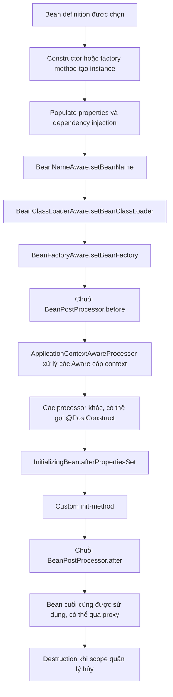

<a id="back-to-top"></a>

# Callback Aware

## Menu
- [Khi nào bean cần nhận thông tin từ container](#aware-callbacks-001)
- [BeanNameAware, BeanFactoryAware và ApplicationContextAware](#aware-callbacks-002)
- [EnvironmentAware, ResourceLoaderAware và MessageSourceAware](#aware-callbacks-003)
- [ApplicationEventPublisherAware và lựa chọn tiêm hợp đồng hẹp](#aware-callbacks-004)
- [Thứ tự callback Aware trong chu trình tạo bean](#aware-callbacks-005)
- [Đánh đổi giữa tiện ích container và mức độ phụ thuộc vào Spring](#aware-callbacks-006)

## <a id="aware-callbacks-001">Khi nào bean cần nhận thông tin từ container</a>

<details>
<summary>Xem chi tiết</summary>

# Khi nào bean cần nhận thông tin từ container? — Callback Aware trong Spring

## 1. Vấn đề cần giải quyết

Một bean Spring thông thường chỉ cần cộng tác viên nghiệp vụ như repository, HTTP client hoặc service khác. Spring IoC Container truyền những dependency đó qua constructor, setter hoặc field injection. Bean không cần biết container tồn tại, được khởi tạo ở đâu hay có tên gì.

Đôi khi, một **bean hạ tầng** lại cần nhận thông tin mà chỉ container nắm giữ: tên bean thực tế, BeanFactory đã tạo nó, ApplicationContext đang sở hữu nó, bộ nạp Resource, Environment, bộ phát application event hoặc MessageSource. Spring hỗ trợ nhóm giao diện có hậu tố **`Aware`** để truyền những thông tin này vào bean qua callback.

Câu hỏi “Khi nào bean cần nhận thông tin từ container?” nên được trả lời dựa trên **trách nhiệm của chính bean**:

- **Nên dùng Aware** khi bean triển khai framework extension, adapter hạ tầng, công cụ chẩn đoán hoặc cần metadata/capability liên quan trực tiếp đến Spring container.
- **Ưu tiên constructor injection** khi bean chỉ cần một dependency nghiệp vụ hoặc một interface hạ tầng cụ thể mà Spring có thể inject trực tiếp.
- **Ưu tiên `ObjectProvider<T>`** khi cần lấy một bean theo nhu cầu, ví dụ prototype mới cho mỗi công việc, mà không cần giữ toàn bộ `BeanFactory`.
- **Tránh dùng ApplicationContext như service locator** trong mọi business method; cách này che giấu dependency, tăng coupling với Spring và làm unit test khó hơn.

Sau bài này, người học có thể hiểu đúng từng callback Aware, khi nào nó chạy trong bean lifecycle, chọn một interface tối thiểu và chạy được ví dụ Java 17 trên Spring Framework 6.1.x.

## 2. Bản chất của giao diện `Aware`

`org.springframework.beans.factory.Aware` là một **marker interface**. Nó không tự định nghĩa phương thức callback. Các interface con định nghĩa method riêng; Spring hoặc một `BeanPostProcessor` thích hợp phải nhận diện và gọi những method ấy.

Ba ví dụ phổ biến:

~~~java
// Chữ ký API rút gọn để minh họa, không cần tự định nghĩa lại.
public interface BeanNameAware extends Aware {
    void setBeanName(String name);
}

public interface BeanFactoryAware extends Aware {
    void setBeanFactory(BeanFactory beanFactory) throws BeansException;
}

public interface ApplicationContextAware extends Aware {
    void setApplicationContext(ApplicationContext context)
        throws BeansException;
}
~~~

Package thật:

- `BeanNameAware` và `BeanFactoryAware` nằm tại `org.springframework.beans.factory`.
- `ApplicationContextAware` nằm tại `org.springframework.context`.
- `Aware` nằm tại `org.springframework.beans.factory`.

**Không phải cứ đặt tên interface kết thúc bằng Aware là Spring tự gọi callback.** Với interface mới do ứng dụng tự định nghĩa, cần có processor hoặc infrastructure rõ ràng để xử lý.

### Hai cách thể hiện dependency

Cách đúng cho phần lớn service:

~~~java
@Service
public class CheckoutService {
    private final PaymentGateway gateway;

    public CheckoutService(PaymentGateway gateway) {
        this.gateway = gateway;
    }

    public void checkout() {
        gateway.charge();
    }
}
~~~

Đây là đoạn minh họa cần định nghĩa `PaymentGateway` và import Spring. Dependency `PaymentGateway` hiện rõ trong constructor.

Cách dễ bị lạm dụng:

~~~java
@Service
public class CheckoutService implements ApplicationContextAware {
    private ApplicationContext context;

    @Override
    public void setApplicationContext(ApplicationContext context) {
        this.context = context;
    }

    public void checkout() {
        context.getBean(PaymentGateway.class).charge();
    }
}
~~~

Đây là phiên bản **thay thế**, không ghép cùng tên class trong một dự án. Cả hai đều có thể hoạt động khi được cấu hình đúng, nhưng phiên bản thứ hai che giấu dependency chính trong method, làm class phụ thuộc vào container và khiến kiểm thử không còn đơn giản bằng cách truyền một fake gateway.

Với một service nghiệp vụ, constructor injection thường dễ hiểu và an toàn hơn. Callback Aware được sinh ra cho trường hợp thực sự cần **thông tin của container**.

## 3. Bảng quyết định nhanh theo thông tin cần nhận

| Interface | Container cung cấp gì? | Nơi dùng phù hợp |
| --- | --- | --- |
| `BeanNameAware` | Tên thực tế của bean trong bean factory | Registry, metric tag, log chẩn đoán theo tên bean |
| `BeanFactoryAware` | `BeanFactory` sở hữu bean | Adapter hạ tầng cần tra cứu bean hoặc metadata theo nhu cầu |
| `ApplicationContextAware` | `ApplicationContext` chứa bean | Framework integration cần nhiều khả năng của context, phân tích hierarchy |
| `EnvironmentAware` | `Environment` | Hạ tầng phân tích profile, property sources hoặc cấu hình runtime |
| `ResourceLoaderAware` | `ResourceLoader` | Adapter đọc resource từ classpath/file/URL |
| `ApplicationEventPublisherAware` | `ApplicationEventPublisher` | Hạ tầng phát event ứng dụng |
| `MessageSourceAware` | `MessageSource` | Thành phần đa ngôn ngữ, giải quyết message theo locale |
| `BeanClassLoaderAware` | `ClassLoader` dùng bởi bean factory | Plugin/class scanning, bytecode/tooling |
| `EmbeddedValueResolverAware` | `StringValueResolver` | Framework xử lý placeholders và embedded value |
| `ServletContextAware` | `ServletContext` của web application | Tích hợp Servlet container |
| `ServletConfigAware` | `ServletConfig` trong web environment thích hợp | Extension gắn servlet |
| `LoadTimeWeaverAware` | `LoadTimeWeaver` khi được cấu hình | Tích hợp load-time weaving, hạ tầng đặc biệt |

Một số interface khác như `ApplicationStartupAware` và `ImportAware` chỉ hữu ích trong tình huống framework/instrumentation chuyên biệt. Không cần triển khai mọi interface chỉ vì Spring hỗ trợ.

Cần phân biệt **bean có thể nhận thông tin** với **bean nên nhận thông tin**. Một lớp chỉ cần phát event thường chỉ cần `ApplicationEventPublisher`; giữ cả `ApplicationContext` là thừa quyền.

## 4. Callback Aware chạy ở thời điểm nào?

Một bean **phải được tạo trước khi** Spring có thể gọi Aware setter. Trong đường khởi tạo thông thường của `ApplicationContext`:

```text
Bean definition → constructor / @Bean factory method
               → dependency injection / property population
               → BeanNameAware / BeanClassLoaderAware / BeanFactoryAware
               → BeanPostProcessor trước initialization:
                   các Aware cấp ApplicationContext; @PostConstruct
               → InitializingBean.afterPropertiesSet()
               → custom init method
               → BeanPostProcessor sau initialization (có thể proxy)
               → bean đã hoàn tất initialization
```

Ba callback liên quan `BeanFactory` được xử lý trực tiếp; `ApplicationContextAware`, `ResourceLoaderAware` và các interface cấp context được `ApplicationContextAwareProcessor` xử lý trước initialization. Thứ tự giữa **những BeanPostProcessor khác nhau** có thể phụ thuộc cấu hình/ordering. Bài 185 chứng minh từng mốc bằng log và giải thích thứ tự nội bộ của processor.

**Lưu ý về readiness:** nhận `ApplicationContext` khi container **đang refresh** chưa chứng minh mọi singleton hay listener đã sẵn sàng. Trong callback, chỉ nên lưu reference/xác thực nhẹ; không kích hoạt hàng loạt `getBean()` để chạy công việc dài. Một constructor chưa thể đọc field được gán bởi Aware setter; nếu collaborator cần ngay lúc tạo bean, dùng constructor injection.

## 5. `BeanNameAware`: biết tên mà container gán

`BeanNameAware.setBeanName(String)` nhận **bean name thực tế** mà Spring dùng cho definition đang tạo:

```java
class NamedAdapter implements BeanNameAware {
    private String beanName;

    @Override public void setBeanName(String name) {
        this.beanName = name;
    }

    String label() { return "adapter=" + beanName; }
}
```

Khi khai báo `@Bean("paymentAdapter")` trả một `NamedAdapter`, callback nhận `paymentAdapter` và `label()` cho chuỗi `adapter=paymentAdapter`. Đoạn này cần import `BeanNameAware` và đăng ký bean qua configuration. Tên này thích hợp cho diagnostic/metric ở component hạ tầng, **không phải business ID hoặc unique instance ID**: nhiều prototype instances có thể dùng cùng bean name; tên có thể đổi khi refactor. Bài 182 giải thích thêm aliases và tên được sinh tự động.

## 6. `BeanFactoryAware`: quyền lookup cấp factory

`BeanFactoryAware.setBeanFactory(BeanFactory)` cấp factory đang quản lý bean. Adapter hạ tầng có thể lookup một plugin theo tên đã được kiểm tra:

```java
class PluginBridge implements BeanFactoryAware {
    private BeanFactory beanFactory;

    @Override public void setBeanFactory(BeanFactory supplied) {
        beanFactory = supplied;
    }

    Plugin getPlugin(String beanName) {
        return beanFactory.getBean(beanName, Plugin.class);
    }
}
```

Đây là snippet cần imports và type `Plugin` do ứng dụng định nghĩa. Tên bean từ input bên ngoài phải được map/allowlist trước khi lookup. Factory lookup trả singleton hoặc tạo prototype theo **scope thực tế**, không mặc định object mới. Nếu biết dependency type mà chỉ cần lấy muộn, inject `ObjectProvider<Plugin>` qua constructor và gọi `getObject()` khi cần: hợp đồng hẹp hơn, giảm phụ thuộc vào toàn bộ factory. Không gọi lookup một loạt trong setter Aware khi bean đang khởi tạo.

## 7. `ApplicationContextAware`: khi cần nhiều khả năng của context

`ApplicationContextAware.setApplicationContext(ApplicationContext)` cấp context chứa bean. API này bao gồm bean lookup, resource loading, events, messages và metadata về parent/child context:

```java
class ContextInspector implements ApplicationContextAware {
    private ApplicationContext context;

    @Override public void setApplicationContext(ApplicationContext supplied) {
        context = supplied;
    }

    boolean hasBean(String name) { return context.containsBean(name); }
}
```

Đây là snippet cần imports của Spring. Dùng khi chính trách nhiệm bean là **framework integration, diagnostics hoặc quản lý hạ tầng theo context**. Với service chỉ cần event, resource hoặc message, hãy inject interface `ApplicationEventPublisher`, `ResourceLoader` hoặc `MessageSource` tương ứng. Một bean thuộc parent context không tự biến thành bean child khi child lookup nó; tránh static `ApplicationContextHolder` vì có thể giữ reference cũ qua nhiều context hoặc test.

## 8. `EnvironmentAware`: thông tin cấu hình runtime

`EnvironmentAware.setEnvironment(Environment)` cấp abstraction dùng để đọc property sources, active/default profiles và property precedence:

```java
class RegionResolver implements EnvironmentAware {
    private Environment environment;

    @Override public void setEnvironment(Environment env) {
        environment = env;
    }

    String region() {
        return environment.getProperty("app.region", "default");
    }
}
```

Snippet cần imports `org.springframework.context.EnvironmentAware` và `org.springframework.core.env.Environment`. Nếu chỉ cần một vài giá trị business, inject cấu hình đã bind/validate qua constructor; tránh log secrets từ `Environment`. Bài 183 giải thích rõ profiles, property conversion và trường hợp đổi cấu hình sau refresh.

## 9. `ResourceLoaderAware`: sử dụng cơ chế resource của Spring

`ResourceLoaderAware.setResourceLoader(ResourceLoader)` giúp adapter resolve resource location động, chẳng hạn `classpath:templates/info.txt` hoặc `file:/opt/app/data.txt`.

```java
Resource resource = loader.getResource("classpath:templates/info.txt");
try (var input = resource.getInputStream()) {
    String content = new String(input.readAllBytes(),
            java.nio.charset.StandardCharsets.UTF_8);
}
```

Đây là fragment trong method có field `ResourceLoader loader` và khai báo/handle `IOException`. `Resource.getFile()` không phù hợp với mọi resource trong JAR; ưu tiên stream. Nếu chỉ đọc một tài nguyên cố định, có thể inject trực tiếp `Resource`. Bài 183 trình bày resource patterns với `ResourcePatternResolver`, trường hợp IO lỗi và i18n.

## 10. Các interface Aware chuyên biệt khác

Ngoài tên/factory/context, Spring có các hợp đồng **đủ hẹp cho một năng lực**:

| Interface | Callback/capability | Giới hạn quan trọng |
| --- | --- | --- |
| `ApplicationEventPublisherAware` | Nhận `ApplicationEventPublisher` để `publishEvent` | Không tự tạo listener hoặc biến event thành durable queue; xem bài 184 |
| `MessageSourceAware` | Nhận `MessageSource` để tra key theo locale | Phải có message codes/bundle/fallback phù hợp; không phải Kafka/JMS |
| `BeanClassLoaderAware` | Class loader được BeanFactory sử dụng | Dành cho plugin, class loading hoặc instrumentation |
| `EmbeddedValueResolverAware` | Resolver cho placeholder/expression | Thuộc infrastructure xử lý embedded values |
| `ServletContextAware` / `ServletConfigAware` | Thông tin Servlet container | Cần web context/processor thích hợp, không có trong CLI context thuần |
| `LoadTimeWeaverAware` | Load-time weaver nếu đã cấu hình | Không kích hoạt weaving chỉ nhờ interface |
| `ImportAware` | Metadata từ `@Import` | Thuộc infrastructure xử lý configuration |

Ví dụ phát event chỉ cần publisher:

```java
class JobEvents implements ApplicationEventPublisherAware {
    private ApplicationEventPublisher publisher;

    @Override public void setApplicationEventPublisher(
            ApplicationEventPublisher supplied) {
        publisher = supplied;
    }

    void finished(String jobId) {
        publisher.publishEvent(new JobFinished(jobId));
    }

    record JobFinished(String id) {}
}
```

Đây là class minh họa cần imports; bean phải do Spring quản lý để nhận setter callback. Listener và synchronous/async dispatch là cơ chế khác; nếu chỉ cần publisher cho nghiệp vụ, constructor injection là lựa chọn thường gọn hơn. Với i18n, `MessageSource.getMessage` giải quyết text theo `Locale`; nó không gửi thông điệp qua mạng. Không tự định nghĩa interface chỉ có tên kết thúc `Aware` rồi trông đợi Spring nhận diện mà thiếu processor.

## 11. Ví dụ hoàn chỉnh Java 17 + Spring 6.1: BeanNameAware, BeanFactoryAware, EnvironmentAware và ApplicationContextAware

Ứng dụng này không cần Spring Boot, HTTP server hoặc database. Nó chứng minh Aware callback chạy trước `InitializingBean.afterPropertiesSet()`, đồng thời so sánh constructor DI với lookup từ factory.

### 11.1. Cấu trúc dự án

~~~text
aware-demo/
├── pom.xml
└── src/
    └── main/
        └── java/
            └── com/
                └── example/
                    └── aware/
                        └── AwareDemo.java
~~~

### 11.2. `pom.xml`

~~~xml
<?xml version="1.0" encoding="UTF-8"?>
<project xmlns="http://maven.apache.org/POM/4.0.0"
         xmlns:xsi="http://www.w3.org/2001/XMLSchema-instance"
         xsi:schemaLocation="http://maven.apache.org/POM/4.0.0 https://maven.apache.org/xsd/maven-4.0.0.xsd">
    <modelVersion>4.0.0</modelVersion>
    <groupId>com.example</groupId>
    <artifactId>aware-demo</artifactId>
    <version>1.0.0</version>

    <properties>
        <maven.compiler.release>17</maven.compiler.release>
        <project.build.sourceEncoding>UTF-8</project.build.sourceEncoding>
    </properties>

    <dependencies>
        <dependency>
            <groupId>org.springframework</groupId>
            <artifactId>spring-context</artifactId>
            <version>6.1.13</version>
        </dependency>
    </dependencies>

    <build>
        <plugins>
            <plugin>
                <groupId>org.apache.maven.plugins</groupId>
                <artifactId>maven-compiler-plugin</artifactId>
                <version>3.13.0</version>
            </plugin>
            <plugin>
                <groupId>org.codehaus.mojo</groupId>
                <artifactId>exec-maven-plugin</artifactId>
                <version>3.3.0</version>
                <configuration>
                    <mainClass>com.example.aware.AwareDemo</mainClass>
                </configuration>
            </plugin>
        </plugins>
    </build>
</project>
~~~

### 11.3. `src/main/java/com/example/aware/AwareDemo.java`

~~~java
package com.example.aware;

import java.util.Map;

import org.springframework.beans.BeansException;
import org.springframework.beans.factory.BeanFactory;
import org.springframework.beans.factory.BeanFactoryAware;
import org.springframework.beans.factory.BeanNameAware;
import org.springframework.beans.factory.InitializingBean;
import org.springframework.context.ApplicationContext;
import org.springframework.context.ApplicationContextAware;
import org.springframework.context.EnvironmentAware;
import org.springframework.context.ResourceLoaderAware;
import org.springframework.context.annotation.AnnotationConfigApplicationContext;
import org.springframework.context.annotation.Bean;
import org.springframework.context.annotation.Configuration;
import org.springframework.core.env.Environment;
import org.springframework.core.env.MapPropertySource;
import org.springframework.core.io.ResourceLoader;

public class AwareDemo {

    public static void main(String[] args) {
        try (AnnotationConfigApplicationContext context =
                     new AnnotationConfigApplicationContext()) {

            context.getEnvironment().getPropertySources().addFirst(
                new MapPropertySource(
                    "demo-properties", Map.of("demo.region", "VN")));

            context.register(Config.class);
            context.refresh();

            Inspector bean = context.getBean(Inspector.class);

            System.out.println("beanName=" + bean.beanName());
            System.out.println("greeting=" + bean.greeting());
            System.out.println(
                "factoryLookupSame=" + bean.factorySeesSameGreeting());
            System.out.println("sameContext=" + bean.hasContext(context));
            System.out.println("region=" + bean.region());
            System.out.println(
                "classResourceExists=" + bean.classResourceExists());
            System.out.println("initialized=" + bean.initialized());
        }
    }

    public interface Greeting {
        String sayHello();
    }

    @Configuration(proxyBeanMethods = false)
    public static class Config {
        @Bean
        Greeting greeting() {
            return () -> "Hello";
        }

        @Bean(name = "inspector")
        Inspector inspector(Greeting greeting) {
            return new Inspector(greeting);
        }
    }

    public static class Inspector
            implements BeanNameAware, BeanFactoryAware,
                       EnvironmentAware, ResourceLoaderAware,
                       ApplicationContextAware, InitializingBean {

        private final Greeting greeting;
        private String beanName;
        private BeanFactory beanFactory;
        private ApplicationContext context;
        private Environment environment;
        private ResourceLoader resourceLoader;
        private boolean initialized;

        public Inspector(Greeting greeting) {
            this.greeting = greeting;
        }

        @Override
        public void setBeanName(String name) {
            beanName = name;
        }

        @Override
        public void setBeanFactory(BeanFactory factory)
                throws BeansException {
            beanFactory = factory;
        }

        @Override
        public void setEnvironment(Environment suppliedEnvironment) {
            environment = suppliedEnvironment;
        }

        @Override
        public void setResourceLoader(ResourceLoader suppliedLoader) {
            resourceLoader = suppliedLoader;
        }

        @Override
        public void setApplicationContext(ApplicationContext suppliedContext)
                throws BeansException {
            context = suppliedContext;
        }

        @Override
        public void afterPropertiesSet() {
            if (beanName == null || beanFactory == null ||
                environment == null || resourceLoader == null ||
                context == null || greeting == null) {
                throw new IllegalStateException("Aware callbacks incomplete");
            }
            initialized = true;
        }

        public String beanName() {
            return beanName;
        }

        public String greeting() {
            return greeting.sayHello();
        }

        public boolean factorySeesSameGreeting() {
            return beanFactory.getBean(Greeting.class) == greeting;
        }

        public boolean hasContext(ApplicationContext expected) {
            return context == expected;
        }

        public String region() {
            return environment.getProperty("demo.region", "missing");
        }

        public boolean classResourceExists() {
            return resourceLoader.getResource(
                "classpath:com/example/aware/AwareDemo.class").exists();
        }

        public boolean initialized() {
            return initialized;
        }
    }
}
~~~

### 11.4. Chạy và quan sát output

Yêu cầu JDK 17+ và Maven 3.9.x. Từ thư mục `aware-demo`:

~~~bash
mvn -q compile exec:java
~~~

Các dòng `System.out.println` của chương trình:

~~~text
beanName=inspector
greeting=Hello
factoryLookupSame=true
sameContext=true
region=VN
classResourceExists=true
initialized=true
~~~

Maven hoặc logging framework có thể in thêm thông tin theo cấu hình; các dòng trên là stdout được chủ động tạo ra trong code.

**Tại sao output như vậy?**

1. `@Bean(name = "inspector")` cung cấp bean name, nên `BeanNameAware` nhận `inspector`.
2. `Greeting` được Spring inject qua **tham số factory method và constructor**, nên `greeting=Hello`.
3. `Greeting` là singleton mặc định. `BeanFactory.getBean(Greeting.class)` trả cùng object được inject, nên `factoryLookupSame=true`.
4. `ApplicationContextAware` nhận chính context đã tạo bean, nên `sameContext=true`.
5. `MapPropertySource` thêm `demo.region=VN` trước khi context refresh, nên `EnvironmentAware` đọc được `region=VN`.
6. File class `AwareDemo.class` được Maven compile vào classpath nên `ResourceLoader` xác định được resource, trả `classResourceExists=true`.
7. `afterPropertiesSet()` chạy sau các callback cần thiết và xác nhận field đều được cung cấp, nên `initialized=true`.

Ví dụ cố ý dùng nhiều Aware interface trên cùng một class để học và kiểm chứng. Trong dự án thật, chỉ nên chọn giao diện thật sự cần, tránh tạo một service nắm mọi quyền của Spring container.

## 12. Constructor injection có thể thay thế nhiều Aware callback

Spring có thể inject một số infrastructure dependency trực tiếp khi phù hợp. Ví dụ với constructor:

~~~java
@Component
public class TemplateService {
    private final ResourceLoader loader;
    private final ApplicationEventPublisher publisher;

    public TemplateService(
            ResourceLoader loader,
            ApplicationEventPublisher publisher) {
        this.loader = loader;
        this.publisher = publisher;
    }
}
~~~

Đây là class minh họa với import `Component`, `ResourceLoader` và `ApplicationEventPublisher`. Nếu service cần hai thứ đó, constructor làm rõ dependency và hỗ trợ unit test dễ hơn.

So sánh:

| Mục tiêu | Callback Aware | Constructor injection |
| --- | --- | --- |
| Code Spring callback-style | Tự implements interface, Spring gọi setter | Spring giải quyết dependency qua constructor |
| Dependency thể hiện rõ ngay khi tạo object | Không nhất thiết | Có |
| Class có thể tạo bằng `new` độc lập | Cần tự gọi callback nếu phụ thuộc Aware field | Chỉ cần truyền fake/mock dependency |
| Dùng với framework extension yêu cầu interface Aware | Phù hợp | Tùy integration API |
| Chỉ cần một collaborator cụ thể | Thường quá nhiều ceremony | Thường tốt hơn |

Đối với `ApplicationContextAware`, còn có thể inject trực tiếp `ApplicationContext` vào constructor của Spring bean. Việc hỗ trợ injection không có nghĩa nên đưa container vào mọi class. Hãy thu hẹp dependency trước khi quyết định.

## 13. Những cạm bẫy khi dùng Aware

### 13.1. Dùng field Aware ngay trong constructor

~~~java
public BadAdapter() {
    // beanFactory có thể vẫn null tại đây.
    beanFactory.getBean("helper");
}
~~~

Đây là đoạn constructor minh họa thuộc class có field `beanFactory` được set bởi `BeanFactoryAware`. Constructor chạy trước callback, nên gọi field có thể gây `NullPointerException`. Nếu collaborator cần ngay khi tạo object, inject qua constructor.

### 13.2. Gọi `getBean()` quá sớm trong callback

~~~java
@Override
public void setApplicationContext(ApplicationContext context) {
    this.context = context;
    context.getBeansOfType(Plugin.class); // Có thể tạo bean quá sớm.
}
~~~

Đoạn này minh họa trong class implements `ApplicationContextAware` có interface `Plugin`. Tra cứu hàng loạt bean khi context còn refresh có thể gây early instantiation, circular dependency hoặc làm lệch thứ tự khởi tạo. Nếu cần lookup runtime, trì hoãn đến thời điểm hoạt động hợp lệ hoặc thiết kế registry/injection phù hợp.

### 13.3. Biến ApplicationContext thành global static

~~~java
public static ApplicationContext GLOBAL_CONTEXT;
~~~

Giữ context trong static field tạo implicit global state, dễ sai khi có nhiều application contexts, test context reload và shutdown. Tạo “helper lấy mọi bean bằng tên” có thể che giấu dependency và khiến framework reference sống quá lâu. Hãy dùng DI hoặc abstraction hẹp.

### 13.4. Nhầm bean name với tên class hay định danh instance

`BeanNameAware` nhận tên thực tế của bean definition, có thể do `@Bean(name=...)`, `@Component`, alias hoặc cách đăng ký khác quyết định. Inner beans có thể được tạo tên khác. Không dùng bean name làm unique ID cho transaction hoặc request.

### 13.5. Dùng Aware để truy cập dữ liệu scope không active

Một request-scoped bean implements `ApplicationContextAware` không có nghĩa có HTTP request ở mọi thread. Nếu singleton, scheduler hoặc executor gọi request-scoped proxy ngoài request, nó vẫn có thể gặp `ScopeNotActiveException`. Aware không thay đổi quy tắc scope.

### 13.6. Tưởng một marker interface đủ để được callback

~~~java
public interface MyRegistryAware extends Aware {
    void setRegistry(MyRegistry registry);
}
~~~

Đây là interface tùy biến minh họa. Spring không tự biết cách gọi `setRegistry`. Phải có infrastructure/`BeanPostProcessor` tương ứng hoặc dùng constructor injection thông thường.

## 14. Aware và thứ tự bean lifecycle: cách kiểm tra chính xác

Có thể xác minh thứ tự callback bằng một bean implement `BeanNameAware`, `ApplicationContextAware` và `InitializingBean`:

```java
class CallbackProbe implements BeanNameAware,
        ApplicationContextAware, InitializingBean {
    private final List<String> events = new ArrayList<>();

    @Override public void setBeanName(String name) {
        events.add("BeanNameAware");
    }
    @Override public void setApplicationContext(ApplicationContext context) {
        events.add("ApplicationContextAware");
    }
    @Override public void afterPropertiesSet() {
        events.add("InitializingBean");
    }
    List<String> events() { return List.copyOf(events); }
}
```

Snippet cần imports `List`, `ArrayList` và ba interface Spring; đăng ký nó thành bean trong `AnnotationConfigApplicationContext` rồi so thứ tự ba nhãn. Trong đường mặc định, kết quả là `BeanNameAware → ApplicationContextAware → InitializingBean`. Đây là bằng chứng cho **một bean cụ thể**, không khẳng định thứ tự khởi tạo mọi bean trong application. Bài 185 có demo đầy đủ ghi log cả BeanFactory, sáu interface context-aware, BeanPostProcessor và destruction.

## 15. Aware có hoạt động với prototype, singleton và scoped proxy không?

**Singleton:** callback chạy khi Spring tạo/initialize instance singleton (thường trong refresh đối với non-lazy singleton). Gọi `context.getBean()` lần sau không chạy lại callback trên chính singleton ấy.

**Prototype:** mỗi lần container tạo target prototype mới, quá trình initialization và các Aware callback phù hợp được thực hiện cho instance mới. Hai instances có thể nhận cùng bean name/context reference vì chúng được tạo từ một definition trong cùng context.

**Request/session scope:** callbacks chạy trên target khi scope thực sự tạo target; scoped proxy giúp bean sống lâu tham chiếu target theo request/session. Proxy được inject thành công không có nghĩa target đã tồn tại hoặc scope active trong scheduler thread.

**Object tạo bằng `new`:** không được Spring tự quản lý, nên không nhận Aware callbacks tự động. Nếu class cần hoạt động độc lập container, đưa dependency vào constructor là thiết kế tốt hơn.

**Chú ý destroy callback:** Aware là callback cung cấp thông tin lúc initialization. Nó không biến một prototype thành bean được Spring tự hủy sau khi giao ra; resource cleanup vẫn là trách nhiệm của bên sở hữu.

## 16. Custom Aware interface và BeanPostProcessor

Nếu đang phát triển **framework extension** riêng, bạn có thể tạo contract tùy biến:

~~~java
public interface RegistryAware {
    void setRegistry(PluginRegistry registry);
}
~~~

Đây là ví dụ tự định nghĩa cần interface/class `PluginRegistry`. Muốn Spring gọi callback, có thể viết processor:

~~~java
import org.springframework.beans.factory.config.BeanPostProcessor;

public final class RegistryAwareProcessor implements BeanPostProcessor {
    private final PluginRegistry registry;

    public RegistryAwareProcessor(PluginRegistry registry) {
        this.registry = registry;
    }

    @Override
    public Object postProcessBeforeInitialization(
            Object bean, String beanName) {
        if (bean instanceof RegistryAware aware) {
            aware.setRegistry(registry);
        }
        return bean;
    }
}
~~~

Đây là class Java minh họa; cần khai báo interface `RegistryAware`, kiểu `PluginRegistry`, và đăng ký `RegistryAwareProcessor` làm bean post-processor trong context đủ sớm. Nếu không đăng ký processor, method tùy biến sẽ không được Spring gọi.

Dùng pattern này nếu một thư viện framework cần cung cấp registry cho nhiều component theo callback contract riêng. Với code nghiệp vụ, constructor injection `PluginRegistry` đơn giản hơn rất nhiều.

**Rủi ro của BeanPostProcessor:** processor thường được tạo sớm; eager dependency phức tạp bên trong processor có thể khiến một số bean được tạo trước khi toàn bộ processors/proxies hoàn tất. Tránh biến processor thành một service nghiệp vụ lớn.

## 17. Tình huống sử dụng thực tế

Nhu cầu khác nhau dẫn tới interface khác nhau. Một adapter tạo nhiều bản cấu hình muốn ghi metric theo **bean definition name** có thể dùng `BeanNameAware`; nếu nhãn metric là hợp đồng nghiệp vụ lâu dài, inject nhãn cấu hình riêng. Plugin resolver phải chọn bean theo ID runtime có thể dùng `BeanFactoryAware` trong **adapter đã kiểm soát tên**, trong khi tập plugin ổn định có thể inject `Map<String, Plugin>`.

Một thư viện hỗ trợ template `classpath:`/`file:` có thể dùng `ResourceLoaderAware`; adapter đọc profile/property sources sử dụng `EnvironmentAware`; công cụ diagnostic đa context có thể cần `ApplicationContextAware`. Service nghiệp vụ chỉ cần phát domain event thì constructor-inject `ApplicationEventPublisher` là đủ; nếu event phụ thuộc transaction commit, còn phải chọn listener/transaction strategy phù hợp. Quyết định phụ thuộc trách nhiệm bean, không phải số lượng Aware có sẵn.

## 18. Quy trình quyết định trước khi implements Aware

1. **Bean có cần Spring infrastructure không?** Nếu chỉ cần cộng tác viên nghiệp vụ, dùng constructor DI.
2. **Cần một interface hẹp hay toàn bộ context?** Nếu có interface hẹp như `ResourceLoader`, `Environment`, `ApplicationEventPublisher`, hãy inject nó.
3. **Cần metadata của chính bean?** `BeanNameAware` thích hợp khi bean name thật sự hữu ích.
4. **Có cần lookup runtime không?** Thử `ObjectProvider<T>`, `List<T>` hoặc `Map<String,T>` trước khi inject `BeanFactory`.
5. **Việc nhận thông tin có xảy ra đúng thời điểm?** Aware callback chạy sau constructor, trước initialization; tránh kích hoạt bean khác quá sớm.
6. **Có môi trường hỗ trợ không?** `ServletContextAware` chỉ trong web-aware context phù hợp.
7. **Có nguy cơ reference toàn cục hoặc hierarchy?** Tránh static holders; xác định context thực sự sở hữu bean.
8. **Kiểm thử thế nào?** Dùng unit test cho logic thuần và integration test tạo Spring context để xác minh callbacks.

Nếu không thể diễn đạt rõ **vì sao container metadata là dependency thật**, đó là dấu hiệu nên trở lại constructor injection.

## 19. Lỗi phổ biến và cách khắc phục

| Lỗi | Nguyên nhân | Cách khắc phục |
| --- | --- | --- |
| `ApplicationContext` là null trong constructor | Callback chưa chạy | Dùng constructor injection cho dependency cần ngay |
| Aware callback không chạy | Bean được tạo bằng `new` hoặc không có processor cần thiết | Đăng ký bean đúng context; test thực |
| `BeanNameAware` trả tên không như dự kiến | Bean name có alias, factory method hoặc generated name | Xem bean definition thực tế; tránh dựa vào business ID |
| Service có quá nhiều `getBean()` | Lạm dụng Service Locator | Constructor DI, provider hoặc inject collection |
| Circular dependency khi callback chạy | Gọi lookup quá sớm lúc context refresh | Trì hoãn lookup hoặc thiết kế lại dependency graph |
| Resource không đọc được trong JAR | Coi classpath resource là file vật lý | `getInputStream()`, xử lý IOException |
| Property khác giữa môi trường | Precedence của PropertySources | Kiểm tra profile/source, typed config |
| Bean web không nhận `ServletContext` | Dùng non-web context | Chọn đúng web-aware context |
| Prototype nhận cùng bean name | Name thuộc definition, không thuộc instance | Sinh instance ID riêng |
| Callback custom interface không chạy | Chưa có processor | Đăng ký BeanPostProcessor hoặc dùng DI |
| Bean trong child thấy context khác mong đợi | Parent/child hierarchy và ownership | Xác nhận bean đăng ký tại context nào |
| Scoped bean lỗi ngoài request | Không có active scope | Gọi target đúng request hoặc truyền snapshot dữ liệu |
| Unit test bằng `new` thất bại | Không có Spring callback | Inject dependencies trực tiếp hoặc dựng context integration |
| Bean bị tạo quá sớm | Lookup cả registry trong Aware callback | Lưu reference và dùng đúng thời điểm |

## 20. Tự kiểm tra kiến thức

**Câu 1.** Một `OrderService` cần `OrderRepository`. Vì sao constructor injection thường tốt hơn `ApplicationContextAware`?

**Đáp án:** Dependency được khai báo rõ; Spring resolve khi tạo bean; dễ unit test bằng fake repository và không phụ thuộc runtime lookup toàn container.

**Câu 2.** Bean implements `BeanNameAware` nhận cùng tên trong hai instance prototype, có phải Spring tạo nhầm singleton?

**Đáp án:** Không. Bean name định danh bean definition; scope prototype vẫn có thể tạo nhiều instances khác nhau từ cùng definition.

**Câu 3.** Có thể gọi `beanFactory.getBean(...)` trong constructor khi field `beanFactory` chỉ được set bằng `BeanFactoryAware` không?

**Đáp án:** Không nên: constructor chạy trước callback, field chưa được gán. Nếu cần dependency trong constructor, hãy inject nó trực tiếp.

**Câu 4.** Khi cần phát application event, nên inject gì?

**Đáp án:** `ApplicationEventPublisher` là dependency hẹp phù hợp; `ApplicationEventPublisherAware` cũng có thể dùng với framework callback style, còn `ApplicationContextAware` thường quá rộng.

**Câu 5.** Một bean implements interface tùy biến `MyContextAware` nhưng không có processor, Spring có tự gọi method không?

**Đáp án:** Không. `Aware` là marker; callback tùy biến cần infrastructure rõ ràng hoặc chuyển sang constructor DI.

**Câu 6.** `@RequestScope` bean nhận `ApplicationContext` qua callback có chạy trong `@Scheduled` task được không?

**Đáp án:** Callback không tạo HTTP request. Target request-scoped vẫn đòi hỏi request scope active; background task nên dùng dữ liệu snapshot hoặc một dependency không bị ràng buộc request.

**Câu 7.** Một singleton cần prototype mới mỗi lần xử lý thì nên dùng interface nào?

**Đáp án:** Thường chọn `ObjectProvider<PrototypeType>`, lấy bean tại đầu mỗi nghiệp vụ và quản lý cleanup nếu giữ resource. Không cần nhận toàn bộ `BeanFactory` chỉ để làm việc đó.

## 21. Tài liệu Spring chính thức

- [Spring Framework — Customizing the Nature of a Bean](https://docs.spring.io/spring-framework/reference/core/beans/factory-nature.html): `ApplicationContextAware`, `BeanNameAware` và các interface Aware khác.
- [`Aware` Javadoc — Spring Framework 6.1](https://docs.spring.io/spring-framework/docs/6.1.x/javadoc-api/org/springframework/beans/factory/Aware.html): marker interface và callback contract.
- [`BeanNameAware` Javadoc](https://docs.spring.io/spring-framework/docs/6.1.x/javadoc-api/org/springframework/beans/factory/BeanNameAware.html): bean name và thời điểm callback.
- [`BeanFactoryAware` Javadoc](https://docs.spring.io/spring-framework/docs/6.1.x/javadoc-api/org/springframework/beans/factory/BeanFactoryAware.html): factory ownership và dependency lookup.
- [`ApplicationContextAware` Javadoc](https://docs.spring.io/spring-framework/docs/6.1.x/javadoc-api/org/springframework/context/ApplicationContextAware.html): reference tới context và initialization timing.
- [`ApplicationContext` Javadoc](https://docs.spring.io/spring-framework/docs/6.1.x/javadoc-api/org/springframework/context/ApplicationContext.html): bean lookup, events, resources, messages và context hierarchy.
- [Spring Framework — Annotation-based Dependency Injection](https://docs.spring.io/spring-framework/reference/core/beans/annotation-config/autowired.html): lựa chọn constructor/field/method injection.


</details>

- [Quay lại đầu trang](#back-to-top)

---

## <a id="aware-callbacks-002">BeanNameAware, BeanFactoryAware và ApplicationContextAware</a>

<details>
<summary>Xem chi tiết</summary>

# BeanNameAware, BeanFactoryAware và ApplicationContextAware trong Spring Framework

## 1. Bài toán: bean cần biết thông tin từ container

Dependency Injection (DI) là nguyên tắc trung tâm của Spring Core Container: một bean thông thường nên **nhận các dependency nghiệp vụ cần dùng qua constructor, setter hoặc cơ chế injection khác**, thay vì tự tìm mọi thứ trong container. Tuy nhiên, một số bean hạ tầng cần biết **chính nó được container đăng ký dưới tên nào**, **BeanFactory nào đang quản lý nó** hoặc **ApplicationContext nào đang chứa nó**.

Spring cung cấp các interface dạng `Aware` cho nhu cầu đó. Khi bean do Spring quản lý implement một trong các interface tương ứng, container sẽ gọi callback và chuyển thông tin hạ tầng thích hợp vào instance.

Ba interface trọng tâm:

- `BeanNameAware` — nhận **tên đăng ký thực tế của bean** qua `setBeanName(String name)`.
- `BeanFactoryAware` — nhận **BeanFactory sở hữu bean** qua `setBeanFactory(BeanFactory beanFactory)`.
- `ApplicationContextAware` — nhận **ApplicationContext bao quanh bean** qua `setApplicationContext(ApplicationContext applicationContext)`.

Các callback này diễn ra **sau khi điền các property thông thường** và **trước các init callback như `InitializingBean.afterPropertiesSet()` và custom init method**. Chúng là cơ chế container thông báo hạ tầng cho bean, không phải tín hiệu “toàn ứng dụng đã startup xong”.

### Mô hình trực quan

~~~text
ApplicationContext (cung cấp API cấp cao)
    │
    ├── BeanFactory (quản lý bean definitions và bean instances)
    │       │
    │       └── tạo bean "auditAdapter"
    │                │
    │                ├── constructor / factory method
    │                ├── tiêm dependency/thuộc tính thông thường
    │                ├── BeanNameAware.setBeanName("auditAdapter")
    │                ├── BeanFactoryAware.setBeanFactory(beanFactory)
    │                ├── ApplicationContextAware.setApplicationContext(context)
    │                ├── @PostConstruct và các init callbacks
    │                └── bean hoàn thành post-processing
    │
    └── chương trình có thể lấy bean đã được khởi tạo
~~~

Đây là trình tự **phổ biến trong ApplicationContext thông thường**; `ApplicationContextAware` thực tế được xử lý thông qua một `BeanPostProcessor` của context, trong khi `BeanNameAware` và `BeanFactoryAware` được gọi trực tiếp bởi BeanFactory trong quy trình khởi tạo. Sơ đồ không phải hợp đồng về vị trí của **mọi** custom `BeanPostProcessor`, và không thay thế lifecycle đầy đủ của một số bean đặc biệt.

## 2. Interface `Aware` có ý nghĩa gì?

`org.springframework.beans.factory.Aware` là interface đánh dấu (marker interface): bản thân nó không khai báo phương thức cần implement. Các interface cụ thể kế thừa `Aware` rồi khai báo callback chứa thông tin phù hợp.

~~~java
// Minh họa chữ ký API; không phải file Java standalone.
public interface BeanNameAware extends Aware {
    void setBeanName(String name);
}

public interface BeanFactoryAware extends Aware {
    void setBeanFactory(BeanFactory beanFactory) throws BeansException;
}

public interface ApplicationContextAware extends Aware {
    void setApplicationContext(ApplicationContext applicationContext)
            throws BeansException;
}
~~~

Các định nghĩa trên là dạng lược bớt import/documentation để học chữ ký; namespace thực tế lần lượt là `org.springframework.beans.factory.BeanNameAware`, `org.springframework.beans.factory.BeanFactoryAware` và `org.springframework.context.ApplicationContextAware`.

**Điểm mấu chốt:** chỉ implement `Aware` trống **không** khiến Spring tự inject mọi thứ. Bean phải implement **interface cụ thể** mà container hoặc bộ xử lý hỗ trợ. Việc Spring gọi callback phụ thuộc bean **được quản lý bởi container phù hợp**. Tự `new MyAwareBean()` bên ngoài Spring không tự phát sinh các callback này.

### Bảng so sánh nhanh

| Interface | Callback | Giá trị nhận được | Thường dùng cho |
| --- | --- | --- | --- |
| `BeanNameAware` | `setBeanName(String)` | Tên bean thực tế trong BeanFactory | Adapter, hạ tầng cần gắn metadata/log với bean name |
| `BeanFactoryAware` | `setBeanFactory(BeanFactory)` | BeanFactory đang sở hữu bean | Hạ tầng cần dependency lookup, metadata/lifecycle của factory |
| `ApplicationContextAware` | `setApplicationContext(ApplicationContext)` | ApplicationContext của bean | Hạ tầng cần event, resource, message hoặc context-level API |
| Constructor DI thông thường | Constructor do Spring gọi | Những dependency đã khai báo | Service, repository, controller, phần lớn code nghiệp vụ |

Cả ba Aware callback đều làm object phụ thuộc trực tiếp vào Spring API. Chỉ dùng khi **thật sự cần thông tin container**; khi chỉ cần `PaymentGateway`, hãy inject `PaymentGateway`.

## 3. `BeanNameAware` — bean biết tên đăng ký của mình

### 3.1. Cách hoạt động

Một class implement:

~~~java
import org.springframework.beans.factory.BeanNameAware;

public class NamedProcessor implements BeanNameAware {
    private String beanName;

    @Override
    public void setBeanName(String name) {
        this.beanName = name;
    }

    public String beanName() {
        return beanName;
    }
}
~~~

Nếu đăng ký nó với tên `namedProcessor`, Spring gọi `setBeanName("namedProcessor")` trong giai đoạn khởi tạo bean.

~~~java
@Bean(name = "namedProcessor")
NamedProcessor namedProcessor() {
    return new NamedProcessor();
}
~~~

Hai snippet có thể đặt vào các tệp/class cấu hình thích hợp; phần trên minh họa một bean và phương thức `@Bean`, **không phải chương trình Java đầy đủ**.

### 3.2. Bean name có phải tên class hoặc tên Java field không?

Không. Tên bean là **định danh trong container**, phụ thuộc cách đăng ký:

- `@Bean` thường lấy tên method khi không chỉ định tên khác.
- `@Bean("shippingWorker")` chỉ định tên bean là `shippingWorker`.
- Component scanning thường tạo tên dựa trên tên class theo `BeanNameGenerator`, nhưng có thể thay quy tắc.
- XML `<bean id="...">` chỉ định id hoặc các alias.
- Bean nội bộ (inner bean) hoặc bean được đăng ký bằng API có thể mang tên sinh tự động.

`BeanNameAware` nhận **actual bean name** do factory quản lý. Đối với một số inner beans, Spring có thể điều chỉnh tên cho duy nhất; vì thế tên nhận được không nhất thiết trùng 100% với một chuỗi trong cấu hình ban đầu.

Ví dụ có alias:

~~~java
@Bean(name = {"fastEncoder", "primaryEncoderAlias"})
Encoder encoder() {
    return new Encoder();
}
~~~

`BeanNameAware` được gọi bằng tên bean chính mà container gắn cho định nghĩa, **không gọi một lần cho mỗi alias**. Không dựa vào alias do người dùng sử dụng khi lookup để suy ra giá trị callback. Tên bean có thể thay đổi khi refactor config; tránh xây dựng business logic bằng cách so sánh các string name cố định.

### 3.3. Khi nào có ích?

- Logging infrastructure cần gắn bean name vào thông báo chẩn đoán.
- Một adapter hạ tầng phải tự đăng ký tài nguyên theo đúng tên bean.
- Một generic component dùng chung class nhưng được đăng ký thành nhiều bean definitions cần biết tên của **định nghĩa cụ thể**.

Tránh dùng tên bean làm **khóa định danh người dùng, mã đơn hàng hoặc security policy**; đó là metadata container, không phải dữ liệu nghiệp vụ bất biến.

## 4. `BeanFactoryAware` — truy cập nhà máy quản lý bean

### 4.1. Callback và khả năng

`BeanFactoryAware` cho bean nhận tham chiếu tới `org.springframework.beans.factory.BeanFactory` thực sự sở hữu bean:

~~~java
import org.springframework.beans.BeansException;
import org.springframework.beans.factory.BeanFactory;
import org.springframework.beans.factory.BeanFactoryAware;

public class LookupAdapter implements BeanFactoryAware {
    private BeanFactory factory;

    @Override
    public void setBeanFactory(BeanFactory beanFactory) throws BeansException {
        this.factory = beanFactory;
    }

    public Encoder newEncoder() {
        return factory.getBean(Encoder.class);
    }
}
~~~

Đây là snippet minh họa; type `Encoder` cần có bean definition đúng và import/class phù hợp. Nếu bean `Encoder` là prototype, mỗi lần `getBean(Encoder.class)` container thực hiện một lookup theo prototype scope. Nếu `Encoder` là singleton, những lần lookup thường nhận lại cùng instance.

Giao diện cơ bản `BeanFactory` cung cấp các thao tác như `getBean(...)`, `containsBean(...)`, `isSingleton(...)`, `isPrototype(...)`, `getType(...)`. Nó **không đồng nghĩa** bạn đang giữ một `ConfigurableListableBeanFactory`: đừng gọi API quản trị definition chỉ thuộc interface mở rộng khi chỉ khai báo biến kiểu `BeanFactory`.

### 4.2. Khác gì với DI thông thường?

Inject trực tiếp:

~~~java
public ReportService(Encoder encoder) {
    this.encoder = encoder;
}
~~~

Ưu điểm: dependency hiển thị rõ trong constructor, dễ dùng fake/mock ở unit test, bean không phụ thuộc vào container lookup.

Tự `factory.getBean(Encoder.class)`:

~~~java
public Encoder lookupEncoderWhenNeeded() {
    return factory.getBean(Encoder.class);
}
~~~

Ưu điểm đặc biệt khi **đúng là cần lấy bean theo nhu cầu và scope**. Nhược điểm: dependency ẩn trong method; lỗi thiếu/nhiều bean có thể xuất hiện lúc runtime; code buộc phải biết Spring và BeanFactory. Với lookup theo nhu cầu, Spring thường khuyến nghị cách có chủ đích hơn như `ObjectProvider<Encoder>` injected vào constructor.

Ví dụ:

~~~java
public ReportService(ObjectProvider<Encoder> encoders) {
    this.encoders = encoders;
}

public void execute() {
    Encoder instance = encoders.getObject();
    // Dùng instance theo đơn vị thao tác cần thiết.
}
~~~

Các đoạn trên là mẫu method/constructor minh họa, không phải class hoàn chỉnh. `ObjectProvider` nằm trong package `org.springframework.beans.factory`. Việc có provider **không tự đảm bảo một instance mới**; kết quả phụ thuộc scope bean được provider resolve.

### 4.3. Vì sao không nên gọi `getBean()` tùy tiện ngay trong `setBeanFactory()`?

`setBeanFactory()` được gọi khi **chính bean này còn đang khởi tạo**. Gọi một bean khác ở đó có thể buộc Spring tạo thêm bean, sinh vòng phụ thuộc hoặc kéo theo initialization side effects. Nếu cần một dependency bắt buộc, constructor injection thường dễ hiểu hơn. Không dùng Aware callback như cơ chế startup orchestration.

Dù javadoc cho phép sử dụng BeanFactory ngay trong callback, điều đó không cam kết mọi bean khác đã hoàn tất khởi tạo hoặc toàn application đã ready.

## 5. `ApplicationContextAware` — nhận Spring context

### 5.1. Callback

`ApplicationContextAware` cho bean nhận `org.springframework.context.ApplicationContext` hiện hành:

~~~java
import org.springframework.beans.BeansException;
import org.springframework.context.ApplicationContext;
import org.springframework.context.ApplicationContextAware;

public class ContextInspector implements ApplicationContextAware {
    private ApplicationContext context;

    @Override
    public void setApplicationContext(ApplicationContext applicationContext)
            throws BeansException {
        this.context = applicationContext;
    }

    public boolean hasBean(String name) {
        return context.containsBean(name);
    }
}
~~~

Đây là class minh họa. Với một `ApplicationContext` như `AnnotationConfigApplicationContext` hoặc web-aware context, Spring đăng ký `ApplicationContextAwareProcessor` để cung cấp context trước init callbacks.

### 5.2. `ApplicationContext` có gì ngoài `BeanFactory`?

`ApplicationContext` là interface cấp cao, cung cấp nhiều chức năng bổ sung:

- Kế thừa các khả năng bean lookup từ `ListableBeanFactory` và `HierarchicalBeanFactory`.
- `getResource(...)` để truy cập tài nguyên dưới dạng `Resource`.
- `getMessage(...)` thông qua `MessageSource`, hỗ trợ i18n và resource bundles.
- `publishEvent(...)` thông qua `ApplicationEventPublisher`.
- `getId()`, `getDisplayName()`, `getParent()` để đọc metadata và quan hệ context.
- Trong những biến thể có quyền quản lý như `ConfigurableApplicationContext`, có thêm refresh/close/environment/lifecycle capabilities.

Không hiểu `ApplicationContextAware` là “được quyền sửa tất cả bean tùy lúc”. Reference được cung cấp là interface `ApplicationContext`, thường nên dùng theo nhu cầu hẹp. Casting tùy tiện sang implementation class cụ thể khiến code khó tái sử dụng và dễ lỗi giữa các context.

### 5.3. Ưu tiên interface hẹp khi chỉ cần một khả năng

Nếu chỉ cần publish event, cách phụ thuộc hẹp hơn:

~~~java
public AuditService(ApplicationEventPublisher events) {
    this.events = events;
}
~~~

Nếu chỉ cần đọc resource:

~~~java
public TemplateReader(ResourceLoader loader) {
    this.loader = loader;
}
~~~

Nếu chỉ cần i18n:

~~~java
public GreetingService(MessageSource messages) {
    this.messages = messages;
}
~~~

Đây là các constructor snippet minh họa, giả định các field được khai báo và import phù hợp.

Có thể inject `ApplicationEventPublisher`, `ResourceLoader`, `MessageSource` hoặc implement các Aware interfaces chuyên biệt (`ApplicationEventPublisherAware`, `ResourceLoaderAware`, `MessageSourceAware`) nếu đang viết một hạ tầng cần callback. Khi chỉ cần một collaborator đã biết, inject chính collaborator đó.

### 5.4. Một bean có thể thuộc nhiều ApplicationContext không?

Một object được tạo bởi một context thường nhận **context sở hữu hoặc tạo nó** qua callback. Ứng dụng có thể có parent context và child context; chúng có các bean registries và event semantics riêng. Không dùng static field toàn cục để giữ `ApplicationContext` rồi giả định chỉ có một context cho toàn JVM.

Nếu hai context cùng đăng ký một class thành **hai bean instances**, mỗi instance có thể nhận context khác nhau. Nếu cố tái sử dụng **cùng một raw object instance** dưới nhiều bean definitions/contexts, các callback có thể bị gọi lại và ghi đè tham chiếu; đây là thiết kế bất thường nên tránh khi cần ownership rõ ràng.

## 6. Thứ tự gọi ba Aware callback

Trong `AnnotationConfigApplicationContext` thông thường, callback của ba interface trọng tâm chạy theo thứ tự:

1. `BeanNameAware.setBeanName(...)`, do BeanFactory gọi trực tiếp.
2. `BeanFactoryAware.setBeanFactory(...)`, sau `BeanClassLoaderAware` nếu có.
3. `ApplicationContextAware.setApplicationContext(...)`, do `ApplicationContextAwareProcessor` thực hiện trong pha `BeanPostProcessor.before`.

Các bước này diễn ra **sau constructor/property population**, trước `@PostConstruct` trong cấu hình chuẩn và trước `InitializingBean.afterPropertiesSet()` / custom init. `ApplicationContextAware` không tự hoạt động trong `DefaultListableBeanFactory` thuần nếu không có context processor. Aware fields chưa được gán trong constructor; không dùng callback để kích hoạt hàng loạt bean khác trước khi context refresh xong. Bài 185 dành riêng cho thứ tự của **tất cả** nhóm Aware, các BeanPostProcessor, init/destroy và ví dụ ghi log đầy đủ.

## 7. Ví dụ Java 17 chạy được: ba callback và lifecycle

Đây là ví dụ độc lập dùng Java 17, Maven và Spring Framework `6.2.12`. Chương trình đăng ký một bean duy nhất có đầy đủ ba Aware interfaces, sau đó cho thấy callback thứ tự với `@PostConstruct`, `InitializingBean` và custom `initMethod`. Không cần web server hay Spring Boot.

Cấu trúc:

~~~text
spring-aware-demo/
├── pom.xml
└── src/main/java/example/AwareDemo.java
~~~

Tệp `pom.xml`:

~~~xml
<project xmlns="http://maven.apache.org/POM/4.0.0"
         xmlns:xsi="http://www.w3.org/2001/XMLSchema-instance"
         xsi:schemaLocation="http://maven.apache.org/POM/4.0.0 https://maven.apache.org/xsd/maven-4.0.0.xsd">
    <modelVersion>4.0.0</modelVersion>
    <groupId>example</groupId>
    <artifactId>spring-aware-demo</artifactId>
    <version>1.0.0</version>

    <properties>
        <maven.compiler.release>17</maven.compiler.release>
        <project.build.sourceEncoding>UTF-8</project.build.sourceEncoding>
    </properties>

    <dependencies>
        <dependency>
            <groupId>org.springframework</groupId>
            <artifactId>spring-context</artifactId>
            <version>6.2.12</version>
        </dependency>
        <dependency>
            <groupId>jakarta.annotation</groupId>
            <artifactId>jakarta.annotation-api</artifactId>
            <version>2.1.1</version>
        </dependency>
    </dependencies>

    <build>
        <plugins>
            <plugin>
                <groupId>org.apache.maven.plugins</groupId>
                <artifactId>maven-compiler-plugin</artifactId>
                <version>3.13.0</version>
            </plugin>
            <plugin>
                <groupId>org.codehaus.mojo</groupId>
                <artifactId>exec-maven-plugin</artifactId>
                <version>3.5.0</version>
            </plugin>
        </plugins>
    </build>
</project>
~~~

Tệp `src/main/java/example/AwareDemo.java`:

~~~java
package example;

import jakarta.annotation.PostConstruct;

import org.springframework.beans.BeansException;
import org.springframework.beans.factory.BeanFactory;
import org.springframework.beans.factory.BeanFactoryAware;
import org.springframework.beans.factory.BeanNameAware;
import org.springframework.beans.factory.InitializingBean;
import org.springframework.context.ApplicationContext;
import org.springframework.context.ApplicationContextAware;
import org.springframework.context.annotation.AnnotationConfigApplicationContext;
import org.springframework.context.annotation.Bean;
import org.springframework.context.annotation.Configuration;

public final class AwareDemo {

    public static void main(String[] args) {
        try (var context =
                 new AnnotationConfigApplicationContext(Config.class)) {
            AwareProbe probe = context.getBean(AwareProbe.class);
            System.out.println("8. Bean da san sang: " + probe.ready());
        }
    }

    @Configuration(proxyBeanMethods = false)
    public static class Config {
        @Bean(name = "awareProbe", initMethod = "customInit")
        public AwareProbe awareProbe() {
            return new AwareProbe();
        }
    }

    public static class AwareProbe
            implements BeanNameAware,
                       BeanFactoryAware,
                       ApplicationContextAware,
                       InitializingBean {

        private String beanName;
        private BeanFactory beanFactory;
        private ApplicationContext applicationContext;
        private boolean initialized;

        public AwareProbe() {
            System.out.println("1. Constructor");
        }

        @Override
        public void setBeanName(String beanName) {
            this.beanName = beanName;
            System.out.println("2. BeanNameAware: " + beanName);
        }

        @Override
        public void setBeanFactory(BeanFactory beanFactory)
                throws BeansException {
            this.beanFactory = beanFactory;
            System.out.println("3. BeanFactoryAware: "
                    + beanFactory.containsBean("awareProbe"));
        }

        @Override
        public void setApplicationContext(ApplicationContext applicationContext)
                throws BeansException {
            this.applicationContext = applicationContext;
            System.out.println("4. ApplicationContextAware: "
                    + (applicationContext != null));
        }

        @PostConstruct
        public void afterInjection() {
            boolean ok = "awareProbe".equals(beanName)
                    && beanFactory != null
                    && applicationContext != null;
            System.out.println("5. @PostConstruct: " + ok);
        }

        @Override
        public void afterPropertiesSet() {
            initialized = true;
            System.out.println("6. InitializingBean");
        }

        public void customInit() {
            System.out.println("7. Custom initMethod");
        }

        public boolean ready() {
            return initialized
                    && "awareProbe".equals(beanName)
                    && beanFactory.containsBean(beanName)
                    && applicationContext.containsBean(beanName);
        }
    }
}
~~~

Chạy từ thư mục `spring-aware-demo`:

~~~bash
mvn -q compile exec:java -Dexec.mainClass=example.AwareDemo
~~~

Stdout dự kiến do chương trình in (không bao gồm output riêng của Maven/SLF4J trong môi trường cụ thể):

~~~text
1. Constructor
2. BeanNameAware: awareProbe
3. BeanFactoryAware: true
4. ApplicationContextAware: true
5. @PostConstruct: true
6. InitializingBean
7. Custom initMethod
8. Bean da san sang: true
~~~

**Giải thích:**

- Constructor tạo `AwareProbe` nhưng chưa có giá trị của các Aware fields.
- `setBeanName` nhận **tên đã đăng ký** `awareProbe`, không lấy từ tên class `AwareProbe`.
- `setBeanFactory` nhận factory đang chứa definition. `containsBean("awareProbe")` trả true vì bean đã được đăng ký ngay cả khi chính bean còn đang khởi tạo; đoạn này không gọi `getBean()` và không tạo bean mới.
- `setApplicationContext` nhận context bao quanh bean. Việc chỉ kiểm tra non-null không kích hoạt lookup hoặc công việc khác.
- Khi đến `@PostConstruct`, cả ba callback đã đi qua trong cấu hình thông thường của ví dụ. Đoạn kiểm tra thuần xác nhận field đã được set.
- `afterPropertiesSet()` và `customInit()` chạy sau Aware callbacks. `ready()` được gọi ở `main` sau khi `AnnotationConfigApplicationContext(Config.class)` refresh xong.

Tại sao ví dụ không gọi `applicationContext.getBean(...)` ngay trong `setApplicationContext`? Vì callback đang xảy ra giữa quá trình tạo bean; gọi bean khác lúc này có thể làm khởi tạo thêm dependency, gây circular lookup hoặc khó dự đoán thứ tự startup. Trong ví dụ chỉ lưu reference và kiểm tra thông tin đơn giản.

## 8. BeanFactory và ApplicationContext có phải cùng object?

Không cần. `ApplicationContext` thường dùng hoặc bao bọc một bean factory bên trong. Trong `AnnotationConfigApplicationContext`, `setBeanFactory` nhận BeanFactory được context sử dụng, còn `setApplicationContext` nhận đối tượng context. Hai reference thuộc **hai interface với vai trò khác nhau**, không được giả định `beanFactory == applicationContext`.

~~~text
ApplicationContext
   │ expose context-level API, events, messages, resources
   │
   └── sở hữu / sử dụng BeanFactory
          └── quản lý bean definitions, scope và lifecycle

BeanFactoryAware         → factory quản lý bean
ApplicationContextAware  → context bao quanh bean
BeanNameAware            → tên đăng ký của bean đó
~~~

`ApplicationContext` kế thừa những giao diện cho phép bean lookup, nhưng không vì vậy mà trở thành object factory cấp thấp theo identity Java. Đừng dùng ép kiểu implementation để sửa bean definition ở bất cứ thời điểm nào.

## 9. Sự khác biệt với `@Autowired`, `@Value` và constructor injection

Constructor injection cấp collaborator **ngay khi tạo object**; `@Autowired` và `@Value` hỗ trợ inject/resolve dependency hoặc value ở vị trí hợp lệ qua Spring infrastructure. Aware cấp metadata/capability **sau** khi instance đã được tạo. Đây là các mục đích khác nhau, và bean không phải implement Aware chỉ để nhận một dependency từ container.

Ví dụ một component chỉ cần phát event có thể nhận constructor `ApplicationEventPublisher` rồi giữ field `final`; không cần lấy cả context. `BeanNameAware` cung cấp tên đăng ký của chính bean, không thay `@Qualifier` (cơ chế chọn dependency). Với prototype theo nhu cầu, inject `ObjectProvider<T>`; nó tuân thủ scope target, không mặc định tạo instance mới. Nếu cần khai thác cả BeanFactory hoặc context metadata trong adapter/framework bridge, Aware có thể có ý nghĩa riêng.

## 10. Các rủi ro về lifecycle và AOP

Aware callback được gọi trong quá trình bean còn initialize. Constructor không thể dùng field do `setBeanName`/`setApplicationContext` thiết lập; trong các setter cũng tránh gọi `getBean` hàng loạt vì dễ early initialization, vòng dependency hoặc kéo singleton/proxy vào trạng thái chưa hoàn chỉnh.

Nếu bean được Spring AOP bọc proxy **sau initialization**, Aware setters thông thường chạy trên target. Self-invocation như `this.someTransactionalMethod()` từ setter/init có thể không đi qua AOP proxy, nên đừng coi callback là nơi chạy nghiệp vụ transactional. Một context được cung cấp trong callback cũng chưa bảo đảm `ContextRefreshedEvent` đã phát hoặc mọi listener đã sẵn sàng.

Với parent-child contexts, hãy xác định context thật sở hữu bean; không giữ reference trong static global. Bean singleton thường nhận callback một lần khi được tạo, prototype nhận mỗi lần tạo target mới, và context đã đóng không còn là nguồn lookup hoạt động bình thường.

## 11. Khi nào dùng ba Aware interface?

| Nhu cầu thực tế | Hướng phù hợp |
| --- | --- |
| Hạ tầng cần tên bean để logging/registry | `BeanNameAware` |
| Adapter cần bean lookup/metadata động của factory | `BeanFactoryAware` |
| Tooling cần context hierarchy hoặc nhiều dịch vụ cấp context | `ApplicationContextAware` |
| Service chỉ cần repository/gateway/mapper | Constructor injection trực tiếp |
| Singleton cần lấy prototype theo job | Inject `ObjectProvider<T>` hoặc application factory |
| Chỉ cần events, resources hay i18n | Inject `ApplicationEventPublisher`, `ResourceLoader`/`Resource`, `MessageSource` |
| Cần chạy logic sau startup | Lifecycle/event hook, không đặt vào Aware setter |

Sự lựa chọn dựa vào **API nhỏ nhất diễn đạt dependency thật**. BeanNameAware là metadata của bean, còn BeanFactory/ApplicationContext là quyền truy cập container; chỉ dùng chúng khi chính nhiệm vụ class là làm việc với hạ tầng Spring. Bài 186 phân tích chi tiết những đánh đổi, cách tách adapter và test.

## 12. Các lỗi phổ biến

### Lỗi 1 — Tự tạo object bằng `new`

~~~java
AwareProbe probe = new AwareProbe();
probe.ready(); // Aware fields chưa được container điền.
~~~

Spring không quản lý object vừa tạo bằng `new`. Muốn Aware callback phải đăng ký bean và để container tạo/khởi tạo instance, hoặc tự gọi lifecycle qua API đặc biệt với hợp đồng rõ (đây không phải trường hợp phổ biến của ứng dụng).

### Lỗi 2 — Tin bean name luôn là simple class name

Class `AuditSink` có thể được đăng ký bằng `@Bean("logSink")` hoặc một alias. `setBeanName` nhận bean name thực tế, không có quy tắc bảo đảm bằng `"auditSink"`. Nếu name có vai trò business, đặt dữ liệu business thành dependency rõ ràng.

### Lỗi 3 — Gọi `getBean()` để “tự inject” mọi dependency

Dùng `BeanFactoryAware` và gọi `factory.getBean(Repository.class)` khắp nơi làm dependency ẩn. Ưu tiên constructor DI và chỉ dùng dynamic lookup khi có nhu cầu rõ. Nếu có nhiều candidate cùng type, lookup còn có thể ném `NoUniqueBeanDefinitionException`; nếu thiếu bean có thể ném `NoSuchBeanDefinitionException`.

### Lỗi 4 — Coi `ApplicationContextAware` luôn hoạt động trên BeanFactory thuần

`DefaultListableBeanFactory` không tự tạo `ApplicationContext` và không tự cấp callback này như một `ApplicationContext`. Với `AnnotationConfigApplicationContext`, infrastructure processors được thiết lập thích hợp nên callback hoạt động.

### Lỗi 5 — Truy cập bean khác quá sớm

Gọi `getBean()` để kích hoạt một transaction, consumer hoặc job dài trong `setApplicationContext` có thể kéo quá trình tạo bean khác vào một thời điểm không mong muốn. Aware callback nên lưu hạ tầng cần thiết và hoàn tất nhanh.

### Lỗi 6 — Nhầm BeanFactory reference với chính ApplicationContext

Hai tham số `BeanFactory` và `ApplicationContext` khác vai trò và có thể là hai Java objects khác nhau. Dùng API phù hợp thay vì ép kiểu không được bảo đảm.

### Lỗi 7 — Aware interface là DI business tốt hơn constructor injection

Phần lớn application services chỉ cần collaborator nghiệp vụ, vì vậy constructor injection dễ đọc và dễ test hơn. Aware interfaces phù hợp nhất với các bean **infrastructure** cần biết môi trường Spring.

### Lỗi 8 — Callback sẽ được gọi lặp mỗi lần `getBean`

Đối với singleton, các Aware callbacks thường chạy **một lần khi bean instance được tạo**, không chạy mỗi lần lookup singleton. Đối với prototype, mỗi instance được tạo lại đi qua quy trình wiring/lifecycle nên callback có thể chạy nhiều lần. Với AOP/scoped proxy, chú ý phân biệt target instance và proxy bean.

## 13. Kiểm thử những hành vi Aware một cách có ý nghĩa

### 13.1. Unit test thuần Java

Nếu phần business logic không cần bean name hay context, tách business service để constructor nhận các collaborator bình thường. Test không cần Spring. Với một bean infrastructure có Aware, unit test có thể gọi các setter callback thủ công trên stub hoặc mock `BeanFactory`/`ApplicationContext`, nhưng test đó chỉ xác thực code của bạn, **không chứng minh Spring thực sự gọi callback ở đúng lifecycle**.

### 13.2. Integration test với context thật

Dùng một `AnnotationConfigApplicationContext` chứa bean như ví dụ mục 7, xác nhận:

- `beanName` trong callback khớp bean name khai báo, không phụ thuộc alias lookup.
- Factory cung cấp trong callback có bean definition của chính bean.
- Context cung cấp trong callback khớp context khởi tạo bean.
- Ba callback đã chạy trước `@PostConstruct` và `afterPropertiesSet`.
- Khi gọi `getBean()` nhiều lần với singleton, callbacks không chạy lại.
- Khi tạo prototype nhiều lần, mỗi target instance nhận callbacks riêng.

Đừng dùng `assertSame(context, beanFactory)`: không có bảo đảm đây là cùng object.

### 13.3. Test ranh giới startup

Không tạo task cần `ApplicationContext.getBean` rồi chờ nó ngay trong Aware setter. Dùng integration test với lifecycle hooks riêng nếu cần khẳng định ứng dụng có thể start/stop worker. Nếu có parent-child context, xác thực bean nhận đúng context sở hữu nó.

## 14. Câu hỏi tự kiểm tra

**Câu 1.** Class implement `BeanNameAware` và được đăng ký qua `@Bean("billingEngine")`. Callback nhận gì?

**Đáp án:** `"billingEngine"` là bean name thực tế trong trường hợp này; không nhất thiết là tên class hoặc tên method Java.

**Câu 2.** Một bean implement `BeanFactoryAware`. Có phải `setBeanFactory` chỉ được gọi sau `@PostConstruct`?

**Đáp án:** Không. Callback này thuộc giai đoạn trước initialization; trong flow thông thường, nó chạy sau property population và trước `@PostConstruct`, `afterPropertiesSet` và custom init.

**Câu 3.** Bean implement `ApplicationContextAware` nhưng chỉ dùng riêng `DefaultListableBeanFactory`. Có chắc nhận `ApplicationContext` không?

**Đáp án:** Không. BeanFactory thuần không có ApplicationContext để cung cấp nếu không thêm infrastructure tương ứng.

**Câu 4.** Constructor muốn sử dụng `beanName` đã được `BeanNameAware` inject. Có đúng thứ tự không?

**Đáp án:** Không. Constructor tạo instance trước khi có callback. Truyền dữ liệu bắt buộc qua constructor hoặc đợi Aware callback xong trước khi sử dụng giá trị.

**Câu 5.** Business service chỉ cần `CurrencyConverter`. Nên inject `ApplicationContext` rồi `getBean(CurrencyConverter.class)`?

**Đáp án:** Thường không. Constructor injection của `CurrencyConverter` trực tiếp diễn đạt dependency rõ và dễ unit test.

**Câu 6.** Một singleton `ApplicationContextAware` có nhận lại context mỗi lần ai đó gọi `getBean()`?

**Đáp án:** Không. Callback gắn với quá trình tạo/khởi tạo **instance**, còn các lần lookup singleton thường chỉ nhận lại bean đã có.

**Câu 7.** `ApplicationContextAware` có thể thay thế `ApplicationEventPublisherAware` không?

**Đáp án:** `ApplicationContext` có API publish event nên về khả năng kỹ thuật là có, nhưng nếu **chỉ cần event publisher**, injection `ApplicationEventPublisher` hoặc `ApplicationEventPublisherAware` thường tạo phụ thuộc hẹp và rõ ràng hơn.

## 15. Checklist áp dụng

- Bean có do Spring thực sự tạo và quản lý không?
- Cần **tên bean**, **BeanFactory**, **ApplicationContext**, hay chỉ cần dependency nghiệp vụ?
- Nếu cần tên bean, có phụ thuộc vào alias, generated name hay giả định tên class không?
- Nếu cần BeanFactory, có tránh gọi bean động và gây vòng phụ thuộc trong callback không?
- Nếu cần ApplicationContext, có thực sự cần các capability của context hay có interface nhỏ hơn?
- Code có đợi Aware callback thay vì truy cập field trong constructor không?
- Nếu có AOP, code có tránh self-invocation và publish raw target quá sớm không?
- Có phân biệt một bean singleton với nhiều prototype instances và nhiều application contexts không?
- Có test lifecycle thật ít nhất một lần để kiểm chứng callback order?
- Có đưa startup job và resource ownership sang lifecycle hook thích hợp thay vì callback Aware không?

## 16. Tài liệu chính thức

- [Spring Framework Reference — Customizing the Nature of a Bean (ApplicationContextAware and BeanNameAware)](https://docs.spring.io/spring-framework/reference/core/beans/factory-nature.html)
- [Spring Framework Reference — The BeanFactory API](https://docs.spring.io/spring-framework/reference/core/beans/beanfactory.html)
- [Spring Framework Reference — Container Extension Points](https://docs.spring.io/spring-framework/reference/core/beans/factory-extension.html)
- [Spring Javadoc — BeanNameAware](https://docs.spring.io/spring-framework/docs/current/javadoc-api/org/springframework/beans/factory/BeanNameAware.html)
- [Spring Javadoc — BeanFactoryAware](https://docs.spring.io/spring-framework/docs/current/javadoc-api/org/springframework/beans/factory/BeanFactoryAware.html)
- [Spring Javadoc — ApplicationContextAware](https://docs.spring.io/spring-framework/docs/current/javadoc-api/org/springframework/context/ApplicationContextAware.html)


</details>

- [Quay lại đầu trang](#back-to-top)

---

## <a id="aware-callbacks-003">EnvironmentAware, ResourceLoaderAware và MessageSourceAware</a>

<details>
<summary>Xem chi tiết</summary>

# EnvironmentAware, ResourceLoaderAware và MessageSourceAware trong Spring Framework Core Container

## 1. Aware callback là gì và dùng trong tình huống nào?

Spring IoC Container thường truyền dependency cho bean bằng constructor injection, setter injection hoặc khai báo `@Bean`. Ngoài các dependency nghiệp vụ, đôi khi một component **hạ tầng** cần biết môi trường đang chạy, mở resource có đường dẫn được quyết định lúc runtime hoặc tra thông điệp theo ngôn ngữ của người dùng. Spring hỗ trợ nhóm callback interface có hậu tố **Aware** để container chủ động cung cấp những đối tượng framework tương ứng.

Ba interface của bài này:

| Interface | Method callback | Đối tượng Spring cung cấp | Mục đích |
| --- | --- | --- | --- |
| `EnvironmentAware` | `void setEnvironment(Environment environment)` | `org.springframework.core.env.Environment` | Đọc properties, active/default profiles, kiểm tra profiles |
| `ResourceLoaderAware` | `void setResourceLoader(ResourceLoader resourceLoader)` | `org.springframework.core.io.ResourceLoader` | Resolve URI/đường dẫn thành `Resource` (classpath, file, URL…) |
| `MessageSourceAware` | `void setMessageSource(MessageSource messageSource)` | `org.springframework.context.MessageSource` | Tra cứu thông điệp, tham số và locale (i18n) |

Các interface này đều thuộc package `org.springframework.context` và kế thừa marker interface `org.springframework.beans.factory.Aware`. Marker `Aware` **không tự chứa logic**: phải có Spring container cùng processor thích hợp nhận biết và gọi callback. Đối tượng tạo bằng `new` không được Spring tự gọi các method này.

Ví dụ ý tưởng:

```text
Spring ApplicationContext tạo bean InfrastructureReporter
    |
    +-- constructor / @Bean factory method
    +-- inject dependency/property thông thường
    |
    +-- setEnvironment(context.getEnvironment())
    +-- setResourceLoader(context)
    +-- setMessageSource(context)
    |     (context tự implement ResourceLoader và MessageSource)
    |
    +-- @PostConstruct (nếu có)
    +-- InitializingBean.afterPropertiesSet() (nếu có)
    +-- custom init-method (nếu có)
    |
    +-- bean sẵn sàng sử dụng
```

Khi chạy trong `ApplicationContext` thông thường, ba callback được thực hiện **sau khi populate các bean properties**, **trước initialization callbacks**. Chúng không đồng nghĩa một lần context hoàn thành toàn bộ `refresh()`, không chứng minh mọi singleton khác đã tạo xong, và không thay thế dependency injection cho mọi loại service.

**Quy tắc thiết kế:** Aware rất hữu ích cho adapter, registrar, loader, message resolver hoặc component framework; ở service nghiệp vụ, ưu tiên truyền cụ thể `Environment`, `ResourceLoader`, `MessageSource` hoặc value cần thiết qua constructor để biểu lộ dependency và dễ unit test hơn.

## 2. Cơ chế Spring gọi Aware và thời điểm chính xác

Trong Spring `ApplicationContext`, một `ApplicationContextAwareProcessor` tham gia `BeanPostProcessor.postProcessBeforeInitialization` để xử lý nhiều interface Aware cấp context, bao gồm ba interface đang học. Nó lấy các đối tượng hạ tầng của context hiện tại rồi gọi setter callback của bean.

Vòng đời điển hình một bean bình thường:

```text
1. Phân tích bean definition
2. Chọn constructor/factory method và tạo instance
3. Population: @Autowired, @Value, setter, property values...
4. Aware callbacks của BeanFactory như BeanNameAware/BeanFactoryAware
5. BeanPostProcessor trước initialization
     - ApplicationContextAwareProcessor xử lý:
       EnvironmentAware
       EmbeddedValueResolverAware (nếu có)
       ResourceLoaderAware
       ApplicationEventPublisherAware (nếu có)
       MessageSourceAware
       ApplicationContextAware (nếu có)
     - CommonAnnotationBeanPostProcessor có thể xử lý @PostConstruct
6. InitializingBean.afterPropertiesSet()
7. custom init method (@Bean(initMethod = "..."))
8. BeanPostProcessor sau initialization (có thể tạo proxy)
9. Bean đã initialized và có thể được cung cấp cho consumer
```

Đối với bộ ba trong cùng một bean ở đường xử lý chuẩn của Spring `ApplicationContextAwareProcessor`, thứ tự gọi là **`setEnvironment` → `setResourceLoader` → `setMessageSource`** (processor có thể gọi các interface khác xen giữa nếu bean implement chúng). Không nên suy từ thứ tự này ra quy tắc tổng quát cho mọi `BeanPostProcessor` tự viết: thứ tự processor còn liên quan priority/order và cách context được cấu hình.

Các callback cấp `ApplicationContext` được xử lý trước initialization (như `@PostConstruct` trong cấu hình mặc định), nên bạn có thể sử dụng các reference đã được cung cấp bên trong method init. Không đưa logic nghiệp vụ nặng vào các setter Aware nếu logic ấy đòi dependency khác đã initialize hoặc một context đã hoàn tất refresh; setter nên **nhận và lưu reference**, sau đó xử lý ở pha hợp lý.

**Phân biệt BeanFactory với ApplicationContext:** `BeanNameAware` và `BeanFactoryAware` được BeanFactory hỗ trợ trực tiếp trong khâu initialization. Với `EnvironmentAware`, `ResourceLoaderAware` và `MessageSourceAware`, cách xử lý thông thường dựa vào hạ tầng ApplicationContext. Một `DefaultListableBeanFactory` cấp thấp tự khởi tạo, không đăng ký processor cấp context, không có nghĩa ba callback sẽ tự chạy.

## 3. EnvironmentAware: lấy Environment của context

Chữ ký API:

```java
import org.springframework.context.EnvironmentAware;
import org.springframework.core.env.Environment;

public class FeatureReporter implements EnvironmentAware {
    private Environment environment;

    @Override
    public void setEnvironment(Environment environment) {
        this.environment = environment;
    }

    public boolean isDemoProfile() {
        return environment.acceptsProfiles(
                org.springframework.core.env.Profiles.of("demo"));
    }
}
```

Đây là Java class có thể biên dịch khi có `spring-context`, nhưng để thấy Spring gọi `setEnvironment` thì class phải được đăng ký thành bean trong một ApplicationContext. `Environment` mô tả **profiles** và cách tìm **properties** từ những property sources đang áp dụng trong context. `setEnvironment` nhận object Environment, không phải một bản sao các property tại một thời điểm.

### 3.1. Properties và thứ tự ưu tiên

`Environment.getProperty("app.mode")` tìm key trong các `PropertySource` theo thứ tự. Ví dụ nguồn thường gặp: command-line arguments (tùy framework), Java system properties, OS environment variables, properties do `@PropertySource` hoặc Spring Boot thêm, và nguồn được ứng dụng tự khai báo.

```java
String mode = environment.getProperty("app.mode", "normal");
int limit = environment.getProperty("app.limit", Integer.class, 100);
String required = environment.getRequiredProperty("app.region");
```

Ba dòng là fragment trong một bean đã có field `Environment environment`. `getProperty(key, default)` cho giá trị mặc định khi key thiếu; `getRequiredProperty` ném `IllegalStateException` nếu không tìm thấy; overload có `Class<T>` dùng conversion service để chuyển kiểu khi phù hợp. Chuyển `"not-a-number"` sang `Integer` có thể lỗi chuyển đổi, đừng coi default luôn xử lý cả dữ liệu cấu hình sai.

`EnvironmentAware` không tự động “refresh lại” các `@Value` field hoặc tái tạo bean khi property source đổi sau startup. Quy tắc tạo bean theo `@Profile`/`@Conditional` thường được quyết định trong quá trình xử lý bean definitions. Đổi active profiles sau `refresh()` không làm cấu hình đã khởi tạo tự quay ngược về giai đoạn lựa chọn definitions.

### 3.2. Active và default profiles

`Environment` có `getActiveProfiles()`, `getDefaultProfiles()` và `acceptsProfiles(Profiles.of("..."))`. Khi không có active profile, default profiles được dùng trong việc đánh giá profile theo hợp đồng Spring.

```java
boolean production = environment.acceptsProfiles(
        org.springframework.core.env.Profiles.of("prod"));
boolean notProduction = environment.acceptsProfiles(
        org.springframework.core.env.Profiles.of("!prod"));
```

Cú pháp profile expression có thể kết hợp `!`, `&`, `|` theo quy tắc `Profiles.of(...)`; dùng ngoặc khi cần để tránh mơ hồ. Nếu chỉ muốn giá trị đã bind, constructor injection với `@Value` hoặc một bean `@ConfigurationProperties` được validation trong Spring Boot thường rõ hơn việc lưu cả `Environment`.

### 3.3. Dùng đúng ngữ cảnh

Nên dùng `EnvironmentAware` khi component hạ tầng cần truy vấn nhiều property động hoặc profile decision ở các bước khởi tạo. Nếu service chỉ cần `app.discount-rate`, hãy inject đúng giá trị/typed configuration. Không biến method `setEnvironment` thành một nơi gọi database, start thread, hoặc quét lại BeanFactory.

## 4. ResourceLoaderAware: resolve tài nguyên thay vì phụ thuộc file vật lý

`ResourceLoaderAware` nhận `ResourceLoader`, có method trọng tâm `getResource(String location)` trả về `Resource`. Trong `ApplicationContext` thông thường, Spring truyền chính context (nó implement `ResourceLoader`).

```java
import org.springframework.context.ResourceLoaderAware;
import org.springframework.core.io.Resource;
import org.springframework.core.io.ResourceLoader;

public class TemplateLocationResolver implements ResourceLoaderAware {
    private ResourceLoader loader;

    @Override
    public void setResourceLoader(ResourceLoader loader) {
        this.loader = loader;
    }

    public Resource loadTemplate(String name) {
        return loader.getResource("classpath:templates/" + name);
    }
}
```

Đây là class minh họa, không phải chương trình runnable độc lập: cần bean được Spring quản lý và resource thật trên classpath. Khi dựng đường dẫn từ tên không tin cậy, phải validate/allowlist `name`; ví dụ không minh họa kiểm soát bảo mật.

### 4.1. Các tiền tố location phổ biến

| Location | Ý nghĩa | Lưu ý |
| --- | --- | --- |
| `classpath:lesson/banner.txt` | Một resource từ classpath qua `ClassPathResource` | Dùng được trong JAR nếu đọc stream |
| `file:/opt/app/config.properties` | Resource từ filesystem qua `FileSystemResource` | File có thể không tồn tại hoặc không đọc được |
| `https://example.org/data.txt` | URL resource, khi loader hỗ trợ | Network I/O, timeout và SSRF nếu URI đến từ user |
| `lesson/banner.txt` | Đường dẫn không có prefix, phụ thuộc `ResourceLoader` cụ thể | `ClassPathXmlApplicationContext` và web context có thể resolve khác nhau |
| `classpath*:META-INF/spring/*.xml` | Pattern nhiều resource, **không dùng `getResource` cho pattern** | Dùng `ResourcePatternResolver.getResources(...)` |

`ResourceLoader.getResource(location)` lấy **một** Resource handle; nó không đồng nghĩa mở file hoặc khẳng định resource tồn tại. `Resource` cung cấp `exists()`, `getInputStream()`, `contentLength()` và một số phương thức truy cập metadata/URL/file tùy implementation.

**Không mặc định gọi `resource.getFile()` cho classpath resource:** khi đóng gói ứng dụng thành executable JAR, resource có thể là entry bên trong archive, không có path file độc lập. Dùng `getInputStream()` với try-with-resources để đọc tài liệu đóng gói:

```java
Resource resource = loader.getResource("classpath:lesson/banner.txt");
try (java.io.InputStream in = resource.getInputStream()) {
    String text = new String(in.readAllBytes(),
            java.nio.charset.StandardCharsets.UTF_8);
    System.out.println(text.strip());
}
```

Fragment cần field `loader` và một resource có tồn tại. `getInputStream` có thể ném `IOException`; kiểm tra và xử lý lỗi theo nghiệp vụ. Không duy trì stream mở qua nhiều request và không assume `Resource` nào cũng đọc lại được nhiều lần (ví dụ `InputStreamResource` thường gắn một stream).

### 4.2. ResourcePatternResolver không phải ResourceLoader đơn lẻ

Nếu cần nạp nhiều resource khớp pattern, dùng interface `ResourcePatternResolver` với `getResources("classpath*:META-INF/spring/*.xml")`. `ApplicationContext` thông thường cũng là `ResourcePatternResolver` và `ResourceLoaderAware` được truyền context nên có thể kiểm tra kiểu này. Tuy nhiên việc cast tùy vào loader thực tế; nếu ứng dụng được chạy với loader thay thế, không mặc định mọi `ResourceLoader` là `ResourcePatternResolver`.

```java
if (loader instanceof org.springframework.core.io.support.ResourcePatternResolver patternLoader) {
    Resource[] matching =
            patternLoader.getResources("classpath*:META-INF/spring/*.xml");
    // Xử lý từng Resource riêng, lưu ý IOExceptions.
}
```

Đoạn này là fragment, cần đặt trong method khai báo/handle `IOException` và import `Resource`. Nó minh họa khác biệt giữa một resource và một resource pattern. Giới hạn truy cập filesystem/network khi location đến từ input không tin cậy.

### 4.3. Khi nào chọn injection khác?

Đối với một resource cố định:

```java
@Component
class HelpDocument {
    private final Resource resource;

    HelpDocument(@Value("classpath:docs/help.txt") Resource resource) {
        this.resource = resource;
    }
}
```

Mã trên minh họa dependency của một component, cần `Component`/`Value` imports và file resource thật. Ưu điểm: rõ ràng bean phụ thuộc resource gì, không cần lưu toàn bộ loader. Với nhiều resource động theo plugin/tenant, nhận `ResourceLoader` có thể phù hợp hơn.

## 5. MessageSourceAware: lấy message resolver và dùng locale

`MessageSourceAware` nhận `MessageSource` của context, thường là chính `ApplicationContext` đang implement interface này; sau đó bạn có thể gọi `getMessage` để tra key, thay placeholder và chọn ngôn ngữ.

```java
import java.util.Locale;
import org.springframework.context.MessageSource;
import org.springframework.context.MessageSourceAware;

public class LocalizedPresenter implements MessageSourceAware {
    private MessageSource messages;

    @Override
    public void setMessageSource(MessageSource messageSource) {
        this.messages = messageSource;
    }

    public String greet(String name, Locale locale) {
        return messages.getMessage("hello", new Object[]{name}, locale);
    }
}
```

Đây là class cần đăng ký thành Spring bean và một nguồn message có mã `hello`. Nếu mã thiếu và dùng overload không default, `NoSuchMessageException` có thể được ném. `MessageSource` không tự xác định locale HTTP hiện tại: code phải cung cấp `Locale` phù hợp (hoặc nhận từ resolver/web request khác theo ứng dụng).

### 5.1. Nguồn và tên bean messageSource

Trong ApplicationContext, tên bean quy ước **`messageSource`** có ý nghĩa đặc biệt. Nếu khai báo một `MessageSource` bean với tên đó, Spring sử dụng nó để resolve thông điệp. Nếu không khai báo, Spring cung cấp message source mặc định kiểu delegating để tích hợp parent/default messages theo cấu hình; đừng kỳ vọng nó tự có mọi key.

Các implementation thường dùng:
- `StaticMessageSource`: thêm message trực tiếp trong Java config; tiện cho demo và test.
- `ResourceBundleMessageSource`: lấy từ `messages.properties`, `messages_vi.properties` hoặc các basename tương ứng.
- `ReloadableResourceBundleMessageSource`: hỗ trợ thiết lập cơ chế cache/refresh khi nguồn resource tương ứng cho phép.

Ví dụ bảng mã i18n:

| Code | Locale | Text pattern |
| --- | --- | --- |
| `hello` | `vi-VN` | `Xin chào {0}!` |
| `hello` | `en-US` | `Hello {0}!` |
| `error.required` | `vi-VN` | `Trường {0} là bắt buộc.` |

`getMessage("hello", new Object[]{"Mai"}, Locale.forLanguageTag("vi-VN"))` tạo text `Xin chào Mai!` với một `MessageSource` chứa bản dịch trên. Placeholder dùng `MessageFormat`, cú pháp và cách escape dấu nháy đơn phải được xử lý đúng khi bản dịch có dấu apostrophe đặc biệt.

### 5.2. Overload với fallback

```java
String text = messages.getMessage(
        "notice.unknown", null, "Không có bản dịch", Locale.forLanguageTag("vi-VN"));
```

Đây là fragment khi field `messages` đã được inject. Overload có `defaultMessage` cho phép trả chuỗi fallback khi không tìm thấy code. Với overload `getMessage(code, args, locale)` không có default, mã thiếu có thể ném `NoSuchMessageException`; chọn overload theo chính sách lỗi thực sự của ứng dụng.

### 5.3. MessageSource không đồng nghĩa Message Broker

`MessageSource` dành cho **internationalization/text messages**, không liên quan Kafka/JMS/STOMP message transport. `MessageSourceAware` không đăng ký consumer, không gửi message queue và không quản lý application event; đó là các tính năng khác. Tên “message” ở đây là văn bản hiển thị cho người dùng theo locale.

## 6. Ví dụ Spring Core hoàn chỉnh chạy được với Java 17+

Ví dụ tích hợp **cả ba Aware interface trong một bean**, chứng minh Spring gọi callbacks trước khi `InitializingBean.afterPropertiesSet()`. Nó sử dụng Java 17+, Maven 3.9+ và Spring Framework 6.2.18, không cần Spring Boot, servlet container, database hay internet vào runtime. Cần tải Maven dependencies lần đầu.

Project:

```text
aware-demo/
├── pom.xml
└── src/
    └── main/
        ├── java/edu/example/aware/
        │   ├── AppConfig.java
        │   ├── AwareReport.java
        │   └── Main.java
        └── resources/lesson/
            └── banner.txt
```

**pom.xml**

```xml
<?xml version="1.0" encoding="UTF-8"?>
<project xmlns="http://maven.apache.org/POM/4.0.0"
         xmlns:xsi="http://www.w3.org/2001/XMLSchema-instance"
         xsi:schemaLocation="http://maven.apache.org/POM/4.0.0 https://maven.apache.org/xsd/maven-4.0.0.xsd">
    <modelVersion>4.0.0</modelVersion>
    <groupId>edu.example</groupId>
    <artifactId>aware-demo</artifactId>
    <version>1.0.0</version>
    <properties>
        <maven.compiler.release>17</maven.compiler.release>
        <project.build.sourceEncoding>UTF-8</project.build.sourceEncoding>
    </properties>
    <dependencies>
        <dependency>
            <groupId>org.springframework</groupId>
            <artifactId>spring-context</artifactId>
            <version>6.2.18</version>
        </dependency>
    </dependencies>
    <build>
        <plugins>
            <plugin>
                <groupId>org.apache.maven.plugins</groupId>
                <artifactId>maven-compiler-plugin</artifactId>
                <version>3.13.0</version>
            </plugin>
            <plugin>
                <groupId>org.codehaus.mojo</groupId>
                <artifactId>exec-maven-plugin</artifactId>
                <version>3.5.0</version>
                <configuration>
                    <mainClass>edu.example.aware.Main</mainClass>
                </configuration>
            </plugin>
        </plugins>
    </build>
</project>
```

**src/main/resources/lesson/banner.txt**

```text
READY
```

**src/main/java/edu/example/aware/AwareReport.java**

```java
package edu.example.aware;

import java.io.InputStream;
import java.nio.charset.StandardCharsets;
import java.util.Locale;
import org.springframework.beans.factory.InitializingBean;
import org.springframework.context.EnvironmentAware;
import org.springframework.context.MessageSource;
import org.springframework.context.MessageSourceAware;
import org.springframework.context.ResourceLoaderAware;
import org.springframework.core.env.Environment;
import org.springframework.core.io.Resource;
import org.springframework.core.io.ResourceLoader;

public final class AwareReport implements EnvironmentAware,
        ResourceLoaderAware, MessageSourceAware, InitializingBean {

    private Environment environment;
    private ResourceLoader resourceLoader;
    private MessageSource messageSource;
    private boolean ready;

    @Override
    public void setEnvironment(Environment environment) {
        this.environment = environment;
        System.out.println("aware: environment");
    }

    @Override
    public void setResourceLoader(ResourceLoader resourceLoader) {
        this.resourceLoader = resourceLoader;
        System.out.println("aware: resourceLoader");
    }

    @Override
    public void setMessageSource(MessageSource messageSource) {
        this.messageSource = messageSource;
        System.out.println("aware: messageSource");
    }

    @Override
    public void afterPropertiesSet() throws Exception {
        String mode = environment.getRequiredProperty("app.mode");
        Resource resource =
                resourceLoader.getResource("classpath:lesson/banner.txt");

        String banner;
        try (InputStream input = resource.getInputStream()) {
            banner = new String(input.readAllBytes(), StandardCharsets.UTF_8)
                    .strip();
        }

        String greeting = messageSource.getMessage(
                "hello", new Object[]{"Spring"}, Locale.forLanguageTag("vi-VN"));

        if (!"learning".equals(mode) || !"READY".equals(banner)) {
            throw new IllegalStateException("Invalid demo configuration");
        }

        System.out.println("init: mode=" + mode);
        System.out.println("init: resource=" + banner);
        System.out.println("init: message=" + greeting);
        ready = true;
    }

    public boolean isReady() {
        return ready;
    }
}
```

**src/main/java/edu/example/aware/AppConfig.java**

```java
package edu.example.aware;

import java.util.Locale;
import org.springframework.context.MessageSource;
import org.springframework.context.annotation.Bean;
import org.springframework.context.annotation.Configuration;
import org.springframework.context.support.StaticMessageSource;

@Configuration(proxyBeanMethods = false)
public class AppConfig {
    @Bean(name = "messageSource")
    public MessageSource messageSource() {
        StaticMessageSource source = new StaticMessageSource();
        source.addMessage(
                "hello", Locale.forLanguageTag("vi-VN"), "Xin chào {0}!");
        return source;
    }

    @Bean
    public AwareReport awareReport() {
        return new AwareReport();
    }
}
```

**src/main/java/edu/example/aware/Main.java**

```java
package edu.example.aware;

import java.util.Map;
import org.springframework.context.annotation.AnnotationConfigApplicationContext;
import org.springframework.core.env.MapPropertySource;

public final class Main {
    public static void main(String[] args) {
        try (AnnotationConfigApplicationContext context =
                new AnnotationConfigApplicationContext()) {

            context.getEnvironment().getPropertySources().addFirst(
                    new MapPropertySource("demo", Map.of("app.mode", "learning")));
            context.getEnvironment().setActiveProfiles("demo");
            context.register(AppConfig.class);
            context.refresh();

            AwareReport report = context.getBean(AwareReport.class);
            System.out.println("main: ready=" + report.isReady());
        }
    }
}
```

Trong thư mục `aware-demo`, chạy:

```bash
mvn -q compile exec:java
```

**Các dòng do chương trình tự in ra `System.out`, theo thứ tự:**

```text
aware: environment
aware: resourceLoader
aware: messageSource
init: mode=learning
init: resource=READY
init: message=Xin chào Spring!
main: ready=true
```

Các log Maven/Spring tùy môi trường có thể xuất hiện thêm. Các dòng trên được cố định bởi việc Spring gọi ba callback cho cùng `AwareReport` trong `ApplicationContextAwareProcessor`, sau đó chạy `afterPropertiesSet()`, rồi `Main` lấy bean đã được tạo.

Giải thích:
1. `new AnnotationConfigApplicationContext()` tạo context chưa refresh. Ta thêm `MapPropertySource` trước nên `app.mode` có giá trị `learning`.
2. `context.register(AppConfig.class)` khai báo Java configuration, chưa phải lệnh hoàn tất tất cả bean.
3. `context.refresh()` xử lý bean definitions, chuẩn bị bean factory và message source, tạo singleton eager `awareReport`.
4. `AwareReport` nhận ba dependency hạ tầng bằng các Aware setter callback; code minh họa chỉ in tên callback, không chạy IO ngay trong setter.
5. `afterPropertiesSet()` chạy khi các callback đã được xử lý; nó đọc `app.mode`, mở classpath resource bằng stream và tra message theo `vi-VN`.
6. Sau `refresh()`, `getBean(...)` trả bean đã initialized nên `ready=true`.
7. `try-with-resources` đóng context đúng cách; vì ví dụ không đăng ký destroy callback tự in log nên không có thêm dòng `System.out` sau dòng `main`.

**Độ tin cậy của ví dụ:** Không cần tạo HTTP request, không dựa vào thư mục làm việc để đọc file, và không dùng `Resource.getFile()`. Tệp `banner.txt` ở đúng `src/main/resources/lesson/` được Maven đặt vào classpath. `MessageSource` dùng `StaticMessageSource` để ví dụ độc lập với file properties i18n. Nếu bỏ tệp resource, sẽ gặp `IOException` trong init; nếu bỏ message, lookup `hello` không có fallback sẽ không tìm thấy code và bean khởi tạo thất bại.

## 7. Dùng @Autowired / constructor injection thay cho Aware khi hợp lý

Spring không bắt buộc mọi service muốn dùng `Environment`, `ResourceLoader` hay `MessageSource` đều phải implement Aware. Trong một context có autowiring, có thể inject các type này như các dependency khác:

```java
import java.util.Locale;
import org.springframework.context.MessageSource;
import org.springframework.core.env.Environment;
import org.springframework.core.io.ResourceLoader;
import org.springframework.stereotype.Service;

@Service
public class NoticeService {
    private final Environment environment;
    private final ResourceLoader resourceLoader;
    private final MessageSource messages;

    public NoticeService(Environment environment,
                         ResourceLoader resourceLoader,
                         MessageSource messages) {
        this.environment = environment;
        this.resourceLoader = resourceLoader;
        this.messages = messages;
    }

    public String describe(Locale locale) {
        String mode = environment.getProperty("app.mode", "normal");
        String greeting =
                messages.getMessage("hello", null, "Hello", locale);
        return greeting + " / mode=" + mode;
    }

    // Có thể dùng resourceLoader trong method khác nếu cần resource động.
}
```

Đây là một Spring component độc lập về cú pháp Java khi dependency hợp lệ; nó cần context có messageSource code thích hợp để được kết quả đúng kỳ vọng. Constructor injection làm dependencies bắt buộc rõ ràng, field `final`, dễ mock/fake trong unit tests. Nếu service chỉ cần một key cấu hình, tốt hơn nhận value đã bind thay vì cả `Environment`.

| Tình huống | Hướng ưu tiên |
| --- | --- |
| Infrastructure adapter cần hỏi nhiều key/profile trong runtime | `EnvironmentAware` hoặc inject `Environment` |
| Service chỉ cần một giá trị bắt buộc | Typed configuration/constructor argument |
| Loader phải resolve nhiều resource động | `ResourceLoaderAware` hoặc inject `ResourceLoader` |
| Chỉ cần một classpath file đã biết | Inject `Resource` bằng `@Value("classpath:...")` |
| Component hạ tầng cần dịch text cho nhiều locale | `MessageSourceAware` hoặc inject `MessageSource` |
| Web controller cần một message localized | Inject `MessageSource`, nhận `Locale` từ request/resolver |
| Cần ApplicationContext chỉ để lấy ba service này | Chọn interface chuyên biệt hoặc inject trực tiếp, tránh lấy toàn context |
| Unit test muốn chạy không có Spring | Constructor injection với stub dependency |

Một lưu ý thực tế: đặt `@Autowired` constructor ở class implement `Aware` vẫn được, nhưng nếu đã cung cấp dependency cùng type bằng constructor thì Aware callback có thể thừa và tạo hai đường wiring khó bảo trì. Chỉ kết hợp khi có lý do kỹ thuật rõ, chẳng hạn framework contract phải hỗ trợ cả mode container-aware và standalone.

## 8. MessageSource dùng trong i18n thực tế

Với `ResourceBundleMessageSource`, bạn có thể tạo files:

```text
src/main/resources/i18n/messages.properties
src/main/resources/i18n/messages_vi.properties
src/main/resources/i18n/messages_en.properties
```

Ví dụ:

```properties
# i18n/messages_vi.properties
hello=Xin chào {0}!
error.required=Trường {0} là bắt buộc.
```

```properties
# i18n/messages_en.properties
hello=Hello {0}!
error.required=Field {0} is required.
```

Config:

```java
@Bean(name = "messageSource")
MessageSource messageSource() {
    ResourceBundleMessageSource source = new ResourceBundleMessageSource();
    source.setBasename("i18n/messages");
    source.setDefaultEncoding("UTF-8");
    return source;
}
```

Đây là fragment cần import `MessageSource`, `ResourceBundleMessageSource` và `Bean`; không phải cấu hình thứ hai cần chèn cùng lúc vào ví dụ `StaticMessageSource` ở mục 6. Chọn **một** bean `messageSource` theo thiết kế. Locale `Locale.forLanguageTag("vi-VN")` thường fallback qua ngôn ngữ `vi` nếu không có bundle `vi_VN` riêng. Quy tắc fallback còn chịu cách loader và default locale được cấu hình; test với locale thực tế của ứng dụng.

Khi dùng Spring Boot, convention file `messages.properties` và cấu hình `spring.messages.basename` có thể được Boot tự nhận; còn bài này tập trung **Spring Framework Core Container**, nên các message source được khai báo rõ.

### Thông điệp thiếu và tính nhất quán

Đối với error code không tồn tại, lựa chọn:
- Ném exception rõ để phát hiện thiếu translations trong CI/test.
- Có defaultMessage hợp lý, tránh làm request fail chỉ vì thiếu một bản dịch không quan trọng.
- Log metrics cho missing codes và viết kiểm thử mọi locale bắt buộc.

Đừng dùng text bản dịch làm key nghiệp vụ hoặc key database. Message key `error.required` ổn định hơn text từng ngôn ngữ; việc dịch chỉ ở presentation layer.

## 9. Phạm vi, proxy, lifecycle và thread safety

### 9.1. Singleton, prototype, request và session

Với một singleton eager thông thường, Aware callback của target được gọi khi target tạo lần đầu trong container. Với prototype, mỗi lần Spring thực sự khởi tạo target prototype, callback tương ứng được xử lý. Với request/session-scoped target, callback thuộc lần khởi tạo **target theo scope**, không phải mỗi lần method trên scoped proxy được gọi.

Ví dụ singleton inject request-scoped bean qua proxy có thể giữ proxy lâu dài; reference `Environment`, `ResourceLoader` và `MessageSource` vẫn thuộc context, trong khi dữ liệu request chỉ xuất hiện ở target lúc resolve. Đừng giả định Aware tạo request-specific `Environment` hay `MessageSource` cho mỗi request.

### 9.2. Có thể đọc các reference này từ nhiều thread không?

Cả ba dependency thường là hạ tầng dùng chung, dùng để đọc config, resolve resource và tra message. Nhiều singleton có thể nhận cùng reference. **Không** vì thế mà mọi operation ta tự viết trong callback đều thread-safe: nếu component của bạn duy trì cache mutable, thay property sources hoặc sửa catalog translations lúc runtime, cần kiểm soát synchronization/publication.

Ví dụ không nên viết trong setter:

```java
@Override
public void setEnvironment(Environment environment) {
    this.environment = environment;
    this.lastUser = environment.getProperty("user"); // Sai mô hình per-request.
}
```

Đây là fragment minh họa anti-pattern, phụ thuộc field `lastUser`. `Environment` là cấu hình ứng dụng, không phải storage của từng HTTP user. Với dữ liệu user/request, dùng method parameter, authentication principal hoặc request-scoped context được thiết kế đúng.

### 9.3. Proxy/AOP không tự chặn callback

Aware method được Spring gọi trong initialization của target bean, trước khi một số proxy cuối cùng được tạo. Đừng dựa vào `@Transactional`, `@Async` hoặc `@Cacheable` đặt trên chính `setEnvironment`/`setResourceLoader`/`setMessageSource` để kích hoạt AOP advice. Nếu callback tự gọi method khác trên `this`, nó có thể bypass proxy. Giữ callback đơn giản và không gửi side effect nghiệp vụ từ đó.

### 9.4. Không đồng nghĩa application đã ready

Các callback chạy khi **một bean** được tạo; context có thể còn trong `refresh()`. Ví dụ cần load một external translation service có thể sử dụng fallback local `MessageSource` trước, và chuyển startup/check readiness sang cơ chế sau refresh hoặc lifecycle component phù hợp nếu cần.

## 10. BeanFactory, custom contexts và kiểm thử

### 10.1. Khi chỉ dùng BeanFactory

`BeanFactory` mức thấp không tự là `ApplicationContext`, `MessageSource` hoặc `ResourceLoader`. Một bean implement interface Aware cấp context có thể **không nhận callback** nếu không có processor nhận diện. Trái lại, `BeanNameAware`/`BeanFactoryAware` có cơ chế core bean factory xử lý. Không dùng unit test chỉ `new AwareReport()` để kiểm chứng thứ tự callback Spring.

### 10.2. Unit test Aware đơn giản

Có thể kiểm logic bằng cách tự gọi setters với các dependency giả:

```java
AwareReport report = new AwareReport();
report.setEnvironment(testEnvironment);
report.setResourceLoader(testResourceLoader);
report.setMessageSource(testMessageSource);
report.afterPropertiesSet();
```

Đây chỉ là **test fragment**, không runnable nếu thiếu ba biến test và resource/message phù hợp. Nó kiểm logic xử lý dependency nhưng không chứng minh container đã tự gọi các callback. Integration test muốn kiểm lifecycle thực phải tạo `AnnotationConfigApplicationContext`, đăng ký `AppConfig`, gọi `refresh()` và assert trạng thái target.

### 10.3. Kiểm tra callback đúng context

Nếu có parent-child `ApplicationContext`, mỗi bean thuộc context tạo nó. `EnvironmentAware`, `ResourceLoaderAware`, `MessageSourceAware` của bean nhận ngữ cảnh/hạ tầng tương ứng; việc parent và child cùng có property sources hoặc messageSource inheritance không đồng nghĩa chúng có cùng bean instance. Một child có thể override message code hoặc property sources. Đừng cache reference toàn cục rồi giả định nó áp dụng cho mọi context.

### 10.4. Mocking và dependency visibility

Với Aware callback, fields thường không final vì Spring gọi setter sau constructor. Nếu bạn cần invariant “không thể tạo bean thiếu dependency”, constructor injection làm contract rõ hơn. Với Aware bean, có thể kiểm trong `afterPropertiesSet()` và ném exception nếu thiếu một callback được kỳ vọng:

```java
@Override
public void afterPropertiesSet() {
    if (environment == null || resourceLoader == null ||
            messageSource == null) {
        throw new IllegalStateException(
                "Aware infrastructure not initialized");
    }
}
```

Đây là fragment minh họa thuộc class đã có các field; chỉ cần dùng khi container wiring không bảo đảm sẵn sàng hoặc bean phải hỗ trợ chạy ở nhiều môi trường.

## 11. Các lỗi thường gặp và cách khắc phục

| Triệu chứng | Nguyên nhân thường gặp | Giải pháp |
| --- | --- | --- |
| `setEnvironment` không chạy | Bean tạo bằng `new` hoặc không được ApplicationContext xử lý | Khai báo `@Bean`/`@Component`, dùng context đúng |
| `setResourceLoader` không chạy | Dùng BeanFactory trần không đăng ký processor | Dùng ApplicationContext hoặc bổ sung infrastructure phù hợp |
| `setMessageSource` nhận object khác bean `messageSource` | Callback thường nhận ApplicationContext như MessageSource façade | Gọi interface `getMessage`, không ép cast sang implementation của bean |
| `getProperty` trả null | Key không tồn tại hoặc source precedence khác dự kiến | Kiểm tra property sources, profile, spelling và defaults |
| Đổi active profile sau startup nhưng bean không thay | `@Profile` được xử lý lúc chọn definitions | Đặt profile trước refresh, thiết kế runtime config riêng |
| `@Value` và `Environment` cho kết quả lệch | Khác thời điểm resolve/cấu hình property sources | Xác định semantics binding, tránh mutate config tùy tiện sau init |
| `Resource.getFile()` lỗi khi đóng gói JAR | Classpath resource không phải file riêng | Dùng `getInputStream()` và đóng stream |
| `getResource("classpath*:...")` không trả danh sách | API chỉ trả một resource | Dùng `ResourcePatternResolver.getResources(...)` |
| `IOException` khi mở resource | Location sai, resource không có, permission/network | Kiểm tra location, exists và xử lý IO |
| `NoSuchMessageException` | Thiếu code/bundle hoặc locale không có fallback | Thêm translation, defaultMessage hoặc kiểm tra basename |
| Message không đổi khi locale đổi | Dùng locale cố định hoặc resolver không truyền locale đúng | Truyền Locale phù hợp mỗi request |
| Lẫn `MessageSource` với Kafka/JMS | Hai API khác mục đích | Dùng đúng API messaging tương ứng |
| Callback chạy khi App chưa ready | Aware thuộc init một bean | Dùng callback lifecycle cấp context/startup phù hợp |
| Callback tự gọi method `@Transactional` nhưng không có transaction | Initialization/self-invocation bypass AOP proxy | Chuyển logic nghiệp vụ sang bean được gọi qua proxy sau startup |
| Bean lazy chưa nhận Aware | Target chưa được tạo | Callback chạy khi bean thực sự instantiate |
| Logic nội bộ lưu mutable shared state | Aware không bảo đảm thread safety cho object | Thiết kế immutable snapshot hoặc đồng bộ đúng |
| Unit test `new` bean rồi thất bại vì field null | Test bypass Spring | Inject mock qua constructor hoặc gọi setter test tường minh |

## 12. Checklist thiết kế và bài tập tự đánh giá

Trước khi dùng Aware cho một component, hãy tự trả lời:
1. Component có thật sự cần API hạ tầng, hay chỉ cần một giá trị cố định?
2. Nó được Spring ApplicationContext tạo hay có trường hợp dùng bằng `new`?
3. Callback có đang làm việc nặng/side effect trước context refresh không?
4. Bean dùng `Environment` để đọc cấu hình hay đang lẫn với request/user state?
5. Resource có chắc tồn tại trong packaged JAR và được mở bằng stream không?
6. Đường dẫn resource có lấy từ input không tin cậy không?
7. MessageSource có bean name `messageSource` và bản dịch/default policy đúng không?
8. Có dùng đúng `Locale`, kiểm thử thiếu code, dấu tiếng Việt và placeholder không?
9. Trong unit test có cách inject stub mà không khởi động context không?
10. Khi có parent-child contexts, bean thuộc context nào và property/message precedence ra sao?

**Câu hỏi luyện tập:**

1. Bean implement `EnvironmentAware` có được callback nếu chỉ gọi constructor `new` không?
2. Vì sao method `setEnvironment` chạy sau constructor? Nó chạy trước hay sau `afterPropertiesSet()`?
3. `Environment.getProperty("timeout", Integer.class, 30)` khác `getRequiredProperty("timeout")` thế nào?
4. Muốn bật một bean `@Profile("dev")` cần đặt active profile trước hay sau `refresh()`?
5. `ResourceLoaderAware` nhận trực tiếp một `Resource` hay một object có thể resolve nhiều resource?
6. Resource trong executable JAR nên đọc qua `getFile()` hay `getInputStream()`?
7. Nếu cần tìm `classpath*:META-INF/spring/*.xml`, nên dùng interface nào?
8. Tên bean `messageSource` có ý nghĩa gì trong ApplicationContext?
9. `getMessage("unknown", null, locale)` có thể ném exception nào?
10. Muốn greeting tiếng Việt, phải cung cấp `Locale` nào và message pattern ra sao?
11. Bean implement ba Aware interface có thể dùng ba dependency đó trong `@PostConstruct` không?
12. Aware callback có nghĩa toàn bộ ứng dụng đã startup thành công chưa?
13. Vì sao constructor injection thuận lợi hơn Aware cho một service thông thường?
14. Bean request-scoped được proxied: Aware callbacks của target chạy vào lúc nào?
15. Vì sao `MessageSourceAware` không giúp subscribe Kafka topic?

**Đáp án:** (1) Không, Spring không quản lý object ấy. (2) Vì processor cấp context gọi khi initialization sau property population, trước `afterPropertiesSet()`. (3) Overload đầu có default + conversion, overload sau yêu cầu key phải có. (4) Trước. (5) ResourceLoader. (6) InputStream. (7) ResourcePatternResolver. (8) Spring dùng làm strategy message lookup. (9) `NoSuchMessageException`. (10) `vi-VN` (có fallback language `vi` tùy bundle) và pattern `Xin chào {0}!`. (11) Có trong đường Spring thông thường. (12) Chưa. (13) Dependency hiển lộ, immutable fields và unit test đơn giản. (14) Khi target thật được tạo theo scope, không phải mỗi method trên proxy. (15) MessageSource chỉ cung cấp i18n text lookup.

## Tài liệu tham khảo chính thức

- Spring Framework — Customizing the Nature of a Bean, Other Aware Interfaces: https://docs.spring.io/spring-framework/reference/core/beans/factory-nature.html
- Spring Framework — Resources / ResourceLoaderAware Interface: https://docs.spring.io/spring-framework/reference/core/resources.html
- Spring Framework — Internationalization using MessageSource: https://docs.spring.io/spring-framework/reference/core/beans/context-introduction.html
- Spring Framework 6.2 — EnvironmentAware Javadoc: https://docs.spring.io/spring-framework/docs/6.2.18/javadoc-api/org/springframework/context/EnvironmentAware.html
- Spring Framework 6.2 — ResourceLoaderAware Javadoc: https://docs.spring.io/spring-framework/docs/6.2.18/javadoc-api/org/springframework/context/ResourceLoaderAware.html
- Spring Framework 6.2 — MessageSourceAware Javadoc: https://docs.spring.io/spring-framework/docs/6.2.18/javadoc-api/org/springframework/context/MessageSourceAware.html
- Spring Framework 6.2 — ApplicationContextAwareProcessor Javadoc: https://docs.spring.io/spring-framework/docs/6.2.18/javadoc-api/org/springframework/context/support/ApplicationContextAwareProcessor.html
- Spring Framework 6.2 — ResourcePatternResolver Javadoc: https://docs.spring.io/spring-framework/docs/6.2.18/javadoc-api/org/springframework/core/io/support/ResourcePatternResolver.html
- Spring Framework 6.2 — MessageSource Javadoc: https://docs.spring.io/spring-framework/docs/6.2.18/javadoc-api/org/springframework/context/MessageSource.html


</details>

- [Quay lại đầu trang](#back-to-top)

---

## <a id="aware-callbacks-004">ApplicationEventPublisherAware và lựa chọn tiêm hợp đồng hẹp</a>

<details>
<summary>Xem chi tiết</summary>

# ApplicationEventPublisherAware và lựa chọn tiêm hợp đồng hẹp trong Spring Framework

## Mục tiêu

Trong Spring Core Container, một bean đôi khi cần sử dụng dịch vụ do chính `ApplicationContext` cung cấp. Với yêu cầu **phát sự kiện nội bộ**, không nhất thiết đưa cả `ApplicationContext` vào code nghiệp vụ. Spring cung cấp interface **`ApplicationEventPublisher`** chỉ có trách nhiệm phát sự kiện, và callback **`ApplicationEventPublisherAware`** để container cấp publisher cho bean sau khi tạo.

Bài học thuộc nhóm **Callback Aware** và tập trung vào hai vấn đề liên quan trực tiếp:

1. Spring nhận diện, gọi `ApplicationEventPublisherAware.setApplicationEventPublisher(...)` vào thời điểm nào và vì sao callback này hoạt động.
2. Vì sao nên **phụ thuộc vào hợp đồng hẹp `ApplicationEventPublisher`** (thường qua constructor injection) thay vì đưa toàn bộ `ApplicationContext`/`ApplicationContextAware` vào service chỉ cần phát sự kiện.

Khi hoàn thành, bạn sẽ có thể viết cả cách Aware callback và constructor injection, phát/nhận sự kiện với `@EventListener`, phân biệt synchronous/async dispatch, thử unit test không cần khởi động context, đồng thời nhận ra các giới hạn quan trọng của event bus nội bộ Spring.

## 1. Bức tranh tổng thể: bean cần một phần năng lực của context

`ApplicationContext` mở rộng các API thuộc container và có nhiều chức năng: truy xuất bean, phát sự kiện, đọc message, đọc resource, quản lý vòng đời, v.v. Nhưng một service phát sự kiện nghiệp vụ thường chỉ cần:

~~~java
publisher.publishEvent(event);
~~~

Nếu service phụ thuộc trực tiếp vào `ApplicationContext`, service có thể gọi thêm `getBean(...)`, tra tài nguyên hoặc điều khiển container ngoài nhu cầu ban đầu. Điều này làm dependency rộng và khiến unit test phải mô phỏng nhiều khả năng không cần thiết.

Spring cung cấp hợp đồng hẹp:

~~~java
package org.springframework.context;

@FunctionalInterface
public interface ApplicationEventPublisher {
    void publishEvent(Object event);

    // Overload dành cho ApplicationEvent được khai báo trong API thực tế.
    // default void publishEvent(ApplicationEvent event) ...
}
~~~

Đây là **bản mô tả API giản lược**, không phải mã nguồn cần tạo trong ứng dụng. Import thực tế là:

~~~java
import org.springframework.context.ApplicationEventPublisher;
~~~

`ApplicationContext` kế thừa `ApplicationEventPublisher`, nên một context chính nó có thể đóng vai trò publisher. Điều đó không có nghĩa service phải tham chiếu context qua kiểu `ApplicationContext`. Nó có thể chỉ biết interface publisher.

~~~text
                     Spring ApplicationContext
                              |
                 implements ApplicationEventPublisher
                              |
                +-------------+--------------+
                |                            |
    ApplicationEventPublisherAware     Constructor injection
    setApplicationEventPublisher(...)  (ApplicationEventPublisher)
                |                            |
                +-------------+--------------+
                              |
                              v
                         Service bean
                              |
                        publishEvent(...)
                              |
                              v
                     ApplicationEventMulticaster
                              |
                              v
                    @EventListener / listener
~~~

**Phạm vi của `ApplicationEventPublisher`:** đây là API phát **Spring application events** bên trong hệ thống eventing của context. Nó không phải message broker durable như Kafka, không phải HTTP publisher và không tự đảm bảo event được lưu trên disk hoặc chuyển sang một máy khác.

## 2. Callback Aware là gì?

Spring định nghĩa marker interface `org.springframework.beans.factory.Aware`. Các interface chuyên biệt của nó giúp bean yêu cầu một object thuộc hạ tầng container thông qua callback. Ví dụ:

| Interface | Tham số Spring cung cấp | Khi thích hợp |
| --- | --- | --- |
| `BeanNameAware` | Tên bean trong BeanFactory | Infrastructure cần biết tên bean |
| `BeanFactoryAware` | `BeanFactory` | Thành phần hạ tầng thực sự cần factory |
| `ApplicationContextAware` | `ApplicationContext` | Framework integration cần nhiều API context |
| `ApplicationEventPublisherAware` | `ApplicationEventPublisher` | Bean cần phát application events |
| `MessageSourceAware` | `MessageSource` | Bean cần giải quyết message/i18n |
| `ResourceLoaderAware` | `ResourceLoader` | Bean chỉ cần tải tài nguyên |

Có thể thấy `ApplicationEventPublisherAware` nói rất rõ **nhu cầu nhận publisher**, trong khi `ApplicationContextAware` trao một dependency rộng hơn nhiều.

### 2.1. Giao diện ApplicationEventPublisherAware

Chữ ký:

~~~java
package org.springframework.context;

public interface ApplicationEventPublisherAware
        extends org.springframework.beans.factory.Aware {

    void setApplicationEventPublisher(
            ApplicationEventPublisher applicationEventPublisher);
}
~~~

Đây là **bản trích hình thức API để giải thích**, không phải file Java cần tạo trong project.

Để sử dụng:

~~~java
import java.util.Objects;
import org.springframework.context.ApplicationEventPublisher;
import org.springframework.context.ApplicationEventPublisherAware;

public class AuditPublisher implements ApplicationEventPublisherAware {
    private ApplicationEventPublisher publisher;

    @Override
    public void setApplicationEventPublisher(
            ApplicationEventPublisher publisher) {
        this.publisher = Objects.requireNonNull(publisher);
    }

    public void audit(String action) {
        publisher.publishEvent(new AuditOccurred(action));
    }
}
~~~

`AuditOccurred` là kiểu sự kiện do ứng dụng khai báo (ví dụ record ở mục 6). Đây là **snippet minh họa phụ thuộc vào một event type riêng**, chưa phải một chương trình biên dịch độc lập.

Ở đây Spring gọi setter **một cách tự động** khi `AuditPublisher` là Spring-managed bean trong một `ApplicationContext` có processor tương ứng. Không cần tự gọi `setApplicationEventPublisher(...)` trong code nghiệp vụ.

### 2.2. Thời điểm container gọi callback

Chu trình đơn giản hóa:

~~~text
BeanDefinition được đăng ký
    |
    v
Constructor/factory method tạo bean instance
    |
    v
Populate các dependency/property bình thường
    |
    v
ApplicationContextAwareProcessor xử lý các callback Aware hỗ trợ
    |
    +--> ApplicationEventPublisherAware.setApplicationEventPublisher(...)
    |
    +--> ApplicationContextAware.setApplicationContext(...) nếu bean có implement
    |
    v
Initialization callbacks (@PostConstruct, InitializingBean, init-method)
    |
    v
Bean sẵn sàng sử dụng
~~~

Theo Javadoc, `setApplicationEventPublisher(...)` được gọi **sau bước population của thuộc tính thông thường nhưng trước initialization callbacks**, và trước `ApplicationContextAware.setApplicationContext(...)` nếu cùng một bean implement cả hai. Không nên biến thứ tự callback thành một cơ chế phối hợp nghiệp vụ; nó là hợp đồng lifecycle của container.

**Lưu ý quan trọng:** publisher được truyền thường chính là context hiện hành, nhưng được cung cấp thông qua **kiểu interface hẹp**. Nếu bạn ép kiểu về `ApplicationContext` chỉ để lấy thêm beans, bạn đã đánh mất mục tiêu thiết kế của hợp đồng hẹp.

### 2.3. Ai thật sự gọi callback?

Bean chỉ implement interface chưa có tác dụng khi được tạo bằng `new`. `ApplicationContextAwareProcessor` là thành phần Spring đảm nhận các callback hạ tầng liên quan đến application context, publisher, resource loader và message source.

Khi bạn:

~~~java
AuditPublisher audit = new AuditPublisher();
audit.audit("created");
~~~

không có container nào gọi setter, nên `publisher` sẽ là `null` và lời gọi bị lỗi. Với mã chạy ngoài Spring, bạn phải cung cấp publisher thật/fake thủ công hoặc chuyển sang constructor injection.

## 3. Vì sao ApplicationEventPublisher là hợp đồng hẹp?

So sánh:

~~~java
// Dependency rộng: có quyền truy cập nhiều API container.
class LegacyService {
    private final ApplicationContext context;

    LegacyService(ApplicationContext context) {
        this.context = context;
    }

    void complete(String id) {
        context.publishEvent(new Completed(id));
    }
}
~~~

~~~java
// Dependency hẹp: service chỉ có API phát sự kiện.
class FocusedService {
    private final ApplicationEventPublisher publisher;

    FocusedService(ApplicationEventPublisher publisher) {
        this.publisher = publisher;
    }

    void complete(String id) {
        publisher.publishEvent(new Completed(id));
    }
}
~~~

Hai đoạn trên là **mã minh họa**, yêu cầu import Spring tương ứng và event type `Completed`. Trong việc phát sự kiện, hành vi tương tự; nhưng chữ ký constructor thứ hai nói đúng năng lực service cần.

Điểm lợi:

- **Giảm phụ thuộc vào container API rộng:** service không có `getBean()`, `getEnvironment()` hoặc resource loading chỉ vì nó muốn phát event.
- **Dễ đọc trách nhiệm:** nhìn vào constructor đã biết object dùng để làm gì.
- **Dễ unit test:** chỉ cần một implementation `ApplicationEventPublisher` ghi lại các event.
- **Tránh service locator:** không kéo thêm bean theo tên/kiểu vào giữa method.
- **Thay thế implementation dễ hơn:** có thể dùng fake publisher hoặc adapter khác mà service không cần toàn context.
- **Rõ ràng về thời điểm có dependency:** constructor injection tạo service cùng với dependency hợp lệ; không có giai đoạn instance đã được tạo nhưng field publisher chưa được điền.

Từ “hợp đồng hẹp” ở đây chỉ **surface API mà consumer có thể gọi**, không khẳng định implementation nội bộ của context chỉ biết phát event.

## 4. Hai cách nhận publisher: Aware callback và constructor injection

### 4.1. Aware: container chèn publisher sau khi tạo bean

~~~java
@Component
public class PaymentService implements ApplicationEventPublisherAware {
    private ApplicationEventPublisher publisher;

    @Override
    public void setApplicationEventPublisher(ApplicationEventPublisher publisher) {
        this.publisher = Objects.requireNonNull(publisher);
    }

    public void confirm(String paymentId) {
        publisher.publishEvent(new PaymentConfirmed(paymentId));
    }
}
~~~

Đoạn này minh họa một Spring-managed component cần import `@Component`, `Objects` và các interface Spring. Event `PaymentConfirmed` do ứng dụng định nghĩa.

**Ưu điểm:** tương thích kiểu cấu hình/extension API phụ thuộc Aware, framework tự cung cấp publisher mà không cần thay constructor.

**Hạn chế:** phụ thuộc được chèn sau constructor, field không thể là `final`, object chưa dùng được đầy đủ khi bị tạo trực tiếp bằng `new`; người đọc ít thấy dependency hơn khi nhìn constructor.

### 4.2. Constructor injection: biểu diễn dependency rõ ràng

~~~java
@Component
public class PaymentService {
    private final ApplicationEventPublisher publisher;

    public PaymentService(ApplicationEventPublisher publisher) {
        this.publisher = Objects.requireNonNull(publisher);
    }

    public void confirm(String paymentId) {
        publisher.publishEvent(new PaymentConfirmed(paymentId));
    }
}
~~~

Đây là phương án **thường nên chọn cho application/service code mới**. Spring có thể resolve `ApplicationEventPublisher` khi constructor injection vì context cung cấp dependency hạ tầng tương ứng. Một constructor duy nhất không nhất thiết phải có `@Autowired` trong cấu hình Spring hiện đại.

**Không cần triển khai cả hai** cho cùng mục đích. Nếu đã constructor-inject `ApplicationEventPublisher`, thường không cần implement `ApplicationEventPublisherAware`; ngược lại, khi một framework class buộc dùng Aware hoặc lifecycle wiring, callback Aware hoàn toàn hợp lệ.

### 4.3. Tiêm hợp đồng hẹp khác với chuyển hết context qua constructor

~~~java
public class OverpoweredService {
    private final ApplicationContext context;

    public OverpoweredService(ApplicationContext context) {
        this.context = context;
    }
}
~~~

Dù đã dùng constructor injection, loại dependency ở đây vẫn là **toàn ApplicationContext**. Kỹ thuật inject không tự đảm bảo API hẹp: cần chọn **đúng kiểu hợp đồng**.

### 4.4. Khi nào ApplicationContextAware thực sự hợp lý?

Một integration component có thể cần đăng ký tự động dựa trên thông tin context, lấy resource, biết bean names hay làm framework bootstrap. Nếu nhiệm vụ **thực sự** đòi API rộng, `ApplicationContextAware` có thể hợp lý. Vấn đề là lạm dụng nó trong business service chỉ để `publishEvent`.

Đừng xem `ApplicationContextAware` là cách “lấy tất cả bean bất cứ lúc nào” thay cho dependency injection; điều đó giấu quan hệ phụ thuộc, tăng rủi ro circular dependency và làm unit test khó hơn.

## 5. Phát sự kiện: ApplicationEvent và payload object

`ApplicationEventPublisher` có các overload:

~~~java
publisher.publishEvent(new OrderSubmittedEvent(source, orderId));
publisher.publishEvent(new OrderSubmitted(orderId));
~~~

Đây là **snippet minh họa**. Dòng đầu dùng class extends `ApplicationEvent`, dòng sau dùng object tùy ý (`record` chẳng hạn) được Spring hỗ trợ từ 4.2.

### 5.1. Class extends ApplicationEvent

~~~java
import org.springframework.context.ApplicationEvent;

public final class OrderSubmittedEvent extends ApplicationEvent {
    private final String orderId;

    public OrderSubmittedEvent(Object source, String orderId) {
        super(source);
        this.orderId = orderId;
    }

    public String orderId() {
        return orderId;
    }
}
~~~

Đây là Java class hợp lệ có thể đặt ở `OrderSubmittedEvent.java` trong cùng package với code nhận sự kiện. `source` trong constructor phải không null; event có thêm dữ liệu nghiệp vụ riêng qua `orderId`. Việc kế thừa `ApplicationEvent` phù hợp khi cần tích hợp kiểu listener interface cổ điển `ApplicationListener<OrderSubmittedEvent>`.

### 5.2. Payload event bằng record Java 17

~~~java
public record OrderSubmitted(String orderId) {}
~~~

Đây là một Java record hợp lệ độc lập trong file `OrderSubmitted.java` (khi ở default package) hoặc trong package đã chọn. Nó **không extends `ApplicationEvent`**, nhưng Spring có thể publish record đó thông qua `publishEvent(Object)`. Spring sẽ bọc payload trong `PayloadApplicationEvent` cho infrastructure routing.

Listener dùng `@EventListener` có thể khai báo trực tiếp:

~~~java
@EventListener
public void onOrderSubmitted(OrderSubmitted event) {
    System.out.println("received " + event.orderId());
}
~~~

Đây là method minh họa nằm trong Spring-managed bean. Annotation `@EventListener` thuộc `org.springframework.context.event.EventListener`. Spring chọn listener theo event type; bạn không phải unwrap `PayloadApplicationEvent` trong một handler kiểu trên.

**Không nhầm event object với message durable:** record chỉ là cấu trúc dữ liệu Java. Event dispatch của ApplicationContext không tự persist record vào database, Kafka, outbox hay filesystem.

## 6. Ví dụ hoàn chỉnh Java 17: Aware và constructor injection cùng phát event

Ví dụ sử dụng **Spring Framework 6.2.9**, không cần Spring Boot hoặc Servlet. Chương trình cố ý dùng **cùng một event record** để so sánh cách chèn publisher, còn `@EventListener` in thông báo nhận sự kiện.

### 6.1. Cây thư mục

~~~text
publisher-aware-demo/
├── pom.xml
└── src/
    └── main/
        └── java/
            └── demo/
                └── PublisherAwareDemo.java
~~~

### 6.2. pom.xml

~~~xml
<?xml version="1.0" encoding="UTF-8"?>
<project xmlns="http://maven.apache.org/POM/4.0.0"
         xmlns:xsi="http://www.w3.org/2001/XMLSchema-instance"
         xsi:schemaLocation="http://maven.apache.org/POM/4.0.0 https://maven.apache.org/xsd/maven-4.0.0.xsd">
    <modelVersion>4.0.0</modelVersion>
    <groupId>demo</groupId>
    <artifactId>publisher-aware-demo</artifactId>
    <version>1.0.0</version>

    <properties>
        <maven.compiler.release>17</maven.compiler.release>
        <project.build.sourceEncoding>UTF-8</project.build.sourceEncoding>
    </properties>

    <dependencies>
        <dependency>
            <groupId>org.springframework</groupId>
            <artifactId>spring-context</artifactId>
            <version>6.2.9</version>
        </dependency>
    </dependencies>

    <build>
        <plugins>
            <plugin>
                <groupId>org.apache.maven.plugins</groupId>
                <artifactId>maven-compiler-plugin</artifactId>
                <version>3.13.0</version>
            </plugin>
            <plugin>
                <groupId>org.codehaus.mojo</groupId>
                <artifactId>exec-maven-plugin</artifactId>
                <version>3.5.0</version>
            </plugin>
        </plugins>
    </build>
</project>
~~~

### 6.3. src/main/java/demo/PublisherAwareDemo.java

~~~java
package demo;

import java.util.Objects;

import org.springframework.context.ApplicationEventPublisher;
import org.springframework.context.ApplicationEventPublisherAware;
import org.springframework.context.annotation.AnnotationConfigApplicationContext;
import org.springframework.context.annotation.Bean;
import org.springframework.context.annotation.Configuration;
import org.springframework.context.event.EventListener;

public class PublisherAwareDemo {

    public static void main(String[] args) {
        try (AnnotationConfigApplicationContext context =
                     new AnnotationConfigApplicationContext(AppConfig.class)) {

            System.out.println("context ready");

            context.getBean(AwareOrderService.class).submit("A-1");
            context.getBean(ConstructorOrderService.class).submit("B-2");
        }
    }

    // Một payload event thuần Java, không cần extends ApplicationEvent.
    public record OrderSubmitted(String origin, String orderId) {}

    @Configuration(proxyBeanMethods = false)
    public static class AppConfig {

        @Bean
        public AwareOrderService awareOrderService() {
            return new AwareOrderService();
        }

        @Bean
        public ConstructorOrderService constructorOrderService(
                ApplicationEventPublisher publisher) {
            return new ConstructorOrderService(publisher);
        }

        @Bean
        public OrderAuditListener orderAuditListener() {
            return new OrderAuditListener();
        }
    }

    public static class AwareOrderService
            implements ApplicationEventPublisherAware {

        private ApplicationEventPublisher publisher;

        @Override
        public void setApplicationEventPublisher(
                ApplicationEventPublisher publisher) {
            this.publisher = Objects.requireNonNull(publisher);
            System.out.println("aware callback");
        }

        public void submit(String orderId) {
            publisher.publishEvent(new OrderSubmitted("aware", orderId));
            System.out.println("aware publish returned");
        }
    }

    public static class ConstructorOrderService {
        private final ApplicationEventPublisher publisher;

        public ConstructorOrderService(ApplicationEventPublisher publisher) {
            this.publisher = Objects.requireNonNull(publisher);
        }

        public void submit(String orderId) {
            publisher.publishEvent(new OrderSubmitted("constructor", orderId));
            System.out.println("constructor publish returned");
        }
    }

    public static class OrderAuditListener {

        @EventListener
        public void onOrderSubmitted(OrderSubmitted event) {
            System.out.println(
                    "listener " + event.origin() + "/" + event.orderId());
        }
    }
}
~~~

### 6.4. Chạy chương trình

Từ thư mục `publisher-aware-demo`, bảo đảm Java 17+ và Maven sẵn có:

~~~bash
java -version
mvn -version
mvn -q compile exec:java -Dexec.mainClass=demo.PublisherAwareDemo
~~~

Với cấu hình mặc định của `AnnotationConfigApplicationContext`, stdout của **chương trình** (không tính log từ Maven/SLF4J nếu môi trường có) là:

~~~text
aware callback
context ready
listener aware/A-1
aware publish returned
listener constructor/B-2
constructor publish returned
~~~

### 6.5. Giải thích chính xác từng dòng

1. `aware callback` được in **khi Spring tạo bean `AwareOrderService`**, sau factory method `@Bean` trả instance và trước khi initialization hoàn tất. Bạn không gọi setter trong `main`.
2. `context ready` xuất hiện sau `new AnnotationConfigApplicationContext(AppConfig.class)` đã refresh xong, các bean thường được khởi tạo và `@EventListener` được đăng ký.
3. `AwareOrderService.submit("A-1")` gọi `publisher.publishEvent(...)`. Listener nhận record payload, in `listener aware/A-1`.
4. Vì multicaster mặc định **đồng bộ**, listener hoàn tất trước khi `publishEvent` trở về; tiếp đó in `aware publish returned`.
5. `ConstructorOrderService` dùng publisher nhận từ constructor, không implement Aware. Sự kiện `B-2` đi qua cùng event bus của context, listener in `listener constructor/B-2` rồi method in `constructor publish returned`.

Một số quan sát:

- `ApplicationEventPublisherAware` không phải event listener. Nó chỉ giúp bean **nhận đối tượng publisher**. Bean lắng nghe event là `OrderAuditListener`, nhờ `@EventListener`.
- Dùng `ApplicationEventPublisher` trong `@Bean` factory method là **tiêm interface hẹp qua dependency resolution**; không cần đăng ký một publisher bean mới bằng tay.
- Cùng một payload type được phát từ hai service khác nhau. Listener phân biệt bằng field `origin` do ví dụ tự định nghĩa, không phải Spring tự thêm thông tin nguồn.
- `OrderSubmitted` là record nested static, tên Java hợp lệ ở `PublisherAwareDemo.OrderSubmitted`. Các class của ví dụ nằm trong một file như cây thư mục, nên không cần tạo nhiều file riêng.
- Không cần Spring Boot để dùng `ApplicationEventPublisherAware`, miễn object là bean được đăng ký trong một `ApplicationContext` cấu hình đúng.

## 7. Callback Aware có thay thế dependency injection không?

**Không.** `ApplicationEventPublisherAware` là một kiểu **container-managed callback injection**: container gọi method sau khi đã tạo bean instance. Constructor injection là cách khác để khai báo dependency.

So sánh theo tiêu chí:

| Tiêu chí | `ApplicationEventPublisherAware` | Constructor injection `ApplicationEventPublisher` |
| --- | --- | --- |
| Nơi khai báo dependency | Implement interface và setter | Constructor parameter |
| Thời điểm nhận | Sau instantiate/property population, trước init | Trong constructor |
| Có thể dùng `final` field | Không theo setter thuần | Có |
| Bean tạo bằng `new` hoạt động ngay? | Không, cần gọi setter thủ công | Có, nếu caller truyền publisher |
| Độ rõ ràng khi đọc constructor | Không thấy publisher trong chữ ký | Rõ ràng |
| Độ phụ thuộc vào Spring lifecycle callback | Có | Không cần Aware callback |
| API được tiếp cận nếu giữ đúng type | Chỉ `ApplicationEventPublisher` | Chỉ `ApplicationEventPublisher` |
| Phù hợp ứng dụng mới | Khi contract Aware có ý nghĩa | Thường ưu tiên |
| Phù hợp với framework/extension bean | Rất hữu ích | Cũng có thể phù hợp nếu framework hỗ trợ |

Một bean vẫn có thể implement Aware để đáp ứng extension point mà nó tham gia. Tốt nhất chọn **một nguồn cấp dependency chính** cho mỗi publisher, tránh tình trạng constructor truyền publisher A nhưng setter Aware ghi đè publisher B khiến behavior khó đoán.

## 8. Unit test hợp đồng hẹp mà không chạy Spring context

Vì `ApplicationEventPublisher` là một functional interface, có thể dùng lambda để ghi lại event thay vì khởi tạo Spring container. Ví dụ **Java 17 + Spring API**, mô tả cách kiểm tra `ConstructorOrderService`:

~~~java
import java.util.ArrayList;
import java.util.List;
import org.springframework.context.ApplicationEventPublisher;

// Đoạn code trong một method test, không phải file standalone.
List<Object> published = new ArrayList<>();
ApplicationEventPublisher fakePublisher = published::add;

PublisherAwareDemo.ConstructorOrderService service =
        new PublisherAwareDemo.ConstructorOrderService(fakePublisher);

service.submit("T-1");

if (published.size() != 1) {
    throw new AssertionError("Expected exactly one event");
}

Object event = published.get(0);
if (!(event instanceof PublisherAwareDemo.OrderSubmitted submitted)) {
    throw new AssertionError("Wrong event type");
}
if (!submitted.orderId().equals("T-1")) {
    throw new AssertionError("Wrong order id");
}
~~~

Đoạn này là **logic test minh họa**, không phải file với class/main và không cần chạy JUnit riêng để hiểu nguyên tắc. Vì `service.submit` cũng in một dòng, khi chạy đoạn test có side effect trên stdout; assert kiểm tra danh sách sự kiện độc lập với việc có listener thực hay không.

Kiểm tra tương tự cho Aware:

~~~java
List<Object> published = new ArrayList<>();
ApplicationEventPublisher fakePublisher = published::add;

PublisherAwareDemo.AwareOrderService service =
        new PublisherAwareDemo.AwareOrderService();

service.setApplicationEventPublisher(fakePublisher);
service.submit("T-2");

// Kiểm tra published chứa một OrderSubmitted(origin="aware", orderId="T-2").
~~~

Ở trường hợp thứ hai, test **phải tự gọi setter** vì không có Spring-managed lifecycle. Đó là khác biệt về ergonomics giữa Aware và constructor injection, dù cả hai đều có thể test bằng fake publisher.

### Điều test trên chứng minh và không chứng minh

Nó chứng minh service **gọi publisher với đúng payload**. Nó chưa chứng minh Spring đăng ký listener hay sự kiện được dispatch qua multicaster. Để kiểm tra end-to-end, tạo `AnnotationConfigApplicationContext` như ví dụ mục 6, hoặc Spring integration test với listener/test event recorder phù hợp.

Nếu business service trực tiếp phụ thuộc `ApplicationContext`, việc tạo fake chỉ cần `publishEvent` sẽ phức tạp hơn vì bạn phải mock interface rộng hoặc tạo context thật. Đây là một lý do quan trọng để chọn dependency hẹp.

## 9. Publish và receive: hợp đồng của publisher không quy định thực thi synchronous hay asynchronous

`ApplicationEventPublisher.publishEvent(...)` có nghĩa **bàn giao một event cho infrastructure phát sự kiện**. Interface không cam kết mọi listener sẽ chạy đồng bộ, bất đồng bộ hoặc lập tức. Chính `ApplicationEventMulticaster` và cấu hình listener quyết định.

### 9.1. Mặc định synchronous

Với `SimpleApplicationEventMulticaster` mặc định của Spring context, không cấu hình task executor bất đồng bộ, listeners thông thường được gọi **trong thread của publisher**. Khi đó:

~~~text
service.submit()
    |
    +-- publisher.publishEvent(event)
    |      |
    |      +-- listener1.onEvent(event)  (chạy và trả về)
    |      +-- listener2.onEvent(event)  (chạy và trả về)
    |
    +-- publishEvent() trả về
    |
    +-- service tiếp tục
~~~

Do đó ví dụ mục 6 có thứ tự stdout ổn định. Nếu một listener ném RuntimeException và multicaster không có error handler thay thế, exception có thể propagate tới người gọi `publishEvent` và ngăn listener tiếp theo chạy. Không dùng `publishEvent` như “fire-and-forget chắc chắn không bao giờ lỗi”.

### 9.2. Khi cấu hình async

Các lựa chọn thường gặp:

- Listener riêng đặt `@Async` cùng cấu hình `@EnableAsync` và executor hợp lệ.
- Cấu hình bean `applicationEventMulticaster` với `SimpleApplicationEventMulticaster.setTaskExecutor(...)`.
- Tách side effect lớn sang queue/event broker khi cần bền vững hay retry ngoài process.

Với async, publish có thể trả về trước khi listener hoàn tất. Exceptions từ `@Async void` listener không tự propagate về caller; phải dùng error handling/observability thích hợp. ThreadLocal như security context, transaction context, MDC không tự chuyển qua thread worker khi không có propagation strategy.

Lựa chọn constructor injection hay Aware **không làm event trở thành async**. Đó là trách nhiệm của infrastructure nhận event.

### 9.3. Events và transaction

Nếu một listener synchronous được gọi trong thread publisher, nó có thể thấy transaction context hiện tại, nếu transaction đã active. Nhưng điều đó không có nghĩa event được lưu sau commit.

Với side effect cần thực thi sau transaction commit, có thể dùng `@TransactionalEventListener(phase = TransactionPhase.AFTER_COMMIT)` trong module Spring Transaction phù hợp, hoặc transactional outbox để có độ bền cao hơn. Theo mặc định, `@TransactionalEventListener` không có transaction thì không chạy (trừ khi cấu hình `fallbackExecution = true`).

Nói “event đã publish” không đồng nghĩa “transaction đã commit”, “listener khác chắc chắn thành công”, hoặc “message đã được gửi đi qua mạng”.

## 10. Sự kiện có thể phát từ đâu và ai nhận?

Bean phát event cần thuộc một `ApplicationContext` đang hoạt động, hoặc được truyền một implementation `ApplicationEventPublisher` phù hợp. Bean nhận event thông thường cũng được **đăng ký cùng context** qua `@Component`, `@Bean` hoặc listener registration.

Ví dụ annotation listener:

~~~java
@Component
public class ShippingListener {

    @EventListener
    public void afterOrderSubmitted(OrderSubmitted event) {
        // Đọc dữ liệu của event và thực hiện hành động mong muốn.
    }
}
~~~

Đây là snippet trong cùng package/import hợp lệ và giả định có kiểu `OrderSubmitted`. Nếu dùng nested record của ví dụ mục 6 từ class khác, viết `PublisherAwareDemo.OrderSubmitted` hoặc import nested type.

Các điều kiện thường bị bỏ sót:

1. **Listener phải là bean** và Spring cần phát hiện `@EventListener` trong quá trình tạo/refresh context.
2. Event type phải khớp argument của listener. Một listener cho `InvoiceGenerated` không tự nhận `OrderSubmitted`.
3. Đừng publish nghiệp vụ từ **constructor bean** khi hệ thống listeners chưa được đăng ký đầy đủ.
4. `@PostConstruct` cũng có thể quá sớm cho việc phát event nghiệp vụ, vì lifecycle initialization chưa đồng nghĩa context đã hoàn tất listener registration. Nếu thật sự cần event sau context startup, chọn hook phù hợp như `ContextRefreshedEvent` (Core) hoặc `ApplicationReadyEvent` (Spring Boot) theo mục tiêu.
5. `ApplicationEventPublisherAware` chỉ cung cấp publisher; nó không tự động đăng ký object thành listener nếu không có `@EventListener`/`ApplicationListener`.
6. Một hierarchy của parent/child contexts có thể ảnh hưởng nơi listener được đăng ký và propagation: event publish từ child context có thể được truyền lên parent; không mặc nhiên phát ngược từ parent xuống mọi child.
7. Lazy listeners có thể không được đăng ký như mong đợi nếu hạ tầng không khởi tạo chúng theo đường dẫn phù hợp. Tránh áp dụng `@Lazy` lên event listener mà chưa hiểu lifecycle.

### @EventListener so với ApplicationListener

Hai lựa chọn nhận event:

~~~java
@Component
class ModernListener {
    @EventListener
    public void receive(OrderSubmitted event) {
        // Handler được Spring phát hiện qua annotation.
    }
}
~~~

~~~java
@Component
class ClassicListener
        implements ApplicationListener<OrderSubmittedEvent> {

    @Override
    public void onApplicationEvent(OrderSubmittedEvent event) {
        // Handler type-safe cho class extends ApplicationEvent.
    }
}
~~~

Đây là snippets cần import `Component`, `EventListener`, `ApplicationListener` và event types tương ứng. `ClassicListener` phải nhận type extends `ApplicationEvent`, trong khi phương án `@EventListener` có thể nhận **payload record** như `OrderSubmitted`. Không ghi `ApplicationListener<OrderSubmitted>` nếu `OrderSubmitted` chỉ là record thường; generic contract của `ApplicationListener` yêu cầu `ApplicationEvent`.

## 11. Có nên tạo interface ứng dụng còn hẹp hơn publisher không?

`ApplicationEventPublisher` đã khá hẹp so với `ApplicationContext`, nhưng nó vẫn là **Spring API** và cho phép publish bất kỳ `Object` nào. Nếu domain/application layer cần độc lập Spring hoặc chỉ được phát một loại sự kiện, có thể định nghĩa **port** riêng:

~~~java
public interface OrderEventSink {
    void submitted(String orderId);
}
~~~

Service nghiệp vụ phụ thuộc `OrderEventSink`:

~~~java
public final class CheckoutUseCase {
    private final OrderEventSink events;

    public CheckoutUseCase(OrderEventSink events) {
        this.events = events;
    }

    public void checkout(String orderId) {
        // Thực hiện logic của use case.
        events.submitted(orderId);
    }
}
~~~

Spring adapter:

~~~java
@Component
public class SpringOrderEventSink implements OrderEventSink {
    private final ApplicationEventPublisher publisher;

    public SpringOrderEventSink(ApplicationEventPublisher publisher) {
        this.publisher = publisher;
    }

    @Override
    public void submitted(String orderId) {
        publisher.publishEvent(new OrderSubmitted(orderId));
    }
}
~~~

Đây là **bộ snippets kiến trúc**, mỗi public type cần file và package/import thích hợp, và `OrderSubmitted` phải có constructor/record phù hợp. Không phải một dự án chạy độc lập; ví dụ runnable ở mục 6 dùng trực tiếp Spring publisher.

Thiết kế adapter có ý nghĩa khi hệ thống cần ranh giới rõ giữa domain và framework hoặc có nhiều backend (Spring event, broker, test fake). Đừng thêm abstraction riêng khi chỉ có một service nhỏ và interface `ApplicationEventPublisher` đã đáp ứng tốt nhu cầu; chi phí abstraction cũng cần tương xứng.

## 12. Lỗi phổ biến và cách chẩn đoán

| Hiện tượng | Nguyên nhân thường gặp | Hướng xử lý |
| --- | --- | --- |
| `publisher` null khi gọi method | Class implement Aware nhưng được tạo bằng `new`, Spring chưa gọi setter | Đăng ký thành Spring bean hoặc inject publisher qua constructor |
| Setter `setApplicationEventPublisher` không được gọi | Bean không thuộc ApplicationContext đúng hoặc Aware processing không được áp dụng | Kiểm tra bean registration, lifecycle processors và context |
| Code chỉ cần publish nhưng implements `ApplicationContextAware` | Dependency rộng và service locator không cần thiết | Đổi thành constructor injection `ApplicationEventPublisher` hoặc `ApplicationEventPublisherAware` |
| Listener không nhận event | Listener không là Spring bean, context khác, sai event type | Đăng ký đúng context và kiểm tra type/filter |
| Event được publish trong constructor nhưng không thấy listener | Context chưa hoàn tất infrastructure/listener registration | Phát sau context ready và khi nghiệp vụ phát sinh |
| Runtime exception trong listener làm service gọi publisher lỗi | Mặc định dispatch đồng bộ, không cấu hình handler | Thiết kế error handling hoặc tách việc dài hạn sang async/broker |
| `publishEvent` trả về nhưng listener chưa xong | Đã cấu hình async listener/multicaster | Không giả định synchronous sau khi tùy biến infrastructure |
| ThreadLocal/transaction/security context biến mất ở listener | Listener chạy trên thread khác | Dùng propagation strategy hoặc truyền dữ liệu cần thiết trong payload |
| Method `@EventListener` không hoạt động | Method/class không được Spring quản lý hoặc type không khớp | Kiểm tra component scanning, `@Bean` registration, event types |
| `ApplicationListener<OrderSubmitted>` không compile | Payload record không extends `ApplicationEvent` | Dùng `@EventListener` với payload hoặc tạo event extends `ApplicationEvent` |
| Event sau DB update nhưng bên nhận đọc dữ liệu chưa commit | Publish bên trong transaction, listener synchronous hoặc sai phase | Dùng `@TransactionalEventListener` phù hợp, hiểu commit/rollback semantics |
| Event “mất” khi ứng dụng crash | Spring application events không phải durable queue | Dùng outbox/message broker với durability/retry khi cần |
| Inject `ApplicationEventPublisher` không có bean do mình khai báo | Nhầm dependency nội bộ của context với user-defined bean | Trong context thông thường, Spring resolve publisher qua infrastructure; không cần `@Bean` publisher riêng |
| Test phải khởi động toàn Spring chỉ để kiểm tra payload | Service phụ thuộc `ApplicationContext`/lifecycle callback rộng | Inject interface hẹp và fake publisher trong unit test |

### Các bước điều tra ngắn gọn

1. Có bean definition của publisher/consumer trong **ApplicationContext** cần thiết không?
2. Nếu dùng Aware: setter đã được Spring gọi **trước khi method nghiệp vụ chạy** chưa?
3. Nếu dùng constructor: dependency `ApplicationEventPublisher` đã được resolve không?
4. Sự kiện là `ApplicationEvent` hay payload object? Listener đang nhận đúng type không?
5. Listener có được phát hiện/đăng ký không? Có `@Lazy`, event filter/condition hoặc hierarchy không?
6. Multicaster đang synchronous hay asynchronous? Exception handling của listener ra sao?
7. Việc nghiệp vụ mong đợi phụ thuộc transaction commit/durability không? Nếu có, Spring in-process event có thể chưa đủ.

## 13. Checklist thiết kế và kiểm thử

- [ ] Nếu chỉ cần phát sự kiện, khai báo dependency kiểu **`ApplicationEventPublisher`** thay vì `ApplicationContext`.
- [ ] Ưu tiên **constructor injection** cho code ứng dụng mới; chỉ implement `ApplicationEventPublisherAware` khi callback/lifecycle extension có lý do.
- [ ] Bean Aware được **ApplicationContext quản lý**, không tự tạo rồi kỳ vọng callback chạy.
- [ ] Không phát event nghiệp vụ trong constructor khi listeners chưa sẵn sàng.
- [ ] Event payload chỉ chứa dữ liệu cần thiết, không giữ mutable entity/session/request object sống ngoài ngữ cảnh.
- [ ] Listener được đăng ký thành Spring bean và nhận đúng type.
- [ ] Thử cả dispatch mặc định synchronous và thay đổi sang async nếu ứng dụng có cấu hình.
- [ ] Không giả định event là durable hoặc gắn với commit.
- [ ] Với transaction side effects, cân nhắc `@TransactionalEventListener` hoặc outbox.
- [ ] Unit test publisher bằng fake/lambda; integration test để xác thực listener registration và dispatch.
- [ ] Đừng ép kiểu publisher về `ApplicationContext` chỉ để gọi `getBean`.
- [ ] Với nhiều contexts, kiểm tra context đang sở hữu publisher/listeners.

## 14. Câu hỏi tự kiểm tra

**Câu 1. Bean implement `ApplicationEventPublisherAware` được Spring cấp thông tin gì?**  
Một đối tượng `ApplicationEventPublisher` thông qua `setApplicationEventPublisher(...)`. Với cấu hình thông thường, đó chính là context đang chứa bean nhưng được nhìn qua interface hẹp.

**Câu 2. Callback được gọi trước hay sau constructor và `@PostConstruct`?**  
Nó được gọi sau tạo instance/population của các property bình thường và trước initialization callback như `@PostConstruct`.

**Câu 3. Vì sao không nên dùng `ApplicationContextAware` chỉ để phát event?**  
Vì nó trao API rộng không cần thiết, che giấu dependency và khuyến khích service locator. `ApplicationEventPublisher` diễn đạt đúng năng lực mà service cần.

**Câu 4. Khi đã inject `ApplicationEventPublisher` qua constructor, có phải implement Aware nữa không?**  
Không. Constructor injection đã cung cấp dependency; Aware callback là một cơ chế thay thế.

**Câu 5. Một record Java 17 có thể được publish dù không extends `ApplicationEvent` không?**  
Có. Spring hỗ trợ payload objects; framework bọc chúng bằng `PayloadApplicationEvent`. `@EventListener` có thể nhận payload type tương ứng.

**Câu 6. `ApplicationEventPublisherAware` có giúp bean trở thành listener không?**  
Không. Nó chỉ cung cấp publisher. Để nhận event, cần `@EventListener` hoặc `ApplicationListener` cùng registration phù hợp.

**Câu 7. Khi publisher.publishEvent(...) trả về, listener đã hoàn tất chắc chắn chưa?**  
Không phải theo interface contract. Với multicaster mặc định synchronous thường đã hoàn tất, nhưng cấu hình async có thể khiến listener còn chạy sau khi publish trả về.

**Câu 8. Có thể unit test service mà không cần context không?**  
Có, nhất là service nhận `ApplicationEventPublisher` qua constructor. Dùng fake publisher/lambda để lưu payload và assert; khi dùng Aware phải set publisher thủ công.

**Câu 9. Vì sao không dùng Spring in-process events thay thế hoàn toàn broker durable?**  
Vì nó không tự lưu event bền vững, không tự chuyển qua JVM và không đảm bảo retry/acknowledgement nếu process crash.

**Câu 10. Vì sao publish event ở `@PostConstruct` có thể gây nhầm lẫn?**  
Vì việc một bean đã initialize chưa bảo đảm toàn bộ event listener infrastructure đã hoàn tất registration. Event nghiệp vụ nên phát khi context đã sẵn sàng và có trigger thực tế.

## Tài liệu tham khảo chính thức

- Spring Framework Reference — [Other Aware Interfaces / Bean Lifecycle](https://docs.spring.io/spring-framework/reference/core/beans/factory-nature.html).
- Spring Framework Reference — [ApplicationContext: Standard and Custom Events](https://docs.spring.io/spring-framework/reference/core/beans/context-introduction.html).
- Spring Framework Javadoc 6.2 — [ApplicationEventPublisherAware](https://docs.spring.io/spring-framework/docs/6.2.9/javadoc-api/org/springframework/context/ApplicationEventPublisherAware.html).
- Spring Framework Javadoc 6.2 — [ApplicationEventPublisher](https://docs.spring.io/spring-framework/docs/6.2.9/javadoc-api/org/springframework/context/ApplicationEventPublisher.html).
- Spring Framework Javadoc 6.2 — [ApplicationContextAwareProcessor](https://docs.spring.io/spring-framework/docs/6.2.9/javadoc-api/org/springframework/context/support/ApplicationContextAwareProcessor.html).
- Spring Framework Javadoc 6.2 — [EventListener](https://docs.spring.io/spring-framework/docs/6.2.9/javadoc-api/org/springframework/context/event/EventListener.html).


</details>

- [Quay lại đầu trang](#back-to-top)

---

## <a id="aware-callbacks-005">Thứ tự callback Aware trong chu trình tạo bean</a>

<details>
<summary>Xem chi tiết</summary>

# Thứ tự callback Aware trong chu trình tạo bean của Spring

## 1. Aware là gì và vì sao thứ tự quan trọng?

Trong Spring Framework Core Container, các interface có hậu tố **`Aware`** cho phép một bean do Spring quản lý được thông báo về một đối tượng hạ tầng của container, ví dụ tên bean, `BeanFactory`, `ApplicationContext`, `Environment`, `ResourceLoader` hoặc `ApplicationEventPublisher`. Bean khai báo nhu cầu đó bằng cách implement interface và cung cấp một phương thức callback như `setBeanName(...)` hoặc `setApplicationContext(...)`.

Ví dụ:

```java
public class AuditCoordinator implements BeanNameAware {
    private String beanName;

    @Override
    public void setBeanName(String beanName) {
        this.beanName = beanName;
    }
}
```

Đây là **đoạn minh họa**, cần import `org.springframework.beans.factory.BeanNameAware` và đăng ký class thành một Spring bean để callback được container gọi; đoạn này không phải một ứng dụng chạy độc lập.

Điểm mấu chốt của bài học:

> **Trong chu trình khởi tạo bean thông thường, các callback Aware chạy sau khi bean được tạo và các properties/dependencies được điền, nhưng trước các initialization callbacks như `InitializingBean.afterPropertiesSet()` và custom `init-method`. Không phải mọi Aware đều được thực hiện tại một điểm duy nhất: một nhóm được `BeanFactory` gọi trực tiếp, một nhóm khác được các `BeanPostProcessor` chuyên trách gọi.**

Do đó phải phân biệt **thứ tự được Spring đảm bảo trong đường xử lý chuẩn**, **thứ tự giữa các `BeanPostProcessor`**, và **thời điểm các dependencies đã được constructor injection cung cấp**.

## 2. Dòng thời gian của một bean thông thường

Một bean singleton điển hình được tạo bởi `ApplicationContext` có dòng thời gian rút gọn:



Sơ đồ diễn tả thứ tự điển hình trong `ApplicationContext` mặc định. **Hai khối H và I nằm trong cùng chuỗi before-initialization**: nếu có các `BeanPostProcessor` tự đăng ký hoặc processor đặc biệt, thứ tự tương đối giữa các processor có thể thay đổi. Không biến sơ đồ minh họa thành lời hứa rằng mọi loại `Aware` và mọi custom processor trong mọi ứng dụng đều có một thứ tự toàn cục tuyệt đối.

Một trật tự hữu ích để nhớ là:

1. Tạo object: constructor hoặc factory method.
2. Hoàn thiện dependency injection/properties phù hợp.
3. Các callback do bean factory xử lý trực tiếp: `BeanNameAware` → `BeanClassLoaderAware` → `BeanFactoryAware`.
4. Các callback cấp application context qua `ApplicationContextAwareProcessor` trong chuỗi `postProcessBeforeInitialization`.
5. Lifecycle annotation callbacks như `@PostConstruct`, do một `BeanPostProcessor` khác xử lý trong pha before-initialization.
6. `InitializingBean.afterPropertiesSet()`.
7. Custom init method đã cấu hình.
8. Chuỗi `BeanPostProcessor.postProcessAfterInitialization()`, có thể trả wrapper/proxy.
9. Bean được sử dụng; sau này chạy destruction callbacks khi lifecycle phù hợp.

`@Autowired` không phải một interface Aware. Injection dựa trên `@Autowired` có thể diễn ra tại constructor hoặc khi populate properties thông qua infrastructure post-processing; không được nghĩ rằng phải chờ tới `setApplicationContext()` thì mọi dependency mới được tiêm.

## 3. Ba callback Aware do BeanFactory xử lý trực tiếp

Trong đường tạo bean tiêu chuẩn của `AbstractAutowireCapableBeanFactory`, Spring thực hiện callback Aware của ba interface sau trong thứ tự cụ thể khi bean có implement chúng:

| Thứ tự | Interface | Callback | Giá trị nhận | Ý nghĩa |
|---|---|---|---|---|
| 1 | `BeanNameAware` | `setBeanName(String name)` | Tên bean trong bean factory | Giúp bean biết tên được đăng ký |
| 2 | `BeanClassLoaderAware` | `setBeanClassLoader(ClassLoader loader)` | Class loader được bean factory dùng | Hỗ trợ hạ tầng cần nạp class |
| 3 | `BeanFactoryAware` | `setBeanFactory(BeanFactory beanFactory)` | BeanFactory sở hữu bean | Cho phép truy cập API factory nếu thực sự cần |

Ba callback này được Spring gọi trong `invokeAwareMethods(...)` của `AbstractAutowireCapableBeanFactory`, sau quá trình điền properties và trước việc áp dụng `BeanPostProcessor.postProcessBeforeInitialization()` trong đường khởi tạo thông thường.

Điều kiện “khi bean implement” rất quan trọng. Một bean chỉ implement `BeanFactoryAware` sẽ **không** nhận các callback khác chỉ vì chúng nằm phía trước nó trong bảng. Không có việc Spring tự gọi các method `setBeanName` cùng tên trên một class không implement interface tương ứng.

### 3.1. BeanNameAware

```java
public class NamedComponent implements BeanNameAware {
    @Override
    public void setBeanName(String name) {
        System.out.println("BeanNameAware: " + name);
    }
}
```

Đây là **snippet tích hợp**, cần import `BeanNameAware` và đăng ký class làm bean. Tên truyền vào là bean name dùng khi tạo instance, **không nhất thiết là tên Java class**. Với bean khai báo `@Bean("primaryLedger")`, callback có thể nhận `primaryLedger`. Các bean name aliases, inner bean hoặc framework-generated names có thể cần được hiểu theo bean definition thực tế; không dùng giá trị callback làm khóa nghiệp vụ bất biến xuyên qua mọi context.

### 3.2. BeanClassLoaderAware

```java
public class PluginBridge implements BeanClassLoaderAware {
    private ClassLoader beanClassLoader;

    @Override
    public void setBeanClassLoader(ClassLoader beanClassLoader) {
        this.beanClassLoader = beanClassLoader;
    }
}
```

Đây là **snippet tích hợp**, cần import `BeanClassLoaderAware`. Callback nhận loader mà factory dùng để tải bean classes; nó hữu ích với thư viện, plugin, instrumentation và hạ tầng class loading. Ứng dụng nghiệp vụ thông thường không nên tự nạp classes chỉ vì Spring cấp class loader.

### 3.3. BeanFactoryAware

```java
public class FactoryInspector implements BeanFactoryAware {
    private BeanFactory factory;

    @Override
    public void setBeanFactory(BeanFactory beanFactory) {
        this.factory = beanFactory;
    }
}
```

Đây là **snippet tích hợp**, cần import `BeanFactoryAware` và `BeanFactory` từ `org.springframework.beans.factory`. Callback cung cấp factory tạo bean, nhưng **không khuyến nghị gọi `getBean()` tùy tiện ngay trong callback**. Lúc này bean hiện tại chưa hoàn tất toàn bộ initialization; yêu cầu tạo thêm bean có thể kích hoạt chuỗi dependency sớm, tạo circular reference hoặc truy cập một object chưa sẵn sàng.

Phần lớn ứng dụng nên dùng constructor injection cho dependency bắt buộc hoặc `ObjectProvider<T>` khi cần lookup đúng thời điểm, thay vì giữ cả `BeanFactory` trong code nghiệp vụ.

## 4. Những callback Aware được xử lý bởi ApplicationContextAwareProcessor

`ApplicationContextAware` và một số interface context-related khác **không được gọi trong bộ ba `invokeAwareMethods` nêu trên**. Khi dùng `ApplicationContext`, Spring thêm `ApplicationContextAwareProcessor` vào danh sách `BeanPostProcessor`. Processor này gọi các callback tương ứng ở **pha `postProcessBeforeInitialization()`**.

Trong implementation thông dụng của Spring Framework 6.x, `ApplicationContextAwareProcessor` kiểm tra các interface theo thứ tự sau đối với một bean cùng implement nhiều interface:

| Vị trí trong processor | Interface | Callback | Giá trị được cấp |
|---|---|---|---|
| 1 | `EnvironmentAware` | `setEnvironment(Environment)` | `Environment` của context |
| 2 | `EmbeddedValueResolverAware` | `setEmbeddedValueResolver(StringValueResolver)` | Resolver cho embedded value placeholders/expressions theo cấu hình |
| 3 | `ResourceLoaderAware` | `setResourceLoader(ResourceLoader)` | Loader cho Spring resources |
| 4 | `ApplicationEventPublisherAware` | `setApplicationEventPublisher(ApplicationEventPublisher)` | Bộ phát events của application context |
| 5 | `MessageSourceAware` | `setMessageSource(MessageSource)` | Hạ tầng xử lý message/i18n |
| 6 | `ApplicationContextAware` | `setApplicationContext(ApplicationContext)` | Chính context chứa bean |

Đây là thứ tự nội bộ của **processor cụ thể** trong đường mặc định, không phải danh sách tất cả mọi `Aware` tồn tại trong Spring. Các interface như `ServletContextAware`, `ServletConfigAware`, `LoadTimeWeaverAware`, `ImportAware` hoặc `NotificationPublisherAware` thuộc những môi trường hoặc processor khác, nên không áp một thứ tự chung của bảng này cho chúng.

**Ví dụ về khoảng cách giữa BeanFactoryAware và ApplicationContextAware:**

```java
public class ContextInspector
        implements BeanFactoryAware, ApplicationContextAware {

    @Override
    public void setBeanFactory(BeanFactory beanFactory) {
        System.out.println("1 - BeanFactoryAware");
    }

    @Override
    public void setApplicationContext(ApplicationContext applicationContext) {
        System.out.println("2 - ApplicationContextAware");
    }
}
```

Đoạn này là **mã tích hợp**, cần import `BeanFactoryAware`, `BeanFactory`, `ApplicationContextAware` và `ApplicationContext`, cùng bean definition phù hợp. Trong `ApplicationContext` mặc định, `BeanFactoryAware` được gọi ở `invokeAwareMethods` rồi `ApplicationContextAware` được `ApplicationContextAwareProcessor` gọi trong chuỗi before-init.

### 4.1. ApplicationContextAware khác BeanFactoryAware thế nào?

`BeanFactory` là giao diện trung tâm để quản lý/lấy bean; `ApplicationContext` mở rộng môi trường IoC với resources, events, messages, environment và nhiều tiện ích tích hợp. Bean nhận cả hai có thể dùng chúng cho nhu cầu khác nhau, nhưng giữ một context trong field đồng nghĩa bean bị liên kết trực tiếp với Spring container.

Nếu chỉ cần publish event, inject `ApplicationEventPublisher`. Nếu chỉ cần đọc config, inject `Environment` hoặc `@Value`. Nếu chỉ cần lấy bean prototype ở thời điểm làm việc, inject `ObjectProvider<T>`. Các lựa chọn đó cụ thể hóa dependency và thường dễ kiểm thử hơn việc gọi `applicationContext.getBean(...)` ở khắp nơi.

### 4.2. Callback Aware và @PostConstruct

`@PostConstruct` được Spring xử lý qua lifecycle annotation `BeanPostProcessor` (thông dụng là `CommonAnnotationBeanPostProcessor`, dựa trên `InitDestroyAnnotationBeanPostProcessor`). Đối với context annotation tiêu chuẩn, các callback Aware ở trên xảy ra trước những init callbacks như `afterPropertiesSet()` hoặc custom init; `@PostConstruct` cũng thuộc chuỗi BPP-before.

Trong setup mặc định, `ApplicationContextAwareProcessor` được đăng ký sớm, vì vậy thường thấy `ApplicationContextAware` chạy **trước** `@PostConstruct`. Nhưng đừng khái quát thành quy tắc rằng **mọi custom `BeanPostProcessor.before` luôn chạy trước `@PostConstruct`**. Điều đó phụ thuộc thứ tự các processor. Nếu ứng dụng có custom BPP có ordering đặc biệt, cần kiểm tra thứ tự thực tế.

### 4.3. Nếu chỉ implement Aware thì sao?

Interface gốc `org.springframework.beans.factory.Aware` là marker interface. Tự implement **chỉ `Aware`** không cung cấp một method callback tiêu chuẩn nào để Spring gọi:

```java
public class MarkerOnly implements Aware {
    // Không có setSomething(...) được định nghĩa bởi riêng Aware.
}
```

Đây là **snippet minh họa** cần import `Aware`. Muốn nhận callback xác định, implement subinterface tương ứng, như `BeanNameAware` hoặc `EnvironmentAware`. Một số interface trong họ Aware yêu cầu hạ tầng và `BeanPostProcessor` chuyên biệt, nên việc implement interface không tự bảo đảm callback trong mọi loại `BeanFactory`.

## 5. Ví dụ Java 17+ chạy độc lập: quan sát thứ tự callback Aware

Bài thực hành dùng `AnnotationConfigApplicationContext` để tạo một bean được đăng ký qua `@Bean`. Bean implement **nhiều interface Aware cùng lúc** và các initialization/destruction callbacks. Một custom `BeanPostProcessor` in dấu mốc ngay **trước** và **sau** init.

Mục tiêu là chứng minh bằng thứ tự stdout:

- Constructor chạy trước.
- Bộ ba `BeanNameAware`, `BeanClassLoaderAware`, `BeanFactoryAware` được gọi theo thứ tự.
- Sáu callback context-related do `ApplicationContextAwareProcessor` xử lý nằm giữa bộ ba trước đó và custom processor `before` được đăng ký thông thường trong ví dụ.
- `InitializingBean.afterPropertiesSet()` và custom init theo sau.
- Custom `BeanPostProcessor.after` rồi code ứng dụng; destruction chỉ xảy ra khi đóng context.

Ví dụ không khai báo `@PostConstruct` nhằm giữ số lượng và thứ tự log của demo tập trung hoàn toàn vào họ Aware. Cơ chế `@PostConstruct` được giải thích riêng ở các phần khác.

**Yêu cầu:** Java 17+, Maven 3.9+, dependency Spring Framework 6.2.0. Không cần Spring Boot, server hoặc database.

Cấu trúc:

```text
aware-order-demo/
├── pom.xml
└── src/main/java/example/AwareOrderDemo.java
```

**Tệp `pom.xml`:**

```xml
<project xmlns="http://maven.apache.org/POM/4.0.0"
         xmlns:xsi="http://www.w3.org/2001/XMLSchema-instance"
         xsi:schemaLocation="http://maven.apache.org/POM/4.0.0
                             https://maven.apache.org/xsd/maven-4.0.0.xsd">
    <modelVersion>4.0.0</modelVersion>
    <groupId>example</groupId>
    <artifactId>aware-order-demo</artifactId>
    <version>1.0.0</version>
    <properties>
        <maven.compiler.release>17</maven.compiler.release>
        <project.build.sourceEncoding>UTF-8</project.build.sourceEncoding>
    </properties>
    <dependencies>
        <dependency>
            <groupId>org.springframework</groupId>
            <artifactId>spring-context</artifactId>
            <version>6.2.0</version>
        </dependency>
    </dependencies>
    <build>
        <plugins>
            <plugin>
                <groupId>org.apache.maven.plugins</groupId>
                <artifactId>maven-compiler-plugin</artifactId>
                <version>3.13.0</version>
            </plugin>
            <plugin>
                <groupId>org.codehaus.mojo</groupId>
                <artifactId>exec-maven-plugin</artifactId>
                <version>3.5.0</version>
            </plugin>
        </plugins>
    </build>
</project>
```

**Tệp `src/main/java/example/AwareOrderDemo.java`:**

```java
package example;

import org.springframework.beans.factory.BeanClassLoaderAware;
import org.springframework.beans.factory.BeanFactory;
import org.springframework.beans.factory.BeanFactoryAware;
import org.springframework.beans.factory.BeanNameAware;
import org.springframework.beans.factory.DisposableBean;
import org.springframework.beans.factory.InitializingBean;
import org.springframework.beans.factory.config.BeanPostProcessor;
import org.springframework.context.ApplicationContext;
import org.springframework.context.ApplicationContextAware;
import org.springframework.context.ApplicationEventPublisher;
import org.springframework.context.ApplicationEventPublisherAware;
import org.springframework.context.EmbeddedValueResolverAware;
import org.springframework.context.EnvironmentAware;
import org.springframework.context.MessageSource;
import org.springframework.context.MessageSourceAware;
import org.springframework.context.ResourceLoaderAware;
import org.springframework.context.annotation.AnnotationConfigApplicationContext;
import org.springframework.context.annotation.Bean;
import org.springframework.context.annotation.Configuration;
import org.springframework.core.env.Environment;
import org.springframework.core.io.ResourceLoader;
import org.springframework.util.StringValueResolver;

public class AwareOrderDemo {

    public static void main(String[] args) {
        try (var context = new AnnotationConfigApplicationContext(Config.class)) {
            TracedBean bean = context.getBean(TracedBean.class);
            System.out.println("15 application: " + bean.status());
        }
    }

    @Configuration(proxyBeanMethods = false)
    public static class Config {

        // Dùng static @Bean để processor được đăng ký đủ sớm.
        @Bean
        public static LoggingProcessor loggingProcessor() {
            return new LoggingProcessor();
        }

        @Bean(name = "tracedBean",
              initMethod = "customInit",
              destroyMethod = "customDestroy")
        public TracedBean tracedBean() {
            return new TracedBean();
        }
    }

    public static final class LoggingProcessor implements BeanPostProcessor {
        @Override
        public Object postProcessBeforeInitialization(
                Object bean, String beanName) {
            if ("tracedBean".equals(beanName)) {
                System.out.println("11 BPP.before");
            }
            return bean;
        }

        @Override
        public Object postProcessAfterInitialization(
                Object bean, String beanName) {
            if ("tracedBean".equals(beanName)) {
                System.out.println("14 BPP.after");
            }
            return bean;
        }
    }

    public static final class TracedBean implements
            BeanNameAware,
            BeanClassLoaderAware,
            BeanFactoryAware,
            EnvironmentAware,
            EmbeddedValueResolverAware,
            ResourceLoaderAware,
            ApplicationEventPublisherAware,
            MessageSourceAware,
            ApplicationContextAware,
            InitializingBean,
            DisposableBean {

        public TracedBean() {
            System.out.println("01 constructor");
        }

        @Override
        public void setBeanName(String name) {
            System.out.println("02 BeanNameAware: " + name);
        }

        @Override
        public void setBeanClassLoader(ClassLoader classLoader) {
            System.out.println("03 BeanClassLoaderAware");
        }

        @Override
        public void setBeanFactory(BeanFactory beanFactory) {
            System.out.println("04 BeanFactoryAware");
        }

        @Override
        public void setEnvironment(Environment environment) {
            System.out.println("05 EnvironmentAware");
        }

        @Override
        public void setEmbeddedValueResolver(StringValueResolver resolver) {
            System.out.println("06 EmbeddedValueResolverAware");
        }

        @Override
        public void setResourceLoader(ResourceLoader resourceLoader) {
            System.out.println("07 ResourceLoaderAware");
        }

        @Override
        public void setApplicationEventPublisher(
                ApplicationEventPublisher publisher) {
            System.out.println("08 ApplicationEventPublisherAware");
        }

        @Override
        public void setMessageSource(MessageSource messageSource) {
            System.out.println("09 MessageSourceAware");
        }

        @Override
        public void setApplicationContext(ApplicationContext context) {
            System.out.println("10 ApplicationContextAware");
        }

        @Override
        public void afterPropertiesSet() {
            System.out.println("12 InitializingBean.afterPropertiesSet");
        }

        public void customInit() {
            System.out.println("13 custom init");
        }

        public String status() {
            return "ready";
        }

        @Override
        public void destroy() {
            System.out.println("16 DisposableBean.destroy");
        }

        public void customDestroy() {
            System.out.println("17 custom destroy");
        }
    }
}
```

Từ thư mục chứa `pom.xml`, chạy:

```bash
mvn -q compile exec:java -Dexec.mainClass=example.AwareOrderDemo
```

**Stdout của chương trình**, không tính log Maven nếu môi trường hiển thị:

```text
01 constructor
02 BeanNameAware: tracedBean
03 BeanClassLoaderAware
04 BeanFactoryAware
05 EnvironmentAware
06 EmbeddedValueResolverAware
07 ResourceLoaderAware
08 ApplicationEventPublisherAware
09 MessageSourceAware
10 ApplicationContextAware
11 BPP.before
12 InitializingBean.afterPropertiesSet
13 custom init
14 BPP.after
15 application: ready
16 DisposableBean.destroy
17 custom destroy
```

### 5.1. Giải thích chính xác từng pha

**Dòng 01:** `AnnotationConfigApplicationContext(Config.class)` refresh context ngay trong constructor, đọc `@Configuration` và tạo singleton `tracedBean` theo bean definition. Factory method gọi `new TracedBean()`.

**Dòng 02–04:** Spring gọi trực tiếp ba callback do `BeanFactory` quản lý theo thứ tự `BeanNameAware`, `BeanClassLoaderAware`, `BeanFactoryAware`. Do `@Bean(name="tracedBean")`, tên được in là `tracedBean`, không phải `TracedBean`.

**Dòng 05–10:** `ApplicationContextAwareProcessor` gọi các callbacks cấp context trong chuỗi before-initialization. Ở ví dụ này có đủ sáu interface, nên ta quan sát được thứ tự nội bộ của processor trong Spring 6.2.0.

**Dòng 11:** `LoggingProcessor` cũng là một `BeanPostProcessor`. Processor được Spring đăng ký trong context, và in khi bean name là `tracedBean`. Trong cấu hình chuẩn, `ApplicationContextAwareProcessor` đã đăng ký sớm và được áp dụng trước custom `LoggingProcessor`.

**Dòng 12–13:** `InitializingBean.afterPropertiesSet()` chạy rồi tới custom `@Bean(initMethod="customInit")`. Đó là hai callback khởi tạo chuẩn, không phải Aware callbacks.

**Dòng 14:** `LoggingProcessor.postProcessAfterInitialization()` chạy sau init và trả lại cùng `TracedBean`. Vì ví dụ không sinh proxy, caller lấy chính object đã được init.

**Dòng 15:** Application code gọi `status()` sau khi context đã khởi tạo đầy đủ.

**Dòng 16–17:** Khi khối `try-with-resources` thoát, `AnnotationConfigApplicationContext.close()` chạy; Spring gọi `DisposableBean.destroy()` rồi custom `destroyMethod="customDestroy"` cho singleton. Các dòng này thuộc destruction, **không phải** `Aware` callbacks hoặc `BeanPostProcessor.after`.

**Cần phân biệt:** danh sách thứ tự trong demo có chủ đích để minh họa **Spring 6.2.0 + AnnotationConfigApplicationContext + những interface được chọn**. Nó không có nghĩa một `BeanFactory` thuần luôn gọi toàn bộ nhóm context-aware, cũng không bảo đảm mọi custom `BeanPostProcessor` khác tuân cùng mốc 11 khi ứng dụng tự sửa thứ tự đăng ký.

## 6. Hai cơ chế gọi Aware khác nhau

Hiểu cơ chế nội bộ giúp tránh ghi nhớ bảng máy móc.

### 6.1. BeanFactory xử lý bộ ba cơ bản

Một đoạn mã tương đương logic của `AbstractAutowireCapableBeanFactory.invokeAwareMethods` (chỉ để giải thích, **không phải source copy nguyên văn Spring**):

```java
// Pseudocode, chỉ biểu diễn thứ tự điều kiện.
if (bean instanceof BeanNameAware a) {
    a.setBeanName(beanName);
}
if (bean instanceof BeanClassLoaderAware a) {
    a.setBeanClassLoader(beanClassLoader);
}
if (bean instanceof BeanFactoryAware a) {
    a.setBeanFactory(beanFactory);
}
```

Ba callback này xảy ra sau phần khởi tạo object và populate properties, nhưng trước chuỗi BPP-before trong đường tạo bean thông thường. Do chúng thuộc bean factory, ngay cả khi không có một `ApplicationContextAwareProcessor` thì một `BeanFactory` hỗ trợ lifecycle tiêu chuẩn vẫn có thể gọi bộ ba Aware này.

### 6.2. ApplicationContextAwareProcessor xử lý nhóm cấp context

Một đoạn mã ý tưởng tương tự:

```java
// Pseudocode bên trong một BeanPostProcessor.before.
if (bean instanceof EnvironmentAware a) {
    a.setEnvironment(context.getEnvironment());
}
if (bean instanceof EmbeddedValueResolverAware a) {
    a.setEmbeddedValueResolver(valueResolver);
}
if (bean instanceof ResourceLoaderAware a) {
    a.setResourceLoader(context);
}
if (bean instanceof ApplicationEventPublisherAware a) {
    a.setApplicationEventPublisher(context);
}
if (bean instanceof MessageSourceAware a) {
    a.setMessageSource(context);
}
if (bean instanceof ApplicationContextAware a) {
    a.setApplicationContext(context);
}
```

Đây là **pseudocode**, không phải mã biên dịch độc lập: các biến `bean`, `context`, `valueResolver` minh họa cho context nội bộ. Khi dùng `ApplicationContext` thực, Spring xử lý hạ tầng và phụ thuộc theo triển khai. Kết quả quan trọng không phải là caller tự viết logic này, mà là **group callbacks được thực thi bởi `BeanPostProcessor`**.

### 6.3. Còn những Aware khác?

`Aware` là interface gốc dùng làm marker. Spring có nhiều nhánh như:

| Interface | Môi trường hoặc mục tiêu | Có thuộc một trong hai nhóm demo? |
|---|---|---|
| `ServletContextAware` | Truy cập `ServletContext` của ứng dụng Servlet | Không; cần web-aware context/processor liên quan |
| `ServletConfigAware` | Truy cập `ServletConfig` | Không; chỉ có ý nghĩa ở servlet environment phù hợp |
| `ImportAware` | Nhận metadata về annotation `@Import` đã khai báo | Không; gắn với xử lý cấu hình Spring |
| `LoadTimeWeaverAware` | Nhận `LoadTimeWeaver` khi load-time weaving được cấu hình | Không; có processor/hạ tầng chuyên biệt |
| `NotificationPublisherAware` | Hạ tầng JMX notifications | Không; cần Spring JMX exporter phù hợp |
| `ApplicationStartupAware` | Tham gia hạ tầng application startup observations | Không khái quát vào chuỗi demo |
| `BeanNameAware` | Tên bean | Nhóm BeanFactory |
| `ApplicationContextAware` | Context chứa bean | Nhóm ApplicationContextAwareProcessor |

Không cố gắng gán vị trí thứ 7, 8, 9... cho tất cả các interface Aware tồn tại. Mỗi extension có hợp đồng kích hoạt riêng. Đặc biệt, chỉ implement `ServletContextAware` trong context không có web infrastructure sẽ không làm Spring tự tạo một servlet context giả để cấp vào callback.

## 7. Mối liên hệ với @PostConstruct và BeanPostProcessor

Một sơ đồ rút gọn có `@PostConstruct`:

```text
Constructor / factory method
    |
Populate dependencies
    |
BeanNameAware
BeanClassLoaderAware
BeanFactoryAware
    |
BeanPostProcessor.before chain
    |-- ApplicationContextAwareProcessor -> nhóm Aware cấp context
    |-- CommonAnnotationBeanPostProcessor -> có thể gọi @PostConstruct
    |-- những BPP khác theo registration/order
    |
InitializingBean.afterPropertiesSet
    |
Custom init-method
    |
BeanPostProcessor.after chain
    |
Bean cuối cùng (có thể proxy)
```

`CommonAnnotationBeanPostProcessor` có logic xử lý lifecycle annotations dựa trên `InitDestroyAnnotationBeanPostProcessor`. `@PostConstruct` thuộc pha before-init vì callback này được xử lý trong `postProcessBeforeInitialization` của processor đó. BPP-after chạy **sau** `afterPropertiesSet` và custom init; nó **không đồng nghĩa `@PreDestroy`**.

Khi bean được bọc bằng Spring AOP proxy, một BPP-after có thể trả proxy; caller cuối cùng nhận proxy thay vì instance gốc mà các callback Aware đã được gọi trên đó. Không dựa vào `getClass() == SomeClass.class` hoặc object identity ở một điểm tùy ý để suy rằng toàn bộ quá trình không có wrapper.

**Thứ tự callback Aware với @PostConstruct:** dưới `AnnotationConfigApplicationContext` tiêu chuẩn, context-aware processor được đăng ký sớm nên các Aware context callbacks thường đã chạy trước `@PostConstruct`. Nhưng có thể có processor khác trong pha before, và API không hứa mọi processor người dùng tự thêm sẽ luôn nằm sau processor `@PostConstruct` hoặc trước nó.

## 8. Trường hợp BeanFactory thuần, ApplicationContext và context con

### 8.1. Một BeanFactory không đồng nghĩa ApplicationContext

`DefaultListableBeanFactory` có thể tạo bean với nhiều cơ chế lifecycle và xử lý bộ ba `BeanNameAware`, `BeanClassLoaderAware`, `BeanFactoryAware`. Nhưng `ApplicationContextAwareProcessor` là hạ tầng do `ApplicationContext` cấu hình. Nếu chỉ tạo một `BeanFactory` thủ công và không đăng ký processor phù hợp, `ApplicationContextAware` không tự được cấp reference như trong context hoàn chỉnh.

Vì vậy, câu “mọi implementation của Aware đều chắc chắn được gọi” là sai. Callback phụ thuộc **loại container** và **processor được đăng ký**.

### 8.2. Parent và child context

Trong hệ thống có nhiều context, mỗi bean thuộc một context/factory sở hữu. `ApplicationContextAware` cấp reference tới context **gắn với bean đó**, không tự cung cấp “root context” bất kể bean được khai báo ở đâu. Bean ở child context có thể tham chiếu child context, còn bean thuộc parent có lifecycle của parent.

Một bean parent được child lookup không đồng nghĩa bean bị tạo lại trong child hoặc callback `setApplicationContext(child)` tự chạy lại. Callback gắn với thời điểm **bean instance được container sở hữu tạo và khởi tạo**. Cần phân biệt luồng lookup xuyên hierarchy và lifecycle sở hữu bean.

### 8.3. ApplicationContextAware với constructor injection

Nếu chỉ cần `ApplicationContext`, có thể inject trực tiếp vào constructor do Spring hỗ trợ resolving infrastructure dependencies phù hợp:

```java
public class MetadataReader {
    private final Environment environment;

    public MetadataReader(Environment environment) {
        this.environment = environment;
    }
}
```

Đây là **mã minh họa**: cần import `org.springframework.core.env.Environment` và bean được Spring quản lý qua constructor injection. `Environment` ở đây đã có từ construction time; không bắt buộc đợi `EnvironmentAware.setEnvironment`.

Nếu class thực sự cần sử dụng `ApplicationContext`, constructor injection có thể nhận `ApplicationContext` trực tiếp trong nhiều setup. Nhưng về thiết kế, đưa dependency hẹp như `Environment`, `ResourceLoader`, `ApplicationEventPublisher` thường dễ đọc và dễ test hơn.

## 9. Những vấn đề về an toàn và thiết kế

### 9.1. Aware làm code phụ thuộc Spring

Một lớp implements `BeanFactoryAware` hoặc `ApplicationContextAware` phụ thuộc interface của Spring. Điều này hợp lý với thư viện hạ tầng, tích hợp framework, bean factory utility hoặc plugin loader, nhưng phần lớn business service không cần tiếp xúc cả container.

Ví dụ không nên lạm dụng:

```java
public class PaymentService implements ApplicationContextAware {
    private ApplicationContext context;

    @Override
    public void setApplicationContext(ApplicationContext context) {
        this.context = context;
    }

    public void pay() {
        PaymentGateway gateway = context.getBean(PaymentGateway.class);
        gateway.charge();
    }
}
```

Đây là **mã minh họa phụ thuộc** class `PaymentGateway` có method `charge()`, cùng import Spring cần thiết. Nó hoạt động về mặt ý tưởng nhưng biến domain class thành service locator. Nếu `PaymentGateway` bắt buộc, constructor injection trực tiếp thường rõ ràng hơn. Nếu cần prototype mới mỗi lần, `ObjectProvider<PaymentGateway>` diễn đạt động cơ lookup muộn mà không cần mang toàn bộ context.

### 9.2. Không gọi getBean quá sớm trong Aware

Khi callback `setBeanFactory()`/ `setApplicationContext()` được gọi, **bean hiện tại chưa đi qua toàn bộ initialization callbacks**. Một lệnh `getBean()` khác có thể gây tạo bean thứ hai, vòng dependency, hoặc truy cập trạng thái chưa hoàn chỉnh. Điều này đặc biệt khó debug nếu callback Aware làm cả thao tác network hoặc kích hoạt một job chạy song song.

Nên dùng callback chủ yếu để **lưu reference hạ tầng cần thiết**. Khởi động công việc dựa trên bean đã hoàn chỉnh nên thuộc init/lifecycle hook phù hợp hoặc business method được gọi sau startup. Với thao tác cần toàn bộ singleton đã sẵn sàng, có thể cân nhắc `SmartInitializingSingleton` hoặc startup/application event phù hợp, chứ không ép vào `setApplicationContext`.

### 9.3. Không nhầm Aware với thread-safe hoặc lifecycle destroy

Callback Aware không đảm bảo bean thread-safe, không tạo scope mới, không tự biến một bean thành singleton, và **không phải destruction callback**. Đối với bean prototype, các callback Aware có thể chạy ở mỗi lần container tạo instance. Nhưng khi `ApplicationContext.close()`, Spring không tự destroy mọi prototype đã cấp; caller vẫn chịu trách nhiệm dọn những prototype giữ resources.

Với singleton bean, Aware callbacks thường chạy một lần khi singleton được tạo; gọi `context.getBean()` nhiều lần không làm `setBeanName()` hoặc `setApplicationContext()` chạy lặp, vì object đã được init.

## 10. Những lỗi hiểu nhầm phổ biến

| Nhầm lẫn | Sự thật | Cách xử lý |
|---|---|---|
| “Mọi Aware interface được Spring gọi cùng một lượt” | Có nhiều cơ chế xử lý: trực tiếp bởi BeanFactory và qua các BPP chuyên trách | Phân biệt ba BeanFactory Aware với nhóm context-aware |
| “`ApplicationContextAware` luôn chạy trước `BeanNameAware`” | Trong Spring context thông thường `BeanNameAware` được BeanFactory gọi trước BPP cấp context | Quan sát thứ tự demo |
| “Implement `Aware` là đủ” | `Aware` là marker, không khai báo callback cụ thể | Implement đúng subinterface cần thiết |
| “`setApplicationContext` chạy trước constructor” | Callback diễn ra sau khi object được tạo và qua phần DI thích hợp | Phân biệt construction, population và initialization |
| “`BeanFactoryAware` và `ApplicationContextAware` cùng một tham số” | Một callback nhận `BeanFactory`, một nhận `ApplicationContext` | Chọn hợp đồng đúng, tránh cast vô cớ |
| “`@PostConstruct` luôn sau tất cả BPP.before” | `@PostConstruct` do một processor nằm **trong chuỗi before** gọi | Xét processor registration/ordering |
| “Spring gọi `ServletContextAware` trong CLI context” | Cần web-specific infrastructure | Không mong Servlet context trong app CLI |
| “Tất cả callbacks chạy mỗi `getBean()`” | Singleton được tái sử dụng, không init lại mỗi lookup | Phân biệt scope và số lần tạo instance |
| “Có callback Aware thì auto-start được worker” | Aware chỉ cấp hạ tầng; `Lifecycle`/`SmartLifecycle` quản lý start/stop | Chọn đúng extension point |
| “`setBeanFactory()` thích hợp để gọi mọi `getBean` ngay lập tức” | Dễ gây tạo bean sớm/circular dependencies | Tránh lookup sớm, dùng DI/provider |
| “`ApplicationContextAware` luôn được cấp trong BeanFactory thuần” | Cần `ApplicationContextAwareProcessor` hoặc tương đương | Kiểm tra container và BPP đã đăng ký |
| “Aware callbacks là `@PreDestroy`” | Aware thuộc setup/initialization, không phải cleanup | Dùng destruction callbacks đúng scope |

## 11. Checklist kiểm chứng khi callback chạy sai thứ tự

Khi thấy log Aware khác kỳ vọng, hãy kiểm tra:

1. **Container thật sự là gì?** `ApplicationContext` được refresh hoàn chỉnh, hay chỉ có `DefaultListableBeanFactory` tự dựng?
2. **Bean do ai tạo?** Được tạo bởi container (từ constructor/`@Bean`) hay tự `new` ngoài Spring?
3. **Bean implement những interface nào?** Callback chỉ được gọi cho các subinterfaces tương ứng và khi processor phù hợp hoạt động.
4. **Có custom BeanPostProcessor không?** Những callback cấp context được thực hiện trong pha BPP-before; trật tự với custom processors phụ thuộc registration/ordering.
5. **Có `@PostConstruct` không?** Callback này nằm trong pha before của annotation processor. Không áp thứ tự BPP đơn giản hóa sai.
6. **Bean là singleton/prototype?** Đếm số instance thực sự được tạo, thay vì số lần code gọi `getBean`.
7. **Có proxy không?** Callback có thể chạy trên target trong khi caller nhận wrapper sau init.
8. **Có parent/child context không?** Bean của parent không tự nhận lại Aware callback với child context.
9. **Callback có yêu cầu bean khác quá sớm không?** `getBean()` từ Aware có thể thay đổi thời điểm các bean được tạo và xuất hiện log xen kẽ.
10. **Có listener hoặc infrastructure init trước không?** Không suy thứ tự toàn cục của mọi bean từ log một bean; nhiều beans có thể được tạo theo dependency graph.

**Cách test hữu ích nhất** là gắn log hoặc sequence recording ngay trong callback Aware của **một bean**, thay vì so số thứ tự stdout trên hàng trăm bean khác nhau. Nếu cần test chặt chẽ, dùng một context tối giản, tên bean rõ ràng và chỉ đăng ký những processor cần thiết.

### 11.1. Mô phỏng dữ liệu đủ để test mà không phụ thuộc Spring

Với unit test thuần Java, có thể gọi trực tiếp các setter Aware như các method Java thông thường, nhưng điều đó **không kiểm tra** rằng Spring sẽ gọi đúng thứ tự. Test như vậy chỉ xác minh code trong callback. Muốn kiểm thử thứ tự lifecycle thực tế, phải tạo Spring `ApplicationContext` và lấy bean qua container.

Đừng viết test giả lập `ApplicationContext` với quá nhiều API chỉ để gọi `setApplicationContext` nếu lớp có thể nhận một dependency hẹp hơn trong constructor. Khi thiết kế cho phép, chuyển sang constructor injection thường giảm nhu cầu test lifecycle đặc thù.

## 12. Bài tập tự kiểm tra

**1. `BeanNameAware` chạy trước hay sau constructor và dependency injection?**  
Trong đường tạo bean thông thường, callback chạy sau khi object đã được tạo và điền các properties/dependencies tương ứng; trước các init callbacks.

**2. Thứ tự của `BeanNameAware`, `BeanClassLoaderAware`, `BeanFactoryAware` là gì?**  
Theo thứ tự đó trong `AbstractAutowireCapableBeanFactory.invokeAwareMethods` ở Spring Framework 6.x.

**3. `ApplicationContextAware` được xử lý ở cùng method với ba interface trên không?**  
Không. Trong `ApplicationContext`, nó được `ApplicationContextAwareProcessor` xử lý ở pha `BeanPostProcessor.before`.

**4. Nếu bean implement `EnvironmentAware`, `ResourceLoaderAware`, `ApplicationContextAware`, callback nào chạy trước trong processor tiêu chuẩn?**  
`EnvironmentAware`, rồi `ResourceLoaderAware`, rồi `ApplicationContextAware` (nếu chỉ xét ba interface đó). Nếu bean còn implement các interface khác trong bảng, các callback tương ứng sẽ nằm xen theo vị trí của chúng.

**5. `@PostConstruct` có phải một phương thức Aware không?**  
Không. Nó là lifecycle annotation callback, được Spring kích hoạt qua một `BeanPostProcessor` chuyên trách trong pha before-init.

**6. Vì sao một BPP tự viết có thể log after trước client sử dụng bean?**  
Vì `postProcessAfterInitialization` là hook xử lý bean sau initialization thông thường nhưng trước khi tham chiếu bean cuối cùng được đưa cho caller.

**7. Dùng `BeanFactoryAware` có thay thế constructor injection tốt cho mọi business service không?**  
Không. Nó tăng phụ thuộc vào Spring container và có thể tạo lookup sớm. Ưu tiên dependency injection trực tiếp hoặc `ObjectProvider` khi cần.

**8. `BeanNameAware` có chạy khi `new YourClass()` ngoài container không?**  
Không tự động. Java chỉ thực hiện constructor; Spring phải tạo/quản lý bean mới có callback.

**9. Với prototype bean, Aware callback chạy bao nhiêu lần?**  
Thường mỗi lần Spring tạo một instance prototype tương ứng; không phải mỗi method call trên một instance đã có.

**10. Nếu bean đã nhận `ApplicationContextAware`, liệu `@PreDestroy` có được gọi khi đóng context với mọi scope không?**  
Không. Destruction phụ thuộc scope; Spring không tự quản lý destruction của prototype đã được cấp phát.

## Tài liệu tham khảo chính thức

- [Spring Framework Reference — ApplicationContextAware and BeanNameAware](https://docs.spring.io/spring-framework/reference/core/beans/factory-nature.html#beans-factory-aware): ý nghĩa Aware callback và thời điểm so với initialization.
- [Spring Framework Reference — Other Aware Interfaces](https://docs.spring.io/spring-framework/reference/core/beans/factory-nature.html): các interface Aware và tài nguyên container cung cấp.
- [Spring Framework API — AbstractAutowireCapableBeanFactory](https://docs.spring.io/spring-framework/docs/6.2.0/javadoc-api/org/springframework/beans/factory/support/AbstractAutowireCapableBeanFactory.html): cơ chế initializeBean và callback Aware cơ bản.
- [Spring Framework API — ApplicationContextAwareProcessor](https://docs.spring.io/spring-framework/docs/6.2.0/javadoc-api/org/springframework/context/support/ApplicationContextAwareProcessor.html): post processor điều phối các Aware cấp context.
- [Spring Framework API — BeanPostProcessor](https://docs.spring.io/spring-framework/docs/6.2.0/javadoc-api/org/springframework/beans/factory/config/BeanPostProcessor.html): hai callback before/after initialization và hợp đồng trả object.
- [Spring Framework Reference — Lifecycle Callbacks](https://docs.spring.io/spring-framework/reference/core/beans/factory-nature.html#beans-factory-lifecycle): thứ tự `@PostConstruct`, `afterPropertiesSet()`, custom init và destruction.


</details>

- [Quay lại đầu trang](#back-to-top)

---

## <a id="aware-callbacks-006">Đánh đổi giữa tiện ích container và mức độ phụ thuộc vào Spring</a>

<details>
<summary>Xem chi tiết</summary>

# Đánh đổi giữa tiện ích container và mức độ phụ thuộc vào Spring

## 1. Câu hỏi thiết kế: tiện lợi đến đâu là hợp lý?

Spring Core Container cho phép bean khai thác nhiều tiện ích ngoài việc nhận collaborator thông thường: biết tên bean qua `BeanNameAware`, truy cập bean registry qua `BeanFactoryAware`, nhận `ApplicationContext` qua `ApplicationContextAware`, lấy dependency theo nhu cầu, phát event, đọc resource hay truy cập thông tin scope. Khả năng đó rất hữu ích khi xây dựng **hạ tầng/framework adapter**.

Đánh đổi nằm ở chỗ **đối tượng nghiệp vụ càng hiểu nhiều về container, nó càng phụ thuộc vào Spring và cấu hình Spring**. Một lớp tự gọi `applicationContext.getBean(PaymentGateway.class)` có thể thực hiện công việc thành công hôm nay, nhưng dependency `PaymentGateway` không còn hiện rõ trong constructor; unit test thuần Java phải dựng/mô phỏng context hoặc giả lập thao tác lookup; khi scope hoặc cấu hình thay đổi, lỗi có thể xuất hiện vào lúc chạy.

Nguyên tắc thực hành:

> Hãy để Spring *kết nối* các thành phần; để các thành phần nghiệp vụ diễn đạt rõ chúng *cần* gì. Chỉ để một bean biết về container khi chính vai trò của nó thực sự cần thông tin hoặc hành vi container.

Không phải tất cả Spring coupling đều xấu. Một `BeanPostProcessor`, một framework integration adapter hay một component cần đăng ký handler theo tên bean có thể hợp lý khi implement `Aware`. Nhưng một `OrderCalculator` chỉ cộng tiền, áp dụng chính sách giảm giá và gọi `TaxService` thì thông thường nên nhận các collaborator qua constructor.

### Ba lớp phụ thuộc cần phân biệt

1. **Phụ thuộc nghiệp vụ**: `CheckoutService` cần `PaymentGateway`. Đó là quan hệ nghiệp vụ phải tồn tại dù dùng Spring hay framework khác.
2. **Phụ thuộc vào abstraction/framework type**: class dùng `ApplicationEventPublisher`, `ResourceLoader` hoặc `ObjectProvider`. Spring API hiện diện, nhưng bề mặt phụ thuộc có thể hẹp.
3. **Phụ thuộc vào toàn bộ container**: class implement `ApplicationContextAware` và lưu `ApplicationContext` để lookup tùy ý nhiều bean. Đây là mức quyền truy cập rộng nhất, cần lý do cụ thể.

Không nên đánh giá bằng số lượng annotation đơn thuần: một lớp sử dụng `@Component` chỉ ở lớp adapter cấu hình vẫn có thể có nghiệp vụ thuần Java; ngược lại, một lớp không gắn annotation nhưng tự lưu `ApplicationContext` đã phụ thuộc sâu vào Spring API.

## 2. IoC/DI và cách phụ thuộc dịch chuyển

**Inversion of Control (IoC)** nghĩa là container chịu trách nhiệm tạo và kết nối đối tượng, thay vì mỗi đối tượng tự điều khiển toàn bộ quá trình tạo collaborator. **Dependency Injection (DI)** là một cách thực hiện IoC: dependency được đưa vào qua constructor, setter hoặc injection point khác.

So sánh hai thiết kế:

~~~text
A. Service chủ động tìm dependency

CheckoutService ── getBean() ──► ApplicationContext
                                    │
                                    ▼
                               PaymentGateway

B. Dependency được cung cấp cho service

Composition root (Spring @Configuration)
     │
     ├── tạo PaymentGateway
     │
     └── tạo CheckoutService(PaymentGateway)
                │
                ▼
           PaymentGateway
~~~

Trong mô hình A, việc Spring cấp `ApplicationContext` vào service vẫn là một dạng injection, nhưng **service tự tìm collaborator thực tế** nên phụ thuộc nghiệp vụ bị che giấu: constructor chỉ nói cần container. Trong mô hình B, hợp đồng của `CheckoutService` nói rõ cần `PaymentGateway`.

Mô hình B thường dễ:

- Đọc code: ai cũng thấy collaborator trong constructor.
- Test: `new CheckoutService(fakeGateway)` hoạt động ngoài Spring.
- Thay triển khai: ứng dụng chỉ thay binding của `PaymentGateway` tại composition root.
- Kiểm soát vòng đời: scope của gateway được giải quyết khi Spring tạo hoặc cung cấp dependency.
- Phát hiện lỗi sớm: thiếu dependency bắt buộc thường lộ ngay khi container tạo service thay vì khi một nhánh business method lần đầu chạy.

Mô hình A có điểm mạnh thật sự: **lookup động khi runtime**, chọn bean dựa trên metadata/container state, hỗ trợ một adapter kết nối với plugin architecture hoặc bean definition. Nhưng nếu dùng để thay mọi constructor injection, code sẽ trở thành một dạng **Service Locator**: dependency lan qua các chuỗi lookup và khó quản lý.

## 3. Tiện ích của ba Aware interface và chi phí đi kèm

### 3.1. `BeanNameAware` — biết danh tính trong container

Spring gọi `setBeanName(String beanName)` khi một bean implement `BeanNameAware`. Bean có thể dùng tên đăng ký thực tế để phục vụ logging, metadata hoặc registry hạ tầng.

~~~java
public final class NamedListener
        implements org.springframework.beans.factory.BeanNameAware {

    private String beanName;

    @Override
    public void setBeanName(String beanName) {
        this.beanName = beanName;
    }

    public String diagnosticName() {
        return beanName;
    }
}
~~~

**Tiện ích:** tự động lấy tên thực tế, kể cả khi được đăng ký qua `@Bean(name = "...")` hoặc bean name generator riêng.

**Chi phí:** lớp biết trực tiếp API Spring; phải được Spring quản lý và đi qua callback mới có field hợp lệ. Tên bean là **metadata triển khai**, không nhất thiết là mã nghiệp vụ ổn định. Refactor tên bean có thể thay đầu ra hoặc behavior nếu code dùng name làm khóa.

Nếu một service chỉ cần “kênh xử lý đơn hàng” hay “mã tenant”, thường truyền chúng thành dữ liệu constructor rõ ràng:

~~~java
public final class ChannelProcessor {
    private final String channel;

    public ChannelProcessor(String channel) {
        this.channel = channel;
    }

    public String channel() {
        return channel;
    }
}
~~~

Mẫu thứ hai không phụ thuộc Spring. Còn nếu hạ tầng thật sự cần bean name để quản lý registry, `BeanNameAware` là hợp lý.

### 3.2. `BeanFactoryAware` — giữ quyền truy cập bean lookup

Bean implement `BeanFactoryAware` nhận `BeanFactory` hiện quản lý nó qua `setBeanFactory(BeanFactory)`.

~~~java
public class DynamicConverterAdapter
        implements org.springframework.beans.factory.BeanFactoryAware {

    private org.springframework.beans.factory.BeanFactory beanFactory;

    @Override
    public void setBeanFactory(
            org.springframework.beans.factory.BeanFactory beanFactory) {
        this.beanFactory = beanFactory;
    }

    public Converter converter() {
        return beanFactory.getBean(Converter.class);
    }
}
~~~

Đây là class minh họa, giả định có interface `Converter` và bean tương ứng.

**Tiện ích:** biết container đang sở hữu bean, có thể tra cứu bean theo type/name khi thao tác phát sinh, tuân theo scope thực tế (singleton, prototype, v.v.).

**Chi phí:** bất cứ method nào cũng có thể tạo ra dependency ẩn qua `getBean`; test cần fake/mock factory; lỗi `NoSuchBeanDefinitionException`, `NoUniqueBeanDefinitionException` hay scope-not-active có thể xuất hiện muộn; người đọc code không biết service cần loại bean nào nếu chỉ nhìn constructor.

Nếu chỉ cần **một type** nhưng phải lấy theo nhu cầu, Spring có `ObjectProvider<Converter>` được inject vào constructor. Nó vẫn là Spring-specific abstraction, nhưng **giới hạn bề mặt lookup vào Converter** thay vì trao cả factory cho bean.

### 3.3. `ApplicationContextAware` — tiện ích rộng nhất

Bean implement `ApplicationContextAware` nhận `ApplicationContext` thông qua `setApplicationContext(ApplicationContext)`.

~~~java
public class ContextBridge
        implements org.springframework.context.ApplicationContextAware {

    private org.springframework.context.ApplicationContext context;

    @Override
    public void setApplicationContext(
            org.springframework.context.ApplicationContext context) {
        this.context = context;
    }

    public boolean hasBean(String name) {
        return context.containsBean(name);
    }
}
~~~

Ngoài bean lookup, `ApplicationContext` cung cấp khả năng phát event, đọc resource, giải quyết message/i18n và metadata về context. Đây là công cụ thuận tiện để kết nối một adapter/framework extension.

**Chi phí:** lớp phụ thuộc vào Spring cấp cao; được trao API rộng hơn nhu cầu của đa số business services, có thể gọi `getBean` tùy ý, khó thay bằng Java thuần. Nhiều `ApplicationContext` cha/con hoặc integration-test contexts khiến giả định “chỉ có một context toàn JVM” sai.

Một lưu ý quan trọng: **inject `ApplicationContext` qua constructor hoặc `@Autowired` thay vì implement `ApplicationContextAware` chỉ đổi cách nhận context, chứ không làm lớp hết coupling với Spring**. Phải thay dependency bằng collaborator/abstraction hẹp hơn mới thực sự giảm coupling.

## 4. Bảng so sánh công cụ

| Cách nhận dependency/capability | Điều class biết về Spring | Tính tường minh | Khả năng test thuần Java | Khi nào hợp lý |
| --- | --- | --- | --- | --- |
| Constructor DI với interface nghiệp vụ `PaymentGateway` | Không cần biết Spring | Rõ ràng nhất | Cao, truyền fake trực tiếp | Business service mặc định |
| Setter injection với interface nghiệp vụ | Có thể không phụ thuộc Spring API nếu wiring qua config | Rõ qua setter, phụ thuộc có thể bị thay | Khá tốt | Optional/reconfigurable dependency |
| `@Autowired` field | Biết annotation Spring | Ít tường minh ở constructor | Khó hơn khi tạo object thuần | Một số lớp tích hợp, không nên lạm dụng |
| `ObjectProvider<Gateway>` | Biết một API Spring | Rõ loại dependency, lookup deferred | Cần fake provider hoặc bọc abstraction | Prototype/lazy/optional runtime lookup |
| `BeanNameAware` | Biết callback Spring | Rõ metadata cần | Có thể gọi setter thủ công nhưng cần test integration | Infrastructure cần tên bean |
| `BeanFactoryAware` | Biết Spring BeanFactory | Dependency thực có thể bị ẩn | Cần fake factory | Container extension/registry dynamic |
| `ApplicationContextAware` | Biết Spring ApplicationContext | Quyền rộng, dependency dễ bị ẩn | Cần fake/mock context | Hạ tầng cần nhiều context capabilities |
| Adapter Spring implement interface do ứng dụng định nghĩa | Chỉ adapter biết Spring | Business contract rõ | Core dễ test độc lập | Kiến trúc nhiều module/hexagonal |

Không có một giải pháp tối ưu tuyệt đối: **dependency tĩnh** nên được inject tường minh; **dependency động** cần factory/provider; **container metadata** có thể hợp lý với Aware.

## 5. Thay việc lấy bean trực tiếp bằng constructor DI

### Trước: Service Locator nằm trong business service

~~~java
public class ShippingService
        implements org.springframework.context.ApplicationContextAware {
    private org.springframework.context.ApplicationContext context;

    @Override
    public void setApplicationContext(
            org.springframework.context.ApplicationContext context) {
        this.context = context;
    }

    public void ship(Order order) {
        ShippingGateway gateway = context.getBean(ShippingGateway.class);
        gateway.send(order);
    }
}
~~~

Đây là đoạn minh họa; `Order` và `ShippingGateway` cần được định nghĩa. Service nói với constructor rằng nó **không cần gì**, nhưng method `ship` lại yêu cầu một gateway cụ thể. Nếu không có context hoặc gateway, lỗi chỉ lộ khi method được gọi.

### Sau: dependency tường minh, lớp nghiệp vụ độc lập

~~~java
public final class ShippingService {
    private final ShippingGateway gateway;

    public ShippingService(ShippingGateway gateway) {
        this.gateway = java.util.Objects.requireNonNull(gateway);
    }

    public void ship(Order order) {
        gateway.send(order);
    }
}
~~~

Wiring bằng Java configuration:

~~~java
@Configuration
class ShippingConfig {
    @Bean
    ShippingService shippingService(ShippingGateway gateway) {
        return new ShippingService(gateway);
    }
}
~~~

Đây là các snippet minh họa, không phải tệp Java độc lập. `ShippingService` không cần import Spring; annotation chỉ xuất hiện ở composition root. Unit test có thể truyền một fake `ShippingGateway` và kiểm tra số lần gửi.

**Đánh đổi:** cách sau cần constructor và khai báo bean wiring; cách trước thuận tay trong đoạn code ngắn nhưng khiến service khó kiểm thử và đổi framework về sau. Khi số lượng service tăng, chi phí maintainability của Service Locator thường lớn hơn vài dòng constructor.

## 6. Khi cần lookup động: `ObjectProvider` và factory riêng

Một số dependency phải được chọn hoặc tạo **ở thời điểm hành động**, chẳng hạn prototype cần state riêng mỗi job hoặc dependency optional. Constructor injection của một target singleton duy nhất không luôn đáp ứng nhu cầu.

### 6.1. Bỏ BeanFactory rộng, dùng provider theo type

~~~java
@Service
class ExportCoordinator {
    private final ObjectProvider<ExportTask> taskProvider;

    ExportCoordinator(ObjectProvider<ExportTask> taskProvider) {
        this.taskProvider = taskProvider;
    }

    void export(RequestData input) {
        ExportTask task = taskProvider.getObject();
        task.run(input);
    }
}
~~~

Đây là đoạn minh họa, giả định `ExportTask` được đăng ký với `@Scope("prototype")` nếu cần instance mới mỗi lần; `RequestData` là type nghiệp vụ và có import phù hợp.

`ObjectProvider<T>.getObject()` sẽ resolve bean theo scope. Với prototype, một lookup thông thường cung cấp instance mới; với singleton, nó cung cấp lại singleton; nếu bean bị bọc thành scoped proxy, provider có thể trả proxy thay vì raw target nên cần hiểu cấu hình scope/proxy. **Provider không tự đổi một singleton thành prototype.**

Provider giúp chỉ rõ dependency type trong constructor, nhưng **code vẫn phụ thuộc Spring API**. Để business core độc lập hoàn toàn, định nghĩa **factory interface riêng** ở tầng ứng dụng.

### 6.2. Bọc Spring trong adapter

Tầng nghiệp vụ:

~~~java
public interface ExportTaskFactory {
    ExportTask create();
}

public final class ExportCoordinator {
    private final ExportTaskFactory factory;

    public ExportCoordinator(ExportTaskFactory factory) {
        this.factory = factory;
    }

    public void export(RequestData input) {
        ExportTask task = factory.create();
        task.run(input);
    }
}
~~~

Adapter hạ tầng:

~~~java
public final class SpringExportTaskFactory implements ExportTaskFactory {
    private final ObjectProvider<ExportTask> provider;

    public SpringExportTaskFactory(ObjectProvider<ExportTask> provider) {
        this.provider = provider;
    }

    @Override
    public ExportTask create() {
        return provider.getObject();
    }
}
~~~

Những đoạn này là mẫu kiến trúc cần định nghĩa `ExportTask`/`RequestData` và các import thích hợp. Trong test Java thuần, factory có thể là lambda `() -> new FakeExportTask()` nếu `ExportTaskFactory` là functional interface và type phù hợp.

**Lợi ích thật:** tầng nghiệp vụ phụ thuộc `ExportTaskFactory` do chính nó sở hữu; adapter hạ tầng là vị trí duy nhất biết `ObjectProvider`. Nếu sau này thay Spring bằng factory thủ công, sửa adapter/composition root mà không viết lại core service.

**Chi phí:** thêm một interface và adapter để bảo trì. Đừng tạo factory abstraction chỉ cho một simple singleton dùng trực tiếp; chi phí abstraction chỉ đáng trả khi có yêu cầu deferred creation hoặc tách module rõ ràng.

## 7. Chọn đúng mức API thay vì nhận toàn bộ ApplicationContext

`ApplicationContext` bao gồm nhiều capability. Nếu class chỉ cần một phần, interface hẹp giúp hạn chế quyền truy cập vô ý:

| Chức năng thật sự cần | Spring interface hẹp hoặc lựa chọn khác | Ghi chú |
| --- | --- | --- |
| Phát domain/application event | `ApplicationEventPublisher` | Vẫn là Spring API, nhưng chỉ quyền publish |
| Đọc file/resource | `ResourceLoader` hoặc `Resource` | Domain core có thể nhận dữ liệu đã parse thay vì tự tải |
| Tra message quốc tế hóa | `MessageSource` | Trong core độc lập có thể dùng interface `Localizer` riêng |
| Chọn/tạo bean cùng type theo nhu cầu | `ObjectProvider<T>` / `ObjectFactory<T>` | Lookup có phạm vi type rõ |
| Thực thi logic khi tất cả eager singleton sẵn sàng | `SmartInitializingSingleton` hoặc lifecycle event | Dành cho infrastructure/startup orchestration |
| Biết bean name thật | `BeanNameAware` | Metadata container, không phải business ID |
| Đọc thông tin cấu hình ứng dụng | `Environment` hoặc typed configuration object | Domain có thể nhận một record/value object |
| Truy cập arbitrary bean registry/metadata | `BeanFactory` hoặc interface mở rộng phù hợp | Thường chỉ hợp lý trong container extension |

Một class inject `ApplicationEventPublisher` vẫn **gắn với Spring** vì type ở package Spring. Nhưng mức coupling hẹp hơn nhiều so với giữ `ApplicationContext` để truy cập mọi capability. Nếu yêu cầu test đơn thuần quan trọng, bọc cả publisher trong interface ứng dụng như `DomainEvents`.

## 8. Ví dụ Java 17 hoàn chỉnh: so sánh Aware, constructor DI và ObjectProvider

Ví dụ dùng **Java 17**, **Spring Framework 6.2.19**, Maven. Nó minh họa trực tiếp lợi ích và trade-off của ba cách lấy collaborator. Một `AwareReceiptService` giữ BeanFactory/ApplicationContext để lookup một formatter; một `PureReceiptService` chỉ nhận formatter qua constructor, nên có thể tạo bằng `new` ngoài Spring; một `ProviderReceiptService` nhận provider có type hẹp.

Cấu trúc thư mục:

~~~text
coupling-tradeoffs/
├── pom.xml
└── src/main/java/example/CouplingDemo.java
~~~

Tệp `pom.xml`:

~~~xml
<project xmlns="http://maven.apache.org/POM/4.0.0"
         xmlns:xsi="http://www.w3.org/2001/XMLSchema-instance"
         xsi:schemaLocation="http://maven.apache.org/POM/4.0.0 https://maven.apache.org/xsd/maven-4.0.0.xsd">
    <modelVersion>4.0.0</modelVersion>
    <groupId>example</groupId>
    <artifactId>coupling-tradeoffs</artifactId>
    <version>1.0.0</version>

    <properties>
        <maven.compiler.release>17</maven.compiler.release>
        <project.build.sourceEncoding>UTF-8</project.build.sourceEncoding>
    </properties>

    <dependencies>
        <dependency>
            <groupId>org.springframework</groupId>
            <artifactId>spring-context</artifactId>
            <version>6.2.19</version>
        </dependency>
    </dependencies>

    <build>
        <plugins>
            <plugin>
                <groupId>org.apache.maven.plugins</groupId>
                <artifactId>maven-compiler-plugin</artifactId>
                <version>3.13.0</version>
            </plugin>
            <plugin>
                <groupId>org.codehaus.mojo</groupId>
                <artifactId>exec-maven-plugin</artifactId>
                <version>3.5.0</version>
            </plugin>
        </plugins>
    </build>
</project>
~~~

Tệp `src/main/java/example/CouplingDemo.java`:

~~~java
package example;

import org.springframework.beans.factory.BeanFactory;
import org.springframework.beans.factory.BeanFactoryAware;
import org.springframework.beans.factory.BeanNameAware;
import org.springframework.beans.factory.ObjectProvider;
import org.springframework.context.ApplicationContext;
import org.springframework.context.ApplicationContextAware;
import org.springframework.context.annotation.AnnotationConfigApplicationContext;
import org.springframework.context.annotation.Bean;
import org.springframework.context.annotation.Configuration;

public final class CouplingDemo {

    public static void main(String[] args) {
        try (var context =
                new AnnotationConfigApplicationContext(Config.class)) {
            AwareReceiptService aware =
                    context.getBean(AwareReceiptService.class);
            PureReceiptService pure =
                    context.getBean(PureReceiptService.class);
            ProviderReceiptService provider =
                    context.getBean(ProviderReceiptService.class);

            System.out.println("Aware: " + aware.render(7));
            System.out.println("BeanFactory/context same bean: "
                    + aware.sameFormatter());
            System.out.println("Constructor DI: " + pure.render(7));
            System.out.println("Provider: " + provider.render(8));
        }

        // Đoạn sau vẫn hoạt động khi KHÔNG có Spring container:
        PureReceiptService plain =
                new PureReceiptService(new BasicReceiptFormatter());
        System.out.println("Plain Java: " + plain.render(9));
    }

    public interface ReceiptFormatter {
        String render(int invoiceId);
    }

    public static final class BasicReceiptFormatter
            implements ReceiptFormatter {
        @Override
        public String render(int invoiceId) {
            return "INV-" + invoiceId;
        }
    }

    // Spring-coupled: cả container API và lookup đều nằm trong service.
    public static final class AwareReceiptService
            implements BeanNameAware,
                       BeanFactoryAware,
                       ApplicationContextAware {
        private String beanName;
        private BeanFactory factory;
        private ApplicationContext context;

        @Override
        public void setBeanName(String name) {
            beanName = name;
        }

        @Override
        public void setBeanFactory(BeanFactory beanFactory) {
            factory = beanFactory;
        }

        @Override
        public void setApplicationContext(ApplicationContext applicationContext) {
            context = applicationContext;
        }

        public String render(int invoiceId) {
            return beanName + ": "
                    + context.getBean(ReceiptFormatter.class).render(invoiceId);
        }

        public boolean sameFormatter() {
            return factory.getBean(ReceiptFormatter.class)
                    == context.getBean(ReceiptFormatter.class);
        }
    }

    // Business component không import một Spring API nào.
    public static final class PureReceiptService {
        private final ReceiptFormatter formatter;

        public PureReceiptService(ReceiptFormatter formatter) {
            this.formatter = formatter;
        }

        public String render(int invoiceId) {
            return formatter.render(invoiceId);
        }
    }

    // Vẫn Spring-specific nhưng bề mặt lookup được giới hạn theo type.
    public static final class ProviderReceiptService {
        private final ObjectProvider<ReceiptFormatter> formatters;

        public ProviderReceiptService(
                ObjectProvider<ReceiptFormatter> formatters) {
            this.formatters = formatters;
        }

        public String render(int invoiceId) {
            return formatters.getObject().render(invoiceId);
        }
    }

    @Configuration(proxyBeanMethods = false)
    public static class Config {

        @Bean
        public ReceiptFormatter receiptFormatter() {
            return new BasicReceiptFormatter();
        }

        @Bean("awareReceiptService")
        public AwareReceiptService awareReceiptService() {
            return new AwareReceiptService();
        }

        @Bean
        public PureReceiptService pureReceiptService(
                ReceiptFormatter formatter) {
            return new PureReceiptService(formatter);
        }

        @Bean
        public ProviderReceiptService providerReceiptService(
                ObjectProvider<ReceiptFormatter> formatterProvider) {
            return new ProviderReceiptService(formatterProvider);
        }
    }
}
~~~

Chạy từ thư mục `coupling-tradeoffs`:

~~~bash
mvn -q compile exec:java -Dexec.mainClass=example.CouplingDemo
~~~

Stdout **do chính chương trình in** (bỏ qua log Maven hoặc logger của môi trường):

~~~text
Aware: awareReceiptService: INV-7
BeanFactory/context same bean: true
Constructor DI: INV-7
Provider: INV-8
Plain Java: INV-9
~~~

Giải thích:

1. `AwareReceiptService` được Spring quản lý. `BeanNameAware` cung cấp `awareReceiptService`; `BeanFactoryAware` cung cấp factory; `ApplicationContextAware` cung cấp context. Khi `render(7)` chạy sau refresh, context resolve bean `ReceiptFormatter` và tạo chuỗi.
2. `sameFormatter()` so sánh hai lookup: trong cấu hình này `ReceiptFormatter` có scope singleton mặc định nên factory và context trả **cùng instance**. Nếu khai báo prototype hoặc proxy khác, kết quả identity có thể khác, nên không tổng quát hóa test này cho mọi scope.
3. `PureReceiptService` chỉ cần `ReceiptFormatter`, và Spring cung cấp thông qua `@Bean` factory argument. Mã service không biết container.
4. `ProviderReceiptService` giữ `ObjectProvider<ReceiptFormatter>`, lookup khi method chạy. Provider tuân thủ scope thật; ở ví dụ này formatter là singleton.
5. Sau khi context đóng, code vẫn có thể `new PureReceiptService(new BasicReceiptFormatter())` và chạy thuần Java. Đó là bằng chứng trực tiếp về **khả năng test/tái sử dụng không cần Spring** của phần business contract.

Ví dụ dùng các nested classes bên trong một file `CouplingDemo.java` đúng quy tắc Java 17. `Config` là nested `static` class, các phương thức `@Bean` được container gọi, không có lời gọi trực tiếp đến methods trên config. Không cần annotation `@ComponentScan` vì mọi bean trong demo được đăng ký qua `@Bean`.

**Điều ví dụ không chứng minh:** rằng Aware luôn kém hiệu năng hơn DI, hoặc mọi ứng dụng cần loại bỏ toàn bộ Aware. Nó chỉ minh họa **bề mặt dependency và cách sử dụng**. Để đo hiệu năng thực tế phải benchmark phù hợp; lựa chọn kiến trúc nên đặt tính đúng, khả năng bảo trì và nhu cầu runtime lookup trước chi phí gọi hàm nhỏ.

## 9. Kiểm thử: chênh lệch chi phí hiện rõ

### 9.1. Business service dùng constructor DI

`PureReceiptService` có thể được tạo trong unit test đơn giản, không cần test runner của Spring:

~~~java
ReceiptFormatter fake = id -> "TEST-" + id;
PureReceiptService service = new PureReceiptService(fake);
String actual = service.render(123);

if (!"TEST-123".equals(actual)) {
    throw new AssertionError("Wrong receipt: " + actual);
}
~~~

Đây là đoạn minh họa trong ngữ cảnh có import hai nested types tương ứng từ `CouplingDemo` hoặc đặt trong cùng class/file phù hợp. Lambda dùng được vì `ReceiptFormatter` là functional interface chỉ có một abstract method.

Đặc điểm: mỗi test có thể tạo instance độc lập, thay stub dễ dàng, không cần startup context hoặc mock BeanFactory.

### 9.2. Service dùng `ApplicationContextAware`

Để unit test riêng `AwareReceiptService` mà không dùng Spring context, test phải tạo hoặc mock `ApplicationContext`, bảo đảm `getBean(ReceiptFormatter.class)` trả fake, gọi `setBeanName`/`setBeanFactory`/`setApplicationContext` đúng, hoặc chuẩn bị test context thật. Nếu quên một callback, test có thể nhận `NullPointerException` vốn không xuất hiện khi container quản lý bean đầy đủ.

Một integration test với `AnnotationConfigApplicationContext` vẫn hữu ích để xác nhận **Spring thực thi đúng callback**, nhưng không nên bắt hàng trăm unit tests nghiệp vụ khởi động context chỉ vì một service dùng Service Locator.

### 9.3. Provider và factory do ứng dụng sở hữu

`ObjectProvider` có thể được fake hoặc stub, nhưng vẫn bắt test business hiểu Spring API. Khi business core nhận `ReceiptFormatterFactory` do chính module định nghĩa, test chỉ cần truyền lambda hoặc factory thuần Java. Điều này đặc biệt hữu ích nếu core có yêu cầu build không thêm `spring-context` vào dependencies.

## 10. Ảnh hưởng đến kiến trúc module

Một kiến trúc phân lớp có thể đặt Spring ở rìa:

~~~text
application-core/
    ReceiptFormatter
    PureReceiptService
    ReceiptFormatterFactory (nếu thật sự cần dynamic creation)

spring-adapter/
    @Configuration
    @Bean definitions
    ObjectProvider adapters
    EventPublisher adapters
    Aware infrastructure components
~~~

Chiều dependency:

~~~text
Spring adapter → Interface do application core định nghĩa
Business core ── không cần ──► org.springframework.*
~~~

**Ý nghĩa:** Core phụ thuộc vào contracts ổn định của chính nó. Spring adapter phụ thuộc vào core để wire collaborators và cung cấp hạ tầng. Nếu sau này đổi cách khởi động hoặc môi trường test, phần core giữ nguyên.

Tuy nhiên, đừng biến yêu cầu “tránh coupling” thành việc bọc mọi API bằng interface mới vô nghĩa. Trong một ứng dụng Spring thuần không có ý định đổi framework, việc trực tiếp dùng `ApplicationEventPublisher` trong một adapter/service tích hợp có thể hoàn toàn hợp lý. **Mục tiêu là giới hạn coupling vào nơi có lợi ích thật**, không đạt chỉ tiêu “0 import Spring” bằng mọi giá.

## 11. Những tình huống Aware hợp lý

Một số trường hợp cần truy cập container thật sự:

1. **Extension/registry infrastructure:** một adapter phải tự đăng ký dựa trên actual bean name, chẳng hạn hệ thống plugin đã tích hợp với Spring bean registry.
2. **Container introspection:** framework component kiểm tra type/scope/metadata để cung cấp chức năng điều phối hoặc diagnostic.
3. **Framework bridge:** tích hợp library không theo DI thông thường, cần đưa Spring-managed bean vào một container hoặc API của bên thứ ba.
4. **Dynamic bean name lookup thực sự do cấu hình quyết định:** tên bean được chọn trong adapter ở runtime, có thể dùng BeanFactory ở boundary thay vì để mọi business service tự lấy.
5. **Generic tooling:** một infrastructure bean dùng ApplicationContext để cung cấp màn hình diagnostic, event dispatch hay quản lý tài nguyên theo context.

Những trường hợp này có chung đặc điểm: **nhiệm vụ của class chính là làm việc với container hoặc bridge hạ tầng**, nên biết Spring là một phần của hợp đồng kỹ thuật.

Nếu class xử lý nghiệp vụ cụ thể như tính thuế, chuyển tiền, validate đơn hàng hoặc định giá, thường không cần ba Aware interfaces. Càng ít quyền truy cập container thì code càng dễ đọc, test và thay thế.

## 12. Rủi ro runtime lookup và lifecycle

### 12.1. Dependency bị giấu

Một constructor `ReportService(ApplicationContext context)` không nói rõ business service cần `InvoiceRepository`, `CurrencyService` và `AuditPublisher`. Những dependency ẩn lộ ra khi đọc các method chứa `getBean`, đôi khi chỉ trong error branch. Static analysis và code review khó phát hiện đầy đủ bean graph.

Đưa dependency thực vào constructor làm hợp đồng rõ hơn. Nếu chỉ cần một bean lookup deferred, inject `ObjectProvider<SpecificType>` để chỉ rõ type.

### 12.2. Runtime lookup có thể ném lỗi muộn

`getBean(Type.class)` có thể thất bại do thiếu bean, nhiều bean cùng type, qualifier không đủ hoặc scope không active. Nếu chỉ chạy ở một nhánh nghiệp vụ ít gặp, lỗi xuất hiện muộn hơn so với tạo bean thông qua constructor injection của dependency bắt buộc. Không đảm bảo mọi constructor DI luôn phát hiện lỗi ngay lúc app start: bean lazy vẫn có thể khởi tạo muộn, nhưng dependency graph vẫn được biểu diễn rõ.

### 12.3. Lookup không đồng nghĩa “new object”

Với singleton, nhiều `getBean()` trả về cùng instance. Với prototype, mỗi lookup trực tiếp target thường tạo instance mới. Với request/session scope, kết quả phụ thuộc scope context; không thể dùng request-scoped bean tùy tiện từ background thread không có active request. Với scoped proxy, có thể nhận cùng proxy nhưng target được chọn theo mỗi invocation.

Lựa chọn Aware/BeanFactory không thay đổi semantics của bean scope. Cần hiểu bean mình lấy là raw target, proxy hay factory product.

### 12.4. Spring-managed object và object Java tự tạo

Aware callbacks chỉ được Spring gọi khi object được container tạo/quản lý và đi qua xử lý thích hợp. `new AwareReceiptService()` thuần Java không tự được gọi `setApplicationContext`. Không dùng static “ApplicationContextHolder” để cố biến mọi object thành service locator toàn cục; nó mang nguy cơ shared mutable state, stale context sau shutdown và phụ thuộc hidden.

### 12.5. Container đang trong quá trình khởi tạo

`setBeanFactory` và `setApplicationContext` thuộc lifecycle **trước khi bean hoàn toàn initialized**. Gọi thêm bean khác hoặc tác vụ nặng ngay trong callback có thể kéo khởi tạo sớm, vòng phụ thuộc, initialization deadlock hoặc thấy raw object trước AOP. Callback nên nhận/lưu tham chiếu hạ tầng, hoàn tất nhanh; nghiệp vụ phụ thuộc toàn context dùng hook khác phù hợp.

### 12.6. AOP, `@Transactional` và self-invocation

Nếu service gọi `this.transactionalMethod()` ngay trong Aware setter hoặc `@PostConstruct`, nó không đi qua Spring AOP proxy thông thường; `@Transactional` có thể không được áp dụng. Truy cập container chỉ để “lấy chính proxy của tôi” trong callback là dấu hiệu thiết kế khó hiểu, có thể kéo bean chưa hoàn tất. Cần tách nghiệp vụ có transaction sang collaborator được gọi từ vị trí phù hợp sau initialization.

### 12.7. Đóng context và giữ tham chiếu quá lâu

Nếu một background thread giữ `ApplicationContext` và cố `getBean()` sau `context.close()`, nó đang dùng hạ tầng đã hết vòng đời. Với parent-child context, context con có thể đóng trong khi parent vẫn còn. Tránh để business class có quyền giữ context tham chiếu toàn JVM; owner/lifecycle phải rõ ở adapter.

## 13. Cách đánh giá độ coupling trong code review

Đừng chỉ hỏi “file này import Spring không?”. Hãy trả lời cụ thể:

- Class có thể tạo bằng `new` với những dependency do test truyền vào không?
- Nếu dependency bắt buộc bị thiếu, constructor/bean definition thể hiện rõ điều đó hay lỗi bị trì hoãn tới `getBean()` trong business method?
- Class có cần tên bean, metadata hoặc event context thật hay chỉ cần một collaborator?
- Unit test có phải fake nguyên `ApplicationContext` chỉ để trả một bean đơn giản không?
- Runtime lookup có chủ đích theo scope/dynamic selection, hay chỉ để tránh thêm constructor parameter?
- Việc lookup có thể tạo bean lúc container đang init hoặc khi web scope chưa active không?
- Nếu đổi từ `ApplicationContextAware` sang injection `ApplicationContext` vào constructor, coupling thực chất đã giảm chưa? **Chưa**, nếu class vẫn thao tác trên context.
- Có thể đặt bean lookup ở composition root/adapter, truyền interface nghiệp vụ cho core không?
- Nếu tạo thêm abstraction, nó có biểu đạt đúng khái niệm domain hay chỉ sao chép một API framework không cần thiết?

Nếu core đã có nhiều `ApplicationContextHolder.getBean` hoặc service thường xuyên yêu cầu arbitrary bean names, có thể xem đó là **dấu hiệu Service Locator lan vào nghiệp vụ**. Tập trung refactor các luồng có thay đổi thường xuyên, khó test hoặc hay lỗi runtime trước.

## 14. Quy trình refactor thực tế

### Bước 1 — Liệt kê dependency ẩn

Tìm các vị trí gọi `getBean`, `getBeansOfType`, static context holder, hoặc implement `BeanFactoryAware`/`ApplicationContextAware`. Với mỗi nơi ghi lại **type/name được lookup**, lý do cần lookup động và scope thực tế.

### Bước 2 — Chuyển lookup tĩnh thành constructor argument

Nếu một service luôn cần `PaymentGateway` và không có điều kiện chọn implementation ở runtime, constructor `Service(PaymentGateway gateway)` là cách đơn giản nhất. Để Spring chọn implementation qua `@Primary`/`@Qualifier` trong cấu hình khi cần.

### Bước 3 — Lookup deferred vẫn giữ type rõ

Nếu cần prototype theo từng job, inject `ObjectProvider<Task>` hoặc factory do ứng dụng định nghĩa. Chọn một instance cho mỗi job và giữ trong biến cục bộ nếu cần state qua nhiều method. Đừng cấu hình proxy prototype rồi vô thức gọi nhiều method và kỳ vọng chúng dùng cùng target.

### Bước 4 — Tách hạ tầng cần context rộng vào adapter

Nếu cần đọc resources, publish events hoặc truy vấn bean metadata, gom nó vào adapter Spring. Để business core nhận interface chuyên biệt như `TemplateContentProvider` hoặc `DomainEvents`. Điều này giúp test với fake không cần context.

### Bước 5 — Xóa dependency Spring không còn dùng

Khi core đã nhận các abstraction/POJO, xóa Aware interfaces và fields/lookup dư thừa khỏi chính lớp đó. Trong build nhiều module, xem xét cấu hình dependency để module core không cần `spring-context` khi compile.

### Bước 6 — Kiểm chứng behavior và lifecycle

Tạo unit test thuần Java cho core; integration test bằng `ApplicationContext` cho adapter/wiring. Test cả nhánh thiếu bean, nhiều implementations, prototype tạo theo mỗi job, request scope không active, context close và error handling. Đừng đổi scope khi refactor nếu không có yêu cầu nghiệp vụ.

## 15. Những quyết định thường gặp

| Tình huống | Quyết định ưu tiên | Khi nào cần cân nhắc khác? |
| --- | --- | --- |
| `InvoiceService` cần `InvoiceRepository` cố định | Constructor DI | Có routing repository thực sự động |
| `OrderService` cần biết bean name để ghi log | Tên component/label cấu hình rõ | Framework registry yêu cầu actual bean name → `BeanNameAware` |
| Consumer muốn phát event | Inject `ApplicationEventPublisher` hoặc domain event adapter | Hạ tầng cần đồng thời nhiều context capabilities |
| Singleton muốn prototype mỗi job | `ObjectProvider<Task>` hoặc factory adapter | Cần lựa chọn bean bằng tên động |
| Code đọc template từ classpath | Inject `Resource`/`ResourceLoader` hoặc content provider | Framework adapter cần context resource semantics rộng |
| Code cần i18n | `MessageSource` hoặc `Localizer` domain | Thành phần framework tích hợp toàn context |
| Generic Spring diagnostic console | `ApplicationContextAware` có thể hợp lý | Nên giới hạn quyền thao tác và lifecycle |
| Plugin registry chọn bean theo name runtime | BeanFactory trong adapter | Có thể inject `Map<String, Plugin>` khi tập plugin hữu hạn |
| Test một phép tính thuần | Không cần Spring test context | Chỉ dùng integration test cho wiring |
| Dùng legacy static context holder khắp nơi | Di chuyển lookup về boundary | Không cố refactor toàn dự án ngay nếu quá rủi ro |

## 16. Câu hỏi tự kiểm tra

**Câu 1.** Đổi `ApplicationContextAware` sang constructor `MyService(ApplicationContext context)` có loại bỏ Spring coupling?

**Trả lời:** Không. Chỉ thay cơ chế truyền context; code vẫn tham chiếu Spring type và có khả năng lookup tùy ý.

**Câu 2.** Tại sao constructor `CheckoutService(PaymentGateway gateway)` dễ test hơn `CheckoutService(ApplicationContext context)`?

**Trả lời:** Dependency nghiệp vụ hiện rõ; test có thể truyền gateway fake trực tiếp, không cần tạo/mô phỏng container API để trả lại gateway.

**Câu 3.** `ObjectProvider<ReportTask>` có luôn trả instance mới?

**Trả lời:** Không. Phụ thuộc scope bean được resolve: singleton được tái sử dụng; prototype tạo mới theo mỗi lookup; scoped proxy có semantics riêng.

**Câu 4.** Một adapter đăng ký plugin theo tên bean thực tế có nên cấm dùng `BeanNameAware`?

**Trả lời:** Không. Với infrastructure cần đúng bean metadata, `BeanNameAware` là công cụ hợp lý. Chỉ tránh kéo nó vào code business không cần Spring bean name.

**Câu 5.** Inject `ApplicationEventPublisher` thay cho `ApplicationContext` có xóa hoàn toàn Spring coupling?

**Trả lời:** Không. Cả hai đều thuộc Spring API, nhưng publisher có bề mặt hẹp hơn; muốn core thuần Java, có thể dùng một interface `DomainEvents` do ứng dụng định nghĩa và implement ở Spring adapter.

**Câu 6.** Vì sao không nên gọi `context.getBean(...)` để start hàng loạt worker trong `setApplicationContext`?

**Trả lời:** Callback xảy ra giữa quá trình tạo bean; việc làm đó có thể kéo dependency tạo sớm, vòng phụ thuộc, AOP/proxy chưa hoàn tất và chặn startup. Nên dùng lifecycle hook riêng như `SmartLifecycle` nếu có start/stop.

**Câu 7.** Một service dùng constructor DI nhưng được đánh dấu `@Service`. Nó có còn phụ thuộc Spring không?

**Trả lời:** Class còn phụ thuộc annotation Spring ở mã nguồn, nhưng những phương thức nghiệp vụ và các collaborator vẫn có thể được test bằng `new` nếu constructor nhận interface Java thường. Muốn bỏ dependency compile-time, chuyển annotation/bean registration sang composition root.

**Câu 8.** BeanFactoryAware có tiện ích nào mà constructor DI trực tiếp không có sẵn?

**Trả lời:** Cho phép component hạ tầng truy cập factory quản lý bean và lookup dựa trên metadata/name tại runtime. Đó là năng lực hữu ích cho adapter/framework extension, nhưng cũng mở rộng coupling và che giấu dependency.

## 17. Checklist áp dụng

- Đã phân biệt **dependency nghiệp vụ**, **capability Spring hẹp** và **container-wide API**?
- Những collaborator bắt buộc đã xuất hiện rõ trong constructor?
- Code có chỉ dùng `Aware` khi thực sự cần metadata hoặc hạ tầng của Spring?
- Nơi cần deferred lookup đã dùng provider/factory phù hợp với scope?
- Business core có thể test bằng POJO/fake mà không khởi động `ApplicationContext`?
- Có tránh static ApplicationContext holder và bean lookup lan khắp logic nghiệp vụ?
- Có phân biệt coupling do **cách inject context** với coupling do **kiểu API được sử dụng**?
- Với bean proxy, có hiểu thời điểm lookup và semantics target theo scope?
- Có tránh gọi bean động hoặc việc nặng khi Aware callback đang chạy?
- Các adapter có lifecycle/ownership rõ khi context đóng?
- Mọi interface trừu tượng bổ sung có mang ý nghĩa nghiệp vụ thực, thay vì chỉ thêm boilerplate?

## 18. Tài liệu chính thức

- [Spring Framework Reference — ApplicationContextAware and BeanNameAware](https://docs.spring.io/spring-framework/reference/core/beans/factory-nature.html#beans-factory-aware)
- [Spring Framework Reference — BeanFactory API](https://docs.spring.io/spring-framework/reference/core/beans/beanfactory.html)
- [Spring Framework Reference — Dependency Injection](https://docs.spring.io/spring-framework/reference/core/beans/dependencies/factory-collaborators.html)
- [Spring Framework Reference — Annotation-based Container Configuration](https://docs.spring.io/spring-framework/reference/core/beans/annotation-config.html)
- [Spring Framework Reference — Container Extension Points](https://docs.spring.io/spring-framework/reference/core/beans/factory-extension.html)
- [Spring Framework Reference — Bean Scopes](https://docs.spring.io/spring-framework/reference/core/beans/factory-scopes.html)
- [Spring Framework Javadoc — ApplicationContextAware](https://docs.spring.io/spring-framework/docs/current/javadoc-api/org/springframework/context/ApplicationContextAware.html)
- [Spring Framework Javadoc — BeanFactoryAware](https://docs.spring.io/spring-framework/docs/current/javadoc-api/org/springframework/beans/factory/BeanFactoryAware.html)


</details>

- [Quay lại đầu trang](#back-to-top)
