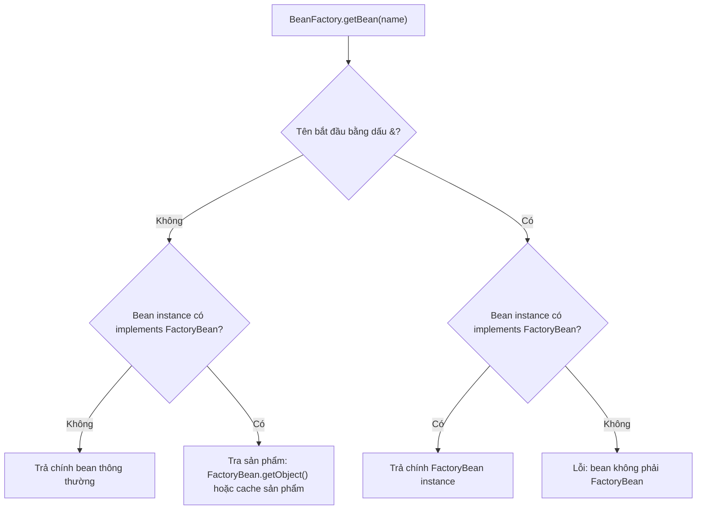

<a id="back-to-top"></a>

# FactoryBean

## Menu
- [Phân biệt FactoryBean với BeanFactory](#factory-bean-001)
- [Tạo sản phẩm qua FactoryBean.getObject](#factory-bean-002)
- [Khai báo kiểu sản phẩm bằng getObjectType](#factory-bean-003)
- [Ý nghĩa isSingleton đối với sản phẩm](#factory-bean-004)
- [Lấy sản phẩm theo tên và lấy nhà máy bằng tiền tố &amp;](#factory-bean-005)
- [Vòng đời của FactoryBean và trách nhiệm quản lý sản phẩm](#factory-bean-006)
- [Lựa chọn giữa FactoryBean, @Bean và phương thức nhà máy](#factory-bean-007)
- [Khả năng xác định kiểu sớm và ảnh hưởng tới autowiring](#factory-bean-008)

## <a id="factory-bean-001">Phân biệt FactoryBean với BeanFactory</a>

<details>
<summary>Xem chi tiết</summary>

# Phân biệt FactoryBean với BeanFactory trong Spring Core Container

## 1. Vì sao hai tên này dễ gây nhầm lẫn?

`BeanFactory` và `FactoryBean` có tên rất giống nhau, nhưng chúng thuộc **hai cấp độ khác nhau** của Spring IoC:

- **`BeanFactory`** là giao diện nền tảng của **container**. Nó quản lý việc tra cứu bean theo tên/kiểu, tạo đối tượng khi cần, áp dụng scope, dependencies và lifecycle thông qua implementation cụ thể.
- **`FactoryBean<T>`** là giao diện được **một bean đặc biệt** triển khai. Bean đó hoạt động như một factory tạo ra **sản phẩm T**. Khi ứng dụng gọi `getBean("tenFactory")`, Spring thông thường trả **sản phẩm do `FactoryBean.getObject()` tạo**, thay vì bản thân object factory.

Cách ghi nhớ:

```text
                  +---------------------------+
                  | BeanFactory (container)   |
                  | - bean definitions        |
                  | - dependency wiring       |
                  | - scopes/lifecycle        |
                  +---------------------------+
                              |
                   getBean("widget")
                              |
                              v
                     [WidgetFactory]
                    implements FactoryBean
                              |
                         getObject()
                              |
                              v
                         Widget
                        (product)

getBean("&widget") ------------------> WidgetFactory
                                         (factory itself)
```

Trong sơ đồ, container **chứa một bean definition cho `WidgetFactory`**; theo hợp đồng `FactoryBean`, tên `widget` bình thường **expose sản phẩm**. Nếu cần lấy lại đối tượng tạo sản phẩm để cấu hình/kiểm tra trực tiếp, Spring hỗ trợ tiền tố `&` trong bean name.

**Điểm khác biệt quan trọng nhất:** `BeanFactory` **quản lý nhiều bean**; một `FactoryBean` **là một bean đặc biệt tạo hoặc cung cấp một loại sản phẩm** bên trong BeanFactory.

## 2. So sánh trực diện

| Tiêu chí | `BeanFactory` | `FactoryBean<T>` |
| --- | --- | --- |
| Gói API | `org.springframework.beans.factory.BeanFactory` | `org.springframework.beans.factory.FactoryBean` |
| Vai trò | IoC container contract | Extension point tùy biến cách một bean/product được tạo |
| Ai triển khai thông thường? | Spring container, ví dụ `DefaultListableBeanFactory` | Developer/thư viện, ví dụ factory cho proxy, client, product |
| Đối tượng quản lý | Bean definitions và mọi bean mà container quản lý | Product của một factory cụ thể |
| API thường dùng | `getBean(...)`, `containsBean(...)`, `isSingleton(...)`, `getType(...)` | `getObject()`, `getObjectType()`, `isSingleton()` |
| Truy cập | Inject/nhận `ApplicationContext`, `BeanFactory` hoặc dùng interface con | Đăng ký một `FactoryBean` làm bean và lookup qua bean name |
| `getBean("x")` | Container resolve đối tượng mang tên `x` | Nếu `x` là FactoryBean, thường trả sản phẩm của nó |
| `getBean("&x")` | Container diễn giải `&` như factory dereference | Trả chính instance FactoryBean đứng sau `x` |
| Phạm vi (scope) | Container thực thi singleton/prototype/custom scope | Scope của factory và singleton-status của product là **hai quyết định riêng** |
| Lifecycle | Container điều khiển lifecycle các beans do nó sở hữu | Bản thân FactoryBean là bean được quản lý; product cần chú ý lifecycle riêng |
| Độ phổ biến trong business code | Có thể dùng nhưng thường ưu tiên constructor injection | Hữu ích với cơ chế tạo đối tượng phức tạp, đặc biệt code hạ tầng |

`BeanFactory` là **interface**, không phải một instance “factory bean” theo naming convention. `FactoryBean` cũng là **interface**, không phải một `BeanFactory` implementation.

## 3. BeanFactory: hợp đồng lõi của IoC container

Một số method tiêu biểu:

```java
Object getBean(String name);
<T> T getBean(String name, Class<T> requiredType);
<T> T getBean(Class<T> requiredType);
boolean containsBean(String name);
boolean isSingleton(String name);
boolean isPrototype(String name);
Class<?> getType(String name);
```

Đây là **trích đoạn chữ ký minh họa**, không phải code độc lập để biên dịch. Các overload và annotations khác đã được lược bớt.

Container có trách nhiệm chung:

1. Giữ bean definitions và biết phải tạo bean từ constructor hay factory method.
2. Resolve dependency graph; tạo bean phụ thuộc trước khi đưa vào bean cần dependency.
3. Áp dụng scope (singleton, prototype và custom/web scopes khi được đăng ký).
4. Thực thi `BeanPostProcessor`, init callbacks và destruction callbacks nếu lifecycle thuộc container.
5. Cung cấp API tra cứu object và thông tin kiểu/scope.

`ApplicationContext` mở rộng hệ thống BeanFactory với environment, resource loading, events, internationalization, nhiều lifecycle tiện ích. Trong các ứng dụng Spring, `AnnotationConfigApplicationContext` là một loại `ApplicationContext` dùng được các API của `BeanFactory`.

Ví dụ sử dụng:

```java
try (AnnotationConfigApplicationContext context =
             new AnnotationConfigApplicationContext(MyConfig.class)) {
    BeanFactory factory = context;
    PaymentService service = factory.getBean(PaymentService.class);
    service.process();
}
```

Đây là **mảnh ví dụ**, cần `MyConfig` và `PaymentService` thực sự tồn tại cùng import thích hợp. Nó thể hiện rằng biến kiểu `BeanFactory` là interface truy xuất container; nó không tự chỉ định bean nào là `FactoryBean`.

### BeanFactory khác DefaultListableBeanFactory

`BeanFactory` định nghĩa những thao tác client cần; `DefaultListableBeanFactory` là implementation thông dụng, có registry, bean definition metadata và các cơ chế tạo bean thực tế. `ConfigurableListableBeanFactory`, `ConfigurableBeanFactory`, `ListableBeanFactory` là những interface khác cung cấp thêm quyền cấu hình/liệt kê.

Không nên viết business code phụ thuộc trực tiếp vào `DefaultListableBeanFactory` để tự sửa registry khi constructor injection là đủ. Phân biệt **API container** với **implementation container** giúp unit test và module design đơn giản hơn.

## 4. FactoryBean<T>: một bean đưa ra product riêng

Interface đầy đủ có ba method trọng tâm:

```java
public interface FactoryBean<T> {
    T getObject() throws Exception;
    Class<?> getObjectType();
    default boolean isSingleton() {
        return true;
    }
}
```

Đây là **chữ ký rút gọn minh họa** theo Spring Framework 6.2. Bản API thật có annotations, Javadoc và có thể thêm metadata.

### 4.1. getObject()

`getObject()` tạo, trả hoặc lấy từ cache sản phẩm của FactoryBean. Tùy `isSingleton()`, Spring có thể cache sản phẩm mà factory đã trả về. Không suy ra rằng mỗi lần gọi `BeanFactory.getBean("x")` đều trực tiếp gọi `FactoryBean.getObject()`.

Nếu `isSingleton()==true` và bean factory phù hợp caching, sau khi sản phẩm được tạo, các lần lookup cùng tên thông thường dùng sản phẩm đã cache.

Nếu `isSingleton()==false`, Spring không áp dụng singleton product cache đó; mỗi lần lookup thường yêu cầu `getObject()`. **FactoryBean phải tự bảo đảm hợp đồng tạo độc lập** nếu muốn hành vi prototype thật sự.

### 4.2. getObjectType()

`getObjectType()` thông báo kiểu sản phẩm, không phải kiểu của bản thân factory. Spring cần thông tin này cho type matching/autowiring mà không phải tạo product vô cớ.

```java
@Override
public Class<?> getObjectType() {
    return Widget.class;
}
```

Đây là mảnh method minh họa, giả định `Widget` là kiểu product. Method nên nhanh, tránh side effect và **không gọi `getObject()` chỉ để đoán product type**. Theo Javadoc, method có thể được gọi khi FactoryBean chưa hoàn tất initialization; đừng phụ thuộc state chỉ được thiết lập muộn trong init callbacks.

Nếu không biết type, `getObjectType()` được phép trả `null`, nhưng Spring không thể dùng type đó để resolve một số autowiring/type searches một cách tin cậy. Đây là lựa chọn bất đắc dĩ, không nên là giá trị mặc định khi product type đã được biết.

### 4.3. isSingleton()

`FactoryBean.isSingleton()` mô tả **product** có là singleton hay không; default là `true`.

```java
@Override
public boolean isSingleton() {
    return false; // Product không phải singleton.
}
```

Đừng đọc `isSingleton()` thành “FactoryBean object là singleton”: đối tượng factory được đăng ký bằng scope riêng (thường mặc định singleton). Hai lớp scope cần xét độc lập.

Khi trả `true`, FactoryBean phải cung cấp một sản phẩm có identity ổn định: các lần gọi `getObject()` theo hợp đồng không nên âm thầm tạo product khác nhau. Container có thể cache product nhưng implementation vẫn phải nhất quán nếu method bị dùng trực tiếp.

## 5. Quy tắc tên bean: & để lấy factory

Giả sử có một bean tên `widget`, được định nghĩa bởi class implement `FactoryBean<Widget>`:

```java
Object product = context.getBean("widget");
Object factory = context.getBean("&widget");
```

Diễn giải:

- `"widget"`: tên logical mà Spring công bố **sản phẩm**.
- `"&widget"`: tiền tố `BeanFactory.FACTORY_BEAN_PREFIX` giúp **dereference factory**, lấy chính bean implement `FactoryBean`.
- `"widget"` vẫn là bean name đăng ký trong registry. **Không** đăng ký một definition riêng mang tên `"&widget"`.
- `&` là cơ chế cú pháp của Spring BeanFactory, **không** phải Java address-of operator.
- Gọi `getBean("&ordinaryBean")` khi bean đó không implement `FactoryBean` sẽ gây lỗi như `BeanIsNotAFactoryException`.

Một cách an toàn khi cần type:

```java
Widget widget = context.getBean("widget", Widget.class);
WidgetFactory factory = context.getBean("&widget", WidgetFactory.class);
```

Đây là mảnh code yêu cầu bean names/types tương ứng đã đăng ký. Kiểu `WidgetFactory` chỉ tồn tại trong ví dụ mục 7.

### Tra cứu theo kiểu cũng bị ảnh hưởng

`getBean(Widget.class)` có thể resolve product của FactoryBean thông qua `getObjectType()` và metadata. Ngược lại, nếu muốn chính factory, nên chỉ rõ prefix `&` hoặc thiết kế wiring cho factory một cách tường minh. Không giả định Spring sẽ coi bản thân FactoryBean là một bean bình thường cho **mọi kiểu lookup** theo Java class của nó.

Đối với danh sách `getBeansOfType` hoặc một injection point, kết quả còn phụ thuộc type inference, tính unique của candidates và cách Spring xử lý FactoryBean instances. Dùng `&name` là cách biểu đạt rõ ràng nhất khi cần chính factory.

## 6. Hai lớp scope phải phân biệt

Đây là chỗ sai phổ biến nhất khi học FactoryBean. Có **hai câu hỏi riêng biệt**:

**Câu hỏi A: bản thân FactoryBean được tạo bao nhiêu lần?**

Nó là một bean do container quản lý. Nếu definition `@Bean("widget")` không có `@Scope`, Spring mặc định dùng **singleton scope cho factory**. Nếu khai báo factory prototype, mỗi lần BeanFactory cần tạo factory instance có thể nhận một factory mới.

**Câu hỏi B: sản phẩm do FactoryBean cung cấp có được cache không?**

`FactoryBean.isSingleton()` trả lời câu này. Với factory singleton:

| Scope của factory | `isSingleton()` của product | Thường quan sát được |
| --- | --- | --- |
| singleton | `true` | Cùng một factory, cùng một product cho nhiều lookup bình thường |
| singleton | `false` | Cùng factory, product không dùng singleton cache; có thể được tạo lại mỗi lookup |
| prototype | `true` | Mỗi lần truy xuất definition có thể tạo factory mới; không hiểu là một product singleton toàn container |
| prototype | `false` | Factory mới có thể tạo product mới theo lần lookup |

Bảng mô tả xu hướng để phân biệt hai chiều; đừng dùng nó thay cho việc kiểm tra bean definition, `FactoryBean` contract và chiến lược tạo/caching của implementation.

Nếu product trả về thuộc một custom scope như request/session, `isSingleton()==false` **không tự chứng minh mỗi lần đều là instance độc lập**. `SmartFactoryBean.isPrototype()` được thiết kế để mô tả rõ hơn việc trả independent objects. Vì vậy **“non-singleton” không luôn đồng nghĩa “prototype”** trong tất cả các kịch bản factory đặc biệt.

## 7. Ví dụ Java 17+ chạy được: hai factory, hai chiến lược product

Dự án tối thiểu với Spring Framework 6.2.x, không cần Spring Boot:

```text
factory-vs-beanfactory/
├── settings.gradle
├── build.gradle
└── src/main/java/FactoryDifferenceDemo.java
```

### settings.gradle

```groovy
rootProject.name = 'factory-vs-beanfactory'
```

### build.gradle

```groovy
plugins {
    id 'application'
}

repositories {
    mavenCentral()
}

dependencies {
    implementation 'org.springframework:spring-context:6.2.18'
}

java {
    toolchain {
        languageVersion = JavaLanguageVersion.of(17)
    }
}

application {
    mainClass = 'FactoryDifferenceDemo'
}
```

### src/main/java/FactoryDifferenceDemo.java

```java
import java.util.concurrent.atomic.AtomicInteger;

import org.springframework.beans.factory.BeanFactory;
import org.springframework.beans.factory.FactoryBean;
import org.springframework.context.annotation.AnnotationConfigApplicationContext;
import org.springframework.context.annotation.Bean;
import org.springframework.context.annotation.Configuration;

public class FactoryDifferenceDemo {

    public record Widget(int number) {
    }

    public static class WidgetFactory implements FactoryBean<Widget> {
        private final boolean productSingleton;
        private final AtomicInteger sequence = new AtomicInteger();
        private Widget sharedProduct;

        public WidgetFactory(boolean productSingleton) {
            this.productSingleton = productSingleton;
        }

        @Override
        public synchronized Widget getObject() {
            if (productSingleton) {
                if (sharedProduct == null) {
                    sharedProduct = new Widget(sequence.incrementAndGet());
                }
                return sharedProduct;
            }
            return new Widget(sequence.incrementAndGet());
        }

        @Override
        public Class<?> getObjectType() {
            return Widget.class;
        }

        @Override
        public boolean isSingleton() {
            return productSingleton;
        }
    }

    @Configuration(proxyBeanMethods = false)
    public static class Config {
        // Factory bean là singleton theo scope mặc định.
        // Product cũng được cung cấp theo singleton contract.
        @Bean("sharedWidget")
        public WidgetFactory sharedWidget() {
            return new WidgetFactory(true);
        }

        // Factory bean vẫn là singleton,
        // nhưng product được tạo mới khi tra cứu.
        @Bean("freshWidget")
        public WidgetFactory freshWidget() {
            return new WidgetFactory(false);
        }
    }

    public static void main(String[] args) {
        try (AnnotationConfigApplicationContext context =
                     new AnnotationConfigApplicationContext(Config.class)) {

            // ApplicationContext cũng cung cấp BeanFactory API.
            BeanFactory beanFactory = context;

            Widget shared1 =
                    beanFactory.getBean("sharedWidget", Widget.class);
            Widget shared2 =
                    beanFactory.getBean("sharedWidget", Widget.class);

            Widget fresh1 =
                    beanFactory.getBean("freshWidget", Widget.class);
            Widget fresh2 =
                    beanFactory.getBean("freshWidget", Widget.class);

            WidgetFactory factory1 =
                    beanFactory.getBean("&freshWidget", WidgetFactory.class);
            WidgetFactory factory2 =
                    beanFactory.getBean("&freshWidget", WidgetFactory.class);

            System.out.println("sharedSame=" + (shared1 == shared2));
            System.out.println("freshDifferent=" + (fresh1 != fresh2));
            System.out.println("sharedNumbers="
                    + shared1.number() + "," + shared2.number());
            System.out.println("freshNumbers="
                    + fresh1.number() + "," + fresh2.number());
            System.out.println("factorySame=" + (factory1 == factory2));
            System.out.println("factoryClass="
                    + factory1.getClass().getSimpleName());
            System.out.println("productClass="
                    + fresh1.getClass().getSimpleName());
            System.out.println("factorySingletonProduct="
                    + factory1.isSingleton());
            System.out.println("contextIsBeanFactory="
                    + (context instanceof BeanFactory));
        }
    }
}
```

Chạy với JDK 17+ và Gradle 8+:

```bash
gradle run --quiet
# Hoặc ./gradlew run --quiet nếu dự án đã có Gradle Wrapper.
```

**Các dòng chương trình tự in ra qua `System.out`:**

```text
sharedSame=true
freshDifferent=true
sharedNumbers=1,1
freshNumbers=1,2
factorySame=true
factoryClass=WidgetFactory
productClass=Widget
factorySingletonProduct=false
contextIsBeanFactory=true
```

Có thể có log framework tùy classpath/cấu hình; chúng không thay đổi các dòng `System.out` được liệt kê.

### Phân tích từng kết quả

1. Hai lần `getBean("sharedWidget")` trả **cùng một `Widget`**. Factory có `isSingleton()==true`, Spring có thể cache singleton product, còn chính factory cũng giữ identity của product trong `sharedProduct`.
2. Hai lần `getBean("freshWidget")` trả **hai `Widget` khác nhau**, vì FactoryBean báo `isSingleton()==false` và `getObject()` tạo product mới.
3. Sequence của mỗi factory độc lập. Vì thế product singleton có số `1` hai lần, còn non-singleton có số `1` rồi `2`.
4. Hai lần `getBean("&freshWidget")` trả **cùng một factory instance**: definition `freshWidget` có scope singleton mặc định.
5. Kiểu factory là `WidgetFactory`; kiểu product là `Widget`. Chúng là hai Java objects khác nhau.
6. `factorySingletonProduct=false` mô tả **product cache policy** của factory, dù chính `WidgetFactory` là singleton.
7. `contextIsBeanFactory=true` vì `ApplicationContext` mở rộng khả năng BeanFactory. `BeanFactory` không phải một `WidgetFactory`.

**Lưu ý của ví dụ:** `WidgetFactory.getObject()` được đồng bộ bằng `synchronized` để minh họa shared-product initialization an toàn khi bị gọi đồng thời. Mã vẫn thực hiện logic độc lập trong mỗi factory, không dùng static cache; ứng dụng thật cần chọn synchronization/caching phù hợp với tải và lifecycle.

## 8. @Bean factory method khác FactoryBean

Trong Java configuration, cú pháp `@Bean` trên một method thường đã tạo đủ bean:

```java
@Configuration(proxyBeanMethods = false)
class RegularConfig {
    @Bean
    Widget widget() {
        return new Widget(42);
    }
}
```

Đây là mảnh minh họa. `widget()` là **factory method** theo nghĩa thông thường: Spring gọi method để tạo bean kiểu `Widget`. Nó **không tự biến `RegularConfig` thành implementation của `FactoryBean<Widget>`**.

So sánh ba tình huống:

| Cách đăng ký | Object được container nhận từ definition | `getBean("widget")` |
| --- | --- | --- |
| `@Bean Widget widget()` | Bean `Widget` thông thường | Trả `Widget` |
| `@Bean WidgetFactory widget()` với `WidgetFactory implements FactoryBean<Widget>` | Bean `WidgetFactory` đặc biệt | Trả `Widget` là product; `&widget` trả factory |
| XML definition class implement `FactoryBean` | Bean implement FactoryBean | Trả product; `&widget` trả factory |

Một `@Bean` method có thể trả về một `FactoryBean` và khi đó Spring áp dụng dereference/product semantics. Điều làm nên `FactoryBean` không phải tên method chứa chữ “factory”, mà là **instance thực sự implement `org.springframework.beans.factory.FactoryBean`**.

### Khi nào dùng FactoryBean thay cho @Bean method?

Chọn factory method `@Bean` nếu việc tạo đối tượng dễ diễn đạt:

```java
@Bean
HttpClient httpClient() {
    return HttpClient.newHttpClient();
}
```

Mảnh minh họa giả định `java.net.http.HttpClient` trên Java 17+. Phương thức thông thường đã đủ.

Cân nhắc `FactoryBean` khi cần tích hợp một abstraction tạo đối tượng phức tạp vào **container type matching và lookup semantics**, ví dụ một proxy, dynamic client, object do nhà cung cấp bên ngoài xây dựng, hoặc một framework infrastructure muốn quản lý factory riêng với product. Trong business code đơn giản, `@Bean` method hoặc một factory service thuần Java thường rõ ràng hơn.

## 9. FactoryBean khác factory method và ObjectFactory<T>

Ba khái niệm đều có chữ “factory”:

**`@Bean` factory method:** Spring gọi phương thức cấu hình để tạo bean. Kết quả có thể là bean bình thường hoặc một `FactoryBean`.

**`FactoryBean<T>`:** hợp đồng đặc biệt được container hiểu; có `getObject()`, `getObjectType()` và `isSingleton()`. Bean name thông thường lộ ra product, `&name` lộ ra factory.

**`ObjectFactory<T>`:** interface rất nhỏ với `T getObject()`, thường dùng để yêu cầu một object theo nhu cầu, ví dụ được inject vào singleton để lấy prototype; bản thân object implement `ObjectFactory` không mặc định có cơ chế prefix `&`.

Mẫu inject từ container:

```java
@Service
class ReportRunner {
    private final ObjectProvider<ReportTask> tasks;

    ReportRunner(ObjectProvider<ReportTask> tasks) {
        this.tasks = tasks;
    }

    void run() {
        ReportTask task = tasks.getObject();
        task.execute();
    }
}
```

Đây là **mảnh minh họa**, cần imports và định nghĩa `ReportTask`, `@Service`, `ObjectProvider` tương ứng. `ObjectProvider` mở rộng khả năng lookup linh hoạt; nếu `ReportTask` có scope prototype, mỗi `getObject()` có thể tạo instance mới.

Không nhầm `ObjectProvider<T>` (client-side lookup hỗ trợ injection) với `FactoryBean<T>` (container-level extension thay đổi cách bean name công bố product).

## 10. Vòng đời của FactoryBean và product

Đây là một giới hạn dễ bị bỏ sót khi xây `FactoryBean` cung cấp socket, connection pool, HTTP client hoặc resource nặng.

### 10.1. FactoryBean object có lifecycle bình thường

Nếu factory là singleton do context quản lý, bản thân nó được tạo và khởi tạo theo bean lifecycle: dependency injection, init callbacks, BeanPostProcessors và destruction callbacks khi context đóng. Có thể dùng `DisposableBean` hoặc một custom destroy method trên **factory**.

### 10.2. Product không mặc nhiên có destruction lifecycle đầy đủ

Theo Javadoc của `FactoryBean`, container chịu trách nhiệm quản lý lifecycle của **FactoryBean instance**; product từ `getObject()` **không tự có cùng destruction lifecycle** chỉ vì được expose qua `getBean("name")`. Đặc biệt không được kỳ vọng Spring tự gọi `AutoCloseable.close()` của product khi context đóng.

Ví dụ factory quản lý product singleton cần close:

```java
import org.springframework.beans.factory.DisposableBean;
import org.springframework.beans.factory.FactoryBean;

final class ClientFactory
        implements FactoryBean<ManagedClient>, DisposableBean {

    private ManagedClient client;

    @Override
    public synchronized ManagedClient getObject() {
        if (client == null) {
            client = new ManagedClient();
        }
        return client;
    }

    @Override
    public Class<?> getObjectType() {
        return ManagedClient.class;
    }

    @Override
    public boolean isSingleton() {
        return true;
    }

    @Override
    public synchronized void destroy() throws Exception {
        if (client != null) {
            client.close();
        }
    }
}
```

Đây là **mảnh class minh họa**, cần `ManagedClient implements AutoCloseable` với constructor phù hợp và không phải file Java hoàn chỉnh để chạy độc lập. Factory có trách nhiệm đóng product khi factory bị hủy. Nên viết cleanup idempotent và lưu ý thread safety, exception, ownership nếu product dùng chung.

Với `isSingleton()==false`, caller có thể nhận nhiều product khác nhau; nếu mỗi product mang tài nguyên cần close, phải thiết kế một trong các chiến lược rõ ràng: caller tự close sau mỗi việc, factory theo dõi để close có kiểm soát, hoặc tạo scoped resource có lifecycle hỗ trợ. Không thể chỉ viết `FactoryBean.destroy()` rồi giả định mọi product từng tạo đã được đóng.

### Product và BeanPostProcessor

Spring có thể áp dụng **một số post-processing** cho product trả về từ FactoryBean (đáng chú ý post-processing sau khởi tạo), nhưng điều đó **không tương đương** việc product được tạo như một bean definition thông thường với toàn bộ init và destroy callbacks. Không dựa vào việc `@PostConstruct` của product chắc chắn được gọi tự động chỉ vì class product có annotation. Nếu product cần initialization rõ ràng, làm trong factory hoặc thiết kế bean definition bình thường phù hợp.

## 11. getObjectType() và autowiring theo kiểu

Một container có thể phải trả lời “có bean kiểu `PaymentGateway` không?” **trước khi tạo product**. Do đó việc FactoryBean công bố đúng type là điều kiện cho wiring ổn định.

Implementation tốt:

```java
@Override
public Class<?> getObjectType() {
    return PaymentGateway.class;
}
```

Đây là mảnh minh họa. Factory trả về một object compatible với `PaymentGateway`. Lợi ích:

- `getBeanNamesForType(PaymentGateway.class)` có cơ sở tìm candidate.
- Constructor injection `PaymentGateway gateway` có thể được resolve khi chỉ có một bean phù hợp.
- Các IDE/tooling và các phép kiểm tra type có metadata đáng tin.

Implementation rủi ro:

```java
@Override
public Class<?> getObjectType() {
    return getObject().getClass(); // Có side effect tạo product!
}
```

Đây là anti-pattern: type introspection có thể thực thi `getObject()` sớm, tạo resource/khởi động kết nối khi container còn xây dựng metadata hoặc trong lúc scanning. Điều này có thể kéo theo circular dependency và initialization không đúng thứ tự.

Nếu runtime type thực sự dynamic, hãy công bố một interface/supertype ổn định mà mọi product thỏa mãn; chỉ trả `null` khi contract thực sự không thể xác định type.

`FactoryBean.OBJECT_TYPE_ATTRIBUTE` còn cho phép khai báo kiểu product trên bean definition metadata trong một số trường hợp, để container tra cứu type mà không cần instantiate factory. Đây là chi tiết mở rộng dành cho infrastructure, không phải điều bắt buộc trong phần lớn custom FactoryBean.

## 12. Nếu getObject() ném exception hoặc trả null?

`FactoryBean.getObject()` khai báo `throws Exception`. Khi nó thất bại, lời gọi `BeanFactory.getBean("name")` thường được Spring chuyển thành một exception liên quan bean creation, mang cause của lỗi ở factory.

Một số tình huống:

- **Sai configuration:** constructor hoặc `getObject()` ném exception khi không thể tạo product.
- **Circular reference / factory chưa sẵn sàng:** implementation có thể ném `FactoryBeanNotInitializedException` để báo factory chưa thể tạo object.
- **Trả `null`:** contract cho phép trả `null` trong vài trường hợp; Spring có semantics nội bộ để biểu diễn null bean. Nhưng consumer bắt buộc non-null sẽ khó hoạt động. Với product thiết yếu, trả type/object rõ ràng và ném exception có ý nghĩa nếu không tạo được.
- **Thread safety:** nhiều concurrent lookups có thể chạm logic factory. Với shared product, bảo đảm đồng bộ; với prototype, tránh giữ mutable shared state không an toàn.
- **Cache và retry:** đừng đưa product hỏng vào shared cache rồi để mọi lần tra cứu sau nhận lại object không hợp lệ.

Khi product là remote client có thể không connect, đừng tạo kết nối trong `getObjectType()`. Nếu initialization có thể thất bại sau khi đã mở tài nguyên, cleanup trong `getObject()` với `try/finally` hoặc một helper rõ ràng để tránh leak trước khi return.

## 13. SmartFactoryBean: mở rộng singleton và eager-init metadata

Spring có interface `SmartFactoryBean<T> extends FactoryBean<T>`, cung cấp thêm thông tin cho container:

- `isPrototype()`: cho biết product có thực sự là **một instance độc lập** mỗi lần được tạo hay không.
- `isEagerInit()`: gợi ý factory và singleton product có cần được khởi tạo sớm trong vòng pre-instantiation hay không.

Đặc biệt:

```text
FactoryBean.isSingleton() == false
        không luôn suy ra
SmartFactoryBean.isPrototype() == true
```

Vì “không singleton” có thể là object gắn với một scope khác, vẫn được tái sử dụng trong một khoảng sống cụ thể. `SmartFactoryBean` chủ yếu cho infrastructure/collaborating frameworks; custom factories của ứng dụng thường dùng `FactoryBean` là đủ.

Một `FactoryBean` thông thường không nhất thiết tạo **product** trong startup eager singleton pass, ngay cả khi **factory** singleton được instantiate. Product thường được tạo theo nhu cầu; `SmartFactoryBean.isEagerInit()` có thể thay đổi điều đó.

## 14. Đặt cạnh BeanFactoryPostProcessor và BeanPostProcessor

Có một nhóm tên khác cũng dễ nhầm:

| Thành phần | Thao tác trên | Thời điểm |
| --- | --- | --- |
| `BeanFactory` | Container API cho bean graph | Xuyên suốt vòng đời |
| `FactoryBean<T>` | Tạo/expose product của một bean factory đặc biệt | Khi container cần product, theo cache/scope |
| `BeanFactoryPostProcessor` | BeanFactory và bean definition metadata | Trước vòng tạo singleton thông thường |
| `BeanDefinitionRegistryPostProcessor` | Registry bean definitions, có thể thêm definitions | Trước BFPP thường |
| `BeanPostProcessor` | Bean instances | Trong quá trình khởi tạo từng bean |

Một `FactoryBean` có thể đồng thời mang interface lifecycle nếu cần. Nhưng điều đó **không biến nó thành `BeanFactoryPostProcessor`**. Chữ “Factory” có trong tên không có nghĩa API cùng vị trí trong lifecycle.

Ví dụ dùng `BeanFactoryPostProcessor` để thay đổi scope metadata trước khi bean được tạo là extension point khác hẳn custom `FactoryBean` dùng để tạo client.

## 15. Dependency injection: lấy factory hay lấy product?

Giả sử bạn có:

```java
@Bean("gateway")
GatewayFactory gatewayFactory() {
    return new GatewayFactory();
}
```

Đây là mảnh minh họa, giả định `GatewayFactory implements FactoryBean<Gateway>`.

Consumer muốn **product** thường inject interface product:

```java
@Service
class PaymentService {
    private final Gateway gateway;

    PaymentService(Gateway gateway) {
        this.gateway = gateway;
    }
}
```

Nếu type matching xác định duy nhất product, Spring resolve dependency cho `Gateway`. Consumer business không cần biết factory thực hiện như thế nào.

Consumer muốn **factory** chỉ trong code hạ tầng có thể truy xuất qua `&gateway`:

```java
GatewayFactory factory =
        context.getBean("&gateway", GatewayFactory.class);
```

Hoặc kiến trúc có thể expose một bean facade/management interface riêng để không buộc consumer biết prefix Spring.

**Tránh injecting `BeanFactory` chỉ để lấy một dependency cố định.** Ví dụ:

```java
@Service
class FragilePaymentService {
    @Autowired
    BeanFactory container;

    void pay() {
        Gateway gateway = container.getBean("gateway", Gateway.class);
    }
}
```

Mảnh trên không phải chương trình hoàn chỉnh. Nó tạo coupling với bean name dạng chuỗi. Constructor injection với `Gateway` thường đơn giản, type-safe và dễ test hơn. Với nhu cầu lấy một prototype nhiều lần, cân nhắc `ObjectProvider<Gateway>`.

## 16. Kiểm thử FactoryBean và BeanFactory

### Kiểm thử factory như một Java class

Có thể test trực tiếp `WidgetFactory` trong ví dụ mục 7:

```java
WidgetFactory factory = new WidgetFactory(false);
Widget one = factory.getObject();
Widget two = factory.getObject();

assert one != two;
assert factory.getObjectType() == Widget.class;
assert !factory.isSingleton();
```

Đây là snippet minh họa, giả định các class lồng được import hoặc tham chiếu đầy đủ qua `FactoryDifferenceDemo`; dùng `-ea` nếu chạy Java `assert`. Unit test này xác minh **logic của FactoryBean**, nhưng **chưa** xác minh container dereference và product caching.

### Kiểm thử thông qua Spring container

Trong integration test, nên kiểm tra:

```java
Object product = context.getBean("sharedWidget");
Object underlyingFactory = context.getBean("&sharedWidget");

assert product instanceof Widget;
assert underlyingFactory instanceof WidgetFactory;
assert context.getBean("sharedWidget") == product;
```

Đây là snippet minh họa (biến `context` từ ví dụ chính). Nó chứng minh Spring hiểu hợp đồng FactoryBean. Kiểm tra lifecycle riêng nếu factory tạo resource có `close()`.

### Kịch bản tối thiểu cần xác minh

1. `getBean("x")` trả đúng product type.
2. `getBean("&x")` trả factory, không phải product.
3. `FactoryBean.getObjectType()` thông báo type đúng, không instantiate product chỉ để đo type.
4. `isSingleton=true` và `getObject()` thực sự cấp cùng product identity.
5. `isSingleton=false` và implementation thật sự cấp product mới nếu yêu cầu prototype.
6. Factory singleton hay prototype được tạo theo scope đã cấu hình.
7. Factory cleanup do Spring quản lý, product cleanup do chính factory/caller quản lý nếu cần.
8. Lỗi từ `getObject()` được báo ra đúng thay vì trả product hỏng.
9. Nếu nhiều product candidates cùng type, constructor injection phải có qualifier/name rõ ràng.

Trong JUnit 5, ưu tiên `assertSame`/`assertNotSame` khi so sánh identity. `equals` chỉ kiểm tra giá trị, không chứng minh hai object có cùng reference.

## 17. Lỗi thường gặp và cách sửa

| Lỗi/triệu chứng | Nguyên nhân | Cách xử lý |
| --- | --- | --- |
| `getBean("factoryName")` trả client thay vì factory class | FactoryBean được Spring dereference mặc định thành product | Gọi `getBean("&factoryName")` để lấy factory |
| `getBean("&regularBean")` báo `BeanIsNotAFactoryException` | Bean đích không implements `FactoryBean` | Bỏ `&` hoặc dùng đúng bean factory definition |
| Product được lấy nhiều lần vẫn cùng reference | `isSingleton()` mặc định `true`, container cache product | Override `isSingleton()` trả `false` khi product thực sự non-singleton |
| Product thay đổi dù factory trả `true` | Factory vi phạm singleton product contract | Giữ shared instance, bảo đảm thread-safe initialization |
| Hai lần `&name` cùng một factory nhưng product khác nhau | Factory scope singleton, `isSingleton=false` | Đây là trường hợp hoàn toàn hợp lệ, không phải bug |
| Inject product theo type không tìm ra bean | `getObjectType()` trả `null` hoặc type không đúng | Công bố type phù hợp, tránh khởi tạo product trong method này |
| Constructor/factory unexpectedly chạy khi xem type | `getObjectType()` gọi `getObject()` hoặc type inspection ép factory init | Bỏ side effect; thiết kế metadata sẵn có |
| `AutoCloseable.close()` của product không chạy lúc context close | Product không tự nhận đầy đủ destruction lifecycle | Factory cleanup/delegate hoặc caller quản lý tài nguyên |
| Tưởng `@Bean` method là `FactoryBean` | Nhầm method tạo bean với interface FactoryBean | Kiểm tra return object có implements interface không |
| Product không sẵn sàng lúc startup | FactoryBean thường tạo product on demand | Gọi đúng nơi cần; dùng SmartFactoryBean nếu thực sự cần eager semantics |
| Test product qua `new FactoryBean` nhưng pass integration giả | Không kiểm tra dereference/caching của Spring | Thêm test với ApplicationContext thật |
| Factory phụ thuộc quá nhiều business beans khi context bootstrap | Phát sinh early initialization/circular dependency | Giữ factory hạ tầng gọn, tránh side effect trong `getObjectType()` |

## 18. Khi nào nên tự viết FactoryBean?

FactoryBean hữu ích khi một loại product cần cách tạo khác hẳn định nghĩa bean thông thường, nhất là khi product:

- Là **dynamic proxy** hoặc object cần proxy configuration phức tạp.
- Được tạo bởi SDK/runtime đặc biệt, không có constructor/factory method phù hợp để đăng ký trực tiếp.
- Có kiểu interface ổn định nhưng implementation phải được build theo metadata runtime.
- Cần tùy biến cách Spring nhìn thấy object type, singleton-status hoặc lazy/eager product semantics.
- Là một thành phần hạ tầng cần được tái sử dụng từ nhiều bean definitions.

Nhưng nếu bài toán chỉ là **tạo một HttpClient có vài tham số cấu hình**, một `@Bean` factory method thường là giải pháp dễ bảo trì hơn. Nếu bài toán chỉ là **singleton muốn lấy prototype mới mỗi lần**, dùng `ObjectProvider<T>` hoặc method injection thay vì dựng một FactoryBean mới một cách không cần thiết.

Quyết định dựa trên **vai trò container integration** của FactoryBean, không chỉ vì nó có chữ “factory” trong tên.

## 19. Checklist thực hành

- Bean cần custom creation hay chỉ cần một `@Bean` method thông thường?
- Class có thực sự `implements FactoryBean<Product>` không?
- `getObjectType()` có trả type phù hợp, không side effect không?
- `isSingleton()` có đúng với identity product do `getObject()` cung cấp không?
- Factory bean definition scope là singleton hay prototype?
- Cần lấy product `"name"` hay factory `"&name"`?
- Factory có thể được Spring hỏi type trước khi init hoàn tất không?
- Product có tài nguyên cần close không và ai sở hữu lifecycle đó?
- Có concurrency khi nhiều thread tra cứu product không?
- Có cần `SmartFactoryBean.isEagerInit()` hoặc chỉ on-demand là đủ?
- Unit test của factory và integration test của container đã phân biệt chưa?

## 20. Tài liệu chính thức

- [Spring Framework Reference — Customizing Instantiation Logic with a FactoryBean](https://docs.spring.io/spring-framework/reference/core/beans/factory-extension.html): ba method của FactoryBean và cú pháp `&beanName`.
- [Spring Framework 6.2 Javadoc — FactoryBean](https://docs.spring.io/spring-framework/docs/6.2.18/javadoc-api/org/springframework/beans/factory/FactoryBean.html): hợp đồng `getObject`, `getObjectType`, `isSingleton` và lifecycle product/factory.
- [Spring Framework 6.2 Javadoc — BeanFactory](https://docs.spring.io/spring-framework/docs/6.2.18/javadoc-api/org/springframework/beans/factory/BeanFactory.html): container API, `FACTORY_BEAN_PREFIX`, lookup và scope queries.
- [Spring Framework 6.2 Javadoc — SmartFactoryBean](https://docs.spring.io/spring-framework/docs/6.2.18/javadoc-api/org/springframework/beans/factory/SmartFactoryBean.html): metadata `isPrototype`, `isEagerInit`.
- [Spring Framework Reference — Bean Scopes](https://docs.spring.io/spring-framework/reference/core/beans/factory-scopes.html): singleton/prototype và trách nhiệm lifecycle.

**Mô hình cần nhớ:** `BeanFactory` là **container**; `FactoryBean<T>` là **một bean factory đặc biệt nằm trong container**; `getBean("x")` trả **product** và `getBean("&x")` trả **factory**. Scope của factory, singleton-status của product và ownership của resource là ba điều phải đánh giá riêng.


</details>

- [Quay lại đầu trang](#back-to-top)

---

## <a id="factory-bean-002">Tạo sản phẩm qua FactoryBean.getObject</a>

<details>
<summary>Xem chi tiết</summary>

# Tạo sản phẩm qua FactoryBean.getObject trong Spring Framework Core Container

## 1. FactoryBean là gì và tại sao tồn tại?

Thông thường, Spring IoC Container tạo một bean từ constructor hoặc một method `@Bean`; đối tượng trả về chính là bean mà ứng dụng sử dụng. Với một số dependency khó khởi tạo — client SDK, proxy, adapter, object cần cấu hình nhiều bước, hoặc instance phải tạo theo một quy tắc đặc biệt — Spring cung cấp **`org.springframework.beans.factory.FactoryBean<T>`**.

`FactoryBean<T>` là **một bean đóng vai trò factory**. Khi container được yêu cầu lấy bean thông thường theo tên của factory, Spring không trả factory ngay, mà gọi **`getObject()` để lấy *sản phẩm* mà factory tạo ra**. Đây là extension point của cơ chế bean creation, không phải giao diện `BeanFactory`.

Ví dụ trực quan:

```text
                       ApplicationContext
                               |
                        bean name: "formatter"
                               |
                       FormatterFactory
                    implements FactoryBean<Formatter>
                       /                  \
                      /                    \
getBean("formatter")                     getBean("&formatter")
        |                                       |
        v                                       v
 container sử dụng getObject()           bản thân FormatterFactory
        |
        v
  Formatter (PRODUCT)
```

Hai danh tính cần phân biệt:

- **Factory bean**: đối tượng `FormatterFactory` do Spring tạo, inject và quản lý theo bean definition của nó.
- **Product**: đối tượng `Formatter` mà `getObject()` cung cấp cho các consumer.

Đây là lý do người học thấy `@Bean` trả về một `FactoryBean` nhưng khi gọi `context.getBean("formatter")` lại nhận đối tượng kiểu `Formatter`, không phải `FormatterFactory`.

Điều quan trọng: `FactoryBean` là một **API của Spring**, khác mẫu thiết kế *Factory Method* trong Java thuần. Nếu chỉ có logic tạo object đơn giản, một method `@Bean` trả trực tiếp product thường dễ hiểu và đủ dùng; không phải lúc nào cũng cần viết `FactoryBean`.

## 2. Ba method cốt lõi của FactoryBean<T>

Trong Spring Framework 6.x/7.x, interface có ba method quan trọng (dưới đây là **chữ ký giản lược**, không phải source cần chép lại):

```java
package org.springframework.beans.factory;

public interface FactoryBean<T> {
    T getObject() throws Exception;

    Class<?> getObjectType();

    default boolean isSingleton() {
        return true;
    }
}
```

Bảng ý nghĩa:

| Method | Hợp đồng | Lưu ý thiết kế |
| --- | --- | --- |
| `T getObject()` | Cung cấp một product instance, có thể shared hoặc độc lập tùy factory | Có thể ném `Exception`, được container gọi khi cần product |
| `Class<?> getObjectType()` | Khai báo kiểu product; có thể trả `null` nếu chưa biết | Nên trả type ổn định **mà không tạo product** |
| `boolean isSingleton()` | Thông báo factory có cung cấp **cùng một object reference** ổn định hay không | Mặc định `true`; không được khai báo true nếu thực chất trả object khác nhau |

### 2.1. getObject(): nơi tạo hoặc lấy sản phẩm

`getObject()` có thể thực hiện quy trình: validate config → xây cấu trúc → khởi tạo SDK → trang bị proxy → trả product. Khi container nhận request `getBean("name")`, nó sử dụng cơ chế FactoryBean để lấy product từ method này (hoặc lấy product singleton đã được cache).

```java
@Override
public Client getObject() throws Exception {
    Client client = Client.builder()
            .endpoint(endpoint)
            .credentials(credentials)
            .build();
    client.initialize();
    return client;
}
```

Đây chỉ là **pseudocode Java minh họa**, `Client`/builder/fields là API giả định của SDK khác, không phải thành phần của Spring và không phải ví dụ chạy độc lập. Nó cho thấy chỗ đặt việc tạo product tùy biến.

`getObject()` có thể được gọi **khi product thực sự được yêu cầu**, không nhất thiết ngay khi Spring tạo factory bean. Việc factory singleton được pre-instantiate **không có nghĩa** product luôn được eager-create. Đối với factory thông thường, product thường tạo theo demand; `SmartFactoryBean.isEagerInit()` có thể thay đổi hành vi với những bean phù hợp.

### 2.2. getObjectType(): rất quan trọng cho type discovery

Spring dùng `getObjectType()` khi giải quyết dependency theo type, `getType(name)`, `getBeansOfType(...)` và các thao tác phát hiện kiểu khác.

```java
@Override
public Class<?> getObjectType() {
    return Client.class;
}
```

Đây là fragment minh họa, `Client` phải là type thực tế mà product được công bố. Cần chú ý:
- Có thể được gọi **rất sớm**, trước khi factory được initialize hoàn chỉnh. Không dựa vào field chỉ được thiết lập trong `@PostConstruct` nếu field ấy có thể chưa sẵn sàng.
- Tránh tạo connection, mở file hoặc gọi `getObject()` chỉ để đoán type; type discovery lý tưởng là nhẹ, không side effect.
- Nếu trả `null`, việc tìm bean bằng kiểu product có thể không phát hiện factory tương ứng; Spring có thể bỏ qua bean đó trong autowiring theo type.
- Nên khai báo kiểu đủ cụ thể mà factory luôn trả về; nếu product có proxy, trả kiểu interface hoặc class thực sự có thể được gán.
- Không dùng `getObjectType()` để khởi chạy product; đó là trách nhiệm của `getObject()`.

### 2.3. isSingleton(): semantic của *product*, không phải của factory bean

`isSingleton() == true` có nghĩa factory quảng bá **sản phẩm là một reference có thể chia sẻ/cached**. Spring BeanFactory sở hữu factory singleton có thể cache result từ `getObject()` và trả lại cùng product ở các `getBean` sau.

`isSingleton() == false` nghĩa product không được quảng bá là singleton; Spring có thể gọi `getObject()` mỗi lần product được yêu cầu. Nhưng từ `false` **không suy ra chắc chắn mọi sản phẩm độc lập hoàn toàn**: một factory đặc biệt có thể trả object được share theo scope ngoài hoặc dùng pooling. `SmartFactoryBean.isPrototype()` cung cấp semantics mạnh hơn về các instance độc lập.

Hai lưu ý rất dễ bỏ sót:

1. `FactoryBean` **bản thân nó** thường được khai báo singleton, nhưng **product của nó** có thể không singleton. Hai scope/contract khác nhau.
2. Nếu khai báo `isSingleton() == true`, factory nên luôn trả **cùng một reference khi gọi `getObject()` trực tiếp**. Không viết `return new Product()` mỗi lần rồi chỉ trông chờ container cache để che giấu vi phạm contract, nhất là khi factory bị dùng bên ngoài bean factory.

Ví dụ minh họa sự khác biệt:

```text
FactoryBean "sharedClient":
    factory scope = singleton
    isSingleton() = true
    getObject()   = cùng Client sau khi tạo
    getBean("sharedClient") nhiều lần -> một reference product

FactoryBean "freshClient":
    factory scope = singleton
    isSingleton() = false
    getObject()   = new Client mỗi lần
    getBean("freshClient") nhiều lần -> nhiều reference product

FactoryBean "otherFactory" (prototype):
    factory scope = prototype
    isSingleton() = true
    không mặc định suy rằng mọi lookup dùng chung một factory/product toàn context
```

Trường hợp factory prototype nên được xem xét riêng, vì bản thân factory có thể được tạo mới mỗi lần; không dùng chỉ mỗi `isSingleton()` để suy ra identity toàn ứng dụng khi cấu hình bean factory không phải singleton.

## 3. Container diễn giải tên bean như thế nào?

Ký hiệu đặc biệt **`&`** là `BeanFactory.FACTORY_BEAN_PREFIX`. Nó chỉ cách dereference **factory** thay vì product.

Giả sử bean tên `"parser"` là một `FactoryBean<Parser>`:

```java
Parser p = context.getBean("parser", Parser.class);
FactoryBean<?> f = context.getBean("&parser", FactoryBean.class);
```

Mã fragment giả định `context` là một `ApplicationContext` có bean tên `parser`, `Parser` đã được định nghĩa. Dòng đầu yêu cầu **product**; dòng thứ hai yêu cầu chính **FactoryBean**.

| Lời gọi | Kết quả thông thường |
| --- | --- |
| `getBean("parser")` | Product của `FactoryBean.getObject()` |
| `getBean("&parser")` | Instance factory `FactoryBean` |
| `getBean("parser", Parser.class)` | Product có kiểu `Parser` |
| `getBean("&parser", ParserFactory.class)` | Factory instance có kiểu `ParserFactory` |
| `getType("parser")` | Type sản phẩm từ `getObjectType()` khi xác định được |
| `getType("&parser")` | Type của factory |
| `getBeanNamesForType(Parser.class)` | Có thể liệt kê tên bean của product tương thích với `Parser` |
| `getBeanNamesForType(FactoryBean.class)` | Truy vấn type factory; chi tiết phụ thuộc cấu hình và type discovery |

**Không viết `getBean("parser")` rồi cast sang `ParserFactory`**: tên bình thường trả product, không phải factory. Ngược lại, inject factory ở một service thay vì product sẽ làm thay đổi contract của service và dễ phát sinh lỗi kiểu.

`&` là cú pháp đặc biệt của Spring BeanFactory khi **truy vấn bean theo tên**, không phải phép Java reference, không phải prefix cho đường dẫn resource và không nên nhầm với ngữ nghĩa tham chiếu ở shell hoặc XML entity.

### Truy xuất factory có làm product được tạo không?

Trong trường hợp thông thường, `getBean("&parser")` lấy factory mà không buộc phải gọi `getObject()` để tạo product. Tuy nhiên factory có thể tự làm việc khởi tạo trong constructor/`@PostConstruct`, nên **không** suy rằng thao tác lấy factory tuyệt đối không có side effect. Hãy đo số lần gọi `getObject()` nếu cần xác định product được tạo lúc nào.

## 4. Luồng gọi của Spring khi lấy product

Mô hình hoạt động đơn giản trong một BeanFactory:

```text
context.getBean("parser")
       |
       v
BeanFactory resolve bean definition "parser"
       |
       v
Lấy hoặc tạo instance ParserFactory (factory bean)
       |
       +-- factory đã được initialize theo vòng đời bean
       |
       v
Nhận diện: instance implements FactoryBean<?> ?
       |
       +-- tên bắt đầu bằng "&" -> trả ParserFactory
       |
       +-- tên thường:
                |
                +-- nếu product singleton đã cache -> trả cache
                |
                +-- nếu chưa có / không singleton:
                         +-- factory.getObject()
                         +-- xử lý product theo cơ chế container phù hợp
                         +-- cache nếu product singleton đủ điều kiện
                         +-- trả product cho caller
```

Đây là mô tả ở mức khái niệm, không phải sao chép toàn bộ thuật toán nội bộ của `AbstractBeanFactory`. Thời điểm gọi `getObjectType`, xử lý post-processor, vòng phụ thuộc, `FactoryBean` prototype và early references có thể khác tùy loại bean.

Từ đó có thể quan sát:
- `getBean("parser")` không có nghĩa Java gọi constructor `Parser` ngay ở dòng này; có thể đã được tạo trước hoặc được cache.
- Một factory singleton có thể tồn tại từ startup nhưng product chưa được yêu cầu.
- `BeanPostProcessor` áp dụng cho factory bean như một bean do Spring tạo. Spring cũng có cơ chế post-processing product từ `FactoryBean`, nhưng **đừng giả định product đi qua toàn bộ cùng chuỗi constructor injection, `@PostConstruct` và destroy callbacks như một bean definition thông thường**. Factory thường phải chịu trách nhiệm init/cleanup riêng của product khi cần.
- Khi product là client có tài nguyên cần đóng, cần thiết kế rõ ai sở hữu tài nguyên, thời điểm đóng và có bao nhiêu user dùng chung product.

## 5. Ví dụ hoàn chỉnh Spring Core, Java 17+: singleton và non-singleton product

Mẫu sau **chạy được** với Java 17+, Maven 3.9+ và Spring Framework 6.2.18, không cần Spring Boot, web server hoặc database. Có **hai FactoryBean singleton** quản lý hai sản phẩm khác nhau:
- `sharedParser`: `isSingleton() == true`, product được cache và factory cũng tự bảo đảm luôn trả cùng reference.
- `freshParser`: `isSingleton() == false`, mỗi `getObject()` trong ví dụ tạo một `Parser` khác.

Khi đọc từ context, ta thấy tên bình thường trả `Parser`, tên có `&` trả `ParserFactory` và method `getObjectType` giúp phát hiện type trước lúc tạo product.

### 5.1. Cấu trúc dự án

```text
factorybean-demo/
├── pom.xml
└── src/main/java/edu/example/factorybean/
    ├── Parser.java
    ├── ParserFactory.java
    ├── AppConfig.java
    └── Main.java
```

**pom.xml**

```xml
<?xml version="1.0" encoding="UTF-8"?>
<project xmlns="http://maven.apache.org/POM/4.0.0"
         xmlns:xsi="http://www.w3.org/2001/XMLSchema-instance"
         xsi:schemaLocation="http://maven.apache.org/POM/4.0.0 https://maven.apache.org/xsd/maven-4.0.0.xsd">
    <modelVersion>4.0.0</modelVersion>
    <groupId>edu.example</groupId>
    <artifactId>factorybean-demo</artifactId>
    <version>1.0.0</version>
    <properties>
        <maven.compiler.release>17</maven.compiler.release>
        <project.build.sourceEncoding>UTF-8</project.build.sourceEncoding>
    </properties>
    <dependencies>
        <dependency>
            <groupId>org.springframework</groupId>
            <artifactId>spring-context</artifactId>
            <version>6.2.18</version>
        </dependency>
    </dependencies>
    <build>
        <plugins>
            <plugin>
                <groupId>org.apache.maven.plugins</groupId>
                <artifactId>maven-compiler-plugin</artifactId>
                <version>3.13.0</version>
            </plugin>
            <plugin>
                <groupId>org.codehaus.mojo</groupId>
                <artifactId>exec-maven-plugin</artifactId>
                <version>3.5.0</version>
                <configuration>
                    <mainClass>edu.example.factorybean.Main</mainClass>
                </configuration>
            </plugin>
        </plugins>
    </build>
</project>
```

**src/main/java/edu/example/factorybean/Parser.java**

```java
package edu.example.factorybean;

// Immutable value object để nhận biết từng product.
public record Parser(String mode, int serial) {
    public String describe() {
        return mode + "#" + serial;
    }
}
```

**src/main/java/edu/example/factorybean/ParserFactory.java**

```java
package edu.example.factorybean;

import java.util.concurrent.atomic.AtomicInteger;
import org.springframework.beans.factory.FactoryBean;

public final class ParserFactory implements FactoryBean<Parser> {
    private final String mode;
    private final boolean singletonProduct;
    private final AtomicInteger counter = new AtomicInteger();
    private Parser shared;

    public ParserFactory(String mode, boolean singletonProduct) {
        this.mode = mode;
        this.singletonProduct = singletonProduct;
    }

    @Override
    public synchronized Parser getObject() {
        if (singletonProduct) {
            if (shared == null) {
                shared = new Parser(mode, counter.incrementAndGet());
            }
            return shared;
        }
        return new Parser(mode, counter.incrementAndGet());
    }

    @Override
    public Class<?> getObjectType() {
        // Không mở resource hay tạo Parser chỉ để xác định type.
        return Parser.class;
    }

    @Override
    public boolean isSingleton() {
        return singletonProduct;
    }

    public int createdCount() {
        return counter.get();
    }
}
```

`ParserFactory` dùng `synchronized getObject()` để đảm bảo, kể cả khi factory được gọi trực tiếp, trường hợp singleton vẫn chỉ tạo một product, không có race. `AtomicInteger` giúp đếm an toàn khi kiểm thử; ví dụ không dùng static counter nên hai factory khác nhau mỗi cái bắt đầu từ 1. Với `isSingleton()==false`, hai lời gọi trả hai `record Parser` có identity khác nhau dù dữ liệu có thể bằng nhau nếu hệ thống sinh cùng giá trị (ở ví dụ serial không trùng trong cùng factory).

**src/main/java/edu/example/factorybean/AppConfig.java**

```java
package edu.example.factorybean;

import org.springframework.context.annotation.Bean;
import org.springframework.context.annotation.Configuration;

@Configuration(proxyBeanMethods = false)
public class AppConfig {
    @Bean("sharedParser")
    public ParserFactory sharedParserFactory() {
        return new ParserFactory("shared", true);
    }

    @Bean("freshParser")
    public ParserFactory freshParserFactory() {
        return new ParserFactory("fresh", false);
    }
}
```

Cả hai method `@Bean` đều trả về `ParserFactory`, nhưng khi ứng dụng hỏi `sharedParser` hoặc `freshParser`, Spring trả **product Parser** chứ không trả factory. `proxyBeanMethods=false` không vô hiệu hóa `FactoryBean`: nó chỉ thay đổi cách Spring xử lý lời gọi giữa các `@Bean` methods trong configuration class.

**src/main/java/edu/example/factorybean/Main.java**

```java
package edu.example.factorybean;

import org.springframework.context.annotation.AnnotationConfigApplicationContext;

public final class Main {
    public static void main(String[] args) {
        try (AnnotationConfigApplicationContext context =
                     new AnnotationConfigApplicationContext(AppConfig.class)) {

            System.out.println("type via name: "
                    + context.getType("sharedParser").getSimpleName());
            System.out.println("type via &: "
                    + context.getType("&sharedParser").getSimpleName());

            Parser a = context.getBean("sharedParser", Parser.class);
            Parser b = context.getBean("sharedParser", Parser.class);
            ParserFactory sharedFactory =
                    context.getBean("&sharedParser", ParserFactory.class);

            System.out.println("shared same instance: " + (a == b));
            System.out.println("shared serial: " + a.serial());
            System.out.println("shared created: " + sharedFactory.createdCount());
            System.out.println("factory reference same: "
                    + (sharedFactory ==
                       context.getBean("&sharedParser", ParserFactory.class)));

            Parser x = context.getBean("freshParser", Parser.class);
            Parser y = context.getBean("freshParser", Parser.class);
            ParserFactory freshFactory =
                    context.getBean("&freshParser", ParserFactory.class);

            System.out.println("fresh same instance: " + (x == y));
            System.out.println("fresh serials: " + x.serial() + "," + y.serial());
            System.out.println("fresh created: " + freshFactory.createdCount());
        }
    }
}
```

Tại thư mục chứa `pom.xml`, chạy:

```bash
mvn -q compile exec:java
```

**Các dòng stdout do chương trình in, theo thứ tự:**

```text
type via name: Parser
type via &: ParserFactory
shared same instance: true
shared serial: 1
shared created: 1
factory reference same: true
fresh same instance: false
fresh serials: 1,2
fresh created: 2
```

Maven/Spring có thể có logging môi trường khác, nhưng các dòng `System.out.println` ở đây có giá trị xác định theo cấu hình mẫu. Không có singleton khác yêu cầu `Parser` trước những dòng trên. Product thường của `FactoryBean` không được eager-init chỉ vì factory tồn tại; việc gọi `getType(...)` ở đây không tạo product do `getObjectType()` trả `Parser.class` một cách thuần túy.

Vì `sharedParser` quảng bá singleton, container có thể cache product từ lần `getObject()` đầu tiên; `ParserFactory` cũng luôn trả cùng reference nếu gọi trực tiếp. Vì `freshParser` không quảng bá singleton, hai lần `getBean(...)` chuyển tới factory để tạo hai record mới với serial 1 và 2.

**Kiểm thử thú vị:** Nếu thay `isSingleton()` của `freshParser` thành true trong khi `getObject()` vẫn tạo product mới mỗi lần (bỏ nhánh cache), bạn đã viết factory **vi phạm hợp đồng**. Spring có thể cache product từ lần gọi đầu khi factory singleton, khiến hai lần `getBean` vẫn trùng nhau, nhưng không được dùng việc cache tình cờ để kết luận factory chính xác.

## 6. @Bean và FactoryBean khác nhau thế nào?

Ba cách tạo object có thể cùng tồn tại trong Spring:

### 6.1. @Bean thông thường

```java
@Configuration(proxyBeanMethods = false)
class BasicConfig {
    @Bean
    Parser parser() {
        return new Parser("direct", 1);
    }
}
```

Đây là fragment cần imports `Configuration`, `Bean` và type `Parser` của bài. Khi gọi `getBean("parser")`, Spring trả object của `@Bean` method. Không có lớp implement `FactoryBean`; logic tạo product đặt ngay trong method cấu hình.

### 6.2. @Bean trả một FactoryBean

```java
@Configuration(proxyBeanMethods = false)
class AdvancedConfig {
    @Bean("parser")
    ParserFactory parserFactory() {
        return new ParserFactory("generated", true);
    }
}
```

Fragment tương tự dự án mẫu: khi gọi `getBean("parser")`, Spring áp dụng **FactoryBean contract** và trả `Parser`. Còn `getBean("&parser")` mới là `ParserFactory`.

### 6.3. Factory method của một bean definition

Trong XML hoặc một `BeanDefinition` cấu hình thủ công, Spring có thể gọi static/instance **factory method** được chỉ định bằng metadata để xây bean. Đây là **factory-method mechanism**, không nhất thiết dùng interface `FactoryBean`.

| Thuộc tính | `@Bean` trả object thường | `@Bean` trả `FactoryBean<T>` | Bean definition factory method |
| --- | --- | --- | --- |
| Product tạo ở đâu? | Trong method `@Bean` | Trong `FactoryBean.getObject()` | Trong method theo bean definition |
| `getBean("name")` | Trả instance tạo bởi method | Trả product `T` | Trả kết quả factory method |
| `getBean("&name")` | Không dùng nếu bean không là FactoryBean | Trả factory instance | Chỉ có ý nghĩa nếu kết quả là FactoryBean |
| Dùng `getObjectType()`, `isSingleton()`? | Không | Có | Không, trừ khi kết quả là FactoryBean |
| Thích hợp | Đa số dependency đơn giản | Instantiation logic phức tạp, metadata type và scope product riêng | Cấu hình factory-method đặc thù |

**Chọn thứ đơn giản nhất đáp ứng yêu cầu.** `FactoryBean` hữu ích khi cần đóng gói cơ chế tạo product có metadata về type/identity; không nên dùng chỉ để giấu vài dòng `new SomeService()`.

## 7. Product và Factory có vòng đời khác nhau

### 7.1. Vòng đời của factory bean

Khi Spring tạo instance của `ParserFactory` (qua `@Bean` hoặc khai báo khác), nó có thể:
1. Gọi constructor/factory method tạo `ParserFactory`.
2. Inject dependency vào factory instance (nếu factory được cấu hình để Spring inject).
3. Thực thi `Aware` callback, `@PostConstruct`, `InitializingBean.afterPropertiesSet()` hoặc custom init method của **factory**.
4. Apply `BeanPostProcessor` lên factory; đăng ký destruction callback của factory nếu phù hợp scope.

Vì factory là Spring bean được quản lý, các quy tắc bean lifecycle thông thường áp dụng **cho chính factory**.

### 7.2. Khi nào product được tạo?

Không có một đáp án “luôn lúc refresh”:
- Factory singleton eager có thể được tạo lúc container refresh, nhưng product thường do `getObject()` tạo **on demand**.
- Product có thể được yêu cầu sớm khi một singleton khác phụ thuộc vào kiểu product.
- Một `SmartFactoryBean` có thể quảng bá `isEagerInit() == true`, khiến Spring khởi tạo singleton product sớm trong pre-instantiation.
- Nếu product đã cache, một lookup khác không nhất thiết gọi `getObject()` lần nữa.
- Với factory không-singleton hoặc product non-singleton, thời điểm/số lần tạo phụ thuộc số lần resolve và scope của factory.

`SmartFactoryBean<T>` mở rộng `FactoryBean<T>` với `isPrototype()`, `isEagerInit()`. Nó chủ yếu phục vụ infrastructure/framework phức tạp; với ứng dụng thông thường, hãy ưu tiên `FactoryBean<T>` cơ bản.

### 7.3. Product không mặc nhiên nhận toàn bộ lifecycle như một bean definition riêng

Một product do `FactoryBean.getObject()` trả về có thể được Spring áp dụng một số `BeanPostProcessor` tại bước công bố product, nhưng không được suy ra rằng object đó trải qua **toàn bộ** constructor injection, `@PostConstruct`, `InitializingBean`, destroy methods và mọi semantics của một bean được khai báo độc lập.

Ví dụ:

```java
public final class SocketClient implements AutoCloseable {
    private boolean connected;

    public void connect() {
        connected = true;
    }

    @Override
    public void close() {
        connected = false;
    }
}
```

Đây là class Java độc lập về mặt cú pháp, nhưng không tự mở socket; nó mô tả resource lifecycle. Nếu factory gọi `new SocketClient()` rồi `connect()` để trả product, cần quy định ai sẽ gọi `close()`. Một lựa chọn là **factory** implement `DisposableBean` và đóng resource mà nó tạo khi factory bị destroy.

```java
public final class ClientFactory
        implements FactoryBean<SocketClient>, DisposableBean {
    private SocketClient client;

    @Override
    public synchronized SocketClient getObject() {
        if (client == null) {
            client = new SocketClient();
            client.connect();
        }
        return client;
    }

    @Override
    public Class<?> getObjectType() {
        return SocketClient.class;
    }

    @Override
    public boolean isSingleton() {
        return true;
    }

    @Override
    public synchronized void destroy() {
        if (client != null) {
            client.close();
            client = null;
        }
    }
}
```

Đoạn factory này cần imports `org.springframework.beans.factory.FactoryBean`, `DisposableBean` và class `SocketClient` cùng package; nó **không** thuộc sample runnable mục 5. Cách cleanup hoạt động khi factory được Spring quản lý/hủy trong scope thích hợp và app không tiếp tục dùng client sau shutdown. Với product non-singleton, factory phải theo dõi các instance cần đóng hoặc chuyển trách nhiệm cleanup cho caller/scope khác; không thể chỉ giữ một field `client`.

### 7.4. Không trộn khái niệm FactoryBean product với @Scope("prototype")

`FactoryBean.isSingleton() == false` không hoàn toàn tương đương bean definition scope `prototype`. Một implementation `FactoryBean` non-singleton có thể dùng pooling hoặc một scope riêng; `SmartFactoryBean.isPrototype()` phân biệt product **độc lập mỗi lần**. Trong ví dụ `freshParser`, product thực sự mới mỗi lần vì chính code `getObject()` tạo `new Parser`.

`context.isSingleton("factoryName")`/`isPrototype("factoryName")` hỏi về tên bean theo logic BeanFactory, có thể phản ánh product semantics; `context.isSingleton("&factoryName")` hỏi về factory semantics. Khi nghi ngờ, kiểm tra cả bean definition scope và `FactoryBean.isSingleton()`, không kết luận chỉ từ tên method.

## 8. Type discovery, autowiring và những bẫy dễ gặp

### 8.1. getObjectType() trả null khiến bean khó được inject

Khi tìm product theo type, Spring có thể hỏi factory xem nó tạo type gì **mà không gọi getObject()**. Nếu `getObjectType()` trả `null`, một dependency `Parser` có thể không khớp/không được phát hiện lúc autowire.

```java
@Override
public Class<?> getObjectType() {
    return null; // Chỉ dùng khi thật sự không thể biết type sớm.
}
```

Đây là fragment minh họa anti-pattern. Tốt hơn khai báo `Parser.class` hoặc interface `ParserContract.class` phù hợp ngay từ constructor/config metadata. Không chạy expensive SDK initialization trong `getObjectType()`.

### 8.2. Nhiều product cùng type gây ambiguous dependency

Ở mục 5 có hai factory đều tạo `Parser`. Nếu viết:

```java
@Service
class ParserConsumer {
    private final Parser parser;

    ParserConsumer(Parser parser) {
        this.parser = parser;
    }
}
```

Snippet này cần import `org.springframework.stereotype.Service` và type `Parser` cùng package. Nếu chỉ có hai bean product `sharedParser` và `freshParser`, inject `Parser` **không có qualifier** có thể ném `NoUniqueBeanDefinitionException` vì có nhiều candidate cùng type. Dùng:

```java
@Service
class ParserConsumer {
    private final Parser parser;

    ParserConsumer(@Qualifier("sharedParser") Parser parser) {
        this.parser = parser;
    }
}
```

Cần import `Service`, `Qualifier`; @Qualifier chọn product bean `sharedParser`. Không inject theo `ParserFactory` nếu mục đích là sản phẩm. Với tên factory đặc biệt, `getBean("&sharedParser")` luôn rõ khi cần chính factory cho hạ tầng.

### 8.3. Generic type metadata

Triển khai `FactoryBean<Parser>` giúp Java type safety và cũng giúp Spring suy luận kiểu trong một số trường hợp. Tuy nhiên nên implement `getObjectType()` chính xác; generic signature không thay hoàn toàn trách nhiệm khai báo kiểu product, nhất là factory xây object dựa trên config. Với `@Bean` method trả trực tiếp `FactoryBean<Parser>` thay vì concrete implementation, kiểm tra type discovery và registration thực tế nếu hạ tầng phụ thuộc vào nó.

### 8.4. Lấy factory bằng & rồi gọi getObject() trực tiếp

`getBean("&sharedParser")` chỉ yêu cầu factory. Nếu bạn tự gọi `sharedFactory.getObject()`, bạn bỏ qua **một phần** hành vi Spring khi lấy product như cache và một số post-processing; factory nên vẫn đáp ứng contract `isSingleton()`. Vì thế consumer thông thường nên nhận `Parser` từ Spring thay vì gọi factory trực tiếp, trừ khi bạn đang xây infrastructure cần kiểm soát factory.

### 8.5. getObjectType không nên buộc khởi tạo sớm

Một implementation sai:

```java
@Override
public Class<?> getObjectType() {
    return getObject().getClass(); // Tạo product chỉ để biết type!
}
```

Đây là fragment minh họa anti-pattern, không nhất thiết biên dịch nếu `getObject()` throws checked `Exception`. Nó có thể mở connection ngay trong type matching, làm startup chậm, tạo vòng phụ thuộc và tăng side effect. Khai báo type tĩnh khi có thể hoặc một type estimate không gây side effect.

## 9. Exception và trạng thái chưa khởi tạo

`FactoryBean.getObject()` có thể ném `Exception`. Khi được gọi qua Spring `getBean(...)`, lỗi có thể được wrap thành bean creation exception, tùy loại lỗi và phase. Không coi exception như lời hứa container sẽ tự retry và rollback mọi thứ.

```java
@Override
public Client getObject() throws Exception {
    if (!configured) {
        throw new FactoryBeanNotInitializedException(
                "ClientFactory has not finished configuration");
    }
    return createClient();
}
```

Snippet cần `Client`, `FactoryBeanNotInitializedException`, fields `configured` và method `createClient` thuộc ứng dụng; nó chỉ minh họa, **không runnable độc lập**. Trong Spring, `FactoryBeanNotInitializedException` là cách báo factory chưa thể cung cấp product, ví dụ factory bị yêu cầu sớm do vòng phụ thuộc.

Những quy tắc cần nhớ:
- Không lấy product của chính factory trong constructor/`@PostConstruct` rồi tạo vòng `getBean("self")`.
- Không gọi network IO vô thời hạn trong `getObject()`. Dùng timeout và error policy rõ ràng, tránh làm request/container startup treo.
- Nếu việc tạo product mở tài nguyên rồi thất bại, cleanup phần đã mở ngay trong `catch/finally`; không dựa vào mọi destroy callback có thể chạy sau một initialization thất bại.
- Nếu muốn retry factory product creation, phải xác định lúc nào retry, khi nào cache exception hoặc fallback; semantics retry không được `FactoryBean` tự động áp đặt.
- Đừng tiết lộ token, password, URL nhạy cảm trong exception message/log khi SDK init lỗi.

## 10. FactoryBean, ObjectFactory, ObjectProvider và BeanFactory

Bốn interface có tên gần giống nhau nhưng nhiệm vụ khác nhau:

| API | Ai implement/chủ yếu sử dụng? | Vai trò |
| --- | --- | --- |
| `FactoryBean<T>` | Một bean Spring làm factory | Tích hợp logic tạo product với container, kèm type/singleton metadata |
| `BeanFactory` | Container | Lưu/resolve bean definitions và cung cấp instance |
| `ObjectFactory<T>` | Abstraction provider đơn giản | Lấy một object `getObject()` khi cần, không có contract product type/singleton của FactoryBean |
| `ObjectProvider<T>` | Container injection/lookup | Lấy bean theo demand, optional access và nhiều tiện ích như `getIfAvailable()`, `stream()` |

`FactoryBean` **không** phải `BeanFactory`, và gọi `ObjectProvider.getObject()` **không** có nghĩa lớp provider đang tạo bean bằng `FactoryBean`. Provider có thể resolve một bean vốn do Spring quản lý bình thường hoặc được FactoryBean cung cấp — hai cơ chế độc lập.

Khi nào chọn công cụ?

- Muốn Spring đăng ký **một product type với logic instantiation phức tạp** và tên bean hoạt động như product → `FactoryBean<T>`.
- Muốn dependency prototype mỗi lần thực hiện nghiệp vụ (đã khai báo bean prototype) → inject `ObjectProvider<T>` rồi gọi `getObject()` lúc cần.
- Muốn tạo object theo cấu hình đơn giản một lần → `@Bean`.
- Muốn truy cập tên bean động trong framework → `BeanFactory`/`ApplicationContext` nhưng hạn chế service locator trong code nghiệp vụ.

## 11. Concurrency và caching: trách nhiệm của ai?

Nếu `FactoryBean` cung cấp singleton product cho nhiều luồng, Spring có thể cache một reference trong một BeanFactory. **Singleton identity không đồng nghĩa thread safety**. Product phải tự quản lý mutable state và invariant tương ứng; factory cũng có thể nhận nhiều lời gọi nếu product non-singleton và được truy cập đồng thời.

Trong ví dụ `ParserFactory`:
- `getObject()` có `synchronized` để giữ invariant product singleton và serial counter, ngay cả khi ngoài container có ai gọi trực tiếp.
- `Parser` là Java record, hai field `String` và primitive `int` immutable, không có mutable state.
- `isSingleton()` không dùng biến mutable thay đổi trong runtime; nó cố định từ constructor.
- `getObjectType()` thuần túy trả `Parser.class` nên an toàn khi container hỏi nhiều lần.

Một factory sản xuất client thực tế cần thêm:
1. Thread-safe lazy initialization hoặc eager construction có thứ tự rõ.
2. Cơ chế cleanup dù startup thành công hoặc lỗi.
3. Chính sách share/pool/tenant cho product được xác định trong `isSingleton()`.
4. Không lộ state per-request của người dùng qua singleton product.
5. Nếu deploy nhiều pod, không coi singleton là duy nhất toàn cluster.
6. Cache sản phẩm singleton chỉ theo container/scope tương ứng, không biến thành global process cache không kiểm soát.

Đừng dùng `isSingleton=false` nhưng bên trong tạo một pool bị giới hạn rồi quảng bá “prototype độc lập mỗi lần” cho downstream. Thực tế contract chỉ nói sản phẩm không singleton; nếu bắt buộc độc lập, hãy thiết kế/kiểm chứng identity và `SmartFactoryBean.isPrototype()` khi thật sự cần.

## 12. Những lỗi phổ biến và hướng khắc phục

| Sai lầm / triệu chứng | Nguyên nhân | Cách xử lý |
| --- | --- | --- |
| `getBean("myFactory")` trả product thay vì factory | Spring giải tham chiếu `FactoryBean` theo tên thường | Dùng `getBean("&myFactory")` để lấy factory |
| `ClassCastException` khi cast product sang FactoryBean | Nhầm hai lớp object | Sử dụng kiểu `T` cho product và `FactoryBean<T>` cho factory |
| Cùng một bean name nhưng getType trả kiểu lạ | Type product được công bố qua `getObjectType()` | Kiểm tra kiểu product và prefix `&` |
| Inject product theo type không tìm thấy | `getObjectType()` trả `null`/sai type | Trả type ổn định, có thể xác định sớm |
| `getObject()` chạy trong lúc type discovery | Viết `getObjectType()` gọi `getObject()` | Tách logic type discovery khỏi object creation |
| `isSingleton()==true` nhưng gọi trực tiếp factory trả instance khác | Factory không tuân thủ contract | Cache reference hoặc đổi isSingleton phù hợp |
| Factory singleton nhưng product xuất hiện nhiều lần | `isSingleton()==false` hoặc factory tự tạo product | Phân biệt factory scope và product identity |
| Hai product cùng type khiến inject mơ hồ | Nhiều bean candidates | Sử dụng `@Qualifier` hoặc chọn primary theo thiết kế |
| Sản phẩm chứa tài nguyên nhưng không được đóng | Lifecycle product không phải bean definition độc lập | Factory quản lý cleanup hoặc tạo lifecycle component riêng |
| `@PostConstruct` trên product không chạy như kỳ vọng | Product không nhận toàn bộ lifecycle như bean được khai báo thường | Init trong factory/đăng ký callback phù hợp |
| Lỗi init vòng phụ thuộc | Factory/product yêu cầu chính mình hoặc dependency chưa sẵn sàng | Thiết kế dependency graph không vòng, hoãn lookup khi phù hợp |
| `getObject()` chặn startup lâu | Nặng I/O, thiếu timeout | Timeout, retry policy, lifecycle/readiness phù hợp |
| Sản phẩm trông như singleton nhưng không thread-safe | Cùng instance được nhiều luồng sử dụng | Thiết kế immutable, synchronization/atomic theo invariant |
| Muốn mỗi request một product nhưng factory cache singleton | Dùng sai semantic scope | Sử dụng request scope hoặc factory logic phù hợp, không đổi flag ngẫu nhiên |
| Lấy `&factory` nhưng product không được tạo | `&` trả factory, không bắt buộc getObject | Gọi getBean không prefix khi thực sự cần product |

## 13. Luyện tập và câu hỏi tự đánh giá

**Bài tập A — client SDK:** Một cấu hình tạo client gắn endpoint, retry policy và credential provider; client share an toàn nhiều luồng và tốn chi phí tạo. Nên chọn `isSingleton=true`, cache một reference và cleanup khi container đóng. `getObjectType` cần trả đúng class/interface client mà không mở kết nối chỉ để suy kiểu.

**Bài tập B — formatter riêng từng task:** Mỗi task cần trạng thái tích lũy dữ liệu, không thể dùng chung. Có thể dùng `FactoryBean<Formatter>` với `isSingleton=false` và mỗi lần `getObject()` trả instance mới; tuy nhiên nếu gọi nhiều lần trong cùng task, phải giữ chính product đã lấy, không gọi lại provider vô tình tạo instance khác.

**Bài tập C — tích hợp legacy factory:** Third-party API cung cấp static factory method rất dài và không expose constructor. Nếu logic tạo một object đơn giản, `@Bean` gọi static method là đủ. Nếu còn cần product type discovery, non-singleton creation policy hoặc reuse dưới nhiều kiểu cấu hình, `FactoryBean` đáng cân nhắc.

Câu hỏi:
1. Spring `FactoryBean<T>` khác `BeanFactory` thế nào?
2. Nếu bean name `paymentClient` là `FactoryBean<Client>`, `getBean("paymentClient")` trả gì?
3. Làm sao lấy chính factory của `paymentClient`?
4. Khi `isSingleton()==true`, factory phải bảo đảm điều gì về reference trả từ `getObject()`?
5. Factory bean definition singleton có buộc product singleton không?
6. Product non-singleton có chắc chắn là một instance độc lập ở mỗi lookup không?
7. Tại sao `getObjectType()` nên làm việc được trước initialization và không gọi `getObject()`?
8. Nếu `getObjectType()` trả null, autowiring theo type có thể bị ảnh hưởng ra sao?
9. Có hai FactoryBean cùng trả `Parser`. Inject `Parser` không qualifier có thể lỗi gì?
10. `SmartFactoryBean.isEagerInit()` được dùng để phân biệt điều gì?
11. Product được tạo bằng `getObject()` có tự động nhận mọi `@PostConstruct`/destroy callback như bean definition riêng không?
12. Một singleton product có nhiều request cùng gọi method. `isSingleton()` có bảo đảm nó thread-safe không?
13. Vì sao nên dùng `&` khi muốn đếm số lần factory tạo product?
14. Khi factory `getObject()` tự gọi `context.getBean("sameName")`, nguy cơ nào có thể xảy ra?
15. Nếu chỉ có `return new Parser("A", 1)`, tại sao `@Bean` thường phù hợp hơn `FactoryBean`?

**Đáp án gợi ý:** (1) FactoryBean tạo product, BeanFactory là container. (2) Product `Client`. (3) `getBean("&paymentClient")`. (4) Trả cùng shared reference; container có thể cache. (5) Không, `isSingleton` của product độc lập. (6) Không nhất thiết; `isSingleton=false` chỉ nói không singleton, `SmartFactoryBean.isPrototype` rõ hơn. (7) Type matching có thể xảy ra sớm; gọi product lúc này có side effect/cycle. (8) Candidate không được phát hiện. (9) `NoUniqueBeanDefinitionException`. (10) Có cần tạo singleton product eagerly lúc bootstrap. (11) Không mặc nhiên. (12) Không. (13) Để nhận chính factory thay vì product và có thể kiểm tra metadata/counter. (14) Circular dependency hoặc recursive creation. (15) Ít boilerplate, đủ cho object đơn giản.

## 14. Checklist ứng dụng trong production

1. Tên bean được dùng để truy xuất product, còn factory phải được lấy rõ ràng bằng `&` khi thật sự cần.
2. `getObjectType()` chính xác, nhẹ, ổn định và không đòi product đã tạo.
3. `isSingleton()` phản ánh đúng khả năng share reference của `getObject()`.
4. Nếu product singleton, factory không trả instance mới mỗi lần khi gọi trực tiếp.
5. Nếu product non-singleton, consumer biết lúc nào cần giữ một instance qua nhiều bước xử lý.
6. Không dùng `@Scope("prototype")` của factory như cách thay thế việc thiết kế product lifecycle.
7. Tránh circular dependency và không resolve chính product của factory trong khởi tạo factory.
8. Tài nguyên client/connection có owner chịu trách nhiệm đóng, kể cả khi init thất bại.
9. Code không giả định product tự động đi qua toàn bộ lifecycle của một bean definition riêng.
10. Product shared thread-safe theo nghiệp vụ, không chỉ vì `isSingleton=true`.
11. Type-based injection xử lý rõ trường hợp có nhiều candidates.
12. Thêm tests cho product identity, type query không tạo object, failure path và cleanup.
13. Với factory dùng SDK ngoài, đo latency của `getObject()` và có timeout/backoff.
14. Không coi per-container singleton là singleton toàn JVM hoặc cluster.

## Tài liệu chính thức

- Spring Framework Reference — Customizing Instantiation Logic with a FactoryBean: https://docs.spring.io/spring-framework/reference/core/beans/factory-extension.html
- Spring Framework 6.2 — `FactoryBean` Javadoc: https://docs.spring.io/spring-framework/docs/6.2.18/javadoc-api/org/springframework/beans/factory/FactoryBean.html
- Spring Framework 6.2 — `BeanFactory` Javadoc và `FACTORY_BEAN_PREFIX`: https://docs.spring.io/spring-framework/docs/6.2.18/javadoc-api/org/springframework/beans/factory/BeanFactory.html
- Spring Framework 6.2 — `SmartFactoryBean` Javadoc: https://docs.spring.io/spring-framework/docs/6.2.18/javadoc-api/org/springframework/beans/factory/SmartFactoryBean.html
- Spring Framework Reference — Bean Scopes: https://docs.spring.io/spring-framework/reference/core/beans/factory-scopes.html
- Spring Framework Reference — Java-based Container Configuration (`@Bean`): https://docs.spring.io/spring-framework/reference/core/beans/java/bean-annotation.html


</details>

- [Quay lại đầu trang](#back-to-top)

---

## <a id="factory-bean-003">Khai báo kiểu sản phẩm bằng getObjectType</a>

<details>
<summary>Xem chi tiết</summary>

# Khai báo kiểu sản phẩm bằng getObjectType trong Spring FactoryBean

## Mục tiêu

Khi Spring gặp một bean triển khai `FactoryBean<T>`, bean đó hoạt động như **một nhà máy tạo đối tượng được đăng ký dưới tên bean**. Code bên ngoài thường nhận **sản phẩm** của nhà máy qua `getObject()`, trong khi bản thân nhà máy có thể được truy cập với tiền tố `&`.

Để container phát hiện bean theo kiểu, chuẩn bị autowiring và trả lời những truy vấn kiểu như `getType(...)` hoặc `getBeanNamesForType(...)`, Spring cần biết **sản phẩm dự kiến có kiểu gì mà không phải tạo sản phẩm ngay**. Đó là vai trò của `FactoryBean.getObjectType()`.

Đây là bài thuộc mục **FactoryBean** của Spring Framework Core Container. Nội dung tập trung vào hợp đồng `getObjectType()`: trả gì, lúc nào có thể được gọi, ảnh hưởng đến dependency injection, cách xử lý sản phẩm có kiểu động và cách kiểm chứng bằng Java 17.

Sau bài này, bạn có thể:

1. Phân biệt **kiểu FactoryBean** với **kiểu đối tượng do FactoryBean sản xuất**.
2. Cài đúng `Class<?> getObjectType()` và hiểu tại sao trả `null` gây khó khăn khi tìm bean theo kiểu.
3. Giải thích lý do không gọi `getObject()` chỉ để suy ra kiểu sản phẩm.
4. Tự viết và chạy ví dụ `FactoryBean<ApiClient>`, inject sản phẩm vào service và kiểm tra `&beanName`.
5. Phân biệt `getObjectType()`, `getObject()` và `isSingleton()`, cũng như những giới hạn của thông tin kiểu khi generic/proxy/dynamic factory xuất hiện.
6. Chẩn đoán lỗi “bean có tên nhưng không tìm thấy khi autowire theo interface”.

## 1. FactoryBean là gì?

Spring định nghĩa interface:

~~~java
package org.springframework.beans.factory;

public interface FactoryBean<T> {
    T getObject() throws Exception;
    Class<?> getObjectType();
    default boolean isSingleton() {
        return true;
    }
}
~~~

Đây là **chữ ký rút gọn phục vụ giải thích**, không phải mã nguồn bạn phải tự tạo trong package của Spring. Trên Spring hiện đại, `getObject()` có thể trả `null` theo hợp đồng, còn `getObjectType()` cũng có thể trả `null` khi kiểu chưa xác định.

Ba phương thức có trách nhiệm khác nhau:

| Phương thức | Câu hỏi nó trả lời | Tác dụng chính |
| --- | --- | --- |
| `T getObject()` | Sản phẩm cụ thể là object nào? | Tạo hoặc trả đối tượng cần cung cấp cho người dùng bean |
| `Class<?> getObjectType()` | Sản phẩm có kiểu Java nào? | Cho Spring biết kiểu dự kiến để match dependency, kiểm tra metadata, truy vấn bean theo type |
| `boolean isSingleton()` | Factory có luôn cung cấp cùng một tham chiếu sản phẩm để Spring có thể cache không? | Điều khiển semantics/cache của sản phẩm |

**Khác biệt quan trọng:** `FactoryBean<T>` không phải annotation `@Bean` và không phải một factory class Java bất kỳ. Nó là một **Spring SPI đặc biệt**: khi bean do container quản lý implement `FactoryBean`, tên bean thông thường đại diện cho *sản phẩm*; tên với tiền tố `&` đại diện cho *nhà máy*.

Ví dụ, Spring có một bean tên `apiClient` được triển khai bằng `ApiClientFactoryBean`:

~~~text
getBean("apiClient")
      |
      v
Spring lấy FactoryBean
      |
      +-- getObjectType() --> mô tả product type (ApiClient.class)
      |
      +-- getObject() ----> sản phẩm ApiClient

getBean("&apiClient")
      |
      v
ApiClientFactoryBean (bản thân nhà máy)
~~~

Cơ chế này dùng khi tạo đối tượng có logic phức tạp: proxy, client từ thư viện, adapter cần cấu hình, resource wrapper, sản phẩm được chọn theo môi trường hoặc đối tượng không thể khai báo bằng constructor đơn giản.

Nếu chỉ cần trả một object mới từ method cấu hình, `@Bean` thường đủ; không nhất thiết viết thêm `FactoryBean`. `FactoryBean` hữu ích khi cần **metadata kiểu, singleton semantics và logic cung cấp sản phẩm** thông qua SPI của Spring.

## 2. Hợp đồng chính xác của getObjectType()

Chữ ký:

~~~java
@Override
public Class<?> getObjectType() {
    return ApiClient.class;
}
~~~

`getObjectType()` trả **kiểu mà FactoryBean cung cấp qua `getObject()`**, chứ không phải kiểu của factory. Ví dụ nếu `ApiClientFactoryBean implements FactoryBean<ApiClient>` thì mục tiêu hợp lý là `ApiClient.class` hoặc một kiểu sản phẩm cụ thể phù hợp.

Hợp đồng theo Javadoc Spring:

- Có thể trả `null` nếu chưa thể biết kiểu sản phẩm **tại thời điểm truy vấn**.
- Method có thể được Spring gọi **trước khi FactoryBean hoàn tất initialization**; không dựa vào trạng thái chỉ được tạo trong `afterPropertiesSet()` hay `@PostConstruct`.
- Đối với singleton product, hãy **tránh tạo singleton chỉ để biết type**. Tốt nhất ước lượng/biết kiểu từ metadata, constructor parameter hoặc cấu hình sẵn.
- Với sản phẩm dạng prototype/non-singleton, vẫn nên trả về kiểu có ý nghĩa để container tìm được bean.
- Javadoc cảnh báo `FactoryBean` trả `null` tại đây sẽ bị **bỏ qua khi autowiring dựa trên kiểu** trong quá trình tìm candidate; do đó nên cung cấp type ổn định bất cứ khi nào có thể.

### Trả đúng lớp sản phẩm, không trả FactoryBean class

**Đúng:**

~~~java
public final class ClientFactory implements FactoryBean<ApiClient> {
    @Override
    public Class<?> getObjectType() {
        return ApiClient.class;
    }

    @Override
    public ApiClient getObject() {
        return new DefaultApiClient();
    }
}
~~~

Đoạn này là **snippet minh họa**; `ApiClient` và `DefaultApiClient` được định nghĩa ở ví dụ chạy hoàn chỉnh trong mục 6.

**Sai về mặt ý nghĩa:**

~~~java
@Override
public Class<?> getObjectType() {
    return ClientFactory.class; // Sai: đây là factory class, không phải product.
}
~~~

Spring đang hỏi **sản phẩm**, trong khi trên bạn trả **class của factory**. Điều này có thể khiến truy vấn `ApiClient.class` không nhận diện được bean, đồng thời metadata type không nhất quán với object thật do `getObject()` trả về.

Nếu muốn truy xuất bản thân `ClientFactory`, dùng prefix `&` hoặc inject chính FactoryBean theo cơ chế phù hợp; đừng thay đổi `getObjectType()` để phục vụ nhu cầu đó.

## 3. Vì sao Spring cần biết product type trước khi tạo object?

Giả sử có bean factory tên `apiClient` và một service:

~~~java
@Service
class CheckoutService {
    CheckoutService(ApiClient apiClient) {
        // Muốn Spring tự xác định bean cung cấp ApiClient.
    }
}
~~~

Đây là đoạn minh họa constructor injection trong ứng dụng Spring có đầy đủ types. Để resolve parameter `ApiClient`, BeanFactory phải tìm candidate với kiểu assignable tới `ApiClient`.

Một cách trực giác, quá trình gồm:

~~~text
CheckoutService cần dependency ApiClient
              |
              v
BeanFactory liệt kê bean definitions
              |
              v
Gặp bean "apiClient" có FactoryBean
              |
              v
Hỏi / suy luận product type
              |
              +-- getObjectType() = ApiClient.class
              |      |
              |      v
              |   Xác định candidate hợp lệ
              |      |
              |      v
              |   getObject() cung cấp product khi thực sự cần
              |
              +-- getObjectType() = null
                     |
                     v
               Không có thông tin kiểu hữu ích:
               candidate có thể bị bỏ qua trong autowiring
~~~

**Không suy ra mọi lần autowiring luôn gọi `getObjectType()` đúng một lần.** Spring có nhiều con đường suy luận metadata từ bean definition, generic signature, `FactoryBean.OBJECT_TYPE_ATTRIBUTE`, cache và instance factory đã có. Số lần gọi và thời điểm cụ thể là chi tiết implementation phụ thuộc phiên bản/cấu hình. Hợp đồng dành cho người viết FactoryBean là: **method rẻ, an toàn khi gọi sớm và trả type nhất quán**.

### Truy vấn kiểu không tương đương truy xuất sản phẩm

Các API có liên quan:

~~~java
context.getType("apiClient");
context.isTypeMatch("apiClient", ApiClient.class);
context.getBeanNamesForType(ApiClient.class);
context.getBean(ApiClient.class);
~~~

- `getType` / `isTypeMatch` / `getBeanNamesForType` tìm hiểu thông tin kiểu/candidate. Tùy flags/configuration, Spring **có thể** cần khởi tạo FactoryBean để lấy metadata nếu thông tin sớm chưa đủ.
- `getBean(ApiClient.class)` lấy object sử dụng được, nên có thể tạo product khi cần.
- Một lời gọi truy vấn kiểu không có nghĩa sản phẩm nhất thiết đã được tạo; đây chính là điểm thiết kế `getObjectType`.

Dùng `BeanFactory.getType(String name, boolean allowFactoryBeanInit)` nếu muốn kiểm soát việc BeanFactory có được khởi tạo một **FactoryBean chưa khởi tạo** chỉ để xác định kiểu hay không. `allowFactoryBeanInit=false` không có nghĩa Spring bị cấm đọc metadata hoặc loại bỏ mọi FactoryBean đã được tạo.

## 4. Không tạo sản phẩm bên trong getObjectType()

Cách viết dễ gây vấn đề:

~~~java
@Override
public Class<?> getObjectType() {
    return getObject().getClass(); // Không nên: gây tạo product chỉ để tra kiểu.
}
~~~

Với product cần kết nối mạng hoặc tốn nhiều tài nguyên, chỉ thao tác tìm bean theo type đã có thể tạo client, mở socket, chạy initialization không đúng thời điểm. Vòng đời của đối tượng sản phẩm cũng có thể bị làm rối nếu lối này tạo instance rồi bỏ tham chiếu.

Những vấn đề thường gặp:

1. **Side effect** trong lúc container chỉ muốn metadata, đặc biệt ở startup hoặc component scanning.
2. Factory chưa được khởi tạo đầy đủ, `getObject()` đòi field chưa sẵn sàng và ném lỗi.
3. Gây **vòng phụ thuộc/circular initialization** khi `getObject()` cần một bean đang được Spring resolve.
4. Chi phí tăng do repeated type queries hoặc factory trả product mới.
5. Khi product có runtime proxy, `getClass()` trả một proxy-generated class thay vì interface ổn định mà client cần.
6. Nếu `getObject()` có thể trả `null` thì việc gọi `getClass()` còn gây `NullPointerException`.

**Nên làm:** trả một kiểu đã biết từ khai báo hoặc cấu hình không tạo product:

~~~java
@Override
public Class<?> getObjectType() {
    return ApiClient.class;
}
~~~

Nếu kiểu phụ thuộc tham số:

~~~java
public final class TypedFactory<T> implements FactoryBean<T> {
    private final Class<T> productType;
    private final java.util.function.Supplier<? extends T> supplier;

    public TypedFactory(
            Class<T> productType,
            java.util.function.Supplier<? extends T> supplier) {
        this.productType = java.util.Objects.requireNonNull(productType);
        this.supplier = java.util.Objects.requireNonNull(supplier);
    }

    @Override
    public T getObject() {
        return supplier.get();
    }

    @Override
    public Class<?> getObjectType() {
        return productType; // Metadata có ngay từ constructor.
    }

    @Override
    public boolean isSingleton() {
        return false; // Mỗi lookup tạo product mới theo hợp đồng Supplier của ví dụ.
    }
}
~~~

Đây là class Java biên dịch được khi có Spring API import thích hợp (`org.springframework.beans.factory.FactoryBean`). `supplier` có thể tự trả object được chia sẻ nếu caller cố ý làm vậy; trong trường hợp đó cần xét lại `isSingleton()` để khớp hành vi thực tế. Nguyên tắc là truyền **`Class<T>` từ trước**, không để `getObjectType()` buộc tạo sản phẩm.

## 5. Chọn kiểu chính xác: interface hay implementation?

Giả sử nhà máy tạo ra `DefaultApiClient implements ApiClient`. Có hai lựa chọn hợp lý về mặt Java type nếu cả hai đúng với tất cả products có thể tạo:

~~~java
return ApiClient.class;
~~~

hoặc:

~~~java
return DefaultApiClient.class;
~~~

Nên chọn theo **hợp đồng thực mà bean công khai**:

- Nếu các service được thiết kế inject `ApiClient` và factory có thể thay nhiều implementations, trả `ApiClient.class` là hợp lý.
- Nếu factory bảo đảm luôn trả đúng kiểu implementation, trả `DefaultApiClient.class` có thể giúp resolve một dependency yêu cầu kiểu cụ thể.
- Đừng khai báo một type **hẹp hơn hoặc không assignable** so với object thật: Spring có thể đưa ra dự đoán sai rồi gặp lỗi khi lấy product.
- Đừng trả một kiểu chỉ xuất hiện trong *một* nhánh cấu hình nếu các lần tạo khác có thể trả object không tương thích. Chọn hợp đồng chung ổn định.

**Quan trọng:** thông tin kiểu `Class<?>` chưa biểu diễn đầy đủ Java generic arguments như `ApiClient<String>` so với `ApiClient<Long>`. Spring có `ResolvableType` và metadata generic ở bean definition để hỗ trợ matching phức tạp. Nếu ứng dụng cần phân biệt generics, đừng cho rằng riêng `getObjectType()` giải quyết hoàn toàn: nó chỉ trả **raw class**.

### Proxy tạo động

Một `FactoryBean` có thể cung cấp JDK dynamic proxy chỉ implements `ApiClient`. Trong trường hợp đó, trả `ApiClient.class` là chính xác và ổn định; trả `DefaultApiClient.class` sai nếu product cuối cùng **không phải instance** của `DefaultApiClient`.

Đối với class-based proxy, kiểu proxy có thể là subclass của implementation. Thường không cần dùng `proxy.getClass()` làm metadata: trả một superclass/interface rõ ràng mà proxy luôn implement sẽ bền vững hơn.

## 6. Ví dụ hoàn chỉnh Java 17 và Spring Framework 6.2

Ví dụ dùng `FactoryBean<ApiClient>` tạo singleton product và minh họa:

- `getObjectType()` công bố kiểu interface **ApiClient**.
- Bean `CheckoutService` được autowire theo `ApiClient`.
- `getBean("apiClient")` nhận sản phẩm, `getBean("&apiClient")` nhận nhà máy.
- `getType("apiClient")` xem product type; `getType("&apiClient")` xem factory type.
- `isSingleton()` khai báo cùng một sản phẩm được tái sử dụng.
- `getObjectType()` không có side effect tạo sản phẩm.

### 6.1. Cấu trúc

~~~text
factory-object-type-demo/
├── pom.xml
└── src/main/java/demo/
    └── FactoryObjectTypeDemo.java
~~~

### 6.2. pom.xml

~~~xml
<?xml version="1.0" encoding="UTF-8"?>
<project xmlns="http://maven.apache.org/POM/4.0.0"
         xmlns:xsi="http://www.w3.org/2001/XMLSchema-instance"
         xsi:schemaLocation="http://maven.apache.org/POM/4.0.0 https://maven.apache.org/xsd/maven-4.0.0.xsd">
    <modelVersion>4.0.0</modelVersion>
    <groupId>demo</groupId>
    <artifactId>factory-object-type-demo</artifactId>
    <version>1.0.0</version>

    <properties>
        <maven.compiler.release>17</maven.compiler.release>
        <project.build.sourceEncoding>UTF-8</project.build.sourceEncoding>
    </properties>

    <dependencies>
        <dependency>
            <groupId>org.springframework</groupId>
            <artifactId>spring-context</artifactId>
            <version>6.2.9</version>
        </dependency>
    </dependencies>

    <build>
        <plugins>
            <plugin>
                <groupId>org.apache.maven.plugins</groupId>
                <artifactId>maven-compiler-plugin</artifactId>
                <version>3.13.0</version>
            </plugin>
            <plugin>
                <groupId>org.codehaus.mojo</groupId>
                <artifactId>exec-maven-plugin</artifactId>
                <version>3.5.0</version>
            </plugin>
        </plugins>
    </build>
</project>
~~~

### 6.3. src/main/java/demo/FactoryObjectTypeDemo.java

~~~java
package demo;

import org.springframework.beans.factory.FactoryBean;
import org.springframework.context.annotation.AnnotationConfigApplicationContext;
import org.springframework.context.annotation.Bean;
import org.springframework.context.annotation.Configuration;

public class FactoryObjectTypeDemo {

    public static void main(String[] args) {
        try (var context =
                     new AnnotationConfigApplicationContext(Config.class)) {

            // Bean theo tên thường: lấy sản phẩm.
            ApiClient client = context.getBean("apiClient", ApiClient.class);

            // Dấu &: yêu cầu chính FactoryBean.
            ApiClientFactoryBean factory =
                    context.getBean("&apiClient", ApiClientFactoryBean.class);

            // Bean khác được inject theo ApiClient.
            CheckoutService service = context.getBean(CheckoutService.class);

            System.out.println("productType="
                    + context.getType("apiClient").getSimpleName());
            System.out.println("factoryType="
                    + context.getType("&apiClient").getSimpleName());
            System.out.println("result=" + service.checkout("42"));
            System.out.println("sameProduct="
                    + (client == context.getBean(ApiClient.class)));
            System.out.println("created=" + factory.creationCount());
        }
    }

    public interface ApiClient {
        String request(String id);
    }

    public static final class DefaultApiClient implements ApiClient {
        @Override
        public String request(String id) {
            return "ok:" + id;
        }
    }

    public static class ApiClientFactoryBean implements FactoryBean<ApiClient> {
        private ApiClient cached;
        private int created;

        @Override
        public synchronized ApiClient getObject() {
            if (cached == null) {
                cached = new DefaultApiClient();
                created++;
            }
            return cached;
        }

        @Override
        public Class<?> getObjectType() {
            return ApiClient.class; // Không gọi getObject().
        }

        @Override
        public boolean isSingleton() {
            return true;
        }

        public synchronized int creationCount() {
            return created;
        }
    }

    public static class CheckoutService {
        private final ApiClient client;

        public CheckoutService(ApiClient client) {
            this.client = client;
        }

        public String checkout(String id) {
            return client.request(id);
        }
    }

    @Configuration(proxyBeanMethods = false)
    public static class Config {
        @Bean(name = "apiClient")
        public static ApiClientFactoryBean apiClientFactory() {
            return new ApiClientFactoryBean();
        }

        @Bean
        public static CheckoutService checkoutService(ApiClient apiClient) {
            return new CheckoutService(apiClient);
        }
    }
}
~~~

### 6.4. Cách chạy

Yêu cầu Java 17+ và Maven. Tại thư mục `factory-object-type-demo`:

~~~bash
java -version
mvn -version
mvn -q compile exec:java -Dexec.mainClass=demo.FactoryObjectTypeDemo
~~~

**Stdout của chương trình** (bỏ qua log Maven/hạ tầng nếu môi trường in thêm):

~~~text
productType=ApiClient
factoryType=ApiClientFactoryBean
result=ok:42
sameProduct=true
created=1
~~~

### 6.5. Vì sao output như vậy?

1. `@Bean(name = "apiClient")` đăng ký **FactoryBean instance** dưới tên `apiClient`. Vì class implement `FactoryBean<ApiClient>`, container có logic dereference đặc biệt.
2. `getObjectType()` trả `ApiClient.class` để Spring biết kiểu sản phẩm khi tìm bean theo interface; nó không tự tạo `DefaultApiClient`.
3. Khi Spring tạo `CheckoutService(ApiClient apiClient)` hoặc khi `getBean("apiClient")` được gọi, BeanFactory lấy sản phẩm do `getObject()` cung cấp. Factory trong ví dụ trả cùng instance được cache.
4. `getType("apiClient")` trả thông tin product type `ApiClient`, nên in `productType=ApiClient`.
5. `getType("&apiClient")` trả class của factory, nên in `factoryType=ApiClientFactoryBean`.
6. `CheckoutService.checkout("42")` gọi client và trả `ok:42`.
7. `context.getBean(ApiClient.class)` và biến `client` tham chiếu cùng sản phẩm (vì chỉ có một candidate `ApiClient` và factory singleton).
8. Counter `created` tăng một lần khi `DefaultApiClient` được tạo, nên kết quả `created=1`.

**Lưu ý:** Ví dụ dùng synchronization bên trong FactoryBean để đảm bảo `getObject()` không tạo trùng product nếu bị gọi đồng thời. Với `isSingleton() == true`, Spring cũng có thể cache sản phẩm trong BeanFactory. Đây là hai lớp cơ chế riêng; với code production cần thống nhất ownership và lifecycle của product để tránh double caching/hủy sai.

### 6.6. Thử thay đổi một dòng để thấy lỗi

Đổi:

~~~java
@Override
public Class<?> getObjectType() {
    return null;
}
~~~

Khi đó Spring không được bảo đảm tìm thấy `apiClient` làm candidate theo `ApiClient` trong autowiring, đặc biệt khi chưa có product hoặc chưa có type metadata đủ tốt. Bean `CheckoutService` yêu cầu `ApiClient` có thể báo lỗi `NoSuchBeanDefinitionException` được bọc bởi `UnsatisfiedDependencyException`.

**Không khẳng định mọi chương trình trả null đều nhất thiết thất bại ở cùng một dòng.** Spring có thể suy ra generic/metadata khác hoặc đã tạo product từ trước. Hợp đồng SPI vẫn khuyến nghị **trả kiểu dự kiến sớm**; dựa vào suy luận thay thế khi biết rõ type là thiết kế kém ổn định.

Đổi sang:

~~~java
@Override
public Class<?> getObjectType() {
    return ApiClientFactoryBean.class;
}
~~~

Đây là sai kiểu sản phẩm: container có thể dự đoán `apiClient` như một FactoryBean thay vì `ApiClient`, ảnh hưởng đến type matching. Bản thân factory vẫn có thể truy cập qua `&apiClient`; cách đó **không cần** đổi metadata product.

Nếu trả `DefaultApiClient.class`, ví dụ vẫn có thể phù hợp vì sản phẩm là implementation ấy. Tuy nhiên nếu sau này factory chuyển sang JDK proxy chỉ implements `ApiClient`, khai báo concrete class sẽ sai. Lựa chọn `ApiClient.class` phản ánh API ổn định hơn.

## 7. getObjectType() không quyết định singleton/prototype

Một nhầm lẫn phổ biến: “Trả cùng `Class<?>` nghĩa là Spring sẽ luôn tạo cùng instance”. Không đúng. **Kiểu** và **vòng đời** là hai thông tin độc lập.

~~~java
@Override
public Class<?> getObjectType() {
    return ApiClient.class;
}

@Override
public boolean isSingleton() {
    return false;
}

@Override
public ApiClient getObject() {
    return new DefaultApiClient();
}
~~~

Đây là snippet minh họa trong `ApiClientFactoryBean`, không phải toàn bộ chương trình độc lập.

Trong cấu hình này, mỗi lần BeanFactory lấy sản phẩm từ factory có thể nhận **một instance khác**; `getObjectType()` vẫn luôn là `ApiClient.class`. Bản thân bean factory có thể là singleton còn sản phẩm của nó không là singleton.

Cẩn thận:

- `isSingleton() == true` phải tương thích với factory cung cấp một object dùng chung. Nếu factory báo true nhưng trả object mới cho mỗi lần gọi, Spring có thể cache một object và hành vi trực tiếp gọi factory lại khác, gây rối semantics.
- `isSingleton() == false` không tự chứng minh mọi object trả về chắc chắn độc lập trong mọi tình huống; Spring có `SmartFactoryBean.isPrototype()` để mô tả thêm.
- BeanFactory cache product singleton theo cơ chế riêng; đừng dùng `getObjectType()` để tạo side effects “warm-up” hoặc chuẩn bị cache.
- Cleanup của sản phẩm do `FactoryBean` tạo cần được thiết kế theo quyền sở hữu và lifecycle phù hợp; không suy luận rằng chỉ vì factory đã close thì mọi product của mọi scope đều được đóng tự động.

## 8. Trả null khi kiểu thực sự chưa biết

Contract cho phép:

~~~java
@Override
public Class<?> getObjectType() {
    return resolvedType; // Có thể null trong giai đoạn quá sớm.
}
~~~

Ví dụ một factory được cấu hình bằng tên class từ external metadata chỉ có vào giai đoạn startup sau, và chưa thể biết kiểu sản phẩm tại thời điểm Spring truy vấn. Trả `null` lúc này **hợp lệ theo API**, nhưng có chi phí:

1. Container không biết chắc factory có đáp ứng injection point dựa trên type không.
2. `ListableBeanFactory` tìm candidate có thể bỏ qua factory khi không nhận được kiểu thích hợp.
3. `BeanFactory.getType("name")` có thể trả `null`.
4. Các công cụ phân tích type hoặc component đăng ký dựa vào bean types có thể nhìn thấy thiếu một bean.
5. Kết quả có thể phụ thuộc trình tự khởi tạo nếu type chỉ xuất hiện sau initialization.

Nếu bạn biết một **interface chung ổn định** nhưng chưa biết implementation cụ thể, trả interface đó thay vì `null`. Ví dụ các implementation `HttpApiClient` và `MockApiClient` đều implements `ApiClient`; `getObjectType()` vẫn có thể trả `ApiClient.class`.

Nếu hoàn toàn không thể công bố type sớm, hãy cân nhắc điều chỉnh cấu trúc factory để truyền type bằng constructor/configuration, hoặc cho downstream dependency dùng một API khám phá tường minh thay vì autowiring mù.

### Không dựa vào trạng thái khởi tạo muộn

Một anti-pattern:

~~~java
private Class<?> type;

@Override
public void afterPropertiesSet() {
    type = expensiveRegistry.resolveProductClass();
}

@Override
public Class<?> getObjectType() {
    return type;
}
~~~

Đây là snippet đặt trong class `FactoryBean` đồng thời implements `InitializingBean`, với `expensiveRegistry` chỉ là dependency minh họa. Spring có thể gọi `getObjectType()` **trước** `afterPropertiesSet()`; kết quả null làm bean không hiện diện trong một số bước type discovery. Nếu type bắt buộc từ cấu hình, nên đưa thông tin sớm qua constructor hoặc BeanDefinition metadata thay vì đợi init callback.

## 9. Generic FactoryBean<T> và các giới hạn suy luận kiểu

Khai báo:

~~~java
class ApiClientFactoryBean implements FactoryBean<ApiClient> { ... }
~~~

tham số generic `ApiClient` **có thể giúp Spring suy luận kiểu sản phẩm từ class/bean definition metadata**. Tuy nhiên:

- `getObjectType()` vẫn là API chính thức dùng để trả product type khi Spring hỏi FactoryBean instance.
- Generic type có thể bị xóa/bị che bởi raw declarations, factory methods trả kiểu tổng quát, proxy hoặc registration programmatic.
- `FactoryBean<List<String>>` và `FactoryBean<List<Long>>` đều có raw product class `List.class`; method trả `Class<?>` không thể biểu diễn khác biệt của type arguments.
- Autowire theo generic phức tạp dựa thêm vào `ResolvableType`, declaration và metadata. Không cố ép `getObjectType()` trả một “Class<List<String>>” không tồn tại do Java type erasure.

Ví dụ factory method khai báo kiểu quá chung:

~~~java
@Bean
public FactoryBean<?> someFactory() {
    return new ApiClientFactoryBean();
}
~~~

Spring có thể có ít thông tin tĩnh hơn so với:

~~~java
@Bean
public ApiClientFactoryBean apiClientFactory() {
    return new ApiClientFactoryBean();
}
~~~

Đây là snippets minh họa trong lớp `@Configuration`. Khi cần type discovery sớm, giữ chữ ký return type **đủ cụ thể để Spring suy luận** và implementation `getObjectType()` đúng. Đừng giả định “đã ghi generic `<ApiClient>`” là đủ trong mọi đường registration.

## 10. FactoryBean.OBJECT_TYPE_ATTRIBUTE: metadata nâng cao

Spring có hằng:

~~~java
FactoryBean.OBJECT_TYPE_ATTRIBUTE
~~~

Nó là tên attribute trên `BeanDefinition`, dùng khi framework/registrar cần **công bố trước kiểu sản phẩm mà không phải khởi tạo FactoryBean**. Đây là API hạ tầng, không phải điều mà ứng dụng bình thường phải cấu hình bằng tay.

Trong Spring 6.1+ và 6.2, metadata được xử lý theo kiểu `Class<?>` hoặc `ResolvableType` thích hợp; không được tùy tiện đặt **tên class dạng String** vào attribute này và kỳ vọng Spring tự chuyển. Một giá trị `String` có thể gây:

~~~text
IllegalArgumentException:
Invalid value type for attribute 'factoryBeanObjectType': java.lang.String
~~~

Đây là triệu chứng của **metadata BeanDefinition không đúng loại**, không phải lỗi của method `getObjectType()` đơn thuần. Khi làm framework integration/registrar, hãy dùng kiểu metadata hợp lệ và API chính thức:

~~~java
// BeanDefinition bd đã được tạo từ registration code.
bd.setAttribute(
        FactoryBean.OBJECT_TYPE_ATTRIBUTE,
        ApiClient.class);
~~~

Đây là **snippet programmatic registration**, yêu cầu biến `bd` kiểu `org.springframework.beans.factory.config.BeanDefinition` và import `FactoryBean`/`ApiClient` thích hợp; không phải file chạy độc lập. Nếu cần generic-rich metadata, cân nhắc `ResolvableType` tương ứng. Đặt attribute đúng không cho phép implementation `getObjectType()` dối về runtime product type; metadata và đối tượng thực phải thống nhất.

Hầu hết business applications **không cần** can thiệp `OBJECT_TYPE_ATTRIBUTE`. Nếu chỉ muốn triển khai một `FactoryBean`, trả đúng class từ `getObjectType()` là điều cần làm trước.

## 11. Phân biệt getType, getObject và &beanName

Một biểu đồ ngắn:

~~~text
BeanDefinition: name = "apiClient"
                    |
                    v
             ApiClientFactoryBean
               /      |       \
              /       |        \
     getObjectType  getObject  isSingleton
          |           |           |
    ApiClient.class  ApiClient   true
          |           |           |
    metadata match    object     cache semantics

getType("apiClient")   --> type của product (ApiClient)
getBean("apiClient")   --> product ApiClient
getBean("&apiClient")  --> factory ApiClientFactoryBean
getType("&apiClient")  --> type của factory
~~~

Cần nhớ:

- `getObjectType()` do chính FactoryBean **công bố** kiểu sản phẩm.
- `BeanFactory.getType(name)` là API phía container **hỏi** về kiểu một bean theo tên.
- `FactoryBean.getObject()` là API phía factory **cung cấp** sản phẩm.
- `BeanFactory.getBean(name)` là API phía consumer **nhận** bean; nếu tên chỉ FactoryBean, consumer nhận product.
- `&name` là quy ước dereference lấy factory, không phải một bean definition thông thường thứ hai.
- `isSingleton()` điều khiển semantics caching của product, khác với scope của FactoryBean instance.

Không nhầm với `ObjectFactory<T>`:

~~~java
ObjectFactory<ApiClient> provider;
~~~

`ObjectFactory<T>` là API lấy object theo yêu cầu; `FactoryBean<T>` là **Spring bean special factory** sở hữu product type metadata và tên bean đặc biệt. Hai interface khác nhau.

## 12. Type matching, @Autowired và sự cố thực tế

Khi service yêu cầu:

~~~java
public CheckoutService(ApiClient apiClient) { ... }
~~~

Spring sẽ tìm candidate tương thích với `ApiClient`. Các điều kiện liên quan:

1. Một BeanDefinition đại diện cho FactoryBean hoặc một product-type metadata khác có đủ thông tin.
2. `getObjectType()` không trả một kiểu không liên quan đến `ApiClient`.
3. Không có nhiều candidates cùng kiểu gây ambiguity, hoặc đã có `@Primary`/`@Qualifier`/tên parameter làm rõ.
4. FactoryBean có thể được khởi tạo/sử dụng tại thời điểm cần, không có lỗi circular dependency.
5. `getObject()` cuối cùng trả product tương thích kiểu dependency.

Nếu có **hai** FactoryBeans đều công bố `ApiClient.class` và hai products tương ứng, `@Autowired ApiClient` có thể báo `NoUniqueBeanDefinitionException`. Sửa bằng `@Qualifier("apiClient")` hoặc `@Primary` theo ý đồ, không sửa `getObjectType()` thành một kiểu giả để tránh ambiguity.

Ví dụ thêm `@Qualifier` khi cần:

~~~java
public CheckoutService(
        @org.springframework.beans.factory.annotation.Qualifier("apiClient")
        ApiClient apiClient) {
    this.client = apiClient;
}
~~~

Đây là constructor snippet trong lớp `CheckoutService`, giả định có nhiều `ApiClient` beans cùng context. Với một candidate duy nhất như ví dụ mục 6, qualifier không cần.

### Chẩn đoán theo type và theo name

Nếu `getBean("apiClient")` trả product nhưng `getBean(ApiClient.class)` báo không có bean, ưu tiên xem:

- `FactoryBean.getObjectType()` có trả `null` khi Spring cần resolve type không?
- Nó có trả **factory class** thay vì **product class**?
- Signature `@Bean` trả raw `FactoryBean<?>` khiến metadata sớm không rõ?
- Product trả về có implement interface đúng như khai báo không?
- Bean có đang được đăng ký trong đúng `ApplicationContext` không?
- Có scope/conditional registration khiến definition không tồn tại không?

Trong một test riêng, bạn có thể in:

~~~java
System.out.println(context.getType("apiClient"));
System.out.println(context.getType("&apiClient"));
System.out.println(java.util.Arrays.toString(
        context.getBeanNamesForType(ApiClient.class)));
~~~

Đây là snippet đặt trong method có biến `context` và `ApiClient` của ứng dụng. Việc hỏi tên theo kiểu có thể kích hoạt FactoryBean initialization tùy flags; nếu chỉ muốn kiểm tra metadata mà tránh eager init, xem overload `getBeanNamesForType(type, includeNonSingletons, allowEagerInit)` và hiểu giới hạn của nó.

**Đừng sửa lỗi bằng cách khởi tạo product thủ công trong `getObjectType()`**. Điều đó có thể vô tình khiến bài test có vẻ thành công nhưng tạo side effects ở bước tra metadata.

## 13. Kiểm thử hợp đồng getObjectType độc lập

Một `FactoryBean` tốt nên được kiểm tra ở hai cấp.

### 13.1. Unit test FactoryBean không cần context

Đặt test logic như sau (snippet trong method test, dùng class của ví dụ mục 6):

~~~java
var factory = new FactoryObjectTypeDemo.ApiClientFactoryBean();

if (factory.getObjectType() != FactoryObjectTypeDemo.ApiClient.class) {
    throw new AssertionError("Wrong product type");
}
if (factory.creationCount() != 0) {
    throw new AssertionError("getObjectType unexpectedly created product");
}

var first = factory.getObject();
var second = factory.getObject();

if (first != second) {
    throw new AssertionError("Expected shared singleton product");
}
if (!factory.getObjectType().isInstance(first)) {
    throw new AssertionError("Product not assignable to advertised type");
}
~~~

Test này chứng minh trực tiếp:

- `getObjectType()` trả type chính xác và không tạo product.
- `getObject()` trả một sản phẩm assignable tới type đã công bố.
- Với factory singleton mẫu, nhiều lời gọi trả cùng reference.

Tuy nhiên unit test không chứng minh Spring autowiring hoặc factory dereference hoạt động; chúng cần integration test.

### 13.2. Integration test với Spring container

Tạo `AnnotationConfigApplicationContext` từ `Config` trong mục 6, rồi kiểm tra:

- `context.getType("apiClient")` tương thích với `ApiClient.class`.
- `context.getType("&apiClient")` là `ApiClientFactoryBean.class`.
- `context.getBean("apiClient")` là `ApiClient` product.
- `context.getBean("&apiClient")` là FactoryBean.
- `context.getBean(CheckoutService.class)` đã được inject product.
- `context.getBeanNamesForType(ApiClient.class)` bao gồm tên `apiClient`.
- `getObject()` thực sự được gọi khi cần sản phẩm, không dùng `getObjectType()` làm chỗ khởi tạo side effects.
- FactoryBean `isSingleton()` đúng semantics; kiểm tra object identity.
- Khi trả `null`/sai type, ghi nhận ảnh hưởng thực tế theo Spring version và metadata thay vì đoán một exception cố định.

### 13.3. Các ca test có giá trị bổ sung

| Ca test | Mục tiêu |
| --- | --- |
| Factory có product chưa tạo, gọi `getObjectType` | Không tạo resource |
| Factory trước `afterPropertiesSet` | Không NPE/không dựa vào field khởi tạo muộn |
| Product là JDK dynamic proxy | Advertised type là interface mà proxy implements |
| Product dùng nhiều implementation | Type công bố là hợp đồng chung ổn định |
| Product loại non-singleton | `getObjectType` không đổi semantics tạo mới |
| FactoryBean generic bị che bởi raw type | Explicit metadata vẫn đủ cho type discovery |
| Nhiều products cùng API | Autowiring báo ambiguity hoặc qualifier chọn đúng |
| Có vòng phụ thuộc | `getObjectType` không gọi `getObject` tạo thêm vòng |
| Metadata `OBJECT_TYPE_ATTRIBUTE` programmatic | Kiểu Class/ResolvableType hợp lệ; không dùng String |
| Đóng context | Resource được hủy theo ownership và scope phù hợp |

## 14. Những lỗi phổ biến và cách sửa

| Hiện tượng | Nguyên nhân điển hình | Hướng xử lý |
| --- | --- | --- |
| `@Autowired ApiClient` không tìm thấy candidate | `getObjectType()` trả null khi type discovery | Trả `ApiClient.class` nếu interface đã biết |
| Bean theo name tồn tại nhưng bean theo type không thấy | Trả kiểu factory hoặc kiểu sản phẩm sai | Trả type của object `getObject()` cung cấp |
| Truy vấn type mở socket ngoài ý muốn | `getObjectType()` gọi `getObject()` | Không tạo product trong type query |
| `NullPointerException` khi refresh/autowire | `getObjectType` dựa trên field chỉ có sau init | Dùng type metadata sẵn từ constructor/config |
| `NoUniqueBeanDefinitionException` | Nhiều products assignable cùng interface | `@Qualifier` hoặc `@Primary` |
| ClassCastException hoặc type mismatch khi getBean | Product runtime không assignable type đã báo | Sửa metadata và contract product |
| Chọn runtime proxy class trong `getObjectType` | Type không ổn định hoặc proxy chưa có | Trả API interface/superclass ổn định |
| Bean factory nhìn thấy qua tên thường thay vì product | Nhầm cách dùng `&` | `getBean("&name")` lấy factory, `getBean("name")` lấy product |
| `isSingleton()=true` nhưng factory trả object mới | Semantics factory sai/caching gây bất ngờ | Đồng bộ contract, cache đúng hoặc trả false |
| `getObjectType()` cố biểu diễn generics | `Class<?>` không thể biểu diễn full parameterized type | Dùng `ResolvableType`/bean metadata khi thích hợp |
| Lỗi `factoryBeanObjectType: java.lang.String` | Registrar đặt BeanDefinition attribute sai loại | Dùng `Class<?>` hoặc `ResolvableType`, không dùng class name String |
| FactoryBean tạo product đắt ngay khi tìm type | Side effects trong type metadata hoặc type discovery eager | Công bố type sớm và dùng overload tránh eager init khi phù hợp |
| Component dùng `@Bean` trả `FactoryBean<?>` quá chung | Metadata kiểu tĩnh yếu | Khai báo concrete FactoryBean return type nếu có thể |

## 15. Checklist thiết kế FactoryBean product type

1. Xác định một **hợp đồng type ổn định** mà mọi product luôn thực thi.
2. Implement `getObjectType()` trả `Class<?>` của **product**, không phải FactoryBean.
3. Không gọi `getObject()`, mở connection, truy cập mạng hay tạo expensive resources trong `getObjectType()`.
4. Cho phép `getObjectType()` chạy trước init; dùng metadata từ constructor/config nếu cần.
5. Chỉ trả `null` khi type thực sự chưa thể biết; hiểu hậu quả cho autowiring.
6. Đảm bảo `getObject()` luôn trả object assignable tới type công bố.
7. Đặt `isSingleton()` phù hợp product identity/cache semantics.
8. Đăng ký FactoryBean bằng class/`@Bean` method đủ rõ type, tránh raw metadata khi không cần.
9. Dùng `&beanName` khi muốn lấy factory, tên thường khi lấy product.
10. Test type discovery và autowiring trong ApplicationContext ngoài unit test của FactoryBean.
11. Với dynamic proxy, ưu tiên interface hoặc superclass chung chứ không trả runtime proxy class.
12. Với registrar, dùng `FactoryBean.OBJECT_TYPE_ATTRIBUTE` đúng kiểu metadata.
13. Phân biệt lỗi type lookup với lỗi tạo product, scope, qualifier và duplicate candidates.

## 16. Câu hỏi tự kiểm tra

**Câu 1.** `FactoryBean.getObjectType()` trả kiểu gì?  
**Đáp:** Kiểu của **đối tượng sản phẩm** do `getObject()` cung cấp, chứ không phải class của chính FactoryBean.

**Câu 2.** Vì sao không gọi `getObject()` trong `getObjectType()` để lấy `getClass()`?  
**Đáp:** Vì type discovery có thể xảy ra trước khi factory sẵn sàng và không nên tạo resource/side effect chỉ để xác định kiểu.

**Câu 3.** `getObjectType()` trả `null` có hợp lệ không?  
**Đáp:** Có nếu chưa biết type, nhưng Spring có thể bỏ qua FactoryBean khi autowiring theo type; nên trả interface chung nếu biết.

**Câu 4.** `getBean("client")` và `getBean("&client")` khác nhau thế nào khi tên `client` thuộc FactoryBean?  
**Đáp:** Tên thường lấy sản phẩm, tên với tiền tố `&` lấy FactoryBean instance.

**Câu 5.** Nếu product là JDK proxy thực thi `ApiClient`, có nên trả `DefaultApiClient.class` không?  
**Đáp:** Không nếu proxy không phải instance của `DefaultApiClient`. Trả `ApiClient.class`.

**Câu 6.** FactoryBean có thể báo `isSingleton() == false` và vẫn trả `ApiClient.class` không?  
**Đáp:** Có. Một thông tin mô tả type, một thông tin mô tả cách quản lý identity của product.

**Câu 7.** Generic `FactoryBean<ApiClient>` có làm `getObjectType` trở nên vô nghĩa không?  
**Đáp:** Không. Spring có thể suy luận từ generics nhưng metadata còn phụ thuộc cách đăng ký, proxy và các bước type discovery; method vẫn là SPI chính thức.

**Câu 8.** Khi hai FactoryBeans cùng công bố `ApiClient.class`, cách sửa ambiguity là gì?  
**Đáp:** Dùng `@Qualifier`, `@Primary` hoặc thiết kế API injection rõ ràng; không khai gian product type.

**Câu 9.** `FactoryBean.OBJECT_TYPE_ATTRIBUTE` có thể nhận chuỗi `"demo.ApiClient"` không?  
**Đáp:** Không nên; trong các phiên bản Spring 6.1+/6.2, dữ liệu kiểu hợp lệ là `Class<?>` hoặc `ResolvableType`, còn String có thể gây IllegalArgumentException.

**Câu 10.** Có cần tạo product chỉ để `getBeanNamesForType(ApiClient.class)` thấy bean không?  
**Đáp:** Không. Thiết kế `getObjectType()` đúng để Spring có cơ sở xác định candidate trước khi product tồn tại.

## Tài liệu chính thức

- Spring Framework Javadoc 6.2: [FactoryBean](https://docs.spring.io/spring-framework/docs/6.2.9/javadoc-api/org/springframework/beans/factory/FactoryBean.html) — hợp đồng `getObject()`, `getObjectType()`, `isSingleton()`, `OBJECT_TYPE_ATTRIBUTE`.
- Spring Framework Reference: [Extension Points — Customizing Instantiation Logic with a FactoryBean](https://docs.spring.io/spring-framework/reference/core/beans/definition.html#beans-factory-extension-factorybean).
- Spring Framework Javadoc: [BeanFactory](https://docs.spring.io/spring-framework/docs/6.2.9/javadoc-api/org/springframework/beans/factory/BeanFactory.html) — `&` dereference, `getType(name)`.
- Spring Framework Javadoc: [ListableBeanFactory](https://docs.spring.io/spring-framework/docs/6.2.9/javadoc-api/org/springframework/beans/factory/ListableBeanFactory.html) — type lookup, overload `getBeanNamesForType` và `allowEagerInit`.
- Spring Framework Javadoc: [FactoryBeanRegistrySupport](https://docs.spring.io/spring-framework/docs/6.2.9/javadoc-api/org/springframework/beans/factory/support/FactoryBeanRegistrySupport.html).


</details>

- [Quay lại đầu trang](#back-to-top)

---

## <a id="factory-bean-004">Ý nghĩa isSingleton đối với sản phẩm</a>

<details>
<summary>Xem chi tiết</summary>

# Ý nghĩa của `isSingleton()` đối với sản phẩm do FactoryBean tạo ra

## 1. Vấn đề cần hiểu: một FactoryBean có hai “đối tượng” khác nhau

Trong Spring Core Container, `FactoryBean<T>` không chỉ là một bean bình thường có method tạo đối tượng. Đây là một **điểm mở rộng của container**: khi Spring thấy một bean implements `FactoryBean`, một lần lấy bean theo tên thông thường sẽ trả về **sản phẩm của factory** thông qua `getObject()`, chứ không trả về chính factory.

Điều này tạo ra hai đối tượng cần phân biệt:

1. **FactoryBean instance:** object Java implements `org.springframework.beans.factory.FactoryBean<T>`, do Spring tạo và quản lý như một bean definition.
2. **Product instance:** object kiểu `T` được factory trả từ `getObject()`, có thể được Spring cache và cấp cho những chỗ khác trong ứng dụng.

Method `isSingleton()` của `FactoryBean` trả lời câu hỏi:

> **Sản phẩm do factory công bố có phải là một object dùng chung, có thể được BeanFactory cache và dùng lại hay không?**

Nó **không** tự khai báo scope của **FactoryBean instance**. Factory có thể là singleton nhưng sản phẩm lại là non-singleton. Tương tự, chỉ nhìn `FactoryBean.isSingleton() == true` không đủ để kết luận sản phẩm là singleton xuyên suốt mọi lần lookup nếu chính factory bean được cấu hình prototype.

Đây là khác biệt trọng tâm của bài.

### Mục tiêu học tập

Sau bài này bạn có thể:

- Phân biệt `FactoryBean` và object sản phẩm `getObject()`.
- Giải thích đúng `FactoryBean.isSingleton()`, giá trị mặc định và cơ chế cache của container.
- So sánh scope của factory bean definition với singleton/non-singleton status của sản phẩm.
- Hiểu tại sao `false` **không đồng nghĩa chắc chắn với prototype instance độc lập**.
- Dùng `SmartFactoryBean.isPrototype()` và `BeanFactory.isPrototype(name)` khi cần semantics prototype.
- Biết `getBean("name")` so với `getBean("&name")`, cũng như cách kiểm tra `isSingleton` trên từng tên.
- Chạy ví dụ Spring Context 6.1.x, Java 17 để chứng minh identity và số lần `getObject()` được gọi.
- Tránh bug khai báo sai `isSingleton()` khi sản phẩm có mutable state, tài nguyên hoặc cần tạo mới cho mỗi nghiệp vụ.

## 2. Hợp đồng của `FactoryBean<T>`

Interface nằm ở package `org.springframework.beans.factory`.

~~~java
import org.springframework.beans.factory.FactoryBean;

// Chữ ký API rút gọn nhằm giải thích, không cần tự định nghĩa lại.
public interface FactoryBean<T> {
    T getObject() throws Exception;

    Class<?> getObjectType();

    default boolean isSingleton() {
        return true;
    }
}
~~~

Ba method cần hiểu riêng:

| Method | Hỏi điều gì? | Trách nhiệm |
| --- | --- | --- |
| `getObject()` | Sản phẩm được expose là object nào? | Tạo hoặc trả một product instance đúng hợp đồng |
| `getObjectType()` | Sản phẩm có kiểu gì? | Cho container cơ sở nhận diện type mà không cần tạo sản phẩm trước |
| `isSingleton()` | Sản phẩm có thể được dùng chung như singleton không? | Chỉ trả `true` khi product được expose nhất quán là cùng một reference có thể cache |

Trong Spring Framework 6.1, `isSingleton()` có **default implementation trả `true`**. Bạn có thể override để trả `false` khi sản phẩm không phải shared singleton.

`FactoryBean<T>` là abstraction đặc biệt của Spring, **khác** interface `BeanFactory`. Đổi vị trí hai từ làm thay đổi toàn bộ ý nghĩa:

- `BeanFactory` là **container interface**, có `getBean(name)`, `isSingleton(name)`, `isPrototype(name)`, v.v.
- `FactoryBean<T>` là **factory object được container quản lý** để sinh/expose sản phẩm `T`.

Cũng không nhầm `FactoryBean<T>` với annotation `@Bean`: `@Bean` đánh dấu một Java factory method tạo bean definition; phương thức `@Bean` có thể trả một đối tượng implement `FactoryBean<T>`, lúc đó Spring tiếp tục xử lý đặc biệt sản phẩm của factory.

## 3. Nhìn bằng tên: `name` là product, `&name` là factory

Nếu đăng ký một `FactoryBean<Product>` với tên `productFactory`:

~~~java
Object product = context.getBean("productFactory");

Object factory = context.getBean("&productFactory");
~~~

Đây là đoạn minh họa trong một ứng dụng Spring có bean definition `productFactory` implement `FactoryBean`.

- `getBean("productFactory")` lấy **sản phẩm** do `getObject()` expose.
- `getBean("&productFactory")` lấy **chính FactoryBean instance**.
- Dấu `&` là **factory dereference prefix** của Spring, không phải một toán tử Java và cũng không đổi tên bean definition thực.
- Tên đăng ký của bean factory vẫn là `productFactory`; ký hiệu `&productFactory` dùng trong một số API lookup để nói rõ “trả factory thay vì sản phẩm”.

### Hai phương thức cùng tên nhưng khác chủ thể

~~~java
factoryBean.isSingleton();      // Hỏi product do factory quản lý.
context.isSingleton("productFactory");  // Hỏi object được expose theo tên sản phẩm.
context.isSingleton("&productFactory"); // Hỏi chính factory instance.
~~~

Ba câu hỏi liên quan nhưng **không được nhập làm một**:

- `FactoryBean.isSingleton()` thuộc contract **sản phẩm**.
- `BeanFactory.isSingleton("productFactory")` mô tả semantics **lookup theo tên product**.
- `BeanFactory.isSingleton("&productFactory")` mô tả **factory object** được lookup qua prefix `&`.

Trong cấu hình phổ biến factory bean itself là singleton, hai kết quả đầu sẽ phù hợp nhau. Kết quả cho `&name` có thể khác hẳn nếu factory trả các sản phẩm non-singleton.

## 4. `isSingleton() == true`: tuyên bố sản phẩm dùng chung

Một factory trả `true` có nghĩa `getObject()` được công bố là trả **cùng object reference** — một reference có thể được container cache.

~~~java
public final class SharedClientFactory implements FactoryBean<Client> {
    private final Client shared = new Client();

    @Override
    public Client getObject() {
        return shared;
    }

    @Override
    public Class<?> getObjectType() {
        return Client.class;
    }

    @Override
    public boolean isSingleton() {
        return true;
    }
}
~~~

Đây là class minh họa; cần import `FactoryBean` và định nghĩa `Client`.

Nếu factory bean được đăng ký dưới dạng singleton theo bean definition, Spring có thể cache object trả bởi `getObject()`. Hai lần `context.getBean("sharedClient")` thông thường trả cùng reference.

Quan trọng: **cache là cơ chế tối ưu/đảm bảo lookup semantics của BeanFactory, không phải một lời hứa rằng Spring sẽ gọi `getObject()` trước hoặc đúng một lần trong mọi trường hợp**. Javadoc nói product **có thể được cache**; implementation phải đúng ngay cả khi Spring quyết định thời điểm gọi theo nhu cầu.

Một factory công bố singleton cần thiết kế sao cho:

- `getObject()` trả object dùng chung ổn định.
- Không tạo một product mới mỗi lần gọi rồi hy vọng container luôn che lỗi đó bằng cache.
- Nếu khởi tạo lazy, dùng synchronization hoặc kỹ thuật safe publication phù hợp.
- Nếu product có mutable state, việc chia sẻ cho nhiều bean/thread là chủ đích đã được cân nhắc.
- Nếu product có resource phải đóng, ownership và lifecycle phải được thiết kế rõ.

### Giá trị mặc định

Trong Spring 6.1, nếu bạn **không override `isSingleton()`**, default là `true`. Vì thế một factory trả product mới mỗi lần `getObject()` nhưng không override `isSingleton()` có thể khiến container cache sản phẩm đầu tiên và tái sử dụng nó ngoài dự kiến.

Đây là lỗi tinh vi: source code của `getObject()` nhìn như luôn `new Product()`, nhưng những nơi gọi `getBean("name")` lại thấy cùng một instance.

## 5. `isSingleton() == false`: sản phẩm không phải shared singleton

Một factory có thể cung cấp các object mới khi được yêu cầu:

~~~java
public final class NewSessionFactory implements FactoryBean<Session> {

    @Override
    public Session getObject() {
        return new Session();
    }

    @Override
    public Class<?> getObjectType() {
        return Session.class;
    }

    @Override
    public boolean isSingleton() {
        return false;
    }
}
~~~

Đây là class minh họa, cần định nghĩa `Session`.

Khi Spring nhìn thấy `isSingleton() == false`, nó không dùng cùng cơ chế cache product singleton cho factory đó. Vì vậy với implementation trả `new Session()`, mỗi lần lookup sản phẩm qua Spring sẽ nhận một object riêng.

**Nhưng điểm tinh tế theo Javadoc:** `isSingleton() == false` **không tự bảo đảm các sản phẩm là các instance độc lập**. Nó chỉ nói rằng product không phải một shared singleton có thể cache dưới contract này. Factory có thể expose object theo một **scope khác** (ví dụ đối tượng gắn với thread/request hoặc một cơ chế chia sẻ tùy biến).

Nếu semantics yêu cầu **mỗi lần lấy là một instance độc lập**, phải xét implementation của `getObject()`, cấu hình scope và interface mở rộng `SmartFactoryBean.isPrototype()` khi thích hợp. Đừng đơn giản gắn dấu bằng “false = prototype”.

### Hai minh họa đối chiếu

Một factory trả `false` và tạo object mới:

~~~java
@Override
public Product getObject() {
    return new Product();
}
~~~

Một factory cũng trả `false` nhưng chọn object từ storage theo request:

~~~java
@Override
public Product getObject() {
    return requestLocalProduct.get();
}
~~~

Hai method trên chỉ là **mã minh họa**, không phải hai method đặt vào cùng class. Trường hợp hai có thể trả cùng object trong cùng request, khác object giữa requests. `isSingleton() == false` phù hợp vì object không phải một singleton chung cho mọi lookup, nhưng không có nghĩa mỗi lời gọi trong cùng request đều độc lập. Implementation phải có context/storage hợp lệ riêng.

## 6. Phân biệt 2 trục: scope của FactoryBean và scope của product

Trong mô hình FactoryBean, phải xét **hai trục**:

1. Bean definition scope của **factory**: singleton/prototype hoặc scope khác do container quyết định.
2. Product semantics do **FactoryBean.isSingleton()** và behavior `getObject()` thể hiện.

Với một factory là singleton:

| Scope của FactoryBean | `isSingleton()` sản phẩm | Lookup theo `name` | Lookup theo `&name` |
| --- | --- | --- | --- |
| singleton | `true` | Product dùng chung/có thể cache | Cùng factory instance |
| singleton | `false` | Không cache như product singleton; kết quả phụ thuộc `getObject()` | Cùng factory instance |
| prototype | `true` | Mỗi lookup có thể tạo factory mới; **không có bảo đảm một product toàn cục** chỉ vì mỗi factory trả true | Factory instance mới mỗi lần |
| prototype | `false` | Mỗi lookup có thể tạo factory mới và sản phẩm được tạo theo factory đó | Factory instance mới mỗi lần |

**Bài học quan trọng:** Nếu muốn có một shared product thực sự, cách đơn giản và phổ biến nhất là để chính `FactoryBean` có scope singleton **và** khai báo `isSingleton() == true`, đồng thời đảm bảo `getObject()` expose cùng một reference.

Nếu factory definition là prototype nhưng `isSingleton()` trả true, mỗi factory instance có thể tạo/cung cấp sản phẩm riêng. “True” lúc này vẫn chỉ diễn tả semantics **của một factory đang được hỏi**, không tạo ra một global object dùng chung giữa các factory instances khác nhau.

### Vì sao cần hiểu độc lập hai trục?

Nếu chỉ đọc:

~~~java
@Scope("prototype")
@Component
public class ClientFactory implements FactoryBean<Client> {
    @Override
    public boolean isSingleton() {
        return true;
    }

    // ...
}
~~~

bạn có thể nhầm rằng `true` sẽ bắt Spring luôn expose cùng một client trên cả JVM. Sai: factory **prototype** được tạo mới cho từng lookup, trừ khi một nơi khác giữ và tái sử dụng một factory instance cụ thể. Mỗi factory có thể có một client riêng.

Đoạn class trên là minh họa, không biên dịch độc lập do còn thiếu `getObject()`, `getObjectType()` và các imports cần thiết.

## 7. Ví dụ hoàn chỉnh Java 17 + Spring Context 6.1

Ví dụ sau tạo hai `FactoryBean` singleton:

- `SharedProductFactory`: luôn expose cùng product, `isSingleton() == true`.
- `FreshProductFactory`: tạo product mới mỗi `getObject()`, `isSingleton() == false`.

Sau đó kiểm tra object identity, factory identity, số lần thực hiện `getObject()` và kết quả `context.isSingleton(...)`.

### 7.1. Cấu trúc

~~~text
factorybean-product-demo/
├── pom.xml
└── src/main/java/com/example/factory/FactoryBeanProductDemo.java
~~~

### 7.2. File `pom.xml`

~~~xml
<?xml version="1.0" encoding="UTF-8"?>
<project xmlns="http://maven.apache.org/POM/4.0.0"
         xmlns:xsi="http://www.w3.org/2001/XMLSchema-instance"
         xsi:schemaLocation="http://maven.apache.org/POM/4.0.0 https://maven.apache.org/xsd/maven-4.0.0.xsd">
    <modelVersion>4.0.0</modelVersion>

    <groupId>com.example</groupId>
    <artifactId>factorybean-product-demo</artifactId>
    <version>1.0.0</version>

    <properties>
        <maven.compiler.release>17</maven.compiler.release>
        <project.build.sourceEncoding>UTF-8</project.build.sourceEncoding>
    </properties>

    <dependencies>
        <dependency>
            <groupId>org.springframework</groupId>
            <artifactId>spring-context</artifactId>
            <version>6.1.13</version>
        </dependency>
    </dependencies>

    <build>
        <plugins>
            <plugin>
                <groupId>org.apache.maven.plugins</groupId>
                <artifactId>maven-compiler-plugin</artifactId>
                <version>3.13.0</version>
            </plugin>
            <plugin>
                <groupId>org.codehaus.mojo</groupId>
                <artifactId>exec-maven-plugin</artifactId>
                <version>3.3.0</version>
                <configuration>
                    <mainClass>com.example.factory.FactoryBeanProductDemo</mainClass>
                </configuration>
            </plugin>
        </plugins>
    </build>
</project>
~~~

### 7.3. File `FactoryBeanProductDemo.java`

~~~java
package com.example.factory;

import org.springframework.beans.factory.FactoryBean;
import org.springframework.context.annotation.AnnotationConfigApplicationContext;
import org.springframework.context.annotation.Bean;
import org.springframework.context.annotation.Configuration;

public class FactoryBeanProductDemo {

    public static void main(String[] args) {
        try (AnnotationConfigApplicationContext context =
                     new AnnotationConfigApplicationContext(Config.class)) {

            Product shared1 = context.getBean("sharedProduct", Product.class);
            Product shared2 = context.getBean("sharedProduct", Product.class);

            Product fresh1 = context.getBean("freshProduct", Product.class);
            Product fresh2 = context.getBean("freshProduct", Product.class);

            SharedProductFactory sharedFactory =
                    context.getBean("&sharedProduct", SharedProductFactory.class);
            FreshProductFactory freshFactory =
                    context.getBean("&freshProduct", FreshProductFactory.class);

            System.out.println("shared references equal: " + (shared1 == shared2));
            System.out.println("fresh references equal: " + (fresh1 == fresh2));
            System.out.println("shared product value: " + shared1.value());
            System.out.println("fresh product values: "
                    + fresh1.value() + ", " + fresh2.value());

            System.out.println("shared getObject calls: " + sharedFactory.calls());
            System.out.println("fresh getObject calls: " + freshFactory.calls());

            System.out.println("shared product isSingleton: "
                    + context.isSingleton("sharedProduct"));
            System.out.println("fresh product isSingleton: "
                    + context.isSingleton("freshProduct"));
            System.out.println("fresh factory isSingleton: "
                    + context.isSingleton("&freshProduct"));

            System.out.println("same fresh factory: "
                    + (freshFactory == context.getBean("&freshProduct")));
        }
    }

    public record Product(String value) {}

    @Configuration(proxyBeanMethods = false)
    public static class Config {

        @Bean(name = "sharedProduct")
        public SharedProductFactory sharedProduct() {
            return new SharedProductFactory();
        }

        @Bean(name = "freshProduct")
        public FreshProductFactory freshProduct() {
            return new FreshProductFactory();
        }
    }

    public static class SharedProductFactory implements FactoryBean<Product> {
        private final Product shared = new Product("shared");
        private int calls;

        @Override
        public Product getObject() {
            calls++;
            return shared;
        }

        @Override
        public Class<?> getObjectType() {
            return Product.class;
        }

        @Override
        public boolean isSingleton() {
            return true;
        }

        public int calls() {
            return calls;
        }
    }

    public static class FreshProductFactory implements FactoryBean<Product> {
        private int calls;

        @Override
        public Product getObject() {
            calls++;
            return new Product("fresh-" + calls);
        }

        @Override
        public Class<?> getObjectType() {
            return Product.class;
        }

        @Override
        public boolean isSingleton() {
            return false;
        }

        public int calls() {
            return calls;
        }
    }
}
~~~

Mã dùng Java 17 `record Product`, không dùng database, network hoặc thread tự tạo. Hai factory class là `static` nested classes và được đăng ký bằng `@Bean`. Không cần component scanning vì `AnnotationConfigApplicationContext(Config.class)` trực tiếp nạp class cấu hình.

Các biến `calls` là counter đơn giản, phù hợp **chỉ để minh họa single-thread**. Nếu muốn dùng factory trong môi trường concurrent, thiết kế initialization/counter/ghi tài nguyên với thread-safety phù hợp, ví dụ `AtomicInteger` hoặc synchronization.

### 7.4. Chạy

Tại thư mục chứa `pom.xml`, dùng JDK 17+ và Maven 3.9+:

~~~bash
mvn -q compile exec:java
~~~

Các dòng `System.out.println` mà ứng dụng chủ động in với Spring Context 6.1.13:

~~~text
shared references equal: true
fresh references equal: false
shared product value: shared
fresh product values: fresh-1, fresh-2
shared getObject calls: 1
fresh getObject calls: 2
shared product isSingleton: true
fresh product isSingleton: false
fresh factory isSingleton: true
same fresh factory: true
~~~

Maven và logging framework có thể in thêm thông tin; đây chỉ là stdout của code ví dụ. Kết quả mô tả cơ chế cache chuẩn đối với singleton FactoryBean sau hai lần lookup sản phẩm, không tuyên bố rằng mọi framework, scope hay đường type-query đều gọi `getObject()` đúng một lần trong mọi tình huống.

### 7.5. Phân tích kết quả

**`shared references equal: true`**: cả hai lookup `sharedProduct` nhận cùng Product reference. Factory báo `isSingleton() == true` và trả cùng `shared` object.

**`shared getObject calls: 1`**: trong đường chạy minh họa, container cache sản phẩm sau lần lookup đầu; lần hai lấy từ cache. Lưu ý điều kiện factory bean itself singleton.

**`fresh references equal: false`**: `FreshProductFactory` báo `false` nên sản phẩm không dùng cache singleton; method mỗi lần trả `new Product(...)`.

**`fresh getObject calls: 2`**: hai lần lookup product kích hoạt hai lần gọi `getObject()`. Cùng factory instance có thể tạo nhiều sản phẩm.

**`fresh factory isSingleton: true`**: bản thân `FreshProductFactory` được khai báo bởi một `@Bean` singleton mặc định. Điều này **không mâu thuẫn** với product `freshProduct` báo non-singleton.

**`same fresh factory: true`**: lấy `&freshProduct` hai lần trả cùng factory object; dấu `&` không tạo mới factory.

Đây là ví dụ rõ nhất cho công thức:

> **Một FactoryBean singleton vẫn có thể cung cấp một sản phẩm mới cho mỗi lần lookup sản phẩm.**

## 8. Dùng `BeanFactory.isSingleton(name)` và `isPrototype(name)`

Khi truy vấn trạng thái qua container, nhớ truyền đúng tên:

~~~java
context.isSingleton("sharedProduct");  // true  — sản phẩm shared.
context.isSingleton("freshProduct");   // false — sản phẩm non-singleton.
context.isSingleton("&freshProduct");  // true  — factory singleton.
~~~

Đoạn này có thể đặt trong `main` của ví dụ ở mục 7.

`BeanFactory.isSingleton(String name)` nói rằng `getBean(name)` có trả **same shared singleton instance** hay không. Nó xem semantics của **object được lookup theo tên**, bao gồm trường hợp tên trỏ tới FactoryBean product.

`BeanFactory.isPrototype(String name)` kiểm tra semantics nhận **independent instances**. Theo Javadoc, kết quả `isSingleton(name) == false` không chứng minh `isPrototype(name) == true` trong mọi trường hợp: một scoped object có thể là neither singleton nor prototype.

Với plain `FactoryBean` không implement `SmartFactoryBean`, Spring có thể xem `isSingleton() == false` như tín hiệu sản phẩm prototype khi trả lời `isPrototype(name)` (theo hợp đồng được tài liệu hóa), **nhưng bản thân implementation phải bảo đảm semantics nó cam kết**. Nếu factory dùng một scope tùy chỉnh và không trả independent instances, hãy xem kỹ metadata để tránh đánh lừa container và phía sử dụng.

### Đừng nhầm với `FactoryBean.isSingleton()` của factory instance

~~~java
FreshProductFactory f =
    context.getBean("&freshProduct", FreshProductFactory.class);

System.out.println(f.isSingleton());                   // false
System.out.println(context.isSingleton("&freshProduct")); // true
~~~

Hai giá trị khác nhau là **đúng**, không phải bug:

- `f.isSingleton()` hỏi **product**.
- `context.isSingleton("&freshProduct")` hỏi **factory object**.

## 9. `SmartFactoryBean.isPrototype()`: khi cần xác nhận instance độc lập

Spring có interface mở rộng `org.springframework.beans.factory.SmartFactoryBean<T>` bổ sung metadata như:

- `isPrototype()`: trả `true` khi `getObject()` luôn cung cấp **independent instance**.
- `isEagerInit()`: gợi ý factory và singleton product cần được khởi tạo sớm.

`SmartFactoryBean.isPrototype()` **không phải phủ định đơn giản** của `FactoryBean.isSingleton()`.

Ví dụ những semantics cần phân biệt:

| Sản phẩm | `isSingleton()` | `SmartFactoryBean.isPrototype()` |
| --- | --- | --- |
| Một object shared cố định | `true` | `false` |
| Một object mới, độc lập cho mỗi lookup | `false` | `true` |
| Object dùng chung trong phạm vi request/session, khác ngoài phạm vi đó | `false` | `false` |

Bảng minh họa quan hệ hợp đồng; một factory tùy biến phải tự triển khai consistent với behavior thực.

Method `SmartFactoryBean.isPrototype()` mặc định trả `false`, vì không thể suy ra product là independent instance chỉ từ việc nó không phải singleton. Nếu implementation bảo đảm mới và độc lập mỗi lần, có thể override `true`.

Cẩn thận: `SmartFactoryBean` dành cho **metadata hạ tầng khi thực sự cần**. Đối với một factory đơn giản trả một object dùng chung, plain `FactoryBean` đã đủ.

### Minh họa `SmartFactoryBean`

~~~java
import org.springframework.beans.factory.SmartFactoryBean;

public class TaskFactory implements SmartFactoryBean<Task> {
    @Override
    public Task getObject() {
        return new Task();
    }

    @Override
    public Class<?> getObjectType() {
        return Task.class;
    }

    @Override
    public boolean isSingleton() {
        return false;
    }

    @Override
    public boolean isPrototype() {
        return true;
    }
}
~~~

Đây là class minh họa cần định nghĩa `Task` và đăng ký `TaskFactory` thành bean. Nó công bố rõ ràng từng `getObject()` tạo một target độc lập. Không đưa `true` vào `isPrototype()` khi method thực tế trả một object theo request/thread scope.

## 10. `isSingleton` liên hệ thế nào với caching?

Mô hình đơn giản hóa:

~~~text
getBean("productName")
        |
        v
Container tìm FactoryBean instance
        |
        +--> FactoryBean bean definition có scope gì?
        |       |
        |       +-- singleton: có thể giữ một factory instance
        |       '-- prototype: có thể tạo factory instance mới
        |
        v
Container kiểm tra product metadata
        |
        +-- isSingleton() = true và factory phù hợp cho cache
        |       |
        |       +-- product cache đã có -> dùng lại cached product
        |       '-- chưa có -> gọi getObject(), xử lý/có thể cache
        |
        '-- isSingleton() = false
                |
                '-- gọi getObject() để lấy product theo factory
~~~

Sơ đồ thể hiện **hướng tư duy**, không phải sao chép một-một implementation nội bộ. Cache thực tế có điều kiện theo bean factory và bean definition; lifecycle/proxy/type-check có thể thêm bước.

Điều cần ghi nhớ:

1. Product caching được quyết định chủ yếu dựa trên metadata singleton **của product** và trạng thái factory bean trong container.
2. FactoryBean bean definition vẫn có scope riêng.
3. `getObject()` nên thực hiện đúng hợp đồng, không đặt tất cả tính đúng đắn vào giả định cache luôn giữ mọi thứ.
4. `getObjectType()` nên mô tả product type mà không bắt buộc sinh product chỉ để xác định type.

### Sai: khai báo true nhưng cứ tạo mới

~~~java
@Override
public Product getObject() {
    return new Product("new");
}

@Override
public boolean isSingleton() {
    return true;
}
~~~

Đây là code anti-pattern nếu contract dự kiến “mỗi lần direct `getObject()` đều mới”: factory **nói với Spring rằng product là một reference ổn định**, trong khi implementation lại trả object mới. Tùy container/cache, gọi `context.getBean` có thể che tình trạng không nhất quán; tự gọi `factory.getObject()` sẽ thấy thay đổi reference.

Sửa một trong hai hướng:

- **Thực sự muốn singleton:** lưu và trả cùng product reference.
- **Thực sự muốn non-singleton:** trả `false`; với sản phẩm độc lập, triển khai `getObject()` tạo object mới, cân nhắc `SmartFactoryBean.isPrototype()` khi cần.

## 11. FactoryBean singleton không đồng nghĩa sản phẩm thread-safe

Nếu `isSingleton() == true`, nhiều nơi có thể chia sẻ cùng product object.

~~~java
public final class CounterClient {
    private int total;

    public void increment() {
        total++;
    }

    public int getTotal() {
        return total;
    }
}
~~~

Đây là class Java minh họa. Nếu `CounterClient` được FactoryBean expose như product singleton cho nhiều threads, `total++` **không phải thao tác atomic**; race condition có thể xảy ra.

Khắc phục phải dựa vào contract nghiệp vụ: thiết kế sản phẩm immutable, dùng synchronization/atomics hoặc chuyển mutable request state sang object mới theo mỗi công việc. `isSingleton() == true` chỉ là lời công bố về **identity/chia sẻ**, không cung cấp thread-safety.

Ngược lại, `isSingleton() == false` không tự làm product thread-safe nếu factory vẫn trả một object mutable dùng chung trong một scope khác.

## 12. Injection của product vào singleton: tại sao lấy non-singleton một lần vẫn bị giữ lâu?

Giả sử một service singleton inject product do `FreshProductFactory` tạo:

~~~java
@Service
public class JobService {
    private final Product product;

    public JobService(@Qualifier("freshProduct") Product product) {
        this.product = product;
    }

    public String name() {
        return product.value();
    }
}
~~~

Đoạn này là class minh họa cần import `Service`, `Qualifier` và kiểu `Product`.

Ngay cả khi `FreshProductFactory.isSingleton() == false`, constructor injection của singleton vẫn xảy ra **khi JobService được tạo**. Một product được resolve và lưu trong field. Gọi `name()` 100 lần chỉ đọc lại cùng reference đó.

Điều này tương tự prototype injected into singleton: **scope/FactoryBean product metadata điều khiển mỗi lần container được hỏi**, không tự thay giá trị field Java sau mỗi method invocation.

Nếu mỗi job phải có product mới, inject provider có qualifier:

~~~java
@Service
public class JobService {
    private final ObjectProvider<Product> products;

    public JobService(
            @Qualifier("freshProduct") ObjectProvider<Product> products) {
        this.products = products;
    }

    public String runJob() {
        Product product = products.getObject();
        return product.value();
    }
}
~~~

Đây là **phiên bản class thay thế**, cần import `ObjectProvider`, `Service` và `Qualifier`. Với cấu hình từ ví dụ chạy được, mỗi `runJob()` yêu cầu một fresh product. Nếu product sở hữu resource, caller cần cleanup theo lifetime của chính job.

## 13. Eager/lazy product không phải cùng câu hỏi với singleton

Có ba câu hỏi độc lập:

1. **Đối tượng nào?** — `getObject()` trả product gì?
2. **Có chia sẻ không?** — `isSingleton()` cho biết contract shared product.
3. **Khi nào tạo?** — container/factory quyết định eager hoặc lazy creation, có thể liên quan `SmartFactoryBean.isEagerInit()`.

Thông thường, một FactoryBean singleton được tạo cùng non-lazy singleton beans nhưng **product `getObject()` không bắt buộc tạo eager** chỉ vì `isSingleton() == true`. Một `SmartFactoryBean` có thể thể hiện mong muốn eager initialization bằng `isEagerInit()`.

Không đồng nhất:

- `isSingleton() == true` với “product chắc chắn đã được tạo khi context refresh xong”.
- `@Lazy` với “sản phẩm sẽ không bao giờ chia sẻ”.
- `isEagerInit() == true` với “mọi lần `getObject()` phải tạo mới”.

Những điều đó thuộc **hai trục lifecycle khác nhau**: thời điểm tạo và mức độ chia sẻ.

## 14. `getObjectType()` ảnh hưởng autowiring và tìm bean như thế nào?

Khi Spring tìm các bean có type `Product`, nó cần biết FactoryBean nào có khả năng expose `Product`. `getObjectType()` là nguồn metadata quan trọng.

~~~java
@Override
public Class<?> getObjectType() {
    return Product.class;
}
~~~

**Nên trả một type đủ chính xác khi có thể**, không tạo product chỉ để tìm type. Method có thể được gọi khi factory chưa hoàn tất initialization, vì vậy đừng dựa vào state chỉ có sau init callback một cách không an toàn.

Nếu `getObjectType()` trả `null` khi có thể biết type, autowiring theo type hoặc `getBeansOfType` có thể không tìm thấy factory product tương ứng. Nhưng tự gọi `getObject()` từ `getObjectType()` để “dò type” lại có thể kích hoạt I/O hoặc side effect bất ngờ.

Một implementation tốt:

~~~java
public final class HttpClientFactory implements FactoryBean<HttpClient> {
    @Override
    public Class<?> getObjectType() {
        return HttpClient.class;
    }
    // getObject() và isSingleton() triển khai riêng.
}
~~~

Đây là class skeleton minh họa không hoàn chỉnh; cần định nghĩa `HttpClient`, import `FactoryBean` và implement `getObject()`.

## 15. Những điều cần lưu ý về vòng đời sản phẩm

Một `FactoryBean` là bean do Spring quản lý. Product do `getObject()` expose đi qua cơ chế xử lý riêng của Spring; **đừng mặc định mọi callback init/destroy của product giống hệt một bean definition độc lập được Spring trực tiếp tạo**.

Ví dụ, factory có thể mở network connection rồi tạo một proxy client. Nếu product là singleton và nắm giữ connection/pool:

- Xác định resource do **factory** hay **product** sở hữu.
- Nếu factory chịu trách nhiệm, đặt cleanup ở lifecycle của factory bean (và bảo đảm factory được Spring quản lý).
- Nếu product có contract `AutoCloseable`, cân nhắc ai gọi `close()` và vào thời điểm nào.
- Đừng trông chờ chỉ `isSingleton() == true` tự động gọi đúng mọi destruction callback của một object được trả từ `getObject()`.
- Nếu product non-singleton hoặc prototype-style, bên nhận mỗi product cần xác định rõ cleanup theo một đơn vị công việc.

**`isSingleton()` không phải lifecycle destroy configuration.** Nó không thay `@PreDestroy`, `DisposableBean.destroy()`, `@Bean(destroyMethod = "...")` hoặc ownership của `AutoCloseable`.

Với đối tượng chỉ chứa dữ liệu thuần Java, không cần callback hủy đặc biệt. Với socket/file handle/client cần đóng, phải thiết kế trách nhiệm đóng độc lập với việc Spring cache identity.

## 16. FactoryBean và `@Bean`: một kiểu code rất dễ hiểu nhầm

Đoạn:

~~~java
@Configuration
class Config {
    @Bean
    public Product product() {
        return new Product("x");
    }
}
~~~

có nghĩa Spring bean definition là một **Product thông thường**. Method `product()` là **factory method Java của cấu hình**, nhưng object trả về không implement `FactoryBean`. Scope mặc định của product bean là singleton, do bean definition của `@Bean` quyết định.

Trong khi đó:

~~~java
@Configuration
class Config {
    @Bean
    public FactoryBean<Product> product() {
        return new SharedProductFactory();
    }
}
~~~

Spring đăng ký một **FactoryBean** dưới tên `product`. Lookup thông thường theo tên `product` expose một `Product`; lookup `&product` expose factory. Đây là hai cấu hình **thay thế**, không để cùng class/method name trong một file. Code cần định nghĩa `Product`, `SharedProductFactory` và các imports tương ứng.

Chỉ trong trường hợp thứ hai mới có ý nghĩa của `FactoryBean.isSingleton()` đối với product. Đừng gọi method `isSingleton()` của FactoryBean trong ví dụ thứ nhất vì không có FactoryBean instance nào.

## 17. Khi nào nên dùng `FactoryBean` thay vì `@Bean` thông thường?

`FactoryBean` thường thích hợp cho **framework/infrastructure integration**:

- Product được tạo bởi một quy trình không đơn giản như gọi constructor.
- Cần expose một proxy từ một factory phức tạp.
- Cần metadata `getObjectType()`, singleton/prototype/eager semantics riêng cho product.
- Muốn giữ factory như một bean hạ tầng, trong khi người dùng inject product như bean thông thường.

Nếu chỉ cần tạo một client singleton:

~~~java
@Bean(destroyMethod = "close")
public MyClient myClient(ClientOptions options) {
    return new MyClient(options);
}
~~~

thì `@Bean` trực tiếp thường đủ. Không cần viết `FactoryBean<MyClient>` chỉ để gọi constructor hoặc cấu hình vài properties. Đoạn này minh họa cần định nghĩa `MyClient`, `ClientOptions` và phương thức `close()`.

Nếu chỉ cần prototype thuần Java:

~~~java
@Bean
@Scope(ConfigurableBeanFactory.SCOPE_PROTOTYPE)
public WorkState workState() {
    return new WorkState();
}
~~~

cũng có thể đơn giản hơn tự viết một FactoryBean. Đây là đoạn minh họa cần các imports/kiểu tương ứng.

## 18. Các trường hợp dễ sai

| Biểu hiện | Nguyên nhân thường gặp | Hướng kiểm tra |
| --- | --- | --- |
| `getObject()` có `new` nhưng lookup luôn cùng object | `isSingleton()` mặc định true; product được cache | Override false nếu thực sự cần non-singleton |
| `getBean("name")` trả Product chứ không phải FactoryBean | Đây là contract `FactoryBean` | Dùng `getBean("&name")` để lấy factory |
| `context.isSingleton("&name")` true, `factory.isSingleton()` false | Cái trước hỏi factory; cái sau hỏi product | Phân biệt hai trục |
| Hai lần `getBean("name")` tạo factory mới dù product isSingleton true | Factory bean definition có thể đang là prototype | Kiểm tra factory scope |
| `isSingleton() == false` nhưng hai lookup vẫn cùng reference | Factory trả object theo shared/custom scope | Đọc `getObject()`, dùng `SmartFactoryBean.isPrototype()` nếu cần independent instances |
| `isPrototype("name")` không như mong đợi | Metadata `SmartFactoryBean` hoặc scope khác prototype | Đọc Javadoc và actual factory behavior |
| Sản phẩm không được autowire theo type | `getObjectType()` không đúng hoặc trả null | Trả type đáng tin cậy, tránh side effects |
| Product singleton có race condition | Nhiều threads chia sẻ cùng mutable instance | Thiết kế immutable/thread-safe, hoặc dùng object per operation |
| Singleton service giữ một non-singleton product mãi | Constructor injection resolve một lần | Dùng `ObjectProvider<Product>` đúng chỗ |
| Không thấy product được tạo khi startup | Product có thể lazy dù factory singleton | Xem `SmartFactoryBean.isEagerInit()` và nơi lookup |
| Resource không được đóng | Nhầm caching với lifecycle destroy | Xác định ownership và cleanup |
| Factory proxy bị cấu hình `isSingleton` sai | Khai báo không khớp reference thực trả | Đồng nhất contract với `getObject()` |

### Checklist chẩn đoán

1. Bean dưới tên đó có thực sự implements `FactoryBean` không?
2. `getBean("name")` và `getBean("&name")` đang trả object nào?
3. Factory bean definition đang singleton hay prototype?
4. `FactoryBean.isSingleton()` đang trả true/false theo product?
5. `getObject()` có tạo mới, trả field cached, hay lookup theo một scope khác?
6. `getObjectType()` có phản ánh type thật của product không?
7. Có `SmartFactoryBean` và `isPrototype()`/ `isEagerInit()` không?
8. Có singleton consumer đang giữ một non-singleton product trong field không?
9. Product có mutable state hoặc tài nguyên cần cleanup không?
10. Test có xác minh identity bằng `==` và kiểm tra số lần gọi `getObject()` chưa?

## 19. Unit test và integration test nào có giá trị?

### 19.1. Test trực tiếp hợp đồng factory

Với `SharedProductFactory` ở mục 7:

~~~java
var factory = new FactoryBeanProductDemo.SharedProductFactory();
var a = factory.getObject();
var b = factory.getObject();

if (!factory.isSingleton() || a != b) {
    throw new AssertionError("Shared FactoryBean contract violated");
}
~~~

Với `FreshProductFactory`:

~~~java
var factory = new FactoryBeanProductDemo.FreshProductFactory();
var a = factory.getObject();
var b = factory.getObject();

if (factory.isSingleton() || a == b) {
    throw new AssertionError("Fresh FactoryBean contract violated");
}
~~~

Đây là các đoạn mã có thể đặt trong Java test/main với source từ mục 7. Chúng kiểm tra **implementation getObject()** nhất quán với metadata khai báo, không kiểm tra Spring caching.

### 19.2. Integration test phải dùng Spring context thật

Một test giá trị hơn về hành vi Spring:

~~~java
try (var ctx = new AnnotationConfigApplicationContext(
        FactoryBeanProductDemo.Config.class)) {

    Object shared1 = ctx.getBean("sharedProduct");
    Object shared2 = ctx.getBean("sharedProduct");

    Object fresh1 = ctx.getBean("freshProduct");
    Object fresh2 = ctx.getBean("freshProduct");

    if (shared1 != shared2 || fresh1 == fresh2) {
        throw new AssertionError("Product lookup semantics wrong");
    }

    if (!ctx.isSingleton("&freshProduct")
            || ctx.isSingleton("freshProduct")) {
        throw new AssertionError("Factory/product metadata wrong");
    }
}
~~~

Đoạn này yêu cầu import `AnnotationConfigApplicationContext` và class ví dụ mục 7. Không cần JUnit để kiểm tra, nhưng trong project production nên dùng JUnit assertions và integration test context.

Đừng test chỉ bằng `equals()` nếu mục tiêu là **same object reference**. Hai object có dữ liệu giống nhau vẫn có thể `equals()` trả true. Dùng `==` để kiểm tra identity hoặc một cơ chế kiểm chứng unique instance hợp lệ.

### 19.3. Test concurrent khi factory có lazy singleton

Nếu factory tự lazy-create product trong `getObject()`, cần kiểm tra khi nhiều threads gọi đồng thời có bị tạo nhiều product hoặc publish chưa đủ state không. Test có thể dùng barrier/latch để kích hoạt requests cùng lúc và xác nhận identity, nhưng không dựa vào test timing ngẫu nhiên là bằng chứng duy nhất. Thiết kế thread-safe của factory mới là bảo đảm cuối cùng.

## 20. Câu hỏi tự kiểm tra

**Câu 1.** `FactoryBean.isSingleton()` trả `true` có nghĩa bản thân FactoryBean chắc chắn là singleton không?

**Đáp án:** Không. Nó mô tả object **sản phẩm** được expose bởi `getObject()`. Bean definition của chính factory có scope riêng.

**Câu 2.** Một FactoryBean singleton có `isSingleton() == false`, mỗi lần `getObject()` trả `new Product()`. Hai lần `getBean("name")` thông thường như thế nào?

**Đáp án:** Hai product instances khác nhau, vì container không cache chúng như product singleton và factory thực sự tạo mới mỗi lần. Cùng một factory instance có thể được tái sử dụng.

**Câu 3.** Nếu không override `FactoryBean.isSingleton()` trong Spring 6.1 thì default là gì?

**Đáp án:** `true`. Nếu muốn non-singleton product, phải khai báo metadata đúng và đảm bảo hành vi `getObject()` phù hợp.

**Câu 4.** Vì sao `isSingleton() == false` không đủ để khẳng định product là prototype?

**Đáp án:** Non-singleton có thể là object thuộc custom/request scope hoặc chia sẻ theo ranh giới khác, không nhất thiết independent với mọi lần lookup. `SmartFactoryBean.isPrototype()` biểu đạt rõ semantics independent instance.

**Câu 5.** `getBean("&myFactory")` dùng làm gì?

**Đáp án:** Lấy **FactoryBean object** thay vì sản phẩm do `getObject()` tạo. Dấu `&` là prefix dereference của Spring.

**Câu 6.** Một FactoryBean prototype trả `isSingleton() == true` có tạo một singleton product toàn JVM không?

**Đáp án:** Không bảo đảm. Mỗi lần lấy factory theo scope prototype có thể tạo factory instance mới; lời công bố singleton product chỉ thuộc contract của factory instance tương ứng.

**Câu 7.** Singleton service inject một fresh product từ FactoryBean non-singleton qua constructor. Mỗi lần gọi service có product mới không?

**Đáp án:** Không. Constructor injection resolve một dependency khi service được tạo; field giữ tham chiếu. Dùng `ObjectProvider`/lookup per operation nếu nghiệp vụ cần mới.

**Câu 8.** `getObjectType()` nên gọi `getObject()` để tìm type không?

**Đáp án:** Nói chung không. Type metadata nên được cung cấp đáng tin cậy mà không cần tạo sản phẩm hoặc tạo side effect trước thời điểm lookup thực tế.

**Câu 9.** `isSingleton() == true` có làm product thread-safe và tự hủy resource không?

**Đáp án:** Không. Nó chỉ mô tả product có được chia sẻ/có thể cache hay không. Concurrency safety và cleanup cần được thiết kế riêng.

## 21. Tóm tắt áp dụng

Khi đọc một `FactoryBean<T>`, hãy hỏi theo đúng thứ tự:

1. **Factory đang được Spring quản lý với scope nào?**
2. **`getObject()` thực sự trả reference như thế nào?**
3. **`isSingleton()` có phù hợp với behavior đó không?**
4. **Nếu trả false, product có thật sự là independent prototype hay theo một scope khác?**
5. **Caller lấy product bằng `name` hay lấy factory bằng `&name`?**
6. **Product có state/resource cần được bảo vệ hoặc cleanup không?**

Quy tắc dễ nhớ:

> **`FactoryBean.isSingleton()` nói về sản phẩm, không nói về chính factory. `true` nghĩa có thể chia sẻ/cache; `false` nghĩa không công bố shared singleton, nhưng không tự bảo đảm một prototype độc lập mỗi lần gọi.**

Đối với ứng dụng nghiệp vụ thông thường, nếu chỉ cần tạo singleton hoặc prototype đơn giản, `@Bean` kết hợp `@Scope` có thể trực tiếp và dễ đọc hơn. Chỉ dùng `FactoryBean` khi có yêu cầu tạo/expose product ở mức tích hợp container.

## 22. Tài liệu tham khảo chính thức

- [Spring Framework Reference — Container Extension Points: FactoryBean](https://docs.spring.io/spring-framework/reference/core/beans/factory-extension.html): `getObject()`, `getObjectType()`, `isSingleton()` và lookup `&name`.
- [FactoryBean Javadoc — Spring Framework 6.1.12](https://docs.spring.io/spring-framework/docs/6.1.12/javadoc-api/org/springframework/beans/factory/FactoryBean.html): contract quan trọng nhất, default `isSingleton() == true`, cảnh báo `false` không đồng nghĩa independent instances.
- [SmartFactoryBean Javadoc — Spring Framework 6.1](https://docs.spring.io/spring-framework/docs/6.1.x/javadoc-api/org/springframework/beans/factory/SmartFactoryBean.html): `isPrototype()` và `isEagerInit()`.
- [BeanFactory Javadoc — Spring Framework 6.1](https://docs.spring.io/spring-framework/docs/6.1.11/javadoc-api/org/springframework/beans/factory/BeanFactory.html): `isSingleton(name)`, `isPrototype(name)`, `getBean(name)` và factory dereference.
- [Spring Framework Reference — Bean Scopes](https://docs.spring.io/spring-framework/reference/core/beans/factory-scopes.html): singleton/prototype và thời điểm container cấp dependencies.


</details>

- [Quay lại đầu trang](#back-to-top)

---

## <a id="factory-bean-005">Lấy sản phẩm theo tên và lấy nhà máy bằng tiền tố &amp;</a>

<details>
<summary>Xem chi tiết</summary>

# Lấy sản phẩm theo tên và lấy nhà máy bằng tiền tố & trong Spring FactoryBean

## 1. Hai đối tượng đứng sau một tên bean

Trong Spring Core Container, `FactoryBean<T>` là một cơ chế cho phép **một bean đóng vai trò nhà máy tạo ra một đối tượng khác**. Khi container có bean tên `greeting` mà bean đó implement `FactoryBean<Greeting>`, có hai đối tượng cần phân biệt:

1. **FactoryBean (nhà máy)**: instance triển khai `FactoryBean<Greeting>`; Spring quản lý nó như một bean và sử dụng nó để tạo sản phẩm.
2. **Product (sản phẩm)**: đối tượng kiểu `Greeting` được trả về từ `FactoryBean.getObject()` theo cơ chế của container.

Khác với lookup bean thông thường, tên `greeting` được Spring hiểu là **tên logic để lấy sản phẩm** của `FactoryBean`. Muốn yêu cầu **chính instance nhà máy** đó, người gọi thêm **tiền tố `&`** vào bean name.

```java
Object product = context.getBean("greeting");
Object factory = context.getBean("&greeting");
```

Đây là **đoạn mã theo ngữ cảnh**: `context` phải là Spring `ApplicationContext` chứa một `FactoryBean` tên `greeting`. Quy tắc không phải một cú pháp đặc biệt của Java; `"&greeting"` chỉ là chuỗi truyền đến API Spring `BeanFactory.getBean(...)`.

> **Ghi nhớ:** `getBean("name")` lấy **sản phẩm** nếu bean `name` là một `FactoryBean`; `getBean("&name")` lấy **chính FactoryBean**, tức nhà máy. Nếu `name` là bean bình thường, `getBean("name")` lấy chính bean và `&name` không biến nó thành một nhà máy.

Dấu `&` là một phần **cách diễn giải bean name tại điểm tra cứu**, không phải yêu cầu đổi ID trong `@Bean`, `@Component` hay XML thành một tên bắt đầu bằng `&`.

## 2. FactoryBean không phải BeanFactory

Tên rất dễ gây nhầm:

| Khái niệm | Vai trò | API tiêu biểu |
|---|---|---|
| `BeanFactory` | **Container** quản lý bean definitions, scopes, lookup và lifecycle | `getBean(...)`, `containsBean(...)` |
| `FactoryBean<T>` | **Một bean đặc biệt** mà container gọi để tạo sản phẩm kiểu `T` | `getObject()`, `getObjectType()`, `isSingleton()` |
| `@Bean` factory method | **Cách khai báo bean bằng Java configuration** | Method `@Bean` trả một bean instance |
| Sản phẩm của `FactoryBean` | Object được công bố dưới tên bean của nhà máy | Thường lấy bằng `getBean("name")` |

`BeanFactory` có thể quản lý nhiều `FactoryBean`. Một method `@Bean` có thể trả `FactoryBean<T>`, nhưng **không phải mọi `@Bean` method đều tạo một FactoryBean**. Phần lớn `@Bean` methods trả trực tiếp đối tượng nghiệp vụ và không cần đến cú pháp `&`.

Ví dụ:

```java
@Configuration
class FactoryConfiguration {
    @Bean("greeting")
    GreetingFactoryBean greetingFactory() {
        return new GreetingFactoryBean();
    }
}
```

Đây là **mã cấu hình minh họa**, cần imports `@Configuration`, `@Bean`, cùng class `GreetingFactoryBean` implement `FactoryBean<Greeting>`. Dù tên method là `greetingFactory`, tên bean được chỉ định là **`greeting`**: tra `"greeting"` là lấy sản phẩm, tra `"&greeting"` là lấy nhà máy. Không phải thêm `&` vào `@Bean("...")`.

## 3. Cơ chế lookup phía sau getBean("name") và getBean("&name")



Với một `FactoryBean` tên `greeting`, từng lời gọi có ý nghĩa khác nhau:

```java
Greeting a = context.getBean("greeting", Greeting.class);
FactoryBean<?> maker = context.getBean("&greeting", FactoryBean.class);
```

Đây là snippet minh họa tích hợp, với bean `greeting` đã được đăng ký và imports Spring phù hợp. Overload `getBean(String, Class<T>)` kiểm tra kiểu đối tượng **được Spring trả về theo tên lookup**:

- `getBean("greeting", Greeting.class)`: yêu cầu **sản phẩm** là `Greeting`.
- `getBean("&greeting", FactoryBean.class)`: yêu cầu **nhà máy** là một `FactoryBean`.
- `getBean("greeting", GreetingFactoryBean.class)`: sẽ không lấy được factory khi bean name thuộc quy tắc FactoryBean; kiểu yêu cầu không phù hợp với **product** và có thể gây `BeanNotOfRequiredTypeException`.
- `getBean("&greeting", Greeting.class)`: cũng sai kiểu, vì dấu `&` yêu cầu nhà máy chứ không phải sản phẩm.

Nếu đối tượng đứng sau tên `ordinary` là một bean bình thường, `context.getBean("&ordinary")` không hợp lệ để lấy nhà máy, bởi Spring nhận thấy bean đó **không implement `FactoryBean`**. Lỗi thường dùng cho tình huống này là `BeanIsNotAFactoryException`.

### 3.1. Dấu & là prefix lookup, không phải một bean name thứ hai

Đối với cùng một bean definition, `"greeting"` và `"&greeting"` **không tạo ra hai định nghĩa bean độc lập**. Spring biết tên canonical của factory là `greeting` và diễn giải dấu `&` như yêu cầu “factory dereference”.

Thành phần `BeanFactory.FACTORY_BEAN_PREFIX` là hằng chuỗi `"&"`. Spring cũng có tiện ích xử lý tên bean và factory dereference trong các API nội bộ/hỗ trợ, nhưng code nghiệp vụ thường chỉ cần truyền `"&name"` hoặc nối prefix với một tên do ứng dụng kiểm soát.

Nếu cấu hình có alias cho một FactoryBean, Spring xử lý alias theo quy tắc tên bean của container. Người lập trình vẫn phải sử dụng đúng **tên có hiệu lực trong container** và không suy rằng thêm `&` vào bất kỳ chuỗi bất kỳ sẽ nhận đúng factory.

### 3.2. Spring có thể gọi getObjectType mà không tạo sản phẩm

Khi `getBean("greeting")` được gọi, Spring phải resolve factory rồi lấy sản phẩm. Tuy nhiên, trong một số thao tác khác, ví dụ **tra cứu theo kiểu** hoặc chuẩn bị autowiring, Spring có thể hỏi `FactoryBean.getObjectType()` để biết loại sản phẩm **mà không cần gọi `getObject()`**.

Vì vậy `getObjectType()` nên trả về `Class<?> ` có ý nghĩa khi có thể xác định sớm, tránh side effects và không dựa vào state chỉ được đặt sau khi factory đã init hoàn toàn. Nếu trả `null` khi type vẫn chưa biết, một số thao tác phát hiện/autowire theo type sẽ không tìm thấy sản phẩm đó.

Không nên dùng `getObjectType()` để mở network connection, tạo product tốn kém hoặc đổi trạng thái chỉ nhằm đoán type; container có thể hỏi phương thức này nhiều lần, vào những thời điểm khác nhau.

## 4. Ba phương thức quan trọng của FactoryBean

Interface có tên đầy đủ `org.springframework.beans.factory.FactoryBean<T>`. Nó xác định ba method để container làm việc với factory:

```java
public interface FactoryBean<T> {
    T getObject() throws Exception;

    Class<?> getObjectType();

    default boolean isSingleton() {
        return true;
    }
}
```

Đây là **trích lược để học**, không phải code cần tự copy định nghĩa interface Spring. `getObjectType()` có thể trả `null` khi chưa xác định được type (annotation nullability được lược bỏ ở đây). Trên Spring Framework hiện đại, `isSingleton()` có default implementation trả `true`; bạn vẫn nên override rõ ràng khi contract sản phẩm có ý nghĩa khác.

### 4.1. getObject(): tạo hoặc cung cấp sản phẩm

`getObject()` trả object mà người dùng sẽ thấy khi lookup bằng tên **không có `&`**. Tùy contract, factory có thể xây product ngay hoặc giữ một instance đã tạo. Nếu quá trình tạo lỗi, factory có thể báo exception phù hợp; container sẽ trình bày lỗi theo cơ chế bean creation/lookup.

```java
@Override
public Greeting getObject() {
    return new Greeting("hello");
}
```

Đây là method minh họa thuộc một class implement `FactoryBean<Greeting>` có class `Greeting` và constructor tương ứng. Nếu `isSingleton() == true`, factory cần tuân hợp đồng cung cấp đối tượng dùng chung; không phải cứ trả một object mới vô điều kiện trong `getObject()` mà lại khai báo singleton là thiết kế đúng.

### 4.2. getObjectType(): loại sản phẩm được công bố

```java
@Override
public Class<?> getObjectType() {
    return Greeting.class;
}
```

Type `Greeting.class` cho phép container xử lý lookup bằng `Greeting.class`, resolve dependencies, và kiểm tra type mà không phải luôn dựng product. Nếu factory trả `null`, autowiring theo type có thể bỏ qua factory vì chưa biết kiểu sản phẩm.

Phân biệt rõ **kiểu nhà máy** (ví dụ `GreetingFactoryBean.class`) với **kiểu sản phẩm** (`Greeting.class`). Method `getObjectType()` cung cấp **kiểu sản phẩm**, không phải loại của chính `FactoryBean`.

### 4.3. isSingleton(): sản phẩm có được dùng chung?

`FactoryBean.isSingleton()` trả `true` khi factory công bố **một sản phẩm dùng chung**, cho phép container cache tham chiếu product trong điều kiện phù hợp. Nếu trả `false`, container không coi kết quả `getObject()` là một sản phẩm singleton được cache; những lookup tiếp theo có thể gọi lại factory để lấy kết quả khác.

Đặc biệt:

- **Scope của FactoryBean instance** và **singleton contract của product** là hai chiều khái niệm khác nhau. Một factory có thể là bean singleton do container quản lý, nhưng sản phẩm của nó **không singleton**.
- `isSingleton() == false` **không tự bảo đảm** factory trả một đối tượng hoàn toàn mới ở mọi lần gọi: đó vẫn là trách nhiệm implementation của `getObject()`. `SmartFactoryBean` có thêm thông tin về prototype products.
- `isSingleton() == true` không có nghĩa product là “Singleton GoF toàn JVM”; nó nói về chia sẻ/caching trong mô hình của bean factory/container và factory instance tương ứng.
- `getBean("&name")` tra factory instance theo **scope của factory bean definition**, không dựa đơn thuần vào `isSingleton()` của sản phẩm.

Có thể dùng một factory singleton cho nhiều sản phẩm mới, miễn contract sản phẩm được khai báo phù hợp. Ví dụ thực hành bên dưới cố ý đặt factory singleton nhưng `TicketFactoryBean.isSingleton() == false`, để hai lần `getBean("ticket")` cho thấy product khác nhau trong khi factory vẫn là một bean singleton.

## 5. Ví dụ Spring Java 17+ hoàn chỉnh: product và factory dưới cùng tên

Thí nghiệm gồm ba bean names:

1. `greeting`: một `FactoryBean<Greeting>` có sản phẩm dùng chung (`isSingleton() == true`).
2. `ticket`: một `FactoryBean<Ticket>` nhưng **mỗi lookup product tạo vé mới** (`isSingleton() == false`).
3. `ordinary`: bean `String` bình thường, **không phải FactoryBean**.

Ta sẽ lấy sản phẩm theo tên, lấy factory bằng `&`, kiểm tra object identity, nhận product theo type và thử tình huống dấu `&` sai trên bean thường.

**Yêu cầu:** Java 17+, Maven 3.9+; ví dụ dùng Spring Framework 6.2.0, không cần Spring Boot, web server, database.

Cấu trúc:

```text
factorybean-dereference/
├── pom.xml
└── src/main/java/example/FactoryBeanDemo.java
```

Tệp `pom.xml`:

```xml
<project xmlns="http://maven.apache.org/POM/4.0.0"
         xmlns:xsi="http://www.w3.org/2001/XMLSchema-instance"
         xsi:schemaLocation="http://maven.apache.org/POM/4.0.0
                             https://maven.apache.org/xsd/maven-4.0.0.xsd">
    <modelVersion>4.0.0</modelVersion>
    <groupId>example</groupId>
    <artifactId>factorybean-dereference</artifactId>
    <version>1.0.0</version>

    <properties>
        <maven.compiler.release>17</maven.compiler.release>
        <project.build.sourceEncoding>UTF-8</project.build.sourceEncoding>
    </properties>

    <dependencies>
        <dependency>
            <groupId>org.springframework</groupId>
            <artifactId>spring-context</artifactId>
            <version>6.2.0</version>
        </dependency>
    </dependencies>

    <build>
        <plugins>
            <plugin>
                <groupId>org.apache.maven.plugins</groupId>
                <artifactId>maven-compiler-plugin</artifactId>
                <version>3.13.0</version>
            </plugin>
            <plugin>
                <groupId>org.codehaus.mojo</groupId>
                <artifactId>exec-maven-plugin</artifactId>
                <version>3.5.0</version>
            </plugin>
        </plugins>
    </build>
</project>
```

Tệp `src/main/java/example/FactoryBeanDemo.java`:

```java
package example;

import java.util.concurrent.atomic.AtomicInteger;
import org.springframework.beans.factory.BeanIsNotAFactoryException;
import org.springframework.beans.factory.FactoryBean;
import org.springframework.context.annotation.AnnotationConfigApplicationContext;
import org.springframework.context.annotation.Bean;
import org.springframework.context.annotation.Configuration;

public class FactoryBeanDemo {

    public static void main(String[] args) {
        try (var context = new AnnotationConfigApplicationContext(Config.class)) {

            Greeting first = context.getBean("greeting", Greeting.class);
            Greeting again = context.getBean("greeting", Greeting.class);
            GreetingFactoryBean factory =
                    context.getBean("&greeting", GreetingFactoryBean.class);

            System.out.println("greeting product: " + first.message());
            System.out.println("greeting product cached: " + (first == again));
            System.out.println("greeting by type: "
                    + (first == context.getBean(Greeting.class)));
            System.out.println("greeting factory different: " + (factory != first));
            System.out.println("greeting factory same: "
                    + (factory == context.getBean("&greeting")));
            System.out.println("factory built products: " + factory.builds());

            Ticket firstTicket = context.getBean("ticket", Ticket.class);
            Ticket secondTicket = context.getBean("ticket", Ticket.class);
            TicketFactoryBean ticketFactory =
                    context.getBean("&ticket", TicketFactoryBean.class);

            System.out.println("tickets different: " + (firstTicket != secondTicket));
            System.out.println("ticket factory same: "
                    + (ticketFactory == context.getBean("&ticket")));
            System.out.println("ticket product singleton: "
                    + context.isSingleton("ticket"));

            System.out.println("ordinary bean: " + context.getBean("ordinary"));
            try {
                context.getBean("&ordinary");
                System.out.println("unexpected factory");
            } catch (BeanIsNotAFactoryException ex) {
                System.out.println("ordinary has no FactoryBean");
            }
        }
    }

    @Configuration(proxyBeanMethods = false)
    public static class Config {

        @Bean("greeting")
        public GreetingFactoryBean greetingFactory() {
            return new GreetingFactoryBean();
        }

        @Bean("ticket")
        public TicketFactoryBean ticketFactory() {
            return new TicketFactoryBean();
        }

        @Bean("ordinary")
        public String ordinary() {
            return "plain";
        }
    }

    public record Greeting(String message) {
    }

    public static final class GreetingFactoryBean implements FactoryBean<Greeting> {
        private Greeting cached;
        private int created;

        @Override
        public synchronized Greeting getObject() {
            if (cached == null) {
                cached = new Greeting("Hello from product");
                created++;
            }
            return cached;
        }

        @Override
        public Class<?> getObjectType() {
            return Greeting.class;
        }

        @Override
        public boolean isSingleton() {
            return true;
        }

        public int builds() {
            return created;
        }
    }

    public record Ticket(int number) {
    }

    public static final class TicketFactoryBean implements FactoryBean<Ticket> {
        private final AtomicInteger sequence = new AtomicInteger();

        @Override
        public Ticket getObject() {
            return new Ticket(sequence.incrementAndGet());
        }

        @Override
        public Class<?> getObjectType() {
            return Ticket.class;
        }

        @Override
        public boolean isSingleton() {
            return false;
        }
    }
}
```

Lệnh chạy tại thư mục chứa `pom.xml`:

```bash
mvn -q compile exec:java -Dexec.mainClass=example.FactoryBeanDemo
```

Stdout dự kiến chỉ tính các dòng `System.out.println` trong chương trình (không bao gồm log riêng của Maven):

```text
greeting product: Hello from product
greeting product cached: true
greeting by type: true
greeting factory different: true
greeting factory same: true
factory built products: 1
tickets different: true
ticket factory same: true
ticket product singleton: false
ordinary bean: plain
ordinary has no FactoryBean
```

### 5.1. Giải thích từng kết quả

- `greeting product`: `getBean("greeting", Greeting.class)` hỏi Spring lấy **sản phẩm** từ `GreetingFactoryBean.getObject()`.
- `greeting product cached: true`: `GreetingFactoryBean.isSingleton()` trả `true`. Container có thể cache product; bản thân `GreetingFactoryBean.getObject()` trong ví dụ cũng trả cùng cached object, tuân contract factory singleton.
- `greeting by type: true`: `getObjectType()` trả `Greeting.class`, cho phép Spring xác định kiểu sản phẩm khi tra theo type. Chỉ có một product bean kiểu này trong demo.
- `greeting factory different: true`: factory khác product về identity và trách nhiệm; `GreetingFactoryBean` tạo `Greeting`, không phải một `Greeting`.
- `greeting factory same: true`: cả hai lần `getBean("&greeting")` truy xuất cùng factory singleton được khai báo bởi `@Bean`.
- `factory built products: 1`: phương thức `getObject()` có bộ đệm riêng, tạo đối tượng `Greeting` tối đa một lần; nhiều lookup không tạo thêm product.
- `tickets different: true`: `TicketFactoryBean.getObject()` tạo `Ticket` mỗi lần, `isSingleton() == false` khiến Spring không cache một product singleton cho tên này.
- `ticket factory same: true`: `TicketFactoryBean` vẫn là **factory singleton** thông thường. Việc product không singleton **không biến factory thành prototype**.
- `ticket product singleton: false`: `context.isSingleton("ticket")` xét bean name biểu diễn sản phẩm qua FactoryBean; trong demo product không singleton.
- `ordinary bean: plain`: `String` thông thường trả chính giá trị do method `@Bean` tạo.
- `ordinary has no FactoryBean`: `&ordinary` là yêu cầu factory dereference nhưng bean `ordinary` không implement `FactoryBean`, nên Spring báo `BeanIsNotAFactoryException` và code bắt lại có chủ đích.

**Một lưu ý quan trọng:** hai lần `getBean("ticket")` không có nghĩa hai **factory bean instances** được tạo; chỉ có product mới. Nếu đổi scope của chính `ticketFactory` bằng `@Scope("prototype")`, điều đó mới tác động đến **instance factory** mà container tạo theo yêu cầu, kéo theo những hệ quả caching/lifecycle khác.

### 5.2. Vì sao dùng record cho sản phẩm?

`Greeting` và `Ticket` là Java records (có từ Java 16), chạy trên Java 17. Chúng là những kiểu dữ liệu bất biến đơn giản, thích hợp để chứng minh object identity và tách rời nhà máy khỏi sản phẩm.

Phương thức `message()` và `number()` được record tạo tự động. `GreetingFactoryBean` và `TicketFactoryBean` là các class riêng implement `FactoryBean`; chúng không kế thừa từ product và không cần cast factory sang product.

### 5.3. Vì sao không cần component scanning?

Toàn bộ bean definitions trong demo đến từ `Config.class` được truyền cho `AnnotationConfigApplicationContext`. Hai `@Bean` methods trả hai FactoryBean instances và một method trả `String` thông thường. `AnnotationConfigApplicationContext(Config.class)` refresh context ngay trong constructor.

Nhờ vậy ví dụ ít phụ thuộc cấu hình phụ, dễ kiểm chứng sự khác nhau của tên và dấu `&`. Không cần Spring Boot, `@ComponentScan` hoặc classpath scanning để factory/product hoạt động.

## 6. Truy xuất FactoryBean khi cần cấu hình, chẩn đoán hoặc điều khiển nhà máy

Cú pháp `&` thường hữu ích khi bạn **thật sự muốn làm việc với đối tượng nhà máy**: kiểm tra thống kê khởi tạo sản phẩm, đọc cấu hình factory, kiểm thử product caching, hoặc truy cập API đặc biệt mà factory cung cấp.

```java
GreetingFactoryBean factory =
        context.getBean("&greeting", GreetingFactoryBean.class);

int createdSoFar = factory.builds();
```

Đây là đoạn mã theo ngữ cảnh có `context` và `GreetingFactoryBean` như demo. Nếu code nghiệp vụ chỉ muốn gửi greeting, **không nên lấy `&greeting` rồi tự gọi `factory.getObject()`**. Việc gọi trực tiếp phương thức factory có thể bypass một phần orchestration/caching mà container áp dụng tại lookup `getBean("greeting")`, làm semantics khác dự kiến.

Điểm cần nhớ là **sử dụng product theo đường container** để giữ hợp đồng scope, post-processing và lookup phù hợp. Lấy factory trực tiếp dành cho yêu cầu đặc biệt, không phải thao tác thông thường của một business service.

### 6.1. Tra cứu theo kiểu và autowiring

Khi factory khai báo:

```java
@Override
public Class<?> getObjectType() {
    return Greeting.class;
}
```

container có thể xử lý injection/lookup của kiểu `Greeting` thông qua product được factory công bố. Nếu có nhiều FactoryBean cùng `getObjectType() == Greeting.class`, lookup theo kiểu có thể nhập nhằng, giống những bean cùng type khác; giải quyết bằng `@Qualifier`, `@Primary` hoặc tập hợp beans phù hợp.

Không nên khai báo `getObjectType() == GreetingFactoryBean.class` nếu `getObject()` thật ra trả `Greeting`: type metadata sai sẽ làm container suy luận sai dependency. Nếu factory chưa biết type ngay lúc đầu và trả `null`, cần hiểu rằng nhiều thao tác autowiring theo type có thể **không phát hiện** product. Ưu tiên thiết kế factory biết kiểu sản phẩm từ cấu hình, tránh lookup product tốn kém chỉ để biết kiểu.

Nếu muốn tiêm **chính factory**, Spring có những quy tắc autowiring theo kiểu FactoryBean phù hợp. Tuy nhiên, khi mục tiêu là diễn đạt rõ factory dereference theo tên, `getBean("&name", FactoryType.class)` là phương pháp trực quan nhất để học và kiểm tra.

### 6.2. Lấy nhà máy bằng XML

Một bean triển khai `FactoryBean` cũng có thể được khai báo từ XML:

```xml
<beans xmlns="http://www.springframework.org/schema/beans"
       xmlns:xsi="http://www.w3.org/2001/XMLSchema-instance"
       xsi:schemaLocation="http://www.springframework.org/schema/beans
          https://www.springframework.org/schema/beans/spring-beans.xsd">

    <bean id="greeting" class="example.GreetingFactoryBean" />
</beans>
```

Đây là **cấu hình minh họa**, giả định class `example.GreetingFactoryBean` là class thực sự có trên classpath (không phải nested class từ demo). Với bean definition `greeting`, `getBean("greeting")` vẫn là product còn `getBean("&greeting")` vẫn là factory.

Trong XML attribute có chứa dấu `&` như một **ký tự literal**, phải tuân escaping XML (ví dụ `&amp;`) theo vị trí sử dụng. Điều đó khác với cú pháp chuỗi Java `"&greeting"` và khác việc đặt bean ID: không viết `id="&greeting"` để “bật” FactoryBean dereference.

## 7. Phân biệt FactoryBean.isSingleton với @Scope trên factory

Hai cơ chế đều có từ “singleton” nhưng hỏi **hai đối tượng khác nhau**.

Một `FactoryBean` bean definition được khai báo:

```java
@Bean("ticket")
public TicketFactoryBean ticketFactory() {
    return new TicketFactoryBean();
}
```

Vì không có `@Scope` khác, chính `TicketFactoryBean` là **singleton bean instance** trong context. Tuy nhiên, factory có thể khai báo:

```java
@Override
public boolean isSingleton() {
    return false;
}
```

Vì vậy `getBean("&ticket")` thường lấy lại cùng factory, nhưng `getBean("ticket")` có thể lấy những products khác nhau. Đây chính là điều ví dụ đầy đủ chứng minh.

Ngược lại, một `FactoryBean` có `isSingleton() == true` chưa đủ để kết luận **bất kỳ cách đăng ký factory nào** cũng làm mọi truy xuất product trên toàn ứng dụng chia sẻ đúng một instance. Phải xét factory được quản lý trong context nào, scope của chính factory và cơ chế caching sản phẩm. Không đồng nhất “singleton trong BeanFactory” với “duy nhất một đối tượng trên toàn JVM”.

Một FactoryBean sản xuất nhiều object khác nhau có thể trả `isSingleton() == false`. Nhưng “false” không có nghĩa nó bắt buộc trả một object khác trên mọi call trong tất cả trường hợp: hợp đồng `FactoryBean` cho phép factory kiểm soát sản phẩm; `SmartFactoryBean` còn có phương thức `isPrototype()` để công bố rõ hơn tính độc lập.

## 8. Khi FactoryBean tạo product thất bại hoặc trả null

`FactoryBean.getObject()` có thể khai báo `throws Exception` và có tình huống bean chưa sẵn sàng tạo sản phẩm, ví dụ factory nằm trong một vòng tham chiếu. Spring cung cấp `FactoryBeanNotInitializedException` cho tình huống thích hợp.

```java
@Override
public Client getObject() throws Exception {
    if (!ready) {
        throw new FactoryBeanNotInitializedException(
                "Client factory is not initialized");
    }
    return existingClient;
}
```

Đây là **snippet minh họa**, cần class `Client`, biến `ready`, `existingClient`, import `FactoryBeanNotInitializedException`, và đặt bên trong một implementation `FactoryBean<Client>`. Không phải class runnable độc lập.

Một factory có thể trả `null` trong những điều kiện API cho phép. Container có biểu diễn nội bộ đối với null product, nên không giả định `getBean("name")` sẽ trả ra một null tham chiếu thông thường hoặc Spring luôn ném `FactoryBeanNotInitializedException` thay cho null. Đối với một dependency bắt buộc, cách dễ hiểu hơn là cấu hình factory có khả năng tạo product đúng hợp đồng hoặc báo lỗi rõ ràng khi chưa sẵn sàng.

Nếu `getObjectType()` trả `null`, đây là **chưa biết type**, không phải bảo đảm `getObject()` sẽ trả null. Hai method khác trách nhiệm; đừng nhập nhằng.

## 9. Vòng đời: factory bean và sản phẩm khác nhau

Khi Spring tạo `GreetingFactoryBean`, **bản thân factory** là một Spring bean, có thể nhận dependency injection, `BeanPostProcessor`, `InitializingBean`/`@PostConstruct` theo cấu hình và destruction callbacks trong scope phù hợp.

**Sản phẩm** được cung cấp qua `FactoryBean.getObject()`. Spring có thể áp dụng một số `BeanPostProcessor` sau initialization cho product được FactoryBean công bố, và có cơ chế cache khi sản phẩm singleton. Tuy nhiên không suy rằng product được tạo bằng `new` bên trong factory tự động đi qua **toàn bộ** lifecycle như một bean definition độc lập với riêng constructor injection, `@PostConstruct`, `@PreDestroy` và custom destroy mà container quản lý.

Với object giữ tài nguyên (client/network/socket/executor), factory phải thiết kế ownership và cleanup thật rõ:

- Factory có thể giữ tài nguyên và đóng tài nguyên trong destruction callback của **factory bean** nếu resource đó thuộc factory.
- Nếu factory trả một product tự quản lý tài nguyên, hãy xác định trách nhiệm đóng product: factory, caller, một resource manager, hoặc chính bean scope khác.
- Không tự gọi `close()` trên shared singleton product sau mỗi lần sử dụng nếu nhiều consumers còn cần.
- Đặc biệt với prototype products hoặc factory tùy biến, không giả định tất cả products sẽ được Spring tự destroy chỉ vì context được đóng.

Nguyên tắc cần giữ nguyên là: **factory lifecycle, product lifecycle và caching contract không mặc nhiên là một**. Nếu không xác định rõ, resource leak và double-close rất dễ xuất hiện.

## 10. Những nhầm lẫn thường gặp

| Hiểu sai / lỗi | Thực tế | Cách sửa |
|---|---|---|
| “Tên `greeting` là tên class factory nên `getBean("greeting")` trả factory” | Khi bean đó implement `FactoryBean`, lookup không tiền tố trả **product** | Dùng `&greeting` nếu thật sự muốn nhà máy |
| “Phải khai báo `@Bean("&greeting")`” | `&` là tiền tố **khi lookup** | Giữ bean name `greeting`, gọi `getBean("&greeting")` |
| “Mọi method `@Bean` đều cần `&` để lấy factory” | `@Bean` method thông thường không đồng nghĩa `FactoryBean` | Xét đối tượng được đăng ký có implement `FactoryBean` không |
| “`getBean("greeting", GreetingFactoryBean.class)` là lấy nhà máy” | Kiểu thứ hai kiểm tra object được Spring trả về từ lookup không tiền tố | Dùng `getBean("&greeting", GreetingFactoryBean.class)` |
| “`getBean("&ordinary")` tạo được một nhà máy” | Bean thường không phải `FactoryBean` | Không dùng `&` với bean bình thường |
| “`isSingleton() == true` là factory bean scope singleton” | Đây là contract của **product**; factory có scope riêng | Kiểm tra `@Scope` và `FactoryBean.isSingleton()` độc lập |
| “`isSingleton() == false` chắc chắn là GoF Prototype” | Product contract không khẳng định Java design pattern | Kiểm tra `getObject()`, `SmartFactoryBean.isPrototype()` nếu cần |
| “`getObjectType()` trả factory class” | Phương thức báo **product type** | Trả class của object mà `getObject()` tạo |
| “Bị `NoSuchBeanDefinitionException` khi inject product nghĩa là factory không tồn tại” | Có thể factory tồn tại nhưng `getObjectType()` không công bố type, scan thiếu hoặc candidate không hợp lệ | Kiểm tra bean name, type metadata và autowiring |
| “Lấy `&name` rồi gọi `getObject()` tương đương mọi mặt với `getBean("name")`” | Có thể bỏ qua một số semantics container caching/post-processing | Lookup product theo đường container khi dùng bình thường |
| “FactoryBean tự động đóng mọi product từng tạo” | Không có hợp đồng chung như vậy | Thiết kế owner và cleanup rõ ràng |
| “Có hai lần `getBean("ticket")` tức có hai factory instances” | Factory có thể singleton, mỗi lần chỉ tạo product mới | So sánh `&ticket` và products riêng |
| “`FactoryBean` là `BeanFactory`” | Một cái là bean nhà máy, một cái là container | Phân biệt vai trò theo interface và API |

### 10.1. Cách debug khi Spring trả đối tượng sai kiểu

1. Kiểm tra tên bean thực sự: `@Bean("greeting")`, tên method mặc định, XML ID hoặc alias.
2. Xem đối tượng bean definition tạo ra có implements `FactoryBean<T>` hay không.
3. Thử lookup theo tên: `getBean("greeting")`; xác nhận class của **product**, không mặc nhiên class của factory.
4. Thử `getBean("&greeting")` với **factory type** phù hợp.
5. Nếu lookup theo type không ra bean, xem `getObjectType()` có trả kiểu đúng và sớm hay không.
6. Nếu product bị cache ngoài ý muốn, kiểm tra `FactoryBean.isSingleton()` và cách factory tự cache.
7. Nếu factory bị tạo lại ngoài ý muốn, kiểm tra bean definition scope của **factory**, không chỉ `isSingleton()` của product.
8. Nếu có proxy, xem processor/lifecycle đã bao bọc product hay factory ở đường nào; không suy trực tiếp từ `getClass()` trong mọi trường hợp.
9. Nếu có nhiều products cùng type, xét qualifier/primary/candidate resolution thay vì đổi tên ngẫu nhiên.
10. Khi cleanup lỗi, xác định ai sở hữu resource và callback nào thuộc factory hoặc product.

### 10.2. Unit test và integration test

Unit test cho `GreetingFactoryBean` có thể gọi trực tiếp `getObject()` để kiểm tra cách factory tự cache object, nhưng **không** thể chứng minh Spring diễn giải `&` đúng chỉ bằng test thuần Java. Để kiểm tra dereference, phải có Spring `BeanFactory`/`ApplicationContext` thực và bean definition của một `FactoryBean`.

Một assertion điển hình trong integration test:

```java
Greeting product = context.getBean("greeting", Greeting.class);
GreetingFactoryBean factory =
        context.getBean("&greeting", GreetingFactoryBean.class);
boolean correct = product != null && factory != null;
```

Đây là **mã kiểm chứng theo ngữ cảnh** từ ví dụ phần 5. Trong bài test thật, nên assert luôn identity/behavior cần thiết, chẳng hạn hai lần lookup product singleton trả cùng tham chiếu, hai lần lookup product non-singleton khác nhau, và `&` luôn trả factory theo bean definition scope.

## 11. Câu hỏi tự kiểm tra

**1. Một bean `shipping` implement `FactoryBean<ShippingClient>`. `context.getBean("shipping")` trả gì?**  
Trả **sản phẩm** kiểu `ShippingClient` mà factory công bố, không phải chính FactoryBean.

**2. Muốn lấy FactoryBean đã đăng ký dưới tên `shipping`, viết thế nào?**  
`context.getBean("&shipping")`; có thể dùng overload typed `context.getBean("&shipping", ShippingFactoryBean.class)` nếu biết type nhà máy.

**3. Vì sao không đặt bean ID là `&shipping`?**  
Dấu `&` là tiền tố đặc biệt được Spring diễn giải tại **lookup time**, không phải yêu cầu đặt ID cho factory.

**4. `isSingleton()` báo scope của factory hay của product?**  
Nó là contract **product** của `FactoryBean`; factory bean instance có bean definition/scope riêng.

**5. Một factory singleton nhưng `isSingleton() == false` có thể tạo hai product khác nhau không?**  
Có. Chính factory có thể một instance, còn hai lời gọi `getBean("name")` nhận product mới theo implementation của `getObject()`.

**6. `getObjectType()` nên trả type nào?**  
Kiểu sản phẩm mà `getObject()` công bố, không phải class của chính FactoryBean.

**7. Điều gì xảy ra khi gọi `getBean("&plain")` mà `plain` là một `String` bean bình thường?**  
Yêu cầu factory dereference không hợp lệ; Spring thường ném `BeanIsNotAFactoryException`.

**8. Khi nào nên trực tiếp dùng `getBean("&name")`?**  
Khi cần làm việc với nhà máy: chẩn đoán, cấu hình đặc thù, kiểm thử hoặc truy cập API của factory. Code nghiệp vụ thông thường dùng `getBean("name")`/dependency injection để lấy sản phẩm.

**9. `FactoryBean` có phải tên khác của `@Bean` không?**  
Không. `FactoryBean` là interface cho bean đóng vai trò factory; `@Bean` là annotation khai báo một bean qua method.

**10. Nếu `getObjectType()` trả `null`, `getBean("name")` có nhất thiết không thể hoạt động?**  
Không nhất thiết. `null` là thông tin chưa biết product type, ảnh hưởng discovery/autowiring theo type; lookup tên vẫn có thể gọi `getObject()` nếu factory sẵn sàng.

## Tài liệu tham khảo chính thức

- [Spring Framework Reference — Customizing Instantiation Logic with a FactoryBean](https://docs.spring.io/spring-framework/reference/core/beans/factory-extension.html#beans-factory-extension-factorybean): mô tả `getBean("name")` là product và `getBean("&name")` là factory.
- [Spring Framework 6.2 API — FactoryBean](https://docs.spring.io/spring-framework/docs/6.2.0/javadoc-api/org/springframework/beans/factory/FactoryBean.html): hợp đồng `getObject()`, `getObjectType()`, `isSingleton()`, factory/product lifecycle.
- [Spring Framework 6.2 API — BeanFactory](https://docs.spring.io/spring-framework/docs/6.2.0/javadoc-api/org/springframework/beans/factory/BeanFactory.html): lookup và hằng `FACTORY_BEAN_PREFIX`.
- [Spring Framework Reference — Container Extension Points](https://docs.spring.io/spring-framework/reference/core/beans/factory-extension.html): phân biệt `FactoryBean`, `BeanPostProcessor` và các extension khác.
- [Spring Framework Reference — Bean Scopes](https://docs.spring.io/spring-framework/reference/core/beans/factory-scopes.html): singleton/prototype và vòng đời container.


</details>

- [Quay lại đầu trang](#back-to-top)

---

## <a id="factory-bean-006">Vòng đời của FactoryBean và trách nhiệm quản lý sản phẩm</a>

<details>
<summary>Xem chi tiết</summary>

# Vòng đời của FactoryBean và trách nhiệm quản lý sản phẩm trong Spring Core Container

## 1. Bài toán và thông điệp chính

`FactoryBean<T>` là cơ chế mở rộng của Spring IoC Container để một **bean đóng vai trò factory** tạo hoặc cung cấp một object khác. Khi tên bean được đăng ký cho một `FactoryBean`, lời gọi thông thường `context.getBean("name")` trả về **sản phẩm** từ `getObject()`; muốn lấy **bản thân factory**, dùng tiền tố `&`: `context.getBean("&name")`.

Điều dễ nhầm nhất không nằm ở cú pháp `getObject()` mà ở **hai vòng đời khác nhau**:

1. **Vòng đời của FactoryBean instance:** chính factory là một Spring-managed bean. Spring tạo, inject dependency, gọi các callback khởi tạo, áp dụng bean post-processing và gọi destroy callbacks thích hợp khi scope của factory kết thúc.
2. **Vòng đời của object do FactoryBean sản xuất:** container có thể lấy sản phẩm, cache theo `isSingleton()` và áp dụng một số bước post-processing, nhưng **không tự động quản lý toàn bộ vòng đời khởi tạo/hủy của sản phẩm như một bean definition độc lập**. Đặc biệt, destroy callback, `Closeable.close()` hoặc `AutoCloseable.close()` của sản phẩm **không được container tự động gọi chỉ vì sản phẩm được FactoryBean trả về**.

Theo hợp đồng chính thức của `FactoryBean`, **FactoryBean chịu trách nhiệm quản lý tài nguyên của object do nó tạo** khi factory thực sự sở hữu object đó. Một factory quản lý sản phẩm dùng chung lâu dài có thể implement `DisposableBean` và chuyển tiếp `destroy()` tới `product.close()`. Nếu factory tạo nhiều sản phẩm không shared, code sử dụng sản phẩm hoặc một owner chuyên trách cần có cơ chế dọn dẹp từng instance.

~~~text
Bean definition: "connectionClient" → ConnectionClientFactoryBean
                             │
Spring tạo và quản lý        ▼
              FactoryBean instance
              - constructor
              - dependency injection
              - @PostConstruct / InitializingBean
              - destroy callback theo scope của factory
                             │
                       getObject()
                             ▼
                      Product object
              - có thể dùng chung/cached
              - có thể tạo mới mỗi lookup
              - KHÔNG mặc định được Spring gọi
                @PreDestroy/DisposableBean/close như bean thường
                             │
                        Ai đóng?
              FactoryBean hoặc owner của từng product
~~~

**Cảnh báo kiến thức:** `FactoryBean` khác hoàn toàn khái niệm *một method factory* được đánh dấu `@Bean` và khác **BeanFactory**. Chúng có thể được kết hợp nhưng không phải cùng một API.

## 2. Hợp đồng `FactoryBean<T>`

Interface nằm ở package `org.springframework.beans.factory`. Dạng giản lược:

~~~java
public interface FactoryBean<T> {
    T getObject() throws Exception;
    Class<?> getObjectType();
    default boolean isSingleton() {
        return true;
    }
}
~~~

Trong mã thực, `getObject()` và `getObjectType()` có thể trả `null` theo hợp đồng API (với điều kiện và hệ quả tương ứng); Spring có xử lý riêng cho các trường hợp đó.

### 2.1. `getObject()`

Trả về sản phẩm. Sản phẩm có thể:

- Được dựng mới bằng constructor/SDK builder.
- Được lấy từ một thư viện hoặc resource manager.
- Là một proxy hạ tầng.
- Là object được factory cache nội bộ để tái sử dụng.
- Có thể là resource giữ socket, file handle, thread hoặc connection pool, do đó cần ownership/cleanup rõ ràng.

Không nên giả định `getObject()` luôn chạy mỗi lần gọi `context.getBean(...)`, bởi Spring có thể cache sản phẩm singleton. Không nên gọi trực tiếp `factory.getObject()` rồi suy ra hành vi cache của `BeanFactory`: gọi trực tiếp bypass đường xử lý sản phẩm của container, trừ khi factory tự cache.

### 2.2. `getObjectType()`

Trả về kiểu của sản phẩm, giúp container thực hiện lookup/autowiring theo type mà không nhất thiết phải tạo sản phẩm. Ví dụ factory trả `Client.class` nếu `getObject()` trả `Client`.

Hợp đồng quan trọng:

- Nên trả kiểu có ý nghĩa **sớm và nhất quán**, kể cả trước khi factory hoàn toàn initialized.
- Không tạo resource nặng, không mở network và không dựa vào trạng thái chỉ có sau khi `@PostConstruct` chạy.
- Có thể trả `null` nếu type chưa xác định, nhưng như vậy by-type autowiring có thể **bỏ qua** factory, tạo lỗi khó hiểu.
- `getObjectType()` có thể được gọi nhiều lần vào các thời điểm bootstrap khác nhau; không dùng như init method.

### 2.3. `isSingleton()`

Quy định **semantics của sản phẩm**, không phải scope của chính FactoryBean.

- `true`: factory cam kết sản phẩm là một reference có thể dùng chung, container có thể cache sản phẩm của một singleton FactoryBean. Đây là **mặc định** trên interface hiện đại.
- `false`: sản phẩm không được xem là shared singleton theo contract của factory; BeanFactory thường gọi factory để có sản phẩm cho lần lookup tiếp theo. Điều này **không bắt buộc đảm bảo từng sản phẩm có identity khác nhau**; factory có thể tự tái sử dụng object vì lý do riêng.

Chỉ trả `true` khi có thể bảo đảm reference sản phẩm ổn định. Nếu `getObject()` luôn `new` một object khác nhưng `isSingleton()` báo `true`, Spring có thể cache sản phẩm đầu tiên, khiến semantics sai lệch giữa việc gọi qua container và gọi trực tiếp factory.

### 2.4. `SmartFactoryBean<T>`

`SmartFactoryBean` bổ sung những thông tin như `isPrototype()` (định nghĩa sản phẩm độc lập theo nghĩa prototype) và `isEagerInit()` (yêu cầu khởi tạo sản phẩm trong giai đoạn eager singleton initialization khi thích hợp). Đây là hợp đồng **nâng cao**, không cần dùng cho mọi custom FactoryBean.

`FactoryBean.isSingleton() == false` và `SmartFactoryBean.isPrototype() == true` không hoàn toàn là cùng khái niệm. `isSingleton=false` chỉ nói sản phẩm không phải shared singleton; còn `isPrototype=true` xác nhận factory thực sự tạo independent instances theo hợp đồng nâng cao.

## 3. Phân biệt ba khái niệm dễ nhầm

| Khái niệm | Vai trò | Ai cung cấp object | Thường dùng khi nào |
| --- | --- | --- | --- |
| `BeanFactory` | Container API tạo và quản lý bean | Chính Spring BeanFactory | DI container, metadata, bean lookup |
| `FactoryBean<T>` | Spring bean đặc biệt sản xuất một object khác | Code `getObject()` trong custom factory | Complex object setup, proxy/SDK integration |
| `@Bean` method | Bean definition dựa trên factory method | Method trong `@Configuration`/component | Đăng ký bean Java config thông thường |
| Java factory thuần | Class/method tự tạo object theo Java | Java application code | Khi không cần Spring-specific FactoryBean semantics |

Hai đoạn sau không tương đương về lifecycle:

~~~java
// Bean thông thường: sản phẩm là bean được Spring quản lý trực tiếp.
@Bean(destroyMethod = "close")
RemoteClient remoteClient() {
    return new RemoteClient();
}
~~~

~~~java
// FactoryBean: bean definition trả về factory đặc biệt.
// Lookup thông thường của tên bean trả về sản phẩm từ getObject().
@Bean
FactoryBean<RemoteClient> remoteClient() {
    return new RemoteClientFactoryBean();
}
~~~

Hai đoạn là mẫu minh họa, giả định có các class `RemoteClient`/`RemoteClientFactoryBean` và import cần thiết. Ở đoạn đầu, `RemoteClient` là bean trực tiếp: `destroyMethod="close"` gắn với chính bean definition ấy. Ở đoạn sau, lifecycle của bean definition chủ yếu áp dụng cho **FactoryBean instance**; sản phẩm `RemoteClient` không tự nhận cùng destroy callback.

Nếu sản phẩm cần một chuỗi đầy đủ của lifecycle callback trong Spring, hãy cân nhắc đăng ký nó thành **bean thường** thay vì chỉ cho FactoryBean tạo rồi trả ra.

## 4. FactoryBean được tạo và khởi tạo thế nào?

Khi container cần một FactoryBean instance, Spring thực hiện quy trình của Spring-managed bean thông thường:

1. Đọc bean definition, xác định class hoặc `@Bean` factory method tạo FactoryBean.
2. Resolve constructor/factory method arguments và tạo instance của FactoryBean.
3. Inject dependency qua constructor, setter, `@Autowired` hoặc những cơ chế được hỗ trợ.
4. Gọi Aware callbacks nếu factory implement (như `BeanNameAware`, `BeanFactoryAware`, `ApplicationContextAware` khi context phù hợp).
5. Chạy `BeanPostProcessor` và initialization callbacks của **FactoryBean**: `@PostConstruct`, `InitializingBean.afterPropertiesSet()`, custom `initMethod` theo cấu hình.
6. Bean factory instance được quản lý trong scope mà bean definition của factory quy định.
7. Nếu cần sản phẩm, container gọi `FactoryBean.getObject()` (hoặc dùng cache sản phẩm). Khi cần đóng chính factory, Spring chạy destroy callback phù hợp với scope của factory.

FactoryBean ở scope `singleton` là cấu hình phổ biến. Một số custom factory có thể lazy init, một số triển khai `SmartFactoryBean` có chính sách eager khởi tạo sản phẩm; do đó **không được đoán** `getObject()` lúc nào cũng chạy ngay sau `afterPropertiesSet()` hoặc chỉ chạy khi application code gọi `getBean()`. Phải hiểu bean graph và chính sách eager/lazy.

### Khác biệt giữa factory và product trong một dòng thời gian

~~~text
t0 Spring đăng ký bean definition "managedClient"
t1 Tạo và inject ManagedClientFactoryBean
t2 FactoryBean.@PostConstruct / afterPropertiesSet()
t3 FactoryBean hoàn tất Spring post-processing
t4 Client product được cần → FactoryBean.getObject()
t5 BeanFactory có thể post-process/cache product
t6 Application code nhận product và sử dụng
t7 Context shutdown → FactoryBean destroy callback
t8 FactoryBean chuyển tiếp close tới product nếu factory sở hữu product
~~~

Đây là **timeline minh họa**; `getObjectType()` có thể được gọi trước t2 và nhiều lần. Nếu factory thuộc prototype scope hoặc nếu cơ chế lookup khác, việc tạo factory/product lặp lại có thể thay đổi. Không tự viết logic phụ thuộc vào con số lần gọi `getObjectType()` hoặc thời điểm chính xác của lần cache đầu tiên.

## 5. Lấy factory hay lấy sản phẩm: `name` và `&name`

Giả sử cấu hình có bean name `managedClient`, bean definition trỏ tới `ManagedClientFactoryBean implements FactoryBean<Client>`.

~~~java
// Client là sản phẩm.
Client client = context.getBean("managedClient", Client.class);

// FactoryBean là đối tượng tạo sản phẩm:
ManagedClientFactoryBean factory =
        context.getBean("&managedClient", ManagedClientFactoryBean.class);
~~~

Đây là snippet, giả sử có `context` và các type tương ứng.

Quy tắc:

- `getBean("managedClient")` → object từ `getObject()`, có thể là sản phẩm đã cache.
- `getBean("&managedClient")` → FactoryBean instance.
- `getBean(Client.class)` → có thể resolve sản phẩm của FactoryBean nếu `getObjectType()` khai báo kiểu phù hợp, không mơ hồ với bean khác.
- `getBean(ManagedClientFactoryBean.class)` → phụ thuộc type lookup và bean definitions, nhưng khi cần factory một cách không mơ hồ, `&beanName` là cú pháp rõ ràng.

Ký tự `&` ở đây là **factory dereference prefix** của Spring, không phải dấu AND hay syntax đặc biệt của Java. Tên bean có alias vẫn phải được resolve theo cơ chế naming của container.

Lỗi phổ biến: ép `context.getBean("managedClient")` thành `ManagedClientFactoryBean` sẽ nhận sản phẩm và thường ném `ClassCastException`. Dùng `&managedClient` nếu mục tiêu là cấu hình/debug factory.

## 6. Hai phạm vi độc lập: scope của FactoryBean và kiểu chia sẻ sản phẩm

Cần phân biệt:

- **Scope của FactoryBean instance** do bean definition quản lý, ví dụ singleton hoặc prototype.
- **Semantics chia sẻ sản phẩm** do `FactoryBean.isSingleton()` và (nếu có) `SmartFactoryBean.isPrototype()` mô tả.

| FactoryBean scope | `isSingleton()` cho sản phẩm | Hành vi thường gặp | Hệ quả lifecycle |
| --- | --- | --- | --- |
| Singleton | `true` | Một factory instance, sản phẩm dùng chung/cache | Factory singleton có thể dọn sản phẩm khi destroy |
| Singleton | `false` | Một factory instance, nhiều lần `getObject()` theo nhu cầu | Factory phải theo dõi products nếu nhận ownership; hoặc caller tự close |
| Prototype | `true` | Mỗi lần lấy factory có thể là factory instance riêng; cam kết singleton áp dụng trong ngữ cảnh một factory | Không kỳ vọng cache toàn context của một factory singleton cố định |
| Prototype | `false` | Factory có thể được tạo lại, sản phẩm cũng có thể mới | Spring không tự destroy từng prototype factory đã cấp |
| Singleton + `SmartFactoryBean` | Tùy cấu hình | Có thêm thông tin sản phẩm independent/eager | Cần kiểm tra contract nâng cao |

Bảng diễn tả các mô hình thông dụng, không phải mọi tổ hợp API/proxy/custom scope. **Tuyệt đối không diễn giải `isSingleton()` là `@Scope("singleton")` của FactoryBean.**

### Nếu sản phẩm cần trạng thái mỗi lần dùng

Khi factory trả independent sản phẩm, mỗi caller phải xác định lúc nào một sản phẩm được tạo, dùng qua bao nhiêu method call, và ai sở hữu việc đóng. Ví dụ sản phẩm là một mutable processing session:

~~~java
ProcessingSession session = context.getBean(
        "processingSession", ProcessingSession.class);
try {
    session.process(batch);
    session.commit();
} finally {
    session.close();
}
~~~

Đoạn này là ý tưởng ownership minh họa. `ProcessingSession` cần có `close()` đúng hợp đồng, và factory phải được cấu hình để trả independent sản phẩm nếu nghiệp vụ đòi hỏi. Không cho một sản phẩm không thread-safe dùng chung chỉ vì vô tình để `isSingleton()` ở mặc định `true`.

## 7. Container có xử lý gì cho sản phẩm không?

Có, nhưng cần diễn đạt chính xác.

### 7.1. Sản phẩm không có lifecycle đầy đủ như bean thường

Spring quản lý FactoryBean instance. `getObject()` của factory tạo sản phẩm; Spring có thể áp dụng `BeanPostProcessor.postProcessAfterInitialization(...)` lên sản phẩm, ví dụ để tạo proxy. Tuy vậy, **không có quy trình hoàn chỉnh** constructor injection, property population, các Aware callbacks, `@PostConstruct`, `InitializingBean` và destroy callbacks cho sản phẩm chỉ vì nó được FactoryBean trả về.

Vì vậy câu “product hoàn toàn vô hình với Spring” **không chính xác** (vì BeanFactory biết nó, có thể cache và post-process), nhưng câu “product được Spring quản lý hệt bean thường” **cũng sai**.

### 7.2. Nếu cần dependency của sản phẩm thì làm gì?

Factory có thể được constructor-inject dependency và **truyền chúng** cho sản phẩm:

~~~java
public final class ClientFactoryBean implements FactoryBean<Client> {
    private final HttpTransport transport;

    public ClientFactoryBean(HttpTransport transport) {
        this.transport = transport;
    }

    @Override
    public Client getObject() {
        return new Client(transport);
    }

    @Override
    public Class<?> getObjectType() {
        return Client.class;
    }
}
~~~

Đây là snippet minh họa, cần định nghĩa `HttpTransport` và `Client`. Spring DI áp dụng cho **factory**, không tự động tìm field `@Autowired` trong Client vừa được tạo bằng `new`.

Nếu cần Spring wiring cho một object tự tạo, BeanFactory có một số API autowiring/initialization chuyên dụng; nhưng gọi chúng phải hiểu lifecycle và cleanup, không tự cho rằng chúng biến object thành managed bean đầy đủ với automatic destruction. Phần lớn code ứng dụng nên **ưu tiên `@Bean` trả sản phẩm trực tiếp** nếu không có lý do phải có FactoryBean.

### 7.3. BeanPostProcessor không đồng nghĩa destroy callback

Một custom BeanPostProcessor hoặc auto-proxy creator có thể tác động đến sản phẩm; đây là **post-processing sau khi factory đã cấp object**, không có nghĩa Spring sẽ tự gọi `@PreDestroy` hoặc `DisposableBean.destroy()` của sản phẩm khi context close. Hai cơ chế này tách biệt.

## 8. Ai sở hữu sản phẩm và ai phải giải phóng tài nguyên?

Ownership là quyết định thiết kế, không chỉ là một flag của `FactoryBean`.

### Trường hợp A — Factory sở hữu một sản phẩm dùng chung

Ví dụ FactoryBean quản lý một SDK client có connection pool, có một instance dùng suốt vòng đời singleton factory. Factory có thể implement `DisposableBean`:

~~~java
public final class SdkClientFactoryBean
        implements FactoryBean<SdkClient>, DisposableBean {

    private SdkClient client;

    @Override
    public synchronized SdkClient getObject() {
        if (client == null) {
            client = new SdkClient();
        }
        return client;
    }

    @Override
    public Class<?> getObjectType() {
        return SdkClient.class;
    }

    @Override
    public boolean isSingleton() {
        return true;
    }

    @Override
    public synchronized void destroy() {
        if (client != null) {
            client.close();
        }
    }
}
~~~

Đây là **mẫu minh họa**, cần `SdkClient` thực thi `close()`, import `FactoryBean` và `DisposableBean`. Khi factory là singleton Spring-managed bean, Spring gọi `destroy()` của factory lúc context đóng hợp lệ. Factory kiểm tra client đã được tạo chưa để tránh mở client chỉ để đóng.

### Trường hợp B — Nhiều sản phẩm độc lập

Nếu `getObject()` luôn tạo một object mới và `isSingleton()` trả `false`, factory phải **chọn chính sách sở hữu rõ ràng**:

- **Caller sở hữu:** caller lấy sản phẩm và close bằng `try-with-resources`/`finally` sau thao tác. Factory không cố đóng những object đã trao đi nếu ownership được chuyển.
- **Factory sở hữu:** factory lưu registry có kiểm soát những sản phẩm còn sống, đóng lúc factory shutdown hoặc theo lease/reference-count. Cần thiết kế concurrency, memory và lỗi một close ảnh hưởng close còn lại.
- **Một resource manager bên ngoài sở hữu:** sản phẩm có thể chỉ là handle/borrowed view; chỉ resource manager được phép close. Factory phải diễn đạt ownership bằng API/documentation.

Không có một “finalizer mặc định” của Spring sẽ tự theo dõi và đóng mọi object `getObject()` từng trả về. Đặc biệt, sản phẩm không singleton có thể được sử dụng sau khi factory không còn biết ai giữ reference; vì vậy chuyển quyền đóng cho caller thường là cách dễ hiểu.

### Trường hợp C — Factory là prototype

Ngay cả khi factory implement `DisposableBean`, Spring **không mặc định tự hủy mọi prototype instance** sau khi trao cho caller. Do đó `DisposableBean.destroy()` của factory prototype không được tự động đảm bảo khi context close; thiết kế ownership riêng vẫn cần thiết.

### Trường hợp D — Sản phẩm không giữ tài nguyên

Một value object không có `close`, thread hay unmanaged resource có thể không cần cơ chế dọn dẹp riêng. Không nên thêm `DisposableBean` chỉ cho “đầy đủ ba bước” nếu thực sự không có thứ gì cần release.

## 9. Ví dụ Java 17 hoàn chỉnh: factory quản lý client shared, caller quản lý client không shared

Ví dụ này chạy với **Java 17**, **Maven** và **Spring Framework 6.2.12**, không cần Spring Boot hay HTTP server. Chương trình chứng minh:

1. Spring gọi `InitializingBean.afterPropertiesSet()` của FactoryBean.
2. Dấu `&` lấy chính FactoryBean.
3. Sản phẩm `isSingleton()==true` được tái sử dụng.
4. `isSingleton()==false` cấp hai sản phẩm độc lập trong ví dụ.
5. Caller tự đóng hai sản phẩm non-shared.
6. Khi đóng context, Spring gọi `DisposableBean.destroy()` trên factory singleton; factory chuyển tiếp `close()` tới sản phẩm shared.

Cấu trúc tệp:

~~~text
factorybean-lifecycle/
├── pom.xml
└── src/main/java/example/FactoryBeanLifecycleDemo.java
~~~

`pom.xml`:

~~~xml
<project xmlns="http://maven.apache.org/POM/4.0.0"
         xmlns:xsi="http://www.w3.org/2001/XMLSchema-instance"
         xsi:schemaLocation="http://maven.apache.org/POM/4.0.0 https://maven.apache.org/xsd/maven-4.0.0.xsd">
    <modelVersion>4.0.0</modelVersion>
    <groupId>example</groupId>
    <artifactId>factorybean-lifecycle</artifactId>
    <version>1.0.0</version>

    <properties>
        <maven.compiler.release>17</maven.compiler.release>
        <project.build.sourceEncoding>UTF-8</project.build.sourceEncoding>
    </properties>

    <dependencies>
        <dependency>
            <groupId>org.springframework</groupId>
            <artifactId>spring-context</artifactId>
            <version>6.2.12</version>
        </dependency>
    </dependencies>

    <build>
        <plugins>
            <plugin>
                <groupId>org.apache.maven.plugins</groupId>
                <artifactId>maven-compiler-plugin</artifactId>
                <version>3.13.0</version>
            </plugin>
            <plugin>
                <groupId>org.codehaus.mojo</groupId>
                <artifactId>exec-maven-plugin</artifactId>
                <version>3.5.0</version>
            </plugin>
        </plugins>
    </build>
</project>
~~~

`src/main/java/example/FactoryBeanLifecycleDemo.java`:

~~~java
package example;

import org.springframework.beans.factory.DisposableBean;
import org.springframework.beans.factory.FactoryBean;
import org.springframework.beans.factory.InitializingBean;
import org.springframework.context.annotation.AnnotationConfigApplicationContext;
import org.springframework.context.annotation.Bean;
import org.springframework.context.annotation.Configuration;

public final class FactoryBeanLifecycleDemo {

    public static void main(String[] args) {
        Client shared;
        OwnedClientFactoryBean owner;

        try (var context =
                     new AnnotationConfigApplicationContext(Config.class)) {

            owner = context.getBean("&ownedClient",
                    OwnedClientFactoryBean.class);
            System.out.println("Factory initialized: " + owner.initialized());

            shared = context.getBean("ownedClient", Client.class);
            Client sharedAgain = context.getBean("ownedClient", Client.class);
            System.out.println("Shared product reused: "
                    + (shared == sharedAgain));

            Client first = context.getBean("freshClient", Client.class);
            Client second = context.getBean("freshClient", Client.class);
            System.out.println("Non-shared products different: "
                    + (first != second));

            System.out.println("Non-shared before close: "
                    + (first.isClosed() || second.isClosed()));

            first.close();
            second.close();
            System.out.println("Non-shared manually closed: "
                    + (first.isClosed() && second.isClosed()));

            System.out.println("Shared before shutdown: "
                    + shared.isClosed());
        }

        System.out.println("Factory destroyed: " + owner.destroyed());
        System.out.println("Shared after shutdown: " + shared.isClosed());
    }

    @Configuration(proxyBeanMethods = false)
    public static class Config {
        @Bean("ownedClient")
        public OwnedClientFactoryBean ownedClientFactory() {
            return new OwnedClientFactoryBean();
        }

        @Bean("freshClient")
        public FreshClientFactoryBean freshClientFactory() {
            return new FreshClientFactoryBean();
        }
    }

    public static final class Client implements AutoCloseable {
        private boolean closed;

        public boolean isClosed() {
            return closed;
        }

        @Override
        public void close() {
            closed = true;
        }
    }

    public static final class OwnedClientFactoryBean
            implements FactoryBean<Client>,
                       InitializingBean, DisposableBean {

        private Client client;
        private boolean initialized;
        private boolean destroyed;

        @Override
        public void afterPropertiesSet() {
            initialized = true;
        }

        @Override
        public synchronized Client getObject() {
            if (!initialized) {
                throw new IllegalStateException("Factory not initialized");
            }
            if (client == null) {
                client = new Client();
            }
            return client;
        }

        @Override
        public Class<?> getObjectType() {
            return Client.class;
        }

        @Override
        public boolean isSingleton() {
            return true;
        }

        public boolean initialized() {
            return initialized;
        }

        public boolean destroyed() {
            return destroyed;
        }

        @Override
        public synchronized void destroy() {
            destroyed = true;
            if (client != null) {
                client.close();
            }
        }
    }

    public static final class FreshClientFactoryBean
            implements FactoryBean<Client> {

        @Override
        public Client getObject() {
            return new Client();
        }

        @Override
        public Class<?> getObjectType() {
            return Client.class;
        }

        @Override
        public boolean isSingleton() {
            return false;
        }
    }
}
~~~

Chạy ở thư mục `factorybean-lifecycle`:

~~~bash
mvn -q compile exec:java -Dexec.mainClass=example.FactoryBeanLifecycleDemo
~~~

Stdout từ các câu lệnh `System.out.println` trong chương trình (không tính log Maven hoặc logging riêng của môi trường):

~~~text
Factory initialized: true
Shared product reused: true
Non-shared products different: true
Non-shared before close: false
Non-shared manually closed: true
Shared before shutdown: false
Factory destroyed: true
Shared after shutdown: true
~~~

**Vì sao stdout xác định?**

- Hai FactoryBeans do `@Bean` đăng ký đều là singleton và được container khởi tạo trong giai đoạn refresh. `OwnedClientFactoryBean.afterPropertiesSet()` đặt `initialized=true`; chương trình lấy factory bằng `&ownedClient` sau khi refresh.
- Lần gọi `getBean("ownedClient")` đưa sản phẩm qua cơ chế FactoryBean. `OwnedClientFactoryBean` cache `Client` trong field, đồng thời báo `isSingleton()==true`, nên hai lần lookup trong ví dụ nhận cùng reference.
- `FreshClientFactoryBean.isSingleton()==false` và `getObject()` trả `new Client()` ở mỗi lần gọi. Hai lookup `freshClient` do đó nhận hai object khác nhau. Điều này là tính chất của **implementation cụ thể**, không phải định nghĩa tuyệt đối của mọi FactoryBean trả false.
- Không có code nào tự đóng hai client fresh nếu caller không gọi `close()`. Hai lệnh `first.close()` và `second.close()` minh họa **caller ownership**.
- Khi kết thúc `try-with-resources`, `context.close()` được gọi. Spring destroy chính `OwnedClientFactoryBean`; trong `destroy()`, factory gọi `client.close()`. Sản phẩm shared được đóng **gián tiếp do owner**, không phải vì container tìm một bean definition riêng của `Client` để gọi destroy callback.
- Phép kiểm tra `shared.isClosed()` ngoài context vẫn đọc state của Java object còn được tham chiếu trong method `main`; không dùng client để kết nối nữa sau khi đã đóng.

Đây là chương trình mô phỏng resource lifecycle bằng một cờ `closed`, không tạo socket/network thật. Với client thực, `close()` có thể ném exception, cần quyết định log, propagation, timeout và cleanup của các resource khác khi có nhiều clients.

## 10. Nếu cần `@PreDestroy` của sản phẩm thì làm gì?

Một lỗi suy luận phổ biến:

~~~java
public final class ExternalClient {
    @PreDestroy
    public void cleanup() {
        closeNetworkResources();
    }
}
~~~

Nếu `ExternalClient` chỉ được `FactoryBean.getObject()` tạo bằng `new` và trả về, annotation đó **không tự đảm bảo Spring sẽ gọi cleanup** lúc context shutdown.

Các cách xử lý:

1. **Factory sở hữu:** FactoryBean là singleton, implement `DisposableBean` hoặc khai báo destroy callback của factory, gọi `product.close()`.
2. **Caller sở hữu:** với sản phẩm ngắn hạn, caller dùng `try-with-resources`/`finally` để close đúng lúc.
3. **Đăng ký sản phẩm thành bean thường:** nếu cần đầy đủ Spring DI/init/destroy semantics và không thực sự cần `FactoryBean`, dùng `@Bean(initMethod = "...", destroyMethod = "close")` trả sản phẩm trực tiếp.
4. **Resource manager sở hữu:** product là view/lease; chỉ manager đóng underlying resource theo lifecycle của manager.

Không nên vừa yêu cầu factory tự đóng sản phẩm, vừa yêu cầu caller tùy ý đóng sản phẩm dùng chung khi đang có người sử dụng khác. Việc **double close**, đóng quá sớm và use-after-close là lỗi resource ownership thực tế.

### Khi factory chưa hề tạo product

Factory singleton có thể được Spring khởi tạo và hủy mà `getObject()` chưa từng được gọi. `destroy()` cần xử lý an toàn `product==null`, không tạo một client mới chỉ để gọi `close()`.

### Khi product không singleton

Factory có thể không còn biết tất cả products đã cấp. Để factory quản lý tất cả phải có tracking registry và chính sách eviction/cleanup, tránh giữ references mãi gây memory leak. Nếu không cần tracking, chuyển ownership rõ ràng cho caller.

## 11. FactoryBean và BeanPostProcessor: không đơn giản là “không xử lý”

Spring có thể áp dụng `postProcessAfterInitialization` của các BeanPostProcessors lên product do `getObject()` trả về, ví dụ để wrapping/proxying. Nhưng quá trình đó **không phải toàn bộ vòng đời** của một bean thông thường.

Bảng phân biệt:

| Hoạt động | FactoryBean instance | Product do `getObject()` trả về |
| --- | --- | --- |
| Spring tạo instance từ bean definition | Có | Thông thường do FactoryBean tạo |
| Constructor/factory method DI của chính object | Có theo bean definition | Do logic FactoryBean tự làm |
| Setter/field autowiring tự động | Có, nếu cấu hình phù hợp | Không mặc định chỉ vì được trả về |
| Aware callbacks | Có, nếu factory implement | Không mặc định |
| `@PostConstruct`/`InitializingBean` của object | Có | Không mặc định |
| `BeanPostProcessor` sau initialization | Có | Có thể có, tùy BeanFactory/cơ chế |
| Spring cache sản phẩm shared | Factory instance theo bean scope | Có thể cache theo `isSingleton()` |
| `@PreDestroy`/`DisposableBean` trên object | Theo scope factory | Không tự động |
| Dọn resource bên dưới | Factory phải tự cleanup tài nguyên mình sở hữu | Factory/caller/resource manager theo ownership |

Không nên viết `@Autowired` fields trong product rồi mong Spring tự inject bởi product là “bean nhìn thấy qua getBean”. Nếu cần một dependency `Transport` trong product, inject `Transport` vào **FactoryBean** và truyền vào constructor của product; hoặc thay kiến trúc để product thực sự là bean được Spring quản lý trực tiếp.

### Type prediction có thể xảy ra rất sớm

`getObjectType()` có thể bị gọi **trước khi factory hoàn toàn initialized**, kể cả trong giai đoạn autowiring/by-type lookup. Vì vậy không mở connection hay tạo product chỉ để xác định type. Đối với một type luôn biết trước:

~~~java
@Override
public Class<?> getObjectType() {
    return ExternalClient.class;
}
~~~

Đây là method snippet. Nếu không biết type, `null` là được phép nhưng Spring có thể không nhận diện sản phẩm trong by-type autowiring. Không “khắc phục” bằng cách ép mọi `getObjectType()` tạo sản phẩm.

## 12. Thread safety và cache ownership

FactoryBean thường được nhiều thread truy cập gián tiếp qua BeanFactory. Nếu factory tự cache singleton product, logic lazy creation cần thread safety.

Ví dụ:

~~~java
private Client client;

@Override
public synchronized Client getObject() {
    if (client == null) {
        client = new Client();
    }
    return client;
}
~~~

Đây là snippet. `synchronized` đảm bảo factory không tự tạo hai object khi hai thread gọi trực tiếp `getObject()`. Trong đường truy cập thông thường Spring cũng có cơ chế đồng bộ hóa singleton creation/cache; tuy nhiên **không nên dựa hoàn toàn vào cache Spring để bảo vệ mutable state riêng của factory khi có code gọi trực tiếp factory**.

Nếu client thật có phương thức không thread-safe, việc factory trả cùng singleton **không làm client trở nên thread-safe**. Đặt cache ở factory chỉ khi product phù hợp để chia sẻ hoặc được bảo vệ qua pooling/synchronization đúng.

Với nhiều sản phẩm cần release, registry theo dõi phải xử lý race giữa `getObject()` và `destroy()`, exception khi đóng, và không giữ mãi reference của product không shared đã được caller đóng. Trách nhiệm cuối cùng phải nằm ở một owner duy nhất hoặc có hợp đồng chia sẻ rõ.

## 13. Đặt FactoryBean ở scope prototype có giải quyết cleanup không?

Không. Prototype scope của **factory** khiến Spring có thể tạo FactoryBean instance mới theo lookup, nhưng Spring không tự chủ động thu hồi và gọi destroy callback cho mọi prototype factory sau khi cấp chúng. Điều đó có thể làm resource leak nghiêm trọng hơn nếu mỗi prototype factory sở hữu một client.

Hai vấn đề tách biệt:

- **Cần product mới mỗi job:** một singleton FactoryBean với `isSingleton=false` và caller ownership có thể đủ.
- **Cần factory instance mới mỗi job:** mới cần nghĩ đến prototype factory, và phải tự quản lý cả factory instance lẫn sản phẩm.

Với use case “đối tượng thay đổi mỗi lần yêu cầu”, trước khi viết FactoryBean hãy cân nhắc bean `@Scope("prototype")` thông thường hoặc `ObjectProvider<T>`. FactoryBean hợp lý khi có logic tạo SDK/proxy object phức tạp, type prediction, đặc thù integration hoặc cần cung cấp product qua một bean definition.

## 14. Lỗi phổ biến và cách khắc phục

| Triệu chứng | Nguyên nhân | Cách xử lý |
| --- | --- | --- |
| `getBean("x")` trả product thay vì factory | FactoryBean mặc định được dereference thành sản phẩm | Dùng `getBean("&x")` nếu cần factory |
| Không thấy `@PreDestroy` trên product chạy | Spring chỉ quản lý destroy của FactoryBean | Factory `DisposableBean.destroy` gọi product.close hoặc đổi sang bean thường |
| Context close rồi resource vẫn mở | Không xác định product owner | Thiết kế factory/caller cleanup tường minh |
| Factory singleton trả product không đồng nhất nhưng `isSingleton=true` | Container có thể cache product đầu tiên | Sửa `isSingleton=false` hoặc tự cache cùng reference |
| Product non-singleton bị leak | Caller quên close; factory không track | `try-with-resources`/`finally` hoặc registry ownership |
| `getObjectType()==null` gây lỗi autowiring | Spring không dự đoán product type | Trả class đúng, không tạo product nặng |
| `getObjectType()` chạy khi field init còn null | Type prediction có thể xảy ra rất sớm | Dựa trên type metadata ổn định |
| Sản phẩm có field `@Autowired` nhưng null | Product không được wiring theo full bean lifecycle | Factory inject rồi truyền dependency |
| Product state khác kỳ vọng | Nhầm scope của factory với isSingleton product | Kiểm tra hai trục cấu hình |
| Factory scope prototype nhưng destroy không chạy | Spring không tự destroy prototype | Caller hoặc owner phải release |
| Sản phẩm chung bị đóng giữa request | Caller tự đóng shared product | Factory/resource manager giữ ownership shared |
| Double-close hoặc race khi shutdown | Nhiều owner, thiếu synchronization | Một ownership contract và stop flow rõ |
| Tưởng `@Bean` method giống FactoryBean | Hai cơ chế có semantics khác | Nếu muốn full bean lifecycle, đăng ký product trực tiếp |
| Autowiring chọn sai bean cùng type | Nhiều product cùng type hoặc metadata type không đúng | Dùng tên/qualifier/`@Primary` và `getObjectType` chính xác |
| Client mở connection trong `getObjectType()` | Type lookup có side effect | Return class thuần, mở resource trong `getObject` |

## 15. Cách kiểm chứng bằng test

### 15.1. FactoryBean contract test

Một unit test thuần Java cho factory có thể kiểm chứng:

- `getObjectType()` trả class mong đợi, không tạo connection/client.
- `isSingleton()==true` đi kèm `getObject()` trả reference ổn định khi factory tự cache.
- `isSingleton()==false` và thiết kế prototype-like tạo independent objects khi cần.
- `destroy()` chỉ close resource factory sở hữu, không cố close nhầm caller-owned resource.
- `destroy()` an toàn nếu product chưa từng được tạo.
- Hai luồng gọi `getObject()` không vi phạm cache/thread safety nếu factory support concurrent use.

### 15.2. Spring integration test

Dùng `AnnotationConfigApplicationContext` rồi xác nhận:

~~~java
Object product = context.getBean("managedClient");
Object factory = context.getBean("&managedClient");

if (!(factory instanceof FactoryBean<?>)) {
    throw new AssertionError("Expected FactoryBean");
}
if (product == factory) {
    throw new AssertionError("Expected distinct product and factory");
}
~~~

Đây là snippet, cần `context` đã tạo, import `FactoryBean` và một bean definition `managedClient` thực tế.

Tiếp theo đóng context và kiểm tra owner cleanup đã được gọi. Không phải chỉ assert `context.close()` không ném lỗi: tài nguyên bên dưới cũng phải về trạng thái closed.

### 15.3. Test product lifecycle không được tự suy diễn

Nếu sản phẩm có `@PostConstruct`/`@PreDestroy`, cần test thực tế xem bạn có tự xử lý những annotation đó hoặc đã đăng ký sản phẩm thành bean thường hay không. Chỉ vì `context.getBean("managedClient")` trả Client không có nghĩa mọi annotation lifecycle trên Client sẽ chạy như một bean definition độc lập.

## 16. Câu hỏi tự kiểm tra

**Câu 1.** `context.getBean("client")` và `context.getBean("&client")` khác nhau thế nào khi bean là FactoryBean?

**Đáp án:** Lời gọi thứ nhất lấy sản phẩm do FactoryBean cung cấp; lời gọi thứ hai lấy chính FactoryBean instance.

**Câu 2.** Một FactoryBean singleton implement `DisposableBean`. Sản phẩm của nó implement `AutoCloseable`. Khi đóng context, Spring tự gọi `product.close()`?

**Đáp án:** Không chỉ vì product implement AutoCloseable. Container destroy factory; factory phải chuyển tiếp việc đóng sản phẩm nếu nó là owner, hoặc có owner khác xử lý.

**Câu 3.** `FactoryBean.isSingleton() == true` có nghĩa FactoryBean bean definition chắc chắn singleton?

**Đáp án:** Không. `isSingleton()` nói về sản phẩm; scope của FactoryBean do bean definition/container quản lý riêng.

**Câu 4.** `isSingleton() == false` có bảo đảm hai lần `getBean("client")` trả hai Java objects khác identity?

**Đáp án:** Không tuyệt đối. Contract không-shared không đồng nghĩa bảo đảm independent product references với mọi factory implementation. Factory có thể tự quản lý cache; `SmartFactoryBean.isPrototype()` cho biết thêm semantics nếu dùng.

**Câu 5.** `getObjectType()` có thể gọi trước initialization của FactoryBean không?

**Đáp án:** Có. Vì vậy nên trả type dự đoán từ metadata ổn định, tránh phụ thuộc state init hay mở resource tại đây.

**Câu 6.** Product từ FactoryBean có bao giờ được BeanPostProcessor xử lý không?

**Đáp án:** Có thể được xử lý sau initialization để wrapping/proxying theo BeanFactory. Nhưng không nên nhầm bước này với full autowiring/init/destroy lifecycle như bean thông thường.

**Câu 7.** Một FactoryBean singleton trả một client mới mỗi lần `getObject()` và quên override `isSingleton()`. Có vấn đề gì?

**Đáp án:** Mặc định `isSingleton()` là true. Spring có thể cache client đầu, khiến lookup qua container không tương đương direct getObject(). Phải chọn contract nhất quán.

**Câu 8.** Factory tạo nhiều clients không shared. Ai phải close?

**Đáp án:** Theo ownership contract: thường caller sau khi dùng; hoặc factory/resource manager nếu nó chủ động theo dõi và chịu trách nhiệm cleanup. Không thể dựa vào container tự gọi destroy từng product.

**Câu 9.** Có nên dùng FactoryBean cho mọi object phức tạp?

**Đáp án:** Không. Nếu method `@Bean` trả trực tiếp product đủ rõ và bạn muốn Spring quản lý full lifecycle, `@Bean` thường đơn giản và ít cạm bẫy hơn.

## 17. Checklist thiết kế production

1. Xác định FactoryBean có thực sự cần thiết thay vì `@Bean` hoặc factory Java thường.
2. Phân biệt factory bean name và product lookup; tài liệu hóa `&beanName` khi cần debug.
3. `getObjectType()` trả class đúng, nhẹ, không phụ thuộc việc init đã hoàn thành.
4. Chọn `isSingleton()` nhất quán với identity/lifetime của sản phẩm.
5. Đọc scope của **factory bean definition**, không chỉ flag về sản phẩm.
6. Có mục đích rõ cho việc cache sản phẩm hay tạo product mới ở mỗi lookup.
7. Nếu product là resource, khai báo **owner duy nhất** và thời điểm `close()`.
8. Với singleton product, factory singleton có `DisposableBean`/destroy callback chuyển tiếp cleanup nếu factory sở hữu.
9. Với non-shared product, caller sử dụng `try-with-resources` hoặc factory có tracking phù hợp.
10. Nếu FactoryBean là prototype, không dựa vào automatic destroy callback của Spring cho từng instance.
11. Không giả định `@Autowired`, `@PostConstruct` hay `@PreDestroy` của product tự vận hành như regular bean.
12. Kiểm tra product có thể được post-processed/proxied; không nhầm proxy identity với raw target.
13. Đảm bảo thread safety nếu factory cache product hoặc trực tiếp nhận concurrent calls.
14. Test cả trường hợp product chưa tạo, tạo nhiều lần, factory destroy khi context close, double-close và exception từ cleanup.
15. Đừng giữ product đã close để phục vụ request khác; định nghĩa lifecycle và readiness rõ ràng.

## 18. Tài liệu tham khảo chính thức

- [Spring Framework — Customizing Instantiation Logic with a FactoryBean](https://docs.spring.io/spring-framework/reference/core/beans/factory-extension.html#beans-factory-extension-factorybean)
- [Spring Framework — BeanFactory API](https://docs.spring.io/spring-framework/reference/core/beans/beanfactory.html)
- [Spring Framework — Customizing the Nature of a Bean: Lifecycle Callbacks](https://docs.spring.io/spring-framework/reference/core/beans/factory-nature.html)
- [Spring Framework — Bean Scopes](https://docs.spring.io/spring-framework/reference/core/beans/factory-scopes.html)
- [Spring Framework Javadoc — FactoryBean](https://docs.spring.io/spring-framework/docs/current/javadoc-api/org/springframework/beans/factory/FactoryBean.html)
- [Spring Framework Javadoc — SmartFactoryBean](https://docs.spring.io/spring-framework/docs/current/javadoc-api/org/springframework/beans/factory/SmartFactoryBean.html)
- [Spring Framework Javadoc — DisposableBean](https://docs.spring.io/spring-framework/docs/current/javadoc-api/org/springframework/beans/factory/DisposableBean.html)


</details>

- [Quay lại đầu trang](#back-to-top)

---

## <a id="factory-bean-007">Lựa chọn giữa FactoryBean, @Bean và phương thức nhà máy</a>

<details>
<summary>Xem chi tiết</summary>

# Lựa chọn giữa FactoryBean, @Bean và phương thức nhà máy trong Spring Core Container

## 1. Mục tiêu và câu hỏi thiết kế

Khi một hệ thống Java cần tạo HTTP client, đối tượng mã hóa, dynamic proxy, SDK client hoặc một service được lắp ráp từ nhiều dependency, có ít nhất ba cách viết code trông đều giống “factory”:

1. **Phương thức nhà máy Java thông thường (factory method)**: một hàm `static` hoặc instance method trả đối tượng, hoàn toàn có thể tồn tại mà không cần Spring.
2. **Phương thức cấu hình `@Bean`**: Spring đọc một method có `@Bean` thành **bean definition**, gọi method khi cần tạo bean và quản lý **đối tượng trả về** theo scope/lifecycle.
3. **`FactoryBean<T>`**: một **bean đặc biệt** implement contract của Spring. Khi tra cứu tên bean đó, container thường expose **sản phẩm T** do `getObject()` cung cấp, còn chính instance factory được truy cập bằng prefix `&`.

Chọn sai thường dẫn đến code rườm rà, bean được tạo ngoài container, tạo instance trùng, product không được đóng, hoặc autowiring không phát hiện đúng kiểu. Chọn đúng không phải chọn giải pháp “mạnh nhất”, mà chọn giải pháp **đơn giản nhất đủ diễn đạt ownership, thời điểm tạo, identity và integration với container**.

Bài này phân tích các tiêu chí đó, đưa ví dụ Java 17/Spring Framework 6.2 và giải thích khi nào mỗi phương án là hợp lý.

> Tên **“factory method”** chỉ một kỹ thuật tạo object, không tự chứng minh object được Spring quản lý. Còn **`FactoryBean`** (viết hoa đúng tên interface) có semantics đặc biệt mà Spring nhận biết. Trong XML Spring, thuộc tính `factory-bean` mang nghĩa **tên bean chứa instance factory method**, không bắt buộc phải là `FactoryBean<T>`.

## 2. Bảng quyết định nhanh

| Câu hỏi | Factory method Java | `@Bean` method | `FactoryBean<T>` |
| --- | --- | --- | --- |
| Có phải phụ thuộc Spring không? | Không | Có, tại lớp cấu hình | Có, class triển khai interface Spring |
| Có tự đăng ký object vào container? | **Không** | **Có**, khi configuration được xử lý | **Có**, nếu chính FactoryBean được đăng ký làm bean |
| Code tạo object được gọi bởi ai? | Caller Java | Spring gọi theo bean definition | Spring yêu cầu `getObject()` khi cần product |
| DI của Spring áp dụng cho product? | Không tự động khi caller tự gọi | Có, như bean thông thường | Có mức độ integration của FactoryBean product; **không đồng nhất toàn bộ init/destroy lifecycle** của bean thông thường |
| Singleton/prototype product | Tự code quyết định | Dùng `@Scope` trên bean definition | `FactoryBean.isSingleton()` + scope của factory; cần xét **hai lớp** |
| Lấy factory object và product riêng? | Caller giữ factory reference | Tùy những bean bạn đăng ký | `getBean("&name")` lấy factory, `getBean("name")` lấy product |
| Khả năng Spring biết kiểu trước khi tạo | Nếu không đăng ký thì Spring không biết | Có thông tin từ return type `@Bean` | `getObjectType()` và metadata liên quan |
| Đóng tài nguyên | Caller/owner tự chịu trách nhiệm | Spring có destroy callbacks của bean được quản lý | Container quản lý FactoryBean; factory/caller cần xác định cleanup cho product |
| Độ phức tạp thiết kế | Thấp | Thấp–vừa | Cao hơn, dùng cho extension point thực sự cần thiết |
| Lựa chọn mặc định khi tích hợp SDK thông thường | Được gọi **trong `@Bean`** | **Thường nên chọn** | Chỉ khi product creation semantics cần được Spring hiểu đặc biệt |

**Quy tắc ưu tiên:** bắt đầu với **constructor injection + `@Bean`** (hoặc `@Component` cho class tự phát triển). Nếu thư viện chỉ có `ExternalSdk.createClient(config)`, cứ gọi static factory đó **bên trong `@Bean`**. Chỉ tự triển khai `FactoryBean<T>` khi bạn thực sự cần một bean factory được container nhận biết qua `getObject()/getObjectType()/isSingleton()` và cú pháp product-vs-factory.

## 3. Phương thức nhà máy Java thuần: tạo đối tượng là trách nhiệm của caller

Factory method là cách đóng gói logic `new` hoặc lựa chọn implementation:

```java
public final class FormatterFactory {
    private FormatterFactory() {}

    public static Formatter forLocale(String locale) {
        return new Formatter(locale);
    }
}
```

Đây là **mảnh minh họa**, giả định đã định nghĩa class `Formatter` có constructor nhận `String`. `forLocale` là static factory method thuần Java. Có thể gọi ở bất kỳ chương trình nào:

```java
Formatter formatter = FormatterFactory.forLocale("vi-VN");
```

Đây là mảnh sử dụng, không cần Spring. Ưu điểm: không phụ thuộc container, dễ tái sử dụng như thư viện, logic tạo object nằm ở một nơi, có thể kiểm thử hoàn toàn độc lập.

Nhưng nếu gọi factory method **trực tiếp trong business code**:

```java
class ReportService {
    void generate() {
        Formatter formatter =
                FormatterFactory.forLocale("vi-VN");
        // Sử dụng formatter...
    }
}
```

thì `ReportService` quyết định **khi nào và cách nào** tạo formatter. Spring không tự theo dõi những object đó, không tự inject field, không tự gọi `@PostConstruct`, `@PreDestroy` hoặc apply AOP chỉ vì ứng dụng đang dùng Spring.

### Static factory method và instance factory method

Static:

```java
Client client = ClientSdk.create("https://api.example");
```

Instance:

```java
ClientBuilder builder = new ClientBuilder(credentials);
Client client = builder.build("https://api.example");
```

Đây là các đoạn minh họa, yêu cầu `ClientSdk`/`Client`/`ClientBuilder`/`credentials` theo SDK cụ thể. Method có thể tự cache, tạo mới, trả object đã tồn tại hay implement pool. **Java không tự gắn scope singleton/prototype cho factory method**.

Một Java factory class được Spring inject **cũng không làm mọi product nó tạo tự động thành Spring bean**. `@Component ClientBuilder` khiến **builder** là bean, không khiến mỗi lần gọi `builder.build()` tự đăng ký product vào BeanFactory.

## 4. @Bean: bọc factory logic thành bean definition

`@Bean` là annotation đánh dấu một method để Spring đăng ký **bean definition**. Spring gọi method như factory method khi cần object, rồi áp dụng scope/lifecycle của bean returned.

```java
@Configuration(proxyBeanMethods = false)
class ClientConfiguration {

    @Bean
    ApiClient apiClient(ApiCredentials credentials) {
        return VendorSdk.createClient(credentials);
    }
}
```

Đây là mảnh minh họa; `ApiClient`, `ApiCredentials` và `VendorSdk` là những class giả định trong hệ thống thực. Không cần triển khai `FactoryBean<ApiClient>` nếu yêu cầu chỉ là tạo một client qua SDK. Spring có thể resolve `ApiCredentials` từ container để truyền vào method; tên bean mặc định lấy từ method `apiClient`, và scope mặc định là singleton.

**Hai tầng trách nhiệm rõ ràng:**

- **`VendorSdk.createClient(...)`** quyết định cách dựng đối tượng.
- **Spring `@Bean`** quyết định lúc tạo, wiring dependency, scope và lifecycle của kết quả.

Đó là một tổ hợp rất thường gặp và là đáp án cho nhiều trường hợp “SDK bắt buộc dùng static factory” hoặc “constructor bị private”.

### @Bean không buộc code domain dùng Spring

Class `ApiClient`, `VendorSdk` hay business service có thể hoàn toàn không import Spring. Spring chỉ xuất hiện trong class cấu hình:

```java
@Bean
ConnectionSettings connectionSettings(
        Environment environment) {
    return new ConnectionSettings(
            environment.getRequiredProperty("client.url"));
}
```

Đây là mảnh minh họa cần `ConnectionSettings` có constructor tương ứng và import `Environment`. Code domain không cần biết dependency đến từ Spring.

### @Bean hỗ trợ scope

```java
@Bean
@Scope(ConfigurableBeanFactory.SCOPE_PROTOTYPE)
RequestEncoder requestEncoder() {
    return new RequestEncoder();
}
```

Đây là mảnh minh họa có import `Scope`/`ConfigurableBeanFactory`, giả định class `RequestEncoder` tồn tại. Mỗi lần BeanFactory trực tiếp resolve prototype này sẽ tạo đối tượng mới. Nhưng nếu inject prototype vào một singleton bằng constructor **một lần**, singleton vẫn giữ instance đã nhận; không tự thay prototype ở mỗi lần gọi method.

### @Bean hỗ trợ init/destroy callbacks

```java
@Bean(initMethod = "connect", destroyMethod = "close")
RemoteChannel remoteChannel(Config config) {
    return RemoteChannel.open(config);
}
```

Đây là mảnh minh họa, giả định `RemoteChannel` có methods phù hợp. Bean returned nhận lifecycle callbacks như một bean được container quản lý, bao gồm những gì Spring hỗ trợ theo configuration.

Đặc biệt `@Bean` có mặc định `destroyMethod = "(inferred)"` trong Spring 6.2, có thể suy luận `close()`/`shutdown()` khi đủ điều kiện. Đối với resource mượn từ JNDI hoặc hệ thống bên ngoài có owner riêng, cân nhắc `@Bean(destroyMethod = "")` để tắt inferred cleanup; không nhầm rằng cấu hình này tự tắt mọi `@PreDestroy`/`DisposableBean` khác.

## 5. FactoryBean<T>: mở rộng cơ chế instantiation của BeanFactory

`org.springframework.beans.factory.FactoryBean<T>` là contract của **một bean đóng vai factory**. Spring hiểu đặc biệt ba method:

```java
public interface FactoryBean<T> {
    T getObject() throws Exception;
    Class<?> getObjectType();
    default boolean isSingleton() {
        return true;
    }
}
```

Đây là chữ ký **rút gọn để giải thích API** của Spring 6.2; chi tiết annotations/Javadoc đã lược bỏ.

- `getObject()`: sản xuất hoặc cung cấp product.
- `getObjectType()`: cho container biết type của product, hữu ích cho autowiring/type lookup **mà không cần tạo product**.
- `isSingleton()`: cho biết product có là shared singleton hay không; mặc định `true`.

Đăng ký một `FactoryBean` tên `remoteClient` nghĩa là:

```java
Object client  = context.getBean("remoteClient");
Object factory = context.getBean("&remoteClient");
```

Đây là mảnh minh họa, giả định bean `remoteClient` implements `FactoryBean`.

- `"remoteClient"` → **product** do `FactoryBean.getObject()` cung cấp.
- `"&remoteClient"` → **bản thân FactoryBean instance**.
- Prefix là `BeanFactory.FACTORY_BEAN_PREFIX`; không phải ký pháp Java đặc biệt hay một bean definition tên `&remoteClient`.

Chính semantics này khiến `FactoryBean` khác hẳn một class tự đặt tên `RemoteClientFactory` nhưng không implement interface.

### getObjectType() là một quyết định kiến trúc

Spring có thể cần suy ra type khi chọn candidate cho constructor injection:

```java
@Override
public Class<?> getObjectType() {
    return ApiClient.class;
}
```

Đây là mảnh method minh họa. Nên trả type ổn định (thường interface hoặc class sản phẩm) **không gây side effect**. Trả `null` nếu thực sự chưa xác định được type có thể khiến autowiring theo type bỏ qua FactoryBean đó.

Không viết:

```java
@Override
public Class<?> getObjectType() {
    return getObject().getClass(); // Anti-pattern.
}
```

vì truy vấn metadata có thể vô tình kết nối mạng, tạo thread hoặc làm product được dựng quá sớm, thậm chí khi factory chưa init xong.

### FactoryBean không phải BeanFactory

`BeanFactory` là container-level API, còn `FactoryBean` chỉ là một **extension point đang được container quản lý**. `FactoryBean` không thay thế BeanFactory, không chứa mọi bean definitions và không cung cấp `getBean(...)` cho toàn ứng dụng.

Tên gần giống nhau không có nghĩa hai interface liên quan theo inheritance.

## 6. Một chương trình Java 17+ để so sánh cả ba lựa chọn

Ví dụ này có mục tiêu kiểm chứng **quyết định kiến trúc**, không chỉ đọc định nghĩa. Một kiểu `Endpoint` được tạo theo bốn đường:

1. `@Bean` gọi **static factory method** của thư viện giả định.
2. `@Bean` gọi **instance factory method** của một collaborator.
3. Một `@Bean` đăng ký **`FactoryBean<Endpoint>`**; container expose product khi lookup.
4. `@Bean` prototype dùng instance factory method để tạo một instance khác ở mỗi lookup.

Chương trình dùng Spring Framework 6.2.18, Java 17, Gradle. Không cần Spring Boot.

Cấu trúc:

```text
factory-choice-demo/
├── settings.gradle
├── build.gradle
└── src/main/java/FactoryChoiceDemo.java
```

### settings.gradle

```groovy
rootProject.name = 'factory-choice-demo'
```

### build.gradle

```groovy
plugins {
    id 'application'
}

repositories {
    mavenCentral()
}

dependencies {
    implementation 'org.springframework:spring-context:6.2.18'
}

java {
    toolchain {
        languageVersion = JavaLanguageVersion.of(17)
    }
}

application {
    mainClass = 'FactoryChoiceDemo'
}
```

### src/main/java/FactoryChoiceDemo.java

```java
import org.springframework.beans.factory.FactoryBean;
import org.springframework.beans.factory.config.ConfigurableBeanFactory;
import org.springframework.context.annotation.AnnotationConfigApplicationContext;
import org.springframework.context.annotation.Bean;
import org.springframework.context.annotation.Configuration;
import org.springframework.context.annotation.Scope;

public class FactoryChoiceDemo {

    // Kiểu sản phẩm. Record Java 17 không biết gì về Spring.
    public record Endpoint(String origin) {
    }

    public record Prefix(String value) {
    }

    // Static factory method thuần Java.
    public static final class ExternalSdk {
        private ExternalSdk() {
        }

        public static Endpoint create(String prefix) {
            return new Endpoint("static:" + prefix);
        }
    }

    // Instance factory method thuần Java.
    public static class EndpointMaker {
        public Endpoint create(String prefix) {
            return new Endpoint("instance:" + prefix);
        }
    }

    // Một bean đặc biệt: Spring expose Endpoint là product.
    public static class EndpointFactory
            implements FactoryBean<Endpoint> {

        private final Prefix prefix;
        private Endpoint shared;
        private int calls;

        public EndpointFactory(Prefix prefix) {
            this.prefix = prefix;
        }

        @Override
        public synchronized Endpoint getObject() {
            calls++;
            if (shared == null) {
                shared = new Endpoint("factoryBean:" + prefix.value());
            }
            return shared;
        }

        @Override
        public Class<?> getObjectType() {
            return Endpoint.class;
        }

        @Override
        public boolean isSingleton() {
            return true;
        }

        public synchronized int calls() {
            return calls;
        }
    }

    @Configuration(proxyBeanMethods = false)
    public static class Config {

        @Bean
        public Prefix prefix() {
            return new Prefix("blue");
        }

        @Bean
        public EndpointMaker endpointMaker() {
            return new EndpointMaker();
        }

        // @Bean lấy sản phẩm của static factory method.
        @Bean("staticEndpoint")
        public Endpoint staticEndpoint(Prefix prefix) {
            return ExternalSdk.create(prefix.value());
        }

        // @Bean lấy sản phẩm của instance factory method.
        @Bean("instanceEndpoint")
        public Endpoint instanceEndpoint(
                EndpointMaker maker, Prefix prefix) {
            return maker.create(prefix.value());
        }

        // @Bean này trả về FactoryBean, không trả Endpoint.
        @Bean("factoryEndpoint")
        public EndpointFactory factoryEndpoint(Prefix prefix) {
            return new EndpointFactory(prefix);
        }

        // Cùng instance factory Java nhưng bean product là prototype.
        @Bean("prototypeEndpoint")
        @Scope(ConfigurableBeanFactory.SCOPE_PROTOTYPE)
        public Endpoint prototypeEndpoint(
                EndpointMaker maker, Prefix prefix) {
            return maker.create("prototype-" + prefix.value());
        }
    }

    public static void main(String[] args) {
        try (AnnotationConfigApplicationContext context =
                     new AnnotationConfigApplicationContext(Config.class)) {

            Endpoint fromStatic =
                    context.getBean("staticEndpoint", Endpoint.class);

            Endpoint fromInstance =
                    context.getBean("instanceEndpoint", Endpoint.class);

            Endpoint fromFactory =
                    context.getBean("factoryEndpoint", Endpoint.class);

            Endpoint factoryAgain =
                    context.getBean("factoryEndpoint", Endpoint.class);

            EndpointFactory realFactory =
                    context.getBean("&factoryEndpoint",
                                    EndpointFactory.class);

            EndpointFactory sameFactory =
                    context.getBean("&factoryEndpoint",
                                    EndpointFactory.class);

            Endpoint firstPrototype =
                    context.getBean("prototypeEndpoint", Endpoint.class);

            Endpoint secondPrototype =
                    context.getBean("prototypeEndpoint", Endpoint.class);

            // Gọi factory method bằng Java thông thường:
            Endpoint manual = context.getBean(EndpointMaker.class)
                    .create("manual");

            System.out.println("static=" + fromStatic.origin());
            System.out.println("instance=" + fromInstance.origin());
            System.out.println("factoryBean=" + fromFactory.origin());
            System.out.println("staticSingleton=" +
                    (fromStatic == context.getBean("staticEndpoint")));
            System.out.println("factoryProductSingleton=" +
                    (fromFactory == factoryAgain));
            System.out.println("sameFactoryInstance=" +
                    (realFactory == sameFactory));
            System.out.println("productVsFactoryDifferentTypes=" +
                    (!((Object) fromFactory instanceof FactoryBean<?>)));
            System.out.println("factoryGetObjectCalls=" +
                    realFactory.calls());
            System.out.println("prototypeDifferent=" +
                    (firstPrototype != secondPrototype));
            System.out.println("prototypeOrigin=" +
                    firstPrototype.origin());
            System.out.println("manualOrigin=" + manual.origin());
        }
    }
}
```

**Lưu ý về Java:** `Endpoint` là một `record` không implement `FactoryBean`. Biểu thức `fromFactory instanceof FactoryBean<?>` trực tiếp không biên dịch do hai kiểu không tương thích. Mã đầy đủ ở trên **đã cast sang `Object` trước khi dùng `instanceof`**, nên có thể copy-paste chạy mà không cần thay dòng nào.

### Chạy

```bash
gradle run --quiet
# Nếu dự án đã có Gradle Wrapper:
# ./gradlew run --quiet
```

Kết quả do `System.out` của chương trình in ra:

```text
static=static:blue
instance=instance:blue
factoryBean=factoryBean:blue
staticSingleton=true
factoryProductSingleton=true
sameFactoryInstance=true
productVsFactoryDifferentTypes=true
factoryGetObjectCalls=1
prototypeDifferent=true
prototypeOrigin=instance:prototype-blue
manualOrigin=instance:manual
```

Trong thực tế có thể có log runtime/framework, không thuộc danh sách các dòng `System.out` ở trên.

### Giải thích

- `staticEndpoint`: Spring gọi method `@Bean`, method đó gọi static Java factory `ExternalSdk.create`. Product `Endpoint` là bean singleton, dù `ExternalSdk` hoàn toàn không phải Spring bean.
- `instanceEndpoint`: Spring resolve collaborator `EndpointMaker` từ container, rồi gọi instance method `maker.create(...)` trong `@Bean`. Product cũng là bean singleton.
- `factoryEndpoint`: bean definition chứa **`EndpointFactory`**, vốn implements `FactoryBean<Endpoint>`. `getBean("factoryEndpoint")` trả product `Endpoint`; `getBean("&factoryEndpoint")` trả `EndpointFactory`. Vì `isSingleton()==true`, product được cache; `getObject()` chỉ cần gọi một lần cho các lookup được quan sát.
- `prototypeEndpoint`: vẫn chỉ là một `@Bean` method gọi Java factory bình thường, nhưng có `@Scope("prototype")`. Hai lookup tạo hai instance độc lập.
- `manual`: gọi `EndpointMaker.create` trực tiếp là một lời gọi Java; product tạo ra không tự đăng ký thêm bean definition trong context. `EndpointMaker` vẫn là bean singleton, nhưng `manual` **không** là một bean mới được Spring quản lý.

Đây là minh họa cả ba lựa chọn **trong cùng container**. Sự khác nhau nằm ở việc ai quản lý product và contract mà Spring nhận diện, không phải cú pháp tạo object `new`, static hay instance.

## 7. Đối chiếu kiểu product và factory trong ví dụ

Dòng `!((Object) fromFactory instanceof FactoryBean<?>)` ở mục 6 dùng cast sang `Object` để kiểm tra kiểu runtime hợp lệ trong Java 17. Kết quả `true` xác nhận product `Endpoint` không phải `FactoryBean`. Đây chỉ là phép kiểm chứng minh họa, không phải cách ứng dụng nên tự dò factory bằng `instanceof`.

Khi code cần chính factory, cách rõ hơn là tra `getBean("&factoryEndpoint", EndpointFactory.class)`; khi cần product, tra `getBean("factoryEndpoint", Endpoint.class)`. Hai lookup này cho thấy sự khác nhau về hợp đồng của `FactoryBean` mà không cần ép kiểu hoặc đoán từ tên Java class.

## 8. Khi nào chọn @Bean gọi static factory method?

Chọn khi thư viện chỉ cung cấp:

```java
ThirdPartyClient client =
        ThirdPartyClient.create(apiKey, timeout);
```

Đây là mảnh minh họa với API giả định. Bạn có thể đăng ký nó gọn bằng:

```java
@Configuration(proxyBeanMethods = false)
class ThirdPartyConfig {

    @Bean(destroyMethod = "close")
    ThirdPartyClient thirdPartyClient(
            ClientSettings settings) {
        return ThirdPartyClient.create(
                settings.apiKey(), settings.timeout());
    }
}
```

Đây là mảnh cấu hình minh họa, cần `ThirdPartyClient`/`ClientSettings` tương ứng. Lợi ích:

- Spring resolve `ClientSettings`;
- product `ThirdPartyClient` có tên và scope;
- client có lifecycle nếu bean definition được cấu hình đúng;
- client được constructor-inject vào các service;
- code SDK thuần Java, không bị ép implement Spring API.

**Không nên bọc thêm một custom FactoryBean** chỉ để gọi đúng một static factory method. Điều đó thêm boilerplate, tăng số khái niệm và lifecycle cần quản lý mà không cải thiện hành vi.

### Factory có constructor private

Java library thường khóa constructor vì phải kiểm soát invariant:

```java
public final class TokenCodec {
    private TokenCodec(String secret) { /* ... */ }

    public static TokenCodec fromSecret(String secret) {
        // ... validate ...
        return new TokenCodec(secret);
    }
}
```

Đây là class minh họa. `@Bean TokenCodec tokenCodec(...)` gọi `TokenCodec.fromSecret(...)` là giải pháp tự nhiên. Spring **không yêu cầu** product có public constructor nếu bạn đã cung cấp object qua factory method.

## 9. Khi nào chọn @Bean gọi instance factory method?

Chọn khi quá trình tạo cần một factory collaborator có state/dependencies:

```java
@Configuration(proxyBeanMethods = false)
class CryptoConfig {

    @Bean
    KeyProvider keyProvider(Environment env) {
        return new KeyProvider(
                env.getRequiredProperty("security.key-path"));
    }

    @Bean
    TokenSigner tokenSigner(KeyProvider provider) {
        return provider.createSigner();
    }
}
```

Đây là mảnh minh họa. `KeyProvider`, `TokenSigner` là các type do ứng dụng định nghĩa. Phương thức `createSigner()` là **instance factory method Java**; factory collaborator `KeyProvider` cũng là một bean; product `TokenSigner` được **đăng ký riêng** nhờ `@Bean` thứ hai.

Ưu điểm:

- Reuse factory state/dependencies của `KeyProvider`.
- Vẫn khai báo rõ mỗi product cần container quản lý.
- Scope của `tokenSigner` độc lập scope của `keyProvider`.
- Code consumer chỉ inject `TokenSigner`, không biết factory implementation.

Nếu một factory có nhiều method (create signer, verifier, decoder), có thể khai báo nhiều `@Bean` methods để đăng ký từng product riêng, không cần bắt tất cả các sản phẩm đi qua một `FactoryBean`.

### XML: static và instance factory methods

Spring XML có cú pháp factory method rõ ràng:

```xml
<bean id="staticProduct"
      class="example.LegacyFactory"
      factory-method="createStatic"/>

<bean id="legacyFactory"
      class="example.LegacyFactory"/>

<bean id="instanceProduct"
      factory-bean="legacyFactory"
      factory-method="createInstance"/>
```

Đây là **XML minh họa**, giả định `example.LegacyFactory` có static method `createStatic()`, no-arg constructor và instance method `createInstance()`. Tên thuộc tính `factory-bean="legacyFactory"` chỉ **bean làm đối tượng giữ instance factory method**; **không yêu cầu** class đó implements `org.springframework.beans.factory.FactoryBean`.

Đây là nguồn gốc của một nhầm lẫn nổi tiếng trong Spring docs: chữ *factory bean* viết thường có thể mang nghĩa “bean chứa method tạo object”, còn `FactoryBean` viết hoa là interface có ba method và semantics product dereference.

## 10. Khi nào FactoryBean<T> thực sự mang lại lợi ích?

Chọn `FactoryBean<T>` nếu bạn đang viết **container integration** thay vì chỉ đăng ký một product tĩnh. Các đặc điểm thường xuất hiện:

1. **Product là dynamic proxy** được tạo dựa vào metadata, interface hoặc descriptor.
2. **Một bean name cần expose product** trong khi bản thân factory có state/lifecycle riêng và cũng cần tra cứu `&name`.
3. Container hoặc framework cần **dự đoán product type** qua `getObjectType()`, trước khi sản phẩm được tạo.
4. Product có **singleton-vs-non-singleton** contract cần thể hiện trên factory, không chỉ một `@Scope` đơn giản.
5. Việc tạo product có thể được trì hoãn để tích hợp framework hạ tầng.
6. Bạn đang xây reusable library/infrastructure được đăng ký bằng bean definitions từ XML, Java config hoặc registry API.

Ví dụ ý tưởng:

```java
public final class RemoteProxyFactory
        implements FactoryBean<RemoteService> {

    private final RemoteProxyBuilder builder;

    public RemoteProxyFactory(RemoteProxyBuilder builder) {
        this.builder = builder;
    }

    @Override
    public RemoteService getObject() throws Exception {
        return builder.createProxy(RemoteService.class);
    }

    @Override
    public Class<?> getObjectType() {
        return RemoteService.class;
    }

    @Override
    public boolean isSingleton() {
        return true;
    }
}
```

Đây là **class minh họa**, giả định `RemoteService` và `RemoteProxyBuilder` tồn tại; cần import `FactoryBean`. Factory `getObject()` trả proxy; một bean name có thể được inject theo interface `RemoteService` thay vì buộc consumer phụ thuộc type proxy cụ thể.

**Nhưng có một điều cần sửa cho production:** method `getObject()` ở trên **tạo một proxy mới khi được gọi trực tiếp** dù đã khai báo `isSingleton()==true`. Container có thể cache product, nhưng contract tốt của FactoryBean yêu cầu product singleton có identity ổn định. Hãy cache proxy ở factory hoặc đảm bảo `builder.createProxy(...)` trả shared product. Mảnh này chỉ biểu diễn ý tưởng integration, không phải implementation singleton hoàn thiện.

### getObjectType() và predictability

FactoryBean cần công bố type đủ ổn định cho Spring autowiring. Tránh gọi `getObject()` từ `getObjectType()`. Điều đó có thể thực thi external I/O hoặc tạo proxy chưa sẵn sàng ở lúc container đang hỏi metadata.

Nếu type không biết trước, `getObjectType()` có thể trả `null`, nhưng type-based lookup/autowiring sẽ bị hạn chế. Một interface công khai ổn định là lựa chọn tốt hơn nếu product runtime có class động.

## 11. Scope và identity: đừng nhầm factory với product

### Factory method thuần Java

Phương thức Java có thể trả:

```java
public Endpoint create() {
    return new Endpoint("new-every-time");
}
```

Nếu caller gọi hai lần, có hai instance, trừ khi factory tự cache. Không có `@Scope` implicit nào được gắn.

### @Bean

`@Bean Endpoint endpoint()` mặc định tạo singleton bean trong container. Dù method luôn `return new Endpoint(...)`, Spring không tự gọi lại method ở mỗi lookup singleton. Với `@Scope("prototype")`, mỗi lần BeanFactory trực tiếp tạo bean prototype sẽ gọi lại factory method.

### FactoryBean

`FactoryBean.isSingleton()` điều khiển product caching contract. Bản thân FactoryBean có bean definition với scope riêng. Ví dụ một singleton FactoryBean có thể cấp:

- singleton product nếu `isSingleton()==true`;
- product không cache nếu `isSingleton()==false`.

Không suy ra “FactoryBean singleton thì product luôn singleton” hoặc “`isSingleton=false` chắc chắn prototype”. Một `SmartFactoryBean` có `isPrototype()` để bổ sung semantics của product độc lập.

### Trường hợp singleton inject prototype

`@Bean` method trả prototype đúng scope, nhưng khi prototype được inject vào singleton qua constructor, Spring resolve **một lần trong lúc dựng singleton**. Nếu mỗi nghiệp vụ cần object mới, dùng `ObjectProvider<Endpoint>`, lookup method injection hoặc một Java factory collaborator với lifetime được thiết kế rõ.

`FactoryBean` không phải công cụ mặc định để giải quyết mọi bài toán “singleton cần prototype”. Nếu nhiệm vụ chỉ là yêu cầu prototype mới mỗi lần, `ObjectProvider` thường trực tiếp hơn.

## 12. Vòng đời và quyền sở hữu tài nguyên

Đây là tiêu chí quan trọng hơn số dòng code. Nếu product mở socket/file/threads, ai chịu trách nhiệm đóng?

| Cách tạo | Quyền sở hữu mặc định cần nghĩ tới | Hướng cleanup |
| --- | --- | --- |
| Factory method Java gọi trực tiếp ngoài Spring | Caller hoặc factory theo hợp đồng Java | `try-with-resources`/`finally`/explicit close |
| `@Bean` trả singleton resource | Spring nếu cấu hình giao ownership cho context | `@PreDestroy`, `DisposableBean`, `destroyMethod` hoặc inferred `close`/`shutdown` |
| `@Bean` trả prototype | Caller sau khi nhận prototype | Tự đóng từng instance |
| `FactoryBean` bản thân là singleton | Spring quản lý **factory bean instance** | Factory destroy callback khi context đóng |
| Product do `FactoryBean.getObject()` tạo | Không tự có toàn bộ destruction lifecycle của bean thường | Factory theo dõi/đóng product, hoặc caller quản lý theo contract |
| Resource được mượn từ shared registry/JNDI | External owner | Không tự close; tắt inferred destroy trên bean borrowed khi phù hợp |

Theo `FactoryBean` Javadoc, container quản lý lifecycle của **FactoryBean instance**, nhưng **không quản lý tự động toàn bộ lifecycle destruction của product** theo cùng cách. Vì vậy nếu proxy hoặc client product giữ resource, factory phải phối hợp cleanup hoặc giao ownership cho caller.

### Product singleton có resource

```java
final class ClientFactory
        implements FactoryBean<ManagedClient>, DisposableBean {

    private ManagedClient singleton;

    @Override
    public synchronized ManagedClient getObject() {
        if (singleton == null) {
            singleton = new ManagedClient();
        }
        return singleton;
    }

    @Override
    public Class<?> getObjectType() {
        return ManagedClient.class;
    }

    @Override
    public boolean isSingleton() {
        return true;
    }

    @Override
    public synchronized void destroy() throws Exception {
        if (singleton != null) {
            singleton.close();
        }
    }
}
```

Đây là mảnh minh họa; cần imports của Spring `FactoryBean`/`DisposableBean` và class `ManagedClient implements AutoCloseable`. Trong code thật, hãy làm `destroy()` idempotent, xử lý partial initialization và không để một product đã được đóng bị cấp lại.

Nếu factory tạo product non-singleton, cần thiết kế cách theo dõi hoặc yêu cầu caller close từng product, không thể chỉ đóng một field `singleton`.

### FactoryBean tạo product trong getObject và gặp lỗi

`getObject()` có thể `throws Exception`. Nếu đã mở socket rồi bước sau throw, bean factory chưa chắc đã nhận được một product hợp lệ để destroy. Cleanup resource trung gian ngay trong `getObject()` bằng `try/finally`. Đây là cùng nguyên tắc với `@Bean` factory method ném lỗi trước `return`.

## 13. @Configuration(proxyBeanMethods) và gọi chéo @Bean methods

Phân biệt quan trọng khi chọn `@Bean`:

```java
@Configuration(proxyBeanMethods = false)
class LiteConfig {

    @Bean
    Dependency dependency() {
        return new Dependency();
    }

    @Bean
    Consumer consumer() {
        // Đây là lời gọi Java thuần, KHÔNG được Spring chặn.
        return new Consumer(dependency());
    }
}
```

Đây là mảnh minh họa với `Dependency`/`Consumer` giả định. Khi `proxyBeanMethods = false`, method `consumer()` gọi trực tiếp `dependency()` có thể tạo **một Dependency khác**, không phải singleton container đã đăng ký.

Cách nên làm:

```java
@Configuration(proxyBeanMethods = false)
class SafeConfig {

    @Bean
    Dependency dependency() {
        return new Dependency();
    }

    @Bean
    Consumer consumer(Dependency dependency) {
        return new Consumer(dependency);
    }
}
```

Spring resolve dependency qua container, tránh bypass lifecycle/scope của `dependency`. Đây là mảnh minh họa không phải chương trình độc lập.

Với `@Configuration` full mode và `proxyBeanMethods = true` mặc định, Spring có thể tạo CGLIB-enhanced subclass để **intercept lời gọi chéo giữa `@Bean` methods**, trả scoped bean tương ứng. Nhưng điều đó có giới hạn với final class/method và không nên bị lạm dụng làm giải pháp cho mọi trường hợp. Parameter injection rõ nghĩa hơn khi không cần interception.

**Không nhầm** hành vi intercept `@Bean` methods của `@Configuration` với `FactoryBean<T>`: hai cơ chế khác nhau hoàn toàn.

## 14. XML static/instance factory method so với FactoryBean

Xét cấu hình XML:

```xml
<bean id="encoder"
      class="example.EncodingSdk"
      factory-method="staticEncoder"/>

<bean id="codecBuilder"
      class="example.CodecBuilder"/>

<bean id="decoder"
      factory-bean="codecBuilder"
      factory-method="createDecoder"/>
```

Đây là XML minh họa, giả định có class và methods phù hợp. `encoder` và `decoder` là **bean products thông thường**, được Spring xây bằng static/instance factory methods.

Nếu thay `codecBuilder` thành class implements `FactoryBean<Decoder>` và lookup `getBean("codecBuilder")`, Spring áp dụng semantics product của `FactoryBean`. Nhưng XML `factory-bean="codecBuilder"` không đồng nghĩa cùng thứ đó: nó chỉ nói Spring phải gọi instance method trên bean tên `codecBuilder` để tạo bean `decoder`.

Những khái niệm này có thể kết hợp nhưng không phải một:
- Factory method Java tạo object.
- XML/`@Bean` đăng ký product thành bean.
- `FactoryBean<T>` tạo abstraction riêng có product-dereference semantics.

Việc document cũ dùng cụm “factory bean” viết thường khiến developer dễ nhầm với interface viết hoa. Khi đọc code, hãy kiểm tra **kiểu thật của object được đăng ký** chứ không đoán từ tên.

## 15. Tính minh bạch khi autowiring và testing

### Constructor injection cho product

Nếu chỉ có một bean ứng viên kiểu `PricingClient`:

```java
@Service
class PriceService {
    private final PricingClient client;

    PriceService(PricingClient client) {
        this.client = client;
    }
}
```

Đây là mảnh minh họa, cần imports/definitions tương ứng. `PriceService` không quan tâm `PricingClient` đến từ constructor, static factory qua `@Bean` hay `FactoryBean`. Đó là mục tiêu của DI: giữ code nghiệp vụ độc lập với việc tạo object.

Nếu có nhiều ứng viên cùng type, dùng `@Qualifier` hoặc injection theo tên rõ ràng. Ví dụ mục 6 có nhiều bean `Endpoint`, nên truy xuất theo bean name; cố `getBean(Endpoint.class)` không có qualifier có thể dẫn đến `NoUniqueBeanDefinitionException`.

### Unit test factory thuần

`EndpointMaker.create("test")` có thể kiểm tra không cần Spring. Điều tương tự đúng với `ExternalSdk.create(...)` nếu code đó thuần Java và không cần external I/O.

### Integration test @Bean

Dựng `AnnotationConfigApplicationContext(Config.class)` để xác minh:
- Product được đăng ký.
- `@Scope` đúng.
- Dependencies đi qua container.
- Init/destroy callbacks xảy ra ở mốc dự kiến.
- Bean names/qualifiers không conflict.

### Integration test FactoryBean

Ngoài behavior `getObject()` khi gọi trực tiếp, cần kiểm tra:
- `context.getBean("x")` trả product.
- `context.getBean("&x")` trả factory.
- `getObjectType()` giúp type lookup.
- `isSingleton()` phù hợp identity product.
- Product có cleanup đúng với ownership.
- Các lỗi `getObject()` được propagate hợp lý.

Một `FactoryBean` unit test đạt yêu cầu **không chứng minh** container dereference và cache đúng nếu chưa có integration test.

## 16. Bảng tình huống thực tế

| Nhu cầu | Chọn ưu tiên | Vì sao |
| --- | --- | --- |
| Đăng ký SDK client từ static `create(config)` | `@Bean` gọi static factory | Gọn, type-safe, scope/lifecycle đầy đủ |
| Client builder có constructor dependencies, tạo một product | `@Bean` nhận builder rồi gọi instance method | Giữ rõ dependency của factory và product |
| Business method cần tạo object ngắn hạn không phải bean | Java factory method thuần | Tránh đưa object nghiệp vụ tạm thời vào container không cần thiết |
| Singleton muốn lấy prototype mới nhiều lần | `@Bean @Scope("prototype")` + `ObjectProvider<T>` | Product là bean đúng scope, lookup tường minh |
| Tạo client từ config có một lần init/cleanup | `@Bean(initMethod/destroyMethod)` | Một bean thông thường đủ |
| Product là dynamic proxy cần công bố interface/type trước khi tạo | `FactoryBean<T>` | Spring hiểu product type và product dereference |
| Viết framework integration reusable có nhiều product definitions | `FactoryBean<T>` hoặc bean definition registration | Extension point được container hiểu rõ |
| Product phải là singleton nhưng factory có nhiều config riêng | `FactoryBean<T>` với `isSingleton=true` hoặc các `@Bean` methods | Xem tính cần thiết của factory/product abstraction |
| External JNDI resource do app server sở hữu | `@Bean(destroyMethod = "")` | Không vô tình close borrowed resource |
| Cần một object không phụ thuộc Spring trong library portable | Static/instance Java factory | Không kéo framework vào library API |
| Nhiều product từ cùng một factory object | Nhiều `@Bean` methods gọi cùng factory hoặc Java factory trực tiếp | Rõ từng product và scope; không ép một `FactoryBean<T>` giải quyết đa loại |
| Product type không biết trước và framework chuyên biệt cần delegate | `FactoryBean` với interface product ổn định nếu có | Tận dụng `getObjectType()`, nhưng cần tránh null/type ambiguity |

## 17. Các anti-pattern và cách sửa

### Anti-pattern A: tự viết FactoryBean chỉ để bọc constructor

```java
public final class UserServiceFactoryBean
        implements FactoryBean<UserService> {
    @Override
    public UserService getObject() {
        return new UserService();
    }

    @Override
    public Class<?> getObjectType() {
        return UserService.class;
    }
}
```

Đây là class minh họa (cần imports và `UserService`). Nếu `getObject()` luôn tạo mới nhưng `isSingleton()` dùng default true, factory còn có **nguy cơ vi phạm kỳ vọng identity** khi bị gọi trực tiếp. Thay bằng:

```java
@Bean
UserService userService() {
    return new UserService();
}
```

đủ cho hầu hết trường hợp.

### Anti-pattern B: mọi method Java factory đều coi là bean

```java
Endpoint e = context.getBean(EndpointMaker.class)
                    .create("test");
```

Instance `e` là kết quả của lời gọi Java; nó **không** thành Spring bean mới chỉ vì `EndpointMaker` là Spring bean. Nếu cần Spring quản lý riêng product, khai báo `@Bean`/scope tương ứng.

### Anti-pattern C: dùng context.getBean ở mọi nơi

```java
class BusinessUseCase {
    private final BeanFactory beanFactory;

    BusinessUseCase(BeanFactory beanFactory) {
        this.beanFactory = beanFactory;
    }

    void run() {
        Endpoint e = beanFactory.getBean("staticEndpoint", Endpoint.class);
    }
}
```

Đây là mảnh minh họa. Nó làm business code phụ thuộc container và bean names dạng chuỗi. Với dependency cố định, dùng constructor injection kiểu `Endpoint` kèm qualifier khi cần; với dependency tạo mới theo scope, cân nhắc `ObjectProvider<Endpoint>`.

### Anti-pattern D: FactoryBean.getObjectType() kích hoạt network

`getObjectType()` phục vụ metadata; tránh mở kết nối, gọi API remote, hay dựng product chỉ để biết class. Cho Spring một kiểu ổn định qua interface/class nếu có thể.

### Anti-pattern E: FactoryBean.isSingleton() khác behavior

`isSingleton=true` trong khi `getObject()` luôn tạo object mới có thể không lộ ra khi lấy qua BeanFactory vì container cache, nhưng những ai gọi factory trực tiếp sẽ thấy behavior khác. Thiết kế shared singleton identity thực sự hoặc trả `false` nếu product đúng là non-singleton.

### Anti-pattern F: quên cleanup của FactoryBean product

Spring quản lý lifetime của factory bean instance; đừng cho rằng sản phẩm `AutoCloseable` sẽ luôn có `@PreDestroy`/`destroyMethod` được áp dụng tự động như object đăng ký thông thường. Factory hoặc caller phải có ownership rõ.

### Anti-pattern G: gọi chéo @Bean methods khi proxyBeanMethods=false

`consumer(dependency())` là lời gọi Java trực tiếp, có thể tạo instance ngoài singleton cache. Truyền `Dependency` làm argument cho `@Bean consumer(Dependency dependency)`.

### Anti-pattern H: tách mỗi construct step thành nhiều abstraction

Nếu chỉ có ba dòng dựng object trong `@Bean`, việc thêm `AbstractFactory` + `FactoryBean` + `Builder` + `ServiceLocator` có thể làm kiến trúc khó test và tăng coupling. Chỉ thêm abstraction nếu có **biến thể thực tế** hoặc integration contract rõ ràng.

## 18. Checklist thiết kế trước khi quyết định

1. Product có cần Spring quản lý như một bean không? Nếu không, Java factory method thuần có thể đủ.
2. Product chỉ cần tạo một lần từ constructor/static/instance factory? Nếu có, `@Bean` thường là lựa chọn đơn giản.
3. Product có request/prototype scope hay sẽ được chia sẻ singleton? Scope của bean và caching trong factory có phù hợp không?
4. Product có external resource cần close? Ai là owner: Spring, caller, factory hay external registry?
5. Class product có thể nhận DI trong `@Bean` method arguments mà không cần Spring-specific interface không?
6. Bạn có thật sự cần Spring biết type product qua `getObjectType()` **khi chỉ có FactoryBean definition** không?
7. Có cần expose **factory instance** và **product** dưới cùng bean name với `&name` không?
8. `FactoryBean.getObject()` có thread-safe, predictable và đúng singleton-status không?
9. Có thể dùng `ObjectProvider` để lấy prototype mới thay vì tự triển khai FactoryBean không?
10. Trong `@Configuration(proxyBeanMethods=false)`, đã thay direct cross-method calls bằng parameter injection chưa?
11. Nếu có nhiều product cùng type, đã đặt bean name/`@Qualifier` đúng chưa?
12. Có test chứng minh behavior và lifecycle thật qua Spring container chưa?

## 19. Quy tắc ngắn gọn để ghi nhớ

Một cách phân biệt theo ngôn ngữ tự nhiên:

- **“Tôi chỉ muốn đóng gói cách tạo object”** → **Java factory method**.
- **“Tôi muốn Spring quản lý object mà method đó tạo”** → **`@Bean` gọi factory method**.
- **“Tôi đang xây một factory bean mà Spring phải hiểu sản phẩm và cách expose của nó như một extension point”** → **`FactoryBean<T>`**.

Trong code thực tế, **`@Bean` và factory method Java không đối lập**: phương án phổ biến nhất chính là **dùng cả hai cùng lúc**. `FactoryBean` là lựa chọn riêng khi bạn cần semantics product/factory và metadata kiểu/caching đặc biệt.

**Không quyết định chỉ từ tên class `XxxFactory`.** Hãy kiểm tra nó có implement `FactoryBean` hay chỉ là một factory class Java, rồi xác định bean nào thực sự được Spring đăng ký, ai sở hữu product và nó tồn tại trong scope nào.

## 20. Nguồn chính thức để đọc và kiểm chứng

- [Spring Framework Reference — Using the @Bean Annotation](https://docs.spring.io/spring-framework/reference/6.2/core/beans/java/bean-annotation.html): cấu hình bean definition từ method, dependency arguments, scope và lifecycle.
- [Spring Framework Reference — Customizing Instantiation Logic with a FactoryBean](https://docs.spring.io/spring-framework/reference/6.2/core/beans/factory-extension.html): hợp đồng FactoryBean và cách `getBean("x")`/`getBean("&x")` hoạt động.
- [Spring Framework Reference — Bean Overview / Static and Instance Factory Methods](https://docs.spring.io/spring-framework/reference/6.2/core/beans/definition.html): constructor, static `factory-method`, XML instance `factory-bean` và sự phân biệt với `FactoryBean`.
- [Spring Framework Reference — Using the @Configuration annotation](https://docs.spring.io/spring-framework/reference/6.2/core/beans/java/configuration-annotation.html): inter-bean references và ảnh hưởng `proxyBeanMethods`.
- [Spring Framework 6.2.18 API — FactoryBean](https://docs.spring.io/spring-framework/docs/6.2.18/javadoc-api/org/springframework/beans/factory/FactoryBean.html): `getObject()`, `getObjectType()`, `isSingleton()` và lifecycle semantics của factory/product.
- [Spring Framework 6.2.18 API — @Bean](https://docs.spring.io/spring-framework/docs/6.2.18/javadoc-api/org/springframework/context/annotation/Bean.html): metadata bean definition, init/destroy method và annotation behavior.

**Kết luận:** Không cần triển khai `FactoryBean<T>` chỉ để gọi một factory method. Hãy đưa factory method Java vào `@Bean` nếu muốn product là Spring-managed bean. Khi cần container-level extension với product-vs-factory lookup, product type prediction và factory-specific caching semantics, `FactoryBean<T>` mới là công cụ đúng.


</details>

- [Quay lại đầu trang](#back-to-top)

---

## <a id="factory-bean-008">Khả năng xác định kiểu sớm và ảnh hưởng tới autowiring</a>

<details>
<summary>Xem chi tiết</summary>

# Khả năng xác định kiểu sớm và ảnh hưởng tới autowiring của FactoryBean trong Spring Framework

## 1. Vấn đề: Spring phải biết kiểu bean trước khi có object thật

Trong Spring Core Container, một dependency thường được khai báo bằng **kiểu**, ví dụ constructor của `ReportService` cần một `Encoder`. Để chọn đúng bean, Spring phải nhận diện **những bean definition nào có thể cung cấp object gán được vào kiểu `Encoder`**, ngay cả khi object chưa được tạo.

Với bean thông thường, Spring có thể dựa vào class/return type của `@Bean` method hoặc bean definition. Nhưng một **`FactoryBean<T>`** là trường hợp đặc biệt: bản thân bean là một factory; object mà ứng dụng nhận khi gọi `getBean("beanName")` là **sản phẩm của `FactoryBean.getObject()`**, không phải instance factory.

Ví dụ:

```text
bean name: "textEncoder"
         |
         v
    EncoderFactory  implements FactoryBean<Encoder>
         |
         +-- getObjectType() -> Encoder.class
         |                      ^
         |                      |
         |         Spring biết kiểu product
         |         khi chưa cần tạo Encoder
         |
         +-- getObject() -> Encoder thật
                                |
                                v
                         ReportService
                        (inject Encoder)
```

**Khả năng xác định kiểu sớm (early type prediction)** nghĩa là container có thể **suy ra kiểu sản phẩm** từ metadata hoặc hỏi `FactoryBean.getObjectType()` để ghép dependency **mà chưa nhất thiết gọi `getObject()`**. Đây là một phần quan trọng để constructor autowiring, `getType()`, `getBeanNamesForType()` và type-based lookup hoạt động đúng.

Mấu chốt: **không đồng nhất việc nhận diện type, khởi tạo factory và tạo product**. Ba bước đó có thể diễn ra ở các thời điểm khác nhau.

## 2. FactoryBean<T> có hai danh tính kiểu

Giao diện `org.springframework.beans.factory.FactoryBean<T>` cung cấp ba method chính:

```java
// Chữ ký API rút gọn để học, không tự định nghĩa lại trong ứng dụng.
public interface FactoryBean<T> {
    T getObject() throws Exception;
    Class<?> getObjectType();
    default boolean isSingleton() { return true; }
}
```

Trong Spring Framework 6.x, `getObjectType()` được phép trả `null` khi chưa biết kiểu. Tuy nhiên API Javadoc lưu ý rõ: autowiring có thể **bỏ qua một FactoryBean nếu nó trả null ở thời điểm cần phát hiện kiểu**. Vì vậy hãy trả type đáng tin cậy, càng sớm càng tốt.

Giả sử bean definition có tên `"textEncoder"`, instance factory là `EncoderFactory` và product là `Encoder`:

| Truy vấn | Spring muốn biết/lấy gì? | Kết quả kỳ vọng |
| --- | --- | --- |
| `getBean("textEncoder")` | Product | Một `Encoder` |
| `getBean("&textEncoder")` | Chính factory | Một `EncoderFactory` |
| `getType("textEncoder")` | Kiểu product | `Encoder.class` nếu có thể dự đoán |
| `getType("&textEncoder")` | Kiểu factory | `EncoderFactory.class` |
| `getBeanNamesForType(Encoder.class)` | Những tên bean có product phù hợp | Có thể gồm `textEncoder` |
| `getBeanNamesForType(EncoderFactory.class)` | Các bean có type phù hợp | Không dùng để thay cho việc lấy factory bằng `&` |
| `getBean("textEncoder", Encoder.class)` | Product có kiểm tra type | `Encoder` hoặc lỗi type khi không khớp |

Ký tự `&` là hằng `BeanFactory.FACTORY_BEAN_PREFIX`, dùng **dereference factory** khi truy vấn theo tên. Không gắn `&` khi muốn product được inject vào ứng dụng.

### Khác biệt giữa type của factory và type của product

```java
public final class EncoderFactory implements FactoryBean<Encoder> {
    @Override
    public Encoder getObject() {
        // Sinh product khi container cần.
        return new PrefixEncoder("v1:");
    }

    @Override
    public Class<?> getObjectType() {
        return Encoder.class;
    }
}
```

Đây là fragment cần interface `Encoder`, class `PrefixEncoder` và import `FactoryBean`; không phải chương trình chạy độc lập. Type Java của instance factory là `EncoderFactory`, nhưng **kiểu được công bố cho bean name thông thường là `Encoder`**. Nếu đang giải dependency `Encoder`, Spring cần biết **sản phẩm**, không chỉ class thực thi factory.

## 3. getObjectType() phải chính xác, nhẹ và chạy sớm được

Javadoc Spring nhấn mạnh `getObjectType()` **có thể được gọi trước khi FactoryBean được khởi tạo hoàn toàn**. Trong tình huống type matching, Spring không muốn khởi tạo product chỉ để biết product là class nào.

Một implementation tốt:

```java
@Override
public Class<?> getObjectType() {
    return Encoder.class;
}
```

Một implementation rủi ro:

```java
@Override
public Class<?> getObjectType() {
    return product.getClass(); // product có thể null trước getObject().
}
```

Đoạn rủi ro là fragment minh họa, field `product` chưa được định nghĩa ở đây. Nếu `product` mới được tạo trong `getObject()`, `@PostConstruct` hoặc một bước sau, `getObjectType()` có thể ném `NullPointerException` hoặc trả null, làm việc tìm type thất bại.

Lỗi khác:

```java
@Override
public Class<?> getObjectType() {
    return getObject().getClass(); // Sai: tạo product để đoán kiểu.
}
```

Fragment trên chỉ có thể biên dịch nếu `getObject()` không khai báo checked exception hoặc được xử lý exception thích hợp; đây là **anti-pattern**, không phải code sản xuất. Nó có thể mở kết nối, tạo thread, chạm DB hoặc kéo một dependency chain vào lúc Spring chỉ đang hỏi “kiểu gì?”. Điều này làm tăng startup latency, nguy cơ circular dependency và side effect không mong muốn.

**Quy tắc tốt:**
1. Nếu product luôn implement `Encoder`, thường trả `Encoder.class` dù implementation cụ thể được chọn theo cấu hình.
2. Nếu consumer cần một class cụ thể, type trả về phải tương thích với concrete class đó; khai báo interface quá rộng có thể làm lookup theo concrete type không tìm thấy.
3. Không ném exception chỉ vì chưa biết kiểu. API cho phép trả `null`, nhưng phải chấp nhận hạn chế về autowiring.
4. Không phụ thuộc field được inject muộn hoặc file/network chưa sẵn sàng.
5. Không có side effect; method có thể được Spring gọi nhiều lần trong quá trình xử lý metadata.
6. Không dùng `getObjectType()` làm initialization method cho product.
7. Giữ kiểu được công bố **ổn định**, tương thích với mọi product factory có thể trả trong quá trình tồn tại.

Nếu `getObjectType()` quảng bá `CsvEncoder.class` nhưng `getObject()` trả `JsonEncoder` không kế thừa type đó, container có thể chọn bean sai khi autowire, rồi phát sinh lỗi type mismatch lúc tạo. Type metadata phải trung thực.

## 4. Type resolution diễn ra ở nhiều giai đoạn

Có ít nhất ba lớp thông tin:

**(A) Metadata của bean definition:** Spring có thể biết class của FactoryBean, signature generic `FactoryBean<Encoder>`, return type của factory method hoặc metadata được registrar đăng ký trước khi factory instance tồn tại.

**(B) FactoryBean instance:** Khi cần thêm thông tin và chính sách cho phép, Spring có thể khởi tạo factory và gọi `getObjectType()`. Điều này **không nhất thiết** tạo product.

**(C) Product thật:** `getObject()` tạo hoặc trả product, và lúc này mới biết chắc instance cụ thể của đối tượng cuối cùng.

```text
BeanDefinition / generic / factory-method return type
                  |
                  v
        có đủ type metadata?
           |              |
          Có             Không
           |              |
           |              v
           |       chính sách allow eager init?
           |             |            |
           |            Có           Không
           |             |            |
           |        instantiate      type có thể
           |        FactoryBean       chưa biết
           |             |
           |        getObjectType()
           |             |
           +-------------+
                  |
             chọn candidate
                  |
       khi dependency thực sự cần
                  |
            FactoryBean.getObject()
                  |
             product được dùng
```

Đây là mô hình khái niệm của khả năng dự đoán type, không phải trace toàn bộ phương thức nội bộ của một version Spring. Một số path có thể ưu tiên metadata/generic, một số path gọi factory và một số path bỏ qua factory chưa khởi tạo để tránh side effect.

### Phân biệt hai cấp “eager”

- **Eager initialize FactoryBean để kiểm tra kiểu**: có thể tạo **factory instance** rồi gọi `getObjectType()`. Nó không đồng nghĩa `getObject()` đã được gọi.
- **Eager initialize FactoryBean product**: tạo chính **product** ở startup, ví dụ do một singleton eager khác phụ thuộc vào product, hoặc `SmartFactoryBean.isEagerInit()` có cấu hình thích hợp.

Đừng nhìn log constructor của factory rồi kết luận product cũng đã tạo. Muốn xác định, đo riêng số lần gọi `FactoryBean.getObject()` hoặc sự kiện khởi tạo product.

## 5. Ảnh hưởng trực tiếp tới constructor autowiring

Giả sử bean nghiệp vụ cần một `Encoder`:

```java
public final class ReportService {
    private final Encoder encoder;

    public ReportService(Encoder encoder) {
        this.encoder = encoder;
    }

    public String render(String text) {
        return encoder.encode(text);
    }
}
```

Đây là fragment cần interface `Encoder`, chưa phải source độc lập. Khi Spring tạo `ReportService`, nó phải tìm bean có object type tương thích với `Encoder`. Nếu bean duy nhất được sản xuất bởi `EncoderFactory` thì Spring có thể:

1. Tìm type từ bean definition/generic signature.
2. Khi cần, gọi `EncoderFactory.getObjectType()`.
3. Nhận diện tên bean `textEncoder` là một candidate kiểu `Encoder`.
4. Lấy product qua container (có thể dẫn tới `getObject()`) để inject.

Đặc biệt, bước (2) **không cần tạo product** nếu factory công bố type đúng. Nhưng bước (4) thường sẽ tạo product **khi `ReportService` thực sự được khởi tạo**; constructor injection không biến dependency thành lazy nếu không có lazy proxy/provider riêng.

### Nếu getObjectType() trả null?

Một factory chưa biết type có thể khiến Spring **không đưa product đó vào candidate list** cho injection kiểu `Encoder`. Kết quả có thể là `NoSuchBeanDefinitionException`/`UnsatisfiedDependencyException` lúc tạo `ReportService` (tùy vị trí khởi tạo và error wrapping). Nếu còn candidate khác, Spring có thể inject candidate khác hoặc báo ambiguity, thay vì chọn factory “bị ẩn”.

```java
@Override
public Class<?> getObjectType() {
    return null; // Chỉ nên dùng khi thật sự chưa thể suy ra type.
}
```

Không khẳng định rằng **mọi** đường lookup đều thất bại khi null. Ví dụ lấy theo **tên bean** `getBean("textEncoder")` vẫn có thể gọi `getObject()` để lấy product. Có trường hợp metadata khác giúp type được nhận diện. Kết luận đúng là **trả null gây rủi ro lớn cho type-based discovery/autowiring**, không phải cấm Spring lấy product theo tên.

### Không nhầm lỗi injection với lỗi tạo product

| Triệu chứng | Phát hiện ở bước nào? | Khả năng gây ra |
| --- | --- | --- |
| Không tìm thấy candidate `Encoder` | Type discovery | `getObjectType()` null/sai, factory chưa được xem xét, package/profile sai |
| Tìm thấy hai candidates | Candidate selection | Hai product có type phù hợp; cần `@Qualifier`/`@Primary` |
| Đã chọn candidate nhưng constructor init lỗi | Product creation | `getObject()` ném exception, thiếu config, network fail |
| `BeanNotOfRequiredTypeException` | Type contract | Product không tương thích với type đang yêu cầu |
| Lấy `&textEncoder` nhưng cast sang `Encoder` | Truy xuất nhầm danh tính | `&` trả factory, không phải product |
| Injection xảy ra trước lần startup mong đợi | Eager dependent singleton | Constructor injection cần product thật khi consumer được tạo |

## 6. Ví dụ Spring Core hoàn chỉnh — xác định type trước khi tạo product

Mẫu dưới đây dùng **Java 17+, Maven 3.9+, Spring Framework 6.2.18**. Ta cố ý để `ReportService` là **lazy singleton**, nên lúc context refresh sẽ có `EncoderFactory` nhưng chưa cần tạo product. Sau đó thực hiện type query, kiểm tra counter và cuối cùng mới yêu cầu `ReportService` để quan sát thời điểm product được tạo.

### 6.1. Cấu trúc project

```text
factorybean-type-demo/
├── pom.xml
└── src/main/java/edu/example/type/
    ├── Encoder.java
    ├── PrefixEncoder.java
    ├── EncoderFactory.java
    ├── ReportService.java
    ├── AppConfig.java
    └── Main.java
```

**pom.xml**

```xml
<?xml version="1.0" encoding="UTF-8"?>
<project xmlns="http://maven.apache.org/POM/4.0.0"
         xmlns:xsi="http://www.w3.org/2001/XMLSchema-instance"
         xsi:schemaLocation="http://maven.apache.org/POM/4.0.0 https://maven.apache.org/xsd/maven-4.0.0.xsd">
    <modelVersion>4.0.0</modelVersion>
    <groupId>edu.example</groupId>
    <artifactId>factorybean-type-demo</artifactId>
    <version>1.0.0</version>
    <properties>
        <maven.compiler.release>17</maven.compiler.release>
        <project.build.sourceEncoding>UTF-8</project.build.sourceEncoding>
    </properties>
    <dependencies>
        <dependency>
            <groupId>org.springframework</groupId>
            <artifactId>spring-context</artifactId>
            <version>6.2.18</version>
        </dependency>
    </dependencies>
    <build>
        <plugins>
            <plugin>
                <groupId>org.apache.maven.plugins</groupId>
                <artifactId>maven-compiler-plugin</artifactId>
                <version>3.13.0</version>
            </plugin>
            <plugin>
                <groupId>org.codehaus.mojo</groupId>
                <artifactId>exec-maven-plugin</artifactId>
                <version>3.5.0</version>
                <configuration>
                    <mainClass>edu.example.type.Main</mainClass>
                </configuration>
            </plugin>
        </plugins>
    </build>
</project>
```

**src/main/java/edu/example/type/Encoder.java**

```java
package edu.example.type;

public interface Encoder {
    String encode(String text);
}
```

**src/main/java/edu/example/type/PrefixEncoder.java**

```java
package edu.example.type;

public record PrefixEncoder(String prefix) implements Encoder {
    @Override
    public String encode(String text) {
        return prefix + text;
    }
}
```

**src/main/java/edu/example/type/EncoderFactory.java**

```java
package edu.example.type;

import org.springframework.beans.factory.FactoryBean;

public final class EncoderFactory implements FactoryBean<Encoder> {
    private Encoder shared;
    private int count;

    @Override
    public synchronized Encoder getObject() {
        // Tạo product đúng một lần khi có người thật sự cần.
        if (shared == null) {
            shared = new PrefixEncoder("v1:");
            count++;
        }
        return shared;
    }

    @Override
    public Class<?> getObjectType() {
        // Quan trọng: không gọi getObject() và không cần state init muộn.
        return Encoder.class;
    }

    @Override
    public boolean isSingleton() {
        return true;
    }

    public synchronized int productCreationCount() {
        return count;
    }
}
```

**src/main/java/edu/example/type/ReportService.java**

```java
package edu.example.type;

public final class ReportService {
    private final Encoder encoder;

    public ReportService(Encoder encoder) {
        this.encoder = encoder;
    }

    public String render(String text) {
        return encoder.encode(text);
    }

    public Encoder encoderReference() {
        return encoder;
    }
}
```

**src/main/java/edu/example/type/AppConfig.java**

```java
package edu.example.type;

import org.springframework.context.annotation.Bean;
import org.springframework.context.annotation.Configuration;
import org.springframework.context.annotation.Lazy;

@Configuration(proxyBeanMethods = false)
public class AppConfig {
    @Bean("textEncoder")
    public EncoderFactory encoderFactory() {
        return new EncoderFactory();
    }

    @Bean
    @Lazy
    public ReportService reportService(Encoder encoder) {
        return new ReportService(encoder);
    }
}
```

**src/main/java/edu/example/type/Main.java**

```java
package edu.example.type;

import java.util.Arrays;
import org.springframework.context.annotation.AnnotationConfigApplicationContext;

public final class Main {
    public static void main(String[] args) {
        try (AnnotationConfigApplicationContext context =
                     new AnnotationConfigApplicationContext(AppConfig.class)) {

            EncoderFactory factory =
                    context.getBean("&textEncoder", EncoderFactory.class);

            System.out.println("type: "
                    + context.getType("textEncoder").getSimpleName());
            System.out.println("created before request: "
                    + factory.productCreationCount());

            String[] names = context.getBeanNamesForType(Encoder.class);
            Arrays.sort(names);
            System.out.println("candidates: " + Arrays.toString(names));
            System.out.println("created after type query: "
                    + factory.productCreationCount());

            ReportService report = context.getBean(ReportService.class);
            System.out.println("result: " + report.render("abc"));
            System.out.println("created after autowire: "
                    + factory.productCreationCount());

            Encoder byName = context.getBean("textEncoder", Encoder.class);
            System.out.println("same product: "
                    + (byName == report.encoderReference()));
            System.out.println("factory type: "
                    + context.getType("&textEncoder").getSimpleName());
        }
    }
}
```

Chạy từ thư mục chứa `pom.xml`:

```bash
mvn -q compile exec:java
```

**Các dòng `System.out.println` của chương trình:**

```text
type: Encoder
created before request: 0
candidates: [textEncoder]
created after type query: 0
result: v1:abc
created after autowire: 1
same product: true
factory type: EncoderFactory
```

**Giải thích:**
- Constructor `AnnotationConfigApplicationContext(AppConfig.class)` tự gọi `refresh()`; factory bean singleton có thể được tạo để phục vụ metadata, nhưng product chưa bắt buộc phải tạo.
- `@Lazy` trên bean `ReportService` khiến consumer không eager-create lúc refresh. Ở sample này không có bean khác yêu cầu `Encoder` sớm.
- `getType("textEncoder")` và `getBeanNamesForType(Encoder.class)` dùng type metadata/`getObjectType()`; không cần `getObject()` nên product counter vẫn 0.
- `context.getBean(ReportService.class)` tạo lazy consumer; constructor dependency `Encoder` được resolve qua product của factory, khiến `getObject()` tạo record `PrefixEncoder` một lần.
- Do `isSingleton()==true` và chính factory giữ reference `shared`, lookup `getBean("textEncoder")` sau đó trả lại product đã có.
- `getType("&textEncoder")` hỏi type của factory, không phải type product.

Bài ví dụ có output theo quan hệ và giá trị tường minh, không phụ thuộc việc classpath scan hay thứ tự tạo các bean không liên quan. Các log Maven/Spring khác có thể xuất hiện tùy môi trường; tám dòng trên là log do chính `Main` in ra.

**Thử nghiệm:** Thay `getObjectType()` bằng `return null;` rồi chạy lại. Một số đường truy vấn type có thể trả null hoặc không tìm thấy `textEncoder`; việc autowire `Encoder` có thể thất bại. Không coi đây là một “kết quả stdout mới” cố định cho mọi đường Spring introspection; phải kiểm tra exception chain thực tế, bởi Spring có thể suy luận từ generic signature/metadata hoặc đã instantiate factory.

## 7. getBeanNamesForType(), getBeansOfType() và allowEagerInit

Ba khái niệm hay bị đánh đồng:

1. **`getType("beanName")`**: hỏi kiểu của một tên bean. Nếu product type không xác định, có thể trả null hoặc phải xem xét khởi tạo factory tùy overload/path.
2. **`getBeanNamesForType(...)`**: tìm **tên** các candidate theo type. Nó có các overload cho phép điều chỉnh phạm vi tìm bean và chính sách initialization.
3. **`getBeansOfType(...)`**: trả về **map tên → instance**, nên nó phải resolve object thật cho các kết quả phù hợp; việc trả map thường làm bean creation xảy ra.

Ví dụ với `ConfigurableListableBeanFactory` (trong Spring context có `ListableBeanFactory`), các API:

```java
String[] candidates =
        context.getBeanNamesForType(Encoder.class);

String[] conservative =
        context.getBeanNamesForType(Encoder.class, true, false);

java.util.Map<String, Encoder> instances =
        context.getBeansOfType(Encoder.class);
```

Đây là fragment phụ thuộc `context`, `Encoder` đã định nghĩa. Ba method đều thuộc `ListableBeanFactory` được `ApplicationContext` hỗ trợ. **`getBeansOfType()` không chỉ liệt kê metadata**: nó có thể tạo product và những dependency liên quan để cung cấp map instance.

### Ý nghĩa của includeNonSingletons và allowEagerInit

| Tham số | Giá trị | Hệ quả |
| --- | --- | --- |
| `includeNonSingletons=true` | Cho phép prototype/scoped/non-singleton candidates | Bao gồm phạm vi rộng hơn |
| `includeNonSingletons=false` | Chỉ xét singleton phù hợp | Có xét product singleton của FactoryBean theo khả năng xác định |
| `allowEagerInit=true` | Cho phép init factory/lazy infrastructure **khi cần type matching** | Có thể sinh side effect của factory initialization |
| `allowEagerInit=false` | Hạn chế eager initialization để tìm type | Có thể **không liệt kê** product FactoryBean chưa có factory instance/metadata đủ tốt |

Đặc biệt, tài liệu `ListableBeanFactory.getBeanNamesForType(type, includeNonSingletons, allowEagerInit)` giải thích rằng khi `allowEagerInit=false`, việc kiểm tra FactoryBeans có thể chỉ xét raw factory thay vì product nếu cần tạo factory để hỏi `getObjectType()`. Vì thế **kết quả tìm tên rỗng không chứng minh chắc chắn rằng không có bean có thể tạo product kiểu đó**.

`allowEagerInit=true` **không có nghĩa** Spring luôn gọi `FactoryBean.getObject()` ngay lập tức. Nó thường cho phép **factory itself** được tạo để làm type detection, trong khi việc tạo product riêng có thể vẫn chờ lúc dependency thực sự được resolve.

Ví dụ phân tích:

```text
A. Product type biết từ BeanDefinition / generic metadata
   -> có thể nhận diện tên candidate mà chưa tạo FactoryBean.

B. Product type chỉ xác định trong factory.getObjectType()
   -> có thể cần instantiate factory trước khi tìm thấy candidate.

C. Product type chỉ biết sau một call nặng tới getObject()
   -> API FactoryBean thiết kế không khuyến khích cách này;
      Spring có thể bỏ qua candidate hoặc phát sinh side effect không mong muốn.
```

Khi xây framework, plugin registry hay startup health check, cân nhắc **lookup theo tên rồi resolve có chọn lọc**. Dùng `getBeansOfType` để load mọi service plugin có thể vô tình kích hoạt các FactoryBean đắt tiền.

### Kết quả theo thứ tự và context hierarchy

Một `ListableBeanFactory` thông thường tìm **các bean của factory hiện tại**, không tự quét bean trong mọi parent/child context. Đối với hierarchy, sử dụng `BeanFactoryUtils.beanNamesForTypeIncludingAncestors(...)` khi cần. Không mặc định một tên product có ý nghĩa giống nhau trong toàn bộ JVM/pod.

## 8. Tại sao getObjectType() trả null làm autowiring khó đoán?

Giả sử cấu hình sau:

```java
public final class UnknownEncoderFactory implements FactoryBean<Encoder> {
    private Encoder product;

    @Override
    public Encoder getObject() {
        if (product == null) {
            product = new PrefixEncoder("unknown:");
        }
        return product;
    }

    @Override
    public Class<?> getObjectType() {
        return product == null ? null : product.getClass();
    }
}
```

Đây là fragment minh họa chống pattern, cần imports `FactoryBean` và types `Encoder`/`PrefixEncoder`. Lúc container chỉ hỏi type của bean chưa tạo product, factory trả `null`. Spring có thể không nhận diện candidate này khi resolve dependency `Encoder` theo type. Nếu application lấy product bằng tên trước, sau đó việc type discovery lại có kết quả khác. Điều này dẫn đến lỗi **phụ thuộc thứ tự sử dụng** rất khó debug.

**Sửa:** nếu luôn tạo `PrefixEncoder` thì trả `PrefixEncoder.class` hoặc ít nhất `Encoder.class` ngay từ đầu, không dựa vào trạng thái `product`.

Nếu product class chỉ được quyết định từ một key config nhưng đều implement interface `Encoder`, trả `Encoder.class` thường đủ cho các consumer inject `Encoder`. Consumer inject trực tiếp `PrefixEncoder` có thể không phát hiện bean nếu type metadata chỉ công bố interface; đây là giới hạn lựa chọn type dự đoán, không phải product không implement `PrefixEncoder` lúc runtime.

### Hệ quả với @ConditionalOnBean trong Spring Boot

Mặc dù chủ đề chính là Spring Core, hệ thống thực tế còn dùng `@ConditionalOnBean(Encoder.class)` trong Spring Boot auto-configuration. Những condition kiểu này thường dựa trên type metadata và thời điểm registration của bean definitions. Một FactoryBean ẩn product type có thể khiến điều kiện không nhận diện bean như dự kiến. Nếu làm starter/auto-configuration, đặc biệt cần cung cấp `getObjectType()` đúng, return signature rõ và metadata đủ sớm. Không nhầm behavior của Spring Boot condition với một contract của `FactoryBean` rằng nó tự sửa được mọi type matching.

## 9. Khi có nhiều candidate: @Qualifier và @Primary

Giả sử hai factory bean đều công bố `Encoder.class`:

```java
@Configuration(proxyBeanMethods = false)
class MultiConfig {
    @Bean("fastEncoder")
    FactoryBean<Encoder> fastEncoder() {
        return new FastEncoderFactory();
    }

    @Bean("safeEncoder")
    FactoryBean<Encoder> safeEncoder() {
        return new SafeEncoderFactory();
    }
}
```

Snippet chỉ mô tả kiến trúc, chưa biên dịch vì `FastEncoderFactory`/`SafeEncoderFactory` chưa được định nghĩa. Khi cả hai product đều là candidate của `Encoder`, constructor injection `ReportService(Encoder encoder)` có thể báo `NoUniqueBeanDefinitionException` (thường được wrap khi tạo consumer).

Sửa bằng qualifier trên injection point:

```java
@Service
class ReportService {
    private final Encoder encoder;

    ReportService(@Qualifier("safeEncoder") Encoder encoder) {
        this.encoder = encoder;
    }
}
```

Snippet cần imports `@Service`/`@Qualifier` và `Encoder`. `@Qualifier` chọn product bean có tên/qualifier tương ứng; không yêu cầu consumer giữ một instance `FactoryBean`.

Hoặc đánh dấu một definition product là primary:

```java
@Bean("safeEncoder")
@Primary
FactoryBean<Encoder> safeEncoder() {
    return new SafeEncoderFactory();
}
```

Snippet cần `@Bean`, `@Primary` và factory type. `@Primary` ưu tiên candidate trong autowiring khi có nhiều bean cùng type; nó **không sửa** việc type chưa được phát hiện. Với một FactoryBean trả null ở `getObjectType()`, gắn `@Primary` không bảo đảm candidate sẽ tự xuất hiện trong mọi truy vấn.

**Tổng hợp:**

| Vấn đề | Công cụ phù hợp | Điều cần có từ FactoryBean |
| --- | --- | --- |
| Spring không biết có product kiểu gì | `getObjectType()`, return type/metadata rõ | Kiểu phải đúng, biết được sớm |
| Có đúng một candidate | Autowiring theo type | FactoryBean phải được phát hiện |
| Có nhiều candidate cùng type | `@Qualifier`, `@Primary` | Các candidates phải được phát hiện |
| Dependency optional | `ObjectProvider<Encoder>`, `Optional<Encoder>` | Không tạo object nếu chưa cần, nhưng type discovery vẫn quan trọng |
| Muốn nhiều implementations | `List<Encoder>`, `Map<String, Encoder>` | Product type cần đúng để tham gia collection |
| Muốn inject chính factory | `getBean("&name")` hoặc cấu hình injection phù hợp | Không nhầm factory với product |

## 10. Generic type: Class<?> chưa biểu diễn đầy đủ Repository<User>

`getObjectType()` trả về một `Class<?>`. Nó chỉ biểu diễn **raw class/interface type**, không trực tiếp biểu diễn tham số generic cụ thể như `Repository<User>`. Spring dùng `ResolvableType` và metadata từ bean definitions/factory method/target declaration khi cần suy luận type generic.

Ví dụ mục tiêu:

```java
interface Repository<T> {
    T findById(String id);
}

record User(String id) {}

final class UserRepository implements Repository<User> {
    @Override
    public User findById(String id) {
        return new User(id);
    }
}
```

Đây là Java snippet hoàn chỉnh về types nhưng không được gắn vào project `Encoder` của mục 6. Nếu factory tạo `Repository<User>` và `getObjectType()` trả `Repository.class`, thông tin `<User>` không nằm trong đối tượng `Class<?>` đó. Spring có thể suy ra generic từ `FactoryBean<Repository<User>>` hoặc metadata bean definition trong một số trường hợp, nhưng không nên mặc định mọi định nghĩa raw type đều đủ để autowire chính xác `Repository<User>` và phân biệt với `Repository<Order>`.

**Nên làm:**
- Khai báo generic signature cụ thể trên class/factory method, ví dụ `FactoryBean<Repository<User>>` thay vì raw `FactoryBean`.
- Cung cấp `getObjectType()` chính xác ở mức class hoặc interface.
- Nếu viết infrastructure tự đăng ký bean definitions, cân nhắc cung cấp `ResolvableType` trong metadata khi framework hỗ trợ.
- Tạo integration test với hai product khác generic arguments để xác nhận Spring chọn bean đúng, tránh dựa vào type erasure hoặc suy luận hời hợt.
- Nếu những product rất khác nhau theo config runtime, thường nên đăng ký bean definitions riêng rõ ràng, thay vì một factory mơ hồ không thể dự đoán type.

### Metadata FACTORY_BEAN_OBJECT_TYPE_ATTRIBUTE

Spring có hằng `FactoryBean.OBJECT_TYPE_ATTRIBUTE` với giá trị key `"factoryBeanObjectType"`. Infrastructure tạo `BeanDefinition` bằng code có thể đặt metadata này để báo sớm kiểu sản phẩm khi không thể suy từ factory class.

Ví dụ ý tưởng với Spring BeanDefinition API:

```java
BeanDefinition definition =
        BeanDefinitionBuilder.genericBeanDefinition(EncoderFactory.class)
                .getBeanDefinition();

definition.setAttribute(FactoryBean.OBJECT_TYPE_ATTRIBUTE, Encoder.class);
```

Snippet cần imports `BeanDefinition`, `BeanDefinitionBuilder`, `FactoryBean` và `EncoderFactory`; code phải được dùng trong registrar/BeanDefinitionRegistry phù hợp, **không** phải project runnable của mục 6. Ở Spring 6.1+/6.2, attribute phải là `Class<?>` hoặc `ResolvableType` (hoặc không có attribute), **không đặt chuỗi `"com.example.Encoder"`**: Spring có thể ném lỗi do kiểu metadata không hợp lệ. Đây là API cho tác giả infrastructure; ứng dụng thường chỉ cần `getObjectType()` đúng.

**Không lạm dụng:** attribute không thay việc `getObject()` trả product thực sự đúng type và không thay cơ chế xử lý injection bình thường. Metadata sai có thể khiến Spring phát hiện candidate nhưng lỗi lúc resolve instance.

## 11. FactoryBean và lifecycle: một lý do cần type prediction sớm

Một factory là bean thực thụ, còn product là object do factory cung cấp.

```text
Container refresh / dependency discovery
  |
  +-- có thể inspect BeanDefinition, generic signature
  +-- có thể tạo FactoryBean để gọi getObjectType()
  |
  +-- FactoryBean instance được initialize:
        constructor, injection, @PostConstruct, InitializingBean...
  |
  +-- product được yêu cầu:
        FactoryBean.getObject()
        cache nếu factory singleton và product singleton phù hợp
  |
  +-- inject product vào consumer
```

Spring có thể có logic post-process object do FactoryBean trả về, nhưng **không suy ra sản phẩm tự động nhận toàn bộ lifecycle như một bean definition bình thường**. Nếu product quản lý socket/SDK thread pool, cần làm rõ người chịu trách nhiệm khởi tạo/đóng resource. Factory singleton có thể implement `DisposableBean` để cleanup product mà nó sở hữu, hoặc dùng managed lifecycle component riêng.

### Khi nào factory đã tạo nhưng product chưa?

- Context refresh dựng factory singleton eager nhưng chưa có consumer yêu cầu product.
- Một type lookup cho phép eager initialization của **factory** để xem `getObjectType()`, nhưng chưa cần `getObject()`.
- App gọi `getBean("&textEncoder")` để kiểm tra factory, chưa yêu cầu product.
- Bean consumer lazy chưa được resolve.

### Khi nào product có thể tạo sớm?

- Một eager singleton consumer inject product trong constructor.
- `getBeansOfType(Encoder.class)` cần trả map instance.
- Code gọi `getBean("textEncoder")`, kể cả trước khi application fully ready nếu được phép.
- `SmartFactoryBean.isEagerInit()` quảng bá product cần eager initialization trong quy trình pre-instantiation thích hợp.

`isSingleton()==true` không đồng nghĩa product được tạo ngay khi context refresh. Nó nói về **identity của object được share/cached**. Ngược lại, `@Lazy` trên consumer chỉ trì hoãn việc resolve dependency của consumer nếu không có nơi khác tạo product sớm.

## 12. Thực hành chẩn đoán lỗi bằng API Spring

Khi gặp injection failure liên quan FactoryBean, đừng sửa ngay bằng `@Primary` hoặc `@Lazy`. Phân tách các câu hỏi theo đúng giai đoạn:

```java
// Trong ApplicationContext ctx đã refresh:
System.out.println(ctx.getType("textEncoder"));
System.out.println(ctx.getType("&textEncoder"));

System.out.println(
        java.util.Arrays.toString(
                ctx.getBeanNamesForType(Encoder.class, true, false)));

System.out.println(
        java.util.Arrays.toString(
                ctx.getBeanNamesForType(Encoder.class, true, true)));

Encoder product = ctx.getBean("textEncoder", Encoder.class);
```

Snippet debug không phải chương trình chạy độc lập, `ctx`/`Encoder` cần được định nghĩa. **Lưu ý:** gọi `getBean` ở dòng cuối sẽ tạo product nếu chưa có; chỉ chạy khi chấp nhận side effect. So sánh hai overload `allowEagerInit` giúp phân biệt candidate do metadata nhận ra với candidate cần khởi tạo factory để khám phá.

Checklist:

1. Bean definition `textEncoder` thực sự đăng ký trong đúng `ApplicationContext` chưa? `@Profile` và `@Conditional` có loại nó không?
2. Bean được lấy là `"textEncoder"` (product) hay `"&textEncoder"` (factory)?
3. `getType("textEncoder")` trả gì **trước** khi tạo product?
4. `FactoryBean.getObjectType()` có thể trả null ở pha sớm không? Có phụ thuộc `@PostConstruct`/field được inject muộn không?
5. Type công bố có tương thích với output của `getObject()` ở mọi cấu hình không?
6. Factory có bị initialize sớm khi `allowEagerInit=true` không? Initialization này có side effect bất hợp lý không?
7. Có nhiều bean product cùng type? `@Qualifier`/`@Primary` đúng vị trí chưa?
8. Type là generic `Repository<User>` hay raw `Repository`? Metadata có đủ để phân biệt không?
9. `getObject()` có ném exception, trả null hoặc tạo proxy không assignable như khai báo không?
10. Bean consumer eager hay lazy? Product đã có người dùng khác resolve trước đó không?
11. Nếu dùng programmatic registry, attribute `factoryBeanObjectType` đúng kiểu `Class`/`ResolvableType` không?
12. Test có vô tình gọi `getBeansOfType` khiến toàn bộ products được instantiate trước khi assert không?

### Bảng lỗi thường gặp

| Hiện tượng | Nguyên nhân có thể | Hướng giải quyết |
| --- | --- | --- |
| Autowiring `Encoder` báo không có bean dù có FactoryBean | `getObjectType()` null, bean profile không active, type metadata thiếu | Công bố type ổn định, test type lookup sớm |
| `getBean("textEncoder")` chạy, injection theo type lại lỗi | Lookup theo tên không yêu cầu cùng metadata như type matching | Sửa `getObjectType`/generic/definition metadata |
| `getType("textEncoder")` trả null trước startup use | Factory chưa thể dự đoán product type | Trả common interface hoặc metadata sớm |
| Có hai FactoryBean product type `Encoder` | Ambiguity | `@Qualifier`, `@Primary`, hoặc inject collection |
| `getType("&textEncoder")` khác type mong muốn | Đang hỏi type factory | Bỏ `&` khi hỏi product |
| `getBeanNamesForType(..., false)` thiếu candidate | Eager type introspection không được phép | Hiểu trade-off, dùng metadata hoặc truy vấn phù hợp |
| `getBeansOfType` làm SDK client kết nối sớm | Phải materialize instances để trả map | Liệt kê tên rồi resolve có chọn lọc |
| `getObjectType()` truy vấn network | Side effect trong type discovery | Loại bỏ I/O khỏi type prediction |
| Attribute `factoryBeanObjectType` là `String` | Metadata không hợp lệ ở Spring 6.1+ | Dùng `Class<?>` hoặc `ResolvableType` |
| Product type là JDK proxy interface, khai báo concrete class | Dự đoán class quá cụ thể, không assignable | Công bố đúng interface mà proxy implement |
| `FactoryBean<Repository>` không phân biệt generic User/Order | Mất parameterized metadata | Khai báo generic cụ thể và test autowiring |
| Consumer `@Lazy` nhưng product vẫn tạo lúc refresh | Có eager dependency hoặc `SmartFactoryBean` | Kiểm tra graph, factory lifecycle và startup logic |
| Factory singleton, product không singleton | `isSingleton() == false` | Phân biệt lifecycle của factory và product |
| Product singleton không thread-safe | Cùng reference được nhiều luồng dùng | Thiết kế immutable/synchronization riêng |

## 13. Bài tập tự đánh giá

1. Vì sao Spring cần biết `FactoryBean.getObjectType()` trước khi gọi `getObject()`?
2. `getBean("textEncoder")` và `getBean("&textEncoder")` khác nhau thế nào?
3. Nếu `getObjectType()` phụ thuộc field `product` mới gán ở `getObject()`, điều gì có thể xảy ra khi Spring autowire?
4. `FactoryBean<Encoder>` trả product `PrefixEncoder`; consumer inject `Encoder` có hợp lệ không nếu `getObjectType()` trả `Encoder.class`?
5. Consumer inject trực tiếp `PrefixEncoder` có chắc được chọn nếu factory chỉ công bố `Encoder.class` không?
6. `isSingleton()==true` có bắt buộc product được tạo lúc `refresh()` không?
7. Sự khác biệt giữa `getBeanNamesForType` và `getBeansOfType` là gì?
8. `getBeanNamesForType(Encoder.class, true, false)` có thể bỏ sót loại candidate nào?
9. Vì sao `getObjectType()` không nên gọi remote API để lấy product class?
10. Có hai FactoryBean đều công bố `Encoder.class`, làm sao chọn một cho injection?
11. `FactoryBean.OBJECT_TYPE_ATTRIBUTE` cần dạng dữ liệu nào trên Spring 6.2?
12. Tại sao một `Class<?>` không đủ đại diện `Repository<User>`?
13. `FactoryBean` có thể được tạo nhưng product chưa tạo không?
14. `@Lazy` trên `ReportService` có giúp trì hoãn product nếu một singleton khác eager inject nó không?
15. Trong ví dụ runnable, dòng `created after type query: 0` minh họa điều gì?

**Gợi ý đáp án:** (1) Để nhận diện candidate/autowire mà không tạo product. (2) Không prefix trả product, có `&` trả factory. (3) Null hoặc exception khi type lookup, candidate có thể bị bỏ qua. (4) Có. (5) Không chắc, type được công bố quá rộng. (6) Không. (7) Một bên trả names, bên còn lại trả instances. (8) FactoryBean/lazy bean cần eager init để dự đoán kiểu. (9) Gây side effect/latency/circular reference. (10) `@Qualifier`/`@Primary`. (11) `Class<?>` hoặc `ResolvableType`, không phải String. (12) Java Class không mang type argument; dùng generic signature/metadata. (13) Có. (14) Không, nơi khác vẫn có thể yêu cầu product. (15) Type prediction không đòi gọi `getObject()` trong project đó.

## 14. Nguyên tắc triển khai thực tế

- Luôn phân biệt **factory type**, **product type** và **product instance**.
- `getObjectType()` là contract quan trọng cho **autowiring by type**, không phải một method phụ tùy ý.
- Trả type chính xác và ổn định từ metadata/kiểu đã biết **mà không tạo product**.
- Chấp nhận `null` chỉ khi thật sự không thể xác định, và hiểu lookup by type có thể bỏ qua factory.
- Thiết kế factory initialization nhẹ; type discovery có thể khiến factory được tạo trước khi business logic dùng product.
- Thận trọng với `allowEagerInit` khi viết plugin registries/startup scanners.
- Không dùng `getBeansOfType` nếu chỉ muốn liệt kê tên và không chấp nhận product creation.
- Dùng `@Qualifier`/`@Primary` khi **nhiều candidate đúng type**, không dùng để che giấu metadata sai.
- Với generic dependency, kiểm tra `ResolvableType`/declaration thực tế trong integration tests.
- Tránh side effect trong `getObjectType()`; tạo resource thật trong `getObject()` với timeout/error policy.
- Nếu product shared, bảo đảm thread safety và cleanup tài nguyên phù hợp; `isSingleton()` không thay điều này.
- Viết test kiểm chứng **type query không tạo product**, rồi test autowiring và identity riêng.

## 15. Tài liệu chính thức

- Spring Framework — Customizing Instantiation Logic with FactoryBean: https://docs.spring.io/spring-framework/reference/core/beans/factory-extension.html
- Spring Framework 6.2 — FactoryBean Javadoc (getObjectType, isSingleton, OBJECT_TYPE_ATTRIBUTE): https://docs.spring.io/spring-framework/docs/6.2.18/javadoc-api/org/springframework/beans/factory/FactoryBean.html
- Spring Framework 6.2 — ListableBeanFactory Javadoc (getBeanNamesForType, allowEagerInit): https://docs.spring.io/spring-framework/docs/6.2.18/javadoc-api/org/springframework/beans/factory/ListableBeanFactory.html
- Spring Framework 6.2 — BeanFactory Javadoc (FACTORY_BEAN_PREFIX, getType): https://docs.spring.io/spring-framework/docs/6.2.18/javadoc-api/org/springframework/beans/factory/BeanFactory.html
- Spring Framework 6.2 — AbstractBeanFactory getTypeForFactoryBean metadata: https://docs.spring.io/spring-framework/docs/6.2.18/javadoc-api/org/springframework/beans/factory/support/AbstractBeanFactory.html
- Spring Framework 6.2 — ResolvableType Javadoc: https://docs.spring.io/spring-framework/docs/6.2.18/javadoc-api/org/springframework/core/ResolvableType.html
- Spring Framework 6.2 — SmartFactoryBean Javadoc: https://docs.spring.io/spring-framework/docs/6.2.18/javadoc-api/org/springframework/beans/factory/SmartFactoryBean.html


</details>

- [Quay lại đầu trang](#back-to-top)
