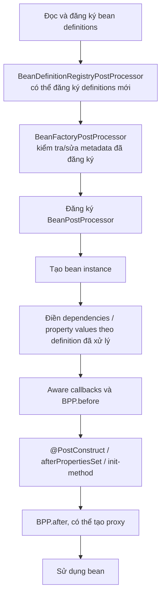
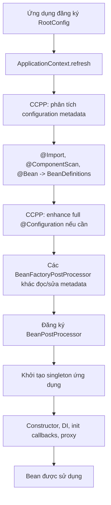

<a id="back-to-top"></a>

# Mở rộng định nghĩa

## Menu
- [Phân biệt thay đổi BeanDefinition với xử lý thể hiện bean](#definition-extension-001)
- [BeanFactoryPostProcessor và thời điểm can thiệp metadata](#definition-extension-002)
- [BeanDefinitionRegistryPostProcessor để bổ sung định nghĩa](#definition-extension-003)
- [Đăng ký post-processor tự động và bằng mã](#definition-extension-004)
- [PriorityOrdered, Ordered và các nhóm thứ tự xử lý](#definition-extension-005)
- [Vai trò ConfigurationClassPostProcessor](#definition-extension-006)
- [Phương thức @Bean static cho post-processor của bean factory](#definition-extension-007)
- [Nguy cơ gọi getBean làm tạo đối tượng quá sớm](#definition-extension-008)
- [Phạm vi tác động của post-processor trong một context](#definition-extension-009)

## <a id="definition-extension-001">Phân biệt thay đổi BeanDefinition với xử lý thể hiện bean</a>

<details>
<summary>Xem chi tiết</summary>

# Phân biệt thay đổi BeanDefinition với xử lý thể hiện bean trong Spring Framework

## 1. Mục tiêu và vấn đề cần giải quyết

Một ứng dụng Spring có thể mở rộng cách container đăng ký, cấu hình và khởi tạo bean. Hai loại extension point đặc biệt dễ nhầm lẫn là **`BeanFactoryPostProcessor`** và **`BeanPostProcessor`**. Tên gọi chỉ khác một chữ `Factory`, nhưng chúng tác động lên hai đối tượng hoàn toàn khác nhau:

- **`BeanFactoryPostProcessor` (BFPP)** đọc/chỉnh **`BeanDefinition`**, tức metadata mà BeanFactory sử dụng để tạo object.
- **`BeanPostProcessor` (BPP)** nhận **bean instance** trong quá trình initialization và có thể quan sát, tùy biến hoặc thay thế tham chiếu trả về, thường bằng proxy.
- **`BeanDefinitionRegistryPostProcessor` (BDRPP)** mở rộng BFPP để đăng ký thêm bean definitions trong giai đoạn registry sớm.

Bài thuộc **Mở rộng định nghĩa** của Spring Framework Core Container. Sau khi học, bạn sẽ phân biệt đúng *definition-time* và *instance-time*, biết method và lifecycle của từng SPI, tự chạy ví dụ Java 17/Spring Framework 6.x kiểm chứng thứ tự, và tránh những lỗi do khởi tạo bean quá sớm.

## 2. BeanDefinition không phải là bean object

### 2.1. BeanDefinition là công thức

Spring lưu metadata tạo bean trong `org.springframework.beans.factory.config.BeanDefinition`. Tùy cách đăng ký (XML, `@Configuration`, `@Component`, `@Bean` hoặc code), definition có thể mang:

- Bean name, class hoặc factory method.
- Scope như `singleton`, `prototype`, `request`.
- Constructor arguments, `MutablePropertyValues` và metadata autowire.
- `lazyInit`, `dependsOn`, `primary`, qualifiers.
- Tên initialization/destruction methods.
- Attributes phục vụ những framework extension khác.

Ví dụ minh họa metadata, không phải file cấu hình hợp lệ:

~~~text
BeanDefinition name="clientService"
    beanClass="demo.ClientService"
    scope="singleton"
    propertyValues:
       endpoint="https://api.example.invalid"
    initMethod="initialize"
~~~

Chỉnh `endpoint` ở định nghĩa **trước khi instantiate** có thể khiến Spring dùng giá trị mới khi inject bean. Nhưng chỉnh metadata **sau khi singleton đã tạo** không có nghĩa object đó được tự động xây dựng lại hay property đang nằm trong object lập tức thay đổi.

### 2.2. Bean instance là object thật

~~~text
BeanDefinition (metadata)
      |
      | constructor/factory method, dependency resolution
      v
Java bean instance (target)
      |
      | BeanPostProcessor + initialization callbacks
      v
Reference Spring cung cấp cho consumer
      |
      +-- có thể chính instance gốc
      +-- hoặc proxy/wrapper do BPP tạo
~~~

BeanDefinition có thể dùng để tạo nhiều instances theo scope. BPP có thể xử lý từng instance; BFPP thay công thức chứ không phải từng object tạo ra sau đó.

### 2.3. So sánh nhanh

| Tiêu chí | `BeanFactoryPostProcessor` | `BeanPostProcessor` |
| --- | --- | --- |
| Đối tượng chính | BeanFactory và `BeanDefinition` | Bean instance |
| Thời điểm | Sau đăng ký metadata, trước khởi tạo các bean thường | Trong vòng đời khởi tạo mỗi bean |
| Method chính | `postProcessBeanFactory(...)` | `postProcessBeforeInitialization(...)` và `postProcessAfterInitialization(...)` |
| Có thể đổi property metadata? | Có | Không phải nhiệm vụ của nó |
| Có thể đổi reference trả ra? | Không nên đụng đến instance | Có, ví dụ trả proxy |
| Có được tự gọi `getBean()` không? | **Tránh:** có thể instantiate quá sớm | Có sẵn instance được truyền vào; vẫn cần tránh vòng phụ thuộc |
| Được chạy cho mỗi prototype instance? | Không; xử lý factory ở bootstrap | Có, khi prototype được tạo và đi qua processor |
| Ví dụ framework | `PropertySourcesPlaceholderConfigurer` | AOP auto-proxying, xử lý annotation/lifecycle |
| Phạm vi ảnh hưởng | BeanFactory/context tương ứng | Beans trong container tương ứng |

**Quy tắc chọn:** muốn thay đổi **công thức tạo bean**, dùng BFPP/BDRPP. Muốn thay đổi **object trong quá trình khởi tạo**, dùng BPP.

## 3. Trình tự mở rộng trong ApplicationContext.refresh()

Một mô hình giản lược:

~~~text
ApplicationContext.refresh()
    |
    +-- Chuẩn bị BeanFactory
    +-- Nạp / đăng ký BeanDefinitions
    |
    +-- BeanDefinitionRegistryPostProcessor
    |      postProcessBeanDefinitionRegistry(registry)
    |      -> thêm/chỉnh definitions ở registry phase
    |
    +-- BeanFactoryPostProcessor
    |      postProcessBeanFactory(beanFactory)
    |      -> thay metadata trước khi tạo beans thông thường
    |
    +-- Tạo và đăng ký BeanPostProcessors
    |
    +-- Tạo eager singleton beans
            |
            +-- Instantiate
            +-- Inject dependencies / populate properties
            +-- BPP before-initialization callbacks
            +-- Initialization callbacks
            +-- BPP after-initialization callbacks
            +-- Bean/proxy được sử dụng
    |
    +-- Kết thúc refresh()
~~~

Sơ đồ trên chỉ mô tả các mốc có ý nghĩa cho bài. Spring còn xử lý environment, factory method, merged definitions, BeanFactory aware callbacks và lifecycle infrastructure.

**Nuance quan trọng:** `@PostConstruct` được thực thi bởi một infrastructure BPP trong giai đoạn before-initialization. Không thể khẳng định callback `postProcessBeforeInitialization` của **mọi BPP tùy biến** đều chạy trước `@PostConstruct`, vì thứ tự giữa BPPs khác nhau được quyết định bởi ordering. `InitializingBean.afterPropertiesSet()` và custom `initMethod` được gọi trong logic initialization giữa nhóm before/after của BPP.

Ngoài interface BPP cơ bản còn có `InstantiationAwareBeanPostProcessor` và `SmartInstantiationAwareBeanPostProcessor` với các hook trước/sau instantiate và property population. Vì vậy câu “BPP chỉ có thể can thiệp sau khi constructor đã hoàn tất” là không đúng khi xét **cả họ SPI**. Hai method cốt lõi trình bày ở đây thực sự làm việc với instance đã được tạo.

## 4. BeanFactoryPostProcessor: xử lý configuration metadata

Interface `org.springframework.beans.factory.config.BeanFactoryPostProcessor` có phương thức:

~~~java
void postProcessBeanFactory(
    ConfigurableListableBeanFactory beanFactory);
~~~

Đây là chữ ký rút gọn, không phải chương trình Java độc lập.

### 4.1. Sửa BeanDefinition đúng cách

~~~java
@Override
public void postProcessBeanFactory(
        ConfigurableListableBeanFactory beanFactory) {

    BeanDefinition definition =
            beanFactory.getBeanDefinition("clientService");

    definition.getPropertyValues()
              .add("endpoint", "https://new.example.invalid");
}
~~~

Đây là **snippet class BFPP**: yêu cầu bean name `clientService` đã đăng ký và bean target có setter/property `endpoint` hợp lệ. Code không truy cập instance; chỉ thêm `PropertyValue` vào metadata. Khi bean chưa được tạo, container sử dụng giá trị đó ở bước property population.

Những thay đổi metadata có thể bao gồm constructor args, scope, lazy-init, property values và thuộc tính khác. Tuy nhiên phải tuân thủ semantics của BeanDefinition, tránh chỉnh class/factory method sang một loại không tương thích.

### 4.2. Anti-pattern: tạo bean ngay trong BFPP

~~~java
@Override
public void postProcessBeanFactory(
        ConfigurableListableBeanFactory factory) {

    ClientService service = factory.getBean(ClientService.class);
    service.setEndpoint("https://new.example.invalid");
}
~~~

Đây là **phản ví dụ**. `getBean()` có thể instantiate một singleton khi các BPPs chưa được đăng ký đầy đủ, dẫn đến:

1. Bean không được auto-proxying như những bean khác.
2. Dependency graph bị khởi tạo dây chuyền quá sớm.
3. Một số callback injection/initialization chưa được xử lý đúng.
4. Circular dependency hoặc trạng thái context chưa sẵn sàng.
5. Hành vi khác nhau tùy startup order.

Spring Reference trực tiếp khuyến cáo: BFPP nên làm việc với **bean configuration metadata**, không làm việc với bean instances. Nếu mục đích là thay object sau khi tạo, hãy viết BPP.

### 4.3. BFPP chạy lúc nào và bao nhiêu lần?

Trong một lần chuẩn bị BeanFactory của context, Spring gọi các BFPP thích hợp **trước khi tạo các non-processor beans bình thường**. Một BFPP không phải interceptor chạy trên mọi bean/mọi method call. Một definition prototype có thể được dùng để tạo hàng chục objects nhưng BFPP không chạy lại hàng chục lần vì nó không xử lý từng object.

Với nhiều `ApplicationContext` (parent/child), processors được áp dụng trong phạm vi BeanFactory mà chúng được đăng ký. Không giả định BFPP đặt ở parent tự sửa definitions của child.

### 4.4. BFPP sẵn có trong Spring

`PropertySourcesPlaceholderConfigurer` thường tham gia xử lý placeholders trong cấu hình bean. `CustomScopeConfigurer` đăng ký custom scopes trong giai đoạn BeanFactory post-processing. Các ví dụ này minh họa “mở rộng container trước khi bean business được tạo”, chứ không trực tiếp can thiệp từng instance sau startup.

## 5. BeanPostProcessor: xử lý bean instance

Interface `org.springframework.beans.factory.config.BeanPostProcessor` cung cấp:

~~~java
Object postProcessBeforeInitialization(
    Object bean, String beanName);

Object postProcessAfterInitialization(
    Object bean, String beanName);
~~~

Ở Spring Framework hiện đại, hai phương thức có default implementation trả lại `bean` không đổi. Code ví dụ có thể override một hoặc cả hai.

### 5.1. Before/after có nghĩa gì?

Với một bean điển hình:

~~~text
Constructor / factory method
       ↓
Dependency injection / property population
       ↓
BeanPostProcessor.beforeInitialization(bean, name)
       ↓
Spring initialization callbacks
       ↓
BeanPostProcessor.afterInitialization(bean, name)
       ↓
Reference được trả cho client
~~~

`BPP.postProcessBeforeInitialization` có thể kiểm tra trạng thái đã inject. `BPP.postProcessAfterInitialization` có thể kiểm tra trạng thái đã init hoặc trả proxy. Lưu ý `@PostConstruct` được một BPP xử lý nên vị trí tuyệt đối của annotation callback so với BPP tùy biến phụ thuộc thứ tự processors.

### 5.2. Giữ hay thay reference?

~~~java
@Override
public Object postProcessAfterInitialization(
        Object bean, String beanName) {
    if ("clientService".equals(beanName)) {
        // Kiểm tra, log hoặc wrap bean.
    }
    return bean; // Giữ nguyên tham chiếu.
}
~~~

Nếu muốn wrap, BPP có thể trả **proxy** đáp ứng hợp đồng injection. Đừng trả một object không tương thích với kiểu bean mà consumer yêu cầu. Spring AOP sử dụng các post-processors/autoproxy creators để chọn và tạo proxies trong quá trình xây dựng bean.

### 5.3. Không nhầm BPP với method interception

BPP callback chạy **khi tạo bean**, không phải mỗi lần code gọi business method. Nếu cần ghi log quanh mỗi `service.execute()`, phải có proxy/interceptor/AOP hoặc cơ chế tương đương; một BPP chỉ in log ở after-initialization không tự làm được điều đó.

Với bean prototype, mỗi object được tạo có thể được BPP xử lý. Với singleton, lần khởi tạo bình thường diễn ra một lần trong context; không phải mọi `getBean()` sau đó đều gọi lại BPP.

### 5.4. Loại và tên bean trong callback

BPP nhận `Object bean` cùng `String beanName`. Nên lọc:

~~~java
@Override
public Object postProcessAfterInitialization(
        Object bean, String name) {
    if ("clientService".equals(name)
            && bean instanceof ClientService service) {
        service.verifyConfiguration();
    }
    return bean;
}
~~~

Đây là snippet minh họa, giả định method `verifyConfiguration()` được định nghĩa. Đối với proxy hoặc objects của framework, kiểm tra bằng interface đôi khi ổn định hơn ép implementation class.

## 6. BeanDefinitionRegistryPostProcessor: thêm định nghĩa trước BFPP

`BeanDefinitionRegistryPostProcessor` (BDRPP) extends `BeanFactoryPostProcessor` và thêm:

~~~java
void postProcessBeanDefinitionRegistry(
    BeanDefinitionRegistry registry);
~~~

Nó dùng khi cần đăng ký/chỉnh nhiều definitions **ở giai đoạn registry** thay vì chỉ sửa metadata của những definitions đã tồn tại.

Ví dụ:

~~~java
public class ClientRegistrar
        implements BeanDefinitionRegistryPostProcessor {

    @Override
    public void postProcessBeanDefinitionRegistry(
            BeanDefinitionRegistry registry) {
        if (!registry.containsBeanDefinition("dynamicClient")) {
            registry.registerBeanDefinition(
                    "dynamicClient",
                    new RootBeanDefinition(DynamicClient.class));
        }
    }

    @Override
    public void postProcessBeanFactory(
            ConfigurableListableBeanFactory beanFactory) {
        // Không thay metadata thêm trong ví dụ này.
    }
}
~~~

Đây là **snippet mở rộng**, yêu cầu class `DynamicClient` và import các interface Spring tương ứng. Nó chưa phải file chạy độc lập.

### BDRPP vs BFPP

- **BDRPP** nhận một registry và có thể thêm definitions mới trước khi Spring tiếp tục xử lý các BFPPs.
- **BFPP** chủ yếu sửa metadata đang được BeanFactory quản lý.
- **BPP** chỉ nhìn thấy bean instance khi nó được tạo theo definition.

`ConfigurationClassPostProcessor` là ví dụ quan trọng của Spring về registry post-processor xử lý `@Configuration`, `@ComponentScan`, `@Import`, `@Bean`. Nếu tự làm dynamic registration, cân nhắc thứ tự so với processor này.

## 7. Ví dụ chạy độc lập: một BeanDefinition được chỉnh, một instance được xử lý

Ví dụ này không cần Spring Boot hoặc web server. Nó dùng **Java 17, Spring 6.2.9 và GenericApplicationContext**, đăng ký ba bean definitions:

1. `DefinitionEditor implements BeanFactoryPostProcessor`.
2. `InstanceTracer implements BeanPostProcessor`.
3. `MessageService implements InitializingBean`.

Processor thứ nhất chỉnh property `text` của `MessageService` **trước khi instance tồn tại**. Processor thứ hai in thông tin instance trước/sau initialization. Chương trình in ra trình tự đủ để tự kiểm chứng khác biệt.

### 7.1. Cây thư mục

~~~text
bean-extension-demo/
├── pom.xml
└── src/main/java/demo/
    └── DefinitionVsInstanceDemo.java
~~~

### 7.2. pom.xml

~~~xml
<?xml version="1.0" encoding="UTF-8"?>
<project xmlns="http://maven.apache.org/POM/4.0.0"
         xmlns:xsi="http://www.w3.org/2001/XMLSchema-instance"
         xsi:schemaLocation="http://maven.apache.org/POM/4.0.0 https://maven.apache.org/xsd/maven-4.0.0.xsd">
    <modelVersion>4.0.0</modelVersion>
    <groupId>demo</groupId>
    <artifactId>bean-extension-demo</artifactId>
    <version>1.0.0</version>

    <properties>
        <maven.compiler.release>17</maven.compiler.release>
        <project.build.sourceEncoding>UTF-8</project.build.sourceEncoding>
    </properties>

    <dependencies>
        <dependency>
            <groupId>org.springframework</groupId>
            <artifactId>spring-context</artifactId>
            <version>6.2.9</version>
        </dependency>
    </dependencies>

    <build>
        <plugins>
            <plugin>
                <groupId>org.apache.maven.plugins</groupId>
                <artifactId>maven-compiler-plugin</artifactId>
                <version>3.13.0</version>
            </plugin>
            <plugin>
                <groupId>org.codehaus.mojo</groupId>
                <artifactId>exec-maven-plugin</artifactId>
                <version>3.5.0</version>
            </plugin>
        </plugins>
    </build>
</project>
~~~

### 7.3. src/main/java/demo/DefinitionVsInstanceDemo.java

~~~java
package demo;

import org.springframework.beans.factory.InitializingBean;
import org.springframework.beans.factory.config.BeanDefinition;
import org.springframework.beans.factory.config.BeanFactoryPostProcessor;
import org.springframework.beans.factory.config.BeanPostProcessor;
import org.springframework.beans.factory.config.ConfigurableListableBeanFactory;
import org.springframework.context.support.GenericApplicationContext;

public class DefinitionVsInstanceDemo {

    public static void main(String[] args) {
        try (GenericApplicationContext context =
                     new GenericApplicationContext()) {

            context.registerBean("messageService", MessageService.class);
            context.registerBean("definitionEditor", DefinitionEditor.class);
            context.registerBean("instanceTracer", InstanceTracer.class);

            context.refresh();

            MessageService service =
                    context.getBean("messageService", MessageService.class);
            System.out.println("result: " + service.getText());
        }
    }

    public static class MessageService implements InitializingBean {
        private String text;

        public MessageService() {
            System.out.println("construct: MessageService");
        }

        public void setText(String text) {
            this.text = text;
            System.out.println("setter: " + text);
        }

        public String getText() {
            return text;
        }

        @Override
        public void afterPropertiesSet() {
            System.out.println("init: " + text);
        }
    }

    public static class DefinitionEditor
            implements BeanFactoryPostProcessor {

        @Override
        public void postProcessBeanFactory(
                ConfigurableListableBeanFactory beanFactory) {

            BeanDefinition definition =
                    beanFactory.getBeanDefinition("messageService");

            definition.getPropertyValues()
                    .add("text", "from-definition");

            System.out.println("BFPP: definition changed");
        }
    }

    public static class InstanceTracer implements BeanPostProcessor {

        @Override
        public Object postProcessBeforeInitialization(
                Object bean, String beanName) {

            if ("messageService".equals(beanName)) {
                MessageService service = (MessageService) bean;
                System.out.println("BPP before: " + service.getText());
            }
            return bean;
        }

        @Override
        public Object postProcessAfterInitialization(
                Object bean, String beanName) {

            if ("messageService".equals(beanName)) {
                MessageService service = (MessageService) bean;
                System.out.println("BPP after: " + service.getText());
            }
            return bean;
        }
    }
}
~~~

Tất cả Java classes là nested `public static` trong một file đúng tên. `GenericApplicationContext.registerBean(...)` đăng ký bean definitions. Khi `refresh()`, Spring tự phát hiện hai processor beans, tạo/chạy chúng ở giai đoạn hạ tầng rồi mới pre-instantiate `MessageService`.

### 7.4. Biên dịch và chạy

Từ thư mục `bean-extension-demo`:

~~~bash
java -version
mvn -version
mvn -q compile exec:java -Dexec.mainClass=demo.DefinitionVsInstanceDemo
~~~

**Stdout của chương trình** (không tính log Maven/SLF4J tùy môi trường):

~~~text
BFPP: definition changed
construct: MessageService
setter: from-definition
BPP before: from-definition
init: from-definition
BPP after: from-definition
result: from-definition
~~~

### 7.5. Vì sao đúng thứ tự này?

1. `DefinitionEditor.postProcessBeanFactory(...)` được gọi lúc metadata đã được đăng ký, trước constructor của `MessageService`. In `BFPP: definition changed`.
2. Spring tạo instance của `MessageService`, in `construct: MessageService`.
3. Spring populate property từ BeanDefinition sau khi BFPP sửa, setter in `setter: from-definition`.
4. `InstanceTracer.postProcessBeforeInitialization(...)` thấy object và field đã có giá trị, in `BPP before: from-definition`.
5. Spring gọi `InitializingBean.afterPropertiesSet()`, in `init: from-definition`.
6. `InstanceTracer.postProcessAfterInitialization(...)` nhận object sau init, in `BPP after: from-definition`.
7. `context.getBean(...)` nhận instance đã khởi tạo, in `result: from-definition`.

BPP trong ví dụ chỉ quan sát bean và trả cùng reference; để thay reference bằng proxy cần hạ tầng proxy phù hợp (JDK dynamic proxy/CGLIB). Đó là một ví dụ instance processing khác, không thuộc việc BFPP chỉnh BeanDefinition.

### 7.6. Tự thử thay đổi

**Thử A — bỏ BFPP:** bỏ registration `definitionEditor`. `MessageService` vẫn được tạo; `text` không có giá trị được inject, kết quả getter là `null`. BPP vẫn quan sát trước/sau init.

**Thử B — bỏ BPP:** bỏ registration `instanceTracer`. BFPP vẫn chỉnh metadata; constructor/setter/`afterPropertiesSet()` vẫn hoạt động nhưng không có hai dòng BPP.

**Thử C — sửa metadata:** đổi `"from-definition"` thành `"configured-v2"`. Giá trị mới xuất hiện trong setter, initialization, BPP và result mà không cần BFPP gọi `getBean()`.

**Thử D — prototype:** đăng ký `messageService` với scope `prototype` trước refresh. BFPP vẫn sửa **một definition**, còn mỗi lần `getBean()` tạo target prototype mới sẽ được BPP xử lý.

**Thử E — proxy:** thay after-init BPP trả một object implement interface mà client inject. Không trả một JDK proxy chỉ implement interface vào injection point yêu cầu concrete class vì type mismatch.

## 8. Đăng ký processors bằng @Configuration và @Bean

### 8.1. BFPP dưới dạng static @Bean

~~~java
@Configuration
class ExtensionConfig {

    @Bean
    static BeanFactoryPostProcessor definitionEditor() {
        return factory -> {
            BeanDefinition def =
                    factory.getBeanDefinition("messageService");
            def.getPropertyValues().add("text", "configured");
        };
    }
}
~~~

Đây là **cấu hình minh họa**, đòi import `@Configuration`, `@Bean`, `BeanFactoryPostProcessor`, `BeanDefinition`, và BeanDefinition `messageService` có property `text`. `BeanFactoryPostProcessor` là functional interface nên lambda hợp lệ.

Spring Reference khuyến nghị khai báo `@Bean` trả BFPP là **`static`**. BFPP cần được khởi tạo từ rất sớm; nếu factory method là instance method trên `@Configuration`, Spring có thể phải tạo configuration class trước khi annotation processing hoàn tất, dẫn đến các trường `@Autowired`, `@Value` hoặc `@PostConstruct` trong class đó bị xử lý không như kỳ vọng.

### 8.2. BPP dưới dạng static @Bean

~~~java
@Configuration
class ExtensionConfig {

    @Bean
    static InstanceTracer instanceTracer() {
        return new InstanceTracer();
    }
}
~~~

Đây là snippet sử dụng `InstanceTracer` của chương trình mục 7. Với BPP, Spring cũng khuyên `static @Bean` và **return type phải đủ cụ thể** (implementation hoặc ít nhất `BeanPostProcessor`) để phát hiện sớm bằng type. Trả `Object` từ factory method khiến container khó nhận diện trước lúc tạo và có thể dẫn đến BPP đăng ký quá muộn.

**Không phải mọi `@Bean` đều phải static**. Khuyến nghị trên tập trung vào các bean hạ tầng đặc biệt được khởi tạo trước các business beans.

### 8.3. Early-instantiation và cảnh báo “not eligible”

Một `BeanPostProcessor` hoặc bean nó inject trực tiếp thường phải được tạo sớm trong quá trình Spring đăng ký processors. Bean business bị kéo vào quá sớm có thể chưa đủ điều kiện nhận **toàn bộ BPP**, đặc biệt AOP auto-proxying.

Log điển hình:

~~~text
Bean 'someBean' of type [...] is not eligible for getting
processed by all BeanPostProcessors
(for example: not eligible for auto-proxying)
~~~

Hướng giải quyết không phải tắt log, mà xem xét **phụ thuộc của processor**, tránh inject business beans vào BPP quá sớm, và dùng static factory method không cần dependency khi khả thi.

### 8.4. Đăng ký programmatic

BFPP trước refresh:

~~~java
context.addBeanFactoryPostProcessor(
        beanFactory -> {
            BeanDefinition definition =
                    beanFactory.getBeanDefinition("messageService");
            definition.getPropertyValues()
                      .add("text", "configured");
        });
~~~

Đây là snippet trong method có `context` phù hợp, không phải class độc lập.

BPP cũng có thể đăng ký:

~~~java
beanFactory.addBeanPostProcessor(new InstanceTracer());
~~~

**Điểm khác:** BPP được thêm bằng `addBeanPostProcessor(...)` theo **registration order**, không được sắp xếp lại tự động bởi `Ordered`; các BPP programmatically registered được chạy trước BPP tự động phát hiện. Do đó nếu cần xử lý thứ tự chính xác, phải biết con đường registration, không chỉ thêm annotation `@Order`.

## 9. Ordering: PriorityOrdered, Ordered và tương tác processors

### 9.1. BFPP/BDRPP

Spring dùng `PriorityOrdered`, `Ordered` và thứ tự phase đặc biệt để sắp xếp những processors phát hiện được từ definitions. `BeanDefinitionRegistryPostProcessor` registry callbacks được xử lý sớm, rồi các BFPP callbacks. Spring có thể tiếp tục phát hiện BDRPP mới được đăng ký bởi BDRPP khác.

Nếu hai processors cùng viết lên property `text`, kết quả phụ thuộc thứ tự. Production code nên tránh xung đột vô tình, hoặc xác định precedence minh bạch.

### 9.2. BPP

Với auto-detected `BeanPostProcessor` beans, có thể dùng `Ordered`/`PriorityOrdered` để tham gia sắp xếp. BPP sau trong chain nhận reference do BPP trước trả về; nếu trước đó đã có JDK proxy, ép kiểu implementation ở BPP sau có thể không hợp lệ.

Đừng giả định BPP before-init của mình sẽ luôn chạy trước `@PostConstruct`: `@PostConstruct` nằm trong hệ thống callback của một infrastructure BPP. Thứ tự chi tiết có thể phụ thuộc version/processor priorities.

### 9.3. Con đường registration ảnh hưởng thứ tự

Khi auto-detect BPP beans, Spring có bước sorting. Khi `ConfigurableBeanFactory.addBeanPostProcessor` trực tiếp, thứ tự gọi chi phối và các BPP đó có độ ưu tiên trước auto-detected BPPs. Lời giải “chỉ cần thêm `@Order(1)`” có thể không có tác dụng như mong đợi với programmatic registration.

## 10. Khi BeanDefinitionRegistryPostProcessor bổ sung definitions

Một plugin framework có thể cần scan nhiều implementation classes rồi đăng ký definitions theo cấu hình. Khi đó:

~~~text
BDRPP → registerBeanDefinition("connectorA")
      ↓
BFPP → chỉnh property/metadata của "connectorA"
      ↓
BeanFactory → tạo instance "connectorA"
      ↓
BPP → kiểm tra/wrap instance
      ↓
Client sử dụng
~~~

Ba extension points **bổ trợ** nhau. Một design hợp lý đưa phần đăng ký/cấu hình vào BDRPP/BFPP và phần quan sát/wrapping runtime vào BPP.

Nếu chỉ cần khai báo một service đơn giản, hãy dùng `@Bean`/`@Component` thay vì xây dựng BDRPP riêng. Mở rộng registry nên là giải pháp cho **hạ tầng đăng ký động hoặc framework integration** thật sự.

## 11. Quan hệ với BeanFactory, FactoryBean và AOP

Các tên gần nhau nhưng vai trò khác nhau:

| Interface | Vai trò |
| --- | --- |
| `BeanFactory` | Container truy xuất/quản lý beans |
| `FactoryBean<T>` | Bean đặc biệt cung cấp **sản phẩm object** qua `getObject()` |
| `BeanFactoryPostProcessor` | Can thiệp metadata BeanDefinition của BeanFactory |
| `BeanDefinitionRegistryPostProcessor` | Thêm/chỉnh bean definitions sớm trong registry |
| `BeanPostProcessor` | Can thiệp vào bean instance trong lifecycle |
| Spring AOP auto-proxy creator | Hạ tầng thường thuộc họ BPP, quyết định và trả proxy |

**Không nhầm `FactoryBean` với BFPP:** một FactoryBean dùng để tạo product; BFPP sửa cấu hình. Một FactoryBean cũng có BeanDefinition và bản thân product của nó có lifecycle, nhưng không phải vì tên “Factory” mà hai SPI tương đương.

Một AOP proxy có thể được tạo sau khi instance được initialize; metadata như annotations và pointcut giúp quyết định đối tượng nào nên được proxy. Đây là minh họa tốt cho sự hợp tác giữa **definition/metadata** và **instance processing**.

## 12. Những tình huống nên chọn extension nào?

### Tình huống A: thay endpoint cho nhiều beans khi startup

Chọn **BFPP** nếu dữ liệu cần thay nằm trong BeanDefinition và phải được chỉnh trước instantiation. Tránh gọi `getBean()` trong BFPP để sửa setter trên instance.

Nếu yêu cầu chỉ là binding properties thông thường, `@ConfigurationProperties`, `@Value` hoặc cấu hình `@Bean` trực tiếp có thể đơn giản hơn và dễ bảo trì hơn một BFPP tùy biến.

### Tình huống B: tạo bean definitions từ plugin descriptors

Chọn **BDRPP**, vì số lượng/names/types bean chưa biết khi viết cấu hình gốc và phải đăng ký vào registry.

### Tình huống C: kiểm tra hoặc decorate bean sau khi khởi tạo

Chọn **BPP**. Ví dụ kiểm tra một marker interface sau injection, thêm custom proxy, logging hoặc instrumentation trong lifecycle.

### Tình huống D: thay property của một singleton đang phục vụ

**Không** kỳ vọng BFPP runtime tự làm mới instance. Khi singleton đã tồn tại, BeanDefinition là metadata tạo bean ban đầu. Thiết kế một API reconfigure có đồng bộ, refresh scope có contract cụ thể hoặc replaceable delegate phù hợp.

### Tình huống E: mỗi lần gọi business method phải có logging

**Không** chỉ dùng BPP callback logging ở startup. Dùng Spring AOP proxy/interceptor hoặc code nghiệp vụ phù hợp. BPP có thể đóng vai trò **tạo proxy**, nhưng bản thân callback không được chạy mỗi lần method invocation.

### Tình huống F: một @Bean trả BPP bị khai báo Object

Spring có thể không phát hiện sớm BPP bằng type từ factory method. Trả đúng type BPP/implementation và cân nhắc `static @Bean`.

## 13. Các lỗi phổ biến

| Triệu chứng | Nguyên nhân khả dĩ | Hướng xử lý |
| --- | --- | --- |
| BFPP đã chỉnh metadata nhưng singleton không đổi | Bean đã được tạo/cached | Thực hiện mutation trước instance creation |
| AOP annotation không có tác dụng | Gọi `getBean()` quá sớm trong BFPP hoặc BPP dependency kéo bean vào startup | Tránh eager instantiation, kiểm tra processor ordering |
| Log “not eligible for getting processed by all BeanPostProcessors” | Bean được instantiate trong lúc đăng ký BPPs | Giảm dependencies của BPP; ưu tiên static @Bean |
| Non-static `@Bean` trả BFPP gây lifecycle conflict | Configuration class bị tạo quá sớm | Dùng static factory method |
| BeanPostProcessor không chạy | BPP không được Spring đăng ký/phát hiện bằng return type | Register đúng bean, return type rõ |
| BPP đã chạy nhưng không thấy proxy | Implementation trả lại target, không tạo proxy; hoặc bean được tạo sớm | Kiểm tra after-init return value và auto-proxy infra |
| `@PostConstruct` diễn ra trước BPP tùy biến | Thứ tự các BPP, bởi `@PostConstruct` do BPP xử lý | Đừng áp một ordering giả định cho mọi BPP |
| BFPP tìm BeanDefinition báo không có | Sai bean name/context hoặc definition chưa được register | Dùng `containsBeanDefinition` và đúng registry phase |
| BDRPP tạo name trùng | Không kiểm tra registry hoặc cố override | Kiểm tra `containsBeanDefinition` và naming strategy |
| Hai BFPP sửa một property ra giá trị khó hiểu | Thứ tự processor không xác định theo ý đồ | Dùng ordering rõ và tránh xung đột |
| BPP trả wrapper không cùng injection type | Proxy không implement API mà consumer cần | Dùng interface/class proxy tương thích |
| `@Order` không đổi thứ tự BPP thủ công | `addBeanPostProcessor` dùng registration order | Sửa trình tự đăng ký |
| Processor ở parent không xử lý child beans | Extension points per-container | Đăng ký vào đúng child context |
| Truyền property name sai vào BeanDefinition | Không có setter/writable property phù hợp | Kiểm tra property metadata, constructor args và type conversion |
| Mỗi `getBean()` kỳ vọng BPP chạy lại | Bean singleton đã cache | Phân biệt per-instance initialization và per-method interception |

### Cách chẩn đoán có hệ thống

1. Việc cần thực hiện ảnh hưởng **metadata** hay **instance**?
2. Với metadata: BeanDefinition đã được register tại đúng context và tên chưa?
3. Có cần bổ sung definition mới (BDRPP) hay chỉ sửa definition hiện có (BFPP)?
4. Có bean nào bị tạo sớm hơn lúc BPP được đăng ký không?
5. Nếu BPP trả proxy, reference và type mà consumer nhận có còn tương thích không?
6. Có nhiều processors với ordering khác nhau không?
7. Context có parent/child hoặc prototype scope ảnh hưởng số lần callback không?

## 14. Kiểm thử chuẩn cho cả hai SPI

### 14.1. Unit test metadata

Dùng `DefaultListableBeanFactory` và một `RootBeanDefinition`:

~~~java
DefaultListableBeanFactory factory =
        new DefaultListableBeanFactory();

factory.registerBeanDefinition(
        "messageService",
        new RootBeanDefinition(MessageService.class));

new DefinitionEditor().postProcessBeanFactory(factory);

Object text = factory.getBeanDefinition("messageService")
        .getPropertyValues()
        .getPropertyValue("text")
        .getValue();

if (!"from-definition".equals(text)) {
    throw new AssertionError("Definition was not updated");
}
~~~

Đây là **snippet unit test**, cần imports và các nested types của mục 7, không phải file chạy độc lập. Nó chứng minh BFPP cập nhật BeanDefinition nhưng chưa chứng minh BPP được Spring gọi.

### 14.2. Unit test instance callback

Tạo `MessageService`, set state rồi gọi `InstanceTracer.postProcessBeforeInitialization`/`postProcessAfterInitialization` thủ công, kiểm tra reference được trả về. Logic processor được kiểm tra nhưng test này chưa chứng minh Spring tự động đăng ký BPP.

### 14.3. Integration test

Chạy `GenericApplicationContext` như ví dụ chính:

- BFPP chạy trước khi target constructor được gọi.
- BeanDefinition property được áp dụng bởi setter.
- BPP before và after bao quanh `InitializingBean.afterPropertiesSet()`.
- Chỉ bean name được chọn mới in log.
- Chuyển sang prototype thì từng instance được xử lý.
- Thay BPP trả proxy thì kiểu injection phải còn tương thích.
- Đăng ký BFPP/BPP ở đúng context, không gây early-instantiation.
- Nếu dùng BDRPP, definitions mới phải xuất hiện ở BFPP stage và có thể được instantiate bình thường.

Dùng `try-with-resources` để đóng context test nhằm giải phóng singleton resources.

## 15. Checklist dùng trong dự án thật

- [ ] Chỉnh **BeanDefinition** → `BeanFactoryPostProcessor`.
- [ ] Đăng ký **definitions mới** → `BeanDefinitionRegistryPostProcessor`.
- [ ] Xử lý **bean instance** → `BeanPostProcessor`.
- [ ] Không gọi `getBean()` trong BFPP để sửa object.
- [ ] Processor beans được phát hiện/đăng ký trước khi business beans được instantiate.
- [ ] Dùng `static @Bean` cho BFPP/BPP theo hướng dẫn Spring khi cần đăng ký hạ tầng sớm.
- [ ] Cấu hình rõ ordering (`PriorityOrdered`/`Ordered`) khi nhiều processors tương tác.
- [ ] Không giả định mọi BPP before-init luôn chạy trước `@PostConstruct`.
- [ ] Không chỉnh metadata muộn rồi kỳ vọng singleton đang sống tự thay đổi.
- [ ] Không lạm dụng BFPP/BDRPP cho nhu cầu cấu hình đơn giản.
- [ ] Unit test metadata và instance riêng; integration test xác nhận lifecycle đầy đủ.

## 16. Tự kiểm tra

**Câu 1.** Bạn cần đổi default property của 50 beans trước khi chúng được tạo. Chọn SPI nào?  
**Đáp:** BeanFactoryPostProcessor, vì cần đổi BeanDefinition metadata.

**Câu 2.** Bạn cần wrap một bean bằng proxy sau initialization. Chọn SPI nào?  
**Đáp:** BeanPostProcessor (hoặc hạ tầng AOP dựa trên BPP).

**Câu 3.** Vì sao BFPP không nên gọi `getBean()`?  
**Đáp:** Nó có thể khởi tạo bean khi BPP chưa đăng ký đủ, gây thiếu proxying/lifecycle và phát sinh dependency cycles.

**Câu 4.** BeanDefinitionRegistryPostProcessor khác BFPP thế nào?  
**Đáp:** Nó có registry callback chạy sớm để thêm/chỉnh bean definitions, đồng thời vẫn là BFPP.

**Câu 5.** Mỗi lần lấy singleton qua `getBean()`, BPP có chạy lại không?  
**Đáp:** Không. BPP xử lý instance khi tạo/khởi tạo. Một singleton thông thường chỉ được khởi tạo một lần trong context.

**Câu 6.** @PostConstruct luôn xảy ra sau tất cả BPP before-initialization callbacks đúng không?  
**Đáp:** Không. @PostConstruct được một infrastructure BPP xử lý, nên thứ tự tương đối với BPP khác còn tùy ordering.

**Câu 7.** Vì sao khi khai báo @Bean trả BFPP nên đặt method static?  
**Đáp:** Vì BFPP được tạo rất sớm; static method tránh khởi tạo @Configuration instance khi annotation processors chưa sẵn sàng.

**Câu 8.** Một BPP đăng ký thủ công bằng addBeanPostProcessor có dùng @Order giống BPP auto-detected không?  
**Đáp:** Không theo cách đó; registration order chi phối BPP programmatic.

**Câu 9.** Khi đổi scope của BeanDefinition sau khi singleton đã được tạo, object cũ có biến thành prototype không?  
**Đáp:** Không. Metadata thay đổi muộn không tự thay thế singleton instance đã cache.

**Câu 10.** BFPP và BPP tự động ảnh hưởng tất cả beans của parent và child ApplicationContexts chứ?  
**Đáp:** Không. Extension processors hoạt động trong phạm vi container tương ứng.

## Tài liệu chính thức

- [Spring Framework Reference — Container Extension Points](https://docs.spring.io/spring-framework/reference/core/beans/factory-extension.html): BFPP/BPP/ordering/early-instantiation.
- [Spring Framework Reference — Bean Overview](https://docs.spring.io/spring-framework/reference/core/beans/definition.html): BeanDefinition là recipe.
- [Spring Framework Reference — Customizing the Nature of a Bean](https://docs.spring.io/spring-framework/reference/core/beans/factory-nature.html).
- [Spring Framework Javadoc — BeanFactoryPostProcessor](https://docs.spring.io/spring-framework/docs/6.2.9/javadoc-api/org/springframework/beans/factory/config/BeanFactoryPostProcessor.html).
- [Spring Framework Javadoc — BeanPostProcessor](https://docs.spring.io/spring-framework/docs/6.2.9/javadoc-api/org/springframework/beans/factory/config/BeanPostProcessor.html).
- [Spring Framework Javadoc — BeanDefinitionRegistryPostProcessor](https://docs.spring.io/spring-framework/docs/6.2.9/javadoc-api/org/springframework/beans/factory/support/BeanDefinitionRegistryPostProcessor.html).


</details>

- [Quay lại đầu trang](#back-to-top)

---

## <a id="definition-extension-002">BeanFactoryPostProcessor và thời điểm can thiệp metadata</a>

<details>
<summary>Xem chi tiết</summary>

# BeanFactoryPostProcessor và thời điểm can thiệp metadata trong Spring Core Container

## 1. Tại sao cần can thiệp metadata trước khi bean được tạo?

Spring IoC container không chỉ lưu những đối tượng Java đã được tạo. Trước giai đoạn khởi tạo nhiều bean ứng dụng, container giữ một tập **bean definitions** mô tả cách tạo và cấu hình các bean đó: class, scope, constructor arguments, property values, lazy initialization, phụ thuộc cần xử lý, factory method và các thuộc tính khác.

`BeanFactoryPostProcessor` (viết tắt **BFPP**) là extension point để **đọc hoặc điều chỉnh cấu hình của bean factory và các bean definitions trước khi các bean ứng dụng thông thường được khởi tạo**. Đây là lúc lý tưởng để chuẩn hóa hoặc biến đổi **metadata**, chứ không phải để sửa một đối tượng nghiệp vụ đã được tạo.

Ví dụ một definition ban đầu nói:

```text
Bean name       : greeting
Bean class      : Greeting
property message: "giá trị mặc định"
scope           : singleton
```

Một BFPP có thể sửa metadata `message` thành `"giá trị sau BFPP"` trong bean definition. Khi Spring **sau đó** tạo bean `greeting`, container sử dụng cấu hình đã sửa để gọi setter hoặc thực hiện quy trình property population tương ứng.

Cần nắm ba ý chính:

1. **BFPP xử lý định nghĩa/cấu hình (metadata)**, không phải từng bean instance. Nó có quyền truy cập `ConfigurableListableBeanFactory` và từ đó các `BeanDefinition` thích hợp.
2. **BFPP chạy trong pha chuẩn bị container**, trước khi những singleton không lazy thông thường được pre-instantiate và trước các callback `BeanPostProcessor.before/after` của những bean đó.
3. **BFPP không phải cơ chế tự động sửa mọi instance đã tồn tại**. Nếu code đã tạo bean sớm, sửa definition về sau không quay ngược thời gian để thay đổi constructor hoặc initialization của object cũ.

Đặt trong bài toán cụ thể: khi một cấu hình muốn tác động đến **cách Spring sẽ tạo bean**, BFPP có thể phù hợp. Khi một extension muốn tác động đến **một instance sau khi được tạo**, lựa chọn cần xem là `BeanPostProcessor`.

## 2. Khái niệm BeanDefinition và bean instance

`BeanDefinition` là mô hình metadata mà Spring dùng để quản lý cách tạo bean. Nó không đồng nghĩa với một object nghiệp vụ.

| Thuộc tính / khái niệm | Metadata trong bean definition | Trạng thái ở bean instance |
|---|---|---|
| Bean class hoặc factory method | Spring sẽ tạo object bằng cách nào | Object thực tế đã được tạo |
| Scope | Singleton, prototype hoặc scope khác | Số lượng/thời điểm instance được tạo |
| Constructor arguments | Giá trị/bean reference sẽ truyền khi khởi tạo | Constructor đã chạy, state có thể đã cố định |
| Property values | Những giá trị sẽ được điền trước initialization | Field/setter state sau khi Spring populate |
| Lazy-init | Có trì hoãn tạo singleton hay không | Instance đã tồn tại hoặc chưa |
| Init method | Tên callback Spring sẽ gọi trong creation lifecycle | Callback đã chạy hay chưa |
| Depends-on | Metadata quy định dependency startup/destruction | Những dependency thực tế đã được resolve |
| Role, description, attributes | Thông tin định nghĩa/hạ tầng | Không nhất thiết là property trên object |

Một BFPP gọi:

```java
BeanDefinition definition = beanFactory.getBeanDefinition("greeting");
definition.getPropertyValues().add("message", "được sửa bởi BFPP");
```

Đây là **snippet nằm trong phương thức `postProcessBeanFactory`**, cần biến `beanFactory` kiểu `ConfigurableListableBeanFactory`, import `BeanDefinition` và một definition tên `greeting`. Nó không trực tiếp gọi `greeting.setMessage(...)`: đối tượng `Greeting` có thể còn chưa được tạo.

Spring dùng bean definitions từ nhiều nguồn: XML, `@Component` scanning, `@Configuration`/`@Bean`, hoặc đăng ký chương trình. Cách definition được tạo có thể khác nhau, nhưng BFPP vẫn có thể làm việc với metadata sau khi definitions phù hợp đã xuất hiện trong registry.

## 3. Thời điểm chính xác trong ApplicationContext.refresh()

Điểm mốc quan trọng là trình tự của `AbstractApplicationContext.refresh()`. Dưới đây là **sơ đồ rút gọn**, không phải mã người dùng cần tự chạy:

```text
1. prepareRefresh()
2. obtainFreshBeanFactory() / chuẩn bị bean factory
3. prepareBeanFactory(...)
4. postProcessBeanFactory(...)
5. invokeBeanFactoryPostProcessors(...)    <-- BeanDefinitionRegistryPostProcessor + BFPP
6. registerBeanPostProcessors(...)          <-- đăng ký BeanPostProcessor
7. initMessageSource(), initApplicationEventMulticaster(), ...
8. registerListeners()
9. finishBeanFactoryInitialization(...)     <-- pre-instantiate singleton không lazy
10. finishRefresh()                          <-- lifecycle processor / context event
```

Các bước nội bộ, loại context và extension có thể bổ sung hành vi khác, nhưng **đường thời gian quan trọng không đổi**: xử lý bean definition metadata phải diễn ra trước bước tạo hàng loạt các singleton application beans thông thường.



Sơ đồ tách pha BFPP khỏi pha tạo bean. Với **prototype** hoặc bean `@Lazy`, việc tạo instance có thể xảy ra muộn hơn nữa, khi có lookup thật sự. BFPP không tự ép tất cả prototype được tạo trong lúc `refresh()`.

### 3.1. BFPP chạy trước hay sau BeanPostProcessor?

**BFPP chạy trước khi container đăng ký tập BPP tự động cho các bean ứng dụng thông thường.** Sau khi BFPP hoàn tất, Spring mới bước vào giai đoạn tạo và init những application beans thích hợp với chuỗi `BeanPostProcessor`.

Hai extension khác nhau về thời điểm:

```text
[Bean definitions]
       |
       v
BeanFactoryPostProcessor.postProcessBeanFactory(...)
       |
       v
Tạo object → Dependency injection → Aware
       |
       v
BeanPostProcessor.postProcessBeforeInitialization(...)
       |
       v
InitializingBean / custom init
       |
       v
BeanPostProcessor.postProcessAfterInitialization(...)
       |
       v
[Bean cuối cùng]
```

Vì thế, đừng gọi `BeanPostProcessor` để thay một hàng loạt constructor/property definitions nếu thật sự muốn can thiệp trước instantiation. Ngược lại, BFPP không được truyền từng bean instance nên không thích hợp để tạo proxy của một object đã init.

### 3.2. Lưu ý: không phải hoàn toàn “không bean nào được tạo trước BFPP”

Một số **infrastructure beans** như các factory/post-processors và những dependencies thật sự cần thiết để chạy chúng có thể phải được khởi tạo sớm. Do đó, câu nói chính xác là: BFPP chạy **trước việc khởi tạo những bean ứng dụng thông thường**, không phải một cam kết rằng trong JVM vẫn tuyệt đối chưa có đối tượng Spring nào được tạo.

Điều này giải thích cảnh báo của tài liệu: **không tương tác với bean instances trong BFPP, nhất là không chủ động gọi `getBean()` để khởi tạo application beans**. Làm vậy có thể khiến những bean ấy được tạo **quá sớm**, chưa đủ điều kiện nhận trọn vẹn các post-processors như auto-proxying hoặc annotation-based processing theo cấu hình ứng dụng.

## 4. API BeanFactoryPostProcessor

Interface nằm trong package `org.springframework.beans.factory.config`:

```java
public interface BeanFactoryPostProcessor {
    void postProcessBeanFactory(
            ConfigurableListableBeanFactory beanFactory)
            throws BeansException;
}
```

Đây là **chữ ký rút gọn để học**, không phải source đầy đủ cần tự định nghĩa lại trong ứng dụng. Khi viết code thật, import interface có sẵn từ Spring.

Tham số `ConfigurableListableBeanFactory` cho phép xem các definition đã đăng ký và những thông tin cấu hình phù hợp. Các thao tác thường dùng gồm:

```java
String[] names = beanFactory.getBeanDefinitionNames();
BeanDefinition bd = beanFactory.getBeanDefinition("myBean");
bd.setScope("prototype");
bd.getPropertyValues().add("timeoutMillis", 5000);
bd.setLazyInit(true);
```

Đây là **snippet tích hợp**, chỉ minh họa API; yêu cầu đang ở bên trong `postProcessBeanFactory(...)`, bean `myBean` tồn tại và class đích có property `timeoutMillis` phù hợp. Không phải chương trình độc lập. Việc đặt scope, lazy-init, property/constructor metadata phải tuân hợp đồng bean definition cụ thể và kiểm tra tương thích với component đang sử dụng.

Một BFPP có thể **chỉ đọc**, chẳng hạn phát hiện các bean definitions có metadata sai trước khi tạo singleton. Khi cần điều chỉnh metadata, nên sửa **có mục đích, có điều kiện và trước khi bean bị tạo**; không ghi đè mù quáng những giá trị do người cấu hình cố tình đặt.

### 4.1. Mutation không thay đổi đối tượng đang tồn tại

Giả sử bean singleton `myBean` đã được tạo từ trước. Việc sửa `bd.getPropertyValues().add(...)` không tự gọi setter lại trên instance đó và không tái khởi tạo constructor. Với instance mutable đang tồn tại, nếu cần thay đổi ở runtime phải dùng cơ chế quản lý trạng thái/config động được thiết kế riêng.

Đặc biệt, `@ConfigurationProperties` hay runtime refresh từ những thư viện khác **không đồng nghĩa** BFPP chạy lại mỗi khi một cấu hình đổi. Một BFPP thông thường thực thi khi bean factory được chuẩn bị; trong một `ApplicationContext` đã refresh, nó không phải listener tự động theo dõi các biến môi trường mới.

## 5. Ví dụ Java 17 + Maven: BFPP sửa property trước constructor/initialization

Mục tiêu là chứng minh bằng stdout:

1. BFPP nhìn thấy bean definition `greeting` và **đặt property `message`**.
2. Spring **sau đó** mới tạo object `Greeting`.
3. Spring điền property `message` bằng setter theo definition đã sửa.
4. `InitializingBean.afterPropertiesSet()` nhìn thấy giá trị mới.
5. Code ứng dụng lấy bean và sử dụng; khi đóng context, destruction callback của singleton chạy.

**Yêu cầu:** Java 17+, Maven 3.9+ và `spring-context` 6.2.0; không cần Spring Boot, web server hay database.

Cấu trúc:

```text
bfpp-metadata-demo/
├── pom.xml
└── src/main/java/example/BfppMetadataDemo.java
```

**Tệp `pom.xml`:**

```xml
<project xmlns="http://maven.apache.org/POM/4.0.0"
         xmlns:xsi="http://www.w3.org/2001/XMLSchema-instance"
         xsi:schemaLocation="http://maven.apache.org/POM/4.0.0
                             https://maven.apache.org/xsd/maven-4.0.0.xsd">
    <modelVersion>4.0.0</modelVersion>
    <groupId>example</groupId>
    <artifactId>bfpp-metadata-demo</artifactId>
    <version>1.0.0</version>
    <properties>
        <maven.compiler.release>17</maven.compiler.release>
        <project.build.sourceEncoding>UTF-8</project.build.sourceEncoding>
    </properties>
    <dependencies>
        <dependency>
            <groupId>org.springframework</groupId>
            <artifactId>spring-context</artifactId>
            <version>6.2.0</version>
        </dependency>
    </dependencies>
    <build>
        <plugins>
            <plugin>
                <groupId>org.apache.maven.plugins</groupId>
                <artifactId>maven-compiler-plugin</artifactId>
                <version>3.13.0</version>
            </plugin>
            <plugin>
                <groupId>org.codehaus.mojo</groupId>
                <artifactId>exec-maven-plugin</artifactId>
                <version>3.5.0</version>
            </plugin>
        </plugins>
    </build>
</project>
```

**Tệp `src/main/java/example/BfppMetadataDemo.java`:**

```java
package example;

import org.springframework.beans.factory.DisposableBean;
import org.springframework.beans.factory.InitializingBean;
import org.springframework.beans.factory.config.BeanDefinition;
import org.springframework.beans.factory.config.BeanFactoryPostProcessor;
import org.springframework.context.annotation.AnnotationConfigApplicationContext;
import org.springframework.context.annotation.Bean;
import org.springframework.context.annotation.Configuration;

public class BfppMetadataDemo {

    public static void main(String[] args) {
        try (var context = new AnnotationConfigApplicationContext(Config.class)) {
            Greeting greeting = context.getBean("greeting", Greeting.class);
            System.out.println("05 application: " + greeting.getMessage());
        }
    }

    @Configuration(proxyBeanMethods = false)
    public static class Config {

        // Static @Bean: BFPP được tạo sớm mà không cần tạo Config.
        @Bean
        public static BeanFactoryPostProcessor updateGreetingDefinition() {
            return beanFactory -> {
                BeanDefinition bd = beanFactory.getBeanDefinition("greeting");
                bd.getPropertyValues().add(
                        "message", "hello from bean definition");
                System.out.println("01 BFPP: set message metadata");
            };
        }

        @Bean("greeting")
        public Greeting greeting() {
            return new Greeting();
        }
    }

    public static final class Greeting
            implements InitializingBean, DisposableBean {

        private String message = "default";

        public Greeting() {
            System.out.println("02 constructor");
        }

        public void setMessage(String message) {
            this.message = message;
            System.out.println("03 setter: " + message);
        }

        public String getMessage() {
            return message;
        }

        @Override
        public void afterPropertiesSet() {
            System.out.println("04 init: " + message);
        }

        @Override
        public void destroy() {
            System.out.println("06 destroy");
        }
    }
}
```

Chạy từ thư mục chứa `pom.xml`:

```bash
mvn -q compile exec:java -Dexec.mainClass=example.BfppMetadataDemo
```

**Stdout dự kiến** từ `System.out.println` của chương trình (không bao gồm log Maven nếu môi trường hiển thị):

```text
01 BFPP: set message metadata
02 constructor
03 setter: hello from bean definition
04 init: hello from bean definition
05 application: hello from bean definition
06 destroy
```

### 5.1. Vì sao thứ tự này đúng?

- Constructor `new AnnotationConfigApplicationContext(Config.class)` tạo và **refresh context ngay**. Nó parse `Config`, đăng ký bean definitions từ các `@Bean` methods và tiến hành gọi BFPP.
- `updateGreetingDefinition()` là **static `@Bean`** trả `BeanFactoryPostProcessor`, để Spring nhận diện và tạo processor sớm, tránh tạo đối tượng cấu hình chỉ để gọi factory method của processor.
- Trong `postProcessBeanFactory`, `getBeanDefinition("greeting")` lấy metadata của bean `greeting`. Lệnh `getPropertyValues().add(...)` bổ sung property `message`, **chưa tạo `Greeting` instance**.
- Sau khi các BFPP hoàn thành, Spring đăng ký BPP và tạo singleton `greeting`. Factory method `greeting()` gọi constructor và in dòng 02.
- Spring áp dụng `MutablePropertyValues` trong bean definition lên object bằng setter `setMessage(String)`; dòng 03 xảy ra trước init callback.
- `afterPropertiesSet()` thấy `message` đã được điền, in dòng 04.
- Ứng dụng lấy singleton đã init và in dòng 05. Khối `try-with-resources` gọi `context.close()`, làm `DisposableBean.destroy()` in dòng 06.

Ví dụ này cho thấy **metadata ảnh hưởng cách Spring tạo object**, chứ không phải BFPP trực tiếp thao tác trên instance `Greeting`. Việc thử `beanFactory.getBean("greeting")` từ BFPP để ép tạo `Greeting` ngay có thể làm xáo trộn vòng đời và là điều **không nên làm**.

### 5.2. Lưu ý về @Bean factory method và property values

Mặc dù `greeting` được khai báo bằng factory method `@Bean`, nó vẫn có **bean definition** trong container. Spring gọi factory method để có instance rồi còn xử lý các property values đã khai báo trên definition ở giai đoạn populate, nên `setMessage(...)` nhận giá trị do BFPP đặt.

Nếu `Greeting` chỉ có constructor nhận `message` và không có setter/property phù hợp, việc thêm `"message"` bằng `getPropertyValues().add(...)` như trên **không tự biến property thành constructor argument**. Khi đó cần chỉnh metadata constructor arguments/factory method hoặc thay thiết kế sao cho bean nhận dependency qua cách phù hợp. Không cố thay một value đã đi vào tham số constructor khi instance đã được tạo.

Ngoài ra, nếu `message` là property read-only, setter không tồn tại, Spring sẽ gặp lỗi population kiểu `NotWritablePropertyException` (có thể được bao bọc trong exception của bean creation). Một BFPP có quyền sửa metadata nhưng **không biến metadata không hợp lệ thành một cấu hình hợp lệ**.

## 6. So sánh BeanFactoryPostProcessor và BeanPostProcessor

Hai tên gần giống nhau, nhưng là **hai tầng extension khác nhau**.

| Tiêu chí | BeanFactoryPostProcessor (BFPP) | BeanPostProcessor (BPP) |
|---|---|---|
| Đầu vào | `ConfigurableListableBeanFactory` | Một `Object bean`, `String beanName` |
| Tác động chính | Bean definitions và cấu hình container | Bean instance trong quá trình initialization |
| Thời điểm thông thường | Trong `refresh()`, **trước** tạo singleton ứng dụng non-lazy | Khi **mỗi bean instance** đủ điều kiện được tạo |
| Method | `postProcessBeanFactory(...)` | `postProcessBeforeInitialization(...)`, `postProcessAfterInitialization(...)` |
| Dùng để sửa property metadata | Có | Không phải mục đích chính |
| Dùng để trả proxy thay instance | Không theo hợp đồng thông thường | Có thể, nếu trả wrapper/proxy hợp lệ |
| Số lần chạy | Theo vòng chuẩn bị của bean factory/context | Theo số lần tạo bean instance thích hợp |
| Thao tác với prototype | Sửa definition dùng cho các lần tạo về sau | BPP được gọi trên từng prototype instance khi nó được tạo |
| Tương tác với `@PostConstruct` | BFPP đi trước phần init bean thông thường | Lifecycle annotation được xử lý qua BPP trong pha before-init |
| Rủi ro đặc trưng | Ép tạo bean quá sớm hoặc ghi sai metadata | Thay object không tương thích hoặc thao tác side effects lúc init |

Ví dụ use-case:

- Muốn thay `BeanDefinition.scope` theo chính sách hạ tầng **trước instantiation**: BFPP.
- Muốn kiểm tra `BeanDefinition.propertyValues` từ cấu hình: BFPP.
- Muốn phát hiện một custom annotation trên **instance** sau DI và thực hiện validation theo state: BPP hoặc init callback thích hợp.
- Muốn tạo AOP proxy cho method invocation: một cơ chế proxy/BPP do Spring hỗ trợ, không phải sửa scope metadata bằng BFPP.
- Muốn một bean duy nhất load cache sau DI: `@PostConstruct`/custom init, không cần tự tạo BFPP toàn container.

Không dùng BFPP vì thấy chữ “PostProcessor” rồi lầm tưởng nó nhận object bean trong thời điểm after-init.

## 7. BeanDefinitionRegistryPostProcessor khác gì BFPP?

`BeanDefinitionRegistryPostProcessor` (BDRPP) là **giao diện mở rộng `BeanFactoryPostProcessor`**. Ngoài `postProcessBeanFactory(...)`, nó có thêm:

```java
void postProcessBeanDefinitionRegistry(BeanDefinitionRegistry registry)
        throws BeansException;
```

Đây là chữ ký rút gọn; interface chuẩn nằm trong package `org.springframework.beans.factory.support`. Ý nghĩa: cho phép **đăng ký những bean definitions mới trước khi các BFPP thông thường được gọi**.

```text
parse / register initial definitions
    |
    v
BDRPP.postProcessBeanDefinitionRegistry(...)
    |  tạo thêm definitions, có thể phát hiện tiếp BDRPP mới
    v
BDRPP.postProcessBeanFactory(...)
    |
    v
BFPP.postProcessBeanFactory(...)
    |
    v
register BPP / instantiate application beans
```

Sơ đồ minh họa quan hệ giai đoạn; ở chi tiết runtime, Spring có thứ tự `PriorityOrdered`/`Ordered`, xử lý lặp khi phát hiện thêm registry processors, và phân biệt processors đăng ký bằng tay hay được phát hiện từ bean definitions.

### 7.1. Khi nào dùng BDRPP thay BFPP?

Nếu bài toán là **đưa thêm một bean definition vào registry** trước khi container tạo singleton, BDRPP là extension point chuyên dụng. Nếu chỉ cần **chỉnh các definitions đã có**, BFPP thường đơn giản hơn.

Mã minh họa BDRPP:

```java
public final class AddProbeDefinition
        implements BeanDefinitionRegistryPostProcessor {

    @Override
    public void postProcessBeanDefinitionRegistry(
            BeanDefinitionRegistry registry) {
        if (!registry.containsBeanDefinition("auditProbe")) {
            BeanDefinition definition =
                    BeanDefinitionBuilder
                            .genericBeanDefinition(AuditProbe.class)
                            .getBeanDefinition();
            registry.registerBeanDefinition("auditProbe", definition);
        }
    }

    @Override
    public void postProcessBeanFactory(
            ConfigurableListableBeanFactory beanFactory) {
        // Không cần sửa thêm metadata ở ví dụ này.
    }
}
```

Đây là **snippet tích hợp**, chưa chạy độc lập: cần imports `BeanDefinitionRegistryPostProcessor`, `BeanDefinitionRegistry`, `BeanDefinitionBuilder`, `BeanDefinition`, `ConfigurableListableBeanFactory`, một class `AuditProbe` có thể tạo được, và một cách đăng ký processor đủ sớm. Nếu đăng ký BDRPP bằng Java configuration, chú ý `static @Bean` khi thích hợp.

**Đừng làm điều ngược lại:** tránh tự lấy `DefaultListableBeanFactory` rồi ép cast từ mọi `ConfigurableListableBeanFactory` chỉ để đăng ký definitions mới bên trong một BFPP; không phải tất cả implementation đều bảo đảm kiểu cast đó. BDRPP đưa đúng `BeanDefinitionRegistry` cần thiết cho việc thêm definitions.

### 7.2. ConfigurationClassPostProcessor là một ví dụ hạ tầng quan trọng

Spring dùng `ConfigurationClassPostProcessor` để xử lý configuration class, `@ComponentScan`, `@Import` và `@Bean` definitions. Nó là một BDRPP; quá trình này xảy ra ở pha chuẩn bị metadata trước khi những bean ứng dụng thông thường được tạo.

Điều này giải thích vì sao static `@Bean` BFPP trong ví dụ **có thể nhìn thấy** definition `greeting`: Spring đã xử lý cấu hình và đăng ký definition trước khi gọi BFPP sửa metadata. Tuy nhiên, nếu ứng dụng custom hóa sâu registry processing, cần hiểu thứ tự phát hiện definitions, không giả định mọi definition từ plugin tải động đã hiện diện ngay từ đầu.

## 8. Đăng ký BFPP đúng cách

Có nhiều cách đăng ký:

1. Khai báo một class implement `BeanFactoryPostProcessor` dưới dạng bean definition (ví dụ một component trong vùng scan phù hợp).
2. Khai báo `@Bean` trả BFPP trong class `@Configuration`; **ưu tiên static `@Bean`**.
3. Đăng ký chương trình qua `ConfigurableApplicationContext.addBeanFactoryPostProcessor(...) ` **trước khi `refresh()`**.
4. Với container thuần `BeanFactory` không phải `ApplicationContext`, tự tạo BFPP và **gọi thủ công** `postProcessBeanFactory(beanFactory)` vào thời điểm phù hợp; không giả định `DefaultListableBeanFactory` sẽ tự tìm và gọi toàn bộ BFPP definitions như `ApplicationContext.refresh()`.

### 8.1. Vì sao static @Bean quan trọng?

Một BFPP là **infrastructure bean phải sẵn sàng sớm** để tham gia xử lý definitions trước ứng dụng. Nếu bạn khai báo:

```java
@Configuration
class BrokenConfig {
    @Bean
    BeanFactoryPostProcessor processor() {
        return beanFactory -> { /* metadata mutation */ };
    }
}
```

Đây là **mã minh họa một cấu hình không được khuyến nghị**; nó không nhất thiết luôn ném lỗi nhưng có thể khiến Spring phải tạo instance `BrokenConfig` quá sớm chỉ để gọi `processor()`, trước khi class cấu hình và dependency của nó được xử lý đầy đủ bởi hạ tầng.

Cách rõ ràng hơn:

```java
@Configuration(proxyBeanMethods = false)
class CorrectConfig {
    @Bean
    static BeanFactoryPostProcessor processor() {
        return beanFactory -> { /* metadata mutation */ };
    }
}
```

Hai snippet chỉ minh họa cách đăng ký, cần imports phù hợp; không phải chương trình độc lập. Method `static` không cần instance `CorrectConfig` để tạo BFPP, nhờ đó giảm nguy cơ khởi tạo configuration bean sớm và bỏ lỡ một số bean lifecycle/post-processing. Đây là quy tắc thực hành đặc biệt quan trọng với `BeanFactoryPostProcessor` và `BeanPostProcessor` được khai báo bằng `@Bean`.

**Không inject business services vào BFPP** chỉ để tính một property metadata, vì dependency injection đó có thể ép tạo business bean trước khi chuỗi xử lý hoàn thiện. Nếu cần cấu hình, ưu tiên `Environment`, property sources hoặc dữ liệu định nghĩa có thể đọc mà không khởi tạo object nghiệp vụ.

### 8.2. Đăng ký chương trình trước refresh

```java
var context = new AnnotationConfigApplicationContext();
context.register(AppConfig.class);
context.addBeanFactoryPostProcessor(
        beanFactory -> beanFactory.getBeanDefinition("greeting")
                .setLazyInit(true));
context.refresh();
```

Đây là **snippet minh họa**, cần `AppConfig` đăng ký bean definition `greeting`, import Spring và context; đoạn này chưa phải chương trình độc lập. Processor thêm bằng `addBeanFactoryPostProcessor` phải có mặt **trước khi refresh**; nếu thêm sau, đừng kỳ vọng các steps của refresh được Spring chạy lại tự động.

Với `new AnnotationConfigApplicationContext(AppConfig.class)`, constructor đã refresh context, vì vậy không còn “khoảng thời gian trước refresh” để thêm BFPP theo cách trên. Nếu cần đăng ký bằng tay, dùng constructor rỗng rồi register definitions và refresh tường minh.

## 9. Thứ tự nhiều BFPP và tác động khi có xung đột

Khi có nhiều processor sửa metadata, ví dụ A đặt `message="A"` và B đặt `message="B"`, **thứ tự áp dụng quyết định giá trị cuối cùng** nếu cả hai cùng ghi một property. Không nên dựa vào thứ tự tên class hoặc thứ tự khai báo methods trong source.

Trong `ApplicationContext` tiêu chuẩn, Spring hỗ trợ `PriorityOrdered`, `Ordered` và quy tắc sắp xếp dành cho processors được tự động phát hiện. BDRPP có giai đoạn registry riêng, được xử lý trước các BFPP thông thường. Các BFPP được thêm chương trình bằng `addBeanFactoryPostProcessor` được xử lý theo cơ chế/đường đăng ký riêng; không nên áp máy móc thứ tự annotation lên tất cả loại registration.

Nếu một metadata mutation phải **sau** quá trình đăng ký beans hoặc xử lý `@Configuration`, kiểm tra rằng processor được gọi trong giai đoạn thích hợp. Khi nhiều extension độc lập cùng chỉnh definition, thay vì trông đợi “ai ghi sau thắng”, hãy:

- Quy định rõ một owner cho metadata đó, hoặc tách nhiệm vụ để tránh trùng.
- Dùng ordering contract phù hợp và test với context hoàn chỉnh.
- Kiểm tra bean definition trước và sau processor trong integration test.
- Chỉ sửa giá trị khi có condition rõ ràng; tránh overwrite giá trị đã được application khai báo chủ động.
- Ném exception thông báo cấu hình mâu thuẫn nếu hệ thống không cho phép hai policies đồng thời.

Một BFPP nên nhanh, side-effect tối thiểu và không gọi service ngoài mạng. Vì nó chạy lúc bootstrap, lỗi có thể khiến context không refresh được.

## 10. PropertySourcesPlaceholderConfigurer: trường hợp BFPP quen thuộc

`PropertySourcesPlaceholderConfigurer` là một processor hỗ trợ giải quyết placeholder kiểu `${...}` trong bean definition property values và đăng ký cơ chế embedded value resolver thích hợp cho cấu hình Spring. Nó thể hiện rõ tư duy “xử lý metadata trước khi tạo bean”.

Ví dụ XML truyền thống:

```xml
<beans xmlns="http://www.springframework.org/schema/beans"
       xmlns:xsi="http://www.w3.org/2001/XMLSchema-instance"
       xsi:schemaLocation="http://www.springframework.org/schema/beans
                           https://www.springframework.org/schema/beans/spring-beans.xsd">

    <bean class="org.springframework.context.support.PropertySourcesPlaceholderConfigurer" />

    <bean id="serviceConfig" class="example.ServiceConfig">
        <property name="endpoint" value="${service.endpoint}" />
    </bean>
</beans>
```

Đây là **XML minh họa**, giả định `example.ServiceConfig` có writable property `endpoint` và `service.endpoint` được cấu hình qua property sources. Trong file XML cấu hình hoàn chỉnh, namespace/resource loading còn phụ thuộc application setup.

BFPP xử lý placeholder trong definition `endpoint` để Spring sử dụng giá trị đã resolve khi tạo `serviceConfig`. Trong ứng dụng Java config hiện đại, có thể đăng ký static `@Bean` trả `PropertySourcesPlaceholderConfigurer` nếu cấu hình yêu cầu, song một `ApplicationContext` mặc định cũng có cơ chế embedded value resolution riêng. Không tự nhận định “mọi `@Value` đều bắt buộc bạn phải đăng ký BFPP này” trong mọi cấu hình Spring/Spring Boot.

Các hạ tầng phổ biến khác cũng thao tác metadata, ví dụ `ConfigurationClassPostProcessor` ở pha registry; không vì thế mà một BFPP tùy chỉnh cần tự implement parsing annotation của Spring.

## 11. Lưu ý về lazy/prototype và can thiệp sau refresh

### 11.1. Metadata sửa lúc bootstrap áp dụng cho lần tạo bean về sau

Khi BFPP sửa một bean definition trước khi bean được tạo:

- **Singleton eager**: định nghĩa đã sửa được dùng khi container pre-instantiate singleton trong `refresh()`.
- **Singleton lazy**: định nghĩa đã sửa vẫn sẽ được dùng khi singleton được resolve lần đầu về sau.
- **Prototype**: định nghĩa đã sửa được dùng mỗi lần container tạo instance mới theo scope prototype.

Ngược lại, khi bean instance đã tồn tại, việc sửa definition không tự cập nhật instance đó. Đó là khác biệt với một cơ chế runtime configuration refresh có tính reactive/rebinding được thiết kế riêng.

### 11.2. Không dùng BFPP như dynamic feature toggle

Một anti-pattern là lưu một `BeanDefinition` trong BFPP, rồi sau refresh tiếp tục sửa `propertyValues` khi nhận lệnh từ admin UI với kỳ vọng service singleton thay đổi ngay lập tức. Singleton đã có state của riêng nó; Spring không tự populate lại từ metadata mới.

Nếu mục tiêu là runtime config thay đổi thường xuyên, hãy sử dụng một configuration service/wrapper động, `AtomicReference`, một interface đọc configuration tại thời điểm sử dụng, hoặc giải pháp được framework hỗ trợ tương ứng. Không lạm dụng BFPP để tái cấu hình objects đã init.

### 11.3. Không tự tạo application beans trong BFPP

```java
@Override
public void postProcessBeanFactory(
        ConfigurableListableBeanFactory beanFactory) {
    Object bean = beanFactory.getBean("paymentService"); // Anti-pattern
    // ...
}
```

Đây là **mã minh họa lỗi**, nằm trong một BFPP class. Nó có thể tạo `paymentService` sớm khi chưa đăng ký đủ `BeanPostProcessor`, gây bỏ lỡ một số xử lý như AOP auto-proxy hoặc các extension khác, nhất là khi bean khác tham gia dependency chain.

Nếu chỉ cần xem kiểu hoặc metadata, ưu tiên `getBeanDefinition`, `getBeanDefinitionNames`, `getBeanNamesForType` với cẩn trọng về eager initialization và `FactoryBean`; không dùng `getBean` chỉ để biết cấu hình. Ngay cả type lookup có thể kích hoạt một số factory initialization tùy overload/cấu hình, nên đọc API và cân nhắc những thao tác an toàn khi bootstrap.

## 12. Kiểm thử BFPP theo hai tầng

### 12.1. Unit test chỉ kiểm tra metadata

Có thể tạo một `DefaultListableBeanFactory` với một `BeanDefinition` rồi tự gọi BFPP. Kết quả cần kiểm tra là **metadata thay đổi**; test này không khẳng định bean đã được khởi tạo.

Mã Java rút gọn:

```java
DefaultListableBeanFactory factory = new DefaultListableBeanFactory();
RootBeanDefinition bd = new RootBeanDefinition(Greeting.class);
factory.registerBeanDefinition("greeting", bd);

BeanFactoryPostProcessor processor = beanFactory ->
        beanFactory.getBeanDefinition("greeting")
                .getPropertyValues()
                .add("message", "test");

processor.postProcessBeanFactory(factory);

Object value = factory.getBeanDefinition("greeting")
        .getPropertyValues().get("message");
System.out.println(value); // test
```

Đây là **snippet minh họa**, yêu cầu imports từ `org.springframework.beans.factory.support` cho `DefaultListableBeanFactory`, `RootBeanDefinition` và `BeanFactoryPostProcessor` từ `config`. Ngoài ra class `Greeting` phải tồn tại; có thể lấy từ ví dụ phần 5. Đoạn này không phải chương trình độc lập vì lược bỏ class chứa `main`.

Kỳ vọng: definition `greeting` có property `message = "test"`. Trong test định hướng lifecycle, có thể chứng minh `Greeting` constructor **chưa** chạy cho đến khi test thực sự gọi `factory.getBean("greeting")`.

### 12.2. Integration test quan sát thứ tự thực tế

Một integration test Spring có thể:

- Đăng ký BFPP từ `@Configuration` qua static `@Bean`.
- Đăng ký application bean definition bình thường.
- Ghi event trace `BFPP`, `constructor`, `setter`, `afterPropertiesSet`, `BeanPostProcessor.before/after`.
- Refresh context và assert BFPP trace xuất hiện trước constructor của bean ứng dụng.
- Kiểm tra state sau init và destruction callbacks khi close.
- Thử cấu hình metadata invalid để xác nhận failure xảy ra có thông báo.

Không nên chỉ xem một log “BFPP called” rồi kết luận toàn bộ ứng dụng đã an toàn. Giá trị của test là chứng minh **definition đã được sửa trước khi đối tượng liên quan được tạo** và không có application bean nào bị pre-instantiate ngoài ý muốn.

## 13. Bẫy phổ biến và cách tránh

| Hiểu nhầm/lỗi | Vì sao sai | Cách khắc phục |
|---|---|---|
| “BFPP nhận từng bean object để chỉnh sửa” | Nó nhận `ConfigurableListableBeanFactory`, xử lý metadata/container | Dùng BPP hoặc init callback nếu muốn xử lý instance |
| “BFPP chạy sau `@PostConstruct`” | BFPP xảy ra trước initialization của các application beans thông thường | Đọc đúng trình tự `refresh()` |
| “BFPP được gọi mỗi lần `getBean()`” | BFPP thuộc pha xử lý factory/context, không chạy theo lookup bean | Dùng BPP cho mỗi instance nếu đúng mục đích |
| “Có thể `getBean()` thoải mái trong BFPP” | Ép tạo bean sớm, có thể mất post-processing/AOP | Chỉ thao tác bean definitions nếu có thể |
| “Sửa definition sẽ cập nhật singleton đã tạo” | Instance đã có state của riêng nó | Thiết kế cơ chế config động riêng |
| “`@Bean` BFPP non-static luôn an toàn” | Có thể phải instantiate `@Configuration` sớm | Ưu tiên static factory method |
| “`BeanFactoryPostProcessor` và `BeanPostProcessor` tương đương” | Một bên metadata, một bên instance | Chọn extension theo thời điểm và đối tượng |
| “BFPP nên đăng ký bean definitions mới qua ép cast registry” | Không phải mọi factory đều cho ép cast phù hợp | Dùng `BeanDefinitionRegistryPostProcessor` |
| “`PriorityOrdered` khiến mọi registration type có thứ tự giống nhau” | Processor phát hiện bằng bean definition và processor đăng ký bằng tay có đường xử lý khác | Test ordering trong context thực tế |
| “Thêm property name tùy ý vào definition vẫn được Spring chấp nhận” | Property có thể không tồn tại hoặc thiếu setter | Kiểm tra JavaBeans property và conversion |
| “`@Lazy` có nghĩa BFPP chạy khi lookup bean lazy” | BFPP chạy khi bootstrap factory; bean lazy mới tạo muộn | Phân biệt definition processing với instance creation |
| “BFPP là nơi thích hợp gọi network service để lấy cấu hình” | Tạo side effects/timing phụ thuộc ngoài hệ thống ngay trong refresh | Sử dụng property sources/cache cấu hình được chuẩn bị trước |
| “BeanFactory thuần luôn tự gọi mọi BFPP được đăng ký” | Tự động phát hiện và gọi là trách nhiệm ApplicationContext bootstrap | Với BeanFactory thuần, gọi processor thủ công đúng thời điểm |
| “Muốn thay annotation @Autowired thì sửa mọi bean bằng BFPP” | Autowire còn có processor SPI riêng và dependency graph | Chỉ can thiệp đúng bean definition semantics, tránh thay framework internals tùy tiện |

### 13.1. Không bỏ qua độ khó của metadata mutation

Bean definition có nhiều trường liên quan: parent/child inheritance, constructor arguments, property values, scope, role, bean class, factory method và các attributes. Nếu sửa một trường không tương thích, context có thể không refresh được hoặc lỗi chỉ xuất hiện khi bean lazy/prototype được tạo sau này.

Với custom BFPP trong thư viện dùng chung, nên:
- Chỉ áp dụng cho bean definitions mục tiêu bằng tên, role, metadata marker hoặc điều kiện rõ ràng.
- Không overwrite những cấu hình mà người dùng đã cung cấp nếu không có lý do.
- Ném thông báo lỗi đủ rõ về bean name và thuộc tính sai.
- Viết integration tests cho ít nhất singleton eager, singleton lazy và prototype khi extension can thiệp các thuộc tính vòng đời.
- Ghi chú chính xác Spring version/contract mà extension phụ thuộc.
- Tránh thao tác `BeanDefinition` tùy ý sau khi container đã bắt đầu dùng nó để tạo nhiều bean.

## 14. Khi nào nên dùng BFPP trong kiến trúc thực tế?

BFPP hữu ích cho **thư viện tích hợp Spring** hoặc **cấu hình hạ tầng** cần đọc/sửa toàn bộ nhóm bean definitions trước startup: ví dụ áp chính sách mặc định lên beans thuộc một module, chuẩn hóa metadata, resolve placeholders, validate cấu hình, hoặc điều chỉnh lazy/scopes có chủ đích trước initialization.

Trong service ứng dụng thông thường, nhu cầu như “khi xây một service hãy tiêm dependency X” được constructor injection giải quyết tốt hơn. “Sau DI hãy mở tài nguyên Y” có thể thuộc `@PostConstruct` hoặc custom init. “Mỗi method call phải có transaction” thuộc Spring AOP/declarative infrastructure. “Mỗi HTTP request phải có state riêng” thuộc bean scope/proxy hoặc provider.

Bảng quyết định:

| Câu hỏi chính | Giải pháp nên xét |
|---|---|
| Cần sửa **định nghĩa** bean trước khi Spring tạo instance? | `BeanFactoryPostProcessor` |
| Cần **thêm definitions** trong giai đoạn registry bootstrap? | `BeanDefinitionRegistryPostProcessor` |
| Cần xử lý **mỗi bean instance** trước/sau initialization? | `BeanPostProcessor` |
| Cần một bean biết khi nào **chính nó** đã được inject? | `@PostConstruct`, `InitializingBean`, custom init |
| Cần lifecycle start/stop của worker? | `Lifecycle` hoặc `SmartLifecycle` |
| Cần đối tượng mới mỗi lần dùng trong singleton? | Scope prototype kết hợp `ObjectProvider<T>` hoặc factory thích hợp |
| Cần đóng tài nguyên khi context shutdown? | Destruction callbacks và ownership của scope phù hợp |

Không phải mọi thay đổi cách khởi tạo đều cần BFPP; một bean definition khai báo đúng từ đầu thường dễ hiểu và ít rủi ro hơn một post-processor can thiệp ngầm.

## 15. Câu hỏi tự kiểm tra

**1. `BeanFactoryPostProcessor` xử lý bean instance hay bean definition?**  
Nó xử lý cấu hình `ConfigurableListableBeanFactory` và bean definition metadata, không nhận một bean instance cụ thể làm callback đầu vào.

**2. Trong `ApplicationContext.refresh()`, BFPP chạy trước hay sau pre-instantiation singleton non-lazy?**  
Trước. Spring gọi BFPP ở pha `invokeBeanFactoryPostProcessors`, sau đó mới đăng ký BPP và pre-instantiate singleton thông thường.

**3. `BeanPostProcessor.before` có cùng vai trò BFPP không?**  
Không. `BeanPostProcessor.before` nhận **object đã được tạo** và chạy trước initialization callbacks của object đó.

**4. Vì sao không nên gọi `beanFactory.getBean("service")` từ BFPP?**  
Nó có thể tạo service sớm, trước khi các BPP/hạ tầng cần thiết được đăng ký, khiến service thiếu post-processing hoặc kích hoạt dependency chain sớm.

**5. `BeanDefinitionRegistryPostProcessor` khác gì BFPP?**  
Nó mở rộng BFPP bằng callback trên registry để có thể đăng ký thêm bean definitions trước các BFPP thông thường.

**6. Với Java configuration, vì sao static `@Bean` được khuyến nghị cho BFPP?**  
Nó cho phép Spring tạo processor sớm mà không cần instantiate `@Configuration` object chỉ để gọi method tạo processor.

**7. Nếu BFPP sửa property `message`, constructor và setter thấy giá trị thế nào trong demo?**  
Constructor tạo object với state ban đầu; trong giai đoạn property population, Spring gọi setter theo definition đã sửa. Init callback và code ứng dụng nhìn thấy giá trị mới.

**8. Sửa bean definition sau khi singleton đã tạo có tự gọi lại `afterPropertiesSet()` không?**  
Không. Metadata mutation không phải runtime reinitialization.

**9. Có thể dùng BFPP để sửa metadata của một prototype bean không?**  
Có, nếu definition tồn tại và được sửa trước khi instance được tạo; các lần tạo prototype về sau dùng definition đã xử lý.

**10. Nếu muốn thay đổi cấu hình của ứng dụng đang chạy theo thời gian thực, BFPP có phải lựa chọn mặc định không?**  
Không. Cần một cơ chế configuration/state động có hợp đồng riêng; BFPP là extension trong bootstrap factory.

## Tài liệu chính thức

- [Spring Framework Reference — Customizing Configuration Metadata with a BeanFactoryPostProcessor](https://docs.spring.io/spring-framework/reference/core/beans/factory-extension.html#beans-factory-extension-factory-postprocessors): mục đích xử lý metadata và cảnh báo không tương tác bean instances.
- [Spring Framework Reference — Container Extension Points](https://docs.spring.io/spring-framework/reference/core/beans/factory-extension.html): so sánh BFPP, BPP và FactoryBean.
- [Spring Framework 6.2 API — BeanFactoryPostProcessor](https://docs.spring.io/spring-framework/docs/6.2.0/javadoc-api/org/springframework/beans/factory/config/BeanFactoryPostProcessor.html): contract callback và giai đoạn xử lý.
- [Spring Framework 6.2 API — BeanDefinitionRegistryPostProcessor](https://docs.spring.io/spring-framework/docs/6.2.0/javadoc-api/org/springframework/beans/factory/support/BeanDefinitionRegistryPostProcessor.html): đăng ký definitions trước BFPP thông thường.
- [Spring Framework 6.2 API — ConfigurableListableBeanFactory](https://docs.spring.io/spring-framework/docs/6.2.0/javadoc-api/org/springframework/beans/factory/config/ConfigurableListableBeanFactory.html): truy xuất bean definitions và factory metadata.
- [Spring Framework 6.2 API — AbstractApplicationContext](https://docs.spring.io/spring-framework/docs/6.2.0/javadoc-api/org/springframework/context/support/AbstractApplicationContext.html): thứ tự `refresh()` và các extension.


</details>

- [Quay lại đầu trang](#back-to-top)

---

## <a id="definition-extension-003">BeanDefinitionRegistryPostProcessor để bổ sung định nghĩa</a>

<details>
<summary>Xem chi tiết</summary>

# BeanDefinitionRegistryPostProcessor để bổ sung định nghĩa bean trong Spring Framework

## 1. Vì sao cần bổ sung bean definition bằng code?

Spring Core Container thường nhận bean definition từ `@Component`, `@Configuration`/`@Bean`, XML hoặc cơ chế import cấu hình. Với phần lớn ứng dụng, những cơ chế khai báo này đã đủ. Tuy nhiên, các thư viện tích hợp và bộ khung mở rộng đôi khi cần **đăng ký thêm nhiều bean definitions dựa trên metadata** trong lúc Spring đang chuẩn bị container.

Ví dụ, một module có danh sách connector types: `email`, `sms`, `webhook`. Mỗi type cần một bean `ChannelHandler` riêng với constructor argument, bean name, scope và autowiring metadata. Viết hàng chục `@Bean` methods gần giống nhau có thể gây lặp, trong khi tạo object bằng `new` rồi đặt vào một danh sách thường bỏ qua vòng đời đầy đủ của bean do Spring quản lý.

Spring cung cấp extension point:

**`org.springframework.beans.factory.support.BeanDefinitionRegistryPostProcessor`**

Interface này được dùng để **thêm hoặc điều chỉnh BeanDefinition trong registry sau khi cấu hình chuẩn được nạp, trước giai đoạn BeanFactoryPostProcessor thông thường và trước khi phần lớn application beans được khởi tạo**.

Một điểm cốt lõi:

> **BeanDefinitionRegistryPostProcessor làm việc với *bản mô tả bean*, không phải tạo, chỉnh sửa hoặc gọi method nghiệp vụ trên bean instance.**

Bạn sẽ học:

1. Phân biệt `BeanDefinition`, `BeanDefinitionRegistry`, `BeanFactory` và object instance.
2. Hiểu hai callback `postProcessBeanDefinitionRegistry(...)` và `postProcessBeanFactory(...)`.
3. Đăng ký bean definition động với `BeanDefinitionBuilder` hoặc `RootBeanDefinition`.
4. Chọn cách đăng ký processor qua `@Bean static` hoặc programmatic API.
5. Hiểu thứ tự xử lý post-processors, cấu hình `PriorityOrdered`/`Ordered` và quan hệ với `ConfigurationClassPostProcessor`.
6. Chạy ví dụ Maven + Java 17 + Spring Framework 6.1, quan sát bean definitions mới tạo ra singleton và prototype.
7. Tránh các lỗi trùng tên, gọi `getBean()` quá sớm, cấu hình thiếu metadata, processor chạy sai phase và dynamic registration sau `refresh()`.

## 2. Định nghĩa bean khác với instance bean

**BeanDefinition** là metadata Spring dùng để biết cách tạo và quản lý bean; nó thường mô tả:

- Bean class hoặc factory method.
- Constructor arguments và property values.
- Scope: `singleton`, `prototype` hoặc custom scope phù hợp.
- `lazyInit`, `dependsOn`, `primary`, autowire candidate.
- Các callback initialization/destruction được cấu hình.
- Role, source metadata và những thuộc tính khác.

Một bean definition **không đồng nghĩa** với một Java object đã được khởi tạo.

Ví dụ:

~~~text
BeanDefinition:
  beanName = "emailHandler"
  beanClass = ChannelHandler
  constructorArg[0] = "email"
  scope = singleton
         |
         | Spring instantiate khi cần
         v
ChannelHandler("email") // Java object instance
~~~

Nếu scope là `prototype`, cùng một definition có thể được dùng để tạo nhiều object instances khác nhau. Nếu scope là singleton, một definition trong một BeanFactory thường ứng với một shared bean instance.

### Ba lớp trách nhiệm

| Thành phần | Công việc | Ví dụ API |
| --- | --- | --- |
| `BeanDefinitionRegistry` | Lưu trữ, thêm/xóa/tra cứu **định nghĩa** theo bean name | `registerBeanDefinition(name, definition)` |
| `ConfigurableListableBeanFactory` | Quản lý metadata, truy xuất thông tin toàn factory, phục vụ post-processing | `getBeanDefinition(name)`, `getBeanDefinitionNames()` |
| `BeanFactory`/`ApplicationContext` | Tạo và cung cấp **bean instance** cho ứng dụng | `getBean(name)`, `getBean(Class)` |

Trong `postProcessBeanDefinitionRegistry`, hãy làm việc với registry và bean definition thay vì vội lấy object từ container.

## 3. Hợp đồng `BeanDefinitionRegistryPostProcessor`

Interface thuộc package `org.springframework.beans.factory.support` và **extends `BeanFactoryPostProcessor`**.

Các method chính:

~~~java
import org.springframework.beans.BeansException;
import org.springframework.beans.factory.config.ConfigurableListableBeanFactory;
import org.springframework.beans.factory.support.BeanDefinitionRegistry;
import org.springframework.beans.factory.support.BeanDefinitionRegistryPostProcessor;

public final class DynamicRegistrar
        implements BeanDefinitionRegistryPostProcessor {

    @Override
    public void postProcessBeanDefinitionRegistry(
            BeanDefinitionRegistry registry) throws BeansException {
        // Thêm/sửa bean definitions qua registry.
    }

    @Override
    public void postProcessBeanFactory(
            ConfigurableListableBeanFactory beanFactory)
            throws BeansException {
        // Kiểm tra/chỉnh metadata trên BeanFactory nếu cần.
    }
}
~~~

Đây là một class mẫu **biên dịch được với Spring Beans/Context trên classpath**; nó chưa làm gì cho đến khi được Spring đăng ký hoặc một đoạn mã tự gọi phù hợp. Trong Spring Framework 6.1, việc triển khai cả hai method là cách tương thích rõ ràng vì interface mở rộng `BeanFactoryPostProcessor`.

### Callback thứ nhất: registry phase

`postProcessBeanDefinitionRegistry(BeanDefinitionRegistry registry)` được gọi sau khi những definitions thông thường đã được nạp vào registry, nhưng **trước khi Spring hoàn tất giai đoạn nhận diện các BeanFactoryPostProcessor thông thường**. Nó có thể đăng ký thêm các definitions mà về sau Spring tiếp tục nhận diện và xử lý.

Một số use cases đúng:

- Đăng ký nhiều bean definitions dựa trên file cấu hình đã có sẵn.
- Bổ sung adapters theo plugin metadata.
- Định nghĩa nhiều implementation cùng class với constructor arguments khác nhau.
- Gắn scope, dependency, qualifier và property values cho definitions được tạo động.
- Thêm definition của một `BeanFactoryPostProcessor` khác khi thật sự cần extension pipeline.

### Callback thứ hai: factory phase

Vì interface extends `BeanFactoryPostProcessor`, bạn còn có:

`postProcessBeanFactory(ConfigurableListableBeanFactory beanFactory)`.

Ở bước này, registry processing đã xảy ra và BeanFactory có thể được dùng để xem/sửa metadata còn lại. Tuy nhiên, đây **vẫn là giai đoạn xử lý definitions**, không phải nơi tự tiện tạo các service instances.

**Quan trọng:** Đừng dùng callback thứ hai như một lệnh “chạy tất cả services sau khi context khởi động”. Nếu cần chạy logic nghiệp vụ khi ứng dụng ready, hãy sử dụng lifecycle/startup extension point phù hợp.

## 4. So sánh ba extension point thường bị nhầm

| Extension point | Nó xử lý gì? | Khi nào? | Dùng khi |
| --- | --- | --- | --- |
| `BeanDefinitionRegistryPostProcessor` | Registry và các definitions; có thể **thêm định nghĩa mới** | Rất sớm trong refresh, trước ordinary bean instantiation | Plugin infrastructure cần dynamic definitions |
| `BeanFactoryPostProcessor` | Metadata của các bean definitions đã tồn tại | Trước tạo các application beans thông thường | Chỉnh property values, cấu hình hoặc metadata |
| `BeanPostProcessor` | Bean **instance** trước/sau initialization | Khi từng bean được tạo | Inject thêm capability, validate instance, wrap proxy hoặc intercept lifecycle |

Hình dung:

~~~text
Scan @Component / parse @Configuration / đọc XML
                     |
                     v
        BeanDefinitionRegistry
                     |
                     v
BeanDefinitionRegistryPostProcessor
  + register bean definitions mới
  + điều chỉnh definitions đã có
                     |
                     v
          BeanFactoryPostProcessor
  + xử lý metadata / placeholders
                     |
                     v
      Spring tạo application bean instances
                     |
                     v
        BeanPostProcessor
  + beforeInitialization(instance, name)
  + afterInitialization(instance, name)
                     |
                     v
             Bean sẵn sàng
~~~

Đây là sơ đồ đơn giản hóa; Spring có các vòng phát hiện/invoke processors để xử lý definitions và processors mới đăng ký, cùng thứ tự `PriorityOrdered`/`Ordered`. Nhưng ranh giới **metadata vs instance** luôn là kiến thức quan trọng.

### Tình huống A: cần tạo một bean mới từ metadata

Chọn `BeanDefinitionRegistryPostProcessor` để gọi `registry.registerBeanDefinition(...)`.

### Tình huống B: cần đổi URL property của definition đã có

`BeanFactoryPostProcessor` thường đủ; có thể lấy definition và sửa `MutablePropertyValues` khi chưa tạo bean.

### Tình huống C: muốn bọc mỗi bean được tạo bằng proxy

`BeanPostProcessor` (hoặc hạ tầng AOP tương ứng) đúng hơn, bởi bạn xử lý bean **instance**.

Không dùng `BeanDefinitionRegistryPostProcessor` để thao tác state runtime như start/stop worker hoặc gọi HTTP API khi startup.

## 5. API `BeanDefinitionRegistry` cần biết

Những method thực tế quan trọng:

~~~java
registry.registerBeanDefinition("emailHandler", beanDefinition);

boolean present = registry.containsBeanDefinition("emailHandler");

BeanDefinition existing = registry.getBeanDefinition("emailHandler");

registry.removeBeanDefinition("obsoleteHandler");

String[] names = registry.getBeanDefinitionNames();
~~~

Đây là các câu lệnh minh họa bên trong callback có biến `registry` kiểu `BeanDefinitionRegistry` và biến `beanDefinition` được tạo trước. Chúng **không** tạo instance ngay khi gọi.

**`registerBeanDefinition`** thêm metadata dưới một tên.

**`containsBeanDefinition`** kiểm tra tên đã có tại chính registry đó.

**`getBeanDefinition`** trả metadata có thể điều chỉnh trong giai đoạn được phép.

**`removeBeanDefinition`** chỉ nên dùng khi bạn hoàn toàn hiểu ownership của definition, nhất là với bean do Spring/framework khác khai báo. Xóa một definition không phải thao tác thay thế cho destruction của một singleton instance đã tồn tại.

**`getBeanDefinitionNames`** dùng để khảo sát registry, nhưng không nên scan và chỉnh tùy tiện toàn bộ definitions theo tên giống nhau mà thiếu tiêu chí chặt chẽ.

### Trùng bean name

Nếu bạn gọi:

~~~java
registry.registerBeanDefinition("auditHandler", definition);
~~~

trong lúc tên `auditHandler` đã tồn tại, kết quả phụ thuộc cấu hình cho phép overriding và trạng thái BeanDefinitionRegistry. Đừng dựa vào silent overwrite. Nên kiểm tra:

~~~java
if (registry.containsBeanDefinition("auditHandler")) {
    throw new IllegalStateException(
        "Duplicate bean definition: auditHandler");
}
registry.registerBeanDefinition("auditHandler", definition);
~~~

Đây là đoạn minh họa thuộc một callback, cần biến `definition`. Fail fast thường an toàn hơn âm thầm thay bean của ứng dụng hoặc extension khác.

## 6. Tạo định nghĩa bằng `BeanDefinitionBuilder`

`BeanDefinitionBuilder` nằm trong `org.springframework.beans.factory.support`. Nó giúp tạo BeanDefinition programmatically mà không cần XML.

Ví dụ một class đơn giản:

~~~java
public final class ChannelHandler {
    private final String channel;

    public ChannelHandler(String channel) {
        this.channel = channel;
    }

    public String send(String message) {
        return channel + ":" + message;
    }
}
~~~

Và trong registrar:

~~~java
BeanDefinition definition =
    BeanDefinitionBuilder
        .genericBeanDefinition(ChannelHandler.class)
        .addConstructorArgValue("email")
        .setScope(BeanDefinition.SCOPE_SINGLETON)
        .getBeanDefinition();

registry.registerBeanDefinition("emailHandler", definition);
~~~

Đoạn registrar cần import `BeanDefinition` (package `org.springframework.beans.factory.config`), `BeanDefinitionBuilder` và kiểu `BeanDefinitionRegistry`. Constructor argument `"email"` được container dùng khi sau này tạo `ChannelHandler`.

`BeanDefinitionBuilder` có các method cấu hình thông dụng:

- `genericBeanDefinition(MyClass.class)` chọn bean class.
- `addConstructorArgValue(value)` truyền constructor value.
- `addPropertyValue(name, value)` gán bean property khi có setter/phương thức phù hợp.
- `setScope(BeanDefinition.SCOPE_SINGLETON)` hoặc `SCOPE_PROTOTYPE` chọn scope.
- `setLazyInit(true)` cho biết bean có thể khởi tạo lazy.
- `setPrimary(true)` đánh dấu bean chính khi autowire theo type.
- `addDependsOn(beanName)` mô tả dependency ordering qua bean definitions khi thích hợp.
- `getBeanDefinition()` trả metadata để register.

Các method này cấu hình **metadata**, không tương đương gọi constructor trực tiếp.

### Khi nào dùng `RootBeanDefinition`?

Nếu bạn cần kiểm soát trực tiếp:

~~~java
RootBeanDefinition bd =
    new RootBeanDefinition(ChannelHandler.class);
bd.getConstructorArgumentValues()
    .addGenericArgumentValue("sms");
bd.setScope(BeanDefinition.SCOPE_PROTOTYPE);
registry.registerBeanDefinition("smsHandler", bd);
~~~

Đây là đoạn minh họa cần imports phù hợp. `RootBeanDefinition` phù hợp với code framework cấp thấp; `BeanDefinitionBuilder` thường dễ đọc hơn trong hướng dẫn và các trường hợp đăng ký đơn giản.

## 7. Ví dụ hoàn chỉnh: đăng ký handler singleton và task prototype động

Đây là chương trình **chạy độc lập bằng Maven + Java 17 + Spring Context 6.1.13**.

Một `BeanDefinitionRegistryPostProcessor` sẽ đăng ký ba bean definitions **trong lúc refresh**:

1. `emailHandler`: `ChannelHandler("email")`, singleton.
2. `smsHandler`: `ChannelHandler("sms")`, singleton.
3. `taskState`: `TaskState`, prototype.

Ứng dụng sau đó lấy bean như những Spring beans thông thường và quan sát singleton/prototype.

### 7.1. Cấu trúc thư mục

~~~text
registry-post-processor-demo/
├── pom.xml
└── src/
    └── main/
        └── java/
            └── com/
                └── example/
                    └── registry/
                        └── RegistryDemo.java
~~~

### 7.2. File `pom.xml`

~~~xml
<?xml version="1.0" encoding="UTF-8"?>
<project xmlns="http://maven.apache.org/POM/4.0.0"
         xmlns:xsi="http://www.w3.org/2001/XMLSchema-instance"
         xsi:schemaLocation="http://maven.apache.org/POM/4.0.0 https://maven.apache.org/xsd/maven-4.0.0.xsd">
    <modelVersion>4.0.0</modelVersion>

    <groupId>com.example</groupId>
    <artifactId>registry-post-processor-demo</artifactId>
    <version>1.0.0</version>

    <properties>
        <maven.compiler.release>17</maven.compiler.release>
        <project.build.sourceEncoding>UTF-8</project.build.sourceEncoding>
    </properties>

    <dependencies>
        <dependency>
            <groupId>org.springframework</groupId>
            <artifactId>spring-context</artifactId>
            <version>6.1.13</version>
        </dependency>
    </dependencies>

    <build>
        <plugins>
            <plugin>
                <groupId>org.apache.maven.plugins</groupId>
                <artifactId>maven-compiler-plugin</artifactId>
                <version>3.13.0</version>
            </plugin>
            <plugin>
                <groupId>org.codehaus.mojo</groupId>
                <artifactId>exec-maven-plugin</artifactId>
                <version>3.3.0</version>
                <configuration>
                    <mainClass>com.example.registry.RegistryDemo</mainClass>
                </configuration>
            </plugin>
        </plugins>
    </build>
</project>
~~~

### 7.3. File `src/main/java/com/example/registry/RegistryDemo.java`

~~~java
package com.example.registry;

import org.springframework.beans.BeansException;
import org.springframework.beans.factory.config.BeanDefinition;
import org.springframework.beans.factory.config.ConfigurableListableBeanFactory;
import org.springframework.beans.factory.support.BeanDefinitionBuilder;
import org.springframework.beans.factory.support.BeanDefinitionRegistry;
import org.springframework.beans.factory.support.BeanDefinitionRegistryPostProcessor;
import org.springframework.context.annotation.AnnotationConfigApplicationContext;
import org.springframework.context.annotation.Bean;
import org.springframework.context.annotation.Configuration;

public class RegistryDemo {

    public static void main(String[] args) {
        try (AnnotationConfigApplicationContext context =
                     new AnnotationConfigApplicationContext(AppConfig.class)) {

            ChannelHandler email =
                context.getBean("emailHandler", ChannelHandler.class);
            ChannelHandler sms =
                context.getBean("smsHandler", ChannelHandler.class);

            System.out.println("email=" + email.send("hello"));
            System.out.println("sms=" + sms.send("hello"));

            ChannelHandler emailAgain =
                context.getBean("emailHandler", ChannelHandler.class);
            System.out.println("singleton reused=" + (email == emailAgain));

            TaskState first = context.getBean("taskState", TaskState.class);
            TaskState second = context.getBean("taskState", TaskState.class);

            System.out.println("prototype reused=" + (first == second));
            System.out.println("taskState isPrototype="
                    + context.isPrototype("taskState"));
        }
    }

    @Configuration(proxyBeanMethods = false)
    public static class AppConfig {

        @Bean
        public static BeanDefinitionRegistryPostProcessor channelRegistrar() {
            return new ChannelRegistrar();
        }
    }

    public static class ChannelRegistrar
            implements BeanDefinitionRegistryPostProcessor {

        @Override
        public void postProcessBeanDefinitionRegistry(
                BeanDefinitionRegistry registry) throws BeansException {

            registerChannel(registry, "emailHandler", "email");
            registerChannel(registry, "smsHandler", "sms");

            BeanDefinition stateDefinition = BeanDefinitionBuilder
                .genericBeanDefinition(TaskState.class)
                .setScope(BeanDefinition.SCOPE_PROTOTYPE)
                .getBeanDefinition();

            registerUnique(registry, "taskState", stateDefinition);

            System.out.println("registry: three definitions added");
        }

        private void registerChannel(
                BeanDefinitionRegistry registry,
                String name,
                String channel) {

            BeanDefinition definition = BeanDefinitionBuilder
                .genericBeanDefinition(ChannelHandler.class)
                .addConstructorArgValue(channel)
                .setScope(BeanDefinition.SCOPE_SINGLETON)
                .getBeanDefinition();

            registerUnique(registry, name, definition);
        }

        private void registerUnique(
                BeanDefinitionRegistry registry,
                String name,
                BeanDefinition definition) {

            if (registry.containsBeanDefinition(name)) {
                throw new IllegalStateException(
                    "Duplicate bean definition: " + name);
            }

            registry.registerBeanDefinition(name, definition);
        }

        @Override
        public void postProcessBeanFactory(
                ConfigurableListableBeanFactory beanFactory)
                throws BeansException {

            System.out.println("factory: email definition available="
                    + beanFactory.containsBeanDefinition("emailHandler"));
        }
    }

    public static class ChannelHandler {
        private final String channel;

        public ChannelHandler(String channel) {
            this.channel = channel;
        }

        public String send(String message) {
            return channel + ":" + message;
        }
    }

    public static class TaskState {
        // Mỗi lookup prototype nhận một instance Java độc lập.
    }
}
~~~

Chương trình đặt các class phụ vào cùng file dưới dạng `static` nested class. `ChannelRegistrar` được đăng ký qua một `static @Bean` method; nó chỉ đăng ký **definitions**, không gọi `new ChannelHandler(...)` trong registry callback. Sau refresh, Spring khởi tạo hai singleton handlers theo nhu cầu/context lifecycle; `TaskState` prototype được tạo khi gọi `getBean("taskState")`.

### 7.4. Lệnh chạy

Cần JDK 17 trở lên và Maven 3.9.x. Trong thư mục chứa `pom.xml`:

~~~bash
mvn -q compile exec:java
~~~

Output **do chương trình tự in**:

~~~text
registry: three definitions added
factory: email definition available=true
email=email:hello
sms=sms:hello
singleton reused=true
prototype reused=false
taskState isPrototype=true
~~~

Các plugin Maven hoặc logging framework có thể ghi thông tin khác; bảy dòng trên là output của các lệnh `System.out.println` trong mã ví dụ.

### 7.5. Phân tích từng dòng

**`registry: three definitions added`:** callback `postProcessBeanDefinitionRegistry` đã đăng ký metadata ba bean.

**`factory: email definition available=true`:** callback `postProcessBeanFactory` nhìn thấy definition từ bước registry. Đây là bằng chứng thứ tự hợp lý: bổ sung metadata trước khi xử lý BeanFactory.

**`email=email:hello`** và **`sms=sms:hello`:** Spring sử dụng constructor arguments đã được gán trong BeanDefinitionBuilder để tạo hai objects cùng class nhưng có cấu hình khác nhau.

**`singleton reused=true`:** `emailHandler` là singleton, nên hai lần lookup theo tên trả cùng reference.

**`prototype reused=false`:** `taskState` là prototype, nên hai lần lookup trả hai object khác nhau.

**`taskState isPrototype=true`:** BeanFactory nhận metadata scope vừa đăng ký.

Không có lời gọi `getBean()` nào trong registrar callback. Điều đó giúp Spring hoàn thành phase xử lý definitions và post-processors trước khi business beans được dùng.

## 8. Vì sao `@Bean` đăng ký post-processor nên là `static`?

Trong cấu hình Java:

~~~java
@Configuration
class AppConfig {
    @Bean
    static BeanDefinitionRegistryPostProcessor registrar() {
        return new ChannelRegistrar();
    }
}
~~~

đây là ví dụ minh họa trong class cấu hình có `ChannelRegistrar` được định nghĩa.

`BeanDefinitionRegistryPostProcessor` và `BeanFactoryPostProcessor` được Spring sử dụng **rất sớm**. Nếu method `@Bean` trả post-processor là **instance method** của `@Configuration` class, Spring có thể phải khởi tạo cấu hình class quá sớm để gọi method đó. Việc đó có thể ảnh hưởng khả năng xử lý annotation/injection/post-processing đầy đủ của configuration class.

Do vậy, tài liệu Spring khuyến nghị:

> Với `@Bean` methods trả về `BeanFactoryPostProcessor`/`BeanDefinitionRegistryPostProcessor`, khai báo method là `static` để container gọi mà không cần instantiate configuration class trước thời điểm thích hợp.

Ví dụ hoàn chỉnh đã dùng `public static` ở `AppConfig.channelRegistrar()` vì lý do này.

### Return type của `@Bean` cũng quan trọng

Nên khai báo return type phản ánh **post-processor contract**:

~~~java
@Bean
public static BeanDefinitionRegistryPostProcessor registrar() {
    return new ChannelRegistrar();
}
~~~

Thay vì trả `Object` hoặc một interface quá chung khiến Spring không thể dễ dàng xác định loại bean từ metadata trước khi khởi tạo. Việc Spring nhận diện đúng loại processor ở giai đoạn sớm là quan trọng.

Không gọi `new ChannelRegistrar().postProcessBeanDefinitionRegistry(...)` từ code nghiệp vụ hoặc `main` trong một context đang chạy. Hãy để lifecycle của context tự phát hiện và invoke processor.

## 9. Đăng ký processor theo chương trình, không dùng `@Bean`

Ngoài việc đăng ký processor như một bean, có thể chủ động thêm processor **trước refresh** thông qua `ConfigurableApplicationContext.addBeanFactoryPostProcessor(...)`.

Ví dụ:

~~~java
AnnotationConfigApplicationContext context =
    new AnnotationConfigApplicationContext();

context.register(AppConfig.class);
context.addBeanFactoryPostProcessor(new ChannelRegistrar());
context.refresh();
~~~

Đây là code minh họa. Nếu `AppConfig` vẫn chứa `@Bean channelRegistrar()` như ví dụ hoàn chỉnh, đoạn trên sẽ đăng ký thêm một registrar **lần thứ hai**, gây trùng bean names. Hãy chọn **một trong hai** cách đăng ký.

Cách programmatic phù hợp cho bootstrap infrastructure cần nhận một tập cấu hình trước khi context refresh hoặc được nhúng trong một framework.

**Điểm khác biệt về ordering:** Post-processors được thêm programmatically không nhất thiết tuân theo thứ tự `PriorityOrdered`/`Ordered` như các processor được Spring phát hiện từ bean definitions; Spring xử lý chúng theo hợp đồng đăng ký programmatic. Không nên trộn nhiều cơ chế đăng ký mà dựa vào suy đoán thứ tự.

## 10. `BeanDefinitionRegistryPostProcessor` liên hệ với `ConfigurationClassPostProcessor`

Spring có infrastructure class `ConfigurationClassPostProcessor` cũng implements `BeanDefinitionRegistryPostProcessor`. Nó xử lý những khái niệm Java configuration như `@Configuration`, `@ComponentScan`, `@Import` và `@Bean`.

Đây là lý do việc đăng ký một custom registrar bằng `static @Bean` có thể hoạt động: configuration infrastructure xử lý cấu hình, nhận diện bean definition của registrar, rồi Spring tiếp tục chạy các registry post-processors theo quy trình phát hiện.

**Không nên dựa vào giả định tất cả registry post-processors đều chỉ có một lượt duy nhất.** Spring có thể chạy các vòng phát hiện thêm post-processors được đăng ký bởi các processors trước đó.

Sơ đồ ý tưởng:

~~~text
Context refresh
    |
    v
ConfigurationClassPostProcessor xử lý Java config
    |
    v
Custom registry post-processors được phát hiện
    |
    +-- Bổ sung định nghĩa application beans
    |
    +-- Có thể bổ sung definition của processor khác
    |
    v
Các post-processors cần xử lý tiếp được phát hiện/invoke
    |
    v
BeanFactoryPostProcessor callbacks
    |
    v
BeanPostProcessor registration / singleton instantiation
~~~

Thứ tự thực tế có thêm nhóm priority/ordered và một số internal processors. Không buộc code dynamic registrar phụ thuộc vào chi tiết không được hợp đồng Spring đảm bảo.

## 11. `PriorityOrdered`, `Ordered` và thứ tự xử lý

Khi ApplicationContext tự phát hiện nhiều `BeanDefinitionRegistryPostProcessor` beans, Spring xem xét `PriorityOrdered`, tiếp đến `Ordered`, rồi các processor còn lại theo quy trình của framework.

Ví dụ một custom registrar:

~~~java
import org.springframework.core.Ordered;
import org.springframework.beans.factory.support.BeanDefinitionRegistryPostProcessor;

public final class OrderedRegistrar
        implements BeanDefinitionRegistryPostProcessor, Ordered {

    @Override
    public int getOrder() {
        return Ordered.LOWEST_PRECEDENCE;
    }

    @Override
    public void postProcessBeanDefinitionRegistry(
            BeanDefinitionRegistry registry) {
        // ...
    }

    @Override
    public void postProcessBeanFactory(
            ConfigurableListableBeanFactory beanFactory) {
        // ...
    }
}
~~~

Đây là class skeleton minh họa; cần imports BeanDefinitionRegistry và ConfigurableListableBeanFactory. Nó thể hiện callback methods được implement và khả năng công bố order.

**Đừng nhầm:**

- `PriorityOrdered` là một nhóm ưu tiên cao hơn `Ordered`, không chỉ là số nhỏ hơn.
- `Ordered` đặt order giữa các processors trong quá trình framework auto-detect.
- Quan hệ phụ thuộc của metadata và việc processors có tạo definitions mới đôi khi ảnh hưởng các vòng phát hiện.
- Programmatically added post-processors có contract ordering riêng.
- Số order không thay đổi bản chất metadata phase và không làm “bean instance đã sẵn sàng”.

Đừng cố ép custom registrar chạy trước `ConfigurationClassPostProcessor` chỉ bằng một số âm tùy ý rồi dựa vào @Bean metadata chưa được parse. Hãy thiết kế dựa trên contracts và kiểm thử toàn bộ context.

## 12. Định nghĩa động có được inject như bean bình thường không?

Có, miễn là definition có đủ metadata và được đăng ký đúng phase.

Giả sử registry bổ sung `emailHandler` kiểu `ChannelHandler`. Một service có thể nhận trực tiếp một bean cụ thể theo tên:

~~~java
@Service
public final class NotificationService {
    private final ChannelHandler handler;

    public NotificationService(
            @Qualifier("emailHandler") ChannelHandler handler) {
        this.handler = handler;
    }

    public String notify(String message) {
        return handler.send(message);
    }
}
~~~

Đoạn này là class minh họa, cần import `Service`, `Qualifier` và có `ChannelHandler` từ ví dụ ở mục 7. Spring resolve qualifier trong quá trình tạo service như với bất cứ bean definition nào khác.

Nếu tạo nhiều beans cùng class và autowire chỉ bằng type:

~~~java
public NotificationService(ChannelHandler handler) { ... }
~~~

Spring có thể báo `NoUniqueBeanDefinitionException` vì `emailHandler` và `smsHandler` đều là `ChannelHandler` và không có lựa chọn duy nhất.

Các phương án:

- Dùng `@Qualifier("emailHandler")` tại injection point.
- Đánh dấu đúng một definition là `primary` nếu thực sự muốn default.
- Inject `List<ChannelHandler>` hoặc `Map<String, ChannelHandler>` khi muốn sử dụng toàn bộ strategies.
- Cung cấp registry abstraction biểu đạt danh sách handlers đã được cấu hình.

Không dựa vào thứ tự registry insertion để tự chọn handler “đầu tiên” khi cần semantics lựa chọn rõ ràng.

## 13. Đăng ký nhiều definitions từ metadata: thiết kế tốt

Một tình huống production là có một danh sách cấu hình:

~~~text
plugins:
  - id: email
    class: ChannelHandler
  - id: sms
    class: ChannelHandler
~~~

Đây là **metadata minh họa**, không phải cú pháp cấu hình Spring Boot ràng buộc vào một thư viện parser nhất định.

Registrar có thể duyệt metadata đã được validate và tạo definitions:

~~~java
for (PluginSpec spec : specs) {
    String name = spec.id() + "Handler";

    BeanDefinition bd = BeanDefinitionBuilder
        .genericBeanDefinition(ChannelHandler.class)
        .addConstructorArgValue(spec.id())
        .getBeanDefinition();

    if (registry.containsBeanDefinition(name)) {
        throw new IllegalStateException(
            "Duplicate plugin bean name: " + name);
    }

    registry.registerBeanDefinition(name, bd);
}
~~~

Đoạn này là mã minh họa, yêu cầu `specs` là collection các record/objects `PluginSpec` với `id()` hợp lệ, imports Spring phù hợp.

**Thiết kế cần có:**

1. Tên bean deterministic, không chứa dữ liệu không tin cậy chưa được kiểm tra.
2. Validate config trước khi đưa vào registry để fail fast.
3. Không dùng \`Class.forName\` với tên class từ nguồn không tin cậy rồi auto-register arbitrary classes.
4. Chọn scope rõ ràng và xem xét thread-safety nếu bean singleton.
5. Không lén override bean name được module khác sở hữu.
6. Không bắt đầu network/DB connection trong registry callback.
7. Nếu metadata đến từ external service, nên nạp nó một cách có kiểm soát trước refresh hoặc dùng cơ chế runtime riêng, không biến refresh thành một loạt remote calls vô hạn.

Khi metadata chỉ là một danh sách cố định vài phần tử, `@Bean` thường đơn giản hơn việc xây cả registrar.

## 14. Thêm bean definitions không đồng nghĩa thêm bean instances

Xem chuỗi hành động:

~~~java
BeanDefinition bd = BeanDefinitionBuilder
    .genericBeanDefinition(ExpensiveClient.class)
    .setLazyInit(true)
    .getBeanDefinition();

registry.registerBeanDefinition("expensiveClient", bd);
~~~

Đây là đoạn minh họa; `ExpensiveClient` là class ứng dụng được định nghĩa riêng và `registry` là callback parameter.

Sau `registerBeanDefinition`, registry đã có metadata nhưng chưa nhất thiết có `ExpensiveClient` object. Bean có thể được tạo sau, khi container xử lý eager singleton hoặc khi có dependency yêu cầu.

Nếu dùng:

~~~java
registry.registerBeanDefinition("expensiveClient", bd);
ExpensiveClient instance = context.getBean(ExpensiveClient.class);
~~~

bạn đã pha trộn registry phase với instance lookup, có thể làm bean được tạo **trước khi tất cả BeanFactoryPostProcessor và BeanPostProcessor áp dụng**. Đây là anti-pattern; đừng làm vậy trong `postProcessBeanDefinitionRegistry`.

Với prototype, metadata có thể tồn tại mà không có target instance nào cho tới khi caller gọi `getBean(...)`.

## 15. Vì sao không nên gọi `getBean()` trong registry callback?

Theo hợp đồng Spring, `BeanFactoryPostProcessor` và registry extension points được thiết kế để làm việc với **bean definitions, không phải các instance bình thường**.

Gọi `getBean()` sớm có thể:

- Tạo singleton trước khi property placeholders/configuration được xử lý đầy đủ.
- Bỏ lỡ một số `BeanPostProcessor` được đăng ký sau đó (ví dụ proxy/AOP).
- Khởi động side effects quá sớm: threads, kết nối network, I/O.
- Làm thay đổi dependency initialization order hoặc gặp circular reference.
- Khiến context chứa một bean thiếu wrapper/infrastructure mà các beans khác được nhận.

Nếu cần đọc cấu hình để quyết định definitions, cân nhắc đưa dữ liệu đó vào constructor của registrar từ nguồn đã chuẩn bị sẵn, đọc metadata không kích hoạt beans khác hoặc dùng một extension phù hợp của Spring Boot nếu dự án thuộc Boot.

Không tạo application service rồi truy xuất service qua BeanFactory chỉ để đọc vài properties khi đăng ký definitions. Tách **bootstrap metadata** khỏi **runtime service behavior**.

## 16. Có cần đăng ký bean definition sau khi context đã refresh không?

`BeanDefinitionRegistryPostProcessor` được định nghĩa cho **giai đoạn khởi tạo BeanFactory** trước các ordinary beans. Nó không được tự invoke lại mỗi khi bạn thêm phần tử vào một danh sách runtime.

Sau `context.refresh()`, một số loại context/registry vẫn có các API programmatic để thêm definitions, nhưng **không được coi đó tương đương chạy lại toàn bộ refresh pipeline**. Các metadata processors, post-processor registration, singleton creation và các dependencies đã resolve có thể không được áp dụng cho entries mới theo đúng giả định ban đầu.

Nếu thật sự cần plugin hot-load runtime:

- Thiết kế runtime registry và lifecycle manager riêng.
- Xác định classloader, dependency, state và cleanup.
- Dùng child context hoặc một container/module riêng nếu cần isolation.
- Quản lý concurrency và ownership khi thay strategies đang được request sử dụng.
- Không dùng BeanDefinitionRegistryPostProcessor như một API runtime “thêm bean bất kỳ lúc nào”.

Đối với metadata biết lúc startup, registry post-processor là lựa chọn phù hợp. Đối với thay đổi liên tục sau startup, thường nên dùng một API quản lý plugin động riêng.

## 17. BeanDefinitionRegistryPostProcessor và BeanPostProcessor khác nhau cả về “bean scope”

Một `BeanDefinitionRegistryPostProcessor` có thể tạo definition:

~~~java
BeanDefinition prototype = BeanDefinitionBuilder
    .genericBeanDefinition(JobState.class)
    .setScope(BeanDefinition.SCOPE_PROTOTYPE)
    .getBeanDefinition();
registry.registerBeanDefinition("jobState", prototype);
~~~

Điều đó chỉ nói **mỗi lần container được yêu cầu cấp `jobState` sẽ dùng prototype scope**. Nó không làm registrar tự trở thành prototype và không tạo `JobState` mới sau mỗi method call của consumer singleton.

Tương tự, `BeanPostProcessor` xử lý bean instance khi nó được tạo, trong khi `BeanDefinitionRegistryPostProcessor` có thể thêm definition chưa có object.

Đừng nhầm method suffix “PostProcessor” để cho rằng cả hai API có cùng thời điểm và tác động.

## 18. Vai trò của `FactoryBean`: một lựa chọn khác ở tầng product

`FactoryBean<T>` là bean đặc biệt expose một **sản phẩm** từ `getObject()`. Nó khác registrar:

| Tình huống | Thường nên chọn |
| --- | --- |
| Cần đăng ký **nhiều bean definitions mới** dựa trên metadata | `BeanDefinitionRegistryPostProcessor` |
| Cần tạo/expose **một loại product** qua factory đặc biệt | `FactoryBean<T>` |
| Chỉ cần tạo một object bình thường qua constructor | `@Bean` factory method |
| Cần thay đổi metadata một bean definition đã có | `BeanFactoryPostProcessor` |
| Cần xử lý/wrap một bean instance | `BeanPostProcessor` |

Một registrar có thể **đăng ký BeanDefinition mà bean class là một FactoryBean** nếu cần expose products đặc biệt. Nhưng đó là cách kết hợp nâng cao; ứng dụng thông thường nên chọn extension point đơn giản nhất thực hiện đúng mục đích.

Đừng nhầm `BeanFactory` (container), `FactoryBean` (factory object) và `BeanDefinitionRegistryPostProcessor` (registry hook).

## 19. Vấn đề `@Configuration` class được tạo quá sớm

Một lỗi khá khó chẩn đoán:

~~~java
@Configuration
class BadConfig {

    @Autowired
    private SomeDependency dependency;

    @Bean
    BeanDefinitionRegistryPostProcessor registrar() {
        return new ChannelRegistrar();
    }
}
~~~

Đây là một **định nghĩa cấu hình có vấn đề**, chưa bao gồm các class và imports cần thiết. Vì `registrar()` là instance method, Spring có thể phải khởi tạo `BadConfig` trước khi một số bean post-processors hoàn tất; tình trạng đó có thể làm annotation processing/injection của class cấu hình không đạt như dự kiến.

Sửa theo hướng:

~~~java
@Configuration(proxyBeanMethods = false)
class GoodConfig {
    @Bean
    static BeanDefinitionRegistryPostProcessor registrar() {
        return new ChannelRegistrar();
    }
}
~~~

Trong nhiều trường hợp, `static @Bean` là lựa chọn rõ ràng và được tài liệu Spring khuyến nghị cho `BeanFactoryPostProcessor`-returning methods.

Nếu registrar thực sự cần dữ liệu ngoài, hãy truyền vào qua constructor/factory method theo cơ chế bootstrap cho phép, nhưng đừng ép khởi tạo sớm cả đồ thị runtime chỉ để lấy config.

## 20. Lỗi sai tên, class và constructor arguments

BeanDefinition metadata phải khớp class đích.

Ví dụ:

~~~java
BeanDefinition bd = BeanDefinitionBuilder
    .genericBeanDefinition(ChannelHandler.class)
    .addConstructorArgValue("email")
    .getBeanDefinition();
~~~

nó hoạt động vì `ChannelHandler(String channel)` có một constructor nhận string. Nếu class đích chỉ có constructor nhận `int`, metadata có thể bị lỗi khi bean được tạo.

Thời điểm lỗi có thể là:

- **Startup:** với eager singleton, container có thể tạo bean khi refresh và báo lỗi ngay.
- **Lần lookup đầu:** với lazy singleton hoặc prototype, lỗi có thể phát sinh sau khi context đã refresh.

Lỗi thường xuất hiện dưới dạng `BeanCreationException`, `UnsatisfiedDependencyException` hoặc thông báo không tìm thấy constructor phù hợp; phải đọc root cause.

Có nhiều constructor overload cùng kiểu convert được? Spring có thể phải resolve và chuyển đổi args; nên tránh metadata mơ hồ, sử dụng indexed constructor arguments hoặc inject collaborators bằng cơ chế rõ ràng.

Nếu constructor cần một Spring-managed bean khác, cân nhắc `addConstructorArgReference("dependencyBeanName")` thay vì truyền một instance tự tạo bằng `new`.

## 21. Bean name và autowiring conflicts

Dynamic registrar dễ tạo nhiều beans cùng type:

~~~text
emailHandler: ChannelHandler
smsHandler: ChannelHandler
webhookHandler: ChannelHandler
~~~

Nếu một service inject:

~~~java
public AlertService(ChannelHandler handler) {
    this.handler = handler;
}
~~~

đây là constructor minh họa trong một class có field `handler`. Với ba beans cùng type, container có thể không biết chọn bean nào và ném `NoUniqueBeanDefinitionException`.

Giải pháp:

~~~java
public AlertService(
        @Qualifier("emailHandler") ChannelHandler handler) {
    this.handler = handler;
}
~~~

hoặc đăng ký metadata `primary` khi một handler thật sự mặc định:

~~~java
BeanDefinition bd = BeanDefinitionBuilder
    .genericBeanDefinition(ChannelHandler.class)
    .addConstructorArgValue("email")
    .setPrimary(true)
    .getBeanDefinition();
~~~

Trong thực tế `setPrimary(true)` có trên builder, nhưng **không đánh dấu nhiều definitions cùng type đều là primary**. Hãy giữ bean names ổn định và dùng qualifier/collection injection khi phù hợp.

## 22. Idempotency, trùng định nghĩa và đăng ký lại

Registrar nên có chính sách rõ ràng nếu có cùng bean name:

- **Fail-fast:** ném exception để bảo vệ metadata.
- **Skip-if-present:** chỉ hợp lý nếu chủ đích cho phép một module khác override cấu hình, có ghi rõ precedence.
- **Replace-existing:** cực kỳ thận trọng vì có thể thay bean definition thuộc framework/ứng dụng và thay đổi behavior khó lường.

Ví dụ fail-fast:

~~~java
if (registry.containsBeanDefinition(beanName)) {
    throw new IllegalStateException("Bean name already used: " + beanName);
}
registry.registerBeanDefinition(beanName, definition);
~~~

Đây là snippet nằm trong registry callback.

Không dùng exception handling như:

~~~java
try {
    registry.registerBeanDefinition(beanName, definition);
} catch (Exception ignored) {
    // Sai: âm thầm bỏ qua lỗi registry.
}
~~~

Nếu registry thay đổi không đầy đủ, ứng dụng có thể khởi động nhưng thiếu beans, rồi lỗi muộn và khó truy nguyên. Khi metadata không hợp lệ hoặc collision xảy ra, fail fast với tên bean rõ ràng thường tốt hơn.

### Refresh và nhiều context

Một class `ChannelRegistrar` có thể được dùng trong nhiều contexts độc lập. Từng context có registry riêng và được đăng ký definitions riêng. Không dùng static mutable set chung để đánh dấu “đã đăng ký” theo JVM, vì nó có thể khiến context thứ hai thiếu beans dù registry của nó đang trống.

Giữ callback **theo registry được truyền vào**.

## 23. Thread-safety và resource ownership

Registry callback thường chạy trong quá trình refresh và là cấu hình hạ tầng, không nên biến thành một background job có trạng thái sống lâu. Trong callback:

- Không bắt đầu thread đọc/ghi registry song song.
- Không mở socket/file rồi bỏ quên cleanup khi refresh thất bại.
- Không đăng ký một bean singleton mang mutable request state mà quên synchronization.
- Không dùng giá trị cấu hình bí mật từ nguồn ngoài rồi in chúng trong exception/log.
- Nếu registrar đăng ký prototype giữ tài nguyên, caller mỗi instance vẫn phải chịu trách nhiệm cleanup như với prototype bình thường.

Bean definitions được bổ sung là đối tượng **được Spring quản lý sau khi hoàn tất registration**. Chúng tuân theo scope và lifecycle tương ứng, nhưng không có nghĩa mọi tài nguyên đã được mở trong registrar callback sẽ tự được Spring đóng.

Nếu cần xử lý I/O, nên làm rõ ownership và startup failure policy trong một component được quản lý lifecycle phù hợp, không đẩy toàn bộ sang registry callback.

## 24. Kiểm thử một registrar có chất lượng

### 24.1. Unit test metadata thuần

Có thể tạo registry độc lập như `DefaultListableBeanFactory` rồi gọi registrar:

~~~java
DefaultListableBeanFactory registry =
    new DefaultListableBeanFactory();

ChannelRegistrar registrar = new ChannelRegistrar();
registrar.postProcessBeanDefinitionRegistry(registry);

BeanDefinition email = registry.getBeanDefinition("emailHandler");

if (!BeanDefinition.SCOPE_SINGLETON.equals(email.getScope())) {
    throw new AssertionError("emailHandler should be singleton");
}

if (!registry.containsBeanDefinition("taskState")) {
    throw new AssertionError("taskState missing");
}
~~~

Đoạn này là snippet test nằm trong dự án ví dụ, cần import `DefaultListableBeanFactory`, `BeanDefinition` và tham chiếu đúng `RegistryDemo.ChannelRegistrar` nếu dùng class nested từ mục 7. Nó chỉ xác minh registry metadata, không phải toàn bộ Spring post-processor pipeline.

### 24.2. Integration test qua ApplicationContext

Ví dụ chương trình `RegistryDemo` đã tạo Spring context thật và kiểm tra cả registry + bean creation.

Một test integration nên xác minh:

1. `context.refresh()` chạy thành công.
2. Dynamic bean names tồn tại.
3. `getBean("emailHandler", ChannelHandler.class)` hoạt động.
4. Constructor arguments chính xác.
5. Scope singleton trả cùng instance.
6. Scope prototype trả independent instances.
7. Collision bean name báo lỗi rõ.
8. Không có eager instantiation phụ thuộc việc `getBean()` trong registrar.
9. Những bean consumers dùng qualifier/collection injection đều resolve đúng.

Nếu registrars chịu ảnh hưởng properties/profiles, test những tổ hợp cấu hình dự kiến thay vì chỉ một happy path.

### 24.3. Không lạm dụng log order làm assertion duy nhất

Một số log của container có thể khác giữa versions. Nên assert trạng thái metadata và object identity qua code; stdout trong mục 7 chỉ minh họa thời điểm registry/factory callbacks.

Nếu thực sự test phase ordering, viết một event recorder thuộc test context và assert những sự kiện cần thiết, tránh phụ thuộc log tự động của Spring.

## 25. Chẩn đoán sự cố thường gặp

| Triệu chứng | Nguyên nhân có khả năng | Cách xử lý |
| --- | --- | --- |
| Bean động không tồn tại sau refresh | Registrar không được đăng ký/được phát hiện, hoặc tên khác | Dùng static `@Bean` đúng return type; kiểm tra processor invocation |
| `postProcessBeanDefinitionRegistry` không chạy | Processor không nằm trong context hoặc đăng ký sau refresh | Đăng ký trước refresh; test context thật |
| Configuration class có dependency null | Non-static `@Bean` tạo BFPP/BDRPP quá sớm | Dùng static method theo khuyến nghị |
| Trùng bean name/override không mong muốn | Nhiều modules đăng ký cùng tên | Tạo namespace, collision policy và fail fast |
| Bean tạo quá sớm, thiếu AOP/proxy | Registrar gọi `getBean()` trong callback | Chỉ thao tác metadata |
| `NoUniqueBeanDefinitionException` | Nhiều dynamic beans cùng type | Qualifier, primary hoặc collection injection |
| Bean instance tạo ra không đúng constructor | BeanDefinition thiếu/sai constructor args | Kiểm tra builder và bean class signatures |
| Prototype không mới trong singleton consumer | Constructor injection resolve một lần | Inject `ObjectProvider<T>` theo mỗi nghiệp vụ |
| Registrar chạy trước/sau không như dự kiến | Ordering semantics không giống giả định | Xem `PriorityOrdered`/`Ordered`, cách đăng ký programmatic |
| Bean có type lookup sai | Thiếu metadata type/bean definition bất thường | Khai báo bean class/factory method rõ |
| Context start chậm | Registrar gọi network/I/O nặng | Chuyển I/O ra lifecycle phù hợp, có timeout |
| Hot reload không kích hoạt registrar lại | BDRPP là refresh-time SPI | Thiết kế runtime registry/hot reload riêng |
| Bean definition mới không được xử lý như kỳ vọng | Đăng ký quá muộn sau giai đoạn processors | Đăng ký khi refresh qua BDRPP |
| Cleanup resource bị bỏ qua | Tạo resource trực tiếp trong post-processor | Tách ownership vào managed bean/lifecycle |

## 26. Khi nào không nên dùng BeanDefinitionRegistryPostProcessor?

Không cần dùng extension point này trong những trường hợp:

- Chỉ tạo một hoặc vài singleton rõ ràng: `@Bean` đủ.
- Chỉ cần quét annotation theo package: `@ComponentScan` đủ.
- Chỉ import một cấu hình/module cố định: `@Import` có thể đơn giản hơn.
- Chỉ điều chỉnh properties của bean đã tồn tại: `BeanFactoryPostProcessor`/typed configuration phù hợp hơn.
- Chỉ wrap/intercept object instances: dùng AOP/`BeanPostProcessor`.
- Chỉ cần chọn một trong nhiều strategies đã đăng ký: inject `Map<String, Strategy>` hoặc danh sách beans.
- Chỉ cần tạo POJO ngắn hạn không có dependency Spring: dùng constructor/factory Java thông thường.
- Chỉ cần add/remove listener/runtime jobs sau startup: thiết kế runtime registry thay vì sửa bean definitions vào thời điểm tùy ý.

Công cụ này mạnh vì chạy rất sớm và thay đổi tập definitions của container. Quyền lực đó tạo ra coupling với cấu trúc Spring và làm startup phức tạp hơn. Hãy chọn nó khi **chính việc bổ sung definitions là yêu cầu thực sự**.

## 27. Câu hỏi tự kiểm tra

**Câu 1.** `BeanDefinitionRegistryPostProcessor` và `BeanPostProcessor` khác nhau cơ bản ở đâu?

**Đáp án:** BDRPP làm việc với BeanDefinitionRegistry/metadata trong phase chuẩn bị BeanFactory, có thể bổ sung definitions mới. BPP làm việc với từng bean instance trước/sau initialization.

**Câu 2.** Method `postProcessBeanDefinitionRegistry` có nên gọi `context.getBean("emailHandler")` ngay sau `registerBeanDefinition` không?

**Đáp án:** Không. Registry phase cần chỉnh metadata, còn gọi getBean có thể khởi tạo bean quá sớm, trước khi các post-processors/infrastructure hoàn tất.

**Câu 3.** Vì sao method `@Bean` trả về BDRPP thường nên là `static`?

**Đáp án:** Vì post-processor được cần ở phase rất sớm; static method giúp Spring gọi method mà không phải instantiate configuration class quá sớm và gây ảnh hưởng annotation/bean post-processing.

**Câu 4.** Sau khi registrar đăng ký `ChannelHandler` với scope prototype, container có tạo một handler mới sau mỗi lần gọi method của một singleton consumer không?

**Đáp án:** Không. Prototype tạo mới theo lần container lookup; singleton constructor injection resolve dependency một lần. Muốn mỗi nghiệp vụ nhận object mới, dùng provider/lookup phù hợp.

**Câu 5.** Registrar đăng ký hai `ChannelHandler` cùng type. Constructor inject `ChannelHandler` không có qualifier có thể lỗi gì?

**Đáp án:** `NoUniqueBeanDefinitionException` nếu không có candidate duy nhất hoặc cơ chế chọn rõ ràng. Có thể dùng `@Qualifier`, một primary hợp lệ hoặc inject collection/map.

**Câu 6.** BDRPP có thể đăng ký bean definition của một `BeanFactoryPostProcessor` khác không?

**Đáp án:** Có. Đây là một lý do BDRPP được chạy trước giai đoạn phát hiện/invoke các BeanFactoryPostProcessor thông thường. Tuy vậy, code cần hiểu đúng processor ordering và không tạo application beans sớm.

**Câu 7.** Nếu chỉ cần tạo một `HttpClient` singleton với cấu hình đơn giản, nên viết registrar hay `@Bean`?

**Đáp án:** Thường nên dùng `@Bean`. BDRPP chỉ có giá trị khi việc tạo thêm nhiều dynamic bean definitions là yêu cầu thực sự của hạ tầng.

**Câu 8.** Có thể dùng BeanDefinitionRegistryPostProcessor để tự động hot-add bean mới mỗi khi nhận HTTP request không?

**Đáp án:** Không đúng mục đích. Processor thuộc giai đoạn refresh/setup của context, không phải API runtime tự động chạy lại theo request. Sử dụng runtime registry/plugin manager khác.

## 28. Tóm tắt cần ghi nhớ

- **BeanDefinition** mô tả cách Spring sẽ tạo bean; `registerBeanDefinition` chưa tạo Java object.
- **BeanDefinitionRegistryPostProcessor** có callback `postProcessBeanDefinitionRegistry` để **thêm/sửa definitions trước ordinary BeanFactoryPostProcessor processing**, đồng thời có `postProcessBeanFactory` do nó extends `BeanFactoryPostProcessor`.
- **BeanDefinitionBuilder** là cách thuận tiện để tạo metadata: class, constructor args, scope, property values và các thuộc tính liên quan.
- **`static @Bean`** được khuyến nghị khi đăng ký post-processor bằng Java configuration, vì processor phải được tạo rất sớm.
- **Không gọi `getBean()` trong registry phase**; tránh premature instantiation.
- **Ưu tiên đặt tên deterministic, chống collision, validate cấu hình và test bằng context thật**.
- **Chọn extension point nhỏ nhất**: `@Bean` cho những object thông thường, `BeanFactoryPostProcessor` cho metadata hiện có, `BeanPostProcessor` cho instances, và BDRPP khi cần thêm definitions mới.
- **Không sử dụng BDRPP như hệ thống runtime hot reload**; registry processing được thiết kế cho pha xây dựng context.

## 29. Tài liệu Spring chính thức

- [`BeanDefinitionRegistryPostProcessor` Javadoc — Spring Framework 6.1](https://docs.spring.io/spring-framework/docs/6.1.x/javadoc-api/org/springframework/beans/factory/support/BeanDefinitionRegistryPostProcessor.html): định nghĩa callback registry và quan hệ với `BeanFactoryPostProcessor`.
- [`BeanFactoryPostProcessor` Javadoc — Spring Framework 6.1](https://docs.spring.io/spring-framework/docs/6.1.x/javadoc-api/org/springframework/beans/factory/config/BeanFactoryPostProcessor.html): chỉ thao tác bean definitions, khuyến nghị static `@Bean` khi đăng ký.
- [`BeanDefinitionRegistry` Javadoc — Spring Framework 6.1](https://docs.spring.io/spring-framework/docs/6.1.x/javadoc-api/org/springframework/beans/factory/support/BeanDefinitionRegistry.html): API đăng ký/tra cứu definitions.
- [`BeanDefinitionBuilder` Javadoc — Spring Framework 6.1](https://docs.spring.io/spring-framework/docs/6.1.x/javadoc-api/org/springframework/beans/factory/support/BeanDefinitionBuilder.html): cấu hình BeanDefinition programmatically.
- [Spring Framework Reference — Container Extension Points](https://docs.spring.io/spring-framework/reference/core/beans/factory-extension.html): extension points cho BeanFactoryPostProcessor, BeanPostProcessor, FactoryBean.
- [`ConfigurationClassPostProcessor` Javadoc](https://docs.spring.io/spring-framework/docs/6.1.x/javadoc-api/org/springframework/context/annotation/ConfigurationClassPostProcessor.html): xử lý `@Configuration`/`@Bean` trong registry phase.


</details>

- [Quay lại đầu trang](#back-to-top)

---

## <a id="definition-extension-004">Đăng ký post-processor tự động và bằng mã</a>

<details>
<summary>Xem chi tiết</summary>

# Đăng ký post-processor tự động và bằng mã trong Spring Core Container

## 1. Mục tiêu: mở rộng container đúng pha, đúng cách đăng ký

Spring IoC Container cung cấp những **post-processor** để ứng dụng hoặc framework tích hợp có thể tham gia vào quá trình đăng ký định nghĩa, cấu hình metadata và khởi tạo bean. Có hai cách tổ chức thường gặp:

1. **Tự động phát hiện (auto-detection):** khai báo post-processor thành Spring bean bên trong một `ApplicationContext`. Context phát hiện type tương ứng, đăng ký và gọi tại đúng giai đoạn của `refresh()`.
2. **Đăng ký bằng mã (programmatic registration):** tạo processor và đưa trực tiếp vào API container trước khi bean được tạo, hoặc gọi callback bằng tay khi đang dùng một `BeanFactory` thuần.

Điểm khác biệt **không chỉ ở cú pháp**. Chúng tác động tới **thứ tự thực thi**, **thời điểm đăng ký**, **phạm vi bean có thể được xử lý** và **các processor nào Spring có thể tự khám phá**.

### Ba interface chủ chốt

| Extension point | Phạm vi thay đổi | Callback quan trọng | Thời điểm thông thường |
| --- | --- | --- | --- |
| `BeanDefinitionRegistryPostProcessor` | **Registry chứa bean definitions**: thêm/xóa/điều chỉnh definition sớm | `postProcessBeanDefinitionRegistry(BeanDefinitionRegistry)`, kế thừa `postProcessBeanFactory(...)` | Trước pha xử lý metadata thông thường; trước tạo regular beans |
| `BeanFactoryPostProcessor` (BFPP) | **Metadata/bean definitions**, chưa phải object đã tạo | `postProcessBeanFactory(ConfigurableListableBeanFactory)` | Sau khi bean definitions được chuẩn bị, trước tạo regular bean instances |
| `BeanPostProcessor` (BPP) | **Bean instance** đã/đang được khởi tạo; có thể kiểm tra hoặc trả proxy | `postProcessBeforeInitialization(Object,String)` và `postProcessAfterInitialization(Object,String)` | Quanh các init callbacks của mỗi bean được tạo sau khi BPP đã đăng ký |

`BeanDefinitionRegistryPostProcessor` kế thừa `BeanFactoryPostProcessor` nên có thêm callback metadata thông thường. Đây không phải là hai processor không liên quan.

**Một câu dễ nhớ:** registry processor thay đổi *những bean nào có định nghĩa*; bean-factory processor thay đổi *cách bean được mô tả/cấu hình*; bean post-processor thay đổi/bao bọc *instance được tạo từ cấu hình ấy*.

## 2. Luồng khởi động tiêu biểu của ApplicationContext

~~~text
ApplicationContext.refresh()
  |
  +-- Load/parse bean definitions
  |      └-- ví dụ ConfigurationClassPostProcessor đọc @Configuration
  |
  +-- Invoke BeanDefinitionRegistryPostProcessors
  |      └-- có thể đăng ký thêm bean definitions
  |
  +-- Invoke BeanFactoryPostProcessors
  |      └-- thay metadata/property values, không tạo bean nghiệp vụ
  |
  +-- Detect + instantiate + register BeanPostProcessors
  |      └-- nhóm này được dựng sớm để xử lý các bean về sau
  |
  +-- Pre-instantiate regular non-lazy singleton beans
  |      ├-- constructor/factory method
  |      ├-- dependency/property injection
  |      ├-- BPP.beforeInitialization()
  |      ├-- @PostConstruct, InitializingBean, custom init
  |      └-- BPP.afterInitialization() → có thể trả proxy
  |
  +-- Finish initialization, lifecycle/events của context
  |
  +-- ApplicationContext usable
~~~

Đây là **sơ đồ khái niệm**, không phải danh sách mọi nội bộ `refresh()` hay khẳng định mọi BeanPostProcessor sẽ chạy đúng một lần trên mọi object trong mọi tình huống. `@PostConstruct` được xử lý bởi một BeanPostProcessor thích hợp, nên thứ tự tương đối của nó với **các BPP tùy biến trước khởi tạo** phụ thuộc ordering của processor. Các bean đặc biệt như `FactoryBean`, scoped proxy, bean definition của processor và cơ chế early reference có thêm chi tiết.

Không được lấy sơ đồ trên để cho rằng mọi bean có `@Lazy` hoặc scope `prototype` đều phải được tạo trước khi context refresh hoàn tất: chúng thường được tạo khi cần; lúc đó các BPP đã đăng ký có thể tiếp tục xử lý instance mới.

## 3. BeanFactoryPostProcessor: xử lý định nghĩa, không xử lý instance

`BeanFactoryPostProcessor` có hợp đồng:

~~~java
import org.springframework.beans.BeansException;
import org.springframework.beans.factory.config.BeanFactoryPostProcessor;
import org.springframework.beans.factory.config.ConfigurableListableBeanFactory;

public final class LabelDefinitionPatch implements BeanFactoryPostProcessor {
    @Override
    public void postProcessBeanFactory(
            ConfigurableListableBeanFactory beanFactory)
            throws BeansException {
        if (beanFactory.containsBeanDefinition("messageBean")) {
            beanFactory.getBeanDefinition("messageBean")
                    .getPropertyValues()
                    .add("label", "configured");
        }
    }
}
~~~

Đoạn trên là một class Java minh họa; nó **sửa property value trên BeanDefinition**, chưa gọi setter trên bean instance. Nếu class `MessageBean` có setter `setLabel(String)`, property value được Spring áp dụng trong quá trình tạo bean sau đó.

BFPP có thể thêm metadata, thay property values hoặc kiểm tra định nghĩa mà không cần tạo bean. Một số BFPP tích hợp trong Spring giải quyết placeholder/configuration metadata theo cơ chế riêng.

**Không dùng `beanFactory.getBean("messageBean")` trong BFPP chỉ để thay giá trị của bean:** điều này ép tạo bean **trước khi quá trình đăng ký BPP/auto-proxying hoàn tất**, có thể gây thiếu xử lý AOP, callback annotation hoặc tạo bean dependency quá sớm. Muốn sửa object, dùng `BeanPostProcessor` hoặc injection/configuration phù hợp.

Nếu BeanDefinition mới cần được **đăng ký** từ sớm, đặc biệt để processor khác cũng quan sát nó, `BeanDefinitionRegistryPostProcessor` thường phù hợp hơn BFPP thuần.

## 4. BeanDefinitionRegistryPostProcessor: đăng ký thêm BeanDefinition

`BeanDefinitionRegistryPostProcessor` có callback mở rộng ở pha registry:

~~~java
import org.springframework.beans.BeansException;
import org.springframework.beans.factory.config.ConfigurableListableBeanFactory;
import org.springframework.beans.factory.support.BeanDefinitionRegistry;
import org.springframework.beans.factory.support.BeanDefinitionRegistryPostProcessor;
import org.springframework.beans.factory.support.RootBeanDefinition;

public final class ExtraTypeRegistrar
        implements BeanDefinitionRegistryPostProcessor {

    @Override
    public void postProcessBeanDefinitionRegistry(
            BeanDefinitionRegistry registry) throws BeansException {
        if (!registry.containsBeanDefinition("extraService")) {
            registry.registerBeanDefinition(
                    "extraService",
                    new RootBeanDefinition(ExtraService.class));
        }
    }

    @Override
    public void postProcessBeanFactory(
            ConfigurableListableBeanFactory beanFactory)
            throws BeansException {
        // Có thể điều chỉnh metadata sau pha registry nếu cần.
    }
}
~~~

Đoạn này là ví dụ class minh họa, `ExtraService` là một Java type cần được định nghĩa; không phải ứng dụng standalone. Ưu điểm: Spring có thể xử lý bean definitions được thêm **trước regular bean instantiation**. Đây cũng là lớp extension point mà Spring dùng cho các processor xử lý cấu hình, chẳng hạn `ConfigurationClassPostProcessor` (một BeanDefinitionRegistryPostProcessor có các vai trò bổ sung).

**Quy tắc:** registry callback nên làm việc trên `BeanDefinitionRegistry`, còn factory callback nên làm việc trên metadata; không gọi các bean nghiệp vụ chỉ để biết có nên đăng ký definition.

## 5. BeanPostProcessor: xử lý một instance trước/sau init

`BeanPostProcessor` được gọi khi Spring tạo các bean phù hợp sau thời điểm processor đã được đăng ký. Hai method cơ bản:

~~~java
import org.springframework.beans.factory.config.BeanPostProcessor;

public final class TaggingPostProcessor implements BeanPostProcessor {
    @Override
    public Object postProcessBeforeInitialization(
            Object bean, String beanName) {
        return bean;
    }

    @Override
    public Object postProcessAfterInitialization(
            Object bean, String beanName) {
        if ("messageBean".equals(beanName)
                && bean instanceof MessageBean message) {
            message.setTag("POST");
        }
        return bean;
    }
}
~~~

Đoạn trên là class minh họa, `MessageBean` phải có setter phù hợp. BPP nhận **bean instance và beanName**, không phải BeanDefinition. Trong pha `postProcessAfterInitialization`, BPP có thể **trả một object khác** (proxy/wrapper) thay cho target ban đầu; đó là cơ sở của nhiều tính năng AOP.

Không được nhầm tên API: `postProcessBeanFactory(...)` không có `beanName` và sửa metadata; `postProcessAfterInitialization(...)` sửa/wrap instance.

### BPP và @PostConstruct

Spring xử lý `@PostConstruct` qua một BeanPostProcessor về lifecycle annotation. Do đó BPP tùy biến không được tự giả định mọi `beforeInitialization` đều chạy trước `@PostConstruct`. Thứ tự tương đối tùy danh sách/ordering của BPP.

Phần lớn business code không cần tự tạo BPP. Đây là extension point dành cho framework logic cắt ngang nhiều bean như proxy, annotation convention, validation hạ tầng hoặc adapter.

## 6. Đăng ký tự động khi dùng ApplicationContext

Trong `ApplicationContext`, có thể khai báo BFPP/BDRPP/BPP thành bean qua `@Component` + component scanning, XML bean definitions hoặc `@Bean` trên Java configuration.

~~~java
@Configuration(proxyBeanMethods = false)
public class ExtensionConfig {
    @Bean
    static BeanFactoryPostProcessor metadataProcessor() {
        return beanFactory -> {
            // Đọc/sửa metadata (không gọi getBean nghiệp vụ).
        };
    }

    @Bean
    static BeanPostProcessor instanceProcessor() {
        return new TaggingPostProcessor();
    }
}
~~~

Đây là cấu hình minh họa, cần import `@Configuration`, `@Bean`, `BeanFactoryPostProcessor`, `BeanPostProcessor` và class `TaggingPostProcessor`. Khi config được đăng ký và context refresh, Spring phát hiện hai bean processor qua type rồi đăng ký vào pipeline phù hợp.

**Các điểm phải đúng:**

- **Bean definition** của processor phải được đưa vào context trước giai đoạn phát hiện tương ứng. Có thể thông qua `@ComponentScan` hoặc `register(Config.class)` với Java config.
- Một `@Bean` trả về BPP nên khai báo **return type nhận diện được là `BeanPostProcessor` hoặc implementation**, không dùng return type quá chung kiểu `Object` vì container cần phát hiện type trước khi tạo instance.
- Nên viết `@Bean static` cho BFPP và BPP, đặc biệt BFPP, để tránh buộc Spring tạo sớm instance `@Configuration` và các dependency của config.
- Không đặt `@Lazy` rồi kỳ vọng processor chỉ chạy khi người dùng gọi `getBean`: processors được context xử lý trong startup phase.
- Các post-processors thường được tạo rất sớm. Tránh inject business service nặng vào constructor của BPP/BDRPP/BFPP.

Đối với `BeanDefinitionRegistryPostProcessor`, có thể khai báo một `@Bean static BeanDefinitionRegistryPostProcessor` hoặc component tương ứng. Registry processing phải diễn ra trước khi phần lớn bean thường được tạo để những definitions mới có cơ hội tham gia lifecycle bình thường.

### Tại sao static @Bean quan trọng?

Ví dụ cấu hình **không nên ưu tiên**:

~~~java
@Configuration
public class BadConfig {
    @Autowired
    private DataSource dataSource;

    @Bean
    BeanFactoryPostProcessor metadataProcessor() {
        return factory -> { /* ... */ };
    }
}
~~~

Do BFPP phải được tạo **sớm**, method không static có thể khiến Spring phải tạo `BadConfig` trước khi các bước annotation processing thông thường hoàn tất. Những callback/annotation trên chính configuration class như `@Autowired`, `@PostConstruct` có nguy cơ bị bỏ qua; Spring có thể log INFO cảnh báo về non-static BFPP `@Bean` method.

Phiên bản nên dùng:

~~~java
@Configuration
public class GoodConfig {
    @Bean
    static BeanFactoryPostProcessor metadataProcessor() {
        return factory -> { /* ... */ };
    }
}
~~~

Không có lý do để truyền một `DataSource` nghiệp vụ vào processor chỉ nhằm đọc một BeanDefinition. Tránh ép phụ thuộc hạ tầng nặng tạo sớm.

## 7. Đăng ký BeanFactoryPostProcessor bằng mã trên ApplicationContext

Với `ConfigurableApplicationContext` (ví dụ `AnnotationConfigApplicationContext`), có thể thêm BFPP instance **trước `refresh()`**:

~~~java
var context = new AnnotationConfigApplicationContext();
context.register(AppConfig.class);
context.addBeanFactoryPostProcessor(new LabelDefinitionPatch());
context.refresh();
try {
    // Sử dụng bean đã được context tạo.
} finally {
    context.close();
}
~~~

Đây là ví dụ minh họa, cần class `AppConfig` và `LabelDefinitionPatch` hợp lệ. Cấu hình không tự refresh khi dùng constructor không tham số, cho phép thêm BFPP trước refresh.

Phân biệt hai thao tác:

- **Khai báo BFPP như một bean:** Spring tự phát hiện processor và gọi trong startup.
- **`addBeanFactoryPostProcessor(instance)`:** đưa thẳng processor instance vào danh sách của context để nó được gọi khi refresh; không bắt buộc có bean definition riêng cho processor instance.

Đừng gọi `addBeanFactoryPostProcessor` **sau khi `refresh()` đã xong** rồi kỳ vọng nó sửa những singleton đã tạo. API thêm vào danh sách không tự chạy lại toàn bộ pipeline, không tự hủy/tái tạo beans và không bảo đảm áp dụng hồi tố.

### Ordering trong trường hợp programmatic BFPP

Theo javadoc Spring, các `BeanFactoryPostProcessor` được **auto-detect** trong ApplicationContext được xử lý theo ngữ nghĩa `PriorityOrdered` và `Ordered`. Nhưng những BFPP **được đăng ký programmatically** với `ConfigurableApplicationContext` áp dụng theo **thứ tự đăng ký**, không theo ordering interface. `@Order` trên class BFPP cũng **không** được dùng như công tắc tự sắp thứ tự BFPP.

Nếu vừa có BFPP programmatic vừa có auto-detected BFPP, cần hiểu chúng đi qua những danh sách/lượt xử lý riêng; không gán một “tổng thứ tự duy nhất” theo các số `getOrder()` giữa hai nhóm mà chưa kiểm chứng.

## 8. Đăng ký BeanPostProcessor bằng mã trên BeanFactory

Khi dùng `DefaultListableBeanFactory` hoặc một `ConfigurableBeanFactory` thuần, ta có thể đăng ký BPP trực tiếp:

~~~java
DefaultListableBeanFactory factory = new DefaultListableBeanFactory();
factory.registerBeanDefinition(
        "messageBean", new RootBeanDefinition(MessageBean.class));

factory.addBeanPostProcessor(new TaggingPostProcessor());
MessageBean bean = factory.getBean("messageBean", MessageBean.class);
~~~

Đây là snippet, cần imports `DefaultListableBeanFactory`, `RootBeanDefinition` và các class minh họa. Điểm quan trọng là **gọi `addBeanPostProcessor()` trước khi tạo các bean bạn muốn xử lý**.

`BeanPostProcessor` được thêm bằng mã vào `ConfigurableBeanFactory` sẽ:

- Chạy theo **thứ tự đăng ký trực tiếp**; Spring **không sắp xếp lại** chúng theo `PriorityOrdered`/`Ordered`.
- Được ưu tiên xử lý trước các BPP auto-detected của context nếu cùng pipeline có cả hai nguồn.
- Không tự tạo lại hay chạy hồi tố cho bean đã instantiated/cached trước thời điểm BPP được thêm.

**Ví dụ kiểm chứng thứ tự:** nếu gọi `addBeanPostProcessor(A)` rồi `addBeanPostProcessor(B)`, BPP programmatic chạy theo **A rồi B**, kể cả B implements `PriorityOrdered` và khai báo order rất nhỏ. Đừng kỳ vọng số `getOrder()` đảo thứ tự.

### BeanFactory thuần không tự khám phá processor beans

Nếu viết:

~~~java
factory.registerBeanDefinition(
        "myProcessor", new RootBeanDefinition(TaggingPostProcessor.class));
factory.registerBeanDefinition(
        "messageBean", new RootBeanDefinition(MessageBean.class));
~~~

thì với `DefaultListableBeanFactory` thuần, việc bean definition `myProcessor` tồn tại **không đủ** để nó tự tham gia pipeline BPP. Phải tạo/đăng ký processor bằng mã như `addBeanPostProcessor(...)`, hoặc bootstrap container qua ApplicationContext hỗ trợ auto-detection.

Tương tự, chỉ đăng ký `BeanFactoryPostProcessor` thành một bean definition trong plain BeanFactory **không khiến nó tự chạy**; phải gọi `postProcessBeanFactory(...)` trong giai đoạn chuẩn bị thích hợp nếu tự dùng BeanFactory, hoặc chuyển sang `ApplicationContext`.

## 9. BeanFactoryPostProcessor với BeanFactory thuần phải được gọi

Một ví dụ tối giản cho metadata transformation:

~~~java
DefaultListableBeanFactory factory = new DefaultListableBeanFactory();
factory.registerBeanDefinition(
        "messageBean", new RootBeanDefinition(MessageBean.class));

// Factory thuần không tự phát hiện BeanFactoryPostProcessor.
new LabelDefinitionPatch().postProcessBeanFactory(factory);

// BPP instance pipeline cần đăng ký riêng trước khi getBean().
factory.addBeanPostProcessor(new TaggingPostProcessor());

MessageBean bean = factory.getBean("messageBean", MessageBean.class);
~~~

Đây là snippet, giả định `LabelDefinitionPatch` và `TaggingPostProcessor` đúng class như phần trước.

Với `BeanDefinitionRegistryPostProcessor` thuần, cần thêm một lượt gọi `postProcessBeanDefinitionRegistry(factory)` khi `factory` triển khai `BeanDefinitionRegistry`, trước khi callback `postProcessBeanFactory(factory)`. Nếu có **nhiều registry processors** hoặc cấu hình `@Configuration` phức tạp, việc thủ công sắp xếp mọi processor dễ sai; dùng `ApplicationContext` để Spring orchestration trọn pipeline thường an toàn hơn.

### Gọi trực tiếp với processor đã là Spring bean?

Khi dùng `ApplicationContext`, đừng vừa khai báo processor thành bean cho Spring tự phát hiện **vừa tự gọi callback hoặc thêm cùng instance lần nữa** vì bạn có thể tạo double processing, thay đổi thứ tự, thay property values hai lần hoặc wrap bean nhiều lần. Quyết định rõ ownership của processor.

## 10. Thứ tự PriorityOrdered, Ordered và @Order

Spring cung cấp những hợp đồng ordering khác nhau. Trong nhóm processor **auto-detected** thông thường:

1. Implementations của `PriorityOrdered` được ưu tiên trước `Ordered` thường.
2. `Ordered.getOrder()` với **số nhỏ hơn** thể hiện ưu tiên cao hơn trong nhóm phù hợp.
3. Processor không implements ordering được xử lý sau các nhóm có ordering, theo các quy tắc container có thể thay đổi giữa những tập processor.

Điểm đặc biệt: thứ tự không nên xác định bằng tên class, tên `@Bean`, thứ tự đọc file, thứ tự quét package hoặc vị trí khai báo method trong source.

| Đăng ký | `PriorityOrdered` / `Ordered` | `@Order` annotation trên class |
| --- | --- | --- |
| BFPP auto-detected trong `ApplicationContext` | Có hiệu lực theo contract | Không được dùng để order BFPP |
| BFPP programmatic qua `addBeanFactoryPostProcessor` | **Bỏ qua**, xử lý theo thứ tự đăng ký | Không phải cách kiểm soát thứ tự |
| BPP auto-detected trong `ApplicationContext` | Có hiệu lực theo contract | Không được dùng để order BPP |
| BPP programmatic qua `addBeanPostProcessor` | **Bỏ qua**, xử lý theo thứ tự đăng ký | Không phải cách kiểm soát thứ tự |
| BDRPP | Có các pha registry đặc biệt và quy tắc ordering của pipeline | Không tự đồng nhất hoàn toàn với nhóm BFPP thông thường |

Lưu ý: `@Order` có tác dụng ở **các tình huống Spring khác** như ordered injection collections, event listener hay AOP advice theo ngữ cảnh. Nhưng không vì thế mà nó thay thế interface `Ordered` trong hợp đồng dành riêng cho BFPP/BPP.

### Ví dụ interface ordering

~~~java
public final class FirstMetadataProcessor
        implements BeanFactoryPostProcessor, PriorityOrdered {

    @Override
    public int getOrder() {
        return 0;
    }

    @Override
    public void postProcessBeanFactory(
            ConfigurableListableBeanFactory factory) {
        // Điều chỉnh metadata.
    }
}
~~~

Đây là snippet, cần imports `BeanFactoryPostProcessor`, `PriorityOrdered`, `ConfigurableListableBeanFactory`. Với BFPP **auto-detected**, số order có ý nghĩa; với BFPP **đăng ký programmatic**, thứ tự đăng ký mới là ưu tiên.

## 11. Ví dụ Java 17 chạy được: auto-detection và programmatic registration

Ví dụ đối chiếu trong **một chương trình**:

- `AnnotationConfigApplicationContext` auto-detect `BeanFactoryPostProcessor` và `BeanPostProcessor` được khai báo bằng static `@Bean`.
- `DefaultListableBeanFactory` thuần đăng ký bean definition rồi **tự gọi** BFPP và **tự thêm** BPP vào pipeline.
- Hai cách đều có thể dẫn tới cùng logic cấu hình metadata và can thiệp instance, nhưng ownership và thời điểm kích hoạt khác nhau.

Sử dụng Java 17, Maven, Spring Framework 6.2.12. Không cần Spring Boot, web server hay annotation scanning ngoài Java config.

Cấu trúc tệp:

~~~text
post-processor-registration/
├── pom.xml
└── src/main/java/example/PostProcessorRegistrationDemo.java
~~~

`pom.xml`:

~~~xml
<project xmlns="http://maven.apache.org/POM/4.0.0"
         xmlns:xsi="http://www.w3.org/2001/XMLSchema-instance"
         xsi:schemaLocation="http://maven.apache.org/xsd/maven-4.0.0.xsd">
    <modelVersion>4.0.0</modelVersion>
    <groupId>example</groupId>
    <artifactId>post-processor-registration</artifactId>
    <version>1.0.0</version>

    <properties>
        <maven.compiler.release>17</maven.compiler.release>
        <project.build.sourceEncoding>UTF-8</project.build.sourceEncoding>
    </properties>

    <dependencies>
        <dependency>
            <groupId>org.springframework</groupId>
            <artifactId>spring-context</artifactId>
            <version>6.2.12</version>
        </dependency>
    </dependencies>

    <build>
        <plugins>
            <plugin>
                <groupId>org.apache.maven.plugins</groupId>
                <artifactId>maven-compiler-plugin</artifactId>
                <version>3.13.0</version>
            </plugin>
            <plugin>
                <groupId>org.codehaus.mojo</groupId>
                <artifactId>exec-maven-plugin</artifactId>
                <version>3.5.0</version>
            </plugin>
        </plugins>
    </build>
</project>
~~~

`src/main/java/example/PostProcessorRegistrationDemo.java`:

~~~java
package example;

import org.springframework.beans.BeansException;
import org.springframework.beans.factory.config.BeanFactoryPostProcessor;
import org.springframework.beans.factory.config.BeanPostProcessor;
import org.springframework.beans.factory.config.ConfigurableListableBeanFactory;
import org.springframework.beans.factory.support.DefaultListableBeanFactory;
import org.springframework.beans.factory.support.RootBeanDefinition;
import org.springframework.context.annotation.AnnotationConfigApplicationContext;
import org.springframework.context.annotation.Bean;
import org.springframework.context.annotation.Configuration;

public final class PostProcessorRegistrationDemo {

    public static void main(String[] args) {
        try (var context =
                 new AnnotationConfigApplicationContext(AutoConfig.class)) {
            MessageBean bean = context.getBean("messageBean", MessageBean.class);
            System.out.println("Auto: " + bean.render());
        }

        DefaultListableBeanFactory factory = new DefaultListableBeanFactory();
        factory.registerBeanDefinition(
                "messageBean", new RootBeanDefinition(MessageBean.class));

        // Plain BeanFactory: BFPP phải được gọi; BPP phải được thêm.
        new SetLabelDefinitionProcessor("MANUAL")
                .postProcessBeanFactory(factory);
        factory.addBeanPostProcessor(new TaggingBeanPostProcessor());

        MessageBean bean = factory.getBean("messageBean", MessageBean.class);
        System.out.println("Manual: " + bean.render());

        factory.destroySingletons();
    }

    @Configuration(proxyBeanMethods = false)
    public static class AutoConfig {
        @Bean("messageBean")
        public MessageBean messageBean() {
            return new MessageBean();
        }

        // static tránh tạo @Configuration instance quá sớm.
        @Bean
        public static BeanFactoryPostProcessor autoMetadataProcessor() {
            return new SetLabelDefinitionProcessor("AUTO");
        }

        @Bean
        public static BeanPostProcessor autoInstanceProcessor() {
            return new TaggingBeanPostProcessor();
        }
    }

    public static final class MessageBean {
        private String label = "DEFAULT";
        private String tag = "NONE";

        public MessageBean() {
        }

        public void setLabel(String label) {
            this.label = label;
        }

        public void setTag(String tag) {
            this.tag = tag;
        }

        public String render() {
            return label + "|" + tag;
        }
    }

    public static final class SetLabelDefinitionProcessor
            implements BeanFactoryPostProcessor {
        private final String label;

        public SetLabelDefinitionProcessor(String label) {
            this.label = label;
        }

        @Override
        public void postProcessBeanFactory(
                ConfigurableListableBeanFactory beanFactory)
                throws BeansException {
            beanFactory.getBeanDefinition("messageBean")
                    .getPropertyValues()
                    .add("label", label);
        }
    }

    public static final class TaggingBeanPostProcessor
            implements BeanPostProcessor {
        @Override
        public Object postProcessAfterInitialization(
                Object bean, String beanName) throws BeansException {
            if ("messageBean".equals(beanName)
                    && bean instanceof MessageBean message) {
                message.setTag("BPP");
            }
            return bean;
        }
    }
}
~~~

Lệnh chạy từ thư mục `post-processor-registration`:

~~~bash
mvn -q compile exec:java -Dexec.mainClass=example.PostProcessorRegistrationDemo
~~~

Stdout của **chính các câu lệnh `System.out.println`** (không tính logging do Maven hoặc SLF4J):

~~~text
Auto: AUTO|BPP
Manual: MANUAL|BPP
~~~

**Vì sao kết quả hợp lý?**

1. `AnnotationConfigApplicationContext(AutoConfig.class)` đăng ký config và `refresh()`. Hai method `@Bean static` khai báo rõ return types `BeanFactoryPostProcessor` và `BeanPostProcessor`, nên context có thể phát hiện chúng đúng pha.
2. Auto BFPP tìm BeanDefinition `messageBean` và đặt property `label="AUTO"`. Khi tạo instance từ `@Bean messageBean()`, Spring tiếp tục xử lý property values của bean definition, gọi `MessageBean.setLabel("AUTO")`.
3. Auto BPP kiểm tra name/type trong `postProcessAfterInitialization`, gọi `setTag("BPP")`. Mã nhận được `MessageBean` nên `render()` là `AUTO|BPP`.
4. `DefaultListableBeanFactory` ở nhánh manual không tự tìm processor beans. Ta chủ động gọi `SetLabelDefinitionProcessor("MANUAL").postProcessBeanFactory(factory)` trước khi `getBean`, rồi gọi `factory.addBeanPostProcessor(...)`.
5. Plain BeanFactory khởi tạo `MessageBean`, điền property `label="MANUAL"` và gọi BPP đã đăng ký. Kết quả `MANUAL|BPP`.
6. `destroySingletons()` giải phóng singleton của plain BeanFactory theo hợp đồng nếu có destroy callback; demo bean không giữ tài nguyên hoặc custom destroy method.

Ví dụ cố ý **không in log từ processor**, tránh lệ thuộc thời điểm xử lý các infrastructure beans. Hai dòng stdout được kiểm chứng bằng việc chỉ in sau khi các context/factory đã cung cấp `MessageBean`.

### Điểm khác nếu dùng AnnotationConfigApplicationContext dạng manual

Có thể lấy context chưa refresh, thêm BFPP và sau đó refresh:

~~~java
try (var context = new AnnotationConfigApplicationContext()) {
    context.register(AutoConfig.class);
    context.addBeanFactoryPostProcessor(
            new SetLabelDefinitionProcessor("OVERRIDE"));
    context.refresh();
}
~~~

Đây là snippet **minh họa riêng**, không thêm trực tiếp vào chương trình hai dòng stdout trên. Trong ví dụ này đã có BFPP tự động đặt `AUTO`, nên **hai processors cùng sửa một property**. Kết quả cuối có thể phụ thuộc pha và thứ tự xử lý; để tránh cấu hình mâu thuẫn, chỉ chọn một processor làm owner của field `label` hoặc định nghĩa override precedence tường minh rồi test. Không dùng mẫu này để suy diễn programmatic BFPP luôn thắng/luôn thua một auto-detected BFPP trong mọi ngữ cảnh.

## 12. Các cách đăng ký khác nhau trong thực tế

### 12.1. @Component và @ComponentScan

~~~java
@Component
public final class ValidationProcessor implements BeanPostProcessor {
    @Override
    public Object postProcessAfterInitialization(
            Object bean, String beanName) {
        return bean;
    }
}
~~~

Khi package chứa processor được component scan, Spring tạo bean definition và tự nhận diện type BPP. Nhưng **component scanning không xảy ra nếu chưa được cấu hình**; chỉ đặt `@Component` lên class rồi tạo một `DefaultListableBeanFactory` thuần không tự kích hoạt scan/processor.

Một lưu ý nhỏ: processor beans được tạo sớm, vì thế tránh constructor nhận business services phức tạp; điều đó có thể tạo sớm cả những bean lẽ ra cần được auto-proxy.

### 12.2. @Bean static

Đây thường là cách có kiểm soát khi processor yêu cầu config chính xác. Với BFPP phải đặc biệt ưu tiên `static`; với BPP cũng được khuyến nghị `static`, ít hoặc không có dependencies, khai báo return type là class BPP/`BeanPostProcessor` để Spring phát hiện trước khởi tạo.

### 12.3. XML hoặc bean definitions thủ công trong context

Bean definitions có implementation của BFPP/BPP cũng có thể được đăng ký qua XML hoặc API. Khi được thêm vào **ApplicationContext trước refresh**, Spring auto-detect theo type và gọi theo pipeline. Khi đăng ký cùng definition vào **plain BeanFactory**, không có guarantee tự gọi processor nếu không kích hoạt cơ chế tương ứng bằng mã.

### 12.4. BeanDefinitionRegistryPostProcessor bằng @Bean

Nếu cần thêm các bean definitions mới, processor trả từ `@Bean static` có thể triển khai BDRPP. Nhưng chú ý tương tác với `ConfigurationClassPostProcessor` đang xử lý config classes: BDRPP muốn thêm definition trước khi quá trình scan/config kết thúc cần tuân thủ thứ tự registry processing, không lạm dụng `getBean()`.

### 12.5. Manual BPP trên ApplicationContext đã refresh

`context.getBeanFactory().addBeanPostProcessor(myBpp)` về mặt kỹ thuật đăng ký BPP cho các bean được tạo **sau đó**; nó **không retroactively xử lý singleton đã tạo**. Nếu bạn muốn xử lý toàn bộ eager singletons, phải thêm trước khi chúng được tạo. Với ứng dụng thông thường, khai báo BPP bean để Spring auto-detect là cách ít rủi ro hơn.

## 13. Vì sao processor đăng ký sớm và dependency sớm là nguy hiểm?

Các `BeanPostProcessor` phải tồn tại **trước khi** các regular beans được khởi tạo để chạy trên chúng. Vì vậy Spring tạo chính những processor này và các dependency trực tiếp của chúng rất sớm. Điều này dẫn tới các hệ quả:

- Những bean được tạo sớm cùng processor có thể **không đủ điều kiện nhận mọi BeanPostProcessor**, bao gồm auto-proxying.
- Có thể xuất hiện thông báo WARN kiểu bean không eligible for being processed by all BeanPostProcessors.
- Nếu BPP có constructor injection một `TransactionalService`, service có thể được dựng trước khi transactional auto-proxy creator đã hoạt động đầy đủ; behavior có thể khác kỳ vọng.
- Nếu BFPP dùng `getBean` để giải quyết metadata, nó có thể dựng instance trước BPP pipeline.
- Gọi network, database migration hoặc bắt đầu thread trong processor init/callback khiến context startup chậm và khó khắc phục.

**Thực hành an toàn:** giữ processor **nhẹ, ít dependency, không gọi bean nghiệp vụ trong pha định nghĩa**, và dùng registry/metadata APIs thay vì instantiation khi vấn đề là cấu hình.

Một BPP thật sự cần phụ thuộc vào hạ tầng nào đó có thể tách hạ tầng thành một bean được thiết kế dành riêng cho early startup (không trông chờ AOP) hoặc trì hoãn một số thao tác cho đến thời điểm được bảo đảm; cần test đường bootstrap thực tế, không chỉ test bình thường sau refresh.

## 14. Container hierarchy: mỗi processor xử lý phạm vi nào?

Post-processors về nguyên tắc là **per-container**:

~~~text
Parent ApplicationContext
    ├── Parent Bean A
    └── Parent BeanPostProcessor P
            └── xử lý bean của parent, không tự xử lý bean child

Child ApplicationContext
    ├── Child Bean B
    └── Child BeanPostProcessor C
            └── xử lý bean của child, không tự xử lý bean parent
~~~

Việc child context có thể **lookup parent bean** không đồng nghĩa child BPP được áp dụng lên instance parent đã được tạo. Tương tự BFPP ở parent tác động definitions thuộc factory mà nó quản lý, không tự duyệt/sửa tất cả definitions trong child factory.

Khi nhiều module/context cùng cần một processor, phải đăng ký processor trong những context thích hợp; không giả định BeanPostProcessor tự lan xuống cây context. Copy một BPP instance bằng mã sang context khác chỉ nên làm khi processor stateless hoặc được thiết kế để dùng đa context; cẩn thận reference giữ tới owner context.

## 15. Idempotence, độ an toàn và tránh double registration

Post-processors ảnh hưởng lifecycle rộng nên lỗi nhỏ có thể lan tới nhiều beans.

### 15.1. Chỉ định rõ owner đăng ký

Nếu dùng auto-detection trong ApplicationContext, không cần tự gọi processor thêm một lần. Nếu dùng plain BeanFactory, gọi processor thủ công theo đúng sequence; không vừa add BPP vừa để hệ thống khác thêm cùng instance lần nữa không kiểm soát.

### 15.2. Thay metadata có idempotent không?

Nếu BFPP thêm prefix vào property bằng phép cộng chuỗi, chạy hai lần có thể biến `service` thành `X-X-service`. Khi processor có thể được invoke lại do cấu hình hoặc test, viết callback sao cho đặt giá trị cuối rõ ràng, check attribute đã xử lý, hoặc định nghĩa semantics idempotent.

### 15.3. BPP wrapping nhiều lớp proxy

Một BPP có thể trả wrapper/proxy mới. Nếu cùng logic được kích hoạt hai lần, client có thể nhận proxy lồng nhau, equals/hashCode hoặc reflection khác dự kiến. Khi thiết kế processor có khả năng được gọi lại, cần nhận biết object đã được wrap, hoặc bảo đảm bean được xử lý một lần trong pipeline hợp lệ.

### 15.4. Phạm vi thay đổi

BFPP chỉ nên sửa definitions đã biết theo type/name/attribute có kiểm soát. BPP nên kiểm tra type/name/annotation trước khi can thiệp instance; đừng cast tất cả beans thành một class nghiệp vụ hay mutate mọi singleton không liên quan.

### 15.5. Failure policy

Nếu processor ném exception trong startup, context có thể không refresh được. Với config lỗi nghiêm trọng đây có thể là hành vi đúng, nhưng logger cần giải thích bean name/definition nào không hợp lệ. Không nuốt exception rồi tiếp tục khi metadata bị sửa một nửa mà trạng thái không còn đáng tin.

## 16. Khi nào chọn auto-detection hoặc đăng ký bằng mã?

| Tình huống | Cách thường phù hợp | Vì sao |
| --- | --- | --- |
| Ứng dụng Spring bình thường cần BPP/BFPP | `@Bean static` hoặc `@Component` trong `ApplicationContext` | Spring tự áp dụng pipeline và ordering |
| Infrastructure library có post-processor cố định | Bean definition/cấu hình import rõ ràng | Khả năng auto-detection và bảo trì tốt |
| Cần thêm BFPP theo điều kiện ở bootstrap trước refresh | `context.addBeanFactoryPostProcessor(...)` | Chọn processor trước khi metadata được xử lý |
| Dùng `DefaultListableBeanFactory` trực tiếp | Gọi BFPP bằng tay, `addBeanPostProcessor` trước `getBean` | BeanFactory không tự phát hiện processor beans |
| Cần thêm bean definitions trước khi các regular beans được tạo | `BeanDefinitionRegistryPostProcessor` | Registry-phase extension phù hợp |
| Chỉ sửa bean property thường qua cấu hình | `@Bean`/`@Value`/constructor DI trước | Không cần processor nếu wiring thường giải quyết được |
| Proxying nhiều beans theo annotation/custom semantics | BPP/Infrastructure AOP | Extension instance có cơ chế rõ |
| Muốn xử lý những singleton đã tạo xong | Không kỳ vọng BPP thêm muộn tự áp dụng | Thiết kế lại thời điểm đăng ký hoặc cơ chế explicit transformation |

Không tạo BPP/BFPP chỉ để thay một property mà `@Configuration`, `@Bean` hoặc `@ConfigurationProperties` đã biểu đạt rõ. Processor là hook cấp container, thường ảnh hưởng rộng, khó suy luận hơn cấu hình tường minh.

## 17. Những lỗi phổ biến và cách xử lý

| Hiện tượng | Nguyên nhân điển hình | Hướng kiểm tra/sửa |
| --- | --- | --- |
| Processor là bean nhưng không chạy | Dùng plain BeanFactory, chưa register/invoke processor | `addBeanPostProcessor`/gọi BFPP thủ công hoặc dùng ApplicationContext |
| Processor @Bean không được auto-detect | Return type khai báo quá chung, thiếu scan/import | Khai báo `BeanPostProcessor`/implementation return type rõ |
| Processor làm cấu hình @Autowired/@PostConstruct của @Configuration mất tác dụng | BFPP @Bean method không static gây khởi tạo config quá sớm | Sửa thành `static @Bean` |
| Bean không được auto-proxy | BPP hoặc dependency của BPP được khởi tạo quá sớm | Giảm early dependency, static @Bean, xem warning |
| BFPP sửa object đã tồn tại | Dùng `getBean` trong metadata phase | Sửa `BeanDefinition`, không instantiate business bean |
| Thêm BPP sau getBean nhưng không thấy tác dụng | Bean singleton đã được tạo/cached | Đăng ký BPP trước bean creation |
| Implement Ordered nhưng programmatic processor chạy sai thứ tự | Programmatic registration bỏ qua ordering interface | Đổi **thứ tự đăng ký** |
| Dùng @Order để điều khiển BFPP/BPP | Hợp đồng ordering của processor không dùng @Order | Implement `PriorityOrdered`/`Ordered` cho auto-detected |
| Multiple processors chỉnh cùng property | Conflict, thứ tự không rõ | Một owner hoặc precedence/test cụ thể |
| BPP bị gọi trên infrastructure bean lạ | BPP xử lý nhiều beans phù hợp trong container | Filter theo type/name/annotation |
| Context con không thấy BPP của parent | Post-processors scoped per container | Đăng ký ở đúng child context |
| Startup treo | Processor init hoặc BFPP lookup kéo network/deadlock | Thread dump, bỏ I/O/bean lookup không cần thiết |
| BDRPP không thấy definition mới | Đăng ký registry processor quá muộn | Đưa processor vào bootstrap/registry phase |
| Exception BeanCreationException khi processor chạy | Post-processor tự tạo bean hoặc lỗi config | Đọc root cause và điểm xử lý metadata |
| @PostConstruct order so với BPP sai dự đoán | Annotation lifecycle cũng do BPP xử lý | Xem processor ordering, không suy luận mọi before đều trước annotation |

## 18. Checklist kiểm tra trước khi triển khai

1. Xác định đang dùng `ApplicationContext` hay plain `DefaultListableBeanFactory`.
2. Chọn **registry**, **metadata** hay **instance** extension point theo nhiệm vụ.
3. Processor definitions đã được đăng ký trước refresh/bean creation chưa?
4. Nếu `@Bean` trả processor, method có `static` và return type nhận diện được không?
5. Processor có tránh dependency hạ tầng nặng và business beans cần auto-proxy không?
6. BFPP/BDRPP có chỉ thao tác definitions/registry, không gọi getBean nghiệp vụ không?
7. BPP có lọc bean name/type/annotation và trả bean hoặc wrapper hợp lệ không?
8. Có dùng `PriorityOrdered`/`Ordered` cho **auto-detected** nếu thứ tự cần thiết?
9. Nếu programmatic, thứ tự **đăng ký thực tế** đã được test chưa?
10. Có tránh thêm BPP quá muộn khiến singleton cũ không được xử lý không?
11. Có phân biệt lifecycle của processor với lifecycle của beans nó xử lý?
12. Có test idempotence, duplicate registration, fail-fast và shutdown?
13. Có hiểu processor không tự lan từ parent context sang child context không?
14. Nếu chỉ cần sửa một bean cụ thể, đã cân nhắc `@Bean`/DI thường trước khi mở rộng container chưa?

## 19. Câu hỏi tự kiểm tra

**Câu 1.** Một `BeanPostProcessor` được khai báo qua `@Bean static` trong `AnnotationConfigApplicationContext` và có return type đúng. Cần gọi `addBeanPostProcessor` nữa không?

**Đáp án:** Không. ApplicationContext tự phát hiện BPP bean, tạo/đăng ký ở startup rồi áp dụng cho các bean được tạo sau giai đoạn đó.

**Câu 2.** `DefaultListableBeanFactory` đăng ký BeanDefinition của `MyPostProcessor implements BeanPostProcessor` rồi `getBean("service")`. Processor tự chạy không?

**Đáp án:** Không tự động. BeanFactory thuần không auto-detect loại bean này; cần `addBeanPostProcessor` hoặc bootstrap thông qua context hỗ trợ.

**Câu 3.** Một `BeanFactoryPostProcessor` muốn thay field của singleton đã instantiated. Gọi `getBean()` ngay trong BFPP có đúng extension point không?

**Đáp án:** Không. BFPP tác động bean metadata trước khi regular bean instances được tạo. Gọi `getBean` ở đây dễ khởi tạo bean quá sớm và thiếu BPP/AOP; nếu cần tác động instance, chọn BPP hoặc DI/configuration phù hợp.

**Câu 4.** BPP A implements `Ordered` order=100, BPP B implements `PriorityOrdered` order=0. Nếu `factory.addBeanPostProcessor(A)` rồi `factory.addBeanPostProcessor(B)`, ai chạy trước?

**Đáp án:** Trong **programmatic registration** này, A trước B theo thứ tự thêm, không theo interface order.

**Câu 5.** BFPP auto-detected dùng `@Order(-100)` để ưu tiên, có được bảo đảm không?

**Đáp án:** Không. `@Order` annotation không được dùng để xác định thứ tự BFPP theo contract. Cần implement `PriorityOrdered` hoặc `Ordered` khi dùng auto-detection.

**Câu 6.** Cần đăng ký thêm bean definition trong quá trình config processing. Chọn BFPP hay BDRPP?

**Đáp án:** `BeanDefinitionRegistryPostProcessor` phù hợp vì có registry-phase hook trước khi phần lớn bean definitions hoàn tất xử lý.

**Câu 7.** Vì sao khai báo `@Bean static BeanFactoryPostProcessor`?

**Đáp án:** Để container tạo post-processor sớm mà không phải instantiate configuration class quá sớm, tránh lifecycle conflicts với các annotation như `@Autowired` và `@PostConstruct` trên config class.

**Câu 8.** Đăng ký BPP sau khi singleton `service` đã được tạo có tự wrap lại service không?

**Đáp án:** Không. BPP áp dụng ở quá trình tạo instance, không retroactively sửa các singleton đã tạo/cached.

## 20. Tham khảo chính thức

- [Spring Framework — Container Extension Points](https://docs.spring.io/spring-framework/reference/core/beans/factory-extension.html)
- [Spring Framework — The BeanFactory API](https://docs.spring.io/spring-framework/reference/core/beans/beanfactory.html)
- [Spring Framework — Annotation-based Container Configuration](https://docs.spring.io/spring-framework/reference/core/beans/annotation-config.html)
- [Spring Framework — Bean Lifecycle Callbacks](https://docs.spring.io/spring-framework/reference/core/beans/factory-nature.html)
- [Spring Framework 6.2 Javadoc — BeanFactoryPostProcessor](https://docs.spring.io/spring-framework/docs/6.2.x/javadoc-api/org/springframework/beans/factory/config/BeanFactoryPostProcessor.html)
- [Spring Framework 6.2 Javadoc — BeanPostProcessor](https://docs.spring.io/spring-framework/docs/6.2.x/javadoc-api/org/springframework/beans/factory/config/BeanPostProcessor.html)
- [Spring Framework Javadoc — BeanDefinitionRegistryPostProcessor](https://docs.spring.io/spring-framework/docs/current/javadoc-api/org/springframework/beans/factory/support/BeanDefinitionRegistryPostProcessor.html)


</details>

- [Quay lại đầu trang](#back-to-top)

---

## <a id="definition-extension-005">PriorityOrdered, Ordered và các nhóm thứ tự xử lý</a>

<details>
<summary>Xem chi tiết</summary>

# PriorityOrdered, Ordered và các nhóm thứ tự xử lý trong Spring Core Container

## 1. Bài toán: nhiều post-processor cùng sửa metadata hoặc cùng xử lý bean

Spring Core Container có các extension point được kích hoạt trong quá trình khởi tạo context, nổi bật là:

- `BeanDefinitionRegistryPostProcessor` (BDRPP): thêm/chỉnh **bean definitions trong registry**.
- `BeanFactoryPostProcessor` (BFPP): đọc/chỉnh **cấu hình BeanFactory/bean definitions**, trước khi container tạo hàng loạt singleton thông thường.
- `BeanPostProcessor` (BPP): xử lý **từng bean instance** trước/sau initialization; một số BPP còn tham gia dependency injection, proxying và lifecycle callbacks.

Khi có nhiều processor cùng loại, **thứ tự thực thi có thể làm kết quả khác nhau**. Ví dụ một BFPP chuẩn hóa một property, BFPP khác đọc property đó để sinh cấu hình; hoặc một BPP bọc proxy, BPP khác cần kiểm tra đối tượng ban đầu.

Spring cung cấp hai interface ordering quan trọng:

- `org.springframework.core.Ordered`: đối tượng trả về `int getOrder()`; **giá trị thấp hơn ưu tiên cao hơn** trong cùng nhóm được sort.
- `org.springframework.core.PriorityOrdered`: kế thừa `Ordered`, đánh dấu **nhóm ưu tiên cao**, được xét trước các đối tượng chỉ implements `Ordered` trong một bước sort hỗ trợ phân nhóm này.

Nhưng cần biết **đối tượng đang được sort thuộc pha nào** và **processor được đăng ký bằng cách nào**. Một số extension point được chạy qua **nhiều vòng**, có nhóm do chương trình đăng ký trực tiếp, có nhóm tự được `ApplicationContext` phát hiện, có callbacks chạy ở thời điểm hoàn toàn khác. Không có một “thứ tự toàn cục” bao trùm mọi processor, mọi bean và mọi pha Spring.

## 2. Quy tắc cơ bản: nhóm trước, rồi mới xét số

Với một **bước sắp xếp Spring hỗ trợ PriorityOrdered/Ordered** và các đối tượng cùng ở trong bước đó, thứ tự khái quát:

```text
NHÓM A: implements PriorityOrdered
  → số getOrder() tăng dần (nhỏ trước)

NHÓM B: implements Ordered nhưng KHÔNG PriorityOrdered
  → số getOrder() tăng dần

NHÓM C: không implements Ordered
  → cuối, thứ tự tương đối không nên coi là hợp đồng
```

Ví dụ:

| Tên processor | Giao diện | `getOrder()` | Vị trí mong đợi trong một nhóm sort |
| --- | --- | ---: | ---: |
| P2 | `PriorityOrdered` | -5 | 1 |
| P1 | `PriorityOrdered` | 100 | 2 |
| O1 | `Ordered` | -1000 | 3 |
| O2 | `Ordered` | 10 | 4 |
| U1 | Không order | N/A | 5 |

**Điểm rất dễ sai:** `P1` (PriorityOrdered 100) đứng **trước** `O1` (Ordered -1000), dù số 100 lớn hơn -1000. Vì **nhóm PriorityOrdered được xếp trước**; mới so số khi ở trong nhóm tương ứng.

`PriorityOrdered` *extends* `Ordered`. Không cần `implements PriorityOrdered, Ordered` cùng lúc. Bản thân `getOrder()` vẫn bắt buộc trừ khi class cha đã cung cấp nó.

### Hằng số

`Ordered` định nghĩa:

```java
int HIGHEST_PRECEDENCE = Integer.MIN_VALUE;
int LOWEST_PRECEDENCE = Integer.MAX_VALUE;
```

Đây là **chữ ký hằng số minh họa**. Một processor `Ordered` có `HIGHEST_PRECEDENCE` **không tự vượt qua** processor thuộc nhóm `PriorityOrdered` trong các bước xử lý phân nhóm. Hai hằng số chỉ là các **giá trị số đặc biệt**, không chuyển class sang nhóm PriorityOrdered.

### Cùng order value

Nếu nhiều processor trong cùng nhóm có cùng `getOrder()`, **đừng phụ thuộc thứ tự tương đối** của chúng. Kể cả một bản Spring hiện tại tình cờ duy trì insertion order trong một thuật toán sort ổn định, điều đó không phải một mô hình dependency rõ ràng cho ứng dụng. Hãy cho thứ tự khác nhau nếu nghiệp vụ phụ thuộc, hoặc gộp logic/biểu đạt dependency thực sự.

## 3. Ordered là interface ở runtime; @Order là annotation metadata

`Ordered`:

```java
import org.springframework.core.Ordered;

final class Normalizer implements Ordered {
    @Override
    public int getOrder() {
        return 20;
    }
}
```

Đây là class Java độc lập minh họa interface ordering, nhưng **không** là BFPP/BPP chỉ vì implements `Ordered`. Nó phải implements đúng processor interface và được đăng ký với context mới tham gia pipeline đó.

`@Order`:

```java
import org.springframework.core.annotation.Order;

@Order(20)
final class Handler {
}
```

Đây là annotation metadata. Trong nhiều bối cảnh Spring khác (ví dụ thứ tự bean được inject vào `List<T>` hoặc một số extension point), `@Order` có ý nghĩa thông qua comparator hiểu annotation.

**Nhưng đối với `BeanFactoryPostProcessor` và `BeanPostProcessor` auto-detected trong `ApplicationContext`, Javadoc nói rõ `@Order` không được xét để xếp thứ tự processors.** Muốn điều khiển thứ tự BFPP/BPP kiểu này, class nên **implements `PriorityOrdered` hoặc `Ordered`** với `getOrder()` tường minh. Đừng áp dụng các quy tắc ordering của interceptor, listener hoặc collection injection sang BFPP/BPP mà không kiểm tra contract riêng.

Lưu ý: `@Priority` (Jakarta) cũng là metadata trong những tình huống khác; nó không thay thế **marker interface `PriorityOrdered`** để đưa BFPP/BPP vào nhóm PriorityOrdered.

## 4. Phân biệt ba pipeline: Registry → Factory → Bean instance

Trong một lần `AbstractApplicationContext.refresh()` thông thường, các bước quan trọng:

```text
Bean definitions đã được nạp/đăng ký
    |
    v
invokeBeanFactoryPostProcessors()
    |
    +-- Registry callbacks của BeanDefinitionRegistryPostProcessor
    |      (PriorityOrdered, Ordered, các lượt còn lại)
    |
    +-- BeanFactory callbacks:
    |      trước hết trên các BDRPP đã chạy registry callback,
    |      rồi các BFPP thông thường theo các nhóm phù hợp
    |
    v
registerBeanPostProcessors()
    |
    +-- lấy/đăng ký BPP PriorityOrdered
    +-- lấy/đăng ký BPP Ordered
    +-- lấy/đăng ký BPP không Ordered
    +-- xử lý bổ sung một số internal BPP theo quy tắc Spring
    |
    v
finishBeanFactoryInitialization()
    |
    +-- tạo singleton non-lazy thông thường
           +-- BPP.beforeInitialization
           +-- InitializingBean/custom init
           +-- BPP.afterInitialization
```

Sơ đồ là **mô hình khái niệm của Spring 6.2.x**, không phải bản sao source `PostProcessorRegistrationDelegate`. Điều quan trọng là Spring tách **metadata processors** và **instance processors** thành các pha.

Không thể viết một dãy “P→O→U” rồi áp dụng thẳng cho cả **BDRPP registry callback**, **BFPP callback** và **BPP callback** như thể chúng nằm trong cùng một danh sách. Một BDRPP có *cả hai* callback: `postProcessBeanDefinitionRegistry` và `postProcessBeanFactory`. Spring ưu tiên hoàn tất registry phase rồi mới xử lý factory phase, kể cả khi thứ tự `getOrder()` của các processor thuộc hai pha khác nhau.

## 5. Thứ tự của BeanDefinitionRegistryPostProcessor

Giao diện `BeanDefinitionRegistryPostProcessor` extends `BeanFactoryPostProcessor`:

```java
public interface BeanDefinitionRegistryPostProcessor
        extends BeanFactoryPostProcessor {

    void postProcessBeanDefinitionRegistry(
            BeanDefinitionRegistry registry);
}
```

Đây là API **rút gọn minh họa**. Interface còn kế thừa `postProcessBeanFactory(ConfigurableListableBeanFactory)`.

Một implementation phải hỗ trợ cả hai callbacks; mục đích:

1. **Registry phase:** có thể đăng ký thêm `BeanDefinition`, kể cả definitions của các post-processors khác.
2. **Factory phase:** xem/chỉnh metadata trong BeanFactory sau khi registry phase đã xử lý các registrations cần thiết.

### Các nhóm của BDRPP auto-detected

Spring xử lý `BeanDefinitionRegistryPostProcessor` qua các vòng có tính động:

- Các BDRPP triển khai `PriorityOrdered` được tìm và gọi ở pha ưu tiên cao.
- Sau đó nhóm triển khai `Ordered` phù hợp.
- Sau đó những BDRPP còn lại; Spring có thể **lặp lại việc dò registry** nếu một processor trước vừa đăng ký thêm BDRPP mới.

Kết quả: BDRPP mới được đăng ký trong lúc một vòng trước đang chạy vẫn có cơ hội tham gia **trước khi Spring chuyển sang BFPP thông thường**. Tuy nhiên, không nên suy luận một thứ tự tổng quát chỉ từ `getOrder()` khi có **các vòng discovery mới**, vì đối tượng không xuất hiện cùng lúc trong cùng một tập để sort.

### Vì sao BDRPP thường phải chạy trước BFPP?

Giả sử registrar A thêm một bean definition `paymentClient`; BFPP B muốn chỉnh timeout property của definition đó. B phải nhìn thấy definition do A tạo. Do đó **registry mutation có ưu tiên pha** trước các BFPP bình thường.

Ví dụ mảnh code:

```java
final class ClientRegistrar
        implements BeanDefinitionRegistryPostProcessor, PriorityOrdered {

    @Override
    public int getOrder() {
        return 0;
    }

    @Override
    public void postProcessBeanDefinitionRegistry(
            BeanDefinitionRegistry registry) {
        registry.registerBeanDefinition(
                "clientSettings",
                BeanDefinitionBuilder
                        .genericBeanDefinition(ClientSettings.class)
                        .getBeanDefinition());
    }

    @Override
    public void postProcessBeanFactory(
            ConfigurableListableBeanFactory beanFactory) {
        // Có thể đọc/chỉnh metadata sau registry callbacks.
    }
}
```

Đây là **mảnh minh họa**, cần imports và class `ClientSettings` riêng; không phải ví dụ runnable đầy đủ. Tránh `getBean("clientSettings")` ở registry/factory phase: làm vậy tạo instance quá sớm, có thể bỏ qua các BPP chưa được đăng ký.

### Infrastructure processor có sẵn

`ConfigurationClassPostProcessor` của Spring đóng vai trò BDRPP; nó xử lý `@Configuration`, `@Bean`, `@Import` và `@ComponentScan` để đưa thêm metadata vào registry. Nó có ordering contract riêng nhằm được thực thi rất sớm trong pha phù hợp. Đừng tùy tiện đặt custom BDRPP vào “trước tất cả hạ tầng của Spring” rồi cho rằng mọi annotation đã được parse sẵn.

## 6. Thứ tự của BeanFactoryPostProcessor

`BeanFactoryPostProcessor` nhận một `ConfigurableListableBeanFactory`:

```java
void postProcessBeanFactory(
        ConfigurableListableBeanFactory beanFactory);
```

Đây là chữ ký minh họa. BFPP xử lý **metadata** chứ không xử lý bean instance thông thường.

Khi `ApplicationContext` **auto-detect** các BFPP beans, Javadoc 6.2 quy định:

- Nhóm `PriorityOrdered` được xét trước nhóm `Ordered`.
- `getOrder()` nhỏ hơn trước trong nhóm.
- BFPP không implement ordering thuộc nhóm không order.
- `@Order` **không được tính** để xếp BFPP beans.

**Programmatic registration là ngoại lệ quan trọng.** Nếu gọi:

```java
context.addBeanFactoryPostProcessor(first);
context.addBeanFactoryPostProcessor(second);
```

Đây là snippet minh họa, giả định `first/second` implements BFPP. Các processor được thêm **trực tiếp bằng API** theo thứ tự đăng ký. `PriorityOrdered`/`Ordered` của chúng **không được dùng để tự đảo thứ tự đăng ký**, và chúng được xử lý trong nhánh programmatic trước auto-detected BFPP.

Do đó: “Đã viết `getOrder() = -100` nhưng processor vẫn chạy sau” có thể hoàn toàn do **đăng ký bằng `addBeanFactoryPostProcessor(...)`**.

### Ví dụ sai hướng thiết kế

```java
class BadMetadataProcessor implements BeanFactoryPostProcessor {
    @Override
    public void postProcessBeanFactory(
            ConfigurableListableBeanFactory beanFactory) {
        // Anti-pattern: ép tạo business instance quá sớm.
        Object service = beanFactory.getBean("paymentService");
    }
}
```

Đây là mảnh code chưa có imports/bean definitions đầy đủ. Dù ordering đúng, gọi `getBean()` trong BFPP vẫn có thể instantiate bean trước lúc BPP được đăng ký, gây AOP/`@PostConstruct` không được xử lý đủ. Thứ tự processor **không sửa được việc dùng nhầm lifecycle phase**.

## 7. Thứ tự của BeanPostProcessor

`BeanPostProcessor` cung cấp hai callback phổ biến:

```java
Object postProcessBeforeInitialization(
        Object bean, String beanName);

Object postProcessAfterInitialization(
        Object bean, String beanName);
```

Đây là chữ ký rút gọn. Với các BPP beans **auto-detected** trong `ApplicationContext`:

1. `PriorityOrdered` processors.
2. `Ordered` processors.
3. Không `Ordered`.
4. Spring có những **internal BPP** như `MergedBeanDefinitionPostProcessor` được xử lý bổ sung/re-register theo yêu cầu framework; vì vậy không nên dự đoán một thứ tự tuyệt đối giữa mọi BPP hạ tầng chỉ từ ba nhóm đơn giản.

Mỗi BPP được gọi cho bean instance tương ứng ở before/after stages. Phần lớn các BPP user-defined nên **trả lại object nhận vào** trừ khi có lý do thay thế/wrap:

```java
@Override
public Object postProcessBeforeInitialization(
        Object bean, String beanName) {
    return bean;
}
```

Một BPP có thể thay bean bằng proxy/wrapper; các BPP tiếp theo nhìn thấy kết quả của processor trước theo chuỗi pipeline.

### Không nhầm before/after với reverse order

Trong pipeline thông thường, cả `applyBeanPostProcessorsBeforeInitialization` và `applyBeanPostProcessorsAfterInitialization` đều đi qua **danh sách processors đã đăng ký**. Đừng giả định after-chain luôn chạy ngược lại như một stack cleanup. Có extension infrastructure thay đổi cách proxy hình thành, nhưng thứ tự mặc định của việc duyệt danh sách BPP không phải đảo chiều.

### Programmatic BeanPostProcessor

`ConfigurableBeanFactory.addBeanPostProcessor(...)` cho phép đăng ký BPP bằng code. Theo Spring Reference:

- BPP được add **trực tiếp** chạy theo **registration order**, không xét lại `Ordered`/`PriorityOrdered` trên chính những object đó.
- Các BPP đăng ký trực tiếp **được xử lý trước** những BPP do auto-detection đăng ký, bất kể giá trị order khai báo trên auto-detected processors.

Điều này có thể gây bất ngờ nếu một BPP PriorityOrdered auto-detected đứng sau BPP Ordered được add programmatically. Đó là **hai nhóm đăng ký khác nhau**, không phải quy tắc PriorityOrdered bị hỏng.

## 8. Ví dụ Java 17+ chạy được: so sánh PriorityOrdered, Ordered, không order

Ví dụ sau dùng **Spring Framework 6.2.18** (không dùng Spring Boot) và tạo đồng thời **năm BFPP** và **năm BPP** auto-detected. Mỗi nhóm có:

- 2 processor `PriorityOrdered` với order 20 và 100.
- 2 processor `Ordered` thường với order -50 và 5.
- 1 processor không implement `Ordered`.

Điểm cố ý: `PriorityOrdered(100)` phải chạy **trước** `Ordered(-50)`. Đây là tình huống dễ nhìn thấy nhóm ưu tiên thắng giá trị số âm.

Dự án:

```text
spring-processor-order-demo/
├── settings.gradle
├── build.gradle
└── src/main/java/ProcessorOrderingDemo.java
```

### settings.gradle

```groovy
rootProject.name = 'spring-processor-order-demo'
```

### build.gradle

```groovy
plugins {
    id 'application'
}

repositories {
    mavenCentral()
}

dependencies {
    implementation 'org.springframework:spring-context:6.2.18'
}

java {
    toolchain {
        languageVersion = JavaLanguageVersion.of(17)
    }
}

application {
    mainClass = 'ProcessorOrderingDemo'
}
```

### src/main/java/ProcessorOrderingDemo.java

```java
import java.util.ArrayList;
import java.util.List;

import org.springframework.beans.factory.config.BeanFactoryPostProcessor;
import org.springframework.beans.factory.config.BeanPostProcessor;
import org.springframework.beans.factory.config.ConfigurableListableBeanFactory;
import org.springframework.context.annotation.AnnotationConfigApplicationContext;
import org.springframework.context.annotation.Bean;
import org.springframework.context.annotation.Configuration;
import org.springframework.core.Ordered;
import org.springframework.core.PriorityOrdered;

public class ProcessorOrderingDemo {

    private static final List<String> EVENTS = new ArrayList<>();

    // --- BeanFactoryPostProcessor group ---
    public static abstract class NamedFactoryProcessor
            implements BeanFactoryPostProcessor {

        private final String label;

        protected NamedFactoryProcessor(String label) {
            this.label = label;
        }

        @Override
        public void postProcessBeanFactory(
                ConfigurableListableBeanFactory beanFactory) {
            EVENTS.add("BFPP " + label);
        }
    }

    public static final class PriorityFactoryProcessor
            extends NamedFactoryProcessor implements PriorityOrdered {

        private final int order;

        public PriorityFactoryProcessor(String label, int order) {
            super(label);
            this.order = order;
        }

        @Override
        public int getOrder() {
            return order;
        }
    }

    public static final class OrderedFactoryProcessor
            extends NamedFactoryProcessor implements Ordered {

        private final int order;

        public OrderedFactoryProcessor(String label, int order) {
            super(label);
            this.order = order;
        }

        @Override
        public int getOrder() {
            return order;
        }
    }

    public static final class PlainFactoryProcessor
            extends NamedFactoryProcessor {

        public PlainFactoryProcessor(String label) {
            super(label);
        }
    }

    // --- BeanPostProcessor group ---
    public static abstract class NamedBeanProcessor
            implements BeanPostProcessor {

        private final String label;

        protected NamedBeanProcessor(String label) {
            this.label = label;
        }

        @Override
        public Object postProcessBeforeInitialization(
                Object bean, String beanName) {
            if ("target".equals(beanName)) {
                EVENTS.add("BPP.before " + label);
            }
            return bean;
        }

        @Override
        public Object postProcessAfterInitialization(
                Object bean, String beanName) {
            if ("target".equals(beanName)) {
                EVENTS.add("BPP.after " + label);
            }
            return bean;
        }
    }

    public static final class PriorityBeanProcessor
            extends NamedBeanProcessor implements PriorityOrdered {

        private final int order;

        public PriorityBeanProcessor(String label, int order) {
            super(label);
            this.order = order;
        }

        @Override
        public int getOrder() {
            return order;
        }
    }

    public static final class OrderedBeanProcessor
            extends NamedBeanProcessor implements Ordered {

        private final int order;

        public OrderedBeanProcessor(String label, int order) {
            super(label);
            this.order = order;
        }

        @Override
        public int getOrder() {
            return order;
        }
    }

    public static final class PlainBeanProcessor
            extends NamedBeanProcessor {

        public PlainBeanProcessor(String label) {
            super(label);
        }
    }

    public static final class Target {
        public void initialize() {
            EVENTS.add("INIT target");
        }
    }

    @Configuration(proxyBeanMethods = false)
    public static class Config {

        // static + interface return type: Spring nhận diện processors sớm.
        @Bean
        public static BeanFactoryPostProcessor factoryUnordered() {
            return new PlainFactoryProcessor("plain");
        }

        @Bean
        public static BeanFactoryPostProcessor factoryOrdered5() {
            return new OrderedFactoryProcessor("ordered(5)", 5);
        }

        @Bean
        public static BeanFactoryPostProcessor factoryPriority100() {
            return new PriorityFactoryProcessor("priority(100)", 100);
        }

        @Bean
        public static BeanFactoryPostProcessor factoryOrderedMinus50() {
            return new OrderedFactoryProcessor("ordered(-50)", -50);
        }

        @Bean
        public static BeanFactoryPostProcessor factoryPriority20() {
            return new PriorityFactoryProcessor("priority(20)", 20);
        }

        @Bean
        public static BeanPostProcessor beanUnordered() {
            return new PlainBeanProcessor("plain");
        }

        @Bean
        public static BeanPostProcessor beanOrdered5() {
            return new OrderedBeanProcessor("ordered(5)", 5);
        }

        @Bean
        public static BeanPostProcessor beanPriority100() {
            return new PriorityBeanProcessor("priority(100)", 100);
        }

        @Bean
        public static BeanPostProcessor beanOrderedMinus50() {
            return new OrderedBeanProcessor("ordered(-50)", -50);
        }

        @Bean
        public static BeanPostProcessor beanPriority20() {
            return new PriorityBeanProcessor("priority(20)", 20);
        }

        @Bean(initMethod = "initialize")
        public Target target() {
            return new Target();
        }
    }

    public static void main(String[] args) {
        try (AnnotationConfigApplicationContext context =
                     new AnnotationConfigApplicationContext(Config.class)) {
            Target target = context.getBean(Target.class);
            System.out.println("targetResolved=" + (target != null));
        }

        EVENTS.forEach(System.out::println);
    }
}
```

### Chạy

```bash
gradle run --quiet
# Hoặc ./gradlew run --quiet nếu đã tạo Gradle Wrapper.
```

Các dòng mà `System.out` của chương trình in ra:

```text
targetResolved=true
BFPP priority(20)
BFPP priority(100)
BFPP ordered(-50)
BFPP ordered(5)
BFPP plain
BPP.before priority(20)
BPP.before priority(100)
BPP.before ordered(-50)
BPP.before ordered(5)
BPP.before plain
INIT target
BPP.after priority(20)
BPP.after priority(100)
BPP.after ordered(-50)
BPP.after ordered(5)
BPP.after plain
```

**Lý do output ổn định trong ví dụ:**

- `EVENTS` là danh sách chỉ ghi bởi các processor của bài và method `Target.initialize()`; log hệ thống hạ tầng khác không được thêm vào danh sách này.
- BFPP class làm việc ở metadata phase. Chúng được auto-detected từ các `static @Bean` methods và sắp nhóm qua `PriorityOrdered`/`Ordered`.
- Các BPP chỉ log khi `beanName.equals("target")`; callback của infrastructure beans khác không làm thay đổi danh sách.
- Các method `@Bean` trong `Config` được **cố ý khai báo lẫn thứ tự**, để thấy source order không phải sorting contract.
- `PriorityOrdered(100)` đứng trước `Ordered(-50)` vì **nhóm**, mặc dù `100 > -50`.
- `Target.initialize()` chạy giữa before và after callbacks; đây là custom init method đã khai báo trong bean definition.
- `targetResolved=true` được in trực tiếp trong `main` trước khi `EVENTS.forEach`, còn những events đã được thu thập trong `ApplicationContext.refresh()`.

Đây là phép đo **các extension point user-defined cụ thể**, không dùng để tuyên bố toàn bộ infrastructure post-processors của Spring chạy theo dãy cố định này. Muốn kiểm chứng những trường hợp có custom BDRPP, `@PostConstruct` hoặc AOP thì phải quan sát thêm các stages tương ứng.

## 9. Tại sao @Bean static quan trọng cho processor definitions?

Theo Spring Reference và Javadoc, nếu định nghĩa một BFPP hoặc BPP bằng `@Bean` trong class `@Configuration`, nên dùng **`static @Bean` method**, nhất là khi processor gần như không cần dependency.

```java
@Configuration
class InfrastructureConfig {

    @Bean
    public static BeanPostProcessor auditProcessor() {
        return new AuditProcessor();
    }
}
```

Đây là mảnh minh họa, giả định `AuditProcessor implements BeanPostProcessor` và đã có imports. Điểm quan trọng:

1. Spring cần tạo các processor **rất sớm**, trước khi khởi tạo một số bean thường.
2. `static` tránh phải tạo instance của `InfrastructureConfig` chỉ để gọi một method `@Bean` dùng đăng ký processor.
3. Return type `BeanPostProcessor` hoặc concrete subtype giúp Spring **nhận diện đúng processor qua type metadata** trước khi bắt buộc instantiate.
4. Return type chỉ là `Object` có thể khiến type discovery không nhận ra processor sớm, gây thiếu processor ở pha cần thiết.
5. Nếu tạo `@Configuration` instance quá sớm, annotation processing của chính configuration object và các dependencies của nó có thể không hoàn chỉnh.

Đối với `BeanFactoryPostProcessor`, non-static `@Bean` method còn có thể dẫn đến INFO log về việc `@Autowired`, `@Value` hoặc `@PostConstruct` trên declaring configuration class không được xử lý như kỳ vọng.

Sự lựa chọn static/return type này **không thay thế** `PriorityOrdered`/`Ordered`; nó chỉ giúp processor được phát hiện đúng lúc. Sau khi phát hiện, Spring mới quyết định grouping/registration.

## 10. Ví dụ khác: đăng ký thủ công không tôn trọng getOrder()

Khi có lý do thật sự cần add processor bằng API thay vì auto-detection, đừng kỳ vọng Spring tự sort lại.

### 10.1. BeanFactoryPostProcessor đăng ký trực tiếp

```java
AnnotationConfigApplicationContext context =
        new AnnotationConfigApplicationContext();

context.addBeanFactoryPostProcessor(
        beanFactory -> System.out.println("first programmatic"));

context.addBeanFactoryPostProcessor(
        beanFactory -> System.out.println("second programmatic"));

context.register(YourConfig.class);
context.refresh();
```

Đây là **mảnh mã minh họa**, không độc lập; `YourConfig` phải tồn tại và caller phải `close()` context đúng cách. Hai lambda được đăng ký theo thứ tự **first** rồi **second**. Nếu viết các implementation `Ordered` thay cho lambda, thứ tự `addBeanFactoryPostProcessor` vẫn là yếu tố quyết định trong nhóm programmatic.

### 10.2. BeanPostProcessor đăng ký trực tiếp

```java
ConfigurableBeanFactory factory = context.getBeanFactory();

factory.addBeanPostProcessor(
        new LoggingBeanPostProcessor("registered-first", 999));

factory.addBeanPostProcessor(
        new LoggingBeanPostProcessor("registered-second", -999));
```

Đây là snippet minh họa; `LoggingBeanPostProcessor` giả định implement `BeanPostProcessor` và `Ordered`. Dù thứ tự số 999 và -999 ngược nhau, nhóm programmatic **không dùng `getOrder()` để đảo lại**. Cần add trước khi các bean muốn quan sát được tạo; nếu đã tạo bean từ trước, BPP mới không tự quay lại xử lý lại bean đó.

Điểm cần cảnh giác: các BPP programmatic thường được áp dụng trước BPP auto-detected, kể cả auto-detected BPP có `PriorityOrdered`. Điều này được nêu rõ trong Spring Reference, không phải ngoại lệ do bug.

### 10.3. Không lẫn programmatic với autodetected registration

| Hình thức | Cách làm | Quy tắc ordering tiêu biểu |
| --- | --- | --- |
| BFPP autodetected | Định nghĩa bean implement BFPP, để `ApplicationContext` tìm | `PriorityOrdered` rồi `Ordered` rồi unordered |
| BFPP programmatic | `context.addBeanFactoryPostProcessor(instance)` | Registration order; bỏ qua `PriorityOrdered`/`Ordered` của instance đó |
| BPP autodetected | Bean implement BPP, context đăng ký | `PriorityOrdered` rồi `Ordered` rồi unordered; Spring có internal BPP nuances |
| BPP programmatic | `factory.addBeanPostProcessor(instance)` | Registration order; chạy trước auto-detected BPP |
| BDRPP autodetected | Bean implement BDRPP | Registry phase có nhiều nhóm và vòng discovery; sau đó factory callback |
| Các bean nghiệp vụ thông thường | `@Component`, `@Bean` | **Không** sắp toàn bộ instance creation chỉ dựa vào `@Order`/`Ordered` |

Việc đặt `@Order` trên một class processor không biến nó thành programmatic hay auto-detected; chính **cách registration** quyết định nhánh xử lý ordering.

## 11. PriorityOrdered không phải bảo đảm “mọi dependency được xử lý trước”

Đây là một nuance của interface `PriorityOrdered`. Một processor ưu tiên cao có thể được khởi tạo ở thời điểm nhiều processor khác **chưa được đăng ký**, vì Spring cần tạo nó sớm. Các dependencies mà PriorityOrdered processor kéo vào cũng có thể bị instantiate sớm, dẫn tới:

- Một bean bị tạo trước khi tất cả `BeanPostProcessor` sẵn sàng.
- Bean không được auto-proxy như kỳ vọng.
- Cảnh báo kiểu “not eligible for getting processed by all BeanPostProcessors”.
- `@PostConstruct` hoặc annotation xử lý bởi một BPP đến sau không được áp dụng đúng thời điểm cho bean sớm.

Vì vậy, không đặt dependency nghiệp vụ phức tạp vào constructor của một high-priority infrastructure processor chỉ để lấy data. Nếu processor chỉ cần config metadata, làm việc với `Environment` hoặc bean definition metadata khi thích hợp; tránh chủ động `getBean()` trong BFPP/BDRPP.

**Priority cao là quyết định về thứ tự extension points**, không phải cơ chế khởi động thành công mọi dependency và cũng không cho phép bỏ qua các lifecycle restrictions.

## 12. Không đồng nhất order giữa processors với order của @Bean và singleton

Một lỗi thường gặp:

```java
@Order(1)
@Bean
ServiceA serviceA() { /* ... */ }

@Order(2)
@Bean
ServiceB serviceB() { /* ... */ }
```

Đây là **mảnh minh họa không chạy độc lập**, method bodies chưa có. `@Order` trên bean methods không có nghĩa tất cả singleton trong container sẽ được khởi tạo theo số 1 rồi 2. Bean creation phụ thuộc graph dependencies, lazy/eager state, FactoryBean, custom scopes và infrastructure.

Nếu `ServiceB` phụ thuộc `ServiceA`, dùng constructor injection:

```java
@Bean
ServiceB serviceB(ServiceA serviceA) {
    return new ServiceB(serviceA);
}
```

Mảnh ví dụ giả định các class tương ứng. Quan hệ dependency thật khiến container xử lý bean A khi cần tạo B; đó là cơ sở hợp lý hơn `@Order` để yêu cầu A sẵn sàng trước B.

### Trong injection List<T>

Khi inject `List<Handler>`, Spring có thể sort những candidates theo `Ordered`/`@Order` trong ngữ cảnh collection resolution. Đó là một *bối cảnh sort khác*, không phải callback order của BFPP/BPP, cũng không phải singleton creation order.

### @Priority so với PriorityOrdered

Trong một số container APIs, Jakarta `@Priority` tham gia chọn candidate hoặc sorting thông qua comparator hiểu annotation. Marker interface `PriorityOrdered` vẫn là hợp đồng rõ nhất nếu extension point đang thực hiện ba nhóm BPP/BFPP. Không suy diễn “`@Priority(1)` luôn tương đương `implements PriorityOrdered`”; chúng không tương đương.

## 13. Các kiểu sắp xếp ở những extension point khác

Spring có nhiều loại chuỗi extension:

- `ApplicationListener`/event listeners có comparator/rules riêng; event multicaster có thể sắp xếp listeners.
- `HandlerInterceptor` trong Spring MVC chạy theo cấu hình interceptors, path matching và chain execution, không mặc định theo BPP registration rules.
- `SecurityFilterChain` hoặc servlet filters thuộc framework khác/layer khác, không thể dùng quy tắc BFPP để giải thích.
- `@Aspect` advice và AOP advisors có ordering contract riêng. Một số operations có nesting/reverse behavior giữa before/after advice; điều đó **không phải** bằng chứng BPP after-chain tự chạy đảo thứ tự.
- `SmartLifecycle` dùng `phase` và dependencies để điều phối start/stop, không thuộc các nhóm BFPP/BPP.
- `@DependsOn` là dependency metadata, không phải `PriorityOrdered`.

Giới hạn của bài là **mở rộng định nghĩa trong Spring Core Container**. Chỉ áp dụng quy tắc ba nhóm cho extension point thực sự hỗ trợ, kiểm tra Javadoc của extension point trước khi tái sử dụng.

## 14. Khi một processor can thiệp vào metadata, processor khác đọc kết quả

Tình huống:

- `PropertyNormalizer` đổi một property default trong bean definition.
- `ClientDefinitionValidator` kiểm tra property đó.
- `ClientFactoryBean` dùng metadata cuối cùng để tạo client.

Nếu cả Normalizer và Validator là BFPP auto-detected:

```java
final class PropertyNormalizer
        implements BeanFactoryPostProcessor, Ordered {

    @Override
    public int getOrder() {
        return 0;
    }

    @Override
    public void postProcessBeanFactory(
            ConfigurableListableBeanFactory bf) {
        BeanDefinition bd = bf.getBeanDefinition("client");
        bd.getPropertyValues().add("timeoutMillis", 2000);
    }
}

final class ClientDefinitionValidator
        implements BeanFactoryPostProcessor, Ordered {

    @Override
    public int getOrder() {
        return 100;
    }

    @Override
    public void postProcessBeanFactory(
            ConfigurableListableBeanFactory bf) {
        Object raw = bf.getBeanDefinition("client")
                       .getPropertyValues()
                       .get("timeoutMillis");
        if (raw == null) {
            throw new IllegalStateException("timeout is missing");
        }
    }
}
```

Đây là **mảnh code minh họa**, cần imports `BeanFactoryPostProcessor`, `Ordered`, `BeanDefinition`, `ConfigurableListableBeanFactory` và bean definition `client` thích hợp. Các classes phải được đăng ký như BFPP beans. Chỉ trong ngữ cảnh **cả hai cùng auto-detected ở BFPP phase** mới dùng `getOrder()` để thiết lập Normalizer trước Validator.

**Cẩn trọng:** Nếu một processor chuyển sang implements `PriorityOrdered`, chỉ sửa số order của processor còn lại có thể không đảo được nhóm nữa. Nếu bắt buộc có quan hệ “A luôn trước B”, hãy cùng đặt chúng ở nhóm thích hợp hoặc thiết kế một processor xử lý tuần tự/validate tại chỗ để tránh coupling vô hình.

### Không thực thi code nghiệp vụ từ BFPP

BFPP làm việc trên metadata. Không tạo client thật bằng `getBean("client")` chỉ để xem timeout vừa sửa. Nếu cần test integration, để singleton được tạo sau metadata processing hoặc đo qua `BeanPostProcessor` ở giai đoạn phù hợp.

## 15. Thực hành kiểm thử thứ tự một cách bền vững

Một test tốt đo **những callback bạn sở hữu**, không snapshot mọi log nội bộ từ framework. Ví dụ từ chương trình mục 8, có thể assert:

```java
assertEquals(
    List.of(
        "BFPP priority(20)",
        "BFPP priority(100)",
        "BFPP ordered(-50)",
        "BFPP ordered(5)",
        "BFPP plain"
    ),
    EVENTS.subList(0, 5)
);
```

Đây là **mảnh JUnit 5 minh họa**, cần imports `assertEquals`, `List` và quyền truy cập `EVENTS`; không phải một test class chạy độc lập.

Để kiểm tra BPP:

```java
assertTrue(EVENTS.indexOf("BPP.before priority(100)")
        < EVENTS.indexOf("BPP.before ordered(-50)"));
assertTrue(EVENTS.indexOf("BPP.after priority(100)")
        < EVENTS.indexOf("BPP.after ordered(-50)"));
```

Chưa cần assert absolute indexes của infrastructure BPP mà framework có thể thay đổi theo patch version. Khi có nhiều threads hoặc callbacks phát từ background operations, dùng concurrent-safe event collection thay vì `ArrayList` tĩnh nếu chúng thực sự có thể bị ghi song song.

### Những ca test cần bổ sung

1. `PriorityOrdered(100)` đứng trước `Ordered(-50)` trong auto-detected group.
2. Hai `PriorityOrdered` được sắp theo số tăng dần.
3. Hai `Ordered` được sắp theo số tăng dần.
4. Unordered nằm sau hai nhóm với context/extension point phù hợp.
5. `@Order` trên BFPP/BPP **không tự thay** việc implements interface.
6. Programmatic BFPP/BPP tuân theo registration order.
7. BPP programmatic được add trước auto-detected BPP (khi đặt đúng thời điểm).
8. BDRPP có thêm definitions mới và Spring tiếp tục xử lý các registry processors được đăng ký trong registry phase.
9. Same order value không bị coi là dependency contract.
10. Bean được tạo rất sớm có thể không được mọi BPP xử lý đầy đủ; test warning/missing proxy khi cần điều tra.

## 16. Các lỗi thường gặp

| Triệu chứng | Nguyên nhân thường gặp | Hướng xử lý |
| --- | --- | --- |
| `Ordered(-100)` chạy sau `PriorityOrdered(50)` | Nhóm PriorityOrdered thắng nhóm Ordered bất kể số | Hiểu group ordering, không chỉ so nguyên số |
| Thêm `@Order(1)` trên BFPP/BPP nhưng không đổi thứ tự | `@Order` không được xét trong ordering của BFPP/BPP auto-detected | Implements `Ordered`/`PriorityOrdered` |
| Implements `PriorityOrdered` nhưng processor vẫn chạy sau một BPP khác | BPP kia đăng ký programmatically, hoặc khác pha/nhóm | Phân biệt registration path và phase |
| Các BFPP chạy theo thứ tự add dù `getOrder` đảo ngược | `addBeanFactoryPostProcessor` áp dụng registration order | Thay thứ tự add hoặc dùng auto-detection |
| BPP callback không xuất hiện trên bean | Bean tạo sớm hơn lúc BPP đăng ký, hoặc bean không do container quản lý | Đăng ký BPP sớm, tránh `getBean` trong metadata phase |
| `@PostConstruct` trước/sau custom before-processor khác kỳ vọng | `@PostConstruct` được lifecycle BPP xử lý trong before chain | Xem processor ordering, không giả định mọi before BPP trước `@PostConstruct` |
| Một BDRPP được sinh động chạy muộn | Processor mới được phát hiện ở vòng registry sau | Hiểu discovery loop, tránh suy luận từ số order toàn cục |
| Dùng `@Order` để sắp singleton instantiation | Order không phải dependency graph | Constructor injection/`@DependsOn` khi phù hợp |
| Two processors cùng `getOrder`, kết quả thay đổi | Không có tie-break nghiệp vụ rõ ràng | Đặt order khác nhau hoặc gộp trách nhiệm |
| Processor chạy quá sớm làm bean không auto-proxy | Processor có dependency nặng, `getBean` sớm | Giữ infrastructure độc lập, khai báo static `@Bean` |
| `BeanPostProcessor` trả `null`/wrapper sai kiểu | Vô tình chặn chuỗi hoặc phá contract | Trả bean cũ hoặc wrapper đúng interface |
| Chạy test thấy nhiều BPP logs hơn tài liệu | Spring đăng ký infrastructure processors khác | Filter theo bean name/processor cụ thể |
| Số order âm khiến sai hướng ưu tiên | Nhầm “số lớn hơn ưu tiên hơn” | Số **nhỏ** hơn chạy trước cùng nhóm |

## 17. Checklist trước khi tự viết post-processor có order

**Xác định vai trò trước khi sắp xếp:**

- Cần **đăng ký thêm definitions**? Chọn `BeanDefinitionRegistryPostProcessor`.
- Cần **chỉnh metadata của definitions**? Chọn `BeanFactoryPostProcessor`.
- Cần **xử lý từng bean instance**? Chọn `BeanPostProcessor`.

**Xác định cách registration:**

- Spring tự tìm processor trong `ApplicationContext` hay code gọi `add...PostProcessor` trực tiếp?
- Processor định nghĩa qua `static @Bean` với return type đủ để type detection chưa?
- Có custom `ApplicationContext`/`BeanFactory` làm thứ tự xử lý khác mặc định không?

**Xác định order rõ ràng:**

- Có thật sự cần `PriorityOrdered` hay chỉ `Ordered`?
- `getOrder()` nhỏ trước; đã nhớ sự khác biệt nhóm?
- Có nhiều processor trùng `getOrder()` không?
- Có đang phụ thuộc vào thứ tự hai **pha khác nhau** không?
- Processor có side effects/depends-on beans có thể bị khởi tạo sớm không?

**Kiểm chứng:**

- Có log sự kiện riêng trong test, tránh phụ thuộc framework debug logging?
- Có test khi số order xung đột giữa hai nhóm?
- Có test programmatic registration?
- Có test cập nhật Spring patch version vì internal processors có thể thay đổi không?
- Khi đọc metadata/beans, có dùng đúng hook và tránh eager initialization trái phép không?

## 18. Một số quy tắc tinh tế đáng nhớ

### Order chỉ xếp vị trí callback, không tự tạo transaction hay rollback

Một BFPP chạy trước BFPP khác không có nghĩa hai thao tác được gói trong transaction. Nếu processor đầu sửa metadata và processor sau ném exception, refresh thất bại; đừng mong Spring rollback mọi mutation do custom code thực hiện ngoài BeanFactory.

### PriorityOrdered có thể được nhìn thấy sớm hơn trong lifecycle

Một `PriorityOrdered` bean có thể được khởi tạo trước khi các loại BPP khác được đăng ký xong. Dependencies kéo theo có nguy cơ bị tạo sớm. Đây là một rủi ro **lifecycle** chứ không chỉ là vấn đề comparator.

### Không đặt mọi BPP cùng HIGHEST_PRECEDENCE

Nếu mọi processor cùng `Ordered.HIGHEST_PRECEDENCE`, chúng vẫn có tie không rõ nghiệp vụ. Ưu tiên cao nhất không thay thế thiết kế pipeline rõ ràng; cũng có thể cạnh tranh với infrastructure processors của Spring. Hãy dùng các mức có khoảng trống và test interoperation với framework, hoặc tránh tranh thứ tự không cần thiết.

### Không dùng interface ordering của một nhóm để đoán nhóm khác

Thứ tự `@EventListener`, `ApplicationListener`, servlet filters, `SmartLifecycle` và Spring Security filters có thể có quy tắc khác; chỉ áp dụng ba nhóm khi API/implementation extension point xác nhận.

## 19. Tổng kết bằng mô hình hai trục

Để suy luận chính xác hãy dùng **hai trục**:

**Trục 1 — pha lifecycle:** Registry processing → BeanFactory processing → đăng ký BeanPostProcessors → initialization của từng bean. Registry callback và factory callback không cùng pha; BPP before/after lại nằm ở giai đoạn riêng.

**Trục 2 — nhóm registration/ordering trong một pha:** programmatic registrations (theo thứ tự add, theo hợp đồng của từng processor type) và auto-detected registrations (PriorityOrdered → Ordered → unordered).

Chỉ sau khi xác định cả **pha** và **cách đăng ký**, mới so `getOrder()` giữa các processor thật sự đang cạnh tranh trong một nhóm sort.

Một câu nhớ nhanh: **“Đúng pha trước; đúng đường đăng ký sau; đúng nhóm PriorityOrdered/Ordered cuối cùng mới xét số.”**

## 20. Nguồn tham khảo chính thức

- [Spring Framework Reference — Container Extension Points](https://docs.spring.io/spring-framework/reference/core/beans/factory-extension.html): mô tả BFPP/BPP, ordering, auto-detection, khác biệt của programmatic registration và cảnh báo early initialization.
- [Spring Framework 6.2 API — Ordered](https://docs.spring.io/spring-framework/docs/6.2.x/javadoc-api/org/springframework/core/Ordered.html): quy tắc số nhỏ ưu tiên cao, `HIGHEST_PRECEDENCE`/`LOWEST_PRECEDENCE`.
- [Spring Framework 6.2 API — PriorityOrdered](https://docs.spring.io/spring-framework/docs/6.2.x/javadoc-api/org/springframework/core/PriorityOrdered.html): marker interface dành cho nhóm ưu tiên cao, phân biệt với Ordered thường.
- [Spring Framework 6.2 API — BeanFactoryPostProcessor](https://docs.spring.io/spring-framework/docs/6.2.x/javadoc-api/org/springframework/beans/factory/config/BeanFactoryPostProcessor.html): `@Order` không được xét, autodetected so với programmatic ordering.
- [Spring Framework 6.2 API — BeanPostProcessor](https://docs.spring.io/spring-framework/docs/6.2.x/javadoc-api/org/springframework/beans/factory/config/BeanPostProcessor.html): ordering và lifecycle instance callbacks.
- [Spring Framework 6.2 API — BeanDefinitionRegistryPostProcessor](https://docs.spring.io/spring-framework/docs/6.2.x/javadoc-api/org/springframework/beans/factory/support/BeanDefinitionRegistryPostProcessor.html): registry phase và kế thừa BFPP.
- [Spring Framework 6.2.18 Source — PostProcessorRegistrationDelegate](https://github.com/spring-projects/spring-framework/blob/v6.2.18/spring-context/src/main/java/org/springframework/context/support/PostProcessorRegistrationDelegate.java): các vòng registry processors, BFPP và BPP registration theo nhóm.

**Kết luận:** `PriorityOrdered` **ưu tiên theo nhóm**, `Ordered` **sắp theo số trong nhóm**, còn BDRPP/BFPP/BPP nằm ở **các pha khác nhau**. Với programmatic registration, quy tắc registration order có thể ưu tiên hơn cả `getOrder()`. Phân biệt đúng các chiều này mới dự đoán được hành vi của Spring Core Container.


</details>

- [Quay lại đầu trang](#back-to-top)

---

## <a id="definition-extension-006">Vai trò ConfigurationClassPostProcessor</a>

<details>
<summary>Xem chi tiết</summary>

# Vai trò ConfigurationClassPostProcessor trong Spring Core Container

## 1. ConfigurationClassPostProcessor là gì?

`ConfigurationClassPostProcessor` (viết tắt **CCPP**) là một thành phần hạ tầng của Spring Framework, nằm trong package `org.springframework.context.annotation`. Nó làm cho **cấu hình Java dựa trên annotation** trở thành những **bean definitions** mà Spring container có thể tạo và quản lý.

Khi bạn viết:

```java
@Configuration
public class ApplicationConfig {
    @Bean
    public PaymentPolicy paymentPolicy() {
        return new PaymentPolicy();
    }
}
```

Spring không tự hiểu `@Bean` chỉ vì Java có annotation ấy. Trong một context được cấu hình đúng, **CCPP phân tích `ApplicationConfig`**, phát hiện method `paymentPolicy()` và đăng ký definition cho bean `paymentPolicy`. Đến thời điểm tạo singleton, Spring mới gọi factory method tương ứng để nhận object.

Đoạn code trên chỉ là **minh họa tích hợp**: cần import `@Configuration`, `@Bean`, class `PaymentPolicy` và một `ApplicationContext` hỗ trợ xử lý configuration annotations.

**Hai nhiệm vụ cốt lõi của CCPP:**

1. **Registry phase — khám phá, phân tích và đăng ký bean definitions:** xử lý `@Configuration`, `@Bean`, `@Import`, `@ComponentScan`, `@PropertySource`, các điều kiện `@Conditional`/`@Profile` và những extension liên quan. Kết quả quan trọng là bean definitions được đưa vào registry *trước* quá trình instantiate các bean ứng dụng thông thường.
2. **Bean-factory phase — tăng cường configuration class khi cần:** đối với **full `@Configuration`** dùng `proxyBeanMethods=true`, Spring sử dụng subclass dựa trên CGLIB để bảo đảm **lời gọi trực tiếp giữa các `@Bean` methods** tuân đúng semantics của container (đặc biệt việc lấy singleton dùng chung). Với `proxyBeanMethods=false`, không cần kiểu interception này.

CCPP không phải service nghiệp vụ, không phải một bean factory method bất kỳ, và không được gọi mỗi khi application code lấy một bean. Nó là **processor trong giai đoạn bootstrap của bean factory**.

## 2. CCPP đứng ở đâu trong hệ thống mở rộng định nghĩa?

CCPP implement `BeanDefinitionRegistryPostProcessor`; interface này **mở rộng** `BeanFactoryPostProcessor`. Nó còn implement `PriorityOrdered` để được xử lý rất sớm trong nhóm registry processors.

```text
BeanFactoryPostProcessor
    ^
    |
BeanDefinitionRegistryPostProcessor
    ^
    |
ConfigurationClassPostProcessor
    +-- PriorityOrdered
    +-- xử lý @Configuration/@Bean/@Import/@ComponentScan
    +-- nâng cấp full configuration classes khi cần
```

### 2.1. BeanFactoryPostProcessor

`BeanFactoryPostProcessor` nhận `ConfigurableListableBeanFactory` để **xem/chỉnh metadata của definitions**, không phải để xử lý từng instance sau khi chúng được tạo.

```java
void postProcessBeanFactory(ConfigurableListableBeanFactory beanFactory);
```

CCPP có callback này; một phần nhiệm vụ ở đây là chuẩn bị các class cấu hình cho việc phục vụ bean requests tại runtime, bao gồm **enhance những full configuration classes** đủ điều kiện.

### 2.2. BeanDefinitionRegistryPostProcessor

`BeanDefinitionRegistryPostProcessor` cung cấp thêm một callback:

```java
void postProcessBeanDefinitionRegistry(BeanDefinitionRegistry registry);
```

Ở đây CCPP có thể **đăng ký definitions mới** mà nó phát hiện từ `@Bean`, `@Import`, `@ComponentScan` và các cơ chế tương ứng. Đây là điểm phân biệt quan trọng với một BFPP chỉ định sửa các definitions đã có.

### 2.3. PriorityOrdered

CCPP có mức ưu tiên cao vì các `@Bean` definitions cần xuất hiện trong registry **trước khi những `BeanFactoryPostProcessor` khác được thực thi**. Ví dụ một custom BFPP muốn gọi `getBeanDefinition("paymentPolicy")` để bổ sung metadata sẽ cần definition ấy đã được CCPP phát hiện và đăng ký trước.

**Không đồng nghĩa:** CCPP luôn là processor đầu tiên duy nhất trong mọi context và không có infrastructure bean nào đã được tạo. Một số processors cần được khởi tạo sớm, và các cơ chế đăng ký chương trình có đường ordering riêng. Điểm cốt lõi là Spring điều phối **giai đoạn registry trước giai đoạn BFPP thông thường** để definitions của Java configuration kịp sẵn sàng.

## 3. Thời điểm CCPP chạy trong ApplicationContext.refresh()

Dòng thời gian rút gọn của `AbstractApplicationContext.refresh()`:

```text
register config classes / bean definitions
         |
         v
refresh()
  prepareRefresh()
  obtainFreshBeanFactory()
  prepareBeanFactory()
  postProcessBeanFactory()
  invokeBeanFactoryPostProcessors()
      -> CCPP.postProcessBeanDefinitionRegistry(registry)
      -> xử lý tiếp các BDRPP đăng ký động nếu có
      -> CCPP.postProcessBeanFactory(beanFactory)
      -> BFPP khác có thể quan sát/chỉnh definitions
  registerBeanPostProcessors()
  initMessageSource() / event multicaster / listeners / ...
  finishBeanFactoryInitialization()
      -> tạo singleton không lazy và thực hiện DI/lifecycle
  finishRefresh()
      -> lifecycle processor, context refresh event
```

Sơ đồ mô tả trật tự ý nghĩa; chi tiết triển khai phụ thuộc context và phiên bản Spring.



**Điểm cực kỳ quan trọng:** xử lý `@Bean` definition không đồng nghĩa gọi `@Bean` method ngay lúc phân tích. CCPP đăng ký metadata để **container biết cách tạo bean sau đó**; việc gọi factory method thật thường xảy ra ở pha instantiation, hoặc muộn hơn với bean lazy/prototype.

Ví dụ, `@Bean @Scope("prototype")` tạo một definition có prototype scope. CCPP không tự instantiate tất cả prototype trong lúc parse configuration; prototype được tạo khi container resolve yêu cầu thích hợp.

## 4. Những annotation và extension CCPP xử lý

### 4.1. @Configuration

`@Configuration` đánh dấu class làm nguồn bean definitions. Nó thường chứa các phương thức `@Bean`, và có thể kết hợp `@Import`, `@ComponentScan`, `@PropertySource` hoặc `@Conditional`.

```java
@Configuration
class CoreConfig {
    @Bean
    DiscountRule discountRule() {
        return new DiscountRule();
    }
}
```

Đây là mã minh họa cần các imports tương ứng và class `DiscountRule`. CCPP xác định class là configuration candidate và đăng ký definition của `discountRule`. Một class `@Configuration` bản thân nó cũng được Spring quản lý như một bean (ở mức definition), nhưng đừng đồng nhất bean cấu hình này với sản phẩm `DiscountRule`.

### 4.2. @Bean

`@Bean` method là khai báo cho một bean được tạo qua factory method. CCPP phát hiện metadata của method, như bean name, aliases, scope, init/destroy methods, autowire metadata và factory method.

```java
@Configuration(proxyBeanMethods = false)
class CoreConfig {
    @Bean("clock")
    Clock clock() {
        return Clock.systemUTC();
    }
}
```

Đây là snippet tích hợp cần import `java.time.Clock`, `@Configuration`, `@Bean`. Name trong container là `clock` vì `@Bean("clock")`, không phải mặc định lấy class name của product. Các dependency của `@Bean` method có thể được giải quyết theo tham số method, rất phù hợp khi `proxyBeanMethods=false`.

### 4.3. @Import

`@Import(FeatureConfig.class)` cho phép một configuration class **kéo vào** class cấu hình khác hoặc những component classes hợp lệ. CCPP đọc metadata `@Import`, đăng ký các đối tượng được import và xử lý tiếp definitions chúng giới thiệu.

```java
@Configuration
@Import({PersistenceConfig.class, ApiConfig.class})
class RootConfig { }
```

Đây là minh họa có sẵn hai class cấu hình. Không cần truyền tất cả các configuration classes riêng lẻ cho `AnnotationConfigApplicationContext` nếu root đã import chúng thích hợp.

Nâng cao hơn, `@Import` có thể dùng `ImportSelector`, `DeferredImportSelector` hoặc `ImportBeanDefinitionRegistrar`. Một selector có thể chọn thêm class cấu hình dựa trên annotation metadata/environment; một registrar có thể **đăng ký definitions trực tiếp** trong registry. Đây là các điểm mở rộng của quá trình xử lý configuration, không nên nhầm với việc application gọi `new Object()` bình thường.

### 4.4. @ComponentScan

`@ComponentScan` yêu cầu quét những package theo cấu hình để tìm class thích hợp có stereotype `@Component`, `@Service`, `@Repository`, `@Controller`, v.v. Trong quá trình xử lý Java configuration, CCPP phối hợp với component scanner để đưa các discovered components và configuration candidates liên quan vào bean definition registry.

```java
@Configuration
@ComponentScan(basePackages = "example.catalog")
class CatalogConfig { }
```

Đây là mã minh họa: package `example.catalog` cần thực sự tồn tại với components đủ điều kiện. `@ComponentScan` không được dùng trong ví dụ runnable ở phần 6 để tránh scan nhầm các class khác và giữ output xác định.

**Phân biệt:** CCPP điều phối processing configuration class có `@ComponentScan`; bản thân việc quét được thực hiện qua các collaborator như classpath scanner và metadata readers. Không mô tả CCPP là một vòng lặp thủ công duy nhất tự load mọi class trong classpath.

### 4.5. @PropertySource và điều kiện

`@PropertySource` góp phần cấu hình các property sources trong `Environment` khi được xử lý. `@Conditional` và `@Profile` có thể quyết định những configuration classes hoặc `@Bean` methods nào được đăng ký/bỏ qua theo điều kiện tương ứng.

```java
@Configuration(proxyBeanMethods = false)
@Profile("dev")
class DevOnlyConfig {
    @Bean
    DebugTransport debugTransport() {
        return new DebugTransport();
    }
}
```

Đây là snippet minh họa cần `DebugTransport` và imports Spring. Nếu profile `dev` không active trong context, configuration này có thể được bỏ qua. Đừng kết luận một bean không tồn tại chỉ vì thấy `@Bean` trong source mà bỏ qua các điều kiện registration.

CCPP **không phải** một engine mặc định tự hot-reload environment đang chạy: điều kiện được đánh giá vào những thời điểm thích hợp của bootstrap/configuration processing. Nếu môi trường đổi sau khi context đã tạo singleton, definitions và instances không tự tái cấu trúc ngay.

## 5. Full @Configuration so với lite @Bean processing

Đây là nơi vai trò thứ hai của CCPP đặc biệt dễ thấy. Hai class dưới đây cùng khai báo `@Bean` methods nhưng **semantics của direct Java method call có thể khác nhau**.

### 5.1. Full configuration: proxyBeanMethods = true

Mặc định, `@Configuration` đặt `proxyBeanMethods=true`. Khi class phù hợp cho enhancement, CCPP tạo **CGLIB-enhanced subclass**. Lời gọi giữa các `@Bean` methods bên trong configuration class được intercept để truy xuất bean theo semantics container.

```java
@Configuration // mặc định proxyBeanMethods = true
public class FullConfig {
    @Bean
    public Repository repository() {
        return new Repository();
    }

    @Bean
    public CatalogService catalogService() {
        return new CatalogService(repository());
    }
}
```

Đây là snippet minh họa có các class `Repository`, `CatalogService`, imports Spring. Lời gọi `repository()` trong `catalogService()` được can thiệp qua subclass của **configuration bean** để áp dụng lookup theo Spring scope. Nếu `repository` là singleton mặc định, `CatalogService` sử dụng cùng bean mà `context.getBean(Repository.class)` trả về.

**Không phải mọi method call đều là “new object”** dù source trông giống lệnh gọi factory method Java bình thường. Đặc tính interception này là điểm khác biệt nổi bật của full configuration.

### 5.2. Lite mode: proxyBeanMethods = false

```java
@Configuration(proxyBeanMethods = false)
public class LiteConfig {
    @Bean
    public Repository repository() {
        return new Repository();
    }

    @Bean
    public CatalogService catalogService() {
        return new CatalogService(repository()); // gọi Java bình thường
    }
}
```

Đây là snippet minh họa. Với `proxyBeanMethods=false`, CCPP **vẫn xử lý `@Bean` definitions**, nhưng không tạo subclass để intercept direct `@Bean` method calls. Lời gọi `repository()` trong `catalogService()` thực thi Java bình thường, do đó có thể tạo một `Repository` mới **ngoài sản phẩm singleton chính thức của factory method**, gây object identity khác.

Muốn giữ dependency injection đúng khi dùng lite mode, truyền bean qua tham số `@Bean`:

```java
@Configuration(proxyBeanMethods = false)
public class SafeLiteConfig {
    @Bean
    public Repository repository() {
        return new Repository();
    }

    @Bean
    public CatalogService catalogService(Repository repository) {
        return new CatalogService(repository); // Spring resolve dependency
    }
}
```

Đây là giải pháp thường được ưu tiên: dependency minh bạch, giảm coupling giữa các `@Bean` methods, không cần subclass configuration class. Code này là minh họa tích hợp, không phải chương trình độc lập.

### 5.3. So sánh đầy đủ

| Tiêu chí | Full `@Configuration` | Lite `@Bean` / `proxyBeanMethods=false` |
|---|---|---|
| CCPP phân tích `@Bean` definitions? | Có | Có |
| Chặn inter-bean direct method call? | Có khi enhanced đúng cách | Không |
| Cần subclass/proxy configuration class bằng CGLIB? | Có | Không cho mục đích này |
| Class `final` cho phép? | Không nếu cần subclass | Có thể, vì không cần CGLIB subclass |
| `@Bean` method `final` được chặn? | Không thể intercept bằng override; full config cần method đủ điều kiện | Method final có thể làm Java factory method thông thường theo cấu hình phù hợp |
| Singleton theo container khi lấy bằng `getBean()`? | Có theo bean scope | Có theo bean scope |
| Direct Java call giữa `@Bean` methods tự tuân scope? | Có qua interception | Không |
| Cách khuyến nghị khai báo dependencies | Constructor/`@Bean` method parameter hoặc inter-bean call có kiểm soát | **Constructor/`@Bean` method parameter** |
| Hành vi khi gọi method trên object tự `new Config()` | Không có Spring enhancement | Java method call bình thường |
| Chi phí và giới hạn enhancement | Có, với các ràng buộc CGLIB | Tránh chi phí và giới hạn đó |

**Một sai lầm phổ biến:** `proxyBeanMethods=false` **không tắt CCPP và không tắt `@Bean` registration**. Nó chỉ thay đổi cách method calls bên trong configuration class được thực thi theo mô hình interception.

### 5.4. @Bean trên @Component

Một class `@Component` cũng có thể chứa `@Bean` methods. Khi đó các `@Bean` declarations được Spring xử lý ở **lite mode**: Java calls giữa các methods không được full `@Configuration` subclass chặn như trường hợp `@Configuration(proxyBeanMethods=true)`.

```java
@Component
class ComponentFactories {
    @Bean
    public CurrencyConverter currencyConverter() {
        return new CurrencyConverter();
    }
}
```

Đây là snippet tích hợp cần class `CurrencyConverter` và imports Spring; class `ComponentFactories` phải được đăng ký hoặc discover trong container phù hợp. Đừng nghĩ mọi method `@Bean` thuộc bất cứ class nào đều có inter-bean singleton interception như full configuration.

## 6. Ví dụ Java 17+ chạy độc lập: CCPP đăng ký definitions trước BFPP và khác biệt full/lite

Bài thực hành sau chỉ dùng `spring-context`, không cần Spring Boot, web server hoặc database.

Chương trình cố ý kết hợp:

- Một `RootConfig` với `@Import` để CCPP phát hiện ba configuration classes.
- Một `FullConfig` mặc định `proxyBeanMethods=true`; factory method `fullClient()` gọi `fullToken()` trực tiếp, nhưng dùng **bean singleton của container**.
- Một `LiteConfig` có `proxyBeanMethods=false`; `liteClient()` gọi `liteToken()` bằng Java bình thường, nên **khác object singleton mà container quản lý**.
- Một `ImportedConfig` minh họa `@Import` tạo thêm bean definition.
- Một `BeanFactoryPostProcessor` đăng ký từ static `@Bean`, xác nhận **các definitions đã có** khi BFPP chạy, trong khi các `Token` nghiệp vụ vẫn chưa được tạo.

**Yêu cầu:** Java 17+, Maven 3.9+, Spring Framework 6.2.0.

Cấu trúc thư mục:

```text
configuration-postprocessor-demo/
├── pom.xml
└── src/main/java/example/ConfigurationProcessorDemo.java
```

Tệp `pom.xml`:

```xml
<project xmlns="http://maven.apache.org/POM/4.0.0"
         xmlns:xsi="http://www.w3.org/2001/XMLSchema-instance"
         xsi:schemaLocation="http://maven.apache.org/POM/4.0.0
                             https://maven.apache.org/xsd/maven-4.0.0.xsd">
    <modelVersion>4.0.0</modelVersion>
    <groupId>example</groupId>
    <artifactId>configuration-postprocessor-demo</artifactId>
    <version>1.0.0</version>

    <properties>
        <maven.compiler.release>17</maven.compiler.release>
        <project.build.sourceEncoding>UTF-8</project.build.sourceEncoding>
    </properties>

    <dependencies>
        <dependency>
            <groupId>org.springframework</groupId>
            <artifactId>spring-context</artifactId>
            <version>6.2.0</version>
        </dependency>
    </dependencies>

    <build>
        <plugins>
            <plugin>
                <groupId>org.apache.maven.plugins</groupId>
                <artifactId>maven-compiler-plugin</artifactId>
                <version>3.13.0</version>
            </plugin>
            <plugin>
                <groupId>org.codehaus.mojo</groupId>
                <artifactId>exec-maven-plugin</artifactId>
                <version>3.5.0</version>
            </plugin>
        </plugins>
    </build>
</project>
```

Tệp `src/main/java/example/ConfigurationProcessorDemo.java`:

```java
package example;

import java.util.concurrent.atomic.AtomicInteger;
import org.springframework.beans.factory.config.BeanFactoryPostProcessor;
import org.springframework.context.annotation.AnnotationConfigApplicationContext;
import org.springframework.context.annotation.Bean;
import org.springframework.context.annotation.Configuration;
import org.springframework.context.annotation.Import;

public class ConfigurationProcessorDemo {

    private static final AtomicInteger TOKEN_CREATED = new AtomicInteger();

    public static void main(String[] args) {
        try (var context = new AnnotationConfigApplicationContext(RootConfig.class)) {
            Token fullContainerToken = context.getBean("fullToken", Token.class);
            Client fullClient = context.getBean("fullClient", Client.class);

            Token liteContainerToken = context.getBean("liteToken", Token.class);
            Client liteClient = context.getBean("liteClient", Client.class);

            System.out.println("full client uses container singleton: "
                    + (fullClient.token() == fullContainerToken));
            System.out.println("lite direct call uses container singleton: "
                    + (liteClient.token() == liteContainerToken));
            System.out.println("imported marker: "
                    + context.getBean("importedMarker", String.class));
            System.out.println("total Token instances: " + TOKEN_CREATED.get());
        }
    }

    public record Token(String label) {
        public Token {
            TOKEN_CREATED.incrementAndGet();
        }
    }

    public record Client(Token token) {
    }

    @Configuration(proxyBeanMethods = false)
    @Import({FullConfig.class, LiteConfig.class, ImportedConfig.class})
    public static class RootConfig {

        @Bean
        public static BeanFactoryPostProcessor inspectDefinitions() {
            return factory -> {
                System.out.println("BFPP sees fullToken: "
                        + factory.containsBeanDefinition("fullToken"));
                System.out.println("BFPP sees liteToken: "
                        + factory.containsBeanDefinition("liteToken"));
                System.out.println("BFPP sees importedMarker: "
                        + factory.containsBeanDefinition("importedMarker"));
                System.out.println("Tokens during BFPP: " + TOKEN_CREATED.get());
            };
        }
    }

    @Configuration // mặc định proxyBeanMethods = true
    public static class FullConfig {

        @Bean("fullToken")
        public Token fullToken() {
            return new Token("full");
        }

        @Bean("fullClient")
        public Client fullClient() {
            return new Client(fullToken());
        }
    }

    @Configuration(proxyBeanMethods = false)
    public static final class LiteConfig {

        @Bean("liteToken")
        public Token liteToken() {
            return new Token("lite");
        }

        @Bean("liteClient")
        public Client liteClient() {
            // Direct Java call: tạo Token khác bean tên liteToken.
            return new Client(liteToken());
        }
    }

    @Configuration(proxyBeanMethods = false)
    public static class ImportedConfig {

        @Bean("importedMarker")
        public String importedMarker() {
            return "imported";
        }
    }
}
```

Cách chạy tại thư mục chứa `pom.xml`:

```bash
mvn -q compile exec:java -Dexec.mainClass=example.ConfigurationProcessorDemo
```

Các dòng `System.out.println` dự kiến, không tính log riêng của Maven:

```text
BFPP sees fullToken: true
BFPP sees liteToken: true
BFPP sees importedMarker: true
Tokens during BFPP: 0
full client uses container singleton: true
lite direct call uses container singleton: false
imported marker: imported
total Token instances: 3
```

### 6.1. Giải thích theo thời điểm

1. `new AnnotationConfigApplicationContext(RootConfig.class)` đăng ký root configuration class và **gọi refresh ngay trong constructor**. CCPP xử lý `@Import` để phát hiện `FullConfig`, `LiteConfig`, `ImportedConfig`.
2. CCPP đăng ký definitions của `fullToken`, `fullClient`, `liteToken`, `liteClient`, `importedMarker` trước khi BFPP thông thường chạy.
3. `inspectDefinitions()` là **static `@Bean`** trả `BeanFactoryPostProcessor`; lúc BFPP chạy, ba lần `containsBeanDefinition(...)` đều là `true`.
4. `Tokens during BFPP: 0` chứng minh Token application objects chưa được tạo trước BFPP trong demo này. Không phải cam kết rằng tất cả bean infrastructure của Spring đều chưa được tạo.
5. Khi Spring tạo các singleton thường, `fullClient()` gọi `fullToken()`. Vì `FullConfig` là full configuration được enhance, lời gọi đi qua container để lấy singleton `fullToken`, nên hai tham chiếu `==`.
6. Với `LiteConfig`, `liteClient()` gọi `liteToken()` như Java thuần, tạo một Token mới **không phải** bean product đang giữ dưới tên `liteToken`. Container còn có một singleton `liteToken` chính thức, nên `==` là `false`.
7. Tổng Token instances: một `fullToken`, một `liteToken` do container quản lý và một `Token` được `liteClient()` gọi trực tiếp = **3**. Dù thứ tự tạo các singleton có thể khác, tổng trong chương trình này vẫn là 3.
8. `importedMarker` tồn tại từ cấu hình được `@Import`, không cần truyền `ImportedConfig.class` riêng vào constructor context.

**Điểm tinh tế:** LiteConfig là `final class` nhưng vẫn phù hợp vì `proxyBeanMethods=false`, không cần CGLIB subclass để chặn method. `FullConfig` không được đánh dấu final vì cần enhancement.

### 6.2. Biến thể lite mode đúng thiết kế

Nếu muốn lite configuration nhưng vẫn giữ shared singleton, sửa method nhận dependency bằng tham số:

```java
@Bean("liteClient")
public Client liteClient(Token liteToken) {
    return new Client(liteToken);
}
```

Đây là **snippet thay thế**, không phải copy thêm song song với method `liteClient()` trong chương trình gốc; nó giả định dependency resolution theo type cho `Token`. Trong ví dụ đầy đủ có **hai Token beans** (`fullToken` và `liteToken`), nên cần dùng `@Qualifier("liteToken")` để tránh nhập nhằng:

```java
@Bean("liteClient")
public Client liteClient(@Qualifier("liteToken") Token liteToken) {
    return new Client(liteToken);
}
```

Cũng là **snippet thay thế**, cần import `org.springframework.beans.factory.annotation.Qualifier`. Khi dùng snippet đúng thay cho `liteClient()` cũ, Spring inject đúng managed singleton `liteToken`. Lúc này `lite direct call uses container singleton` nếu còn dùng nhãn cũ sẽ không đúng nghĩa vì không còn direct call; nên đổi nhãn in thành `lite parameter injection uses container singleton: true`, và tổng số Token instances có thể giảm xuống **2**. Không được giữ nguyên expected output khi thay chương trình.

## 7. CCPP có phải chính BeanFactory không?

Không. CCPP là **processor** phân tích/biến đổi metadata. `BeanFactory` mới là thành phần thực sự quản lý definitions, instantiation, scopes và lookup. CCPP làm việc với factory/registry qua các interfaces mà Spring cung cấp.

| Thành phần | Vai trò chính | Thời điểm |
|---|---|---|
| `AnnotationConfigApplicationContext` | Context tạo/refresh bean factory, thiết lập hạ tầng | Startup và suốt vòng đời ứng dụng |
| `ConfigurationClassPostProcessor` | Phân tích cấu hình Java, đăng ký definitions, enhance full config | Trong bootstrap BFPP/BDRPP |
| `BeanDefinitionRegistry` | Kho đăng ký bean definitions | Trước và trong bootstrap |
| `BeanFactory` | Tạo, resolve, cache và quản lý bean theo scope | Khi container cần tạo/lấy beans |
| `BeanPostProcessor` | Xử lý **instance** trước/sau init callback | Khi tạo từng bean thích hợp |
| `BeanFactoryPostProcessor` tự viết | Đọc/sửa **metadata** sau khi definitions hiện diện | Trong bootstrap metadata |
| `FactoryBean<T>` | Bean đặc biệt tạo **product** qua `getObject()` | Khi container cần factory product |

Không dùng CCPP như một API yêu cầu “tạo một service ngay lập tức”. Nó không phải phương thức `getBean()`, và `processConfigBeanDefinitions` không phải API ứng dụng nên gọi bừa bãi sau khi context refresh.

## 8. CCPP được đăng ký bằng cách nào?

Trong `AnnotationConfigApplicationContext`, Spring đăng ký các infrastructure annotation processors cần thiết, gồm CCPP. `@Configuration` và `@Bean` hoạt động vì **context đã bootstrap cơ chế processing**, không phải vì mọi `BeanFactory` trong JVM tự biết phân tích annotations.

Ngoài ra, Spring XML có thể đăng ký các annotation processors qua các cấu hình thích hợp, ví dụ `<context:annotation-config/>` hoặc `<context:component-scan/>`. Theo tài liệu API, CCPP được đăng ký mặc định khi dùng các cấu hình đó; nếu dùng BeanFactory thuần không có cơ chế annotation config, có thể phải đăng ký processor phù hợp.

Ví dụ tạo context bằng constructor rỗng:

```java
AnnotationConfigApplicationContext context =
        new AnnotationConfigApplicationContext();

context.register(RootConfig.class);
context.refresh();
```

Đây là **snippet tích hợp** có `RootConfig` và import thích hợp. Context rỗng cho phép đăng ký configuration classes **trước `refresh()`**; ngay khi refresh chạy, processor phân tích definitions đã được đăng ký.

Nếu dùng constructor:

```java
AnnotationConfigApplicationContext context =
        new AnnotationConfigApplicationContext(RootConfig.class);
```

constructor **đã tự gọi refresh**. Với `AnnotationConfigApplicationContext` (một `GenericApplicationContext`), không nên gọi `refresh()` lần hai để mong CCPP “quét lại” package hoặc đăng ký một đợt `@Bean` mới; loại context này chỉ hỗ trợ một lần refresh.

### 8.1. Có nên tự khai báo thêm một CCPP bean?

Trong `AnnotationConfigApplicationContext` thông thường **không nên tự đăng ký một CCPP khác** nếu annotation infrastructure đã có. Spring sử dụng tên infrastructure và quy tắc registration riêng để tránh processor trùng nhiệm vụ. Tự tạo hai processors khác nhau có thể gây xử lý definitions/enhancement lặp, thứ tự khó kiểm soát hoặc xung đột.

Nếu bạn đang triển khai **custom BeanFactory bootstrap** chứ không dùng context chuẩn, việc đăng ký CCPP phải đi cùng những processor và infrastructure cần thiết khác, theo hướng dẫn API tương ứng. Đừng sao chép một vài annotation processors ngẫu nhiên từ framework rồi kỳ vọng hỗ trợ toàn bộ Spring Java config như một `AnnotationConfigApplicationContext` đầy đủ.

## 9. Những hạn chế của enhancement và phương án thiết kế an toàn

### 9.1. Final class và final method

Full `@Configuration(proxyBeanMethods=true)` cần Spring sinh subclass CGLIB để override/chặn `@Bean` methods. Java không cho subclass class `final` hoặc override method `final`. Vì vậy:

```java
@Configuration
public final class InvalidFullConfig {
    @Bean
    public Repository repository() {
        return new Repository();
    }
}
```

Đây là **cấu hình sai có chủ đích**, cần class `Repository` và imports. Nó mâu thuẫn với yêu cầu enhancement của full configuration. Không thêm vào demo chạy chính.

Nếu muốn giữ class `final`, dùng `@Configuration(proxyBeanMethods=false)` (khi các methods độc lập và dependencies được truyền rõ bằng DI), hoặc tách cấu hình thành các class không final.

### 9.2. @Bean method self-invocation ở lite mode

```java
@Configuration(proxyBeanMethods = false)
public class LiteConfig {
    @Bean
    public Repository repository() {
        return new Repository();
    }

    @Bean
    public RepositoryReporter reporter() {
        return new RepositoryReporter(repository());
    }
}
```

Đây là **snippet minh họa**, cần classes `Repository`, `RepositoryReporter` và imports. `repository()` được gọi như Java thường, không yêu cầu container tra cached singleton. Đây là lỗi đặc biệt khó phát hiện nếu object không có ID/metric: hệ thống chạy được nhưng có thể có hai kết nối/repositories khác nhau.

Cách sửa:

```java
@Bean
public RepositoryReporter reporter(Repository repository) {
    return new RepositoryReporter(repository);
}
```

Đây là method thay thế snippet trên, khi dependency `Repository` được xác định duy nhất. Nếu có nhiều ứng viên, dùng qualifier. Cách truyền dependency qua method parameter áp dụng an toàn cả full và lite configuration.

### 9.3. CCPP không đảm bảo startup runtime success chỉ vì parse thành công

CCPP có thể đăng ký definitions thành công nhưng bean creation về sau vẫn thất bại: thiếu dependency, constructor ném exception, circular dependency, property conversion sai, init callback lỗi hoặc scope không active. Đặc biệt với `@Lazy` và prototype, lỗi có thể chỉ xuất hiện khi code thực sự lấy bean.

“CCPP đã nhận `@Bean`” không đồng nghĩa “mọi instance đã được tạo thành công”. Khi debug, phân biệt **metadata registration** với **instantiation/lifecycle**.

## 10. Phân biệt các điểm mở rộng liên quan

### 10.1. ConfigurationClassPostProcessor so với BeanFactoryPostProcessor tự viết

Một BFPP tự viết thường chỉ đọc/sửa definitions **đã có**:

```java
@Bean
public static BeanFactoryPostProcessor setLazyFlag() {
    return factory -> {
        if (factory.containsBeanDefinition("auditRepository")) {
            factory.getBeanDefinition("auditRepository").setLazyInit(true);
        }
    };
}
```

Đây là snippet tích hợp trong `@Configuration`, không phải ứng dụng độc lập. BFPP này không tự parse `@Configuration` classes. CCPP khác vì nó là processor của **configuration model**, có thêm pha registry và enhancement.

Trong Spring thông thường, CCPP có mức `PriorityOrdered` cao để `@Bean` definitions được đăng ký trước khi custom BFPP tìm chúng. Do vậy người dùng **không nên viết BFPP tự tìm và gọi `@Bean` factory methods để “lấy definition”**.

### 10.2. ConfigurationClassPostProcessor so với BeanPostProcessor

`BeanPostProcessor` xử lý bean instance trong vòng đời khởi tạo:

```java
Object postProcessBeforeInitialization(Object bean, String name);
Object postProcessAfterInitialization(Object bean, String name);
```

Các chữ ký là minh họa, không phải class tự tạo. CCPP xử lý definitions/metadata và configuration enhancement **trước** khi những beans thông thường đi qua các callbacks này.

Tất cả những điều sau là **khác nhau**:

- CCPP tạo `BeanDefinition` từ method `@Bean`.
- BeanFactory dùng definition để invoke method và tạo object.
- BPP trước/sau init kiểm tra, cấu hình hoặc bao bọc object.
- Lifecycle callbacks giải phóng tài nguyên khi bean được destroy.

Không nhầm CCPP với bean post-processor xử lý `@Autowired` hoặc `@PostConstruct`: các annotation đó do những extension processors chuyên trách khác đảm nhiệm.

### 10.3. ConfigurationClassPostProcessor và ImportBeanDefinitionRegistrar

Một `ImportBeanDefinitionRegistrar` được chọn từ `@Import` là một extension **tham gia quá trình xử lý Java configuration**, cho phép chủ động đăng ký bean definitions theo annotation metadata và registry. CCPP điều phối việc phát hiện/calling điểm mở rộng đó theo contract.

```java
public class DiagnosticsRegistrar implements ImportBeanDefinitionRegistrar {
    @Override
    public void registerBeanDefinitions(
            AnnotationMetadata importingClassMetadata,
            BeanDefinitionRegistry registry) {
        // Đăng ký definition riêng nếu cần.
    }
}
```

Đây là **snippet minh họa**, cần imports `ImportBeanDefinitionRegistrar`, `AnnotationMetadata`, `BeanDefinitionRegistry`, và một class dùng `@Import(DiagnosticsRegistrar.class)`. Với Spring 6.2, hãy dùng overload phù hợp và registry APIs hợp lệ. Một số loại processors như `BeanDefinitionRegistryPostProcessor` không được đăng ký từ registrar ở điểm này do hạn chế lifecycle; không mặc định mọi infrastructure extension đều có thể chèn vào khi nào cũng được.

## 11. @Configuration(proxyBeanMethods=false) có làm mất điều kiện hay import không?

Không. `proxyBeanMethods=false` chỉ liên quan đến **interception của `@Bean` method calls**. Spring vẫn xử lý:

- `@Bean` definitions trong class đó.
- `@Import` và những class được import.
- `@ComponentScan` nếu khai báo và các components phù hợp được tìm thấy.
- `@Profile`/`@Conditional` theo điều kiện.
- `@PropertySource` và các configuration metadata hợp lệ.
- Chức năng của `BeanFactory` trong việc resolve dependencies, scopes và lifecycle của beans.

Đôi khi việc tắt proxy được mô tả là **lite `@Bean` mode**. Đây không phải chế độ “chạy Java thuần và bỏ Spring DI”. `@Bean` methods vẫn là factory methods được container gọi để tạo **managed beans**. Chỉ các **lời gọi trực tiếp trong code Java giữa methods** không được intercept để áp scope.

Ví dụ, singleton `liteToken` chính thức vẫn được `context.getBean("liteToken")` trả cùng tham chiếu qua nhiều lần lookup. Nhưng `new Client(liteToken())` ở lite configuration lại tạo object `Token` từ lời gọi Java riêng. Vì vậy cần đánh giá từng chỗ caller gọi `@Bean` method thay vì suy từ cách khai báo scope mà thôi.

## 12. @ImportSelector, DeferredImportSelector và điều kiện đăng ký

Trong những thư viện có cấu hình module phức tạp, `@Import` có thể tham chiếu các extension:

| Cơ chế | Vai trò | Ví dụ động cơ |
|---|---|---|
| `@Import(SomeConfig.class)` | Import class cấu hình được khai báo rõ | Cấu hình module tĩnh |
| `ImportSelector` | Chọn các class được import theo metadata và điều kiện | Bật/tắt một module theo annotation |
| `DeferredImportSelector` | Trì hoãn lựa chọn imports tới pha được framework quản lý, hỗ trợ nhóm/ordering phù hợp | Auto-configuration và cấu hình tổng hợp |
| `ImportBeanDefinitionRegistrar` | Đăng ký definitions trực tiếp | Infrastructure beans dựa trên annotation metadata |
| `@Conditional`/`@Profile` | Quyết định có áp dụng configuration/bean method không | Tách environments hoặc optional features |
| `@ComponentScan` | Phát hiện components từ package được chỉ định | Module convention-based |

CCPP là một phần của **pipeline xử lý configuration metadata** giúp các cơ chế này góp definitions vào registry. Tuy nhiên, những quyết định về condition, resource availability, classpath hoặc registration ordering cần được xác minh trong context thực tế. CCPP không có trách nhiệm tự phát hiện mọi module trên classpath trừ khi người dùng đã cấu hình đường import/scan tương ứng.

**Lưu ý phiên bản:** các extension nhập metadata và AOT/native processing thay đổi theo Spring versions. Ví dụ runnable ở phần 6 cố tình chỉ dùng APIs cơ bản ổn định trên Spring Framework 6.2.0 để giảm rủi ro phụ thuộc hành vi của những subsystem nâng cao.

## 13. Những lỗi phổ biến và cách chẩn đoán

| Hiểu nhầm / lỗi | Vì sao sai | Cách sửa |
|---|---|---|
| “`@Bean` method tự được đăng ký vì Java reflection” | Cần context/processor xử lý configuration metadata | Dùng `AnnotationConfigApplicationContext` hoặc cấu hình annotation processing đúng |
| “CCPP gọi `@Bean` method để tạo tất cả product ngay lúc parse” | CCPP đăng ký definitions; BeanFactory tạo objects khi cần | Phân biệt registry phase và instantiation |
| “`@Configuration(proxyBeanMethods=false)` tắt `@Bean` support” | Nó chỉ tắt enhanced inter-bean interception | Vẫn dùng DI parameters, `@Import`, `@ComponentScan` |
| “`@Bean` trong `@Component` có full semantics” | Thông thường thuộc lite mode | Không dựa vào direct Java inter-bean method calls |
| “Mọi `@Configuration` đều phải final để an toàn” | Full configuration cần subclass; final ngăn CGLIB enhancement | Bỏ final hoặc chọn `proxyBeanMethods=false` |
| “Lời gọi `token()` trong lite mode lấy đúng Spring singleton” | Nó chỉ là lời gọi Java thường | Inject bean bằng tham số `@Bean` và qualifier khi cần |
| “Một BFPP thông thường chạy trước CCPP nên không thấy `@Bean` definitions” | CCPP là priority-ordered BDRPP giúp definitions có trước BFPP thông thường | Xác nhận processor registration/order thực tế |
| “CCPP và `BeanPostProcessor` làm cùng việc” | CCPP xử lý metadata; BPP xử lý bean instances | Chọn đúng extension point |
| “`@Import` tự instantiate mỗi imported class như `new`” | Imported configuration/classes được đăng ký vào container | Quan sát bean definitions và lifecycle |
| “Thêm `@ComponentScan` sẽ quét toàn bộ JVM” | Nó quét package theo cấu hình và filters | Xác định `basePackages` hoặc vị trí config class |
| “`@Profile("dev")` không ảnh hưởng `@Bean`” | Điều kiện profile có thể khiến configuration/bean definitions bị bỏ qua | Xem active profiles và điều kiện |
| “Có bean definition nghĩa là constructor chắc chắn đã chạy” | Bean có thể lazy/prototype, hoặc creation có thể lỗi | Tách `containsBeanDefinition` với `getBean`/instantiation |
| “Muốn thêm CCPP custom là cứ khai báo một bean nữa” | Context annotation chuẩn thường đã đăng ký processor này | Tránh duplicate infrastructure processor |
| “Có thể gọi `refresh()` lại trên `AnnotationConfigApplicationContext` để xử lý lại class mới” | Context thuộc nhánh `GenericApplicationContext`, refresh một lần | Tạo context mới hoặc dùng extension lifecycle phù hợp |

### 13.1. Cách debug một @Bean không xuất hiện

Kiểm tra theo thứ tự:

1. **Context type:** có dùng `AnnotationConfigApplicationContext`, component-scanning annotation infrastructure hoặc tương đương không?
2. **Root configuration đã được đăng ký?** Nếu dùng constructor rỗng, đã `register(...)` và gọi `refresh()` chưa?
3. **Import path:** `@Import` có trỏ đúng class? `ImportSelector`/registrar có chọn đúng definition?
4. **Component scanning:** package/filter có bao phủ class không? `@ComponentScan` có nằm trong config thật được parse?
5. **Condition:** `@Profile`, `@Conditional` hoặc một condition meta-annotation có bỏ qua config hay `@Bean` method không?
6. **Name:** `@Bean("customName")` đổi bean name, không mặc định theo class; aliases/overrides có thể ảnh hưởng.
7. **Factory method:** method return type, overload, visibility và `final` có phù hợp full/lite mode không?
8. **Bean definition vs bean instance:** `containsBeanDefinition(name)` có true không? Bean lazy/prototype có thể chưa được tạo.
9. **Multiple candidates:** nếu `getBean(SomeType.class)` báo nhiều ứng viên, kiểm tra qualifier/primary thay vì nghĩ CCPP không parse.
10. **Early instantiation:** custom BFPP có gọi `getBean()` sớm, làm configuration enhancement/processor timing phức tạp không?

Mục tiêu là xác định sự cố ở **registration**, **dependency resolution**, **instantiation** hay **initialization**. Không nên bắt đầu bằng cách sửa loạn `@Configuration` và `@ComponentScan` khi chưa xác định lớp lỗi.

## 14. Cách viết integration test đúng trọng tâm

Một test của CCPP nên kiểm tra **hành vi container**, không chỉ inspect xem class có annotation `@Configuration` hay không.

Trên cấu hình ví dụ phần 6, có thể assert:

```java
try (var ctx = new AnnotationConfigApplicationContext(RootConfig.class)) {
    assert ctx.containsBean("fullToken");
    assert ctx.containsBean("liteToken");
    assert ctx.containsBean("importedMarker");

    Client full = ctx.getBean("fullClient", Client.class);
    Token fullToken = ctx.getBean("fullToken", Token.class);
    assert full.token() == fullToken;
}
```

Đây là **snippet tích hợp dựa trên demo**, không phải test runner độc lập. Java `assert` chỉ chạy khi bật `-ea`; trong test production nên dùng JUnit assertions phù hợp. Thêm kiểm tra BFPP thấy definitions trong lúc chưa có Token objects nếu muốn chứng minh **thời điểm xử lý metadata**.

Cách thử thêm:

- Thay `@Import(ImportedConfig.class)` bằng cách bỏ imported config, xác nhận definition `importedMarker` không xuất hiện nữa (khi không có đường registration khác).
- Đổi `@Configuration` full thành `@Configuration(proxyBeanMethods=false)`, dự đoán `fullClient.token()` không còn là cùng managed singleton nếu vẫn gọi method trực tiếp.
- Thay direct call ở lite bằng method parameter injection dùng `@Qualifier`, dự đoán identity đúng và tổng số Token objects giảm.
- Thêm một bean `@Lazy` để phân biệt definition đã được CCPP đăng ký với instance chỉ được tạo về sau.
- Cố tình đặt full config là `final`, quan sát startup error/configuration validation. Không xem cách làm sai này là một phần của demo chạy bình thường.

## 15. Khi nào cần biết trực tiếp về ConfigurationClassPostProcessor?

Ứng dụng Spring thông thường chỉ cần viết `@Configuration`, `@Bean`, `@Import`, `@ComponentScan` đúng cách. **Không cần gọi CCPP thủ công** trong code nghiệp vụ. Hiểu CCPP đặc biệt hữu ích khi:

- Viết starter/library, custom `@Enable...` annotation, `ImportSelector` hoặc `ImportBeanDefinitionRegistrar`.
- Viết `BeanDefinitionRegistryPostProcessor`/`BeanFactoryPostProcessor` và cần hiểu thứ tự definitions được đăng ký.
- Debug vì sao `@Bean` không xuất hiện hoặc vì sao có bean definition nhưng instance chưa tạo.
- Đánh giá khác biệt full/lite configuration và vấn đề duplicated singleton-like resources khi direct-call `@Bean` method.
- Tìm nguyên nhân `@Configuration` final hoặc method final gây lỗi enhancement.
- Kiểm thử registration conditions, component scanning, import hierarchy hoặc native/AOT bootstrap ở mức nâng cao.

**Kết luận:** CCPP là cầu nối giữa **Java configuration metadata** và **bean definition registry**; ngoài việc phát hiện/đăng ký definitions, nó còn chuẩn bị full `@Configuration` classes để các lời gọi `@Bean` methods tương tác đúng với container. Nó chạy **trước tạo các application singleton thông thường**, không phải service khởi tạo lại bean sau khi ứng dụng đã chạy.

## 16. Câu hỏi tự kiểm tra

**1. Vì sao chỉ viết `@Bean` trên một method chưa đủ nếu dùng một BeanFactory thuần chưa cấu hình annotation processing?**  
Vì cần một pipeline/processor như CCPP để chuyển annotation metadata thành bean definitions; Java annotation tự nó không đăng ký bean vào factory.

**2. CCPP implement interface nào để thêm bean definitions?**  
`BeanDefinitionRegistryPostProcessor`, interface kế thừa `BeanFactoryPostProcessor`.

**3. Vì sao CCPP thuộc `PriorityOrdered`?**  
Để definitions từ `@Configuration`/`@Bean` được đăng ký đủ sớm trước khi các BFPP thông thường muốn đọc/chỉnh chúng.

**4. CCPP có tạo tất cả `@Bean` objects ngay khi parse source không?**  
Không. Nó đăng ký metadata; container instantiate bean theo scope, lazy setting và nhu cầu resolution.

**5. `@Configuration(proxyBeanMethods=true)` làm gì với lời gọi trực tiếp `repository()` từ một `@Bean` method khác?**  
Khi configuration class được enhance đúng cách, lời gọi được intercept để sử dụng BeanFactory và áp semantics bean scope (đặc biệt singleton dùng chung).

**6. `proxyBeanMethods=false` có khiến Spring bỏ qua toàn bộ `@Bean` không?**  
Không. CCPP vẫn đăng ký definitions. Chỉ direct Java inter-bean method calls không được chặn.

**7. Khi lite config có hai beans cùng type, giải pháp an toàn cho dependencies là gì?**  
Dùng tham số `@Bean` method với `@Qualifier` hoặc constructor injection phù hợp, không gọi trực tiếp `@Bean` method để lấy managed bean.

**8. Vì sao `@Configuration(proxyBeanMethods=true)` không nên là class final?**  
Spring cần subclass class ấy để chặn `@Bean` methods; Java cấm subclass final class.

**9. `@Import` có liên hệ với CCPP thế nào?**  
CCPP phân tích metadata import, đưa các configuration/component classes hoặc definitions do selector/registrar chọn vào registry theo hợp đồng.

**10. Một custom BFPP kiểm tra `containsBeanDefinition("fullToken")` được gì từ CCPP?**  
Vì CCPP xử lý registry sớm, definition `fullToken` có thể tồn tại trước khi BFPP thông thường chạy, dù instance `Token` chưa được tạo.

## Tài liệu chính thức

- [Spring Framework 6.2 API — ConfigurationClassPostProcessor](https://docs.spring.io/spring-framework/docs/6.2.x/javadoc-api/org/springframework/context/annotation/ConfigurationClassPostProcessor.html): vai trò registry processor, BFPP, `PriorityOrdered`, `processConfigBeanDefinitions`, `enhanceConfigurationClasses`.
- [Spring Framework Reference — Java-based Container Configuration](https://docs.spring.io/spring-framework/reference/core/beans/java.html): tổng quan `@Configuration`, `@Bean`, annotation context và import.
- [Spring Framework Reference — Using the @Configuration Annotation](https://docs.spring.io/spring-framework/reference/core/beans/java/configuration-annotation.html): full configuration, CGLIB enhancement và inter-bean references.
- [Spring Framework Reference — Using the @Bean Annotation](https://docs.spring.io/spring-framework/reference/core/beans/java/bean-annotation.html): semantics factory methods và lite mode.
- [Spring Framework Reference — Composing Java-based Configurations](https://docs.spring.io/spring-framework/reference/core/beans/java/composing-configuration-classes.html): `@Import` và module composition.
- [Spring Framework 6.2 API — ImportBeanDefinitionRegistrar](https://docs.spring.io/spring-framework/docs/6.2.x/javadoc-api/org/springframework/context/annotation/ImportBeanDefinitionRegistrar.html): extension đăng ký definitions từ `@Import`.
- [Spring Framework Reference — Container Extension Points](https://docs.spring.io/spring-framework/reference/core/beans/factory-extension.html): BFPP, BDRPP và BPP.


</details>

- [Quay lại đầu trang](#back-to-top)

---

## <a id="definition-extension-007">Phương thức @Bean static cho post-processor của bean factory</a>

<details>
<summary>Xem chi tiết</summary>

# Phương thức @Bean static cho BeanFactoryPostProcessor trong Spring Framework Core Container

## 1. Mục tiêu: tạo post-processor trước bean thông thường mà không phá lifecycle

Trong Spring Framework, `@Configuration` + `@Bean` là cách khai báo các bean bằng Java. Thông thường, Spring tạo instance của lớp `@Configuration` rồi gọi các **instance method** đánh dấu `@Bean` để tạo bean. Cách này phù hợp với service, repository, adapter và object nghiệp vụ.

Tuy nhiên, `BeanFactoryPostProcessor` (viết tắt **BFPP**) là một loại extension đặc biệt: Spring phải tạo nó và gọi nó **rất sớm**, khi container còn đang xử lý **metadata của bean definitions**, trước lúc phần lớn bean ứng dụng được instantiate. Nếu BFPP được khai báo bằng một `@Bean` instance method, container có thể phải khởi tạo **chính lớp `@Configuration` chứa method đó** quá sớm, trước khi các bean post-processor phục vụ `@Autowired`, `@Value` hoặc `@PostConstruct` đã được đăng ký đầy đủ.

Giải pháp Spring khuyến nghị:

```java
@Configuration
public class InfrastructureConfig {

    @Bean
    public static BeanFactoryPostProcessor metadataCustomizer() {
        return beanFactory -> {
            // Chỉ kiểm tra hoặc chỉnh BeanDefinition metadata.
        };
    }
}
```

Đây là snippet minh họa, cần import `Configuration`, `Bean` và `BeanFactoryPostProcessor`. Điểm then chốt là **`static`**: container gọi factory method để lấy BFPP **mà không cần tạo instance `InfrastructureConfig`**. Nhờ đó Spring có thể để lớp cấu hình trải qua đầy đủ cơ chế injection/initialization về sau trong pha thông thường.

Mục đích của bài: hiểu **vì sao phải static**, callback diễn ra ở đâu, metadata nào được phép chỉnh, phân biệt BFPP với `BeanPostProcessor`, cách viết ví dụ chạy được và các lỗi thường gặp. Đây là kiến thức **mở rộng định nghĩa bean**, không phải một cách tạo factory sản phẩm theo `FactoryBean`.

## 2. BFPP thực sự xử lý gì?

Interface `org.springframework.beans.factory.config.BeanFactoryPostProcessor` có một method:

```java
@FunctionalInterface
public interface BeanFactoryPostProcessor {
    void postProcessBeanFactory(
            ConfigurableListableBeanFactory beanFactory) throws BeansException;
}
```

Đây là chữ ký giản lược để minh họa API của Spring, **không tạo lại interface trên** trong dự án. Khi Spring gọi method này, bean factory đã có metadata của những bean definitions được đăng ký; nhiều bean ứng dụng chưa tạo instance.

BFPP có thể:
- Đọc `BeanDefinition`, tên bean, scope, property values, dependency metadata.
- Chỉnh `BeanDefinition` trước khi những instance liên quan được tạo, ví dụ bổ sung property, lazy flag, scope hoặc bean definition attribute theo contract.
- Resolve/kiểm tra cấu hình ở mức container và áp dụng chính sách khai báo.
- Kiểm tra ràng buộc của nhiều bean definitions, ném exception sớm nếu cấu hình không hợp lệ.
- Với abstraction phù hợp, mở rộng việc **đăng ký thêm** definitions (một trách nhiệm thường được đặt tại `BeanDefinitionRegistryPostProcessor`).

**BFPP không nên** tùy tiện gọi `beanFactory.getBean("myService")` để lấy bean instance. Làm vậy có thể ép Spring instantiate bean quá sớm, trước khi các `BeanPostProcessor` còn lại đã có hiệu lực; bean đó có thể bỏ qua một số bước injection, callback hoặc cơ chế auto-proxy.

```text
@Configuration và @Bean definitions
                  |
                  v
         BeanDefinition metadata
                  |
       BeanFactoryPostProcessor
          sửa metadata, KHÔNG
         tạo bean app để sửa
                  |
                  v
       BeanPostProcessor được đăng ký
                  |
                  v
       Bean app được instantiate
       populate properties
       initialize / proxy
                  |
                  v
       Consumer dùng bean đã tạo
```

Khi chỉ cần thay đổi **instance** sau khi được tạo, dùng `BeanPostProcessor`; khi muốn thay đổi **definition** trước khi bean được tạo, dùng `BeanFactoryPostProcessor`. Cả hai là integration extension points, nhưng thời điểm và đối tượng xử lý khác nhau.

## 3. Thời điểm BFPP chạy trong ApplicationContext.refresh()

Để hiểu tại sao `static` có ý nghĩa, xem pha refresh của `AbstractApplicationContext` theo góc nhìn container:

```text
ApplicationContext.refresh()
    |
    +-- prepareRefresh()
    +-- obtainFreshBeanFactory()
    +-- prepareBeanFactory()
    +-- postProcessBeanFactory()             (hook của context)
    |
    +-- invokeBeanFactoryPostProcessors()    <-- BFPP ở đây
    |       |
    |       +-- phát hiện/khởi tạo các registry/factory post-processors
    |       +-- gọi các BFPP tương ứng
    |       +-- xử lý metadata trước bean thông thường
    |
    +-- registerBeanPostProcessors()         <-- BPP được đăng ký sau
    +-- initMessageSource()
    +-- initApplicationEventMulticaster()
    +-- onRefresh()
    +-- registerListeners()
    +-- finishBeanFactoryInitialization()
    |       +-- preInstantiateSingletons()
    |       +-- constructor/injection/@PostConstruct/init callbacks
    |
    +-- finishRefresh()
            +-- Lifecycle auto-start thích hợp
            +-- ContextRefreshedEvent
```

Sơ đồ là mô tả thứ tự chính của context thông thường ở Spring Framework 6.x. Chi tiết xử lý `BeanDefinitionRegistryPostProcessor`, `PriorityOrdered`, factory infrastructure và các subclass context có quy tắc riêng. Không coi đây là 12 method mà ứng dụng tự gọi.

Khi Spring tới bước `invokeBeanFactoryPostProcessors()`:

1. Nó đã có định nghĩa `@Bean` tạo BFPP.
2. Nó cần **instance BFPP ngay lúc đó**.
3. Nếu `@Bean` là instance method của `InfrastructureConfig`, container phải có instance `InfrastructureConfig` để gọi method.
4. Nhưng infrastructure xử lý `@Autowired`/`@Value`/`@PostConstruct` trên bean instance chưa được đăng ký/xử lý đầy đủ ở mốc đó.
5. Việc tạo `InfrastructureConfig` sớm có thể khiến các annotation/lifecycle callback của **chính cấu hình** không chạy đúng như bạn kỳ vọng.

Với `static @Bean`, Spring có thể gọi method trực tiếp trên class mà **không tạo instance config class**. Khi cần bean cấu hình sau này, Spring tạo nó theo lifecycle thông thường.

**Phân biệt:** Bean factory processor được gọi rất sớm **vì chức năng của nó**, không phải vì method `static` làm nó trở thành bean “không quản lý”. BFPP object vẫn là một bean do Spring tạo và có thể có lifecycle thích hợp, nhưng được tạo ở pha đặc biệt.

## 4. Vì sao instance @Bean gây xung đột lifecycle?

Mẫu cần tránh khi method thực sự trả BFPP:

```java
@Configuration
public class BadConfig {

    @Autowired
    private Settings settings;

    @Value("${app.mode:normal}")
    private String mode;

    @PostConstruct
    void ready() {
        System.out.println("config initialized: " + mode);
    }

    @Bean // KHÔNG static: phải tạo BadConfig quá sớm để gọi method.
    public BeanFactoryPostProcessor myProcessor() {
        return beanFactory -> {
            // Tưởng settings/mode/@PostConstruct đã sẵn sàng?
        };
    }
}
```

Đây là **anti-pattern minh họa**, không phải ví dụ runnable: thiếu imports và type `Settings`. Tùy version/cấu hình, Spring có thể ghi log INFO đại ý `@Bean method ... is non-static and returns ... BeanFactoryPostProcessor` và nhắc tới việc xử lý `@Autowired`, `@Resource`, `@PostConstruct` trên class khai báo bị ảnh hưởng.

Không nên hiểu warning như một lỗi cú pháp: Java cho phép instance method như vậy, thậm chí ứng dụng có thể tình cờ khởi động. Vấn đề là **thời điểm tạo instance của configuration class không đúng với lifecycle được kỳ vọng**. Cấu hình trông bình thường trong máy dev có thể đứt logic khi thêm một annotation hoặc bean post-processor mới.

Sửa:

```java
@Configuration
public class GoodConfig {

    @Autowired
    private Settings settings;

    @Value("${app.mode:normal}")
    private String mode;

    @PostConstruct
    void ready() {
        System.out.println("config initialized: " + mode);
    }

    @Bean
    public static BeanFactoryPostProcessor myProcessor() {
        return beanFactory -> {
            // Chỉ thao tác trên definitions, không dùng instance fields.
        };
    }
}
```

Đây cũng là fragment cần imports/type `Settings` và các cấu hình phù hợp. Method static không thể truy cập trực tiếp `this.settings` hay `this.mode`: đó là **ưu điểm thiết kế**, vì BFPP không nên dựa vào state của instance config khi nó chưa tới lúc được initialize.

### Không nhầm với @Configuration(proxyBeanMethods=false)

Cả `@Configuration(proxyBeanMethods=true)` và `@Configuration(proxyBeanMethods=false)` đều có thể chứa `static @Bean`.

- `proxyBeanMethods=true` cho phép Spring tăng cường (enhance) lời gọi giữa **instance `@Bean` methods** nhằm bảo toàn bean scoping theo semantics của configuration class.
- `proxyBeanMethods=false` là lite-style không intercept cross-method calls theo cách đó.
- **`static @Bean` không tham gia enhancement của instance method**, dù lớp cấu hình có `proxyBeanMethods=true`.
- **`proxyBeanMethods=false` không thay thế `static`**. Một BFPP-returning instance method vẫn cần instance configuration class nếu không static; vấn đề khởi tạo sớm vẫn tồn tại.

Vì vậy câu hỏi cần trả lời không phải “class config có CGLIB hay không?” mà là “BFPP factory method có yêu cầu một **instance config chưa được xử lý đầy đủ** hay không?”.

## 5. Quy tắc khai báo static @Bean cho BFPP

Mẫu thực tế:

```java
import org.springframework.beans.factory.config.BeanFactoryPostProcessor;
import org.springframework.context.annotation.Bean;
import org.springframework.context.annotation.Configuration;

@Configuration(proxyBeanMethods = false)
public class BeanMetadataConfig {

    @Bean
    public static BeanFactoryPostProcessor beanDefinitionPolicy() {
        return factory -> {
            if (!factory.containsBeanDefinition("reportService")) {
                throw new IllegalStateException(
                        "Missing reportService definition");
            }
        };
    }
}
```

Đoạn mã minh họa có thể biên dịch nếu đặt đúng package; muốn context refresh thành công phải khai báo bean definition `reportService`. BFPP được Spring gọi trong startup. Không cần controller/service gọi method trực tiếp.

Các quy tắc:

1. Đặt `@Bean` trên **`static` method** nếu return type là `BeanFactoryPostProcessor` hoặc subtype. Điều này áp dụng cả post-processor của bean definition registry khi khai báo qua `@Bean`.
2. Khai báo **return type cụ thể hoặc rõ interface**: `BeanFactoryPostProcessor`, `BeanDefinitionRegistryPostProcessor` hoặc concrete implementation. Tránh `Object`, vì early type detection phải nhận ra đây là processor.
3. **Ưu tiên method không có application-bean dependencies**. Parameter injection có thể hợp lệ về mặt API, nhưng việc yêu cầu service/repository để dựng BFPP sẽ tạo service quá sớm và gây hậu quả lifecycle.
4. Không dùng `this`/instance field hoặc gọi instance `@Bean` methods để dựng processor.
5. Không dùng `@Lazy` với ý tưởng BFPP chỉ chạy khi được yêu cầu: container cần processor sớm để metadata có hiệu lực.
6. Processor thao tác BeanDefinition metadata, không dùng `getBean()` cho các beans thông thường trong `postProcessBeanFactory()`.
7. Processor nên deterministic, idempotent tương đối với các definition mà nó chỉnh; nếu context có nhiều lượt refresh theo implementation, không được làm metadata corrupt.
8. Nếu processor cần cấu hình, cân nhắc truyền plain constants/cấu hình được đọc an toàn theo Environment đã chuẩn bị, không phụ thuộc annotation-injected fields chưa có.
9. Tránh static mutable state toàn cục để “chia sẻ” với instance config. Static factory method **không** đồng nghĩa cần biến static.
10. Đặt logging có ý nghĩa nhưng không tiết lộ password/token/property nhạy cảm.

## 6. Ví dụ hoàn chỉnh chạy được: BFPP chỉnh property trong BeanDefinition

Ví dụ Java 17+, Maven 3.9+, Spring Framework 6.2.18 dưới đây chứng minh bốn điều:

- Spring gọi `static @Bean` để tạo BFPP **trước khi** instance `@Configuration` được initialization bình thường.
- BFPP chỉnh property value trong `BeanDefinition` của một bean `EndpointClient` chưa instantiate.
- Class `AppConfig` vẫn nhận `@Value` và chạy `@PostConstruct` sau pha infrastructure.
- Khi `EndpointClient` được tạo, Spring áp dụng metadata đã sửa, gọi setter rồi initialization callback.

### Cấu trúc project

```text
bfpp-static-demo/
├── pom.xml
└── src/main/java/edu/example/bfpp/
    ├── AppConfig.java
    ├── EndpointClient.java
    └── Main.java
```

**pom.xml**

```xml
<?xml version="1.0" encoding="UTF-8"?>
<project xmlns="http://maven.apache.org/POM/4.0.0"
         xmlns:xsi="http://www.w3.org/2001/XMLSchema-instance"
         xsi:schemaLocation="http://maven.apache.org/POM/4.0.0 https://maven.apache.org/xsd/maven-4.0.0.xsd">
    <modelVersion>4.0.0</modelVersion>
    <groupId>edu.example</groupId>
    <artifactId>bfpp-static-demo</artifactId>
    <version>1.0.0</version>
    <properties>
        <maven.compiler.release>17</maven.compiler.release>
        <project.build.sourceEncoding>UTF-8</project.build.sourceEncoding>
    </properties>
    <dependencies>
        <dependency>
            <groupId>org.springframework</groupId>
            <artifactId>spring-context</artifactId>
            <version>6.2.18</version>
        </dependency>
        <dependency>
            <groupId>jakarta.annotation</groupId>
            <artifactId>jakarta.annotation-api</artifactId>
            <version>2.1.1</version>
        </dependency>
    </dependencies>
    <build>
        <plugins>
            <plugin>
                <groupId>org.apache.maven.plugins</groupId>
                <artifactId>maven-compiler-plugin</artifactId>
                <version>3.13.0</version>
            </plugin>
            <plugin>
                <groupId>org.codehaus.mojo</groupId>
                <artifactId>exec-maven-plugin</artifactId>
                <version>3.5.0</version>
                <configuration>
                    <mainClass>edu.example.bfpp.Main</mainClass>
                </configuration>
            </plugin>
        </plugins>
    </build>
</project>
```

**src/main/java/edu/example/bfpp/EndpointClient.java**

```java
package edu.example.bfpp;

import org.springframework.beans.factory.InitializingBean;

public final class EndpointClient implements InitializingBean {
    private String endpoint = "unset";

    public void setEndpoint(String endpoint) {
        this.endpoint = endpoint;
        System.out.println("3. client setter: " + endpoint);
    }

    @Override
    public void afterPropertiesSet() {
        System.out.println("4. client init: " + endpoint);
    }

    public String endpoint() {
        return endpoint;
    }
}
```

**src/main/java/edu/example/bfpp/AppConfig.java**

```java
package edu.example.bfpp;

import jakarta.annotation.PostConstruct;
import org.springframework.beans.factory.config.BeanFactoryPostProcessor;
import org.springframework.beans.factory.config.BeanDefinition;
import org.springframework.beans.factory.annotation.Value;
import org.springframework.context.annotation.Bean;
import org.springframework.context.annotation.Configuration;

@Configuration(proxyBeanMethods = false)
public class AppConfig {
    @Value("${app.label:lab}")
    private String label;

    @PostConstruct
    public void ready() {
        System.out.println("2. config @PostConstruct: " + label);
    }

    @Bean
    public static BeanFactoryPostProcessor metadataEditor() {
        return factory -> {
            BeanDefinition definition =
                    factory.getBeanDefinition("endpointClient");

            // Đổi metadata trước khi EndpointClient được instantiate.
            definition.getPropertyValues()
                    .add("endpoint", "service://configured");

            System.out.println("1. BFPP: definition updated");
        };
    }

    @Bean
    public EndpointClient endpointClient() {
        return new EndpointClient();
    }
}
```

**src/main/java/edu/example/bfpp/Main.java**

```java
package edu.example.bfpp;

import org.springframework.context.annotation.AnnotationConfigApplicationContext;

public final class Main {
    public static void main(String[] args) {
        try (AnnotationConfigApplicationContext context =
                     new AnnotationConfigApplicationContext(AppConfig.class)) {
            EndpointClient client = context.getBean(EndpointClient.class);
            System.out.println("5. main: " + client.endpoint());
        }
    }
}
```

Chạy từ thư mục `bfpp-static-demo`:

```bash
mvn -q compile exec:java
```

**Những dòng `System.out.println` của chương trình, theo thứ tự:**

```text
1. BFPP: definition updated
2. config @PostConstruct: lab
3. client setter: service://configured
4. client init: service://configured
5. main: service://configured
```

Log từ Maven hoặc Spring có thể xuất hiện thêm tùy môi trường; các dòng do chính chương trình in minh họa quan hệ lifecycle trong context đơn giản này.

### Phân tích thứ tự

1. `new AnnotationConfigApplicationContext(AppConfig.class)` đăng ký configuration và tự `refresh()`.
2. Trong `invokeBeanFactoryPostProcessors()`, Spring phát hiện `metadataEditor()` và gọi **static method** để lấy BFPP **không khởi tạo AppConfig**.
3. BFPP lấy `BeanDefinition` của `endpointClient` rồi bổ sung explicit property value `endpoint=service://configured`. Nó không lấy `EndpointClient` instance và không cần gọi `getBean()`.
4. Sau khi processor infrastructure đã được đăng ký, Spring khởi tạo `AppConfig` như bean cấu hình; `@Value` đã có, `@PostConstruct` in nhãn `lab`.
5. Spring gọi instance `@Bean endpointClient()` và tạo `EndpointClient`. Theo definition metadata đã sửa, `populateBean` áp property value qua setter, rồi `afterPropertiesSet()` chạy.
6. Sau `refresh()`, main nhận client initialized và in endpoint chính xác.

Đây là **quá trình tác động metadata**, không phải BFPP gọi trực tiếp setter trên một instance. Spring vẫn chịu trách nhiệm tạo bean và áp dụng lifecycle bình thường.

### Kiểm thử biến thể

- Thay `public static BeanFactoryPostProcessor metadataEditor()` thành **non-static**. Spring có thể cảnh báo BFPP tạo configuration class sớm và không xử lý những annotation như `@Value`/`@PostConstruct` trên class đó theo kỳ vọng. **Không khẳng định stdout cố định** cho biến thể sai, vì phụ thuộc Spring version và configuration.
- Thay `definition.getPropertyValues().add(...)` bằng kiểm tra `definition.getScope()` để quan sát scope metadata. Không làm thay đổi instance trực tiếp.
- Đổi tên bean `endpointClient` trong `@Bean` mà không sửa BFPP; `getBeanDefinition("endpointClient")` sẽ thất bại với lỗi định nghĩa không tồn tại. Đây là lý do cần tên hằng ổn định hoặc programmatic type/name discovery an toàn.
- Gỡ `static` không phải cách kiểm tra bean BPP có được register muộn không; với BFPP, việc thiếu static là **vấn đề lifecycle của chính declaring config class**, cần phân tích riêng.

## 7. BFPP chỉnh định nghĩa, BPP xử lý instance: đừng trộn

So sánh chính xác:

| Tiêu chí | `BeanFactoryPostProcessor` | `BeanPostProcessor` |
| --- | --- | --- |
| Gọi lúc nào? | Trong `invokeBeanFactoryPostProcessors()`, rất sớm | Được đăng ký sau BFPP, chạy quanh initialization của bean |
| Xử lý gì? | `BeanDefinition` metadata thông qua BeanFactory | Object instance đang được tạo |
| Tạo bean thông thường để chạy? | **Không nên** | Processor áp trên mỗi bean khi chúng được Spring tạo |
| Method chính | `postProcessBeanFactory(...)` | `postProcessBeforeInitialization(...)` và `postProcessAfterInitialization(...)` |
| Vai trò điển hình | Sửa property definitions/scope, validate metadata | Xử lý annotation, proxy, callback và bean wrapping |
| Khai báo bằng `@Bean` | **static được Spring khuyến nghị** | **static cũng được Spring khuyến nghị**, return type rõ, tránh eager config/dependencies |
| Hệ quả nếu khởi tạo sớm bean nghiệp vụ | Bean có thể bỏ qua BPP/auto-proxy ở giai đoạn sau | Beans tạo trong pha đăng ký BPP có thể không được xử lý bởi tất cả BPP |

Spring cũng khuyến nghị `static @Bean` cho **`BeanPostProcessor`-returning methods**, vì BPP cần instantiate sớm để áp cho các bean khác; nếu factory method non-static đòi instantiate declaring configuration class và dependencies quá sớm, chúng có thể không đủ điều kiện full post-processing, nhất là auto-proxying.

Sự khác nhau về hệ quả:
- **BFPP non-static**: đe dọa việc xử lý injection/annotation của **chính config class khai báo BFPP**, vì class bị tạo trước thời điểm bình thường.
- **BPP non-static hoặc BPP có application dependencies**: còn có thể khiến **nhiều bean khác** bị tạo sớm trước khi tất cả BPP được đăng ký; warning kiểu “not eligible for getting processed by all BeanPostProcessors (for example: not eligible for auto-proxying)” là dấu hiệu đáng chú ý.

Không đồng nhất BFPP với `FactoryBean<T>`: `FactoryBean` quyết định cách tạo **product của một bean name**; BFPP được gọi trong bootstrap để chỉnh **metadata** của các definitions. Hai API có tên gần nhau nhưng contract khác hẳn.

## 8. BeanDefinitionRegistryPostProcessor: muốn đăng ký thêm definitions

`BeanDefinitionRegistryPostProcessor` (BDRPP) mở rộng `BeanFactoryPostProcessor` và thêm method:

```java
void postProcessBeanDefinitionRegistry(
        BeanDefinitionRegistry registry) throws BeansException;
```

Nó cho phép đăng ký thêm `BeanDefinition` **trước** pha xử lý BFPP thông thường. Một BDRPP điển hình:

```java
public final class ExtraServiceRegistrar
        implements BeanDefinitionRegistryPostProcessor {

    @Override
    public void postProcessBeanDefinitionRegistry(
            BeanDefinitionRegistry registry) {
        RootBeanDefinition definition =
                new RootBeanDefinition(ExtraService.class);
        registry.registerBeanDefinition("extraService", definition);
    }

    @Override
    public void postProcessBeanFactory(
            ConfigurableListableBeanFactory beanFactory) {
        // Có thể validate/sửa metadata sau pha registry.
    }
}
```

Fragment cần imports Spring `BeanDefinitionRegistryPostProcessor`, `BeanDefinitionRegistry`, `RootBeanDefinition`, `ConfigurableListableBeanFactory` và class `ExtraService` do ứng dụng định nghĩa. Nó **không thuộc project runnable** mục 6.

Khi khai báo BDRPP thông qua `@Bean` trong configuration class, vẫn cân nhắc `static @Bean` và **return type đủ rõ** để Spring nhận diện rất sớm; đối với những register phức tạp, các entry point như `ImportBeanDefinitionRegistrar` hoặc cơ chế của framework thường phù hợp hơn.

**Cẩn trọng:** BDRPP có thể được Spring gọi trong nhiều vòng để phát hiện definitions/processors mới được đăng ký. Không giả định một BDRPP có thể bỏ qua contract ordering hoặc tự tạo arbitrary application bean trong `postProcessBeanDefinitionRegistry()`. Nếu bạn chỉ thay một property value của definition đã tồn tại, BFPP thường đủ; không dùng registry processor khi không cần.

## 9. Return type rõ ràng giúp phát hiện processor sớm

Vì container phải nhận diện loại post-processor **trước** khi ứng dụng bình thường được instantiate, return type khai báo của `@Bean` method rất quan trọng.

Tốt:

```java
@Bean
public static BeanFactoryPostProcessor propertyPolicy() {
    return factory -> { /* xử lý definitions */ };
}
```

Tốt khi muốn khai báo concrete implementation:

```java
@Bean
public static PropertySourcesPlaceholderConfigurer placeholderConfigurer() {
    return new PropertySourcesPlaceholderConfigurer();
}
```

Hai ví dụ là fragments, cần imports Spring tương ứng và đặt trong `@Configuration`. `PropertySourcesPlaceholderConfigurer` là một BFPP chuyên xử lý placeholder properties; Spring có sẵn cơ chế hỗ trợ placeholder tùy context/framework, do đó chỉ khai báo thêm khi cần chính sách cụ thể.

Khó nhận diện sớm:

```java
@Bean
public static Object mysteryProcessor() {
    return (BeanFactoryPostProcessor) factory -> {
        // Return type Object che giấu vai trò BFPP với type discovery.
    };
}
```

Fragment cuối minh họa anti-pattern. Java cho phép trả về `Object`, nhưng một số đường type matching/processor discovery có thể không biết method sẽ cung cấp BFPP **trước khi instantiate**. Spring có những cơ chế suy luận metadata bổ sung, song **không** dựa vào hành vi ngẫu nhiên của một cấu hình mà return type bị giấu. Công bố đúng interface/concrete type.

Một `@Bean` static method cũng có thể nhận method parameters như các `@Bean` khác; tuy nhiên các dependency đó có thể bị resolve lúc BFPP/BPP đang ở pha khởi tạo rất sớm. Hãy ưu tiên không tham số hoặc chỉ dùng infrastructure phù hợp, tránh phụ thuộc service, repository, HTTP client và user-defined beans có autoproxy/annotation lifecycle quan trọng.

## 10. Dùng @Value và property placeholder đúng giai đoạn

Một use case truyền thống của BFPP là cấu hình placeholder, ví dụ `PropertySourcesPlaceholderConfigurer`.

```java
import org.springframework.context.annotation.Bean;
import org.springframework.context.annotation.Configuration;
import org.springframework.context.support.PropertySourcesPlaceholderConfigurer;

@Configuration
public class PlaceholderConfig {
    @Bean
    public static PropertySourcesPlaceholderConfigurer placeholders() {
        return new PropertySourcesPlaceholderConfigurer();
    }
}
```

Đây là Java source hợp lệ với dependency `spring-context`; tự nó chưa cung cấp các property source riêng, nhưng minh họa cách khai báo BFPP bằng static method. Trong nhiều Spring ApplicationContext, khả năng xử lý `@Value` cũng có thể hoạt động qua embedded value resolver mặc định; không khẳng định lúc nào cũng buộc tạo configurer này. Khi cần `@PropertySource`, custom property sources hoặc chính sách missing-placeholder, xem tài liệu chính thức đúng version.

**Vì sao không inject @Value vào instance config để dựng BFPP?** BFPP cần chạy *trước* giai đoạn injection của class config thông thường. Nếu cố lấy `@Value` field trong instance `@Bean` tạo BFPP, dễ gặp giá trị mặc định/null hoặc lifecycle bị bỏ qua.

Hướng an toàn khi BFPP cần property:
- Dựa vào literal được khai báo cùng static method khi cấu hình cố định.
- Dùng `Environment`/`ConfigurableEnvironment` theo API phù hợp ở thời điểm đó, tránh tạo application service để đọc config.
- Đăng ký/biến đổi `PropertySource` tại bootstrap thông qua extension point phù hợp nếu yêu cầu phức tạp.
- Nếu property chỉ ảnh hưởng **một instance** sau khi bean được tạo, dùng constructor binding hoặc `@Value` thông thường, **không cần BFPP**.

Cảnh báo khi biến đổi definitions: chỉ sửa metadata **trước** khi bean liên quan được instantiate. Nếu một bean đã bị tạo quá sớm vì chính code processor gọi `getBean`, sửa definition sau đó **không tự thay instance đã tạo**. Đây là một lý do BFPP cần tránh bean instantiation.

## 11. Thứ tự nhiều BeanFactoryPostProcessor

Khi có nhiều BFPP, chúng có thể cùng sửa một definition. Thứ tự có ảnh hưởng đến kết quả cuối.

`BeanFactoryPostProcessor` có thể implement `PriorityOrdered` hoặc `Ordered`; Spring có quy tắc ordering đối với các post-processor tự phát hiện trong ApplicationContext. `BeanDefinitionRegistryPostProcessor` được xử lý đặc biệt, có pha registry trước khi các BFPP bình thường.

```java
public final class SetEndpointProcessor
        implements BeanFactoryPostProcessor, Ordered {

    @Override
    public int getOrder() {
        return 10;
    }

    @Override
    public void postProcessBeanFactory(
            ConfigurableListableBeanFactory factory) {
        factory.getBeanDefinition("endpointClient")
                .getPropertyValues().add("endpoint", "service://primary");
    }
}
```

Đây là fragment cần imports `BeanFactoryPostProcessor`, `Ordered` và `ConfigurableListableBeanFactory`, cùng definition `endpointClient`. Nó không nằm trong chương trình runnable mục 6. Khi các processors cùng chỉnh property, đừng dựa vào **thứ tự tên class**, classpath scan hay cách Java reflection duyệt methods. Thứ tự execution cần được xác lập qua extension point phù hợp hoặc gom chính sách vào một processor, tránh overwrite mơ hồ.

Lưu ý: BFPP được đăng ký **programmatically** qua `ApplicationContext.addBeanFactoryPostProcessor(...)` có quy tắc áp dụng/order khác nhóm tự phát hiện từ bean definitions, và thứ tự đăng ký có vai trò. Không đồng nhất giá trị `Ordered` với mọi cách đăng ký. Muốn kiểm chứng thứ tự thực tế, viết integration test trên context tương ứng và đọc metadata sau refresh.

### Khi nào một @Bean static BFPP không phù hợp?

- Cần đăng ký hàng trăm bean definitions động với type/generic metadata phức tạp: xem `BeanDefinitionRegistryPostProcessor` hoặc registrar.
- Cần alter **instance** theo từng bean: dùng `BeanPostProcessor`.
- Cần chạy sau mọi singleton eager đã tạo: `SmartInitializingSingleton`.
- Cần khởi chạy service, consumer, listener: dùng `SmartLifecycle` hoặc lifecycle cấp ứng dụng.
- Cần xử lý logic startup ứng dụng Spring Boot sau refresh: runner/event phù hợp.
- Chỉ muốn thay một constructor argument của một service có thể cấu hình qua `@Bean` method: thường đơn giản hơn chỉnh BeanDefinition metadata cấp thấp.

## 12. Lỗi thường gặp và cách chẩn đoán

| Hiện tượng | Nguyên nhân | Hướng sửa |
| --- | --- | --- |
| INFO cảnh báo `@Bean` BFPP method non-static | Spring phải tạo config class sớm | Đổi method thành `static`, bỏ sử dụng instance fields |
| `@Autowired` field trong `@Configuration` vẫn null khi BFPP chạy | Config instance tạo trước BPP xử lý injection | Đừng dùng instance method; dùng static BFPP độc lập |
| `@Value`/`@PostConstruct` trong config không có hiệu lực | Lifecycle config bị kích hoạt quá sớm | Static `@Bean` BFPP; đặt init thuộc đúng phase |
| BFPP bị bỏ qua | Return type `Object`, bean chưa được đăng ký, context dùng BeanFactory trần | Khai báo BFPP type cụ thể và bảo đảm registration |
| Bean chỉnh metadata vẫn mang property cũ | Bean bị tạo sớm, sửa sai definition, property value không được apply | Tránh `getBean` trong BFPP, xem definition/name và instantiate order |
| Bean bị mất AOP proxy | Processor/app dependencies được tạo trước đầy đủ BPP | Tránh early app bean creation, giảm dependency của processors |
| `getBeanDefinition(name)` ném `NoSuchBeanDefinitionException` | Sai tên hoặc definition chưa đăng ký trong context | Kiểm tra registration phase và tên ổn định |
| `@Configuration(proxyBeanMethods=false)` nhưng vẫn lỗi | Cờ proxy không biến instance `@Bean` thành static | Dùng `static` thật nếu bean trả BFPP |
| `@Bean static` bị gọi thủ công tạo nhiều processors | Java call trực tiếp bypass container registry | Hãy inject/để Spring quản lý processor, không gọi factory method trực tiếp |
| BFPP cố inject application service | Dependency được tạo quá sớm | Chỉ dùng metadata/infrastructure, tránh service wiring |
| Mỗi lần refresh processor xử lý khác nhau | Global mutable state / thứ tự phụ thuộc ngoài định nghĩa | Làm processor deterministic, tránh side effects |
| Nhiều BFPP ghi đè cùng property | Ordering không rõ | Dùng `Ordered` và policy rõ hoặc hợp nhất processor |
| Đánh dấu BFPP `@Lazy` nhưng tưởng không chạy | Post-processor được container lấy ở phase đặc biệt | Không dựa vào lazy để hoãn metadata processor |
| Dùng BFPP thay BeanPostProcessor để bọc proxy | BFPP thao tác definition, không nên tạo instance | Dùng BPP/AOP phù hợp |
| Dùng BeanDefinitionRegistryPostProcessor chỉ để sửa property | Extension quá mạnh, khó bảo trì | BFPP đơn giản là đủ |

### Debug theo từng lớp

1. Đọc **tên và return type** của `@Bean` method tạo BFPP. Nó có `static` thật không, hay chỉ class config có `proxyBeanMethods=false`?
2. Kiểm tra `ApplicationContext` đã scan/import `@Configuration` chứa method chưa; một method không được đăng ký không thể chạy.
3. Bật log `org.springframework.context.annotation` và `org.springframework.beans.factory.support` ở mức phù hợp trong test; tìm cảnh báo về BFPP/BPP early initialization.
4. Xác nhận method `postProcessBeanFactory` được gọi lúc expected metadata đã tồn tại. Nếu bean definition đến từ registrar, cần hiểu phase registry và thứ tự processors.
5. So sánh `BeanDefinition.getPropertyValues()` trước và sau BFPP (trong test/processor) để biết metadata được chỉnh đúng tên.
6. Nếu bean instance chưa nhận giá trị mới, kiểm tra nó có bị tạo trước BFPP không, setter/property metadata có được Spring áp dụng không.
7. Nếu annotation trên config bị bỏ qua, kiểm tra có method non-static BFPP/BPP gây eager config creation không.
8. Nếu AOP proxy thiếu, kiểm tra có user bean nào bị processor kéo lên trước khi `BeanPostProcessor` auto-proxying được đăng ký không.
9. Tách BFPP thành class nhỏ, stateless, có unit tests đối với `DefaultListableBeanFactory` và integration test toàn `ApplicationContext`.
10. Không chữa warning bằng cách thêm `@DependsOn` lên bean cấu hình một cách ngẫu nhiên; điều cốt lõi vẫn là tránh cần instance config sớm.

## 13. Unit test và integration test cho post-processor

Kiểm thử đúng không chỉ nhìn log. Cần kiểm **metadata được thay trước instantiation** và bean sau init có giá trị mong đợi.

### 13.1. Unit test BFPP trên BeanFactory thuần

Có thể kiểm trực tiếp BFPP với `DefaultListableBeanFactory`, không cần ApplicationContext:

```java
DefaultListableBeanFactory factory = new DefaultListableBeanFactory();
RootBeanDefinition definition = new RootBeanDefinition(EndpointClient.class);
factory.registerBeanDefinition("endpointClient", definition);

BeanFactoryPostProcessor processor = AppConfig.metadataEditor();
processor.postProcessBeanFactory(factory);

Object endpoint = factory.getBeanDefinition("endpointClient")
        .getPropertyValues().get("endpoint");

if (!"service://configured".equals(endpoint)) {
    throw new AssertionError("Unexpected endpoint metadata");
}
```

Đây là **test fragment** dùng `AppConfig`/`EndpointClient` của project ở mục 6 và cần imports `DefaultListableBeanFactory`, `RootBeanDefinition`, `BeanFactoryPostProcessor`. Khi gọi `AppConfig.metadataEditor()` trực tiếp trong unit test, bạn đang test logic của processor, **không** chứng minh Spring tự động phát hiện processor. Còn `ApplicationContext` integration test mới xác nhận đầy đủ lifecycle và đăng ký thật.

### 13.2. Integration test với context thật

```java
try (AnnotationConfigApplicationContext context =
         new AnnotationConfigApplicationContext(AppConfig.class)) {
    EndpointClient client = context.getBean(EndpointClient.class);

    if (!"service://configured".equals(client.endpoint())) {
        throw new AssertionError("BFPP property was not applied");
    }
}
```

Fragment đặt trong method/class test với imports phù hợp và các class từ sample. Nó dùng context refresh thật; nếu `@Bean` static BFPP không chạy hoặc metadata không áp, assertion thất bại.

### 13.3. Kiểm thử anti-pattern

Có thể tạo một class test cố ý dùng **instance `@Bean` trả BFPP**, thêm `@Value`/`@PostConstruct` rồi chạy test trên Spring version đang dùng, thu log/exception. Mục đích là **thấy warning và ảnh hưởng lifecycle**, không cố viết assertion kết quả cố định cho một cấu hình sai. Khi sửa static, test cần xác nhận:
- Processor vẫn được gọi đúng một lần trong context startup.
- Configuration class có annotation injection/initialization như kỳ vọng.
- Bean thông thường vẫn được áp dụng đầy đủ BeanPostProcessors.
- Các bean instances chỉ tạo sau khi metadata hoàn thành.

Không cần thử sửa framework implementation hoặc gọi các method protected của `AbstractApplicationContext`; dùng các extension points công khai.

## 14. Bài tập ứng dụng và tự đánh giá

**Bài tập 1 — chuẩn hóa bean definitions:** Ứng dụng có ba datasource-related definitions và cần cảnh báo khi thiếu property `endpoint`. Hãy tạo một `static @Bean BeanFactoryPostProcessor` duyệt tên bean definition được cho phép, kiểm tra metadata và ném exception với tên key rõ ràng. Không gọi `getBean("dataSource")` để kết nối thật ngay trong BFPP.

**Bài tập 2 — tự đăng ký module:** Một framework cần đọc danh sách plugin đã khai báo và đăng ký nhiều `BeanDefinition` động. Hãy cân nhắc `BeanDefinitionRegistryPostProcessor` thay vì chỉ BFPP chỉnh property values; giữ API/type discovery rõ.

**Bài tập 3 — tránh tạo sớm lớp @Configuration:** Một class config có `@Autowired`, `@Value` và `@PostConstruct` nhưng khai báo non-static `@Bean BeanFactoryPostProcessor`. Hãy giải thích vì sao phải chuyển method sang static và refactor dependency từ instance fields ra khỏi static method.

Câu hỏi:
1. Tại sao Spring phải tạo BFPP trước các bean ứng dụng thông thường?
2. BFPP chỉnh metadata hay object instance?
3. Vì sao `@Bean` BFPP **non-static** có thể làm `@Autowired` trên config class không được xử lý?
4. `static @Bean` giải quyết vấn đề bằng cách nào?
5. `@Configuration(proxyBeanMethods=false)` có thay thế từ khóa `static` không?
6. Vì sao nên khai báo return type `BeanFactoryPostProcessor` thay vì `Object`?
7. BFPP có nên gọi `beanFactory.getBean("service")` để kiểm tra metadata của service không?
8. `BeanPostProcessor` khác BFPP ở lúc đăng ký và mục đích xử lý như thế nào?
9. Vì sao Spring cũng khuyến nghị `static @Bean` cho BeanPostProcessor?
10. Nếu cần thêm một definition mới, interface nào phù hợp hơn?
11. Khi nhiều BFPP cùng sửa metadata, nên quản lý thứ tự như thế nào?
12. Tại sao việc dùng `@Lazy` trên BFPP không phải chiến lược trì hoãn processor?
13. Trong ví dụ runnable, giá trị `endpoint` được BFPP gán bằng cách gọi setter trên instance hay sửa `BeanDefinition`?
14. Tại sao `@PostConstruct` của `AppConfig` in sau BFPP ở ví dụ?
15. Nếu bean đã instantiate trước khi BFPP sửa definition, nó có tự nhận thay đổi metadata mới không?
16. BeanFactoryPostProcessor có giống FactoryBean<T> không?
17. Vì sao không nên đọc trực tiếp instance `@Value` fields bên trong static BFPP?
18. Khi nào nên dùng `SmartInitializingSingleton` thay BFPP?
19. Nếu một `PropertySourcesPlaceholderConfigurer` được tạo qua instance `@Bean` trong config, nên sửa như thế nào?
20. Trong integration test, điều gì chứng minh metadata và instance đều đúng?

**Đáp án gợi ý:** (1) Vì cần xử lý definitions trước instantiation. (2) Metadata. (3) Config instance bị yêu cầu quá sớm, khi processor annotation chưa sẵn sàng. (4) Method được gọi không cần instance config. (5) Không. (6) Để Spring nhận diện processor trước khi instantiate. (7) Không, vì tạo bean sớm. (8) BPP xử lý bean instances ở pha sau. (9) BPP cũng cần tạo sớm; giảm số bean bị bỏ qua full post-processing. (10) `BeanDefinitionRegistryPostProcessor`. (11) Dùng ordering contract đúng loại và policy rõ, hoặc hợp nhất. (12) Container cần processor ở bootstrap. (13) Chỉnh `BeanDefinition.getPropertyValues()`. (14) Config được tạo ở pha init bean sau khi static processor chạy. (15) Không tự thay. (16) Không, FactoryBean tạo product. (17) Không có `this` và field chưa được inject; đọc cấu hình qua bootstrap infrastructure phù hợp. (18) Khi cần chạy sau các regular singleton đã được tạo. (19) Chuyển method thành static. (20) Definition được sửa trước bean creation và EndpointClient sau initialization có giá trị mong đợi.

## 15. Checklist sản xuất

- [ ] Xác định rõ requirement là **definition metadata** hay **bean instance**.
- [ ] `@Bean` method trả BFPP là **static**, không truy cập instance fields.
- [ ] Return type biểu đạt được BFPP/BDRPP rõ để phát hiện sớm.
- [ ] Method tạo processor tối giản, ít dependency, không động chạm application service.
- [ ] Processor không gọi `getBean` để khởi tạo bean ứng dụng.
- [ ] Processor không làm network I/O, không chạy job nghiệp vụ dài.
- [ ] Mọi thay đổi metadata xảy ra trước khi relevant bean instantiate.
- [ ] Không trông chờ instance `@Configuration` đã nhận `@Autowired`/`@Value` trong pha BFPP.
- [ ] Phân biệt `proxyBeanMethods` với modifier `static`.
- [ ] Không dùng `@Lazy` để trì hoãn BFPP khỏi bootstrap.
- [ ] Có test check metadata và bean instance trong context thật.
- [ ] Có xử lý ordering và conflict nếu nhiều processors tác động cùng definition.
- [ ] Dùng `BeanDefinitionRegistryPostProcessor` khi cần đăng ký definitions động.
- [ ] Kiểm tra warning “non-static BFPP” và “not eligible for all BeanPostProcessors”.
- [ ] Tránh thay đổi scope/proxy/lifecycle metadata không kiểm thử.
- [ ] Khi code dùng `@Value`, `@PostConstruct` phải chắc chắn annotation infrastructure đã được đăng ký đúng.
- [ ] Giới hạn logic đặc thù ở processor; code service chỉ nhận dependency đã chuẩn bị.

## 16. Nguồn tham khảo chính thức

- Spring Framework Reference — Container Extension Points, BeanFactoryPostProcessor và lưu ý static @Bean: https://docs.spring.io/spring-framework/reference/core/beans/factory-extension.html
- Spring Framework Reference — Using the @Bean Annotation: https://docs.spring.io/spring-framework/reference/core/beans/java/bean-annotation.html
- Spring Framework Javadoc — @Bean, mục “BeanFactoryPostProcessor-returning @Bean methods”: https://docs.spring.io/spring-framework/docs/6.2.x/javadoc-api/org/springframework/context/annotation/Bean.html
- Spring Framework Javadoc — BeanFactoryPostProcessor: https://docs.spring.io/spring-framework/docs/6.2.x/javadoc-api/org/springframework/beans/factory/config/BeanFactoryPostProcessor.html
- Spring Framework Javadoc — BeanDefinitionRegistryPostProcessor: https://docs.spring.io/spring-framework/docs/6.2.x/javadoc-api/org/springframework/beans/factory/support/BeanDefinitionRegistryPostProcessor.html
- Spring Framework Javadoc — BeanPostProcessor: https://docs.spring.io/spring-framework/docs/6.2.x/javadoc-api/org/springframework/beans/factory/config/BeanPostProcessor.html
- Spring Framework — @Autowired and annotation-config container: https://docs.spring.io/spring-framework/reference/core/beans/annotation-config.html


</details>

- [Quay lại đầu trang](#back-to-top)

---

## <a id="definition-extension-008">Nguy cơ gọi getBean làm tạo đối tượng quá sớm</a>

<details>
<summary>Xem chi tiết</summary>

# Nguy cơ gọi getBean làm tạo đối tượng quá sớm trong Spring Core Container

## 1. Vấn đề: một lời gọi lookup có thể làm lệch vòng đời bean

Khi lập trình với Spring IoC Container, `getBean()` thường được hiểu đơn giản là “lấy đối tượng đã được Spring quản lý”. Cách hiểu này thiếu một chi tiết rất quan trọng: **nếu bean chưa được tạo, `getBean()` có thể kích hoạt toàn bộ quá trình tạo bean ngay tại thời điểm được gọi**.

Trong phần lớn business code chạy sau khi `ApplicationContext` đã khởi động, hành vi trên là bình thường. Nhưng trong **giai đoạn Spring còn đang dựng và mở rộng bean definitions**, việc tạo một application bean sớm có thể khiến object bỏ lỡ những bước cần thiết của container.

Đặc biệt, Spring cảnh báo không tương tác với **bean instances** bên trong `BeanFactoryPostProcessor`. Hành động như:

~~~java
beanFactory.getBean("paymentService");
~~~

trong `postProcessBeanFactory(...)` có thể gây *premature bean instantiation*: tạo bean trước khi metadata được xử lý hết hoặc trước khi các `BeanPostProcessor` được đăng ký đầy đủ. Hậu quả có thể là bean không nhận proxy AOP, callback annotation hoặc biến đổi hậu xử lý mà lập trình viên kỳ vọng.

**Nguyên tắc cốt lõi:**

> Trong `BeanFactoryPostProcessor` và `BeanDefinitionRegistryPostProcessor`, hãy làm việc với **BeanDefinition metadata**. Không dùng `getBean()` để lấy application beans khi context vẫn ở giai đoạn chuẩn bị định nghĩa.

Bài này giúp bạn:

1. Hiểu vì sao `getBean()` có thể **khởi tạo**, không chỉ “đọc”.
2. Phân biệt thời điểm xử lý definitions, bean factory post-processing và bean instance post-processing.
3. Nhận diện hậu quả của initialization sớm đối với cấu hình, proxy, AOP, validation và lifecycle.
4. Thực hành Java 17 + Spring Context 6.1.x với hai trường hợp *unsafe* và *safe* có kết quả quan sát được.
5. Chọn API thay thế như `getBeanDefinition(...)`, `BeanDefinitionRegistry`, metadata lookup hoặc `ObjectProvider` theo đúng tầng.
6. Tránh các đường khởi tạo sớm ít hiển nhiên: constructor của post-processor, `@Bean` non-static, type scanning và gọi `getBeansOfType(...)`.
7. Chẩn đoán khi một bean không có proxy hoặc configuration property dù bean khác cùng loại hoạt động đúng.

## 2. Hai loại “bean” cần phân biệt: metadata và instance

Spring bắt đầu bằng **BeanDefinition**, một bản mô tả cách tạo object. Nó chứa thông tin như:

- Bean class hoặc factory method.
- Constructor arguments và property values.
- Scope `singleton`/`prototype`/web scope.
- Lazy initialization, autowire candidate, primary, depends-on.
- Init/destroy methods và các metadata bổ sung.

**Bean instance** là Java object thực tế được tạo từ definition ấy. Với singleton, Spring thường tạo instance một lần trong một container và tái sử dụng. Với prototype, mỗi yêu cầu tạo target có thể cho instance riêng.

Sơ đồ:

~~~text
BeanDefinition("paymentService")
  ├─ class = PaymentService
  ├─ properties = ...
  ├─ scope = singleton
  └─ các metadata khác
                |
                | BeanFactory.getBean("paymentService")
                v
         Tạo Java object
                |
                v
       Inject dependencies
                |
                v
      BeanPostProcessor hooks
                |
                v
       Bean instance sẵn sàng
~~~

**Đọc/chỉnh BeanDefinition** chưa đòi hỏi tạo object. **Lấy bean bằng `getBean()`** có thể tạo object ngay nếu object chưa có.

### Phân biệt các API

| API | Kết quả chính | Có thể khởi tạo instance? |
| --- | --- | --- |
| `registry.containsBeanDefinition(name)` | Tồn tại một definition hay không | Không cần tạo application instance |
| `registry.getBeanDefinition(name)` | Đọc/chỉnh metadata của definition | Không cần tạo application instance |
| `beanFactory.getBeanDefinition(name)` | Lấy BeanDefinition để xử lý metadata | Không cần tạo bean từ definition ấy |
| `beanFactory.getBean(name)` | Lấy object do bean factory quản lý | **Có**, có thể tạo bean |
| `beanFactory.getBean(MyType.class)` | Tìm và lấy object theo type | **Có**, có thể tạo bean |
| `applicationContext.getBeansOfType(type)` | Map tên → **actual bean instances** | **Có**, có thể khởi tạo nhiều beans |
| `getBeanNamesForType(...)` | Danh sách tên phù hợp type | Có những overload/đường type-check có thể eager-init factory; cần chọn `allowEagerInit` cẩn thận |
| `ObjectProvider.getObject()` | Lấy actual bean theo nhu cầu | **Có**, tại thời điểm gọi provider |

Vì thế, chỉ đổi `getBean()` thành `ObjectProvider.getObject()` ngay **trong post-processor** không làm lỗi biến mất. Provider trì hoãn lookup, nhưng nếu gọi quá sớm thì vẫn khởi tạo quá sớm.

## 3. Thứ tự vòng đời Spring giải thích nguyên nhân

Một `ApplicationContext` điển hình chạy các giai đoạn khái quát:

~~~text
1. Tạo/chuẩn bị BeanFactory và bean definitions
                      |
                      v
2. BeanDefinitionRegistryPostProcessor
   - thêm/chỉnh BeanDefinition
                      |
                      v
3. BeanFactoryPostProcessor
   - xử lý metadata, placeholders, cấu hình
                      |
                      v
4. Đăng ký BeanPostProcessor
   - processor của @PostConstruct, AOP infrastructure, ...
                      |
                      v
5. Khởi tạo các singleton chưa lazy
   - constructor / dependency injection
   - BeanPostProcessor trước initialization
   - init callback
   - BeanPostProcessor sau initialization
                      |
                      v
6. Hoàn tất refresh/lifecycle cần thiết
                      |
                      v
7. Application code sử dụng beans
~~~

Đây là **mô hình đơn giản hóa**. Spring có nhiều nhóm processor, vòng lặp phát hiện processor động, type prediction và các ngoại lệ hạ tầng. Tuy nhiên, ranh giới quan trọng vẫn đúng:

**BeanFactoryPostProcessor xử lý definitions trước khi container đăng ký đầy đủ BeanPostProcessors để xử lý application bean instances.**

Nếu mã của bước 2 hoặc 3 gọi `getBean("target")`, object target có thể được tạo ngay ở bước 2/3. Khi bước 4 hoàn tất, target đã tồn tại; Spring không tự hủy object đó rồi tạo lại để áp dụng mọi processor bị lỡ.

### Tại sao không thể “bổ sung xử lý sau” một cách tự động?

Một singleton sau khi được tạo có thể nằm trong singleton cache, đã được inject vào bean khác, đã mở socket hoặc tạo thread. Nếu Spring âm thầm tạo một object mới chỉ vì sau đó đăng ký thêm `BeanPostProcessor`, object graph sẽ không còn nhất quán. Vì vậy các giai đoạn initialization có thứ tự, và application code phải tôn trọng thứ tự đó.

## 4. Phân biệt BeanFactoryPostProcessor với BeanPostProcessor

Hai tên rất giống nhưng xử lý **hai tầng khác nhau**:

| Hợp đồng | Callback | Xử lý | Mục đích |
| --- | --- | --- | --- |
| `BeanDefinitionRegistryPostProcessor` | `postProcessBeanDefinitionRegistry(...)` | Registry của definitions | Đăng ký/chỉnh definitions mới |
| `BeanFactoryPostProcessor` | `postProcessBeanFactory(...)` | Metadata/BeanFactory configuration | Chỉnh metadata trước tạo app beans |
| `BeanPostProcessor` | `postProcessBeforeInitialization(...)`, `postProcessAfterInitialization(...)` | **Object instance** | Thêm hành vi, wrap proxy, callback và xử lý bean thật |

`BeanDefinitionRegistryPostProcessor` **extends** `BeanFactoryPostProcessor`. Vì vậy nó có cả registry callback và factory callback, nhưng vẫn thuộc **giai đoạn xử lý định nghĩa**. Không được hiểu rằng tên “PostProcessor” cho phép dùng bean instance ở bất kỳ phase nào.

Ví dụ đúng:

~~~java
@Override
public void postProcessBeanFactory(
        ConfigurableListableBeanFactory factory) {
    BeanDefinition bd = factory.getBeanDefinition("target");
    bd.getPropertyValues().add("region", "VN");
}
~~~

Đoạn này là method minh họa, cần các Spring imports và bean definition `target` có setter `setRegion(String)`. Nó chỉnh **metadata** nên các bean được tạo sau đó sẽ nhận property value.

Ví dụ sai trong cùng phase:

~~~java
@Override
public void postProcessBeanFactory(
        ConfigurableListableBeanFactory factory) {
    Object target = factory.getBean("target"); // Tạo instance nếu chưa có.
    // Tiếp tục thao tác metadata sau khi bean đã được tạo.
}
~~~

Đây là anti-pattern được Spring Reference và Javadoc cảnh báo. Việc lấy object trong callback không phải luôn ném lỗi ngay; nguy hiểm nằm ở những bước xử lý sau đó bị bỏ lỡ và bug biểu hiện **muộn hơn**.

## 5. Hậu quả thứ nhất: metadata sửa sau không được áp vào instance đã tạo

Giả sử definition ban đầu:

~~~text
target:
  beanClass = Target
  region = (chưa đặt)
~~~

Một post-processor làm:

~~~java
Target target = factory.getBean("target", Target.class);
factory.getBeanDefinition("target")
       .getPropertyValues()
       .add("region", "VN");
~~~

Lời gọi `getBean()` có thể tạo target với region mặc định. Sau đó metadata được sửa, nhưng singleton target **không tự được inject lại property**. Trong object thực tế, region có thể vẫn là giá trị cũ.

Dấu hiệu:

- Bean definition hiển thị cấu hình đúng, nhưng instance lại có property sai.
- Chạy không lỗi khởi động, nhưng method nghiệp vụ trả dữ liệu cấu hình cũ.
- Chuyển thứ tự post-processor hoặc thêm một `@Lazy` vô tình làm bug thay đổi.
- Bean chỉ sai khi được dùng bởi một infrastructure bean nào đó đã gọi nó sớm.

Vì vậy, sửa BeanDefinition **phải xảy ra trước lần instantiate**. Nếu bean đã được instantiate, việc chỉ sửa metadata không đủ để cập nhật object đang được chia sẻ.

## 6. Hậu quả thứ hai: bỏ lỡ BeanPostProcessor và AOP proxy

Một `BeanPostProcessor` có thể:

- Gọi lifecycle callback được annotation processor nhận diện.
- Gắn metadata hoặc kiểm tra một marker interface.
- Tạo wrapper/proxy quanh bean.
- Đưa thêm hành vi ở before/after initialization.

Một AOP auto-proxy creator thường tham gia vào infrastructure xử lý bean sau này. Nếu target đã được tạo **trước lúc processor cần thiết được đăng ký**, target có thể không được wrap đúng cách.

Hậu quả phụ thuộc dự án:

- `@Transactional` không được advice kích hoạt tại một đường gọi tưởng như hợp lệ.
- `@Async` không được intercept như mong đợi.
- `@Cacheable` không được xử lý theo cấu hình.
- Method call đi trực tiếp vào target thay vì qua proxy.
- Một custom BeanPostProcessor không chạy.
- Annotation lifecycle do một processor đảm trách có thể không chạy.

**Cần phân biệt:** Không phải mọi annotation đều nhất định mất tác dụng, và Spring có những infrastructure processors được đăng ký theo thời điểm riêng. Nhưng tạo bean quá sớm **có thể khiến bean không đủ điều kiện nhận toàn bộ post-processing**. Đó là rủi ro Spring chính thức cảnh báo, chứ không phải lời khẳng định rằng mọi bean sớm đều chắc chắn mất toàn bộ AOP.

### Log cảnh báo đáng chú ý

Đôi khi Spring có log dạng:

~~~text
Bean 'someBean' is not eligible for getting processed by all
BeanPostProcessors (for example: not eligible for auto-proxying)
~~~

Đây là **thông điệp minh họa rút gọn**, nội dung thực tế phụ thuộc version và logging configuration. Khi thấy cảnh báo, kiểm tra ai đang tạo bean đó sớm và liệu nó có phải dependency trực tiếp của BeanPostProcessor đang được khởi tạo không.

**Không có cảnh báo không có nghĩa mọi thứ an toàn.** Một singleton bị tạo ngay trong BFPP có thể đã lỡ processor nhưng không nhất thiết tạo ra chính xác log ở trên.

## 7. Ví dụ hoàn chỉnh: chứng minh unsafe và safe trong hai contexts

Ví dụ chạy Spring Framework 6.1.13 và Java 17, không cần Spring Boot hay network. Nó cố ý có hai context độc lập:

- **Unsafe:** `BeanFactoryPostProcessor` gọi `getBean("target")` trước khi cập nhật metadata. Bean được khởi tạo quá sớm.
- **Safe:** post-processor chỉ sửa `BeanDefinition`; bean được tạo ở phase bình thường.
- Một `BeanPostProcessor` custom gắn flag `postProcessed=true` khi target đi qua hook `postProcessAfterInitialization(...)`.

Nhờ hai biến `region` và `postProcessed`, chúng ta quan sát được **hai lỗi riêng**: metadata không áp vào object đã tạo và BeanPostProcessor bị bỏ qua.

### 7.1. Cấu trúc dự án

~~~text
early-getbean-demo/
├── pom.xml
└── src/
    └── main/
        └── java/
            └── com/
                └── example/
                    └── early/
                        └── EarlyGetBeanDemo.java
~~~

### 7.2. File `pom.xml`

~~~xml
<?xml version="1.0" encoding="UTF-8"?>
<project xmlns="http://maven.apache.org/POM/4.0.0"
         xmlns:xsi="http://www.w3.org/2001/XMLSchema-instance"
         xsi:schemaLocation="http://maven.apache.org/POM/4.0.0 https://maven.apache.org/xsd/maven-4.0.0.xsd">
    <modelVersion>4.0.0</modelVersion>

    <groupId>com.example</groupId>
    <artifactId>early-getbean-demo</artifactId>
    <version>1.0.0</version>

    <properties>
        <maven.compiler.release>17</maven.compiler.release>
        <project.build.sourceEncoding>UTF-8</project.build.sourceEncoding>
    </properties>

    <dependencies>
        <dependency>
            <groupId>org.springframework</groupId>
            <artifactId>spring-context</artifactId>
            <version>6.1.13</version>
        </dependency>
    </dependencies>

    <build>
        <plugins>
            <plugin>
                <groupId>org.apache.maven.plugins</groupId>
                <artifactId>maven-compiler-plugin</artifactId>
                <version>3.13.0</version>
            </plugin>
            <plugin>
                <groupId>org.codehaus.mojo</groupId>
                <artifactId>exec-maven-plugin</artifactId>
                <version>3.3.0</version>
                <configuration>
                    <mainClass>com.example.early.EarlyGetBeanDemo</mainClass>
                </configuration>
            </plugin>
        </plugins>
    </build>
</project>
~~~

### 7.3. File `src/main/java/com/example/early/EarlyGetBeanDemo.java`

~~~java
package com.example.early;

import org.springframework.beans.BeansException;
import org.springframework.beans.factory.config.BeanDefinition;
import org.springframework.beans.factory.config.BeanFactoryPostProcessor;
import org.springframework.beans.factory.config.BeanPostProcessor;
import org.springframework.beans.factory.config.ConfigurableListableBeanFactory;
import org.springframework.context.annotation.AnnotationConfigApplicationContext;

public class EarlyGetBeanDemo {

    public static void main(String[] args) {
        runScenario("unsafe", true);
        runScenario("safe", false);
    }

    private static void runScenario(String label, boolean premature) {
        try (AnnotationConfigApplicationContext context =
                     new AnnotationConfigApplicationContext()) {

            context.registerBean("target", Target.class);

            context.registerBean(
                "markerProcessor",
                BeanPostProcessor.class,
                MarkingProcessor::new
            );

            context.registerBean(
                "metadataProcessor",
                BeanFactoryPostProcessor.class,
                () -> new MetadataProcessor(premature)
            );

            context.refresh();

            Target target = context.getBean("target", Target.class);
            System.out.println(label + ": region=" + target.region()
                + ", postProcessed=" + target.isPostProcessed());
        }
    }

    public static final class Target {
        private String region = "unset";
        private boolean postProcessed;

        public Target() {
        }

        public void setRegion(String region) {
            this.region = region;
        }

        public String region() {
            return region;
        }

        public boolean isPostProcessed() {
            return postProcessed;
        }

        public void markPostProcessed() {
            postProcessed = true;
        }
    }

    public static final class MetadataProcessor
            implements BeanFactoryPostProcessor {
        private final boolean premature;

        public MetadataProcessor(boolean premature) {
            this.premature = premature;
        }

        @Override
        public void postProcessBeanFactory(
                ConfigurableListableBeanFactory factory)
                throws BeansException {

            if (premature) {
                Target early = factory.getBean("target", Target.class);
                System.out.println(
                    "unsafe lookup initial region=" + early.region());
            }

            BeanDefinition definition =
                factory.getBeanDefinition("target");

            definition.getPropertyValues().add("region", "VN");
        }
    }

    public static final class MarkingProcessor
            implements BeanPostProcessor {

        @Override
        public Object postProcessAfterInitialization(
                Object bean, String beanName) {
            if ("target".equals(beanName) && bean instanceof Target target) {
                target.markPostProcessed();
            }
            return bean;
        }
    }
}
~~~

Mọi kiểu đều nằm trong một Java file, dùng nested `public static` classes để giữ chương trình đơn giản. `AnnotationConfigApplicationContext.registerBean(...)` đăng ký bean definitions và supplier của processors **trước `refresh()`**. Post-processor dùng `getBeanDefinition("target")` để sửa metadata; riêng unsafe case cố ý gọi thêm `getBean("target")`.

Không cần tạo bean instance bằng tay ngoài context. Hai contexts tách biệt giúp tránh singleton của kịch bản unsafe bị tái sử dụng trong safe case.

### 7.4. Lệnh chạy

Với JDK 17+ và Maven 3.9+, đứng tại thư mục chứa `pom.xml`:

~~~bash
mvn -q compile exec:java
~~~

Những dòng `System.out.println` do chương trình tạo ra:

~~~text
unsafe lookup initial region=unset
unsafe: region=unset, postProcessed=false
safe: region=VN, postProcessed=true
~~~

Maven/Spring có thể in thêm log tùy logging configuration; ba dòng trên mô tả **stdout được chủ động tạo trong mã**. Nếu có logging warning khác về beans được tạo sớm, nó không làm thay đổi ý nghĩa của các dòng.

### 7.5. Giải thích từng kết quả

**Unsafe:**

1. Spring bắt đầu refresh, đã có definitions cho `target`, `markerProcessor` và `metadataProcessor`.
2. `MetadataProcessor.postProcessBeanFactory(...)` được gọi khi BeanPostProcessor chưa đăng ký đầy đủ.
3. Lời gọi `factory.getBean("target")` tạo ngay `Target` với `region="unset"`.
4. Processor sau đó sửa BeanDefinition để thêm property `region="VN"`, nhưng singleton object đã tạo **không bị tạo lại hay inject lại**.
5. `MarkingProcessor` được đăng ký sau khi target đã tạo, nên không chạy callback `postProcessAfterInitialization` trên target cũ.
6. Kết quả khi lấy target sau refresh: `region=unset, postProcessed=false`.

**Safe:**

1. `MetadataProcessor` chỉ truy cập `BeanDefinition` và đặt property `region="VN"`.
2. Spring tiếp tục đăng ký các BeanPostProcessors.
3. Khi tạo singleton `target` theo lifecycle bình thường, Spring gọi setter `setRegion("VN")` và sau initialization gọi `MarkingProcessor`.
4. Kết quả: `region=VN, postProcessed=true`.

**Lưu ý:** Ví dụ minh họa cơ chế bằng custom BeanPostProcessor đơn giản, không phải một bài test cho Spring AOP. Tuy nhiên, cùng nguyên tắc timing này giải thích vì sao AOP auto-proxying hoặc annotation-based processors có thể bị ảnh hưởng bởi early bean creation.

## 8. Tại sao sửa BeanDefinition sau `getBean()` không chữa được instance?

Một điểm dễ sai là cho rằng:

~~~java
Target bean = factory.getBean("target", Target.class);
factory.getBeanDefinition("target")
       .getPropertyValues().add("region", "VN");
~~~

sẽ khiến `bean.region()` trở thành `"VN"`. Thực tế, BeanDefinition chỉ là **công thức cho việc tạo object trong tương lai**. Nếu target singleton đã tạo, việc đổi công thức không tự sửa object đang tồn tại.

Đặc biệt, Spring có thể đã:

- Cache singleton instance theo bean name.
- Inject reference của nó vào các bean khác.
- Gọi init callback với cấu hình cũ.
- Bỏ qua một processor do processor chưa được đăng ký.
- Mở tài nguyên dựa trên property trước khi metadata được cập nhật.

Do đó, không chữa bằng cách xóa/đăng ký lại definition một cách tùy tiện sau khi bean được tạo. Một singleton đã được inject ở nhiều nơi sẽ tạo nhiều vấn đề identity nếu cố thay thế khi runtime.

**Sửa đúng:** Bỏ lời gọi instance lookup khỏi post-processor. Chỉnh metadata trước, để container tạo bean ở giai đoạn chuẩn.

## 9. BeanDefinitionRegistryPostProcessor cũng có cùng nguy cơ

`BeanDefinitionRegistryPostProcessor` mở rộng `BeanFactoryPostProcessor` và có callback:

~~~java
void postProcessBeanDefinitionRegistry(
    BeanDefinitionRegistry registry);
~~~

Trong callback này, registry đang được chuẩn bị, và bạn có thể thêm definitions:

~~~java
BeanDefinition definition =
    BeanDefinitionBuilder
        .genericBeanDefinition(JobHandler.class)
        .getBeanDefinition();

registry.registerBeanDefinition("jobHandler", definition);
~~~

Đây là snippet minh họa, cần import các kiểu Spring và class `JobHandler`.

**Không nên** dùng mẹo ép registry thành BeanFactory rồi gọi bean:

~~~java
if (registry instanceof BeanFactory factory) {
    Object bean = factory.getBean("jobHandler"); // Sai phase.
}
~~~

Đoạn này là anti-pattern. Dù implementation cụ thể của registry có thể đồng thời hỗ trợ BeanFactory, hai **vai trò** vẫn khác nhau: registry callback dành cho definitions; bean instance không nên bị tạo trước khi Spring hoàn tất processor pipeline.

### Tại sao “thấy bean vừa được đăng ký” không có nghĩa được phép lấy?

`registerBeanDefinition` chỉ đặt metadata dưới một bean name. Nó không tuyên bố BeanPostProcessor/AOP infrastructure đã hoàn tất. Gọi `getBean` ngay sau đăng ký có thể tạo object nhưng bỏ lỡ xử lý còn lại.

Nếu chỉ muốn xác nhận metadata:

~~~java
if (!registry.containsBeanDefinition("jobHandler")) {
    throw new IllegalStateException("Definition was not registered");
}
~~~

Đây là câu lệnh phù hợp với registry phase, không cần instantiate object.

## 10. Nguy cơ gián tiếp: post-processor phụ thuộc bean nghiệp vụ

Không phải chỉ câu lệnh `getBean()` nằm trực tiếp trong callback mới nguy hiểm. Một post-processor có constructor:

~~~java
public ConfigProcessor(DatabaseClient client) {
    this.client = client;
}
~~~

cũng có thể làm Spring khởi tạo `DatabaseClient` **rất sớm**, bởi bản thân post-processor phải được tạo trước application beans. Tình trạng này đặc biệt nguy hiểm nếu client cần AOP advice, lifecycle callback hoặc các post-processors chưa đăng ký.

Một ví dụ anti-pattern:

~~~java
@Configuration(proxyBeanMethods = false)
class BadConfig {

    @Bean
    public static BeanFactoryPostProcessor processor(
            OrderService orderService) {
        return factory -> {
            // Dù callback không gọi getBean,
            // tham số OrderService đã buộc tạo service sớm.
        };
    }
}
~~~

Đây là cấu hình minh họa, cần class `OrderService` và imports. `static @Bean` có ích, nhưng **không đủ** nếu method lại yêu cầu dependency runtime vốn chưa nên được tạo.

### Cách sửa

- Cho processor làm việc với config **thuần dữ liệu** sẵn trước refresh.
- Truy cập `BeanDefinition` thay vì service instance.
- Tách bootstrap metadata khỏi runtime data access.
- Nếu thật sự cần external metadata, thiết kế bootstrap rõ ràng với timeout và lỗi xác định.
- Không inject business service vào processor chỉ để đọc vài property.
- Tránh gọi `getBean()` từ constructor, factory method hoặc init callback của processor.

**Một post-processor được tạo sớm là hành vi bình thường; điều bất thường là kéo theo cả đồ thị application beans vào giai đoạn ấy.**

## 11. `@Bean` non-static trả BeanFactoryPostProcessor: lỗi sớm khó nhận diện

Spring khuyến nghị các `@Bean` methods trả `BeanFactoryPostProcessor` hoặc `BeanDefinitionRegistryPostProcessor` nên là **`static`**.

Không nên:

~~~java
@Configuration
class BadConfiguration {

    @Autowired
    private SomeDependency dependency;

    @Bean
    BeanFactoryPostProcessor bfpp() {
        return factory -> { /* metadata changes */ };
    }
}
~~~

Đây là ví dụ minh họa, cần `SomeDependency` và imports. Vì factory method `bfpp()` là instance method, Spring phải tạo `BadConfiguration` rất sớm để gọi method ấy. Quá trình này có thể khiến annotation processing như `@Autowired`, `@Value` hoặc `@PostConstruct` trên chính configuration class không chạy như kỳ vọng.

Nên:

~~~java
@Configuration(proxyBeanMethods = false)
class GoodConfiguration {

    @Bean
    static BeanFactoryPostProcessor bfpp() {
        return factory -> {
            BeanDefinition bd =
                factory.getBeanDefinition("target");
            bd.getPropertyValues().add("region", "VN");
        };
    }
}
~~~

Đây là cấu hình minh họa cần có `target` definition và bean class có property `region`. `static` cho phép Spring gọi `bfpp()` mà không instantiate declaring configuration class sớm.

**Lưu ý return type:** Để Spring nhận diện processor sớm, `@Bean` method nên trả type rõ ràng (ví dụ `BeanFactoryPostProcessor` hoặc implementation), không phải `Object` che mất thông tin type.

Ngay cả khi `@Bean` là static, vẫn **tránh tham số dependency runtime** khiến service/client cần được tạo sớm.

## 12. Một nguồn sớm khác: BeanPostProcessor và dependency trực tiếp của nó

`BeanPostProcessor` instances cũng được tạo ở giai đoạn rất sớm để có thể xử lý những beans sau đó. Tài liệu Spring lưu ý: **các BeanPostProcessor và những bean chúng tham chiếu trực tiếp có thể được khởi tạo sớm**, khiến chúng không đủ điều kiện được xử lý bởi tất cả BeanPostProcessors, bao gồm auto-proxying.

Ví dụ:

~~~java
public class MyProcessor implements BeanPostProcessor {
    private final BillingService billing;

    public MyProcessor(BillingService billing) {
        this.billing = billing;
    }
}
~~~

Đây là class minh họa chưa tự triển khai override nào (interface có default methods) nhưng yêu cầu `BillingService` phải tồn tại.

Khi Spring đăng ký processor, nó cần tạo `MyProcessor`, do đó có thể phải tạo `BillingService`. Nếu billing service cần proxy `@Transactional` hay một BPP khác, việc kéo service vào giai đoạn khởi tạo post-processor có thể khiến nó không được post-process đầy đủ.

### Cách tránh

- Giữ post-processor ít dependency, đặc biệt tránh business service cần proxy.
- Dùng helper class thuần Java khi chỉ cần thao tác metadata.
- Nếu processor bắt buộc cần config, truyền một bootstrap object không phụ thuộc bean graph phức tạp.
- Đăng ký `@Bean` trả BeanPostProcessor bằng `static` factory method, lý tưởng là ít hoặc không có dependency.
- Nếu cần xử lý instances ở runtime, tạo integration boundary rõ ràng thay vì trộn BPP và service nghiệp vụ.

**Không có sự bảo đảm rằng thêm `@Lazy` lên `BillingService` sẽ ngăn được mọi khởi tạo sớm** nếu chính processor cần instance để được tạo.

## 13. `getBeansOfType(...)` và type lookup có thể kích hoạt nhiều bean

Có người tránh `getBean("name")` nhưng lại gọi:

~~~java
Map<String, Plugin> plugins =
    applicationContext.getBeansOfType(Plugin.class);
~~~

trong giai đoạn post-processing.

Method này trả **actual bean instances** theo type, không chỉ metadata tên/type. Nó có thể tạo nhiều beans, thậm chí một tập lớn plugins mà trước đó vẫn lazy. Vì thế, trong callback của BeanFactoryPostProcessor đây **không phải thay thế an toàn**.

Nếu thật sự cần xem metadata theo type, có những API như:

~~~java
String[] names =
    beanFactory.getBeanNamesForType(
        Plugin.class,
        true,
        false  // allowEagerInit=false
    );
~~~

Đây là đoạn minh họa bên trong code đã có `ConfigurableListableBeanFactory` và type `Plugin`. Overload cho phép kiểm soát eager initialization khi tìm type, đặc biệt liên quan FactoryBean và factory methods. **Kết quả có thể chưa đầy đủ** đối với factory không thể dự đoán type mà không initialize; phải chấp nhận giới hạn đó.

Phân biệt:

- `getBeanNamesForType(...)` trả **tên**, có thể tránh tạo actual beans trong những điều kiện nhất định.
- `getBeansOfType(...)` trả **objects**, có thể yêu cầu tạo instances.
- `getBean(name)` luôn yêu cầu một actual bean object, có thể instantiate.
- `getBeanDefinitionNames()` trả registry names mà không nhất thiết instantiate application beans.

Nếu callback chỉ muốn chỉnh definitions, thường trực tiếp duyệt `BeanDefinition` trong registry/factory là minh bạch hơn type-based bean lookup.

## 14. FactoryBean và sự phức tạp khi đoán type

Một bean implements `FactoryBean<T>` có sản phẩm `T` riêng. Spring có thể cần xác định `getObjectType()` để hỗ trợ autowiring/type lookup. Trong một số API type matching, tham số `allowEagerInit` kiểm soát việc Spring có được initialize FactoryBeans và một số factory-method beans để xác định type hay không.

Ví dụ:

~~~java
String[] candidateNames =
    beanFactory.getBeanNamesForType(
        ChannelClient.class,
        true,
        false
    );
~~~

Ở đây `false` cho `allowEagerInit` giúp hạn chế các trường hợp type lookup gây eager initialization, nhưng **không phải lời hứa rằng Spring có thể biết hết mọi type mà không tạo factory**. Khi FactoryBean trả `null` từ `getObjectType()` hoặc type phụ thuộc runtime state, container có thể không xác định đầy đủ candidates.

Bên trong BeanFactoryPostProcessor, nếu chỉ cần thay metadata của một bean name cụ thể, dùng `getBeanDefinition(name)` trực tiếp. Không suy luận rằng một lời gọi “chỉ hỏi type” thì chắc chắn không có side effect, đặc biệt khi đi qua overload cho phép eager init.

## 15. Vì sao eager singleton bình thường không phải “premature”?

Một singleton non-lazy được Spring tạo trong quá trình `refresh()` sau khi các BeanFactoryPostProcessors và BeanPostProcessors cần thiết đã được thiết lập theo pipeline thông thường. Đó là **eager initialization đúng phase**, không phải bug.

Ngược lại:

~~~text
refresh
  |
  +-- BeanFactoryPostProcessor đang chạy
          |
          '-- gọi getBean("target")  <-- quá sớm
  |
  +-- BeanPostProcessor registration
  |
  '-- Eager singleton instantiation   <-- thời điểm bình thường
~~~

**Thời điểm**, không phải việc “có tạo sớm trong startup hay không”, quyết định rủi ro.

`@Lazy` có thể trì hoãn tạo singleton cho tới lần lookup đầu tiên, nhưng nếu post-processor gọi `getBean()` thì chính lookup đó vẫn có thể ép tạo bean dù bean định nghĩa lazy. Vì vậy không chữa bằng cách thêm `@Lazy` rồi giữ nguyên getBean trong BFPP.

## 16. Phân biệt lỗi premature với circular dependency

Một callback truy cập bean sớm có thể dẫn đến vòng phụ thuộc, nhưng đây là hai khái niệm khác nhau:

- **Premature initialization:** bean được tạo trước các giai đoạn post-processing cần thiết; có thể không báo lỗi ngay.
- **Circular dependency:** bean A cần B trong khi B cần lại A, có thể gây `BeanCurrentlyInCreationException` hoặc một lỗi dependency khác.

Gọi `getBean()` trong BFPP có thể vừa tạo sớm vừa làm lộ vòng phụ thuộc, nhưng bỏ vòng phụ thuộc không bảo đảm thứ tự lifecycle đã đúng.

Dấu hiệu premature:

- Cùng một bean nhận khác proxy/config tùy khi nào bị lookup.
- Bean vẫn được tạo và chạy nhưng không có advice hoặc custom BPP.
- Sau khi thay cách đăng ký post-processor, hiện tượng biến mất.
- Có cảnh báo không đủ điều kiện post-process, hoặc stack trace chỉ đến BFPP gọi `getBean()`.

Dấu hiệu vòng phụ thuộc rõ hơn:

- Stack trace có “currently in creation”.
- Graph dependency A → B → A.
- Context không khởi động được dù tất cả processors đã đăng ký đúng.

Trong cả hai trường hợp, sửa dependency graph/phase thay vì che giấu exception.

## 17. Chọn API sửa lỗi đúng mục tiêu

| Bạn muốn làm gì? | API/cách phù hợp | Không nên làm |
| --- | --- | --- |
| Thêm một bean definition khi bootstrap | `BeanDefinitionRegistryPostProcessor` + `registerBeanDefinition(...)` | Register rồi gọi `getBean()` để “kiểm thử ngay” |
| Thay constructor argument/property metadata | `BeanFactoryPostProcessor` + `getBeanDefinition(...)` | Tạo object rồi sửa metadata |
| Đọc danh sách bean definitions | `getBeanDefinitionNames()` | `getBeansOfType(...)` để lấy instances sớm |
| Xử lý một bean instance | `BeanPostProcessor` | Dùng BFPP để gọi method trên bean |
| Wrap bean bằng proxy | BPP/AOP infrastructure | Tự tạo target sớm và hy vọng proxy được áp sau |
| Tạo bean mới sau mỗi lần nghiệp vụ | `ObjectProvider<T>` ở runtime, scope prototype | Gọi provider trong BFPP khi config còn đang dựng |
| Thực hiện job sau khi context ready | Lifecycle/Boot runner/event phù hợp | Đặt job trong `postProcessBeanFactory` |
| Cần config để tạo definitions | Bootstrap metadata/Environment theo contract | Inject cả DB service/runtime graph vào processor |
| Cần kiểm tra bean sẽ được inject loại gì | BeanDefinition/type metadata khi có thể | Instantiate candidates chỉ để xem type |
| Cần kiểm thử registrar | Test registry metadata và integration context | Gọi `getBean` trong registrar để tự thử |

Không có một API “vạn năng” thay cho mọi lookup. Điều quan trọng là **đặt lookup ở giai đoạn runtime đúng**, và trong giai đoạn metadata chỉ dùng metadata.

## 18. Kiểm thử phòng ngừa thay vì chỉ đọc log

Chương trình ở mục 7 cho kết quả dễ kiểm chứng. Trong dự án thực tế nên có hai nhóm test.

### 18.1. Metadata test

Khởi tạo registry/factory đơn giản, tạo definitions rồi trực tiếp gọi BFPP method trên registry/factory đó. Assert property values sau post-processing **mà không đòi tạo bean instance**.

Ví dụ:

~~~java
DefaultListableBeanFactory factory =
    new DefaultListableBeanFactory();

RootBeanDefinition definition =
    new RootBeanDefinition(Target.class);

factory.registerBeanDefinition("target", definition);

new SafeMetadataProcessor()
    .postProcessBeanFactory(factory);

Object region = factory.getBeanDefinition("target")
    .getPropertyValues()
    .get("region");
~~~

Đây là snippet minh họa, cần import `DefaultListableBeanFactory`, `RootBeanDefinition`, class `Target` và `SafeMetadataProcessor` có implementation chỉ sửa metadata. Điểm quan trọng: sau callback, kiểm tra metadata mà **chưa dùng `getBean()`**.

### 18.2. Integration test qua context thật

Một integration test tạo `AnnotationConfigApplicationContext` và đăng ký BFPP/BPP như ví dụ mục 7. Kiểm tra:

1. Chỉnh metadata trước instantiation được áp vào instance.
2. Custom BeanPostProcessor nhận target trong trường hợp safe.
3. Bean có advice cần thiết thực sự là proxy khi phù hợp.
4. ApplicationContext refresh thành công.
5. Không có business service bị instantiate trong BFPP.
6. Không có static/context leakage giữa các test cases.

Nếu test AOP, cần kiểm tra **hành vi advice thực sự** (ví dụ kiểm tra transaction boundary), không chỉ test `bean.getClass()` có chữ `Proxy` hay không.

### 18.3. Đừng biến stdout thành bảo đảm duy nhất

Output minh họa có thể hữu ích cho học tập, nhưng integration test nên assert trạng thái và identity trực tiếp. Log warning có thể đổi giữa Spring versions và logging levels. Test dựa trên state/contract bền hơn so với so sánh một đoạn stack trace hoặc log nguyên văn.

## 19. Hướng khắc phục khi đã có bean bị tạo quá sớm

Nếu dự án thực tế bị tình huống này, thực hiện có hệ thống:

**Bước 1 — Xác định bean bị tạo sớm.** Tìm tên từ log “not eligible for all BeanPostProcessors” hoặc thấy advice/config không hoạt động.

**Bước 2 — Dò call stack của lần tạo đầu tiên.** Tìm lời gọi `getBean`, `getBeansOfType`, constructor dependency của BeanFactoryPostProcessor/BeanPostProcessor hoặc non-static `@Bean` factory method.

**Bước 3 — Xác định phase.** Nếu call stack đi qua `invokeBeanFactoryPostProcessors` hoặc `registerBeanPostProcessors`, rất có thể đang ở early infrastructure phase.

**Bước 4 — Phân tách metadata và runtime behavior.** Chuyển code callback về `BeanDefinition`, chuyển logic runtime sang BeanPostProcessor hoặc lifecycle service đúng vai trò.

**Bước 5 — Giảm dependency của post-processor.** Không inject những services có cần AOP/proxy vào infrastructure processor; truyền bootstrap settings thuần dữ liệu.

**Bước 6 — Sửa non-static `@Bean`.** Với phương thức tạo BFPP/BDRPP, ưu tiên `static` và return type biểu đạt processor rõ ràng.

**Bước 7 — Đối chiếu bằng integration test.** Kiểm tra property metadata áp vào object, các postprocessors chạy và AOP advice hoạt động.

**Bước 8 — Không cố phục hồi bằng cách gọi `initializeBean`/`applyBeanPostProcessorsAfterInitialization` thủ công trên singleton đã được container cache.** Những lời gọi này không bảo đảm tái lập toàn bộ vòng đời, graph identity hoặc proxy state. Cần sửa tại nguồn tạo sớm và khởi động context lại theo lifecycle đúng.

## 20. Những hiểu nhầm phổ biến

### “`getBean()` chỉ lấy object đã có”

Sai. Nếu bean chưa được tạo, lời gọi có thể instantiate, inject và initialize object ngay. Với prototype, gọi lookup thậm chí thường tạo một instance mới mỗi lần.

### “Thêm `@Lazy` đủ để tránh startup sớm”

Không. `@Lazy` không ngăn `getBean()` được gọi chủ động. Đúng thời điểm quan trọng hơn cờ lazy.

### “Nếu không thấy exception thì vẫn an toàn”

Sai. Bean tạo sớm có thể tồn tại bình thường nhưng thiếu proxy/config. Đây là dạng lỗi âm thầm, khó hơn một exception rõ ràng.

### “Cứ dùng `ApplicationContext.getBeansOfType` là chỉ đọc metadata”

Sai. API trả **bean instances**. Nếu cần chỉ tên/definitions, dùng metadata API phù hợp.

### “BFPP thay đổi một BeanDefinition thì bean hiện hữu tự cập nhật”

Sai. BeanDefinition là mô tả dùng khi tạo object. Singleton đã instantiate không tự nhận lại toàn bộ property/injection lifecycle.

### “Tạo sớm bean BPP hoặc phụ thuộc trực tiếp của BPP luôn được AOP xử lý”

Không thể giả định. BeanPostProcessors và dependency trực tiếp của chúng thường được instantiate ở early infrastructure phase và có thể không đủ điều kiện cho đầy đủ post-processing.

### “Mọi early bean chắc chắn mất `@PostConstruct`”

Quá mạnh. Kết quả phụ thuộc annotation processor nào đã được đăng ký vào thời điểm bean được tạo. Rủi ro là **một số hoặc tất cả xử lý cần thiết bị bỏ lỡ**, không phải một danh sách annotation luôn thất bại trong mọi cấu hình.

### “Có thể gọi `getBean()` trong BDRPP vì lúc đó definition đã có”

Không. Definition tồn tại không đồng nghĩa lifecycle processor pipeline đã hoàn thành. Registry phase là lúc quản lý metadata, không phải tạo ứng dụng runtime instances.

## 21. Câu hỏi kiểm tra kiến thức

**Câu 1.** Vì sao `BeanFactoryPostProcessor` nên xử lý metadata thay vì gọi `getBean()`?

**Trả lời:** BFPP chạy trước giai đoạn đăng ký đầy đủ BeanPostProcessors. `getBean()` có thể tạo application bean quá sớm, khiến bean bỏ lỡ metadata changes, proxy hoặc callbacks.

**Câu 2.** Một BFPP gọi `getBean("target")` rồi sửa `BeanDefinition` property `region`. Bean singleton đang có có tự nhận giá trị mới không?

**Trả lời:** Không tự động. Instance đã tạo có state riêng; Spring không tự re-inject property chỉ vì metadata thay đổi.

**Câu 3.** Một BeanPostProcessor không chạy trên target nhưng không có exception. Nguyên nhân nào nên kiểm tra đầu tiên?

**Trả lời:** Lần đầu target được instantiate xảy ra trước hay sau lúc processor được đăng ký. Dò BFPP/BDRPP calls, BPP dependencies và non-static factory methods.

**Câu 4.** Dùng `ObjectProvider.getObject()` trong BFPP có an toàn hơn `getBean()` không?

**Trả lời:** Không nếu provider được gọi ngay trong BFPP. Nó vẫn lấy actual bean và có thể instantiate quá sớm. Provider hữu ích khi trì hoãn lookup tới runtime thích hợp.

**Câu 5.** Thao tác nào phù hợp để bổ sung giá trị property trước khi bean tạo?

**Trả lời:** Lấy BeanDefinition bằng `beanFactory.getBeanDefinition(name)` và chỉnh `MutablePropertyValues` trong BFPP, không instantiate bean.

**Câu 6.** Vì sao `@Bean` tạo BFPP nên static?

**Trả lời:** Vì BFPP được tạo sớm; static factory method tránh buộc Spring instantiate declaring `@Configuration` object trước lúc annotation/bean post-processing đầy đủ.

**Câu 7.** `getBeansOfType(SomeType.class)` trong BFPP có chỉ lấy tên bean không?

**Trả lời:** Không. Nó trả map các actual bean instances và có thể tạo nhiều beans. Dùng metadata hoặc `getBeanNamesForType(...)` với chính sách eager initialization phù hợp khi thật sự cần.

**Câu 8.** Sau khi BeanFactory bị ảnh hưởng bởi early instantiation, nên gọi lại `BeanPostProcessor` thủ công trên singleton để chữa không?

**Trả lời:** Không phải giải pháp an toàn. Các dependency references, proxy identity và lifecycle state có thể đã cố định. Hãy sửa nguyên nhân và chạy context lifecycle đúng rồi kiểm thử lại.

## 22. Checklist code review dành cho extension points

Khi review `BeanFactoryPostProcessor`, `BeanDefinitionRegistryPostProcessor` hoặc `BeanPostProcessor`, kiểm tra:

- [ ] Có gọi `getBean`, `getBeansOfType` hoặc provider lookup bên trong metadata callback không?
- [ ] Constructor hoặc `@Bean` factory method tạo processor có kéo theo business service cần proxy không?
- [ ] `@Bean` trả BFPP/BDRPP đã dùng `static` và return type rõ ràng chưa?
- [ ] Có chỉnh BeanDefinition qua `getBeanDefinition` thay vì chỉnh instance không?
- [ ] Có đăng ký definitions trước khi ordinary beans được tạo không?
- [ ] Có type query nào âm thầm eager-init FactoryBean không?
- [ ] Có chia tách bootstrap metadata và runtime I/O/job không?
- [ ] BPP có phụ thuộc trực tiếp vào bean mà chính BPP cần xử lý không?
- [ ] Metadata thay đổi có được integration test xác nhận trên instance được tạo đúng phase không?
- [ ] AOP/lifecycle/transaction behavior có được test theo hành vi thực tế, không chỉ class name/log không?

Chỉ cần một điểm vi phạm ở phase sớm cũng có thể làm một singleton thiếu post-processing trong suốt vòng đời context.

## 23. Tài liệu Spring chính thức

- [Spring Framework Reference — Container Extension Points](https://docs.spring.io/spring-framework/reference/core/beans/factory-extension.html): cảnh báo không dùng bean instances trong `BeanFactoryPostProcessor`, vì có thể gây premature instantiation và bỏ lỡ bean post processing.
- [BeanFactoryPostProcessor Javadoc — Spring Framework 6.1](https://docs.spring.io/spring-framework/docs/6.1.x/javadoc-api/org/springframework/beans/factory/config/BeanFactoryPostProcessor.html): SPI xử lý BeanDefinition; không tương tác bean instances.
- [BeanDefinitionRegistryPostProcessor Javadoc — Spring 6.1](https://docs.spring.io/spring-framework/docs/6.1.x/javadoc-api/org/springframework/beans/factory/support/BeanDefinitionRegistryPostProcessor.html): callback registry cho phép đăng ký thêm definitions trước ordinary BFPP detection.
- [BeanPostProcessor Javadoc — Spring 6.1](https://docs.spring.io/spring-framework/docs/6.1.x/javadoc-api/org/springframework/beans/factory/config/BeanPostProcessor.html): before/after initialization hooks cho bean instance.
- [Spring `@Bean` Javadoc — BeanFactoryPostProcessor-returning methods](https://docs.spring.io/spring-framework/docs/6.1.x/javadoc-api/org/springframework/context/annotation/Bean.html): khuyến nghị static `@Bean` để tránh khởi tạo `@Configuration` class quá sớm.
- [ConfigurableListableBeanFactory Javadoc](https://docs.spring.io/spring-framework/docs/6.1.x/javadoc-api/org/springframework/beans/factory/config/ConfigurableListableBeanFactory.html): API metadata như `getBeanDefinition` và type lookup.
- [Spring Reference — Customizing the Nature of a Bean](https://docs.spring.io/spring-framework/reference/core/beans/factory-nature.html): initialization/destruction lifecycle và vai trò BeanPostProcessor.


</details>

- [Quay lại đầu trang](#back-to-top)

---

## <a id="definition-extension-009">Phạm vi tác động của post-processor trong một context</a>

<details>
<summary>Xem chi tiết</summary>

# Phạm vi tác động của post-processor trong một Spring ApplicationContext

## 1. Vấn đề: một post-processor có xử lý mọi bean trong ứng dụng không?

Spring Framework cho phép mở rộng container bằng các post-processor, nhưng **mỗi post-processor gắn với một container/BeanFactory cụ thể**, không tự động trở thành cơ chế xử lý toàn bộ JVM hay mọi ApplicationContext liên quan.

Hai khái niệm cốt lõi:

- `BeanFactoryPostProcessor` (BFPP) xử lý **bean definition/metadata** thuộc BeanFactory đang thực thi nó, trước khi các bean thông thường được tạo. `BeanDefinitionRegistryPostProcessor` (BDRPP) mở rộng BFPP để can thiệp cả registry định nghĩa sớm hơn.
- `BeanPostProcessor` (BPP) xử lý **bean instance do BeanFactory hiện tại tạo và khởi tạo**. BPP có thể quan sát các callback trước/sau initialization, thay đổi instance hoặc trả wrapper/proxy.

**Quy tắc được nêu rõ trong Spring Reference:** BPP và BFPP hoạt động **per-container**. Nếu đăng ký processor trong một container, nó tác động lên bean/bean definitions ở container ấy, **không tự động** tác động lên bean ở một container khác, kể cả khi các container tạo thành **parent–child context hierarchy**.

~~~text
Ứng dụng có hai ApplicationContext

ParentContext (BeanFactory P)
  ├── BeanDefinition: parentService
  ├── BFPP: ParentDefinitionProcessor
  ├── BPP: ParentInstanceProcessor
  └── parentService instance
          ↑
          │ child.getBean("parentService") có thể delegate lookup lên parent
          │ không có nghĩa child xử lý lại instance này
          │
ChildContext (BeanFactory C)
  ├── BeanDefinition: childService
  ├── BFPP: ChildDefinitionProcessor
  ├── BPP: ChildInstanceProcessor
  └── childService instance

BFPP(P) → chỉ definitions của P
BPP(P)  → instances được P khởi tạo
BFPP(C) → chỉ definitions của C
BPP(C)  → instances được C khởi tạo
~~~

**Không nhầm:** “một container” trong quy tắc này không phải là “một request”, “một package Java” hoặc “một class loader”. Đó là ranh giới **Spring BeanFactory/ApplicationContext** đang sở hữu bean definitions và thực hiện tạo bean.

## 2. Phân biệt phạm vi BeanFactory, ApplicationContext và bean scope

Ba loại “scope” dễ gây nhầm lẫn:

1. **Container boundary:** Spring IoC container riêng, ví dụ hai `AnnotationConfigApplicationContext`; quyết định pipeline BPP/BFPP nào được áp dụng.
2. **Bean scope:** `singleton`, `prototype`, `request`, `session` hoặc custom scope; quyết định tạo/tái sử dụng instance theo thời gian và ngữ cảnh.
3. **Post-processor targeting/filter:** code của processor có thể chỉ xử lý beanName, annotation hoặc type nhất định; quyết định instance/definition nào **trong container của nó** bị sửa.

Ví dụ, một `BeanPostProcessor` chỉ xử lý bean implement `Auditable` **không thể** tự đi xử lý mọi Auditable bean ở cả parent và child contexts. Nó chỉ gặp những bean **được BeanFactory chứa processor đó thực sự tạo**. Điều kiện `instanceof Auditable` chỉ lọc bên trong phạm vi ấy.

### Một container không tương đương một singleton toàn JVM

Scope `singleton` của Spring là **một object trên mỗi bean definition trong mỗi container**, không phải một object duy nhất trên cả JVM. Hai context độc lập đều đăng ký `auditService` có thể tạo hai singleton riêng; mỗi context có BPP và BFPP riêng. Không sử dụng static singleton field để giả định toàn ứng dụng chỉ có một container.

### Scoped bean không thoát ranh giới container

Với `prototype`, bean instance mới được tạo mỗi khi BeanFactory phải giải quyết một yêu cầu tạo prototype; BPP của BeanFactory ấy có thể tiếp tục tham gia lifecycle của mỗi instance. Với `request`/`session`, target được tạo theo active web scope nhưng vẫn thuộc BeanFactory quản lý target. Scoped proxy là lớp trung gian, không tự khiến post-processor từ context khác can thiệp.

## 3. BeanFactoryPostProcessor: phạm vi theo **bean definitions**

`BeanFactoryPostProcessor` có callback:

~~~java
void postProcessBeanFactory(ConfigurableListableBeanFactory beanFactory);
~~~

Nó được gọi để kiểm tra/điều chỉnh **configuration metadata** của BeanFactory đó. Ví dụ:

~~~java
public final class LocalDefinitionPatch implements BeanFactoryPostProcessor {
    @Override
    public void postProcessBeanFactory(
            ConfigurableListableBeanFactory beanFactory) {
        if (beanFactory.containsBeanDefinition("ownedService")) {
            beanFactory.getBeanDefinition("ownedService")
                    .getPropertyValues()
                    .add("description", "configured");
        }
    }
}
~~~

Đây là class minh họa, cần import `BeanFactoryPostProcessor`/`ConfigurableListableBeanFactory` và một bean `ownedService` có setter `setDescription(String)` phù hợp. `containsBeanDefinition(...)` kiểm tra **định nghĩa trong factory hiện tại**, không phải bean có thể tìm qua parent; vì thế nó phù hợp khi muốn xác nhận ownership local.

**Điểm quan trọng:** Child BeanFactory có thể delegate `getBean(...)` hoặc `containsBean(...)` lên parent theo hợp đồng hierarchy. Nhưng `getBeanDefinition("parentName")` trên child `BeanFactory` không biến definition ở parent thành definition local. Một BFPP được Spring chạy trong child không được hiểu là “quét và sửa mọi parent definition”.

### BFPP không được tùy tiện gọi getBean

BFPP tác động metadata **trước khi** regular singleton instances được tạo. Nếu callback gọi `beanFactory.getBean("someBusinessBean")` chỉ để sửa object, nó có thể kích hoạt quá sớm quá trình tạo bean, trước khi các BeanPostProcessor/auto-proxy processors đã được đăng ký đầy đủ. Kết quả có thể thiếu AOP/annotation processing hoặc tạo circular dependency. Nếu muốn sửa **instance**, dùng BPP hoặc cấu hình DI thích hợp.

### BFPP cần chạy trước instantiation

Trong `ApplicationContext`, Spring auto-detect các BFPP bean phù hợp và gọi chúng trong `refresh()`. Một BFPP thêm vào sau khi context đã refresh **không tự được chạy hồi tố**, cũng không thay đổi thuộc tính của singleton đã tạo. Khi dùng `DefaultListableBeanFactory` thuần, người dùng phải invoke BFPP đúng lúc hoặc dùng ApplicationContext điều phối pipeline.

## 4. BeanDefinitionRegistryPostProcessor: cùng boundary, pha sớm hơn

`BeanDefinitionRegistryPostProcessor` kế thừa `BeanFactoryPostProcessor` và thêm callback:

~~~java
void postProcessBeanDefinitionRegistry(BeanDefinitionRegistry registry);
~~~

Mục đích là đăng ký hoặc chỉnh các **BeanDefinition nằm trong registry hiện tại** trước khi regular bean creation bắt đầu:

~~~java
public final class ExtraServiceRegistrar
        implements BeanDefinitionRegistryPostProcessor {

    @Override
    public void postProcessBeanDefinitionRegistry(
            BeanDefinitionRegistry registry) {
        if (!registry.containsBeanDefinition("localExtraService")) {
            registry.registerBeanDefinition(
                "localExtraService",
                new RootBeanDefinition(ExtraService.class));
        }
    }

    @Override
    public void postProcessBeanFactory(
            ConfigurableListableBeanFactory factory) {
        // Có thể sửa metadata ở pha BeanFactory nếu cần.
    }
}
~~~

Đây là snippet minh họa, cần class `ExtraService` và các import từ package `org.springframework.beans.factory.support` và `config`. BDRPP chạy trong context cha **không** tự đăng ký definition vào registry con. BDRPP chạy trong con không tự đăng ký definition ở cha. Nếu muốn hỗ trợ nhiều contexts, cần thiết kế module/configuration áp dụng cho từng container hoặc tương tác có chủ đích với đúng registry được phép quản lý.

**Không tự thay đổi parent registry từ child processor bằng cách ép kiểu:** dù code có thể giữ reference tới parent và gọi API trực tiếp, đó là **chủ động lập trình xuyên container**, không phải contract tự động của Spring; phải cân nhắc lifecycle, ownership và thời điểm parent đã refresh.

## 5. BeanPostProcessor: phạm vi theo **instance do container tạo**

`BeanPostProcessor` thông thường có hai callback:

~~~java
Object postProcessBeforeInitialization(Object bean, String beanName);
Object postProcessAfterInitialization(Object bean, String beanName);
~~~

Một custom processor có thể quan sát, chỉnh một bean cụ thể hoặc trả proxy:

~~~java
public final class AuditTagger implements BeanPostProcessor {
    @Override
    public Object postProcessAfterInitialization(
            Object bean, String beanName) {
        if (bean instanceof Auditable audit) {
            audit.setAuditTag("local-context");
        }
        return bean;
    }
}
~~~

Đây là snippet, `Auditable` cần được định nghĩa; BPP phải được Spring đăng ký trong container phù hợp trước khi những bean mục tiêu được tạo.

**Một BPP chỉ được gọi cho những instance trong pipeline tạo/initialization của BeanFactory mà nó đã được đăng ký.** Vì vậy:

- Parent BPP xử lý regular beans do parent tạo.
- Child BPP xử lý regular beans do child tạo.
- Child `getBean("parentService")` có thể trả lại parent instance nguyên vẹn. Bean đó **không** được đưa qua child BPP.
- Parent BPP không có callback cho child bean chỉ vì parent context tồn tại trước child.

Đây là quy tắc nêu trực tiếp trong [Spring Framework Reference — Container Extension Points](https://docs.spring.io/spring-framework/reference/core/beans/factory-extension.html).

### BPP có được gọi cho mọi object trong JVM?

Không. Một object do ứng dụng tự `new` ngoài container không tự đi qua BPP. Một object do BeanFactory khác tạo cũng không được pipeline BPP hiện tại tự xử lý. Ngay trong một context, một số **infrastructure beans** và dependency của BPP được khởi tạo rất sớm có thể **không đủ điều kiện nhận toàn bộ tập BPP**. Đừng viết test mặc định số callback luôn bằng tổng số bean definitions.

### BPP ảnh hưởng nhiều lần hay một lần?

- **Singleton** thường đi qua pipeline lúc nó được tạo, không phải mỗi lần `getBean()`.
- **Prototype** thường đi qua pipeline mỗi lần BeanFactory tạo một instance mới.
- **Lazy singleton** có thể được xử lý lúc lần đầu được yêu cầu, kể cả sau `refresh()`; BPP đã đăng ký sẽ có hiệu lực đối với instance lúc ấy.
- **FactoryBean** là một bean có lifecycle riêng; sản phẩm do `FactoryBean.getObject()` trả về có thể nhận post-processing sau initialization trong đường truy cập thích hợp, nhưng không mặc định được Spring xử lý toàn bộ DI/init/destroy như regular bean.
- **Scoped proxy/target** có các bean definitions/objects liên quan; hãy xác minh instance nào thực sự được BeanFactory xử lý, thay vì gộp target và proxy làm một.

## 6. Parent–child ApplicationContext: nhìn thấy bean khác với xử lý bean đó

Spring có thể xây dựng context hierarchy, ví dụ một root context (hạ tầng dùng chung) và context con cho một vùng xử lý/web component. Child context được phép **delegate lookup lên parent** đối với bean không có định nghĩa local; chiều ngược lại **không tự cho parent thấy child beans**.

~~~text
ParentContext
   Bean "sharedRepository" ────────────────┐
   BPP "parentTagger"                       │
                                           │
ChildContext                               │
   Bean "webController"                    │
   BPP "childTagger"                        │
   child.getBean("sharedRepository") ──────┘
                  │
                  ▼
          Parent tạo/trả bean
          và Parent BPP xử lý
          KHÔNG chạy Child BPP lần nữa
~~~

Cụ thể:

| Hành động | BeanFactory thực sự sở hữu/tạo bean | Processor tác động |
| --- | --- | --- |
| `parent.getBean("sharedRepository")` | Parent | BPP của parent |
| `child.getBean("sharedRepository")`, không có local definition | Parent qua lookup delegation | Vẫn BPP của parent |
| `child.getBean("webController")` | Child | BPP của child |
| `parent.getBean("webController")` khi chỉ child có bean ấy | Không tìm thấy qua parent | Không có bean để post-process |
| Child có definition trùng tên `sharedRepository` | Child local shadow parent name | BPP của child khi tạo local bean |
| Bean ở parent làm dependency của bean child | Parent instance được inject vào child bean | Parent bean không nhận thêm BPP của child |

Hai context không nhất thiết có cùng configuration sources, classpath scanning, bean name aliases, profiles hay post-processor definitions. Scope per-container vẫn giữ ngay cả khi bean implementation class là cùng một Java class ở hai context.

### Shadowing bean name

Nếu parent và child cùng đăng ký bean có tên `reportService`, `child.getBean("reportService")` ưu tiên local definition. Parent vẫn có bean `reportService` riêng và được parent BPP xử lý; child có instance riêng và được child BPP xử lý. Không nên dựa vào tên class hoặc name trùng để suy ra identity bằng nhau.

## 7. Ví dụ Java 17 runnable: minh họa ranh giới hai context

Ví dụ sử dụng **Java 17**, **Maven** và **Spring Framework 6.2.12**. Có **hai ApplicationContext**: parent và child. Mỗi context đăng ký một BFPP và một BPP riêng bằng `@Bean static`; chúng chỉ sửa bean có **definition/instance thuộc context đó**.

### Cấu trúc

~~~text
processor-scope-demo/
├── pom.xml
└── src/main/java/example/ProcessorScopeDemo.java
~~~

### pom.xml

~~~xml
<project xmlns="http://maven.apache.org/POM/4.0.0"
         xmlns:xsi="http://www.w3.org/2001/XMLSchema-instance"
         xsi:schemaLocation="http://maven.apache.org/xsd/maven-4.0.0.xsd">
    <modelVersion>4.0.0</modelVersion>
    <groupId>example</groupId>
    <artifactId>processor-scope-demo</artifactId>
    <version>1.0.0</version>

    <properties>
        <maven.compiler.release>17</maven.compiler.release>
        <project.build.sourceEncoding>UTF-8</project.build.sourceEncoding>
    </properties>

    <dependencies>
        <dependency>
            <groupId>org.springframework</groupId>
            <artifactId>spring-context</artifactId>
            <version>6.2.12</version>
        </dependency>
    </dependencies>

    <build>
        <plugins>
            <plugin>
                <groupId>org.apache.maven.plugins</groupId>
                <artifactId>maven-compiler-plugin</artifactId>
                <version>3.13.0</version>
            </plugin>
            <plugin>
                <groupId>org.codehaus.mojo</groupId>
                <artifactId>exec-maven-plugin</artifactId>
                <version>3.5.0</version>
            </plugin>
        </plugins>
    </build>
</project>
~~~

### src/main/java/example/ProcessorScopeDemo.java

~~~java
package example;

import org.springframework.beans.factory.config.BeanFactoryPostProcessor;
import org.springframework.beans.factory.config.BeanPostProcessor;
import org.springframework.beans.factory.config.ConfigurableListableBeanFactory;
import org.springframework.context.annotation.AnnotationConfigApplicationContext;
import org.springframework.context.annotation.Bean;
import org.springframework.context.annotation.Configuration;

public final class ProcessorScopeDemo {

    public static void main(String[] args) {
        try (var parent = new AnnotationConfigApplicationContext()) {
            parent.register(ParentConfig.class);
            parent.refresh();

            try (var child = new AnnotationConfigApplicationContext()) {
                child.setParent(parent);
                child.register(ChildConfig.class);
                child.refresh();

                TaggedService p =
                        parent.getBean("parentService", TaggedService.class);
                TaggedService c =
                        child.getBean("childService", TaggedService.class);
                TaggedService pFromChild =
                        child.getBean("parentService", TaggedService.class);

                System.out.println("Parent local: " + p.describe());
                System.out.println("Child local: " + c.describe());
                System.out.println("Parent via child: "
                        + pFromChild.describe());
                System.out.println("Same parent instance: "
                        + (p == pFromChild));
                System.out.println("Parent sees child service: "
                        + parent.containsBean("childService"));
            }
        }
    }

    @Configuration(proxyBeanMethods = false)
    public static class ParentConfig {
        @Bean("parentService")
        public TaggedService parentService() {
            return new TaggedService("P");
        }

        @Bean
        public static BeanFactoryPostProcessor parentDefinitionProcessor() {
            return new DefinitionTagger("parentService", "P_DEF");
        }

        @Bean
        public static BeanPostProcessor parentInstanceProcessor() {
            return new InstanceTagger("parentService", "P_BPP");
        }
    }

    @Configuration(proxyBeanMethods = false)
    public static class ChildConfig {
        @Bean("childService")
        public TaggedService childService() {
            return new TaggedService("C");
        }

        @Bean
        public static BeanFactoryPostProcessor childDefinitionProcessor() {
            return new DefinitionTagger("childService", "C_DEF");
        }

        @Bean
        public static BeanPostProcessor childInstanceProcessor() {
            return new InstanceTagger("childService", "C_BPP");
        }
    }

    public static final class TaggedService {
        private final String id;
        private String definitionTag = "NONE";
        private String instanceTag = "NONE";

        public TaggedService(String id) {
            this.id = id;
        }

        public void setDefinitionTag(String definitionTag) {
            this.definitionTag = definitionTag;
        }

        public void setInstanceTag(String instanceTag) {
            this.instanceTag = instanceTag;
        }

        public String describe() {
            return id + "|" + definitionTag + "|" + instanceTag;
        }
    }

    public static final class DefinitionTagger
            implements BeanFactoryPostProcessor {
        private final String beanName;
        private final String tag;

        public DefinitionTagger(String beanName, String tag) {
            this.beanName = beanName;
            this.tag = tag;
        }

        @Override
        public void postProcessBeanFactory(
                ConfigurableListableBeanFactory factory) {
            if (factory.containsBeanDefinition(beanName)) {
                factory.getBeanDefinition(beanName)
                        .getPropertyValues()
                        .add("definitionTag", tag);
            }
        }
    }

    public static final class InstanceTagger
            implements BeanPostProcessor {
        private final String beanName;
        private final String tag;

        public InstanceTagger(String beanName, String tag) {
            this.beanName = beanName;
            this.tag = tag;
        }

        @Override
        public Object postProcessAfterInitialization(
                Object bean, String name) {
            if (beanName.equals(name)
                    && bean instanceof TaggedService service) {
                service.setInstanceTag(tag);
            }
            return bean;
        }
    }
}
~~~

### Chạy

~~~bash
mvn -q compile exec:java -Dexec.mainClass=example.ProcessorScopeDemo
~~~

Stdout của riêng `System.out.println` (không tính log của Maven/SLF4J nếu môi trường in thêm):

~~~text
Parent local: P|P_DEF|P_BPP
Child local: C|C_DEF|C_BPP
Parent via child: P|P_DEF|P_BPP
Same parent instance: true
Parent sees child service: false
~~~

### Phân tích chi tiết

1. Parent context được `register(ParentConfig.class)` rồi `refresh()`. Spring auto-detect static BFPP `parentDefinitionProcessor`, chỉ tìm definition `parentService` thuộc parent, thêm property `definitionTag="P_DEF"`. Khi tạo `TaggedService` của parent, Spring áp dụng property value lên setter.
2. Parent BPP `parentInstanceProcessor` xử lý instance `parentService` và đặt `instanceTag="P_BPP"` ở bước post-initialization. Bean cha thu được `P|P_DEF|P_BPP`.
3. Child context được khởi tạo **sau** parent và có `setParent(parent)` trước `refresh()`. Child BFPP/BPP trong `ChildConfig` chỉ xử lý definition/instance local `childService`. Bean con thu được `C|C_DEF|C_BPP`.
4. `child.getBean("parentService")` không thấy local definition, nên delegate lookup lên parent. Reference nhận được **chính bean singleton đã được parent quản lý**, không được chạy qua BPP của child thêm lần nữa; vì vậy vẫn `P|P_DEF|P_BPP`.
5. `parent.containsBean("childService")` trả `false`: Spring hierarchy lookup không tự đi **từ parent xuống child**.
6. Code sử dụng `try-with-resources` để đóng child trước, rồi parent sau; mỗi context sở hữu lifecycle/bean cache của nó.

**Vì sao ví dụ có thể dự đoán stdout?** Các processor chỉ sửa metadata hoặc instance, không tự in log, không khởi động thread và không tạo network resource. Dù thứ tự tạo hạ tầng có chi tiết khác, năm dòng chỉ được in **sau khi cả hai context refresh xong**. Bean definitions/processor registrations đã được xác định tường minh.

### Chú ý về @Bean và property values

Bean `TaggedService` được `@Bean` method tạo rồi trả về. Spring vẫn áp dụng BeanDefinition property values vào object phù hợp trước initialization; vì thế `DefinitionTagger` sửa metadata và setter `setDefinitionTag(...)` sẽ được gọi khi bean được tạo.

### Tại sao không đăng ký cùng một processor ở cả hai context?

Ví dụ muốn nhấn mạnh boundary nên dùng hai processors có label khác nhau. Nếu cần một policy giống nhau ở cả parent và child, bạn **có thể đăng ký một processor cùng loại/cấu hình ở mỗi context**; đó là hai registration độc lập, không phải Spring tự kế thừa processor từ parent.

## 8. Ma trận tác động cho các tình huống thực tế

| Trường hợp | BFPP/BDRPP của parent | BPP của parent | BFPP/BDRPP của child | BPP của child |
| --- | --- | --- | --- | --- |
| Definition và bean đều thuộc parent | Xử lý definition parent | Xử lý bean parent | Không tự xử lý | Không tự xử lý |
| Definition và bean đều thuộc child | Không tự xử lý | Không tự xử lý | Xử lý definition child | Xử lý bean child |
| Child lookup bean thuộc parent | Definition parent đã được xử lý bởi parent BFPP | Instance parent đã được xử lý bởi parent BPP | Không sửa parent definition | Không bọc lại parent instance |
| Parent lookup bean chỉ có ở child | Parent không thấy local child bean | Không có instance child để xử lý | Vẫn có hiệu lực trong child | Vẫn có hiệu lực trong child |
| Parent và child khai báo cùng bean name | Mỗi bên tác động definition local của mình | Xử lý instance của parent | Xử lý local definition shadowing | Xử lý local instance của child |
| Child bean inject parent collaborator | Parent metadata giữ nguyên | Parent collaborator do parent xử lý | Child definition được xử lý nếu phù hợp | Child bean do child tạo được xử lý |
| Parent và child dùng cùng Java class | Xử lý parent definition | Xử lý parent instance | Xử lý child definition | Xử lý child instance |

Một processor có thể gọi API bên ngoài để **tự ý** tìm/chỉnh object ở context khác nếu code có reference và quyền truy cập; đó là hành vi ứng dụng viết thêm, **không phải cơ chế per-container mặc định của Spring**.

## 9. Khi một context tự phát hiện processor, chuyện gì xảy ra?

`ApplicationContext` tự tìm bean definitions implement `BeanFactoryPostProcessor` hoặc `BeanPostProcessor` **trong container của nó** và gọi/đăng ký ở pha thích hợp.

Ví dụ khai báo static factory method:

~~~java
@Configuration(proxyBeanMethods = false)
public class AuditConfig {
    @Bean
    public static BeanPostProcessor auditPostProcessor() {
        return new AuditTagger();
    }

    @Bean
    public static BeanFactoryPostProcessor metadataProcessor() {
        return factory -> {
            // Chỉ xử lý definitions do factory được truyền sở hữu.
        };
    }
}
~~~

Đây là snippet minh họa, giả định `AuditTagger` đã được định nghĩa và import các interface/config annotations tương ứng. `static @Bean` được khuyến nghị để container có thể tạo processor sớm **mà không buộc tạo Configuration object quá sớm**. Return type nên bộc lộ interface processor (hoặc implementation class) để Spring auto-detect theo type.

Nếu cùng `AuditConfig` được đăng ký **riêng rẽ** vào cả parent và child, mỗi context sẽ tạo processor instance và chạy pipeline riêng. Ngược lại, nếu cấu hình chỉ nằm ở parent, child không tự “inherit BeanPostProcessor registration” qua quan hệ `setParent`.

### Phần nào của cấu hình có thể được kế thừa?

Child có thể tra cứu **các bean thông thường** ở parent nếu không có local definition, đồng thời sử dụng parent như source của một số chức năng context. Nhưng việc lookup được parent xử lý không biến BPP bean ở parent thành BPP đã **được đăng ký trong child BeanFactory's processor list**.

Nếu child tự inject một BPP bean từ parent qua constructor của bean khác, nó chỉ inject một object. Để nó tham gia pipeline của child phải **đăng ký processor với child BeanFactory**, theo contract và trước bean creation.

## 10. Đăng ký programmatic để xử lý nhiều contexts

Spring hỗ trợ `ConfigurableBeanFactory.addBeanPostProcessor(...)` để thêm trực tiếp BPP instance vào một BeanFactory. Có thể dùng khi cần sao chép policy processor giữa contexts:

~~~java
var parentBf = parentContext.getBeanFactory();
var childBf = childContext.getBeanFactory();

parentBf.addBeanPostProcessor(new AuditTagger());
childBf.addBeanPostProcessor(new AuditTagger());
~~~

Đoạn này minh họa ý tưởng, giả định `parentContext` và `childContext` là `ConfigurableApplicationContext` cụ thể cho phép truy cập BeanFactory. **Phải thực hiện việc đăng ký trước khi các bean mục tiêu được tạo**; nếu các context đã refresh và eager singletons đã tồn tại, thêm processor không tự retroactively xử lý chúng.

Với `AnnotationConfigApplicationContext`, một cách đúng hơn thường là đưa processor thành `static @Bean` trong config được đăng ký vào từng context **trước `refresh()`**, giảm yêu cầu chọc vào lifecycle nội bộ.

### Thứ tự processor khi đăng ký bằng mã

- BPP programmatically added theo **thứ tự đăng ký**.
- `PriorityOrdered`/`Ordered` **không thay đổi** thứ tự các BPP được thêm trực tiếp như vậy.
- BPP programmatic chạy trước BPP auto-detected trong cùng BeanFactory pipeline theo contract của Spring.
- Không dựa vào một `@Order` annotation trên processor class để sắp thứ tự BFPP/BPP nếu contract yêu cầu `Ordered`/`PriorityOrdered`.

Với BFPP, `ConfigurableApplicationContext.addBeanFactoryPostProcessor(...)` cho phép đăng ký callback trực tiếp trước `refresh()`. BFPP cũng có semantics ưu tiên thứ tự đăng ký riêng đối với nhóm được thêm programmatically; không giả định các processor giữa hai context cùng chạy theo một thứ tự toàn cục.

### Cảnh báo khi chia sẻ *cùng một instance* processor

Sao chép **một object BPP duy nhất** sang hai contexts có thể không an toàn nếu processor lưu mutable state, BeanFactory reference, bean names, caches hoặc reference đến một owner context. Hãy tạo **mỗi context một instance** trừ khi processor được thiết kế state-independent/thread-safe và có lifecycle sharing rõ ràng.

## 11. Những trường hợp đặc biệt trong cùng context

### 11.1. BeanPostProcessor không tự xử lý các bean đã tạo trước nó

BPP được đăng ký sớm vì phải có sẵn khi regular beans được tạo. Nếu `BeanPostProcessor` hoặc những dependencies trực tiếp của nó phải khởi tạo **trong pha đăng ký processor**, các bean được tạo quá sớm có thể không đủ điều kiện chạy đầy đủ qua mọi BPP. Spring có thể log:

~~~text
Bean 'someBean' of type [...] is not eligible for getting
processed by all BeanPostProcessors (for example: not eligible
for auto-proxying)
~~~

Đó không phải lỗi “processor ở nhầm context” mà là **lỗi thời điểm** ngay trong context hiện tại. Hạn chế dependency nặng/BeanFactory lookup trong constructor của BPP; khai báo `static @Bean` và tránh khởi tạo business beans trong giai đoạn metadata processing.

### 11.2. @Lazy và prototype

Một BPP được đăng ký trong context có thể xử lý prototype và lazy bean khi chúng được tạo **sau đó**. Scope per-container không có nghĩa BPP chỉ chạy một lần khi `refresh()`. Thời điểm xử lý gắn với thời điểm container tạo instance.

Ví dụ, cùng một prototype bean `Task` được lấy ba lần bằng lookup target trực tiếp có thể tạo ba instances, mỗi instance đi qua BPP của context đó. Nếu bean là singleton, những lần `getBean()` sau không khởi tạo và không áp dụng lại BPP chỉ vì gọi lookup.

### 11.3. FactoryBean và sản phẩm

Một `FactoryBean` tự nó là Spring-managed bean và có thể đi qua BPP pipeline. Product trả từ `FactoryBean.getObject()` cũng có thể được container áp dụng post-processing sau initialization, nhưng **không mặc định trải qua toàn bộ constructor DI, Aware callbacks, @PostConstruct, destroy callbacks** như một bean definition độc lập.

Nếu `FactoryBean` thuộc parent, child lookup product không làm child BPP chạy trên product đã parent cung cấp. Nếu child có FactoryBean riêng, child BeanFactory quản lý đường xử lý sản phẩm của nó.

### 11.4. Scoped proxy và @Transactional

Spring AOP infrastructure phần lớn sử dụng BeanPostProcessor (ví dụ auto-proxy creator). Nếu chỉ parent cấu hình AOP infrastructure, **không thể suy ra** child beans tự được proxy theo cấu hình AOP của parent. Child muốn auto-proxy các bean do nó sở hữu cần auto-proxy infrastructure phù hợp được thiết lập trong **child BeanFactory**.

Đây là lỗi thực tế khi hệ thống có root context và DispatcherServlet child context: transaction/aspect của một context không tự bao phủ toàn bộ bean ở context khác. Ngược lại, nếu child service inject một parent transactional bean đã proxied ở parent, nó vẫn có thể gọi qua parent proxy; đó không phải bằng chứng child BPP đã xử lý lại parent bean.

### 11.5. Bean được tạo ngoài Spring

Nếu code gọi `new Service()` thì object ấy không tự được BPP trong bất kỳ context nào xử lý. Một số API Spring cho phép chủ động autowire/initialize một existing instance, nhưng đó là hành động explicit và có contract khác; đừng nhầm với automatic management.

## 12. Những container độc lập nhưng cùng cấu hình

Giả sử có hai `AnnotationConfigApplicationContext` độc lập, cả hai đều `register(CommonConfig.class)`:

~~~java
try (var first = new AnnotationConfigApplicationContext(CommonConfig.class);
     var second = new AnnotationConfigApplicationContext(CommonConfig.class)) {
    Object a = first.getBean("workService");
    Object b = second.getBean("workService");
    System.out.println(a == b);
}
~~~

Đây là snippet, cần class `CommonConfig` đăng ký bean `workService`; trong trường hợp singleton bình thường mỗi context tạo instance riêng nên kết quả thường là `false`. Tuy nhiên nếu config cố tình trả cùng một static object hoặc trỏ tới external singleton thì identity có thể khác; đây không phải chương trình standalone với stdout đã kiểm chứng.

Khi mỗi context chứa cùng definitions của BPP/BFPP, mỗi context **tự instantiate processor beans và apply trong pipeline của nó**. Điều này khác với một BPP bean nằm trong context A rồi tự tác động vào bean của context B.

Để test khác biệt, log context ID và bean instance identity, đừng chỉ so bean name vì hai contexts có thể đăng ký cùng tên.

## 13. Quy trình debug tác động không đúng phạm vi

Khi một bean không được BPP thay đổi hoặc proxy hóa:

1. **Xác định owner BeanFactory:** bean được định nghĩa ở parent, child hay một sibling context? Khi `child.getBean(name)` thành công, điều đó **chưa chứng minh** bean ở child.
2. **Xác định owner của processor:** processor được khai báo ở context nào và instance của nó có được đăng ký vào đúng BeanFactory không?
3. **Kiểm tra giai đoạn đăng ký:** BPP có mặt trước khi bean mục tiêu được tạo không? Có warning về early initialization?
4. **Kiểm tra filter:** `beanName`/type/annotation mà BPP kiểm tra có khớp actual bean/proxy không?
5. **Kiểm tra lifecycle:** bean lazy/prototype có được tạo chưa? Bean là FactoryBean product, target hay scoped proxy?
6. **Kiểm tra chain:** một BPP có trả wrapper không? BPP sau nhận object đã thay đổi type?
7. **Kiểm tra ordering:** auto-detected BPP dùng `PriorityOrdered`/`Ordered`; programmatic BPP theo registration order.
8. **Kiểm tra AOP:** auto-proxy infrastructure đặt ở đúng context chưa? Lời gọi có đi qua proxy hay là self-invocation?
9. **Kiểm tra context hierarchy:** parent không biết child definitions; child có thể delegate lên parent mà không apply local BPP.
10. **Kiểm tra test setup:** test Spring có đang dùng cache/reuse ApplicationContext hoặc nhiều contexts không?

Khi debug metadata BFPP không có hiệu lực:

1. Xem BeanDefinition nằm local hay ở parent; ưu tiên `containsBeanDefinition(name)` để tránh nhầm với `containsBean(name)` có thể hỗ trợ parent lookup.
2. Xác nhận BFPP thuộc đúng context và đã chạy **trước** regular bean instantiation.
3. Kiểm tra processor bị tạo muộn hoặc phải tự gọi khi dùng plain BeanFactory.
4. Đảm bảo không có processor khác ghi đè metadata sau đó.
5. Không gọi `getBean` để “bắt” BFPP thấy instance; đó là sai extension point.

## 14. Những lỗi thường gặp và cách sửa

| Hiện tượng | Nguyên nhân | Hướng sửa |
| --- | --- | --- |
| BPP ở root context không tác động child controller | BPP per-container | Đăng ký BPP/AOP infrastructure trong child |
| BPP ở child không tác động shared bean ở parent | Lookup qua parent không chạy lại pipeline child | Đăng ký BPP phù hợp ở parent nếu muốn xử lý parent bean |
| BFPP ở parent không sửa definition ở child | Metadata scope per-container | Đăng ký BFPP ở child trước refresh |
| BFPP ở child gọi `getBeanDefinition(parentName)` bị lỗi | Definition không nằm trong registry local | Xác định owner, chỉnh metadata ở parent container đúng phase |
| Parent không nhìn thấy bean con | Lookup hierarchy một chiều từ child lên parent | Tra qua child hoặc tổ chức dependency đúng |
| Hai singleton cùng class khác nhau ở hai contexts | Mỗi context có cache singleton riêng | Không suy ra JVM-wide singleton |
| BPP thêm sau refresh không thay đổi eager singleton | Bean đã created/cached | Đăng ký trước bean creation |
| BPP không xử lý dependency của chính nó | Early initialization trước full BPP chain | Tối giản dependencies, static @Bean |
| Child transaction annotation không có hiệu lực | Child thiếu auto-proxy infrastructure hoặc self-invocation | Cấu hình AOP ở đúng context và gọi qua proxy |
| Bean ở parent bị xử lý bằng child BPP theo dự đoán sai | Child chỉ trả parent bean reference, không reinitialize | Debug owner và pipeline instance |
| BPP lọc beanName nhầm | Proxy/alias/generated names khác dự đoán | Log actual beanName trong callback |
| Prototype bị xử lý nhiều lần | Mỗi instance mới đi qua lifecycle | Đánh giá đúng scope, tránh BPP side effect không idempotent |
| FactoryBean product không nhận @PostConstruct | FactoryBean product không có full lifecycle như regular bean | Quản lý product lifecycle hoặc đăng ký regular bean |
| Cùng processor class hoạt động khác ở hai contexts | Cấu hình, definitions, ordering khác | Xem từng BeanFactory riêng |
| Context đóng rồi processor giữ reference cũ | Processor/lifecycle owner không rõ | Cleanup, không dùng static context holder |
| Processor đăng ký như bean trong DefaultListableBeanFactory nhưng không chạy | Plain BeanFactory không auto-detect processor | Gọi/register processor đúng API hoặc dùng ApplicationContext |

## 15. Thiết kế mở rộng cho nhiều contexts

### 15.1. Một cấu hình dùng lại, nhiều registration độc lập

Thay vì cố “kế thừa” BPP từ parent, định nghĩa một configuration module xuất BPP/BFPP thích hợp, rồi import/register module đó vào **từng context cần tác động**. Khi dùng `@Bean static`, ưu tiên tạo processor instance nhẹ, không mang state share giữa contexts.

~~~java
@Configuration(proxyBeanMethods = false)
public class SharedProcessorConfig {
    @Bean
    public static BeanPostProcessor standardTagger() {
        return new AuditTagger();
    }
}
~~~

Đây là snippet. Khi cần, mỗi context `register(SharedProcessorConfig.class)` **trước refresh**. Đừng đăng ký cùng BPP nhiều lần trong một context nếu logic wrap/side effects không idempotent.

### 15.2. Processor infrastructure có cần xử lý cả parent và child?

Nếu thực sự có yêu cầu “mọi bean thuộc nhiều contexts”, thường giải pháp là **đăng ký một processor instance riêng ở từng BeanFactory**. Nếu processor cần aggregate kết quả liên context, hãy tách một **registry/service phối hợp** có lifecycle rõ, còn BPP local chỉ gửi event/metadata đến registry đó. Đừng tạo coupling ngầm bằng static global ApplicationContext.

### 15.3. Hạn chế side effects theo phạm vi

BPP có thể được gọi trên nhiều bean instances. Nên filter sớm theo type/name/annotation và tránh mutate object ngoài owner. Với BFPP, chỉ sửa BeanDefinition được giao quản lý; không sửa bean đang runtime hoặc thay metadata khi mọi bean đã tạo.

### 15.4. Theo dõi quyền sở hữu và đóng context

Trong context hierarchy, thường đóng child trước parent để giảm nguy cơ child giữ dependency đã bị parent đóng. Shutdown callback của bean diễn ra theo lifecycle container sở hữu bean; BPP không tự chịu trách nhiệm shutdown tất cả bean ở các contexts khác.

## 16. Tự kiểm tra kiến thức

**Câu 1.** Parent có `AuditBPP`, child có `OrderService` local. Parent AuditBPP có tự xử lý OrderService không?

**Đáp án:** Không. BeanPostProcessor per-container. Child cần đăng ký BPP/infrastructure tương ứng nếu muốn OrderService được xử lý.

**Câu 2.** Child `getBean("parentRepository")` thành công. Child BPP có tự bọc parentRepository không?

**Đáp án:** Không. Lookup delegate lên parent, nơi parent bean được tạo và post-processed. Child trả parent instance.

**Câu 3.** Parent có BeanFactoryPostProcessor sửa bean definition tên `shared`; child cũng khai báo local `shared`. Definition child có tự nhận sửa đổi đó không?

**Đáp án:** Không. BFPP của parent sửa local parent definition, còn local shadow definition ở child thuộc child BeanFactory.

**Câu 4.** Nếu đăng ký cùng configuration class có `static @Bean BeanPostProcessor` trong hai contexts độc lập, processor có tác động ở cả hai không?

**Đáp án:** Mỗi context tạo và đăng ký processor bean riêng, nên mỗi processor tác động lên **các bean của context tương ứng**. Đây là hai lần registration, không phải auto-propagation.

**Câu 5.** BPP đã đăng ký trong một context trước refresh có được dùng cho các prototype instance tạo sau refresh không?

**Đáp án:** Có, nếu các prototype instance được BeanFactory đó tạo và không bị shortcut bởi cơ chế đặc biệt; post-processing gắn với quá trình tạo object, không chỉ lúc refresh.

**Câu 6.** Thêm BPP programmatic sau khi singleton `x` đã tạo xong có làm `x` đi lại qua callback không?

**Đáp án:** Không. Pipeline không retroactively tái xử lý những singleton đã được cache.

**Câu 7.** Một bean type giống nhau ở parent và child có nghĩa là singleton cùng reference không?

**Đáp án:** Không. Scope singleton tính theo bean definition/container. Hai context có thể có hai singleton khác nhau.

**Câu 8.** BFPP có thể gọi `getBean` để sửa bean instance không?

**Đáp án:** Có thể gọi kỹ thuật nhưng **không nên**: BFPP dành cho metadata phase, gọi getBean có thể tạo instance quá sớm và khiến BeanPostProcessor/auto-proxying chưa được áp dụng đầy đủ.

## 17. Checklist review

- Xác định từng bean thuộc **BeanFactory nào**, không chỉ xem ứng dụng có bao nhiêu Spring contexts.
- Phân biệt bean lookup qua parent với bean definition local.
- Với BFPP/BDRPP, kiểm tra metadata/registry **local** và chạy trước instantiation.
- Với BPP, kiểm tra instance do **factory sở hữu** tạo, không trông chờ intercept xuyên container.
- Đăng ký processor trong **mọi context cần tác động** khi có hierarchy.
- Đảm bảo đăng ký trước khi các singleton mục tiêu được tạo.
- Với `@Bean` processor, dùng `static` và return type rõ để auto-detect sớm.
- Hạn chế business dependencies trong processor constructor.
- Kiểm tra bean name/type filter, ordering và side effects có idempotent không.
- Nếu có AOP proxy, xác định context đăng ký auto-proxy infrastructure và đường lời gọi qua proxy.
- Khi sử dụng BeanFactory thuần, nhớ đăng ký/gọi processors thủ công.
- Test parent-only, child-only, child-lookup-parent, shadowed names và prototype lookup.
- Không coi singleton là global toàn JVM.
- Tránh chia sẻ processor mutable giữa contexts.
- Đóng contexts theo ownership; không giữ ApplicationContext global sau shutdown.

## 18. Tài liệu tham khảo

- [Spring Framework Reference — Container Extension Points: BeanPostProcessor và BeanFactoryPostProcessor](https://docs.spring.io/spring-framework/reference/core/beans/factory-extension.html)
- [Spring Framework Reference — The BeanFactory API](https://docs.spring.io/spring-framework/reference/core/beans/beanfactory.html)
- [Spring Framework Reference — Bean Scopes](https://docs.spring.io/spring-framework/reference/core/beans/factory-scopes.html)
- [Spring Framework Javadoc — BeanPostProcessor](https://docs.spring.io/spring-framework/docs/current/javadoc-api/org/springframework/beans/factory/config/BeanPostProcessor.html)
- [Spring Framework Javadoc — BeanFactoryPostProcessor](https://docs.spring.io/spring-framework/docs/current/javadoc-api/org/springframework/beans/factory/config/BeanFactoryPostProcessor.html)
- [Spring Framework Javadoc — BeanDefinitionRegistryPostProcessor](https://docs.spring.io/spring-framework/docs/current/javadoc-api/org/springframework/beans/factory/support/BeanDefinitionRegistryPostProcessor.html)
- [Spring Framework Javadoc — AbstractApplicationContext](https://docs.spring.io/spring-framework/docs/current/javadoc-api/org/springframework/context/support/AbstractApplicationContext.html)


</details>

- [Quay lại đầu trang](#back-to-top)
