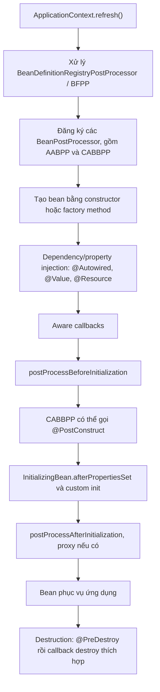

<a id="back-to-top"></a>

# Mở rộng thể hiện

## Menu
- [BeanPostProcessor trước và sau khởi tạo](#instance-extension-001)
- [InstantiationAwareBeanPostProcessor và can thiệp trước tiêm thuộc tính](#instance-extension-002)
- [SmartInstantiationAwareBeanPostProcessor và tham chiếu sớm](#instance-extension-003)
- [DestructionAwareBeanPostProcessor khi hủy bean](#instance-extension-004)
- [Vai trò của AutowiredAnnotationBeanPostProcessor và CommonAnnotationBeanPostProcessor](#instance-extension-005)
- [Thứ tự tự phát hiện so với thứ tự đăng ký bằng mã](#instance-extension-006)
- [Nhận diện bean bằng kiểu trả về của phương thức @Bean](#instance-extension-007)
- [Bean bị tạo sớm và cảnh báo chưa được xử lý bởi mọi post-processor](#instance-extension-008)
- [Bọc bean bằng proxy và giữ đúng hợp đồng đối tượng](#instance-extension-009)

## <a id="instance-extension-001">BeanPostProcessor trước và sau khởi tạo</a>

<details>
<summary>Xem chi tiết</summary>

# BeanPostProcessor trước và sau khởi tạo trong Spring Framework

## Mục tiêu và bối cảnh

Trong Spring Core Container, `BeanPostProcessor` (viết tắt **BPP**) là điểm mở rộng cho phép can thiệp vào **bean instance** khi Spring tạo và khởi tạo bean. Hai callback nền tảng là:

- `postProcessBeforeInitialization(Object bean, String beanName)` — chạy trong **giai đoạn trước các initialization methods** như `InitializingBean.afterPropertiesSet()` hoặc custom init method.
- `postProcessAfterInitialization(Object bean, String beanName)` — chạy **sau các initialization methods** và thường là nơi tạo wrapper/proxy cho object sẽ được những consumer khác sử dụng.

Mục tiêu học tập:

1. Mô tả chính xác hai callback nhận gì, trả gì và khi nào chạy.
2. Phân biệt instance post-processing với chỉnh `BeanDefinition`, constructor, dependency injection và method interception lúc runtime.
3. Giải thích tại sao `@PostConstruct` đòi chú ý **thứ tự các BeanPostProcessors**, thay vì khẳng định mọi before callback luôn đứng trước nó.
4. Tạo `BeanPostProcessor` vừa log trạng thái trước/sau init, vừa bọc bean bằng JDK dynamic proxy.
5. Chạy ứng dụng Java 17 + Spring Framework 6.2 độc lập và kiểm chứng stdout, kiểu proxy, interface injection.
6. Tránh các lỗi thường gặp: tạo bean sớm, autoproxying bị bỏ qua, trả object sai kiểu, dùng `@Order` không đúng và đánh đồng callback với xử lý mỗi request.

Bài thuộc phần **Mở rộng thể hiện**: thay đổi hoặc quan sát **object được Spring khởi tạo**, không phải can thiệp trực tiếp vào bản thiết kế BeanDefinition.

## 1. Từ BeanDefinition tới đối tượng mà client thật sự nhận

Spring có hai tầng quan trọng:

~~~text
BeanDefinition ("công thức")
    beanClass / factory method / properties / scope
                   |
                   v
           Spring tạo instance
                   |
                   v
        Inject properties/dependencies
                   |
                   v
       BPP.beforeInitialization(...)
                   |
                   v
           Initialization callbacks
                   |
                   v
       BPP.afterInitialization(...)
                   |
                   +-- trả object gốc
                   |
                   +-- hoặc trả wrapper/proxy
                   |
                   v
         Bean reference mà client nhận
~~~

`BeanDefinition` chỉ là metadata. `BeanFactoryPostProcessor` chỉnh metadata **trước khi bean thông thường được tạo**. `BeanPostProcessor` được dùng khi **instance đã được Spring tạo** và đang đi qua lifecycle. Do đó BPP có quyền nhìn vào bean object thực, kiểm tra marker interface, ghi instrumentation, thực thi một convention hoặc bọc nó bằng proxy.

Ví dụ một service:

~~~java
class InvoiceService {
    private String endpoint;

    void setEndpoint(String endpoint) {
        this.endpoint = endpoint;
    }
}
~~~

Đây là **snippet minh họa**, không phải một file Java chạy độc lập. BFPP có thể bổ sung metadata property `endpoint` vào BeanDefinition của service. BPP không cần sửa metadata; nó nhận **instance `InvoiceService`** sau khi Spring đã inject properties, nên có thể kiểm tra giá trị đang có hoặc trả về một đối tượng thay thế phù hợp.

**Một điểm khó:** Nếu BPP trả proxy, tham chiếu từ `context.getBean(...)` có thể không bằng instance do constructor tạo. Phân biệt **target** với **proxy được expose**, nhất là khi code dựa vào `getClass()` hoặc inject theo implementation class.

## 2. Giao diện BeanPostProcessor và hợp đồng API

Import:

~~~java
import org.springframework.beans.factory.config.BeanPostProcessor;
~~~

Hai phương thức chính có dạng:

~~~java
public interface BeanPostProcessor {

    default Object postProcessBeforeInitialization(
            Object bean, String beanName) {
        return bean;
    }

    default Object postProcessAfterInitialization(
            Object bean, String beanName) {
        return bean;
    }
}
~~~

Đây là **phiên bản đơn giản hóa để giải thích**: các chi tiết annotation nullability, checked/runtime exceptions và Javadoc của Spring đã được bỏ đi. Trong Spring hiện đại, hai phương thức có default implementation trả lại object đầu vào; có thể chỉ override một phương thức.

Các tham số:

| Tham số | Nghĩa |
| --- | --- |
| `bean` | Instance hoặc wrapper hiện tại mà Spring đang chuyển qua chuỗi post-processors |
| `beanName` | Tên bean được container dùng để quản lý instance; dùng để lọc đối tượng cần áp dụng logic |

Giá trị trả về:

- **`return bean;`**: tiếp tục dùng reference hiện hành, không thay đổi identity.
- **`return wrapper;`**: Spring tiếp tục xử lý/đưa ra object mới từ processor. Wrapper phải phù hợp với contract injection.
- **`return null;`**: theo hợp đồng BPP, **không gọi các BeanPostProcessors còn lại trong vòng xử lý tương ứng**. Đường xử lý Spring giữ object đang có thay vì xem `null` là một bean hợp lệ. Vì vậy `null` **không phải cách “loại bean ra khỏi container”** và không nên dùng như ý nghĩa filter.

Nếu processor không quan tâm bean đang xét, **luôn trả lại `bean`**. Một BPP có thể áp dụng cho rất nhiều beans trong container, vì thế không được ép kiểu tất cả beans thành một service cụ thể.

## 3. postProcessBeforeInitialization: trước các initialization methods

Method:

~~~java
@Override
public Object postProcessBeforeInitialization(
        Object bean, String beanName) {

    if ("reportService".equals(beanName)) {
        System.out.println("before-init: " + beanName);
    }
    return bean;
}
~~~

Đây là method đặt trong một lớp implements `BeanPostProcessor`; không phải class chạy độc lập.

### 3.1. Những gì đã xảy ra tại thời điểm này?

Với callback cơ bản, Spring thường đã:

1. Chọn constructor hoặc factory method.
2. Tạo Java object.
3. Resolve/inject dependency và populate property values.
4. Xử lý những Aware callbacks thuộc lifecycle thích hợp.

BPP before-init có thể nhìn thấy các property đã được inject và kiểm tra trạng thái tiền khởi tạo. Javadoc mô tả `bean` đã được **populated with property values**. Đây là điểm tốt để áp dụng convention đơn giản hoặc marker-interface callback.

Ví dụ:

~~~java
public interface NeedsValidation {
    void validateConfiguration();
}

public class ValidationProcessor implements BeanPostProcessor {
    @Override
    public Object postProcessBeforeInitialization(
            Object bean, String name) {
        if (bean instanceof NeedsValidation target) {
            target.validateConfiguration();
        }
        return bean;
    }
}
~~~

Đây là hai Java classes minh họa (mỗi public class/interface cần file riêng và imports thích hợp), không phải project hoàn chỉnh. Nó cho thấy **marker interface** giúp tránh hardcode bean names khi business convention thực sự dựa vào một hợp đồng.

### 3.2. Callback trước init KHÔNG nhất thiết trước @PostConstruct

`@PostConstruct` thường được Spring xử lý bởi `CommonAnnotationBeanPostProcessor`, kế thừa cơ chế lifecycle metadata BPP. Vì **bản thân `@PostConstruct` chạy nhờ một BPP**, thứ tự tương đối của một BPP tùy biến và annotation này tùy thuộc vào **ordering của các BPPs**.

Do vậy câu sau là **sai nếu phát biểu tổng quát**:

> “Tất cả postProcessBeforeInitialization callbacks luôn chạy trước tất cả @PostConstruct methods.”

Một BPP tùy biến có thứ tự sau `CommonAnnotationBeanPostProcessor` có thể thấy object **đã chạy `@PostConstruct`** ngay trong callback before-init của chính nó.

Điều có thể tin cậy khi học contract cơ bản:

- `postProcessBeforeInitialization` là callback **trước initialization methods của container như `InitializingBean.afterPropertiesSet()` và custom init method**.
- `@PostConstruct` là annotation callback do một infrastructure BPP khác thực thi, không phải một bước tuyệt đối đứng ngoài mọi BPP.
- Nếu thứ tự cụ thể giữa custom BPP và `@PostConstruct` là quan trọng, cần chỉ định/kiểm tra ordering thật sự, không chỉ dựa vào tên “before”.

### 3.3. Có thể trả wrapper từ before-init không?

Có. Javadoc cho phép trả object thay thế. Nhưng cần hiểu rằng initialization callbacks tiếp theo có thể được xử lý trên reference nhận từ BPP. Nếu wrapper không implement `InitializingBean`/không expose custom init method hoặc làm thay đổi kiểu ngoài ý muốn, lifecycle sẽ khó dự đoán.

Trong thực tế, **proxy wrapping thường được đặt tại after-initialization** để bean gốc hoàn tất initialization trước khi được expose ra ngoài. Đây là **mẫu thiết kế thường gặp**, không phải một lệnh cấm wrapping ở before-init.

## 4. postProcessAfterInitialization: sau các initialization methods

Method:

~~~java
@Override
public Object postProcessAfterInitialization(
        Object bean, String beanName) {

    if ("reportService".equals(beanName)) {
        System.out.println("after-init: " + beanName);
    }
    return bean;
}
~~~

Lúc callback này chạy, initialization methods như `InitializingBean.afterPropertiesSet()` hoặc custom `init-method` của bean thông thường đã được gọi. BPP có thể:

- Kiểm tra trạng thái sau init.
- Bọc bean bằng decorator.
- Tạo AOP proxy để intercept method calls sau startup.
- Trả lại chính object nếu không có thay đổi.

### 4.1. Trả proxy thay vì target

Ví dụ luồng:

~~~text
new DefaultPaymentService()  ->  target
             |
         inject dependencies
             |
         initialize target
             |
    BPP.afterInitialization(target)
             |
     tạo PaymentService proxy
             |
             v
ApplicationContext.getBean("paymentService") -> proxy
             |
             v
Client gọi proxy.pay(...)
             |
             v
Target.pay(...)
~~~

Proxy có thể là:

- **JDK dynamic proxy**: implement interfaces; không phải subclass của implementation.
- **Class-based proxy** (Spring thường dùng CGLIB): extends class khi class/method cho phép.

BPP là cơ chế mà Spring AOP infrastructure sử dụng để tạo nhiều loại proxy. Nhưng viết một BPP thủ công **không tự động biến mọi method thành advised method**: cần thật sự tạo interceptor/proxy phù hợp.

### 4.2. Nếu muốn intercept mỗi method call?

Đừng viết:

~~~java
@Override
public Object postProcessAfterInitialization(Object bean, String name) {
    System.out.println("every request"); // Sai kỳ vọng!
    return bean;
}
~~~

Log trên in vào thời điểm bean khởi tạo, **không phải mỗi HTTP request**. Nếu muốn log mỗi lần gọi `service.pay()`, BPP có thể tạo proxy hoặc dùng Spring AOP; logic intercept nằm trên đường method invocation của proxy, không nằm ở callback initialization một lần.

## 5. Thứ tự thực tế với constructor, DI, @PostConstruct và init methods

Một sơ đồ an toàn để học:

~~~text
BeanDefinition được xác định
        ↓
Bean instance được tạo
        ↓
Dependency injection / property population
        ↓
BeanPostProcessor.beforeInitialization chain
    (bao gồm cả infrastructure xử lý @PostConstruct)
        ↓
InitializingBean.afterPropertiesSet()
        ↓
Custom init method được khai báo
        ↓
BeanPostProcessor.afterInitialization chain
        ↓
Bean hoặc proxy sẵn sàng cho consumer
~~~

### Trường hợp sử dụng @PostConstruct

Nếu bean có cả:

~~~java
@PostConstruct
void populate() { ... }

@Override
public void afterPropertiesSet() { ... }

void warmUp() { ... } // @Bean(initMethod = "warmUp")
~~~

thì Spring gọi `@PostConstruct` trước `afterPropertiesSet()`, rồi custom init method, theo lifecycle mặc định của một bean thông thường. Tuy nhiên BPP before-init tùy biến có thể chạy trước hoặc sau `@PostConstruct` tùy thứ tự post-processors.

**Trình tự mà bạn có thể dùng để kiểm chứng dễ nhất** là BPP before → `InitializingBean.afterPropertiesSet()` → custom init → BPP after. Ví dụ runnable ở mục 8 chọn đúng tuyến này để stdout rõ ràng và không phụ thuộc thứ tự registration của `CommonAnnotationBeanPostProcessor`.

### Phân biệt Aware callback

Những callbacks như `BeanNameAware.setBeanName` hoặc `BeanFactoryAware.setBeanFactory` là các giai đoạn của bean lifecycle và không phải hai callback `BeanPostProcessor` trong bài. `ApplicationContextAware` có thể được gọi bởi `ApplicationContextAwareProcessor` ở giai đoạn before-initialization. Không giả định tất cả Aware callbacks có một thời điểm đồng nhất nếu bạn so sánh với từng BPP tùy biến.

## 6. Ai đăng ký BeanPostProcessor?

### 6.1. Tự động phát hiện trong ApplicationContext

Một `ApplicationContext` tự động tìm các beans **implements `BeanPostProcessor`** trong BeanDefinitions, khởi tạo processor sớm và đưa vào danh sách processors cho những bean khởi tạo tiếp theo.

~~~java
@Configuration
public class ProcessorConfig {

    @Bean
    public static TraceProcessor traceProcessor() {
        return new TraceProcessor();
    }
}
~~~

Snippet này cần class `TraceProcessor implements BeanPostProcessor` và Spring imports tương ứng; ví dụ đầy đủ nằm ở mục 8.

Vì BPP phải xuất hiện trước nhiều business beans, `@Bean` dành cho BPP thường nên:

- **`static`** để không phải tạo `@Configuration` instance quá sớm.
- Trả đúng **concrete BPP type** hoặc ít nhất kiểu `BeanPostProcessor`; không trả `Object`.
- Có ít/no dependencies, tránh kéo business services vào startup sớm.
- Có khả năng xử lý mọi bean mà container đưa vào và bỏ qua những beans không liên quan.

### 6.2. Vì sao static @Bean quan trọng?

Nếu viết:

~~~java
@Configuration
class RiskyConfig {
    @Bean
    BeanPostProcessor traceProcessor() {
        return new TraceProcessor();
    }
}
~~~

Spring có thể phải instantiate `RiskyConfig` để gọi method tạo processor **trong giai đoạn các BPPs còn được đăng ký**. Bản thân configuration class cùng những dependencies của nó có thể không nhận đầy đủ BPPs, gây cảnh báo hoặc bỏ mất proxying/lifecycle behavior.

**Không phải mọi `@Bean` đều cần static.** Đây là khuyến nghị riêng khi khai báo BPP hoặc BFPP thuộc nhóm infrastructure được tạo sớm. Code `@Bean` nghiệp vụ thông thường vẫn có thể là instance methods.

### 6.3. Programmatic registration trong BeanFactory

Một `ConfigurableBeanFactory` có thể nhận processor trực tiếp:

~~~java
beanFactory.addBeanPostProcessor(new TraceProcessor());
~~~

Đây là snippet trong method có biến `beanFactory` phù hợp, không phải chương trình độc lập. Với đường đăng ký **thủ công**, processor được áp dụng theo **thứ tự đăng ký**; `Ordered`/`PriorityOrdered` không được tự động dùng để sort lại các processors programmatic theo cách auto-detection.

Thông thường, các BPPs được programmatically registered được thực thi **trước** các BPPs autodetected. Nếu thứ tự là trọng yếu, cần xác định processor được đăng ký theo đường nào.

### 6.4. BFPP không phải BPP

`BeanFactoryPostProcessor` chỉnh **metadata BeanDefinition trước khi khởi tạo object**, không xử lý instance. Không gọi `getBean()` bên trong BFPP chỉ để sửa object: sẽ instantiate bean trước lúc processors đầy đủ, gây thiếu auto-proxying và lifecycle behavior. Nếu cần xử lý object, chọn BPP.

`BeanDefinitionRegistryPostProcessor` lại là một SPI khác dùng thêm/sửa definitions rất sớm. Bài này không cần BDRPP để xử lý trước/sau initialization của object.

## 7. Ordering và chuỗi nhiều processors

BPP hoạt động như một **chain**: processor tiếp theo nhận reference do processor trước trả về. Nếu BPP-A tạo JDK proxy chỉ implement interface, BPP-B không được ép về concrete target class. Một chuỗi hai proxy còn có thể đổi thứ tự advice.

~~~text
Target -> BPP-A.before -> BPP-B.before -> init methods
       -> BPP-A.after (có thể trả proxy) -> BPP-B.after -> consumer
~~~

Với BPP tự phát hiện, Spring áp dụng các nhóm `PriorityOrdered`, `Ordered` và phần còn lại; BPP thêm thủ công bằng `addBeanPostProcessor` chạy theo **thứ tự đăng ký**, trước nhóm auto-detected. `@Order` không tự điều khiển BPP ordering. Các callback after **không tự chạy ngược** như stack. Bài ở hàng 212 kiểm chứng chi tiết bằng project riêng.

## 8. Chương trình Java 17 + Spring 6.2: quan sát before, init, after và JDK proxy

Ví dụ chạy độc lập không cần Spring Boot hoặc HTTP server. Một `TaskService` được tạo dưới dạng `DefaultTaskService` có hai initialization methods; một `BeanPostProcessor` quan sát trạng thái ở before/after và trả **JDK dynamic proxy** sau khởi tạo.

### 8.1. Cấu trúc

~~~text
bean-post-processor-demo/
├── pom.xml
└── src/main/java/demo/
    └── BeanPostProcessorDemo.java
~~~

### 8.2. pom.xml

~~~xml
<?xml version="1.0" encoding="UTF-8"?>
<project xmlns="http://maven.apache.org/POM/4.0.0"
         xmlns:xsi="http://www.w3.org/2001/XMLSchema-instance"
         xsi:schemaLocation="http://maven.apache.org/POM/4.0.0 https://maven.apache.org/xsd/maven-4.0.0.xsd">
    <modelVersion>4.0.0</modelVersion>
    <groupId>demo</groupId>
    <artifactId>bean-post-processor-demo</artifactId>
    <version>1.0.0</version>

    <properties>
        <maven.compiler.release>17</maven.compiler.release>
        <project.build.sourceEncoding>UTF-8</project.build.sourceEncoding>
    </properties>

    <dependencies>
        <dependency>
            <groupId>org.springframework</groupId>
            <artifactId>spring-context</artifactId>
            <version>6.2.9</version>
        </dependency>
    </dependencies>

    <build>
        <plugins>
            <plugin>
                <groupId>org.apache.maven.plugins</groupId>
                <artifactId>maven-compiler-plugin</artifactId>
                <version>3.13.0</version>
            </plugin>
            <plugin>
                <groupId>org.codehaus.mojo</groupId>
                <artifactId>exec-maven-plugin</artifactId>
                <version>3.5.0</version>
            </plugin>
        </plugins>
    </build>
</project>
~~~

### 8.3. src/main/java/demo/BeanPostProcessorDemo.java

~~~java
package demo;

import java.lang.reflect.Proxy;
import org.springframework.beans.factory.InitializingBean;
import org.springframework.beans.factory.config.BeanPostProcessor;
import org.springframework.context.annotation.AnnotationConfigApplicationContext;
import org.springframework.context.annotation.Bean;
import org.springframework.context.annotation.Configuration;

public class BeanPostProcessorDemo {

    public static void main(String[] args) {
        try (AnnotationConfigApplicationContext context =
                     new AnnotationConfigApplicationContext(Config.class)) {

            // Vì processor trả JDK proxy, lấy theo interface API.
            TaskService service =
                    context.getBean("taskService", TaskService.class);

            System.out.println("isJdkProxy="
                    + Proxy.isProxyClass(service.getClass()));
            System.out.println("result=" + service.run("job-1"));
        }
    }

    public interface TaskService {
        String run(String taskId);
    }

    public static class DefaultTaskService
            implements TaskService, InitializingBean {

        private boolean initialized;

        public DefaultTaskService() {
            System.out.println("construct");
        }

        public boolean isInitialized() {
            return initialized;
        }

        @Override
        public void afterPropertiesSet() {
            System.out.println("InitializingBean.afterPropertiesSet");
            initialized = true;
        }

        public void warmUp() {
            System.out.println("custom-init");
        }

        @Override
        public String run(String taskId) {
            return "done:" + taskId;
        }
    }

    public static class TraceProcessor implements BeanPostProcessor {

        @Override
        public Object postProcessBeforeInitialization(
                Object bean, String beanName) {

            if ("taskService".equals(beanName)) {
                DefaultTaskService target = (DefaultTaskService) bean;
                System.out.println("before initialized="
                        + target.isInitialized());
            }
            return bean;
        }

        @Override
        public Object postProcessAfterInitialization(
                Object bean, String beanName) {

            if (!"taskService".equals(beanName)) {
                return bean;
            }

            DefaultTaskService target = (DefaultTaskService) bean;
            System.out.println("after initialized="
                    + target.isInitialized());

            // Proxy chỉ công khai interface TaskService.
            return Proxy.newProxyInstance(
                    TaskService.class.getClassLoader(),
                    new Class<?>[]{TaskService.class},
                    (proxy, method, args) -> {
                        if (method.getDeclaringClass() == Object.class) {
                            return method.invoke(target, args);
                        }

                        Object result = method.invoke(target, args);
                        if ("run".equals(method.getName())) {
                            return "decorated(" + result + ")";
                        }
                        return result;
                    });
        }
    }

    @Configuration(proxyBeanMethods = false)
    public static class Config {

        @Bean
        public static TraceProcessor traceProcessor() {
            return new TraceProcessor();
        }

        @Bean(initMethod = "warmUp")
        public DefaultTaskService taskService() {
            return new DefaultTaskService();
        }
    }
}
~~~

### 8.4. Chạy

Từ thư mục `bean-post-processor-demo`:

~~~bash
java -version
mvn -version
mvn -q compile exec:java -Dexec.mainClass=demo.BeanPostProcessorDemo
~~~

Stdout dự kiến của **chương trình** (không tính log Spring/Maven nếu môi trường bật logging riêng):

~~~text
construct
before initialized=false
InitializingBean.afterPropertiesSet
custom-init
after initialized=true
isJdkProxy=true
result=decorated(done:job-1)
~~~

### 8.5. Giải thích từng dòng

1. `construct`: `DefaultTaskService` được tạo bởi factory method `@Bean`.
2. `before initialized=false`: BPP nhận target đã tạo, nhưng `InitializingBean.afterPropertiesSet()` chưa chạy. Cờ `initialized` vẫn false.
3. `InitializingBean.afterPropertiesSet`: Spring gọi initialization callback; cờ chuyển thành true.
4. `custom-init`: Spring gọi `warmUp()` vì `@Bean(initMethod = "warmUp")`.
5. `after initialized=true`: BPP thấy target đã được init xong; sau đó tạo JDK dynamic proxy.
6. `isJdkProxy=true`: Bean consumer nhận từ context là proxy, không phải instance `DefaultTaskService`.
7. `result=decorated(done:job-1)`: lời gọi qua interface `TaskService` được proxy chuyển tới target, nhận kết quả rồi bọc bằng `decorated(...)`.

Trong ví dụ **không có `@PostConstruct`** để thứ tự stdout của custom BPP không phụ thuộc vị trí của `CommonAnnotationBeanPostProcessor`. Nếu bổ sung `@PostConstruct`, hãy đối chiếu ordering giữa infrastructure BPP và TraceProcessor như đã giải thích ở mục 3.

### 8.6. Vì sao phải lấy bean theo interface?

JDK dynamic proxy trong ví dụ implements `TaskService` nhưng **không extends `DefaultTaskService`**. Do đó:

~~~java
TaskService okay =
        context.getBean("taskService", TaskService.class);

// Không phù hợp với proxy chỉ implements TaskService:
DefaultTaskService wrong =
        context.getBean("taskService", DefaultTaskService.class);
~~~

Đây là snippet minh họa trong method có biến `context`. Dòng thứ hai không thỏa kiểu thực của JDK proxy và có thể gây exception khi getBean/type matching. Nó không làm lỗi Java compiler vì generic `getBean` cho phép khai báo kiểu kỳ vọng, nhưng runtime không thể ép JDK proxy thành concrete class.

Nếu consumer bắt buộc inject implementation class, cần cân nhắc class-based proxy phù hợp hoặc thay API dependency sang interface; đừng trả một wrapper không tương thích từ BPP.

### 8.7. Tại sao code dùng static @Bean cho TraceProcessor?

Container phải tạo và đăng ký processors **trước khi** tạo các business beans thông thường. Một `static @Bean` giúp tạo TraceProcessor mà không cần instantiate `Config` trước thời điểm thích hợp. Return type `TraceProcessor` cũng đủ cụ thể để Spring auto-detect đây là một `BeanPostProcessor`.

### 8.8. Thử sửa để hiểu hai hook

**Thí nghiệm A — bỏ after wrapping:** Trong `postProcessAfterInitialization`, thay toàn bộ nhánh proxy bằng `return bean;`, và giữ log before/after. Lúc lấy service, `isJdkProxy=false`, kết quả trở lại `done:job-1`.

**Thí nghiệm B — chỉ override after:** Bỏ phương thức before. Bean vẫn init bình thường, có proxy và result decorator; chỉ thiếu dòng `before initialized=false`.

**Thí nghiệm C — chỉ override before:** Không override after. Spring dùng default implementation trả `bean`; không có proxy và method call không được decorate.

**Thí nghiệm D — prototype:** Khai báo bean `taskService` với `@Scope("prototype")`. Mỗi lần container tạo một instance đều đi qua callbacks; mỗi product có proxy riêng theo quy tắc của ví dụ. Đây không phải mỗi lần gọi method lại chạy BPP trên cùng proxy.

**Thí nghiệm E — tạo @PostConstruct:** Thêm Jakarta annotation dependency và method có `@PostConstruct` để kiểm tra vị trí thực của annotation callback so với custom BPP. Đừng lấy kết quả một cấu hình làm quy tắc bất biến cho mọi processor ordering.

## 9. BeanPostProcessor có hoạt động trên mọi bean không?

Về nguyên tắc BPP được áp dụng cho những bean instances do container tạo **sau khi processor đã đăng ký**. Tuy vậy có những ngoại lệ/đường lifecycle đặc biệt:

- **BeanPostProcessor beans** phải được tạo sớm để tham gia xử lý những bean khác. Bản thân BPP cùng các beans nó trực tiếp phụ thuộc có thể **không nhận đầy đủ BPPs**, đặc biệt AOP auto-proxying.
- Một `FactoryBean` có thể được BPP xử lý, và object sản phẩm do nó tạo cũng có đường post-processing phù hợp; Javadoc ghi rõ after-initialization callback có thể áp dụng với cả FactoryBean và object do FactoryBean cung cấp. Hãy lọc bằng type/name để tránh áp logic nhầm lên factory.
- Beans do ứng dụng tự tạo bằng `new` **ngoài BeanFactory** không tự động được BPP xử lý.
- Beans đã tồn tại trước lúc BPP được programmatically registered không tự quay lại trải qua toàn bộ lifecycle callbacks.
- Trong hierarchy parent-child contexts, BPP thuộc phạm vi container đã đăng ký, không tự áp dụng xuyên mọi child contexts.
- Prototype target mới có thể trải qua BPP một lần mỗi lần tạo, còn truy vấn cùng singleton trong cache không chạy lại BPP.
- Với một số `InstantiationAwareBeanPostProcessor`, bean có thể được short-circuit trước instantiate. Đường after-initialization có thể vẫn được gọi theo Javadoc trong trường hợp đặc biệt, trong khi những callbacks khác không nhất thiết chạy như đường khởi tạo thông thường.

**Không nhầm “BPP áp dụng cho rất nhiều bean instances” với “BPP chạy sau mọi thao tác trên bean”.**

## 10. Quan hệ với @PostConstruct, InitializingBean, FactoryBean và AOP

### 10.1. @PostConstruct

`jakarta.annotation.PostConstruct` được `CommonAnnotationBeanPostProcessor` phát hiện và thực thi trong before-initialization processing. Với annotation configuration, `@PostConstruct` chạy trong một giai đoạn init sớm; custom BPP order quyết định nó quan sát trước hay sau annotation callback.

Khi viết một BPP riêng nhằm hỗ trợ annotation mới, nên hiểu mô hình của `InitDestroyAnnotationBeanPostProcessor`, `CommonAnnotationBeanPostProcessor` thay vì chỉ copy hai method và tự gọi reflection không có validation.

### 10.2. InitializingBean và custom initMethod

`InitializingBean.afterPropertiesSet()` chạy khi dependencies/properties đã được inject, giữa các vòng before/after BPP cơ bản. Với `@Bean(initMethod = "warmUp")`, custom method chạy sau `afterPropertiesSet()` theo lifecycle thông thường. Ví dụ mục 8 cố ý dùng hai hook này để minh họa thứ tự ổn định.

### 10.3. FactoryBean

`FactoryBean<T>` là bean đặc biệt cung cấp product qua `getObject()`. Nó không phải `BeanFactoryPostProcessor` và không phải `BeanPostProcessor`. Javadoc BPP lưu ý callback after-init có thể được gọi cho cả FactoryBean instance lẫn object được FactoryBean tạo; processor nên xác định đúng đối tượng cần xử lý.

### 10.4. Spring AOP

AOP autoproxying thường dựa trên BPP. Ví dụ infrastructure `AbstractAutoProxyCreator` tham gia đường khởi tạo để quyết định có proxy target hay không. Nhưng advice chạy mỗi lần gọi method là logic trên **proxy invocation**, không phải vì Spring gọi lại `postProcessAfterInitialization` mỗi lần.

### 10.5. Scoped proxy

`@RequestScope`, `@SessionScope` và scoped proxy giới thiệu một tham chiếu lâu dài phân giải target theo scope hiện hành. Mối liên hệ với BPP là cả hai có thể sử dụng cơ chế proxy, nhưng **proxy mode của scope** và **lifecycle callbacks của instance** có trách nhiệm khác nhau. Không kết luận một BPP bao bean thành proxy sẽ tự làm request scope active.

## 11. Early instantiation: lỗi thường khó nhận ra

Nếu một BPP phụ thuộc vào business service trong constructor, service có thể được tạo **trong khi Spring còn đăng ký BPP**, trước khi đủ auto-proxy creators. Spring có thể cảnh báo `not eligible for getting processed by all BeanPostProcessors`; service đôi khi nhận raw reference thay vì proxy. Không suy từ warning rằng mọi annotation hoặc advice đều lỗi: cần xác nhận processor bị thiếu và hành vi thực tế.

Giữ infrastructure processor ít dependency, dùng `static @Bean` với return type BPP rõ và tránh `getBean()` sớm trong BFPP. Bài hàng 214 phân tích warning, early/late demo và cách kiểm tra transaction/cache/async cụ thể.

## 12. Thread safety và hiệu năng của processor

Một BPP singleton có thể được Spring gọi trong các luồng tạo beans khác nhau, nhất là khi ứng dụng hoặc framework cho phép tạo prototype/lazy beans đồng thời. Nếu processor giữ mutable state (ví dụ `HashMap` đếm số bean instances), cần xem xét synchronization và thread safety; không dựa vào việc startup single-thread trong một demo.

Tránh:

- Làm network request dài trong callback cho mọi bean.
- Log toàn bộ object qua `toString()` khi có thể kích hoạt hành vi khác.
- Sửa fields không thuộc contract của bean.
- Tạo proxies cho những bean infrastructure nhạy cảm không cần thiết.
- Cache một proxy chung cho nhiều targets không liên quan.
- Lưu reference tới mọi bean vô thời hạn trong BPP gây memory leak.
- Tự gọi method nghiệp vụ cần transaction/AOP trước khi proxy đã được tạo.

Nếu BPP tạo proxy, kiểm tra Object methods như `equals`, `hashCode` và `toString`, kiểu interface/class và checked exceptions. Ví dụ runnable xử lý Object methods bằng cách ủy nhiệm vào target; production proxy cần policy hoàn chỉnh hơn nếu object identity/serialization có vai trò quan trọng.

## 13. Lỗi thường gặp và hướng sửa

| Hiện tượng | Nguyên nhân | Cách sửa |
| --- | --- | --- |
| before-init không thấy bean mong đợi | BPP chưa đăng ký hoặc bean đã tạo sớm | Đăng ký processor trước bean; kiểm tra startup timing |
| after-init nhận JDK proxy thay vì implementation | BPP đứng trước đã thay reference | Lọc theo interface/proxy API, tránh ép concrete class |
| Runtime type mismatch sau BPP | BPP trả wrapper không implement API injection | Tạo proxy tương thích type của consumer |
| BPP gọi method mỗi lần startup chứ không mỗi request | BPP là initialization hook | Dùng AOP/interceptor để intercept runtime method calls |
| `@PostConstruct` chạy trước custom before callback | Annotation callback do một infrastructure BPP xử lý, ordering khác | Xác minh BPP ordering, không giả định before tuyệt đối |
| `@Bean` trả processor nhưng Spring không auto-detect | Factory method trả type `Object` quá chung | Trả concrete BPP type hoặc `BeanPostProcessor` |
| Configuration class có injection không đủ | Non-static `@Bean` tạo BPP quá sớm | Ưu tiên static `@Bean` cho infrastructure |
| Log “not eligible for auto-proxying” | Processor kéo business bean vào khởi tạo sớm | Giảm processor dependencies, tránh early instantiation |
| `@Order` không thay thứ tự BPP programmatic | `addBeanPostProcessor` sử dụng registration order | Sắp lại calls; phân biệt autodetect |
| Trả `null` khiến processor sau không chạy | BPP contract coi null là stop signal của chain | Trả nguyên bean nếu không thay đổi |
| Proxy bị dùng trước khi target init | Wrap/đưa reference ra ngoài sớm không phù hợp | Thường proxy ở after-init; tránh self-exposure bất cẩn |
| Bean có `@Scope("prototype")` nhưng BPP chỉ log một lần | Test chỉ gọi `getBean()` một lần hoặc target được giữ bởi singleton | Lấy prototype nhiều lần trực tiếp để kiểm chứng |
| Bean tự `new` không được BPP xử lý | Không được Spring quản lý | Tạo bằng BeanFactory hoặc cơ chế autowire bean đúng |
| BPP ở parent không chạy trên child beans | BPP per-container | Đăng ký ở context tương ứng |
| Cấu hình AOP không có tác dụng ở bean processor | BPP beans/đối tượng được processor tham chiếu tạo sớm | Thiết kế infrastructure độc lập, không kỳ vọng BPP tự được auto-proxy |
| Bean FactoryBean product bị xử lý nhầm | BPP after-init có thể chạy với cả factory và product | Lọc theo interface/type/beanName có chủ ý |

### Quy trình chẩn đoán

1. Xác nhận bean là Spring-managed instance và đã được tạo **sau khi** BPP được đăng ký.
2. Kiểm tra tên bean, kiểu target, scope và dependencies.
3. Nếu lifecycle order sai, tách `@PostConstruct` khỏi `InitializingBean` để kiểm chứng từng stage.
4. Kiểm tra processors nào trả wrapper/proxy và thứ tự chain.
5. Nếu proxy sai kiểu, xem injection point đòi interface hay concrete class.
6. Nếu thiếu aspect, tìm bean bị eager-instantiated khi BPPs chưa đăng ký đầy đủ.
7. Nếu xử lý nhiều contexts, xác nhận BPP thuộc BeanFactory đúng.
8. Dùng integration test với context thật; gọi processor method bằng tay không kiểm chứng lifecycle registration.

## 14. Kiểm thử BeanPostProcessor

### 14.1. Unit test riêng logic processor

Một test có thể tạo `TraceProcessor` và một `DefaultTaskService` thủ công, gọi before/after và assert reference trả về. Với example từ mục 8:

~~~java
var target = new BeanPostProcessorDemo.DefaultTaskService();
var processor = new BeanPostProcessorDemo.TraceProcessor();

Object before =
        processor.postProcessBeforeInitialization(target, "taskService");

target.afterPropertiesSet();
target.warmUp();

Object after =
        processor.postProcessAfterInitialization(before, "taskService");

if (!(after instanceof BeanPostProcessorDemo.TaskService service)) {
    throw new AssertionError("Expected TaskService proxy");
}
if (!"decorated(done:x)".equals(service.run("x"))) {
    throw new AssertionError("Unexpected result");
}
~~~

Đây là **snippet test** dùng các nested classes ở mục 8; không phải một Java file độc lập. Kiểm tra logic của BPP, nhưng **không** chứng minh Spring tự động phát hiện BPP hoặc thứ tự lifecycle trong context.

### 14.2. Integration test trong context thật

Chạy chương trình mục 8 hoặc khởi tạo `AnnotationConfigApplicationContext(Config.class)` và assert:

- Processor được auto-detected.
- Before-init nhìn thấy cờ `initialized=false`.
- `InitializingBean.afterPropertiesSet()` chạy.
- Custom `warmUp()` chạy trước after-init.
- After-init nhìn thấy cờ `initialized=true`.
- Bean lấy theo `TaskService` là JDK proxy.
- Method call đi qua proxy trả `decorated(done:...)`.
- Target implement `TaskService`; proxy không assignable sang concrete `DefaultTaskService`.
- Những bean khác không bị processor thay thế do lọc theo `beanName`.
- BPP vẫn được áp dụng đúng khi target là prototype.
- Context được đóng sau test để resource lifecycle hoàn tất.

### 14.3. Test ordering với @PostConstruct

Trong integration test riêng, thêm `jakarta.annotation-api` vào classpath và một `@PostConstruct` method. Ghi event markers vào `List<String>` theo thứ tự mỗi callback rồi so sánh. Không dựa vào stdout được viết tay khi thứ tự processors chưa kiểm chứng. Nếu production dựa vào thứ tự, thể hiện contract ordering tường minh hoặc đổi thiết kế để tránh coupling khó kiểm soát.

### 14.4. Test nhiều processors

Đăng ký hai BPPs, trong đó một BPP trả proxy, BPP kia kiểm tra kiểu bean. Test cả `PriorityOrdered`/`Ordered` và đường programmatic registration để biết callback nào thấy target và callback nào thấy proxy. Với một chain phức tạp, test should assert **reference identity/type** thay vì chỉ log.

## 15. Checklist áp dụng

1. Viết rõ mục tiêu là **đọc/chỉnh object sau tạo**, không phải metadata trước tạo.
2. Override đúng callback: before-init để kiểm tra/chuẩn bị instance, after-init để kiểm tra sau init hoặc wrap proxy.
3. Luôn trả bean khi không thay đổi; tránh trả `null`.
4. Không nhầm before-init với “trước @PostConstruct trong mọi tình huống”.
5. Nếu wrap, giữ kiểu Java mà downstream injection cần.
6. Đặt BPP thành Spring bean được auto-detected trước khi business beans được tạo.
7. Ưu tiên `static @Bean` cho processor và return type rõ.
8. Không kéo business beans vào constructor của processor.
9. Xác định `Ordered`/`PriorityOrdered` và con đường đăng ký nếu có nhiều processors.
10. Hiểu processor gọi theo **bean instance creation**, không theo business method calls.
11. Không mặc định BPP sẽ post-process chính nó hoặc các dependencies được tạo sớm.
12. Kiểm tra behavior với `FactoryBean`, prototype, multiple contexts nếu ứng dụng sử dụng.
13. Có unit test cho logic processor và integration test để kiểm chứng container lifecycle.

## 16. Câu hỏi tự kiểm tra

**1. Hai method cốt lõi của `BeanPostProcessor` là gì?**  
`postProcessBeforeInitialization` và `postProcessAfterInitialization`. Chúng nhận bean object + tên bean và trả reference mà container dùng tiếp.

**2. `postProcessBeforeInitialization` có được gọi trước constructor không?**  
Không. Đây là hook sau khi đã instantiate và populate properties trong đường tạo bean thông thường.

**3. Mọi BPP before-init đều chạy trước `@PostConstruct` đúng không?**  
Không. `@PostConstruct` do một infrastructure BPP xử lý. Thứ tự giữa các BPPs quyết định vị trí tương đối.

**4. `InitializingBean.afterPropertiesSet()` nằm ở đâu?**  
Trong giai đoạn initialization của container, giữa nhóm BPP before-init và BPP after-init cơ bản.

**5. Tại sao BPP thường wrap proxy tại after-init?**  
Vì target được hoàn tất initialization trước, rồi consumer nhận proxy. Đây là convention thường gặp, không phải quy tắc cấm wrapper trước init.

**6. Nếu BPP trả `null` thì bean có bị xóa khỏi container không?**  
Không. Theo contract, Spring dừng gọi BPPs còn lại của vòng tương ứng; không xem null là thao tác xóa bean.

**7. BPP có được gọi mỗi lần `service.run()` không?**  
Không. BPP là lifecycle hook khi tạo instance. Proxy/interceptor mới xử lý method calls nếu cần.

**8. Nếu BPP trả JDK proxy chỉ implements interface, có inject theo concrete implementation class không?**  
Không, vì proxy không extends concrete class đó. Nên inject theo interface hoặc chọn proxy phù hợp.

**9. Vì sao bean do BPP trực tiếp tham chiếu có thể không có AOP proxy?**  
Vì nó bị instantiate quá sớm trong lúc container chưa đăng ký đủ processors, trong đó có auto-proxy creator.

**10. Với prototype có hai targets khác nhau, BPP có thể chạy hai lần không?**  
Có. BPP áp dụng theo mỗi instance được container tạo; BFPP là metadata processing ở bootstrap.

**11. Tại sao @Bean cho BPP thường nên static?**  
Vì Spring cần tạo processor sớm; static method giúp tránh eager-instantiation của configuration class và dependencies.

**12. Đăng ký BPP programmatic có được Spring tự sort bằng Ordered như auto-detected BPP không?**  
Không. Đường programmatic dùng registration order theo hợp đồng Spring.

## Tài liệu chính thức

- [Spring Framework Reference — Container Extension Points](https://docs.spring.io/spring-framework/reference/core/beans/factory-extension.html): BPP callbacks, đăng ký, ordering và early instantiation.
- [Spring Framework Reference — Customizing the Nature of a Bean](https://docs.spring.io/spring-framework/reference/core/beans/factory-nature.html): initialization/destruction callbacks.
- [Spring Framework Reference — Using @PostConstruct and @PreDestroy](https://docs.spring.io/spring-framework/reference/core/beans/annotation-config/postconstruct-and-predestroy-annotations.html).
- [Spring Framework Javadoc — BeanPostProcessor (6.2)](https://docs.spring.io/spring-framework/docs/6.2.x/javadoc-api/org/springframework/beans/factory/config/BeanPostProcessor.html).
- [Spring Framework Javadoc — InitializingBean](https://docs.spring.io/spring-framework/docs/6.2.9/javadoc-api/org/springframework/beans/factory/InitializingBean.html).
- [Spring Framework Javadoc — BeanFactoryPostProcessor](https://docs.spring.io/spring-framework/docs/6.2.9/javadoc-api/org/springframework/beans/factory/config/BeanFactoryPostProcessor.html).


</details>

- [Quay lại đầu trang](#back-to-top)

---

## <a id="instance-extension-002">InstantiationAwareBeanPostProcessor và can thiệp trước tiêm thuộc tính</a>

<details>
<summary>Xem chi tiết</summary>

# InstantiationAwareBeanPostProcessor và can thiệp trước khi Spring tiêm thuộc tính

## 1. Mục tiêu và bối cảnh

Trong Spring Core Container, `BeanPostProcessor` thường được giới thiệu qua hai phương thức `postProcessBeforeInitialization` và `postProcessAfterInitialization`. Tuy nhiên, tại thời điểm hai callback đó chạy, **Spring đã tạo đối tượng và hoàn tất bước populate properties trong đường khởi tạo thông thường**. Nếu muốn can thiệp **sớm hơn**, ví dụ trước khi một bean được instantiate, ngay sau khi constructor chạy nhưng trước setter/field injection, hoặc trước lúc Spring áp dụng một tập `PropertyValues`, cần tìm hiểu `InstantiationAwareBeanPostProcessor`.

Interface này có thể dùng để:

- Thay thế quá trình tạo instance bình thường bằng một đối tượng/proxy riêng trước khi Spring gọi constructor của bean đích.
- Quan sát đối tượng **đã instantiate nhưng chưa được populate properties**.
- Tự làm một phần field injection đặc biệt.
- Cho phép hoặc chặn pha property population cho một bean cụ thể.
- Bổ sung, loại bỏ hoặc sửa `PropertyValues` ngay trước khi BeanFactory apply chúng.
- Xây cơ chế hạ tầng của framework như annotation-driven injection, đặc biệt khi kết hợp các interface mở rộng thích hợp.

Nó là **extension point có sức ảnh hưởng lớn**. Một quyết định sai tại đây có thể làm `@Autowired`, setter/property values, Aware callbacks, initialization hoặc AOP hoạt động khác mong đợi. Đối với ứng dụng bình thường, constructor injection và `@Bean`/`@Autowired` thường đủ; chỉ nên dùng custom processor khi đang viết infrastructure hoặc cần hành vi can thiệp vào nhiều bean một cách nhất quán.

## 2. Phân biệt instantiate, populate và initialize

Một bean không đi thẳng từ `new` tới trạng thái ready. Có thể mô tả pipeline thông thường:

```text
BeanDefinition đã được xác định
       |
       v
[Trước instantiate]
InstantiationAwareBPP.postProcessBeforeInstantiation(...)
       |
       +-- trả object khác null? --> dùng object thay thế
       |                           --> BPP.afterInitialization
       |                           --> kết thúc nhánh short-circuit
       |
       +-- trả null
              |
              v
        instantiate bean
        - constructor
        - hoặc factory method
              |
              v
        populateBean(...)
              |
              +-- InstantiationAwareBPP
              |      .postProcessAfterInstantiation(...)
              |      - false: bỏ property population
              |
              +-- InstantiationAwareBPP
              |      .postProcessProperties(...)
              |      - có thể thêm/sửa property values
              |
              +-- apply BeanWrapper property values
              |      - setters/property assignment
              |
              v
        initializeBean(...)
              |
              +-- BeanNameAware/BeanFactoryAware
              +-- BPP.beforeInitialization
              |     (có thể chạy @PostConstruct)
              +-- InitializingBean.afterPropertiesSet()
              +-- custom init-method
              +-- BPP.afterInitialization
              |
              v
        bean được expose theo scope
```

Sơ đồ là **đường đi khái niệm**, lược bỏ các điểm như constructor resolution, `MergedBeanDefinitionPostProcessor`, circular references, early proxies và một số Aware callbacks. Đặc biệt, **constructor injection** diễn ra khi tạo instance, không phải khi apply setter/property values. Vì vậy, nếu `postProcessAfterInstantiation` trả `false`, nó **không thể quay ngược thời gian để bỏ các constructor arguments đã được truyền**.

Mốc thời gian đúng của ba hook:

| Hook | Khi được gọi | Object đã có? | Ý nghĩa giá trị trả về |
| --- | --- | --- | --- |
| `postProcessBeforeInstantiation(Class<?>, String)` | Trước instantiation mặc định | Chưa có target instance thông thường | `null`: tiếp tục; non-null: short-circuit dùng object thay thế |
| `postProcessAfterInstantiation(Object, String)` | Sau constructor/factory method, trước property population | Có | `true`: tiếp tục; `false`: bỏ property population |
| `postProcessProperties(PropertyValues, Object, String)` | Trước khi BeanFactory áp dụng property values | Có | Trả `PropertyValues` sẽ apply; `null`: bỏ property population theo hợp đồng Spring 6.2 |

Cả ba đều nằm **trước initializeBean thông thường**, dù chúng vẫn có thể gây side effects hoặc throw exception khiến bean creation thất bại.

## 3. API InstantiationAwareBeanPostProcessor trong Spring 6.2

Interface nằm ở:

```java
org.springframework.beans.factory.config.InstantiationAwareBeanPostProcessor
```

Nó extends `BeanPostProcessor`, nên có cả các hook initialization của interface cha. Các khai báo chính (rút gọn, **không phải source code đầy đủ của Spring**) gồm:

```java
public interface InstantiationAwareBeanPostProcessor
        extends BeanPostProcessor {

    default Object postProcessBeforeInstantiation(
            Class<?> beanClass, String beanName) {
        return null;
    }

    default boolean postProcessAfterInstantiation(
            Object bean, String beanName) {
        return true;
    }

    default PropertyValues postProcessProperties(
            PropertyValues pvs, Object bean, String beanName) {
        return pvs;
    }
}
```

`PropertyValues` thuộc `org.springframework.beans.PropertyValues`. Các method thật có thông tin annotation/Javadoc và exception contract tùy phiên bản.

Trong Spring 6.2, những default đáng nhớ là:

- `postProcessBeforeInstantiation` → **`null`**: container tiếp tục tạo target bình thường.
- `postProcessAfterInstantiation` → **`true`**: container tiếp tục populate.
- `postProcessProperties` → **trả nguyên `pvs`**: property values đi qua mà không bị thay đổi.

Vì vậy một custom implementation chỉ override một hook **không nhất thiết cần override toàn bộ hook còn lại**. Việc giữ mặc định ở những điểm không cần can thiệp giúp giảm nguy cơ phá lifecycle.

## 4. postProcessBeforeInstantiation: trước khi tạo target

`postProcessBeforeInstantiation(Class<?> beanClass, String beanName)` cho processor quyền quyết định có **thay instantiation bình thường** bằng object khác hay không.

```java
@Override
public Object postProcessBeforeInstantiation(
        Class<?> beanClass, String beanName) {

    if ("remoteService".equals(beanName)) {
        return createRemoteProxy(beanClass);
    }
    return null;
}
```

Đây là **mảnh minh họa**, `createRemoteProxy` cần được implement đúng type/contract trong framework cụ thể. Trả `null` là cách thông thường; trả một object phù hợp sẽ yêu cầu Spring **không tiếp tục instantiate target theo đường chuẩn**.

### 4.1. Ý nghĩa của việc trả non-null

Theo Javadoc 6.2:

- Instance object trả về có thể là **proxy** được expose thay cho target.
- **Việc instantiate target thông thường bị short-circuit**.
- Spring chỉ còn áp dụng chuỗi `BeanPostProcessor.postProcessAfterInitialization` cho object được trả về trên đường tắt này.
- Không tự suy luận rằng property injection, `BeanNameAware`, `@PostConstruct`, `InitializingBean.afterPropertiesSet` hay custom init của **target** sẽ chạy theo pipeline thông thường.
- Nếu proxy cần type prediction, xem `SmartInstantiationAwareBeanPostProcessor` và các cơ chế type matching có liên quan.

Trả non-null **không giống** trả `false` ở `postProcessAfterInstantiation`. Non-null xảy ra **trước constructor target**, còn false xảy ra **sau khi constructor/factory method đã tạo object**.

### 4.2. Vì sao nguy hiểm khi dùng sai?

Nếu object được trả về không tương thích với type bean definition/consumer mong đợi, `getBean("x", SomeType.class)` hoặc autowiring có thể thất bại. Nếu proxy cần target đã được inject, việc tạo proxy quá sớm có thể dẫn đến target ở trạng thái thiếu dependency.

Một ví dụ sai:

```java
@Override
public Object postProcessBeforeInstantiation(
        Class<?> beanClass, String beanName) {
    if ("paymentClient".equals(beanName)) {
        return new Object(); // Sai nếu consumer yêu cầu PaymentClient.
    }
    return null;
}
```

Đây là **anti-example**, không phải chương trình biên dịch độc lập. Spring không tự “sửa” kiểu runtime của `Object` thành `PaymentClient`.

Đối với đa số nhu cầu thay thế proxy trong ứng dụng, nên dùng các cơ chế AOP/`@Transactional` hoặc framework integrations chính thức, tránh tự trả object tùy ý ở hook này.

## 5. postProcessAfterInstantiation: sau constructor, trước populate properties

Method:

```java
@Override
public boolean postProcessAfterInstantiation(
        Object bean, String beanName) {
    return true;
}
```

được gọi khi bean instance **đã được constructor hoặc factory method tạo**, nhưng trước khi Spring tự populate property values. Đây là vị trí thích hợp để:

- Quan sát state của object sau constructor nhưng trước setter injection.
- Gắn một field đặc biệt theo hạ tầng tự định nghĩa.
- Đánh dấu metadata hoặc thực hiện instrumentation không yêu cầu dependency injection đã hoàn tất.
- Quyết định có tiếp tục property population cho bean cụ thể hay không.

### 5.1. Trả true: đường bình thường

`true` nghĩa là Spring tiếp tục quy trình property population. Các `InstantiationAwareBeanPostProcessor` liên quan còn có cơ hội được gọi ở pha property processing. Với bean thông thường, đây là lựa chọn an toàn.

### 5.2. Trả false: bỏ bước populateBean property values

Khi trả `false`, Spring bỏ pha property population của bean đó và không tiếp tục gọi các `InstantiationAwareBeanPostProcessor` phía sau cho *nhánh property population của bean instance tương ứng*. Theo Javadoc, nó ngăn các processor còn lại tham gia pha này.

Hệ quả:

- Các setter/property values định nghĩa trong bean definition **có thể không được áp dụng**.
- Field/method injection kiểu `@Autowired`/`@Value` thường do một `InstantiationAwareBeanPostProcessor` khác đảm nhiệm; nếu bị chặn tại bước này, nó có thể **không được thực hiện**.
- Constructor injection đã diễn ra **không bị hủy**.
- Các bước `initializeBean` tiếp theo thường vẫn chạy: Aware callback, BPP.before/after, `InitializingBean`, custom init; miễn bean không fail.
- Không tự coi `false` là cách “skip bean entirely”. Bean instance **vẫn tồn tại** và container có thể expose nó ở trạng thái thiếu property.

Vì vậy không nên trả `false` như một cách tối ưu để “giảm callback” toàn cục. Đó là quyết định sâu về việc container có quyền populate dependency cho instance hay không.

### 5.3. Một tình huống hợp lệ nhưng hiếm

Một framework chuyên biệt đã tự inject toàn bộ dependency bằng cơ chế riêng, có thể chủ động chặn Spring property population để tránh ghi đè. Nhưng phải chắc chắn constructor/field/setter injection của Spring không còn cần thiết và tất cả dependency bắt buộc đã được giải quyết an toàn. Đây không phải lựa chọn mặc định của business code.

## 6. postProcessProperties: can thiệp vào PropertyValues

Phương thức:

```java
@Override
public PropertyValues postProcessProperties(
        PropertyValues pvs, Object bean, String beanName) {
    return pvs;
}
```

được gọi **trước khi factory áp dụng các property values cuối cùng**. `pvs` là collection metadata (các `PropertyValue`) đã chuẩn bị để populate. Một processor có thể:

1. Giữ nguyên `pvs`.
2. Tạo `MutablePropertyValues` mới rồi thêm/override property.
3. Thực hiện custom injection trực tiếp qua reflection/metadata (nhưng phải rất thận trọng).
4. Trả `null` để báo bỏ property population theo hợp đồng hiện tại.

Ví dụ thay đổi một property:

```java
@Override
public PropertyValues postProcessProperties(
        PropertyValues pvs, Object bean, String beanName) {

    if (!"client".equals(beanName)) {
        return pvs;
    }

    MutablePropertyValues updated = new MutablePropertyValues(pvs);
    updated.add("endpoint", "https://internal.example");
    return updated;
}
```

Đây là **mảnh minh họa**; giả định bean tên `client` có writable property `endpoint`. Các imports cần thiết:

```java
import org.springframework.beans.PropertyValues;
import org.springframework.beans.MutablePropertyValues;
```

Nên **tạo bản `MutablePropertyValues` riêng** thay vì tùy tiện mutate cấu trúc dùng chung nếu không kiểm soát được việc tái sử dụng metadata. Cần biết loại property, setter/field thực sự tồn tại và conversion rules phù hợp.

### postProcessProperties không phải một setter callback

Khi method này chạy, Spring **chưa áp dụng** những property values mà BeanFactory chuẩn bị. Processor có thể trực tiếp sửa instance, nhưng nếu một property trùng tên sau đó lại được apply qua `BeanWrapper`, giá trị bạn đặt thủ công có thể bị **ghi đè**. Nếu chủ đích là thay đổi một setter property, thường nên trả `PropertyValues` đã sửa.

### Điều gì xảy ra khi trả null?

Theo Spring Framework 6.2 Javadoc của `InstantiationAwareBeanPostProcessor.postProcessProperties`, `null` có ý nghĩa **bỏ property population**. Đừng áp dụng tài liệu Spring 5.x vốn từng đề cập một callback cũ `postProcessPropertyValues(...)` và logic fallback sang method đó: API và behavior đã thay đổi qua các phiên bản.

Trong code Spring 6.x mới, hãy override `postProcessProperties`, và chỉ trả `null` khi thực sự muốn chặn population. Chọn `return pvs` cho trường hợp không can thiệp.

## 7. Chương trình Java 17+ hoàn chỉnh: trước property injection, sửa và chặn injection

Ví dụ này có ba bean cùng một cấu trúc thuộc tính nhưng ba kết quả khác nhau:

- **`normal`**: property `message` được áp dụng đúng như definition.
- **`edited`**: `postProcessProperties` thay đổi `message` ngay trước khi setter chạy.
- **`blocked`**: `postProcessAfterInstantiation` trả `false`, khiến `message` không được setter nhận từ definition.

Chương trình dùng `GenericApplicationContext` và **đăng ký custom InstantiationAwareBeanPostProcessor bằng API trực tiếp**. Cách này giữ chương trình tập trung vào hooks và không cần component scanning hoặc annotation configuration. Nó cũng giúp mỗi bean được quan sát theo log riêng, không dựa vào thứ tự các singleton không liên quan.

### Cấu trúc thư mục

```text
instantiation-aware-demo/
├── settings.gradle
├── build.gradle
└── src/main/java/InstantiationAwareDemo.java
```

### settings.gradle

```groovy
rootProject.name = 'instantiation-aware-demo'
```

### build.gradle

```groovy
plugins {
    id 'application'
}

repositories {
    mavenCentral()
}

dependencies {
    implementation 'org.springframework:spring-context:6.2.18'
}

java {
    toolchain {
        languageVersion = JavaLanguageVersion.of(17)
    }
}

application {
    mainClass = 'InstantiationAwareDemo'
}
```

### src/main/java/InstantiationAwareDemo.java

```java
import java.util.ArrayList;
import java.util.LinkedHashMap;
import java.util.List;
import java.util.Map;

import org.springframework.beans.MutablePropertyValues;
import org.springframework.beans.PropertyValues;
import org.springframework.beans.factory.BeanNameAware;
import org.springframework.beans.factory.InitializingBean;
import org.springframework.beans.factory.config.InstantiationAwareBeanPostProcessor;
import org.springframework.context.support.GenericApplicationContext;

public class InstantiationAwareDemo {

    private static final Map<String, List<String>> EVENTS =
            new LinkedHashMap<>();

    private static void record(String name, String event) {
        EVENTS.computeIfAbsent(name, key -> new ArrayList<>())
              .add(event);
    }

    public abstract static class SampleBean
            implements BeanNameAware, InitializingBean {

        private final String id;
        private String message;

        protected SampleBean(String id) {
            this.id = id;
            record(id, "constructor");
        }

        public void setMessage(String message) {
            this.message = message;
            record(id, "setter:" + message);
        }

        public String message() {
            return message;
        }

        @Override
        public void setBeanName(String name) {
            record(id, "BeanNameAware");
        }

        @Override
        public void afterPropertiesSet() {
            record(id, "afterPropertiesSet");
        }
    }

    public static final class NormalBean extends SampleBean {
        public NormalBean() {
            super("normal");
        }
    }

    public static final class EditedBean extends SampleBean {
        public EditedBean() {
            super("edited");
        }
    }

    public static final class BlockedBean extends SampleBean {
        public BlockedBean() {
            super("blocked");
        }
    }

    public static final class InjectionProbe
            implements InstantiationAwareBeanPostProcessor {

        @Override
        public Object postProcessBeforeInstantiation(
                Class<?> beanClass, String beanName) {
            if (beanClass != NormalBean.class
                    && beanClass != EditedBean.class
                    && beanClass != BlockedBean.class) {
                return null;
            }

            record(beanName, "beforeInstantiation");
            return null;
        }

        @Override
        public boolean postProcessAfterInstantiation(
                Object bean, String beanName) {
            if (!(bean instanceof SampleBean)) {
                return true;
            }

            if ("blocked".equals(beanName)) {
                record(beanName, "afterInstantiation:false");
                return false;
            }

            record(beanName, "afterInstantiation:true");
            return true;
        }

        @Override
        public PropertyValues postProcessProperties(
                PropertyValues pvs, Object bean, String beanName) {
            if (!(bean instanceof SampleBean)) {
                return pvs;
            }

            record(beanName, "postProcessProperties");

            if ("edited".equals(beanName)) {
                MutablePropertyValues changed =
                        new MutablePropertyValues(pvs);
                changed.add("message", "modified-by-processor");
                return changed;
            }

            return pvs;
        }

        @Override
        public Object postProcessBeforeInitialization(
                Object bean, String beanName) {
            if (bean instanceof SampleBean) {
                record(beanName, "BPP.beforeInitialization");
            }
            return bean;
        }

        @Override
        public Object postProcessAfterInitialization(
                Object bean, String beanName) {
            if (bean instanceof SampleBean) {
                record(beanName, "BPP.afterInitialization");
            }
            return bean;
        }
    }

    public static void main(String[] args) {
        try (GenericApplicationContext context =
                     new GenericApplicationContext()) {

            // Đăng ký processor TRƯỚC khi refresh tạo singleton.
            context.getBeanFactory().addBeanPostProcessor(
                    new InjectionProbe());

            context.registerBean("normal", NormalBean.class,
                    definition -> definition.getPropertyValues()
                            .add("message", "from-definition"));

            context.registerBean("edited", EditedBean.class,
                    definition -> definition.getPropertyValues()
                            .add("message", "original-value"));

            context.registerBean("blocked", BlockedBean.class,
                    definition -> definition.getPropertyValues()
                            .add("message", "never-applied"));

            context.refresh();

            System.out.println("normal=" +
                    context.getBean("normal", NormalBean.class).message());

            System.out.println("edited=" +
                    context.getBean("edited", EditedBean.class).message());

            System.out.println("blocked=" +
                    context.getBean("blocked", BlockedBean.class).message());

            for (String name : List.of("normal", "edited", "blocked")) {
                System.out.println(name + ".events="
                        + String.join(" > ", EVENTS.get(name)));
            }
        }
    }
}
```

### Chạy với Gradle

Cần Java 17+ và Gradle 8+. Tại thư mục `instantiation-aware-demo`:

```bash
gradle run --quiet
# Nếu đã tạo Gradle Wrapper:
# ./gradlew run --quiet
```

Các dòng mà logic Java in ra qua `System.out`:

```text
normal=from-definition
edited=modified-by-processor
blocked=null
normal.events=beforeInstantiation > constructor > afterInstantiation:true > postProcessProperties > setter:from-definition > BeanNameAware > BPP.beforeInitialization > afterPropertiesSet > BPP.afterInitialization
edited.events=beforeInstantiation > constructor > afterInstantiation:true > postProcessProperties > setter:modified-by-processor > BeanNameAware > BPP.beforeInitialization > afterPropertiesSet > BPP.afterInitialization
blocked.events=beforeInstantiation > constructor > afterInstantiation:false > BeanNameAware > BPP.beforeInitialization > afterPropertiesSet > BPP.afterInitialization
```

Đây là output của **những method do chương trình tự in**, không bao gồm log runtime hoặc log Spring tùy môi trường. `EVENTS` là log quan sát do mã ví dụ quản lý; kết quả được in theo danh sách tên cố định, không phụ thuộc thứ tự tạo giữa các bean không liên quan.

### Tại sao các dòng này hợp lý?

**`normal`:** hook trước instantiation trả `null`, container gọi constructor `NormalBean`. Sau instantiation, processor trả `true`. `postProcessProperties` giữ nguyên `PropertyValues` chứa `message=from-definition`; sau đó Spring áp dụng setter `setMessage`. Tiếp theo là `BeanNameAware`, BPP.before, `InitializingBean.afterPropertiesSet`, BPP.after.

**`edited`:** đường tương tự, nhưng processor tạo `MutablePropertyValues` và thay `message` bằng `modified-by-processor` trước khi BeanWrapper apply. Vì vậy setter chỉ ghi nhận giá trị mới.

**`blocked`:** constructor vẫn chạy; processor trả `false` tại `postProcessAfterInstantiation`. Spring bỏ property population, nên không có log `postProcessProperties` hoặc `setter:never-applied`. Tuy nhiên bean vẫn vào initialize phase, gọi `BeanNameAware` và `afterPropertiesSet`; `message` giữ mặc định `null`.

Chính sự hiện diện của `afterPropertiesSet` ở `blocked` chứng minh rằng **bỏ property population không đồng nghĩa bỏ initialization**.

### Vì sao dùng GenericApplicationContext?

Ví dụ đăng ký trực tiếp property values để phép thử không bị lẫn với annotation processors. `GenericApplicationContext` vẫn là một Spring `ApplicationContext` thực sự; nó tạo bean, gọi InstantiationAwareBeanPostProcessor và quản lý singleton lifecycle như một container.

Với `AnnotationConfigApplicationContext` hoặc Spring Boot, bạn thường có sẵn annotation infrastructure như `AutowiredAnnotationBeanPostProcessor`. Khi đó hook custom của bạn **cùng tham gia chain với nhiều processors khác** và ordering trở nên quan trọng. Không copy output trên sang một dự án Spring Boot đã bổ sung BPP khác rồi cho rằng chuỗi sẽ giống tuyệt đối.

## 8. So sánh ba kiểu “chặn” thường bị nhầm

| Bạn muốn làm gì? | Hook thích hợp | Trả về | Hệ quả chính |
| --- | --- | --- | --- |
| Thay luôn target object bằng proxy trước khi Spring instantiate | `postProcessBeforeInstantiation` | Non-null object | Short-circuit instantiation bình thường; chỉ after-initialization BPP xử lý tiếp |
| Tạo target bằng constructor bình thường nhưng không muốn Spring populate properties | `postProcessAfterInstantiation` | `false` | Target vẫn đã tạo; bỏ phase property population |
| Sửa tập property values trước khi BeanWrapper apply | `postProcessProperties` | `MutablePropertyValues` mới | Setter/BeanWrapper nhận các giá trị đã sửa |
| Không thay đổi cơ chế property injection | Các hook mặc định | `null` / `true` / `pvs` | Bean theo đường bình thường |
| Bỏ property population ngay tại property values hook | `postProcessProperties` | `null` | Không apply property values theo contract Spring 6.2 |
| Thực thi sau khi property injection đã hoàn thành | `BeanPostProcessor.postProcessBeforeInitialization` | Bean object | Không còn là “trước tiêm thuộc tính” |
| Xử lý bean sau init hoặc wrap proxy | `BeanPostProcessor.postProcessAfterInitialization` | Bean/proxy | Có thể expose wrapper làm instance cuối cùng |

Đừng dùng `postProcessAfterInstantiation(false)` để chặn việc tạo instance: constructor đã chạy rồi. Cũng đừng dùng `postProcessBeforeInstantiation(non-null)` chỉ để thay property value: tác động của nó lớn hơn nhiều.

## 9. Liên hệ trực tiếp với @Autowired và @Value

Trong cấu hình annotation Spring bình thường, `AutowiredAnnotationBeanPostProcessor` xử lý các field/method đánh dấu `@Autowired` và `@Value`, và implements `SmartInstantiationAwareBeanPostProcessor` (một extension của `InstantiationAwareBeanPostProcessor`).

Ví dụ:

```java
@Component
class SearchService {

    @Autowired
    private SearchClient client;

    @Value("${search.timeout-ms:1500}")
    private int timeoutMillis;

    @PostConstruct
    void ready() {
        // Field/method dependency injection bình thường đã chạy.
    }
}
```

Đây là **mảnh code minh họa**, cần `SearchClient`, imports `Component`, `Autowired`, `Value`, `jakarta.annotation.PostConstruct` và annotation processing phù hợp. Dấu `\${...}` được giữ nguyên ở đây để biểu thị Spring property placeholder.

Điểm cần nhớ:

- Constructor được chọn và arguments được resolve trong pha tạo instance. `AutowiredAnnotationBeanPostProcessor` còn có hook mở rộng về lựa chọn candidate constructors.
- Field/annotated setter injection có thể xảy ra trong `postProcessProperties` của processor hạ tầng này.
- Nếu một custom InstantiationAwareBeanPostProcessor chạy trước và `postProcessAfterInstantiation` trả `false` cho `SearchService`, Spring có thể bỏ toàn bộ property population, khiến `client` không được inject, còn `timeoutMillis` giữ giá trị mặc định.
- `@PostConstruct` thuộc **before-initialization processing**, không phải property population. Nó có thể vẫn được gọi và vì thế đọc các field chưa được inject sẽ lỗi.
- Đừng chỉnh thứ tự processors tùy tiện rồi kỳ vọng `@Autowired` tự “chạy lại” sau khi property population đã bị skip.

Dùng constructor injection nếu dependency bắt buộc. Constructor injection làm object sớm đạt invariant, nhưng vẫn không sửa được một custom processor quá xâm lấn khiến container lifecycle không nhất quán.

## 10. InstantiationAwareBeanPostProcessor và BeanPostProcessor khác nhau thế nào?

`InstantiationAwareBeanPostProcessor` **extends** `BeanPostProcessor`. Có thể hiểu:

```text
BeanPostProcessor
   |
   +-- postProcessBeforeInitialization(...)
   +-- postProcessAfterInitialization(...)
   |
   +-- InstantiationAwareBeanPostProcessor
         |
         +-- postProcessBeforeInstantiation(...)
         +-- postProcessAfterInstantiation(...)
         +-- postProcessProperties(...)
```

Một implementation `InstantiationAwareBeanPostProcessor` có thể override cả năm hook, nhưng không bắt buộc. Default implementations cho phép chỉ can thiệp đúng một điểm cần thiết.

### Các callback trước initialization thông thường không còn là “trước DI”

`BeanPostProcessor.postProcessBeforeInitialization` chạy **sau property population** ở đường tạo bean thông thường. Nếu bạn chỉ muốn validate bean sau khi được inject đầy đủ, dùng hook này hoặc `@PostConstruct` phù hợp hơn.

Ngược lại, `postProcessAfterInstantiation` và `postProcessProperties` chủ đích cho hạ tầng can thiệp **trước khi** population hoàn tất. Nếu cố đọc `@Autowired` fields ở thời điểm này, các field có thể vẫn `null`.

### Phân biệt với BeanFactoryPostProcessor

`BeanFactoryPostProcessor` sửa **metadata trong BeanFactory** trước vòng khởi tạo singleton thông thường:

```java
@Override
public void postProcessBeanFactory(
        ConfigurableListableBeanFactory factory) {
    // Metadata bean definition; không phải một bean instance.
}
```

Đây là mảnh minh họa. Nếu muốn đổi property value trong **bean definition cho toàn bộ vòng đời tạo bean**, BFPP có thể phù hợp. Nếu muốn can thiệp trực tiếp theo **runtime bean instance** và mỗi lần instantiate, InstantiationAwareBPP thích hợp hơn. Đừng gọi `getBean()` trong BFPP để cưỡng ép tạo bean quá sớm.

## 11. SmartInstantiationAwareBeanPostProcessor: extension sâu hơn

`SmartInstantiationAwareBeanPostProcessor` kế thừa InstantiationAwareBPP và bổ sung hooks phục vụ **type matching, constructor selection và early reference**:

- `predictBeanType`/`determineBeanType`: dự đoán hoặc xác định exposed type, đôi khi là proxy.
- `determineCandidateConstructors`: gợi ý constructor candidates; `AutowiredAnnotationBeanPostProcessor` có liên quan đến cơ chế này.
- `getEarlyBeanReference`: cung cấp reference sớm khi một singleton setter cycle được hỗ trợ; phải nhất quán với proxy cuối.

Đó là các tình huống hạ tầng sâu hơn việc sửa `PropertyValues`. Bài hàng 209 minh họa raw/early proxy identity và phân biệt setter cycle với constructor cycle; không cần triển khai các hooks này nếu mục tiêu chỉ là property injection đơn giản.

## 12. Đăng ký InstantiationAwareBeanPostProcessor đúng thời điểm

Trong `ApplicationContext`, khai báo `static @Bean` với return type là `InstantiationAwareBeanPostProcessor` hoặc implementation cụ thể giúp Spring phát hiện processor sớm mà không cần khởi tạo configuration object:

~~~java
@Configuration(proxyBeanMethods = false)
class InfrastructureConfig {
    @Bean
    static InstantiationAwareBeanPostProcessor customInjector() {
        return new CustomInjector();
    }
}
~~~

Đây là snippet cần implementation `CustomInjector` và imports phù hợp. Với `ConfigurableBeanFactory`, có thể gọi `addBeanPostProcessor(new CustomInjector())` **trước khi** tạo beans mục tiêu. Processor đăng ký thủ công chạy theo thứ tự thêm, trong khi auto-detected xét `PriorityOrdered`/`Ordered`; việc đăng ký trễ không xử lý hồi tố các singleton đã tạo. Bài hàng 212 dành riêng cho ordering.

## 13. Khi nào nên can thiệp trước property population?

Một số nhu cầu của framework hoặc platform module:

- **Custom annotation injection:** một annotation do tổ chức định nghĩa, ví dụ tiêm service handle theo metadata, cần chạy trước các setter values khác.
- **PropertyValues normalization:** sửa/loại property values ở runtime theo bean name hoặc đối tượng.
- **Adapting framework-owned instances:** các object được tạo bởi cơ chế không chuẩn, nhưng vẫn cần một mức post-processing của Spring.
- **Infrastructure instrumentation:** đo mốc constructor đã xong nhưng bean chưa nhận dependencies, hỗ trợ phân tích lifecycle.
- **Conditional population policy:** trong một framework có guarantee rõ, chủ động bỏ các property definitions không nên được apply.

Tuy nhiên, với ứng dụng business code, hãy cân nhắc phương án đơn giản hơn:

| Nhu cầu | Công cụ thường phù hợp hơn |
| --- | --- |
| Dependency bắt buộc | Constructor injection |
| Một dependency tùy chọn | `ObjectProvider<T>` hoặc nullable/optional injection có chủ đích |
| Mapping config thành object | `@ConfigurationProperties` trong Spring Boot hoặc `@Bean` nhận `Environment` trong Spring Core |
| Kiểm tra trạng thái sau injection | `@PostConstruct` hoặc init method |
| Tạo bean từ factory | `@Bean` method |
| Sửa metadata bean definition | `BeanFactoryPostProcessor`/`BeanDefinitionRegistryPostProcessor` |
| Wrap bean sau initialization | BPP/AOP integration đã được framework hỗ trợ |
| Thay property value của một bean riêng lẻ | Trực tiếp cấu hình `@Bean`/`BeanDefinition` thay vì tạo global processor |

Custom InstantiationAwareBPP làm coupling vào container rất sâu; nếu chỉ thay một config property của một bean, triển khai riêng là quá mức.

## 14. Những bẫy kỹ thuật khi viết processor

### 14.1. Không filter bean name/type

Một BPP áp dụng cho **nhiều beans** trong cùng BeanFactory. Nếu không filter đúng bean name/type, processor có thể vô tình đụng vào `@Configuration`, infrastructure beans, factory beans, proxies hoặc components khác. Hãy giới hạn hành vi tới một interface/annotation/bean name contract rõ ràng.

### 14.2. Gọi getBean() ngay trong processor

Nếu trong `postProcessBeforeInstantiation` bạn gọi `beanFactory.getBean(beanName)` cho chính bean đang tạo, có thể gây vòng lặp tạo bean, `BeanCurrentlyInCreationException` hoặc stack overflow. Nếu cần dependency, inject chúng vào processor một cách hợp lý và tránh kéo business beans tạo quá sớm.

### 14.3. Return false khi không có cơ sở

`false` chặn cả việc xử lý properties của những processors khác. Nếu processor chỉ muốn quan sát bean, **luôn return true**; nếu chỉ muốn sửa một property, **return PropertyValues đã thay đổi**, không return false.

### 14.4. Tự reflection vào private field

Custom field injection qua reflection có thể vượt encapsulation, tạo lỗi khi chạy với Java modules, security policies hoặc AOT/native image. Nếu buộc làm, cache metadata hợp lý, chú ý accessibility và compatibility với Spring AOT. Trong business code, constructor/setter injection có thể rõ ràng và an toàn hơn.

### 14.5. Thay BeanDefinition thay vì runtime instance

Nếu muốn thay `scope`, `constructorArgumentValues`, `lazyInit`, `dependsOn`, hãy dùng registry/factory-level processor thay vì can thiệp vào một instance đã được tạo. Các hooks thuộc InstantiationAwareBPP không thiết kế để chỉnh toàn bộ bean definition graph.

### 14.6. Nhầm thời điểm @PostConstruct

`@PostConstruct` chạy trong before-initialization BPP chain, **sau property population thông thường**. Nó không được gọi giữa constructor và `postProcessProperties`. Khi custom processor chặn injection, `@PostConstruct` vẫn có thể chạy và gặp field null, gây lỗi khởi tạo.

### 14.7. Bean được tạo qua new bên ngoài container

`new SearchService()` không làm InstantiationAwareBPP của Spring tự chạy. Nếu Spring không quản lý object đó, đừng mong các hook hoặc `@Autowired` tự kích hoạt. Các API như `AutowireCapableBeanFactory` có thể áp dụng các giai đoạn nhất định lên existing instance, nhưng không đồng nghĩa mọi constructor/pre-instantiation callback được chạy lại.

### 14.8. BeanFactory infrastructure lifecycle

BPP có thể cần được tạo sớm để xử lý các bean khác. Dependencies của BPP có thể bị khởi tạo khi chain còn chưa đủ, khiến các bean đó không nhận đủ auto-proxy/annotation behavior. Tránh processor phụ thuộc business service lớn; giữ infrastructure bean độc lập.

### 14.9. Property values sai type

`MutablePropertyValues.add("timeoutMillis", "many")` có thể làm BeanWrapper conversion fail nếu setter nhận `int` và không có conversion phù hợp. Test type conversion, property descriptors và lỗi missing setter trước khi đưa processor vào production.

### 14.10. Global mutable state trong custom BPP

Processor thường được dùng cho nhiều beans và có thể bị gọi từ nhiều đường tạo bean khác nhau. Đừng giả định instance processor chỉ xử lý một bean hay luôn single-threaded. Cache metadata nên thread-safe khi thực sự có concurrent bean creation.

## 15. Gợi ý kiểm thử chính xác

Một integration test của InstantiationAwareBPP cần dùng Spring container thật. Với ví dụ mục 7, những assertion có ý nghĩa gồm:

```java
assertEquals("from-definition", normal.message());
assertEquals("modified-by-processor", edited.message());
assertNull(blocked.message());

assertTrue(EVENTS.get("normal")
        .indexOf("constructor")
        < EVENTS.get("normal").indexOf("setter:from-definition"));

assertFalse(EVENTS.get("blocked")
        .contains("postProcessProperties"));
assertFalse(EVENTS.get("blocked")
        .contains("setter:never-applied"));
assertTrue(EVENTS.get("blocked")
        .contains("afterPropertiesSet"));
```

Đây là **mảnh assertion JUnit 5 minh họa**, cần imports `assertEquals`/`assertNull`/`assertTrue`/`assertFalse` và các biến tham chiếu đúng scope; không phải test class biên dịch độc lập.

Các test nên bao phủ:

1. Hook before-instantiation được gọi **trước constructor** với bean bình thường.
2. Trả `null` từ before-instantiation cho phép creation bình thường.
3. Hook after-instantiation thấy instance nhưng property chưa được populate.
4. Trả `true` dẫn tới property processing/setter.
5. Trả `false` bỏ property population nhưng không bỏ initialize callbacks.
6. Sửa `MutablePropertyValues` thực sự thay giá trị setter.
7. Trả `null` từ `postProcessProperties` theo phiên bản cụ thể dẫn đến behavior mong đợi.
8. Short-circuit non-null object giữ type tương thích với bean definition/consumer.
9. BPP registration sớm có tác dụng; đăng ký sau khi bean đã tạo không retroactively xử lý instance.
10. Nếu dùng Spring annotation configuration, field/`@Autowired` injection vẫn chạy khi processor không chặn.
11. Không có property overwrites bất ngờ do xung đột giữa processor và bean definition.
12. Cleanup resources nếu custom injector tạo resource rồi throws.

Khi test event ordering, ghi vào list per bean như ví dụ, tránh assert log nội bộ của Spring có thể thay đổi qua patch releases.

## 16. Kết hợp với các callback khác trong vòng đời

Một bean có thể kết hợp `InstantiationAwareBeanPostProcessor`, standard property injection, Aware interfaces và initialization methods.

Bảng dưới mô tả mốc của một bean đường bình thường:

| Tác vụ | Điểm thực thi |
| --- | --- |
| Processor có thể short-circuit creation | `postProcessBeforeInstantiation` |
| Constructor/factory method tạo bean | Instantiation |
| Có thể quyết định chặn population | `postProcessAfterInstantiation` |
| Có thể chỉnh `PropertyValues` | `postProcessProperties` |
| Setters/property values được apply | Populate bean |
| Một số Aware interfaces được gọi | Initialize bean |
| `@PostConstruct` qua lifecycle BPP | Before-initialization chain |
| `InitializingBean.afterPropertiesSet` | Init callback |
| Custom `init-method` | Init callback |
| BPP.afterInitialization, có thể wrap proxy | Sau init |
| Container expose bean hoàn tất | Scope/registry/lookup |

Đừng tự tạo một “callback order tuyệt đối” bao trùm mọi loại BPP khi có custom processors, factory methods, AOP hoặc circular dependencies. Mỗi plugin/hook có order contract và có thể ảnh hưởng pipeline ở một pha khác nhau.

### @Lookup và method injection có liên quan không?

`@Lookup` làm Spring override một method để resolve bean khác khi method được gọi, thường sử dụng subclassing trong bean instantiation strategy. Đây là **một cơ chế khác** với custom `InstantiationAwareBeanPostProcessor`. Không nên dùng BPP để tự làm lại `@Lookup` nếu Spring đã cung cấp API phù hợp.

### FactoryBean và @Bean factory method

Bean có thể được tạo bằng `@Bean` method hoặc `FactoryBean` product. `postProcessBeforeInstantiation` của InstantiationAwareBPP có thể nhận loại bean dự đoán từ factory method, nhưng đừng suy luận mọi product do `FactoryBean.getObject()` tạo đều đi qua toàn bộ chuỗi constructor/populate của một bean definition thông thường. FactoryBean có hợp đồng riêng về product post-processing và lifecycle.

## 17. Câu hỏi tự kiểm tra

**Câu 1.** Khi nào `postProcessAfterInstantiation` chạy?

**Trả lời:** Sau khi constructor/factory method tạo instance và trước property population. Đây là thời điểm field injection thông thường có thể vẫn chưa xảy ra.

**Câu 2.** `false` có ngăn constructor chạy không?

**Không.** Đến `postProcessAfterInstantiation` thì instance đã tồn tại. Nó chỉ chặn bước populate properties.

**Câu 3.** Khi `postProcessBeforeInstantiation` trả object khác `null`, Spring còn chạy `@PostConstruct` của target không?

**Không thể giả định có.** Đường thông thường bị short-circuit; Javadoc xác định chỉ còn callback `postProcessAfterInitialization` trong bước xử lý tiếp theo.

**Câu 4.** Muốn sửa giá trị property trước khi setter nhận, nên override hook nào?

`postProcessProperties` và trả `PropertyValues` có nội dung chính xác.

**Câu 5.** Muốn kiểm tra bean sau khi tất cả dependencies đã được inject thì nên dùng hook nào?

`@PostConstruct` hoặc `BeanPostProcessor.postProcessBeforeInitialization` phù hợp hơn custom pre-population hook.

**Câu 6.** BPP tự viết có tự kích hoạt với object tạo bằng `new` không?

Không, trừ khi bạn có chủ ý đưa object vào các API của container thực thi hậu xử lý tương ứng.

**Câu 7.** Vì sao ưu tiên dùng constructor injection cho dependency bắt buộc?

Nó làm dependency được cung cấp ngay khi tạo instance; tránh một khoảng thời gian instance tồn tại với required field `null`. Tuy nhiên không thay thế yêu cầu viết custom processors có behavior an toàn.

## 18. Troubleshooting nhanh

| Hiện tượng | Nguyên nhân khả dĩ | Cách xử lý |
| --- | --- | --- |
| `@Autowired` field vẫn `null` | Custom processor trả `false` ở `postProcessAfterInstantiation` trước khi annotation injector chạy | Giữ `true`, chỉ filter bean cần chặn, dùng constructor injection nếu phù hợp |
| Setter của property không chạy | `postProcessProperties` trả `null` hoặc `postProcessAfterInstantiation=false` | Trả `pvs` hoặc `MutablePropertyValues` hợp lệ |
| Một bean được expose là proxy khác type | `postProcessBeforeInstantiation` trả object không tương thích | Bảo đảm type contract, dùng proxy factory chính thức |
| Bean constructor không chạy | Before-instantiation hook trả non-null object | Đây là short-circuit intentional; trả `null` để tạo bình thường |
| `@PostConstruct` chạy nhưng dependency null | BPP đã chặn property population | Không dựa vào init hook để sửa missing injection |
| ApplicationContext không phát hiện custom BPP | Chưa đăng ký bean processor, hoặc register quá muộn | Dùng `static @Bean` return type BPP hoặc add programmatically trước creation |
| Behavior khác giữa hai project | Annotation processors khác nhau, ordering khác, Spring version khác | So sánh bean registration, chain order và Spring version |
| Property mới gây `NotWritablePropertyException` | Không có setter/writable property đúng tên | Kiểm tra bean class/property descriptor, dùng injection phù hợp |
| Property value không convert được | Sai runtime type hoặc conversion setup | Đặt value đúng kiểu, kiểm tra conversion service |
| Processor chạy nhiều lần hơn dự kiến | Processor áp dụng cho nhiều beans/scopes, bean được tạo lại | Filter, kiểm tra scope và AOP |
| Tài nguyên leak khi interceptor throws | Object/resource tạo trong hook chưa có owner/cleanup | `try/finally`, đóng resource khi failure |
| Bean không được AOP proxy | Bean hoặc processor infrastructure bị khởi tạo sớm | Tránh `getBean()` trong BFPP/BPP constructor, xem cảnh báo eligibility |

## 19. Checklist trước khi triển khai production

- Bạn có thực sự cần can thiệp trước property population, thay vì `@Bean`, constructor injection hoặc BFPP không?
- Đã phân biệt hook trước instantiate, sau instantiate, trước apply properties chưa?
- `postProcessBeforeInstantiation` chỉ trả non-null khi object thay thế **đúng type** và lifecycle short-circuit là có chủ đích?
- `postProcessAfterInstantiation` có `return true` với mọi bean không thuộc đối tượng can thiệp?
- `postProcessProperties` có `return pvs` cho mọi bean bình thường?
- Khi thay `PropertyValues`, có bảo đảm writable property, conversion type và không có overwrite ngoài ý muốn?
- Có kiểm tra các annotation processors Spring hiện có, đặc biệt `AutowiredAnnotationBeanPostProcessor`?
- Có bảo đảm registration sớm và ordering phù hợp giữa các BPP?
- Có tránh lấy business dependencies trong BPP constructor hoặc metadata phase khiến tạo sớm?
- Có test riêng cho singleton, prototype, AOP proxy, custom scope nếu dự án sử dụng?
- Có đo và kiểm tra cleanup khi một hook throw exception ở trạng thái partial initialization?
- Có log/test dựa trên event của chính ứng dụng, không lệ thuộc text debug của framework?
- Có kiểm tra tương thích AOT/native reflection và Java modules khi dùng reflection?

## 20. Nguồn tham khảo chính thức

1. [Spring Framework 6.2 Javadoc — InstantiationAwareBeanPostProcessor](https://docs.spring.io/spring-framework/docs/6.2.x/javadoc-api/org/springframework/beans/factory/config/InstantiationAwareBeanPostProcessor.html): định nghĩa ba hook, default values và ngữ nghĩa `true`/`false`/`null`.
2. [Spring Framework 6.2 Javadoc — SmartInstantiationAwareBeanPostProcessor](https://docs.spring.io/spring-framework/docs/6.2.x/javadoc-api/org/springframework/beans/factory/config/SmartInstantiationAwareBeanPostProcessor.html): constructor/type/early-reference extension hooks.
3. [Spring Framework 6.2 Javadoc — AutowiredAnnotationBeanPostProcessor](https://docs.spring.io/spring-framework/docs/6.2.x/javadoc-api/org/springframework/beans/factory/annotation/AutowiredAnnotationBeanPostProcessor.html): thực tế triển khai annotated field/method injection.
4. [Spring Framework Reference — Container Extension Points](https://docs.spring.io/spring-framework/reference/core/beans/factory-extension.html): lifecycle của BPP, ordering và lưu ý early initialization.
5. [Spring Framework 6.2.18 source — AbstractAutowireCapableBeanFactory](https://github.com/spring-projects/spring-framework/blob/v6.2.18/spring-beans/src/main/java/org/springframework/beans/factory/support/AbstractAutowireCapableBeanFactory.java): `createBean`, `populateBean`, `applyPropertyValues` và `initializeBean`.
6. [Spring Framework 6.2.18 source — InstantiationAwareBeanPostProcessor](https://github.com/spring-projects/spring-framework/blob/v6.2.18/spring-beans/src/main/java/org/springframework/beans/factory/config/InstantiationAwareBeanPostProcessor.java): contract gắn với phiên bản dùng trong ví dụ.

**Tóm tắt:** `InstantiationAwareBeanPostProcessor` có thể can thiệp trước constructor, ngay sau constructor nhưng trước injection, và ngay trước khi áp dụng property values. `null` ở before-instantiation nghĩa là tiếp tục; `false` ở after-instantiation nghĩa là bỏ property population; `PropertyValues` do postProcessProperties trả về quyết định các giá trị Spring sẽ áp dụng. Chỉ dùng mức can thiệp sâu này khi thật sự cần kiểm soát pipeline tạo bean.


</details>

- [Quay lại đầu trang](#back-to-top)

---

## <a id="instance-extension-003">SmartInstantiationAwareBeanPostProcessor và tham chiếu sớm</a>

<details>
<summary>Xem chi tiết</summary>

# SmartInstantiationAwareBeanPostProcessor và tham chiếu sớm trong Spring Framework

## 1. Bài toán: mở rộng quá trình khởi tạo bean ở thời điểm rất sớm

Trong Spring IoC Container, một bean thông thường được tạo instance, inject các dependency, chạy initialization callbacks rồi mới được công bố cho những bean khác. `BeanPostProcessor` cho phép can thiệp trước và sau giai đoạn initialization. `InstantiationAwareBeanPostProcessor` cho phép can thiệp sớm hơn trong quá trình instantiation và property population. **`SmartInstantiationAwareBeanPostProcessor`** (gọi tắt **SIBPP**) tiếp tục mở rộng những callback này để container có thể **dự đoán type, xác định constructor ứng viên và cấp một reference sớm** khi cần.

Interface đầy đủ là `org.springframework.beans.factory.config.SmartInstantiationAwareBeanPostProcessor`, thuộc module `spring-beans`. Đây là extension point **chủ yếu dành cho cơ chế nội bộ/framework infrastructure**, không phải annotation mà mọi service đều phải dùng. Javadoc Spring khuyến nghị tác giả ứng dụng thông thường triển khai `BeanPostProcessor` đơn giản hơn, trừ khi thật sự cần những hook đặc biệt.

Trường hợp mang tính biểu tượng nhất là **early bean reference**. Giả sử A và B đều là singleton, chúng dùng setter injection và phụ thuộc lẫn nhau:

```text
A (singleton) --setter inject--> B (singleton)
        ^                          |
        |                          |
        +---------setter-----------+

Spring bắt đầu tạo A:
  1. Có raw A sau constructor, A CHƯA được inject/initialize hết.
  2. Cần B để set vào A.
  3. B đang được tạo và cần A.
  4. Container có thể công bố một "early reference" của A cho B.
  5. B hoàn thành khởi tạo; A hoàn tất injection và initialization.
```

Nếu A sẽ được bọc bởi **AOP proxy**, B không nên giữ một reference tới **raw A** trong khi các consumer khác nhận **proxy A**: lời gọi từ B có thể bỏ qua transaction/security/cache advice và tạo hai danh tính quan sát khác nhau. `getEarlyBeanReference()` giúp infrastructure công bố **proxy sớm**, đồng bộ danh tính với proxy cuối cùng.

**Cảnh báo quan trọng:** Cơ chế này không khiến circular dependency trở thành thiết kế tốt. Constructor cycle `A(B)` → `B(A)` thông thường vẫn không giải được bằng early reference, vì chưa có đối tượng A nào để công bố khi constructor A cần B.

## 2. SIBPP kế thừa các loại BeanPostProcessor nào?

Phân cấp giao diện trong Spring:

```text
BeanPostProcessor
       ^
       |
InstantiationAwareBeanPostProcessor
       ^
       |
SmartInstantiationAwareBeanPostProcessor
```

Bảng chức năng:

| Interface | Hook tiêu biểu | Mục đích |
| --- | --- | --- |
| `BeanPostProcessor` | `postProcessBeforeInitialization`, `postProcessAfterInitialization` | Can thiệp quanh initialization, ví dụ tạo AOP proxy |
| `InstantiationAwareBeanPostProcessor` | `postProcessBeforeInstantiation`, `postProcessAfterInstantiation`, `postProcessProperties` | Can thiệp trước khi tạo object hoặc khi populate properties |
| `SmartInstantiationAwareBeanPostProcessor` | `predictBeanType`, `determineBeanType`, `determineCandidateConstructors`, `getEarlyBeanReference` | Dự đoán kiểu cuối, chọn constructor, tạo early wrapper khi cần |

Không đồng nhất `BeanFactoryPostProcessor` với các interface trên. **BFPP sửa BeanDefinition metadata trước khi tạo bean**, còn SIBPP tham gia vào vòng đời *instance*.

### 2.1. Các method của SmartInstantiationAwareBeanPostProcessor

Về mặt ý nghĩa API trong Spring Framework 6.x:

```java
// Đây là chữ ký giản lược; không tự định nghĩa interface này trong dự án.
public interface SmartInstantiationAwareBeanPostProcessor
        extends InstantiationAwareBeanPostProcessor {

    default Class<?> predictBeanType(Class<?> beanClass, String beanName) {
        return null;
    }

    default Class<?> determineBeanType(Class<?> beanClass, String beanName) {
        return beanClass;
    }

    default Constructor<?>[] determineCandidateConstructors(
            Class<?> beanClass, String beanName) {
        return null;
    }

    default Object getEarlyBeanReference(Object bean, String beanName) {
        return bean;
    }
}
```

Đoạn trên chỉ minh họa signatures/default semantics (các annotation nullable và checked exceptions của API thật đã lược bớt). Trong Spring Framework 6.2, `determineBeanType` đã được bổ sung từ 6.0; `predictBeanType` có thể trả null. Method `getEarlyBeanReference` mặc định trả chính raw bean, nghĩa là processor không buộc phải tạo proxy.

Đừng override tất cả method theo thói quen. Nếu bạn chỉ cần lời gọi sau initialization, implement `BeanPostProcessor`. Nếu bạn đang xây AOP auto-proxy creator hoặc constructor resolver thì các hook ở cấp Smart mới thực sự có giá trị.

## 3. predictBeanType: dự đoán type để chọn candidate

`predictBeanType(Class<?> beanClass, String beanName)` cho phép processor cung cấp một dự đoán kiểu bean sau khi đi qua processor, dựa trên thông tin **đã biết/cached**. Javadoc khuyến khích không làm công việc nặng chỉ để dự đoán.

Khi bean có thể được bọc bằng proxy interface, container cần biết bean có thể được nhìn nhận dưới type nào khi autowiring. Không phải mọi nhánh type matching đều gọi trực tiếp hook này; thuật toán phụ thuộc metadata, BeanFactory implementation và proxy infrastructure.

```java
@Override
public Class<?> predictBeanType(Class<?> beanClass, String beanName) {
    if ("auditService".equals(beanName)) {
        return AuditApi.class;
    }
    return null; // Không có dự đoán đáng tin cậy.
}
```

Đây là **fragment minh họa**, `AuditApi` phải là type thật mà bean/proxy có thể expose; không dùng nó độc lập. Nếu dự đoán không tương thích với instance/proxy cuối, container có thể chọn sai candidate rồi phát sinh lỗi injection hoặc type mismatch.

Không sử dụng `predictBeanType` để instantiate bean, gọi remote service, mở kết nối hoặc đoán type bằng một object được tạo mới. Nó phục vụ metadata/type resolution, không phải startup hook.

## 4. determineBeanType: xác định type cuối, kể cả proxy class

`determineBeanType(Class<?> beanClass, String beanName)` được giới thiệu ở Spring 6.0 để processor xác định type của bean **sẽ được trả về** khi can thiệp trước instantiation. Mặc định method trả chính `beanClass`, **không null**. Infrastructure có thể thực hiện việc phân tích proxy sớm để cung cấp kiểu chính xác hơn.

Phân biệt hai method:
- `predictBeanType`: đưa ra một dự đoán từ dữ liệu có sẵn; có thể `null` nếu chưa biết.
- `determineBeanType`: xác định type cuối ở những điểm mà BeanFactory yêu cầu; kết quả không null, có thể phải tính toán kỹ hơn.

Một số implementation AOP thực tế có thể override `determineBeanType` để tính proxy class. Đây là hook tinh vi, không nên tự trả một class proxy tùy ý nếu chưa đảm bảo đúng với proxy thực sự được tạo.

### Vì sao không luôn dùng beanClass?

Raw class có thể là `DefaultPaymentService`, nhưng JDK dynamic proxy được expose cho consumer có thể chỉ implement `PaymentService`. Nếu bạn khẳng định final bean vẫn là `DefaultPaymentService`, constructor injection theo concrete type có thể thất bại. Type metadata, proxy type và các interface thực sự được expose phải nhất quán.

## 5. determineCandidateConstructors: can thiệp vào constructor selection

`determineCandidateConstructors(Class<?> beanClass, String beanName)` cho phép trả một mảng constructor ứng viên để container cân nhắc. Mặc định trả null, nghĩa là processor không đưa ra candidate đặc biệt.

Một implementation điển hình của infrastructure là `AutowiredAnnotationBeanPostProcessor`: nó sử dụng annotation và các quy tắc autowiring để xác định constructor phù hợp. Nếu tạo processor riêng, cần xử lý overload, visibility, optional arguments, required dependencies và conflict giữa các constructors đúng hợp đồng.

```java
@Override
public java.lang.reflect.Constructor<?>[] determineCandidateConstructors(
        Class<?> beanClass, String beanName) {
    if (!"specialHandler".equals(beanName)) {
        return null;
    }
    return beanClass.getDeclaredConstructors();
}
```

Đây là một fragment **minh họa API, không phải công thức an toàn** để chọn tất cả constructors của một bean. Việc trả mọi constructor một cách máy móc có thể thay đổi khả năng resolve và tạo ambiguity. Ứng dụng thông thường nên dùng constructor injection rõ ràng hoặc `@Autowired`, không cần viết SIBPP chỉ để chọn constructor.

**Không nhầm constructor candidate selection với giải circular constructor dependency.** Dù Spring biết constructor nào cần dùng, nếu A constructor bắt buộc B và B constructor bắt buộc A thì object A chưa tồn tại để công bố early reference.

## 6. getEarlyBeanReference: callback quan trọng nhất của bài

Chữ ký:

```java
@Override
public Object getEarlyBeanReference(Object bean, String beanName) {
    // Có thể trả proxy đã tạo từ raw bean.
    return bean;
}
```

Trong một singleton circular dependency được hỗ trợ, Spring có thể có raw instance ngay sau constructor nhưng **trước khi dependencies được populate đầy đủ và callbacks init chạy xong**. BeanFactory có thể đăng ký một `ObjectFactory<?>` cung cấp early reference vào singleton registry. Nếu dependency khác yêu cầu bean ấy ngay lúc nó đang được tạo, registry gọi supplier và cuối cùng các `SmartInstantiationAwareBeanPostProcessor` được trao cơ hội cung cấp object qua `getEarlyBeanReference`.

Điểm chính của API:

1. Tham số `bean` là **raw bean instance** đã được tạo, không phải bean chắc chắn đã initialized.
2. `beanName` là tên mà container đang quản lý, dùng để quyết định áp proxy cho bean nào.
3. Trả `bean` như cũ khi không cần special wrapping.
4. Nếu final bean sẽ là proxy, có thể tạo **early proxy** ngay ở đây để dependency khác giữ đúng object reference.
5. Wrapper sớm phải **tương đương** với object mà `postProcessBeforeInitialization`/`postProcessAfterInitialization` sẽ expose sau đó.
6. Spring có cơ chế dùng early reference làm exposed singleton cuối nếu các post-process callbacks tiếp theo trả raw bean. Không được tùy tiện tạo **proxy mới khác identity** ở after-initialization khi một early proxy đã được inject.
7. Callback này có thể **không bao giờ được gọi** với bean không có đường truy cập sớm. Đừng dùng nó như initialization callback bắt buộc.

### Ba mức cache singleton (mô hình khái niệm)

Một cách học quen thuộc về Spring singleton registry:

```text
(1) singletonObjects          -> singleton hoàn chỉnh (final exposed object)
(2) earlySingletonObjects     -> early reference đã được tạo/được hỏi
(3) singletonFactories        -> supplier có thể tạo early reference khi cần

Bắt đầu tạo A:
  raw A sau constructor
      |
      +-- singletonFactories["aService"] = () -> getEarlyBeanReference(A)
      |
Tạo B -> B cần A
      |
      +-- chưa có A final ở (1)
      +-- chưa có early ref ở (2)
      +-- lấy factory ở (3), gọi -> proxy sớm của A
      +-- có thể chuyển proxy sang (2) để lookup sau reuse
      |
B được populate và init
A tiếp tục populate và init
      |
      +-- reconcile exposed object với early reference
      +-- singletonObjects["aService"] = proxy đã công bố
```

Đây là **mô hình triển khai của singleton registry**, không phải lời hứa Spring sẽ luôn dùng đúng ba map/chuỗi method như vậy ở mọi phiên bản hoặc trạng thái cạnh tranh. Các tên như `singletonObjects`, `earlySingletonObjects` và `singletonFactories` là cách hiểu từ implementation Spring phổ biến. Không truy cập những cache nội bộ này trong mã ứng dụng.

**Ý nghĩa của factory ở cấp 3:** Nếu vòng tham chiếu không xảy ra, bean có thể được khởi tạo và publish bình thường **mà không cần tạo proxy sớm từ cache này**. Early exposure chỉ thực sự có ý nghĩa khi một bean khác yêu cầu reference trước khi bean ban đầu hoàn tất.

## 7. Kịch bản A → B → A: thứ tự chi tiết

Giả định A và B là singleton, dependency được inject qua setter, context cho phép circular references.

```text
Caller: getBean("aService")
   |
   +-- new AImpl() (raw A có rồi)
   +-- đánh dấu A "currently in creation"
   +-- đăng ký singleton factory để có early A khi cần
   |
   +-- populate A: setB(...)
       |
       +-- cần bService: new BService()
       +-- populate B: setA(...)
           |
           +-- cần aService, đang trong quá trình tạo
           +-- singleton registry lấy early reference A
           +-- SmartInstantiationAwareBPP.getEarlyBeanReference(raw A)
           +-- có thể nhận proxy A
           +-- B.setA(proxy A)
       |
       +-- B.afterPropertiesSet() / @PostConstruct...
       +-- A.setB(B)
   |
   +-- A.afterPropertiesSet() / @PostConstruct...
   +-- postProcessAfterInitialization(raw A)
   +-- Spring có thể công bố cùng proxy A đã cấp sớm
   |
   +-- getBean("aService") trả final exposed proxy A
```

Một giới hạn dễ bỏ qua: **B đã giữ reference A trước khi A hoàn tất initialization**. Nếu `B.setA(...)` hoặc `B.@PostConstruct` **gọi ngay method nghiệp vụ trên A**, nó có thể truy cập field chưa được gán, làm nảy sinh `NullPointerException` hoặc thấy trạng thái chưa sẵn sàng. Proxy sớm không biến raw target thành object đã khởi tạo đầy đủ, nó chỉ giúp reference/proxy identity nhất quán.

Chính vì tính mong manh đó, thiết kế tốt thường **loại bỏ vòng phụ thuộc**, dù Spring Core có thể hỗ trợ một số vòng setter/field injection.

## 8. Ví dụ Java 17+ hoàn chỉnh: vòng setter và early JDK proxy

Ví dụ sử dụng **Java 17+, Maven 3.9+, Spring Framework 6.2.18**, không cần web server, Spring Boot hay database. Mục đích học tập là minh họa trực tiếp `getEarlyBeanReference` qua một custom `SmartInstantiationAwareBeanPostProcessor`.

Ta chủ động cho phép circular references trong BeanFactory để chạy trường hợp này; **không xem đây là khuyến nghị áp dụng cho production**. Spring Boot mặc định không cho phép circular references (`spring.main.allow-circular-references=false`), trong khi BeanFactory thuần của Spring Framework có thể cho phép tùy cấu hình.

### 8.1. Cấu trúc dự án

```text
early-reference-demo/
├── pom.xml
└── src/main/java/edu/example/early/
    ├── AService.java
    ├── AImpl.java
    ├── BService.java
    ├── EarlyProxyProcessor.java
    ├── AppConfig.java
    └── Main.java
```

**pom.xml**

```xml
<?xml version="1.0" encoding="UTF-8"?>
<project xmlns="http://maven.apache.org/POM/4.0.0"
         xmlns:xsi="http://www.w3.org/2001/XMLSchema-instance"
         xsi:schemaLocation="http://maven.apache.org/POM/4.0.0 https://maven.apache.org/xsd/maven-4.0.0.xsd">
    <modelVersion>4.0.0</modelVersion>
    <groupId>edu.example</groupId>
    <artifactId>early-reference-demo</artifactId>
    <version>1.0.0</version>
    <properties>
        <maven.compiler.release>17</maven.compiler.release>
        <project.build.sourceEncoding>UTF-8</project.build.sourceEncoding>
    </properties>
    <dependencies>
        <dependency>
            <groupId>org.springframework</groupId>
            <artifactId>spring-context</artifactId>
            <version>6.2.18</version>
        </dependency>
    </dependencies>
    <build>
        <plugins>
            <plugin>
                <groupId>org.apache.maven.plugins</groupId>
                <artifactId>maven-compiler-plugin</artifactId>
                <version>3.13.0</version>
            </plugin>
            <plugin>
                <groupId>org.codehaus.mojo</groupId>
                <artifactId>exec-maven-plugin</artifactId>
                <version>3.5.0</version>
                <configuration>
                    <mainClass>edu.example.early.Main</mainClass>
                </configuration>
            </plugin>
        </plugins>
    </build>
</project>
```

**src/main/java/edu/example/early/AService.java**

```java
package edu.example.early;

public interface AService {
    String message();
}
```

**src/main/java/edu/example/early/AImpl.java**

```java
package edu.example.early;

import org.springframework.beans.factory.InitializingBean;
import org.springframework.beans.factory.annotation.Autowired;

public final class AImpl implements AService, InitializingBean {
    private BService bService;

    @Autowired
    public void setBService(BService bService) {
        this.bService = bService;
    }

    @Override
    public void afterPropertiesSet() {
        if (bService == null) {
            throw new IllegalStateException("B must be injected");
        }
        System.out.println("init: aService");
    }

    @Override
    public String message() {
        return "A->" + bService.ping();
    }
}
```

**src/main/java/edu/example/early/BService.java**

```java
package edu.example.early;

import org.springframework.beans.factory.InitializingBean;
import org.springframework.beans.factory.annotation.Autowired;

public final class BService implements InitializingBean {
    private AService aService;

    @Autowired
    public void setAService(AService aService) {
        this.aService = aService;
    }

    public AService aReference() {
        return aService;
    }

    public String ping() {
        return "B";
    }

    @Override
    public void afterPropertiesSet() {
        if (aService == null) {
            throw new IllegalStateException("A must be injected");
        }
        // Không gọi aService.message() ở đây: A có thể chưa initialized.
        System.out.println("init: bService");
    }
}
```

**src/main/java/edu/example/early/EarlyProxyProcessor.java**

```java
package edu.example.early;

import java.lang.reflect.InvocationTargetException;
import java.lang.reflect.Proxy;
import java.util.Set;
import java.util.concurrent.ConcurrentHashMap;
import java.util.concurrent.atomic.AtomicInteger;
import org.springframework.beans.factory.config.SmartInstantiationAwareBeanPostProcessor;

public final class EarlyProxyProcessor
        implements SmartInstantiationAwareBeanPostProcessor {

    private final Set<String> earlyNames = ConcurrentHashMap.newKeySet();
    private final AtomicInteger earlyCount = new AtomicInteger();

    @Override
    public Object getEarlyBeanReference(Object bean, String beanName) {
        if (!"aService".equals(beanName)) {
            return bean;
        }
        // A đã được construct nhưng chưa init xong.
        earlyNames.add(beanName);
        earlyCount.incrementAndGet();
        System.out.println("early: aService proxy");
        return wrap((AService) bean);
    }

    @Override
    public Object postProcessAfterInitialization(Object bean, String beanName) {
        if (!"aService".equals(beanName)) {
            return bean;
        }
        if (earlyNames.remove(beanName)) {
            // Spring sẽ expose early reference đã lưu làm singleton cuối
            // khi các post-processors trả raw bean như ở đây.
            return bean;
        }
        // Nếu không có vòng, vẫn tạo proxy khi init bình thường.
        return wrap((AService) bean);
    }

    private static AService wrap(AService target) {
        return (AService) Proxy.newProxyInstance(
                AService.class.getClassLoader(),
                new Class<?>[]{AService.class},
                (proxy, method, args) -> {
                    try {
                        return method.invoke(target, args);
                    } catch (InvocationTargetException ex) {
                        throw ex.getCause();
                    }
                });
    }

    public int earlyReferenceCount() {
        return earlyCount.get();
    }
}
```

**src/main/java/edu/example/early/AppConfig.java**

```java
package edu.example.early;

import org.springframework.context.annotation.Bean;
import org.springframework.context.annotation.Configuration;
import org.springframework.context.annotation.Lazy;

@Configuration(proxyBeanMethods = false)
public class AppConfig {
    // BeanPostProcessor phải được tạo rất sớm.
    @Bean
    public static EarlyProxyProcessor earlyProxyProcessor() {
        return new EarlyProxyProcessor();
    }

    @Bean("aService")
    @Lazy
    public AImpl aService() {
        return new AImpl();
    }

    @Bean("bService")
    @Lazy
    public BService bService() {
        return new BService();
    }
}
```

**src/main/java/edu/example/early/Main.java**

```java
package edu.example.early;

import java.lang.reflect.Proxy;
import org.springframework.context.annotation.AnnotationConfigApplicationContext;

public final class Main {
    public static void main(String[] args) {
        try (AnnotationConfigApplicationContext context =
                     new AnnotationConfigApplicationContext()) {
            // Chỉ dùng để minh họa vòng setter có thể hỗ trợ.
            context.getDefaultListableBeanFactory()
                   .setAllowCircularReferences(true);
            context.register(AppConfig.class);
            context.refresh();

            // Cả A và B là @Lazy: buộc A được tạo trước để cố định trace.
            AService a = context.getBean("aService", AService.class);
            BService b = context.getBean("bService", BService.class);
            EarlyProxyProcessor processor =
                    context.getBean(EarlyProxyProcessor.class);

            System.out.println("proxy: " + Proxy.isProxyClass(a.getClass()));
            System.out.println("same reference: " + (a == b.aReference()));
            System.out.println("message: " + a.message());
            System.out.println("early calls: "
                    + processor.earlyReferenceCount());
        }
    }
}
```

Chạy từ thư mục chứa `pom.xml`:

```bash
mvn -q compile exec:java
```

**Các dòng stdout do ứng dụng in (không tính log Maven):**

```text
early: aService proxy
init: bService
init: aService
proxy: true
same reference: true
message: A->B
early calls: 1
```

### 8.2. Tại sao thứ tự này hợp lý?

- `AnnotationConfigApplicationContext` được tạo chưa refresh; ta bật `setAllowCircularReferences(true)` **trước** `refresh()`.
- BeanPostProcessor được khai báo bằng `static @Bean` và đăng ký trong quá trình bootstrap, trước các bean thông thường. Việc dùng static tránh khởi tạo sớm config class để lấy processor.
- Cả `aService` và `bService` đều `@Lazy`, vì vậy `context.refresh()` không eager-create hai bean ấy trong ví dụ.
- `getBean("aService")` khởi tạo A trước. Setter injection của A cần B; setter của B lại cần A.
- Container lấy early reference A, gọi processor một lần; processor tạo một JDK proxy implement `AService`. B được inject chính proxy đó.
- B kết thúc initialization **trước** khi A hoàn thành setter/initialization; do đó `init: bService` được in trước `init: aService`.
- Khi `postProcessAfterInitialization` của A chạy, processor trả raw A nếu đã công bố early proxy; Spring dùng cached early reference làm exposed singleton cuối. B giữ **cùng reference** với caller lấy từ context.
- Gọi `a.message()` đi qua JDK proxy, rồi vào AImpl; bService đã sẵn sàng nên trả `A->B`.
- `early calls: 1` xác nhận callback đặc biệt được thực sự kích hoạt; với một bean không có early lookup, method này có thể không được gọi.

**Giới hạn quan trọng:** JDK proxy chỉ implement `AService`, **không phải** subclass của `AImpl`. Vì vậy `context.getBean("aService", AImpl.class)` có thể lỗi kiểu sau khi bean đã bị wrap. Hãy inject và lookup theo `AService`. Class `AImpl` cố ý là `final` để minh họa JDK interface proxy không cần subclass concrete class.

Đây là ví dụ về **một kiểu vòng phụ thuộc có thể giải quyết theo cấu hình**, không phải lý do giữ vòng trong production. Nếu viết lại theo constructor injection và loại bỏ vòng, code sẽ dễ hiểu, ít rủi ro hơn.

## 9. Vì sao proxy sớm và proxy cuối phải nhất quán?

Giả sử Spring cấp raw A cho B, nhưng sau initialization lại biến A thành AOP proxy:

```text
                 circular dependency
                      |
             B gets raw A directly
                      |
                      v
                    raw A
                      ^
                      |
External caller -> proxy A (advice) -> raw A
```

B sử dụng **raw object**, nên những method call từ B **bỏ qua proxy advice**. Nếu advice là `@Transactional`, `@Cacheable`, security hoặc custom interceptor, kết quả nghiệp vụ có thể khác nhau tùy caller. Ngoài ra, có thể vi phạm invariant identity mà consumer kỳ vọng: container trả proxy A còn B giữ raw A.

Khi processor tạo early wrapper:

```text
             B gets early proxy A -------+
                                          |
                                          v
External caller gets final proxy A ---- same proxy object
                                          |
                                          v
                                       raw A
```

Nguyên tắc framework:
- Nếu đã tạo early proxy để giải circular reference, **re-use** wrapper đó cho final exposed singleton.
- Không tạo một proxy B khi early là proxy A khác identity (trừ khi infrastructure đảm bảo semantics rất đặc biệt).
- Đừng inject raw reference rồi post-process thành proxy cuối nếu có thể tránh.
- Sử dụng các hook `getEarlyBeanReference` và `postProcessAfterInitialization` một cách phối hợp có chủ ý; trả raw object sau init trong trường hợp early proxy đã được lưu là một pattern hợp lệ với cơ chế Spring thông thường.

Javadoc `getEarlyBeanReference` giải thích chính xác rằng wrapper sớm cần **tương đương** wrapper được expose qua những post-process callbacks còn lại, và container có thể chọn early reference nếu callbacks sau đó trả raw instance. Đây là lý do ví dụ dùng một set để nhớ những bean đã có early proxy, thay vì luôn tạo proxy mới ở cả hai hook.

## 10. Raw injection despite wrapping: lỗi phổ biến

Spring có thể phát hiện trường hợp **một bean được inject vào bean khác dưới dạng raw reference trong vòng phụ thuộc, nhưng cuối cùng lại bị wrap**. Trong tình huống đó, raw reference mà consumer giữ không có cùng semantics với final proxy. Với thiết lập mặc định thông thường, Spring có thể ném `BeanCurrentlyInCreationException` kèm thông báo đại ý một bean đã được inject raw nhưng cuối cùng bị wrapped.

Ví dụ anti-pattern trong custom processor:

```java
@Override
public Object getEarlyBeanReference(Object bean, String beanName) {
    return bean; // B được inject raw A.
}

@Override
public Object postProcessAfterInitialization(Object bean, String beanName) {
    if ("aService".equals(beanName)) {
        return createNewProxy(bean); // Final A lại thành proxy khác.
    }
    return bean;
}
```

Đây chỉ là snippet minh họa với `createNewProxy` chưa định nghĩa, **không phải source chạy độc lập**. Nó cho thấy mismatch, không nên áp vào project mẫu.

Có property nội bộ `allowRawInjectionDespiteWrapping` trên BeanFactory liên quan; **không bật nó để chữa lỗi production**. Bật để container chấp nhận raw reference không làm các call từ consumer tự đi qua proxy; bạn có thể che dấu một bug về transaction/security. Giải pháp đúng là bỏ vòng dependency hoặc đảm bảo early reference tương đương final proxy.

Một số lỗi tương tự xuất hiện khi:
- Auto-proxy creator và custom BPP tạo các wrapper không nhất quán.
- `getBeansOfType()`/type matching khiến bean được tạo quá sớm trong lúc processor đang khởi tạo.
- Processor tự gọi `getBean()` của dependency trong `postProcessBeforeInitialization`.
- Constructor injection tạo vòng không có raw instance để lấy early reference.
- Custom proxy JDK interface bị inject qua concrete class type không assignable.

## 11. Constructor cycle và phạm vi hỗ trợ

Bài toán constructor vòng:

```java
class A {
    A(B b) {}
}

class B {
    B(A a) {}
}
```

Hai class là Java code minh họa, không được đăng ký trong project mẫu. Với dependency constructor bắt buộc, muốn tạo A phải có B; muốn tạo B lại phải có A. **Không có raw A** cho Spring gọi `getEarlyBeanReference`. Container thường phát hiện và ném `BeanCurrentlyInCreationException`/`BeanCreationException`. Thay `allowCircularReferences=true` không làm kiểu vòng này tự nhiên trở nên hợp lệ.

Với setter/field injection:

```java
class A {
    private B b;
    void setB(B b) { this.b = b; }
}

class B {
    private A a;
    void setA(A a) { this.a = a; }
}
```

Về cơ chế Java, A và B có thể được construct trước rồi điền reference sau; container có cơ hội công bố early reference. Nhưng nếu code sử dụng field đối diện trước khi setter chạy xong, initialization có thể lỗi; circular setter là một **cơ chế compatibility**, không phải mô hình dependency lý tưởng.

### Spring Framework và Spring Boot khác nhau

Trong Spring Framework Core container, `AbstractAutowireCapableBeanFactory.setAllowCircularReferences(boolean)` điều khiển khả năng thử resolve vòng. Spring Boot từ 2.6 trở đi mặc định **không cho phép circular references**, property `spring.main.allow-circular-references=false`; cần bật explicit mới thử hỗ trợ, nhưng khuyến nghị vẫn là **loại bỏ vòng**.

Không nên dạy rằng “Spring luôn tự giải circular dependency”. Kết quả phụ thuộc loại vòng, scope, thời điểm bean được tạo, proxy infrastructure và cấu hình BeanFactory/Boot.

## 12. Singleton và scope: early reference không áp dụng cho mọi bean

Cơ chế cache sớm đã mô tả gắn với **singleton** đang trong quá trình creation. Không áp cùng thuật toán cho mọi bean prototype, request, session hoặc websocket.

| Scope | Có thể dùng cơ chế early singleton cache? | Kết luận |
| --- | --- | --- |
| `singleton` | Có thể, nếu cho phép circular references và dạng vòng hỗ trợ | Có cơ hội lấy early reference |
| `prototype` | Không có cùng cache singleton tạo reference sớm | Vòng prototype thông thường thường không giải được theo cách này |
| `request`/`session` | Scope có cơ chế target/proxy riêng | Không tự động được cứu bằng singleton early-reference path |
| `application`/`websocket` | Có lifecycle/scope khác | Phải phân tích theo cơ chế scope thực |
| `@Lazy` singleton | Có thể tạo khi được yêu cầu | Lazy chỉ dời thời điểm xảy ra vòng; không biến constructor cycle thành hợp lệ |

Một bean có `@Lazy` và inject qua `ObjectProvider<T>` hoặc `@Lazy` proxy có thể **phá vòng tại thời điểm construction** bằng cách hoãn *việc lấy target*; đó là một kỹ thuật khác với việc container công bố raw singleton chưa initialize. Nếu đối tượng provider được gọi ngay trong constructor, vòng lại có thể xuất hiện. Thiết kế sạch hơn vẫn là tách interface, trách nhiệm hoặc hướng dependency.

## 13. BeanPostProcessor trong startup: vì sao nên đăng ký rất sớm?

`getEarlyBeanReference` chỉ có ích khi processor **đã đăng ký trước khi target singleton bắt đầu được tạo**. Trong JavaConfig, dùng `static @Bean` trả `SmartInstantiationAwareBeanPostProcessor` hoặc concrete subtype; đừng trả `Object` hoặc kéo nhiều business dependencies vào factory method.

~~~java
@Bean
static SmartInstantiationAwareBeanPostProcessor earlyProcessor() {
    return new MyEarlyProxyProcessor();
}
~~~

Đây là cấu hình minh họa cần class `MyEarlyProxyProcessor`. Một bean bị tạo quá sớm trong lúc đăng ký BPP và một bean được cấp early reference trong vòng setter dependency là **hai tình huống khác nhau**; bài hàng 214 xử lý warning về thiếu full post-processing, còn phần này tập trung identity và lifecycle của early reference.

## 14. Khi nào getEarlyBeanReference thực sự được gọi?

Các tình huống cần phân biệt:

**(A) Bean không có circular dependency.** Spring tạo A, inject các dependency đã có, initialize và post-process. Chưa có ai cần A trước khi ready; callback `getEarlyBeanReference` có thể **không chạy**. Nhưng `postProcessAfterInitialization` vẫn có thể chạy và tạo proxy bình thường.

**(B) Setter cycle A → B → A, circular reference được cho phép.** Khi tạo B, BeanFactory cần A đang được tạo. Nó có thể lấy early singleton reference và gọi `getEarlyBeanReference` để AOP infrastructure chuẩn bị wrapper.

**(C) Constructor cycle A(B) → B(A).** Chưa có raw A, không có early reference đủ điều kiện. Thường lỗi `BeanCurrentlyInCreationException`.

**(D) Có producer FactoryBean và product độc lập.** FactoryBean lifecycle là cơ chế khác; không mặc định mọi product của FactoryBean đều tham gia early singleton exposure giống bean definition thường. Nếu làm framework, cần xem đường creation thật và product post-processing.

**(E) Bean proxy không assignable với injection point.** JDK proxy implement interface, không là subtype của concrete target class. Nếu B yêu cầu concrete `AImpl` thay vì `AService` trong ví dụ, injection có thể lỗi type. Chọn interface contract rõ hoặc proxy style phù hợp; không “sửa” bằng cast tùy tiện.

**(F) Callback init gọi method qua early reference.** Target có thể chưa được populate hoàn toàn. Tránh gọi behavior nghiệp vụ của early bean trong constructor, setter và local init của bean đối diện.

## 15. Dùng SmartInstantiationAwareBeanPostProcessor đúng mục đích

Bốn hook của SIBPP phục vụ infrastructure khác nhau. Bảng ra quyết định:

| Nhu cầu | Hook/cơ chế thích hợp |
| --- | --- |
| Biết type bean cuối dự kiến từ dữ liệu đã có | `predictBeanType` |
| Xác định class cần expose (có thể là proxy class) | `determineBeanType` |
| Cung cấp constructors ứng viên cho injection | `determineCandidateConstructors` |
| Cho bean khác reference sớm trong singleton cycle | `getEarlyBeanReference` |
| Thay hoặc wrap bean sau initialization | `BeanPostProcessor.postProcessAfterInitialization` |
| Sửa metadata của BeanDefinition trước instantiation | `BeanFactoryPostProcessor` |
| Đăng ký thêm bean definitions | `BeanDefinitionRegistryPostProcessor` |
| Validate state bean sau dependency injection | `@PostConstruct`/`InitializingBean` |
| Làm việc sau eager singleton pre-instantiation | `SmartInitializingSingleton` |
| Quản lý start/stop consumer chạy dài | `SmartLifecycle` |

Nếu ứng dụng chỉ cần thêm logging/AOP quanh một method, dùng `@Aspect`, `MethodInterceptor` hoặc AOP facilities phù hợp, **không** viết lại auto-proxy creator. Nếu cần xử lý circular dependency, **thiết kế dependency acyclic** thường là cách hiệu quả và an toàn hơn.

### Một ví dụ refactor loại bỏ vòng

Thiết kế ban đầu:
```text
OrderService -> InvoiceService
InvoiceService -> OrderService
```

Có thể refactor:
```text
OrderService   ------> PricingPolicy
InvoiceService ------> PricingPolicy

OrderCoordinator --> OrderService
OrderCoordinator --> InvoiceService
```

Một coordinator điều phối hai service; logic chia sẻ được chuyển sang dependency chung không phụ thuộc ngược. Nhờ vậy constructor injection rõ, unit test dễ, không cần early reference hay raw/wrapped mismatch.

## 16. Testing và chẩn đoán

### 16.1. Kiểm thử integration

Với project mục 8, các assertions quan trọng:
1. `earlyReferenceCount() == 1` khi bắt đầu lấy A trước và buộc B phụ thuộc A.
2. `Proxy.isProxyClass(a.getClass()) == true`: A cuối là JDK proxy.
3. `b.aReference() == a`: B giữ **đúng cùng proxy** Spring expose cuối.
4. `a.message().equals("A->B")` sau khi A/B hoàn thành initialization.
5. Các `@Autowired` setters và `afterPropertiesSet()` có hiệu lực, thể hiện trong stdout.

Mở rộng test cho đường không có vòng: bỏ dependency ngược B → A, chạy lại và quan sát `earlyReferenceCount()==0`; `postProcessAfterInitialization` vẫn có thể bọc A thành proxy khi bean được tạo. Không khẳng định output cũ sau khi sửa source mà không chạy lại test.

### 16.2. Kiểm tra lỗi concrete type

Nếu client inject `AImpl` thay cho `AService` nhưng processor trả JDK dynamic proxy chỉ implement `AService`, BeanFactory có thể báo mismatch khi resolve dependency. Đây không phải bug của interface `SmartInstantiationAwareBeanPostProcessor`, mà là mismatch giữa **proxy exposure** và **kiểu dependency**.

### 16.3. Kiểm tra raw/wrapped mismatch

Những manh mối:
- `BeanCurrentlyInCreationException` có thông báo `injected into other beans in its raw version ... eventually been wrapped`.
- Một bean không nhận `@Transactional`/`@Cacheable` advice dù bean khác nhận.
- Object identity giữa reference trong consumer và `context.getBean(...)` khác nhau.
- Tự tạo proxy ở `postProcessAfterInitialization` dù đã tạo early proxy trước đó.
- Bean bị khởi tạo quá sớm do startup scanning `getBeansOfType()`.

Hướng điều tra:
1. Có circular dependency thật không? Vẽ dependency graph.
2. Loại cycle là constructor, setter, field hay có lookup qua `getBean`?
3. Cấu hình `allowCircularReferences` của context là gì?
4. Bean nào được tạo đầu tiên? Có `@Lazy`/`@DependsOn` làm đổi đường đi không?
5. Processor có được đăng ký đúng pha và scope không?
6. `getEarlyBeanReference` được gọi cho bean nào? Reference sớm là raw hay proxy?
7. Final exposed bean là object nào? Có cùng reference được inject sớm không?
8. Có thêm auto-proxy creator khác bọc bean lần thứ hai không?
9. Kiểu injection là interface hay implementation? JDK/CGLIB proxy có assignable không?
10. B có gọi method trên A trước A init xong không?
11. Sau refactor loại bỏ vòng, lỗi có biến mất không?

### 16.4. Logging và an toàn

Bật debug log phù hợp cho `org.springframework.beans.factory.support` và infrastructure auto-proxy trong test có thể giúp thấy creation order. Log tên bean và thời điểm callback thay vì log target object đầy đủ: gọi `toString()` trên proxy/bean chưa initialized có thể kích hoạt method hoặc làm lỗi. Không log credential hoặc cấu hình nhạy cảm qua exception text.

## 17. Các lỗi phổ biến và cách sửa

| Lỗi | Nguyên nhân | Hướng sửa |
| --- | --- | --- |
| Vòng constructor không thể khởi tạo | Không có raw instance để công bố | Refactor constructor dependencies/loại bỏ cycle |
| Boot báo circular reference bị cấm | Boot mặc định disallow | Loại bỏ cycle; chỉ bật allow với lý do legacy rõ |
| A được inject raw vào B, final A là proxy | Early reference không được wrap nhất quán | Dùng early wrapper đúng contract hoặc loại bỏ vòng |
| SIBPP tạo proxy thứ hai sau init | Early và final wrapper khác identity | Reuse early proxy hoặc trả raw ở after-init để Spring dùng cached early ref |
| B gọi A khi A chưa init | Early ref không đảm bảo target ready | Hoãn việc gọi business method đến sau bootstrap |
| JDK proxy không inject được theo concrete class | Proxy chỉ implement interface | Inject theo interface hoặc đổi cấu trúc proxy hợp lệ |
| SIBPP không được gọi lúc mong đợi | Không có early access; hook đặc biệt không chạy mọi bean | Kiểm tra đường creation, dùng BPP hook khác đúng mục đích |
| BeanPostProcessor được tạo quá muộn | Không đăng ký đúng type/phase, @Bean instance kéo config quá sớm | static @Bean, return type cụ thể, đơn giản hóa dependencies |
| getEarlyBeanReference chạy nhưng trả null/sai type | Vi phạm contract wrapper | Trả raw hoặc assignable proxy, test identity |
| Autowiring chọn sai type sau custom predictBeanType | Predicted type sai reality | Trả null nếu không biết, đảm bảo final type tương thích |
| Constructor candidate mơ hồ | determineCandidateConstructors tùy tiện | Constructor injection rõ/@Autowired chuẩn |
| Có vòng prototype mà mong singleton early cache cứu | Khác scope và lifecycle | Thiết kế loại bỏ cycle |
| Advice transaction/security bị bỏ qua ở một caller | Caller giữ raw target do early injection | Refactor/đảm bảo proxy đồng nhất |
| SIBPP dùng static global cache giữ target | Retain object, memory leak và context confusion | Cache có lifecycle rõ, dùng container abstraction đúng |
| @Lazy làm mất cycle tạm thời rồi lỗi muộn | Chỉ hoãn resolution | Thay đổi dependency graph thay vì che vòng |
| @DependsOn giải constructor cycle | Thứ tự bean definition không giải vòng đối tượng | Refactor API/dependency graph |

## 18. Câu hỏi tự kiểm tra và đáp án

1. `SmartInstantiationAwareBeanPostProcessor` kế thừa những interface nào?
2. `predictBeanType` khác `determineBeanType` ở tính chắc chắn của kết quả thế nào?
3. Method nào giúp container xác định constructor candidates?
4. `getEarlyBeanReference` nhận raw instance hay final initialized bean?
5. Vì sao Spring phải hỗ trợ early reference khi A và B inject setter lẫn nhau?
6. Vì sao vòng constructor A(B), B(A) không tự được giải bằng early reference?
7. Nếu early reference là raw A còn final singleton là AOP proxy A, B có thể gặp hậu quả gì?
8. Tại sao custom proxy processor không nên tạo proxy hoàn toàn khác ở `postProcessAfterInitialization` nếu trước đó đã cấp early proxy?
9. Callback `getEarlyBeanReference` có luôn chạy cho mọi singleton không?
10. Có thể dùng `@Lazy` để bảo đảm circular dependency an toàn không?
11. Spring Boot default cho phép circular references hay không?
12. Trong ví dụ runnable, vì sao `init: bService` đứng trước `init: aService`?
13. Vì sao final bean A trong ví dụ cần được truy vấn theo `AService` interface?
14. Vì sao không nên gọi `aService.message()` trong `BService.afterPropertiesSet()`?
15. Hook nào phù hợp nếu muốn thêm annotation-based property injection thay vì tạo early proxy?
16. `BeanFactoryPostProcessor` có sửa bean instance trong pha này không?
17. Dùng `allowRawInjectionDespiteWrapping` có sửa được semantics của transaction advice không?
18. Early reference cache có phù hợp với vòng prototype không?
19. Khi cần bọc service sau init nhưng không có circular reference, dùng hook nào?
20. Vì sao thiết kế dependency không vòng thường tốt hơn custom early proxy processor?

**Gợi ý đáp án:** (1) `InstantiationAwareBeanPostProcessor` và gián tiếp `BeanPostProcessor`. (2) Predict có thể null từ dữ liệu sẵn, determine phải trả type khi được gọi. (3) `determineCandidateConstructors`. (4) Raw bean chưa chắc injected/initialized đủ. (5) A raw đã construct nhưng còn cần B; B lại cần A. (6) Chưa có A instance. (7) B bỏ qua advice và identity không nhất quán. (8) Wrapper cuối nên tương đương/cùng ref khi đã expose sớm; Spring có thể dùng early ref cuối. (9) Không. (10) Không; chỉ hoãn một số resolution. (11) Không, mặc định false. (12) B cần hoàn thành để A setter nhận B. (13) JDK proxy implement AService, không extends AImpl. (14) Target A chưa có bService, có thể NPE. (15) `InstantiationAwareBeanPostProcessor.postProcessProperties` hoặc infrastructure chuẩn `AutowiredAnnotationBeanPostProcessor`. (16) Không; BFPP chỉnh definitions. (17) Không, chỉ chấp nhận raw reference và vẫn bypass advice. (18) Không theo cơ chế singleton. (19) `BeanPostProcessor.postProcessAfterInitialization`. (20) Đơn giản, rõ, test được, tránh partially initialized objects.

## 19. Checklist thiết kế

- [ ] Hiểu rõ interface là extension **nội bộ/infrastructure**, không dùng nếu BPP chuẩn đủ.
- [ ] Đăng ký SIBPP sớm bằng static `@Bean` hoặc infrastructure registration phù hợp.
- [ ] Chỉ override những hook cần thiết, không tạo side effect trong type prediction.
- [ ] `predictBeanType` và `determineBeanType` phản ánh type thật của bean exposed.
- [ ] `determineCandidateConstructors` không tạo ambiguity.
- [ ] `getEarlyBeanReference` chỉ tạo wrapper khi có lý do chính đáng.
- [ ] Early wrapper assignable với injection point.
- [ ] Early wrapper và final proxy tương đương/consistent, tránh double proxy.
- [ ] Không cho bean khác gọi method nghiệp vụ trên partially initialized target.
- [ ] Hiểu singleton early reference khác scope prototype/request/session.
- [ ] Không trông chờ auto-fix constructor circular dependencies.
- [ ] Không bật circular references mặc định trong ứng dụng mới nếu có thể refactor.
- [ ] Không bật allowRawInjectionDespiteWrapping để bỏ qua lỗi advice.
- [ ] Có integration test cho path có vòng, không vòng và lỗi type mismatch.
- [ ] Kiểm tra Boot/Spring container config đúng version đang chạy.
- [ ] Khi có transaction/security, ưu tiên tách vòng để đảm bảo các lời gọi qua proxy chuẩn.
- [ ] Theo dõi root cause exception, không suy từ triệu chứng NPE thành kết luận Spring proxy bị lỗi.

## Tài liệu chính thức

- Spring Framework 6.2 — SmartInstantiationAwareBeanPostProcessor Javadoc: https://docs.spring.io/spring-framework/docs/6.2.18/javadoc-api/org/springframework/beans/factory/config/SmartInstantiationAwareBeanPostProcessor.html
- Spring Framework 6.2 — InstantiationAwareBeanPostProcessor Javadoc: https://docs.spring.io/spring-framework/docs/6.2.18/javadoc-api/org/springframework/beans/factory/config/InstantiationAwareBeanPostProcessor.html
- Spring Framework 6.2 — BeanPostProcessor Javadoc: https://docs.spring.io/spring-framework/docs/6.2.18/javadoc-api/org/springframework/beans/factory/config/BeanPostProcessor.html
- Spring Framework — Dependency Injection, Circular Dependencies: https://docs.spring.io/spring-framework/reference/core/beans/dependencies/factory-collaborators.html
- Spring Framework 6.2 — AbstractAutowireCapableBeanFactory Javadoc: https://docs.spring.io/spring-framework/docs/6.2.18/javadoc-api/org/springframework/beans/factory/support/AbstractAutowireCapableBeanFactory.html
- Spring Framework 6.2 — DefaultSingletonBeanRegistry Javadoc: https://docs.spring.io/spring-framework/docs/6.2.18/javadoc-api/org/springframework/beans/factory/support/DefaultSingletonBeanRegistry.html
- Spring Framework 6.2 — AbstractAutoProxyCreator Javadoc: https://docs.spring.io/spring-framework/docs/6.2.18/javadoc-api/org/springframework/aop/framework/autoproxy/AbstractAutoProxyCreator.html
- Spring Boot — Application Properties `spring.main.allow-circular-references`: https://docs.spring.io/spring-boot/appendix/application-properties/


</details>

- [Quay lại đầu trang](#back-to-top)

---

## <a id="instance-extension-004">DestructionAwareBeanPostProcessor khi hủy bean</a>

<details>
<summary>Xem chi tiết</summary>

# DestructionAwareBeanPostProcessor khi hủy bean trong Spring Core Container

## 1. Tại sao Spring cần một BeanPostProcessor dành riêng cho destruction?

Trong Spring IoC Container, tạo bean chỉ là một nửa vòng đời. Những singleton nắm giữ kết nối, đăng ký listener, thread, bộ đệm hoặc tài nguyên hệ thống còn cần được dừng và giải phóng đúng lúc. Spring hỗ trợ nhiều cơ chế hủy bean như:

- `@PreDestroy`: khai báo callback trên method của bean.
- `DisposableBean.destroy()`: bean triển khai một interface Spring.
- `@Bean(destroyMethod = "...")` hoặc metadata tương đương: khai báo custom destroy method.
- `AutoCloseable.close()` hay `shutdown()`: có thể được Spring nhận diện qua cấu hình/inference trong những trường hợp thích hợp.
- `DestructionAwareBeanPostProcessor`: hạ tầng có thể **thực thi logic trên bean trước khi container hủy bean đó**, bao gồm gọi các callback destruction dựa trên annotation.

Giao diện trọng tâm là:

`org.springframework.beans.factory.config.DestructionAwareBeanPostProcessor`

Đây là một biến thể của `BeanPostProcessor` dành cho **giai đoạn trước destruction**. Nó không phải một interface mà mọi business service phải triển khai. Thông thường, **một component hạ tầng** triển khai giao diện này để xử lý một nhóm bean, còn business bean giữ logic nghiệp vụ và tài nguyên riêng.

**Ý chính:**

> `postProcessBeforeDestruction(bean, beanName)` chỉ được gọi khi Spring thực sự xử lý destruction cho bean. Nó không bảo đảm mọi Java object được tạo trong JVM đều có callback, và không tự làm cho prototype được hủy khi đóng context.

Sau bài này, bạn có thể:

1. Hiểu hợp đồng `DestructionAwareBeanPostProcessor` và mối quan hệ với `BeanPostProcessor`.
2. Giải thích `requiresDestruction(bean)` và thời điểm sử dụng.
3. Phân biệt custom destruction processor với `@PreDestroy`, `DisposableBean` và custom `destroyMethod`.
4. Nêu đúng giới hạn theo singleton, prototype, request/session và bean được tạo thủ công.
5. Chạy ví dụ Java 17 + Spring Context 6.1 để kiểm chứng thứ tự callback trên singleton và prototype.
6. Thiết kế logic hủy resource tránh rò rỉ, gọi lặp, lỗi shutdown và phụ thuộc sai vòng đời context.
7. Biết khi nào cần viết processor tùy biến và khi nào chỉ cần khai báo `@PreDestroy` hoặc `AutoCloseable`.

## 2. Hợp đồng của interface

`DestructionAwareBeanPostProcessor` nằm trong module `spring-beans`, package `org.springframework.beans.factory.config`. Nó **extends `BeanPostProcessor`**.

Hai method quan trọng:

~~~java
import org.springframework.beans.BeansException;
import org.springframework.beans.factory.config.DestructionAwareBeanPostProcessor;

// Chữ ký API minh họa, không cần tự định nghĩa lại interface.
public interface DestructionAwareBeanPostProcessor
        extends BeanPostProcessor {

    void postProcessBeforeDestruction(
            Object bean, String beanName) throws BeansException;

    default boolean requiresDestruction(Object bean) {
        return true;
    }
}
~~~

Đây là **chữ ký rút gọn** nhằm giải thích hợp đồng. Interface thật của Spring đã có sẵn trên classpath.

### `postProcessBeforeDestruction(Object bean, String beanName)`

Spring gọi method này với:

- `bean`: instance đang được Spring xử lý destruction.
- `beanName`: tên bean trong container.
- Trạng thái: callback xảy ra **trước khi bean bị destroy theo các contract hủy còn lại**.

Các use cases:

- Gọi một callback destruction đặc biệt được đánh dấu bởi custom annotation.
- Dừng một subscription được framework đăng ký cho một bean.
- Thu hồi một đăng ký ở registry do processor quản lý.
- Thực hiện cleanup hoặc thông báo đến một plugin lifecycle adapter.
- Ghi diagnostic event có chủ đích ngay trước khi bean bị hủy.

### `requiresDestruction(Object bean)`

Method này trả `true` nếu processor cần nhận callback trước destruction cho bean cụ thể đó.

- **Mặc định trả `true`** theo Javadoc Spring Framework 6.1.
- Override `false` để bỏ qua những bean không thuộc nhóm cần xử lý.
- Spring có thể dùng kết quả này khi quyết định có cần đăng ký adapter destruction cho instance hay không.
- Không dùng nó làm dấu hiệu rằng bean đã hủy; đây là **quyết định applicability**.

Ví dụ:

~~~java
@Override
public boolean requiresDestruction(Object bean) {
    return bean instanceof ManagedSubscription;
}
~~~

Đây là method minh họa nằm trong một class implement `DestructionAwareBeanPostProcessor`, với `ManagedSubscription` là một kiểu trong dự án. Chỉ những đối tượng thuộc kiểu đó mới cần callback processor.

**Cần ghi nhớ:** Một processor trả `true` không khiến Spring tự đi tìm tất cả objects của kiểu ấy trong heap. Bean phải **được Spring quản lý và thực sự bước vào lifecycle destruction phù hợp**.

## 3. Mối quan hệ với `BeanPostProcessor`

`BeanPostProcessor` thông thường có hai hook:

~~~java
Object postProcessBeforeInitialization(Object bean, String beanName);

Object postProcessAfterInitialization(Object bean, String beanName);
~~~

Đây là các chữ ký API minh họa, không phải code độc lập.

Chúng chạy khi **bean đang được khởi tạo**, không phải khi hủy. `DestructionAwareBeanPostProcessor` kế thừa khả năng này và **bổ sung một callback trước destruction**.

Vì vậy một processor có thể theo dõi cả hai giai đoạn:

~~~text
Container tạo bean
      |
      v
Constructor / injection
      |
      v
BeanPostProcessor.beforeInitialization
      |
      v
Init callbacks
      |
      v
BeanPostProcessor.afterInitialization
      |
      v
Bean được ứng dụng sử dụng
      |
      v
Container thực sự destroy bean
      |
      v
DestructionAwareBeanPostProcessor.beforeDestruction
      |
      v
DisposableBean.destroy / custom destroy method
      |
      v
Bean hoàn tất destruction theo contract
~~~

Sơ đồ giản lược, vì còn lifecycle processor, scope và các adapter khác nhau. Nhưng điểm chính là **destruction hook không phải một lần gọi nữa của `postProcessAfterInitialization`**.

Trong Spring 6.1, `BeanPostProcessor` có default implementations cho hai hook initialization nên một class tùy biến có thể chỉ override những method destruction nó cần, nhưng vẫn phải tuân thủ hợp đồng BeanPostProcessor.

## 4. `@PreDestroy` dùng cơ chế nào?

Spring Framework hỗ trợ annotation destruction thông qua `InitDestroyAnnotationBeanPostProcessor`. Một implementation chuyên biệt quen thuộc là `CommonAnnotationBeanPostProcessor`, xử lý các common Jakarta annotations khi được đăng ký trong ApplicationContext phù hợp.

`InitDestroyAnnotationBeanPostProcessor` **implements `DestructionAwareBeanPostProcessor`**; nó có thể nhận diện method đánh dấu `@PreDestroy` và gọi method đó trước khi bean bị destroy.

Ví dụ:

~~~java
import jakarta.annotation.PreDestroy;

public final class FileSession {
    @PreDestroy
    public void release() {
        System.out.println("release file resources");
    }
}
~~~

Đây là class Java minh họa. Để callback tự chạy, bean phải được Spring quản lý và annotation processor phải được đăng ký. Spring Framework 6.x dùng namespace `jakarta.annotation.PreDestroy`, không mặc định dùng `javax.annotation.PreDestroy` của các ứng dụng đời cũ.

**Phân biệt vai trò:**

- Bean `FileSession` **khai báo** logic destruction bằng `@PreDestroy`.
- `InitDestroyAnnotationBeanPostProcessor` hoặc `CommonAnnotationBeanPostProcessor` **phát hiện và gọi** annotated method.
- `DestructionAwareBeanPostProcessor` là **interface SPI** cho phép infrastructure triển khai xử lý destruction kiểu đó.

Bạn **không cần tự viết một DestructionAwareBeanPostProcessor** chỉ để dùng `@PreDestroy`. Tự viết processor thường dành cho tích hợp có quy tắc destruction bổ sung mà annotation/lifecycle sẵn có chưa đáp ứng.

## 5. Thứ tự destruction callback thông thường

Với bean singleton được quản lý đầy đủ, một trình tự tiêu biểu:

1. Lifecycle processor có thể gọi `Lifecycle.stop()` hoặc `SmartLifecycle.stop(Runnable)` đối với những component liên quan khi context shutdown.
2. Đến destruction của từng bean, các `DestructionAwareBeanPostProcessor` phù hợp được gọi **trước** các callback hủy còn lại.
3. Bean implement `DisposableBean` được gọi `destroy()`.
4. Custom destroy method từ BeanDefinition được gọi sau đó, nếu có và không bị xử lý loại trùng.

Ví dụ kết hợp trên cùng bean:

~~~java
public class ManagedClient implements DisposableBean {

    @PreDestroy
    public void annotatedCleanup() {
        // Annotation processor xử lý trong before destruction.
    }

    @Override
    public void destroy() {
        // DisposableBean callback.
    }

    public void shutdown() {
        // Custom destroy method được cấu hình.
    }
}
~~~

Đây là class minh họa cần import `PreDestroy` và `DisposableBean`. Nếu configuration gắn `@Bean(destroyMethod = "shutdown")` và các processor tương ứng hoạt động, thứ tự thường là:

~~~text
@PreDestroy
DisposableBean.destroy()
custom shutdown()
~~~

**Đây là thứ tự giữa các nhóm cơ chế**, không phải lời bảo đảm thứ tự của nhiều `DestructionAwareBeanPostProcessor` tùy biến. Thứ tự giữa các processors có thể phụ thuộc registration và ordering. Nếu một bean có nhiều annotations/custom processors làm cùng việc, nên tránh đặt dependency ẩn vào một thứ tự không được hợp đồng bảo đảm.

Một BeanDefinition không nên chỉ định một destroy method trùng với `DisposableBean.destroy()` hoặc gọi `close()` ở nhiều callback một cách thiếu kiểm soát. Spring có cơ chế tránh một số trường hợp duplicate invocation, nhưng thiết kế cleanup idempotent vẫn là thực hành an toàn.

## 6. Scope quyết định callback destruction có được kích hoạt không

`DestructionAwareBeanPostProcessor` **không phá vỡ giới hạn lifecycle của bean scope**.

| Tình huống | Spring tự xử lý destruction? | Điều kiện |
| --- | --- | --- |
| Singleton managed, context đóng bình thường | Thông thường **có** | Bean được tạo thành công và hạ tầng destruction còn hoạt động |
| Prototype đã cấp cho caller | **Không tự động** khi context đóng | Caller tự cleanup hoặc yêu cầu Spring hủy cụ thể |
| Request-scoped bean | Có thể khi request scope kết thúc | Web-aware scope active và callback được đăng ký |
| Session-scoped bean | Có thể khi session bị hủy/hết hạn | Servlet/session lifecycle và destruction callback phù hợp |
| Bean thuộc custom scope | Phụ thuộc implementation scope | Scope phải hỗ trợ và kích hoạt destruction callbacks |
| Đối tượng do `new` tạo ngoài Spring | **Không** | Không đi qua Spring bean lifecycle |
| JVM bị kill cưỡng bức / crash | **Không bảo đảm** | Java callbacks không có cơ hội chạy |

Theo Javadoc, callback này áp dụng cho các bean mà container **quản lý đủ vòng đời**, điển hình là singleton và scoped beans có hỗ trợ destruction. Việc bean implement interface, được khai báo annotation hoặc có method `close()` **không tự khiến callback chạy sau khi không còn Java references**.

### Vì sao prototype là ngoại lệ đặc biệt?

Spring tạo prototype, inject dependencies và gọi initialization callbacks rồi **giao instance cho caller**. Container không tiếp tục theo dõi mọi instance đã giao để tự chạy destroy callbacks khi ApplicationContext đóng.

Nếu muốn Spring áp dụng destruction callbacks cho một prototype cụ thể, dùng một cơ chế hủy chủ động như `ConfigurableBeanFactory.destroyBean(beanName, instance)`. Hoặc nếu lifecycle contract của đối tượng là `AutoCloseable`, caller có thể trực tiếp dùng `try-with-resources` để đóng resource.

**Không nhầm:** `close()` Java trực tiếp không tự động gọi các callback `@PreDestroy`/`DisposableBean`/processor khác, trừ khi chính implementation `close()` tổ chức việc đó.

## 7. Ví dụ hoàn chỉnh — Spring Context 6.1.x, Java 17

Ví dụ sau minh họa chính xác:

- Một singleton `trackedSingleton` và một prototype `trackedPrototype`.
- Một custom `DestructionAwareBeanPostProcessor` chỉ xử lý bean thuộc kiểu `TrackedResource`.
- `postProcessBeforeDestruction` chạy trước `DisposableBean.destroy()` và custom `close()`.
- Prototype thứ nhất được hủy chủ động qua `beanFactory.destroyBean(...)`.
- Prototype thứ hai **không tự được Spring hủy** khi context đóng; caller tự gọi `close()` sau đó.
- Kết quả được in xác định, không phụ thuộc network hay timing giữa threads.

### 7.1. Cấu trúc thư mục

~~~text
destruction-aware-demo/
├── pom.xml
└── src/main/java/com/example/destruction/DestructionDemo.java
~~~

### 7.2. File `pom.xml`

~~~xml
<?xml version="1.0" encoding="UTF-8"?>
<project xmlns="http://maven.apache.org/POM/4.0.0"
         xmlns:xsi="http://www.w3.org/2001/XMLSchema-instance"
         xsi:schemaLocation="http://maven.apache.org/POM/4.0.0 https://maven.apache.org/xsd/maven-4.0.0.xsd">
    <modelVersion>4.0.0</modelVersion>

    <groupId>com.example</groupId>
    <artifactId>destruction-aware-demo</artifactId>
    <version>1.0.0</version>

    <properties>
        <maven.compiler.release>17</maven.compiler.release>
        <project.build.sourceEncoding>UTF-8</project.build.sourceEncoding>
    </properties>

    <dependencies>
        <dependency>
            <groupId>org.springframework</groupId>
            <artifactId>spring-context</artifactId>
            <version>6.1.13</version>
        </dependency>
    </dependencies>

    <build>
        <plugins>
            <plugin>
                <groupId>org.apache.maven.plugins</groupId>
                <artifactId>maven-compiler-plugin</artifactId>
                <version>3.13.0</version>
            </plugin>
            <plugin>
                <groupId>org.codehaus.mojo</groupId>
                <artifactId>exec-maven-plugin</artifactId>
                <version>3.3.0</version>
                <configuration>
                    <mainClass>com.example.destruction.DestructionDemo</mainClass>
                </configuration>
            </plugin>
        </plugins>
    </build>
</project>
~~~

### 7.3. File `DestructionDemo.java`

~~~java
package com.example.destruction;

import java.util.concurrent.atomic.AtomicBoolean;

import org.springframework.beans.factory.DisposableBean;
import org.springframework.beans.factory.config.ConfigurableBeanFactory;
import org.springframework.beans.factory.config.DestructionAwareBeanPostProcessor;
import org.springframework.context.annotation.AnnotationConfigApplicationContext;
import org.springframework.context.annotation.Bean;
import org.springframework.context.annotation.Configuration;
import org.springframework.context.annotation.Scope;

public class DestructionDemo {

    public static void main(String[] args) {
        TrackedResource secondPrototype;

        try (AnnotationConfigApplicationContext context =
                     new AnnotationConfigApplicationContext(Config.class)) {

            TrackedResource firstPrototype = context.getBean(
                "trackedPrototype", TrackedResource.class);
            secondPrototype = context.getBean(
                "trackedPrototype", TrackedResource.class);

            System.out.println("different prototypes="
                + (firstPrototype != secondPrototype));

            context.getBeanFactory().destroyBean(
                "trackedPrototype", firstPrototype);
            System.out.println("first closed=" + firstPrototype.isClosed());
            System.out.println("second closed before context="
                + secondPrototype.isClosed());

        } // close() hủy singleton, không tự hủy secondPrototype.

        System.out.println("second closed after context="
            + secondPrototype.isClosed());

        secondPrototype.close(); // Caller cleanup chủ động.
    }

    @Configuration(proxyBeanMethods = false)
    public static class Config {

        @Bean
        public static DestructionAwareBeanPostProcessor cleanupObserver() {
            return new CleanupObserver();
        }

        @Bean(destroyMethod = "close")
        public TrackedResource trackedSingleton() {
            return new TrackedResource("singleton");
        }

        @Bean(destroyMethod = "close")
        @Scope(ConfigurableBeanFactory.SCOPE_PROTOTYPE)
        public TrackedResource trackedPrototype() {
            return new TrackedResource("prototype");
        }
    }

    public static final class CleanupObserver
            implements DestructionAwareBeanPostProcessor {

        @Override
        public boolean requiresDestruction(Object bean) {
            return bean instanceof TrackedResource;
        }

        @Override
        public void postProcessBeforeDestruction(
                Object bean, String beanName) {

            TrackedResource tracked = (TrackedResource) bean;
            tracked.markBeforeDestroy();
            System.out.println("before: " + beanName);
        }
    }

    public static final class TrackedResource
            implements DisposableBean, AutoCloseable {

        private final String label;
        private final AtomicBoolean closed = new AtomicBoolean();
        private boolean beforeDestroyObserved;

        public TrackedResource(String label) {
            this.label = label;
        }

        public void markBeforeDestroy() {
            beforeDestroyObserved = true;
        }

        @Override
        public void destroy() {
            if (!beforeDestroyObserved) {
                throw new IllegalStateException(
                    "Destruction processor did not run");
            }
            System.out.println("destroy: " + label);
        }

        @Override
        public void close() {
            if (closed.compareAndSet(false, true)) {
                System.out.println("close: " + label);
            }
        }

        public boolean isClosed() {
            return closed.get();
        }
    }
}
~~~

**Tính runnable:**

- `Config` là nested `static @Configuration` nên không cần outer instance.
- `cleanupObserver()` là `static @Bean` method, giúp tạo processor sớm mà không bắt buộc tạo configuration object ở thời điểm processor registration.
- `CleanupObserver` chỉ làm việc với `TrackedResource`; các bean hạ tầng khác bị loại qua `requiresDestruction(...)`.
- `TrackedResource` implement `DisposableBean` và `AutoCloseable`, đồng thời bean definition khai báo rõ `destroyMethod = "close"`.
- `AtomicBoolean` làm cho `close()` không thực hiện thao tác đóng hai lần trong ví dụ; các thao tác phức tạp hơn vẫn cần synchronization hoặc state machine nếu nhiều threads cùng tương tác resource.
- `context.getBeanFactory().destroyBean("trackedPrototype", firstPrototype)` kích hoạt đường destruction của Spring cho một prototype cụ thể. Đây là thao tác chủ động, không phải tự động khi đóng context.

Ví dụ không gắn `@PreDestroy` lên `TrackedResource` để tránh lẫn callback của annotation processor mặc định với custom `CleanupObserver`. Phần 9 sẽ chỉ ra cách `@PreDestroy` được tích hợp.

### 7.4. Lệnh chạy

Yêu cầu Java 17+ và Maven 3.9.x. Đứng ở thư mục chứa `pom.xml`:

~~~bash
mvn -q compile exec:java
~~~

Các dòng được in bởi `System.out.println` trong chương trình:

~~~text
different prototypes=true
before: trackedPrototype
destroy: prototype
close: prototype
first closed=true
second closed before context=false
before: trackedSingleton
destroy: singleton
close: singleton
second closed after context=false
close: prototype
~~~

Maven hoặc logging framework có thể in thêm log tùy cấu hình; đây là **stdout chủ động do code ví dụ tạo ra**.

### 7.5. Phân tích output theo trình tự

**`different prototypes=true`:** BeanDefinition `trackedPrototype` có scope prototype nên hai lần lookup cho hai instances khác nhau.

**`before: trackedPrototype`:** Khi caller yêu cầu `destroyBean(...)` cho instance thứ nhất, Spring dispatch `CleanupObserver.postProcessBeforeDestruction(...)`.

**`destroy: prototype`:** Sau processor, Spring gọi `DisposableBean.destroy()`. Method trong ví dụ assert rằng `markBeforeDestroy()` đã được gọi trước.

**`close: prototype`:** Custom destroy method `close()` được khai báo trên bean definition và chạy tiếp sau `destroy()`.

**`first closed=true`:** Instance prototype đầu tiên đã được đóng thông qua pipeline destruction của Spring.

**`second closed before context=false`:** Instance prototype thứ hai chưa có ai gọi cleanup.

**`before: trackedSingleton`, `destroy: singleton`, `close: singleton`:** Khi try-with-resources đóng context, singleton được Spring destroy theo đúng thứ tự các callback.

**`second closed after context=false`:** Context shutdown không tự truy tìm prototype thứ hai đã giao đi để hủy.

**Dòng cuối `close: prototype`:** Chính caller gọi trực tiếp `secondPrototype.close()`; do đó không có `before: trackedPrototype` và `destroy: prototype` cho instance thứ hai ở bước này. Đóng trực tiếp qua Java contract không tự dispatch mọi callback destruction của Spring.

## 8. Khi nào `requiresDestruction()` trả false?

Đây là phương thức lọc **theo instance**. Trong ví dụ:

~~~java
@Override
public boolean requiresDestruction(Object bean) {
    return bean instanceof TrackedResource;
}
~~~

Nếu bean là `String`, controller, một infrastructure processor khác hoặc một service không thuộc nhóm `TrackedResource`, custom processor không cần nhận callback destruction cho bean đó.

Lợi ích:

1. Tránh xử lý không liên quan cho các beans khác.
2. Giảm registration/destruction overhead không cần thiết.
3. Giúp code callback được quyền cast target sau khi applicability đã được xác định.
4. Tách rõ processor chỉ chịu trách nhiệm đối với một family of beans.

**Nhưng đừng coi `requiresDestruction` như một guard duy nhất nếu input có thể phức tạp.** Proxy hoặc custom wrappers có thể làm runtime type khác với target thật. Nếu cần hỗ trợ proxy, phải thiết kế chính sách nhận diện bean rõ ràng thay vì cast bừa.

Một implementation quá rộng:

~~~java
@Override
public boolean requiresDestruction(Object bean) {
    return true;
}
~~~

đúng với default, nhưng khiến processor áp dụng cho mọi bean được container xem xét destruction. Hành vi này có thể hợp lý cho instrumentation toàn cục, song code phải đủ an toàn và không được đóng tài nguyên của các bean nó không sở hữu.

### Nếu trả false, các callback khác có mất không?

**Không.** Khi processor X trả `false`, Spring bỏ callback `postProcessBeforeDestruction` **của X** cho instance đó. Điều này không tự vô hiệu hóa:

- `DisposableBean.destroy()` của bean.
- Custom destroy method đã khai báo trong bean definition.
- Callback của một `DestructionAwareBeanPostProcessor` khác.
- Annotation `@PreDestroy` do processor khác chịu trách nhiệm.

Đừng sử dụng `requiresDestruction(false)` như một API “tắt hủy bean”. Nó chỉ quyết định processor này có cần chạy hay không.

## 9. `@PreDestroy` và custom processor có thể cùng tồn tại

Một bean có thể khai báo:

~~~java
import jakarta.annotation.PreDestroy;

public class ConnectionHolder {

    @PreDestroy
    public void releaseAnnotationResources() {
        System.out.println("@PreDestroy");
    }
}
~~~

Nếu `CommonAnnotationBeanPostProcessor` được đăng ký và bean được Spring quản lý đủ lifecycle, `@PreDestroy` thường chạy trong destruction phase. Song song, một custom `DestructionAwareBeanPostProcessor` cũng có thể chạy cho bean ấy khi `requiresDestruction` trả true.

**Không nên giả định thứ tự tương đối giữa hai custom processors chỉ từ tên class.** Spring có infrastructure để tổ chức BeanPostProcessors, nhưng nếu correctness phụ thuộc mạnh vào thứ tự, hãy thiết kế hợp đồng rõ ràng và kiểm thử trong ApplicationContext thực tế.

Nếu `@PreDestroy` và custom processor cùng đóng một socket, đó có thể là **double cleanup**. Hãy:

- Chỉ định rõ owner của resource.
- Đặt cleanup chính trong một method ổn định.
- Không tự động lặp logic đóng ở nhiều callback.
- Thiết kế `close()` idempotent nếu phù hợp.
- Nếu cần quan sát thay vì đóng, custom processor có thể chỉ log/emit diagnostic mà không sở hữu resource.

### Đừng tự gọi `postProcessBeforeDestruction` thay `@PreDestroy`

Một sai lầm là gọi trực tiếp method trên processor từ business service khi muốn đóng bean:

~~~java
cleanupProcessor.postProcessBeforeDestruction(bean, "beanName");
~~~

Lời gọi này chỉ chạy **một callback cụ thể**, không bảo đảm toàn bộ Spring destruction pipeline chạy. Nó không tự dispatch `DisposableBean.destroy()`, custom destroy methods hoặc callback của các processors khác. Nếu cần đóng resource Java, dùng contract như `AutoCloseable`. Nếu cần Spring destruction lifecycle cho một instance thích hợp, dùng API `destroyBean(...)` theo ownership rõ ràng.

## 10. `DisposableBean` khác gì với destruction-aware processor?

`DisposableBean` là một callback do **chính bean implements**, với method:

~~~java
import org.springframework.beans.factory.DisposableBean;

public final class SocketAdapter implements DisposableBean {
    @Override
    public void destroy() {
        // Giải phóng resource của SocketAdapter.
    }
}
~~~

Đây là class minh họa.

Ngược lại, `DestructionAwareBeanPostProcessor` thường là một **bean infrastructure riêng**, được gọi trên **nhiều bean instances** khi chúng bị destroy.

| Tiêu chí | `DisposableBean` | `DestructionAwareBeanPostProcessor` |
| --- | --- | --- |
| Định nghĩa ở đâu? | Trong class của bean cần hủy | Trong processor infrastructure |
| Phạm vi áp dụng | Bản thân bean implements interface | Các beans phù hợp với logic processor |
| Callback | `destroy()` | `postProcessBeforeDestruction(bean, name)` |
| Thứ tự tiêu biểu | Sau DABPP callbacks | Trước DisposableBean/custom destroy methods |
| Cần Spring API trong business bean? | Có | Không bắt buộc |
| Phù hợp với | Cleanup tài nguyên của một bean | Rule framework áp dụng cho family of beans |
| Prototype tự hủy lúc context close? | Không | Cũng không tự động |

Dùng `DisposableBean` khi chấp nhận coupling Spring trong class và cleanup thuộc chính class đó. Dùng `@PreDestroy` hoặc `@Bean(destroyMethod)` nếu muốn ít phụ thuộc vào Spring interface. Dùng DABPP khi đang xây infrastructure mở rộng lifecycle.

## 11. `@Bean(destroyMethod)` và `AutoCloseable`

Ví dụ:

~~~java
@Configuration(proxyBeanMethods = false)
class ClientConfig {

    @Bean(destroyMethod = "disconnect")
    ExternalClient client() {
        return new ExternalClient();
    }
}
~~~

Đây là ví dụ cấu hình; class `ExternalClient` phải có method `disconnect()` thích hợp.

Spring có thể gọi custom destroy method khi singleton `client` được destroy theo context lifecycle. Với `@Bean`, Spring còn có logic **suy luận** public method `close()` hoặc `shutdown()` trong một số trường hợp khi `destroyMethod` để mặc định.

Điều này không thay đổi cơ chế DABPP: nếu một custom processor được đăng ký và quyết định bean cần destruction, nó có thể chạy **trước** custom method ấy.

Với `@Bean(destroyMethod = "")`, bạn có thể vô hiệu hóa việc suy luận/custom destroy-method metadata trong những trường hợp thích hợp. Tuy nhiên điều đó không nhất thiết vô hiệu hóa `DisposableBean` hoặc mọi processor khác.

### Dấu hiệu double-close

Giả sử bean vừa có:

~~~java
@PreDestroy
void release() {
    close();
}

public void close() {
    // Đóng tài nguyên.
}
~~~

và Spring còn được cấu hình/infer `close()` như một destroy method. Cleanup có thể được kích hoạt qua nhiều đường. Nếu resource không chịu được gọi lặp, ứng dụng có thể lỗi lúc shutdown.

Có thể tránh bằng cách chọn **một điểm cleanup** hoặc thiết kế `close()` idempotent. `AtomicBoolean.compareAndSet(false, true)` là một kỹ thuật đơn giản, nhưng không đủ để bảo vệ mọi resource đa bước khi concurrency phức tạp.

## 12. Phân biệt `Lifecycle.stop` với destruction callbacks

Một thành phần nền có thể cần **dừng hoạt động trước** khi giải phóng resources:

~~~text
ApplicationContext.close()
       |
       v
LifecycleProcessor.onClose()
       |
       +-- SmartLifecycle.stop(callback)
       |   (ngừng nhận việc, drain jobs)
       |
       v
Container destruction
       |
       +-- DestructionAwareBeanPostProcessor
       +-- DisposableBean.destroy()
       '-- custom destroy method
~~~

`Lifecycle` và `SmartLifecycle` là contract start/stop **vận hành**, không thay thế hủy bean. Một message consumer có thể dừng subscribe trong `SmartLifecycle.stop(...)`, rồi đóng client ở destruction callback.

Trong một số thiết kế, stop và destroy cùng gọi cleanup; phải đảm bảo resource ownership và idempotency. Nếu `stop()` ngừng nhận việc nhưng vẫn cần restart được, không nên vĩnh viễn đóng resource duy nhất cần cho lần start tiếp theo. Nếu destroy là pha cuối, có thể giải phóng tài nguyên không thể restart.

### `stop(Runnable callback)` cũng khác

`SmartLifecycle.stop(Runnable)` phải báo completion cho lifecycle processor khi component đã dừng. DABPP **không có callback completion kiểu Runnable** và thường được gọi đồng bộ. Đừng dùng `postProcessBeforeDestruction` để khởi chạy một background cleanup kéo dài rồi lập tức trả về nếu các bước destroy tiếp theo cần đợi nó.

## 13. Đăng ký một processor tùy biến đúng thời điểm

Trong Java configuration:

~~~java
@Configuration(proxyBeanMethods = false)
public class ProcessorConfig {

    @Bean
    public static DestructionAwareBeanPostProcessor cleanupObserver() {
        return new CleanupObserver();
    }
}
~~~

Đoạn này minh họa class cấu hình độc lập; `CleanupObserver` implement DABPP và phải được định nghĩa, cùng các imports Spring cần thiết.

DABPP là một `BeanPostProcessor` nên container cần phát hiện và đăng ký nó **trước khi khởi tạo các application beans mà nó sẽ xử lý**. Spring Framework thường phát hiện các BeanPostProcessor beans trong quá trình refresh và đăng ký vào BeanFactory.

Một `static @Bean` factory method có thể giúp tránh phải instantiate cấu hình class quá sớm. Khai báo return type đủ cụ thể/đúng interface để Spring nhận diện nó là processor ở giai đoạn cần thiết.

**Điều cần tránh:** Không cho processor phụ thuộc trực tiếp vào một business service yêu cầu AOP/proxy phức tạp. BeanPostProcessors và những dependency trực tiếp của chúng có thể được tạo rất sớm; các beans tạo quá sớm có thể bỏ lỡ hậu xử lý hoặc auto-proxying khác.

### Nếu đăng ký processor bằng `addBeanPostProcessor`

Có thể dùng `ConfigurableBeanFactory.addBeanPostProcessor(...)` trong cấu hình programmatic thích hợp, nhưng phải làm **trước khi những beans đích được tạo**. Đăng ký processor vào BeanFactory sau khi một singleton đã được instantiate **không tự tạo lại singleton** và không đảm bảo callback lifecycle đầy đủ từ đầu.

Với ứng dụng thông thường, đăng ký processor như Spring bean thông qua `@Bean`/configuration dễ kiểm thử hơn.

## 14. Proxy, AOP và bean thật bị destroy

Bean có thể được wrap bằng JDK dynamic proxy hoặc CGLIB proxy. Khi hủy, Spring quản lý lifecycle của bean theo định nghĩa và các adapter liên quan. Code tùy biến không được giả định:

- `bean.getClass()` luôn là class nghiệp vụ nguyên bản.
- Mọi target đều trực tiếp implement interface mà processor mong đợi.
- Method hủy được gọi qua proxy giống mọi lời gọi business.
- Có thể unwrap bất kỳ proxy nào mà không ảnh hưởng scope hoặc mở thêm target.

Với một processor lọc bằng `instanceof ManagedSubscription`, cần kiểm chứng loại instance mà framework truyền tới callback trong cấu hình AOP thực tế.

### Vì sao unwrap proxy tùy tiện rất nguy hiểm?

- Request-/session-scoped proxy có thể cần scope active để resolve target.
- Prototype scoped proxy có thể lấy target khác cho từng method invocation.
- Một proxy có thể đại diện tài nguyên shared, trong khi target do một owner khác đóng.
- Tự gọi `getTarget()` hoặc lookup proxy quá sớm có thể tạo target ngoài thời điểm mong muốn.

Nếu hạ tầng cần kết thúc một subscription, tốt hơn nên nắm một **registration handle** rõ ràng từ lúc đăng ký, rồi cleanup handle đúng instance thay vì cố suy đoán resource ownership qua proxy.

## 15. Với prototype, ai kích hoạt callback?

Prototype được Spring tạo và khởi tạo, nhưng caller thường **sở hữu phần vòng đời còn lại**. Không có danh sách tất cả prototype được container tự hủy lúc context shutdown.

Ví dụ prototype:

~~~java
@Bean(destroyMethod = "close")
@Scope(ConfigurableBeanFactory.SCOPE_PROTOTYPE)
public TempWriter tempWriter() {
    return new TempWriter();
}
~~~

Đây là snippet cấu hình, cần class `TempWriter` implements `AutoCloseable` (hoặc có method `close()`) và imports.

Hai cách cleanup khác nhau:

**Cách A — caller gọi Java contract:**

~~~java
try (TempWriter writer = provider.getObject()) {
    writer.write();
} // Gọi writer.close(), không tự gọi các DABPP khác.
~~~

Đây là đoạn minh họa cần `ObjectProvider<TempWriter> provider` và class `TempWriter` có method `write()`.

**Cách B — caller yêu cầu Spring destruction:**

~~~java
TempWriter writer = context.getBean("tempWriter", TempWriter.class);
try {
    writer.write();
} finally {
    context.getBeanFactory().destroyBean("tempWriter", writer);
}
~~~

Ở đây Spring dùng bean name/definition để thực hiện destruction pipeline phù hợp, có thể gọi DABPP callback, `DisposableBean` và custom destroy method theo metadata.

**Chỉ chọn một owner và một chính sách.** Nếu try-with-resources trực tiếp gọi `close()` rồi code còn gọi `destroyBean(...)` cũng thực hiện custom `close()`, resource có thể bị đóng hai lần. Thiết kế idempotent hoặc wrapper ownership nếu thật sự cần cả hai.

## 16. Lỗi: processor không được gọi khi context đóng

Các nguyên nhân hay gặp:

1. Processor không được đăng ký thành BeanPostProcessor trước khi bean đích tạo.
2. `requiresDestruction(bean)` trả false.
3. Bean đích là prototype đã giao caller; không có explicit destruction.
4. Bean được tạo bằng `new`, không thuộc Spring container.
5. Custom scope không đăng ký/kích hoạt destruction callbacks.
6. Context không đóng bình thường.
7. Bean được tạo sớm trước khi processor được đăng ký.
8. Bean tên/kiểu khác dự đoán do proxy, factory hoặc scope.
9. Callback exception hoặc shutdown pipeline thất bại.

Để chẩn đoán, kiểm tra **sự kiện destruction thật**, không chỉ xem bean có method `close()`.

### Kiểm tra bean có thuộc context không

~~~java
boolean exists = context.containsBean("trackedSingleton");
~~~

Dòng này chỉ xác nhận lookup theo tên có thể resolve bean, **không chứng minh instance đã được tạo hay processor sẽ chạy lúc shutdown**.

### Kiểm tra processor có được đăng ký không

Có thể kiểm tra trong integration test bằng BeanFactory hoặc tìm processor bean definition theo type, nhưng không nên viết code runtime phức tạp chỉ để “quét mọi BPPs”. Ưu tiên một test context có bean thật, đóng context và assert event/flag cleanup.

## 17. Lỗi: `requiresDestruction()` để mặc định true cho mọi bean

Default `requiresDestruction()` là true. Một processor rất đơn giản có thể vô tình xử lý nhiều loại infrastructure beans:

~~~java
@Override
public void postProcessBeforeDestruction(
        Object bean, String beanName) {
    ((MyResource) bean).close();
}
~~~

Nếu không override `requiresDestruction` để lọc, cast này có thể gây `ClassCastException` khi Spring xử lý destruction một bean không phải `MyResource`.

Nên:

~~~java
@Override
public boolean requiresDestruction(Object bean) {
    return bean instanceof MyResource;
}

@Override
public void postProcessBeforeDestruction(
        Object bean, String beanName) {
    if (bean instanceof MyResource resource) {
        resource.close();
    }
}
~~~

Hai đoạn minh họa thuộc cùng processor tùy biến; type `MyResource` cần được định nghĩa. Guard thứ hai không thừa nếu code có thể được gọi trực tiếp/test hoặc infrastructure thay đổi. Không nên cho một processor đóng resource của bean mà nó không sở hữu.

### Performance

Nếu processor áp dụng cho rất nhiều bean, logic `requiresDestruction` nên đơn giản, tránh remote calls hoặc tạo bean khác. Tránh dùng method này để thực hiện side effects: nó là **predicate**, không phải callback cleanup.

## 18. Lỗi: logic trong processor tạo thêm beans khi đang hủy

Đang destruction phase không phải lúc an toàn để gọi `context.getBean(...)` tùy ý.

~~~java
@Override
public void postProcessBeforeDestruction(
        Object bean, String beanName) {

    // Cần tránh:
    SomeService service = context.getBean(SomeService.class);
    service.cleanup(bean);
}
~~~

Đây là anti-pattern minh họa; phụ thuộc `SomeService`, `ApplicationContext` và các imports. Lúc context đang đóng, bean factories và singletons có thể đã bước vào destruction, và Spring có thể từ chối tạo singleton mới.

Một message điển hình trong tình huống khác liên quan là:

~~~text
BeanCreationNotAllowedException:
Singleton bean creation not allowed while singletons of this
factory are in destruction
~~~

Đây là thông báo rút gọn mang tính minh họa; không phải mọi getBean lúc shutdown đều tạo exception, vì một singleton đã có có thể còn được truy xuất ở một số đường thực thi. Nhưng **không thiết kế cleanup dựa trên việc kéo một bean mới vào context trong pha hủy**.

Thay vào đó:

- Processor nhận dependency hạ tầng tối thiểu từ lúc cấu hình.
- Registry cleanup handle được giữ sẵn và có lifetime rõ.
- Bean tự cleanup tài nguyên do mình sở hữu.
- Nếu cần phối hợp stop phức tạp giữa nhiều components, dùng `SmartLifecycle`/phase/dependency ordering, không chờ đến trước destruction mới bắt đầu tìm services.

## 19. Lỗi: processor swallow exception hoặc che khuất nguyên nhân

Giả sử cleanup resource có thể ném exception:

~~~java
@Override
public void postProcessBeforeDestruction(
        Object bean, String beanName) {
    try {
        closeResource(bean);
    } catch (Exception ignored) {
        // Sai: nuốt lỗi, không có diagnostic.
    }
}
~~~

Đây là đoạn minh họa trong processor có method `closeResource`.

Nếu bỏ qua mọi lỗi, shutdown có thể báo thành công mặc dù resource chưa được giải phóng. Nếu ném exception không có context, log cũng khó biết bean nào gây lỗi. Tùy contract và framework adapter, hãy:

- Ghi diagnostic rõ tên bean, loại resource và root cause nhưng không lộ secrets.
- Thực hiện cleanup các bước còn lại khi có thể, theo exception-safety policy rõ ràng.
- Không phá hủy resource thuộc owner khác.
- Giới hạn thời gian cho I/O shutdown.
- Kiểm tra behavior khi exception ném từ DABPP, `DisposableBean.destroy()` hoặc custom method.

Lưu ý: `postProcessBeforeDestruction` có thể ném `BeansException` theo contract. Nó không biến cleanup thành một transaction hoặc bảo đảm rollback. Nếu shutdown chưa hoàn tất, hạ tầng vận hành vẫn cần timeout/recovery ngoài process.

## 20. Gọi hủy trùng và idempotency

Một resource có thể bị hủy trùng khi:

- `@PreDestroy` gọi `close()`, rồi custom destroy method cũng là `close`.
- Custom DABPP gọi `close()`, trong khi `DisposableBean.destroy()` cũng đóng resource.
- Caller gọi `close()` sau đó lại gọi `destroyBean(...)`.
- Shutdown được kích hoạt từ nhiều đường, hoặc code chủ động gọi cleanup thủ công.
- Một bean có nhiều wrappers, mỗi wrapper đều nghĩ nó sở hữu target.

Một cơ chế bảo vệ cơ bản:

~~~java
import java.util.concurrent.atomic.AtomicBoolean;

public final class SafeHandle implements AutoCloseable {
    private final AtomicBoolean closed = new AtomicBoolean();

    @Override
    public void close() {
        if (closed.compareAndSet(false, true)) {
            // Thực hiện giải phóng resource đúng một lần.
        }
    }
}
~~~

Đây là class Java có thể biên dịch. Nó chỉ minh họa one-time guard; với resource đa bước có thể fail giữa chừng, cần quyết định cách retry, trạng thái STOPPING/FAILED và concurrency. AtomicBoolean không tự bảo đảm cleanup nhiều bước là transactional.

**Thiết kế tốt hơn chỉ thêm guard:** xác định một owner và một contract cleanup. DABPP thường nên gắn với tài nguyên **do processor hoặc framework extension sở hữu**, không trùng lặp logic đóng resource bên trong bean.

## 21. Các trường hợp không nên tự viết DABPP

Không cần processor tùy biến nếu:

- Một singleton chỉ cần đóng một socket/client khi context đóng: dùng `@PreDestroy` hoặc `@Bean(destroyMethod = "close")`.
- Một class sẵn có `AutoCloseable`: để owner dùng `try-with-resources` hoặc Spring suy luận destroy method cho singleton `@Bean` khi phù hợp.
- Một thành phần nền cần start/stop với thứ tự và timeout: dùng `Lifecycle`/`SmartLifecycle`.
- Một bean cần đăng ký callback **khi được khởi tạo**: dùng `@PostConstruct` hoặc BeanPostProcessor thông thường.
- Chỉ cần audit shutdown của **toàn context** một lần: cân nhắc application event/lifecycle coordination thay vì xử lý từng bean.
- Một prototype chỉ dùng trong một method: dùng owner rõ ràng và `try-with-resources`, không phụ thuộc context shutdown.
- Chỉ cần thay đổi BeanDefinition trước khi bean tạo: dùng `BeanFactoryPostProcessor`/`BeanDefinitionRegistryPostProcessor`.
- Chỉ cần intercept method nghiệp vụ khi đang chạy: dùng Spring AOP đúng mục đích, không phải destruction callback.

Chọn DABPP khi cần **một quy tắc hủy áp cho một family of Spring-managed beans mà hạ tầng/extension quản lý**. Nếu chỉ có một bean cần đóng, khai báo trực tiếp đơn giản hơn và dễ test hơn.

## 22. Kiểm thử theo hành vi, không chỉ dựa vào log

### 22.1. Test vòng đời singleton

Tạo Spring context có processor và singleton target, sau đó đóng context rồi assert:

1. `postProcessBeforeDestruction` được gọi.
2. `DisposableBean.destroy()` (nếu có) chạy sau callback processor.
3. Custom destroy method (nếu có) chạy sau đó.
4. Bean đã chuyển sang trạng thái closed.
5. Không có resource leak hoặc double-close.

Với ví dụ mục 7, logic `TrackedResource.destroy()` kiểm tra `beforeDestroyObserved` nên một thứ tự sai sẽ gây exception rõ ràng.

### 22.2. Test prototype

Lấy hai prototype:

- Gọi `destroyBean(name, first)` và assert first closed.
- Đóng context và assert second vẫn chưa closed.
- Cleanup second ở test teardown/finally để test không rò tài nguyên.

Không viết test giả định Spring tự gọi `@PreDestroy` cho mọi prototype trong context.

### 22.3. Test `requiresDestruction()`

Cho processor một instance phù hợp và không phù hợp:

~~~java
CleanupObserver observer = new CleanupObserver();

boolean forResource =
    observer.requiresDestruction(new TrackedResource("test"));

boolean forString =
    observer.requiresDestruction("not a tracked resource");
~~~

Đoạn này minh họa với nested types từ ví dụ mục 7 (nếu dùng trong file ngoài cần viết `DestructionDemo.CleanupObserver` và `DestructionDemo.TrackedResource`). Dự kiến:

~~~text
forResource = true
forString = false
~~~

Hai dòng trên là **giá trị kỳ vọng**, không phải output tự in vì snippet chưa có `System.out.println`.

### 22.4. Không test bằng manual invocation để thay integration test

Unit test gọi thẳng `postProcessBeforeDestruction(bean, name)` có thể xác nhận logic của processor, nhưng **không chứng minh Spring đã đăng ký processor và sẽ dispatch callback**. Muốn kiểm tra integration, phải khởi tạo context, cho bean đi qua destruction lifecycle thật rồi assert trạng thái.

### 22.5. Không để test phụ thuộc vào thứ tự nhiều processors không được hợp đồng bảo đảm

Khi có `@PreDestroy`, custom DABPP và AOP wrappers, hãy dùng test với runtime configuration đúng của ứng dụng. Đừng chỉ kiểm tra output order từ một phiên bản Spring rồi tuyên bố nó là contract bất biến cho mọi loại proxy, context và custom scope.

## 23. Các lỗi thường gặp và cách xử lý

| Triệu chứng | Nguyên nhân có khả năng | Cách xử lý |
| --- | --- | --- |
| `postProcessBeforeDestruction` không chạy | Bean không được Spring quản lý, processor chưa đăng ký, không có destruction event | Kiểm tra bean ownership/registration/lifecycle |
| Prototype không chạy callback khi context đóng | Spring không tự hủy prototype đã giao cho caller | Caller cleanup hoặc `destroyBean` cụ thể |
| `requiresDestruction` mặc định true gây ClassCastException | Processor cast mọi bean về một type | Override predicate/guard type |
| `@PreDestroy` không chạy | Thiếu annotation processor hoặc bean scope không dispatch destruction | Kiểm tra `jakarta.annotation`, context, scope |
| Processor đóng resource hai lần | Processor và bean đều cleanup cùng owner | Một điểm cleanup, idempotency khi phù hợp |
| `close()` gọi trực tiếp không kích hoạt DABPP | Java contract không tự dispatch Spring callbacks | Dùng Spring destruction API nếu thực sự cần toàn pipeline |
| `destroyBean` gọi sai tên | BeanDefinition metadata không khớp instance | Dùng đúng bean name và instance đã cấp |
| Bean bị hủy nhưng thread vẫn chạy | Cleanup chỉ đổi flag, chưa dừng executor/task | Dùng `SmartLifecycle`, drain/cancel/timeout |
| Shutdown treo | Processor làm I/O blocking không timeout | Tách/giới hạn cleanup, kiểm tra resource ownership |
| BeanCreationNotAllowedException lúc shutdown | Processor cố tạo singleton mới trong destruction | Không gọi `getBean` để tạo dependency mới |
| Custom processor không thấy target do proxy | Type filtering giả định class gốc | Thiết kế nhận diện proxy/target theo contract |
| Resource leak khi app crash | Callback không được chạy lúc process bị kill | Dùng timeout/lease/recovery ở cấp hệ thống |
| Bean BPP thiếu proxy/annotation behavior | Processor/dependency được khởi tạo quá sớm | Giảm dependency BPP, static `@Bean`, test integration |
| Scoped bean callback không đúng thời điểm | Hiểu nhầm request/session scope | Xác định lifecycle scope và đăng ký callback |
| Callback ném lỗi che mất nguyên nhân | Logging/exception handling kém | Gắn bean name, preserve root cause |

## 24. Quy trình chẩn đoán DABPP trong ứng dụng thật

**Bước 1 — Xác định bean instance nào cần hủy.** Lấy bean name, scope, bean class và resource ownership. Đừng chỉ tìm annotation.

**Bước 2 — Kiểm tra processor được đăng ký lúc nào.** Nó có được phát hiện như BeanPostProcessor trong refresh không? Bean đích có bị tạo trước lúc processor được đăng ký không?

**Bước 3 — Xác nhận `requiresDestruction`.** Predicate có trả true cho runtime bean/proxy thực tế không? Có logic filtering nhầm type?

**Bước 4 — Xác định có destruction event không.** Singleton đã được tạo và context thực sự close? Scoped bean đã kết thúc scope? Prototype có caller explicit cleanup?

**Bước 5 — Kiểm tra thứ tự.** Nếu logic phụ thuộc `DisposableBean.destroy()` hoặc custom destroy method, xem callback processor đang thực thi đúng before destruction chưa.

**Bước 6 — Xem kết quả cleanup.** Resource còn mở không? Thread còn sống không? Có double-close hoặc exception bị swallow?

**Bước 7 — Viết integration test.** Tạo context thực, dùng state/event recorder thay vì giả định log. Bao cả đường thành công và failure path.

**Bước 8 — Xem khả năng shutdown bất thường.** Mọi callback chạy đúng trên normal close không đồng nghĩa hệ thống an toàn khi JVM crash. Dùng leases/timeouts/recovery phù hợp.

## 25. Phân biệt ứng dụng hạ tầng và ứng dụng nghiệp vụ

Một plugin framework có thể muốn đăng ký resource handles cho nhiều beans và cleanup khi từng bean bị destroy. Đó là ví dụ DABPP hợp lý: processor sở hữu logic framework-level, có predicate để nhận đúng beans và không đẩy Spring API vào mọi class business.

Ngược lại, nếu một `ReportService` chỉ cần đóng `OutputStream` do chính nó mở, việc thêm DABPP toàn cục để tìm và đóng stream là quá phức tạp. `try-with-resources` giải quyết rõ hơn:

~~~java
try (var output = Files.newOutputStream(path)) {
    writeReport(output);
}
~~~

Đây là đoạn minh họa nằm trong method có biến `Path path`, method `writeReport(OutputStream)` và các imports `Files` phù hợp. Khi rời block, Java gọi `close()` ngay; không cần bean lifecycle.

### Một quy tắc về ownership

- **Bean tự sở hữu resource:** ưu tiên contract destruction của chính bean hoặc Java `AutoCloseable`.
- **Framework extension sở hữu registration handle cho bean:** DABPP có thể hợp lý để thu hồi handle tương ứng.
- **Ứng dụng sở hữu long-running service:** `SmartLifecycle` thường phù hợp với stop/drain trước destroy.
- **Caller sở hữu prototype resource:** caller phải đóng hoặc kích hoạt Spring destruction một cách rõ ràng.

DABPP không biến mọi instance thành “managed resource” hoàn chỉnh nếu không thiết kế ownership cẩn thận.

## 26. Câu hỏi kiểm tra kiến thức

**Câu 1:** `DestructionAwareBeanPostProcessor` có phải một cách thay thế `BeanPostProcessor` không?

**Đáp án:** Nó **extends BeanPostProcessor**, bổ sung callback trước destruction. Nó dành cho hạ tầng cần xử lý bean theo lifecycle, không thay các hook initialization.

**Câu 2:** `requiresDestruction(bean)` mặc định trả gì trong Spring 6.1?

**Đáp án:** `true`. Override khi processor chỉ áp dụng cho một nhóm bean, ví dụ `bean instanceof TrackedResource`.

**Câu 3:** `requiresDestruction(false)` có làm `DisposableBean.destroy()` của bean không được gọi không?

**Đáp án:** Không. Nó chỉ loại callback của **processor đó** cho bean. Các destruction contracts khác vẫn được xem xét độc lập theo BeanDefinition và lifecycle của container.

**Câu 4:** Với singleton có custom DABPP, `DisposableBean.destroy()` và custom `destroyMethod`, thứ tự cơ bản là gì?

**Đáp án:** DABPP `postProcessBeforeDestruction` trước, rồi `DisposableBean.destroy()`, cuối cùng custom destroy method thích hợp. Nếu có nhiều processors, thứ tự tương đối có thể theo registration/ordering.

**Câu 5:** Vì sao `@PreDestroy` được xem là ví dụ sử dụng `DestructionAwareBeanPostProcessor`?

**Đáp án:** Spring có `InitDestroyAnnotationBeanPostProcessor`/`CommonAnnotationBeanPostProcessor` triển khai SPI để phát hiện và gọi annotated destruction methods.

**Câu 6:** Một prototype implements `DisposableBean`, có `@PreDestroy`, đồng thời có custom DABPP. Chỉ `ApplicationContext.close()` có tự gọi callbacks của instance đã cấp không?

**Đáp án:** Không. Container không tự quản lý destruction của mọi prototype đã giao caller; phải cleanup chủ động hoặc yêu cầu Spring destroy một instance cụ thể.

**Câu 7:** Caller gọi `resource.close()` trực tiếp; callback DABPP có tự chạy không?

**Đáp án:** Không. Đây là lời gọi Java thông thường, không tự đi qua Spring destruction pipeline.

**Câu 8:** Tại sao không nên gọi `context.getBean(SomeService.class)` ngay trong callback hủy?

**Đáp án:** Context có thể đang shutdown; tạo một singleton mới có thể bị từ chối hoặc gây thứ tự phụ thuộc sai. Hãy chuẩn bị dependencies/handles trước và cleanup đúng ownership.

**Câu 9:** Khi chỉ cần đóng một HTTP client singleton, có bắt buộc viết DABPP không?

**Đáp án:** Không. Một `@Bean(destroyMethod = "close")` hoặc callback destruction thích hợp của chính bean thường đơn giản hơn.

## 27. Checklist áp dụng trong code review

- [ ] Bean thực sự thuộc lifecycle được Spring quản lý hay chỉ do `new` tạo?
- [ ] Processor là Spring BeanPostProcessor được đăng ký trước bean đích chưa?
- [ ] `requiresDestruction(bean)` có lọc đúng type và proxy không?
- [ ] Processor có thực sự **sở hữu** resource/registration cần cleanup?
- [ ] Có trùng trách nhiệm với `@PreDestroy`, `DisposableBean` hoặc custom destroy method không?
- [ ] Prototype có caller ownership/`destroyBean` rõ ràng chưa?
- [ ] Có logic tự tạo bean mới hoặc gọi remote I/O blocking trong shutdown không?
- [ ] Có quản lý exception, timeout và idempotency phù hợp không?
- [ ] Nếu cần dừng async task, có dùng lifecycle hook đúng contract trước destruction không?
- [ ] Integration test đã chứng minh callback chạy khi đóng context và **không tự chạy** cho prototype chưa?
- [ ] Có resource leak nếu JVM crash? Hạ tầng có timeout/lease/recovery không?

## 28. Tóm tắt

- `DestructionAwareBeanPostProcessor` là **extension point cấp bean instance** dành cho các xử lý ngay **trước khi Spring hủy bean**.
- `postProcessBeforeDestruction(bean, beanName)` là callback chính, `requiresDestruction(bean)` là predicate xác định bean có cần callback đó không.
- `requiresDestruction` mặc định **true**; override false cho những beans không liên quan.
- `@PreDestroy` trong Spring dựa trên một processor triển khai destruction-aware lifecycle.
- Trình tự destruction tiêu biểu: **destruction-aware callbacks → DisposableBean.destroy() → custom destroy method**.
- Scope/lifecycle là điều kiện tiên quyết: singleton thông thường tự hủy lúc context đóng; prototype sau khi giao ra **không được Spring tự hủy**.
- Có thể gọi `beanFactory.destroyBean(name, instance)` để kích hoạt Spring destruction cho một instance phù hợp, hoặc dùng `AutoCloseable`/try-with-resources nếu đó là Java contract cần thiết.
- Processor không nên tạo application bean mới trong shutdown, không được đóng resource của owner khác và không nên trùng lặp cleanup.
- Với một resource đơn lẻ, hãy chọn cơ chế đơn giản nhất trước khi viết DABPP tùy biến.

## 29. Tài liệu chính thức

- [Spring Framework 6.1 — DestructionAwareBeanPostProcessor Javadoc](https://docs.spring.io/spring-framework/docs/6.1.x/javadoc-api/org/springframework/beans/factory/config/DestructionAwareBeanPostProcessor.html): hai method, default `requiresDestruction` và giới hạn container-managed lifecycle.
- [Spring Framework 6.1 — InitDestroyAnnotationBeanPostProcessor Javadoc](https://docs.spring.io/spring-framework/docs/6.1.x/javadoc-api/org/springframework/beans/factory/annotation/InitDestroyAnnotationBeanPostProcessor.html): processor hỗ trợ annotated init/destroy methods.
- [Spring Framework 6.1 — CommonAnnotationBeanPostProcessor Javadoc](https://docs.spring.io/spring-framework/docs/6.1.x/javadoc-api/org/springframework/context/annotation/CommonAnnotationBeanPostProcessor.html): tích hợp các common Jakarta annotations.
- [Spring Framework — Customizing the Nature of a Bean](https://docs.spring.io/spring-framework/reference/core/beans/factory-nature.html): lifecycle, destruction callbacks và thứ tự.
- [Spring Framework — Bean Scopes](https://docs.spring.io/spring-framework/reference/core/beans/factory-scopes.html): giới hạn destruction callback của prototype và web scopes.
- [Spring Framework 6.1 — ConfigurableBeanFactory Javadoc](https://docs.spring.io/spring-framework/docs/6.1.x/javadoc-api/org/springframework/beans/factory/config/ConfigurableBeanFactory.html): `destroyBean(String, Object)`.
- [Spring Framework 6.1 — BeanPostProcessor Javadoc](https://docs.spring.io/spring-framework/docs/6.1.x/javadoc-api/org/springframework/beans/factory/config/BeanPostProcessor.html): các hook initialization mà interface destruction-aware mở rộng.


</details>

- [Quay lại đầu trang](#back-to-top)

---

## <a id="instance-extension-005">Vai trò của AutowiredAnnotationBeanPostProcessor và CommonAnnotationBeanPostProcessor</a>

<details>
<summary>Xem chi tiết</summary>

# Vai trò của AutowiredAnnotationBeanPostProcessor và CommonAnnotationBeanPostProcessor trong Spring Core Container

## 1. Bức tranh tổng quan: hai BeanPostProcessor, hai nhóm annotation

Spring IoC container không tự hiểu mọi annotation chỉ nhờ Java Reflection. Khi một bean được tạo, Spring sử dụng các **infrastructure BeanPostProcessor** và những giao diện mở rộng liên quan để đọc metadata, giải quyết dependencies, thực hiện field/method injection và gọi callbacks vòng đời.

Hai processor tiêu biểu là:

- **`AutowiredAnnotationBeanPostProcessor` (AABPP)** — phụ trách annotation-based dependency injection của Spring, nổi bật với **`@Autowired`** và **`@Value`**, hỗ trợ `@Inject` chuẩn Jakarta khi có trên classpath; đồng thời hỗ trợ cơ chế lookup-method annotation như `@Lookup` trong đường xử lý thích hợp.
- **`CommonAnnotationBeanPostProcessor` (CABBPP)** — hỗ trợ các **common Jakarta annotations**, đặc biệt **`@Resource`** để tiêm tài nguyên/bean theo tên và các **lifecycle callbacks `@PostConstruct`, `@PreDestroy`** (thông qua lớp nền `InitDestroyAnnotationBeanPostProcessor`).

Hai processor được Spring đưa vào cùng một `ApplicationContext` tiêu chuẩn có bật annotation configuration. Chúng **không phải** `BeanFactoryPostProcessor`: nhiệm vụ của chúng liên quan **đến từng bean instance**, không phải chỉ sửa định nghĩa bean trước khi container tạo mọi object.

> **Quy tắc nhớ nhanh:** `AutowiredAnnotationBeanPostProcessor` = chọn constructor, inject `@Autowired`/`@Value` và giải quyết dependency theo Spring; `CommonAnnotationBeanPostProcessor` = `@Resource` theo ngữ nghĩa ưu tiên tên và lifecycle `@PostConstruct`/`@PreDestroy` theo Jakarta.

Tuy vậy, việc chấm điểm đúng không chỉ là học thuộc annotation. Cần hiểu **processor được gọi ở giai đoạn nào** và **hai processor có thể cùng tác động một bean ra sao**. Constructor injection xảy ra trước khi có một instance hoàn chỉnh, property injection nằm trong bước populate properties, còn `@PostConstruct` ở pha before-initialization và `@PreDestroy` ở lúc destruction.

## 2. Sự khác biệt về phạm vi và cơ chế

| Tiêu chí | AutowiredAnnotationBeanPostProcessor | CommonAnnotationBeanPostProcessor |
|---|---|---|
| Package chính | `org.springframework.beans.factory.annotation` | `org.springframework.context.annotation` |
| Mục tiêu nổi bật | Injection của Spring | Common Jakarta resource/lifecycle annotations |
| Annotation thường gặp | `@Autowired`, `@Value`, Jakarta `@Inject` (khi sẵn có), `@Lookup` | `@Resource`, `@PostConstruct`, `@PreDestroy` |
| Dependency matching | Chủ yếu theo type, kết hợp qualifier/primary/name-candidate rules | `@Resource` ưu tiên **tên tài nguyên/bean**, với các cơ chế fallback theo type trong điều kiện phù hợp |
| Chọn constructor | Có — `determineCandidateConstructors(...)` | Không phải vai trò của `@Resource` |
| Field/method injection | Có, cho `@Autowired`/`@Value` | Có, cho `@Resource` và các injection annotations hỗ trợ |
| Initialization callback | Không phải processor chuyên gọi `@PostConstruct` | Có, qua `InitDestroyAnnotationBeanPostProcessor` |
| Destruction callback | Không phải processor chuyên gọi `@PreDestroy` | Có, qua destruction-aware lifecycle processing |
| Extension SPI | `SmartInstantiationAwareBeanPostProcessor`, `MergedBeanDefinitionPostProcessor` và các giao diện liên quan | Kế thừa `InitDestroyAnnotationBeanPostProcessor`, hỗ trợ injection metadata qua các SPI phù hợp |
| Cấp độ | Xử lý nhiều giai đoạn khi tạo instance | Xử lý properties và callbacks khởi tạo/hủy |
| Tác dụng với object tự `new` ngoài Spring | Không tự chạy | Không tự chạy |

Bảng cố ý dùng từ **“chủ yếu”** khi nói resolution. Ví dụ `@Autowired` không chỉ đơn giản là “cùng type là xong”: Spring còn áp dụng generics, `@Qualifier`, `@Primary`, tên tham số/field và các ưu tiên xác định ứng viên. Tương tự, `@Resource` có thể fallback theo type khi không tìm thấy bean mang tên mặc định, nên câu “`@Resource` chỉ tìm theo tên, tuyệt đối không tìm theo type” là thiếu chính xác.

Cũng không nên đồng nhất `@Resource` trong một resource injection khác (như JNDI) với một lời gọi Java `new`; Spring có thể resolve resource từ chính BeanFactory tùy cấu hình.

## 3. Hai processor được đăng ký vào context như thế nào?

Trong `AnnotationConfigApplicationContext` hoặc context có cấu hình annotation processing phù hợp, Spring đăng ký các infrastructure beans với tên nội bộ đã định nghĩa, thông qua cơ chế như `AnnotationConfigUtils.registerAnnotationConfigProcessors(...)`.

Các thành phần cần chú ý:

- `AutowiredAnnotationBeanPostProcessor` phục vụ `@Autowired` và `@Value`.
- `CommonAnnotationBeanPostProcessor` phục vụ Jakarta common annotations khi những class cần thiết có trên classpath.
- `ConfigurationClassPostProcessor` xử lý các `@Configuration`/`@Bean` definitions **trước bước tạo instance**; nó khác với hai BPP đang xét.
- `PersistenceAnnotationBeanPostProcessor` có thể xuất hiện khi một ứng dụng dùng integration persistence; không coi đó là synonym của CABBPP.



**Lưu ý về sơ đồ:** injection `@Autowired` ở **constructor** có thể xảy ra ngay lúc chọn/gọi constructor, trong khi field/method injection xảy ra trong quá trình populate properties. Vì thế không nói “mọi `@Autowired` đều chạy sau constructor”. `@PostConstruct` được CABBPP gọi **bên trong** chuỗi `BeanPostProcessor.postProcessBeforeInitialization`; không có một giai đoạn tách biệt bắt buộc xảy ra sau tất cả các BPP-before.

Spring có thể tạo một số infrastructure beans sớm để chuẩn bị hệ thống processors. Không mặc định mỗi BPP áp dụng trọn vẹn lên chính mọi BPP khác hay lên các dependency bị tạo quá sớm.

## 4. AutowiredAnnotationBeanPostProcessor: chọn constructor

Trong những khả năng nổi bật, AABPP tham gia vào quá trình Spring quyết định constructor nào phù hợp để tạo bean qua `determineCandidateConstructors(...)` của `SmartInstantiationAwareBeanPostProcessor`.

### 4.1. Một constructor được @Autowired

```java
@Component
public class InvoiceService {
    private final TaxCalculator calculator;

    @Autowired
    public InvoiceService(TaxCalculator calculator) {
        this.calculator = calculator;
    }
}
```

Đây là **snippet tích hợp**; cần imports `@Component`, `@Autowired`, định nghĩa `TaxCalculator` bean và cấu hình component scanning hoặc đăng ký class trực tiếp. Spring xác định constructor annotated, resolve `TaxCalculator`, rồi gọi constructor để tạo object có dependency bắt buộc.

Khi một class chỉ có **một constructor**, trên Spring hiện đại có thể dùng constructor injection **không cần** `@Autowired`:

```java
@Component
public class InvoiceService {
    private final TaxCalculator calculator;

    public InvoiceService(TaxCalculator calculator) {
        this.calculator = calculator;
    }
}
```

Đó là một convenience của cơ chế constructor resolution Spring. Việc bỏ annotation trong trường hợp một constructor **không** biến dependency thành optional.

### 4.2. Nhiều constructor và required/optional

Nếu có nhiều constructors, việc đánh dấu `@Autowired` cần tuân các quy tắc về constructor ứng viên và tính `required`. Spring không cho phép tùy ý đánh dấu nhiều constructor `@Autowired(required=true)` rồi đoán theo thứ tự source. Với nhiều constructors `@Autowired(required=false)`, Spring lựa chọn theo ứng viên có dependencies satisfiable theo hợp đồng; có các quy tắc dự phòng khi một constructor mặc định tồn tại.

```java
public class ReportService {
    private final ReportRepository repository;

    @Autowired
    public ReportService(ReportRepository repository) {
        this.repository = repository;
    }
}
```

Snippet này có một constructor annotated và `ReportRepository` bean bắt buộc. Khi Spring không resolve được dependency bắt buộc, bean creation thất bại thay vì tự dựng một repository rỗng.

**Không coi AABPP là cách để thực thi constructor trên object đã tồn tại.** Constructor resolution áp dụng lúc Spring tạo instance. `new ReportService(...)` ngoài container vẫn là Java bình thường, không nhờ annotation mà tự lookup `ReportRepository`.

### 4.3. Constructor injection và immutability

Constructor injection thích hợp cho dependencies bắt buộc và field `final`. `@Autowired` trên constructor không đồng nghĩa Spring phải thay class thành proxy hoặc thay method code. Một class `final` có thể được constructor injected bình thường; chỉ những cơ chế subclass/proxy khác có thể gặp giới hạn `final`.

## 5. AutowiredAnnotationBeanPostProcessor: field và method injection

Ngoài constructor resolution, AABPP xây dựng injection metadata cho các fields và methods annotated `@Autowired`/`@Value`, dựa trên những lifecycle extension hooks như `postProcessProperties(...)`.

### 5.1. Field injection

```java
@Component
public class UploadCoordinator {
    @Autowired
    private FileStorage fileStorage;

    public void upload(byte[] bytes) {
        fileStorage.store(bytes);
    }
}
```

Đây là snippet minh họa cần imports và một bean `FileStorage` có method `store(byte[])`. Spring tạo `UploadCoordinator`, rồi điền dependency trong pha populate properties trước khi initialization callbacks như `@PostConstruct` chạy.

Nhược điểm của field injection là dependency không thể hiện rõ trong constructor, khó unit test thuần Java và khó bảo vệ invariant từ lúc constructor chạy. Trong application code, thường **ưu tiên constructor injection**; field injection vẫn hữu ích để học cơ chế processor hoặc trong một số infrastructure legacy.

### 5.2. Method injection

```java
@Component
public class DeliveryCoordinator {
    private NotificationSender sender;

    @Autowired
    public void configureSender(NotificationSender sender) {
        this.sender = sender;
    }
}
```

Đây là snippet tích hợp; method tên gì cũng được, không bắt buộc phải là JavaBeans setter nếu contract `@Autowired` hỗ trợ. Spring resolve arguments theo cơ chế autowiring và gọi method trong pha populate properties.

**Không nhầm** `@Autowired` method injection với `@Lookup`: `@Autowired` thông thường **gọi method một lần khi inject instance**, còn `@Lookup` có thể khiến Spring override method để thực hiện bean lookup lúc runtime nếu class/method đủ điều kiện. Cơ chế `@Lookup` có giới hạn với `final` và với object do factory method tạo; không lấy quy tắc đó áp vào mọi `@Autowired` method.

### 5.3. @Value injection

`@Value` là một annotation được AABPP nhận diện để inject value expressions hoặc properties resolvable trong context.

```java
@Component
public class RetryPolicy {
    @Value("${worker.retries:3}")
    private int retries;
}
```

Đây là snippet tích hợp; cần import `@Value` và `@Component`. Phần `${worker.retries:3}` là placeholder: nếu `worker.retries` được cấu hình phù hợp, Spring inject giá trị cấu hình; nếu không, dùng default `3`. Spring dùng resolver/convert hỗ trợ để chuyển chuỗi sang `int` khi hợp lệ.

Phân biệt **phát hiện `@Value` trên field/parameter** (AABPP) với **cơ chế resolve placeholders và property sources** (hạ tầng `Environment`, embedded value resolver, `PropertySourcesPlaceholderConfigurer` khi cần). Không nói AABPP tự nạp tất cả file `application.properties` của Spring Boot hay biến mọi chuỗi thành biến môi trường.

## 6. CommonAnnotationBeanPostProcessor: @Resource

`@Resource` thuộc **Jakarta Annotations** (Spring Framework 6 dùng namespace `jakarta.annotation`, không phải các imports `javax.annotation` cũ từ các thế hệ trước). Spring dùng CABBPP để giải quyết injection cho annotated fields hoặc setter/method phù hợp.

### 6.1. Tiêm theo tên rõ ràng

```java
@Component
public class ReconciliationJob {
    @Resource(name = "primaryLedger")
    private Ledger ledger;
}
```

Đây là snippet tích hợp, cần import `jakarta.annotation.Resource`, `@Component`, và một bean `Ledger` tên `primaryLedger`. `name="primaryLedger"` được xem là tên resource/bean cần resolve. Nếu không tồn tại bean cùng tên trong BeanFactory và không có resource lookup path khác đã cấu hình, injection theo tên cụ thể có thể thất bại; không tự đổi sang một candidate tùy ý mà application không chỉ định.

### 6.2. Không khai báo name

```java
@Component
public class ReconciliationJob {
    @Resource
    private Ledger primaryLedger;
}
```

Khi không ghi `name`, Spring thường suy ra tên `primaryLedger` từ field hoặc JavaBeans property của method. CABBPP ưu tiên lookup theo tên mặc định; nếu không có bean đúng tên, có thể áp dụng fallback theo type **khi cấu hình và điều kiện cho phép**. Vì vậy:

- `@Resource(name="primaryLedger")` biểu đạt dependency **tên cụ thể**.
- `@Resource` mặc định dựa trên **tên field/property** trước rồi có fallback theo type trong trường hợp thích hợp.
- `@Autowired` thường bắt đầu từ **type matching**; sau đó xét `@Qualifier`, `@Primary`, tên ứng viên và quy tắc khác.

Một câu dễ gây sai khi phỏng vấn: “`@Resource` chỉ inject by name, `@Autowired` chỉ inject by type”. Đây là **mẹo nhớ quá cứng** và sai với các bước resolution thực tế của Spring.

### 6.3. So sánh @Autowired và @Resource

| Trường hợp | @Autowired | @Resource |
|---|---|---|
| Một implementation duy nhất của interface | Thường resolve theo type | Thử theo tên mặc định, có fallback theo type thích hợp |
| Hai implementations cùng type | Có thể cần `@Qualifier`, `@Primary` hoặc candidate matching | Thường dùng tên field/property hoặc `@Resource(name="...")` |
| Constructor | Được hỗ trợ | Không dùng `@Resource` như constructor injection của Spring |
| Field | Được | Được |
| Setter/method | Được với method phù hợp | Được trên setter/điểm được Jakarta/Spring hỗ trợ |
| Optional dependency | Có `required=false`, `Optional<T>`, `ObjectProvider<T>` theo trường hợp | Chủ yếu biểu đạt resource cần thiết; không cùng semantics `required=false` |
| Namespace | Spring `org.springframework.beans.factory.annotation.Autowired` | Jakarta `jakarta.annotation.Resource` |
| Processor chính | AABPP | CABBPP |
| Test thuần Java | Cần manual dependency nếu chỉ field-inject | Tương tự với resource field injection |

Để tránh ambiguity về bean name và type, khai báo interface + qualifier rõ ràng hoặc dùng `@Resource(name="...")` khi mục đích đúng là **chỉ định instance theo tên**. Không đổi `@Autowired` sang `@Resource` ngẫu nhiên chỉ vì một test đang fail.

## 7. CommonAnnotationBeanPostProcessor: @PostConstruct và @PreDestroy

Ngoài `@Resource`, CABBPP kế thừa `InitDestroyAnnotationBeanPostProcessor`, từ đó xử lý các lifecycle annotations Jakarta phổ biến:

- **`@PostConstruct`**: method initialization được gọi sau dependency injection, trong pha **`postProcessBeforeInitialization`** của lifecycle processor.
- **`@PreDestroy`**: method cleanup được gọi khi bean thuộc một scope/container quản lý destruction đi vào pha hủy, thông qua đường **`DestructionAwareBeanPostProcessor`** phù hợp.

```java
@Component
public class CacheClient {
    private boolean ready;

    @PostConstruct
    public void initialize() {
        ready = true;
    }

    @PreDestroy
    public void release() {
        ready = false;
    }
}
```

Đây là snippet minh họa; cần import `jakarta.annotation.PostConstruct`, `jakarta.annotation.PreDestroy` và Spring `@Component`. Class phải được tạo/quản lý như Spring bean. Đối tượng được tạo bằng `new CacheClient()` ngoài Spring **không tự nhận callback**, dù annotation hiện diện.

### 7.1. Thời điểm @PostConstruct

Quy trình với bean thông thường:

```text
constructor / factory method
  |
constructor dependencies đã resolve
  |
@Autowired / @Value / @Resource field và method injection
  |
Aware callbacks
  |
postProcessBeforeInitialization chain
  +-- CommonAnnotationBeanPostProcessor gọi @PostConstruct
  +-- những BeanPostProcessor khác trước init
  |
InitializingBean.afterPropertiesSet()
  |
custom init-method
  |
postProcessAfterInitialization chain
  |
caller nhận bean cuối cùng
```

**Không nói:** tất cả `postProcessBeforeInitialization()` chạy xong rồi mới gọi `@PostConstruct`. Đúng hơn, CABBPP **thực hiện `@PostConstruct` bên trong callback before của chính nó**. Một custom BPP.before có thể được gọi trước hoặc sau CABBPP tùy registration/ordering.

Khi ba initialization mechanisms tồn tại cùng lúc trên một bean, thứ tự thông thường:

1. `@PostConstruct`.
2. `InitializingBean.afterPropertiesSet()`.
3. Custom init method (`@Bean(initMethod="...")` hoặc tương đương).

Không nên biến cả ba callback thành các side effects tương tự khi một callback đủ dùng; điều đó làm quá trình init khó duy trì và tăng rủi ro lỗi giữa các bước.

### 7.2. Thời điểm @PreDestroy

Với singleton bean do Spring quản lý, đóng `ApplicationContext` thường dẫn đến:

```text
Context.close()
  |
publish ContextClosedEvent
  |
stop Lifecycle / SmartLifecycle components đang chạy
  |
Bean destruction:
  @PreDestroy
  DisposableBean.destroy()
  custom destroy-method
  |
context inactive / cleanup infrastructure
```

Mẫu mô tả thứ tự callback thông dụng; còn phụ thuộc integration và bean definition cụ thể. `@PreDestroy` **không** chạy trong `postProcessAfterInitialization`, và `context.stop()` **không đồng nghĩa** container đã destroy singleton.

**Giới hạn scope:** Spring không tự gọi destruction callbacks cho từng **prototype bean** sau khi cấp instance cho caller. Nếu prototype có `@PreDestroy`, đừng mặc định đóng context sẽ tự gọi method đó cho mọi prototype. Caller/resource owner cần dọn tài nguyên riêng.

### 7.3. Điều kiện method lifecycle hợp lệ

Method `@PostConstruct`/`@PreDestroy` nên là method instance phù hợp với Jakarta lifecycle contract, thường không có tham số và trả `void`. Các method có tham số nghiệp vụ, yêu cầu instance được tạo qua new ngoài Spring, hoặc gọi tài nguyên đã bị hủy ở thời điểm shutdown có thể làm callback hoạt động sai/không được chấp nhận.

```java
@PostConstruct
public void init(String environment) {  // Thiết kế sai: lifecycle callback không nhận tham số này
}
```

Đây là **mã sai có chủ đích**, không phải ví dụ dùng thật. Nếu cần `environment`, inject `Environment`/`@Value` trước rồi đọc field trong `@PostConstruct`.

## 8. Ví dụ Java 17 chạy độc lập: hai processor cùng tác động một bean

Ví dụ này chỉ dùng Spring Framework Core Container và Jakarta Annotations, **không cần Spring Boot/web server/database**. Một `JobRunner`:

- Nhận `Transport` qua **constructor `@Autowired`** do AABPP hỗ trợ.
- Nhận `mode` qua **field `@Value`** do AABPP hỗ trợ.
- Nhận `AuditStore` tên `auditStore` qua **`@Resource(name="auditStore")`** do CABBPP hỗ trợ.
- In trạng thái đã inject trong **`@PostConstruct`** do CABBPP xử lý.
- Chạy `InitializingBean.afterPropertiesSet()`, sau đó được một custom BPP ghi nhận ở **after-initialization**.
- Khi context đóng, chạy **`@PreDestroy`** và `DisposableBean.destroy()`.

**Yêu cầu:** JDK 17+ và Maven 3.9+. Dùng `spring-context:6.2.0` và khai báo trực tiếp `jakarta.annotation-api:2.1.1` để source annotations có mặt rõ ràng trên compile classpath.

Cấu trúc:

```text
annotation-processors-demo/
├── pom.xml
└── src/main/java/example/AnnotationProcessorsDemo.java
```

Tệp `pom.xml`:

```xml
<project xmlns="http://maven.apache.org/POM/4.0.0"
         xmlns:xsi="http://www.w3.org/2001/XMLSchema-instance"
         xsi:schemaLocation="http://maven.apache.org/POM/4.0.0
                             https://maven.apache.org/xsd/maven-4.0.0.xsd">
    <modelVersion>4.0.0</modelVersion>
    <groupId>example</groupId>
    <artifactId>annotation-processors-demo</artifactId>
    <version>1.0.0</version>

    <properties>
        <maven.compiler.release>17</maven.compiler.release>
        <project.build.sourceEncoding>UTF-8</project.build.sourceEncoding>
    </properties>

    <dependencies>
        <dependency>
            <groupId>org.springframework</groupId>
            <artifactId>spring-context</artifactId>
            <version>6.2.0</version>
        </dependency>
        <dependency>
            <groupId>jakarta.annotation</groupId>
            <artifactId>jakarta.annotation-api</artifactId>
            <version>2.1.1</version>
        </dependency>
    </dependencies>

    <build>
        <plugins>
            <plugin>
                <groupId>org.apache.maven.plugins</groupId>
                <artifactId>maven-compiler-plugin</artifactId>
                <version>3.13.0</version>
            </plugin>
            <plugin>
                <groupId>org.codehaus.mojo</groupId>
                <artifactId>exec-maven-plugin</artifactId>
                <version>3.5.0</version>
            </plugin>
        </plugins>
    </build>
</project>
```

Tệp `src/main/java/example/AnnotationProcessorsDemo.java`:

```java
package example;

import jakarta.annotation.PostConstruct;
import jakarta.annotation.PreDestroy;
import jakarta.annotation.Resource;

import org.springframework.beans.factory.DisposableBean;
import org.springframework.beans.factory.InitializingBean;
import org.springframework.beans.factory.annotation.Autowired;
import org.springframework.beans.factory.annotation.Value;
import org.springframework.beans.factory.config.BeanPostProcessor;
import org.springframework.context.annotation.AnnotationConfigApplicationContext;
import org.springframework.context.annotation.Bean;
import org.springframework.context.annotation.Configuration;
import org.springframework.stereotype.Component;

public class AnnotationProcessorsDemo {

    public static void main(String[] args) {
        try (var context = new AnnotationConfigApplicationContext(
                DemoConfig.class, JobRunner.class)) {
            JobRunner job = context.getBean(JobRunner.class);
            System.out.println("05 application: " + job.summary());
        }
    }

    public record Transport(String name) {}
    public record AuditStore(String name) {}

    @Configuration(proxyBeanMethods = false)
    public static class DemoConfig {

        @Bean
        public Transport transport() {
            return new Transport("http");
        }

        @Bean("auditStore")
        public AuditStore auditStore() {
            return new AuditStore("main");
        }

        // Infrastructure BPP tự viết: được đăng ký đủ sớm.
        @Bean
        public static TraceAfterProcessor traceAfterProcessor() {
            return new TraceAfterProcessor();
        }
    }

    public static final class TraceAfterProcessor implements BeanPostProcessor {
        @Override
        public Object postProcessAfterInitialization(Object bean, String name) {
            if ("jobRunner".equals(name)) {
                System.out.println("04 BPP.after");
            }
            return bean;
        }
    }

    @Component("jobRunner")
    public static final class JobRunner
            implements InitializingBean, DisposableBean {

        private final Transport transport;

        @Value("${lesson.mode:training}")
        private String mode;

        @Resource(name = "auditStore")
        private AuditStore store;

        @Autowired
        public JobRunner(Transport transport) {
            this.transport = transport;
            System.out.println("01 constructor @Autowired: " + transport.name());
        }

        @PostConstruct
        private void afterInjection() {
            System.out.println("02 @PostConstruct: store="
                    + store.name() + ", mode=" + mode);
        }

        @Override
        public void afterPropertiesSet() {
            System.out.println("03 InitializingBean: " + summary());
        }

        public String summary() {
            return transport.name() + "/" + store.name() + "/" + mode;
        }

        @PreDestroy
        private void beforeDestroy() {
            System.out.println("06 @PreDestroy");
        }

        @Override
        public void destroy() {
            System.out.println("07 DisposableBean.destroy");
        }
    }
}
```

Chạy trong thư mục chứa `pom.xml`:

```bash
mvn -q compile exec:java -Dexec.mainClass=example.AnnotationProcessorsDemo
```

**Stdout dự kiến do ứng dụng chủ động in**, không kể logging riêng của Maven và Spring nếu môi trường cấu hình thêm:

```text
01 constructor @Autowired: http
02 @PostConstruct: store=main, mode=training
03 InitializingBean: http/main/training
04 BPP.after
05 application: http/main/training
06 @PreDestroy
07 DisposableBean.destroy
```

### 8.1. Phân tích đường đi thật sự

1. `AnnotationConfigApplicationContext(DemoConfig.class, JobRunner.class)` đăng ký hai classes và **refresh context ngay**. Infrastructure annotation processors được đăng ký trong quá trình bootstrap; `DemoConfig` tạo beans `transport`, `auditStore`, và một BPP theo `static @Bean`.
2. Khi Spring cần tạo singleton `jobRunner`, AABPP phát hiện constructor `@Autowired`, resolve `Transport` và gọi constructor. Dòng 01 in ra. Tại thời điểm constructor, **fields `mode` và `store` chưa được bảo đảm đã inject**.
3. Trong giai đoạn populate properties, AABPP xử lý `@Value` và CABBPP xử lý `@Resource`. Chương trình **không in thứ tự hai field injections**, vì việc chúng có thứ tự nào không phải hợp đồng cần phụ thuộc.
4. CABBPP gọi `afterInjection()` tại pha before-initialization. Cả `mode` và `store` đã có giá trị, nên dòng 02 đúng. `mode` dùng default `training` vì demo không cung cấp `lesson.mode` ngoài environment.
5. `InitializingBean.afterPropertiesSet()` chạy sau pha before, in dòng 03.
6. `TraceAfterProcessor.postProcessAfterInitialization()` in dòng 04. Đây là custom processor chỉ để quan sát, **không được nhầm** với AABPP hoặc CABBPP.
7. `main` lấy `JobRunner` đã init và in dòng 05.
8. Khi khối `try-with-resources` đóng context, CABBPP thực hiện `@PreDestroy` trước khi Spring gọi `DisposableBean.destroy()`; dòng 06 rồi 07.

**Vì sao JobRunner có thể `final`?** Dependency injection và lifecycle callbacks trong demo không yêu cầu Spring sinh subclass để override `JobRunner`; vì vậy một `final class` vẫn hoạt động. Nếu chuyển sang class-based AOP proxy hoặc `@Lookup` method injection, cần xem riêng giới hạn subclassing.

**Vì sao @PostConstruct và @PreDestroy để `private`?** Spring thường có thể truy cập lifecycle methods phù hợp qua reflection trong ngữ cảnh Java module/classpath hỗ trợ. Nếu dùng Java module system chặt chẽ, cần xem module `opens`/reflection accessibility. Với học tập, có thể chọn `public void` nếu muốn giảm phụ thuộc vào reflection access.

## 9. Quan hệ với BeanPostProcessor và các phase khác

Cả AABPP và CABBPP được xem là BeanPostProcessor trong hệ sinh thái Spring, nhưng **không có nghĩa tất cả công việc của chúng chỉ xảy ra trong hai method `postProcessBeforeInitialization` và `postProcessAfterInitialization`**.

### 9.1. Construction — trước khi có instance

Khi Spring tìm constructor, AABPP tham gia thông qua extension như `SmartInstantiationAwareBeanPostProcessor.determineCandidateConstructors`. Vì vậy `@Autowired` constructor được xử lý **trước khi object được dựng**.

### 9.2. Property population — sau constructor, trước init

Cả AABPP và CABBPP có cơ chế xây dựng injection metadata và thực hiện field/method injection trong `postProcessProperties` hoặc extension xử lý properties thích hợp. Đây là lý do `@Autowired`, `@Value`, `@Resource` fields đều có thể sẵn sàng trước `@PostConstruct`.

### 9.3. Before-initialization — lifecycle @PostConstruct

CABBPP thừa hưởng xử lý lifecycle annotations qua `InitDestroyAnnotationBeanPostProcessor`. Trong `postProcessBeforeInitialization`, nó gọi `@PostConstruct` theo metadata đã nhận diện.

Các BPP khác cũng chạy trong pha before; không khẳng định `@PostConstruct` luôn nằm **sau toàn bộ** BPP.before. Với `InitializingBean` và custom init method, `@PostConstruct` chạy trước chúng trong đường chuẩn.

### 9.4. After-initialization — wrapper và AOP

Trong pha `postProcessAfterInitialization`, các processor có thể trả wrapper/proxy; công việc tạo proxy của Spring AOP thường do những **auto-proxy creators** chuyên trách, **không phải vai trò mặc định** của AABPP hoặc CABBPP.

`@Autowired` thành công không đảm bảo bean là proxy; `@Resource` thành công cũng không tự tạo proxy. Nếu code cần giao dịch, caching, logging interception, đó là các cơ chế AOP khác; đừng nhầm “mọi BeanPostProcessor đều tự tạo proxy”.

### 9.5. Destruction — @PreDestroy

CABBPP thông qua extension về destruction có thể gọi `@PreDestroy` khi bean được hủy bởi Spring. Pha này khác với `postProcessAfterInitialization`; method tên “after” không có nghĩa bean sắp bị destroy.

## 10. @Autowired: chọn candidate đúng và xử lý optional dependencies

Để tránh nhầm “Spring inject object đầu tiên cùng type”, cần biết các quy tắc cơ bản.

### 10.1. Nhiều bean cùng type

```java
public interface EventSender {
    void send(String payload);
}

@Component("emailSender")
class EmailSender implements EventSender {
    public void send(String payload) {}
}

@Component("smsSender")
class SmsSender implements EventSender {
    public void send(String payload) {}
}

@Component
class DispatchService {
    private final EventSender sender;

    @Autowired
    DispatchService(@Qualifier("emailSender") EventSender sender) {
        this.sender = sender;
    }
}
```

Đây là **đoạn tích hợp**, yêu cầu imports `@Component`, `@Autowired`, `@Qualifier` và component scanning hoặc đăng ký tất cả classes. Hai implementations cùng `EventSender` có thể làm injection theo type trở nên nhập nhằng. `@Qualifier("emailSender")` chỉ rõ candidate cần dùng.

Có thể giải quyết bằng `@Primary` khi một implementation là lựa chọn mặc định hoặc `List<EventSender>`/`Map<String,EventSender>` khi thực sự muốn nhiều beans. Không dùng tên field làm logic lựa chọn ẩn nếu kiến trúc cần một dependency xác định rõ.

### 10.2. Optional dependency

Các cách thường gặp:

```java
@Autowired(required = false)
private MetricsClient metricsClient;
```

```java
private final ObjectProvider<MetricsClient> metricsClients;

public Monitor(ObjectProvider<MetricsClient> metricsClients) {
    this.metricsClients = metricsClients;
}
```

Hai đoạn chỉ là **snippet tích hợp**, cần `MetricsClient` và imports Spring. `required=false` có semantics khác nhau theo field/setter/constructor; với field optional, có thể không inject và field giữ `null` nếu không có bean. `ObjectProvider` biểu đạt rõ lookup trễ/tùy chọn khi dùng `getIfAvailable()`, và có thể tránh phải inject chính `BeanFactory`.

Một nguyên tắc an toàn: dependency bắt buộc nên thể hiện qua constructor; phụ thuộc tùy chọn cần contract rõ ràng thay vì bắt exception và tiếp tục một object đang thiếu state quan trọng.

## 11. @Resource: name matching, fallback và những lưu ý

`@Resource` theo Jakarta có attribute `name` cho phép cố định resource name. Khi dùng `@Resource` không ghi name trên field `paymentGateway`, CABBPP lấy tên field làm mặc định; sau đó resolve theo name nếu có bean tương ứng. Nếu không có candidate trùng name, trong cấu hình mặc định hỗ trợ fallback-by-type, nó có thể tìm bean theo type.

```java
@Resource(name = "primaryGateway")
private PaymentGateway gateway;
```

Đây là ví dụ **name explicit**. Nó không tương đương:

```java
@Autowired
@Qualifier("primaryGateway")
private PaymentGateway gateway;
```

Mặc dù trong nhiều cấu hình cả hai có thể inject cùng bean, **đường resolution khác nhau** và các edge cases về candidate matching, resource lookup hoặc JNDI có thể khiến kết quả khác. Không lập luận “hai annotation đồng nghĩa” chỉ vì project hiện có một implementation.

**Đừng gắn cả `@Autowired` và `@Resource` lên cùng một field** như một cách “chắc chắn được inject”. Hai processors có thể cùng cố xử lý injection metadata và ghi field, làm khó hiểu thứ tự và semantics. Chọn annotation phản ánh chính xác quy tắc dependency.

**Đừng dùng `@Resource` thay constructor injection.** Nó chủ yếu hướng vào field và setter injection theo hợp đồng. Khi class muốn bất biến hoặc dễ unit test, constructor injection có `@Autowired` (hoặc constructor duy nhất không annotation) rõ ràng hơn.

## 12. BeanFactory thuần và ApplicationContext không giống nhau

Các processors làm việc vì được **đăng ký đúng trong BeanFactory**, không phải vì `@Autowired` có sức mạnh toàn cục của Java.

Ví dụ:

```java
var factory = new DefaultListableBeanFactory();
// Chỉ có factory chưa đủ để tự xử lý toàn bộ @Autowired/@Resource;
// cần đăng ký annotation infrastructure processors theo quy trình phù hợp.
```

Đây là mã ý tưởng, cần import `DefaultListableBeanFactory`. Với `AnnotationConfigApplicationContext`, Spring đã bootstrap các standard annotation processors. Nếu tạo một `BeanFactory` thô rồi tự `registerBeanDefinition`, không được mặc định mọi `@Autowired`, `@Resource`, `@PostConstruct` đều sẽ được xử lý như trong context đầy đủ.

Đối với thư viện/framework custom, bạn có thể đăng ký AABPP/CABBPP vào container theo API phù hợp, đảm bảo hạ tầng resolvers, classpath Jakarta annotations và thời điểm registration. Không nên chỉ tự gọi `postProcessBeforeInitialization` trên một object để giả lập tất cả DI: nhiều công việc xảy ra **trước pha before-init**.

### 12.1. Khi object được new ngoài Spring

```java
JobRunner job = new JobRunner(new Transport("http"));
// Những field @Value/@Resource không được tự inject bởi Spring.
```

Đây là snippet minh họa dựa trên demo. Nếu gọi `job.summary()` lúc đó, trường `store` vẫn có thể `null`, gây `NullPointerException`. **Annotation không thay đổi cơ chế Java `new`.** Muốn sử dụng Spring injection, bean phải được Spring quản lý theo đúng lifecycle, hoặc code test phải cung cấp dependencies bằng thiết kế phù hợp.

Nếu thực sự cần inject dependencies vào một instance đã tồn tại, `AutowireCapableBeanFactory` có các API riêng để autowire/configure existing beans; đây là workflow có giới hạn và khác với việc tự `new` một object rồi mặc định mọi lifecycle callback sẽ tự chạy.

## 13. Static, final, visibility và lifecycle callback hợp lệ

### 13.1. Static fields và methods

Spring thường bỏ qua hoặc cảnh báo với `@Autowired` trên static field/method, vì DI container làm việc với **bean instances**. `@Resource` cũng không phải giải pháp cho static global state. Tránh inject dependency vào static fields để biến container thành global variable holder.

```java
@Component
class BadGlobal {
    @Autowired
    private static AuditStore store; // Thiết kế sai.
}
```

Đây là **mã sai có chủ đích**, chỉ dùng để nhận diện anti-pattern. Để dùng dependency toàn ứng dụng, khai báo một singleton bean được inject bình thường rồi truyền dependency tới component cần nó; không dựa vào field static.

### 13.2. Final fields và constructor injection

`final` field phù hợp với constructor injection vì được gán khi object tạo. Field injection trên `final` field không phải mẫu được khuyến nghị và có thể gặp hạn chế với reflection/module system; hãy dùng constructor thay vì cố inject private final field sau construction.

### 13.3. Final classes và proxy

Một class `final` vẫn có thể nhận `@Autowired` và `@Resource`, đồng thời có callbacks `@PostConstruct`/`@PreDestroy` nếu Spring quản lý object. Giới hạn `final` chủ yếu trở thành vấn đề khi một cơ chế khác cần **subclass** hoặc override methods, ví dụ class-based AOP proxy hay `@Lookup`.

Không đồng nhất “BeanPostProcessor được dùng” với “chắc chắn container sẽ tạo subclass CGLIB cho bean”.

### 13.4. Lifecycle callbacks không phải business endpoints

`@PostConstruct` nên chuẩn bị state dựa trên dependencies đã sẵn sàng, không bắt đầu những tác vụ dài chạy vô hạn làm `refresh()` treo. `@PreDestroy` nên đóng tài nguyên do bean sở hữu, có thời hạn chờ hữu hạn và tránh phụ thuộc vào các bean khác có thể đã bị đóng.

Nếu cần điều phối worker start/stop theo phase, dùng `Lifecycle` hoặc `SmartLifecycle`; không biến `@PostConstruct` thành một background process có lifecycle không thể dừng an toàn.

## 14. Mối liên hệ với @Lookup

Một điểm ít được nhắc là AABPP cũng hỗ trợ metadata cho `@Lookup` method injection. Spring có thể ghi nhận lookup overrides trên bean definition để container tạo một subclass động cung cấp cách lấy dependency tại thời điểm method được gọi.

```java
@Component
public class RequestCommandManager {
    @Lookup("command")
    protected Command newCommand() {
        throw new IllegalStateException("Spring must override this method");
    }
}
```

Đây là snippet tích hợp, cần imports `@Component`, `@Lookup`, bean `command` cùng kiểu `Command`. Tính hợp lệ phụ thuộc cách bean manager được tạo: class chứa lookup method không được `final`, method phải override được, và object chứa method thường cần được container **trực tiếp khởi tạo**; `@Lookup` không hoạt động theo cơ chế chuẩn trên instance được một `@Bean` factory method trả về.

**Đừng lẫn vai trò:** AABPP nhận diện metadata `@Lookup` nhưng việc container tạo subclass và override method có phối hợp với cơ chế instantiation của BeanFactory. Không nói AABPP tự tạo đầy đủ proxy cho tất cả beans annotated `@Lookup` chỉ thông qua `postProcessAfterInitialization`.

## 15. Vì sao cần đăng ký BeanPostProcessor sớm?

Một infrastructure processor chỉ có tác dụng đối với những bean được tạo **sau khi processor đã được đăng ký đúng vào factory**. Do đó Spring có giai đoạn `registerBeanPostProcessors` trước lúc pre-instantiate các singleton application beans thông thường.

Nếu người dùng tự khai báo một BPP qua `@Bean`, hãy cân nhắc `static @Bean`:

```java
@Configuration(proxyBeanMethods = false)
class TraceConfig {
    @Bean
    public static BeanPostProcessor traceProcessor() {
        return new BeanPostProcessor() {
            @Override
            public Object postProcessAfterInitialization(
                    Object bean, String beanName) {
                return bean;
            }
        };
    }
}
```

Đây là snippet minh họa; cần imports Spring. Static factory method giúp Spring tạo processor sớm mà không nhất thiết instantiate `TraceConfig` chỉ để gọi method đó. Method return type chỉ rõ `BeanPostProcessor` để Spring nhận diện processor sớm.

Nếu một bean bị tạo quá sớm như dependency trực tiếp của một BPP, nó có thể không đủ điều kiện được **mọi** BeanPostProcessor áp dụng; Spring có thể ghi warning về “not eligible for getting processed by all BeanPostProcessors”. Đó không phải lời khuyên nên “chuyển toàn bộ injection vào constructor tự `new`”; cần xem lại dependency chain và thời điểm registration.

CCPP (`ConfigurationClassPostProcessor`) phụ trách parse `@Configuration`/`@Bean` definitions; AABPP/CABBPP phụ trách injection/lifecycle của bean instances. Cả hai nhóm đều nằm trong bootstrap nhưng không thể hoán đổi vai trò.

## 16. AOP proxy, thứ tự processor và không đoán sai

`BeanPostProcessor` interface có hai callbacks phổ biến:

```java
Object postProcessBeforeInitialization(Object bean, String beanName);
Object postProcessAfterInitialization(Object bean, String beanName);
```

**Các chữ ký này không mô tả toàn bộ SPI** mà AABPP/CABBPP dùng. Như đã giải thích, injection có thể nằm ở constructor/property population trước các callbacks thường thấy, trong khi destruction nằm ở callback khác.

Trong một Spring context thực tế, có thể có nhiều processors: AABPP, CABBPP, `ApplicationContextAwareProcessor`, lifecycle processors, auto-proxy creators và custom processors. `PriorityOrdered`, `Ordered` hoặc registration order có thể quyết định trình tự nội bộ tùy nhóm, nên:

- **Không khẳng định** `@Autowired` field luôn được inject trước `@Resource` field hoặc ngược lại trên cùng bean; chỉ cần hiểu cả hai hoàn tất trước `@PostConstruct` trong đường chuẩn.
- **Không khẳng định** mọi `postProcessBeforeInitialization` chạy xong rồi `@PostConstruct` mới chạy. `@PostConstruct` nằm bên trong callback before của CABBPP.
- **Không khẳng định** proxy luôn được trả về bởi CABBPP. Infrastructure AOP có processor chuyên dụng; identity sau initialization có thể là proxy khác target.
- **Không khẳng định** lifecycle callback xảy ra lại mỗi lần `getBean()` trên singleton đã tạo. Singleton thông thường được tạo/init một lần, rồi tái sử dụng.

Khi debug, log theo **bean name và callback đang được quan sát**, tránh suy thứ tự global của hàng trăm beans khác nhau từ log bị đan xen.

## 17. Lỗi phổ biến khi dùng hai processor

| Hiểu nhầm / lỗi | Thực tế | Hướng xử lý |
|---|---|---|
| “`@Autowired` là Java tự inject khi `new` object” | Annotation cần Spring container và processor đúng | Dùng Spring-managed beans/DI |
| “`@Resource` thuộc AABPP” | CABBPP xử lý `@Resource` | Xác định annotation và infrastructure processor |
| “`@PostConstruct` thuộc AABPP” | Được CABBPP/lifecycle annotation processor xử lý | Quan sát pha BPP-before |
| “`@PreDestroy` xảy ra trong BPP.after” | Nó thuộc destruction processing, không phải after-init | Phân biệt init và destroy |
| “`@Autowired` chỉ theo type và `@Resource` chỉ theo name tuyệt đối” | Mỗi cơ chế có candidate/fallback rules | Dùng qualifier/name rõ ràng |
| “`@Resource` thích hợp trên constructor” | `@Resource` không phải constructor autowiring Spring | Dùng constructor injection |
| “`@Autowired(required=false)` nghĩa là mọi constructor khác đều hợp lệ” | Constructor selection có quy tắc riêng | Thiết kế dependencies và constructors rõ ràng |
| “`@Value` tự tải application.properties” | Resolver/environment/property sources thuộc cơ chế riêng | Kiểm tra nguồn properties và placeholder |
| “`@PostConstruct` được gọi trước field injection” | Lifecycle callback diễn ra sau dependency injection phù hợp | Chỉ đọc injected fields sau injection |
| “`@PreDestroy` tự chạy cho mọi prototype lúc close” | Prototype destroy không được Spring tự quản lý mặc định | Caller chịu trách nhiệm cleanup |
| “Mọi BeanFactory mặc định xử lý Jakarta annotations” | Cần đăng ký CABBPP và classpath Jakarta phù hợp | Dùng ApplicationContext annotation infrastructure |
| “Spring 6 dùng `javax.annotation.Resource` trong code mới” | Spring 6 dựa trên Jakarta namespace | Dùng `jakarta.annotation.Resource` |
| “Có BPP nghĩa là class final không dùng được” | Final class vẫn inject được; giới hạn chỉ với một số subclass-based mechanisms | Phân biệt injection với proxy |
| “CABBPP tạo AOP proxy transaction” | Auto-proxy creator khác phụ trách | Đừng đồng nhất các BPP |
| “Đặt cả @Autowired và @Resource trên cùng field sẽ chắc chắn đúng hơn” | Dễ tạo semantics trùng/conflict | Chọn đúng một cơ chế |
| “Chỉ cần nhìn annotation là biết thứ tự runtime của mọi processors” | Registration/order khác nhau theo context | Viết integration test theo hành vi cần bảo đảm |

### 17.1. Exception và nguyên nhân gốc

- `NoSuchBeanDefinitionException` hoặc `UnsatisfiedDependencyException`: có thể thiếu candidate cho dependency bắt buộc, hoặc bean chưa được register/scan đúng.
- `NoUniqueBeanDefinitionException`: có nhiều candidates cùng type; cần qualifier/primary hoặc collection injection thích hợp.
- `BeanCreationException`: có thể do `@PostConstruct` ném lỗi, type conversion thất bại, hoặc injected resource không phù hợp.
- `NullPointerException` khi đọc `@Autowired` field: kiểm tra object có thật sự do Spring quản lý không, có truy cập field quá sớm trong constructor không, hoặc test đã tự `new` class chưa.
- Không thấy `@PreDestroy`: xem bean scope, context có được `close()` không, bean có thuộc container đó không và resource owner là ai.
- Không thấy `@Resource` injection trong Spring 6: kiểm tra import có là `jakarta.annotation.Resource` và CABBPP có mặt trong factory không.

Exception class cụ thể có thể được Spring wrap hoặc thay đổi theo đường resolution. Không suy đoán chỉ từ một exception name nếu không xem cause và bean name trong stack trace.

## 18. Chọn phương án nào trong code nghiệp vụ?

### 18.1. Dependency bắt buộc

**Ưu tiên constructor injection**, kể cả khi AABPP hỗ trợ field injection:

```java
@Service
public class OrderService {
    private final OrderRepository repository;

    public OrderService(OrderRepository repository) {
        this.repository = repository;
    }
}
```

Đây là snippet tích hợp yêu cầu `OrderRepository`, import `@Service`, và bean resolution đúng. Một constructor duy nhất có thể không cần `@Autowired`. Nó giúp object ở trạng thái hợp lệ ngay sau constructor, dependency hiển thị rõ, dễ dùng fake/mock trong unit tests.

### 18.2. Dependency mang tên cụ thể

Nếu domain thực sự cần một resource có tên cố định, ví dụ `primaryDataSource`, có thể dùng `@Resource(name="primaryDataSource")` trên field/setter phù hợp. Tuy nhiên, với constructor injection và nhiều candidates, `@Qualifier("primaryDataSource")` trên constructor argument thường dễ test và thể hiện dependency rõ hơn.

### 18.3. Cấu hình và lifecycle

- Dùng `@Value` để đọc giá trị cấu hình nhỏ, hoặc một configuration abstraction có validation cho nhiều properties.
- Dùng `@PostConstruct` cho initialization ngắn, phụ thuộc vào dependencies đã inject.
- Dùng `@PreDestroy` cho cleanup thuộc lifecycle bean; với worker cần điều phối startup/shutdown, cân nhắc `SmartLifecycle`.
- Dùng `ObjectProvider<T>` hoặc factory abstraction khi cần resolve dependency theo yêu cầu, đặc biệt singleton phụ thuộc prototype.

Việc có nhiều annotation **không đồng nghĩa thiết kế tốt hơn**. Mục tiêu là dùng một đường DI rõ nghĩa và lifecycle có ownership minh bạch.

## 19. Checklist kiểm chứng dự án thật

1. Context có bật annotation infrastructure không? `AnnotationConfigApplicationContext` hoặc cơ chế tương đương đã được đăng ký?
2. Dự án dùng Spring Framework 6+? Các imports Jakarta có đúng không, và `jakarta.annotation-api` có trên classpath compile/runtime cần thiết?
3. Bean có được container tạo không, hay code/test dùng `new`?
4. Constructor `@Autowired` có mâu thuẫn với nhiều constructors hoặc candidates không?
5. `@Autowired` theo type đã xác định bean duy nhất hoặc có `@Qualifier`/`@Primary` hợp lệ chưa?
6. `@Resource(name="...")` có tên bean thực sự tồn tại không? Nếu không ghi name, hiểu tên field/setter và fallback resolution chưa?
7. `@Value` có property source/placeholder resolver phù hợp không? Chuyển type có thành công không?
8. Code có truy cập field-injected dependency **trong constructor** trước property population không?
9. `@PostConstruct` có method signature hợp lệ, không ném exception và không kích hoạt nghiệp vụ vô hạn?
10. `@PreDestroy` có được gọi từ context/scope thực sự quản lý bean đó không? Bean có phải prototype cần cleanup riêng không?
11. Có custom BPP hoặc auto-proxy creator khác khiến order/identity thay đổi không?
12. Có infrastructure beans bị tạo sớm và cảnh báo “not eligible for getting processed by all BeanPostProcessors” không?
13. Integration test có assert behavior `@Autowired`, `@Resource`, `@PostConstruct`, `@PreDestroy` trong một context thực tế không?
14. Test có đóng context để kiểm chứng cleanup mà không giả định after-init đồng nghĩa destruction không?

## 20. Câu hỏi tự kiểm tra

**1. Annotation nào thuộc nhóm xử lý chính của AutowiredAnnotationBeanPostProcessor?**  
`@Autowired`, `@Value`; hỗ trợ Jakarta `@Inject` nếu hiện diện và tham gia lookup-method metadata như `@Lookup` trong đường phù hợp.

**2. CommonAnnotationBeanPostProcessor xử lý annotation nào quan trọng nhất?**  
`@Resource`, `@PostConstruct`, `@PreDestroy` trong Spring Framework 6/Jakarta annotations.

**3. `@Autowired` constructor được xử lý trước hay sau khi Java object đã được tạo?**  
AABPP tham gia chọn constructor trong quá trình instantiation, **trước khi object hoàn chỉnh được tạo**.

**4. `@Autowired` và `@Resource` fields có được inject trước `@PostConstruct` không?**  
Có trong đường tạo bean bình thường; không cần và không nên dựa vào thứ tự giữa riêng hai field injections.

**5. `@PostConstruct` nằm ở đâu trong vòng đời bean?**  
Trong chuỗi `BeanPostProcessor.postProcessBeforeInitialization` thông qua CABBPP/lifecycle processor, trước `InitializingBean.afterPropertiesSet()` và custom init.

**6. Vì sao `@PreDestroy` không phải `postProcessAfterInitialization`?**  
Vì `@PreDestroy` thuộc destruction lúc bean được hủy, còn after-initialization chạy khi bean vừa init để phục vụ ứng dụng.

**7. Khi muốn chọn một bean theo tên rõ ràng, `@Resource` và `@Autowired` có gì khác?**  
`@Resource(name="...")` ưu tiên resource name explicit, còn `@Autowired` thường type-based có thể dùng `@Qualifier` để xác định bean.

**8. Có thể dùng `@Resource` để inject constructor parameter không?**  
Không dùng như Spring constructor injection; dùng `@Autowired` hoặc single-constructor injection.

**9. Spring có tự chạy các annotations đó trên object được `new` ngoài container không?**  
Không. Cần một lifecycle/processor path được Spring quản lý hoặc chủ động xử lý bằng API phù hợp.

**10. Với prototype bean, đóng context có bảo đảm `@PreDestroy` chạy cho mọi instance đã cấp không?**  
Không. Caller/resource owner phải dọn các prototype cần cleanup.

## Tài liệu tham khảo chính thức

- [Spring Framework 6.2 API — AutowiredAnnotationBeanPostProcessor](https://docs.spring.io/spring-framework/docs/6.2.0/javadoc-api/org/springframework/beans/factory/annotation/AutowiredAnnotationBeanPostProcessor.html): constructor selection, autowiring fields/methods, supported annotations và lookup-method annotation.
- [Spring Framework 6.2 API — CommonAnnotationBeanPostProcessor](https://docs.spring.io/spring-framework/docs/6.2.0/javadoc-api/org/springframework/context/annotation/CommonAnnotationBeanPostProcessor.html): `@Resource`, resource injection và Jakarta lifecycle annotations.
- [Spring Framework 6.2 API — InitDestroyAnnotationBeanPostProcessor](https://docs.spring.io/spring-framework/docs/6.2.0/javadoc-api/org/springframework/beans/factory/annotation/InitDestroyAnnotationBeanPostProcessor.html): lifecycle annotation processing và destruction callbacks.
- [Spring Framework Reference — Using @Autowired](https://docs.spring.io/spring-framework/reference/core/beans/annotation-config/autowired.html): autowiring constructors/fields/methods và ambiguity.
- [Spring Framework Reference — Using @Resource](https://docs.spring.io/spring-framework/reference/core/beans/annotation-config/resource.html): resource-name matching và fallback theo type.
- [Spring Framework Reference — Lifecycle Callbacks](https://docs.spring.io/spring-framework/reference/core/beans/factory-nature.html): `@PostConstruct`, `InitializingBean`, custom init và destruction.
- [Spring Framework Reference — Annotation-based Container Configuration](https://docs.spring.io/spring-framework/reference/core/beans/annotation-config.html): đăng ký các annotation processors trong container.


</details>

- [Quay lại đầu trang](#back-to-top)

---

## <a id="instance-extension-006">Thứ tự tự phát hiện so với thứ tự đăng ký bằng mã</a>

<details>
<summary>Xem chi tiết</summary>

# Thứ tự tự phát hiện so với thứ tự đăng ký bằng mã của BeanPostProcessor trong Spring

## 1. Mục tiêu và kết luận trọng tâm

`BeanPostProcessor` (BPP) là extension point của Spring Core Container dùng để can thiệp khi một bean được khởi tạo: có thể quan sát instance, thực hiện xử lý trước/sau initialization hoặc trả về wrapper/proxy. Khi có **nhiều BPP**, thứ tự áp dụng ảnh hưởng trực tiếp đến trạng thái cuối, cách các wrapper lồng nhau, thứ tự validate và khả năng AOP hoạt động đúng.

Spring hỗ trợ **hai con đường đăng ký** thường gặp:

1. **Tự phát hiện (auto-detection):** đăng ký BPP dưới dạng một Spring bean trong `ApplicationContext`, ví dụ bằng `@Bean` hoặc `@Component`. ApplicationContext tìm BPP bean definitions và sắp xếp theo `PriorityOrdered`, `Ordered` và nhóm không có ordering.
2. **Đăng ký bằng mã (programmatic registration):** gọi `ConfigurableBeanFactory.addBeanPostProcessor(processor)` trước khi tạo bean mục tiêu. Các BPP này **chạy theo thứ tự được thêm vào**, không tuân theo `PriorityOrdered` hay `Ordered` của chính chúng.

Một quy tắc quan trọng nữa từ Spring Reference: **BPP được đăng ký bằng mã chạy trước BPP tự phát hiện**, bất kể các giá trị `getOrder()` khai báo trên hai nhóm.

~~~text
                    Một Spring BeanFactory
                             │
                 Có BeanPostProcessor nào?
                             │
              ┌──────────────┴──────────────┐
              │                             │
       Programmatic list              Auto-detected beans
     addBeanPostProcessor()           @Bean / @Component
              │                             │
     THEO THỨ TỰ THÊM           PriorityOrdered trước
     (bỏ qua getOrder)          Ordered tiếp theo
              │                 không Ordered sau cùng
              └──────────────┬──────────────┘
                             │
                   Khi container tạo bean
                             ▼
                     Manual BPP đầu tiên
                     Manual BPP tiếp theo
                     Auto PriorityOrdered
                     Auto Ordered
                     Auto non-Ordered
                             ▼
                Bean đã qua post-processing
~~~

Đây là mô hình đơn giản hóa cho **BeanPostProcessor thông thường**. Container còn có những BPP nội bộ phục vụ `@Autowired`, `@PostConstruct`, AOP, merged bean definitions và các extension points chuyên biệt. Khi cần reasoning về một lifecycle callback cụ thể, phải hiểu processor nào chịu trách nhiệm và thứ tự thực tế của chúng, thay vì coi sơ đồ là lịch tuyệt đối của mọi internal bean.

### Quy tắc ghi nhớ

- **Auto-detected BPP:** Spring xét `PriorityOrdered` trước, `Ordered` sau, rồi nhóm còn lại; trong những nhóm có order, **số nhỏ ưu tiên cao**.
- **Programmatic BPP:** **thứ tự đăng ký** quyết định thứ tự callback; `getOrder()` không đảo vị trí.
- **Trộn hai nhóm:** **programmatic trước auto-detected**, kể cả auto có số order âm rất nhỏ.
- **`@Order` trên BPP class:** **không được Spring sử dụng** để sắp thứ tự BPP.
- **Thời điểm đăng ký:** BPP không tự chạy lại đối với singleton **đã tạo xong** trước khi nó được thêm vào.

## 2. Phạm vi chính xác của bài toán

Ở đây “mở rộng thể hiện” nghĩa là mở rộng quá trình làm việc với **bean instance** — không phải sửa bean definitions. Giao diện chính:

~~~java
package org.springframework.beans.factory.config;

public interface BeanPostProcessor {
    default Object postProcessBeforeInitialization(
            Object bean, String beanName) {
        return bean;
    }

    default Object postProcessAfterInitialization(
            Object bean, String beanName) {
        return bean;
    }
}
~~~

Đây là **chữ ký rút gọn để giải thích**, không phải mã nguồn hoàn chỉnh của Spring: phiên bản và chú thích nullability có thể khác. Trong Spring Framework 6.2, hai method có default implementations trả lại bean. Với class được tạo, callback trước initialization xảy ra sau khi instance và property values cơ bản đã sẵn sàng; callback sau initialization xảy ra sau những init callbacks tương ứng.

Đừng nhầm `BeanPostProcessor` với:

| Extension point | Nó tác động vào gì? | Cơ chế đăng ký/thứ tự chính |
| --- | --- | --- |
| `BeanPostProcessor` | Bean instance đang khởi tạo, có thể wrap/proxy | Auto-detection theo interfaces ordering, programmatic theo registration order |
| `BeanFactoryPostProcessor` | Metadata `BeanDefinition`, không phải bean instance | Auto-detection theo `PriorityOrdered`/`Ordered`; programmatic theo registration order |
| `BeanDefinitionRegistryPostProcessor` | Registry bean definitions ở pha còn sớm hơn | Có registry-specific invocation phases |
| `BeanNameAware`/`BeanFactoryAware` | Container gọi callback trên một bean riêng lẻ để cung cấp metadata | Không phải một tập BPP tự do sắp thứ tự |
| `@PostConstruct` | Lifecycle init annotation trên bean | Được một Spring BPP xử lý trong giai đoạn before-initialization |

Với câu hỏi **thứ tự BPP**, nên so sánh hai con đường đăng ký **trong cùng một BeanFactory**. Hai context khác nhau có những BPP lists riêng, không hình thành “thứ tự processor toàn JVM”.

## 3. Đăng ký tự động: Spring phát hiện processor bean

Trong một `ApplicationContext`, BPP có thể được đăng ký thông qua `@Bean`, `@Component` cùng component scanning, XML hoặc BeanDefinition do cấu hình đưa vào.

~~~java
@Configuration(proxyBeanMethods = false)
public class ProcessorConfig {
    @Bean
    public static BeanPostProcessor firstProcessor() {
        return new MyPriorityProcessor();
    }

    @Bean
    public static BeanPostProcessor secondProcessor() {
        return new MyOrderedProcessor();
    }
}
~~~

Đây là **snippet minh họa**, cần class `MyPriorityProcessor` và `MyOrderedProcessor` hợp lệ cùng import Spring. Spring có thể nhận biết type `BeanPostProcessor` từ bean definition, tạo những processor này trong phase đặc biệt trước khi regular singleton beans được dựng và thêm vào pipeline xử lý instance.

### Tại sao static @Bean và return type rõ lại quan trọng?

`BeanPostProcessor` phải sẵn sàng **trước khi các bean mục tiêu được tạo**. Vì vậy Spring cần phát hiện processor bằng type **sớm**, trước khi nó thực sự tạo bean processor.

- Khai báo return type là `BeanPostProcessor` hoặc implementation class; không dùng return type mơ hồ `Object` rồi kỳ vọng auto-detection type chính xác trong mọi trường hợp.
- Dùng `static @Bean` trong `@Configuration` khi có thể để Spring tạo BPP sớm mà **không khởi tạo chính configuration class quá sớm**.
- BPP nên ít dependency; tránh constructor injection các service nghiệp vụ cần AOP/transaction vì những dependencies ấy có thể bị tạo trước khi đủ BPP đã đăng ký.
- Không phải tự gọi `addBeanPostProcessor` cho một BPP đã được context auto-detect. Đăng ký trùng có thể gây xử lý lặp hoặc rối thứ tự.

Một BPP cũng có thể được đánh dấu `@Component`, nhưng phải bảo đảm component scanning thực sự có hiệu lực. Chỉ đặt annotation trên class mà không đưa vào container không làm nó xuất hiện trong pipeline.

## 4. Thứ tự tự phát hiện: PriorityOrdered, Ordered và không Ordered

Spring dùng những hợp đồng ưu tiên tiêu chuẩn:

~~~java
import org.springframework.core.Ordered;
import org.springframework.core.PriorityOrdered;

public class HighPriorityProcessor
        implements BeanPostProcessor, PriorityOrdered {

    @Override
    public int getOrder() {
        return 50;
    }

    @Override
    public Object postProcessAfterInitialization(
            Object bean, String beanName) {
        return bean;
    }
}
~~~

Đây là snippet và cần import `BeanPostProcessor`. `PriorityOrdered` kế thừa `Ordered`, nên class chỉ cần implement `PriorityOrdered` để có cả hợp đồng priority và phương thức `getOrder()`.

### 4.1. Quy tắc nhóm

Khi ApplicationContext tự phát hiện các BPP bean:

1. **Nhóm `PriorityOrdered`** được xử lý trước các processor chỉ implement `Ordered`.
2. **Nhóm `Ordered` thông thường** được xử lý sau PriorityOrdered nhưng trước các processor không implements ordering.
3. **Nhóm không ordering interface** được xử lý sau các nhóm trên, theo thứ tự do registration/discovery implementation quyết định; không nên dựa vào tên method hoặc vị trí khai báo trong Java source để suy đoán một thứ tự business-critical.

Trong từng nhóm sắp xếp được, **số nhỏ hơn có ưu tiên cao hơn**:

~~~text
PriorityOrdered(order=100) → PriorityOrdered(order=200)
          ↓
Ordered(order=-50) → Ordered(order=10)
          ↓
BPP không implement Ordered
~~~

Lưu ý tinh tế: một `PriorityOrdered(order=100)` vẫn thuộc nhóm được chạy **trước** một `Ordered(order=-50)`, dù -50 nhỏ hơn 100. **Nhóm ưu tiên là lớp quyết định đầu tiên**, sau đó mới xét số order bên trong nhóm.

### 4.2. Giá trị trùng nhau

Nếu hai processors trong cùng nhóm có `getOrder()` bằng nhau, đừng coi thứ tự của hai processor là một hợp đồng nghiệp vụ đáng tin. Quy tắc xử lý tie có thể phụ thuộc registration/discovery order và implementation details. Khi một thứ tự thực sự bắt buộc, dùng giá trị order khác nhau hoặc kết hợp lại để chỉ có một owner.

### 4.3. `Ordered.HIGHEST_PRECEDENCE` và `LOWEST_PRECEDENCE`

Spring cung cấp hằng số biểu thị độ ưu tiên cao/thấp, nhưng vẫn phải hiểu **nhóm**. Một plain `Ordered.HIGHEST_PRECEDENCE` không vượt qua **PriorityOrdered group** chỉ vì số thấp nhất. Đừng coi hằng số là phép sắp xếp toàn cục độc lập với loại interface.

### 4.4. `@Order` không dùng để sort BPP

Một class có thể được annotate:

~~~java
@Order(-100)
public class AnnotatedOnlyProcessor implements BeanPostProcessor {
}
~~~

Spring Javadoc xác nhận annotation `@Order` **không được xét** khi sắp xếp các `BeanPostProcessor` beans. Đoạn trên không biến processor thành một `Ordered` implementation. Nếu cần ordering trong BPP auto-detection, **implement `Ordered` hoặc `PriorityOrdered`**.

Không khái quát hóa rằng `@Order` không bao giờ có tác dụng ở Spring: annotation này có ý nghĩa trong nhiều hệ thống ordering khác (collection injection, event listeners, AOP advice...). Đây là một hợp đồng **riêng cho BPP**.

## 5. Đăng ký bằng mã: ConfigurableBeanFactory.addBeanPostProcessor

`ConfigurableBeanFactory` cung cấp:

~~~java
void addBeanPostProcessor(BeanPostProcessor processor);
~~~

Nếu bạn có quyền tới BeanFactory **trước khi tạo bean**, có thể chủ động quyết định chuỗi processors:

~~~java
var context = new AnnotationConfigApplicationContext();
context.register(AppConfig.class);

context.getBeanFactory().addBeanPostProcessor(
        new DiagnosticProcessor("manual-A"));
context.getBeanFactory().addBeanPostProcessor(
        new DiagnosticProcessor("manual-B"));

context.refresh();
~~~

Đây là snippet; cần class `AppConfig` và `DiagnosticProcessor` hợp lệ. Phương thức `addBeanPostProcessor` thêm processor vào danh sách của BeanFactory trực tiếp. Hai instance trên không nhất thiết được đăng ký như **bean definitions**; chúng có thể là những Java objects do bootstrap code tạo.

### 5.1. Thứ tự đăng ký được tôn trọng

Nếu một processor `A` được add trước `B`, khi cùng bean đi qua BPP pipeline thì `A` được invoke trước `B` theo nhóm programmatic. Điều này đúng ngay cả khi:

~~~text
A implements Ordered, getOrder() = 1000
B implements PriorityOrdered, getOrder() = -1000

Đăng ký:
  addBeanPostProcessor(A)
  addBeanPostProcessor(B)

Thực thi:
  A → B
Không phải:
  B → A
~~~

Đây là đúng điểm khác biệt so với nhóm auto-detected. Spring **không sort lại các processor programmatically added theo `PriorityOrdered`/`Ordered`**.

### 5.2. Programmatic luôn trước nhóm auto-detected

Giả sử cùng một BeanFactory có BPP đăng ký trực tiếp và BPP bean tự phát hiện:

~~~text
Manual M1: Ordered(999)
Manual M2: PriorityOrdered(-999)
Auto A1: PriorityOrdered(-1000)
Auto A2: Ordered(-500)
Auto A3: plain

Thứ tự áp dụng thông thường:
  M1 → M2 → A1 → A2 → A3
~~~

`Auto A1` không “vượt mặt” `Manual M1` dù có số order thấp hơn rất nhiều. Sự phân tách giữa **programmatic group** và **autodetected group** được Spring Reference nêu rõ.

### 5.3. Thời điểm add quyết định bean nào được xử lý

Một BPP thêm sau `context.refresh()` **không làm mọi singleton đã tạo xong được xử lý lại**. Nó chỉ có thể tham gia khi các bean tiếp theo được khởi tạo (như prototype hoặc lazy singleton chưa tạo). Nếu cấu hình cần BPP ảnh hưởng mọi eager singleton, phải thêm trước giai đoạn bean instantiation hoặc khai báo BPP bean để ApplicationContext tự phát hiện.

### 5.4. Plain BeanFactory khác ApplicationContext

Một `DefaultListableBeanFactory` đơn thuần không tự quét `@Bean`/`@Component` để tìm processor definitions giống một `ApplicationContext` đã bootstrap. Khi dùng BeanFactory API trực tiếp, phải đăng ký BPP bằng `addBeanPostProcessor(...)` trước khi `getBean(...)` cho các bean mục tiêu. Việc chỉ `registerBeanDefinition("myBpp", new RootBeanDefinition(MyBpp.class))` không tự biến MyBpp thành một phần của BPP list.

## 6. So sánh cùng một tình huống với hai con đường

Bảng sau giả định cùng một BeanFactory đã có những BPP và tất cả đều áp dụng cho cùng một bean `sample`:

| Processor | Interface ordering | Giá trị order | Nguồn đăng ký | Thứ tự dự kiến |
| --- | --- | --- | --- | --- |
| Manual-Low | `Ordered` | 1000 | `addBeanPostProcessor` thứ nhất | 1 |
| Manual-High | `PriorityOrdered` | -1000 | `addBeanPostProcessor` thứ hai | 2 |
| Auto-P | `PriorityOrdered` | 50 | Bean auto-detected | 3 |
| Auto-O-Early | `Ordered` | -5 | Bean auto-detected | 4 |
| Auto-O-Late | `Ordered` | 20 | Bean auto-detected | 5 |
| Auto-Plain | Không `Ordered` | — | Bean auto-detected | 6 |

Đặc điểm mà bảng chứng minh:

- Manual-Low đứng trước Manual-High **dù** giá trị order theo trực giác cho kết quả ngược lại.
- Auto-P đứng trước cả hai Auto-O dù 50 lớn hơn -5.
- Manual processors đứng trước cả nhóm auto-detected, kể cả Auto-P.
- Auto-O-Early đứng trước Auto-O-Late vì cùng nhóm `Ordered` và -5 nhỏ hơn 20.

**Không áp dụng bảng này như một “lịch callback tổng thể” cho mọi bean nội bộ**. Spring còn tự đăng ký các infrastructure BeanPostProcessors; ví dụ minh họa sẽ **lọc theo bean name** và chỉ ghi lại các processor do ta định nghĩa, vì thế không phải đoán thứ tự của internal processors.

## 7. Ví dụ Java 17 chạy được: hai nhóm processor cùng tồn tại

Ví dụ standalone dùng **Java 17**, **Maven** và **Spring Framework 6.2.19**. Một bean `TraceBean` có danh sách các bước post-processing. Ta cố ý đăng ký hai BPP bằng mã với order value nghịch và bốn BPP tự phát hiện qua `static @Bean` để thấy nhóm/tính ưu tiên khác nhau.

### Cấu trúc thư mục

~~~text
beanpostprocessor-order/
├── pom.xml
└── src/main/java/example/BeanPostProcessorOrderDemo.java
~~~

### pom.xml

~~~xml
<project xmlns="http://maven.apache.org/POM/4.0.0"
         xmlns:xsi="http://www.w3.org/2001/XMLSchema-instance"
         xsi:schemaLocation="http://maven.apache.org/POM/4.0.0 https://maven.apache.org/xsd/maven-4.0.0.xsd">
    <modelVersion>4.0.0</modelVersion>
    <groupId>example</groupId>
    <artifactId>beanpostprocessor-order</artifactId>
    <version>1.0.0</version>

    <properties>
        <maven.compiler.release>17</maven.compiler.release>
        <project.build.sourceEncoding>UTF-8</project.build.sourceEncoding>
    </properties>

    <dependencies>
        <dependency>
            <groupId>org.springframework</groupId>
            <artifactId>spring-context</artifactId>
            <version>6.2.19</version>
        </dependency>
    </dependencies>

    <build>
        <plugins>
            <plugin>
                <groupId>org.apache.maven.plugins</groupId>
                <artifactId>maven-compiler-plugin</artifactId>
                <version>3.13.0</version>
            </plugin>
            <plugin>
                <groupId>org.codehaus.mojo</groupId>
                <artifactId>exec-maven-plugin</artifactId>
                <version>3.5.0</version>
            </plugin>
        </plugins>
    </build>
</project>
~~~

### src/main/java/example/BeanPostProcessorOrderDemo.java

~~~java
package example;

import java.util.ArrayList;
import java.util.List;

import org.springframework.beans.factory.config.BeanPostProcessor;
import org.springframework.context.annotation.AnnotationConfigApplicationContext;
import org.springframework.context.annotation.Bean;
import org.springframework.context.annotation.Configuration;
import org.springframework.core.Ordered;
import org.springframework.core.PriorityOrdered;

public final class BeanPostProcessorOrderDemo {

    public static void main(String[] args) {
        try (var context = new AnnotationConfigApplicationContext()) {
            context.register(Config.class);

            // Đăng ký bằng mã: cố ý đặt order thấp trước priority cao.
            context.getBeanFactory().addBeanPostProcessor(
                    new OrderedStepProcessor("manual-ordered-1000", 1000));
            context.getBeanFactory().addBeanPostProcessor(
                    new PriorityStepProcessor("manual-priority--1000", -1000));

            context.refresh();

            TraceBean bean = context.getBean("sample", TraceBean.class);
            System.out.println(bean.trace());
        }
    }

    @Configuration(proxyBeanMethods = false)
    public static class Config {
        @Bean("sample")
        public TraceBean sample() {
            return new TraceBean();
        }

        // Cố ý khai báo không theo thứ tự ưu tiên.
        @Bean
        public static BeanPostProcessor autoOrderedLate() {
            return new OrderedStepProcessor("auto-ordered-20", 20);
        }

        @Bean
        public static BeanPostProcessor autoPlain() {
            return new PlainStepProcessor("auto-plain");
        }

        @Bean
        public static BeanPostProcessor autoPriority() {
            return new PriorityStepProcessor("auto-priority-50", 50);
        }

        @Bean
        public static BeanPostProcessor autoOrderedEarly() {
            return new OrderedStepProcessor("auto-ordered--5", -5);
        }
    }

    public static final class TraceBean {
        private final List<String> steps = new ArrayList<>();

        public void append(String step) {
            steps.add(step);
        }

        public String trace() {
            return String.join(" -> ", steps);
        }
    }

    public abstract static class TraceProcessor implements BeanPostProcessor {
        private final String label;

        protected TraceProcessor(String label) {
            this.label = label;
        }

        @Override
        public Object postProcessAfterInitialization(
                Object bean, String beanName) {
            if ("sample".equals(beanName)
                    && bean instanceof TraceBean traceBean) {
                traceBean.append(label);
            }
            return bean;
        }
    }

    public static final class PlainStepProcessor extends TraceProcessor {
        public PlainStepProcessor(String label) {
            super(label);
        }
    }

    public static final class OrderedStepProcessor
            extends TraceProcessor implements Ordered {
        private final int order;

        public OrderedStepProcessor(String label, int order) {
            super(label);
            this.order = order;
        }

        @Override
        public int getOrder() {
            return order;
        }
    }

    public static final class PriorityStepProcessor
            extends TraceProcessor implements PriorityOrdered {
        private final int order;

        public PriorityStepProcessor(String label, int order) {
            super(label);
            this.order = order;
        }

        @Override
        public int getOrder() {
            return order;
        }
    }
}
~~~

### Lệnh chạy

~~~bash
mvn -q compile exec:java -Dexec.mainClass=example.BeanPostProcessorOrderDemo
~~~

Stdout của riêng `System.out.println` (không tính log từ Maven/SLF4J trong môi trường):

~~~text
manual-ordered-1000 -> manual-priority--1000 -> auto-priority-50 -> auto-ordered--5 -> auto-ordered-20 -> auto-plain
~~~

### Tại sao kết quả là như vậy?

1. Tạo `AnnotationConfigApplicationContext()` **chưa refresh**. Vì vậy có thể đăng ký config và thêm BPP vào BeanFactory trước khi các regular singleton beans được tạo.
2. BPP programmatic đầu tiên là `OrderedStepProcessor("manual-ordered-1000", 1000)`, rồi `PriorityStepProcessor("manual-priority--1000", -1000)`. Chúng được invoke theo **registration order**, không phải ưu tiên từ `getOrder()`: `manual-ordered-1000` đứng trước `manual-priority--1000`.
3. Trong `refresh()`, Spring tìm các processor bean từ `Config`. Các method trả `BeanPostProcessor` và được khai báo `static` nên cho phép nhận diện/khởi tạo sớm.
4. Spring phân nhóm auto-detected processors theo `PriorityOrdered`, `Ordered`, non-ordered. `auto-priority-50` đứng trước các ordered BPP còn lại.
5. Trong nhóm `Ordered`, `auto-ordered--5` có order -5 và đứng trước `auto-ordered-20` có order 20.
6. `auto-plain` không implements `Ordered` nên ở cuối nhóm auto-detected tùy biến.
7. Các processor tùy biến chỉ append khi `beanName` là `sample`. Infrastructure beans khác không làm thay đổi trace. Mã in một lần sau `refresh()`, không có thread/async output để gây nondeterminism.

**Điểm được chứng minh trực tiếp:** Dù `manual-priority--1000` thuộc `PriorityOrdered`, nó **không nhảy lên trước** `manual-ordered-1000` vì cả hai được thêm bằng mã. Dù `auto-priority-50` có priority interface, nó vẫn chạy **sau hai manual processors**.

### Ghi chú về test thật

Đoạn mã trên có thể chạy với Java 17+ và Maven khi tải được đúng dependencies. Nếu tự thêm các custom processors khác hoặc chỉnh config bean definitions, chuỗi có thể thay đổi theo những processors được bổ sung; ví dụ đã cố định dữ liệu để tách rõ contract đang học. Khi viết integration test, nên assert chính chuỗi được tạo bởi **processors của ứng dụng**, không dựa vào internal debug logs của Spring vốn có thể thay đổi.

## 8. Tại sao thứ tự quan trọng với Before và After initialization?

BeanPostProcessor có cả hai callback:

~~~java
@Override
public Object postProcessBeforeInitialization(
        Object bean, String beanName) {
    return bean;
}

@Override
public Object postProcessAfterInitialization(
        Object bean, String beanName) {
    return bean;
}
~~~

Spring thông thường duyệt pipeline đã đăng ký theo thứ tự cho cả callback trước và callback sau initialization. Không nên tự suy luận rằng `afterInitialization` luôn chạy **ngược thứ tự** như stack unwind; đối với BPP cơ bản, việc duyệt các processors là theo thứ tự đăng ký/sắp xếp của pipeline.

Một BPP trước init có thể kiểm tra invariant/điền state; BPP sau init có thể wrap object thành proxy. Nếu một BPP ở vị trí sau nhận wrapper thay vì raw target, logic `instanceof`, identity hoặc reflection có thể khác mong đợi. Vì vậy thứ tự processor không chỉ ảnh hưởng log.

### Thí dụ transformation không giao hoán

Giả sử hai BPP tác động chuỗi:

- BPP `Prefix` thêm `"X-"` vào label.
- BPP `Uppercase` chuyển label thành chữ hoa.

Nếu ban đầu label là `"hello"`:

~~~text
Prefix rồi Uppercase:
  hello → X-hello → X-HELLO

Uppercase rồi Prefix:
  hello → HELLO → X-HELLO
~~~

Hai cách trên cho kết quả cuối giống nhau ở prefix uppercase, nên **không dùng ví dụ này để chứng minh thứ tự tạo khác biệt**. Đổi prefix thành `"x-"` mới minh họa được:

~~~text
Prefix("x-") rồi Uppercase:
  hello → x-hello → X-HELLO

Uppercase rồi Prefix("x-"):
  hello → HELLO → x-HELLO
~~~

Đây là sơ đồ transformation minh họa, không phải Java code standalone; nó cho thấy **BPP order có thể thay đổi kết quả cuối** nếu các phép biến đổi không giao hoán.

### BPP wrapping/proxy

Một BPP trả proxy P1, processor tiếp theo có thể wrap P1 thành P2. Nếu đảo thứ tự, chuỗi proxy và behavior interceptors có thể đảo ngược. Trong hệ thống AOP, đừng thử tự ý sắp mọi processor để “fix transaction”; phải hiểu Spring internal post-processor, advisors, proxying mechanisms và startup phase. Một thay đổi order thiếu kiểm chứng có thể làm bean bị xử lý hai lần hoặc thiếu auto-proxy.

## 9. `@PostConstruct` và ordering: một ngoại lệ dễ nhầm

`@PostConstruct` không phải một callback độc lập chạy trước **mọi** BeanPostProcessor. Spring xử lý annotation này thông qua một post-processor phù hợp, thường `CommonAnnotationBeanPostProcessor`.

Vì vậy:

- Những BPP trước init có vị trí trước lifecycle annotation processor có thể chạy **trước `@PostConstruct`**.
- Những BPP trước init có vị trí sau lifecycle annotation processor có thể chạy **sau `@PostConstruct`**.
- `InitializingBean.afterPropertiesSet()` và custom init method thông thường chạy **sau pha before-initialization**.

Do đó câu “mọi `postProcessBeforeInitialization` đều chạy trước `@PostConstruct`” là **không chính xác**. Khi cần validation có thứ tự tuyệt đối với một init callback, cân nhắc một cơ chế rõ ràng hơn hoặc kiểm chứng processor ordering cụ thể trong context. Không dựa vào thứ tự Spring internal class trừ khi đó là contract được tài liệu bảo đảm.

## 10. Tại sao processor được tạo sớm và hậu quả với AOP?

BPP được khởi tạo sớm để áp dụng cho các beans về sau. Nếu constructor của BPP yêu cầu service nghiệp vụ, hoặc `@Bean` non-static buộc tạo configuration object sớm, service có thể bị tạo **khi auto-proxy creator chưa đăng ký đủ**. Warning `not eligible for getting processed by all BeanPostProcessors` có thể xuất hiện.

**Đổi `getOrder()` không xử lý lại singleton đã được tạo**. Muốn sửa cần giảm dependency của BPP, dùng `static @Bean` khi phù hợp và xác định lúc bean được tạo. Bài hàng 214 cung cấp demo và cách xác minh advice; bài này chỉ khảo sát thứ tự giữa những processors **đã được đăng ký đúng pha**.

## 11. `@Order`, `Ordered`, `PriorityOrdered` và bẫy annotation

Ba cơ chế trông gần giống nhưng không tương đương:

| Cơ chế | Dạng dùng | BPP auto-detected | BPP programmatic |
| --- | --- | --- | --- |
| `@Order(10)` | Annotation trên class/method | **Không được xét** để order BPP | **Không được xét** |
| `Ordered` | Interface với `getOrder()` | Được xét trong nhóm Ordered | Bị bỏ qua |
| `PriorityOrdered` | Interface kế thừa Ordered | Được xét trong nhóm ưu tiên cao | Bị bỏ qua |
| Thứ tự gọi `addBeanPostProcessor` | Thứ tự bootstrap code | Không phải tiêu chí giữa auto-detected beans | **Quyết định** thứ tự |

Đặc biệt, `@Order` có thể điều khiển thứ tự **injection collection**, nhưng không phải mọi thứ đi qua Spring đều dùng cùng comparator. Trong BeanPostProcessor registration, Spring đưa ra hợp đồng riêng được nêu trong javadoc.

### Nếu class implements PriorityOrdered và @Order thì sao?

Theo contract BPP, `PriorityOrdered.getOrder()` mới là giá trị có ý nghĩa trong auto-detected BPP. Không nên dùng `@Order` để cố override giá trị đã implement trên interface.

### Nếu đặt PriorityOrdered với số rất lớn thì sao?

Processor vẫn ở **PriorityOrdered group**, trước non-priority Ordered group. Số `getOrder()` chỉ phân biệt thứ tự **trong nhóm tương ứng**. Đừng suy đoán nhóm dựa trên giá trị âm/dương.

### Nếu không implements Ordered thì thứ tự có “theo tên chữ cái” không?

Không có hợp đồng nghiệp vụ bảo đảm “alphabetical by bean name” cho nhóm non-ordered. Trong một phiên bản/cấu hình, thứ tự có thể phản ánh registration order, nhưng không nên dựa vào đó nếu hai processor cần được chạy theo thứ tự. Cách an toàn là implement ordering interface hoặc phối hợp logic vào một processor có trách nhiệm rõ.

## 12. Thứ tự và phạm vi của BeanFactoryPostProcessor: giống ở đâu, khác ở đâu?

Mặc dù bài chủ yếu về **instance post-processing**, `BeanFactoryPostProcessor` (BFPP) cũng có hai con đường đăng ký:

- **Auto-detected BFPP beans** của `ApplicationContext` được xử lý theo `PriorityOrdered`/`Ordered` semantics.
- **Programmatic BFPP** thêm bằng `ConfigurableApplicationContext.addBeanFactoryPostProcessor(...)` được áp dụng theo **thứ tự đăng ký**, không xét `PriorityOrdered`/`Ordered`; `@Order` annotation cũng không được xét.

Điểm khác quan trọng là **BFPP tác động bean definitions/metadata**, không phải instance. Với BFPP, đừng gọi `getBean()` chỉ để thay object trong phase metadata, vì điều đó có thể gây khởi tạo bean quá sớm trước BPP/AOP pipeline.

### Đừng gộp BFPP và BPP trong một hàng đợi

~~~text
BeanDefinitionRegistryPostProcessor: registry phase
                ↓
BeanFactoryPostProcessor: metadata phase
                ↓
BeanPostProcessor registration phase
                ↓
Bean instantiation / initialization phase
                ↓
BeanPostProcessor callbacks
~~~

Không có một `getOrder()` nào tự sắp tất cả BDRPP, BFPP và BPP trong **một comparator chung**; chúng thuộc những pha và danh sách registration khác nhau. Khi debug bean instance bị thiếu AOP, phải xác định lỗi là metadata bị chỉnh sai, processor không được register, hay bean tạo quá sớm.

## 13. Ranh giới ApplicationContext và parent–child context

BeanPostProcessor được áp dụng **per-container**, không tự lan từ parent sang child:

~~~text
Parent context: BPP-P   → xử lý beans do parent tạo

Child context:  BPP-C   → xử lý beans do child tạo

child.getBean("parentBean")
  → có thể delegate lên parent
  → trả bean parent đã được BPP-P xử lý
  → không tự chạy BPP-C trên bean parent
~~~

Nếu muốn cùng một policy trong hai contexts, đăng ký BPP đúng cách **ở mỗi context cần xử lý**; đó có thể là hai bean processor instances từ cùng configuration class. Nếu đăng ký bằng mã và reuse **cùng một mutable BPP object** cho nhiều factories, phải xem processor có chứa context state/cache không; cách an toàn phổ biến là tạo một processor instance riêng cho từng container.

Registration order là **per-BeanFactory**, không hình thành thứ tự tổng thể giữa các context ở những thread/startup lifecycle khác nhau. BPP ở parent không tự xử lý bean con chỉ vì parent tạo trước.

## 14. Khi nào nên chọn auto-detection?

**Nên chọn auto-detection** cho đa số ứng dụng Spring:

- Bean post-processing là một phần của cấu hình ứng dụng/module.
- Muốn Spring chủ động tạo và đăng ký processor đúng pha.
- Cần ordering được mô tả qua `PriorityOrdered` hoặc `Ordered`.
- Cần triển khai processor lặp lại ở nhiều contexts thông qua một configuration module.
- Muốn integration test có thể bật/tắt processor qua config rõ ràng.

Ví dụ:

~~~java
@Configuration(proxyBeanMethods = false)
public class AuditConfig {
    @Bean
    public static BeanPostProcessor auditProcessor() {
        return new AuditBeanPostProcessor();
    }
}
~~~

Đây là snippet; cần implementation `AuditBeanPostProcessor` và import Spring. Khi `AuditConfig` được đăng ký **trước refresh**, Spring có thể tự phát hiện bean processor.

**Lợi ích:** ít bootstrap code, ít rủi ro quên registration, phù hợp với lifecycle của ApplicationContext. **Đánh đổi:** cần đưa bean definition vào context và hiểu những ràng buộc tạo BPP sớm, ví dụ static factory method và dependency nhẹ.

## 15. Khi nào nên đăng ký bằng mã?

**Programmatic registration** phù hợp nếu:

- Một thư viện/bootstrap framework tạo `DefaultListableBeanFactory` trực tiếp.
- Cần chọn processor theo một điều kiện runtime trước khi context refresh.
- Có một danh sách processor đã được tạo và cần **chính xác thứ tự list** mà không phụ thuộc `Ordered`.
- Cần register một BPP ở nhiều BeanFactories hoặc contexts cụ thể, với lifecycle/ownership được kiểm soát.
- Cần can thiệp ở mức hạ tầng trước khi người dùng đưa vào các bean definitions.

Ví dụ:

~~~java
DefaultListableBeanFactory factory = new DefaultListableBeanFactory();
factory.addBeanPostProcessor(new FirstProcessor());
factory.addBeanPostProcessor(new SecondProcessor());

factory.registerBeanDefinition(
        "service", new RootBeanDefinition(Service.class));

Service service = factory.getBean("service", Service.class);
~~~

Đây là snippet; cần các class `FirstProcessor`, `SecondProcessor`, `Service` và import Spring tương ứng. Hai BPP được chạy theo **First rồi Second** nếu cả hai áp dụng cho service.

**Đánh đổi:** người viết bootstrap phải chủ động bảo đảm thời điểm registration, đối tượng processor, ownership, thứ tự list và bean lifecycle. Tự add vào một ApplicationContext đã hoàn tất refresh không hồi tố lên mọi singleton cũ.

## 16. Những lỗi thường gặp

| Triệu chứng | Nguyên nhân khả dĩ | Cách sửa |
| --- | --- | --- |
| BPP có `@Order(-10)` nhưng không đứng đầu | `@Order` không được xét cho BPP | Implement `Ordered`/`PriorityOrdered` nếu auto-detected |
| BPP programmatic implements `PriorityOrdered` mà vẫn chạy sau một Ordered BPP | Programmatic theo registration order | Đổi vị trí `addBeanPostProcessor` |
| Auto BPP order=-999 vẫn chạy sau manual BPP | Manual group được xử lý trước auto group | Đây là contract; chọn nhóm registration phù hợp |
| Thay đổi vị trí các `@Bean` methods mà ordering không đổi | Auto processor dùng ordering semantics | Kiểm tra `getOrder()` và interface loại processor |
| BPP không được tự phát hiện | `@Bean` return type quá chung, config chưa import, không component-scan | Trả `BeanPostProcessor`/implementation, đăng ký config |
| BPP @Bean kéo business service tạo sớm | Method không static/dependency quá nặng | `static @Bean` và tối giản dependency |
| Singleton không nhận manual BPP vừa thêm | Singleton đã initialized trước registration | Add trước bean creation/refresh |
| BPP được gọi nhiều hơn dự kiến | Nhiều bean instances, prototype, infrastructure, alias/proxy | Filter beanName/type, hiểu scope |
| `@PostConstruct` chạy trước custom BPP “before” | Lifecycle annotation cũng qua BPP, ordering khác giả định | Kiểm tra processor ordering, không suy đoán blanket rule |
| Bean bị proxy nhiều lớp | Nhiều BPP wrap object, registration trùng hoặc thứ tự sai | Một owner proxy strategy, kiểm tra chain |
| Plain BeanFactory đã đăng ký BPP bean nhưng callback không chạy | BeanFactory thuần không auto-detect BPP beans | Dùng `addBeanPostProcessor` hoặc ApplicationContext |
| Parent BPP không xử lý child bean | BPP scoped per-container | Register vào child nếu cần |
| Test log ra thứ tự khác production | Context composition và các BPP nội bộ khác nhau | Test theo contract do app kiểm soát |
| Dựa tên BeanPostProcessor để suy thứ tự | Không có bảo đảm alphabet/order by name | `Ordered` hoặc programmatic registration |
| Processor gây vòng dependency khi startup | BPP và dependency bị tạo sớm, gọi bean khác trong callback | Tối giản bootstrap dependency, sửa graph |
| Đăng ký hai lần cùng processor và thấy output trùng | Nhầm giữa auto và manual registration | Chọn một nguồn registration, kiểm tra instance/list |

## 17. Thiết kế tránh phụ thuộc không cần thiết vào thứ tự

Không phải mọi BPP đều nên yêu cầu vị trí chính xác; khi một extension có thể viết idempotent và chỉ xử lý bean đủ điều kiện, nó ít nhạy cảm với thay đổi pipeline.

Các nguyên tắc:

1. **Lọc sớm:** kiểm tra `beanName`, type, annotation hoặc metadata trước khi thay đổi object.
2. **Không ép mutable shared state:** BPP thường áp dụng lên nhiều bean; nếu lưu state, cần hiểu thread safety và lifecycle.
3. **Tránh side effects lớn:** không gửi network message, migrate DB hoặc khởi động thread chỉ vì container đang tạo bean.
4. **Minh bạch proxy:** nếu BPP trả wrapper, nêu rõ type/identity/equals và interface exposure mà client sẽ nhìn thấy.
5. **Idempotent khi phù hợp:** tránh wrap lại object đã được xử lý, tránh thêm prefix không kiểm soát và tránh ghi đè state của BPP khác.
6. **Gộp các bước có quan hệ bắt buộc:** nếu bước A phải luôn chạy ngay trước B, cân nhắc để chung một processor thay vì dựa vào hai processors độc lập và thứ tự global khó quản lý.
7. **Dùng contract ordering thật:** trong auto pipeline implement `Ordered`/`PriorityOrdered`; trong manual pipeline sắp list registration có chủ đích.
8. **Test trong context thật:** unit test từng processor chưa đảm bảo Spring orchestration/early init đúng. Integration test với `ApplicationContext` có thể xác nhận order.
9. **Hạn chế phụ thuộc vào Spring internal order:** không đoán vị trí internal auto-proxy creator chỉ bằng logger; Spring có thể đổi cách đăng ký infrastructure.
10. **Tránh chạy hậu tố trên bean đã hoàn tất:** BPP không phải event bus để xử lý lại toàn bộ singleton sau refresh.

## 18. Kiểm thử thứ tự bằng integration test

Một test đáng tin nên:

- Tạo `AnnotationConfigApplicationContext` chưa refresh để chủ động thêm manual BPP.
- Đăng ký configuration class chứa auto-detected BPP beans.
- Gọi `refresh()` sau khi registration hoàn tất.
- Có một bean mục tiêu đơn giản, không phụ thuộc network/DB hay AOP phức tạp.
- Ghi lại thứ tự trong bean hoặc một recorder được quản lý riêng; lọc theo bean name.
- Assert **thứ tự các custom processors** theo hợp đồng: manual add-order rồi auto PriorityOrdered, auto Ordered, auto plain.
- Thử đảo vị trí hai lệnh manual `addBeanPostProcessor`: thứ tự manual phải đảo, dù `getOrder()` giữ nguyên.
- Thử đổi `getOrder()` của hai auto Ordered processors: thứ tự auto Ordered phải phản ánh các giá trị mới.
- Xác nhận auto `@Order` annotation **một mình** không đổi grouping/priority.
- Lặp với prototype hoặc lazy bean để kiểm tra việc thêm BPP **trước**/sau bean instantiation.
- Không assert số lần callback trên các infrastructure beans hoặc lấy tên Spring internal class làm contract.

### Test logic tối giản với kết quả ví dụ

~~~java
String expected =
        "manual-ordered-1000 -> manual-priority--1000 -> "
      + "auto-priority-50 -> auto-ordered--5 -> "
      + "auto-ordered-20 -> auto-plain";

if (!expected.equals(context.getBean(TraceBean.class).trace())) {
    throw new AssertionError("Unexpected BeanPostProcessor ordering");
}
~~~

Đây là snippet lấy từ ngữ cảnh chương trình mục 7, không phải file Java standalone độc lập. Khi đặt vào test, `context` phải là context đã được refresh có đầy đủ BPP definitions.

## 19. Các câu hỏi tự kiểm tra

**Câu 1.** Auto-detected BPP A implements `PriorityOrdered(getOrder=50)`, auto BPP B implements `Ordered(getOrder=-100)`. Ai chạy trước?

**Đáp án:** A, vì PriorityOrdered group đứng trước Ordinary Ordered group, dù -100 nhỏ hơn 50.

**Câu 2.** Manual BPP X implements `Ordered(order=1000)` được add trước manual Y implements `PriorityOrdered(order=-1000)`. Ai chạy trước?

**Đáp án:** X. Programmatic processors theo registration order, bỏ qua PriorityOrdered/Ordered.

**Câu 3.** Có auto BPP `PriorityOrdered(order=-99999)` và manual BPP thứ nhất `Ordered(order=99999)`. Ai chạy trước?

**Đáp án:** Manual BPP, vì programmatic group được xử lý trước auto-detected group.

**Câu 4.** Chỉ thêm `@Order(1)` vào một BPP class có làm Spring sort auto-detected BPP theo giá trị 1 không?

**Đáp án:** Không. Spring Javadoc nêu rõ `@Order` annotation không được xét khi order các BPP beans. Phải implement `Ordered` hoặc `PriorityOrdered`.

**Câu 5.** Có thể gọi `addBeanPostProcessor` sau khi singleton đã khởi tạo để lập tức đổi proxy của singleton đó không?

**Đáp án:** Không. BPP được áp dụng trong bean creation/initialization pipeline; không retroactively xử lý lại các singleton đã cache.

**Câu 6.** Dùng `@Bean static BeanPostProcessor` có ích gì?

**Đáp án:** Giúp container nhận ra BPP type và tạo processor ở pha sớm mà không cần instantiate configuration class quá sớm; giảm nguy cơ dependencies của config bị tạo trước full BPP chain.

**Câu 7.** Một BPP `postProcessAfterInitialization` trả proxy, processor tiếp theo nhận target hay proxy?

**Đáp án:** Trong pipeline thường, nó nhận **object mà processor trước đã trả lại**, có thể là proxy; vì thế thứ tự wrapping ảnh hưởng behavior.

**Câu 8.** BPP nằm ở parent context có tự động được áp dụng cho bean ở child context không?

**Đáp án:** Không. BPP per-container, phải đăng ký ở đúng child BeanFactory nếu muốn xử lý child beans.

**Câu 9.** BFPP và BPP có chung một dãy order toàn cục không?

**Đáp án:** Không. BFPP xử lý metadata sớm, BPP xử lý bean instance sau đó; chúng chạy ở những lifecycle phases khác nhau.

**Câu 10.** Vì sao không khẳng định mọi BPP before-init chạy trước `@PostConstruct`?

**Đáp án:** Spring thực hiện `@PostConstruct` qua một BPP; thứ tự giữa lifecycle annotation processor và custom before-init BPP phụ thuộc ordering trong pipeline.

## 20. Checklist ngắn trước khi triển khai

- Đang xử lý **bean instance** đúng không? Nếu metadata/registry thì chọn BFPP/BDRPP.
- BPP được **auto-detected** hay **programmatically added**?
- Trong auto group, đã implement `PriorityOrdered`/`Ordered` khi cần chưa?
- Có đang nhầm `@Order` annotation với interface `Ordered`?
- Nếu manual, đã kiểm tra thứ tự `addBeanPostProcessor(...)` chưa?
- Nếu trộn manual + auto, có chấp nhận manual luôn đứng trước auto không?
- Có đăng ký trước `refresh()`/bean creation để tác động đến eager singletons không?
- `@Bean` trả BPP có `static` và return type nhận diện được không?
- Processor có giữ dependency tối thiểu và tránh kéo bean cần AOP vào early initialization không?
- Pipeline có thay thế bean bằng proxy/wrapper không? BPP phía sau có xử lý đúng type không?
- Có tránh registration trùng, wrapper trùng, side effects không idempotent không?
- BPP được đăng ký đúng container khi có parent/child hierarchy không?
- Test có xác nhận thứ tự custom processors trong context thực và không phụ thuộc internal framework logs không?
- Nếu thay đổi order, đã xem tác động tới initialization annotations/AOP/transaction thực tế chưa?

## 21. Tài liệu tham khảo chính thức

- [Spring Framework Reference — Container Extension Points, BeanPostProcessor](https://docs.spring.io/spring-framework/reference/core/beans/factory-extension.html)
- [Spring Framework 6.2 Javadoc — BeanPostProcessor: Registration and Ordering](https://docs.spring.io/spring-framework/docs/6.2.x/javadoc-api/org/springframework/beans/factory/config/BeanPostProcessor.html)
- [Spring Framework 6.2 Javadoc — BeanFactoryPostProcessor](https://docs.spring.io/spring-framework/docs/6.2.x/javadoc-api/org/springframework/beans/factory/config/BeanFactoryPostProcessor.html)
- [Spring Framework Javadoc — ConfigurableBeanFactory.addBeanPostProcessor](https://docs.spring.io/spring-framework/docs/current/javadoc-api/org/springframework/beans/factory/config/ConfigurableBeanFactory.html)
- [Spring Framework Javadoc — PriorityOrdered](https://docs.spring.io/spring-framework/docs/current/javadoc-api/org/springframework/core/PriorityOrdered.html)
- [Spring Framework Javadoc — Ordered](https://docs.spring.io/spring-framework/docs/current/javadoc-api/org/springframework/core/Ordered.html)
- [Spring Framework Reference — Bean Lifecycle Callbacks](https://docs.spring.io/spring-framework/reference/core/beans/factory-nature.html)


</details>

- [Quay lại đầu trang](#back-to-top)

---

## <a id="instance-extension-007">Nhận diện bean bằng kiểu trả về của phương thức @Bean</a>

<details>
<summary>Xem chi tiết</summary>

# Nhận diện bean bằng kiểu trả về của phương thức @Bean trong Spring Framework

## 1. Bối cảnh và mục tiêu

Trong Spring Core Container, phương thức `@Bean` không chỉ là một Java factory method tạo object. **Chữ ký phương thức**, đặc biệt **kiểu trả về được khai báo**, còn là metadata để `ApplicationContext` và `BeanFactory` biết bean nào có thể đáp ứng một dependency **trước khi object thật được tạo**.

Điều này đặc biệt quan trọng đối với những extension points phải được phát hiện **rất sớm** như `BeanPostProcessor` và `BeanFactoryPostProcessor`. Một phương thức `@Bean` thật sự trả instance của một post-processor nhưng khai báo return type là `Object` có thể làm container **không nhận diện kịp vai trò hạ tầng của nó**, dù Java method hoàn toàn hợp lệ.

Bài học thuộc mục **Mở rộng thể hiện** và làm rõ:

1. Spring suy luận kiểu bean từ **declared return type** như thế nào.
2. Khác biệt giữa declared type, runtime implementation class và proxy type.
3. Vì sao `@Bean Object myPostProcessor()` là một anti-pattern khi muốn tự động đăng ký `BeanPostProcessor`.
4. Khi nên trả interface, khi nên trả concrete implementation, và tại sao “càng chung càng tốt” không luôn đúng.
5. Vai trò của `static @Bean` cho infrastructure beans và rủi ro eager initialization.
6. Cách kiểm tra early type discovery mà không tạo bean quá sớm.
7. Ví dụ Java 17 + Spring Framework 6.2 có thể chạy độc lập, cùng hướng dẫn kiểm thử và chẩn đoán.

## 2. @Bean vừa tạo object vừa công bố thông tin kiểu

Xét một interface nghiệp vụ và implementation:

~~~java
public interface PaymentPort {
    String charge(String id);
}

public final class DefaultPaymentPort implements PaymentPort {
    @Override
    public String charge(String id) {
        return "charged:" + id;
    }
}
~~~

Đây là **hai khai báo Java minh họa**; mỗi public type cần file riêng và package thích hợp. Một method `@Bean` có thể khai báo:

~~~java
@Bean
public PaymentPort paymentPort() {
    return new DefaultPaymentPort();
}
~~~

Lúc này có hai khái niệm:

- **Declared return type:** `PaymentPort` — kiểu Spring nhìn thấy ngay khi phân tích chữ ký method, chưa cần gọi method.
- **Runtime type:** `DefaultPaymentPort` — class của object tạo ra khi factory method thực sự chạy.

Cùng một method có thể viết:

~~~java
@Bean
public DefaultPaymentPort paymentPort() {
    return new DefaultPaymentPort();
}
~~~

Object được tạo là như nhau, nhưng **metadata kiểu ban đầu khác nhau**. Cách thứ hai công bố trực tiếp concrete class, nên container có thể match cả `DefaultPaymentPort` lẫn interface `PaymentPort` ngay từ type prediction. Cách đầu chỉ chắc chắn công bố `PaymentPort` trước khi object được tạo.

Spring Reference diễn giải chính xác trade-off này: khi khai báo interface return type, khả năng dự đoán kiểu sớm bị giới hạn ở interface đó; concrete implementation type có thể chỉ được biết sau khi singleton được instantiate. Vì vậy kết quả tìm bean theo concrete type đôi khi **phụ thuộc thời điểm lookup**, nhất là khi bean còn lazy hoặc chưa khởi tạo.

### Không nhầm Java type safety với Spring type prediction

Java compiler biết:

~~~java
PaymentPort result = new DefaultPaymentPort();
~~~

là hợp lệ vì implementation implements interface. Nhưng Spring không phải lúc nào cũng chạy factory method hoặc đọc được body code để xác định implementation. BeanDefinition lưu **metadata từ method declaration**, không dựa vào việc tự chạy thử code để “khám phá” object.

Việc Spring có thể biết thêm từ metadata, generic types, bean definition attributes, các factory methods khác hay cache sau khi bean đã tạo không làm mất quy tắc thiết kế: **khai báo kiểu trả về đủ chính xác để các nơi sử dụng bean có thể match sớm và ổn định**.

## 3. Sơ đồ ba thời điểm nhận diện kiểu

~~~text
@Configuration class được phân tích
           |
           v
@Bean PaymentPort paymentPort()
           |
           +-- Type prediction trước khi instantiate:
           |       PaymentPort.class
           |       không chắc là DefaultPaymentPort.class
           |
           v
Spring gọi paymentPort()
           |
           v
new DefaultPaymentPort()
           |
           +-- Bean instance có runtime class:
           |       DefaultPaymentPort
           |
           v
BPP có thể trả object gốc hoặc proxy
           |
           v
Reference mà consumer nhận
    - có thể DefaultPaymentPort
    - có thể JDK proxy chỉ implements PaymentPort
~~~

Có ít nhất **ba kiểu cần phân biệt**:

| Khái niệm | Lấy từ đâu? | Tại sao quan trọng? |
| --- | --- | --- |
| Declared return type | Chữ ký `@Bean` | Spring dùng để match/type-predict trước khi gọi factory method |
| Runtime implementation type | Object thật được tạo | Xác định hành vi, class thực tế; có thể chỉ rõ sau instantiation |
| Exposed bean/proxy type | Reference mà `getBean()` trả | Injection phải tương thích với object thực mà client nhận |

Đừng dùng `getBean(...).getClass()` như một sự thay thế cho **early type prediction**: lệnh `getBean()` có thể tạo object và thay đổi thứ tự lifecycle chỉ để kiểm tra kiểu.

## 4. Khi nào nên khai báo interface return type?

Nếu mọi nơi dùng bean chỉ quan tâm contract `PaymentPort`:

~~~java
@Service
public class CheckoutService {
    private final PaymentPort port;

    public CheckoutService(PaymentPort port) {
        this.port = port;
    }
}
~~~

thì:

~~~java
@Bean
PaymentPort paymentPort() {
    return new DefaultPaymentPort();
}
~~~

là lựa chọn hợp lý. Đây là **các snippets minh họa**, cần import `@Service`, `@Bean` và định nghĩa types đã nêu. Constructor injection theo interface không buộc Spring biết concrete class trước.

Ưu điểm:

- Domain/application code phụ thuộc abstraction.
- Có thể thay implementation `DefaultPaymentPort` bằng một implementation khác vẫn tuân thủ interface.
- Giữ API cấp bean hẹp và minh bạch.
- Hữu ích khi bean được tạo thành JDK proxy chỉ implements contract interface.

**Nhưng có giới hạn:** Khi một consumer khác yêu cầu `DefaultPaymentPort`:

~~~java
public SpecializedAuditor(DefaultPaymentPort port) {
    // Yêu cầu kiểu cụ thể.
}
~~~

Spring có thể **không** xác định bean `paymentPort` là candidate trong early type lookup, bởi chữ ký method chỉ công bố `PaymentPort`. Sau khi singleton đã được tạo, Spring đôi lúc biết concrete type thật; việc autowire dựa vào chi tiết thời điểm như vậy không ổn định.

Nếu design thực sự có injection points cần concrete implementation hoặc type detection của infrastructure dựa trên concrete type, khai báo:

~~~java
@Bean
DefaultPaymentPort paymentPort() {
    return new DefaultPaymentPort();
}
~~~

thường an toàn hơn. Implementation class vẫn là subtype của `PaymentPort`, nên nơi dùng interface tiếp tục match đúng.

**Nguyên tắc tổng quát:** dùng kiểu trả về **ít nhất đủ cụ thể cho tất cả injection points và extension mechanisms thực sự cần**, không phải luôn dùng `Object`, cũng không phải bắt buộc trả concrete class trong mọi trường hợp.

## 5. Trường hợp quan trọng nhất: BeanPostProcessor phải được phát hiện sớm

### 5.1. Tại sao BeanPostProcessor đặc biệt?

`BeanPostProcessor` (BPP) nhận bean instances tại giai đoạn khởi tạo, qua hai methods:

~~~java
Object postProcessBeforeInitialization(
        Object bean, String beanName);

Object postProcessAfterInitialization(
        Object bean, String beanName);
~~~

Đây là chữ ký rút gọn của Spring SPI, không phải file Java độc lập.

Một BPP có thể kiểm tra annotation/marker interface, thực hiện initialization convention hoặc trả proxy tại after-initialization. Nếu BPP chỉ được tạo **sau** các business beans, nó đã bỏ lỡ cơ hội xử lý những bean khởi tạo trước.

Vì vậy `ApplicationContext` cần tìm những bean definitions có loại **`BeanPostProcessor`** để **tạo và đăng ký chúng sớm**, trước ordinary singleton pre-instantiation.

### 5.2. Khai báo tốt: return type chính là processor class

~~~java
@Configuration
class ProcessorConfiguration {

    @Bean
    public static AuditTracingPostProcessor auditTracingPostProcessor() {
        return new AuditTracingPostProcessor();
    }
}
~~~

Giả định `AuditTracingPostProcessor implements BeanPostProcessor`. Đây là snippet cấu hình, không phải toàn bộ project. Spring nhìn vào method và biết ngay bean được khai báo bằng type `AuditTracingPostProcessor`, assignable sang `BeanPostProcessor`.

Do đó application context có thể auto-detect rồi đăng ký processor ở giai đoạn cần thiết.

### 5.3. Cũng đúng: return interface BeanPostProcessor

~~~java
@Configuration
class ProcessorConfiguration {

    @Bean
    public static BeanPostProcessor auditTracingPostProcessor() {
        return new AuditTracingPostProcessor();
    }
}
~~~

Kiểu `BeanPostProcessor` cũng đủ để Spring biết **bản chất của bean** từ method signature, ngay cả khi chưa biết concrete processor class. Khi không cần match implementation subtype, return SPI interface là hợp lệ.

### 5.4. Anti-pattern: return Object

~~~java
@Configuration
class ProcessorConfiguration {

    @Bean
    public static Object auditTracingPostProcessor() {
        return new AuditTracingPostProcessor();
    }
}
~~~

Đây là code Java hợp lệ nhưng **không phải cách an toàn để đăng ký một BPP**. Trong giai đoạn phát hiện sớm, Spring chỉ có thể suy luận từ chữ ký rằng bean trả về `Object`, không biết chắc đó là `BeanPostProcessor`. Hậu quả là processor có thể **không được auto-detect kịp để xử lý những beans khác**.

Điểm tinh tế: không nên khẳng định **mọi** trường hợp method return `Object` chắc chắn báo exception hoặc BPP chắc chắn không bao giờ được tạo. Bean đó có thể được instantiate vì một lý do khác, lúc đó runtime class lộ ra. Nhưng **không thể dựa vào sự phát hiện muộn hoặc side effect của startup order để đảm bảo post-processing đúng**.

Spring Reference nêu yêu cầu trực tiếp: nếu đăng ký BPP qua `@Bean`, return type nên là **implementation class** hoặc **ít nhất interface `BeanPostProcessor`** để ApplicationContext tự nhận diện bằng type **trước khi tạo đầy đủ bean**.

### 5.5. Tại sao static cũng quan trọng?

BPP phải được tạo trong một **startup phase đặc biệt**. Nếu `@Bean` là instance method trên `@Configuration`, Spring phải instantiate configuration object trước khi gọi method, có thể kéo theo dependencies của nó khi annotation processors chưa hoàn toàn sẵn sàng.

Do đó nên dùng:

~~~java
@Bean
public static AuditTracingPostProcessor auditTracingPostProcessor() {
    return new AuditTracingPostProcessor();
}
~~~

Cụ thể:

- `static` cho phép gọi factory method mà không cần khởi tạo `@Configuration` instance.
- Return type rõ ràng giúp container **detect type sớm**.
- Không đưa heavy business dependencies vào constructor/factory method của BPP.
- Tránh gọi `getBean()` bên trong quá trình thiết lập BPP chỉ để tìm các services không thật sự cần.

`static` **không thay thế** việc khai báo return type đúng, và return type đúng cũng **không thay thế** `static` khi việc tạo config instance quá sớm gây lifecycle conflict.

## 6. So sánh với BeanFactoryPostProcessor

Một SPI khác cũng cần được container phát hiện sớm là `BeanFactoryPostProcessor` (BFPP):

~~~java
public interface BeanFactoryPostProcessor {
    void postProcessBeanFactory(
            ConfigurableListableBeanFactory beanFactory);
}
~~~

Đây là chữ ký giản lược. BFPP làm việc với **BeanDefinition/configuration metadata**, không phải với instances đã được tạo.

Khai báo tốt:

~~~java
@Bean
public static BeanFactoryPostProcessor definitionCustomizer() {
    return beanFactory -> {
        // Chỉnh metadata bean definitions trước khi khởi tạo beans thường.
    };
}
~~~

Một method trả `Object` dù thực tế chứa BFPP cũng làm **metadata type prediction** yếu đi. Với BFPP, Spring còn khuyến cáo mạnh `static @Bean` để tránh khởi tạo `@Configuration` object sớm và bỏ lỡ xử lý những annotation như `@Autowired`, `@Value`, `@PostConstruct`.

| Loại bean | Vì sao type phải được biết sớm? | Return type tốt |
| --- | --- | --- |
| Business service | Match dependency/qualifier, quyết định injection candidates | Contract interface nếu consumer chỉ cần interface; concrete class khi được inject theo class |
| BeanPostProcessor | Auto-detect và đăng ký trước ordinary bean initialization | Concrete BPP class hoặc `BeanPostProcessor` |
| BeanFactoryPostProcessor | Chạy metadata processing sớm | Concrete BFPP class hoặc `BeanFactoryPostProcessor` |
| BeanDefinitionRegistryPostProcessor | Đăng ký/chỉnh definitions ở registry phase | Concrete BDRPP hoặc `BeanDefinitionRegistryPostProcessor` |
| FactoryBean | Container cần type của **product** | Đăng ký factory với type rõ; triển khai `FactoryBean.getObjectType()` cho product |

Không dùng `BeanFactoryPostProcessor` để sửa bean object bằng `getBean()`: như vậy có thể instantiate business bean trong giai đoạn BPPs chưa được đăng ký đầy đủ.

## 7. Example chạy độc lập Java 17: dự đoán kiểu sớm và đăng ký BPP

Ví dụ này dùng **Spring Framework 6.2.9** và Java 17. Nó minh họa đồng thời:

1. Một bean `paymentPort` được khai báo bằng return interface `PaymentPort` nhưng runtime class là `DefaultPaymentPort`.
2. `BeanFactoryPostProcessor` kiểm tra **type matches ở phase trước ordinary bean instantiation**, không bắt container tạo product.
3. Một `BeanPostProcessor` với method `static @Bean` và return type cụ thể được Spring auto-detect, rồi post-process instance `paymentPort`.
4. Consumer inject theo `PaymentPort` thành công.

### 7.1. Cấu trúc thư mục

~~~text
bean-return-type-demo/
├── pom.xml
└── src/main/java/demo/
    └── BeanReturnTypeDemo.java
~~~

### 7.2. pom.xml

~~~xml
<?xml version="1.0" encoding="UTF-8"?>
<project xmlns="http://maven.apache.org/POM/4.0.0"
         xmlns:xsi="http://www.w3.org/2001/XMLSchema-instance"
         xsi:schemaLocation="http://maven.apache.org/POM/4.0.0 https://maven.apache.org/xsd/maven-4.0.0.xsd">
    <modelVersion>4.0.0</modelVersion>
    <groupId>demo</groupId>
    <artifactId>bean-return-type-demo</artifactId>
    <version>1.0.0</version>

    <properties>
        <maven.compiler.release>17</maven.compiler.release>
        <project.build.sourceEncoding>UTF-8</project.build.sourceEncoding>
    </properties>

    <dependencies>
        <dependency>
            <groupId>org.springframework</groupId>
            <artifactId>spring-context</artifactId>
            <version>6.2.9</version>
        </dependency>
    </dependencies>

    <build>
        <plugins>
            <plugin>
                <groupId>org.apache.maven.plugins</groupId>
                <artifactId>maven-compiler-plugin</artifactId>
                <version>3.13.0</version>
            </plugin>
            <plugin>
                <groupId>org.codehaus.mojo</groupId>
                <artifactId>exec-maven-plugin</artifactId>
                <version>3.5.0</version>
            </plugin>
        </plugins>
    </build>
</project>
~~~

### 7.3. src/main/java/demo/BeanReturnTypeDemo.java

~~~java
package demo;

import java.util.Arrays;

import org.springframework.beans.factory.config.BeanFactoryPostProcessor;
import org.springframework.beans.factory.config.BeanPostProcessor;
import org.springframework.context.annotation.AnnotationConfigApplicationContext;
import org.springframework.context.annotation.Bean;
import org.springframework.context.annotation.Configuration;

public class BeanReturnTypeDemo {

    public static void main(String[] args) {
        try (AnnotationConfigApplicationContext context =
                     new AnnotationConfigApplicationContext(Config.class)) {

            CheckoutService checkout =
                    context.getBean(CheckoutService.class);

            PaymentPort port = context.getBean(PaymentPort.class);

            System.out.println("checkout=" + checkout.checkout("42"));
            System.out.println(
                    "runtime=" + port.getClass().getSimpleName());
        }
    }

    public interface PaymentPort {
        String charge(String orderId);
    }

    public static class DefaultPaymentPort implements PaymentPort {
        @Override
        public String charge(String orderId) {
            return "charged:" + orderId;
        }
    }

    public static class CheckoutService {
        private final PaymentPort port;

        public CheckoutService(PaymentPort port) {
            this.port = port;
        }

        public String checkout(String orderId) {
            return port.charge(orderId);
        }
    }

    public static class TraceProcessor implements BeanPostProcessor {
        @Override
        public Object postProcessAfterInitialization(
                Object bean, String beanName) {
            if ("paymentPort".equals(beanName)) {
                System.out.println("BPP processed paymentPort");
            }
            return bean;
        }
    }

    @Configuration(proxyBeanMethods = false)
    public static class Config {

        @Bean
        public static BeanFactoryPostProcessor earlyTypeInspector() {
            return factory -> {
                String[] interfaceCandidates =
                        factory.getBeanNamesForType(
                                PaymentPort.class, true, false);

                String[] concreteCandidates =
                        factory.getBeanNamesForType(
                                DefaultPaymentPort.class, true, false);

                System.out.println("early interface match="
                        + Arrays.asList(interfaceCandidates)
                                .contains("paymentPort"));

                System.out.println("early concrete match="
                        + Arrays.asList(concreteCandidates)
                                .contains("paymentPort"));
            };
        }

        @Bean
        public static TraceProcessor traceProcessor() {
            return new TraceProcessor();
        }

        @Bean
        public PaymentPort paymentPort() {
            return new DefaultPaymentPort();
        }

        @Bean
        public CheckoutService checkoutService(PaymentPort paymentPort) {
            return new CheckoutService(paymentPort);
        }
    }
}
~~~

### 7.4. Lệnh chạy

Tại thư mục `bean-return-type-demo`:

~~~bash
java -version
mvn -version
mvn -q compile exec:java -Dexec.mainClass=demo.BeanReturnTypeDemo
~~~

**Output dự kiến của code chương trình** với Spring 6.2.9 theo cấu hình trên, không tính dòng logging của thư viện/Maven:

~~~text
early interface match=true
early concrete match=false
BPP processed paymentPort
checkout=charged:42
runtime=DefaultPaymentPort
~~~

### 7.5. Từng dòng chứng minh điều gì?

**`early interface match=true`**: Trong `BeanFactoryPostProcessor`, Spring đã đăng ký BeanDefinition của `paymentPort` và biết declared return type là `PaymentPort`. Lời gọi:

~~~java
factory.getBeanNamesForType(PaymentPort.class, true, false);
~~~

tìm bean by type với `allowEagerInit=false`, tránh eager-init một `FactoryBean` chỉ để biết product type; trong chương trình này factory method `paymentPort()` chưa cần chạy để khai báo interface type.

**`early concrete match=false`**: Vì method khai báo `PaymentPort`, Spring chưa chắc biết implementation `DefaultPaymentPort` trước khi instantiate. Query `DefaultPaymentPort.class` trong BFPP phase không xem tên `paymentPort` là candidate từ metadata hiện có.

**`BPP processed paymentPort`**: Khi Spring pre-instantiate singleton `paymentPort`, `TraceProcessor` đã được auto-detected qua return type `TraceProcessor` và method `static @Bean`; callback after-initialization quan sát bean đúng tên.

**`checkout=charged:42`**: `CheckoutService` được inject dependency theo `PaymentPort`; object do factory method tạo có implementation đúng contract.

**`runtime=DefaultPaymentPort`**: Sau instantiation, object thật là `DefaultPaymentPort`, dù chữ ký factory method trả `PaymentPort`. BPP chỉ log và trả original bean, không tạo proxy, vì vậy runtime class vẫn là implementation đó.

Lưu ý: chương trình cố ý chọn `getBeanNamesForType(..., true, false)` tại **BFPP phase** để quan sát type prediction trước ordinary singleton initialization. Không nên sử dụng `BeanFactoryPostProcessor` để gọi `getBean("paymentPort")` rồi hỏi `getClass()`; việc đó phá tính chất “không tạo product để tra metadata” của thí nghiệm.

### 7.6. Thí nghiệm một dòng

Đổi:

~~~java
@Bean
public DefaultPaymentPort paymentPort() {
    return new DefaultPaymentPort();
}
~~~

Bây giờ **early concrete match=true** vì declared return type đã là concrete class. `CheckoutService(PaymentPort)` vẫn được inject thành công, do `DefaultPaymentPort implements PaymentPort`. Các dòng khác không cần đổi.

Đổi return type của `traceProcessor()`:

~~~java
@Bean
public static Object traceProcessor() {
    return new TraceProcessor();
}
~~~

Đây là **thí nghiệm anti-pattern**, không phải cấu hình khuyến nghị. Lúc type discovery sớm, Spring thấy `Object` và không có đủ metadata để chắc chắn đó là BPP. Kết quả có thể thiếu dòng `BPP processed paymentPort` hoặc phụ thuộc quá trình bean đó được instantiate theo đường khác. Vì vậy **không lấy một lần chạy tình cờ đúng làm bằng chứng rằng khai báo `Object` an toàn**.

Đổi return type thành:

~~~java
@Bean
public static BeanPostProcessor traceProcessor() {
    return new TraceProcessor();
}
~~~

Đây là cấu hình đúng: declared return type `BeanPostProcessor` đủ để auto-detect và registration. Khi dùng API cụ thể của `TraceProcessor` ở nơi khác, return type interface có thể không đủ cho early concrete type lookup; trong tình huống đó khai báo `TraceProcessor` là thiết kế rõ ràng hơn.

## 8. @Bean return type và @Autowired theo kiểu

### 8.1. Injection theo interface

~~~java
@Bean
PaymentPort paymentPort() {
    return new DefaultPaymentPort();
}

@Bean
CheckoutService checkoutService(PaymentPort port) {
    return new CheckoutService(port);
}
~~~

Spring biết `PaymentPort` ngay từ factory method declaration; constructor/factory parameter injection theo interface phù hợp.

### 8.2. Injection theo concrete class

~~~java
@Bean
PaymentPort paymentPort() {
    return new DefaultPaymentPort();
}

@Bean
ConcretePaymentInspector inspector(
        DefaultPaymentPort implementation) {
    return new ConcretePaymentInspector(implementation);
}
~~~

Đây là **snippet minh họa**, yêu cầu class `ConcretePaymentInspector` do ứng dụng định nghĩa. Spring có thể chưa biết `paymentPort` là candidate `DefaultPaymentPort` trong những bước match trước instantiation. Nếu singleton đã được tạo và container quan sát được implementation, kết quả có thể khác. Đừng phụ thuộc vào tác dụng phụ của startup order.

Nếu injection point thực sự cần concrete type, dùng factory method:

~~~java
@Bean
DefaultPaymentPort paymentPort() {
    return new DefaultPaymentPort();
}
~~~

hoặc chuyển consumer sang `PaymentPort` nếu có thể. Không ép `@Autowired DefaultPaymentPort` hoạt động bằng cách gọi sớm `getBean()` từ một BFPP.

### 8.3. Khi có nhiều bean cùng interface

Nếu hai factory methods đều khai báo trả `PaymentPort`:

~~~java
@Bean
PaymentPort cardPort() {
    return new CardPaymentPort();
}

@Bean
PaymentPort bankPort() {
    return new BankPaymentPort();
}
~~~

Spring có thể tìm **hai candidates** cho injection point `PaymentPort`, và báo `NoUniqueBeanDefinitionException` nếu không có thêm metadata để lựa chọn. Giải quyết bằng `@Qualifier`, `@Primary` hoặc thiết kế API hợp lý; đừng khai gian return type để né ambiguity.

Đây là ví dụ cấu trúc với `CardPaymentPort`/`BankPaymentPort` cần được định nghĩa. Không phải chương trình độc lập.

## 9. @Lazy và thứ tự tạo singleton

Một non-lazy singleton thông thường được tạo khi context refresh, nên sau thời điểm đó runtime class có thể được Spring biết. Nhưng với:

~~~java
@Bean
@Lazy
PaymentPort paymentPort() {
    return new DefaultPaymentPort();
}
~~~

Spring có thể giữ BeanDefinition lâu hơn trước khi tạo instance. Vì vậy các truy vấn theo `DefaultPaymentPort.class` không nên trông chờ vào runtime class đã tồn tại, trong khi `PaymentPort.class` vẫn xuất hiện trong chữ ký.

Điều này giải thích vì sao lỗi do return type quá chung có thể xuất hiện sau khi ứng dụng chuyển từ eager singleton sang lazy initialization: nguồn metadata sớm không còn đủ để xác định concrete candidate.

**Không nên coi `@Lazy` là biện pháp khắc phục lỗi BPP nhận diện muộn.** BeanPostProcessor là infrastructure bean cần được tạo sớm để làm việc; khiến nó lazy/ẩn kiểu chỉ làm vấn đề khó chẩn đoán hơn.

## 10. Sự khác biệt với FactoryBean.getObjectType()

`@Bean` và `FactoryBean<T>` là hai cơ chế khác nhau dù đều liên quan đến tạo object.

### 10.1. @Bean

~~~java
@Bean
PaymentPort paymentPort() {
    return new DefaultPaymentPort();
}
~~~

BeanDefinition biết **declared return type `PaymentPort`** từ factory method.

### 10.2. FactoryBean

~~~java
public class PaymentPortFactoryBean
        implements FactoryBean<PaymentPort> {

    @Override
    public PaymentPort getObject() {
        return new DefaultPaymentPort();
    }

    @Override
    public Class<?> getObjectType() {
        return PaymentPort.class;
    }
}
~~~

Đây là **class minh họa** cần import `FactoryBean` và types tương ứng. Khi tên bean đại diện cho `FactoryBean`, Spring thường expose **product** qua tên thường và factory qua `&beanName`. `FactoryBean.getObjectType()` là API dành cho factory **công bố kiểu sản phẩm**, không phải declared return type của một method `@Bean` thông thường.

Không gọi `getObject()` chỉ để biết `getObjectType()`. FactoryBean product có thể rất đắt hoặc chưa tạo được trong giai đoạn type discovery.

### 10.3. Đừng trộn hai câu hỏi

- “Phương thức `@Bean` trả về type gì?”: đọc factory method signature.
- “FactoryBean này tạo sản phẩm type gì?”: hỏi product-type metadata/`getObjectType()`.

Một `@Bean` method **trả về chính FactoryBean instance** còn phức tạp hơn: declared return type giúp Spring nhận diện đó là FactoryBean, nhưng product type lại cần metadata riêng. Đây là lý do return type chính xác và `getObjectType()` nhất quán đều quan trọng.

## 11. Generics, proxy và giới hạn của kiểu trả về

### 11.1. Generic matching

Java type erasure khiến `List<String>.class` không tồn tại như một `Class<?>` riêng biệt. Spring có `ResolvableType` và metadata signatures để giải quyết những injection cases có generic parameters.

Ví dụ:

~~~java
@Bean
Repository<Customer> customerRepository() {
    return new JdbcCustomerRepository();
}
~~~

Đây là snippet giả định các types `Repository<Customer>`, `JdbcCustomerRepository` và `Customer`. Return type đầy đủ `Repository<Customer>` có thể cung cấp thông tin generic hữu ích cho Spring khi match `Repository<Customer>` so với `Repository<Order>`, tùy bean definition/proxy/factory setup. Nếu chỉ khai báo raw `Repository` hoặc `Object`, bạn làm mất metadata type arguments từ factory method signature.

Với infrastructure type prediction quan trọng, khai báo generic signature cụ thể thay vì raw type khi có thể.

### 11.2. AOP proxy có thể thay exposed type

Giả sử factory method khai báo:

~~~java
@Bean
PaymentPort paymentPort() {
    return new DefaultPaymentPort();
}
~~~

nhưng một `BeanPostProcessor` sau initialization trả **JDK dynamic proxy** chỉ implements `PaymentPort`. Khi đó consumer `PaymentPort` vẫn hoạt động; injection theo concrete class `DefaultPaymentPort` không phù hợp ngay cả khi implementation target bên trong đúng là `DefaultPaymentPort`.

**Đừng mặc định declared return type hoặc runtime target type bằng exposed proxy type.** Trong môi trường AOP/scoped proxy, tham chiếu được expose có thể chỉ hỗ trợ một số interfaces. Khi không rõ, kiểm tra kiểu thực tại integration test và dùng injection qua contract interface.

### 11.3. Không phải BeanFactory.getType luôn giống return type

`BeanFactory.getType("paymentPort")` cố xác định kiểu của bean sẽ được trả bởi `getBean("paymentPort")`, có tính đến factory và proxy khi thông tin sẵn có. Khi bean chưa khởi tạo, kết quả có thể đến từ metadata dự đoán; sau khởi tạo, container có thể biết type cụ thể hơn.

Nếu yêu cầu **không khởi tạo FactoryBean chỉ để tra product type**, `BeanFactory.getType(name, allowFactoryBeanInit)` có option kiểm soát. Với danh sách type, `ListableBeanFactory.getBeanNamesForType(type, includeNonSingletons, allowEagerInit)` cho phép giới hạn eager initialization.

Lưu ý option `allowEagerInit=false` không biến mọi truy vấn type thành phép toán thuần không có side effect trong mọi phiên bản/cấu hình; nó chủ yếu giới hạn đường tạo FactoryBean/lazy-init phục vụ type matching. Khi làm framework code, đánh giá chi phí của các truy vấn type thật sự.

## 12. Các câu hỏi thường bị nhầm

### Declared return type là interface có luôn sai?

Không. Nếu clients chỉ yêu cầu interface đó và extension mechanisms không cần concrete subtype ở early phase, nó là thiết kế tốt. Sai là **dùng type quá chung so với những consumers thực sự phải được Spring nhận diện sớm**.

### Trả `Object` có làm object mất interface?

Không. Runtime object vẫn có mọi Java interfaces mà implementation định nghĩa. Vấn đề là **container không biết chắc điều đó trước khi instantiate**. Đây là metadata discovery problem, không phải thay đổi cấu trúc Java object.

### `@Bean` return type có tự quyết định proxy style không?

Không. Proxying phụ thuộc BeanPostProcessor/AOP/scoped proxy configuration. Return type giúp xác định type predictions và injection candidates; nó không ép Spring chọn JDK hoặc CGLIB proxy nếu không có cấu hình proxy thích hợp.

### Nếu `@Bean` method trả `BeanPostProcessor`, có nghĩa processor đã chạy chưa?

Chưa. Nó chỉ giúp Spring **nhận diện** đúng. Processor phải được instantiate và đăng ký ở đúng phase; sau đó các bean instances được tạo mới mới đi qua callbacks.

### Dùng `@Order` để sửa tình trạng processor không được phát hiện có được không?

Không. Ordering chỉ có ý nghĩa **sau khi processor đã được nhận diện và đăng ký**. Khi factory method trả `Object`, vấn đề có thể nằm ở type metadata từ đầu. Ngoài ra, với BPP, Spring Javadoc nêu `@Order` annotation **không được dùng để sắp xếp BPP beans**; dùng `PriorityOrdered`/`Ordered` khi auto-detected, còn programmatic registration theo registration order.

## 13. Early registration và cảnh báo auto-proxying

Return type `Object` trên `@Bean` method tạo BPP làm container **không nhận diện chắc chắn SPI qua metadata lúc bootstrap**. Một BPP/BFPP khác kéo application service lên quá sớm còn có thể khiến service không đủ điều kiện full processing và xuất hiện warning `not eligible for getting processed by all BeanPostProcessors`.

Đây là **hai lỗi khác nhau**: khai báo return type quá chung và instance bị tạo trước đủ processors. Dùng `BeanPostProcessor`/subtype làm return type, ưu tiên `static @Bean` cho infrastructure và tránh `getBean()` trong BFPP. Bài hiện tại dùng type lookup trước instantiation để kiểm tra metadata; bài hàng 214 kiểm tra warning và tác động thực sự tới proxy/advice.

## 14. Hướng dẫn kiểm thử

### 14.1. Unit test chữ ký method

Dùng Java reflection (không cần Spring startup):

~~~java
Class<?> resultType =
        BeanReturnTypeDemo.Config.class
                .getDeclaredMethod("traceProcessor")
                .getReturnType();

if (!BeanPostProcessor.class.isAssignableFrom(resultType)) {
    throw new AssertionError("Processor return type too general");
}
~~~

Đây là **snippet test**, cần import Spring `BeanPostProcessor` và nested config ở ví dụ mục 7. Nó phát hiện sớm một regression khi developer đổi method return type thành `Object`.

### 14.2. Integration test type discovery trước singleton instantiation

Dùng một static BFPP như `earlyTypeInspector` để gọi:

~~~java
factory.getBeanNamesForType(
        PaymentPort.class, true, false);

factory.getBeanNamesForType(
        DefaultPaymentPort.class, true, false);
~~~

So sánh trước/sau khi đổi `@Bean` declared return type. Trong ví dụ runnable, interface được nhận diện trước, còn concrete implementation chưa được công bố. Đó là thí nghiệm hướng đúng vào **metadata type prediction**, không cố tạo bean chỉ để xác định type.

### 14.3. Integration test BPP registration

Đăng ký `TraceProcessor` bằng `static @Bean` trả concrete type. Tạo một business bean sau BPP registration, kiểm tra dấu hiệu after-init callback được gọi. Sau đó thay return type thành `Object` trong một **test phá cấu hình**, quan sát behavior thực trên version đang chạy và xác nhận vì sao không được dựa vào sự autodetection muộn.

Tốt hơn kiểm tra BPP effect bằng một list/atomic counter trong test thay vì chỉ dựa stdout:

~~~java
public final class ObservedProcessor implements BeanPostProcessor {
    private final java.util.List<String> names =
            new java.util.concurrent.CopyOnWriteArrayList<>();

    @Override
    public Object postProcessAfterInitialization(
            Object bean, String name) {
        if ("paymentPort".equals(name)) {
            names.add(name);
        }
        return bean;
    }

    public java.util.List<String> observedNames() {
        return java.util.List.copyOf(names);
    }
}
~~~

Đây là class minh họa hoàn chỉnh khi có import `BeanPostProcessor`; cần đăng ký bean `ObservedProcessor` và một `paymentPort` thực trong test context để quan sát. Danh sách thread-safe chỉ nhằm giúp test theo dõi event; BPP không phải business event store.

### 14.4. Test lazy và proxy

- Khai báo `@Lazy` bean trả interface và thử match theo implementation **trước khi target được tạo**.
- Bật proxy cần thiết và kiểm tra exposed bean type bằng `getBean(name).getClass()` sau khi context ready.
- Inject qua interface rồi dùng behavior, đừng chỉ kiểm tra class.
- Với multiple BPPs, xác định processor nào nhận target, processor nào nhận proxy.
- Kiểm tra type-specific injection point khi bean có nhiều interfaces.
- Đóng context bằng `try-with-resources` sau integration test để tránh leak.

## 15. Lỗi thường gặp và giải pháp

| Triệu chứng | Nguyên nhân khả dĩ | Cách sửa |
| --- | --- | --- |
| `@Bean Object tracingProcessor()` nhưng callback BPP không chạy | Container không biết return type là BPP tại early type discovery | Return concrete BPP class hoặc `BeanPostProcessor` |
| BPP chỉ hoạt động khi thay đổi thứ tự startup | Phụ thuộc việc processor bị tạo tình cờ | Công bố return type đúng và dùng `static @Bean` |
| `@Autowired ImplementationType` không thấy bean | `@Bean` chỉ trả interface, concrete class chưa thể dự đoán | Inject interface hoặc khai báo return concrete khi thật sự cần |
| `getBean(name)` thành công nhưng lookup by concrete type thất bại trước init | Type metadata sớm không đủ | Kiểm tra declared return type và thời điểm lookup |
| Spring log “not eligible for auto-proxying” | BPP/BFPP đã kéo business bean tạo quá sớm | Giảm dependencies hạ tầng, tránh eager init |
| `@Bean` return `BeanPostProcessor` nhưng gọi API riêng của concrete processor khó match | Return interface che implementation subtype khi early type matching | Khai báo concrete BPP return type nếu cần inject/truy vấn theo subtype |
| Dùng `@Order` nhưng BPP order không như mong đợi | `@Order` không phải mechanism ordering BPP trực tiếp | Implement `Ordered`/`PriorityOrdered` hoặc dùng registration order đúng |
| Bean bị proxy nên concrete class injection lỗi | JDK proxy chỉ expose interfaces | Inject interface hoặc chọn proxy mode tương thích |
| `@Bean` trả raw generic interface | Thiếu generic metadata cho type matching | Khai báo parameterized return type |
| Gọi `getBean()` để dự đoán type trước init | Vô tình instantiate bean và thay lifecycle | Dùng `getType`/`getBeanNamesForType` với options phù hợp |
| Bean không thấy BPP từ parent context | Processor per-container, không tự propagate cho child | Đăng ký BPP ở BeanFactory chứa beans cần xử lý |
| FactoryBean product không được tìm theo type | `FactoryBean.getObjectType()` trả null/sai | Công bố type của product đúng, không trả factory class |
| `@Bean` method return concrete nhưng business interface khác không match | Implementation không implement interface ấy | Sửa type contract thật, không khai báo sai return type |
| Test chỉ kiểm tra sau context refresh nên không phát hiện lỗi | Runtime class đã lộ, che vấn đề early discovery | Thử kiểm tra ở BFPP stage trước instantiation |

## 16. Checklist thiết kế

1. Kiểm tra những **injection points** thực tế cần interface hay concrete type.
2. Đối với bean nghiệp vụ, interface return type là hợp lý nếu mọi nơi dùng chỉ phụ thuộc interface.
3. Nếu framework cần dò concrete implementation sớm, trả concrete class hoặc metadata type đủ cụ thể.
4. Đối với `BeanPostProcessor`, return type phải là BPP interface hoặc implementation subtype.
5. Đối với `BeanFactoryPostProcessor`/`BeanDefinitionRegistryPostProcessor`, công bố loại SPI rõ ràng.
6. Dùng `static @Bean` cho infrastructure post-processors để giảm eager initialization của configuration object.
7. Tránh return `Object`/generic raw type khi container cần match bằng subtype.
8. Không gọi factory method/getBean chỉ để “xem runtime type” trong early phase.
9. Với `@Lazy`/proxies, nhớ runtime exposed type có thể không giống BeanDefinition predicted type.
10. Kiểm thử type discovery **trước và sau** instantiation, không chỉ happy path khi context đã chạy.
11. Đọc cảnh báo BPP ineligible và sửa dependency graph, không che log.
12. Không nhầm `FactoryBean.getObjectType()` với return type của method `@Bean`.
13. Test API dùng interface và kiểm chứng behavior, không lệ thuộc class impl nếu abstraction là chủ đích.

## 17. Câu hỏi tự kiểm tra

**Câu 1.** Vì sao Spring quan tâm return type của method `@Bean` khi method chưa được gọi?  
**Trả lời:** Container cần metadata kiểu để tìm injection candidates và hạ tầng sớm mà không khởi tạo object chỉ để xem class runtime.

**Câu 2.** `@Bean PaymentPort paymentPort()` trả `new DefaultPaymentPort()`. Bean này có thể inject vào `PaymentPort` không?  
**Trả lời:** Có; declared return type công bố interface đó ngay từ đầu.

**Câu 3.** Có đảm bảo injection theo `DefaultPaymentPort` trước khi singleton được tạo không?  
**Trả lời:** Không. Return type chỉ công bố `PaymentPort`; concrete subtype có thể chưa được Spring biết.

**Câu 4.** Một BPP được tạo bằng `@Bean Object tracingProcessor()` có chắc chắn được auto-detect đúng giai đoạn không?  
**Trả lời:** Không. Return type `Object` không cho biết đó là `BeanPostProcessor` trong early type discovery.

**Câu 5.** Hai return types an toàn cho một BPP là gì?  
**Trả lời:** Implementation class implements `BeanPostProcessor` hoặc interface `BeanPostProcessor`.

**Câu 6.** `static` trên `@Bean` trả BPP giải quyết điều gì?  
**Trả lời:** Cho phép tạo processor mà không cần instantiate configuration object và các dependencies của nó quá sớm.

**Câu 7.** Nếu `@Bean` trả interface và bean đã được tạo, Spring có thể thấy concrete class không?  
**Trả lời:** Có thể, vì instance thật đã tồn tại; nhưng kết quả early type matching không nên phụ thuộc thời điểm startup.

**Câu 8.** BPP có được gọi trên mỗi instance prototype không?  
**Trả lời:** Có thể; BPP là instance lifecycle hook, khác BFPP là metadata processing trong bootstrap.

**Câu 9.** `FactoryBean.getObjectType()` trả kiểu gì?  
**Trả lời:** Kiểu **sản phẩm** mà FactoryBean cung cấp, không phải kiểu FactoryBean, và không phải đơn thuần chữ ký của method `@Bean` bình thường.

**Câu 10.** Có thể dùng `@Order` để cứu method BPP return type `Object` không?  
**Trả lời:** Không. Ordering không thể giúp processor chưa được detect đúng từ metadata type. BPP ordering cần `Ordered`/`PriorityOrdered` hoặc registration order theo đường đăng ký.

**Câu 11.** Một `@Bean` trả `Repository<Customer>` có lợi gì so với raw `Repository`?  
**Trả lời:** Giữ thông tin generic type trong chữ ký để Spring có thể phân biệt một số injection candidates theo `ResolvableType`.

**Câu 12.** Test nào phát hiện vấn đề mà test sau khi refresh có thể bỏ sót?  
**Trả lời:** Truy vấn type trong phase BFPP trước ordinary bean instantiation, chẳng hạn `getBeanNamesForType(type, true, false)`, kết hợp kiểm tra declared return type.

## Tài liệu chính thức

- [Spring Framework Reference — Using the @Bean Annotation](https://docs.spring.io/spring-framework/reference/core/beans/java/bean-annotation.html) — interface/concrete return type và hạn chế early type prediction.
- [Spring Framework Reference — Container Extension Points](https://docs.spring.io/spring-framework/reference/core/beans/factory-extension.html) — yêu cầu BPP return type rõ ràng và static @Bean.
- [Spring Framework Javadoc — @Bean (6.2)](https://docs.spring.io/spring-framework/docs/6.2.9/javadoc-api/org/springframework/context/annotation/Bean.html).
- [Spring Framework Javadoc — BeanPostProcessor (6.2)](https://docs.spring.io/spring-framework/docs/6.2.9/javadoc-api/org/springframework/beans/factory/config/BeanPostProcessor.html).
- [Spring Framework Javadoc — BeanFactoryPostProcessor (6.2)](https://docs.spring.io/spring-framework/docs/6.2.9/javadoc-api/org/springframework/beans/factory/config/BeanFactoryPostProcessor.html).
- [Spring Framework Reference — Bean Overview](https://docs.spring.io/spring-framework/reference/core/beans/definition.html) — BeanDefinition metadata và cách xác định runtime bean type.
- [Spring Framework Javadoc — ListableBeanFactory](https://docs.spring.io/spring-framework/docs/6.2.9/javadoc-api/org/springframework/beans/factory/ListableBeanFactory.html) — type lookup and allowEagerInit.


</details>

- [Quay lại đầu trang](#back-to-top)

---

## <a id="instance-extension-008">Bean bị tạo sớm và cảnh báo chưa được xử lý bởi mọi post-processor</a>

<details>
<summary>Xem chi tiết</summary>

# Bean bị tạo sớm và cảnh báo chưa được xử lý bởi mọi post-processor trong Spring Framework

## 1. Hiện tượng và ý nghĩa của cảnh báo

Trong Spring Core Container, bạn có thể gặp một dòng log tương tự khi `ApplicationContext` khởi động:

```text
Bean 'paymentService' of type [com.example.PaymentService]
is not eligible for getting processed by all BeanPostProcessors
(for example: not eligible for auto-proxying)
```

Ở một số phiên bản thông báo có thêm câu hỏi bean này có bị inject quá sớm vào một `BeanPostProcessor` đang được tạo hay không. Đây là tín hiệu rằng bean được instantiate **khi Spring chưa đăng ký xong toàn bộ BeanPostProcessor cần thiết**, nên object đó có thể bỏ lỡ một phần pipeline xử lý bean, chẳng hạn việc tạo AOP proxy.

Không diễn dịch sai thông báo:
- Nó **không** nói bean chưa được tạo hoặc `getBean` nhất định thất bại.
- Nó **không** nói tất cả `@Autowired`, `@PostConstruct` hay các callback khác đều bị bỏ qua; những processor đã đăng ký vẫn có thể chạy.
- Nó **không** chứng minh một `@Transactional` cụ thể đã lỗi, vì advice còn phụ thuộc proxy, pointcut, visibility và cách gọi method.
- Nó **không** có nghĩa ứng dụng luôn dừng startup; warning có thể đi kèm một context refresh thành công.
- Nó **không** đồng nghĩa singleton eager là sai. Singleton eager **đúng pha** được tạo sau lúc đăng ký BPP.
- Nó **không** phải lỗi thiếu bean hay circular dependency bắt buộc; graph không có vòng vẫn có thể kích hoạt warning.

Cảnh báo quan trọng vì một bean nhận **raw instance** thay vì expected proxy có thể không chạy transaction, cache, async, security hoặc method-validation advice. Trường hợp dependency được sử dụng bởi hạ tầng và không cần proxy có thể ít ảnh hưởng hơn; phải đánh giá theo contract của bean chứ không đoán từ mức WARN/INFO.

**Câu hỏi cần trả lời:** *Ai buộc bean này khởi tạo sớm, tại pha nào, và processor/advice nào đã bị bỏ lỡ?*

## 2. BeanPostProcessor xử lý bean ở giai đoạn nào?

Giao diện `org.springframework.beans.factory.config.BeanPostProcessor` cho Spring một extension point trên object instance:

```java
// Chữ ký giản lược để hiểu API, không cần định nghĩa lại trong dự án.
public interface BeanPostProcessor {
    default Object postProcessBeforeInitialization(
            Object bean, String beanName) throws BeansException {
        return bean;
    }

    default Object postProcessAfterInitialization(
            Object bean, String beanName) throws BeansException {
        return bean;
    }
}
```

Spring thường thực hiện một luồng khởi tạo bean:

```text
BeanDefinition đã được đăng ký
       |
       v
constructor / @Bean factory method
       |
       v
populate properties, dependency injection
       |
       v
BeanPostProcessor.beforeInitialization(...)
   @PostConstruct qua processor tương ứng khi được đăng ký
       |
       v
InitializingBean.afterPropertiesSet()
custom init method
       |
       v
BeanPostProcessor.afterInitialization(...)
   có thể wrap bean thành proxy
       |
       v
object được cung cấp cho consumer
```

Trong thực tế có thêm constructor selection, Aware callbacks, proxy/early references và nhiều BeanPostProcessor; đây chỉ là sơ đồ chính cho một bean thông thường.

Các processor quan trọng:
- `AutowiredAnnotationBeanPostProcessor`: hỗ trợ annotation injection của Spring.
- `CommonAnnotationBeanPostProcessor`: các annotation như `@PostConstruct`, `@PreDestroy` và `@Resource` trong context có cấu hình tương ứng.
- Các biến thể `AbstractAutoProxyCreator`: tự tạo proxy nếu bean match advisor.
- `MethodValidationPostProcessor` hoặc processor của framework khác: áp hành vi bổ sung lên bean.

Spring phải có các processors này **trước khi các application beans thường được tạo**, nhưng bản thân các processors cũng phải được Spring instantiate hoặc đăng ký programmatically trước tiên. Đây là nguồn gốc thời điểm khởi tạo đặc biệt.

## 3. Thứ tự refresh() và cửa sổ khởi tạo quá sớm

Trong ApplicationContext thông thường, các bước trọng tâm:

```text
ApplicationContext.refresh()
    |
    +-- load BeanDefinitions / prepare BeanFactory
    |
    +-- invokeBeanFactoryPostProcessors(...)
    |     +-- BeanFactoryPostProcessor chỉnh definitions
    |     +-- application bean không nên được instantiate tại đây
    |
    +-- registerBeanPostProcessors(...)
    |     +-- phát hiện definitions trả BeanPostProcessor
    |     +-- tạo từng BeanPostProcessor
    |     |      |
    |     |      +-- dependency của BPP có thể bị tạo SỚM
    |     |             +-- chưa đủ mọi BPP
    |     |             +-- không đủ điều kiện full processing
    |     |
    |     +-- đăng ký BPP theo priority/order phù hợp
    |
    +-- finishBeanFactoryInitialization(...)
    |     +-- preInstantiateSingletons()
    |     +-- tạo các singleton eager thông thường
    |     +-- lúc này BPP infrastructure đã có
    |
    +-- finishRefresh()
```

Phải phân biệt **“tạo sớm khi đang đăng ký processor”** với **“eager singleton ở bước preInstantiateSingletons”**:
- Eager singleton thông thường được tạo **sau khi** processor đã đăng ký.
- Một bean `@Lazy` được yêu cầu bởi constructor/factory method của BPP vẫn có thể được tạo **trước khi** processor hoàn tất registration.
- `@Order` hoặc `@DependsOn` không khiến Spring tự áp lại post-processing bị bỏ lỡ.
- Một bean tạo từ trước có thể bị giữ lại trong singleton cache, không được tự recreate chỉ vì processor mới được thêm vào.

Trong Spring, `BeanFactoryPostProcessor` chạy trước cả giai đoạn đăng ký BeanPostProcessors, vì vậy BFPP tùy tiện gọi `getBean("myService")` có thể gây hậu quả tương tự hoặc tệ hơn.

## 4. Vai trò của BeanPostProcessorChecker

`PostProcessorRegistrationDelegate.BeanPostProcessorChecker` là tên lớp/khái niệm implementation thường thấy khi đọc log Spring. Nó theo dõi các bean được initialize khi số BPP hiện có còn ít hơn số dự kiến. Với bean không thuộc nhóm infrastructure/post-processor được loại trừ, checker có thể log rằng bean **not eligible for getting processed by all BeanPostProcessors**.

Diễn giải theo ý tưởng:

```text
Một bean kết thúc initialize
    |
    +-- BPP registration đã hoàn tất chưa?
              |
             Chưa
              |
    +-- Bean có thuộc nhóm cần cảnh báo không?
              |
             Có
              |
    +-- báo không đủ điều kiện xử lý bởi tất cả BPP
```

Đây không phải source code đầy đủ của checker. Điều kiện loại trừ bean infrastructure, số lượng đăng ký kỳ vọng và nội dung log có thể thay đổi theo Spring version. Đặc biệt, tài liệu cũ thể hiện ở mức INFO, còn phiên bản mới có thể WARN và kèm tên processor đang được tạo.

**Log không phải sự đảm bảo ngược:** Không thấy warning không đồng nghĩa mọi advice hoạt động. Có warning cũng chưa khẳng định tác động business cụ thể. Để kết luận, cần kiểm tra reference/proxy thực tế và kiểm thử method behavior.

### Lưu ý về AOP

Auto-proxying bản thân dựa trên `BeanPostProcessor`. Bean BPP và các dependency trực tiếp được kéo vào pha đăng ký đặc biệt thường không được bọc AOP theo quy trình bình thường. Nếu một business service đáng lẽ được transactional/cached lại là dependency của BPP, nguy cơ đáng quan tâm là **nó được cấp raw instance cho các consumer**.

## 5. Những nguyên nhân thường gặp

### 5.1. Constructor của BPP phụ thuộc service ứng dụng

```java
public final class MyProcessor implements BeanPostProcessor {
    private final BillingService billingService;

    public MyProcessor(BillingService billingService) {
        this.billingService = billingService;
    }
}
```

Fragment cần imports và class `BillingService`; không tự chạy độc lập. Khi tạo `MyProcessor` để đăng ký hạ tầng, Spring phải resolve `BillingService` ngay cả khi service ấy cần AOP proxy được đăng ký sau đó.

Giải pháp tốt thường là **không inject application service vào processor**. Nếu mục đích là biết bean name, annotation hay type để xử lý trong callback, dùng chính đối số `bean` và `beanName`, metadata hoặc factory API phù hợp thay vì giữ service.

### 5.2. @Bean instance method trả BeanPostProcessor

```java
@Configuration
class ProcessorConfig {
    @Autowired
    private BillingService billingService;

    @Bean
    BeanPostProcessor billingProcessor() {
        return new MyProcessor(billingService);
    }
}
```

Đoạn này là anti-pattern minh họa; cần `MyProcessor`, `BillingService` và imports. Để gọi instance method `billingProcessor()`, container phải tạo **ProcessorConfig** trong pha đăng ký BPP, có thể làm các injection/callback trên chính config class và dependencies trở nên quá sớm.

Spring khuyến nghị **`static @Bean`** cho BPP-returning methods. Nhưng chỉ chuyển sang static **không đủ** nếu method vẫn khai báo tham số application service:

```java
@Bean
public static BeanPostProcessor billingProcessor(BillingService service) {
    return new MyProcessor(service); // service vẫn tạo sớm!
}
```

Vậy phải giải quyết **hai vấn đề riêng biệt**:
1. Method có cần instance lớp `@Configuration` quá sớm không?
2. Processor constructor/factory parameters có cần application beans quá sớm không?

`static` xử lý điểm 1; giảm dependency của processor xử lý điểm 2.

### 5.3. BeanFactoryPostProcessor gọi getBean()

```java
@Override
public void postProcessBeanFactory(
        ConfigurableListableBeanFactory factory) {
    BillingService service =
            factory.getBean("billingService", BillingService.class);
}
```

Fragment chỉ minh họa anti-pattern. `BeanFactoryPostProcessor` phải **đọc/sửa BeanDefinition metadata** trước khi tạo instance, không phải chỗ chạy code nghiệp vụ qua một service. Nếu dùng `getBean()` ở đây, ngay cả injection hạ tầng thông thường có thể chưa sẵn sàng.

### 5.4. Type-based lookup của @Resource và @Autowired

Spring Reference lưu ý một số trường hợp `@Resource` field/setter không trùng bean name: framework có thể fallback sang type matching và truy vấn những candidate khác, kéo cả bean không ngờ tới vào giai đoạn BPP registration. Với `FactoryBean`, type discovery có thể liên quan khởi tạo chính factory theo đường lookup phù hợp.

Hãy dùng tên/`@Qualifier`/type rõ, không tìm mọi business bean khi tạo BPP. Không suy từ việc service không nằm trực tiếp trong constructor của BPP rằng nó chắc chắn không nằm trong **dependency graph gián tiếp**.

### 5.5. Advisor và auto-proxy infrastructure có dependency ngoài dự kiến

Một advisor, aspect, configuration class hoặc processor của starter có thể kéo user beans vào startup qua một chuỗi dependencies. Thông báo log gợi ý tên một BPP nhưng không phải lúc nào đó cũng là **nguyên nhân gốc cuối cùng**; cần quan sát đường tạo bean và kiểm thử sau khi điều chỉnh wiring.

### 5.6. Đăng ký processor thủ công quá trễ

Nếu dùng `ConfigurableBeanFactory.addBeanPostProcessor(...)` sau khi nhiều beans đã được tạo, không có cơ chế tổng quát tự gọi lại các callback cho mọi instance trước đó. Cách đăng ký programmatic còn có quy tắc ordering khác so với auto-detected BPP beans.

## 6. Ảnh hưởng đến @Transactional, @Async, @Cacheable và security

Những annotation/hành vi này thường được thực thi qua proxy hoặc processor:
- `@Transactional` cần transaction interceptor/manager và lời gọi đi qua proxy trong proxy-based mode.
- `@Async` cần async proxy, executor và lời gọi từ bên ngoài qua proxy.
- `@Cacheable` cần cache interceptor/configuration và lời gọi qua proxy.
- Method security, method validation hoặc custom aspects cũng có thể phụ thuộc AOP infrastructure.

Nếu bean bị tạo sớm và không nhận đúng auto-proxying:
- Một method có `@Transactional` có thể chạy ngoài transaction mong đợi.
- Một method có `@Async` có thể chạy đồng bộ trên thread gọi.
- `@Cacheable` có thể không cache, method thân được gọi lại.
- Method-level security/validation có thể không được áp dụng theo cấu hình kỳ vọng.

Nhưng cùng triệu chứng có thể do **self-invocation**, final/private method không intercept được với proxy style, advisor không match, transaction manager sai, object được tạo bằng `new` hoặc lỗi cấu hình. Đừng kết luận mọi AOP failure đều do warning này.

### Kiểm tra proxy và method behavior

Có thể quan sát Spring AOP proxy bằng `AopUtils.isAopProxy(bean)` (trong `spring-aop`):

```java
Object bean = context.getBean("billingService");
boolean isProxy =
        org.springframework.aop.support.AopUtils.isAopProxy(bean);
System.out.println("Spring AOP proxy: " + isProxy);
```

Fragment cần context có bean `billingService`, và import/class `AopUtils` được thư viện cung cấp. Đây là **một quan sát**, chưa đủ khẳng định advice mong muốn đã chạy. Cần test transaction/caching/security behavior trong đường gọi bên ngoài đi qua bean do Spring inject.

### Bean bị warning có bỏ qua @PostConstruct không?

Không chắc. `@PostConstruct` thường được xử lý bởi `CommonAnnotationBeanPostProcessor`; nếu processor đó đã được đăng ký tại thời điểm bean tạo, callback vẫn có thể chạy. Nếu một processor **chưa** được đăng ký, chức năng của nó mới có thể bị bỏ lỡ. Do đó hãy kiểm tra **processor cụ thể** và **thời điểm cụ thể**, không gán trạng thái toàn bộ lifecycle cho một warning.

## 7. Demo Java 17+: cùng interface, một bean được tạo sớm và một bean được tạo muộn

Ví dụ hoàn chỉnh dùng **Java 17+, Maven 3.9+ và Spring Framework 6.2.18**. Không cần Spring Boot, web server, database hoặc transaction manager. Ta tự tạo một BPP nhỏ bọc `GreetingService` bằng JDK dynamic proxy, để phân biệt bean có đi qua processor hay không bằng chính output.

- `earlyGreeting` được annotate `@Lazy`, nhưng **phải tạo trong lúc đăng ký processor** vì tham số static `@Bean` tạo BPP yêu cầu nó.
- `lateGreeting` cũng `@Lazy`, không có dependency sớm; chỉ được tạo khi `Main` lấy bean sau khi context refresh xong.
- BPP chưa thể xử lý `earlyGreeting` khi chính BPP còn chưa được tạo. Khi `lateGreeting` xuất hiện, BPP đã được đăng ký và có thể wrap nó.

### 7.1. Cấu trúc dự án

```text
bpp-early-demo/
├── pom.xml
└── src/main/java/edu/example/earlybpp/
    ├── GreetingService.java
    ├── Greeting.java
    ├── GreetingProxyPostProcessor.java
    ├── AppConfig.java
    └── Main.java
```

**pom.xml**

```xml
<?xml version="1.0" encoding="UTF-8"?>
<project xmlns="http://maven.apache.org/POM/4.0.0"
         xmlns:xsi="http://www.w3.org/2001/XMLSchema-instance"
         xsi:schemaLocation="http://maven.apache.org/POM/4.0.0 https://maven.apache.org/xsd/maven-4.0.0.xsd">
    <modelVersion>4.0.0</modelVersion>
    <groupId>edu.example</groupId>
    <artifactId>bpp-early-demo</artifactId>
    <version>1.0.0</version>
    <properties>
        <maven.compiler.release>17</maven.compiler.release>
        <project.build.sourceEncoding>UTF-8</project.build.sourceEncoding>
    </properties>
    <dependencies>
        <dependency>
            <groupId>org.springframework</groupId>
            <artifactId>spring-context</artifactId>
            <version>6.2.18</version>
        </dependency>
    </dependencies>
    <build>
        <plugins>
            <plugin>
                <groupId>org.apache.maven.plugins</groupId>
                <artifactId>maven-compiler-plugin</artifactId>
                <version>3.13.0</version>
            </plugin>
            <plugin>
                <groupId>org.codehaus.mojo</groupId>
                <artifactId>exec-maven-plugin</artifactId>
                <version>3.5.0</version>
                <configuration>
                    <mainClass>edu.example.earlybpp.Main</mainClass>
                </configuration>
            </plugin>
        </plugins>
    </build>
</project>
```

**src/main/java/edu/example/earlybpp/GreetingService.java**

```java
package edu.example.earlybpp;

public interface GreetingService {
    String greet();
}
```

**src/main/java/edu/example/earlybpp/Greeting.java**

```java
package edu.example.earlybpp;

public final class Greeting implements GreetingService {
    private final String label;

    public Greeting(String label) {
        this.label = label;
        System.out.println("constructed: " + label);
    }

    @Override
    public String greet() {
        return label;
    }
}
```

**src/main/java/edu/example/earlybpp/GreetingProxyPostProcessor.java**

```java
package edu.example.earlybpp;

import java.lang.reflect.InvocationTargetException;
import java.lang.reflect.Proxy;
import org.springframework.beans.factory.config.BeanPostProcessor;

public final class GreetingProxyPostProcessor implements BeanPostProcessor {
    @Override
    public Object postProcessAfterInitialization(Object bean, String beanName) {
        if (!(bean instanceof GreetingService target)) {
            return bean;
        }
        System.out.println("proxied: " + beanName);

        return Proxy.newProxyInstance(
                GreetingService.class.getClassLoader(),
                new Class<?>[]{GreetingService.class},
                (proxy, method, args) -> {
                    try {
                        Object result = method.invoke(target, args);
                        if (method.getName().equals("greet")
                                && method.getParameterCount() == 0) {
                            return "proxy:" + result;
                        }
                        return result;
                    } catch (InvocationTargetException exception) {
                        throw exception.getCause();
                    }
                });
    }
}
```

Ví dụ dùng JDK proxy interface đơn giản, không phải AOP auto-proxy creator đầy đủ. `InvocationTargetException` được unwrap để giữ exception gốc từ target. Trong production, thay vì tự viết proxy handler để quản lý `equals`, `hashCode`, `toString`, object identity và advisor, nên dùng Spring AOP infrastructure tương ứng.

**src/main/java/edu/example/earlybpp/AppConfig.java**

```java
package edu.example.earlybpp;

import org.springframework.beans.factory.annotation.Qualifier;
import org.springframework.beans.factory.config.BeanPostProcessor;
import org.springframework.context.annotation.Bean;
import org.springframework.context.annotation.Configuration;
import org.springframework.context.annotation.Lazy;

@Configuration(proxyBeanMethods = false)
public class AppConfig {

    @Bean("earlyGreeting")
    @Lazy
    public static GreetingService earlyGreeting() {
        return new Greeting("early");
    }

    @Bean("lateGreeting")
    @Lazy
    public static GreetingService lateGreeting() {
        return new Greeting("late");
    }

    @Bean
    public static BeanPostProcessor greetingProxyPostProcessor(
            @Qualifier("earlyGreeting") GreetingService earlyGreeting) {
        // Static tránh config instance phải tạo sớm;
        // tham số earlyGreeting vẫn buộc bean này tạo trước BPP.
        System.out.println("processor created");
        return new GreetingProxyPostProcessor();
    }
}
```

**src/main/java/edu/example/earlybpp/Main.java**

```java
package edu.example.earlybpp;

import java.lang.reflect.Proxy;
import org.springframework.context.annotation.AnnotationConfigApplicationContext;

public final class Main {
    public static void main(String[] args) {
        try (AnnotationConfigApplicationContext context =
                     new AnnotationConfigApplicationContext(AppConfig.class)) {

            GreetingService early =
                    context.getBean("earlyGreeting", GreetingService.class);
            GreetingService late =
                    context.getBean("lateGreeting", GreetingService.class);

            System.out.println("early proxy: " +
                    Proxy.isProxyClass(early.getClass()));
            System.out.println("late proxy: " +
                    Proxy.isProxyClass(late.getClass()));
            System.out.println("early result: " + early.greet());
            System.out.println("late result: " + late.greet());
        }
    }
}
```

Chạy trong thư mục `bpp-early-demo`:

```bash
mvn -q compile exec:java
```

**Các dòng `System.out.println` của chương trình:**

```text
constructed: early
processor created
constructed: late
proxied: lateGreeting
early proxy: false
late proxy: true
early result: early
late result: proxy:late
```

Ngoài những dòng ứng dụng tự in trên, Spring/Maven có thể có log, kể cả warning cho `earlyGreeting`, với định dạng khác tùy môi trường. Không biến warning text thành một phần stdout cố định của test.

### 7.2. Phân tích từng bước

1. `new AnnotationConfigApplicationContext(AppConfig.class)` đăng ký `AppConfig` và tự gọi `refresh()`.
2. Spring cần đăng ký bean `greetingProxyPostProcessor` trước application beans nên phải gọi static factory method tạo BPP.
3. Tham số `@Qualifier("earlyGreeting") GreetingService` bắt Spring resolve bean `earlyGreeting` trước khi có chính `GreetingProxyPostProcessor`. `@Lazy` trên definition không ngăn một dependency bắt buộc.
4. Constructor của `Greeting` in `constructed: early`. Do custom processor chưa tồn tại, nó không thể bọc object này.
5. Factory method BPP in `processor created`; Spring đăng ký BPP cho các bean tạo sau.
6. `lateGreeting` là lazy nên chưa được tạo cho tới `context.getBean("lateGreeting")` trong main; constructor in `constructed: late`.
7. BPP xử lý bean sau init, in `proxied: lateGreeting` rồi trả JDK proxy.
8. `Proxy.isProxyClass(...)` phân biệt raw `Greeting` với JDK proxy. Kết quả `greet()` lần lượt là `early` và `proxy:late`.

Trường hợp này giải thích **ngay cả khi @Bean của processor đã static**, bean ứng dụng vẫn có thể bị tạo sớm nếu **processor giữ dependency đến nó**.

### 7.3. Sửa ví dụ sao cho cả hai bean có thể được proxy

Thay đúng method tạo processor bằng:

```java
@Bean
public static BeanPostProcessor greetingProxyPostProcessor() {
    System.out.println("processor created");
    return new GreetingProxyPostProcessor();
}
```

Đây là **fragment thay thế** bên trong `AppConfig` của ví dụ, không tạo thêm factory method trùng tên. Bây giờ processor không còn yêu cầu `earlyGreeting` khi startup. Cả `earlyGreeting` và `lateGreeting` đều lazy; chúng sẽ được tạo sau khi BPP đã đăng ký, và có thể đều nhận proxy.

Output sẽ thay đổi; hãy chạy lại và đối chiếu thay vì sao chép output trước sửa. Điều quan trọng hơn là kiểm chứng **không có application bean nào bị kéo lên trước pipeline BPP**.

## 8. Vì sao static @Bean cần thiết nhưng không phải toàn bộ giải pháp?

Với bean trả về `BeanPostProcessor` hoặc `BeanFactoryPostProcessor`, Spring thường khuyến nghị `static @Bean` để tránh phải tạo lớp `@Configuration` chứa method ngay trong giai đoạn bootstrap đặc biệt.

```java
@Configuration(proxyBeanMethods = false)
public class InfrastructureConfig {
    @Bean
    public static BeanPostProcessor tracingProcessor() {
        return new TracingBeanPostProcessor();
    }
}
```

Đây là fragment cần imports và class `TracingBeanPostProcessor` tự định nghĩa, không chạy độc lập. Return type `BeanPostProcessor` biểu lộ vai trò processor để container nhận diện sớm.

**Hai bẫy:**
- `proxyBeanMethods=false` không biến một method instance thành static; nếu method BPP không static, vẫn phải có instance `InfrastructureConfig` để gọi.
- Static method **có tham số business bean** vẫn phải resolve tham số trong pha đặc biệt. Chính điểm này được chứng minh ở mục 7.

Lựa chọn thường an toàn: processor **stateless, không tham số ứng dụng**, chỉ dùng hạ tầng/metadata cần thiết, và xử lý bean được framework truyền vào callback.

## 9. Giải pháp thiết kế: tách processor và business logic

Nếu một processor cần `OrderService` chỉ để gọi nghiệp vụ lúc startup, hãy xét lại trách nhiệm: BPP là extension point để **xử lý bean trong lúc tạo**, không phải orchestrator cho nghiệp vụ sau khi context ready.

Các phương án:
1. **BPP thuần**: dùng `bean`, `beanName`, annotation metadata hoặc BeanFactory metadata; không inject business service.
2. **Dùng ObjectProvider**: giữ provider và chỉ resolve vào thời điểm an toàn, không gọi `getObject()` trong constructor/`@PostConstruct` của BPP. Cần tránh resolve service khi BPP đang post-process chính service ấy.
3. **Dùng @Lazy ở injection point**: có thể tạo lazy proxy, nhưng nếu gọi target trong pha sớm thì vẫn instantiate sớm; không phải fix chắc chắn.
4. **Dùng callback sau startup**: `SmartInitializingSingleton` khi cần regular singleton đã tạo; `ContextRefreshedEvent` hoặc `ApplicationRunner` trong Spring Boot khi cần startup orchestration.
5. **Dùng SmartLifecycle**: cho listener/consumer chạy dài cần start/stop/phase.
6. **Dùng BeanFactoryPostProcessor**: chỉ khi cần sửa `BeanDefinition` metadata chứ không phải ứng dụng chạy business logic.

Ví dụ inject provider:

```java
public final class DeferredProcessor implements BeanPostProcessor {
    private final ObjectProvider<BillingService> billingProvider;

    public DeferredProcessor(ObjectProvider<BillingService> billingProvider) {
        this.billingProvider = billingProvider; // Không gọi getObject().
    }

    @Override
    public Object postProcessAfterInitialization(Object bean, String name) {
        // Dựa trên bean/name đang được xử lý.
        return bean;
    }
}
```

Đây là fragment minh họa cần imports `ObjectProvider`, `BeanPostProcessor` và `BillingService`. **Không** thêm `billingProvider.getObject()` ở callback nếu callback có thể được gọi trong giai đoạn nhạy cảm/reentrant. Provider chỉ hữu ích khi **thời điểm truy xuất thực sự được hoãn**.

### Tránh lạm dụng BeanFactory.getBean()

Một infrastructure component có thể cần `BeanFactory` để xem definitions/type. Nhưng gọi `getBean("billingService")` thường **khởi tạo instance**. Nếu chỉ cần kiểm tra metadata, dùng API `BeanDefinitionRegistry`/`ConfigurableListableBeanFactory.getBeanDefinition` đúng lifecycle; không coi mọi type lookup là side-effect-free khi có FactoryBean/lazy metadata.

## 10. Ordering không thể xử lý hồi tố bean đã tạo

Spring đăng ký BPP theo quy tắc `PriorityOrdered`, `Ordered` và nhóm còn lại; còn programmatic `addBeanPostProcessor` có semantics riêng. Nhưng cho dù đổi thứ tự các BPP, một bean đã được tạo để cung cấp dependency cho BPP đó **không tự trải qua lại các post-processors được đăng ký muộn**.

- `@Order(1)` trên BPP không làm application bean dependency “chờ” tới cuối bootstrap.
- `@DependsOn` có thể kéo thêm bean vào startup và làm warning xuất hiện nhiều hơn.
- `@Lazy` trên bean không trì hoãn một dependency bắt buộc đã được resolve trực tiếp.
- Gọi `context.getBean` sau refresh trả singleton có thể đã tồn tại dưới dạng raw object.
- Đăng ký BPP mới sau refresh không tự wrap lại toàn bộ singleton graph.

Nếu cần đảm bảo thứ tự giữa các components nghiệp vụ, dùng dependency/lifecycle đúng mục đích; không dùng BPP ordering để điều phối mọi service.

## 11. Bảng phân biệt các lỗi Spring dễ nhầm

| Hiện tượng | Nguyên nhân chính | Khác gì với early BPP warning? |
| --- | --- | --- |
| `not eligible for all BeanPostProcessors` | Bean tạo khi pipeline BPP chưa đăng ký đủ | Có thể thiếu post-processing/proxy |
| `BeanCurrentlyInCreationException` | Circular dependency hoặc creation conflict | Có vòng/bean đang tạo, không bắt buộc do BPP registration |
| Raw injection despite wrapping | Bean có early reference raw rồi final bị proxy | Identity của consumer vs final proxy lệch |
| `NoSuchBeanDefinitionException` | Không tìm được bean | Lỗi resolution, không nhất thiết do sớm |
| `NoUniqueBeanDefinitionException` | Nhiều candidates | Lỗi lựa chọn bean |
| `BeanNotOfRequiredTypeException` | Instance/proxy không assignable | Có thể do JDK proxy interface vs concrete class |
| `@PostConstruct` không chạy | Bean ownership/processor/configuration vấn đề | Có thể độc lập với AOP proxy |
| `@Transactional` self-invocation | Method được gọi qua `this`, không qua proxy | Bean có proxy vẫn bypass advice |
| Bean `@Lazy` chưa được tạo | Chưa có demand | Không phải early creation |

Đừng sửa các hiện tượng này bằng cách bật `allowCircularReferences` hay `allowRawInjectionDespiteWrapping` khi không có chẩn đoán chứng minh cần chúng. Những flag đó không tái tạo processor bị bỏ qua và có thể che lỗi semantics của proxy.

## 12. Quy trình debug trên dự án thật

Khi thấy warning, làm tuần tự:

1. Ghi lại **bean name**, class và exact Spring Framework version trong stack log.
2. Tìm bean này là application service, configuration, advisor, bean factory hay BPP dependency.
3. Nếu log nêu `currently created BeanPostProcessor [foo]`, bắt đầu từ khai báo `foo`.
4. Xem BPP có constructor arguments, method parameters của `@Bean`, field/method `@Autowired` hoặc `@Resource` không.
5. Xem class config khai báo processor có factory method **static** không.
6. Vẽ graph của mọi dependency trong bước tạo processor, kể cả dependencies gián tiếp.
7. Kiểm tra code BPP/BFPP có `getBean()`, `getBeansOfType()`, hoặc type matching kéo sớm app bean.
8. Kiểm tra annotation/proxy nào bean phải nhận, và bean instance thực sự có proxy không.
9. Gọi method qua bean reference do Spring inject, đo advice thật (transaction state, cache hits, executor thread, security denial).
10. Tách processor khỏi business service và đổi `@Bean` thành static khi phù hợp.
11. Khởi động lại, so log và integration tests; tránh đổi nhiều BPP cùng lúc.
12. Chứng minh bean không còn khởi tạo sớm và các semantics quan trọng đã hoạt động, không chỉ log biến mất.

**Cấu hình logging tham khảo trong Spring Boot:**

```properties
logging.level.org.springframework.context.support.PostProcessorRegistrationDelegate=TRACE
logging.level.org.springframework.beans.factory.support=DEBUG
logging.level.org.springframework.aop=DEBUG
```

Đây là gợi ý chẩn đoán, không phải bảo đảm mọi version phát các log giống nhau. Spring Core độc lập không tự đọc `logging.level.` properties của Spring Boot; cần logging backend phù hợp. Không bật TRACE dài hạn ở production nếu không cần.

### Khi có nghi ngờ transaction

Một integration test tốt tạo real ApplicationContext, gọi bean qua interface/reference từ container và kiểm tra `TransactionSynchronizationManager.isActualTransactionActive()` **bên trong đường advice dự kiến** (khi có transaction manager phù hợp). Cũng kiểm tra self-invocation và proxy type. Đừng đơn thuần assert `AopUtils.isAopProxy` rồi kết luận transaction đúng.

### Khi có nghi ngờ cache

Đếm số lần method thân được thực thi với cùng input qua Spring-injected reference, có cache manager và key phù hợp. Nếu lần nào cũng thực thi, kiểm tra caching enabled, annotation placement, self-invocation và early bean creation.

### Khi có method security

Viết test cả request được cho phép và bị từ chối; đảm bảo không phụ thuộc duy nhất vào hình dạng proxy. Warning hạ tầng ở điểm này cần xử lý nghiêm túc.

## 13. Những lỗi thường gặp và cách sửa

| Triệu chứng | Nguyên nhân | Hướng sửa |
| --- | --- | --- |
| Processor có business service trong constructor | Dependency phải tạo sớm | Loại dependency; lấy metadata hoặc chuyển việc sang startup hook |
| `@Bean` BPP là instance method | Phải tạo configuration bean sớm | Dùng static method, return type BPP rõ |
| Static rồi nhưng vẫn warning | Static factory method còn app service parameter | Bỏ tham số app service hoặc trì hoãn thực sự |
| `@Lazy` nhưng bean vẫn khởi tạo | BPP yêu cầu target trực tiếp | Không coi lazy là tuyệt đối |
| BFPP gọi `getBean` | Sai timing extension point | Dùng BeanDefinition metadata, không lấy instance |
| Bean bị thiếu `@Transactional` advice | Có thể bị tạo sớm/không proxied | Kiểm tra proxy, transaction manager và invocation path |
| `@Cacheable` không cache | Có thể thiếu proxy hoặc self-invocation | Test cache behavior và cấu hình |
| `@Async` chạy đồng bộ | Có thể thiếu async proxy | Kiểm executor và caller/target |
| @Resource kéo nhiều beans | Name mismatch, fallback type resolution | Dùng qualifier/name rõ, giảm lookup trong BPP |
| `@Order` không sửa warning | Thay thứ tự không đổi dependency bootstrap | Thay dependency graph |
| Checker cảnh báo infrastructure bean | Có bean hạ tầng bị instantiate sớm | Kiểm tra xem bean đó thực sự cần processor nào |
| Không có warning nhưng missing advice | Log không phải phép kiểm đủ | Test runtime behavior |
| Chỉ unit test bằng `new` không thấy lỗi | Không chạy Spring lifecycle | Tạo integration test với context |
| Đóng warning logger | Ẩn triệu chứng | Khắc phục root cause, đừng chỉ tắt log |

## 14. Câu hỏi tự đánh giá

1. “Not eligible for all BeanPostProcessors” nghĩa là bean không được tạo hay không đủ điều kiện đi qua hết pipeline?
2. Vì sao Spring tạo BeanPostProcessor trong pha đặc biệt trước eager singleton?
3. Một singleton eager bình thường có mặc nhiên bị tạo quá sớm không?
4. Bean `@Lazy` là dependency trực tiếp của BPP có còn lazy được không?
5. Vì sao BPP có constructor dependency đến `BillingService` có thể khiến service không được proxy?
6. Chuyển BPP-returning `@Bean` thành static giải quyết vấn đề nào?
7. Static BPP factory method vẫn nhận `BillingService` parameter có hoàn toàn an toàn không?
8. Lời cảnh báo có chứng minh `@Autowired` và `@PostConstruct` đều không chạy không?
9. BFPP nên gọi `getBean()` hay sửa BeanDefinition?
10. Vì sao đổi `@Order` không làm một raw singleton tự được post-process lại?
11. Trong demo, vì sao `earlyGreeting` và `lateGreeting` đều `@Lazy` nhưng trạng thái proxy khác nhau?
12. Có thể dùng `ObjectProvider<BusinessService>` để giảm eager resolution không? Điều kiện nào?
13. Nếu bean đã có proxy nhưng method nội bộ gọi qua `this`, transaction advice có tự chạy không?
14. Lời cảnh báo này khác `BeanCurrentlyInCreationException` ở điểm nào?
15. Nếu cần toàn bộ regular singleton đã tạo rồi mới chạy logic, hook nào phù hợp?
16. Vì sao không nên tắt logger để “chữa” warning?
17. Một test proxy presence có đủ chứng minh security/transaction advice luôn hoạt động không?
18. Nếu chỉ cần bean name/type trong processor, tại sao inject service instance là thừa?
19. Trong demo, việc sửa method BPP thành không tham số có ảnh hưởng gì?
20. Khi warning biến mất, cần xác nhận thêm điều gì?

**Đáp án:** (1) Không đủ điều kiện full post-processing. (2) Để áp lên bean được tạo sau. (3) Không. (4) Không nếu bị bắt buộc resolve. (5) Service phải tạo trước khi BPP đăng ký đủ. (6) Không buộc tạo instance `@Configuration`. (7) Không, parameter vẫn kéo service sớm. (8) Không. (9) Metadata. (10) Processor không tự hồi tố. (11) Early là dependency của BPP; late được lấy sau refresh. (12) Có nếu không gọi `getObject()` ở pha sớm. (13) Không trong proxy-based mode. (14) Một bên thiếu pipeline post-processing, bên kia bean creation conflict/cycle. (15) `SmartInitializingSingleton`. (16) Không sửa semantics. (17) Không, phải test hành vi. (18) Callback cung cấp bean/name rồi. (19) Cả hai lazy beans có thể tạo sau đăng ký và được proxy. (20) Kiểm tra bean creation timing, proxy type và method advice thực.

## 15. Checklist triển khai production

- [ ] Xác định bean bị báo, Spring version, context và BPP liên quan.
- [ ] Kiểm tra BPP có được đăng ký trong pha chuẩn không.
- [ ] Kiểm tra constructor/factory dependencies của mọi processor liên quan.
- [ ] Dùng `static @Bean` cho BPP/BFPP khi khai báo bằng Java config, tránh instance config creation sớm.
- [ ] Static BPP factory method không inject business beans cần full processing.
- [ ] BFPP chỉ chỉnh definitions, không instantiate app beans.
- [ ] Tránh `@Resource` name mismatch và type lookup quá rộng trong bootstrap.
- [ ] Không dùng `@Lazy` như công tắc tuyệt đối khi bean vẫn là dependency bắt buộc.
- [ ] Không xem absence of warning là absence of bug.
- [ ] Không chỉ kiểm proxy presence mà còn kiểm transaction/cache/security/async behavior.
- [ ] Phân biệt lỗi self-invocation, final/private và type mismatch với missing auto-proxy.
- [ ] Dùng provider khi timing được quản lý rõ, không gọi nó sớm.
- [ ] Không sửa issue bằng `@Order`/`@DependsOn` tùy tiện.
- [ ] Không thay framework internal checker hay tắt warning để che root cause.
- [ ] Giữ BPP nhỏ, có ít dependencies và không chạy nghiệp vụ ở constructor.
- [ ] Viết integration tests kiểm bean tạo sớm/muộn và proxy/advice.
- [ ] Xem xét hạ tầng thư viện/starter nếu warning trỏ tới processor ngoài ứng dụng.
- [ ] Đối chiếu log và behavior sau mỗi chỉnh sửa bootstrap graph.

## 16. Tài liệu chính thức

- Spring Framework — Container Extension Points: BeanPostProcessor instances and early initialization: https://docs.spring.io/spring-framework/reference/core/beans/factory-extension.html
- Spring Framework — BeanPostProcessor Javadoc: https://docs.spring.io/spring-framework/docs/6.2.x/javadoc-api/org/springframework/beans/factory/config/BeanPostProcessor.html
- Spring Framework — Using the @Bean annotation (static methods): https://docs.spring.io/spring-framework/reference/core/beans/java/bean-annotation.html
- Spring Framework — BeanFactoryPostProcessor Javadoc: https://docs.spring.io/spring-framework/docs/6.2.x/javadoc-api/org/springframework/beans/factory/config/BeanFactoryPostProcessor.html
- Spring Framework — AOP Proxying Mechanisms: https://docs.spring.io/spring-framework/reference/core/aop/proxying.html
- Spring Framework — AopUtils Javadoc: https://docs.spring.io/spring-framework/docs/6.2.x/javadoc-api/org/springframework/aop/support/AopUtils.html


</details>

- [Quay lại đầu trang](#back-to-top)

---

## <a id="instance-extension-009">Bọc bean bằng proxy và giữ đúng hợp đồng đối tượng</a>

<details>
<summary>Xem chi tiết</summary>

# Bọc bean bằng proxy và giữ đúng hợp đồng đối tượng trong Spring Core Container

## 1. Vấn đề: proxy làm gì và vì sao “trả được object” chưa đủ?

`BeanPostProcessor` cho phép Spring can thiệp vào đối tượng sau khi container tạo, tiêm dependency và thực hiện callback khởi tạo. Một lựa chọn quan trọng của method `postProcessAfterInitialization(Object bean, String beanName)` là trả **một proxy hoặc wrapper** thay vì chính instance ban đầu. Đây là nền tảng của nhiều cơ chế Spring AOP, chẳng hạn transaction advice, logging, metrics, security và caching.

Nhưng một proxy không đơn thuần là “object khác có vài method giống nhau”. Khi thay đổi reference được container cung cấp, phải giữ **hợp đồng đối tượng** mà code sử dụng bean đang trông đợi:

- **Hợp đồng kiểu (type contract):** những interface hoặc class mà client được phép inject/cast phải tương thích với proxy.
- **Hợp đồng hành vi (behavioral contract):** lời gọi method giữ đúng kết quả, tác dụng phụ, validation và semantics nghiệp vụ; advice không tự làm sai dữ liệu.
- **Hợp đồng lỗi (exception contract):** các exception cần được truyền nhất quán; không vô tình biến ngoại lệ nghiệp vụ thành `UndeclaredThrowableException` khó hiểu.
- **Hợp đồng identity/equality:** `equals`, `hashCode`, `toString`, object reference và collection keys hoạt động có chủ đích, không gây bất đối xứng hoặc đổi hash code khi đang nằm trong `HashMap`.
- **Hợp đồng lifecycle:** bean do Spring tạo, init và dọn dẹp đúng owner; proxy không làm lộ raw target hoặc giữ tài nguyên vượt scope.
- **Hợp đồng concurrency/scope:** proxy chia sẻ hay chọn target theo request/prototype không làm thay đổi semantics ngoài dự kiến.

Trong phần lớn ứng dụng, **dùng proxy do Spring AOP/`@Transactional`/`@Cacheable` hạ tầng tạo** an toàn và đơn giản hơn tự viết proxy bằng tay. Khi tự phát triển `BeanPostProcessor` để wrap bean, người viết phải chịu trách nhiệm về các hợp đồng vừa nêu.

### Luồng tiêu biểu

~~~text
Spring BeanDefinition
    │
    ▼
Container instantiate target + inject dependency
    │
    ▼
BeanPostProcessor.beforeInitialization(...)
    │
    ▼
@PostConstruct / InitializingBean / custom init
    │
    ▼
BeanPostProcessor.afterInitialization(target, beanName)
    │
    ├── Không cần can thiệp ───► trả lại target
    │
    └── Cần advice/wrapper ────► trả proxy giữ reference tới target
                                    │
                          Client inject/getBean(proxy)
                                    │
                                  gọi API
                                    │
                             Interceptor/advice
                                    │
                                   target
~~~

Đây là mô hình phổ biến, không phải bảo đảm rằng *mọi* Spring bean được xử lý giống nhau. Có cả lifecycle annotation processors, factory beans, scoped proxies, custom BPP ordering và một số đường tạo proxy/early reference đặc biệt. Muốn debug chính xác, cần xác định object đang xét là **raw target**, **proxy bên ngoài**, hay **target của một scoped proxy**.

## 2. BeanPostProcessor có thể trả object khác

Interface `org.springframework.beans.factory.config.BeanPostProcessor` cung cấp hai callback chính:

~~~java
Object postProcessBeforeInitialization(Object bean, String beanName);
Object postProcessAfterInitialization(Object bean, String beanName);
~~~

Một triển khai rút gọn:

~~~java
public final class WrappingProcessor implements BeanPostProcessor {
    @Override
    public Object postProcessAfterInitialization(
            Object bean, String beanName) {

        if (!"orderService".equals(beanName)) {
            return bean;
        }
        if (!(bean instanceof OrderOperations operations)) {
            return bean;
        }
        return makeProxy(operations);
    }
}
~~~

Đây là **snippet minh họa**, `OrderOperations`/`makeProxy` và import cần được định nghĩa. Điểm quan trọng là **lọc theo name/type** trước khi wrap, tránh biến mọi BeanDefinition của context thành một loại proxy không tương thích.

Theo Spring Reference, BPP có thể “wrap a bean with a proxy”. Spring sẽ sử dụng object cuối cùng do các post-processors trả lại trong những đường cung cấp bean thông thường. Nhưng trách nhiệm của custom processor là **giữ type và behavior mà những bean khác đang dùng**. Nếu thay `OrderService` bằng object không implement interface cần thiết hoặc tự ý đổi semantics, bạn có thể khiến context khởi tạo thất bại hoặc làm lỗi xuất hiện muộn ở runtime.

### BPP before vs after: nên wrap ở đâu?

- `postProcessBeforeInitialization` chạy **trong pha trước init callbacks chuẩn** (như `afterPropertiesSet` và custom init); một số lifecycle annotation callbacks như `@PostConstruct` được xử lý bởi BPP nên thứ tự so với custom before callback tùy ordering.
- `postProcessAfterInitialization` chạy **sau các init callbacks** trên bean thông thường; đây là vị trí rất thường dùng để xây proxy phục vụ client.
- Nếu wrap quá sớm, các callback init có thể thao tác trên wrapper/không đúng target mong muốn hoặc gây vấn đề type/lifecycle.
- Nếu wrap quá muộn **sau khi bean đã được inject ra nơi khác**, một số nơi có thể giữ raw target còn nơi khác giữ proxy. Vì vậy processor phải được đăng ký vào container **trước khi các bean mục tiêu được tạo**.

Với use case AOP phức tạp, đừng tự thêm JDK proxy vào callback nếu Spring đã có `ProxyFactory`/advisor/auto-proxy infrastructure phù hợp.

## 3. Hợp đồng kiểu: JDK dynamic proxy và class-based proxy

Spring AOP có hai cơ chế proxy chính:

| Tiêu chí | JDK dynamic proxy | Class-based proxy (CGLIB qua Spring) |
| --- | --- | --- |
| Cơ chế | JDK tạo object implement những interface công bố | Sinh subclass của target class |
| Phương thức có thể intercept | Các method lộ qua proxied interfaces | Các method có thể override trên subclass |
| Inject bằng interface | Thông thường phù hợp | Phù hợp nếu class implements interface |
| Inject bằng target concrete class | **Không được bảo đảm**, JDK proxy không là subclass target | Thường phù hợp nếu class có thể subclass/proxy |
| Class `final` | Vẫn có thể proxy interface của class | Không thể subclass class `final` |
| Method `final` | Có thể intercept interface call bằng JDK proxy nếu method nằm trong interface | Không thể override/intercept method `final` |
| Method `private` | Không phải API interface public được proxy | Không thể override/intercept |
| Nhược điểm thực tế | Không lộ API chỉ có trên class, cast/reflection khác | Hạn chế final/private/modules, behavior subclass |

Đối với **Spring AOP thông thường**, nếu target có interface thì cơ chế mặc định của Spring Framework 6.2 thường chọn JDK proxy; nếu không có interface sẽ dùng class-based proxy. Có thể yêu cầu class-based proxy qua `proxyTargetClass=true` trên một số cấu hình hạ tầng. **Lưu ý:** một số framework/cấu hình như Spring Boot có default proxy configuration riêng; không áp đặt rằng *mọi ứng dụng Spring* luôn dùng JDK proxy khi thấy interface.

### 3.1. Một JDK proxy không phải instance của concrete target class

~~~java
public interface GreetingService {
    String greet(String name);
}

public final class DefaultGreetingService implements GreetingService {
    @Override
    public String greet(String name) {
        return "Xin chào " + name;
    }
}
~~~

Nếu proxy chỉ implement `GreetingService`, code client đúng là:

~~~java
GreetingService service = context.getBean(GreetingService.class);
~~~

Nhưng cast sau có thể thất bại:

~~~java
DefaultGreetingService service =
        (DefaultGreetingService) context.getBean(GreetingService.class);
~~~

Hai đoạn là **snippet**, giả định đã có `context`, BeanDefinition và BPP/AOP config. JDK proxy **không extends `DefaultGreetingService`**, dù nó delegate method tới instance class đó.

**Khuyến nghị:** phụ thuộc vào **interface nghiệp vụ công bố**, không mặc định autowire lớp triển khai cụ thể nếu hệ thống có proxy. Nếu bắt buộc sử dụng class-based proxy, phải xác nhận target class/method có thể subclass/override.

### 3.2. Đừng chỉ bọc “một interface bất kỳ” rồi bỏ mất các interface khác

Một target có thể implements `PaymentOperations` và `HealthIndicator`. Nếu custom proxy chỉ implements `PaymentOperations`, những client được cấu hình inject `HealthIndicator` có thể mất type contract. Để giữ đủ contract, proxy cần công bố tập interfaces mà ứng dụng cần, hoặc chuyển sang cơ chế proxy hạ tầng phù hợp.

Điều này còn ảnh hưởng `getBean(Type.class)`, type-based dependency resolution, generic interfaces và proxy type introspection. Tốt nhất định nghĩa **public interface nào là API ổn định** ngay từ đầu, thay vì cố tái tạo mọi implementation detail sau khi đã wrap.

### 3.3. Final, private và module system

CGLIB class-based proxy phụ thuộc khả năng subclass:

- Class `final` không thể bị subclass proxy.
- Method `final`/`private` không được override, nên không thể bị advised bằng class-based proxy.
- Một số method không visible qua package/module boundaries cũng không thể được advice.
- Trên Java Module System, subclass proxy có thể gặp hạn chế truy cập; đừng tùy tiện thêm JVM `--add-opens` nếu có thiết kế interface tốt hơn.

JDK dynamic proxy không subclass target; target class `final` vẫn có thể được đại diện bằng một public interface. Nhưng method không có trong proxied interface **không trở thành method công khai của JDK proxy**.

## 4. Hợp đồng hành vi: proxy phải giữ ý nghĩa nghiệp vụ

Một proxy có thể thêm hành vi **xung quanh** lời gọi mà không đổi semantics cốt lõi:

~~~text
Client gọi service.placeOrder(order)
    ↓
Proxy: đo thời gian, log trace id
    ↓
Target: kiểm tra đơn và lưu order
    ↓
Proxy: ghi metric success/failure
    ↓
Client nhận orderId hoặc exception theo hợp đồng
~~~

Những việc proxy phải cân nhắc:

- **Argument preservation:** không vô ý thay input hoặc reorder arguments. Nếu có validation/transformation, phải được đặc tả rõ.
- **Return preservation:** trả đúng type và semantics; method `void` không có result, primitive return không chấp nhận `null`.
- **Side-effect:** một call vào proxy thường tương ứng với một call vào target trừ khi thiết kế retry/cache rõ. Retry có thể nhân đôi side effects nếu target không idempotent.
- **Exception:** lỗi nghiệp vụ phải lan truyền phù hợp, metric/log ghi lỗi không thay thành success.
- **State consistency:** nếu target giữ mutable state, proxy không tự làm nó thread-safe; advice đồng thời phải đúng với scope và concurrency.
- **Contract documentation:** logging/metrics thường trong suốt, còn caching, rate limit, transaction boundaries hay authorization có thể ảnh hưởng quan sát và cần thiết kế/test kỹ.

Nếu proxy chỉ để “trang trí” output method phục vụ demo, hãy nói rõ đó là **thay đổi biểu diễn có chủ đích**; trong production không tự prefix chuỗi trả về của service tài chính mà không có API contract đồng ý.

## 5. Hợp đồng object methods: equals, hashCode, toString

Một Java proxy có thể bị gọi qua các method của `Object`, dù ứng dụng chỉ định nghĩa interface nghiệp vụ. Với JDK dynamic proxy, `equals`, `hashCode` và `toString` được chuyển vào `InvocationHandler.invoke`. Người viết handler phải quyết định behavior của chúng, không chỉ delegate mù quáng.

### 5.1. Identity và equality không đồng nghĩa

~~~java
Greeter first = context.getBean(Greeter.class);
Greeter second = context.getBean(Greeter.class);
System.out.println(first == second);
~~~

Đoạn là snippet; kết quả phụ thuộc scope/proxy strategy. Với một singleton proxy bình thường cùng BeanDefinition, hai lookup thường nhận **cùng proxy instance**. Nhưng đừng suy từ đó rằng `proxy == target` hoặc mọi prototype/scoped proxy có identity như nhau.

### 5.2. Vì sao delegate equals một cách ngây thơ dễ sai?

Nếu handler làm:

~~~java
return method.invoke(target, args);
~~~

cho cả `equals`, và client gọi `proxy.equals(proxy)`, lệnh thực tế có thể thành `target.equals(proxy)`. Nếu target dùng identity equality mặc định, kết quả là **false** dù `proxy.equals(proxy)` đáng lẽ phải **true** theo hợp đồng phản xạ của Java. Một proxy không bảo đảm đúng equality khi người viết chỉ forward mọi `Object` method.

**Một chính sách hợp lệ cho custom proxy đơn giản** là **identity semantics của chính proxy**:

~~~java
case "equals" -> proxy == args[0];
case "hashCode" -> System.identityHashCode(proxy);
case "toString" -> "GreeterProxy";
~~~

Đây là các nhánh minh họa nằm trong một `InvocationHandler`; ví dụ Java 17 hoàn chỉnh ở mục 9 dùng chính sách này.

Identity semantics thường phù hợp với bean service **không có value equality**. Nhưng nếu ứng dụng yêu cầu proxies và targets bình đẳng theo business ID, phải thiết kế `equals` và `hashCode` đảm bảo **reflexive, symmetric, transitive, consistent**, không chỉ trả identity cho một phía và giá trị business cho phía còn lại.

### 5.3. HashCode phải ổn định

Nếu dùng proxy làm key trong `HashMap`, `HashSet` hay key của cache, `hashCode()` phải nhất quán trong thời gian key tồn tại theo `equals`. Không gắn hash code vào mutable counter, request state hay target object luôn thay đổi khi scoped proxy chuyển target.

Đừng đặt proxy của service vào `HashMap` với kỳ vọng semantic của entity theo ID; nếu cần entity equality, triển khai trên immutable business key và kiểm tra tính đối xứng giữa object categories.

### 5.4. ToString nên an toàn

`toString()` thường được logger/debugger gọi. Nếu handler forward `toString` sang target có cấu trúc sâu, có thể vô tình log secret, kích hoạt I/O, hoặc đệ quy proxy → target → proxy. Một chuỗi chẩn đoán ngắn không chứa thông tin nhạy cảm là lựa chọn thực tế cho hạ tầng.

### 5.5. `getClass()` không phải cách kiểm tra target class

`getClass()` là method `final` của `Object`. JDK proxy trả runtime proxy class (thường tên do JDK tạo), **không phải class của target**. Không lấy `bean.getClass()==DefaultService.class` làm điều kiện xác nhận bean đã được inject đúng khi app có AOP. Dùng `instanceof` interface contract hoặc introspection API tương ứng nếu thật sự cần target metadata.

`AopUtils.getTargetClass(...)` phù hợp trong **hệ sinh thái Spring AOP** đối với proxy Spring được hỗ trợ, nhưng đừng giả định một JDK dynamic proxy tự viết bằng `Proxy.newProxyInstance` cũng mang Spring `Advised` metadata để công cụ suy ra target class đầy đủ.

## 6. Checked exceptions, reflection và InvocationHandler

Một proxy tự viết bằng Java Reflection có thêm một bẫy:

~~~java
Object result = method.invoke(target, args);
~~~

Nếu target method ném exception, reflection ném `InvocationTargetException` để bọc cause. Khi `InvocationHandler` chuyển nguyên wrapper này ra JDK proxy và method interface không khai báo ngoại lệ checked tương ứng, caller có thể nhận `UndeclaredThrowableException` thay vì exception nghiệp vụ mong đợi.

Mẫu chuẩn:

~~~java
try {
    return method.invoke(target, args);
} catch (InvocationTargetException ex) {
    throw ex.getCause();
}
~~~

`InvocationTargetException` nằm trong `java.lang.reflect`. Đoạn trên phù hợp với `InvocationHandler.invoke(...) throws Throwable`.

**Giới hạn Java vẫn áp dụng:** nếu cause là một checked exception mà method interface **không khai báo trong throws clause**, JDK dynamic proxy có thể bọc nó thành `UndeclaredThrowableException`. Không có phép màu chuyển một checked exception ngoài hợp đồng thành API hợp lệ. Với Spring AOP `MethodInterceptor`, `invocation.proceed()` đã cung cấp cơ chế invoke/advice riêng, tránh tự dùng reflection trong nhiều trường hợp.

### Retry và exception

Nếu proxy bắt exception rồi retry, phải xác định:

- Method có idempotent không?
- Exception nào là transient, exception nào permanent?
- Retry bao nhiêu lần, timeout nào, backoff ra sao?
- Cách bảo toàn checked exception và causal stack trace?
- Transaction boundaries có cho phép retry hay không?

Không tự thêm retry vào mọi method qua một BPP rồi mong giữ nguyên contract của những operation có side effects.

## 7. Self-invocation: lời gọi qua proxy khác lời gọi bằng this

Spring AOP proxy chặn **lời gọi đi từ bên ngoài vào proxy**. Khi target method đã bắt đầu chạy và nó gọi method khác qua `this`, lời gọi ấy thường đi trực tiếp trên target, **không đi lại qua proxy**.

~~~java
public final class ReportService implements ReportOperations {
    @Override
    public void run() {
        audit(); // tương đương this.audit(): không qua proxy.
    }

    @Override
    public void audit() {
        // Nếu có advice riêng cho audit(), không được đảm bảo kích hoạt.
    }
}
~~~

Đây là snippet minh họa; `ReportOperations` cần khai báo `run` và `audit`.

Với `@Transactional`, `@Async`, `@Cacheable` hoặc custom advice sử dụng proxy, self-invocation là nguyên nhân thường gặp khi behavior không xuất hiện.

### Cách sửa được khuyến nghị

Tách chức năng cần advice ra một collaborator khác được inject qua interface phù hợp, rồi gọi **qua reference proxy** do Spring cung cấp:

~~~text
ReportCoordinator (client)
       │
       ▼
AuditOperations proxy (Spring)
       │
       ▼
AuditService target → logic cần transaction/cache/audit advice
~~~

Có những cách như self-injection hoặc `AopContext.currentProxy()`, nhưng chúng tăng coupling tới Spring AOP và có yêu cầu cấu hình; không nên là lựa chọn đầu tiên. Trong AOP kiểu bytecode weaving (AspectJ compile/load-time) semantics khác proxy self-invocation; bài này tập trung vào **Spring proxy-based AOP và custom wrapper qua BeanPostProcessor**.

## 8. Lifecycle: target được quản lý, proxy được công bố

Cần phân biệt **đối tượng nào nhận initialization callbacks** với **reference nào client nhìn thấy**.

~~~text
1. BeanFactory tạo target
2. Inject dependencies vào target
3. @PostConstruct/InitializingBean/custom init (ở pha phù hợp)
4. BPP.afterInitialization tạo hoặc trả proxy
5. Client nhận proxy
6. Khi context đóng: Spring xử lý destruction theo lifecycle
   của managed bean và các cơ chế dọn dẹp tương ứng
~~~

Không nên tự suy luận “Spring sẽ luôn destroy proxy và không destroy target” hoặc ngược lại cho mọi biến thể; lifecycle cụ thể tùy cách proxy được tạo, bean definition, destruction adapters và Spring infrastructure. Với custom BPP trả proxy giữ một target có resource, **hãy integration-test callback cleanup thực tế** thay vì mặc định `@PreDestroy`/`DisposableBean`/`AutoCloseable` trên wrapper hay target sẽ được gọi theo suy đoán.

### Ví dụ resource ownership

Nếu target chứa socket/client pool:

- Đừng cấp raw target cho một background thread rồi giả định proxy sẽ điều khiển quyền truy cập hoặc đóng tài nguyên của thread đó.
- Đừng đóng target từ một request khi proxy là singleton dùng chung.
- Nếu proxy tự tạo thêm cache, thread pool hoặc listener, cần ownership và destroy cleanup cho resource do **proxy hoặc BPP sở hữu**.
- Với prototype bean, Spring không tự quản lý destroy callback của từng instance đã được trao; proxy không biến prototype thành automatically disposable object.
- Với scoped proxy, target có thể thay theo request/session; đừng cache raw target như một singleton ngoài scope.

**Proxy cũng không đồng nghĩa Spring bean:** một `Proxy.newProxyInstance(...)` do code tự tạo ngoài container là object Java thông thường. Các Spring lifecycle callbacks không tự áp dụng lên proxy đó trừ khi container quản lý nó theo contract thích hợp.

## 9. Ví dụ Java 17 chạy được: BeanPostProcessor trả JDK dynamic proxy

Ví dụ độc lập chạy với **Java 17**, **Maven** và **Spring Framework 6.2.19**. Nó dùng `@Bean static BeanPostProcessor` để thay một bean service bằng **JDK dynamic proxy** sau initialization. Proxy giữ giao diện `Greeter`, delegate nghiệp vụ tới target, thêm một prefix hiển thị có chủ đích, unwrap reflection exception và định nghĩa `equals/hashCode/toString` rõ ràng.

### Cấu trúc

~~~text
bean-proxy-contract/
├── pom.xml
└── src/main/java/example/ProxyContractDemo.java
~~~

### pom.xml

~~~xml
<project xmlns="http://maven.apache.org/POM/4.0.0"
         xmlns:xsi="http://www.w3.org/2001/XMLSchema-instance"
         xsi:schemaLocation="http://maven.apache.org/POM/4.0.0 https://maven.apache.org/xsd/maven-4.0.0.xsd">
    <modelVersion>4.0.0</modelVersion>
    <groupId>example</groupId>
    <artifactId>bean-proxy-contract</artifactId>
    <version>1.0.0</version>

    <properties>
        <maven.compiler.release>17</maven.compiler.release>
        <project.build.sourceEncoding>UTF-8</project.build.sourceEncoding>
    </properties>

    <dependencies>
        <dependency>
            <groupId>org.springframework</groupId>
            <artifactId>spring-context</artifactId>
            <version>6.2.19</version>
        </dependency>
    </dependencies>

    <build>
        <plugins>
            <plugin>
                <groupId>org.apache.maven.plugins</groupId>
                <artifactId>maven-compiler-plugin</artifactId>
                <version>3.13.0</version>
            </plugin>
            <plugin>
                <groupId>org.codehaus.mojo</groupId>
                <artifactId>exec-maven-plugin</artifactId>
                <version>3.5.0</version>
            </plugin>
        </plugins>
    </build>
</project>
~~~

### src/main/java/example/ProxyContractDemo.java

~~~java
package example;

import java.lang.reflect.InvocationHandler;
import java.lang.reflect.InvocationTargetException;
import java.lang.reflect.Method;
import java.lang.reflect.Proxy;

import org.springframework.beans.factory.config.BeanPostProcessor;
import org.springframework.context.annotation.AnnotationConfigApplicationContext;
import org.springframework.context.annotation.Bean;
import org.springframework.context.annotation.Configuration;

public final class ProxyContractDemo {

    public static void main(String[] args) {
        try (var context =
                 new AnnotationConfigApplicationContext(Config.class)) {

            Greeter greeter = context.getBean(Greeter.class);
            Greeter again = context.getBean(Greeter.class);

            System.out.println("Implements interface: "
                    + (greeter instanceof Greeter));
            System.out.println("Is JDK proxy: "
                    + Proxy.isProxyClass(greeter.getClass()));
            System.out.println("Greeting: " + greeter.greet("Lan"));
            System.out.println("Calls on target: " + greeter.calls());
            System.out.println("Same singleton proxy: "
                    + (greeter == again));
            System.out.println("Reflexive equals: "
                    + greeter.equals(greeter));
            System.out.println("Stable hashCode: "
                    + (greeter.hashCode() == greeter.hashCode()));
            System.out.println("toString: " + greeter);
            System.out.println("Proxy is concrete class: "
                    + (greeter instanceof DefaultGreeter));
        }
    }

    public interface Greeter {
        String greet(String name);
        int calls();
    }

    public static final class DefaultGreeter implements Greeter {
        private int callCount;

        @Override
        public String greet(String name) {
            callCount++;
            return "Xin chào, " + name;
        }

        @Override
        public int calls() {
            return callCount;
        }
    }

    @Configuration(proxyBeanMethods = false)
    public static class Config {

        @Bean("greeter")
        public Greeter greeter() {
            return new DefaultGreeter();
        }

        @Bean
        public static BeanPostProcessor greeterProxyProcessor() {
            return new BeanPostProcessor() {
                @Override
                public Object postProcessAfterInitialization(
                        Object bean, String beanName) {

                    if (!"greeter".equals(beanName)
                            || !(bean instanceof Greeter target)) {
                        return bean;
                    }

                    return Proxy.newProxyInstance(
                            Greeter.class.getClassLoader(),
                            new Class<?>[] { Greeter.class },
                            new GreeterHandler(target));
                }
            };
        }
    }

    public static final class GreeterHandler implements InvocationHandler {
        private final Greeter target;

        public GreeterHandler(Greeter target) {
            this.target = target;
        }

        @Override
        public Object invoke(Object proxy, Method method, Object[] args)
                throws Throwable {

            if (method.getDeclaringClass() == Object.class) {
                return switch (method.getName()) {
                    case "equals" -> proxy == args[0];
                    case "hashCode" -> System.identityHashCode(proxy);
                    case "toString" -> "AuditedGreeterProxy";
                    default -> throw new IllegalStateException(
                            "Unexpected Object method: " + method);
                };
            }

            try {
                Object result = method.invoke(target, args);
                if ("greet".equals(method.getName())) {
                    // Biến đổi biểu diễn cố ý, được client của demo chấp nhận.
                    return "[audit] " + result;
                }
                return result;
            } catch (InvocationTargetException ex) {
                // Không để reflection wrapper che exception của target.
                throw ex.getCause();
            }
        }
    }
}
~~~

### Lệnh chạy

~~~bash
mvn -q compile exec:java -Dexec.mainClass=example.ProxyContractDemo
~~~

Stdout do chính chương trình in (không tính log riêng của Maven, SLF4J hoặc build environment):

~~~text
Implements interface: true
Is JDK proxy: true
Greeting: [audit] Xin chào, Lan
Calls on target: 1
Same singleton proxy: true
Reflexive equals: true
Stable hashCode: true
toString: AuditedGreeterProxy
Proxy is concrete class: false
~~~

### Giải thích từng dòng

1. `Greeter` là interface mà proxy implement, nên `instanceof Greeter` trả `true`.
2. BeanPostProcessor trả object từ `Proxy.newProxyInstance`, vì thế `Proxy.isProxyClass(greeter.getClass())` trả `true`.
3. `greeter.greet("Lan")` được handler intercept, gọi target rồi đặt prefix `[audit]` lên kết quả. Prefix **không được khẳng định là trong suốt**: demo cố tình đổi biểu diễn trả về để chứng minh proxy có thể can thiệp behavior.
4. Target tăng `callCount` khi `greet` chạy. Lệnh `greeter.calls()` được delegate tới cùng target nên trả `1`.
5. `greeter` là singleton bean đã được Spring trả proxy ổn định, nên lần lấy thứ hai bằng cùng interface nhận **cùng proxy reference** trong cấu hình này.
6. `GreeterHandler` xử lý `equals` bằng `proxy == args[0]`, nên tính phản xạ với chính proxy được bảo đảm.
7. `hashCode` dùng `System.identityHashCode(proxy)`, ổn định cho cùng proxy instance.
8. `toString` được handler trả chuỗi `AuditedGreeterProxy`, không gọi `toString` của raw target.
9. JDK proxy chỉ implement `Greeter`, không extends `DefaultGreeter`. Bởi vậy phép `instanceof DefaultGreeter` trả `false`.

### Điều ví dụ không chứng minh

- Không kết luận JDK proxy tự động giữ **mọi interface** của target: ở đây handler **chỉ đăng ký Greeter**.
- Không kết luận custom proxy đã là Spring AOP proxy có `Advised` metadata: đây là **JDK dynamic proxy tự viết được return từ Spring BPP**.
- Không kết luận `DefaultGreeter` thread-safe: `callCount` là một `int` mutable không được bảo vệ; demo chỉ chạy một luồng, nhưng singleton dùng concurrent requests thực tế cần concurrency design.
- Không kết luận bất kỳ method nào trên target đều có thể gọi qua proxy: chỉ API trong `Greeter` và các `Object` methods được cung cấp.
- Không kết luận prefix result là một advice “vô hình”: client sẽ thấy chuỗi mới, nên contract ứng dụng phải chấp nhận hành vi ấy.

**Nếu muốn logging/metrics không đổi return value**, một handler production nên chỉ ghi before/after rồi trả nguyên `result`, không thêm prefix. Khi cần Spring AOP advisors, nên dùng hạ tầng proxy được Spring hỗ trợ thay vì tự xây một cây InvocationHandler phức tạp.

## 10. Dùng ProxyFactory của Spring khi cần Spring AOP semantics

Spring AOP cung cấp `ProxyFactory` để tạo proxy với advisor/interceptor thay cho việc dùng reflection API thủ công. Ví dụ minh họa:

~~~java
ProxyFactory factory = new ProxyFactory(target);
factory.addInterface(Greeter.class);

factory.addAdvice((MethodInterceptor) invocation -> {
    // Ví dụ advice xung quanh: delegate đúng một lần.
    long started = System.nanoTime();
    try {
        return invocation.proceed();
    } finally {
        long elapsedNanos = System.nanoTime() - started;
        recordDuration(elapsedNanos);
    }
});

Greeter proxy = (Greeter) factory.getProxy();
~~~

Đoạn này **không standalone**; `target`, `recordDuration` và import `org.springframework.aop.framework.ProxyFactory`, `org.aopalliance.intercept.MethodInterceptor` cần cung cấp. `recordDuration` phải tránh side effect bất ngờ khi tự ghi metric. `ProxyFactory` cho phép cấu hình interfaces, advisors và chain thay vì tự xử lý `InvocationTargetException`; tuy nhiên vẫn phải kiểm tra semantics thực tế.

### Khi nào KHÔNG nên tự tạo BPP?

- Nếu chỉ cần `@Transactional` và transaction manager, dùng transaction infrastructure của Spring.
- Nếu chỉ cần `@Cacheable`, dùng Spring caching abstraction.
- Nếu chỉ cần AOP cross-cutting logic, cân nhắc advisor/`@Aspect`/`MethodInterceptor` qua cấu hình tiêu chuẩn.
- Nếu muốn log một method cụ thể, có thể dùng decorator theo interface thuần Java thay vì post-process **toàn container**.
- Nếu chỉ cần một bean wrapper rõ ràng, đôi khi khai báo trực tiếp một `@Bean` decorator là dễ kiểm soát hơn BPP tự wrap mọi instance cùng type.

Dùng BPP custom khi thật sự cần một **extension point cấp container** như tự động phát hiện convention/annotation trên nhiều beans và phải trả wrapper theo rules rõ.

## 11. Đăng ký BeanPostProcessor đúng thời điểm và thứ tự

BPP tạo proxy phải đăng ký **trước khi target được instantiate**; có thể khai báo `static @Bean` trả `BeanPostProcessor` hoặc implementation cụ thể:

~~~java
@Configuration(proxyBeanMethods = false)
class ProxyConfig {
    @Bean
    static BeanPostProcessor proxyingPostProcessor() {
        return new MyBeanPostProcessor();
    }
}
~~~

Đây là snippet cần imports và `MyBeanPostProcessor`. Không buộc BPP nhận business service cần AOP trong constructor/factory parameters; service ấy có thể bị tạo sớm và bỏ lỡ proxy. Đăng ký BPP muộn không tự thay mọi reference của singleton đã tồn tại.

Với nhiều BPP, thứ tự ảnh hưởng **proxy layering và type mà processor tiếp theo quan sát**. Auto BPP theo `PriorityOrdered`/`Ordered`; manual BPP theo thứ tự thêm. Bài hàng 212 dạy ordering, hàng 214 dạy early bean warning. Bài này đi sâu yêu cầu giữ đúng type, equality, exception, lifecycle và behavioral contracts của wrapper.

## 12. Proxy và dependency injection theo concrete class

Giả sử:

~~~java
public interface BillingOperations {
    void charge(long invoiceId);
}

@Service
public class BillingService implements BillingOperations {
    @Override
    public void charge(long invoiceId) { /* ... */ }
}

@Component
public class BatchJob {
    private final BillingService billingService;

    public BatchJob(BillingService billingService) {
        this.billingService = billingService;
    }
}
~~~

Các class là đoạn minh họa, cần tách vào tệp/định nghĩa hợp lệ cùng import Spring. Nếu BPP hay AOP infrastructure trả **JDK proxy chỉ implement BillingOperations**, code yêu cầu `BillingService` concrete type có thể không nhận được object tương thích và container gặp lỗi injection/type mismatch.

Một thiết kế dễ áp dụng proxy:

~~~java
@Component
public class BatchJob {
    private final BillingOperations billing;

    public BatchJob(BillingOperations billing) {
        this.billing = billing;
    }
}
~~~

**Không phải mọi autowiring theo concrete class đều luôn sai**, bởi class-based proxy có thể tương thích với concrete type. Nhưng interface injection là hợp đồng ổn định và giúp đổi implementation/proxy strategy mà không kéo code client phụ thuộc implementation details.

### Kiểm tra type sau proxy

`bean.getClass().getSimpleName()` là class proxy runtime, không nhất thiết là `BillingService`. Đừng dựa vào đúng tên lớp triển khai cho logging/routing/serialization. Nếu cần xác định type thực của **Spring AOP proxy**, dùng utility như `AopUtils.getTargetClass` trong ngữ cảnh hỗ trợ; custom JDK proxy có thể cần metadata riêng nếu thật sự cần introspection.

## 13. Proxy, FactoryBean, @Lazy và scoped proxy

Không phải mọi bean proxy đều thuộc cùng một lifecycle:

| Cơ chế | Proxy/target quan hệ | Điều phải kiểm tra |
| --- | --- | --- |
| BPP tự trả proxy sau initialization | BPP giữ/bao target thường đã được khởi tạo | Compatibility, cleanup, exception, ordering |
| Spring AOP auto-proxy | Hạ tầng xây chain advisors cho target | Advice matching, self-invocation, type |
| `FactoryBean<T>` trả proxy product | FactoryBean bean và product có lifecycle khác nhau | Product type prediction, cache, destruction ownership |
| `@Lazy` injection proxy | Reference đại diện, target có thể tạo khi cần | Thời điểm dependency resolution, type contract |
| Request/session scoped proxy | Proxy có thể ổn định, target chọn theo active scope | Scope active, không giữ raw target qua requests |
| Prototype-scoped proxy | Target có thể được lấy mới theo từng method invocation | Không kỳ vọng nhiều method dùng cùng mutable target |
| Programmatic `ProxyFactory` | Proxy được tạo trong application/infrastructure code | Ai đăng ký/lifecycle owner, advisors, target |

Đặc biệt, một singleton service giữ scoped proxy có thể gọi nhiều request-scoped target khác nhau theo HTTP request hiện hành. **Không cache raw target** bên ngoài scope; cũng không kỳ vọng truy cập request-scoped proxy từ background thread không có request context sẽ tự hoạt động.

### Prototype target và nhiều method calls

Nếu proxy chọn prototype target theo **mỗi lần gọi method**, một lời gọi `setValue(5)` và lời gọi `getValue()` tiếp theo có thể đi tới **hai target khác nhau**. Proxy giữ type contract nhưng không tự giữ *stateful session semantics*. Nếu cần một object mutable trong suốt một job, hãy chọn một target rõ ràng qua `ObjectProvider<T>.getObject()` cho toàn job thay vì dùng prototype proxy theo từng method.

### FactoryBean product và destroy callback

Bean do `FactoryBean.getObject()` trả về có thể được container post-process/wrap, nhưng **không mặc định có đầy đủ Spring autowiring/init/destroy lifecycle như bean definition riêng**. FactoryBean hoặc resource owner phải quản lý cleanup của product; đừng mặc định BPP wrapping biến nó thành resource được đóng tự động.

## 14. Trường hợp bean đã được sử dụng trước khi proxy sẵn sàng

Spring có một số cơ chế hỗ trợ early reference để giải quyết những circular singleton dependencies trong trường hợp có thể hỗ trợ, nhưng proxy lifecycle khi đó rất nhạy cảm. Một cấu trúc đơn giản:

~~~text
Bean A đang được tạo
  └── cần Bean B
        └── cần Bean A
              └── Spring có thể xử lý early reference trong một số trường hợp

Nếu A bị wrap thành proxy cuối cùng:
  - B có thể đã giữ raw A hoặc một early proxy khác
  - client khác có thể giữ final proxy
  - object identity/behavior không nhất quán
~~~

Không tự tin rằng một custom `postProcessAfterInitialization` trả proxy đã giải quyết được mọi circular dependency. Spring AOP infrastructure có extension points để đưa early proxy đúng cách, nhưng thiết kế một BPP bất kỳ chỉ override post-process-after không tự có đầy đủ giao thức này.

**Khuyến nghị kiến trúc:** phá circular dependency bằng cách tách nhiệm vụ, đưa phối hợp sang service thứ ba, hoặc deferred lookup có chủ đích nếu thật sự là quan hệ runtime chứ không phải construction dependency. Đừng dùng một flag cho phép raw injection vào wrapped bean để che bug identity.

## 15. Semantics về null, null args và object lifecycle

### 15.1. Null arguments trong InvocationHandler

Với một JDK dynamic proxy method không có arguments, `InvocationHandler.invoke(...)` có thể nhận `args == null`. Đừng gọi `Arrays.asList(args)` hoặc truy cập `args.length` mà không kiểm tra. Trong ví dụ runnable, handler chỉ truy cập `args[0]` cho `equals(Object)`, method luôn có một argument theo hợp đồng; các method khác forward nguyên `args` vào `Method.invoke`, API reflection chấp nhận `null` cho danh sách không có tham số.

### 15.2. Primitive returns

Với interface method trả `int`/`boolean`, InvocationHandler phải trả wrapper type có thể unbox tương ứng. Trả `null` cho primitive method có thể ném `NullPointerException` khi JDK proxy unbox. Ví dụ `Greeter.calls()` trả `int`; reflection trả boxed `Integer` để JDK proxy unbox lại.

### 15.3. Methods trả chính đối tượng (fluent APIs)

Nếu target method có kiểu trả về interface và trả `this`, handler forward nguyên result có thể làm client nhận **raw target** thay vì proxy, khiến những lần gọi nối tiếp bỏ qua advice:

~~~java
public interface FluentOperation {
    FluentOperation configure(String value);
    void execute();
}
~~~

Nếu target `configure` trả `this`, custom wrapper cần quyết định có trả proxy thay cho raw target **khi đúng hợp đồng** hay không. Không tự thay tất cả result trùng target bằng proxy nếu return type hoặc semantics không cho phép.

### 15.4. Async/reactive returns

Nếu method trả `CompletableFuture`, `Publisher` hoặc stream, advice chạy “sau khi Method.invoke trả về” **không nhất thiết** tương đương “sau khi công việc business hoàn tất”. Để đo thời gian thực, transaction boundaries, retry hoặc error logging của tác vụ async, cần xử lý completion/subscription semantics đúng; wrapper đồng bộ đơn giản không đủ.

### 15.5. Bean destruction

Proxy không được tự giữ file handle, executor hay external client mà không có shutdown owner. Nếu BPP tạo resource bổ sung, cần lifecycle bean hoặc destruction hook chuyên dụng đúng giai đoạn. Với singleton target có destroy callbacks, tích hợp test bằng `context.close()` để xác nhận chúng được gọi theo đúng cấu hình. Không kết luận từ việc demo proxy chạy được rằng application thật đã đóng mọi resource.

## 16. Dùng decorator thuần Java thay cho BPP khi phạm vi nhỏ

Nếu chỉ muốn wrap **một service cụ thể**, decorator có thể rõ ràng hơn:

~~~java
public interface TransferService {
    void transfer(long cents);
}

public final class LoggingTransferService implements TransferService {
    private final TransferService delegate;

    public LoggingTransferService(TransferService delegate) {
        this.delegate = delegate;
    }

    @Override
    public void transfer(long cents) {
        System.out.println("Transferring: " + cents);
        delegate.transfer(cents);
    }
}
~~~

Đây là snippet Java thuần, không cần BPP. Có thể đưa decorator vào DI wiring tường minh:

~~~java
@Bean
TransferService transferService(CoreTransferService core) {
    return new LoggingTransferService(core);
}
~~~

Mẫu này cần `CoreTransferService implements TransferService` và import `@Bean`. **Ưu điểm:** code dễ đọc, type contract rõ, test bằng `new`, lifecycle của từng object có thể thiết kế trực tiếp. **Nhược điểm:** phải khai báo wiring cho những service muốn wrap; nếu cần policy áp dụng cho hàng trăm beans theo annotation, hạ tầng AOP/BPP linh hoạt hơn.

Nhìn chung, hãy chọn extension point đơn giản nhất đáp ứng yêu cầu. Dùng Spring AOP có sẵn cho cross-cutting concern phổ biến; dùng BPP custom khi thực sự cần tự động thay nhiều bean instances theo convention/container metadata.

## 17. Test contract của một proxy

Test nên bao gồm cả behavior nghiệp vụ và hành vi Java object thường bị bỏ sót.

| Test | Câu hỏi cần trả lời |
| --- | --- |
| Interface/type compatibility | Proxy có implement mọi public interface mà client đang dùng? |
| Injection | Spring context có inject được proxy theo declared type không? |
| Return/arguments | Advice có giữ đúng input/result và side effects không? |
| Exceptions | Exception nghiệp vụ/checked exception có lan đúng contract? |
| equals | Có reflexive, symmetric, transitive và consistent? |
| hashCode | Hash ổn định, tương thích equals, không đổi khi mutable state thay đổi? |
| toString | Có an toàn, không đệ quy, không làm rò bí mật? |
| Identity | Singleton/prototype/request scope có semantics mong đợi? |
| Proxy layering | Multiple BPPs có wrap sai type hoặc double advice? |
| Self-invocation | Method gọi qua `this` có bị bypass advice như dự kiến? |
| Lifecycle | Target và resource của proxy được cleanup khi owner kết thúc? |
| Concurrency | Singleton target có thread-safe; metrics/cache proxy có race? |
| Early reference | Circular graph có làm client giữ raw target thay final proxy? |
| Spring config | JDK vs class-based proxy phù hợp interface/concrete injection? |

### Test đơn vị cho handler

Khi handler được thiết kế độc lập với container, có thể kiểm tra:

~~~java
Greeter target = new DefaultGreeter();
Greeter proxy = (Greeter) Proxy.newProxyInstance(
        Greeter.class.getClassLoader(),
        new Class<?>[] { Greeter.class },
        new GreeterHandler(target));

if (!proxy.equals(proxy)) {
    throw new AssertionError("equals is not reflexive");
}
if (proxy.hashCode() != proxy.hashCode()) {
    throw new AssertionError("hashCode unstable");
}
if (!"[audit] Xin chào, Minh".equals(proxy.greet("Minh"))) {
    throw new AssertionError("Unexpected greeting");
}
~~~

Đây là snippet lấy từ ví dụ mục 9, cần import các nested types và `java.lang.reflect.Proxy` phù hợp. Unit test này kiểm tra handler, **không thay thế** integration test chứng minh Spring thực sự đăng ký và trả proxy từ BPP.

### Test Spring integration

Dùng `AnnotationConfigApplicationContext` đăng ký BPP rồi assert:

~~~java
Greeter bean = context.getBean(Greeter.class);
assert Proxy.isProxyClass(bean.getClass());
assert bean instanceof Greeter;
~~~

Đoạn là snippet minh họa, `assert` của Java có thể bị vô hiệu nếu không bật `-ea`; trong test framework dùng assertions thích hợp. Thêm các test về constructor injection theo interface, context shutdown, ngoại lệ, multiple processors, non-lazy singleton và prototype nếu liên quan.

## 18. Các lỗi thường gặp và cách khắc phục

| Hiện tượng | Nguyên nhân thường gặp | Hướng sửa |
| --- | --- | --- |
| `BeanNotOfRequiredTypeException` / autowire concrete class thất bại | JDK proxy không extends concrete target | Inject interface hoặc cấu hình class-based proxy khi hợp lệ |
| `ClassCastException` khi cast bean sang implementation | Proxy chỉ công bố interfaces | Dùng published interface; đừng assume concrete runtime class |
| `proxy.equals(proxy)` trả false | Delegate equals sang target bằng identity semantics | Thiết kế Object methods nhất quán |
| HashMap không tìm được key proxy | hashCode mutable hoặc equals/hashCode không đồng bộ | Dùng stable identity/value semantics theo contract |
| Method checked exception thành `UndeclaredThrowableException` | InvocationHandler bọc/không unwrap đúng | Unwrap `InvocationTargetException`; tuân throws clause |
| `getClass()==Target.class` false | Runtime class là proxy class | Kiểm tra interface hoặc Spring AOP metadata khi phù hợp |
| Final class không proxy được bằng CGLIB | Class không thể subclass | JDK interface proxy hoặc refactor class |
| Final/private method không được advice | Không thể override bằng subclass proxy | Thiết kế API interceptable |
| `@Transactional` không chạy ở self-call | `this.method()` không đi qua proxy | Tách service/collaborator, gọi qua proxy |
| BPP không wrap singleton | BPP đăng ký quá muộn hoặc bean tạo quá sớm | Đăng ký BPP trước bean instantiation, static @Bean |
| Bean infrastructure không đủ auto-proxy | BPP/dependency của nó được tạo rất sớm | Giảm early deps, tránh business bean trong processor |
| Hai proxy lồng nhau | BPP chain wrap nhiều lần | Kiểm tra ordering, filter và idempotence |
| Target bị leak sau context close | Custom proxy/factory không có owner cleanup | Test destroy path, định nghĩa ownership |
| Result `void` hoặc primitive bị lỗi | Handler trả wrong type/null | Tuân return contract chính xác |
| Fluent API trả raw target | Target trả `this`, handler forward nguyên | Thiết kế proxy-return phù hợp và test chain |
| AOP advice không áp dụng trên prototype proxy như tưởng | Target thay theo method invocation/scope | Dùng ObjectProvider lấy target cho cả thao tác nếu cần state |
| ToString/equals gây recursive call | Handler forward vào proxy vòng lại | Xử lý `Object` methods chủ đích |
| Nhiều interface nhưng custom proxy chỉ implement một | Contract type của một client bị mất | Công bố đủ interface hoặc dùng framework proxy phù hợp |
| Caller đóng shared target giữa chừng | Không phân biệt proxy lifecycle và resource owner | Giao trách nhiệm close cho container/owner đúng scope |

## 19. Câu hỏi tự kiểm tra

**Câu 1.** Một `BeanPostProcessor.postProcessAfterInitialization` trả JDK proxy chỉ implement interface `PaymentApi`. Client có thể ép kiểu proxy sang class `PaymentService implements PaymentApi` không?

**Đáp án:** Không bảo đảm, và với JDK proxy thuần thông thường là không: proxy implement `PaymentApi` nhưng không extends `PaymentService`. Inject theo interface.

**Câu 2.** Nếu handler gọi `target.equals(proxy)` khi client gọi `proxy.equals(proxy)`, có đảm bảo equals reflexive không?

**Đáp án:** Không. Với identity-based equals của target, `target.equals(proxy)` thường false. Handler phải chủ động thiết kế Object methods theo contract.

**Câu 3.** CGLIB có advice được method `final` không?

**Đáp án:** Không. CGLIB subclass proxy không thể override method `final`. JDK interface proxy có cơ chế khác, nhưng chỉ công bố methods trong proxied interface.

**Câu 4.** Bean AOP proxy gọi `this.otherMethod()` bên trong target. Lời gọi này có chắc đi lại qua proxy không?

**Đáp án:** Không. Với proxy-based Spring AOP, self-invocation thông thường bypass advice. Cần gọi qua collaborator/proxy đúng nếu method phải được advised.

**Câu 5.** Một JDK proxy có thể trả `null` cho interface method `int count()` không?

**Đáp án:** Không an toàn. JVM cần unbox return thành `int`; `null` có thể dẫn đến `NullPointerException`. Return phải tương thích primitive wrapper.

**Câu 6.** Vì sao nên unwrap `InvocationTargetException`?

**Đáp án:** Vì reflection bọc exception target; chuyển nguyên wrapper qua JDK proxy có thể che loại lỗi thật và gây `UndeclaredThrowableException`. Unwrap cause và tuân declared throws contract.

**Câu 7.** Một bean singleton đã được tạo trước khi bạn thêm BPP programmatic. BPP có tự thay reference trong các bean đã inject nó không?

**Đáp án:** Không. BeanPostProcessor không tự xử lý hồi tố các singleton đã hoàn tất, và các reference đã được chia sẻ vẫn cần được xem xét riêng.

**Câu 8.** Nếu phương thức `getClass()` trên JDK proxy không trả target class, có lỗi trong proxy không?

**Đáp án:** Không. `getClass()` trả runtime class của proxy theo Java semantics; client không nên coi exact target class là public contract khi có proxy.

**Câu 9.** Proxy giữ đúng interface thì có chắc giữ đúng behavior không?

**Đáp án:** Không. Interface tương thích chỉ là một phần; advice còn phải giữ semantics return, side effects, exceptions, state, equals/hashCode và lifecycle phù hợp.

**Câu 10.** Với một decorator chỉ bọc một bean cụ thể, có nhất thiết tạo custom BPP?

**Đáp án:** Không. Một decorator implement interface và wiring rõ qua `@Bean` thường đơn giản hơn. Dùng BPP/AOP khi cần quy tắc áp dụng ở quy mô container.

## 20. Checklist triển khai

1. Xác định rõ public interface/type contract của bean sẽ được proxy.
2. Chọn JDK interface proxy hay class-based proxy phù hợp class `final`, methods `final/private` và injection types.
3. Trả proxy **chỉ khi bean phù hợp**, không wrap mọi infrastructure bean vô điều kiện.
4. Khai báo BPP bằng `static @Bean` hoặc đăng ký bằng mã trước bean creation.
5. Nếu có nhiều BPP, hiểu thứ tự auto vs manual và nguy cơ nested proxies.
6. Kiểm tra `equals`, `hashCode`, `toString`, `getClass()`, identity và hash stability.
7. Bảo toàn arguments, return types, checked/runtime exceptions, including primitive/void methods.
8. Không vô ý trả raw target từ fluent methods hoặc self-invocation.
9. Không dựa vào `@Transactional`/`@Async` khi gọi nội bộ qua `this`.
10. Xác định owner của target resources, proxy resources và destruction callbacks.
11. Với scopes và FactoryBean product, kiểm tra target selection cùng full lifecycle semantics.
12. Test type-based DI, class casts, getBean interfaces, concurrency, startup failure, shutdown.
13. Tránh tự tạo JDK proxies khi Spring AOP/`ProxyFactory`/decorator đã đáp ứng đúng yêu cầu.
14. Chỉ coi proxy “trong suốt” khi behavior test chứng minh contract giữ nguyên.
15. Document những behavior cố ý thay đổi, như caching/retry/method result transformation.

## 21. Tài liệu tham khảo chính thức

- [Spring Framework — Container Extension Points: BeanPostProcessor](https://docs.spring.io/spring-framework/reference/core/beans/factory-extension.html)
- [Spring Framework 6.2 — Proxying Mechanisms](https://docs.spring.io/spring-framework/reference/6.2/core/aop/proxying.html)
- [Spring Framework — AOP Concepts](https://docs.spring.io/spring-framework/reference/core/aop/introduction-defn.html)
- [Spring Framework — AOP Proxies](https://docs.spring.io/spring-framework/reference/core/aop/introduction-proxies.html)
- [Spring Framework — Using the ProxyFactory API](https://docs.spring.io/spring-framework/reference/core/aop-api/pfb.html)
- [Spring Framework Javadoc — BeanPostProcessor](https://docs.spring.io/spring-framework/docs/6.2.x/javadoc-api/org/springframework/beans/factory/config/BeanPostProcessor.html)
- [Java SE — java.lang.reflect.Proxy](https://docs.oracle.com/en/java/javase/17/docs/api/java.base/java/lang/reflect/Proxy.html)
- [Java SE — java.lang.reflect.InvocationHandler](https://docs.oracle.com/en/java/javase/17/docs/api/java.base/java/lang/reflect/InvocationHandler.html)


</details>

- [Quay lại đầu trang](#back-to-top)
