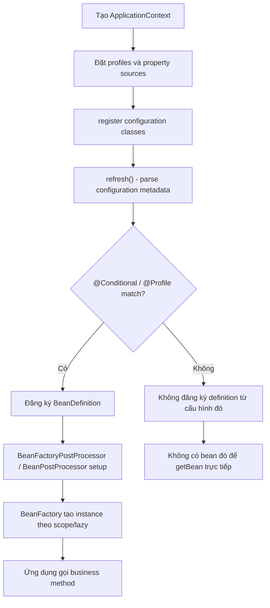
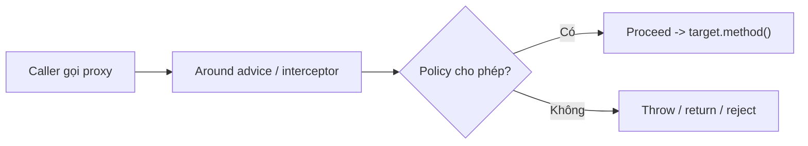

<a id="back-to-top"></a>

# Profile và điều kiện

## Menu
- [Nhóm bean theo môi trường bằng @Profile](#profiles-and-conditions-001)
- [Profile đang hoạt động và profile mặc định](#profiles-and-conditions-002)
- [Thiết lập profile bằng Environment và thuộc tính hệ thống](#profiles-and-conditions-003)
- [Biểu thức profile với !, &amp; và |](#profiles-and-conditions-004)
- [Áp dụng profile cho lớp cấu hình và từng phương thức @Bean](#profiles-and-conditions-005)
- [Quy tắc profile khi phương thức @Bean bị nạp chồng](#profiles-and-conditions-006)
- [Khai báo điều kiện tùy biến bằng @Conditional và Condition](#profiles-and-conditions-007)
- [ConditionContext, metadata và giới hạn truy cập bean sớm](#profiles-and-conditions-008)
- [Phân biệt điều kiện đăng ký bean với điều kiện chạy phương thức](#profiles-and-conditions-009)

## <a id="profiles-and-conditions-001">Nhóm bean theo môi trường bằng @Profile</a>

<details>
<summary>Xem chi tiết</summary>

# Nhóm bean theo môi trường bằng @Profile trong Spring Framework

## 1. Mục tiêu học tập

Ứng dụng Spring thường cần các cách triển khai khác nhau cho cùng một hợp đồng Java. Ở môi trường development có thể dùng kho lưu trữ in-memory, trong production dùng database; khi chạy integration test có thể dùng fake adapter, hoặc tại một vùng triển khai cần thêm thành phần xử lý tuân thủ riêng. **`@Profile`** cho phép Spring quyết định **những bean definitions nào được đăng ký** dựa trên thông tin môi trường tại thời điểm bootstrap.

Bài này thuộc nhóm **Profile và điều kiện**, Spring Framework Core Container. Bạn sẽ học cách:

1. Giải thích profile và điều kiện đăng ký bean, phân biệt với property values.
2. Đặt `@Profile` trên `@Component`, `@Configuration` và từng `@Bean` method.
3. Dùng mảng profile names (OR), biểu thức `!`, `&`, `|` và dấu ngoặc.
4. Hiểu **default profile** và phân biệt nó với bean không gắn `@Profile`.
5. Kích hoạt profile **trước `ApplicationContext.refresh()`** bằng `ConfigurableEnvironment`, system properties và công cụ test.
6. Chọn implementation theo môi trường với cùng bean name nhưng **Java method names khác nhau**.
7. Chẩn đoán thiếu bean, nhiều bean trùng type, trùng name, các profiles đồng thời active và cấu hình sai thứ tự.
8. Chạy ví dụ Java 17/Spring Framework 6.2 không cần Spring Boot và kiểm chứng kết quả.

## 2. Bean definition profile là gì?

Profile là một **nhóm logic của những bean definitions**. Khi đánh dấu một bean bằng `@Profile("dev")`, Spring chỉ coi definition đó là hợp lệ để đăng ký nếu `dev` đang active. Một bean **không** có profile condition vẫn có thể được đăng ký trong mọi môi trường, trừ khi có một điều kiện khác chặn.

~~~text
                ConfigurableEnvironment
                activeProfiles = ["dev"]
                          |
                          v
          Configuration/component registration
                          |
             +------------+------------+
             |            |            |
       @Profile("dev") @Profile("prod") Không @Profile
             |            |            |
             v            v            v
         Đăng ký      Bỏ qua        Đăng ký
             |                         |
             +------------+------------+
                          |
                          v
                 BeanFactory / DI
                          |
                          v
              Tạo và khởi tạo beans
~~~

**Điểm cốt lõi:** `@Profile` là điều kiện **registration time**, không phải cơ chế động để mỗi lần gọi method lại chọn implementation khác. Sau `refresh()`, đổi danh sách active profiles **không tự động tạo thêm/hủy bỏ** những singleton đã được chọn từ definitions trước đó.

### Phân biệt profile, property và condition

| Cơ chế | Câu hỏi nó trả lời | Ví dụ |
| --- | --- | --- |
| `@Profile` | Nhóm bean nào nên có trong context? | `InMemoryStore` ở dev; `SqlStore` ở prod |
| `Environment.getProperty` | Giá trị cấu hình là gì? | `db.url`, `http.timeout`, `retry.max` |
| `@Conditional` | Bean có khớp một điều kiện tổng quát không? | Có class trên classpath, custom rule |
| `@ConditionalOnProperty` (Spring Boot) | Property nào có/đạt giá trị mong đợi? | `feature.audit.enabled=true` |

Profile names do ứng dụng tự đặt như `dev`, `test`, `prod`, `eu-west` hoặc `metrics`. Đừng tạo mỗi profile chỉ để đổi một timeout hay password. Khi khác biệt chỉ là **giá trị**, configuration properties thường dễ bảo trì hơn; khi khác biệt là **loại infrastructure/adapter**, profile có ý nghĩa.

## 3. Đánh dấu cả @Configuration class

~~~java
@Configuration
@Profile("dev")
public class DevelopmentStorageConfig {

    @Bean
    public StorageClient storageClient() {
        return new InMemoryStorageClient();
    }

    @Bean
    public DataSeeder dataSeeder() {
        return new DevelopmentDataSeeder();
    }
}
~~~

Đây là **snippet cấu hình**, cần import `@Configuration`, `@Profile`, `@Bean` và định nghĩa `StorageClient`, `InMemoryStorageClient`, `DataSeeder`, `DevelopmentDataSeeder` ở ứng dụng thật.

Khi profile `dev` active, Spring xử lý `DevelopmentStorageConfig` và các `@Bean` factory methods. Khi `dev` không active, Spring bỏ qua configuration class: các bean definitions và `@Import` liên quan đến class ấy không được xử lý theo cách thông thường.

**Khác biệt với @Lazy:** `@Lazy` trì hoãn tạo **instance** nhưng vẫn giữ definition. `@Profile` không khớp thường khiến definition không tồn tại trong container, do đó lookup có thể báo `NoSuchBeanDefinitionException`.

### Cấp class và cấp method kết hợp

~~~java
@Configuration
@Profile("prod")
public class ProductionConfig {

    @Bean
    public AuditClient auditClient() {
        return new AuditClient();
    }

    @Bean
    @Profile("eu-west")
    public ComplianceAgent complianceAgent() {
        return new ComplianceAgent();
    }
}
~~~

Đây là snippet minh họa với các types do ứng dụng định nghĩa. Điều kiện `prod` ở **class** cần khớp để class được xử lý; riêng `complianceAgent` còn cần `eu-west` ở **method**. Hiệu quả là:

~~~text
Có ComplianceAgent
      =
Profile "prod" khớp
      AND
Profile "eu-west" khớp
~~~

Không suy ra rằng hai annotations trên **hai cấp khác nhau** tự động có ngữ nghĩa OR; class bị loại thì method không được xem xét như một định nghĩa hợp lệ.

## 4. @Profile trên @Component và các stereotype annotations

Class được phát hiện qua component scanning có thể mang `@Profile`:

~~~java
public interface NotificationGateway {
    void send(String message);
}
~~~

~~~java
@Service
@Profile("dev")
public class ConsoleNotificationGateway implements NotificationGateway {
    @Override
    public void send(String message) {
        System.out.println("DEV: " + message);
    }
}
~~~

~~~java
@Service
@Profile("prod")
public class SmtpNotificationGateway implements NotificationGateway {
    @Override
    public void send(String message) {
        // Gửi qua SMTP adapter đã cấu hình trong production.
    }
}
~~~

Đây là **các snippets minh họa**, mỗi public type cần file riêng, imports `@Service`, `@Profile` và SMTP adapter thật.

Khi chỉ `dev` active, injection qua interface `NotificationGateway` có thể chọn console implementation. Khi chỉ `prod` active, production implementation có mặt. Nhưng **phải có component scanning** hoặc registration phù hợp: chỉ đặt `@Service` hay `@Profile` lên một class không thuộc scan scope thì class đó chưa chắc được Spring biết đến.

### Khi nhiều profiles cùng active

Nếu `dev` và `prod` đồng thời active, cả hai implementations có thể xuất hiện với **bean names riêng**. Injection `NotificationGateway` nếu thiếu qualifier/primary có thể thất bại vì **nhiều candidates**. Spring không coi hai tên `dev`/`prod` là loại trừ nhau theo mặc định.

Đừng giải quyết bằng cách tự `getBean()` trong business method để đoán môi trường; hãy xác định rõ policy chọn implementation, dùng điều kiện không chồng lấn hoặc `@Qualifier`/`@Primary` khi đúng ý đồ.

## 5. @Profile trên từng @Bean method

Một `@Configuration` có thể chứa vài cách tạo cùng một service:

~~~java
@Configuration
public class StoreConfig {

    @Bean("store")
    @Profile("dev")
    public Store developerStore() {
        return new InMemoryStore();
    }

    @Bean("store")
    @Profile("prod")
    public Store productionStore() {
        return new RemoteStore();
    }
}
~~~

Đây là **snippet minh họa**, cần định nghĩa interface `Store` cùng hai implementations.

Kết quả:

- `dev` active → bean tên `store` từ `developerStore()`.
- `prod` active → bean tên `store` từ `productionStore()`.
- Không profile nào khớp → không có `store` từ hai methods, dependency bắt buộc có thể lỗi.
- Cả `dev` và `prod` active → **hai bean definitions có cùng name** có thể cạnh tranh. Đây là cấu hình bất ổn, không nên dựa vào thứ tự overriding để chọn implementation.

### Tại sao Java method names phải khác?

Spring Reference và Javadoc `@Profile` lưu ý trường hợp overloaded `@Bean` methods. Phản ví dụ:

~~~java
@Bean
@Profile("dev")
Store store() {
    return new InMemoryStore();
}

@Bean
@Profile("prod")
Store store(Environment environment) {
    return new RemoteStore();
}
~~~

Đây là **đoạn code không nên dùng để chọn profile**. Khi `@Bean` methods overload cùng **Java method name** và khai báo profile conditions khác nhau, Spring chỉ xem điều kiện profile của khai báo đầu tiên theo quy tắc overload; **không** dùng profile để chọn argument signature phù hợp. Factory method overloading được giải quyết theo cơ chế constructor/factory resolution.

**Cách đúng:** dùng `developerStore()` và `productionStore()` (Java names khác nhau), nhưng cho cùng bean name `@Bean("store")` như ví dụ ban đầu.

### @Bean("store") và @Qualifier

Tên bean `store` là một phần hợp đồng lookup/injection. Nếu bạn thay Java method name, sử dụng `@Bean(name = "store")` giúp consumers vẫn phụ thuộc vào bean name ổn định. Khi có nhiều beans cùng interface nhưng **khác names**, dùng `@Qualifier("store")` để chọn đúng candidate. Khi trùng cùng name, cần sửa điều kiện registration, không chỉ thêm qualifier.

## 6. Mảng profile names là OR

~~~java
@Component
@Profile({"dev", "test"})
public class DiagnosticsPanel {
}
~~~

Annotation trên khớp khi **dev HOẶC test** active. Nó không yêu cầu cả hai cùng active.

| Active profiles | `@Profile({"dev","test"})` |
| --- | --- |
| Không có dev/test | Không khớp |
| dev | Khớp |
| test | Khớp |
| dev, test | Khớp |
| prod | Không khớp |

Một nhầm lẫn nguy hiểm:

~~~java
@Profile({"dev", "!prod"})
@Component
public class DebugTools {
}
~~~

Đây là **OR** giữa dev và NOT prod, nghĩa là với **test** active nhưng không có dev/prod, bean **vẫn được đăng ký** do `!prod` đúng.

Nếu muốn dev **và** không prod:

~~~java
@Profile("dev & !prod")
@Component
public class DevOnlyTools {
}
~~~

Đừng dùng mảng hai values rồi suy luận có phép AND.

## 7. Biểu thức profile: !, &, | và dấu ngoặc

Spring Framework hỗ trợ:

- `!`: NOT, ví dụ `@Profile("!prod")`.
- `&`: AND, ví dụ `@Profile("prod & eu-west")`.
- `|`: OR, ví dụ `@Profile("dev | test")`.
- Dấu ngoặc: nhóm expressions, ví dụ `@Profile("prod & (eu-west | us-east)")`.

Các expressions được đánh giá bằng logic tương đương `Profiles.of(String...)`.

~~~java
@Profile("prod & eu-west")
@Component
public class EuropeanAuditAdapter {
}
~~~

Chỉ được đăng ký khi **cả prod và eu-west** active.

~~~java
@Profile("(dev | test) & !cloud")
@Component
public class OfflineStub {
}
~~~

Được đăng ký nếu (dev hoặc test) active, nhưng cloud không active.

### Không được trộn AND và OR mà thiếu ngoặc

~~~java
@Profile("prod & eu-west | us-east")
~~~

là một profile expression **không hợp lệ** theo cú pháp Spring. Viết:

~~~java
@Profile("prod & (eu-west | us-east)")
~~~

Không tự áp dụng precedence của Java (`&&` trước `||`) để giải nghĩa expression Spring sai cú pháp. Với điều kiện dài, tạo custom composed annotation hoặc refactor groups để team dễ đọc.

### OR ở nhiều nơi khác nhau

- `@Profile({"dev","test"})`: OR giữa các entries.
- `@Profile("dev | test")`: OR trong một expression.
- `@Profile("dev & test")`: AND trong một expression.
- Class `@Profile("prod")` và method `@Profile("metrics")`: class cần khớp trước, method cần khớp thêm → như AND giữa hai tầng.

## 8. Default profile: chỉ là fallback

Nếu không có **active profiles** nào được cấu hình, Spring sử dụng **default profiles**, với tên mặc định là `default`.

~~~java
@Configuration
@Profile("default")
public class DefaultStoreConfig {
    @Bean
    public Store store() {
        return new InMemoryStore();
    }
}
~~~

Đây là snippet minh họa. Khi không active profile nào khác, Spring có thể chọn `default` để đăng ký definition này.

| Active profiles | Fallback default? | `@Profile("default")` |
| --- | --- | --- |
| Không có active | Có | Khớp |
| dev | Không | Không khớp |
| prod | Không | Không khớp |
| dev, prod | Không | Không khớp |
| default được active tường minh | Không cần fallback | Khớp |

**Không nhầm với một bean không gắn `@Profile`.** Bean không có profile condition vẫn đủ điều kiện được đăng ký dù có dev, prod hay default, trong khi `@Profile("default")` chỉ được chọn khi profile default thực sự có hiệu lực.

### Thay đổi tên default

~~~java
ConfigurableEnvironment environment = context.getEnvironment();
environment.setDefaultProfiles("local");
~~~

Đây là snippet thuộc bootstrap, cần biến `context` và import thích hợp. Nếu không có active profile, giờ `local` làm fallback. Những beans `@Profile("default")` không còn mặc nhiên hợp lệ.

Cũng có property `spring.profiles.default`. Tên default có thể được cấu hình; đừng giả định nó luôn là `default` khi ứng dụng đã tùy biến.

## 9. Cách kích hoạt profile

### 9.1. Cấu hình Environment trước refresh()

~~~java
AnnotationConfigApplicationContext context =
        new AnnotationConfigApplicationContext();

context.getEnvironment().setActiveProfiles("dev");

context.register(AppConfig.class, DevConfig.class, ProdConfig.class);
context.refresh();

try {
    // Sử dụng beans đã chọn.
} finally {
    context.close();
}
~~~

Đây là snippet, cần các configuration classes phù hợp.

**Thứ tự rất quan trọng.** Khi `refresh()` chạy, container xử lý conditional bean definitions. Đặt `setActiveProfiles(...)` **sau** lần refresh không tự đăng ký lại những definitions bị loại bỏ. Constructor `new AnnotationConfigApplicationContext(AppConfig.class)` tự thực hiện refresh, vì vậy không thể đặt profile sau lời gọi constructor ấy nếu muốn ảnh hưởng đến quá trình chọn beans.

### 9.2. Active nhiều profiles

~~~java
environment.setActiveProfiles("prod", "eu-west");
~~~

Điều này hợp lệ: profile names không phải một enum có tính loại trừ. Có thể kích hoạt environment chính và các vùng/capabilities cùng lúc. Chính vì vậy cần kiểm tra **tổ hợp** profiles có thể vô tình kích hoạt hai beans cùng name/type.

### 9.3. Property spring.profiles.active

Trong Spring Core, `spring.profiles.active` có thể được cung cấp qua JVM system property hoặc property sources thích hợp:

~~~bash
java -Dspring.profiles.active=dev -jar application.jar
~~~

~~~bash
java -Dspring.profiles.active=prod,eu-west -jar application.jar
~~~

Các lệnh này minh họa **khi bạn có một executable application.jar**, không phải tên JAR mặc định của ví dụ Maven ở mục 13.

Trong shell Bash:

~~~bash
SPRING_PROFILES_ACTIVE=dev java -jar application.jar
~~~

Đây là cú pháp shell Unix; Windows PowerShell dùng cách đặt biến môi trường khác. Spring có cơ chế tra system environment, còn Spring Boot bổ sung ConfigData/command line/property precedence tùy phiên bản.

### 9.4. Kiểm tra trạng thái

~~~java
String[] active = environment.getActiveProfiles();
String[] defaults = environment.getDefaultProfiles();

boolean production = environment.acceptsProfiles(
        Profiles.of("prod"));
~~~

Đây là snippet, cần import `Profiles`. `getActiveProfiles()` cho biết active profiles hiện tại; nếu không có active, `getDefaultProfiles()` là nguồn fallback. Đừng dùng `containsProperty("spring.profiles.active")` làm phép kiểm tra một profile cụ thể.

## 10. @Profile và @Conditional

`@Profile` được xây trên infrastructure **`@Conditional`** của Spring. Nó là một cách diễn đạt sẵn cho điều kiện dựa trên Environment profile.

Ví dụ minh họa hai điều kiện phối hợp:

~~~java
@Bean
@Profile("prod")
@Conditional(RegionalFeatureCondition.class)
public AuditClient auditClient() {
    return new AuditClient();
}
~~~

Snippet yêu cầu `RegionalFeatureCondition implements Condition` và `AuditClient` do ứng dụng định nghĩa. Cả profile và custom condition phải phù hợp để bean được đăng ký.

Điều kiện profile không nên bị dùng quá mức cho mọi flag. Trong Spring Boot, `@ConditionalOnProperty` phù hợp hơn khi ý đồ là “chỉ khi một property bằng true”. Annotation này **không thuộc Spring Framework Core thuần**, nên ví dụ runnable không dựa vào Boot.

### Custom composed annotation

~~~java
import java.lang.annotation.ElementType;
import java.lang.annotation.Retention;
import java.lang.annotation.RetentionPolicy;
import java.lang.annotation.Target;
import org.springframework.context.annotation.Profile;

@Target({ElementType.TYPE, ElementType.METHOD})
@Retention(RetentionPolicy.RUNTIME)
@Profile("prod")
public @interface ProductionOnly {
}
~~~

Đây là annotation Java hợp lệ trong file `ProductionOnly.java` với package phù hợp. Sau đó có thể dùng `@ProductionOnly` trên component/configuration hoặc bean method. Cách này giúp team diễn đạt policy thường lặp lại mà không phải viết nhiều chuỗi `"prod"`.

## 11. Những lỗi dependency injection do profile

### 11.1. Không có bean

Nếu service yêu cầu `Store` nhưng không definition nào thỏa active profiles, Spring có thể ném `NoSuchBeanDefinitionException` hoặc `UnsatisfiedDependencyException` khi tạo service bắt buộc.

Đừng sửa bằng cách gọi `new RemoteStore()` từ business service khi thiếu bean. Điều đó phá thống nhất dependency injection và có thể dùng sai môi trường. Thay vào đó xác định:

1. Profiles nào đang active.
2. `@Profile` nào đã gắn lên class/method.
3. Bean có được scan/register không.
4. Có fallback hợp lý khi không có active profile không.

### 11.2. Nhiều bean cùng interface

Giả sử cả dev và prod đều active và hai component implementations có **khác bean names**. Injection `Store` có thể ambiguous. `@Qualifier` hoặc `@Primary` chỉ nên được dùng nếu thực sự muốn nhiều implementations tồn tại và có một lựa chọn ưu tiên.

Nếu cả hai methods khai báo **cùng bean name**, cần sửa cấu hình vì có khả năng xung đột/overriding. Default bean overriding behavior có thể khác giữa Spring Framework thuần và Spring Boot, không nên dựa vào thứ tự để đoán bean cuối cùng.

### 11.3. @Profile khác @Primary và @Lazy

- `@Profile`: có đăng ký definition hay không.
- `@Primary`: chọn candidate ưu tiên từ tập beans đã đăng ký.
- `@Qualifier`: xác định candidate cần inject bằng qualifier/name.
- `@Lazy`: trì hoãn instantiate bean đã có definition.

Một definition bị loại vì profile không khớp không tự quay lại chỉ vì `@Primary` hoặc `@Lazy`.

## 12. Chọn scope áp dụng profile phù hợp

**Áp @Profile trên class** khi cả nhóm bean definitions cùng thuộc một môi trường, như `DevInfrastructureConfig` có data source/clients/diagnostic components. Các definitions của class bị bỏ qua cùng nhau khi profile không khớp.

**Áp @Profile trên @Bean method** khi chỉ cần thay một hoặc hai adapters trong cùng configuration class, hoặc muốn giữ shared beans vô điều kiện. Ví dụ:

~~~java
@Configuration
public class FeatureConfig {

    @Bean
    public Clock clock() {
        return Clock.systemUTC();
    }

    @Bean
    @Profile("dev")
    public NotificationGateway localGateway() {
        return new ConsoleGateway();
    }

    @Bean
    @Profile("prod")
    public NotificationGateway remoteGateway() {
        return new RemoteGateway();
    }
}
~~~

Đây là snippets trong một configuration class, cần import `java.time.Clock` và types gateway đã khai báo. Bean `clock` không có profile condition nên vẫn được đăng ký trong cả dev/prod; chỉ hai gateway methods được lọc.

**Áp @Profile trên @Component class** khi implementations tự đăng ký qua component scanning. Nếu team có nhiều modules cấu hình phức tạp, dùng `@Configuration` grouping thường giúp audit các dependencies theo môi trường rõ hơn.

## 13. Ví dụ Maven/Java 17 chạy độc lập với bốn môi trường

Chương trình sau sử dụng Java 17, Spring Framework 6.2.9. Nó tạo **bốn ApplicationContexts tách biệt**, mỗi context khai báo profiles **trước khi refresh**. Không có Spring Boot, database hoặc web server.

### 13.1. Cấu trúc dự án

~~~text
spring-profile-demo/
├── pom.xml
└── src/main/java/demo/
    └── ProfileDemo.java
~~~

### 13.2. pom.xml

~~~xml
<?xml version="1.0" encoding="UTF-8"?>
<project xmlns="http://maven.apache.org/POM/4.0.0"
         xmlns:xsi="http://www.w3.org/2001/XMLSchema-instance"
         xsi:schemaLocation="http://maven.apache.org/xsd/maven-4.0.0 https://maven.apache.org/xsd/maven-4.0.0.xsd">
    <modelVersion>4.0.0</modelVersion>
    <groupId>demo</groupId>
    <artifactId>spring-profile-demo</artifactId>
    <version>1.0.0</version>

    <properties>
        <maven.compiler.release>17</maven.compiler.release>
        <project.build.sourceEncoding>UTF-8</project.build.sourceEncoding>
    </properties>

    <dependencies>
        <dependency>
            <groupId>org.springframework</groupId>
            <artifactId>spring-context</artifactId>
            <version>6.2.9</version>
        </dependency>
    </dependencies>

    <build>
        <plugins>
            <plugin>
                <groupId>org.apache.maven.plugins</groupId>
                <artifactId>maven-compiler-plugin</artifactId>
                <version>3.13.0</version>
            </plugin>
            <plugin>
                <groupId>org.codehaus.mojo</groupId>
                <artifactId>exec-maven-plugin</artifactId>
                <version>3.5.0</version>
            </plugin>
        </plugins>
    </build>
</project>
~~~

### 13.3. src/main/java/demo/ProfileDemo.java

~~~java
package demo;

import java.util.Arrays;
import java.util.TreeSet;

import org.springframework.context.annotation.AnnotationConfigApplicationContext;
import org.springframework.context.annotation.Bean;
import org.springframework.context.annotation.Configuration;
import org.springframework.context.annotation.Profile;
import org.springframework.core.env.ConfigurableEnvironment;
import org.springframework.core.env.StandardEnvironment;

public class ProfileDemo {

    public static void main(String[] args) {
        inspect("no-active");
        inspect("dev", "dev");
        inspect("prod", "prod");
        inspect("prod-eu", "prod", "eu-west");
    }

    private static void inspect(String label, String... activeProfiles) {
        try (AnnotationConfigApplicationContext context =
                     new AnnotationConfigApplicationContext()) {

            ConfigurableEnvironment environment = context.getEnvironment();

            // Chỉ trong ví dụ: loại external system properties/environment
            // để các cases có kết quả xác định trên máy người học.
            environment.getPropertySources().remove(
                    StandardEnvironment.SYSTEM_PROPERTIES_PROPERTY_SOURCE_NAME);
            environment.getPropertySources().remove(
                    StandardEnvironment.SYSTEM_ENVIRONMENT_PROPERTY_SOURCE_NAME);

            environment.setActiveProfiles(activeProfiles);

            // register sau khi set profiles và refresh sau register.
            context.register(ProfileConfig.class);
            context.refresh();

            Store store = context.getBean("store", Store.class);
            TreeSet<String> flagNames = new TreeSet<>(
                    context.getBeansOfType(FeatureFlag.class).keySet());

            System.out.println(
                    "case=" + label
                    + " active=" + Arrays.toString(
                            environment.getActiveProfiles())
                    + " store=" + store.source()
                    + " flags=" + flagNames);
        }
    }

    public interface Store {
        String source();
    }

    public record NamedStore(String value) implements Store {
        @Override
        public String source() {
            return value;
        }
    }

    public record FeatureFlag(String value) {
    }

    @Configuration(proxyBeanMethods = false)
    public static class ProfileConfig {

        @Bean("store")
        @Profile("default")
        public Store defaultStore() {
            return new NamedStore("default-store");
        }

        @Bean("store")
        @Profile("dev")
        public Store developerStore() {
            return new NamedStore("in-memory-store");
        }

        @Bean("store")
        @Profile("prod")
        public Store productionStore() {
            return new NamedStore("remote-store");
        }

        @Bean
        @Profile({"dev", "test"})
        public FeatureFlag debugFlag() {
            return new FeatureFlag("debug");
        }

        @Bean
        @Profile("!prod")
        public FeatureFlag nonProdFlag() {
            return new FeatureFlag("safe-mode");
        }

        @Bean
        @Profile("prod & eu-west")
        public FeatureFlag euAuditFlag() {
            return new FeatureFlag("eu-audit");
        }
    }
}
~~~

### 13.4. Lệnh chạy

Trong thư mục `spring-profile-demo`:

~~~bash
java -version
mvn -version
mvn -q compile exec:java -Dexec.mainClass=demo.ProfileDemo
~~~

Stdout dự kiến của chương trình (không tính log riêng của Maven/Spring):

~~~text
case=no-active active=[] store=default-store flags=[nonProdFlag]
case=dev active=[dev] store=in-memory-store flags=[debugFlag, nonProdFlag]
case=prod active=[prod] store=remote-store flags=[]
case=prod-eu active=[prod, eu-west] store=remote-store flags=[euAuditFlag]
~~~

### 13.5. Giải thích từng tình huống

**No active profile:** `environment.setActiveProfiles()` nhận mảng rỗng, không có `spring.profiles.active` từ JVM/OS do demo cố ý bỏ hai sources này; Spring sử dụng default profile `default`. Vì vậy `defaultStore` đăng ký. `!prod` cũng khớp nên có `nonProdFlag`. `debugFlag` và `euAuditFlag` không khớp.

**Dev:** `developerStore` đăng ký vì dev active, còn default không là fallback. `debugFlag` khớp vì mảng profile names có OR, `nonProdFlag` khớp do prod không active.

**Prod:** `productionStore` được đăng ký; `debugFlag` không khớp dev/test, `nonProdFlag` sai vì prod active, `euAuditFlag` cũng không khớp vì thiếu eu-west.

**Prod + eu-west:** production store vẫn có mặt, `euAuditFlag` được đăng ký vì hai profiles đều active. Dùng `TreeSet` đảm bảo thứ tự names ổn định trong stdout.

### 13.6. Vì sao bỏ systemProperties/systemEnvironment trong demo?

Nếu máy người học có `-Dspring.profiles.active=prod` hoặc biến môi trường `SPRING_PROFILES_ACTIVE` từ một project khác, case no-active có thể không còn thật sự dùng fallback default. Demo loại hai default sources đó **chỉ để cô lập thí nghiệm**.

Trong production, không nên tùy tiện xóa các nguồn môi trường; Spring cần đọc cấu hình do deployment cung cấp. Khi dùng application thật, hãy thiết kế profile activation và property precedence tường minh.

### 13.7. Các thí nghiệm tự làm

1. Đổi `@Profile("dev")` trên `developerStore` thành `@Profile("test")`: case dev thiếu `store`; lookup báo lỗi thay vì tự chọn prod.
2. Thử `inspect("test","test")`: `debugFlag` có mặt nhưng không có Store variant test; minh họa mỗi bean phải có điều kiện phù hợp riêng.
3. Thử `inspect("dev-prod","dev","prod")`: cả hai methods tên bean `store` cùng khớp; đây là conflict không nên dựa vào bean overriding để chọn ngẫu nhiên.
4. Đổi `@Profile("prod & eu-west")` thành `@Profile("prod | eu-west")`: flag xuất hiện khi một trong hai active.
5. Đổi `@Profile({"dev","test"})` thành `@Profile("dev & test")`: case dev đơn độc không còn debug flag.
6. Gắn `@Profile("prod")` lên cả class `ProfileConfig`: no-active/dev sẽ không được xử lý, cho thấy class-level condition chặn cả methods bên trong.
7. Dùng `environment.setDefaultProfiles("local")` trước refresh và đổi `defaultStore` thành `@Profile("local")`: fallback mới được chọn khi không active.
8. Chuyển sang `@Component` implementations cùng scan scope rồi test trường hợp hai profiles đồng thời active và `NoUniqueBeanDefinitionException`.

## 14. Spring Boot: profile-specific config khác @Profile

Spring Boot thường có `application.yml`, `application-dev.yml`, `application-prod.yml` và hỗ trợ configuration data gắn với profiles. Các file này cung cấp **property values**, còn `@Profile` chọn **bean definitions**.

Ví dụ Boot configuration:

~~~properties
spring.profiles.active=dev
~~~

Hoặc command line:

~~~bash
java -jar app.jar --spring.profiles.active=prod
~~~

`app.jar` ở đây là executable Boot JAR ví dụ, không phải file tạo bởi Maven demo phía trên.

Spring Boot có thêm:

- Profile-specific property files.
- Profile groups (`spring.profiles.group.*`).
- Thứ tự ưu tiên giữa config files, environment, system properties và command-line arguments.
- `@ConditionalOnProperty`/`@ConditionalOnClass` và auto-configuration conditions.

Đây là **khả năng của Spring Boot**, không phải toàn bộ contract của `@Profile` trong Spring Framework Core thuần. Plain `AnnotationConfigApplicationContext` sẽ không tự nạp `application-prod.yml` theo convention Boot.

Khi dùng ConfigData trong Boot, phải đặt `spring.profiles.active`/`spring.profiles.default` ở vị trí configuration hợp lệ; không tùy tiện đặt trong documents chỉ được bật bởi profile-specific activation nếu Boot không hỗ trợ.

## 15. Kiểm thử profile conditions

### 15.1. Kiểm tra profile expression không cần tạo context

~~~java
StandardEnvironment environment = new StandardEnvironment();
environment.setActiveProfiles("prod", "eu-west");

boolean match = environment.acceptsProfiles(
        Profiles.of("prod & eu-west"));

if (!match) {
    throw new AssertionError("Expected two matching profiles");
}
~~~

Đây là snippet Java cần imports `StandardEnvironment`, `Profiles`. Nó kiểm tra expression matching nhưng không chứng minh bean class/method đã được đăng ký.

### 15.2. Integration test với context thật

Chạy bốn cases của mục 13, hoặc assert:

~~~java
Store store = context.getBean("store", Store.class);

if (!"remote-store".equals(store.source())) {
    throw new AssertionError("Wrong production store");
}
if (!context.containsBean("euAuditFlag")) {
    throw new AssertionError("Expected EU audit bean");
}
~~~

Đây là snippet trong method có `context` đã refresh với `prod` và `eu-west`, import đúng `Store` nested type của ví dụ.

### 15.3. Spring TestContext và @ActiveProfiles

~~~java
@SpringJUnitConfig(ProfileDemo.ProfileConfig.class)
@ActiveProfiles("dev")
class DevelopmentProfileTest {

    @Autowired
    ProfileDemo.Store store;

    @Test
    void selectsMemoryStore() {
        assertEquals("in-memory-store", store.source());
    }
}
~~~

Đây là **test snippet**, cần `spring-test`, JUnit Jupiter, các imports `@SpringJUnitConfig`, `@ActiveProfiles`, `@Autowired`, `@Test` và static `assertEquals`. Không chạy độc lập từ pom.xml của ví dụ Spring Core vì pom đó không bao gồm dependencies test.

### 15.4. Các cases nên có trong test suite

| Ca | Điều cần xác minh |
| --- | --- |
| Không active profiles | `default` được dùng đúng |
| dev | Dev implementation và debug tools có mặt |
| prod | Prod implementation, dev tools không có |
| prod + eu-west | Điều kiện AND khớp |
| test | Array-based OR match, nhưng Store có thể thiếu nếu không khai báo |
| dev + prod | Conflict được phát hiện, không chọn ngẫu nhiên |
| Class-level + method-level | Phải khớp cả hai |
| NOT profile | `!prod` khớp khi không có prod |
| Syntax sai | Thiếu ngoặc trong AND/OR được phát hiện |
| Context đã refresh | Đổi profile sau refresh không tự thay đổi definitions |
| Component ngoài scan | Không tự đăng ký chỉ vì có `@Profile` |
| @Bean overloaded methods | Không dựa vào profile để chọn method overload |

Trong Spring TestContext, có thể có **context caching**. Tests có profiles khác nhau thường cần contexts riêng theo cache key; đừng trực tiếp đổi profile trên một context đã refresh rồi mong bean selection được chạy lại.

## 16. Các lỗi thường gặp và cách chẩn đoán

| Vấn đề | Nguyên nhân điển hình | Cách giải quyết |
| --- | --- | --- |
| Bean dev không xuất hiện | Dev không active hoặc condition đặt sai | Kiểm tra `getActiveProfiles()` và annotation |
| Đã set dev nhưng không thấy bean | Set profile sau `refresh()` | Set profile trước registration/refresh |
| Bean @Profile("default") không tạo | Đã active profile khác | Hiểu default chỉ là fallback khi không active |
| Bean không @Profile biến mất | Configuration class chứa nó có @Profile không khớp | Xem điều kiện ở class cha |
| Bean có annotation nhưng vẫn không tồn tại | Không nằm trong component scan/registration scope | Đăng ký/scan đúng |
| Inject interface báo NoSuchBeanDefinitionException | Không implementation nào được đăng ký | Kiểm tra variants và fallback |
| Inject interface báo NoUniqueBeanDefinitionException | Nhiều variants cùng active với khác names | Chọn qualifier/primary hoặc mutually-exclusive profiles |
| Hai @Bean variants cùng name gây conflict | Conditions overlap | Thiết kế names/điều kiện không chồng lấn |
| Profile array cho kết quả bất ngờ | `@Profile({"dev","!prod"})` là OR | Dùng `"dev & !prod"` |
| `prod & eu | us` không parse | AND/OR trộn không ngoặc | Viết `prod & (eu | us)` |
| Method overload không chọn đúng profile | Overloaded @Bean methods không chọn bằng profile signatures | Khai báo Java method names khác nhau |
| Runtime đổi active profile mà bean cũ vẫn còn | `@Profile` chỉ tác động bootstrap | Tạo context mới hoặc có runtime router riêng |
| Boot YAML khác Java annotation | ConfigData precedence hoặc active profile ở source khác | Kiểm tra nguồn config trong runtime thực |
| Dev mock bean bị dùng trên prod | Chồng lấn profile conditions hoặc bean overriding | Viết integration tests cho các profile combinations |
| Bean thường bị coi là default-only | Nhầm “no @Profile” với `@Profile("default")` | Bean không @Profile đủ điều kiện ở mọi profile |

### Quy trình điều tra

1. Log **tên active profiles** (không phải secrets) từ context thật.
2. Kiểm tra **default profiles** khi danh sách active rỗng.
3. Đọc điều kiện annotation chính xác: array OR, expression `&`/`|`/`!`.
4. Xác định điều kiện ở class, method hoặc cả hai.
5. Kiểm tra class có được scan/register thật không.
6. Kiểm tra profile được cấu hình trước `refresh()`.
7. Phân biệt thiếu bean name/type với nhiều candidates.
8. Kiểm tra bean overriding và các conditions chồng lấn.
9. Trong Spring Boot, kiểm tra ConfigData/property precedence đúng version.
10. Test cả happy path lẫn tình huống profile combinations không mong muốn.

## 17. Checklist áp dụng

- [ ] Dùng profile để nhóm **bean definitions**, không làm switch động cho method calls.
- [ ] Đặt `@Profile` trên `@Configuration` nếu cả nhóm beans cùng điều kiện.
- [ ] Đặt `@Profile` trên `@Bean` nếu chỉ muốn lọc một factory method.
- [ ] Với variants chung bean name, dùng **Java method names khác nhau**.
- [ ] Hiểu mảng names là OR, expression `&` mới là AND.
- [ ] Thêm ngoặc khi trộn AND/OR.
- [ ] Cấu hình default phù hợp hoặc fail fast có chủ ý khi không có Store.
- [ ] Đừng gắn `@Profile("default")` cho bean cần có mọi môi trường.
- [ ] Set active profiles trước `refresh()`.
- [ ] Không dựa vào automatic bean overriding để chọn implementation.
- [ ] Test khi nhiều profiles active.
- [ ] Dùng `@ActiveProfiles` trong Spring TestContext.
- [ ] Tách Spring Core profile selection khỏi Spring Boot ConfigData features.
- [ ] Dùng properties cho differences chỉ là timeout, URL, secret values.

## 18. Câu hỏi tự kiểm tra

**1. `@Profile` quyết định bean được đăng ký ở thời điểm nào?**  
Trong giai đoạn đọc/đăng ký bean definitions của container, không phải một lần mỗi method call.

**2. `@Profile({"dev","test"})` là AND hay OR?**  
OR, chỉ cần một trong hai active.

**3. Muốn dev nhưng không prod phải viết sao?**  
`@Profile("dev & !prod")`.

**4. Vì sao không dùng overloaded Java @Bean methods với profiles khác nhau?**  
Spring không dùng các conditions ấy để chọn overload; hãy dùng method names khác nhau và cùng `@Bean("beanName")`.

**5. `@Profile("default")` có luôn khớp khi prod active không?**  
Không, trừ khi default được active tường minh. Fallback chỉ được dùng khi không có active profile.

**6. Một bean không gắn `@Profile` có bị giới hạn vào default profile không?**  
Không. Nó đủ điều kiện trong mọi profile nếu không bị điều kiện khác chặn.

**7. Class có `@Profile("prod")`, method có `@Profile("eu-west")`. Khi nào method được đăng ký?**  
Khi cả điều kiện class và method đều khớp.

**8. Chuyển từ dev sang prod bằng `setActiveProfiles` sau refresh có cập nhật singleton cũ không?**  
Không. Cần context mới hoặc dynamic routing thiết kế riêng.

**9. Vì sao active cả dev và prod nguy hiểm?**  
Hai implementations có thể đồng thời hợp lệ, gây ambiguity hoặc conflict khi dùng cùng bean name.

**10. `@Profile` và `@ConditionalOnProperty` có cùng phạm vi không?**  
Không. `@Profile` thuộc Spring Core và dựa vào profiles; `@ConditionalOnProperty` là tính năng Spring Boot dựa vào giá trị property.

**11. Dùng `@ActiveProfiles` ở đâu?**  
Trong integration tests dựa vào Spring TestContext Framework.

**12. Nên tạo profile riêng để đổi mỗi retry timeout không?**  
Thông thường không. Dùng config property khi chỉ thay dữ liệu, và profile khi cần chọn definitions/implementations khác nhau.

## Tài liệu chính thức

- [Spring Framework Reference — Environment Abstraction và Bean Definition Profiles](https://docs.spring.io/spring-framework/reference/core/beans/environment.html): `@Profile` trên class/method, biểu thức, kích hoạt và default profiles.
- [Spring Framework Javadoc — @Profile](https://docs.spring.io/spring-framework/docs/6.2.9/javadoc-api/org/springframework/context/annotation/Profile.html): annotation targets, fallback, overload @Bean caveat.
- [Spring Framework Javadoc — Profiles](https://docs.spring.io/spring-framework/docs/6.2.9/javadoc-api/org/springframework/core/env/Profiles.html): profile expressions.
- [Spring Framework Javadoc — ConfigurableEnvironment](https://docs.spring.io/spring-framework/docs/6.2.9/javadoc-api/org/springframework/core/env/ConfigurableEnvironment.html): `setActiveProfiles` và `setDefaultProfiles`.
- [Spring Framework Reference — @Bean](https://docs.spring.io/spring-framework/reference/core/beans/java/bean-annotation.html).
- [Spring Framework Test Reference — Context Configuration with Environment Profiles](https://docs.spring.io/spring-framework/reference/testing/testcontext-framework/ctx-management/env-profiles.html): `@ActiveProfiles`.
- [Spring Boot Reference — Profiles](https://docs.spring.io/spring-boot/reference/features/profiles.html): configuration files và profile groups trong Boot.


</details>

- [Quay lại đầu trang](#back-to-top)

---

## <a id="profiles-and-conditions-002">Profile đang hoạt động và profile mặc định</a>

<details>
<summary>Xem chi tiết</summary>

# Profile đang hoạt động và profile mặc định trong Spring Core Container

## 1. Bài toán: chọn cấu hình bean theo môi trường

Một ứng dụng Spring có thể cần cùng interface nhưng triển khai khác nhau khi chạy ở máy lập trình, máy kiểm thử, staging hoặc production. Chẳng hạn, ở môi trường local dùng một `MailSender` giả không gửi email; ở production dùng dịch vụ gửi thật. Cũng có những bean chỉ nên tồn tại khi tính năng hoặc hạ tầng tương ứng được bật.

Spring Framework hỗ trợ **bean definition profiles**: tên logic như `dev`, `test`, `cloud`, `prod` dùng để quyết định **một bean definition có được đăng ký khi container bootstrap hay không**. Trọng tâm bài này là hai tập profile mà `Environment` quản lý:

- **Active profiles**: các profile được **kích hoạt tường minh**, thường qua `spring.profiles.active` hoặc `ConfigurableEnvironment.setActiveProfiles(...)`.
- **Default profiles**: những profile được dùng để xét điều kiện **chỉ khi không có active profile nào được kích hoạt**. Tập mặc định ban đầu chứa tên đặc biệt **`default`**, và có thể thay đổi qua `spring.profiles.default` hoặc `setDefaultProfiles(...)`.

> **Quy tắc quan trọng nhất:** Nếu `active = []`, Spring đánh giá các điều kiện profile dựa trên tập `defaultProfiles`. Nếu `active` có ít nhất một tên, tập `defaultProfiles` **không được cộng thêm** vào danh sách active để đánh giá `@Profile`.

Ví dụ theo tên mặc định ban đầu:

```text
activeProfiles = []
defaultProfiles = ["default"]
=> @Profile("default") được đăng ký
=> @Profile("dev") bị bỏ qua

activeProfiles = ["dev"]
defaultProfiles = ["default"]
=> @Profile("dev") được đăng ký
=> @Profile("default") bị bỏ qua
```

Giá trị thực tế có thể chịu ảnh hưởng từ JVM system properties, OS environment variables, cấu hình context, profile được active bởi code hoặc tích hợp framework khác. Khi chẩn đoán, cần nhìn vào **`Environment` của chính context đang chạy**, không đoán từ tên máy, tên file hoặc một biến môi trường ngoài tiến trình.

## 2. Phân biệt profile name, Environment và PropertySource

`Environment` là abstraction trung tâm cho **profiles** và **properties**. Một profile là **nhãn điều kiện** để lựa chọn bean definitions; bản thân profile không phải object Java hoặc scope.

| Thành phần | Ý nghĩa | API hoặc ví dụ |
|---|---|---|
| Profile name | Nhãn logic của nhóm definitions | `dev`, `test`, `prod`, `cloud` |
| Active profile | Nhãn được bật tường minh | `spring.profiles.active=dev` |
| Default profile | Nhãn fallback khi **không** có active profile | Ban đầu `default`; có thể đổi thành `local` |
| `Environment` | Đọc active/default profiles và properties | `getActiveProfiles()`, `getDefaultProfiles()` |
| `ConfigurableEnvironment` | Thay tập profiles và property sources | `setActiveProfiles(...)`, `setDefaultProfiles(...)` |
| `@Profile` | Điều kiện để Spring đăng ký component/configuration/bean definition | `@Profile("dev")` |
| `Profiles` | Biểu thức predicate kiểm tra profile | `Profiles.of("dev & cloud")` |
| `PropertySource` | Nguồn `spring.profiles.active`, `spring.profiles.default` và các giá trị khác | JVM properties, OS environment, file, map |
| `@Conditional` | Cơ chế conditional registration tổng quát | `@Profile` là một điều kiện chuyên biệt |

Hai mảng “properties” và “profiles” liên hệ với nhau nhưng không đồng nhất: **property** `spring.profiles.active` cho phép cấu hình **profile set**, còn property `service.timeout` chỉ là một giá trị ứng dụng nếu không có condition nào dùng nó.

Một profile tên `prod` không tự tạo database connection production. Chỉ khi bạn khai báo bean/configuration phù hợp với profile đó, Spring mới có cơ sở tạo các beans tương ứng.

## 3. Hợp đồng active profiles và default profiles

Ba method nền tảng:

```java
String[] active = environment.getActiveProfiles();
String[] defaults = environment.getDefaultProfiles();
boolean matches = environment.acceptsProfiles(Profiles.of("dev"));
```

Đây là **mã minh họa theo ngữ cảnh**, cần import `org.springframework.core.env.Environment`, `org.springframework.core.env.Profiles` và một instance `environment` phù hợp.

### 3.1. getActiveProfiles()

`getActiveProfiles()` trả tập tên được kích hoạt **tường minh**. Nếu không có active profile, kết quả có thể là **mảng rỗng** mặc dù khi đánh giá `@Profile`, Spring sẽ dùng default profiles.

```java
String[] active = environment.getActiveProfiles();
System.out.println(java.util.Arrays.toString(active));
```

Nếu không có profile nào được bật:

```text
[]
```

**Không kết luận** rằng không có bean profile nào được đăng ký chỉ vì log in `[]`: `@Profile("default")` vẫn có thể match nhờ fallback mặc định.

### 3.2. getDefaultProfiles()

`getDefaultProfiles()` trả tập được áp dụng **khi active profiles rỗng**. Với `StandardEnvironment` chưa chỉnh cấu hình, tập mặc định chứa `default`.

```java
String[] defaults = environment.getDefaultProfiles();
System.out.println(java.util.Arrays.toString(defaults));
```

Trong môi trường chuẩn chưa đổi default:

```text
[default]
```

Nếu active hiện là `["prod"]`, `getDefaultProfiles()` **vẫn có thể** hiển thị `["default"]`. Điều đó không có nghĩa `default` đang được áp dụng đồng thời với `prod`: mảng default mô tả **tập fallback**, không phải danh sách đang có hiệu lực bên cạnh active.

### 3.3. acceptsProfiles và matchesProfiles

`Environment.acceptsProfiles(Profiles)` đánh giá biểu thức trên **active set**, hoặc trên **default set nếu active rỗng**.

```java
boolean dev = environment.acceptsProfiles(Profiles.of("dev"));
boolean notProd = environment.acceptsProfiles(Profiles.of("!prod"));
boolean twoLabels =
        environment.acceptsProfiles(Profiles.of("dev & cloud"));
```

Đây là snippet tích hợp. Spring cũng có `matchesProfiles(String...)` để kiểm tra một hoặc nhiều biểu thức. Overload cũ `acceptsProfiles(String...)` đã deprecated; với Spring Framework 6.x nên ưu tiên `acceptsProfiles(Profiles.of(...))` hoặc `matchesProfiles(...)`.

**Lưu ý:** `Profiles.of("dev", "test")` nghĩa là **OR giữa các biểu thức truyền vào**, chứ không phải bật hai profiles; `Profiles.of("dev & test")` mới đòi **cả hai** cùng có hiệu lực.

## 4. Bảng quyết định: lúc nào default profile được sử dụng?

Giả định các bean:

```java
@Bean("defaultMode")
@Profile("default")
String defaultMode() { return "default"; }

@Bean("localMode")
@Profile("local")
String localMode() { return "local"; }

@Bean("devMode")
@Profile("dev")
String devMode() { return "dev"; }

@Bean("notProd")
@Profile("!prod")
String notProd() { return "safe-for-nonprod"; }
```

Đây là **các `@Bean` methods minh họa**, phải đặt trong class cấu hình đã được Spring xử lý, cùng imports `@Bean`, `@Profile`.

| Active profiles | Default profiles | Tập dùng để match | Những definition theo ví dụ được nhận |
|---|---|---|---|
| Không có | `default` | `default` | `defaultMode`, `notProd` |
| Không có | `local` | `local` | `localMode`, `notProd` |
| `dev` | `default` | `dev` | `devMode`, `notProd` |
| `prod` | `local` | `prod` | Không có `notProd`, không có `localMode` |
| `dev,prod` | `local` | `dev`, `prod` | `devMode`; `notProd` **không** match do `prod` có mặt |
| `cloud` | `local` | `cloud` | Không có `localMode` nếu `local` không active |

**Tại sao `@Profile("!prod")` có thể match khi active rỗng?** Vì Spring dùng default set để xét expression; tập `["default"]` hoặc `["local"]` đều không chứa `prod`, nên `!prod` đúng. Nếu custom default là `["prod"]`, `!prod` sẽ false ngay cả khi `getActiveProfiles()` trả `[]`.

### 4.1. Default không có nghĩa “bean ưu tiên thấp”

Default profile **không phải** mức ưu tiên hoặc `@Primary`. Nó là **fallback set cho profile matching**. Nếu hai beans cùng type đều được đăng ký, Spring vẫn áp dụng luật dependency resolution riêng (`@Qualifier`, `@Primary`, tên candidate, collection injection, v.v.). `@Profile` quyết định bean definition tồn tại hay không; nó không xếp hạng những bean đã tồn tại.

### 4.2. Bean không có @Profile

Bean/configuration không có profile condition thường **được đăng ký trong mọi profile**, nếu các điều kiện khác cho phép. Không có nghĩa “không có `@Profile` = chỉ dùng profile `default`”.

```java
@Bean
Clock clock() {
    return Clock.systemUTC();
}
```

Đây là method minh họa thuộc class `@Configuration`, cần import `java.time.Clock` và `@Bean`. Nếu không có `@Profile` hoặc conditional khác, bean không bị chặn bởi profile selection.

## 5. Bật active profiles qua JVM, OS environment và Java API

### 5.1. JVM system property

```bash
java -Dspring.profiles.active=dev -jar app.jar
```

Nhiều profile cùng lúc:

```bash
java -Dspring.profiles.active=dev,cloud -jar app.jar
```

Spring có thể đọc danh sách được phân cách bởi dấu phẩy từ property `spring.profiles.active`. Đây là **VM property** và cờ `-D` cần đặt **trước** `-jar`. Đặt sau `-jar` không tự sửa JVM system properties nếu main không tự parse arguments.

### 5.2. OS environment variable

Trong những môi trường dùng `StandardEnvironment` và `SystemEnvironmentPropertySource`, key `spring.profiles.active` có thể được resolve từ biến `SPRING_PROFILES_ACTIVE`:

```bash
SPRING_PROFILES_ACTIVE=dev java -jar app.jar
```

PowerShell:

```powershell
$env:SPRING_PROFILES_ACTIVE = "dev"
java -jar app.jar
```

Command Prompt:

```bat
set "SPRING_PROFILES_ACTIVE=dev"
java -jar app.jar
```

Các ví dụ giả định có sẵn một ứng dụng đóng gói thành `app.jar`. Cú pháp lệnh shell là một phần của môi trường khởi chạy, không phải Spring annotations.

**Mặc định trong `StandardEnvironment`**, `systemProperties` có độ ưu tiên cao hơn `systemEnvironment`. Nếu cả `-Dspring.profiles.active=prod` và `SPRING_PROFILES_ACTIVE=dev` có cùng lúc, JVM property `prod` có thể thắng khi không có source ưu tiên cao hơn.

### 5.3. Qua ConfigurableEnvironment API

```java
var context = new AnnotationConfigApplicationContext();
context.getEnvironment().setActiveProfiles("dev", "cloud");
context.register(AppConfig.class);
context.refresh();
```

Đây là snippet tích hợp, cần `AppConfig` và import `AnnotationConfigApplicationContext`. **Đặt active profiles trước `refresh()`** để `@Profile` được xét khi Spring quyết định đăng ký definitions.

`setActiveProfiles("dev", "cloud")` **thay thế** danh sách active do API đang quản lý với hai tên này. Nếu muốn **thêm** một profile mà vẫn giữ các tên active hiện có:

```java
context.getEnvironment().addActiveProfile("cloud");
```

Đây là đoạn theo ngữ cảnh với biến `context` chưa refresh. `addActiveProfile` không phải thao tác cộng tên vào tất cả JVM processes; nó chỉ chỉnh `Environment` của context đó.

### 5.4. Không đặt profile sau khi context đã refresh rồi mong @Profile được xét lại

Một lỗi phổ biến:

```java
var context = new AnnotationConfigApplicationContext(AppConfig.class);
context.getEnvironment().setActiveProfiles("prod"); // Quá muộn cho beans đã được parse
```

Đây là **mã chống ví dụ**. Constructor đã gọi `refresh()` và parse configurations. `setActiveProfiles("prod")` về sau có thể thay kết quả các API kiểm tra profile, nhưng **không tự đăng ký lại** những bean definitions đã bị bỏ qua và không tự destroy các beans thuộc profile cũ.

Nếu cần thử nhiều tổ hợp profile trong test, hãy **tạo các context riêng** và thiết lập profiles **trước refresh**. Với `AnnotationConfigApplicationContext` thuộc nhánh `GenericApplicationContext`, không dùng `refresh()` lần hai như cách “chọn lại môi trường”.

## 6. Cấu hình default profiles

### 6.1. Default ban đầu là tên "default"

Khi không có active profile và không cấu hình default khác, Spring Framework dùng tên đặc biệt `default`. Một bean khai báo:

```java
@Configuration
@Profile("default")
class FallbackConfig {
    @Bean
    LocalNotifier notifier() {
        return new LocalNotifier();
    }
}
```

Đây là snippet minh họa, cần class `LocalNotifier` và imports. `FallbackConfig` chỉ được xử lý theo điều kiện profile nếu Spring thấy profile `default` phù hợp. Nó **không** là cấu hình vô điều kiện.

### 6.2. Thay mặc định bằng setDefaultProfiles(...)

```java
var context = new AnnotationConfigApplicationContext();
context.getEnvironment().setDefaultProfiles("local");
context.register(AppConfig.class);
context.refresh();
```

Đây là snippet tích hợp. Khi **không có active profile**, Spring xét `@Profile("local")` như fallback; `@Profile("default")` không tự match nữa nếu `default` đã bị thay khỏi tập default.

Có thể khai báo nhiều tên:

```java
context.getEnvironment().setDefaultProfiles("local", "shared");
```

Khi không active, cả hai tên được dùng để match. Nhưng chỉ cần có **bất kỳ active profile nào**, hai tên trên sẽ bị bỏ qua trong profile matching trừ khi chúng **cũng được bật tường minh** trong active set.

### 6.3. Thay default bằng property

```bash
java -Dspring.profiles.default=local -jar app.jar
```

Hoặc:

```bash
SPRING_PROFILES_DEFAULT=local java -jar app.jar
```

`spring.profiles.default` có thể nhận nhiều tên phân tách bằng dấu phẩy trong những cấu hình `AbstractEnvironment` tương ứng. **Không đồng nhất** `spring.profiles.default=local` với `spring.profiles.active=local`:

- Nếu đặt `spring.profiles.default=local` nhưng lại bật `spring.profiles.active=prod`, `local` không tham gia matching.
- Nếu đặt `spring.profiles.active=local`, `local` là active profile và được dùng cho matching kể cả có default set khác.

### 6.4. Không tự mặc định rằng "default" luôn có hiệu lực

Nếu `getDefaultProfiles() = ["local"]`, bean `@Profile("default")` không được đăng ký khi không có active profile. Nếu muốn hỗ trợ cả hai trong default fallback, hãy cấu hình cả hai tên bằng `setDefaultProfiles("default", "local")` khi phù hợp.

## 7. Áp dụng tập profile vào `@Configuration` và `@Bean`

Một điều kiện có thể đặt trên toàn bộ class hoặc một factory method cụ thể:

```java
@Configuration(proxyBeanMethods = false)
@Profile("cloud")
class CloudConfig {
    @Bean String commonCloudMarker() { return "cloud"; }

    @Bean
    @Profile("prod")
    String productionCloudMarker() { return "production-cloud"; }
}
```

Khi chỉ `cloud` active, có `commonCloudMarker` nhưng chưa có `productionCloudMarker`. Khi cùng bật `cloud` và `prod`, cả hai có thể được đăng ký. Chỉ `prod` thì class bị loại nên method-level condition **không thể bật riêng method**. Code là ví dụ cấu trúc, cần các imports `Configuration`, `Profile`, `Bean`.

Khác với một `@Bean` không gắn điều kiện bên trong cấu hình luôn hợp lệ, method ở **configuration class bị loại** cũng bị bỏ qua. Ở đây trọng tâm là tập active/default được Spring dùng để xét; quy tắc chọn cấp class/method và trùng bean names có ví dụ chuyên sâu ở bài sau.

## 8. Biểu thức profile được xét trên tập nào?

Khi một expression như `@Profile("dev & cloud")` được đánh giá, Spring dùng **active profiles nếu tập active không rỗng**, ngược lại dùng **default profiles**. Điều này giải thích vì sao cùng một `@Profile("!prod")` có thể khớp khi không có active profile, nhưng không khớp khi default profiles được đổi thành `prod`.

| Ví dụ | Nghĩa | Hệ quả với active=`[dev]` |
| --- | --- | --- |
| `@Profile("!prod")` | Không có prod | Khớp |
| `@Profile("dev & cloud")` | Phải có cả hai | Không khớp |
| `@Profile("dev \| test")` | Có ít nhất một | Khớp |
| `@Profile({"dev","test"})` | OR giữa các phần tử | Khớp |

`@Profile("dev & prod \| test")` không hợp lệ: khi trộn `&` và `|`, hãy dùng `"(dev & prod) | test"` hoặc `"dev & (prod | test)"` theo ý nghĩa thực sự. Đừng đưa expression vào `setActiveProfiles("dev & cloud")`, API đó nhận **tên** profile, không nhận predicate. Bài biểu thức chuyên biệt phía sau hướng dẫn truth table và parser; ở bài này ta chỉ dùng expression để quan sát quy tắc fallback.

## 9. Ví dụ Java 17+ chạy độc lập: active và default không cộng gộp

Ví dụ này tạo **năm Spring contexts độc lập** với các cấu hình active/default khác nhau, để đọc rõ hành vi:

1. Không active và giữ default `default`.
2. Không active, đổi default thành `local`.
3. Active `dev` và default vẫn là `local`.
4. Active `prod` và default vẫn là `local`.
5. Active đồng thời `dev` và `cloud`, default `local`.

Nó cố tình tạo các beans nhỏ trả `String` để tập trung vào **việc bean definition có được đăng ký**. Trong lúc học, ta in `containsBean(name)` cho từng bean name, không dựa vào thứ tự khởi tạo singleton hoặc câu log bất kỳ của framework.

**Yêu cầu:** Java 17+, Maven 3.9+, Spring Framework `spring-context:6.2.0`. Không dùng Spring Boot, database, web server hay profile-dependent file loading.

### 9.1. Cấu trúc dự án

```text
spring-profiles-demo/
├── pom.xml
└── src/main/java/example/ProfilesDemo.java
```

### 9.2. pom.xml

```xml
<project xmlns="http://maven.apache.org/POM/4.0.0"
         xmlns:xsi="http://www.w3.org/2001/XMLSchema-instance"
         xsi:schemaLocation="http://maven.apache.org/POM/4.0.0
                             https://maven.apache.org/xsd/maven-4.0.0.xsd">
    <modelVersion>4.0.0</modelVersion>
    <groupId>example</groupId>
    <artifactId>spring-profiles-demo</artifactId>
    <version>1.0.0</version>

    <properties>
        <maven.compiler.release>17</maven.compiler.release>
        <project.build.sourceEncoding>UTF-8</project.build.sourceEncoding>
    </properties>

    <dependencies>
        <dependency>
            <groupId>org.springframework</groupId>
            <artifactId>spring-context</artifactId>
            <version>6.2.0</version>
        </dependency>
    </dependencies>

    <build>
        <plugins>
            <plugin>
                <groupId>org.apache.maven.plugins</groupId>
                <artifactId>maven-compiler-plugin</artifactId>
                <version>3.13.0</version>
            </plugin>
            <plugin>
                <groupId>org.codehaus.mojo</groupId>
                <artifactId>exec-maven-plugin</artifactId>
                <version>3.5.0</version>
            </plugin>
        </plugins>
    </build>
</project>
```

### 9.3. src/main/java/example/ProfilesDemo.java

```java
package example;

import java.util.Arrays;
import java.util.List;
import java.util.Map;
import java.util.stream.Collectors;

import org.springframework.context.annotation.AnnotationConfigApplicationContext;
import org.springframework.context.annotation.Bean;
import org.springframework.context.annotation.Configuration;
import org.springframework.context.annotation.Profile;
import org.springframework.core.env.Environment;
import org.springframework.core.env.MapPropertySource;
import org.springframework.core.env.Profiles;

public class ProfilesDemo {

    private static final List<String> BEAN_NAMES = List.of(
            "always", "fallback", "localOnly", "devOnly",
            "prodOnly", "notProd", "cloudDev");

    public static void main(String[] args) {
        runScenario("none", new String[0]);
        runScenario("custom-default", new String[0], "local");
        runScenario("dev", new String[]{"dev"}, "local");
        runScenario("prod", new String[]{"prod"}, "local");
        runScenario("dev-cloud",
                new String[]{"dev", "cloud"}, "local");
    }

    private static void runScenario(
            String label, String[] active, String... defaults) {

        try (var context = new AnnotationConfigApplicationContext()) {

            // Cô lập bài thực hành khỏi SPRING_PROFILES_ACTIVE và
            // spring.profiles.default có thể có sẵn trên máy/CI.
            context.getEnvironment().getPropertySources().addFirst(
                    new MapPropertySource(
                            "isolatedDemoProfiles",
                            Map.of(
                                    "spring.profiles.active", "",
                                    "spring.profiles.default", "default")));

            if (defaults.length > 0) {
                context.getEnvironment().setDefaultProfiles(defaults);
            }
            if (active.length > 0) {
                context.getEnvironment().setActiveProfiles(active);
            }

            context.register(DemoConfig.class);
            context.refresh();

            Environment env = context.getEnvironment();

            String beans = BEAN_NAMES.stream()
                    .filter(context::containsBean)
                    .collect(Collectors.joining(","));

            boolean both = env.acceptsProfiles(Profiles.of("dev & cloud"));

            System.out.println(label
                    + " | active=" + show(env.getActiveProfiles())
                    + " | default=" + show(env.getDefaultProfiles())
                    + " | beans=" + beans
                    + " | dev&cloud=" + both);
        }
    }

    private static String show(String[] profiles) {
        if (profiles.length == 0) {
            return "-";
        }
        return Arrays.stream(profiles)
                .sorted()
                .collect(Collectors.joining(","));
    }

    @Configuration(proxyBeanMethods = false)
    public static class DemoConfig {

        @Bean("always")
        public String always() {
            return "available in every profile";
        }

        @Bean("fallback")
        @Profile("default")
        public String fallback() {
            return "default";
        }

        @Bean("localOnly")
        @Profile("local")
        public String localOnly() {
            return "local";
        }

        @Bean("devOnly")
        @Profile("dev")
        public String devOnly() {
            return "dev";
        }

        @Bean("prodOnly")
        @Profile("prod")
        public String prodOnly() {
            return "prod";
        }

        @Bean("notProd")
        @Profile("!prod")
        public String notProd() {
            return "not-prod";
        }

        @Bean("cloudDev")
        @Profile("dev & cloud")
        public String cloudDev() {
            return "cloud-dev";
        }
    }
}
```

**Tại sao thêm `MapPropertySource` ở đầu?** Hai keys `spring.profiles.active` và `spring.profiles.default` được cho giá trị ổn định để tránh JVM `-D`/OS environment bên ngoài làm đổi kịch bản. `spring.profiles.active` để chuỗi rỗng nghĩa là không bật profile từ property. Sau đó phương thức `setActiveProfiles` ở mỗi kịch bản có active sẽ quyết định tập active, còn `setDefaultProfiles` thay tập fallback khi cần.

Cách làm này **chỉ nhằm cô lập bài học**. Khi cấu hình ứng dụng thật, thường **không thêm override source trống để vô hiệu hóa** profile từ deployment environment; hãy để môi trường triển khai quyết định, rồi dùng `Environment` để đọc tập đã giải quyết.

`BEAN_NAMES` là danh sách dùng để in theo thứ tự cố định, không phải danh sách bean do Spring tự phát hiện/sắp xếp. Các tên không phù hợp profile sẽ bị bỏ khỏi bean definition registry trong trường hợp này, nên `context.containsBean(name)` trả `false`.

### 9.4. Cách chạy

```bash
mvn -q compile exec:java -Dexec.mainClass=example.ProfilesDemo
```

**Stdout dự kiến từ `System.out.println` trong chương trình**, không kể logging riêng của Maven/Spring:

```text
none | active=- | default=default | beans=always,fallback,notProd | dev&cloud=false
custom-default | active=- | default=local | beans=always,localOnly,notProd | dev&cloud=false
dev | active=dev | default=local | beans=always,devOnly,notProd | dev&cloud=false
prod | active=prod | default=local | beans=always,prodOnly | dev&cloud=false
dev-cloud | active=cloud,dev | default=local | beans=always,devOnly,notProd,cloudDev | dev&cloud=true
```

Phân tích theo từng trường hợp:

- **none**: active rỗng, mặc định `default`, nên `fallback` được nhận. `notProd` cũng match vì `prod` không có trong tập dùng để xét.
- **custom-default**: active vẫn rỗng nhưng default đã chuyển thành `local`. `localOnly` thay thế `fallback`. `getActiveProfiles()` vẫn rỗng; `getDefaultProfiles()` in `local`.
- **dev**: active `dev` làm default `local` không được dùng; `devOnly` được nhận, `localOnly` bị bỏ qua.
- **prod**: chỉ `prodOnly` và bean vô điều kiện `always` được nhận; `notProd` không match vì `prod` hiện diện.
- **dev-cloud**: cả hai labels `dev` và `cloud` đang active, vì vậy `@Profile("dev & cloud")` match. `show()` chủ động sắp xếp tên nên in `cloud,dev`, không phụ thuộc thứ tự lưu nội bộ của Environment.

Các dòng stdout được kiểm tra theo semantics của Spring Framework 6.2.0 và logic Java; chúng không nhằm mô tả tất cả framework logs hoặc mọi loại `ApplicationContext`.

### 9.5. Kiểm tra một điều kiện cụ thể ngoài @Profile

Thêm vào đoạn tích hợp sau **khi context đã refresh**:

```java
Environment env = context.getEnvironment();

boolean matchesAny = env.matchesProfiles("dev", "test");
boolean cloudAndDev =
        env.acceptsProfiles(Profiles.of("cloud & dev"));
boolean notProduction =
        env.acceptsProfiles(Profiles.of("!prod"));
```

Kết quả với kịch bản `dev-cloud` là `matchesAny=true`, `cloudAndDev=true`, `notProduction=true`. Ở kịch bản `prod`, cả ba là `false`. Những method kiểm tra profile chỉ trả boolean theo set hiện tại; **chúng không tự đăng ký hoặc gỡ bean definitions** khi gọi.

## 10. Thời điểm active/default được áp dụng trong refresh()

Trong `AnnotationConfigApplicationContext` và những context Java configuration tương tự, `ConfigurationClassPostProcessor` phân tích classes, phát hiện `@Profile` (một dạng `@Conditional`) và quyết định có đăng ký definitions không. Những bước rút gọn:

```text
Tạo ApplicationContext
       |
Đặt active/default profiles và property sources
       |
register(@Configuration, components...)
       |
refresh()
  |
  +-- Xử lý metadata, @Profile conditions
  +-- Đăng ký hoặc bỏ qua BeanDefinitions
  +-- Chạy các BeanFactoryPostProcessor
  +-- Đăng ký BeanPostProcessor
  +-- Tạo singleton không lazy
       |
Ứng dụng lấy bean
```

**Quan trọng:** nếu một `@Bean` method bị skip do profile, nó không tạo ra một managed bean definition từ method đó. `@Lazy` không “giữ lại” một bean bị profile condition loại bỏ; lazy chỉ trì hoãn instantiation của **definition đã được đăng ký**.

### 10.1. Profiles không phải runtime switch

Nếu bean `@Profile("dev")` đã được tạo trong context active `dev`, và application về sau gọi:

```java
context.getEnvironment().setActiveProfiles("prod");
```

Spring **không tự hủy** bean dev, **không tự thêm** bean prod và **không refresh lại** definitions. Chỉ có những phép đánh giá profile **mới được thực hiện** về sau có thể quan sát tập mới. Muốn chuyển topology beans, tạo một context mới với profiles phù hợp hoặc dùng một runtime feature/configuration mechanism riêng.

### 10.2. Một bean có nhiều điều kiện

Profile condition không phải điều kiện duy nhất. Bean còn có thể phụ thuộc `@Conditional`, resource presence, component scanning filters, autowiring metadata, scope hoặc custom conditions. Một bean có profile phù hợp **chưa bảo đảm** nó sẽ tạo thành công: constructor, dependency resolution hoặc init callback vẫn có thể thất bại về sau.

## 11. @Profile, @Conditional và các annotation liên quan

Spring xây `@Profile` trên cơ chế `@Conditional(ProfileCondition.class)`. Nó là một **registration condition**, không phải logic if-else chạy mỗi method invocation.

```java
@Configuration
@Profile("prod")
class ProdAdaptersConfig {
    @Bean
    Adapter adapter() {
        return new ProdAdapter();
    }
}
```

Đây là snippet minh họa cần class `Adapter`, `ProdAdapter` và imports. Nếu điều kiện false, Spring bỏ qua registration tương ứng chứ không tạo `ProdAdapter` rồi mới quyết định bỏ object đó.

Với điều kiện cần kiểm tra classpath, missing bean, property value hoặc hệ thống khác, **`@Profile` chưa chắc đủ**. Spring Framework cung cấp `@Conditional`; Spring Boot cung cấp thêm nhiều annotations điều kiện chuyên biệt như `@ConditionalOnProperty`, `@ConditionalOnClass`, `@ConditionalOnMissingBean` (thuộc Boot, không phải Spring Core thuần).

### 11.1. Không nhầm profile với property

```properties
feature.payments.enabled=true
```

Đây là property value, **không tự active** profile `payments`. Nếu muốn bean được đăng ký theo giá trị property trong Spring Core, cần `@Conditional` riêng hoặc cấu hình đăng ký explicit; nếu dùng Spring Boot, có thể xem `@ConditionalOnProperty`.

### 11.2. Đừng đặt nhiều @Profile trên overloaded @Bean methods với cùng tên

Spring Reference lưu ý các `@Bean` methods overloaded cùng Java method name không nên khai báo profile conditions không nhất quán để mong Spring chọn một overload theo profile. Trong trường hợp overload, cần quy tắc nhất quán; giải pháp an toàn là **dùng các method names khác nhau** và bean names phù hợp, hoặc chia `@Configuration` theo profile.

Ví dụ thay vì hai overload phương thức `sender(...)` với hai profiles, khai báo:

```java
@Bean("sender")
@Profile("dev")
MailSender devSender() {
    return new ConsoleMailSender();
}

@Bean("sender")
@Profile("prod")
MailSender prodSender() {
    return new SmtpMailSender();
}
```

Đây là **snippet minh họa** yêu cầu `MailSender`, `ConsoleMailSender`, `SmtpMailSender`, imports và class config. Nó dùng **hai Java method names khác nhau** dù cùng bean name `sender`. Hai profile conditions cần loại trừ nhau theo deployment policy (không đồng thời bật `dev` và `prod`) để tránh ambiguity/overriding. Nếu ứng dụng cho phép đồng thời hai profiles, nên cấu trúc bean definitions rõ ràng hơn thay vì phụ thuộc vào order.

## 12. Nhiều active profiles: tổ hợp và xung đột

Spring **cho phép** nhiều active profiles cùng lúc, ví dụ `["dev", "cloud"]`. Đây là cách biểu đạt hai chiều cấu hình: vòng đời `dev` và hạ tầng `cloud`. Nhưng không phải mọi tổ hợp đều có nghĩa nghiệp vụ hợp lệ.

Ví dụ:

```text
spring.profiles.active=dev,prod
```

Đây là cú pháp hợp lệ để bật đồng thời hai profile names. Nhưng nếu mỗi profile đăng ký một bean cùng type, ví dụ `DevDataSource` và `ProdDataSource`, dependency injection theo type có thể gặp **nhiều ứng viên** (`NoUniqueBeanDefinitionException`) hoặc xung đột bean name. Đừng coi Spring sẽ tự chọn production “mạnh hơn dev”.

Các phương án:

- Dùng các profiles **trực giao** (ví dụ `prod`, `cloud`) thay vì bật hai môi trường loại trừ nhau.
- Đặt `@Profile("prod & cloud")` hoặc `@Profile("dev & !prod")` để diễn đạt điều kiện rõ ràng.
- Dùng `@Qualifier`/`@Primary` chỉ khi thực sự muốn giữ nhiều beans cùng type.
- Nếu `dev` và `prod` là mutually exclusive theo chính sách, fail-fast lúc startup khi cả hai cùng xuất hiện.
- Integration test các tổ hợp được hỗ trợ, không chỉ chạy từng profile một.

### 12.1. “default” không phải tập luôn được merge

Một sai lầm rất phổ biến là nghĩ:

```text
active = ["dev"]
default = ["local"]
effective = ["dev", "local"]
```

Trong Spring profile matching thông thường, điều đó **sai**. Tập dùng để match là **`["dev"]`**, không gộp `local`. Chỉ khi active rỗng, default mới được sử dụng.

Muốn `local` có mặt cùng `dev`, phải **bật tường minh cả hai** hoặc chuyển cấu hình dùng một bean vô điều kiện nếu nó phải luôn tồn tại.

### 12.2. Phủ định trong tổ hợp

`@Profile("!prod")` nghĩa là không có `prod` trong tập đang dùng để match. Do đó nếu bật `dev,prod`, condition này **false** dù `dev` cũng có mặt.

Nếu muốn “dev nhưng không prod”, viết `@Profile("dev & !prod")`; không viết `@Profile({"dev", "!prod"})`, vì mảng hai điều kiện là OR.

## 13. Spring Boot và Spring Framework Core: giống nhau và khác nhau

`@Profile`, `Environment`, `spring.profiles.active` và `spring.profiles.default` là những khái niệm cơ bản của **Spring Framework**. Spring Boot sử dụng nền tảng này nhưng bổ sung cơ chế cấu hình riêng.

### 13.1. Trong Spring Core thuần

Một `AnnotationConfigApplicationContext` hỗ trợ profile conditions trên configurations/components và có `StandardEnvironment` để đọc JVM properties/OS environment variables. **Không có mặc định “tự đọc mọi `application.yml`” chỉ vì bạn dùng Spring Core.** Nếu muốn profile value đến từ file, bạn cần đưa file vào `Environment` đủ sớm bằng cấu hình nguồn thích hợp.

Một lưu ý quan trọng: `@PropertySource` được parse trong lúc configuration processing, trong khi một số profile conditions cũng được đánh giá khi cấu hình đang được đọc. Nếu profile activation là yếu tố quyết định việc **có parse chính configuration class đó không**, đừng dựa vòng tròn vào property chỉ có trong một file khai báo bên trong class có thể bị skip. Đặt active/default profiles ở sources đã có trước refresh thường rõ ràng hơn.

### 13.2. Trong Spring Boot

Boot thường tự nạp `application.properties`/`application.yml` qua Config Data và hỗ trợ profile-specific config files, imports, profile groups và một thứ tự sources rộng hơn. Các khái niệm **active** và **default** của `Environment` vẫn có ý nghĩa cốt lõi, nhưng file precedence và quy tắc cấu hình profile-specific files cần xem **tài liệu Boot theo phiên bản đang dùng**.

Những thứ như **profile groups** và `spring.config.activate.on-profile` thuộc hạ tầng Boot Config Data, không phải API thuần của `StandardEnvironment` trong Spring Core. Đừng hướng dẫn dùng chúng như thể một `AnnotationConfigApplicationContext` tự hiểu toàn bộ YAML của Boot.

### 13.3. TestContext với @ActiveProfiles

Trong Spring TestContext Framework, có thể dùng:

```java
@SpringJUnitConfig(AppConfig.class)
@ActiveProfiles("test")
class ServiceIntegrationTest {
}
```

Đây là **snippet tích hợp**, cần `spring-test` và JUnit Jupiter dependencies, class `AppConfig`, imports thích hợp. `@ActiveProfiles` là cơ chế **cấu hình active profiles cho ApplicationContext của test**, không phải cách runtime application code chuyển profile một context đã refresh.

Nếu test nhiều profiles:

```java
@ActiveProfiles({"test", "cloud"})
```

Điều này bật hai names trong test context. Đừng nhầm với `@Profile({"test", "cloud"})` trên bean — bên bean, array mang nghĩa OR predicate, còn bên test nó là tập tên active.

## 14. Vấn đề bảo mật và vận hành

### 14.1. Profile không phải quyền bảo mật

Một profile tên `prod` không tự chứng minh tiến trình đang an toàn hoặc có quyền truy cập production. Profile chỉ là điều kiện đăng ký bean definitions, không phải authentication/authorization mechanism.

Nếu configuration dựa trên `@Profile("prod")` để dùng endpoint thật, hãy bổ sung validation cần thiết về URL, credentials, trust store, timeouts và resource availability. Ngược lại, đừng tạo một `NoOpSecurityService` chỉ dành cho `dev` rồi vô tình bật `dev` chung với `prod` trong production.

### 14.2. In profiles đúng mục đích

Nên log **tên active/default profiles** lúc startup để hỗ trợ chẩn đoán, nhưng không in toàn bộ property values hoặc `Environment` khi có secrets. Profiles thường không bí mật, nhưng tên internal deployment đôi khi cũng cần được bảo vệ theo chính sách logging.

### 14.3. Thiết lập trước refresh và kiểm thử cấu hình thực tế

Trong Docker/Kubernetes/CI, đảm bảo `SPRING_PROFILES_ACTIVE` thực sự được truyền cho Java process. Một shell wrapper không forward environment hoặc process manager chạy dưới account khác có thể dẫn tới **active rỗng**, kích hoạt default fallback khác mong đợi.

Kiểm tra cả trường hợp **không có active profiles** — đặc biệt production startup scripts phải fail-fast nếu không được phép khởi động với `default`/local configuration.

## 15. Những lỗi hiểu nhầm thường gặp

| Hiểu nhầm | Sự thật | Cách xử lý |
|---|---|---|
| “`getActiveProfiles()` rỗng nghĩa là không có profile nào match” | Default profiles được dùng khi active rỗng | Kiểm tra thêm `getDefaultProfiles()` |
| “`default` luôn active cùng `dev`” | Default chỉ là fallback | Không gộp hai tập |
| “`setDefaultProfiles("local")` bật `local` ngay cả khi `prod` đang active” | Có active thì default bị bỏ qua | Thay active nếu muốn local thực sự match |
| “`@Profile("default")` nghĩa là bean vô điều kiện” | Bean chỉ có definition nếu default/name tương ứng match | Bỏ `@Profile` nếu bean cần luôn có |
| “`@Profile({"dev","test"})` đòi cả hai” | Array semantics là OR | Dùng `@Profile("dev & test")` |
| “`@Profile({"dev","!prod"})` là dev AND not prod” | Nó là OR | Dùng một expression `"dev & !prod"` |
| “`setActiveProfiles("dev & cloud")` là expression” | API nhận profile names, không phải predicate | `setActiveProfiles("dev","cloud")` |
| “Sửa active sau refresh sẽ tạo lại bean definitions” | Điều kiện thường được xét khi bootstrap | Tạo context mới hoặc runtime abstraction khác |
| “Bật `@Profile("dev")` làm bean thành prototype” | Profile và scope độc lập | Dùng `@Scope` khi cần |
| “`@Profile` loại bean bằng cách gọi constructor rồi hủy” | Condition kiểm soát registration | Kiểm tra bean definitions/context |
| “`@Profile("!prod")` luôn true khi không có active” | Default set có thể chứa prod | Xét actual fallback set |
| “`SPRING_PROFILES_ACTIVE` luôn thắng `-Dspring.profiles.active`” | StandardEnvironment thường ưu tiên JVM properties | Xem property sources order |
| “Một Spring Core context tự nạp YAML theo profile” | Boot Config Data là cơ chế bổ sung | Dùng đúng framework/config loader |
| “`@ActiveProfiles` trên JUnit class làm thay đổi mọi context của app” | Nó chỉ cấu hình context do TestContext tạo | Phân biệt test context và runtime app |
| “Khi hai profiles cùng active, Spring tự chọn một bean cùng type đúng hơn” | Có thể ambiguous/conflicting beans | Qualifier/primary/conditions chính xác |
| “Tên profile dev/prod cung cấp bảo mật” | Profile chỉ điều khiển configuration | Thực hiện validation và security riêng |

### 15.1. Checklist debug

1. Context nào đang chạy? `AnnotationConfigApplicationContext`, servlet context, Spring Boot hay test context?
2. `Environment.getActiveProfiles()` thực sự trả gì?
3. `Environment.getDefaultProfiles()` thực sự trả gì?
4. Nếu active rỗng, default có bị chỉnh từ `default` sang tên khác không?
5. Có JVM `-Dspring.profiles.active` hoặc OS `SPRING_PROFILES_ACTIVE` ghi đè lẫn nhau không?
6. Có custom property sources được thêm trước hai sources mặc định không?
7. Profiles được set **trước hay sau** `refresh()`?
8. `@Profile` nằm trên `@Configuration` class, component, hay `@Bean` method? Có class-level condition chặn method không?
9. Expression có đúng cú pháp `!`, `&`, `|`, parentheses không?
10. Có `@Profile({"dev","!prod"})` nhầm OR thành AND không?
11. Có nhiều beans cùng type khiến autowire ambiguous dù cả hai definitions được đăng ký hợp lệ không?
12. Có `@Conditional` khác hoặc scanning/import issue khiến class không được đăng ký không?
13. Trong Boot, có profile group/config data/profile-specific file ảnh hưởng kết quả không?
14. Trong test, `@ActiveProfiles` có ghi đè kỳ vọng từ property sources không?
15. Có cần tạo context mới để kiểm tra profile switching thay vì chỉ gọi setActive sau refresh không?

## 16. Những bài tập áp dụng

### Bài tập 1: default local

Khai báo một `@Bean @Profile("local")` trả một giả lập `PaymentGateway`. Đặt `setDefaultProfiles("local")`; **không** set active profiles. Dự đoán bean có được đăng ký không. Sau đó set active `prod` trước refresh và quan sát bean local biến mất.

**Kết quả mong đợi:** local match khi active rỗng và default là local; local không match khi active có prod nhưng không có local.

### Bài tập 2: expression đúng logic

Yêu cầu một bean chỉ tồn tại nếu `dev` đang active và `prod` không active:

```java
@Profile("dev & !prod")
```

Dự đoán với `active=["dev"]`, `["dev","prod"]` và `["prod"]`. Kết quả lần lượt là **true, false, false**.

### Bài tập 3: hai chiều cấu hình

Dùng hai labels độc lập `stage` và `cloud`. Đặt `@Profile("stage & cloud")` lên bean của hệ thống quan sát cloud-stage. Dự đoán khi chỉ active `stage` hoặc chỉ `cloud`. Kết quả là **false**; phải có **cả hai**.

### Bài tập 4: bean vô điều kiện

Tạo một bean `Clock` không có `@Profile` và một bean `@Profile("default")`. Chạy với active `dev`. Bean `Clock` vẫn có thể được đăng ký; bean default thì bị bỏ qua.

### Bài tập 5: config runtime

Chạy context với active `dev`, lấy bean dev, rồi gọi `setActiveProfiles("prod")` sau refresh. Kiểm tra `getActiveProfiles()` mới và `containsBean("prodOnly")`. Kết quả: API profiles có thể hiện prod, nhưng Spring **không tự đăng ký lại** bean `prodOnly` từ configuration đã parse. Không lấy thao tác này làm cách đổi environment production.

## 17. Câu hỏi tự kiểm tra

**1. Active profile và default profile khác nhau thế nào?**  
Active được bật tường minh; default chỉ được dùng để đánh giá điều kiện khi không có active.

**2. Khi `getActiveProfiles()` trả `[]`, `@Profile("default")` có match không?**  
Có trong môi trường mặc định ban đầu có `getDefaultProfiles()=["default"]`. Nếu default bị thay bằng tên khác, có thể không.

**3. `getDefaultProfiles()` trả `["local"]` và active `["prod"]`; `@Profile("local")` có match không?**  
Không, vì active set không rỗng.

**4. Làm thế nào bật cùng lúc dev và cloud bằng code?**  
`context.getEnvironment().setActiveProfiles("dev", "cloud")` trước refresh.

**5. Làm thế nào cấu hình active bằng JVM flag?**  
`java -Dspring.profiles.active=dev,cloud -jar app.jar`.

**6. Spring dùng tên mặc định gì khi không cấu hình default riêng?**  
`default`.

**7. Muốn thay default thành `local` bằng code?**  
`context.getEnvironment().setDefaultProfiles("local")` trước refresh.

**8. `@Profile({"dev","test"})` là AND hay OR?**  
OR.

**9. Muốn AND hai tên dùng cú pháp nào?**  
`@Profile("dev & cloud")`.

**10. `@Profile("!prod")` có match khi active chứa cả dev và prod?**  
Không, vì prod có mặt.

**11. Active profiles có tự giải quyết NoUniqueBeanDefinitionException không?**  
Không. Nếu nhiều bean definitions cùng type đều được đăng ký, dependency resolution vẫn có thể ambiguous.

**12. Một `@Bean` không có `@Profile` có được dùng trong dev và prod không?**  
Có, nếu không bị những điều kiện/constraint khác loại bỏ.

**13. Việc đổi `Environment.setActiveProfiles(...)` sau refresh có tự cấu hình lại singleton không?**  
Không.

**14. `@ActiveProfiles` dùng trong tình huống nào?**  
Trong Spring TestContext để xác định active profiles của context phục vụ integration tests.

## Tài liệu tham khảo chính thức

- [Spring Framework Reference — Environment Abstraction](https://docs.spring.io/spring-framework/reference/core/beans/environment.html): khái niệm active/default profiles, `@Profile`, biểu thức profile, `spring.profiles.active`.
- [Spring Framework 6.2 API — Environment](https://docs.spring.io/spring-framework/docs/6.2.0/javadoc-api/org/springframework/core/env/Environment.html): `getActiveProfiles()`, `getDefaultProfiles()`, `acceptsProfiles(Profiles)`, `matchesProfiles(...)`.
- [Spring Framework 6.2 API — ConfigurableEnvironment](https://docs.spring.io/spring-framework/docs/6.2.0/javadoc-api/org/springframework/core/env/ConfigurableEnvironment.html): `setActiveProfiles`, `addActiveProfile`, `setDefaultProfiles`.
- [Spring Framework 6.2 API — AbstractEnvironment](https://docs.spring.io/spring-framework/docs/6.2.0/javadoc-api/org/springframework/core/env/AbstractEnvironment.html): `spring.profiles.active`, `spring.profiles.default`, reserved default profile.
- [Spring Framework 6.2 API — Profile](https://docs.spring.io/spring-framework/docs/6.2.0/javadoc-api/org/springframework/context/annotation/Profile.html): annotation semantics và biểu thức điều kiện.
- [Spring Framework 6.2 API — Profiles](https://docs.spring.io/spring-framework/docs/6.2.0/javadoc-api/org/springframework/core/env/Profiles.html): profile expression parser và predicate.
- [Spring Framework Reference — Spring TestContext Environment Profiles](https://docs.spring.io/spring-framework/reference/testing/testcontext-framework/ctx-management/env-profiles.html): `@ActiveProfiles` trên integration tests.
- [Spring Boot Reference — Profiles](https://docs.spring.io/spring-boot/reference/features/profiles.html): profile handling trong Boot, Config Data và các tính năng bổ sung.


</details>

- [Quay lại đầu trang](#back-to-top)

---

## <a id="profiles-and-conditions-003">Thiết lập profile bằng Environment và thuộc tính hệ thống</a>

<details>
<summary>Xem chi tiết</summary>

# Thiết lập profile bằng Environment và thuộc tính hệ thống trong Spring Framework

## 1. Mục tiêu và bối cảnh

Một ứng dụng Java thường phải thay đổi **cách lắp ghép các bean** theo môi trường chạy: máy lập trình dùng repository giả lập, kiểm thử dùng cơ sở dữ liệu tạm, còn production dùng hạ tầng thực. Không nên viết nhiều câu lệnh `if (isProduction)` trong mỗi service để quyết định dependency. Spring Core Container cung cấp **bean definition profiles**, cho phép chọn bean nào được đăng ký theo tên môi trường logic như `dev`, `test`, `prod`, `cloud` hoặc `audit`.

Đề bài này tập trung vào **hai cách kích hoạt profile**:

1. **Bằng API `Environment`**: lấy `ConfigurableEnvironment` từ `ApplicationContext`, gọi `setActiveProfiles(...)` hoặc `addActiveProfile(...)` đúng thời điểm.
2. **Bằng cấu hình ngoài mã nguồn**: cung cấp khóa `spring.profiles.active` qua **JVM system property** như `-Dspring.profiles.active=prod` hoặc qua **biến môi trường của hệ điều hành**; Spring resolve khóa qua các `PropertySource` có sẵn.

Khi profile đã được xác định, Spring dùng `@Profile` (hoặc XML profile, conditional metadata tương ứng) để quyết định bean definition có được **đăng ký** hay không. Thời điểm chọn này về cơ bản là **lúc xử lý definitions trong `refresh()`**, không phải công tắc runtime tự động thay mọi singleton sau mỗi yêu cầu.

Ví dụ mong muốn:

```text
                 Environment active profiles
                          |
             +------------+------------+
             |                         |
          [dev]                     [prod]
             |                         |
@Bean @Profile("dev")         @Bean @Profile("prod")
             |                         |
      Backend giả lập             Backend thực
             +------------+------------+
                          |
                       OrderService
                    inject Backend
```

`@Profile` có thể đặt trên lớp `@Configuration`, `@Component` hoặc trên từng method `@Bean`. Có thể kích hoạt nhiều profile cùng lúc. Nếu **không có active profile nào**, Spring dùng một hoặc nhiều **default profiles** — ban đầu tên `default` — để chọn definitions phù hợp.

**Phân biệt quan trọng:** Spring Framework Core đã có profile và `Environment`. Các tính năng như tự đọc `application.yml` theo quy ước Spring Boot, `--spring.profiles.active=...`, profile groups và `SpringApplication.setAdditionalProfiles` là phần Spring Boot, không nên gán mặc định cho chương trình chỉ dùng `spring-context`.

## 2. Khái niệm: Environment, ConfigurableEnvironment và PropertySource

`org.springframework.core.env.Environment` là interface cho hai chức năng:

- **Profiles**: `getActiveProfiles()`, `getDefaultProfiles()`, `acceptsProfiles(Profiles.of(...))`.
- **Properties**: `getProperty(...)`, `getRequiredProperty(...)`, `containsProperty(...)`.

`ConfigurableEnvironment` mở rộng `Environment` với API cấu hình:

```java
ConfigurableEnvironment environment = context.getEnvironment();

environment.setActiveProfiles("dev", "audit");
environment.addActiveProfile("metrics");
environment.setDefaultProfiles("local");
MutablePropertySources sources = environment.getPropertySources();
```

Đây là **fragment** cần `context` thuộc `ConfigurableApplicationContext` và imports từ `org.springframework.core.env`. Các method cấu hình phải được gọi ở đúng giai đoạn; **thay đổi tập active profile sau `refresh()` không làm Spring tự xét lại mọi bean definitions đã đăng ký hay tái tạo singleton**.

Trong `AnnotationConfigApplicationContext` thuần, `getEnvironment()` thường cung cấp `StandardEnvironment`. Môi trường tiêu chuẩn có những `PropertySource` quan trọng:

| Property source | Dữ liệu | Ví dụ |
| --- | --- | --- |
| `systemProperties` | Java `System.getProperties()` / `-D...` | `-Dspring.profiles.active=prod` |
| `systemEnvironment` | Java `System.getenv()` | `SPRING_PROFILES_ACTIVE=prod` |
| Nguồn tự bổ sung | `MapPropertySource`, `PropertiesPropertySource`, `@PropertySource`, custom resolver | Property test hoặc config tùy biến |

Thông thường `systemProperties` có độ ưu tiên cao hơn `systemEnvironment` trong `StandardEnvironment`. Một property source được đưa vào đầu bằng `addFirst` có thể thay đổi thứ tự này. Khi ứng dụng dùng Spring Boot, tập sources và precedence còn có nhiều lớp bổ sung.

### Profile là tên logic, không phải máy chủ cụ thể

`prod` không được Spring tự hiểu là server production hoặc một tiêu chuẩn bảo mật. Nó chỉ là một tên được so khớp với `@Profile("prod")`. Bạn có thể định nghĩa những profile như `us-east`, `messaging` hoặc `audit` để chọn module/capability; nhưng cần quản lý số lượng và tương tác để tránh “nổ tổ hợp” điều kiện.

Profile **không phải bí mật** và **không phải authorization rule**. Dùng `@Profile("prod")` để chọn adapter production, không dùng như lớp duy nhất ngăn một request không có quyền truy cập dữ liệu nhạy cảm.

## 3. Cách 1 — setActiveProfiles trước khi refresh()

Cách rõ ràng nhất trong ứng dụng Spring Framework Core:

```java
import org.springframework.context.annotation.AnnotationConfigApplicationContext;

public class Main {
    public static void main(String[] args) {
        try (AnnotationConfigApplicationContext context =
                new AnnotationConfigApplicationContext()) {
            context.getEnvironment().setActiveProfiles("dev");
            context.register(AppConfig.class);
            context.refresh();
            // Từ đây bean definitions theo profile đã được chọn.
        }
    }
}
```

Đây là **fragment** để nắm thứ tự, `AppConfig` phải được định nghĩa, đầy đủ ví dụ runnable ở mục 9. `new AnnotationConfigApplicationContext()` không tham số cho phép tùy chỉnh môi trường trước khi gọi `register/refresh`. Ngược lại:

```java
new AnnotationConfigApplicationContext(AppConfig.class);
```

Constructor có class argument **tự register và refresh ngay**. Nếu dùng dạng này, khi object được trả cho caller thì quá trình chọn `@Profile` thường đã hoàn tất. Vì vậy để thiết lập profile programmatically, hãy dùng constructor không tham số hoặc một context builder cung cấp hook trước refresh.

### setActiveProfiles là thay thế danh sách active

```java
environment.setActiveProfiles("dev", "audit");
environment.setActiveProfiles("prod");
```

Sau hai lời gọi, tập active được cấu hình trực tiếp là `prod`; `dev` và `audit` không còn thuộc danh sách đặt bằng API này. `setActiveProfiles(String...)` nhận varargs, không phải chuỗi CSV duy nhất trong API:

```java
// Đúng: hai tên.
environment.setActiveProfiles("dev", "audit");

// Sai ý nếu muốn hai tên: là một đối số chứa dấu phẩy.
environment.setActiveProfiles("dev,audit");
```

Spring không xem varargs nhận một chuỗi chứa dấu phẩy như lời gọi truyền hai phần tử tách biệt giống khi resolve property. Hãy dùng các phần tử riêng. Việc validate profile name/syntax và giới hạn được điều chỉnh bởi API/version; không tự đặt tên chứa khoảng trắng hoặc ký tự điều khiển.

### addActiveProfile để bổ sung

```java
environment.setActiveProfiles("dev");
environment.addActiveProfile("audit");
environment.addActiveProfile("metrics");
```

Khi muốn thêm profile vào tập đã có, sử dụng `addActiveProfile(String)`. Nó phù hợp khi một module bổ sung capability, nhưng nên tránh để quá nhiều library tự thay profiles của host app: người vận hành có thể khó hiểu cuối cùng bean nào được đăng ký.

### Đặt profiles trước register hay trước refresh?

Với `AnnotationConfigApplicationContext`, điều kiện `@Profile` có thể được đánh giá trong lúc xử lý registration/configuration metadata; cách an toàn, dễ chứng minh nhất là **thiết lập Environment trước khi `register(...)` và chắc chắn trước `refresh()`**. Nếu context đã refresh, đổi profiles không tự đăng ký lại các configuration classes trước đây bị loại.

## 4. Cách 2 — JVM system property spring.profiles.active

`spring.profiles.active` là khóa quy ước mà Spring `Environment` dùng để xác định active profiles khi chưa được chỉ định rõ bằng API. Đặt JVM property lúc khởi động Java:

```bash
java -Dspring.profiles.active=prod -cp target/classes:your-spring-jars/* com.example.Main
```

Dòng `java` trên là **mẫu lệnh**: classpath và tên main class cần chỉnh theo bản build thực tế, và dấu phân tách classpath khác trên Windows. `-Dspring.profiles.active=prod` phải đứng trước tên main class/`-jar` trong một lệnh Java điển hình để JVM xem đó là system property, không phải application argument.

Với nhiều profiles:

```bash
java -Dspring.profiles.active=prod,audit -jar application.jar
```

Đây là mẫu khi artifact của bạn thực sự là executable JAR có `Main-Class`. Đối với demo Maven ở mục 9, dùng chính plugin và command được nêu tại đó.

Trong Java, JVM property này có thể được xem bằng:

```java
String declared = System.getProperty("spring.profiles.active");
```

Nhưng giá trị `System.getProperty` chỉ biểu thị **nguồn JVM property**. `Environment` có thể chọn active profiles từ nguồn khác, hoặc đã được gọi `setActiveProfiles(...)` để cấu hình trực tiếp, nên **không suy rằng giá trị System property luôn bằng `getActiveProfiles()`**.

### Khi -D thực sự có hiệu lực?

- JVM property cần có sẵn khi context bắt đầu xử lý `@Profile`.
- Nếu `ConfigurableEnvironment.setActiveProfiles(...)` đã được gọi tường minh, tập profile programmatic có thể thay thế profiles được resolve từ `spring.profiles.active`.
- Nếu một `PropertySource` ưu tiên cao hơn chứa cùng key, giá trị nó cung cấp có thể thắng.
- Nếu gọi `System.setProperty(...)` sau khi context đã refresh, nó không tự quay lại chọn bean definitions.
- Nếu chạy qua launcher/container, kiểm tra `-D` được áp vào **JVM ứng dụng** chứ không chỉ JVM chạy build tool ở môi trường khác.

### Có thể đặt JVM property trong code không?

```java
System.setProperty("spring.profiles.active", "prod");
AnnotationConfigApplicationContext context =
        new AnnotationConfigApplicationContext(AppConfig.class);
```

Đây là fragment Java, cần import và định nghĩa `AppConfig`. Kỹ thuật này có thể hoạt động nếu set trước khi khởi tạo context, nhưng nó thay đổi **global process state**: các context khác/test khác cùng JVM có thể bị ảnh hưởng. Trong code ứng dụng và unit tests, **ưu tiên cấu hình trên `ConfigurableEnvironment` riêng của context**. Nếu test buộc phải sửa System property, lưu giá trị cũ và khôi phục trong `finally`.

## 5. Cách 3 — OS environment variable

Biến môi trường do shell/container cung cấp:

```bash
# Linux/macOS shell
export SPRING_PROFILES_ACTIVE=prod
java -jar application.jar
```

Với Windows PowerShell:

```powershell
$env:SPRING_PROFILES_ACTIVE = "prod"
java -jar application.jar
```

Hai ví dụ dành cho ứng dụng đóng gói executable JAR. Đối với Spring Core `StandardEnvironment`, `SystemEnvironmentPropertySource` hỗ trợ tra tên biến theo biến thể dấu chấm, underscore và chữ hoa; vì vậy `SPRING_PROFILES_ACTIVE` thường được resolve cho khóa `spring.profiles.active`. Với Spring Boot, dạng biến môi trường này là một cách cấu hình phổ biến.

Không lẫn:
- `SPRING_PROFILES_ACTIVE=prod` là biến môi trường cho process.
- `-Dspring.profiles.active=prod` là JVM system property.
- `--spring.profiles.active=prod` là application argument được **Spring Boot** xử lý; chương trình chỉ dùng Spring Core không mặc nhiên biến mọi argument `--...` thành `PropertySource`.

**Lệnh demo chỉ minh họa syntax:** phải phù hợp shell/OS; trên Windows PowerShell không dùng `export`. Sau khi đổi biến môi trường, process đã chạy thường không tự nhận môi trường mới, và context đã refresh cũng không tự chọn lại bean definitions.

### Độ ưu tiên khi cả -D và env var cùng tồn tại

Trong Spring `StandardEnvironment` phổ biến:

```text
JVM -Dspring.profiles.active=prod
OS  SPRING_PROFILES_ACTIVE=dev
              |
              v
systemProperties ưu tiên hơn systemEnvironment
              |
              v
Active profile được resolve: prod
```

Nhưng nếu bạn đã gọi `setActiveProfiles("test")` trên context, hoặc thêm một nguồn ưu tiên cao vào `MutablePropertySources`, active profiles có thể khác kết quả resolve từ hai nguồn này. Luôn chẩn đoán theo **tập active thật** tại thời điểm đăng ký bean.

## 6. spring.profiles.active: định dạng và nhiều profile

Một property có thể chứa một hoặc nhiều tên ngăn bởi dấu phẩy:

```properties
spring.profiles.active=dev,audit
```

Khi xử lý dưới dạng property, Spring có cơ chế tách danh sách thành nhiều profiles. Với API `setActiveProfiles` hãy truyền `String...` riêng lẻ; đây là hai hình thức nhập khác nhau.

Có thể đặt một số profile độc lập với môi trường deployment:

- `dev`: local in-memory adapter.
- `test`: test fixtures và isolated dependencies.
- `prod`: external production adapters.
- `audit`: optional capability, ví dụ thêm audit reporting.
- `cloud`: infrastructure integration khác local.

**Thận trọng:** bật đồng thời `dev` và `prod` có thể tạo **nhiều bean cùng một contract** hoặc hai bean definitions cùng tên. Tùy kiểu cấu hình, Spring có thể báo ambiguous injection hoặc collision/override; đừng dùng danh sách profile tùy ý mà không xác định tập tổ hợp hợp lệ.

### Programmatic active profiles và property source có thể bất đồng

```java
environment.setActiveProfiles("dev");
// Một PropertySource nào đó vẫn chứa spring.profiles.active=prod
```

Vì `setActiveProfiles` cấu hình tập active của chính Environment, `environment.getActiveProfiles()` có thể là `["dev"]` trong khi `environment.getProperty("spring.profiles.active")` vẫn trả `"prod"`. Đó là hai câu hỏi khác nhau:

- `getProperty(...)`: *nguồn cấu hình chứa giá trị gì?*
- `getActiveProfiles()`: *Spring đang coi những profile nào là active?*

Khi debug `@Profile`, tin `getActiveProfiles()` và kết quả thực của bean registration, không chỉ log raw `-D`.

## 7. Default profiles và spring.profiles.default

Nếu **không có active profile**, Spring dùng default profile để xét điều kiện. Tên mặc định ban đầu là `default`. Có thể thay default programmatically:

```java
context.getEnvironment().setDefaultProfiles("local");
```

Hoặc khai báo:

```properties
spring.profiles.default=local
```

Nếu không active profile, `@Profile("local")` có thể được chọn theo default. Nhưng nếu `prod` active, default `local` **không đồng thời trở thành active** chỉ vì `setDefaultProfiles("local")` đã được gọi.

| Active profiles | Default profiles | `@Profile("default")` | `@Profile("local")` | `@Profile("prod")` |
| --- | --- | --- | --- | --- |
| Rỗng | `default` | Có | Không | Không |
| Rỗng | `local` | Không | Có | Không |
| `prod` | `local` | Không | Không | Có |
| `dev,audit` | `default` | Không | Không | Không |

Bảng xét từng annotation đơn, không kèm các điều kiện khác, và dùng tên default theo đúng trạng thái đã mô tả.

**Điểm khó dễ nhầm:** `getDefaultProfiles()` trả danh sách cấu hình dự phòng dù hiện tại có profile active. Đừng coi mọi giá trị từ `getDefaultProfiles()` là những profile đang chạy. Logic fallback được áp dụng **chỉ khi không có active profile**.

### Profile default không đồng nghĩa default @Bean

Một bean `@Bean` không có `@Profile` có thể được đăng ký ở **mọi** tập profile. Một bean `@Profile("default")` chỉ được đăng ký khi điều kiện default profile phù hợp. Đừng đặt mọi utility bean vào profile default vì nhầm nó với “mặc định luôn có”.

### Khi không khai báo gì, những nguồn bên ngoài vẫn có thể kích hoạt profile

Đoạn code không gọi `setActiveProfiles` **không chứng minh** tập active rỗng: `SPRING_PROFILES_ACTIVE`, JVM property hoặc một nguồn cấu hình khác có thể đã cung cấp `spring.profiles.active`. Trong kiểm thử cần môi trường xác định, hãy cô lập hoặc đặt các property sources trước khi refresh.

## 8. Kiểm chứng profile được cấp từ nguồn nào bằng một bean cụ thể

Sau khi có tập active từ `setActiveProfiles`, JVM `-Dspring.profiles.active` hoặc OS `SPRING_PROFILES_ACTIVE`, `@Profile` là bước **sử dụng tập ấy** để đăng ký bean:

```java
@Configuration(proxyBeanMethods = false)
class GatewayConfig {
    @Bean("gateway")
    @Profile("dev")
    Gateway localGateway() { return new LocalGateway(); }

    @Bean("gateway")
    @Profile("prod")
    Gateway productionGateway() { return new ProductionGateway(); }
}
```

Đây là cấu hình minh họa, cần `Gateway`, hai implementation và imports. Trong một context chỉ active `dev` thì definition `gateway` từ `localGateway()` hợp lệ; chỉ `prod` thì definition từ `productionGateway()` hợp lệ. Java method names **khác nhau**, còn logical bean name cùng là `gateway`; không dùng overload `@Bean` để chọn profile.

Khi cả hai profiles đồng thời active, hai definitions cạnh tranh tên `gateway`: đó là **xung đột cấu hình**, không có quy tắc “prod ưu tiên dev” của Spring. Cũng không nên nhầm `@Profile("!prod")` với `@Profile("default")`: một cái phủ định tên profile, một cái dựa trên fallback set. Bài này đi sâu vào **cách nguồn cấu hình quyết định tập active**; vị trí annotation, biểu thức và overloaded methods sẽ được phân tích riêng ở các bài tiếp theo.

## 9. Ví dụ Spring Core hoàn chỉnh: dùng API hoặc JVM property để chọn implementation

Ví dụ này dùng **Java 17+, Maven 3.9+ và Spring Framework 6.2.18**, không yêu cầu Spring Boot, database hay web server. Có hai chế độ:

- Không truyền argument: gọi `Environment.setActiveProfiles("dev", "audit")` trước `refresh()`; Spring chọn adapter mô phỏng và bean `auditMarker`.
- Truyền `jvm` cùng JVM system property `-Dspring.profiles.active=prod`: **không gọi `setActiveProfiles`**; Spring nhận `prod` từ `StandardEnvironment`, chọn adapter production giả lập trong ví dụ.

Hai adapter đều **không kết nối mạng**; `"remote"` chỉ là nhãn trong demo, không mang credential hay I/O. Output được xác định khi chạy đúng command.

### 9.1. Cấu trúc project

```text
spring-profiles-env/
├── pom.xml
└── src/main/java/edu/example/profiles/
    ├── Backend.java
    ├── ProfileConfig.java
    └── Main.java
```

**pom.xml**

```xml
<?xml version="1.0" encoding="UTF-8"?>
<project xmlns="http://maven.apache.org/POM/4.0.0"
         xmlns:xsi="http://www.w3.org/2001/XMLSchema-instance"
         xsi:schemaLocation="http://maven.apache.org/POM/4.0.0 https://maven.apache.org/xsd/maven-4.0.0.xsd">
    <modelVersion>4.0.0</modelVersion>
    <groupId>edu.example</groupId>
    <artifactId>spring-profiles-env</artifactId>
    <version>1.0.0</version>
    <properties>
        <maven.compiler.release>17</maven.compiler.release>
        <project.build.sourceEncoding>UTF-8</project.build.sourceEncoding>
    </properties>
    <dependencies>
        <dependency>
            <groupId>org.springframework</groupId>
            <artifactId>spring-context</artifactId>
            <version>6.2.18</version>
        </dependency>
    </dependencies>
    <build>
        <plugins>
            <plugin>
                <groupId>org.apache.maven.plugins</groupId>
                <artifactId>maven-compiler-plugin</artifactId>
                <version>3.13.0</version>
            </plugin>
            <plugin>
                <groupId>org.codehaus.mojo</groupId>
                <artifactId>exec-maven-plugin</artifactId>
                <version>3.5.0</version>
                <configuration>
                    <mainClass>edu.example.profiles.Main</mainClass>
                </configuration>
            </plugin>
        </plugins>
    </build>
</project>
```

**src/main/java/edu/example/profiles/Backend.java**

```java
package edu.example.profiles;

public interface Backend {
    String kind();
}
```

**src/main/java/edu/example/profiles/ProfileConfig.java**

```java
package edu.example.profiles;

import org.springframework.context.annotation.Bean;
import org.springframework.context.annotation.Configuration;
import org.springframework.context.annotation.Profile;

@Configuration(proxyBeanMethods = false)
public class ProfileConfig {

    @Bean("backend")
    @Profile("dev")
    public Backend devBackend() {
        return () -> "memory";
    }

    @Bean("backend")
    @Profile("prod")
    public Backend prodBackend() {
        return () -> "remote";
    }

    @Bean("backend")
    @Profile("default")
    public Backend defaultBackend() {
        return () -> "fallback";
    }

    @Bean("auditMarker")
    @Profile("dev & audit")
    public String auditMarker() {
        return "enabled";
    }

    @Bean("alwaysAvailable")
    public String alwaysAvailable() {
        return "core";
    }
}
```

Các `@Bean` methods cho backend **có tên Java khác nhau**, cùng bean name `backend` và được gắn profile loại trừ nhau **trong hai chế độ chạy đã chỉ định**. Trong app thực, hãy xác định rõ khi không có backend nào phù hợp hoặc khi tổ hợp profile không hợp lệ.

**src/main/java/edu/example/profiles/Main.java**

```java
package edu.example.profiles;

import java.util.Arrays;
import org.springframework.context.annotation.AnnotationConfigApplicationContext;

public final class Main {
    public static void main(String[] args) {
        final String source;
        if (args.length == 0) {
            source = "programmatic";
        } else if (args.length == 1 && "jvm".equals(args[0])) {
            source = "jvm";
        } else {
            throw new IllegalArgumentException(
                    "Expected no argument or exactly 'jvm'");
        }

        try (AnnotationConfigApplicationContext context =
                     new AnnotationConfigApplicationContext()) {

            if ("programmatic".equals(source)) {
                // Đặt trước register/refresh; không phụ thuộc profile hệ thống.
                context.getEnvironment().setActiveProfiles("dev", "audit");
            } else {
                // Đã có -Dspring.profiles.active=prod từ command line.
                String property = context.getEnvironment()
                        .getProperty("spring.profiles.active");
                if (!"prod".equals(property)) {
                    throw new IllegalStateException(
                            "Run jvm mode with -Dspring.profiles.active=prod");
                }
                // Không gọi setActiveProfiles: để Environment tự resolve.
            }

            context.register(ProfileConfig.class);
            context.refresh();

            System.out.println("source: " + source);
            System.out.println("active: " +
                    Arrays.toString(context.getEnvironment()
                            .getActiveProfiles()));
            System.out.println("backend: " +
                    context.getBean("backend", Backend.class).kind());
            System.out.println("audit: " +
                    context.containsBean("auditMarker"));
            System.out.println("always: " +
                    context.getBean("alwaysAvailable", String.class));
        }
    }
}
```

Trong thư mục chứa `pom.xml`, lệnh 1:

```bash
mvn -q compile exec:java
```

**Dòng stdout do chương trình tự in ở chế độ programmatic:**

```text
source: programmatic
active: [dev, audit]
backend: memory
audit: true
always: core
```

Lệnh 2 dùng JVM property từ Maven CLI (Maven chạy `exec:java` trong cùng JVM):

```bash
mvn -q -Dspring.profiles.active=prod -Dexec.args=jvm compile exec:java
```

**Dòng stdout do chương trình tự in ở chế độ JVM:**

```text
source: jvm
active: [prod]
backend: remote
audit: false
always: core
```

Các log Maven/Spring có thể khác theo môi trường; khối trên chỉ là những dòng `System.out.println` của demo. Lệnh Maven ở đây đặt `spring.profiles.active` làm **JVM system property của phiên chạy Maven/exec:java**. Nếu runner hoặc plugin khác tạo JVM con, phải truyền JVM args đúng cho process ấy; `exec:java` chuẩn chạy main trong JVM Maven.

### 9.2. Giải thích logic trong demo

1. Bằng constructor không tham số, `AnnotationConfigApplicationContext` chưa refresh.
2. Ở chế độ programmatic, `setActiveProfiles("dev", "audit")` đặt active profiles trực tiếp. Dù máy host có biến `SPRING_PROFILES_ACTIVE` khác, tập active được đặt tường minh là `dev, audit`.
3. Ở chế độ jvm, không gọi setter nên `StandardEnvironment` đọc `spring.profiles.active` từ property sources. Lệnh chuẩn cung cấp giá trị `prod`.
4. `context.register(ProfileConfig.class)` và `context.refresh()` xử lý metadata `@Profile`. Chỉ những `@Bean` definitions hợp điều kiện được đăng ký.
5. `devBackend` tạo `Backend` kind `memory` trong mode programmatic. `prodBackend` tạo `Backend` kind `remote` trong mode jvm.
6. `auditMarker` có `@Profile("dev & audit")`, nên chỉ xuất hiện khi đồng thời có hai profile.
7. `alwaysAvailable` không gắn `@Profile` nên tồn tại trong cả hai mode.
8. `defaultBackend` không được chọn khi đã có active profiles. Nó chỉ là ứng viên nếu default profile `default` được áp dụng.
9. `try-with-resources` đóng ApplicationContext đúng cách sau khi sử dụng.

**Kiểm chứng thêm:** Bỏ dòng `setActiveProfiles("dev", "audit")` rồi chạy không có JVM/env profile active: bean `backend` sẽ tới từ `@Profile("default")` và in `fallback`. Nhưng nếu máy có `SPRING_PROFILES_ACTIVE` hoặc `-Dspring.profiles.active`, mặc định không được chọn; do đó phải cô lập các nguồn ngoài khi test nhánh default.

## 10. Biến môi trường và JVM property trong kiểm thử tự động

### 10.1. Không sửa System property toàn JVM nếu không cần

`System.setProperty("spring.profiles.active", "...")` tác động mọi context được tạo trong cùng process và dễ rò giữa tests. Thay vì vậy:

```java
try (AnnotationConfigApplicationContext context =
         new AnnotationConfigApplicationContext()) {
    context.getEnvironment().setActiveProfiles("test");
    context.register(TestConfig.class);
    context.refresh();
}
```

Fragment cần `TestConfig`. Mỗi context có môi trường và vòng đời rõ ràng. Với integration tests qua Spring TestContext Framework, `@ActiveProfiles` là phương án chuẩn và rõ:

```java
@SpringJUnitConfig(TestConfig.class)
@ActiveProfiles({"test", "audit"})
class FeatureIntegrationTest {
    // Assertions trên beans được đăng ký.
}
```

Đây là fragment test, cần `spring-test`, JUnit 5, các imports `SpringJUnitConfig`/`ActiveProfiles` và `TestConfig`; không thuộc demo Maven ở mục 9. `@ActiveProfiles` còn tương tác với TestContext caching và inheritance; dùng API test đúng thay vì tự sửa global state.

### 10.2. Nếu bắt buộc sửa System property trong test

```java
String key = "spring.profiles.active";
String previous = System.getProperty(key);
try {
    System.setProperty(key, "test");
    // Tạo context mới tại đây và kiểm tra kết quả.
} finally {
    if (previous == null) {
        System.clearProperty(key);
    } else {
        System.setProperty(key, previous);
    }
}
```

Đây là Java fragment, không phải class độc lập chạy được. Trong test chạy song song, ngay cả `try/finally` vẫn không ngăn hoàn toàn xung đột do state toàn JVM; dùng isolated process hoặc framework facility quản lý properties khi thích hợp.

### 10.3. PropertySource giả lập để mô phỏng declarative configuration

```java
context.getEnvironment().getPropertySources().addFirst(
        new MapPropertySource("testProfiles",
                Map.of("spring.profiles.active", "test,audit")));
```

Fragment cần import `java.util.Map` và `org.springframework.core.env.MapPropertySource`. Đây là mô phỏng **khóa property** trong một nguồn ưu tiên cao, không phải JVM `-D` thật; rất phù hợp unit/integration tests cô lập nếu được chạy trước profile condition evaluation.

## 11. Precedence: điều gì thắng khi nhiều nguồn cùng khai báo?

Nguyên tắc phải áp dụng từ ngoài vào trong:

1. Có gọi API `setActiveProfiles(...)` tường minh trên context không? Nếu có, xem tập active thực của context.
2. Nếu không đặt rõ, Environment dùng property `spring.profiles.active` (nếu có), qua các nguồn đang được cấu hình và thứ tự ưu tiên.
3. Nếu không có active profile nào, xét default profiles (`spring.profiles.default` hoặc `setDefaultProfiles(...)`; ban đầu `default`).
4. Khi BeanDefinition được xử lý, Spring đánh giá `@Profile` theo tập đang có.
5. Sau `refresh()`, đừng tự động suy rằng đổi profile dẫn tới thay bean instance.

Bảng tình huống minh họa với `StandardEnvironment` và không có custom overrides khác:

| API trước refresh | JVM property | OS env | Kết quả active điển hình |
| --- | --- | --- | --- |
| `setActiveProfiles("test")` | prod | dev | test |
| Không | prod | dev | prod |
| Không | Không | staging | staging |
| `setActiveProfiles("dev","audit")` | Không | prod | dev, audit |
| Không | Không | Không | Rỗng; áp dụng default khi xét `@Profile` |

**Không đánh đồng priority của Spring Boot ConfigData với bảng này.** Spring Boot thêm sources và quy tắc rất nhiều lớp; dùng tài liệu externalized configuration của version đang chạy để biết chính xác.

### Khi dùng spring.profiles.default từ -D

```bash
java -Dspring.profiles.default=local -jar application.jar
```

Có tác dụng chọn default profile `local` khi **không có active profile**. Nếu `spring.profiles.active=prod` đồng thời có hiệu lực, default `local` không làm bean `@Profile("local")` được đăng ký trong điều kiện chỉ xét profile thường.

## 12. Khác biệt Spring Framework Core và Spring Boot

| Tính năng | Spring Framework Core | Spring Boot |
| --- | --- | --- |
| `Environment`, `ConfigurableEnvironment` | Có | Có, kế thừa/sử dụng |
| `@Profile` trên @Component/@Configuration/@Bean | Có | Có |
| JVM `-Dspring.profiles.active` | Có qua environment property | Có |
| OS `SPRING_PROFILES_ACTIVE` | Có qua StandardEnvironment resolution | Có |
| Tự đọc `application.properties` theo convention Boot | **Không mặc định** | Có ConfigData processing |
| `--spring.profiles.active=prod` app argument | **Không mặc định** | Có khi `SpringApplication` parse args |
| `application-prod.yml` theo convention | **Không mặc định** | Có |
| `spring.profiles.include`, profile groups | Không là cơ chế profile Core mặc định | Có theo Boot docs |
| `SpringApplication.setAdditionalProfiles(...)` | Không có SpringApplication | Có |
| `@ActiveProfiles` trong Spring Test | Có khi thêm spring-test | Có thể dùng qua Spring Test |
| Điều kiện `@ConditionalOnProperty` | Không, annotation của Boot | Có khi dùng autoconfiguration facilities |

### Spring Boot áp dụng property precedence

Boot đọc properties từ nhiều nguồn và mức ưu tiên có thể khác theo phiên bản. Một giá trị đặt ở command line `--spring.profiles.active=prod` thường có thể override `application.properties` chứa `spring.profiles.active=dev`. Hãy kiểm tra **bản Boot đang dùng** và thứ tự sources thật, đừng suy từ bảng Spring Core khi đã thêm Boot-specific layers.

### Các hạn chế trong profile-specific documents của Boot

Theo Spring Boot reference, `spring.profiles.active` và `spring.profiles.default` phải được định nghĩa ở **non-profile-specific documents**, không đặt vào tài liệu đã được chọn bằng `spring.config.activate.on-profile` hay trong file chỉ áp cho profile tương ứng theo cách vi phạm contract. Boot còn có nhóm profiles và `spring.profiles.include`; đây là tính năng ngoài bài học Spring Core, nhưng cần nhận diện để không tạo vòng tự kích hoạt khó giải thích.

### Profile không đồng nghĩa cấu hình nội dung

`@Profile("prod")` chọn **bean definitions**. Nó không tự đưa `db.url`, password hay access key vào ứng dụng. Externalized configuration vẫn cần được quản lý và kiểm soát độc lập. Không lưu secret production trong code chỉ vì bean đó gắn `@Profile("prod")`.

## 13. Thứ tự thay đổi profile và lỗi chỉ lộ khi refresh()

Sai:

```java
AnnotationConfigApplicationContext context =
        new AnnotationConfigApplicationContext(ProfileConfig.class);
context.getEnvironment().setActiveProfiles("prod"); // Đã quá muộn.
```

Snippet minh họa điều không nên làm; `ProfileConfig` từ demo đã được register và context refresh bởi constructor. Việc gọi setter sau đó có thể làm `getActiveProfiles()` báo `prod`, nhưng definitions đã xử lý trước vẫn giữ cách chọn cũ. Nó tạo **sự không nhất quán quan sát**: Environment hiển thị profile mới, bean instances/definitions phản ánh profile trước.

Đúng:

```java
AnnotationConfigApplicationContext context =
        new AnnotationConfigApplicationContext();
context.getEnvironment().setActiveProfiles("prod");
context.register(ProfileConfig.class);
context.refresh();
```

Đây là fragment, nhớ `close()` hoặc try-with-resources trong code hoàn chỉnh. Nếu cần chuyển từ dev sang prod thật sự, thường phải **khởi động ApplicationContext mới** hoặc restart process với config profile mới, không chỉ đổi field ở Environment giữa runtime.

### @Profile được quyết định khi đăng ký definitions

Nếu bean cấu hình có `@Profile("dev")` và context được refresh với `prod`, bean definition dev có thể không tồn tại. `context.getBean("devOnly")` lúc đó có thể ném `NoSuchBeanDefinitionException`. Không phải vì bean ở chế độ “disabled” nhưng vẫn có thể activate lại dễ dàng; definition đó có thể chưa được đăng ký.

### @Lazy không thay đổi profile registration

`@Lazy` chỉ trì hoãn một số bean instantiation. `@Profile` quyết định **đủ điều kiện đăng ký**. Một bean `@Profile("test") @Lazy` không có definition trong context prod; `@Lazy` không giúp “bật lên” sau này.

## 14. Profile và dependency injection: tránh trùng/thiếu candidates

Khi Spring autowire một interface theo type:

- **Không có implementation nào do profile chọn** → `NoSuchBeanDefinitionException` hoặc `UnsatisfiedDependencyException`.
- **Có nhiều implementation cùng phù hợp** → `NoUniqueBeanDefinitionException` trừ khi selection bằng `@Qualifier`, `@Primary` hay quy tắc resolve khác.
- **Có một implementation phù hợp** → inject bình thường.
- **Có @Bean chung cộng @Bean profile-specific cùng name** → có thể gặp duplicate definition/overriding hoặc selection không như mong muốn; phải cấu trúc lại các conditions và bean names.

Ví dụ cấu hình thiếu branch:

```java
@Bean("backend")
@Profile("prod")
Backend productionBackend() { return () -> "remote"; }
```

Fragment này không cung cấp bean `Backend` cho context dev. Nếu service bắt buộc constructor parameter `Backend`, refresh có thể thất bại. Thêm implementation dev/test hoặc thiết kế một default branch an toàn.

### @Primary không thay profile

`@Primary` giúp ưu tiên khi **nhiều** bean candidates đã được đăng ký; nó không bắt ép một `@Profile("prod")` bean xuất hiện khi profile prod không active. Nếu profiles loại bỏ toàn bộ definitions, thêm primary cho một bean không tồn tại không giúp được.

### Bean name trùng nhau trong các tổ hợp profile

Nếu hai `@Bean("backend")` hợp điều kiện cùng lúc, khả năng overriding/collision phụ thuộc version/configuration và cách definitions được đăng ký. **Không** dùng kết quả override không được kiểm soát như chiến lược chọn môi trường; hoặc bảo đảm profiles loại trừ nhau, hoặc dùng tên riêng + `@Qualifier`, hoặc tạo policy fail-fast cho tổ hợp không hợp lệ.

### @DependsOn không giúp chọn profile

`@DependsOn` thiết lập quan hệ dependency initialization/destroy ordering giữa bean definitions đã tồn tại. Nó không tự kích hoạt profile và không tạo ra một bean đã bị `@Profile` loại bỏ.

## 15. Profile và hệ thống nhiều ApplicationContext

Một ứng dụng có thể có **parent/child contexts** hoặc nhiều test contexts. Mỗi context có `Environment`/`ConfigurableEnvironment` liên quan và bước xử lý bean definitions riêng; cách propagate/merge environment phụ thuộc cấu trúc/thiết lập context. Đừng dựa vào một lời gọi `setActiveProfiles` trên child để retroactively thay definitions đã được parent refresh.

Với integration tests chạy nhiều profiles:
- Tạo context hoặc test configuration cho từng tổ hợp rõ ràng.
- Cô lập `System.setProperty` toàn JVM.
- Đóng contexts khi không còn dùng.
- Không dùng một singleton static global để giữ “profile hiện tại” ngoài container nếu có nhiều contexts.
- Nếu phải chạy dev/prod adapters cùng một JVM, thiết kế nhiều bean names/configurations cụ thể thay vì giả định chỉ một global active profile.

**Tình huống thực tế:** Một app web có root context và child dispatcher context. Nếu root đã chọn bean `DataSource` theo `prod` trước khi child được tạo, thay profile của child về `dev` không thể thay `DataSource` đã được tạo ở root.

## 16. Vận hành và độ an toàn của profiles

Profiles không thay thế các chính sách cấu hình và bảo mật. Khi triển khai:

1. Profile production được chọn rõ ràng trong deployment manifest/JVM arguments, không phụ thuộc default mơ hồ.
2. Không log toàn bộ `Environment` hoặc secret property values để “kiểm tra đang là prod hay dev”.
3. Chỉ log active profile names nếu policy cho phép, kiểm soát tên để tránh log injection, và không log credential.
4. Tên profile nên ổn định; thiết kế nhất quán giữa environments.
5. Tách secret values khỏi source code, không hardcode password trong `@Profile("prod")` bean.
6. Kiểm tra startup fail-fast khi một profile cần adapter/endpoint mà config thiếu.
7. Có test cho dev, test, prod và các tổ hợp capability quan trọng.
8. Không coi “prod” là điều kiện authorize user; bảo mật phải do security controls thực hiện.
9. Tránh flag bảo mật trái ngược cùng hoạt động do bật nhiều profiles tùy ý.
10. Không đổi profiles trực tiếp trong process đang phục vụ request rồi mong mọi instance được cấu hình lại.
11. Giữ process/deployment config versioned và reviewable.
12. Nếu có Spring Boot, đối chiếu constraints của profile groups/include và config data theo version.

### Ghi log khi khởi động

Có thể ghi sự kiện tổng quát:

```text
startup_config_applied environment=production profileCount=2 configVersion=2026-10
```

Dòng này là ví dụ event giả. Đừng ghi raw property maps, secret URLs hoặc token. Ngay cả tên profile cũng có thể phản ánh nội bộ deployment: xét chính sách logging trước khi phơi ra public dashboard.

## 17. Chẩn đoán sự cố theo từng bước

Khi `@Profile` bean không được tạo:

1. **In/inspect `environment.getActiveProfiles()`** trước `refresh()` hoặc tại startup — không chỉ kiểm tra text `spring.profiles.active`.
2. Nếu active rỗng, kiểm `environment.getDefaultProfiles()`.
3. Kiểm tra chính xác annotation `@Profile` trên class/method, cú pháp phủ định/AND/OR.
4. Kiểm tra class `@Configuration` có được `register(...)`/`@ComponentScan`/`@Import` hay không.
5. Kiểm tra có property source ưu tiên cao override `spring.profiles.active`.
6. Kiểm tra `-D` thực sự vào JVM ứng dụng, không bị đặt sau main class.
7. Nếu dùng OS variable, kiểm đúng tên `SPRING_PROFILES_ACTIVE`, process đã restart chưa, biến có được truyền vào container không.
8. Nếu dùng `setActiveProfiles`, kiểm nó được gọi trước `refresh` và không bị code khác thay lại.
9. Kiểm tra có bean trùng type/name dẫn tới ambiguous injection hoặc collision.
10. Kiểm tra class-level `@Profile` trước khi debug method-level condition.
11. Nếu dùng Spring Boot, xem `application.yml`/ConfigData, profile groups/include và property source precedence.
12. Với test, kiểm `@ActiveProfiles`, TestContext cache và state JVM property không rò giữa tests.

### Bảng lỗi và cách sửa

| Triệu chứng | Nguyên nhân có thể | Cách khắc phục |
| --- | --- | --- |
| `@Profile("prod")` bean không xuất hiện | Không active prod, config chưa được register | Đặt profile trước refresh, kiểm bean registration |
| `getActiveProfiles()` rỗng | Không có property hay explicit profiles | Dùng `setActiveProfiles`/`-D`/env var đúng |
| JVM property đã set nhưng bean vẫn dev | Property đến quá muộn hoặc có explicit programmatic profiles | Kiểm thời điểm, `getActiveProfiles()` và context |
| OS env là prod nhưng chạy dev | JVM -D cao hơn hoặc custom PropertySource | Kiểm precedence |
| `getProperty("spring.profiles.active")` là prod nhưng active dev | `setActiveProfiles("dev")` đã override trực tiếp | Đối chiếu active profiles thay vì raw property |
| `@Profile("default")` không đăng ký | Có active profile hoặc default bị đổi tên | Kiểm active/default arrays |
| Bật dev,prod gây nhiều backend | Conditions không loại trừ nhau | Giới hạn tổ hợp hoặc cấu hình bean names/qualifiers |
| `NoUniqueBeanDefinitionException` | Nhiều candidate cùng type | `@Qualifier`, `@Primary` hoặc condition rõ |
| `NoSuchBeanDefinitionException` | Không profile nào chọn implementation | Thêm branch an toàn, startup validation |
| `@Lazy` bean không bật sau đổi profile | Definition đã bị bỏ khi refresh | Tạo context mới với profile đúng |
| `@Profile({"dev","test"})` không hiểu AND | Multiple values là OR | Dùng expression `dev & test` |
| Expression `prod & audit | dev` không hợp lệ | Trộn operator không có ngoặc | Dùng `prod & (audit | dev)` |
| Dùng `--spring.profiles.active` trong Spring Core nhưng không đổi gì | Spring Core main không parse Boot command-line properties | Dùng `-D`/Environment hoặc tự thêm argument PropertySource |
| `application-prod.yml` không được load trong Core | Đây là quy ước Spring Boot | Tự load bằng `@PropertySource`/config bootstrap hoặc dùng Boot |
| Test pass riêng nhưng fail khi chạy suite | System property leak hoặc context cache | Cô lập config, dùng `@ActiveProfiles`, restore global state |
| Đổi active profile sau refresh không thay implementation | Profile là bean definition condition tại startup | Restart/recreate context |

## 18. Bài tập ứng dụng

### Bài 1 — chọn adapter theo môi trường

Viết interface `PaymentGateway` có một method `String mode()`. Đăng ký implementation fake cho `dev` và implementation stub cho `prod`, rồi thử hai cách:
- Gọi `context.getEnvironment().setActiveProfiles("dev")` trước `register/refresh`.
- Không gọi setter, chạy process với `-Dspring.profiles.active=prod`.

Kiểm tra `getBean(PaymentGateway.class).mode()`, không chỉ tên bean. Với sample này, “prod” chỉ được phép dùng fake endpoint trong môi trường test; không kết nối hệ thống thật khi học.

### Bài 2 — hai capability profiles

Đăng ký một `@Bean @Profile("prod & audit")` và thêm `-Dspring.profiles.active=prod,audit`. Kiểm tra bean xuất hiện; chạy chỉ `prod` thì bean vắng mặt. Giải thích tại sao `@Profile({"prod","audit"})` lại có semantics khác.

### Bài 3 — default fallback

Dùng `@Profile("default")` và một context không có `spring.profiles.active` từ OS/JVM; kiểm tra fallback được chọn. Thử `environment.setDefaultProfiles("local")` và sửa annotation thành `@Profile("local")`. Nếu host có `SPRING_PROFILES_ACTIVE`, hãy cô lập nguồn đó trong test để tránh kết quả phụ thuộc môi trường.

### Bài 4 — profile đến quá muộn

Gọi `new AnnotationConfigApplicationContext(ProfileConfig.class)` rồi `setActiveProfiles("prod")` sau đó. Giải thích vì sao `getActiveProfiles()` có thể thay nhưng implementation đã khởi tạo không tự đổi. Sửa bằng cách chuyển setter trước `refresh()`.

### Bài 5 — trạng thái bị override

Thiết lập JVM property `spring.profiles.active=prod`, sau đó trước refresh gọi `setActiveProfiles("dev")`. So sánh `System.getProperty(...)`, `Environment.getProperty(...)` và `Environment.getActiveProfiles()`. Ghi nhận sự khác nhau giữa *giá trị cấu hình thô* và *tập profiles container dùng*.

## 19. Câu hỏi tự đánh giá và đáp án

1. Hai chức năng lớn của `Environment` là gì?
2. Method nào cấu hình danh sách active profile mới theo varargs?
3. Method nào bổ sung một profile vào tập đã có?
4. Vì sao phải đặt active profiles trước `refresh()`?
5. Constructor `new AnnotationConfigApplicationContext(AppConfig.class)` khác dạng không tham số ở điểm nào?
6. `-Dspring.profiles.active=prod` thuộc JVM argument hay application argument?
7. Tên env var thường dùng để cung cấp `spring.profiles.active` là gì?
8. Spring Core main có mặc nhiên hỗ trợ `--spring.profiles.active=prod` như Boot không?
9. Nếu `-D` là prod và OS env là dev trong StandardEnvironment mặc định, giá trị thường thắng là gì?
10. Khi code gọi `setActiveProfiles("test")` trước refresh, nó có thể override profile từ property nguồn không?
11. `getProperty("spring.profiles.active")` và `getActiveProfiles()` luôn giống nhau không?
12. Nếu active profiles rỗng, profile nào được dùng ban đầu?
13. `spring.profiles.default` có nghĩa active thêm profile mặc định mỗi lúc không?
14. Annotation `@Profile({"dev","test"})` mang nghĩa OR hay AND?
15. Dùng biểu thức gì nếu chỉ bật khi dev và audit cùng active?
16. Biểu thức `prod & audit | staging` có hợp lệ khi không có ngoặc không?
17. `@Bean` không có `@Profile` có phải chỉ tồn tại khi default active không?
18. Dùng `@Lazy` có thể bật lại bean bị `@Profile` loại sau refresh không?
19. Hai bean implementations cùng type được profile chọn đồng thời có nguy cơ gì?
20. `@Primary` có kích hoạt một profile chưa active không?
21. Trong Spring Boot, `application-prod.yml` là convention có sẵn; Spring Core có tự hiểu không?
22. Vì sao `System.setProperty` là vấn đề khi chạy tests song song?
23. `@ActiveProfiles` thuộc Spring Test hay chỉ là JVM option?
24. Trong demo, tại sao `auditMarker` tồn tại ở mode programmatic nhưng vắng ở mode jvm?
25. Nếu production cần đổi profile, giải pháp đúng thường là gì?

**Đáp án ngắn:** (1) Profiles và properties. (2) `setActiveProfiles(String...)`. (3) `addActiveProfile(String)`. (4) Bean registration conditions được đánh giá lúc context bootstrap. (5) Constructor có class argument register/refresh ngay. (6) JVM system property. (7) `SPRING_PROFILES_ACTIVE`. (8) Không, cần SpringApplication argument processor hoặc tự khai báo. (9) JVM property prod nếu không override khác. (10) Có. (11) Không. (12) `default`. (13) Không; chỉ fallback khi không active. (14) OR. (15) `@Profile("dev & audit")`. (16) Không, cần ngoặc. (17) Không, thường có ở mọi profile. (18) Không. (19) Ambiguous dependency/bean collision. (20) Không. (21) Không, phải có Boot config loader hoặc tự load. (22) State toàn JVM rò giữa tests. (23) Spring Test. (24) Có cả dev và audit ở mode đầu, prod riêng ở mode sau. (25) Khởi động context/process mới với cấu hình đúng.

## 20. Checklist triển khai và kiểm thử

- [ ] Active profiles được xác định trước `refresh()`.
- [ ] Dùng `setActiveProfiles("a","b")` thay vì một string `"a,b"` khi dùng varargs.
- [ ] Phân biệt `setActiveProfiles` với `addActiveProfile`.
- [ ] Hiểu thứ tự nguồn `-D`, biến môi trường và custom `PropertySource` khi không có explicit API.
- [ ] `getActiveProfiles()` được kiểm tra thay vì chỉ đọc raw property.
- [ ] Default profiles chỉ được áp khi không có active profiles.
- [ ] `@Profile` class-level và method-level đặt đúng mức.
- [ ] Biểu thức profile trộn AND/OR dùng ngoặc, không tạo điều kiện mơ hồ.
- [ ] Nhiều values trong `@Profile({...})` được hiểu OR.
- [ ] Có đúng một dependency phù hợp hoặc chọn candidate rõ theo thiết kế.
- [ ] Không dùng overloaded `@Bean` methods khác `@Profile` như một cơ chế chọn branch.
- [ ] Không dùng `@Lazy` như một cách chuyển profile runtime.
- [ ] Không nhầm Spring Boot ConfigData/arguments với Spring Core mặc định.
- [ ] JVM args thực sự được chuyển tới JVM chứa Spring context.
- [ ] Không sửa System properties toàn process trong tests song song nếu tránh được.
- [ ] Có integration tests cho dev, prod, default và các tổ hợp capability.
- [ ] Cấu hình production được quản lý ở deployment, không hardcode credentials.
- [ ] Không log toàn bộ Environment/PropertySources để debug profile.
- [ ] Khi cần đổi profile, recreate/restart context theo deployment strategy.
- [ ] Theo dõi profile selection fail-fast khi adapter bắt buộc thiếu.

## 21. Nguồn tài liệu chính thức

- Spring Framework Reference — Environment Abstraction (Bean Definition Profiles, Activating a Profile, Default Profile): https://docs.spring.io/spring-framework/reference/core/beans/environment.html
- Spring Framework 6.2 — `Environment` Javadoc: https://docs.spring.io/spring-framework/docs/6.2.x/javadoc-api/org/springframework/core/env/Environment.html
- Spring Framework 6.2 — `ConfigurableEnvironment` Javadoc: https://docs.spring.io/spring-framework/docs/6.2.x/javadoc-api/org/springframework/core/env/ConfigurableEnvironment.html
- Spring Framework 6.2 — `AbstractEnvironment` Javadoc: https://docs.spring.io/spring-framework/docs/6.2.x/javadoc-api/org/springframework/core/env/AbstractEnvironment.html
- Spring Framework 6.2 — `StandardEnvironment` Javadoc: https://docs.spring.io/spring-framework/docs/6.2.x/javadoc-api/org/springframework/core/env/StandardEnvironment.html
- Spring Framework 6.2 — `SystemEnvironmentPropertySource` Javadoc: https://docs.spring.io/spring-framework/docs/6.2.x/javadoc-api/org/springframework/core/env/SystemEnvironmentPropertySource.html
- Spring Framework 6.2 — `@Profile` Javadoc: https://docs.spring.io/spring-framework/docs/6.2.x/javadoc-api/org/springframework/context/annotation/Profile.html
- Spring Framework Reference — Testing with `@ActiveProfiles`: https://docs.spring.io/spring-framework/reference/testing/testcontext-framework/ctx-management/env-profiles.html
- Spring Boot Reference — Profiles (Boot-specific configuration, CLI options, profile groups): https://docs.spring.io/spring-boot/reference/features/profiles.html
- Spring Boot Reference — Externalized Configuration (property source order): https://docs.spring.io/spring-boot/reference/features/external-config.html


</details>

- [Quay lại đầu trang](#back-to-top)

---

## <a id="profiles-and-conditions-004">Biểu thức profile với !, &amp; và |</a>

<details>
<summary>Xem chi tiết</summary>

# Biểu thức profile với !, & và | trong Spring Core Container

## 1. Profile là gì và vì sao cần biểu thức logic?

Trong Spring Framework Core Container, **profile** là tên của một nhóm điều kiện môi trường để quyết định **bean definition nào đủ điều kiện được đăng ký**. Ví dụ, một ứng dụng có thể cần repository in-memory ở môi trường phát triển, repository thật ở production, hoặc một client cloud chỉ được đăng ký khi vừa là môi trường phát triển vừa kích hoạt tính năng cloud.

Annotation `@Profile` cùng abstraction `Environment` hỗ trợ cấu hình đó. Ngoài tên profile đơn giản như `"dev"` hoặc `"prod"`, Spring hỗ trợ **biểu thức profile Boolean** với ba toán tử:

- `!` — phủ định, NOT.
- `&` — đồng thời, AND.
- `|` — một trong hai, OR.

Một biểu thức có thể gắn lên `@Configuration`, `@Component` hoặc `@Bean` method để mô tả điều kiện đăng ký bean bằng một cách khai báo, tránh đưa những kiểm tra profile rải rác vào method nghiệp vụ.

**Nguyên tắc quan trọng:** đây là **điều kiện đăng ký bean ở thời điểm container xử lý cấu hình**, không phải câu lệnh `if` được kiểm tra lại trên mỗi request hay phép bật/tắt một bean đã tạo bằng cách thay active profiles giữa runtime.

~~~text
ApplicationContext
  |
  +-- ConfigurableEnvironment: active/default profiles
  |
  +-- Đọc @Profile trên class hoặc @Bean method
  |      |
  |      +-- parse expression: !  &  |  ( )
  |      +-- Evaluate trên tập profiles hiện hành
  |      |
  |      +-- true  → bean definition đủ điều kiện
  |      +-- false → bean definition bị loại khỏi lần processing đó
  |
  +-- Tạo các bean từ definitions đã được đăng ký
  |
  +-- Cung cấp bean cho các collaborator qua DI/getBean
~~~

Đây là flow khái niệm. Bean còn có thể bị ảnh hưởng bởi các `@Conditional` khác, component scanning, import, qualifier, scope và cấu hình container. **Profile matching true chỉ làm bean đủ điều kiện về profile**, không bảo đảm bean đã được tạo, autowiring thành công hay không có condition khác loại bỏ nó.

## 2. Cú pháp ba toán tử trong một bảng

| Toán tử | Nghĩa | Ví dụ | Khi nào biểu thức đúng? |
| --- | --- | --- | --- |
| `!` | NOT | `!prod` | Khi `prod` **không** nằm trong tập profile có hiệu lực |
| `&` | AND | `dev & cloud` | Khi cả `dev` và `cloud` đều có hiệu lực |
| `|` | OR | `qa | staging` | Khi `qa` **hoặc** `staging` có hiệu lực |
| `( )` | Nhóm biểu thức | `(prod & eu) | qa` | Khi có đồng thời `prod` + `eu`, hoặc có `qa` |
| Phủ định nhóm | NOT một biểu thức | `!(prod | qa)` | Khi không có `prod` và cũng không có `qa` |
| Kết hợp hợp lệ | AND với nhóm OR | `dev & (cloud | local)` | Khi có `dev` và ít nhất một trong `cloud`/`local` |

Biểu thức được đặt trong **chuỗi Java** trên `@Profile` hoặc được truyền tới `Profiles.of(...)`:

~~~java
@Profile("!prod")
@Profile("dev & cloud")
@Profile("qa | staging")
@Profile("(prod & eu) | qa")
@Profile("dev & (cloud | local)")
~~~

Đây là các annotation snippets **độc lập để minh họa cú pháp**, không được đặt cùng lúc trên một class như năm annotation `@Profile` lặp lại. Trong Java thật, đặt một `@Profile` có biểu thức mong muốn lên một class hoặc method thích hợp.

### Ký hiệu có phải bitwise operators của Java không?

Không. Nội dung `"dev & cloud"` là **String** được parser của Spring đọc như biểu thức Boolean về profile names. Nó **không được Java compiler tính toán** như phép bitwise trên số nguyên, cũng không tương ứng trực tiếp với các toán tử Java `&&` và `||`.

Khi biểu thức nằm trong Java annotation, String literal phải được đặt trong dấu nháy kép. Không thể viết `@Profile(dev && cloud)` rồi chờ Spring tự hiểu đó là một Java Boolean expression.

## 3. Quy tắc tối quan trọng: không trộn & và | mà thiếu ngoặc

Theo Spring Framework `Profiles.of(...)` Javadoc, **không được trộn `&` và `|` trong cùng biểu thức nếu không có dấu ngoặc để chỉ rõ nhóm**.

**Biểu thức không hợp lệ:**

~~~java
@Profile("dev & cloud | qa")
~~~

Spring không chấp nhận biểu thức trên chỉ vì Java có một quy tắc precedence trong những ngôn ngữ lập trình khác. Cần viết **chủ đích** một trong hai ý:

~~~java
// Chỉ đúng khi (dev và cloud) cùng active, hoặc qa active.
@Profile("(dev & cloud) | qa")

// Chỉ đúng khi dev active và có (cloud hoặc qa).
@Profile("dev & (cloud | qa)")
~~~

Hai biểu thức có semantics **khác nhau**. Với active profiles chỉ gồm `qa`:

- `(dev & cloud) | qa` = `true` vì `qa` active.
- `dev & (cloud | qa)` = `false` vì `dev` không active.

**Lời khuyên:** dùng ngoặc minh bạch ngay cả khi biểu thức đã đơn giản, đặc biệt nếu đang đọc logic routing hoặc quyết định bật kết nối hạ tầng quan trọng. Đừng chỉ thêm ngoặc cho qua parser — hãy lập bảng trường hợp mong muốn và chọn đúng nhóm Boolean.

### Có phải mọi cách viết với & hoặc | đều cần ngoặc?

Không. `dev & cloud`, `qa | staging`, `dev & cloud & local` và `dev | qa | staging` đều là các dạng dùng cùng một loại operator; các dạng ghép nhiều phần cùng một operator có thể được parser hỗ trợ. Vấn đề xảy ra khi **trộn cả `&` lẫn `|` không được nhóm bằng ngoặc**.

`!` có thể phủ định tên profile hoặc biểu thức có ngoặc. Với logic lồng nhau, dùng `!(a | b)` rõ ràng hơn tự dựa vào sự hiểu ngầm về precedence của dấu phủ định.

### Exception khi cú pháp sai

`Profiles.of("dev & cloud | qa")` có thể ném `IllegalArgumentException` khi parse expression không hợp lệ. Nếu expression nằm trên `@Profile` của một class/method được Spring đánh giá, lỗi có thể làm quá trình đọc configuration/refresh thất bại. Vì vậy cú pháp profile cần được **test trước deployment**, không coi Spring tự “sửa” dấu ngoặc.

## 4. Bảng chân trị: NOT, AND và OR

Giả sử có hai profile `dev` và `cloud`. Đặt:

- `D` = profile `dev` active.
- `C` = profile `cloud` active.

| D | C | `!dev` | `dev & cloud` | `dev | cloud` | `dev & !cloud` |
| --- | --- | --- | --- | --- | --- |
| false | false | true | false | false | false |
| true | false | false | false | true | true |
| false | true | true | false | true | false |
| true | true | false | true | true | false |

**Điểm dễ nhầm:** `!dev` đúng khi `dev` không active, kể cả trong tình huống **không có active profile được chỉ định**. Nó **không có nghĩa chỉ chạy ở profile tên `"test"`**. Khi thêm một environment mới không có `dev`, điều kiện phủ định cũng có thể bật bean này.

Nếu muốn bật bean chỉ trong hai môi trường cụ thể, dùng OR có tên explicit:

~~~java
@Profile("qa | staging")
~~~

thay vì ghi:

~~~java
@Profile("!prod")
~~~

trừ khi ý nghĩa thực sự là “mọi môi trường không phải production”.

## 5. Cách @Profile nhận tên, biểu thức và mảng biểu thức

### 5.1. Một tên profile

~~~java
@Configuration
@Profile("dev")
class DevConfig {
    // Bean definitions trong DevConfig chỉ được xét khi dev phù hợp.
}
~~~

Đoạn minh họa cần import `org.springframework.context.annotation.Configuration` và `Profile`; các bean definitions thực sẽ được đặt trong class cấu hình.

### 5.2. Một biểu thức

~~~java
@Configuration
@Profile("prod & eu")
class EuropeProductionConfig {
    // Được xét khi cả prod và eu đều active.
}
~~~

Nếu chỉ `prod` active mà `eu` không active, điều kiện trên là `false`.

### 5.3. @Profile nhận mảng String: OR chứ không phải AND

`@Profile` khai báo thuộc tính `String[] value()`. Vì vậy có thể viết:

~~~java
@Profile({"dev", "qa"})
~~~

Điều này có nghĩa **dev OR qa**, tức chỉ cần **ít nhất một** biểu thức trong mảng match. Nó **không** có nghĩa cả hai profile đều phải active.

So sánh trực tiếp:

| Cú pháp | Ý nghĩa |
| --- | --- |
| `@Profile({"dev", "qa"})` | `dev | qa` |
| `@Profile("dev | qa")` | `dev | qa` |
| `@Profile("dev & qa")` | Cả `dev` và `qa` |
| `@Profile({"dev", "!prod"})` | `dev | !prod`; thường rộng hơn tưởng tượng |
| `@Profile({"dev & cloud", "qa"})` | `(dev & cloud) | qa` |
| `@Profile("dev & (cloud | qa)")` | `dev` và (`cloud` hoặc `qa`) |

Đặc biệt, `@Profile({"dev", "!prod"})` sẽ match cả khi không có `dev` nhưng cũng không có `prod`; đây là hậu quả của OR giữa các phần tử. Không nhầm mảng nhiều giá trị với kiểu “tất cả conditions đều phải đúng”.

### 5.4. Profiles.of(String...) cũng dùng OR giữa arguments

API `org.springframework.core.env.Profiles`:

~~~java
Profiles one = Profiles.of("dev");
Profiles either = Profiles.of("dev", "qa");
Profiles complex = Profiles.of("(prod & eu) | qa");
~~~

Đây là snippet cần import `Profiles`. `either` match nếu dev **hoặc** qa active. Muốn AND, dùng `Profiles.of("dev & qa")`, không dùng `Profiles.of("dev", "qa")`.

## 6. Tập tên dùng để đánh giá expression

`@Profile` và `Profiles.of(...)` là **predicate**, không phải nơi kích hoạt một profile. Với code:

~~~java
context.getEnvironment().setActiveProfiles("dev", "cloud");
boolean accepted = context.getEnvironment()
        .acceptsProfiles(Profiles.of("dev & cloud"));
~~~

`accepted` là `true` vì Spring đánh giá expression trên tập hai tên đang active. Cách đặt tên từ JVM `-Dspring.profiles.active=dev,cloud` hay từ OS `SPRING_PROFILES_ACTIVE` cũng dẫn đến tập tương ứng nếu property source ấy có hiệu lực; không nhập nguyên chuỗi `"dev & cloud"` vào `setActiveProfiles`.

Nên cấu hình profiles **trước** `register`/`refresh()`, không đổi active profiles trong context đã refresh rồi đòi bean definitions được dựng lại. Nếu `getActiveProfiles()` rỗng, Spring dùng `getDefaultProfiles()` cho matching. Bài thiết lập `Environment` trước đó hướng dẫn thứ tự nguồn; phần còn lại ở đây tập trung vào **kết quả logic của biểu thức**, đặc biệt NOT và trường hợp default.

## 7. Default profile và phủ định: hai trường hợp khác nhau

Khi **không có profile active** nào được chỉ định, Spring dùng **default profiles** (thông thường tên `default`) để đánh giá matching. Vì vậy:

~~~java
@Profile("default")
@Bean("fallback")
BackupClient fallback() { ... }
~~~

Ví dụ là snippet, cần `BackupClient` và các imports. Bean `fallback` đủ điều kiện khi không có active profile và default profile vẫn là `default`.

### Không có active profiles

~~~text
getActiveProfiles() = []
getDefaultProfiles() = ["default"]   (mặc định thông thường)

@Profile("default") → match
@Profile("!prod")   → match
@Profile("prod")    → không match
~~~

### Có active profile dev

~~~text
getActiveProfiles() = ["dev"]

@Profile("default") → không match
@Profile("!prod")   → match
@Profile("dev")     → match
~~~

**Hệ quả:** `@Profile("!prod")` **không tương đương** với `@Profile("default")`. `!prod` match mọi tập active không chứa `prod`, trong khi `default` chỉ là fallback group khi không có active profile (hoặc được chủ động kích hoạt trong một cấu hình đặc biệt).

### Tùy chỉnh tên default

~~~java
context.getEnvironment().setDefaultProfiles("local");
~~~

Khi không có active profile, `local` là default. Điều này thay semantics của `@Profile("default")`: bean ấy không còn tự match nếu `default` không thuộc effective default set. Spring cũng hỗ trợ property `spring.profiles.default` ở nguồn cấu hình thích hợp.

Nên coi default profile là một **nhóm fallback**, không phải cờ được tự gắn thêm vào mọi tập profiles.

## 8. @Profile trên class và @Bean method

### 8.1. Trên @Configuration

~~~java
@Configuration(proxyBeanMethods = false)
@Profile("prod & eu")
class EuProductionConfiguration {

    @Bean
    ReportClient euReportClient() {
        return new ReportClient();
    }
}
~~~

Đây là snippet, giả định có class `ReportClient`. Nếu `prod & eu` không match, Spring **không xử lý toàn bộ cấu hình này**, nên method `@Bean` bên trong không tự tạo bean do `@Profile` nằm trên class.

### 8.2. Trên @Bean method

~~~java
@Configuration(proxyBeanMethods = false)
class ClientConfiguration {

    @Bean("clientForDev")
    @Profile("dev & !cloud")
    ServiceClient localClient() {
        return new LocalServiceClient();
    }

    @Bean("clientForCloud")
    @Profile("dev & cloud")
    ServiceClient cloudClient() {
        return new CloudServiceClient();
    }
}
~~~

Đây là các snippets; cần interface `ServiceClient`, hai implementations và imports phù hợp. Method-level condition cho phép một `@Configuration` class tồn tại nhưng **một số bean definitions bên trong chỉ được đăng ký khi profile expression match**.

### 8.3. Class + method có kết hợp được không?

Nếu class `@Configuration` bị chặn bởi class-level profile, những `@Bean` methods trong class không được xử lý để “cứu” lại bean bằng method-level profile. Một config class match thì các method vẫn có thể mang điều kiện riêng. Vì vậy class-level condition tạo **outer gate**, method-level condition tạo **inner gate**.

Đừng tự suy rằng đặt `@Profile("qa")` lên method sẽ làm method được đăng ký khi class lại `@Profile("prod")` và `qa` active nhưng `prod` không active. Điều kiện class vẫn cần thỏa.

### 8.4. @Component và @Service

`@Profile` cũng có thể áp dụng trên `@Component` hoặc stereotype như `@Service`, miễn là component đó được scan/register vào container.

~~~java
@Service
@Profile("!prod")
public class LocalNotificationSender implements NotificationSender {
    // ...
}
~~~

Đây là snippet, cần interface và imports. Nếu không có component scanning hoặc registration thích hợp, việc class có `@Profile` vẫn không khiến nó tự xuất hiện trong context.

### 8.5. Overloaded @Bean methods: cạm bẫy đặc biệt

Spring Reference/Javadoc cảnh báo: với nhiều `@Bean` methods **cùng Java method name nhưng overload khác tham số**, profile conditions phải nhất quán. `@Profile` không dùng để **chọn overload** dựa vào profile; nếu conditions không nhất quán, điều kiện của khai báo method đầu tiên có thể chi phối toàn bộ overloaded methods.

**Nên dùng tên Java method khác nhau nhưng cùng bean name** khi muốn các alternative profile-specific definitions — đồng thời bảo đảm điều kiện không chồng lấn hoặc có strategy xử lý trùng tên rõ ràng:

~~~java
@Bean("paymentGateway")
@Profile("dev")
PaymentGateway fakeGateway() { return new FakeGateway(); }

@Bean("paymentGateway")
@Profile("prod")
PaymentGateway realGateway() { return new RealGateway(); }
~~~

Đây là snippet; cần `PaymentGateway` và implementations. Nếu cả `dev` lẫn `prod` active, hai bean definitions có thể xung đột/override theo container policy. Không coi biểu thức profile là cơ chế tự động đảm bảo mutual exclusivity giữa các variants.

## 9. Ví dụ Java 17 hoàn chỉnh: profile expressions thực sự quyết định bean nào có mặt

Ví dụ dùng **Java 17**, **Maven** và **Spring Framework 6.2.19** (Spring Core Container thuần, không dùng Boot). Nó cố ý tạo **một ApplicationContext mới cho mỗi tập profiles**, để quá trình profile condition evaluation diễn ra từ đầu theo tập đã chỉ định.

Ví dụ kiểm chứng:

1. `@Profile("dev & !cloud")` và `@Profile("dev & cloud")` phân biệt hai nhánh.
2. `@Profile({"qa", "staging"})` có semantics OR giữa các phần tử.
3. `@Profile("!prod")` đúng cả khi không có active profile.
4. `@Profile("(prod & eu) | qa")` thực hiện biểu thức phối hợp.
5. `@Profile("default")` chỉ match khi không có active profile trong cấu hình mặc định.
6. Bean không có `@Profile` luôn đủ điều kiện theo profiles.
7. API `Profiles.of(...)` và `Environment.acceptsProfiles(...)` được kiểm tra trực tiếp.
8. Biểu thức trộn `&` và `|` không có ngoặc bị bắt lỗi.

### Cấu trúc thư mục

~~~text
spring-profile-expressions/
├── pom.xml
└── src/main/java/example/ProfileExpressionDemo.java
~~~

### pom.xml

~~~xml
<project xmlns="http://maven.apache.org/POM/4.0.0"
         xmlns:xsi="http://www.w3.org/2001/XMLSchema-instance"
         xsi:schemaLocation="http://maven.apache.org/xsd/maven-4.0.0.xsd">
    <modelVersion>4.0.0</modelVersion>
    <groupId>example</groupId>
    <artifactId>spring-profile-expressions</artifactId>
    <version>1.0.0</version>

    <properties>
        <maven.compiler.release>17</maven.compiler.release>
        <project.build.sourceEncoding>UTF-8</project.build.sourceEncoding>
    </properties>

    <dependencies>
        <dependency>
            <groupId>org.springframework</groupId>
            <artifactId>spring-context</artifactId>
            <version>6.2.19</version>
        </dependency>
    </dependencies>

    <build>
        <plugins>
            <plugin>
                <groupId>org.apache.maven.plugins</groupId>
                <artifactId>maven-compiler-plugin</artifactId>
                <version>3.13.0</version>
            </plugin>
            <plugin>
                <groupId>org.codehaus.mojo</groupId>
                <artifactId>exec-maven-plugin</artifactId>
                <version>3.5.0</version>
            </plugin>
        </plugins>
    </build>
</project>
~~~

### src/main/java/example/ProfileExpressionDemo.java

~~~java
package example;

import java.util.ArrayList;
import java.util.List;

import org.springframework.context.annotation.AnnotationConfigApplicationContext;
import org.springframework.context.annotation.Bean;
import org.springframework.context.annotation.Configuration;
import org.springframework.context.annotation.Profile;
import org.springframework.core.env.Profiles;
import org.springframework.core.env.StandardEnvironment;

public final class ProfileExpressionDemo {

    private static final String[] NAMES = {
            "always", "devOffline", "devCloud", "qaStage",
            "nonProd", "complex", "defaultOnly"
    };

    public static void main(String[] args) {
        scenario("none");
        scenario("dev", "dev");
        scenario("dev+cloud", "dev", "cloud");
        scenario("qa", "qa");
        scenario("prod+eu", "prod", "eu");
        scenario("prod", "prod");
        scenario("qa+prod", "qa", "prod");

        // Kiểm tra cùng grammar bằng API, ngoài annotation.
        StandardEnvironment env = new StandardEnvironment();
        env.setActiveProfiles("prod", "eu");
        System.out.println("Profiles API combined: "
                + env.acceptsProfiles(Profiles.of("(prod & eu) | qa")));
        System.out.println("Profiles API varargs OR: "
                + env.acceptsProfiles(Profiles.of("dev", "qa")));

        try {
            Profiles.of("dev & cloud | qa");
            System.out.println("Invalid expression: accepted");
        } catch (IllegalArgumentException ex) {
            System.out.println("Invalid expression: rejected");
        }
    }

    private static void scenario(String label, String... active) {
        try (var ctx = new AnnotationConfigApplicationContext()) {
            // Chỉ trong demo: loại 2 nguồn hệ thống để stdout không
            // phụ thuộc SPRING_PROFILES_ACTIVE ở máy chạy.
            ctx.getEnvironment().getPropertySources().remove(
                    StandardEnvironment.SYSTEM_PROPERTIES_PROPERTY_SOURCE_NAME);
            ctx.getEnvironment().getPropertySources().remove(
                    StandardEnvironment.SYSTEM_ENVIRONMENT_PROPERTY_SOURCE_NAME);

            ctx.getEnvironment().setDefaultProfiles("default");
            if (active.length > 0) {
                ctx.getEnvironment().setActiveProfiles(active);
            }

            ctx.register(Config.class);
            ctx.refresh();

            List<String> present = new ArrayList<>();
            for (String name : NAMES) {
                if (ctx.containsBean(name)) {
                    present.add(name);
                }
            }
            System.out.println(label + ": " + String.join(", ", present));
        }
    }

    public record Option(String label) {
    }

    @Configuration(proxyBeanMethods = false)
    public static class Config {

        @Bean("always")
        public Option always() {
            return new Option("every environment");
        }

        @Bean("devOffline")
        @Profile("dev & !cloud")
        public Option devOffline() {
            return new Option("dev local");
        }

        @Bean("devCloud")
        @Profile("dev & cloud")
        public Option devCloud() {
            return new Option("dev cloud");
        }

        @Bean("qaStage")
        @Profile({"qa", "staging"})
        public Option qaStage() {
            return new Option("qa or staging");
        }

        @Bean("nonProd")
        @Profile("!prod")
        public Option nonProd() {
            return new Option("not production");
        }

        @Bean("complex")
        @Profile("(prod & eu) | qa")
        public Option complex() {
            return new Option("production europe or qa");
        }

        @Bean("defaultOnly")
        @Profile("default")
        public Option defaultOnly() {
            return new Option("fallback");
        }
    }
}
~~~

### Chạy

~~~bash
mvn -q compile exec:java -Dexec.mainClass=example.ProfileExpressionDemo
~~~

Stdout do chính `System.out.println` tạo ra, không tính thông báo Maven/SLF4J của môi trường:

~~~text
none: always, nonProd, defaultOnly
dev: always, devOffline, nonProd
dev+cloud: always, devCloud, nonProd
qa: always, qaStage, nonProd, complex
prod+eu: always, complex
prod: always
qa+prod: always, qaStage, complex
Profiles API combined: true
Profiles API varargs OR: false
Invalid expression: rejected
~~~

### Vì sao output như trên?

**Case `none`:** không có active profile, nên `default` là fallback. `always` luôn có. `!prod` đúng vì `prod` không active. `defaultOnly` cũng có. Các conditions còn lại không match.

**Case `dev`:** `dev & !cloud` đúng, vì có `dev` và không có `cloud`. `!prod` đúng. `default` không còn hiệu lực do đã có active profile, nên không thấy `defaultOnly`.

**Case `dev+cloud`:** `dev & cloud` đúng, nhưng `dev & !cloud` sai. Bean `devCloud` thay vị trí của `devOffline` trong danh sách hiện diện.

**Case `qa`:** `@Profile({"qa","staging"})` đúng chỉ vì có `qa`, không cần `staging`. Biểu thức `(prod & eu) | qa` cũng đúng qua nhánh OR thứ hai. `!prod` vẫn đúng.

**Case `prod+eu`:** `complex` match vì cả `prod` lẫn `eu` active; `nonProd` bị loại do có `prod`.

**Case `prod`:** các bean có điều kiện khác đều không match; chỉ còn `always`. Không có nghĩa Spring không có context bean nào khác: chỉ là các bean option mà code kiểm tra.

**Case `qa+prod`:** `qaStage` match nhờ `qa`; `complex` cũng match nhờ `qa`, dù `eu` không active. `nonProd` không match vì `prod` active.

**API `Profiles`:** khi đặt `prod` và `eu` là active, `Profiles.of("(prod & eu) | qa")` match. `Profiles.of("dev", "qa")` dùng OR giữa hai argument, cả hai đều không active nên false.

**Invalid expression:** `Profiles.of("dev & cloud | qa")` vi phạm quy tắc pha trộn AND và OR thiếu ngoặc, nên parser báo `IllegalArgumentException` và nhánh catch in `rejected`.

**Vì sao demo xóa nguồn system properties/environment variables?** Chỉ để kiểm thử được lặp lại với cùng stdout kể cả khi máy chạy có biến `SPRING_PROFILES_ACTIVE`. Đây **không** phải thực hành nên áp dụng tùy tiện cho production: xóa nguồn có thể làm mất các cấu hình hạ tầng khác. Trong ứng dụng thật, hãy quản lý precedence và active profiles có chủ đích.

### Vì sao lấy bean theo name mà không dùng getBeansOfType?

Demo có nhiều bean `Option` cùng type. Lời gọi `getBean(Option.class)` có thể mơ hồ và ném `NoUniqueBeanDefinitionException` trong nhiều cases. Chúng ta chỉ cần chứng minh **definition nào hiện diện**, nên kiểm tra từng name cụ thể. Danh sách names có thứ tự cố định giúp stdout không phụ thuộc iteration order của maps/container internals.

## 10. So sánh hai biểu thức ngoặc bằng bảng trường hợp

Hai expression dễ bị coi nhầm là giống nhau:

- `E1 = (dev & cloud) | qa`.
- `E2 = dev & (cloud | qa)`.

| Active profiles | E1 | E2 | Giải thích |
| --- | --- | --- | --- |
| Không có | false | false | Không có dev/cloud/qa |
| `dev` | false | false | Thiếu cloud và qa |
| `cloud` | false | false | Thiếu dev hoặc qa |
| `qa` | true | false | E1 có nhánh OR riêng cho qa |
| `dev,cloud` | true | true | Cả hai cùng đúng |
| `dev,qa` | true | true | E1 nhờ qa, E2 nhờ dev và qa |
| `cloud,qa` | true | false | E1 nhờ qa, E2 thiếu dev |
| `dev,cloud,qa` | true | true | Mọi yếu tố đều active |

Một biểu thức profile đúng cú pháp chưa chắc đúng yêu cầu nghiệp vụ. Ví dụ “chạy ở môi trường dev và có cloud hoặc staging” phải là `dev & (cloud | staging)`, **không phải** `(dev & cloud) | staging` nếu ta không muốn bật bean khi staging chạy một mình.

### Cách dịch yêu cầu tiếng Việt thành biểu thức

- “Không dùng trong production”: `!prod`.
- “Chỉ chạy khi đồng thời dev và cloud”: `dev & cloud`.
- “Dùng trong QA hoặc staging”: `qa | staging` hoặc `@Profile({"qa", "staging"})`.
- “Production tại EU hoặc QA tại mọi khu vực”: `(prod & eu) | qa`.
- “Dev nhưng không cloud”: `dev & !cloud`.
- “Không phải production cũng không phải QA”: `!(prod | qa)`.
- “Prod và có một trong EU hoặc US”: `prod & (eu | us)`.

Với yêu cầu môi trường quan trọng, viết vài dòng truth table để review, đừng để tên profile mơ hồ tự mang ý nghĩa không được enforce trong code.

## 11. Tại sao thay active profiles sau refresh thường không có tác dụng như mong đợi?

`@Profile` là một dạng specialized `@Conditional` dùng khi container quyết định component/bean definition có được đăng ký hay không. Khi `refresh()` đã xử lý cấu hình:

- BeanDefinition bị bỏ qua vì profile không match **không tự xuất hiện** khi sau đó gọi `setActiveProfiles(...)`.
- Bean đã đăng ký và được tạo không tự bị hủy khi profile biến thành false.
- Một singleton đã inject collaborator theo profile cũ không tự được Spring đổi sang bean khác.
- `Environment.acceptsProfiles(...)` gọi sau update **có thể** phản ánh tập profiles mới, nhưng đó chỉ là **đánh giá expression tại thời điểm gọi API**, không đồng nghĩa configuration graph được rebuild.

Ví dụ phản mẫu:

~~~java
try (var ctx = new AnnotationConfigApplicationContext(Config.class)) {
    ctx.getEnvironment().setActiveProfiles("qa");
    // Quá muộn: constructor đã refresh() với trạng thái profile trước đó.
}
~~~

Đây là snippet ý tưởng; `Config` phải được định nghĩa. Constructor có argument `Config.class` **tự register và refresh** trước khi trả context; vì vậy đặt profile sau constructor là quá muộn để chọn definitions.

Cách đúng:

~~~java
try (var ctx = new AnnotationConfigApplicationContext()) {
    ctx.getEnvironment().setActiveProfiles("qa");
    ctx.register(Config.class);
    ctx.refresh();
    // Bean definitions được xét theo qa.
}
~~~

Nếu thực sự cần đổi kiểu triển khai **ở runtime**, profile thường không phải abstraction phù hợp. Hãy dùng strategy/feature-flag service, router bean hoặc factory có contract cập nhật động; đừng re-register BeanDefinitions tùy tiện trên một context đã khởi tạo.

## 12. Tương tác giữa @Profile và @Conditional khác

Annotation `@Profile` được xây dựng dựa trên cơ chế `@Conditional` của Spring. Ngoài điều kiện profile, một BeanDefinition có thể mang điều kiện khác như kiểm tra classpath, system property, feature capability hoặc custom `Condition`.

Ví dụ minh họa:

~~~java
@Configuration(proxyBeanMethods = false)
@Profile("prod & eu")
@Conditional(RegionLicenseAvailable.class)
class RegionConfig {
}
~~~

Đây là snippet cần class `RegionLicenseAvailable implements Condition` hợp lệ. BeanDefinition chỉ được xét nếu **các conditions áp dụng đều cho phép** — không nên hiểu rằng profile true có thể bỏ qua một `@Conditional` khác false.

### Có thể viết custom Condition không?

Có, thông qua `org.springframework.context.annotation.Condition` và `ConditionContext`. Nhưng nếu nhiệm vụ chỉ là tổ hợp những tên profiles, **ưu tiên biểu thức với `!`, `&`, `|`**. Custom Condition tạo nhiều code, test và lifecycle assumptions hơn, thường chỉ đáng dùng khi kiểm tra điều kiện **không biểu diễn được bằng tập profile names**.

### Condition là quyết định bootstrap, không phải authorization

Một bean không được đăng ký trong môi trường nào đó không đồng nghĩa một hệ thống security policy. Không dùng `@Profile("!prod")` như cơ chế duy nhất để chặn các endpoint nguy hiểm, xóa dữ liệu hoặc debug actions. Profiles có thể bị cấu hình sai hoặc bật nhiều tên một lúc; security authorization phải được enforce ở layer phù hợp.

## 13. Các rủi ro về nhiều active profiles và trùng tên bean

Spring cho phép nhiều profiles đồng thời:

~~~java
environment.setActiveProfiles("dev", "prod");
~~~

Đó có thể là trạng thái không mong muốn đối với một ứng dụng, nhưng **parser profile không coi đây là lỗi**. Nếu hai `@Bean` methods cùng đặt `@Bean("dataSource")` và lần lượt được `@Profile("dev")`, `@Profile("prod")` điều kiện, lúc cả hai active chúng cùng đủ điều kiện và có thể dẫn tới trùng tên/override behavior theo cấu hình container.

### Những cách tránh xung đột

1. Thiết kế **mutually exclusive expressions**: `dev & !prod` và `prod & !dev` nếu thật sự chỉ cho một nhánh.
2. Validate active profiles trong bootstrap, từ chối tổ hợp `dev + prod` khi nghiệp vụ cấm.
3. Dùng tên bean khác nhau nếu hai implementations có thể hợp lệ đồng thời; inject đúng type/qualifier rõ ràng.
4. Khi muốn một implementation ưu tiên khi có nhiều beans, dùng `@Primary`/`@Qualifier` phù hợp; chúng giải quyết autowiring chứ không thay logic profile.
5. Với Spring Boot, cân nhắc profile groups và configuration conventions nhưng không nhầm chúng với toán tử biểu thức trên `@Profile`.

**Không tự mặc định** `dev` loại trừ `prod` chỉ vì tên trông như các môi trường đối lập. Điều kiện Boolean chỉ dựa trên tập tên active.

## 14. Phân biệt @Profile và @ConditionalOnProperty (Spring Boot)

Spring Framework Core cung cấp `@Profile` và `@Conditional`. Spring Boot bổ sung các condition annotations như `@ConditionalOnProperty` để kiểm tra key–value trong externalized configuration.

| Nhu cầu | Lựa chọn thường phù hợp |
| --- | --- |
| Bean chỉ có khi tên profile `prod` được bật | `@Profile("prod")` |
| Bean chạy khi `prod` và `cloud` active | `@Profile("prod & cloud")` |
| Bean chạy khi không có `prod` | `@Profile("!prod")` |
| Bean chỉ đăng ký nếu property `feature.mail.enabled=true` | Spring Boot `@ConditionalOnProperty` |
| Chọn object theo một runtime flag đổi liên tục | Runtime routing/feature flag service, không dựa vào @Profile |
| Kiểm tra classpath/bean metadata phức tạp | `@Conditional` hay conditional annotations phù hợp |

Profile names là **tập cờ Boolean có tên**. Property có thể là số, URL, boolean và các kiểu dữ liệu khác. Không nên đặt hàng trăm feature flags thành profiles chỉ vì @Profile hỗ trợ biểu thức: bean graph có thể bùng nổ tổ hợp và trở nên khó test.

### Boot profile groups và Boot-specific conventions

Trong Spring Boot có các tính năng như profile groups để một profile cao cấp kích hoạt các profile liên quan. Đó là bước xử lý active profiles trong Boot external config, không thay đổi grammar căn bản `!`/`&`/`|` của Spring `Profiles.of`.

Nếu muốn dùng `@Profile("prod & eu")` trong Boot, cả `prod` và `eu` phải nằm trong tập profiles hiệu lực sau khi Boot xử lý nhóm/configuration. Đừng suy rằng chỉ property `region=eu` tự làm profile `eu` active.

## 15. @Profile("default"), active profiles và kiểm thử

### 15.1. Vì sao fallback profile hữu ích?

Một default profile có thể cung cấp implementation đơn giản để ứng dụng khởi động khi không có deployment-specific active profile.

~~~java
@Bean("clockSource")
@Profile("default")
ClockSource localClock() {
    return new SystemClockSource();
}
~~~

Đây là snippet, cần interfaces/implementations hợp lệ. Trong môi trường thật, đôi khi fallback **không nên** tự động bật các adapter nguy hiểm; cần explicit profile hoặc config fail-fast cho những hạ tầng bắt buộc.

### 15.2. Test với @ActiveProfiles

Trong `spring-test`, test integration có thể khai báo:

~~~java
@ActiveProfiles({"qa", "cloud"})
@ExtendWith(SpringExtension.class)
@ContextConfiguration(classes = TestConfig.class)
class QaCloudContextTest {
}
~~~

Đây là snippet; cần `spring-test`/JUnit Jupiter và class `TestConfig`. `@ActiveProfiles({"qa", "cloud"})` **kích hoạt cả hai tên trong Environment của test**; annotation này không đại diện cho một biểu thức OR như `@Profile({"qa", "cloud"})`.

**Phân biệt kỹ:**

- `@ActiveProfiles({"qa","cloud"})`: yêu cầu test context active tập gồm qa và cloud.
- `@Profile({"qa","cloud"})`: bean match nếu ít nhất một trong hai active.

Vì semantics trái ngược rất dễ gây nhầm, nên viết test bảng tình huống thay vì chỉ test một trường hợp.

### 15.3. Một ma trận kiểm thử cần có

| Active profiles | Bean `dev & !cloud` | Bean `dev & cloud` | Bean `qa | staging` | Bean `default` |
| --- | --- | --- | --- | --- |
| Không có | Không | Không | Không | Có |
| `dev` | Có | Không | Không | Không |
| `dev,cloud` | Không | Có | Không | Không |
| `qa` | Không | Không | Có | Không |
| `staging` | Không | Không | Có | Không |
| `prod` | Không | Không | Không | Không |

Nên có một test khi expression sai cú pháp, một test khi có cả `dev` lẫn `prod` (nếu hệ thống cấm), và test khẳng định dependency resolution không mơ hồ dưới các tập profiles hợp lệ.

### 15.4. Test bean graph, đừng chỉ test string

Chỉ assert `Environment.acceptsProfiles(...)` chưa chứng minh BeanDefinition thực tế được đăng ký đúng: có thể class config chưa được scan, method bị điều kiện khác loại bỏ hoặc bean cùng type bị xung đột. Integration test nên dùng `containsBeanDefinition(name)` trên bean factory hoặc `context.containsBean(name)` đúng ngữ cảnh, cũng như tạo bean và test collaborator wiring trong những ca quan trọng.

## 16. Các lỗi thường gặp

| Triệu chứng | Nguyên nhân | Cách sửa |
| --- | --- | --- |
| `@Profile("a & b | c")` gây lỗi parser | Trộn AND/OR không có ngoặc | Viết `(a & b) | c` hoặc `a & (b | c)` đúng yêu cầu |
| `@Profile({"dev","cloud"})` match khi chỉ dev active | Mảng biểu thức là OR, không phải AND | Dùng `@Profile("dev & cloud")` |
| `@Profile("!prod")` bật cả ở default/QA | NOT chỉ kiểm tra vắng mặt của prod | Dùng OR explicit theo allowed environments |
| `@Profile("default")` biến mất khi dev active | Default profile chỉ fallback khi không có active | Đừng coi default được thêm vào mọi tập active |
| Bean không xuất hiện dù profile đã set | Profile đặt sau config parsing/refresh | Thiết lập trước register/scan và refresh |
| `@Profile("qa")` trên method không hoạt động | Class-level `@Profile("prod")` đang chặn cả class | Đưa method ra config không bị chặn hoặc sửa outer condition |
| Hai implementations cùng đăng ký | Active profiles chồng lấn | Validate tổ hợp, thiết kế biểu thức loại trừ, dùng unique bean names |
| Mơ hồ khi inject cùng interface | Nhiều beans đủ điều kiện | `@Qualifier`/`@Primary` và kiểm tra graph |
| @Bean overloaded methods bị profile đánh giá khó hiểu | @Profile không dùng để chọn overload | Dùng Java method names riêng và điều kiện hợp lý |
| `@Profile` không có tác dụng trên class không được scan | Bean definition chưa được đăng ký | Bật component scan hoặc register config |
| Thay `setActiveProfiles` sau refresh không đổi bean | Conditions đã evaluate lúc bootstrap | Tạo context mới hoặc thiết kế runtime routing |
| `Profiles.of("dev","qa")` đúng dù chỉ một active | Varargs OR semantics | Dùng một expression `"dev & qa"` nếu cần AND |
| Property `region=eu` nhưng `@Profile("eu")` không match | Property và active profile là hai thứ khác nhau | Kích hoạt profile `eu` rõ ràng |
| `@Profile("!prod")` được dùng làm security gate | Profile không phải authentication/authorization | Implement security rules độc lập |
| Test profile kết quả khác khi chạy toàn suite | Context caching hoặc active profiles khác | Cấu hình `@ActiveProfiles` và test context riêng đúng |
| Đặt profile theo tên env nhưng behavior vẫn sai | Logic biểu thức hợp cú pháp nhưng sai nhóm | Dùng truth table và review Boolean logic |
| Bean luôn được đăng ký bất chấp profile | Không có `@Profile` hoặc config khác tạo cùng bean | Kiểm tra tất cả bean definitions và import |
| Dùng Spring Boot option cho plain Spring | Boot có external config pipeline riêng | Dùng `setActiveProfiles`/`spring.profiles.active` theo container phù hợp |

## 17. Hướng dẫn thiết kế biểu thức dễ bảo trì

### 17.1. Tách môi trường khỏi đặc tính hạ tầng

Một cách đặt tên có trật tự:

~~~text
Môi trường: dev, qa, staging, prod
Hạ tầng:    cloud, local, eu, us
Tính năng:  metrics, email-mock, tracing
~~~

Điều kiện như `prod & eu` mô tả “production region Europe” khá rõ. Nhưng nếu số lượng trục độc lập tăng lên quá nhiều, cấu hình có thể cần typed properties/conditional classes thay vì chỉ profile expression.

### 17.2. Không viết biểu thức chỉ dựa vào suy đoán

Yêu cầu “không chạy tại production” là `!prod`. Yêu cầu “chỉ chạy trên QA và staging” là `qa | staging`. Chúng **không tương đương**, đặc biệt khi thêm tên `sandbox`, `performance` hoặc không có active profile.

### 17.3. Luôn đặt ngoặc khi kết hợp AND và OR

Spring parser **bắt buộc** việc grouping khi trộn hai operator. Người đọc cũng cần biết chính xác nhóm nào là điều kiện phụ. Viết `(prod & eu) | qa` nếu muốn QA là một nhánh độc lập; viết `prod & (eu | qa)` nếu production bắt buộc.

### 17.4. Tên profile phải được chuẩn hóa

Dùng các tên dễ tìm và nhất quán như `prod` thay vì trộn `production`, `prod-env`, `prd`. Spring matching dựa trên **chuỗi tên profile**, không suy ra các alias ngữ nghĩa trừ khi framework/ứng dụng có logic nhóm tương ứng.

### 17.5. Đừng dùng NOT như danh sách cho phép ngầm

`!prod` sẽ mở ra cho **mọi profile khác**, kể cả một profile bổ sung sau này. Với bean nhạy cảm (ví dụ simulator hoặc fake gateway), dùng **positive allowlist** như `dev | qa` thường kiểm soát tốt hơn.

### 17.6. Dành chỗ cho validation của tổ hợp bất hợp lệ

Nếu `dev + prod` là bất hợp lệ, hãy kiểm tra ở bootstrap:

~~~java
boolean dev = env.acceptsProfiles(Profiles.of("dev"));
boolean prod = env.acceptsProfiles(Profiles.of("prod"));
if (dev && prod) {
    throw new IllegalStateException(
            "dev and prod cannot be active simultaneously");
}
~~~

Đây là snippet, `env` cần tồn tại, import `Profiles`. Bản thân Spring không cấm active profile names mâu thuẫn về mặt nghiệp vụ.

### 17.7. Chỉ dùng profiles để chọn bean graph

Dữ liệu có tính năng động cao nên thông qua runtime configuration/feature flag services. Việc thêm/xóa BeanDefinition khi ứng dụng đã nhận traffic là thao tác phức tạp, không phải khả năng tự động của `@Profile`.

## 18. Câu hỏi tự kiểm tra

**Câu 1.** Với active profiles chỉ gồm `qa`, biểu thức `(prod & eu) | qa` có match không?

**Đáp án:** Có. Nhánh `qa` đứng riêng trong OR, không cần `prod` hoặc `eu`.

**Câu 2.** Với active profiles chỉ gồm `qa`, biểu thức `prod & (eu | qa)` có match không?

**Đáp án:** Không. Nhánh ngoài cùng yêu cầu `prod` active.

**Câu 3.** `@Profile({"dev","cloud"})` có đòi hỏi cả dev lẫn cloud không?

**Đáp án:** Không. Nó dùng OR giữa các mảng biểu thức, nên chỉ cần một active. Muốn cả hai, dùng `@Profile("dev & cloud")`.

**Câu 4.** Vì sao `@Profile("a & b | c")` không được phép?

**Đáp án:** Spring không cho phép trộn `&` và `|` thiếu ngoặc. Phải chọn `(a & b) | c` hoặc `a & (b | c)` theo logic mong muốn.

**Câu 5.** Không có active profile nào. `@Profile("!prod")` và `@Profile("default")` có match không?

**Đáp án:** Trong cấu hình mặc định của Spring, cả hai đều match: `prod` vắng mặt, đồng thời profile mặc định `default` có hiệu lực.

**Câu 6.** `@Profile("default")` có còn match khi `dev` active không?

**Đáp án:** Thông thường không. Default profile là fallback khi không có active profile; nó không được tự ghép thêm vào tập active.

**Câu 7.** Một @Configuration bị `@Profile("prod")` loại, nhưng @Bean method bên trong gắn `@Profile("qa")`. Bật qa có làm method được xử lý không?

**Đáp án:** Không. Class-level condition chặn toàn bộ việc xử lý configuration khi prod không match.

**Câu 8.** `Profiles.of("dev","cloud")` và `Profiles.of("dev & cloud")` giống nhau không?

**Đáp án:** Không. Varargs dùng OR; một expression dùng AND.

**Câu 9.** Có thể đổi active profiles sau refresh để làm một singleton giả lập đổi thành implementation production không?

**Đáp án:** Không tự động. Bean graph đã được quyết định, singleton/DI references không tự cập nhật theo profile mới.

**Câu 10.** Có thể dùng `@Profile("!prod")` thay cho authorization để khóa chức năng nguy hiểm không?

**Đáp án:** Không. Profile là bootstrap configuration, không phải kiểm tra quyền truy cập. Phải dùng security controls riêng.

**Câu 11.** Tại sao một `@Bean` method `@Profile("dev")` và một method khác `@Profile("prod")` có thể xung đột nếu cùng bean name?

**Đáp án:** Spring cho phép dev và prod active cùng lúc. Nếu cùng đủ điều kiện, hai definitions cùng tên có thể conflict/override tùy policy. Không tự mặc định hai profiles loại trừ nhau.

**Câu 12.** Trong unit/integration test, `@ActiveProfiles({"qa","cloud"})` nghĩa là OR hay bật hai tên?

**Đáp án:** Đây là khai báo **các active profile names** cho test context, tức cả qa và cloud có mặt; không phải một `@Profile` condition mảng OR.

## 19. Checklist và kiến thức cần nhớ

- Có phân biệt **active profile names** với **profile expression** không?
- `!` là NOT; `&` là AND; `|` là OR.
- Khi trộn `&` và `|`, đã dùng ngoặc để Spring parser hiểu chưa?
- Biểu thức được viết như một Java String literal trong `@Profile` hay `Profiles.of` chưa?
- `@Profile({"p1","p2"})` đã được hiểu đúng là OR chưa?
- `Profiles.of("p1","p2")` cũng dùng OR giữa các arguments.
- Đã tính đến `default` khi không có active profiles?
- Có tránh dùng `!prod` như positive allowlist ngầm?
- Profiles được set trước configuration processing/refresh?
- Với @Configuration class-level profile, đã xét rằng mọi @Bean methods trong class có thể bị chặn?
- Đã kiểm tra nhiều active profiles và các tổ hợp mâu thuẫn?
- Bean definitions cùng tên nhưng điều kiện khác nhau có thể match đồng thời không?
- Có tránh dùng profile làm runtime feature flag/authorization?
- Đã có truth table cho nhánh Boolean quan trọng?
- Test context có đang dùng `@ActiveProfiles` đúng semantics?
- Đã kiểm tra bean graph và dependency resolution thực, không chỉ `Environment.acceptsProfiles`?
- Có dùng custom Condition chỉ khi profile expressions không đủ sức biểu đạt?

## 20. Tài liệu chính thức

- [Spring Framework Reference — Environment Abstraction, Bean Definition Profiles](https://docs.spring.io/spring-framework/reference/core/beans/environment.html)
- [Spring Framework 6.2 Javadoc — Profiles](https://docs.spring.io/spring-framework/docs/6.2.x/javadoc-api/org/springframework/core/env/Profiles.html)
- [Spring Framework 6.2 Javadoc — @Profile](https://docs.spring.io/spring-framework/docs/6.2.x/javadoc-api/org/springframework/context/annotation/Profile.html)
- [Spring Framework 6.2 Javadoc — Environment](https://docs.spring.io/spring-framework/docs/6.2.x/javadoc-api/org/springframework/core/env/Environment.html)
- [Spring Framework 6.2 Javadoc — ConfigurableEnvironment](https://docs.spring.io/spring-framework/docs/6.2.x/javadoc-api/org/springframework/core/env/ConfigurableEnvironment.html)
- [Spring Framework 6.2 Javadoc — @Conditional](https://docs.spring.io/spring-framework/docs/6.2.x/javadoc-api/org/springframework/context/annotation/Conditional.html)
- [Spring Framework Reference — Spring TestContext Framework and Environment Profiles](https://docs.spring.io/spring-framework/reference/testing/testcontext-framework/ctx-management/env-profiles.html)


</details>

- [Quay lại đầu trang](#back-to-top)

---

## <a id="profiles-and-conditions-005">Áp dụng profile cho lớp cấu hình và từng phương thức @Bean</a>

<details>
<summary>Xem chi tiết</summary>

# Áp dụng profile cho lớp cấu hình và từng phương thức @Bean trong Spring Framework

## 1. Bài toán: chọn đúng bean theo môi trường mà không sửa code nghiệp vụ

Trong một hệ thống Spring, cùng một interface thường có nhiều implementation tùy môi trường:

- Lúc phát triển, dùng `MemoryStore` không cần cơ sở dữ liệu thật.
- Lúc chạy production, dùng `JdbcStore` hoặc adapter kết nối đến hệ thống bên ngoài.
- Một số thành phần chỉ chạy ở môi trường `prod`, chẳng hạn audit logger.
- Một cấu hình dành riêng khu vực `eu` chỉ được bật nếu ứng dụng đồng thời ở `prod`.
- Khi chưa chọn profile cụ thể, ứng dụng có một phương án mặc định an toàn.

Có thể viết các câu lệnh `if` dựa trên environment trong từng service, nhưng làm như thế khiến business logic phải tự biết tên môi trường và tự tạo dependency. Spring giải quyết ở tầng **đăng ký bean definitions** bằng `@Profile`.

Annotation `org.springframework.context.annotation.Profile` có thể đặt trên:

1. **Lớp `@Configuration`**: điều kiện chung cho **toàn bộ cấu hình** và những `@Bean` methods của lớp đó.
2. **Từng phương thức `@Bean`**: điều kiện **chỉ áp dụng cho bean definition của phương thức ấy**.

Hai vị trí có tác động khác nhau, và nếu xuất hiện đồng thời, điều kiện của phương thức chỉ được xem xét trong phạm vi lớp cấu hình đã đủ điều kiện xử lý.

> **Quy tắc cốt lõi:** `@Profile` ở lớp cấu hình là cổng cho **cả nhóm beans**; `@Profile` ở phương thức là cổng cho **một bean riêng lẻ**. Khi cả hai cùng tồn tại, bean chỉ được đăng ký nếu điều kiện cấp lớp **và** điều kiện cấp phương thức đều thỏa.

Bài này tập trung vào câu hỏi **“Áp dụng profile cho lớp cấu hình và từng phương thức @Bean”**, thuộc chủ đề *Profile và điều kiện* của Spring Core Container. Không cần Spring Boot để dùng `@Profile`.

### Mục tiêu học tập

Sau bài này bạn có thể:

- Mô tả đúng `@Profile` kiểm soát **đăng ký definition**, không phải bật/tắt một instance sẵn có.
- Đặt `@Profile` đúng chỗ khi muốn kích hoạt cả cấu hình hoặc từng bean.
- Phân biệt biểu thức `!`, `&`, `|` với mảng các profile names.
- Dùng các method có **tên Java khác nhau** nhưng cùng `@Bean(name = "...")` để tạo alternative beans.
- Thiết kế bean `default`, hiểu default profile khác default property value.
- Thiết lập active profiles **trước `refresh()`** trong một ứng dụng Spring thuần.
- Chạy ví dụ hoàn chỉnh Java 17 + Spring Context 6.2.x với các môi trường mặc định, dev, prod, prod+eu và prod+us.
- Hiểu lỗi khi active profiles chồng lấp, hai bean definitions trùng tên hoặc dependency chỉ tồn tại trong một profile.
- Viết integration tests kiểm tra **bean có/không được đăng ký**, không chỉ đọc `getActiveProfiles()`.

## 2. `@Profile` là một điều kiện đăng ký bean definition

`@Profile` được Spring xử lý khi container phân tích metadata của class hoặc `@Bean` factory method. Nếu profile expression **không match** với `Environment` hiện tại, definition tương ứng **không được đăng ký**.

Ví dụ:

~~~java
@Configuration
@Profile("dev")
public class DevConfiguration {

    @Bean
    public String devMessage() {
        return "Development tools enabled";
    }
}
~~~

Đây là đoạn cấu hình Java cần import `Configuration`, `Profile` và `Bean`. Nếu profile `dev` active khi Spring xử lý lớp này, bean `devMessage` có thể được đăng ký. Nếu profile `dev` không active, definition của `devMessage` không được tạo từ class cấu hình ấy.

Sự khác biệt lớn với kiểm tra lúc runtime:

~~~java
if ("dev".equals(environment.getProperty("app.mode"))) {
    // ...
}
~~~

Câu lệnh `if` trong một method thông thường điều khiển **nhánh code khi method chạy**. Trong khi đó `@Profile` thường quyết định **có hay không có bean definition** khi Spring xây dựng application context.

### Hệ quả

- Khi profile không match, gọi `context.getBean("devMessage")` có thể ném `NoSuchBeanDefinitionException`, không phải trả về một bean “đang tắt”.
- Bean không được đăng ký thì những constructor, init callback và tài nguyên của bean ấy **không tự được tạo** chỉ vì method `@Bean` có mặt trong source.
- Nếu một singleton phụ thuộc một bean đã bị profile loại, context có thể không khởi động do thiếu dependency.
- Nếu thay active profiles **sau khi refresh xong**, Spring không tự “quét lại” mọi `@Configuration` để tạo/xóa beans theo profile mới.

`@Profile` là cơ chế cấu hình **lúc tạo context**, không phải feature flag động có thể toggle giữa một request.

## 3. `@Profile` đặt trên lớp `@Configuration`

### 3.1. Chặn cả nhóm bean definitions

~~~java
@Configuration
@Profile("prod")
public class ProductionConfiguration {

    @Bean
    public AuditPublisher auditPublisher() {
        return new AuditPublisher();
    }

    @Bean
    public RetryPolicy retryPolicy() {
        return new RetryPolicy(5);
    }
}
~~~

Đây là skeleton minh họa; cần định nghĩa `AuditPublisher` và `RetryPolicy`, cùng imports Spring.

Khi `prod` active, Spring xử lý lớp `ProductionConfiguration` và các `@Bean` methods. Khi `prod` không active, Spring **bỏ qua việc đăng ký các definitions xuất phát từ lớp này**.

Phương án này thích hợp khi một tập bean **luôn phải đi cùng nhau**: ví dụ toàn bộ module cấu hình production, module e-mail gateway thật hoặc adapters cho môi trường staging.

### 3.2. Cả `@Import` và nội dung cấu hình liên quan đều bị ảnh hưởng

Spring Reference nêu rằng khi một class `@Configuration` bị loại do `@Profile`, các `@Bean` methods và `@Import` liên quan của class ấy cũng không được xử lý như một cấu hình active.

~~~java
@Configuration
@Profile("integration")
@Import(ExternalGatewayConfiguration.class)
public class IntegrationConfiguration {
}
~~~

Đây là snippet cần `ExternalGatewayConfiguration` và imports. Khi `integration` không active, không nên mong `@Import` ở chính class bị loại ấy vẫn bắt Spring kéo cả integration module vào.

**Lưu ý về quét component:** Cấp lớp cũng điều kiện hóa việc Spring xử lý configuration class; những annotation cấu hình khác gắn trên class có thể không có hiệu lực khi class bị skip. Đừng dựa vào một class có profile không match để thay mặt cho toàn bộ bootstrap configuration.

### 3.3. Không cần gắn lại cùng profile cho từng method

Trong một class:

~~~java
@Configuration
@Profile("prod")
class ProdConfig {

    @Bean
    AuditService auditService() {
        return new AuditService();
    }

    @Bean
    MetricsClient metricsClient() {
        return new MetricsClient();
    }
}
~~~

Nếu **mọi bean** của lớp chỉ dùng cho `prod`, annotation ở lớp đã đủ. Gắn thêm `@Profile("prod")` cho cả hai methods thường không tăng độ rõ ràng.

**Khi không nên đặt ở lớp?** Nếu class trộn nhiều beans dùng chung mọi môi trường và vài bean có điều kiện riêng, đặt `@Profile` trên từng method thường tiết kiệm code và tránh vô tình loại common beans.

## 4. `@Profile` đặt trên từng phương thức `@Bean`

Cấp phương thức phù hợp khi **một class cấu hình có những bean luôn cần**, nhưng chỉ vài bean phụ thuộc môi trường.

~~~java
@Configuration(proxyBeanMethods = false)
public class StorageConfiguration {

    @Bean
    Clock clock() {
        return Clock.systemUTC();
    }

    @Bean(name = "storage")
    @Profile("dev")
    Storage devStorage() {
        return new MemoryStorage();
    }

    @Bean(name = "storage")
    @Profile("prod")
    Storage prodStorage() {
        return new DatabaseStorage();
    }
}
~~~

Đây là snippet minh họa; cần import `Clock`, `Configuration`, `Bean`, `Profile` và định nghĩa `Storage`, `MemoryStorage`, `DatabaseStorage`.

Kết quả:

- `clock` **không có điều kiện profile**, nên được đăng ký ở mọi môi trường có class configuration được xử lý.
- `storage` đến từ `devStorage()` khi profile `dev` active.
- `storage` đến từ `prodStorage()` khi profile `prod` active.
- Khi không có `dev`/`prod`, **không có `storage` bean** trong ví dụ này, trừ khi thêm phương án fallback.
- Nếu cả `dev` và `prod` active, có **hai methods cùng muốn đăng ký tên bean `storage`**, dễ dẫn đến bean-definition collision/override. Cần thiết kế các lựa chọn loại trừ nhau.

**Điểm quan trọng:** Tên hai Java methods là **`devStorage`** và **`prodStorage`**, còn tên bean do Spring đăng ký là **`storage`** nhờ `@Bean(name = "storage")`. Hai methods khác tên giúp tránh lỗi đặc biệt liên quan overloaded `@Bean` methods.

## 5. Kết hợp `@Profile` ở lớp và phương thức: điều kiện AND

Giả sử chỉ ở production mới có region-specific connector, và connector châu Âu chỉ dùng khi profile `eu` active:

~~~java
@Configuration(proxyBeanMethods = false)
@Profile("prod")
public class RegionalProductionConfiguration {

    @Bean
    AuditService auditService() {
        return new AuditService();
    }

    @Bean(name = "regionalConnector")
    @Profile("eu")
    Connector europeanConnector() {
        return new Connector("EU");
    }

    @Bean(name = "regionalConnector")
    @Profile("us")
    Connector americanConnector() {
        return new Connector("US");
    }
}
~~~

Đây là ví dụ minh họa cần các types/imports tương ứng.

Điều kiện hiệu lực:

| Bean | Điều kiện cấp lớp | Điều kiện cấp method | Có bean khi |
| --- | --- | --- | --- |
| `auditService` | `prod` | Không có | `prod` active |
| `regionalConnector` qua `europeanConnector` | `prod` | `eu` | **prod AND eu** |
| `regionalConnector` qua `americanConnector` | `prod` | `us` | **prod AND us** |

Vì vậy:

- Chỉ `eu` active, **không có** regionalConnector từ lớp này: cấp lớp `prod` không match.
- Chỉ `prod` active, có auditService nhưng **không có** regionalConnector.
- `prod` và `eu` active, có connector EU.
- `prod` và `us` active, có connector US.
- `prod`, `eu`, `us` cùng active, cả hai methods có thể match và xung đột cùng bean name.

**Sai lầm phổ biến:** Cho rằng `@Profile("eu")` trên method có thể tự “bật lại” method dù class cấu hình đang bị `@Profile("prod")` loại bỏ. Không thể: Spring không xử lý các bean methods của class bị skip.

## 6. So sánh trực tiếp hai vị trí annotation

| Câu hỏi | `@Profile` trên `@Configuration` class | `@Profile` trên `@Bean` method |
| --- | --- | --- |
| Phạm vi | Cả nhóm definitions từ class | Một bean definition từ method |
| Khi không match | Class config bị bỏ qua | Chỉ method đó bị loại |
| Có thể giữ các bean khác cùng class? | Không, nếu class bị skip | Có |
| Phù hợp khi | Mọi bean trong module có cùng điều kiện | Những bean thay thế/optional |
| Kết hợp với điều kiện khác | Có | Có |
| Ví dụ | `DevDataConfig` có toàn bộ dev beans | `dataSource()` dev/prod trong common class |
| Nguy cơ | Vô tình loại cả common bean | Trùng tên bean khi profiles overlap |

Không có một vị trí luôn tốt hơn. Đặt annotation tại **ranh giới nhỏ nhất phản ánh đúng trách nhiệm và quan hệ phụ thuộc** của configuration.

## 7. Kích hoạt profile trong Spring Framework thuần

Trong `AnnotationConfigApplicationContext`, có thể bật profile **trước refresh**:

~~~java
AnnotationConfigApplicationContext context =
    new AnnotationConfigApplicationContext();

context.getEnvironment().setActiveProfiles("dev");
context.register(StorageConfiguration.class);
context.refresh();
~~~

Đây là snippet trong một method với imports Spring; nhớ đóng context bằng `close()` hoặc try-with-resources khi sử dụng thật.

Kích hoạt nhiều profile:

~~~java
context.getEnvironment().setActiveProfiles("prod", "eu");
~~~

Cũng có thể thêm vào danh sách đang active bằng `addActiveProfile(...)` trên ConfigurableEnvironment trong giai đoạn phù hợp.

### Khai báo qua properties

Spring `Environment` có thể đọc `spring.profiles.active` từ property sources như JVM system properties hoặc OS environment variables. Ví dụ JVM:

~~~bash
java -Dspring.profiles.active=dev -jar your-app.jar
~~~

Đây là lệnh minh họa; cần một JAR chạy được và không có bootstrap logic thay thế profiles.

Trong Spring Boot, cũng có command-line options như:

~~~bash
java -jar your-boot-app.jar --spring.profiles.active=prod,eu
~~~

Tuy nhiên, ví dụ Java runnable ở phần sau **không cần Boot**; dùng `setActiveProfiles(...)` trực tiếp để đảm bảo từng context có cấu hình riêng.

### Thời điểm rất quan trọng

Spring quyết định conditional bean definitions khi xử lý configuration. Nếu gọi `setActiveProfiles("prod")` **sau `refresh()`**, `Environment` có thể phản ánh trạng thái mới, nhưng **không tự đăng ký lại toàn bộ beans** đã bị loại theo profile trước đó.

Không dùng thay profile runtime làm feature-toggle hoặc hot-swap infrastructure.

## 8. Mảng và biểu thức profile trong cấu hình hai cấp

`@Profile({"dev","test"})` trên class hoặc method là **OR**: chỉ cần một trong hai profiles đang có hiệu lực. Nếu muốn đồng thời `prod` nhưng không `legacy`, phải viết **một** expression `@Profile("prod & !legacy")` chứ không phải mảng `{"prod","!legacy"}`. Khi dùng `&` chung với `|`, nhóm điều kiện bằng ngoặc: `prod & (eu | us)`.

Trong cấu hình hai cấp, các biểu thức riêng ở class và method được xét qua **hai cổng**: class phải được chấp nhận trước, method phải chấp nhận tiếp. Ví dụ class `@Profile("prod")` và method `@Profile({"eu","us"})` tương đương `prod & (eu | us)`. Điều này **không** biến mảng trên method thành AND. Bảng chân trị đầy đủ và biểu thức không hợp lệ nằm ở bài chuyên sâu biểu thức.

## 9. Fallback `default` không thay thế class/method gating

Một `@Bean("storage") @Profile("default")` được chọn khi **không có active profiles** và effective default profiles gồm tên `default`. Nếu đã active `prod`, Spring không tự bật default chỉ vì một implementation khác bị thiếu. Nếu đổi `setDefaultProfiles("local")`, annotation `@Profile("default")` cũng không còn bảo đảm match trong context không active.

Do vậy `default` chỉ là **tên profile fallback**, khác với một `@Bean` vô điều kiện dùng trong mọi môi trường, và khác với cơ chế “chọn bean khi không có candidate”. Khi học cấp class/method, luôn ghi rõ bean fallback ở **cùng cấu hình có thể được xử lý** dưới default profile; đừng đặt fallback vào class `@Profile("prod")` rồi mong có ở local.

## 10. Alternative beans: Java method names khác, bean name thống nhất

Khi các consumer luôn yêu cầu logical bean `paymentGateway`, hai biến thể có thể được cấu hình như sau:

~~~java
@Bean("paymentGateway")
@Profile("dev")
PaymentGateway developmentGateway() {
    return new FakePaymentGateway();
}

@Bean("paymentGateway")
@Profile("prod")
PaymentGateway productionGateway() {
    return new RealPaymentGateway();
}
~~~

Đây là hai factory methods minh họa trong cùng `@Configuration`, cần `PaymentGateway` và implementations. Quan trọng: **`developmentGateway()` và `productionGateway()` có Java names khác nhau**, nhưng cùng `@Bean("paymentGateway")`. Trong mỗi profile hợp lệ, consumer nhận đúng bean cùng tên/type qua Spring DI, không cần biết method nào xây nó.

Không viết hai **overloaded `@Bean paymentGateway(...)`** cùng Java method name rồi đặt hai `@Profile` khác nhau: overload selection không dựa vào profile, và Spring 6.x mặc định có `@Configuration(enforceUniqueMethods=true)`. Bài kế tiếp chuyên biệt kiểm tra guardrail, legacy overload và resolution phase; ở đây ta tập trung vào khả năng đặt `@Profile` ở đúng cấp.

Hai profiles dev/prod **không tự loại trừ nhau**; nếu cùng active, cả hai methods vẫn có thể hợp điều kiện và gây collision cùng logical bean name. Phải thiết kế tổ hợp profile hoặc báo lỗi bootstrap, không dùng thứ tự source làm quy tắc.

## 11. Hai profile cùng active không tự loại trừ nhau

Nhiều người coi `dev` và `prod` như một cặp không thể cùng tồn tại. Nhưng Spring **cho phép nhiều active profiles**:

~~~java
environment.setActiveProfiles("dev", "prod");
~~~

Spring không tự hiểu ý nghĩa “dev” đối nghịch với “prod”. Nếu cả hai methods:

~~~java
@Bean("gateway")
@Profile("dev")
Gateway devGateway() { /* ... */ }

@Bean("gateway")
@Profile("prod")
Gateway prodGateway() { /* ... */ }
~~~

cùng match, có thể xuất hiện **hai định nghĩa cùng bean name `gateway`**. Tùy registry/application configuration và bean overriding policy, một definition có thể ghi đè definition kia hoặc context báo lỗi.

**Không dựa vào thứ tự khai báo source code để quyết định override khi cùng active**. Nếu về nghiệp vụ hai môi trường không được phép chạy cùng lúc:

- Validate active profiles lúc bootstrap và fail-fast nếu hai nhóm loại trừ nhau cùng active.
- Dùng profile expressions tránh chồng lấp, ví dụ `dev & !prod` và `prod & !dev`, nếu chính sách đơn giản và hợp lý.
- Dùng một condition khác rõ ràng hơn khi lựa chọn không thật sự là chuyện môi trường.
- Viết test cho profile combinations quan trọng.

### Cùng tên khác với cùng type

Nếu hai beans có **tên khác nhau** nhưng cùng type, context có thể chứa cả hai. Khi inject theo type mà không có qualifier hoặc primary, bạn có thể gặp `NoUniqueBeanDefinitionException`.

Nếu hai bean definitions cùng **tên**, đó là vấn đề collision/overriding. Hai lỗi không giống nhau, dù đều thường xuất hiện khi nhiều profiles active.

## 12. Ví dụ hoàn chỉnh: profile cho cả lớp và cho từng phương thức

Ví dụ dưới đây chỉ dùng **Spring Framework 6.2.19** và **Java 17**, không cần Spring Boot, database hoặc HTTP server.

Chúng ta sẽ tạo năm contexts độc lập:

1. Không có active profile → dùng `default` store.
2. `dev` → dùng memory store và đăng ký dev-only tool.
3. `prod` → dùng database-labelled store và bật audit.
4. `prod` + `eu` → bật audit và EU regional connector.
5. `prod` + `us` → bật audit và US regional connector.

Cả hai loại điều kiện xuất hiện trong một project:

- `StoreConfig`: mỗi `@Bean("store")` được gắn profile ở **cấp phương thức**, còn class config không có profile.
- `DevOnlyConfig` và `ProdOnlyConfig`: profile ở **cấp lớp**.
- `ProdOnlyConfig.euRegion()` và `usRegion()`: thêm profile ở **cấp method**, nên yêu cầu **prod AND eu/us**.

### 12.1. Cấu trúc project

~~~text
profile-levels-demo/
├── pom.xml
└── src/
    └── main/
        └── java/
            └── com/
                └── example/
                    └── profiles/
                        └── ProfileLevelsDemo.java
~~~

### 12.2. File `pom.xml`

~~~xml
<?xml version="1.0" encoding="UTF-8"?>
<project xmlns="http://maven.apache.org/POM/4.0.0"
         xmlns:xsi="http://www.w3.org/2001/XMLSchema-instance"
         xsi:schemaLocation="http://maven.apache.org/POM/4.0.0 https://maven.apache.org/xsd/maven-4.0.0.xsd">
    <modelVersion>4.0.0</modelVersion>

    <groupId>com.example</groupId>
    <artifactId>profile-levels-demo</artifactId>
    <version>1.0.0</version>

    <properties>
        <maven.compiler.release>17</maven.compiler.release>
        <project.build.sourceEncoding>UTF-8</project.build.sourceEncoding>
    </properties>

    <dependencies>
        <dependency>
            <groupId>org.springframework</groupId>
            <artifactId>spring-context</artifactId>
            <version>6.2.19</version>
        </dependency>
    </dependencies>

    <build>
        <plugins>
            <plugin>
                <groupId>org.apache.maven.plugins</groupId>
                <artifactId>maven-compiler-plugin</artifactId>
                <version>3.13.0</version>
            </plugin>
            <plugin>
                <groupId>org.codehaus.mojo</groupId>
                <artifactId>exec-maven-plugin</artifactId>
                <version>3.3.0</version>
                <configuration>
                    <mainClass>com.example.profiles.ProfileLevelsDemo</mainClass>
                </configuration>
            </plugin>
        </plugins>
    </build>
</project>
~~~

### 12.3. File `src/main/java/com/example/profiles/ProfileLevelsDemo.java`

~~~java
package com.example.profiles;

import java.util.Arrays;

import org.springframework.context.annotation.AnnotationConfigApplicationContext;
import org.springframework.context.annotation.Bean;
import org.springframework.context.annotation.Configuration;
import org.springframework.context.annotation.Profile;

public class ProfileLevelsDemo {

    public static void main(String[] args) {
        run("none");
        run("dev", "dev");
        run("prod", "prod");
        run("prod-eu", "prod", "eu");
        run("prod-us", "prod", "us");
    }

    private static void run(String label, String... profiles) {
        try (AnnotationConfigApplicationContext context =
                     new AnnotationConfigApplicationContext()) {

            // Cô lập thí nghiệm khỏi profiles bên ngoài máy/CI.
            context.getEnvironment().getPropertySources().remove(
                    org.springframework.core.env.StandardEnvironment.SYSTEM_PROPERTIES_PROPERTY_SOURCE_NAME);
            context.getEnvironment().getPropertySources().remove(
                    org.springframework.core.env.StandardEnvironment.SYSTEM_ENVIRONMENT_PROPERTY_SOURCE_NAME);
            // Phải set trước khi register/refresh bean definitions.
            context.getEnvironment().setActiveProfiles(profiles);

            context.register(
                StoreConfig.class,
                DevOnlyConfig.class,
                ProdOnlyConfig.class
            );
            context.refresh();

            Store store = context.getBean("store", Store.class);
            String region = context.containsBean("region")
                ? context.getBean("region", Region.class).code()
                : "none";

            System.out.println(
                label
                + " profiles=" + Arrays.toString(
                    context.getEnvironment().getActiveProfiles())
                + " store=" + store.kind()
                + " devTool=" + context.containsBean("devTool")
                + " audit=" + context.containsBean("audit")
                + " region=" + region
            );
        }
    }

    public record Store(String kind) {}

    public record Region(String code) {}

    @Configuration(proxyBeanMethods = false)
    public static class StoreConfig {

        // Bean dùng chung mọi profile.
        @Bean
        public String commonLabel() {
            return "common";
        }

        @Bean("store")
        @Profile("default")
        public Store fallbackStore() {
            return new Store("default");
        }

        @Bean("store")
        @Profile("dev")
        public Store devStore() {
            return new Store("memory");
        }

        @Bean("store")
        @Profile("prod")
        public Store prodStore() {
            return new Store("database");
        }
    }

    @Configuration(proxyBeanMethods = false)
    @Profile("dev")
    public static class DevOnlyConfig {

        @Bean("devTool")
        public String devTool() {
            return "developer-tools";
        }
    }

    @Configuration(proxyBeanMethods = false)
    @Profile("prod")
    public static class ProdOnlyConfig {

        // Có mặt nếu và chỉ nếu profile prod active.
        @Bean("audit")
        public String audit() {
            return "audit-enabled";
        }

        // Điều kiện hiệu lực: prod AND eu.
        @Bean("region")
        @Profile("eu")
        public Region euRegion() {
            return new Region("EU");
        }

        // Điều kiện hiệu lực: prod AND us.
        @Bean("region")
        @Profile("us")
        public Region usRegion() {
            return new Region("US");
        }
    }
}
~~~

### 12.4. Chạy ví dụ

Điều kiện: Java 17+ và Maven 3.9.x. Tại thư mục chứa `pom.xml`:

~~~bash
mvn -q compile exec:java
~~~

Các dòng `System.out.println` của chương trình (các nguồn JVM/OS đã được cô lập trong demo, không tính log Maven/Spring):

~~~text
none profiles=[] store=default devTool=false audit=false region=none
dev profiles=[dev] store=memory devTool=true audit=false region=none
prod profiles=[prod] store=database devTool=false audit=true region=none
prod-eu profiles=[prod, eu] store=database devTool=false audit=true region=EU
prod-us profiles=[prod, us] store=database devTool=false audit=true region=US
~~~

Console có thể có log Maven/Spring theo môi trường; đây là những dòng được chương trình chủ động in.

### 12.5. Giải thích từng tình huống

**Không active profile:** `@Profile("default")` trong `StoreConfig` match vì Spring dùng default profile. Bean `store` được tạo bởi `fallbackStore()`. `DevOnlyConfig` và `ProdOnlyConfig` bị loại.

**Dev:** `devStore()` match, nên `store.kind()` là `memory`. `DevOnlyConfig` được xử lý, đăng ký `devTool`. `ProdOnlyConfig` không match nên không có audit hay regional connector.

**Prod:** `prodStore()` match. `ProdOnlyConfig` được xử lý, có `audit`. Nhưng hai methods `euRegion()` và `usRegion()` đều không match vì profile `eu` và `us` đều chưa active.

**Prod+EU:** Cấp lớp của `ProdOnlyConfig` match (prod), cấp method của `euRegion()` match (eu). Bean `region` chứa code `EU`; `usRegion()` không match.

**Prod+US:** Tương tự, `usRegion()` match, `region` chứa code `US`.

**Lưu ý thiết kế:** Ví dụ cố ý không chạy tổ hợp `dev+prod` hoặc `prod+eu+us` vì các phương thức alternatives có thể đồng thời match cùng bean name. Phần thử nghiệm lỗi ở mục sau chỉ cách chẩn đoán trường hợp ấy.

## 13. Vì sao trong ví dụ không cần `@Profile` ở `commonLabel()`?

`StoreConfig` không có `@Profile` cấp lớp. Vì vậy nó được Spring xử lý ở mọi scenario được đăng ký.

Method `commonLabel()` cũng không có `@Profile` nên bean luôn có. Các methods `fallbackStore`, `devStore` và `prodStore` có điều kiện riêng, nên chỉ một alternative khớp trong các scenario đã chọn.

Nếu gắn `@Profile("prod")` lên **StoreConfig class**, bean `commonLabel` và các methods `fallbackStore`/`devStore` cũng không còn cơ hội được đăng ký khi dev hoặc default; điều này **không đúng ý đồ**.

**Tiêu chí chọn cấp phương thức:** Khi lớp cấu hình cần hiện diện ở nhiều môi trường, nhưng chỉ một tập con bean cần gate riêng, hãy dùng `@Profile` ở method.

**Tiêu chí chọn cấp lớp:** Khi toàn bộ beans và imports trong module chỉ hữu ích cho một profile, annotation ở class tránh lặp và giảm nguy cơ quên điều kiện trên một method.

## 14. Bảng chân trị cho ví dụ

| Active profiles | Bean `store` | `devTool` | `audit` | `region` |
| --- | --- | --- | --- | --- |
| Không có | default | Không | Không | Không |
| dev | memory | Có | Không | Không |
| prod | database | Không | Có | Không |
| prod, eu | database | Không | Có | EU |
| prod, us | database | Không | Có | US |
| eu | Không có | Không | Không | Không |
| us | Không có | Không | Không | Không |
| dev, prod | Có thể collision cùng `store` name | Có | Có | Không |
| prod, eu, us | database | Không | Có | Có thể collision cùng `region` name |

Bảng mô tả **đăng ký bean definitions** với cấu hình code mục 12. Trong hai trường hợp collision, cách Spring xử lý tùy bean overriding policy; không được coi một phương thức nào đó sẽ luôn thắng.

### Đặc biệt: chỉ profile eu active

Trong ví dụ, `eu` là profile khu vực, nhưng `ProdOnlyConfig` yêu cầu `prod`. Vì vậy chỉ `eu` active không tạo `region`; thậm chí `store` cũng không có vì StoreConfig chỉ có alternatives default, dev và prod. Nếu sau đó một service buộc inject Store thì context có thể lỗi.

Nếu ứng dụng cần behavior hợp lệ cho mọi tổ hợp profiles được cho phép, phải:

- Xác định rõ những tổ hợp được hỗ trợ.
- Định nghĩa fallback nếu hợp lý.
- Hoặc fail fast với thông báo cấu hình không hợp lệ khi không có đúng một store.

## 15. Dùng profile expressions để tránh collision

Một cách cho những alternatives loại trừ nhau:

~~~java
@Bean("store")
@Profile("dev & !prod")
Store devStore() {
    return new Store("memory");
}

@Bean("store")
@Profile("prod & !dev")
Store prodStore() {
    return new Store("database");
}
~~~

Đây là snippet minh họa trong một class có record `Store`. Nếu cả dev và prod active, **cả hai methods bị loại**, khiến bean `store` thiếu; đây có thể là một dạng **fail-closed** tốt hơn override ngầm, nhưng vẫn cần validation để báo lỗi rõ ràng.

Nếu muốn một profile riêng biệt luôn thắng khi cả hai active, có thể định nghĩa expression tương ứng, nhưng phải kiểm tra tất cả combinations thật:

~~~java
@Profile("prod")          // prod được ưu tiên khi cùng dev
@Profile("dev & !prod")   // dev chỉ khi không prod
~~~

Đây là hai annotation **dành cho hai methods khác nhau**, không phải đặt chồng cả hai `@Profile` lên một method.

### Không nhất thiết dùng các tên “dev” và “prod” như loại trừ

Trong nhiều dự án, profiles diễn tả capabilities:

- `cloud`, `kafka`, `metrics`, `region-eu`.
- `prod` kết hợp `metrics` là hợp lệ.
- `test` kết hợp `postgres` cũng có thể hợp lệ.

Khi đó việc dựa trên AND/OR trong profile expressions tự nhiên hơn cặp môi trường. Nhưng lựa chọn alternative beans **cùng tên** phải được điều kiện hóa sao cho đúng một bean (hoặc zero bean khi được phép) match.

## 16. Nếu muốn tạo các bean khác tên thay vì cùng một tên

Một cấu hình khác có thể cần đồng thời cả hai beans:

~~~java
@Bean("primaryGateway")
@Profile("prod")
Gateway primaryGateway() {
    return new Gateway("primary");
}

@Bean("backupGateway")
@Profile("prod")
Gateway backupGateway() {
    return new Gateway("backup");
}
~~~

Với profile prod active, Spring đăng ký **hai bean names khác nhau**, không collision theo name. Nhưng constructor:

~~~java
public PaymentService(Gateway gateway) {
    this.gateway = gateway;
}
~~~

có thể gặp `NoUniqueBeanDefinitionException` vì có hai candidates cùng type.

Có thể chọn một bean qua qualifier:

~~~java
public PaymentService(
        @Qualifier("primaryGateway") Gateway gateway) {
    this.gateway = gateway;
}
~~~

Đây là các snippets minh họa, cần class `Gateway`, `PaymentService`, annotation `Qualifier` và các imports.

Hoặc inject `List<Gateway>`/`Map<String,Gateway>` khi muốn sử dụng cả hai. Profile quyết định bean candidates có tồn tại; **dependency injection** quyết định cách chọn chúng.

## 17. Profile ở class cấu hình có ảnh hưởng `@Import` và component scanning

Một lớp có thể tập trung cả module config:

~~~java
@Configuration
@Profile("observability")
@Import(MetricsConfiguration.class)
@ComponentScan("com.example.metrics")
public class ObservabilityModule {
}
~~~

Đây là cấu hình minh họa cần `MetricsConfiguration` và imports.

Khi `observability` không match, class config ấy không được xử lý như một configuration active. Vì vậy các cấu hình con/imports/scan chỉ đến từ class này không nên được trông chờ vẫn chạy.

**Nhưng:** Nếu `MetricsConfiguration` được import từ **một class khác** không có profile condition hoặc được register trực tiếp vào context, nó vẫn có thể xuất hiện. `@Profile` của một class **không đặt lệnh cấm toàn cục** lên mọi bean cùng package hoặc cùng type.

Đây là ranh giới quan trọng: điều kiện áp dụng cho **đường đăng ký metadata cụ thể**, không ngăn mọi cách khác định nghĩa bean tương đương.

## 18. `@Profile` cũng dùng trên `@Component` và stereotype classes

Không chỉ `@Configuration` và `@Bean`, Spring cho phép:

~~~java
@Component
@Profile("dev")
public final class DebugEndpoint {
}
~~~

Đây là class Java minh họa cần imports `Component` và `Profile`.

Với component scanning đúng package, class chỉ trở thành bean candidate khi profile dev match.

### Chọn class annotation khi nào?

- Implementation class bản thân luôn thuộc một profile, bất kể module nào scan nó.
- Ví dụ `InMemoryEmailSender` chỉ dành cho dev/test.

### Chọn method annotation khi nào?

- Cùng class implementation có nhiều bản cấu hình/constructor args.
- Bean được tạo từ third-party class bạn không thể sửa source.
- Muốn hai methods có cùng bean name nhưng khác implementation theo profile.
- Muốn giữ điều kiện cấu hình ở cùng nơi khai báo infrastructure beans.

Không bắt buộc gắn cả `@Profile` trên class implementation **và** trên `@Bean` method trả instance của class đó. Hãy xem đúng entry point mà container dùng để register definition, và đặt điều kiện ở nơi phản ánh ý đồ rõ nhất.

## 19. `@Profile` và `@Conditional`: quan hệ

Spring Framework định nghĩa `@Profile` như một điều kiện chuyên biệt, sử dụng cơ chế `@Conditional`/`ProfileCondition` bên dưới.

Ví dụ cần một property boolean:

~~~java
@Bean
@Conditional(FeatureEnabledCondition.class)
FeatureClient featureClient() {
    return new FeatureClient();
}
~~~

Đây là skeleton minh họa cần một class `FeatureEnabledCondition implements Condition` và `FeatureClient`, không phải ví dụ tự chạy.

Dùng `@Profile` khi điều kiện là **môi trường/capability profile** đã được đặt tên, dùng `@Conditional` khi cần điều kiện tùy biến dựa trên metadata hay Environment. Đừng viết một profile giả tên `feature.enabled=true` rồi mong Spring tự hiểu là property expression.

### Spring Boot có các conditional annotations riêng

Trong Boot có thể gặp `@ConditionalOnProperty`, `@ConditionalOnClass`, `@ConditionalOnMissingBean` và auto-configuration conditions. Chúng là tiện ích **Spring Boot**, không phải `@Profile` của Spring Core.

Điểm chung: điều kiện được xét trong lúc bean definitions được quyết định. Điểm khác: ý nghĩa của profile và property/class conditions khác nhau.

## 20. Khi nào không nên dùng `@Profile`?

Không nên đặt profile chỉ để làm những việc sau:

1. **Bật/tắt feature trong mỗi HTTP request:** profile không auto-refresh bean definitions sau startup.
2. **Chọn strategy theo dữ liệu đơn hàng:** cùng một context có thể cần nhiều strategies đồng thời; dùng interface/registry/strategy pattern.
3. **Đổi URL của cùng một bean theo môi trường** khi khác biệt chỉ là một property: thường một `@Bean` với externalized configuration đơn giản hơn.
4. **Chọn implementation theo property value cụ thể** khi đó không thực sự là môi trường; dùng typed config/`@Conditional` khi phù hợp.
5. **Ẩn dependency bắt buộc** trong profile không phổ biến rồi mong Spring tự giải quyết; phải có fallback hoặc chỉ bật consumer cùng profile.
6. **Thay thế authorization/security checks:** Profile chỉ là cấu hình startup, không phải kiểm tra quyền người dùng.
7. **Thay thế test environment isolation:** Có thể dùng profile test nhưng vẫn cần quản lý DB/network/resources rõ ràng.

Profile là cơ chế **định hình object graph** cho một application context, không phải thay thế mọi condition runtime.

## 21. Bean phụ thuộc một bean profile-specific

Giả sử:

~~~java
@Service
public class PurchaseService {
    public PurchaseService(PaymentGateway gateway) {
        // ...
    }
}
~~~

và chỉ khai báo `PaymentGateway` ở `@Profile("prod")`.

Khi chạy dev, bean gateway không tồn tại, nhưng PurchaseService vẫn là một candidate singleton. Kết quả là có thể có `UnsatisfiedDependencyException`/`NoSuchBeanDefinitionException` khi context khởi tạo service.

Ba hướng phổ biến:

- **Cung cấp dev/test implementation** đáp ứng cùng interface.
- **Đặt `@Profile` trên consumer** nếu consumer cũng chỉ dùng cho prod.
- **Thiết kế dependency optional thật sự** khi consumer có logic hợp lệ lúc thiếu gateway, ví dụ dùng `ObjectProvider<PaymentGateway>` và kiểm tra availability.

Nếu một dependency thực ra luôn bắt buộc, **không nên che lỗi bằng optional injection** chỉ để context khởi động. Thông báo thiếu bean sớm là tín hiệu cấu hình chưa đầy đủ.

## 22. `@Profile("default")` không có nghĩa fallback nếu hai implementation chính cùng match

Một lỗi dễ gặp: thêm:

~~~java
@Bean("gateway")
@Profile("default")
Gateway defaultGateway() {
    return new FakeGateway();
}
~~~

rồi nghĩ nó sẽ được dùng “khi không bean gateway nào khác match”. Thực tế `default` là profile đặc biệt khi không có **active profiles** (theo default profile configuration), không phải thuật toán nhìn các @Bean khác rồi chọn nếu thiếu candidate.

Ví dụ:

- Active profile `prod` nhưng không có `prodGateway` do cấu hình bị thiếu: `@Profile("default")` **không tự bật**.
- Active profile `metrics` và không có gateway alternatives: `default` cũng thường **không active**.
- Có hai active profiles `dev` và `prod`: `@Profile("default")` không giải quyết collision của hai beans alternatives.

Nếu muốn conditional fallback dựa trên **sự vắng mặt của bean**, Spring Boot có `@ConditionalOnMissingBean` cho cấu hình auto-configuration phù hợp. Trong Core Spring, có thể thiết kế registrar/`Condition` cụ thể, nhưng cần hiểu thời điểm đánh giá. Đừng nhầm fallback theo profile với fallback theo hiện trạng registry.

## 23. Custom composed annotation dựa trên profile

Khi một profile được dùng ở nhiều chỗ, có thể tạo meta-annotation:

~~~java
import java.lang.annotation.ElementType;
import java.lang.annotation.Retention;
import java.lang.annotation.RetentionPolicy;
import java.lang.annotation.Target;

import org.springframework.context.annotation.Profile;

@Target({ElementType.TYPE, ElementType.METHOD})
@Retention(RetentionPolicy.RUNTIME)
@Profile("prod")
public @interface ProductionOnly {
}
~~~

Đây là mã minh họa về annotation Java; tên file phải là `ProductionOnly.java` nếu khai báo `public` top-level.

Sau đó:

~~~java
@Configuration
@ProductionOnly
public class ProductionFeatureConfig {

    @Bean
    public String productionLabel() {
        return "production-only";
    }
}
~~~

Spring hỗ trợ `@Profile` làm meta-annotation. Cách này giúp giảm lặp và biểu đạt ranh giới domain. Nhưng cần tránh có hai custom annotations phủ định nhau hoặc tạo điều kiện quá khó đọc.

### Composed annotations cũng phải có runtime retention

Nếu tự tạo annotation mà thiếu `@Retention(RetentionPolicy.RUNTIME)`, Spring có thể không đọc metadata đúng như kỳ vọng. Đừng sao chép mỗi `@Target` rồi bỏ retention.

## 24. Kiểm thử profile với Spring Test

Khi sử dụng `spring-test`, có thể chọn profiles ở test class:

~~~java
@ExtendWith(SpringExtension.class)
@ContextConfiguration(classes = StoreConfig.class)
@ActiveProfiles("dev")
class StoreDevIntegrationTest {

    @Autowired
    ApplicationContext context;

    @Test
    void usesMemoryStore() {
        Store store = context.getBean("store", Store.class);
        assertEquals("memory", store.kind());
    }
}
~~~

Đây là **JUnit 5 / Spring Test snippet**, không phải project chạy được độc lập: cần dependency `spring-test`, `junit-jupiter`, imports test/JUnit và tham chiếu `StoreConfig`/`Store` của ứng dụng.

`@ActiveProfiles` giúp xây test ApplicationContext với active profiles đã khai báo. Đây là cách phù hợp để xác minh các bean definitions có mặt trong context test.

### Kiểm thử class-level condition

Một test dev nên assert:

~~~java
assertTrue(context.containsBean("devTool"));
assertFalse(context.containsBean("audit"));
~~~

Một test prod:

~~~java
assertFalse(context.containsBean("devTool"));
assertTrue(context.containsBean("audit"));
~~~

Hai snippets này giả định test context chứa những configuration classes ở mục 12 và đã import JUnit assertions. Muốn kiểm tra AND condition, build một test context active `prod` + `eu` và assert `region.code()` là `EU`.

### Kiểm thử negative scenarios

Ngoài happy paths, thử:

- Không active profile → default có hoạt động?
- Chỉ `eu` mà không `prod` → class prod có bị skip?
- `dev` + `prod` → có fail hoặc violation policy?
- `prod` + `eu` + `us` → có collision?
- Một bean consumer bắt buộc có dependency đã bị profile loại → startup fail-fast?
- Default profiles đã bị thay tên → behavior có đúng?

Test các combinations mà deploy thật sự cho phép, không chỉ một tổ hợp trong máy lập trình viên.

## 25. Kiểm thử Core Spring không cần JUnit

Nếu chỉ học cơ chế và muốn dùng dependency Spring Context, có thể tự tạo nhiều contexts rồi assert:

~~~java
try (var context =
         new AnnotationConfigApplicationContext()) {

    context.getEnvironment().setActiveProfiles("prod", "eu");
    context.register(
        ProfileLevelsDemo.StoreConfig.class,
        ProfileLevelsDemo.DevOnlyConfig.class,
        ProfileLevelsDemo.ProdOnlyConfig.class
    );
    context.refresh();

    if (!"database".equals(
            context.getBean("store", ProfileLevelsDemo.Store.class).kind())) {
        throw new AssertionError("Unexpected store");
    }

    if (!"EU".equals(
            context.getBean("region", ProfileLevelsDemo.Region.class).code())) {
        throw new AssertionError("Unexpected region");
    }

    if (context.containsBean("devTool")) {
        throw new AssertionError("Dev tool should not be registered");
    }
}
~~~

Đoạn này có thể đặt trong method Java có import `AnnotationConfigApplicationContext` và class mẫu phần 12. Nó kiểm tra **kết quả context registration thực tế**, không chỉ so sánh chuỗi `getActiveProfiles()`.

## 26. Những lỗi thường gặp và cách chẩn đoán

| Hiện tượng | Nguyên nhân có thể | Cách xử lý |
| --- | --- | --- |
| Bean không tồn tại khi chạy dev | Bean ở `@Profile("prod")` cấp lớp/method | Cung cấp dev variant hoặc chọn đúng profile |
| Một common bean biến mất trong dev | Đặt `@Profile("prod")` lên cả config class | Chuyển điều kiện xuống từng method nếu chỉ vài beans cần |
| Method gắn `@Profile("eu")` không chạy khi chỉ eu active | Class chứa method có `@Profile("prod")` | Cần prod AND eu |
| Bean prod xuất hiện trong môi trường ngoài prod | Dùng `@Profile({"prod","!test"})` và hiểu sai OR | Dùng `@Profile("prod & !test")` khi cần AND |
| Profile expression báo lỗi | Trộn `&` và `|` không có ngoặc | Dùng `prod & (eu | us)` |
| Hai definitions cùng tên | Nhiều profiles cùng active, methods alternatives chồng lấp | Thiết kế mutually exclusive conditions và validation |
| `NoUniqueBeanDefinitionException` | Nhiều bean names khác nhau cùng type | Dùng `@Qualifier`, `@Primary` hoặc collection injection |
| Method overload bị chọn sai | `@Profile` không chọn overloaded factory method theo signature | Dùng Java method names khác nhau, cùng `@Bean(name)` |
| Bean `default` không xuất hiện | Đã kích hoạt một active profile khác | Hiểu default profiles, tạo fallback rõ |
| Đổi profile sau refresh nhưng bean không đổi | `@Profile` quyết định definition lúc bootstrap | Tạo context mới hoặc dùng runtime strategy config |
| Bean consumer không khởi tạo do thiếu dependency | Consumer không cùng profile với dependency | Cung cấp variant hoặc gate cả consumer |
| `@Profile` không hiệu lực với object mới bằng `new` | Object ngoài Spring container | Đăng ký bean qua Spring |
| `@Profile` trên class không được quan sát | Class không được register/scan/import đúng đường | Xác nhận configuration discovery |
| Spring Boot không chọn profile mong muốn | Boot profile config/property sources override | Xem active profiles và config origins |
| Default profile bị thay đổi từ `default` sang tên khác | `setDefaultProfiles(...)` hoặc `spring.profiles.default` | Kiểm tra profile policy |
| `@Profile` dùng cho feature toggle runtime | Annotation không hỗ trợ hot-toggle definitions | Dùng conditional runtime service hoặc feature flag mechanism |

### Quy trình tìm lỗi

1. Xem `context.getEnvironment().getActiveProfiles()` **trước** khi kết luận profile nào active.
2. Xem `getDefaultProfiles()` nếu đang trông chờ fallback.
3. Kiểm tra `@Profile` đặt ở **class**, **method**, hay cả hai.
4. Nếu method nằm trong class có profile, tính điều kiện hiệu lực theo **AND**.
5. Nếu dùng mảng, nhớ các entries mang ý nghĩa **OR**.
6. Xem có hai methods alternative cùng `@Bean(name)` đồng thời match không.
7. Kiểm tra configuration class có được register/scan/import không.
8. Kiểm tra consumer bean cần dependency có bị bỏ qua hay không.
9. Tạo integration test với một context mới cho từng tổ hợp profiles.
10. Không chữa lỗi bằng cách kích hoạt tất cả profiles cùng lúc rồi hy vọng Spring chọn đúng bean.

## 27. Profile và bean lifecycle

`@Profile` là điều kiện **trước khi tạo bean**. Nếu bean definition không được đăng ký:

- Constructor của bean đó không tự chạy.
- Dependency injection không diễn ra cho bean đó.
- `@PostConstruct`/`InitializingBean` không chạy cho bean đó.
- Nó không có instance trong context để tự nhận destruction callbacks.
- BeanPostProcessors cũng không xử lý một instance không được tạo.

Nếu definition được đăng ký, bean vẫn tuân theo scope:

- Singleton có thể eager hoặc lazy tùy metadata/cấu hình.
- Prototype tạo khi container lookup.
- Request/session scopes cần active scope khi resolve target.

**Profile không phải scope.** `@Profile("prod")` không nói “có một bean mới cho mỗi lần prod request”; nó chỉ quyết định bean có nằm trong tập definitions của context khi prod active hay không.

## 28. Đừng lạm dụng trực tiếp Java method calls giữa `@Bean` methods

Giả sử cùng config class có:

~~~java
@Bean
Service service() {
    return new Service(repository());
}

@Bean
Repository repository() {
    return new Repository();
}
~~~

Đây là snippet minh họa cần các types và imports. Với `@Configuration(proxyBeanMethods=true)`, Spring có CGLIB interception của inter-bean calls. Với `proxyBeanMethods=false`, lời gọi `repository()` là Java method call bình thường, có thể tạo object mới không qua container.

Khi profile conditions làm một `@Bean` method không được đăng ký, gọi Java method ấy **trực tiếp** không tự kiểm tra `@Profile`. Annotation chỉ có ý nghĩa khi **Spring xử lý metadata và quản lý bean**, không phải runtime Java guard trên method body.

**Khuyến nghị:** Dùng method parameter injection thay cho direct inter-bean calls:

~~~java
@Bean
Service service(Repository repository) {
    return new Service(repository);
}
~~~

Đoạn này được Spring resolve dependency qua container, tôn trọng bean definition presence, scope và qualifier policies. Nếu `Repository` bị profile loại mà Service vẫn active, container báo missing dependency thay vì âm thầm gọi một factory method không nên chạy.

Đây là một nguyên nhân nên chọn `@Configuration(proxyBeanMethods=false)` khi mỗi `@Bean` method độc lập và dependencies được khai báo dưới dạng parameters.

## 29. Profile và `@Import`: ví dụ thiết kế module

Một project có thể tổ chức:

~~~text
config/
  SharedConfig.java
  DevelopmentConfig.java
  ProductionConfig.java
  EuropeanProductionConfig.java
~~~

`SharedConfig` không có profile và chứa common bean definitions.

`DevelopmentConfig`:

~~~java
@Configuration
@Profile("dev")
class DevelopmentConfig {

    @Bean
    DataSource dataSource() {
        return createInMemorySource();
    }
}
~~~

`ProductionConfig`:

~~~java
@Configuration
@Profile("prod")
class ProductionConfig {

    @Bean
    DataSource dataSource() {
        return createManagedSource();
    }
}
~~~

Các snippets trên mang tính kiến trúc, cần định nghĩa `DataSource`, `createInMemorySource`, `createManagedSource` và imports.

`EuropeanProductionConfig`:

~~~java
@Configuration
@Profile("prod & eu")
class EuropeanProductionConfig {

    @Bean
    RegionPolicy regionPolicy() {
        return new RegionPolicy("EU");
    }
}
~~~

Đây là một cách **đưa điều kiện kết hợp lên class** thay vì dùng `@Profile("prod")` ở class cộng `@Profile("eu")` ở method.

Cả hai cách có thể biểu đạt AND, nhưng vị trí nên phản ánh module boundary:

- Nếu tất cả methods của EU config đều cần prod+eu → đặt expression ở class.
- Nếu có một số common prod beans và chỉ một EU bean → đặt prod ở class và eu ở method.

## 30. Cân nhắc các ứng dụng Spring Boot

Spring Boot vẫn dùng `@Profile` của Spring Framework; không có phiên bản annotation tách biệt. Boot chủ yếu giúp quản lý active profiles và config data.

Có thể bật profile trong Boot:

~~~properties
spring.profiles.active=prod
~~~

hoặc:

~~~bash
java -jar app.jar --spring.profiles.active=prod,eu
~~~

Trong Boot, việc đặt `spring.profiles.active` ở một số **profile-specific config documents** hoặc những documents chỉ active theo profile có thể không hợp lệ theo quy tắc Config Data. Cần đọc tài liệu Boot đúng version để đặt profile activation settings ở bootstrap source thích hợp.

### Active profiles và Profile Groups

Spring Boot hỗ trợ profile groups theo version, ví dụ một profile logic có thể kích hoạt nhóm profiles liên quan. Điều này làm **nhiều profiles active đồng thời**, nên cần rà soát việc methods alternatives cùng `@Bean(name)` match và va chạm.

Ví dụ một nhóm profile kích hoạt cả `metrics` và `cloud` là hợp lý; nhưng nếu nhóm vô tình kích hoạt hai implementation cùng tên `gateway`, app có thể lỗi hoặc có behavior không mong đợi.

**Không coi profile groups là cơ chế ưu tiên lựa chọn một winner bean.** Groups kích hoạt nhiều profile names; phần điều kiện beans vẫn phải được thiết kế rõ ràng.

## 31. Checklist thiết kế trước khi đưa lên production

- [ ] Đã xác định rõ profile names và ý nghĩa của từng profile chưa?
- [ ] Có phân biệt môi trường (`dev`/`prod`) và capability (`eu`/`metrics`/`cloud`) không?
- [ ] Cả module config có cùng điều kiện để đặt `@Profile` ở class không?
- [ ] Common `@Bean` methods có bị vô tình chặn vì annotation cấp lớp không?
- [ ] Với mỗi method có profile, điều kiện cấp lớp có match đồng thời không?
- [ ] Mảng `@Profile({ ... })` có đang bị hiểu sai thành AND không?
- [ ] Biểu thức có ngoặc khi kết hợp `&` và `|` không?
- [ ] Alternatives cùng bean name có được bảo đảm không cùng active ngoài ý muốn không?
- [ ] Có tránh overloaded `@Bean` methods để chọn theo profile không?
- [ ] Có fallback khi không active profile hoặc khi chọn một profile capability riêng không?
- [ ] Bean consumers có dependency được cung cấp trong mọi profile được hỗ trợ không?
- [ ] Active profiles được thiết lập trước khi configuration classes được xử lý chưa?
- [ ] Các tests đã bao gồm both success và invalid profile combinations chưa?
- [ ] Có ai đang cố thay active profiles runtime để hot-toggle beans không?
- [ ] Có phần config nào thực sự là property value và không cần `@Profile` không?

## 32. Câu hỏi tự kiểm tra

**Câu 1:** Nếu class `@Configuration` có `@Profile("prod")`, một method trong class có `@Profile("dev")` có được đăng ký khi chỉ dev active không?

**Đáp án:** Không. Cấp lớp không match nên class không được xử lý. Để method match trong cấu hình ấy cần **prod AND dev**, hoặc chuyển bean sang một class config phù hợp hơn.

**Câu 2:** `@Profile({"dev","test"})` yêu cầu đồng thời dev và test?

**Đáp án:** Không. Mảng diễn đạt **OR**: chỉ cần ít nhất một entry thỏa.

**Câu 3:** Muốn “prod và không phải test”, viết gì?

**Đáp án:** `@Profile("prod & !test")`. Không dùng `@Profile({"prod","!test"})` vì đó là OR.

**Câu 4:** `@Profile("default")` có nghĩa bean được dùng khi mọi alternative khác không tồn tại không?

**Đáp án:** Không. Nó match default profile (thông thường khi không có active profiles), không tự kiểm tra các beans khác.

**Câu 5:** Khi cần hai `@Bean` methods tạo cùng bean name nhưng theo dev/prod, nên dùng cùng Java method name với signatures khác không?

**Đáp án:** Không. Javadoc cảnh báo overloaded `@Bean` factory methods không được `@Profile` dùng như selector theo argument signature. Dùng Java method names khác nhau và cùng `@Bean("name")`.

**Câu 6:** `@Profile` quyết định bean được đăng ký lúc nào?

**Đáp án:** Trong giai đoạn Spring xử lý configuration metadata và bean definitions, không phải mỗi lần bean method được Java gọi.

**Câu 7:** `setActiveProfiles("prod")` sau `refresh()` có tự tạo các bean bị skip trước đó không?

**Đáp án:** Không. Muốn graph khác cần bootstrap context mới hoặc thiết kế runtime strategy/feature flag riêng.

**Câu 8:** Một class `@Configuration @Profile("prod")` có method `@Bean @Profile("eu")`. Khi active `prod` và `eu`, method có match không?

**Đáp án:** Có. Điều kiện hiệu lực là **prod AND eu**.

**Câu 9:** Có profile prod active mà không có eu/us, class ProdOnlyConfig trong ví dụ còn tạo audit không?

**Đáp án:** Có. `audit()` không có method-level profile nên được tạo từ class đã match prod; region methods bị skip.

**Câu 10:** `@Profile` trên class implementation có tự ảnh hưởng một object được tạo bằng `new` ngoài Spring không?

**Đáp án:** Không. Annotation là metadata để Spring quyết định bean registration, không chặn constructor Java thông thường.

## 33. Tóm tắt

- **Cấp lớp `@Configuration`**: dùng `@Profile` để bật/tắt **toàn bộ nhóm cấu hình**.
- **Cấp phương thức `@Bean`**: dùng `@Profile` để bật/tắt **một bean definition** trong class cấu hình đang được xử lý.
- **Cả hai cấp**: điều kiện phải đồng thời thỏa — **class AND method**.
- **Một mảng profiles**: thường là **OR**, ví dụ `@Profile({"dev","test"})`.
- **Một biểu thức profile**: cho phép `!`, `&`, `|` và ngoặc; không trộn AND/OR thiếu ngoặc.
- **`default`** là profile fallback khi không có active profiles theo cấu hình, không phải “bean thay thế nếu không có candidate khác”.
- **Alternative beans**: dùng **Java method names khác nhau** và `@Bean(name = "sameBeanName")` nếu cần cùng bean name theo các profiles khác nhau.
- **Nhiều active profiles**: được phép; tự thiết kế để không match nhiều definitions cùng một tên ngoài ý muốn.
- **Thay active profiles sau refresh**: không tự xây lại bean graph.
- **Testing**: xác minh bean definitions/candidates thực tế trong context với mỗi tổ hợp profiles dự kiến.

## 34. Tài liệu Spring chính thức

- [Spring Framework Reference — Environment Abstraction / Bean Definition Profiles](https://docs.spring.io/spring-framework/reference/core/beans/environment.html): `@Profile` ở class/method, biểu thức, overloaded `@Bean`, active/default profiles.
- [Spring Framework 6.2 — Profile annotation Javadoc](https://docs.spring.io/spring-framework/docs/6.2.x/javadoc-api/org/springframework/context/annotation/Profile.html): hợp đồng profile expressions, mảng OR, method-level, meta-annotation và overloaded factory methods.
- [Spring Framework 6.2 — Bean annotation Javadoc](https://docs.spring.io/spring-framework/docs/6.2.x/javadoc-api/org/springframework/context/annotation/Bean.html): `@Bean` methods và cơ chế bean names, configuration class interactions.
- [Spring Framework 6.2 — Configuration annotation Javadoc](https://docs.spring.io/spring-framework/docs/6.2.x/javadoc-api/org/springframework/context/annotation/Configuration.html): `proxyBeanMethods` và `enforceUniqueMethods`.
- [Spring Framework 6.2 — Conditional Javadoc](https://docs.spring.io/spring-framework/docs/6.2.x/javadoc-api/org/springframework/context/annotation/Conditional.html): điều kiện ở class/method metadata.
- [Spring Framework 6.2 — Profiles Javadoc](https://docs.spring.io/spring-framework/docs/6.2.x/javadoc-api/org/springframework/core/env/Profiles.html): cú pháp `Profiles.of(...)`.
- [Spring Test — Context Configuration with Environment Profiles](https://docs.spring.io/spring-framework/reference/testing/testcontext-framework/ctx-management/env-profiles.html): `@ActiveProfiles` và kiểm thử context profile.


</details>

- [Quay lại đầu trang](#back-to-top)

---

## <a id="profiles-and-conditions-006">Quy tắc profile khi phương thức @Bean bị nạp chồng</a>

<details>
<summary>Xem chi tiết</summary>

# Quy tắc @Profile khi phương thức @Bean bị nạp chồng trong Spring Core Container

## 1. Vấn đề: Java overload không phải profile dispatch

Trong Java, hai phương thức **cùng tên nhưng khác danh sách tham số** là *method overloading*. Ví dụ `client()` và `client(ClientSettings settings)` hợp lệ nếu cùng một class, vì chữ ký tham số khác nhau. Khi các method này đồng thời mang `@Bean` và `@Profile`, người mới học Spring có thể kỳ vọng Spring sẽ tự chọn overload có profile khớp.

Kỳ vọng đó **sai**. Theo tài liệu Spring Framework:

1. Các `@Bean` methods bị overload **cùng tên Java** cần có điều kiện `@Profile` **nhất quán** nếu cho phép overload.
2. Nếu conditions không nhất quán, **chỉ condition trên declaration đầu tiên của nhóm overloaded methods có hiệu lực** theo cơ chế xử lý cấu hình. Không dùng đây làm hành vi ổn định cho ứng dụng.
3. `@Profile` **không chọn** một overload dựa trên danh sách tham số. Nếu đã đăng ký một bean definition có nhiều factory method candidates, chọn method để tạo bean là công việc của **factory-method/constructor resolution algorithm** lúc instantiation.
4. **Quan trọng từ Spring 6.0 trở đi:** `@Configuration(enforceUniqueMethods = true)` là **mặc định**. Nó phát hiện và có thể từ chối các `@Bean` methods có cùng Java method name **trước khi** ta có cơ hội dựa vào hành vi legacy của overload.
5. Cách biểu diễn nhiều bean implementations theo profiles là **dùng các Java method names khác nhau**, đặt **cùng logical bean name** bằng `@Bean("name")` và mỗi method có `@Profile` riêng.

Đây là kiến thức trong nhóm **Profile và điều kiện** của Spring Core Container, áp dụng các hợp đồng đã xác minh từ Spring Framework 6.2.x. Mục tiêu không phải dạy Java overload nói chung, mà giúp tránh cấu hình sai bean theo môi trường.

## 2. Phân biệt bốn tên/khái niệm

| Khái niệm | Ví dụ | Ai quyết định? |
| --- | --- | --- |
| Java method name | `localClient` | Compiler Java, declaration trong class |
| Java method signature | `client()` / `client(Settings s)` | Compiler Java, các kiểu tham số |
| Spring bean name | `"client"` trong `@Bean("client")` | Metadata đăng ký bean của Spring |
| Profile condition | `@Profile("dev")` | Spring `Environment` và `@Profile` conditional processing |

Hai Java methods khác tên vẫn có thể cung cấp **cùng một Spring bean name**, vì `@Bean("logicalName")` cho phép chỉ định tên độc lập với Java method name.

Ngược lại, hai Java methods cùng tên `client` nhưng khác parameters là *overloaded Java methods*. Đây là khái niệm khác hẳn việc hai beans có cùng tên trong registry.

**Không nhầm:**

- **Overloading:** nhiều Java methods cùng tên, khác parameter signature.
- **Overriding:** subclass thay implementation của method inherited, theo Java inheritance rules.
- **Bean definition overriding:** một bean definition mới trùng name với definition đã có, tùy policy registry.
- **Profile selection:** bean definition có được đưa vào container khi xử lý cấu hình hay không.
- **Overloaded factory method resolution:** chọn Java factory method candidate khi container tạo instance.

Năm cơ chế này có thể tương tác nhưng không phải cùng một thuật toán.

## 3. Một ví dụ thiết kế sai

Xét ý định chọn logger theo profiles:

```java
@Configuration(enforceUniqueMethods = false)
class BadConfig {
    @Bean
    @Profile("dev")
    LogClient logClient() {
        return new LogClient("console");
    }

    @Bean
    @Profile("prod")
    LogClient logClient(ProductionCredentials credentials) {
        return new LogClient("remote");
    }
}
```

Đây là **mảnh minh họa anti-pattern**, cần imports và definitions của `LogClient`/`ProductionCredentials`. Nó được viết với `enforceUniqueMethods = false` để chỉ rõ điều kiện cần nếu cố tình cho phép overloaded `@Bean` methods trên Spring 6.2. **Không nên dùng làm cấu hình ứng dụng.**

Developer có thể tưởng rằng:

- Bật `dev` → gọi overload `logClient()`.
- Bật `prod` → gọi overload `logClient(ProductionCredentials)`.

Spring **không bảo đảm diễn giải như vậy**. Nhóm factory methods trùng tên không được tách thành profile-specific lựa chọn theo tham số. Nếu conditions không nhất quán, chỉ condition của declaration đầu được dùng trong xử lý nhóm; nếu bean definition được nhận, việc chọn factory method có thể phụ thuộc khả năng resolve parameters chứ không phụ thuộc `@Profile` trên overload mong muốn.

Tính thứ tự “declaration đầu” khi framework phân tích metadata **không phải một hợp đồng để business code dựa vào thứ tự dòng source**. Không đoán method nào sẽ chạy chỉ bằng cách nhìn method nằm trên hay dưới trong file.

### Vẫn có thể bị chặn từ sớm

Nếu bỏ `enforceUniqueMethods = false` và dùng `@Configuration` mặc định trên Spring 6.2, việc có hai `@Bean` methods với cùng Java name có thể gây lỗi cấu hình do kiểm tra uniqueness. Lỗi này độc lập với chuyện `dev` hay `prod` active.

**Vì vậy đừng dùng `@Profile` để “hợp thức hóa” overloaded @Bean methods khi mặc định kiểm tra unique names đang bật.**

## 4. @Configuration.enforceUniqueMethods từ Spring 6.0

Annotation `@Configuration` có thuộc tính:

```java
@Configuration(enforceUniqueMethods = true)
```

Đây là dạng minh họa của attribute, mặc định **`true`** trong Spring 6.0–6.2. Theo Javadoc:

- `true`: yêu cầu các `@Bean` methods có tên Java duy nhất trong configuration class, tránh accidental overloading được hiểu thành nhiều factory candidates của cùng bean definition.
- `false`: cho phép cách hiểu legacy đối với overloaded factory methods, **chấp nhận rủi ro trùng/ambiguous**.

Không phải vì `false` mà Spring biến `@Profile` thành overload selector. Nó chỉ dỡ **rào chắn uniqueness**, không đổi profile matching semantics.

Một lựa chọn mơ hồ:

```java
@Configuration(enforceUniqueMethods = false)
class LegacyOverloads {
    @Bean
    Service service() {
        return new Service();
    }

    @Bean
    Service service(Settings settings) {
        return new Service(settings);
    }
}
```

Đây là mảnh code minh họa, giả định `Service`/`Settings` và constructor phù hợp; không nên copy vào production. Spring có thể xét nhiều factory candidates khi tạo bean `service`; sự có mặt/không có mặt của `Settings` và constructor/factory method resolution có thể ảnh hưởng kết quả. **Đây là overload theo dependency resolution, không phải profile routing.**

Giữ `enforceUniqueMethods=true` trong mã mới là lựa chọn nên ưu tiên. Khi gặp code legacy đã dùng overload, hãy đánh giá khả năng sửa thành các methods rõ tên và bean identifiers rõ ràng thay vì vội tắt guardrail.

## 5. Nguyên tắc sửa đúng: tên Java khác nhau, bean name giống nhau

Muốn nhiều implementation cho cùng dependency theo profile, hãy dùng:

```java
@Configuration(proxyBeanMethods = false)
class CorrectConfig {

    @Bean("logClient")
    @Profile("dev")
    LogClient consoleClient() {
        return new LogClient("console");
    }

    @Bean("logClient")
    @Profile("prod")
    LogClient remoteClient(ProductionCredentials credentials) {
        return new LogClient("remote");
    }
}
```

Đây là mảnh cấu hình minh họa, cần imports/classes/bean `ProductionCredentials` hợp lệ khi `prod` được chọn. Chú ý:

- Hai Java method names là **`consoleClient`** và **`remoteClient`**, không phải overload.
- Cả hai khai báo logical bean name **`logClient`**.
- Mỗi method có một điều kiện `@Profile` độc lập.
- Nếu mỗi context chỉ bật **một** trong hai profiles, đúng một bean definition `logClient` được đăng ký.
- Người tiêu thụ chỉ cần inject `LogClient` hoặc dùng bean name `logClient`, không phải biết factory method nào đã chạy.

**Đừng bật đồng thời `dev` và `prod`** trong mẫu này, vì hai definitions sẽ cùng đủ điều kiện và tranh một bean name. Không giả định Spring luôn tự ưu tiên `prod`, dù môi trường production có tên như vậy.

Nếu nhiều profiles đồng thời là yêu cầu hợp lệ, hãy viết điều kiện loại trừ một cách tường minh (ví dụ `@Profile("dev & !prod")`), hoặc dùng names khác/qualifiers/`@Primary` theo thiết kế rõ ràng. `@Primary` giải quyết chọn candidate theo type, **không phải** cơ chế tránh trùng registry name.

## 6. Khi nào @Profile trên class thay vì method?

Nếu toàn bộ một nhóm beans chỉ tồn tại trong một profile, gắn `@Profile` trên class cấu hình:

```java
@Configuration(proxyBeanMethods = false)
@Profile("dev")
class DevelopmentConfig {
    @Bean("client")
    Client localClient() {
        return new LocalClient();
    }
}
```

Và một class khác:

```java
@Configuration(proxyBeanMethods = false)
@Profile("prod")
class ProductionConfig {
    @Bean("client")
    Client remoteClient() {
        return new RemoteClient();
    }
}
```

Đây là **hai mảnh minh họa**; interfaces/classes phải được định nghĩa trong dự án. Các Java methods hoàn toàn không overload vì ở hai classes khác và có method names khác nhau. `@Profile` cấp class làm Spring bỏ qua cấu hình class nếu condition không match.

So sánh:

- **Method-level `@Profile`:** chỉ một số `@Bean` methods trong cùng class là conditional.
- **Class-level `@Profile`:** toàn bộ class cấu hình được xử lý theo condition đó.
- **Overload:** không phải một hình thức điều kiện, không nên gắn conditions khác nhau cho overloads.

Trong dự án lớn, tách `DevelopmentConfiguration` và `ProductionConfiguration` theo profiles giúp tránh việc một class chứa quá nhiều nhánh cấu hình rời rạc.

## 7. Một ví dụ đầy đủ, chạy được bằng Java 17 và Gradle

Ví dụ sau sử dụng Spring Framework 6.2.18 để chứng minh **cùng một tên bean** có thể được tạo từ **hai Java methods khác tên** tùy profile. Đồng thời, một bean `TaskRunner` luôn dùng `Notifier` qua constructor injection; nó không cần biết method nào tạo notifier.

Chương trình cố ý tạo **hai ApplicationContext tách biệt**, mỗi context chỉ bật đúng một profile trước `register/refresh`. Nhờ vậy không dựa vào bean overriding khi nhiều profiles trùng điều kiện.

### Cấu trúc

```text
profile-bean-methods-demo/
├── settings.gradle
├── build.gradle
└── src/main/java/ProfileBeanMethodsDemo.java
```

### settings.gradle

```groovy
rootProject.name = 'profile-bean-methods-demo'
```

### build.gradle

```groovy
plugins {
    id 'application'
}

repositories {
    mavenCentral()
}

dependencies {
    implementation 'org.springframework:spring-context:6.2.18'
}

java {
    toolchain {
        languageVersion = JavaLanguageVersion.of(17)
    }
}

application {
    mainClass = 'ProfileBeanMethodsDemo'
}
```

### src/main/java/ProfileBeanMethodsDemo.java

```java
import org.springframework.context.annotation.AnnotationConfigApplicationContext;
import org.springframework.context.annotation.Bean;
import org.springframework.context.annotation.Configuration;
import org.springframework.context.annotation.Profile;

public class ProfileBeanMethodsDemo {

    public interface Notifier {
        String channel();
    }

    public record NamedNotifier(String channel) implements Notifier {
    }

    public record TaskRunner(Notifier notifier) {
        public String run() {
            return notifier.channel();
        }
    }

    @Configuration(proxyBeanMethods = false)
    public static class AppConfig {

        @Bean("notifier")
        @Profile("dev")
        public Notifier consoleNotifier() {
            return new NamedNotifier("console");
        }

        @Bean("notifier")
        @Profile("prod")
        public Notifier remoteNotifier() {
            return new NamedNotifier("remote");
        }

        @Bean
        public TaskRunner taskRunner(Notifier notifier) {
            return new TaskRunner(notifier);
        }
    }

    public static void main(String[] args) {
        runWithProfile("dev");
        runWithProfile("prod");
    }

    private static void runWithProfile(String profile) {
        try (AnnotationConfigApplicationContext context =
                     new AnnotationConfigApplicationContext()) {

            context.getEnvironment().setActiveProfiles(profile);
            context.register(AppConfig.class);
            context.refresh();

            Notifier notifier = context.getBean("notifier", Notifier.class);
            TaskRunner runner = context.getBean(TaskRunner.class);

            System.out.println(profile + ".notifier=" + notifier.channel());
            System.out.println(profile + ".runner=" + runner.run());
            System.out.println(profile + ".sameInstance="
                    + (notifier == runner.notifier()));
        }
    }
}
```

### Chạy

Dùng JDK 17+ và Gradle 8+:

```bash
gradle run --quiet
# Nếu dự án đã có Gradle Wrapper:
# ./gradlew run --quiet
```

### Các dòng chương trình tự in ra qua System.out

```text
dev.notifier=console
dev.runner=console
dev.sameInstance=true
prod.notifier=remote
prod.runner=remote
prod.sameInstance=true
```

Log của Spring/Gradle tùy môi trường không thuộc tập `System.out` được liệt kê.

**Tại sao output như trên?**

- `setActiveProfiles("dev")` được gọi **trước `register/refresh`**, vì Spring xét profile khi xử lý metadata cấu hình.
- Trong context dev, method `consoleNotifier()` match; method `remoteNotifier()` không match.
- Spring đăng ký một bean tên `notifier` và tạo một instance `NamedNotifier("console")` theo scope singleton mặc định.
- Method `taskRunner(Notifier notifier)` được Spring cung cấp dependency. Nó nhận đúng singleton `notifier`, vì thế reference identity bằng nhau.
- Context dev được đóng; một context prod **mới hoàn toàn** được tạo.
- Context prod xử lý cấu hình với profile prod, chọn method `remoteNotifier()` để đăng ký cùng logical bean name `notifier` cho riêng context đó.
- `taskRunner` là bean không có `@Profile`, được đăng ký ở cả hai context, nhưng dependency của nó thay đổi theo profile.

Mẫu này **không dùng overload**. Nó minh họa đúng vấn đề cần giải: **hai cách cung cấp một service hợp đồng chung theo environment**.

## 8. Kết quả khi không có profile active

Giả sử vẫn dùng `AppConfig` trên, nhưng không bật `dev` hoặc `prod`:

- Cả hai method tạo `notifier` đều không match.
- `taskRunner(Notifier notifier)` vẫn là bean definition bình thường.
- Khi Spring tạo singleton non-lazy `taskRunner`, nó không tìm được một `Notifier` thỏa injection point, dẫn đến lỗi khởi tạo như `NoSuchBeanDefinitionException` được bọc trong lỗi dependency/creation thích hợp.

**Đây là hành vi hợp lý:** nếu một dependency bắt buộc chỉ có ở một số profiles, phải thiết kế default/fallback có chủ đích.

Có thể thêm method khác tên:

```java
@Bean("notifier")
@Profile("default")
Notifier defaultNotifier() {
    return new NamedNotifier("noop");
}
```

Đây là **mảnh minh họa** để thêm vào class config, không phải phần của ví dụ runnable chính. Profile `default` được dùng nếu **không có active profile** và default profiles chưa được đổi. Nếu `dev` hoặc `prod` active, `default` không tự cộng thêm vào tập active profiles.

Nếu ứng dụng đổi default profile bằng `setDefaultProfiles("fallback")`, method muốn làm fallback phải dùng `@Profile("fallback")` tương ứng. Không suy rằng tên `default` luôn match ở mọi context.

## 9. Có nhiều active profiles cùng lúc thì sao?

Spring cho phép:

```java
environment.setActiveProfiles("dev", "prod");
```

Đây là mảnh minh họa với biến `environment` kiểu `ConfigurableEnvironment`. Khi đó cả `@Profile("dev")` và `@Profile("prod")` cùng match.

Nếu hai Java methods khác tên cùng khai báo `@Bean("notifier")`, sẽ có **hai bean definitions cạnh tranh cùng logical name**. Tùy context, Spring version và policy bean definition override, việc xử lý có thể báo lỗi hoặc một definition ghi đè definition khác. Đây **không** phải ngữ nghĩa profile priority do Spring tự quyết định. Không dùng mệnh đề “prod thắng dev” làm quy tắc framework.

Để có điều kiện không chồng lấn:

```java
@Bean("notifier")
@Profile("dev & !prod")
Notifier devNotifier() {
    return new NamedNotifier("console");
}

@Bean("notifier")
@Profile("prod")
Notifier prodNotifier() {
    return new NamedNotifier("remote");
}
```

Đây là mảnh minh họa. Khi prod active, method dev bị loại bởi `!prod`; khi dev active và prod không active, method dev có thể match. Nếu không profile nào active, cần fallback riêng.

Một cách thiết kế khác là đăng ký **hai bean names khác nhau**, rồi chọn bằng `@Qualifier` hoặc một routing service, nếu cần cả hai implementations cùng tồn tại.

## 10. Quy tắc @Profile expressions liên quan

`@Profile` hỗ trợ profile names và profile expressions.

| Biểu thức | Nghĩa |
| --- | --- |
| `dev` | `dev` active |
| `!prod` | `prod` không active |
| `prod & eu` | Cả `prod` và `eu` active |
| `dev &#124; test` | `dev` hoặc `test` active |
| `prod & (eu &#124; us)` | `prod` và một trong hai vùng |

Ví dụ annotation riêng lẻ:

```java
@Profile("prod & (eu | us)")
```

Là một expression Java string **hợp lệ**, không cần escape ký tự vertical bar `|`. Khi viết **bảng Markdown**, có thể dùng HTML entity `&#124;` hoặc escape theo cú pháp bảng; không đưa ký tự backslash của bảng vào Java code fence.

Một chú ý khác:

```java
@Profile({"dev", "test"})
```

Có semantics **OR**, không phải AND. Nếu muốn cả hai profiles cùng match, viết `@Profile("dev & test")`. Với complex expression, nhóm điều kiện bằng dấu ngoặc; không trộn `&` và `|` thiếu dấu ngoặc.

Các nguyên tắc này áp dụng tới **bean eligibility**, không phải signature resolution của overloaded methods.

## 11. Tại sao @Order và @Primary không sửa vấn đề overload?

`@Order` hữu ích ở một số collection/list processing hoặc extension points có ordering contract. Nhưng nó **không bảo đảm** Spring chọn factory-method overload có `@Profile` mong muốn. Đối với overloaded `@Bean` factory methods, container dùng thuật toán factory method resolution và các tham số có thể resolve.

`@Primary` chỉ ảnh hưởng việc **chọn bean candidate** khi injection theo type có nhiều candidate hợp lệ. Nó không phân biệt hai methods cùng Java name tạo chung một bean definition trước khi bean tồn tại.

`@Qualifier` giúp inject một bean cụ thể khi nhiều beans khác tên cùng type; cũng không biến `@Profile` thành overload dispatcher.

Tóm tắt:

| Công cụ | Có giải quyết chọn overload theo profile không? | Vai trò đúng |
| --- | --- | --- |
| `@Profile` | **Không** | Điều kiện đăng ký bean definition |
| `@Order` | **Không** | Thứ tự ở các API/extension points hỗ trợ |
| `@Primary` | **Không** | Ưu tiên bean candidate trong injection theo type |
| `@Qualifier` | **Không** | Thu hẹp bean candidates cho dependency |
| `enforceUniqueMethods=false` | **Không** | Cho phép overloaded `@Bean` methods theo legacy semantics |
| Java methods khác tên + `@Bean("sameName")` | **Có thể biểu diễn các alternatives đúng** | Tách điều kiện profile cho từng method |

## 12. Khác nhau giữa registration time và instantiation time

Đây là điểm giải thích tại sao “dùng @Profile để chọn overload” là sai về mặt thiết kế.

### Pha xử lý cấu hình

Spring đọc metadata `@Configuration`, `@Bean`, `@Profile` và đánh giá conditions. Kết quả là những bean definitions được đăng ký hoặc bị loại. Tại đây container có thể xác định “định nghĩa bean tên `notifier` có hợp lệ trong profile dev hay không?”.

### Pha tạo instance

Khi một bean thực sự được tạo, Spring resolve constructor/factory method, truyền dependencies, chạy callbacks và publish singleton. Nếu một bean definition tương ứng nhiều overloaded factory methods được cho phép, Spring mới dùng **factory method/constructor resolution logic** để chọn method phù hợp.

**Hai pha này không giống nhau.** `@Profile` xử lý ở lớp metadata/registration; còn độ phù hợp của parameter signatures trong factory methods được giải quyết khi instantiating bean.

```text
@Configuration class + @Bean methods
             |
             v
     Configuration parsing
             |
       @Profile condition
             |
       register definition?
             |
             v
     BeanFactory instantiation
             |
        resolve arguments
        resolve factory method
             |
             v
          bean instance
```

Trong cấu hình đúng, mỗi profile dẫn tới một definition `notifier` với một factory method khác Java name, khiến quá trình resolve trở nên rõ ràng.

## 13. Lưu ý khi dùng overloaded methods trong code Java không có @Bean

Overloading nói chung của Java vẫn hoàn toàn hợp lệ:

```java
class ClientBuilder {
    Client build() {
        return new Client("default");
    }

    Client build(Settings settings) {
        return new Client(settings.endpoint());
    }
}
```

Đây là **mảnh minh họa**, cần các classes `Client`/`Settings`. Nếu `ClientBuilder` chỉ là collaborator bình thường và bạn muốn đăng ký bean thông qua `@Bean`, có thể gọi một trong hai overloads **từ một @Bean method có tên riêng**:

```java
@Bean("client")
@Profile("prod")
Client productionClient(ClientBuilder builder, Settings settings) {
    return builder.build(settings);
}
```

Đây cũng là mảnh minh họa. Java compiler chọn overload `builder.build(settings)` theo kiểu tham số, và Spring quản lý object trả về vì lời gọi nằm trong `@Bean` method. Đây là cách dùng Java overload **không vi phạm** quy tắc profile của overloaded `@Bean` methods.

Vì thế vấn đề không phải “Java overload bị Spring cấm hoàn toàn”. Vấn đề là **đừng khai báo nhiều chính `@Bean` methods cùng tên rồi hy vọng conditions chọn overload**.

## 14. @Bean method names, bean names và uniqueness checks

Ví dụ:

```java
@Bean("connection")
Connection jdbcConnection() {
    return ...;
}

@Bean("connection")
Connection httpConnection() {
    return ...;
}
```

Đây là **pseudocode minh họa**, dấu `...` làm đoạn **không biên dịch độc lập**. Hai Java method names là khác nhau, do đó **không vi phạm rule Java method name uniqueness trong `@Configuration.enforceUniqueMethods`**.

Nhưng chúng khai báo **cùng logical Spring bean name**. Nếu cùng đủ điều kiện, có thể phát sinh bean definition name collision/override tùy cách đăng ký. **Đây là vấn đề khác** với overloaded @Bean methods.

Muốn chọn theo profile, bổ sung những điều kiện profile không chồng lấn:

```java
@Bean("connection")
@Profile("dev")
Connection localConnection() {
    return new InMemoryConnection();
}

@Bean("connection")
@Profile("prod")
Connection remoteConnection() {
    return new RemoteConnection();
}
```

Đây là **mảnh minh họa**, cần các types tương ứng. Nếu dự án cho phép dev và prod active đồng thời, vẫn cần thiết kế loại trừ/collisions. Để đề phòng, integration test phải chạy từng combination profiles hợp lệ của hệ thống.

### Cùng method name nhưng @Bean name khác nhau?

Cố viết overloaded methods cùng Java name rồi đặt hai `@Bean("x")` và `@Bean("y")` cũng không phải lối tắt đáng tin qua uniqueness check. Với `enforceUniqueMethods=true`, các Java method names trùng vẫn có thể bị từ chối. Nếu cần hai bean definitions khác nhau, **đặt tên Java methods khác nhau ngay từ đầu**.

## 15. @Configuration(proxyBeanMethods) không có tác dụng chọn overload

`proxyBeanMethods` và `enforceUniqueMethods` là hai options khác nhau.

- `proxyBeanMethods=true` mặc định: Spring có thể enhance `@Configuration` qua proxy để lời gọi chéo giữa `@Bean` methods tuân theo semantics bean singleton/scope.
- `proxyBeanMethods=false`: method `@Bean` có thể được gọi như Java factory method trực tiếp, không được proxy intercept để tái dùng scoped bean trên lời gọi Java chéo.
- `enforceUniqueMethods=true`: kiểm tra uniqueness của **Java method names** đối với `@Bean` declarations.
- `enforceUniqueMethods=false`: cho phép overloaded `@Bean` declarations có rủi ro, **không đổi `@Profile` semantics**.

Đừng chuyển `proxyBeanMethods` sang `false` với kỳ vọng Spring bắt đầu chọn method theo profile signature. Hai cờ phục vụ hai trách nhiệm riêng.

Nếu `@Bean` method của bạn cần bean khác, ưu tiên truyền dependency qua parameter:

```java
@Bean
TaskRunner taskRunner(Notifier notifier) {
    return new TaskRunner(notifier);
}
```

Cách này làm dependency injection rõ ràng, không phải gọi trực tiếp một overloaded factory method theo logic Java rồi vô tình tạo object ngoài container.

## 16. Các kiểu lỗi và cách chẩn đoán

| Triệu chứng | Nguyên nhân có thể | Cách xử lý |
| --- | --- | --- |
| Context fail khi có hai `@Bean` methods cùng Java name | `enforceUniqueMethods=true` mặc định phát hiện accidental overload | Đổi Java method names, không tự tắt guardrail |
| Đã thêm `@Profile("prod")` nhưng overload dev vẫn bị gọi | `@Profile` không chọn overload theo signature | Tạo methods khác tên cùng `@Bean("name")` |
| Khi tắt enforceUniqueMethods, behavior thay đổi khi thêm dependency | Factory method resolution phụ thuộc tham số khả dụng | Tránh overload, dùng một factory method rõ ràng |
| Một profile không có bean yêu cầu | Không có definition nào match, hoặc default không được chọn | Thêm bean profile chính xác/fallback; test `getBean` |
| Hai profiles active khiến bean name conflict | Hai `@Bean("sameName")` cùng match | Thiết kế expressions không chồng lấn hoặc tên khác |
| `@Order` không làm bean của profile này thắng | Ordering không điều khiển `@Profile` condition | Chỉnh condition hoặc routing design |
| `@Primary` không giúp overloaded factory method | Primary chọn bean candidate sau registration | Phân biệt definition registration và autowiring |
| `@Profile({"dev","!cloud"})` match rộng hơn dự kiến | Phần tử trong array là OR | Dùng `@Profile("dev & !cloud")` |
| Không có active profile, không có notifier | `@Profile("dev")` và `@Profile("prod")` đều không match | Thêm bean fallback cho default profile |
| Đổi `setActiveProfiles` sau refresh không đổi bean | Profiles xét lúc xử lý metadata | Đặt profiles trước `refresh()`, tạo context mới nếu cần |
| Test kết quả phụ thuộc thứ tự source methods | Đang dựa vào declaration order không phải contract | Refactor sang methods khác tên |
| Java không cho hai no-arg methods cùng tên | Java overloading yêu cầu khác parameter signatures | Dùng các Java method names khác nhau |
| @Bean name khác nhau nhưng Java names vẫn trùng | Uniqueness check xem Java method names | Đổi names thay vì chỉ đổi @Bean values |

## 17. Cách kiểm thử quy tắc này

Bài toán profile-specific alternatives nên có **integration test qua ApplicationContext**, thay vì chỉ unit test gọi thẳng các Java factory methods.

### Những assertions quan trọng

- Với profile `dev`: bean name `notifier` tồn tại và object có behavior `console`.
- Với profile `prod`: cùng bean name `notifier` tồn tại nhưng behavior `remote`.
- Với `dev` và `prod` trong **hai contexts độc lập**: không dùng lại instance cũ.
- Với profile khác hoặc không active: kiểm tra fallback hoặc lỗi thiếu bean như thiết kế.
- Với multiple active profiles: kiểm tra behavior conflict/fallback theo chính sách.
- Với class có overload `@Bean` khi enforceUniqueMethods mặc định: kỳ vọng validation phát hiện sai cấu hình.
- Với một factory collaborator có overloaded Java methods nhưng chỉ **một `@Bean` method**: xác minh code gọi Java overload đúng, không ảnh hưởng bean registration.

JUnit integration test có thể lặp hàm helper:

```java
private static void assertChannel(
        String profile, String expectedChannel) {

    try (AnnotationConfigApplicationContext context =
                 new AnnotationConfigApplicationContext()) {
        context.getEnvironment().setActiveProfiles(profile);
        context.register(ProfileBeanMethodsDemo.AppConfig.class);
        context.refresh();

        String actual = context.getBean(
                "notifier", ProfileBeanMethodsDemo.Notifier.class).channel();

        if (!expectedChannel.equals(actual)) {
            throw new AssertionError("Unexpected channel: " + actual);
        }
    }
}
```

Đây là **mảnh Java minh họa**, giả định class `ProfileBeanMethodsDemo` ở mục 7 và imports tương ứng. Test không cần dùng framework assertion để chứng minh nguyên lý; JUnit 5 có thể thay `if` bằng `assertEquals`.

### Không snapshot reflection ordering

Test không nên phụ thuộc rằng “overload nào được Java reflection duyệt trước”. Mục tiêu đúng là **không có overload cho @Bean alternatives**. Test cho code legacy sử dụng overload nên giúp phát hiện rủi ro và khuyến khích refactor, không giúp hợp thức hóa điều kiện không nhất quán.

## 18. Một số tình huống nâng cao

### 18.1. @Conditional cùng @Profile

`@Profile` bản chất dựa trên Spring `@Conditional` (thông qua condition implementation tương ứng). Khi cần tiêu chí phức tạp hơn profile names, custom `@Conditional` có thể quyết định đăng ký bean definition dựa trên Environment/registry/classpath.

Tuy nhiên, `@Conditional` cũng không tự biến overloaded `@Bean` methods thành “chọn overload theo conditions”. Dùng Java method names rõ ràng, condition tách biệt cho từng bean alternative.

### 18.2. Spring Boot @ConditionalOnProperty

Spring Boot có annotation `@ConditionalOnProperty` để điều khiển registration theo property, nhưng đó là một extension của Boot, không phải `@Profile` trong Spring Core. Khi dùng Boot cũng nên tránh overload các `@Bean` methods với conditions khác nhau. Cơ chế conditions là ở lớp bean registration, không phải overloading resolution.

### 18.3. FactoryBean<T> không phải factory-method overload

`FactoryBean<T>` là một bean đặc biệt được container nhận biết và có `getObject()`/`getObjectType()`/`isSingleton()`. Nó không phải giải pháp bắt buộc cho profile-specific bean alternatives. Đối với lựa chọn hai clients theo dev/prod, hai methods khác tên + cùng `@Bean("client")` thường đơn giản, rõ hơn.

### 18.4. Java method overriding trên inheritance

Một subclass có thể override `@Bean` method inherited theo Java rules, nhưng việc kế thừa annotation và Spring configuration enhancement có những điều kiện riêng. Đừng suy luận trực tiếp từ overloading rules. Nếu các cấu hình môi trường đã khác bản chất, class-level `@Profile` trên các configuration classes độc lập thường dễ kiểm soát hơn.

### 18.5. Product type / bean name khác nhau

Nếu hai phương án trả về cùng interface nhưng implementation class khác, hãy khai báo factory method return type là interface chung mà consumers cần; điều này giúp Spring type matching. Nếu consumers inject implementation cụ thể, profile switch có thể phá injection. Tập trung vào contract bean name/type, không gắn business code vào method name cụ thể.

## 19. Checklist thiết kế trước khi merge

1. Trong một `@Configuration` class, có hai `@Bean` methods trùng **Java method name** không? Nếu có, refactor hoặc có lý do legacy thật sự?
2. Có đang dùng `@Profile` khác nhau để cố chọn overload theo argument signatures không? Điều đó không được hỗ trợ.
3. Có giữ `enforceUniqueMethods=true` mặc định Spring 6.2 không? Nên giữ.
4. Mỗi profile alternative đã có **Java method name riêng** và logical `@Bean("name")` nhất quán chưa?
5. Tất cả profile conditions có **loại trừ nhau** trong các combination profiles được phép cùng active không?
6. Có fallback khi không active profile nào hoặc active profile không match không?
7. Nếu có nhiều beans cùng type, consumer có inject interface chung và qualifier rõ ràng không?
8. Có vô tình dùng `@Order`/`@Primary` để sửa xung đột bean definition names không?
9. Profile có được set **trước** xử lý bean definitions, thông thường trước `context.refresh()`, không?
10. Có test context dev, prod, không profile, nhiều profiles, và missing dependencies không?
11. Những Java factory methods thuần có overloaded được gọi từ một `@Bean` method riêng, thay vì biến overload thành bean declarations không?
12. Có tài liệu hóa chính sách profile selection cho vận hành, tránh accidental activation dev+prod trên production không?

## 20. Tài liệu tham khảo chính thức

- [Spring Framework Reference — Environment Abstraction / Bean Definition Profiles](https://docs.spring.io/spring-framework/reference/core/beans/environment.html): ghi rõ quy tắc overloaded `@Bean` methods, điều kiện nhất quán và khuyến nghị dùng Java method names riêng với cùng `@Bean` name.
- [Spring Framework 6.2 Javadoc — @Profile](https://docs.spring.io/spring-framework/docs/6.2.x/javadoc-api/org/springframework/context/annotation/Profile.html): method/class-level conditions, profile expressions và lưu ý overloaded methods.
- [Spring Framework 6.2.18 Javadoc — @Configuration](https://docs.spring.io/spring-framework/docs/6.2.18/javadoc-api/org/springframework/context/annotation/Configuration.html): `enforceUniqueMethods` mặc định true kể từ Spring 6.0; `proxyBeanMethods` độc lập.
- [Spring Framework Reference — Using the @Bean Annotation](https://docs.spring.io/spring-framework/reference/core/beans/java/bean-annotation.html): bean names, return type, dependency arguments.
- [Spring Framework Reference — Composing Java-based Configurations](https://docs.spring.io/spring-framework/reference/core/beans/java/composing-configuration-classes.html): bean definitions và conditional configuration.
- [Spring Framework 6.2 Javadoc — AnnotationConfigApplicationContext](https://docs.spring.io/spring-framework/docs/6.2.x/javadoc-api/org/springframework/context/annotation/AnnotationConfigApplicationContext.html): thiết lập profiles, register config rồi refresh context.

**Kết luận:** **`@Profile` chọn bean definition, không chọn overloaded Java factory method.** Trong Spring Framework 6.2, `@Configuration.enforceUniqueMethods` còn mặc định chặn accidental overloaded `@Bean` methods. Muốn hai implementation theo profiles, hãy viết **hai Java methods khác tên**, đặt **cùng logical bean name** bằng `@Bean("name")` và kiểm thử các tập profile thực tế.


</details>

- [Quay lại đầu trang](#back-to-top)

---

## <a id="profiles-and-conditions-007">Khai báo điều kiện tùy biến bằng @Conditional và Condition</a>

<details>
<summary>Xem chi tiết</summary>

# Khai báo điều kiện tùy biến bằng @Conditional và Condition trong Spring Framework

## 1. Mục tiêu học tập

Spring Core Container có khả năng quyết định **một bean definition có được đăng ký hay không** trước khi tạo object. `@Profile` là trường hợp quen thuộc của cơ chế này, nhưng nhiều dự án cần những quy tắc khác: bật adapter nếu một property có giá trị mong muốn, chỉ tạo một component trong khu vực được phép, chỉ nạp cấu hình khi một thư viện hiện diện trên classpath, hoặc bật một tích hợp tùy theo capabilities của deployment.

Spring Framework cung cấp hai thành phần trực tiếp:

- **`@Conditional`**: annotation gắn điều kiện lên class hoặc `@Bean` method.
- **`Condition`**: interface do lập trình viên triển khai; Spring gọi `matches(ConditionContext, AnnotatedTypeMetadata)` để quyết định **cho phép hoặc từ chối đăng ký**.

Bài thuộc nhóm **Profile và điều kiện** trong Spring Framework Core Container. Bạn sẽ hiểu khi nào một condition được kiểm tra, đọc `Environment` và annotation metadata một cách an toàn, phối hợp nhiều conditions, phân biệt `Condition` với `ConfigurationCondition`, viết annotation riêng có tham số, chạy ví dụ Java 17/Spring Framework 6.2 và kiểm thử các đường đúng/sai.

Sau khi hoàn thành, bạn có thể:

1. Tạo một `Condition` có kết quả `true/false` rõ ràng, xác định và ít side effects.
2. Gắn `@Conditional` lên `@Configuration`, `@Component` và `@Bean`.
3. Dùng `ConditionContext` và `AnnotatedTypeMetadata` đúng ý nghĩa, không instantiate bean khi chỉ muốn xem metadata.
4. Giải thích tại sao nhiều conditions cùng được gắn có ngữ nghĩa **AND**.
5. Phân biệt đánh giá lúc parse configuration với lúc đăng ký một bean.
6. Thiết kế annotation tùy biến như `@RequiresRegion("eu-west")`.
7. Nhận diện lỗi chọn sai phase, dùng bean instance quá sớm, phụ thuộc thứ tự đăng ký và điều kiện bị đánh giá khác mong đợi.
8. Chạy một chương trình Java 17 đầy đủ có stdout xác định và các phép kiểm tra tích hợp.

## 2. Condition kiểm tra ở giai đoạn nào?

Khi Spring đọc cấu hình Java hoặc component metadata, nó không nhất thiết tạo mọi bean ngay. Nó có giai đoạn **phân tích và đăng ký definitions**. `@Conditional` cho phép loại bỏ một definition nếu điều kiện không phù hợp.

~~~text
ApplicationContext.refresh()
          |
          v
Nạp/scan cấu hình và đọc annotation metadata
          |
          v
Phát hiện @Conditional(...)
          |
          v
Gọi Condition.matches(context, metadata)
          |
      +---+---+
      |       |
    true     false
      |       |
      v       v
Đăng ký     Bỏ qua bean definition
definition
      |
      v
BeanFactory xử lý lifecycle của bean nếu/khi cần
~~~

**Điểm trọng tâm:** `matches(...)` không được thiết kế để kiểm tra một **bean instance đã tồn tại**. Nó quyết định liệu metadata đủ điều kiện đi vào container hay không. Nếu condition trả `false`:

- Bean bị loại từ đường registration tương ứng.
- Spring không cần gọi constructor/factory method của bean đó.
- `getBean("name")` sẽ không thấy definition bị loại, trừ khi một definition khác có cùng name được đăng ký độc lập.

Điều kiện không hoạt động như một công tắc runtime. Sau khi context đã refresh, sửa property dùng trong condition không khiến Spring tự đánh giá lại tất cả conditions và tạo/hủy những singleton tương ứng.

### So sánh với các extension points khác

| Cơ chế | Tầng tác động | Mục đích |
| --- | --- | --- |
| `@Conditional` + `Condition` | Trước đăng ký bean definition | Quyết định bean/configuration có đủ điều kiện không |
| `@Profile` | Trước đăng ký bean definition | Condition dựa vào active/default profiles |
| `BeanDefinitionRegistryPostProcessor` | Registry phase | Thêm hoặc thay definitions |
| `BeanFactoryPostProcessor` | Sau khi definitions được load, trước ordinary bean creation | Điều chỉnh metadata BeanDefinition |
| `BeanPostProcessor` | Lúc bean instance được khởi tạo | Quan sát, khởi tạo bổ sung, wrap proxy |
| `@Lazy` | Instance creation timing | Đã có definition nhưng trì hoãn tạo bean |

Không dùng BPP để “ngăn đăng ký” một bean hay dùng Condition để thực thi business logic trên object. Mỗi SPI có thời điểm và trách nhiệm khác nhau.

## 3. API @Conditional

Spring định nghĩa `org.springframework.context.annotation.Conditional`:

~~~java
@Target({ElementType.TYPE, ElementType.METHOD})
@Retention(RetentionPolicy.RUNTIME)
@Documented
public @interface Conditional {
    Class<? extends Condition>[] value();
}
~~~

Đây là **chữ ký rút gọn mang tính giải thích**, không phải source để tự tạo annotation trùng package Spring. Annotation chính thức đã có sẵn trong dependency `spring-context`.

`@Conditional` dùng được:

1. Ở **type level** trên một class được đánh dấu trực tiếp/gián tiếp bởi `@Component`, bao gồm `@Configuration`.
2. Ở **method level** trên một `@Bean` method.
3. Là **meta-annotation** để tạo annotation điều kiện tùy biến có tên rõ nghĩa.

Ví dụ tổng quát:

~~~java
@Configuration
@Conditional(RegionEnabledCondition.class)
public class RegionalConfig {

    @Bean
    public RegionalService regionalService() {
        return new RegionalService();
    }
}
~~~

Đây là snippet minh họa với `RegionEnabledCondition implements Condition` và `RegionalService` do ứng dụng định nghĩa. Condition trên `@Configuration` có thể ảnh hưởng **tất cả `@Bean` methods, `@Import`, `@ComponentScan` liên quan đến class ấy**. Nếu condition loại cấu hình ở phase phù hợp, đừng kỳ vọng một method bên trong có thể “tự cứu” bằng annotation khác.

### @Conditional không được @Inherited

Javadoc Spring cảnh báo: `@Conditional` **không kế thừa** điều kiện từ superclass hay overridden methods. Vì thế nếu một subclass hoặc method override phải chịu condition, đừng nghĩ annotation trên parent được áp dụng ngầm.

Nếu tạo composed annotation có `@Conditional`, cũng **không đặt `@Inherited`** lên annotation đó và mong điều kiện tự áp dụng dọc hierarchy. Hãy biểu thị conditions trên thành phần được Spring xử lý một cách tường minh.

## 4. Interface Condition

API cốt lõi:

~~~java
package org.springframework.context.annotation;

@FunctionalInterface
public interface Condition {
    boolean matches(
            ConditionContext context,
            AnnotatedTypeMetadata metadata);
}
~~~

Đây là chữ ký giải thích, không phải file mà ứng dụng cần tự định nghĩa.

- `return true`: cho phép definition đang xét tiếp tục registration.
- `return false`: veto registration của definition đang xét.
- Ném exception: có thể làm giai đoạn scan/configuration parsing hoặc context refresh thất bại; chỉ nên ném khi thực sự là lỗi cấu hình không thể tiếp tục, không phải cho đường “feature disabled” bình thường.

Ví dụ một Condition kiểm tra cấu hình:

~~~java
public final class AuditEnabledCondition implements Condition {

    @Override
    public boolean matches(
            ConditionContext context,
            AnnotatedTypeMetadata metadata) {

        Boolean enabled = context.getEnvironment().getProperty(
                "app.audit.enabled", Boolean.class, false);

        return Boolean.TRUE.equals(enabled);
    }
}
~~~

Đây là **class snippet** (cần imports `Condition`, `ConditionContext`, `AnnotatedTypeMetadata`), không phải file standalone. Nó đọc **Environment** của container đang đánh giá condition. Khi property thiếu, typed fallback false dẫn đến không đăng ký bean có điều kiện. Khi property true, bean đủ điều kiện (nếu các conditions khác cũng đúng).

Không dùng:

~~~java
return context.getEnvironment().containsProperty("app.audit.enabled");
~~~

để diễn giải “feature enabled”, vì key có giá trị `false` vẫn tồn tại, nên `containsProperty` có thể trả true.

### Condition không phải BeanPostProcessor

`Condition.matches` có thể được gọi trước khi các beans thông thường được instantiate và trước khi đầy đủ BPPs được đăng ký. Không inject business service vào Condition rồi mong service đã khởi tạo. Javadoc Spring yêu cầu Condition tuân thủ những ràng buộc tương tự `BeanFactoryPostProcessor`: chỉ quyết định dựa trên thông tin có sẵn **trước registration**, tránh tương tác với instances.

## 5. Chọn API đúng trong `ConditionContext`

Một `Condition` không cần (và không nên) lấy business bean để ra quyết định. Nó thường chỉ cần **metadata và configuration** được cung cấp qua các API sau:

| API | Dữ liệu đọc được | Giới hạn |
| --- | --- | --- |
| `getEnvironment()` | Property và tập profiles | Phù hợp cho flag cấu hình đã có trước refresh |
| `getRegistry()` | Các bean definitions đã đăng ký | Registry có thể chưa chứa những definitions được thêm sau |
| `getBeanFactory()` | Metadata BeanFactory, nếu tồn tại | Có thể `null`; **không gọi `getBean`** để kiểm tra |
| `getClassLoader()` | Khả năng load một Java type | Dùng `ClassUtils.isPresent`, tránh tự instantiate |
| `getResourceLoader()` | Resource handle/classpath | `getResource(...)` không chứng minh tồn tại; cần `exists()` |

Ví dụ property boolean `app.audit.enabled` nên dùng `getEnvironment().getProperty("app.audit.enabled", Boolean.class, false)`; **không** dùng `containsProperty` vì chuỗi `false` vẫn là một property hiện diện. Nếu cần kiểm tra registry, `containsBeanDefinition("gateway")` chỉ phản ánh **thời điểm condition chạy**, không phải dự báo tất cả definitions cuối cùng.

`ConditionContext.getBeanFactory().getBean(...)` có thể tạo singleton **quá sớm**, làm thiếu post-processors/proxies, phát sinh side effect hoặc dependency cycle. Bài kế tiếp chuyên về `ConditionContext` đi sâu từng API, `AnnotationMetadata`/`MethodMetadata`, phase `PARSE_CONFIGURATION`/`REGISTER_BEAN` và cách kiểm thử không instantiate marker lazy.

## 6. AnnotatedTypeMetadata và điều kiện dựa trên tham số annotation

Không phải condition nào cũng chỉ đọc một property hardcode. `AnnotatedTypeMetadata` mô tả **annotations trên class hoặc method đang được kiểm tra**. Condition có thể đọc attributes của annotation riêng và tái sử dụng cùng một class Condition cho nhiều settings.

Giả sử muốn viết:

~~~java
@Bean
@RequiresRegion("eu-west")
public String euNotice() {
    return "europe-only";
}
~~~

Ta tạo một composed annotation:

~~~java
@Target({ElementType.TYPE, ElementType.METHOD})
@Retention(RetentionPolicy.RUNTIME)
@Conditional(RegionFromAnnotationCondition.class)
public @interface RequiresRegion {
    String value();
}
~~~

Đây là annotation class snippet, cần imports `Target`, `ElementType`, `Retention`, `RetentionPolicy`, `Conditional` và class `RegionFromAnnotationCondition`.

Condition nhận metadata:

~~~java
public final class RegionFromAnnotationCondition implements Condition {

    @Override
    public boolean matches(
            ConditionContext context,
            AnnotatedTypeMetadata metadata) {

        Map<String, Object> attributes =
                metadata.getAnnotationAttributes(
                        RequiresRegion.class.getName());

        if (attributes == null) {
            return false;
        }

        String required = (String) attributes.get("value");
        String current = context.getEnvironment().getProperty(
                "deployment.region", "");

        return required != null && required.equals(current);
    }
}
~~~

Đây là class snippet, cần imports `Map`, `Condition`, `ConditionContext`, `AnnotatedTypeMetadata`. Cách này cho phép những nơi dùng annotation nêu region mong muốn, thay vì copy một Condition riêng cho từng region.

**Phân biệt metadata của class và method:** Khi điều kiện áp dụng cho class, metadata biểu diễn annotations của class; khi áp dụng cho `@Bean` method, nó biểu diễn annotations của method. Với metadata phức tạp hoặc meta-annotations, Spring còn có APIs như `getAnnotations()`/`MergedAnnotations` để tra merged annotation semantics. Dùng API phù hợp với annotation bạn đã thiết kế và test cả class/method applications.

Không cần dùng reflection để **instantiate** class/method chỉ nhằm đọc annotation. Metadata là một cách tiếp cận chủ động để tránh đánh thức object quá sớm.

## 7. Nhiều conditions kết hợp theo AND

Spring xác định rằng **tất cả specified conditions phải match**:

~~~java
@Bean
@Conditional({
        AuditEnabledCondition.class,
        RegionEuCondition.class
})
public AuditClient auditClient() {
    return new AuditClient();
}
~~~

Đây là snippet với các types đã định nghĩa ở ứng dụng. Bean chỉ được đăng ký khi **cả AuditEnabledCondition và RegionEuCondition trả true**.

| Audit enabled? | Region đúng? | Bean được đăng ký? |
| --- | --- | --- |
| false | false | Không |
| true | false | Không |
| false | true | Không |
| true | true | Có |

Đừng nhầm với `@Profile({"dev","test"})`: mảng values của `@Profile` có logic riêng (OR profile expressions), còn mảng `Condition` classes trong `@Conditional` yêu cầu tất cả matches là true.

### Điều kiện ở class và method

~~~java
@Configuration
@Conditional(DeploymentReadyCondition.class)
class ServiceConfig {

    @Bean
    @Conditional(AuditEnabledCondition.class)
    AuditClient auditClient() {
        return new AuditClient();
    }
}
~~~

Đây là snippet. Cấu hình phải vượt qua class condition trước; method `auditClient` còn phải vượt qua method condition. Do đó tác dụng tương đương **AND giữa các tầng cấu hình**.

### Thứ tự conditions

Javadoc `Condition` cho biết nhiều conditions trên cùng class/method có thể được sắp theo semantics của `Ordered` và `@Order` thông qua `AnnotationAwareOrderComparator`. **Không thiết kế correctness dựa trên việc một condition ghi side effect để condition sau đọc được.** Các condition nên độc lập hoặc dựa trên metadata ở đúng phase; với logic phức tạp, gom một policy vào Condition duy nhất và test tường minh sẽ dễ bảo trì hơn.

## 8. ConfigurationCondition và hai giai đoạn đánh giá

`ConfigurationCondition` extends `Condition` và bổ sung:

~~~java
ConfigurationPhase getConfigurationPhase();
~~~

Hai enum values:

- **`PARSE_CONFIGURATION`**: đánh giá khi Spring **phân tích `@Configuration` class**. Nếu không khớp, class không được thêm vào; `@Import` và các `@Bean` methods của nó không được phân tích bình thường.
- **`REGISTER_BEAN`**: đánh giá khi Spring **đăng ký regular bean definitions** sau khi configuration classes đã được parse.

Một class condition cần biết bean definitions đã xuất hiện có thể chọn phase `REGISTER_BEAN`; còn condition liên quan tới khả năng **có phân tích một `@Configuration` class hay không** thường thích hợp với `PARSE_CONFIGURATION`.

Snippet:

~~~java
public final class RegistrationPhaseCondition
        implements ConfigurationCondition {

    @Override
    public ConfigurationPhase getConfigurationPhase() {
        return ConfigurationPhase.REGISTER_BEAN;
    }

    @Override
    public boolean matches(
            ConditionContext context,
            AnnotatedTypeMetadata metadata) {
        return context.getRegistry()
                .containsBeanDefinition("foundation");
    }
}
~~~

Đây là **class snippet**, cần imports `ConfigurationCondition`, `ConditionContext`, `AnnotatedTypeMetadata`. Thay vì xem ví dụ này là cách đảm bảo bean `foundation` luôn có mặt, hãy hiểu nó biểu diễn một **đường check ở REGISTER_BEAN phase**. Kết quả vẫn phụ thuộc những definitions đã được đăng ký và cách Spring xử lý configuration trước đó.

### Lưu ý về @ComponentScan

Spring Framework 6.2 đã siết hành vi đối với `@ComponentScan` gắn `REGISTER_BEAN`-phase condition: có thể fail fast vì phase không phù hợp với scanning configuration. Nếu mục tiêu là ngăn parse/scanning configuration, chọn `PARSE_CONFIGURATION` condition hoặc cấu trúc configuration thích hợp.

**Không nhất thiết mọi custom Condition đều phải implements ConfigurationCondition.** Nếu bạn chỉ kiểm tra environment property sẵn có rất sớm, `Condition` đơn giản là đủ. Chỉ thêm phase-specific extension khi đúng vấn đề và có integration tests cho phase tương ứng.

## 9. Mẫu Condition cho feature flag

Giả sử chỉ muốn tạo audit integration khi:

~~~properties
app.audit.enabled=true
~~~

Dùng `Environment`:

~~~java
public final class AuditEnabledCondition implements Condition {

    @Override
    public boolean matches(
            ConditionContext context,
            AnnotatedTypeMetadata metadata) {

        return Boolean.TRUE.equals(
                context.getEnvironment().getProperty(
                        "app.audit.enabled",
                        Boolean.class,
                        false));
    }
}
~~~

Khi `app.audit.enabled=false` hoặc key thiếu, method trả false. Khi true, trả true.

**Không đánh đồng presence với boolean true.** `containsProperty("app.audit.enabled")` chỉ kiểm tra có giá trị khác null; text `false` vẫn được coi là có mặt.

### Malformed property

Với `app.audit.enabled=perhaps`, hành vi conversion Boolean tùy Spring conversion service; không tự động xem mọi chuỗi sai là true. Ứng dụng có chính sách nghiêm ngặt có thể validate text trước khi chuyển kiểu để fail startup rõ ràng:

~~~java
String raw = context.getEnvironment().getProperty("app.audit.enabled");
if (raw != null
        && !raw.equalsIgnoreCase("true")
        && !raw.equalsIgnoreCase("false")) {
    throw new IllegalArgumentException(
            "app.audit.enabled must be true or false");
}
return Boolean.parseBoolean(raw);
~~~

Đây là đoạn logic minh họa bên trong `matches`. Nếu muốn hỗ trợ giá trị khác như `yes/no`, hãy định nghĩa convention rõ và test. Với boolean flag nhạy cảm về an ninh, **không silently bật feature** nếu value không hợp lệ.

## 10. @Conditional trên class và component scanning

Có thể gắn condition trực tiếp lên Spring component:

~~~java
@Component
@Conditional(RegionalComponentCondition.class)
public class RegionalNotifier implements Notifier {
    // ...
}
~~~

Đây là snippet; cần `Notifier` interface, implementation và import Spring phù hợp.

Với component scanning, Spring chỉ xem xét classes nằm trong scan scope. **Có `@Conditional` không đồng nghĩa bean tự được đăng ký** nếu Spring không scan hoặc không `@Import`/`register` class đó.

Một condition trên `@Configuration` có tác dụng rộng:

~~~java
@Configuration
@Conditional(RegionEuCondition.class)
public class EuropeanConfiguration {

    @Bean
    public EuMarker euMarker() {
        return new EuMarker();
    }

    @Bean
    public EuropeOnlyClient europeClient() {
        return new EuropeOnlyClient();
    }
}
~~~

Khi region không hợp lệ, cả nhóm beans này có thể bị loại. Khi chỉ muốn lọc một bean, đặt condition ở `@Bean` method thay vì cả class.

### @Conditional không kế thừa tự động

Nếu subclass extends một class đã gắn `@Conditional`, không nên kỳ vọng Spring áp điều kiện superclass lên subclass trong mọi đường registration. Tương tự overridden methods không thừa hưởng `@Conditional` tự động. Đây là khác biệt quan trọng với một số annotation dùng `@Inherited`.

## 11. Ví dụ Java 17 + Spring Framework 6.2 chạy độc lập

Chương trình sau chạy **bốn kịch bản** kết hợp:

- `app.audit.enabled`: true/false.
- `deployment.region`: `us` hoặc `eu-west`.

Và minh họa ba dạng đăng ký:

1. `@Bean @Conditional({AuditEnabledCondition.class, RegionEuCondition.class})` — điều kiện **AND**.
2. `@Configuration @Conditional(RegionEuCondition.class)` — lọc cả configuration class.
3. `@Bean @RequiresRegion("eu-west")` — đọc tham số từ annotation metadata.
4. Một `@Bean` không có condition luôn được đăng ký.

Không cần database, cloud service hay Spring Boot. Mỗi case có context riêng nên không phụ thuộc previous singleton state.

### 11.1. Cấu trúc dự án

~~~text
spring-conditional-demo/
├── pom.xml
└── src/main/java/demo/
    └── ConditionalDemo.java
~~~

### 11.2. pom.xml

~~~xml
<?xml version="1.0" encoding="UTF-8"?>
<project xmlns="http://maven.apache.org/POM/4.0.0"
         xmlns:xsi="http://www.w3.org/2001/XMLSchema-instance"
         xsi:schemaLocation="http://maven.apache.org/POM/4.0.0 https://maven.apache.org/xsd/maven-4.0.0.xsd">
    <modelVersion>4.0.0</modelVersion>
    <groupId>demo</groupId>
    <artifactId>spring-conditional-demo</artifactId>
    <version>1.0.0</version>

    <properties>
        <maven.compiler.release>17</maven.compiler.release>
        <project.build.sourceEncoding>UTF-8</project.build.sourceEncoding>
    </properties>

    <dependencies>
        <dependency>
            <groupId>org.springframework</groupId>
            <artifactId>spring-context</artifactId>
            <version>6.2.9</version>
        </dependency>
    </dependencies>

    <build>
        <plugins>
            <plugin>
                <groupId>org.apache.maven.plugins</groupId>
                <artifactId>maven-compiler-plugin</artifactId>
                <version>3.13.0</version>
            </plugin>
            <plugin>
                <groupId>org.codehaus.mojo</groupId>
                <artifactId>exec-maven-plugin</artifactId>
                <version>3.5.0</version>
            </plugin>
        </plugins>
    </build>
</project>
~~~

### 11.3. src/main/java/demo/ConditionalDemo.java

~~~java
package demo;

import java.lang.annotation.ElementType;
import java.lang.annotation.Retention;
import java.lang.annotation.RetentionPolicy;
import java.lang.annotation.Target;
import java.util.Map;

import org.springframework.context.annotation.AnnotationConfigApplicationContext;
import org.springframework.context.annotation.Bean;
import org.springframework.context.annotation.Condition;
import org.springframework.context.annotation.ConditionContext;
import org.springframework.context.annotation.Conditional;
import org.springframework.context.annotation.Configuration;
import org.springframework.core.env.MapPropertySource;
import org.springframework.core.type.AnnotatedTypeMetadata;

public class ConditionalDemo {

    public static void main(String[] args) {
        runCase("off-us", false, "us");
        runCase("on-us", true, "us");
        runCase("on-eu", true, "eu-west");
        runCase("off-eu", false, "eu-west");
    }

    private static void runCase(
            String label, boolean auditEnabled, String region) {

        try (AnnotationConfigApplicationContext context =
                     new AnnotationConfigApplicationContext()) {

            // Từng context nhận override có ưu tiên cao nhất.
            context.getEnvironment().getPropertySources().addFirst(
                    new MapPropertySource(
                            "demoOptions",
                            Map.<String, Object>of(
                                    "app.audit.enabled",
                                    Boolean.toString(auditEnabled),
                                    "deployment.region", region)));

            // Chỉ refresh sau khi cài môi trường và đăng ký configs.
            context.register(AppConfig.class, EuropeanConfig.class);
            context.refresh();

            System.out.println(
                    "case=" + label
                    + " audit=" + context.containsBean("auditClient")
                    + " euMarker=" + context.containsBean("euMarker")
                    + " regionMessage="
                    + context.containsBean("regionMessage")
                    + " core=" + context.containsBean("coreValue"));
        }
    }

    public record AuditClient(String name) { }
    public record RegionMarker(String region) { }

    public static final class AuditEnabledCondition implements Condition {
        @Override
        public boolean matches(
                ConditionContext context,
                AnnotatedTypeMetadata metadata) {

            return Boolean.TRUE.equals(
                    context.getEnvironment().getProperty(
                            "app.audit.enabled",
                            Boolean.class,
                            false));
        }
    }

    public static final class RegionEuCondition implements Condition {
        @Override
        public boolean matches(
                ConditionContext context,
                AnnotatedTypeMetadata metadata) {

            return "eu-west".equals(
                    context.getEnvironment().getProperty(
                            "deployment.region", ""));
        }
    }

    @Target({ElementType.TYPE, ElementType.METHOD})
    @Retention(RetentionPolicy.RUNTIME)
    @Conditional(RegionFromAnnotationCondition.class)
    public @interface RequiresRegion {
        String value();
    }

    public static final class RegionFromAnnotationCondition
            implements Condition {

        @Override
        public boolean matches(
                ConditionContext context,
                AnnotatedTypeMetadata metadata) {

            Map<String, Object> attributes =
                    metadata.getAnnotationAttributes(
                            RequiresRegion.class.getName());

            if (attributes == null) {
                return false;
            }

            String required = (String) attributes.get("value");
            String actual = context.getEnvironment().getProperty(
                    "deployment.region", "");

            return required != null && required.equals(actual);
        }
    }

    @Configuration(proxyBeanMethods = false)
    public static class AppConfig {

        @Bean
        public String coreValue() {
            return "always";
        }

        @Bean("auditClient")
        @Conditional({
                AuditEnabledCondition.class,
                RegionEuCondition.class
        })
        public AuditClient auditClient() {
            return new AuditClient("audit-v1");
        }

        @Bean
        @RequiresRegion("eu-west")
        public String regionMessage() {
            return "enabled-in-eu";
        }
    }

    @Configuration(proxyBeanMethods = false)
    @Conditional(RegionEuCondition.class)
    public static class EuropeanConfig {

        @Bean
        public RegionMarker euMarker() {
            return new RegionMarker("eu-west");
        }
    }
}
~~~

### 11.4. Biên dịch và chạy

Tại thư mục `spring-conditional-demo`:

~~~bash
java -version
mvn -version
mvn -q compile exec:java -Dexec.mainClass=demo.ConditionalDemo
~~~

**Stdout dự kiến** của chương trình (không tính log Maven/Spring nếu môi trường có thêm):

~~~text
case=off-us audit=false euMarker=false regionMessage=false core=true
case=on-us audit=false euMarker=false regionMessage=false core=true
case=on-eu audit=true euMarker=true regionMessage=true core=true
case=off-eu audit=false euMarker=true regionMessage=true core=true
~~~

### 11.5. Phân tích từng case

**Case off-us**: `app.audit.enabled=false`, `deployment.region=us`. Audit AND condition không khớp, EuropeanConfig bị loại, annotation `@RequiresRegion("eu-west")` không khớp, còn `coreValue` không có condition nên vẫn tồn tại.

**Case on-us**: Audit flag true nhưng region khác `eu-west`. Vì `@Conditional` yêu cầu **tất cả conditions true**, `auditClient` vẫn bị loại. Region-related beans cũng không có. `coreValue` vẫn luôn có.

**Case on-eu**: Audit flag true và region eu-west. Cả hai conditions của `auditClient` khớp. `EuropeanConfig` được xử lý nên `euMarker` tồn tại. Composed annotation `@RequiresRegion("eu-west")` trên `regionMessage` đọc metadata và trả true. `coreValue` có mặt.

**Case off-eu**: Region eu-west hợp lệ nhưng audit flag false. `auditClient` không được đăng ký. Tuy vậy `EuropeanConfig` và `regionMessage` chỉ phụ thuộc region, nên **vẫn có mặt**. Đây là chứng minh ba điều kiện trên các definitions **khác nhau** không tự phụ thuộc nhau.

### 11.6. Tại sao kết quả có thể lặp lại?

Code thêm `MapPropertySource("demoOptions", ...)` bằng `addFirst`, nên các key điều kiện trong map có **độ ưu tiên cao hơn** JVM/system sources. Mỗi lần `runCase` sử dụng một context mới, không tái dùng singleton hay conditional evaluation từ case trước.

Các keys đọc đều được cung cấp trong map. Vì vậy kết quả không phụ thuộc vào việc máy chạy đang có `-Dapp.audit.enabled=...` hay biến môi trường cùng key: override map thắng. Đây là cách thiết kế thí nghiệm ổn định mà không cần xóa toàn bộ default property sources.

### 11.7. Những thí nghiệm hữu ích

1. Đổi `@Conditional({AuditEnabledCondition.class, RegionEuCondition.class})` thành chỉ `@Conditional(AuditEnabledCondition.class)`. Khi chạy `on-us`, `auditClient` sẽ xuất hiện.
2. Gỡ `@Conditional` trên `EuropeanConfig`. Khi chạy mọi cases, `euMarker` đều xuất hiện vì configuration class không còn bị lọc.
3. Đổi `@RequiresRegion("eu-west")` thành `@RequiresRegion("us")`. `regionMessage` sẽ xuất hiện trong `off-us` và `on-us` thay vì eu.
4. Đổi property map `"app.audit.enabled"` thành `"feature.audit.enabled"` nhưng không sửa Condition. Vì Condition vẫn đọc key cũ, audit sẽ bị tắt theo typed fallback false.
5. Dùng `regionMessage()` return type `String` khác; điều kiện vẫn dựa trên metadata annotation, không dựa vào kiểu trả về hoặc string object được tạo.
6. Trong Condition, thử gọi `context.getBeanFactory().getBean(...)` và quan sát các lỗi tiềm ẩn: **đây là anti-pattern**, chỉ nên làm trong một sandbox nếu muốn hiểu vì sao phase quá sớm; không đưa vào production.
7. Thử gắn `@RequiresRegion("eu-west")` lên một `@Configuration` class mới; toàn bộ definitions trong class phụ thuộc region.
8. Thử đổi property sau `context.refresh()`, kiểm tra `containsBean(...)` không tự thay đổi — conditions là registration-time checks.

## 12. Thiết kế composed conditional annotation đúng cách

Nếu lặp điều kiện quá nhiều lần:

~~~java
@Bean
@Conditional(RegionEuCondition.class)
public SomeClient euClient() { ... }
~~~

đôi khi đặt một annotation chuyên biệt rõ nghĩa sẽ làm code dễ đọc:

~~~java
@Target({ElementType.TYPE, ElementType.METHOD})
@Retention(RetentionPolicy.RUNTIME)
@Conditional(RegionEuCondition.class)
public @interface EuropeOnly {
}
~~~

Đây là **snippet annotation** với imports thích hợp. `EuropeOnly` không chứa tham số; implementation đơn giản vì `RegionEuCondition` đọc property cố định.

Nếu muốn một annotation dùng lại cho nhiều vùng:

~~~java
@RequiresRegion("eu-west")
@RequiresRegion("us-east")
~~~

Đoạn trên **không hợp lệ** khi annotation `RequiresRegion` chưa được khai báo `@Repeatable`; và kể cả khi repeatable, bạn cần xác định rõ AND/OR semantics. Thay vì chồng hai annotations không chủ đích, hãy thiết kế `@RequiresAnyRegion({"eu-west","us-east"})` hoặc một policy Condition phù hợp, rồi test semantics rõ ràng.

**Đừng áp `@Inherited` lên composed annotation có `@Conditional`** để tạo kỳ vọng sai về annotation inheritance. Hợp đồng Spring `@Conditional` không hỗ trợ inherited conditions từ superclass/overrides.

## 13. So sánh với @Profile

`@Profile` là điều kiện dựa trên profile và được xây dựng bằng cơ chế `@Conditional` của Spring. Khi một rule chỉ cần “dev/test/prod đang active?”, `@Profile` thường dễ hiểu hơn custom Condition:

~~~java
@Bean
@Profile("dev")
public StorageClient localStorage() {
    return new InMemoryStorageClient();
}
~~~

Đây là snippet minh họa.

Khi rule dựa trên một capability hoặc business/deployment flag khác:

~~~java
@Bean
@Conditional(AuditEnabledCondition.class)
public AuditClient auditClient() {
    return new AuditClient("audit-v1");
}
~~~

custom Condition có thể hợp lý. Đừng dùng profile là một feature flag cho mọi property nhỏ; tên profiles nên thể hiện nhóm môi trường/capabilities, còn property toggles thể hiện cài đặt giá trị.

**Spring Boot phân biệt:** `@ConditionalOnProperty`, `@ConditionalOnClass`, `@ConditionalOnBean` và `@ConditionalOnMissingBean` là các annotations tiện dụng trong **Spring Boot autoconfigure**. Chúng không phải annotation của Spring Framework Core độc lập. Nếu đang dùng Boot, hãy cân nhắc tận dụng API có sẵn thay vì tự viết Condition cho việc kiểm tra property/class thông dụng.

Một Condition tự đọc `ConditionContext.getEnvironment()` cũng có thể chạy trong Spring Boot, nhưng không tự động có toàn bộ behavior như matching rules `havingValue`, `matchIfMissing` hay điều kiện về bean name của Boot.

## 14. Phase, ordering và kiểm tra các bean đã có

### 14.1. Condition chạy sớm

Một Condition có thể chạy **trước khi các bean instances tồn tại**. Gọi database client, mở socket hoặc lấy `ApplicationContext.getBean(...)` ở phase này có thể gây initialization quá sớm và làm kết quả phụ thuộc thứ tự đăng ký.

Nếu condition chỉ cần các key cấu hình, hãy dùng `Environment`, vì nó có thể được cấu hình **trước refresh**.

### 14.2. Sự hiện diện của một bean definition không phải một bảo đảm cuối cùng

~~~java
context.getRegistry().containsBeanDefinition("paymentPort")
~~~

trả thông tin theo thời điểm condition được đánh giá. Nếu một configuration khác chưa được parse/register, kết quả có thể là false mặc dù cuối cùng context sẽ có `paymentPort`. Nếu policy phụ thuộc sự hiện diện definitions, cần hiểu `ConfigurationCondition.REGISTER_BEAN`, configuration registration order và khả năng framework tự điều phối phase.

Không tạo kiểu “nếu không có bean tên X thì đăng ký Y” bằng cách kiểm tra ngây thơ ở một Condition parse phase rồi giả định kết quả cuối cùng bất biến. Với Spring Boot, `@ConditionalOnMissingBean` được thiết kế cho autoconfiguration phases và có quy tắc riêng.

### 14.3. Condition không nên tự sửa registry

`matches` là hook trả **Boolean**. Dù `ConditionContext.getRegistry()` có quyền truy xuất registry, đây không phải chỗ thích hợp để đăng ký thêm nhiều beans bằng side effects. Nếu bạn muốn tạo động definitions, dùng `BeanDefinitionRegistryPostProcessor`, `ImportBeanDefinitionRegistrar` hoặc API registration phù hợp; Condition chỉ quyết định accept/veto definition đang xét.

### 14.4. Classloader/resource conditions

Kiểm tra classpath có thể phù hợp khi cần tích hợp tùy chọn. Nhưng đảm bảo:

- Không hardcode class name bắt buộc tồn tại vào signature của Condition nếu thư viện có thể vắng.
- Chọn ClassLoader do context cung cấp thay vì giả định luôn dùng system loader.
- Tránh load/initialize những classes có static initializers đắt chỉ để kiểm tra presence.
- Kiểm soát resource loading và exception handling khi resource ở remote filesystems.
- Test cả trường hợp library present và absent trên classpath thật.

## 15. Lỗi thường gặp và cách xử lý

| Hiện tượng | Nguyên nhân điển hình | Cách khắc phục |
| --- | --- | --- |
| Bean có `@Conditional` nhưng vẫn xuất hiện | Condition trả true hoặc annotation không nằm trên definition đang xét | Kiểm tra metadata, context, đúng annotation target |
| Bean biến mất dù property enabled | Key spelling sai, source chưa thêm, Boolean parse không hợp lệ | Kiểm tra `Environment`, source precedence và format |
| `@Conditional({A,B})` trả kết quả bất ngờ | Hiểu nhầm danh sách conditions là OR | Tất cả conditions phải match; thiết kế OR trong một Condition riêng |
| Condition class lỗi khi start | Constructor/logic condition phụ thuộc bean chưa tạo | Làm Condition stateless, không inject business instances |
| `NullPointerException` với `getBeanFactory()` | Method có thể trả null trong vài contexts | Kiểm tra null; ưu tiên registry/environment metadata |
| Bean config class bị bỏ qua toàn bộ | Condition ở cấp `@Configuration` trả false | Dời condition xuống `@Bean` method nếu chỉ muốn lọc một bean |
| Composed annotation không đọc được attribute | Dùng sai annotation class name/metadata API | Dùng `getAnnotationAttributes` hoặc merged metadata đúng kiểu |
| Runtime đổi property nhưng bean vẫn không xuất hiện | Condition đã quyết định ở registration time | Tạo context mới hoặc thiết kế runtime router |
| Condition đọc sự hiện diện bean cho kết quả phụ thuộc thứ tự | Đánh giá khi definitions còn chưa được đăng ký hết | Chọn `REGISTER_BEAN` phase/kiến trúc phù hợp |
| `@ComponentScan` với `REGISTER_BEAN` condition bị lỗi | Sai configuration phase trong Spring 6.2 | Dùng `PARSE_CONFIGURATION` hoặc sửa cách scan |
| Nhầm `@ConditionalOnProperty` là Spring Core | Annotation thuộc Spring Boot | Thêm Boot phù hợp hoặc dùng custom Condition trong Core |
| Custom Condition làm network call lúc startup | Hook chỉ cần metadata nhưng có IO nặng | Dựa vào config đã chuẩn bị trước bootstrap |
| Điều kiện trên superclass không áp xuống subclass | `@Conditional` không `@Inherited` | Gắn condition tường minh lên class cần lọc |
| Bean theo type bị ambiguous | Nhiều conditions cùng true cho các implementations | Rà lại mutual exclusivity/`@Primary`/`@Qualifier` |
| Case test chạy được máy A, sai máy B | JVM/OS sources ưu tiên khác, hoặc property thiếu | Dùng `MapPropertySource.addFirst` cô lập case |
| Đổi condition code nhưng cache test context giữ bean cũ | Spring TestContext caching giữa configurations | Tạo contexts tách biệt theo config hoặc dùng `@DirtiesContext` phù hợp |
| Dùng `@Order` để sửa logic true/false | Ordering không thay mục đích của predicates | Thiết kế điều kiện độc lập, không side effects |
| Exception do condition không có message rõ | Ném chung chung hoặc lỗi NPE | Validation sớm, message nêu key/loại lỗi không in secrets |

### Quy trình chẩn đoán theo tầng

1. Xác nhận class/method có được Spring scan hoặc register thật hay không.
2. Xem condition nằm ở cấp class, cấp method hay cả hai.
3. Kiểm tra `Environment` được truyền tới context và `PropertySources` precedence.
4. Xem từng `Condition.matches` trả true hay false với input cụ thể.
5. Nếu dùng annotation tùy biến, kiểm tra `AnnotatedTypeMetadata` đọc được attributes.
6. Nếu nhiều conditions, nhớ **AND**, không phải OR.
7. Nếu rule dựa vào definitions, xác định parse/registration phase và thứ tự.
8. Đừng xem `@Lazy` là cách sửa một bean bị loại do Condition.
9. Đối chiếu bean definitions qua `containsBeanDefinition` khi thích hợp, khác với instances.
10. Viết integration test bằng nhiều contexts độc lập, không dựa hoàn toàn vào một trace log.

## 16. Unit test và integration test cho Condition

### 16.1. Unit test logic dựa vào Environment

`Condition.matches` nhận `ConditionContext` và `AnnotatedTypeMetadata`. Có thể tạo fake/stub context trong unit test, nhưng cần cẩn thận vì `ConditionContext` có vài methods hạ tầng. Một cách hiệu quả hơn là tách pure predicate:

~~~java
public final class AuditPolicy {

    public static boolean isEnabled(String value) {
        return "true".equalsIgnoreCase(value);
    }
}
~~~

Đây là class Java độc lập về logic (file `AuditPolicy.java`). Test nhiều inputs:

~~~java
if (!AuditPolicy.isEnabled("true")) {
    throw new AssertionError("true must enable");
}
if (AuditPolicy.isEnabled("false")) {
    throw new AssertionError("false must disable");
}
if (AuditPolicy.isEnabled(null)) {
    throw new AssertionError("missing must disable");
}
~~~

Đây là snippet đặt trong test method, không phải chương trình có `main`. Tuy nhiên unit test pure predicate **chưa chứng minh** Spring thực sự đọc annotation hoặc gọi condition đúng lúc.

### 16.2. Integration test với context thật

Dùng `AnnotationConfigApplicationContext` đúng như mục 11, thêm các property sources trước `refresh()` và kiểm tra:

~~~java
boolean hasAudit = context.containsBean("auditClient");
boolean hasRegion = context.containsBean("regionMessage");

if (!hasAudit || !hasRegion) {
    throw new AssertionError("Expected EU audit beans");
}
~~~

Đây là snippet phù hợp khi `context` được refresh với `audit.enabled=true`, `deployment.region=eu-west`.

Đối với `off-us`, assert `containsBean("auditClient") == false`, `containsBean("euMarker") == false` và `containsBean("coreValue") == true`.

### 16.3. Kiểm tra method factory không được gọi khi condition false

Một factory method có thể tăng một counter khi được gọi:

~~~java
private static final AtomicInteger CREATED = new AtomicInteger();

@Bean
@Conditional(AuditEnabledCondition.class)
public AuditClient auditClient() {
    CREATED.incrementAndGet();
    return new AuditClient("audit-v1");
}
~~~

Đây là snippet minh họa, cần `AtomicInteger`, types đã định nghĩa và phù hợp test class. Khi condition false, bean definition không được đăng ký nên method tạo bean không được gọi theo đường bình thường; counter không tăng. Khi condition true nhưng bean là `@Lazy`, factory method chưa nhất thiết chạy đến lúc bean được yêu cầu.

Phân biệt hai khẳng định:

- **Không có definition** khi condition false.
- **Có definition nhưng chưa có instance** khi condition true và lazy/prototype chưa được lấy.

### 16.4. Test annotation attribute khác nhau

Với `@RequiresRegion("eu-west")` và `@RequiresRegion("us")` trong hai test configs, lần lượt set `deployment.region`. Xác nhận method nào được đăng ký theo giá trị annotation; điều này phát hiện lỗi metadata parsing mà pure predicate test không phát hiện được.

### 16.5. Test phase-specific condition

Nếu viết `ConfigurationCondition`, test cả trường hợp annotated `@Configuration` class và từng `@Bean` method. Không chỉ gọi `matches` trực tiếp rồi suy ra Spring sẽ thực thi ở đúng `REGISTER_BEAN` hay `PARSE_CONFIGURATION`. Runtime check cần context thật.

## 17. Checklist thiết kế một Condition an toàn

- [ ] Chỉ dùng Condition cho **registration-time decision**; không lạm dụng làm runtime switch.
- [ ] Logic dựa trên thông tin có thể biết **trước khi bean definition được đăng ký**.
- [ ] `matches` trả Boolean xác định, tránh side effects và tạo bean instances.
- [ ] Ưu tiên `Environment` để đọc property/profile; kiểm soát source precedence.
- [ ] Không dùng `containsProperty` làm Boolean feature flag.
- [ ] Dùng `AnnotatedTypeMetadata` để đọc tham số annotation tùy biến.
- [ ] Đặt `@Conditional` đúng cấp class/method; kiểm tra toàn bộ config class có thể bị loại.
- [ ] Nhớ nhiều conditions cùng yêu cầu **AND**, không phải OR.
- [ ] Chỉ dùng `ConfigurationCondition` khi cần chỉ rõ `PARSE_CONFIGURATION` hoặc `REGISTER_BEAN`.
- [ ] Không dựa vào registry state chưa đầy đủ hoặc order ngẫu nhiên giữa configurations.
- [ ] Không để code condition truy cập network/database hoặc các services chưa khởi tạo.
- [ ] Nếu Condition phụ thuộc classpath, test hiện diện/vắng mặt với classloader phù hợp.
- [ ] Với composed annotation, định nghĩa `@Target`/`@Retention` phù hợp, không giả định @Inherited.
- [ ] Đóng contexts trong integration tests và kiểm tra true/false/malformed inputs.
- [ ] Khi Spring Boot đã có built-in condition phù hợp, cân nhắc sử dụng thay vì tự viết lại.

## 18. Câu hỏi tự kiểm tra

**1. `@Conditional` làm việc với bean instance hay bean definition?**  
Nó quyết định một definition có đủ điều kiện được đăng ký hay không, trước ordinary instance creation.

**2. Phương thức cốt lõi của `Condition` là gì?**  
`boolean matches(ConditionContext context, AnnotatedTypeMetadata metadata)`.

**3. Một Condition trả `false` có nghĩa bean đang chạy bị hủy ngay không?**  
Không. Nó veto registration ở giai đoạn bootstrap; không phải công tắc runtime/hủy singleton hiện hữu.

**4. `@Conditional({A.class, B.class})` là OR hay AND?**  
AND: tất cả specified conditions phải match.

**5. Condition đọc một property boolean bằng `containsProperty` có đúng không?**  
Không nếu ý nghĩa là enabled. Giá trị `false` vẫn có mặt; nên đọc typed Boolean hoặc áp strict parser.

**6. Vì sao không gọi `context.getBeanFactory().getBean(...)` trong `matches`?**  
Vì condition có thể chạy trước khi bean instances được tạo, khiến early instantiation, vòng phụ thuộc và thiếu processors.

**7. `AnnotatedTypeMetadata` giúp gì?**  
Đọc annotations/attributes của class hoặc method được điều kiện hóa mà không cần tạo business object.

**8. Sự khác nhau giữa `PARSE_CONFIGURATION` và `REGISTER_BEAN` là gì?**  
Một phase quyết định khi phân tích cấu hình, phase còn lại quyết định trong lúc đăng ký bean sau khi configuration classes đã parse.

**9. @Conditional trên @Configuration class tác động đến các @Bean methods bên trong không?**  
Có, class condition không khớp có thể khiến cả các methods/`@Import`/`@ComponentScan` liên quan không được xử lý.

**10. `@Profile` có phải cơ chế hoàn toàn riêng khỏi @Conditional không?**  
Không, profile condition của Spring được xây trên `@Conditional` infrastructure.

**11. Spring Boot `@ConditionalOnProperty` có sẵn trong Spring Core thuần không?**  
Không. Đó là tiện ích Spring Boot.

**12. Một bean dùng `@Lazy` với Condition true có definition không?**  
Có thể có definition dù instance chưa tạo. Condition false lại khiến definition không được đăng ký.

**13. Tại sao cần integration test condition với nhiều ApplicationContexts?**  
Vì chỉ pure predicate test không chứng minh Spring áp annotation ở đúng phase và đúng definitions.

**14. Có thể dùng condition để kiểm tra class trên classpath không?**  
Có, thông qua classloader/resource metadata thích hợp, nhưng không instantiate object chỉ để kiểm tra presence.

## Tài liệu chính thức

- [Spring Framework Reference — Composing Java-based Configurations: Conditionally Include @Configuration Classes or @Bean Methods](https://docs.spring.io/spring-framework/reference/core/beans/java/composing-configuration-classes.html).
- [Spring Framework Javadoc — @Conditional](https://docs.spring.io/spring-framework/docs/6.2.9/javadoc-api/org/springframework/context/annotation/Conditional.html): phạm vi annotation và yêu cầu mọi conditions phải match.
- [Spring Framework Javadoc — Condition](https://docs.spring.io/spring-framework/docs/6.2.9/javadoc-api/org/springframework/context/annotation/Condition.html): `matches`, metadata và ràng buộc không dùng instances.
- [Spring Framework Javadoc — ConditionContext](https://docs.spring.io/spring-framework/docs/6.2.9/javadoc-api/org/springframework/context/annotation/ConditionContext.html): environment, registry, bean factory, resource loader, classloader.
- [Spring Framework Javadoc — ConfigurationCondition](https://docs.spring.io/spring-framework/docs/6.2.9/javadoc-api/org/springframework/context/annotation/ConfigurationCondition.html).
- [Spring Framework Javadoc — ConfigurationCondition.ConfigurationPhase](https://docs.spring.io/spring-framework/docs/6.2.9/javadoc-api/org/springframework/context/annotation/ConfigurationCondition.ConfigurationPhase.html).
- [Spring Framework Javadoc — AnnotatedTypeMetadata](https://docs.spring.io/spring-framework/docs/6.2.9/javadoc-api/org/springframework/core/type/AnnotatedTypeMetadata.html).
- [Spring Framework Javadoc — @Profile](https://docs.spring.io/spring-framework/docs/6.2.9/javadoc-api/org/springframework/context/annotation/Profile.html).
- [Spring Boot Reference — Creating Your Own Auto-configuration](https://docs.spring.io/spring-boot/reference/features/developing-auto-configuration.html): built-in conditions và phân biệt Boot/Spring Core.


</details>

- [Quay lại đầu trang](#back-to-top)

---

## <a id="profiles-and-conditions-008">ConditionContext, metadata và giới hạn truy cập bean sớm</a>

<details>
<summary>Xem chi tiết</summary>

# ConditionContext, metadata và giới hạn truy cập bean sớm trong Spring Core Container

## 1. Mục tiêu và câu hỏi trọng tâm

Trong Spring Framework, `@Conditional` quyết định **một component hoặc bean definition có đủ điều kiện để được đăng ký hay không**. Khi tự viết điều kiện, developer triển khai `org.springframework.context.annotation.Condition` và nhận hai tham số:

```java
boolean matches(
        ConditionContext context,
        AnnotatedTypeMetadata metadata);
```

Đây là **chữ ký API rút gọn**, không phải một Java class độc lập. Câu hỏi quan trọng không chỉ là “trả `true` hay `false`?”, mà còn là:

- `ConditionContext` cho phép quan sát những gì trong lúc cấu hình **chưa được khởi tạo đầy đủ**?
- `AnnotatedTypeMetadata` đại diện cho metadata **class** hay **method**?
- Khi nào nên dùng `Environment`, `ResourceLoader`, `ClassLoader`, `BeanDefinitionRegistry` hoặc `BeanFactory`?
- Vì sao việc gọi `getBean()` để kiểm tra một dependency có tồn tại là **nguy hiểm hoặc sai** ở thời điểm đánh giá condition?
- `Condition` thông thường khác `ConfigurationCondition` và hai pha `PARSE_CONFIGURATION` / `REGISTER_BEAN` như thế nào?
- Làm thế nào kiểm thử điều kiện **mà không tạo bean quá sớm** và không dựa vào thứ tự đăng ký tình cờ?

Bài tập trung vào Spring Framework **6.2.x**, Java 17+, Spring Core Container và cơ chế xử lý bean definitions. Các annotations tiện ích trong Spring Boot như `@ConditionalOnBean` không được đồng nhất với một custom `Condition` viết bằng tay.

## 2. Conditional được đánh giá trước khi đăng ký definition

Một annotation thông dụng:

```java
@Configuration(proxyBeanMethods = false)
class ClientConfig {

    @Bean
    @Conditional(FeatureEnabledCondition.class)
    Client client() {
        return new Client();
    }
}
```

Đây là **mảnh minh họa**, cần class `Client` và `FeatureEnabledCondition implements Condition`. Nếu `FeatureEnabledCondition.matches(...)` trả `false`, Spring có thể **bỏ qua bean definition** của method `client()`. Không có bean definition đó để container tạo instance theo đường bình thường.

Mô hình:

```text
Đọc/parse cấu hình, classpath hoặc component metadata
                      |
                      v
             Tìm @Conditional
                      |
                      v
           Condition.matches(...)
               /           \
           true           false
            |               |
            v               v
     tiếp tục đăng ký   bỏ qua definition
            |
            v
   Sau đó BeanFactory mới tạo bean khi cần
```

**Thời điểm rất quan trọng:** đây là quá trình xử lý **metadata/registration**, không phải một callback được gọi khi bean đã được inject và initialized. Theo Javadoc `Condition` của Spring, điều kiện được kiểm tra ngay trước thời điểm bean definition tương ứng được đăng ký; nó có thể veto việc đăng ký.

Không dựa vào `@Conditional` để làm “công tắc runtime” nhằm đóng/mở ngay singleton đã khởi tạo. Thay đổi một property sau `ApplicationContext.refresh()` **không tự tái đánh giá toàn bộ conditions và tái cấu trúc bean graph**. Nếu yêu cầu là bật/tắt chức năng runtime, cần cơ chế runtime riêng như feature service, routing strategy hoặc cập nhật context có chủ đích.

## 3. Hai tham số của Condition.matches

`Condition` có một abstract method chính:

```java
public interface Condition {
    boolean matches(
            ConditionContext context,
            AnnotatedTypeMetadata metadata);
}
```

Đây là interface **minh họa rút gọn**.

### Tham số 1: ConditionContext

`ConditionContext` là cửa sổ đọc **trạng thái hạ tầng** ở thời điểm điều kiện được kiểm tra: registry, BeanFactory nếu có, Environment, resource loader và class loader. Nó **không phải** một bean đã tạo thành công; cũng **không** phải cam kết mọi bean definition tương lai đều đã đăng ký.

### Tham số 2: AnnotatedTypeMetadata

`AnnotatedTypeMetadata` cung cấp thông tin annotation của **phần tử đang xét**. Trong Spring configuration:

- Nếu `@Conditional` gắn trên **class**, metadata thường là `AnnotationMetadata`.
- Nếu `@Conditional` gắn trên **`@Bean` method**, metadata thường là `MethodMetadata`.

Cả hai đều liên quan đến `AnnotatedTypeMetadata` nhưng cung cấp thông tin chuyên biệt khác nhau. Vì vậy đừng ép mọi metadata thành `MethodMetadata` hoặc suy rằng condition luôn đang xử lý một class.

### Giá trị trả về

- `true` → condition match; phần tử **có thể** tiếp tục được đăng ký nếu các conditions/quy tắc khác cũng cho phép.
- `false` → veto registration của thành phần được đánh giá.

Nếu có **nhiều conditions**, `true` của một condition không tự bảo đảm bean sẽ tồn tại: những conditions khác vẫn có thể trả `false`.

## 4. ConditionContext có những API nào?

`org.springframework.context.annotation.ConditionContext` có năm API cơ bản:

| Method | Kiểu trả về | Sử dụng đúng |
| --- | --- | --- |
| `getRegistry()` | `BeanDefinitionRegistry` | Quan sát các **bean definitions đã đăng ký tại thời điểm đó** |
| `getBeanFactory()` | `ConfigurableListableBeanFactory` hoặc `null` | Quan sát metadata/definitions qua factory nếu khả dụng |
| `getEnvironment()` | `Environment` | Đọc property, profiles, configuration flags |
| `getResourceLoader()` | `ResourceLoader` | Kiểm tra resource theo path/URL được hỗ trợ |
| `getClassLoader()` | `ClassLoader` hoặc `null` | Kiểm tra class có hiện diện hay không, tránh khởi tạo class |

Các method này là **quyền quan sát metadata và môi trường**, không phải lời mời tạo bean sớm. Một số method có giới hạn:

- `getBeanFactory()` có thể là `null` nếu BeanFactory không có hoặc registry không thể chuyển sang kiểu phù hợp.
- `getRegistry()` thông thường có trong `ApplicationContext` xử lý configuration, nhưng Javadoc mô tả một tình huống hiếm có thể ném `IllegalStateException` nếu registry không tồn tại (ví dụ dùng scanner độc lập theo cách đặc biệt).
- `getClassLoader()` có thể là `null` nếu class loader không truy cập được; utility kiểm tra classpath cần xử lý trường hợp này.
- `getResourceLoader()` cung cấp phương thức load resource, nhưng gọi `getResource(location)` **không chứng minh resource tồn tại**; cần `exists()` hoặc một kiểm tra thích hợp.
- Registry có thể đã chứa **một phần** các definitions. `containsBeanDefinition("x")==false` không đồng nghĩa “x sẽ không bao giờ được đăng ký sau này”.

Khi condition được thực thi trong context không chuẩn, các assumptions dựa trên registry/factory cụ thể nên được kiểm tra bằng contract public, không downcast mù quáng.

## 5. Environment: cách phổ biến nhất để viết điều kiện

Dùng `Environment` khi cần phân nhánh theo một giá trị cấu hình ổn định trước refresh:

```java
import org.springframework.context.annotation.Condition;
import org.springframework.context.annotation.ConditionContext;
import org.springframework.core.type.AnnotatedTypeMetadata;

public final class FeatureEnabledCondition implements Condition {
    @Override
    public boolean matches(
            ConditionContext context, AnnotatedTypeMetadata metadata) {
        return Boolean.parseBoolean(
                context.getEnvironment().getProperty(
                        "demo.feature.enabled", "false"));
    }
}
```

Đây là **class Java hợp lệ** khi được lưu trong `FeatureEnabledCondition.java` với dependency `spring-context`. Nó đọc `"true"`/`"false"` từ property sources; không khởi tạo bean nào.

Có thể đánh giá profile expression:

```java
return context.getEnvironment()
        .matchesProfiles("prod & !local");
```

Đây là **mảnh method body**, không biên dịch độc lập. `matchesProfiles` được Spring cung cấp để đánh giá profile expression thay vì parse thủ công.

### Property không tự là profile

`demo.feature.enabled=true` chỉ là một property. Nó **không tự bật** một Spring profile tên `feature`. `spring.profiles.active` là một property đặc biệt có thể ảnh hưởng bộ profiles nếu được nạp đủ sớm; `@Profile` lại là một condition trên profile expression, không phải alias cho mọi property boolean.

### Thời điểm thiết lập Environment

Cấu hình nguồn property/profile **trước `context.refresh()`**, ví dụ:

```java
AnnotationConfigApplicationContext context =
        new AnnotationConfigApplicationContext();

context.getEnvironment().getPropertySources().addFirst(
        new MapPropertySource(
                "featureFlags",
                Map.<String, Object>of("demo.feature.enabled", "true")));

context.register(AppConfig.class);
context.refresh();
```

Đây là **mảnh bootstrap** cần imports, biến `AppConfig` và đóng context sau sử dụng. Ưu tiên add trước register/refresh để tránh một custom flow đọc metadata sớm hơn dự định.

Việc chuyển property sang false sau refresh **không xóa bean definition đã đăng ký**. Không dùng `Condition` làm feature toggle có tác dụng tức thời trong một context đã active.

## 6. ResourceLoader: kiểm tra sự hiện diện của resource

Một custom condition có thể yêu cầu resource classpath:

```java
@Override
public boolean matches(
        ConditionContext context, AnnotatedTypeMetadata metadata) {
    Resource resource = context.getResourceLoader()
            .getResource("classpath:features/remote-client.properties");
    return resource.exists();
}
```

Đây là **mảnh minh họa**, cần import `org.springframework.core.io.Resource` và đặt file cần thiết trong classpath. Lưu ý:

- `getResource(...)` tạo một Resource handle; `exists()` mới hỏi resource có khả dụng không.
- Với HTTP/network resource, `exists()` có thể kích hoạt I/O chậm hoặc thất bại. Tránh network call trong Condition nếu có thể.
- Một resource “có tồn tại” **không đồng nghĩa** nội dung hợp lệ. Nếu cần parse/validate, cân nhắc validate khi tạo resource owner bean hoặc trong một bước config validation thích hợp.
- Không biến Condition thành thủ tục khởi tạo remote client hoặc mở kết nối không đóng.

`ResourceLoader` thường hợp lý với classpath resources ổn định tại startup. Nếu source có thể đổi trong runtime (file trên volume, cấu hình ngoài), một lần condition match sẽ không tự được chạy lại.

## 7. ClassLoader: kiểm tra thư viện có mặt, nhưng không tạo bean

Một trường hợp phổ biến ở thư viện tích hợp là chỉ đăng ký adapter nếu class của thư viện ngoài tồn tại:

```java
@Override
public boolean matches(
        ConditionContext context, AnnotatedTypeMetadata metadata) {
    return ClassUtils.isPresent(
            "com.example.optional.OptionalApi",
            context.getClassLoader());
}
```

Đây là **mảnh minh họa**, cần `org.springframework.util.ClassUtils`. Chuỗi class name chỉ là ví dụ; nếu không có thư viện thì method trả false theo API utility.

### Vì sao tránh Class.forName(String) không kiểm soát?

Gọi class loading tuỳ tiện có thể gây side effects hoặc `LinkageError`/class initialization không phù hợp thời điểm bootstrap. Dùng tiện ích được framework hỗ trợ để kiểm tra presence với class loader đã cung cấp; vẫn phải cân nhắc class loader có thể `null` và các lỗi linkage đặc biệt.

“Class tồn tại” cũng không chứng minh bean candidate đã đăng ký hoặc SDK runtime đã được cấu hình. Đây chỉ là **classpath condition**, không phải business readiness check.

### Metadata-first và AOT

Trong môi trường AOT/native image, quyết định dựa trên runtime classpath/reflection có những giới hạn khác so với JVM thông thường. Spring Boot có hệ thống auto-configuration conditions và AOT integration riêng. Khi viết custom Condition trong thư viện, hạn chế load classes không cần thiết, tránh reflection side effects và kiểm thử đường chạy thật trên môi trường mục tiêu.

## 8. AnnotatedTypeMetadata: đọc annotation mà không new target class

Metadata là phần quan trọng khi condition phải nhận thông tin từ chính annotation đang gắn trên class/method.

Ví dụ một annotation riêng, dùng trong một class hợp lệ khi có imports:

```java
@Target({ElementType.TYPE, ElementType.METHOD})
@Retention(RetentionPolicy.RUNTIME)
@Conditional(OnFlagCondition.class)
public @interface EnabledOnFlag {
    String value();
}
```

Đây là **mảnh mã minh họa**, cần `java.lang.annotation.Target`, `ElementType`, `Retention`, `RetentionPolicy`, `org.springframework.context.annotation.Conditional` và implementation `OnFlagCondition`.

Một Condition có thể đọc attributes:

```java
@Override
public boolean matches(
        ConditionContext context, AnnotatedTypeMetadata metadata) {

    Map<String, Object> attributes = metadata.getAnnotationAttributes(
            EnabledOnFlag.class.getName());

    if (attributes == null) {
        return false;
    }

    String key = (String) attributes.get("value");
    return Boolean.parseBoolean(
            context.getEnvironment().getProperty(key, "false"));
}
```

Đây là **mảnh method minh họa**, cần imports `Map`, `ConditionContext`, `AnnotatedTypeMetadata` và annotation trên. Nó dùng **metadata annotation**, không instantiate target component để đọc một field.

### Chú ý với annotations tổng hợp

`AnnotatedTypeMetadata` có API `getAnnotations()` cung cấp `MergedAnnotations` và những phương thức tra cứu liên quan. Nếu dùng custom composed annotation, aliases/meta-annotations, cần chọn API metadata hỗ trợ merged semantics thích hợp, không nhất thiết mọi lần `getAnnotationAttributes(...)` trực tiếp cũng giải quyết mọi trường hợp composition phức tạp đúng ý.

Nếu annotation attribute định nghĩa class literal của một optional dependency, tránh bắt JVM load class chỉ để xét điều kiện. Có thể mô hình hóa bằng **String class name** trong annotation rồi xử lý qua classpath metadata.

## 9. AnnotationMetadata và MethodMetadata khác nhau

Trong nhiều Spring flows:

- `AnnotationMetadata` đại diện cho annotation metadata **của một class**.
- `MethodMetadata` đại diện cho annotation metadata **của một method**.

Ví dụ đọc tên method:

```java
@Override
public boolean matches(
        ConditionContext context, AnnotatedTypeMetadata metadata) {

    if (metadata instanceof MethodMetadata method) {
        return "optionalService".equals(method.getMethodName());
    }
    return false;
}
```

Đây là **mảnh method minh họa** dành cho condition chỉ hợp lệ trên `@Bean` method; cần import `org.springframework.core.type.MethodMetadata`. Cú pháp `instanceof MethodMetadata method` yêu cầu Java 16+, phù hợp Java 17 trong bài.

Nếu `@Conditional` được gắn lên `@Configuration` class, metadata có thể là `AnnotationMetadata`. Một cast mù sang `MethodMetadata` sẽ tạo `ClassCastException` và làm refresh thất bại. Với condition chỉ hỗ trợ một loại target, hãy kiểm tra kiểu và lựa chọn behavior rõ ràng cho các kiểu khác.

### Một ví dụ đọc class metadata

```java
if (metadata instanceof AnnotationMetadata annotatedClass) {
    String className = annotatedClass.getClassName();
    return className.startsWith("com.example.");
}
return false;
```

Đây là **mảnh method body**; cần import `org.springframework.core.type.AnnotationMetadata`. Sử dụng `getClassName()` để làm việc với metadata tên class, không cần `Class.forName(...)`.

**Không biến điều kiện thành object inspection.** Metadata trả lời “định nghĩa được chú thích như thế nào?”, không bảo đảm bạn đang sở hữu instance đã được inject.

## 10. Registry: đọc bean definitions đang có, không tra cứu mọi bean sẽ có

`ConditionContext.getRegistry()` trả `BeanDefinitionRegistry`. Với registry hiện có, ta có thể hỏi:

```java
BeanDefinitionRegistry registry = context.getRegistry();
boolean present = registry.containsBeanDefinition("bootstrapMarker");
```

Đây là mảnh code minh họa, cần `BeanDefinitionRegistry` và `ConditionContext`. `containsBeanDefinition` không tạo bean instance; nó kiểm tra **metadata đã đăng ký dưới tên chính xác đó**.

Tuy nhiên, đây là chỗ dễ làm hỏng kiến trúc:

- Một condition có thể được xét **khi registry chưa chứa mọi definitions tương lai**.
- `containsBeanDefinition("serviceX")==false` chỉ nói “chưa được đăng ký tại thời điểm này”, không nói “không bao giờ có serviceX”.
- Bean name có alias, parent context, factory-bean product hoặc infrastructure special cases; `containsBeanDefinition` không có ý nghĩa giống mọi dạng `containsBean`/`getBeansOfType`.
- Không phụ thuộc thứ tự source methods trong một `@Configuration` để bảo đảm một bean method đã được đăng ký khi condition của method khác chạy.
- Một registrar hoặc deferred import có thể thêm definitions trong giai đoạn sau; các điều kiện cần chọn **đúng pha** và diễn đạt chính sách registration ordering một cách có chủ đích.

Đọc registry an toàn hơn gọi `getBean()` ở mặt **không instantiate**; nhưng sự an toàn đó không biến “registry lúc này” thành bức tranh hoàn chỉnh của ứng dụng.

## 11. BeanFactory: có thể null và không nên gọi getBean trong Condition

`ConditionContext.getBeanFactory()` có kiểu `ConfigurableListableBeanFactory` (có thể `null`). Nó cho phép nhìn cấu trúc bean factory nếu object thực sự có mặt.

Ví dụ chỉ tra metadata:

```java
ConfigurableListableBeanFactory factory = context.getBeanFactory();
if (factory == null) {
    return false;
}
return factory.containsBeanDefinition("bootstrapMarker");
```

Đây là **mảnh method body**, cần import `ConfigurableListableBeanFactory`. `containsBeanDefinition` kiểm tra registry của factory, không instantiate.

### Anti-pattern cần tránh

```java
@Override
public boolean matches(
        ConditionContext context, AnnotatedTypeMetadata metadata) {

    return context.getBeanFactory()
            .getBean(RemoteClient.class)
            .isHealthy();  // KHÔNG làm trong Condition!
}
```

Đây là **anti-example minh họa**; giả định `RemoteClient` tồn tại. Có hai lỗi căn bản:

1. `getBeanFactory()` có thể là `null`.
2. `getBean(RemoteClient.class)` có thể **kích hoạt tạo bean sớm**, trong khi BeanFactoryPostProcessors và BeanPostProcessors chưa hoàn tất đăng ký. Điều này có thể kéo theo dependency graph, khởi tạo network clients, circular dependency, thiếu proxy/AOP hoặc thứ tự lifecycle không đúng.

Spring Javadoc `Condition` quy định các conditions phải tuân thủ hạn chế giống `BeanFactoryPostProcessor` và **không tương tác với bean instances**. Đây không chỉ là lời khuyên tối ưu hiệu năng; nó là **contract của extension point**.

### Không dùng getBeansOfType để “chắc chắn không tạo bean”

`BeanFactory.getBeansOfType(...)` có thể instantiate beans (và với một số flags/type matches còn liên quan FactoryBean). Ngay cả `getBeanNamesForType(...)` có overload flags nhằm hạn chế eager-init cũng phải đọc đúng API/version; không nên suy ra mọi type query đều “metadata only” trong mọi tình huống.

Nếu condition có nhiệm vụ dự đoán **sự hiện diện của định nghĩa**, hãy dùng metadata/registry ở pha phù hợp, hoặc một cơ chế framework chuyên dụng đã được kiểm chứng. Nếu nhiệm vụ là kiểm tra sức khỏe remote service, **đó là runtime readiness/health**, không phải bean registration condition.

## 12. Vì sao truy cập bean sớm nguy hiểm?

Một lần `ApplicationContext.refresh()` thông thường có các giai đoạn rút gọn:

```text
prepareRefresh
    |
load/obtain BeanFactory + bean definitions
    |
invoke BeanDefinitionRegistryPostProcessor
    |
parse @Configuration, evaluate conditions
    |
register further bean definitions
    |
invoke BeanFactoryPostProcessor
    |
register BeanPostProcessors
    |
finishBeanFactoryInitialization
    |
pre-instantiate non-lazy singletons
    |
finishRefresh, events/lifecycle
```

Đây là sơ đồ khái niệm; việc invoke registry processors và configuration parsing có nhiều vòng tương tác, không phải một chuỗi phẳng duy nhất trong mọi implementation.

Nếu Condition gọi `getBean()` quá sớm:

- Một singleton có thể được tạo trước `AutowiredAnnotationBeanPostProcessor` hoặc auto-proxy infrastructure được đăng ký đầy đủ.
- Bean có thể không được xử lý bởi toàn bộ `BeanPostProcessor` chain mà app trông đợi.
- FactoryBean product có thể được tạo bất ngờ khi container chỉ đang hỏi metadata.
- Một dependency dùng `@PostConstruct` hoặc custom init có thể chạy trước khi môi trường điều kiện/registry ổn định.
- Có thể xuất hiện vòng phụ thuộc hoặc exception từ bean chưa được cấu hình xong.
- Một condition có side effect có thể được đánh giá nhiều lần trong nhiều pha, dẫn đến lặp hành động không an toàn.

**Không** dùng BeanFactory như một service locator trong `matches`. Biến condition thành hàm **thuần nhất có thể**: đọc metadata, classpath, resource hoặc property, rồi trả boolean.

## 13. ConfigurationCondition và hai pha đánh giá

`ConfigurationCondition` extends `Condition`, bổ sung:

```java
ConfigurationPhase getConfigurationPhase();
```

Giá trị `ConfigurationPhase` thuộc enum:

- `PARSE_CONFIGURATION`: condition cần được xét **khi parse `@Configuration` class**. Nếu false, class configuration có thể bị loại ngay từ pha này.
- `REGISTER_BEAN`: condition cần được xét **khi đăng ký bean definition** ở pha registration. Javadoc nhấn mạnh: với REGISTER_BEAN, mọi `@Configuration` classes đã được parse trước khi đánh giá theo phase này; nó không ngăn **parsing** configuration class.

### Tại sao tồn tại hai pha?

Có điều kiện chỉ cần classpath/property nên có thể quyết định sớm. Nhưng một điều kiện muốn quan sát những definitions khác đã được đăng ký có thể cần pha muộn hơn để tránh đọc registry quá sớm.

Ví dụ:

```java
public final class MarkerRegisteredCondition
        implements ConfigurationCondition {

    @Override
    public ConfigurationPhase getConfigurationPhase() {
        return ConfigurationPhase.REGISTER_BEAN;
    }

    @Override
    public boolean matches(
            ConditionContext context, AnnotatedTypeMetadata metadata) {
        return context.getRegistry()
                .containsBeanDefinition("bootstrapMarker");
    }
}
```

Đây là **class minh họa**; cần imports `ConfigurationCondition`, nested `ConfigurationPhase`, `ConditionContext` và `AnnotatedTypeMetadata`. Khi áp dụng lên `@Bean` method, mã trên chỉ hỏi **definition** của marker có sẵn hay không, không tạo marker.

**Giới hạn:** REGISTER_BEAN **không hứa** mọi bean definition cuối cùng đã được đăng ký, nhất là với nhiều import/registrar/ordering paths. Ví dụ nên cung cấp marker từ bước bootstrap đã biết chắc chắn được đăng ký trước khi cấu hình được parse, chứ không dựa vào thứ tự hai `@Bean` methods trong cùng class.

### Không nhầm REGISTER_BEAN với after-refresh

`REGISTER_BEAN` vẫn thuộc giai đoạn thiết lập **bean definitions**, trước khi các singleton ứng dụng bình thường được tạo. Nó không phải callback sau khi toàn bộ app sẵn sàng. Dùng `SmartInitializingSingleton` hoặc lifecycle hook phù hợp nếu yêu cầu chỉ có thể kiểm tra **sau** singleton instantiation.

## 14. Condition thường có phase nào?

Với một `Condition` thông thường không implement `ConfigurationCondition`, Spring có thể đánh giá condition tại điểm xử lý metadata phù hợp theo `ConditionEvaluator`. Việc áp dụng phụ thuộc target là class, method hay một component khác.

Nếu bạn cần tường minh pha registration đối với `@Configuration`, hãy implement `ConfigurationCondition` và trả phase thích hợp. Đừng suy luận:

- Condition của mọi `@Component` và `@Bean` đều được gọi cùng lúc.
- Condition trên method luôn chạy sau mọi method khác.
- Điều kiện chỉ được gọi đúng một lần trong suốt startup.
- `@Conditional` là hook để điều khiển thứ tự thực thi bean instances.

### Cảnh báo về @ComponentScan

Spring Framework 6.2 release notes nêu rõ việc dùng `@ComponentScan` với condition có pha `REGISTER_BEAN` là trường hợp không hợp lệ ở đường scan đó; framework có thể fail rõ thay vì xử lý lặng lẽ.

Đừng “nâng” mọi custom conditions lên REGISTER_BEAN theo thói quen. Hãy lựa chọn pha dựa trên **cách condition được áp dụng**: class `@Configuration`, `@Bean` method hay scanned components, và đọc Javadoc của Spring version cụ thể.

## 15. Ví dụ Java 17 chạy được: Environment, metadata, registry và resource

Chương trình hoàn chỉnh sau dùng Spring Framework **6.2.18**, không dùng Spring Boot. Nó minh họa:

1. `FeatureCondition` đọc property từ `ConditionContext.getEnvironment()`.
2. `RegionCondition` điều khiển **cả một `@Configuration` class**.
3. `MetadataCondition` chỉ match `@Bean` method tên `metadataBean` thông qua `MethodMetadata`.
4. `ResourceCondition` kiểm tra một resource có sẵn trong chính dependency `spring-context` và kiểm tra một class JDK qua class loader.
5. `MarkerDefinitionCondition` implements `ConfigurationCondition` với `REGISTER_BEAN`, chỉ xét việc **một bean definition đã được đăng ký**, không gọi `getBean()`.
6. `BootstrapMarker` được khai báo **lazy**, cho phép quan sát rằng việc kiểm tra registry không làm constructor marker chạy.

Hai contexts được tạo với properties `true/east` và `false/west`, mỗi context có một marker definition được đăng ký sớm. Output phụ thuộc **chỉ** vào config do code đặt, không phụ thuộc biến môi trường máy.

### Cấu trúc dự án

```text
condition-context-demo/
├── settings.gradle
├── build.gradle
└── src/main/java/ConditionContextDemo.java
```

### settings.gradle

```groovy
rootProject.name = 'condition-context-demo'
```

### build.gradle

```groovy
plugins {
    id 'application'
}

repositories {
    mavenCentral()
}

dependencies {
    implementation 'org.springframework:spring-context:6.2.18'
}

java {
    toolchain {
        languageVersion = JavaLanguageVersion.of(17)
    }
}

application {
    mainClass = 'ConditionContextDemo'
}
```

### src/main/java/ConditionContextDemo.java

```java
import java.util.Map;
import java.util.concurrent.atomic.AtomicInteger;

import org.springframework.context.annotation.AnnotationConfigApplicationContext;
import org.springframework.context.annotation.Bean;
import org.springframework.context.annotation.Condition;
import org.springframework.context.annotation.ConditionContext;
import org.springframework.context.annotation.Conditional;
import org.springframework.context.annotation.Configuration;
import org.springframework.context.annotation.ConfigurationCondition;
import org.springframework.core.env.MapPropertySource;
import org.springframework.core.type.AnnotatedTypeMetadata;
import org.springframework.core.type.MethodMetadata;
import org.springframework.util.ClassUtils;

public class ConditionContextDemo {

    private static final AtomicInteger MARKER_CREATED =
            new AtomicInteger();

    public static class BootstrapMarker {
        public BootstrapMarker() {
            MARKER_CREATED.incrementAndGet();
        }
    }

    public static class FeatureCondition implements Condition {
        @Override
        public boolean matches(
                ConditionContext context,
                AnnotatedTypeMetadata metadata) {
            return Boolean.parseBoolean(
                    context.getEnvironment().getProperty(
                            "demo.feature.enabled", "false"));
        }
    }

    public static class RegionCondition implements Condition {
        @Override
        public boolean matches(
                ConditionContext context,
                AnnotatedTypeMetadata metadata) {
            return "east".equals(
                    context.getEnvironment().getProperty("demo.region"));
        }
    }

    public static class MetadataCondition implements Condition {
        @Override
        public boolean matches(
                ConditionContext context,
                AnnotatedTypeMetadata metadata) {
            return metadata instanceof MethodMetadata method
                    && "metadataBean".equals(method.getMethodName());
        }
    }

    public static class ResourceCondition implements Condition {
        @Override
        public boolean matches(
                ConditionContext context,
                AnnotatedTypeMetadata metadata) {
            boolean classAvailable = ClassUtils.isPresent(
                    "java.time.Instant", context.getClassLoader());

            boolean resourceAvailable =
                    context.getResourceLoader()
                            .getResource(
                                "classpath:org/springframework/"
                              + "context/annotation/Condition.class")
                            .exists();

            return classAvailable && resourceAvailable;
        }
    }

    public static class MarkerDefinitionCondition
            implements ConfigurationCondition {

        @Override
        public ConfigurationPhase getConfigurationPhase() {
            return ConfigurationPhase.REGISTER_BEAN;
        }

        @Override
        public boolean matches(
                ConditionContext context,
                AnnotatedTypeMetadata metadata) {
            return metadata instanceof MethodMetadata
                    && context.getRegistry()
                            .containsBeanDefinition("bootstrapMarker");
        }
    }

    @Configuration(proxyBeanMethods = false)
    public static class CommonConfig {

        @Bean("featureBean")
        @Conditional(FeatureCondition.class)
        public String featureBean() {
            return "feature";
        }

        @Bean("metadataBean")
        @Conditional(MetadataCondition.class)
        public String metadataBean() {
            return "metadata";
        }

        @Bean("resourceBean")
        @Conditional(ResourceCondition.class)
        public String resourceBean() {
            return "resource";
        }

        @Bean("phaseBean")
        @Conditional(MarkerDefinitionCondition.class)
        public String phaseBean() {
            return "phase";
        }
    }

    @Configuration(proxyBeanMethods = false)
    @Conditional(RegionCondition.class)
    public static class EastConfig {
        @Bean("regionBean")
        public String regionBean() {
            return "east";
        }
    }

    public static void main(String[] args) {
        run("on", true, "east");
        run("off", false, "west");
    }

    private static void run(
            String label, boolean featureEnabled, String region) {

        try (AnnotationConfigApplicationContext context =
                     new AnnotationConfigApplicationContext()) {

            context.getEnvironment().getPropertySources().addFirst(
                    new MapPropertySource(
                            "demoValues",
                            Map.<String, Object>of(
                                    "demo.feature.enabled",
                                    Boolean.toString(featureEnabled),
                                    "demo.region", region)));

            // Definition được đăng ký trước khi xử lý configs.
            // Lazy để nếu condition gọi getBean() nhầm,
            // chúng ta sẽ phát hiện constructor đã chạy.
            context.registerBean(
                    "bootstrapMarker",
                    BootstrapMarker.class,
                    definition -> definition.setLazyInit(true));

            context.register(CommonConfig.class, EastConfig.class);
            context.refresh();

            System.out.println(label + ".feature="
                    + context.containsBean("featureBean"));
            System.out.println(label + ".region="
                    + context.containsBean("regionBean"));
            System.out.println(label + ".metadata="
                    + context.containsBean("metadataBean"));
            System.out.println(label + ".resource="
                    + context.containsBean("resourceBean"));
            System.out.println(label + ".phase="
                    + context.containsBean("phaseBean"));
            System.out.println(label + ".markerCreated="
                    + MARKER_CREATED.get());
        }
    }
}
```

### Chạy

Yêu cầu JDK 17+ và Gradle 8+:

```bash
gradle run --quiet
# Hoặc ./gradlew run --quiet nếu dự án đã có Gradle Wrapper.
```

### Các dòng System.out mong đợi

```text
on.feature=true
on.region=true
on.metadata=true
on.resource=true
on.phase=true
on.markerCreated=0
off.feature=false
off.region=false
off.metadata=true
off.resource=true
off.phase=true
off.markerCreated=0
```

Các log runtime/framework khác nếu có không thuộc danh sách do code tự in.

### Giải thích kết quả

- `on.feature=true`: Environment của context đầu đặt `demo.feature.enabled=true`.
- `off.feature=false`: Environment của context thứ hai đặt false; `featureBean` bị bỏ khỏi registration.
- `on.region=true` và `off.region=false`: `RegionCondition` trên **class `EastConfig`** quyết định toàn bộ class được xử lý hay bị bỏ.
- `metadata=true`: `metadataBean()` là method được đánh dấu; `metadata instanceof MethodMetadata` và method name match. Condition khác gắn lên class phải kiểm tra `AnnotationMetadata` nếu cần.
- `resource=true`: class `java.time.Instant` có trong JDK 17 và classpath resource của Spring `Condition.class` có trong spring-context dependency.
- `phase=true`: `bootstrapMarker` đã được đăng ký thành **bean definition** trước khi Spring đọc cấu hình. `MarkerDefinitionCondition` thuộc pha `REGISTER_BEAN` và chỉ gọi `registry.containsBeanDefinition`.
- `markerCreated=0`: marker singleton được khai báo lazy và **không cần instantiate** để kiểm tra metadata. Condition không gọi `getBean`.

Kết quả này cố ý tách **presence của definition** khỏi **instance construction**. Nếu gọi `context.getBean("bootstrapMarker")` ở main, lúc đó constructor sẽ chạy, phản ánh một hành động hợp lệ sau refresh, nhưng không phải công việc cần làm trong Condition.

### Tại sao dùng static nested condition classes?

Các Condition implementations là `public static` nested classes, có no-arg constructors ngầm định, Spring có thể instantiate chúng khi đọc annotation metadata. Không cần inject container beans vào constructor Condition. Nếu implementation cần business service để đánh giá điều kiện, đó là tín hiệu condition đang mang trách nhiệm của một runtime check không đúng pha.

## 16. Cách tự viết composed conditional annotation

Nếu một pattern xuất hiện ở nhiều components, có thể làm annotation `@EnabledWhen...` để gom metadata. Ví dụ **một file Java độc lập** nếu đã có `Condition` implementation phù hợp:

```java
import java.lang.annotation.ElementType;
import java.lang.annotation.Retention;
import java.lang.annotation.RetentionPolicy;
import java.lang.annotation.Target;

import org.springframework.context.annotation.Conditional;

@Target({ElementType.TYPE, ElementType.METHOD})
@Retention(RetentionPolicy.RUNTIME)
@Conditional(OnPropertyFlag.class)
public @interface EnabledWhenFlag {
    String value();
}
```

Đây là **mảnh minh họa**, cần class `OnPropertyFlag implements Condition` được định nghĩa trong dự án. `OnPropertyFlag` có thể đọc metadata:

```java
Map<String, Object> values = metadata.getAnnotationAttributes(
        EnabledWhenFlag.class.getName());

if (values == null) {
    return false;
}

String propertyKey = (String) values.get("value");
return Boolean.parseBoolean(
        context.getEnvironment().getProperty(
                propertyKey, "false"));
```

Mảnh này chỉ là thân `matches(...)`. Với điều kiện composition phức tạp, nên dùng `metadata.getAnnotations()`/`MergedAnnotations` phù hợp và test aliases/meta-annotations, không tự suy ra mọi trường hợp được hỗ trợ chỉ vì annotation tồn tại trên source class.

### Condition có cần biết beanName tương lai?

`Condition.matches` không nhận trực tiếp beanName như `BeanPostProcessor`. Nó nhận **annotated metadata** và context. Nếu cần rule dựa trên bean name, hãy suy nghĩ liệu rule có nên kiểm tra bean definition metadata trong registry ở pha phù hợp, hoặc chuyển trách nhiệm sang registrar. Đừng tạo target bean để lấy `beanName` hoặc đọc field của object.

## 17. Các lỗi thường gặp và lý do

| Lỗi | Nguyên nhân | Cách sửa |
| --- | --- | --- |
| `NullPointerException` từ `getBeanFactory()` | Factory có thể không khả dụng trong một context/scan path | Guard `null`, ưu tiên registry/environment nếu đủ |
| Condition gọi `getBean()` để kiểm tra tồn tại | Vô tình tạo singleton quá sớm | Đọc `BeanDefinitionRegistry`/metadata, không tương tác instances |
| `ClassCastException` khi ép `MethodMetadata` | Condition gắn ở class, metadata là `AnnotationMetadata` | Kiểm tra `instanceof` theo target |
| Key property đổi sau refresh nhưng bean không đổi | Conditions được xét ở definition registration | Tạo context mới hoặc thiết kế runtime toggle |
| `containsBeanDefinition("x")==false` dù x có sau refresh | Condition chạy trước bước register x | Chọn phase phù hợp, tránh phụ thuộc registration order ngầm |
| Dùng `REGISTER_BEAN` trên scanned component | Một số scan paths không chấp nhận register-phase condition | Kiểm tra Spring 6.2 behavior, dùng condition phù hợp đường scan |
| Condition kiểm tra remote service bằng HTTP | Network I/O trong bootstrap hook | Chuyển sang health/readiness hoặc init của resource owner |
| `ResourceLoader.getResource(...)` rồi tưởng file có | Resource handle không bảo đảm `exists()` | Gọi `exists()` khi cần |
| Condition load optional class rồi phát sinh linkage lỗi | Dùng class initialization/reflection không kiểm soát | Dùng classpath metadata/`ClassUtils` và test deployment |
| `matches` có side effects | Có thể được gọi nhiều lần/hai pha | Giữ idempotent/side-effect-free |
| Dùng `@Primary` để sửa conditional registration | Primary chỉ chọn bean candidate sau registration | Chỉnh `@Conditional`/`@Profile`/bean names |
| Không có bean sau khi condition false | False veto bean definition | Bổ sung fallback condition hoặc dependency optional rõ ràng |
| Multiple conditions cùng annotation | Một condition false là không đủ điều kiện | Test từng condition và combined case |
| Bean chưa proxy/AOP dù metadata hợp lệ | Một code path tạo bean quá sớm trước BPP registration | Không gọi `getBean()` trong Condition/BFPP |

## 18. Kiểm thử an toàn cho Condition

### Unit test thuần logic

Với điều kiện đọc property, có thể dùng `MockEnvironment` và một `ConditionContext` test double. Nhưng để xác minh **phase/registration**, integration test với `AnnotationConfigApplicationContext` thực tế đáng tin hơn.

Nên kiểm tra:

1. Property true → bean definition hiện diện.
2. Property false → bean definition không hiện diện.
3. Điều kiện trên class false → các `@Bean` trong class không đăng ký.
4. Metadata method condition phân biệt đúng `MethodMetadata`.
5. Condition resource/classpath đúng với dependency có/không có.
6. Registry condition chỉ nhìn definitions đã đăng ký.
7. Một **lazy marker** không bị instantiate khi condition hỏi `containsBeanDefinition`.
8. `getBeanFactory()` null được xử lý nếu custom context có đường đó.
9. Không có call tới HTTP/database/business clients trong `matches`.
10. Thay environment sau refresh không làm conditions tự re-evaluate.
11. Với multiple conditions, chỉ đăng ký khi tất cả conditions phù hợp.
12. Có test cho phase condition khi được dùng trên class `@Configuration` và `@Bean` method riêng biệt nếu framework cần hỗ trợ cả hai.

### Assertion gợi ý

Đối với context đầu trong ví dụ mục 15:

```java
if (!context.containsBean("featureBean")) {
    throw new AssertionError("featureBean missing");
}
if (!context.containsBeanDefinition("bootstrapMarker")) {
    throw new AssertionError("marker definition missing");
}
if (MARKER_CREATED.get() != 0) {
    throw new AssertionError("marker instantiated too early");
}
```

Đây là **mảnh test minh họa**, giả định `context` và `MARKER_CREATED` trong cùng scope với demo. Nếu dùng JUnit, chuyển sang `assertTrue`/`assertEquals`. Quan trọng là **quan sát registry và constructor side effect**, không chỉ assert một boolean được method `matches` tự trả.

### Test hermetic

Đừng để test tự kế thừa một `spring.profiles.active` hoặc property ngoài nếu tính logic phụ thuộc giá trị đó. Dùng `MapPropertySource` ưu tiên cao và tạo **context mới cho mỗi tình huống**. Khi kiểm tra absence của một bean, xác nhận không có một bean cùng tên được đăng ký từ nguồn cấu hình khác trong test.

## 19. Checklist thiết kế Condition trước khi đưa vào production

- Điều kiện này thật sự thuộc **registration-time** hay là runtime business/readiness?
- `@Conditional` đang gắn trên class hay method, nên metadata nào có thể xuất hiện?
- Conditions cần `Environment`, `ResourceLoader`, `ClassLoader` hay registry definitions? Có cách đơn giản hơn không?
- `getBeanFactory()` có thể null không? Code có guard?
- Có lệnh `getBean`, `getBeansOfType`, tạo thread, HTTP call, DB query hoặc mutable global state trong `matches` không? Nên loại khỏi hook.
- Nếu đọc registry, definition đích **đã chắc chắn được đăng ký trước** chưa? Hay chỉ dựa vào source order?
- Có thật sự cần `ConfigurationCondition.REGISTER_BEAN`, và đường component scanning có hỗ trợ không?
- Trong custom classloader/AOT setup, condition có tránh class initialization/reflection side effects không?
- Nếu nhiều profiles/properties kích hoạt đồng thời, conditions có tạo duplicate bean names không?
- Failure mode của thiếu property/resource là fail-fast hay bỏ qua definition? Có hợp đồng rõ ràng?
- Khi bean bị loại, dependencies có fallback hoặc optional injection hợp lý không?
- Đã test cả condition false và true bằng context thật, kiểm tra marker lazy không instantiate sớm chưa?

## 20. Tài liệu tham khảo chính thức

1. [Spring Framework 6.2 Javadoc — Condition](https://docs.spring.io/spring-framework/docs/6.2.x/javadoc-api/org/springframework/context/annotation/Condition.html): thời điểm đánh giá, hạn chế giống BeanFactoryPostProcessor và cấm tương tác bean instances.
2. [Spring Framework 6.2 Javadoc — ConditionContext](https://docs.spring.io/spring-framework/docs/6.2.x/javadoc-api/org/springframework/context/annotation/ConditionContext.html): `getRegistry`, `getBeanFactory`, `getEnvironment`, `getResourceLoader` và `getClassLoader`.
3. [Spring Framework 6.2 Javadoc — ConfigurationCondition](https://docs.spring.io/spring-framework/docs/6.2.x/javadoc-api/org/springframework/context/annotation/ConfigurationCondition.html): hỗ trợ điều kiện theo phase.
4. [Spring Framework 6.2 Javadoc — ConfigurationCondition.ConfigurationPhase](https://docs.spring.io/spring-framework/docs/6.2.x/javadoc-api/org/springframework/context/annotation/ConfigurationCondition.ConfigurationPhase.html): `PARSE_CONFIGURATION` và `REGISTER_BEAN`.
5. [Spring Framework 6.2 Javadoc — AnnotatedTypeMetadata](https://docs.spring.io/spring-framework/docs/6.2.x/javadoc-api/org/springframework/core/type/AnnotatedTypeMetadata.html): annotation attributes, merged metadata.
6. [Spring Framework Reference — Composing Java-based Configurations](https://docs.spring.io/spring-framework/reference/core/beans/java/composing-configuration-classes.html): `@Conditional` trên classes và `@Bean` methods.
7. [Spring Framework 6.2 Release Notes](https://github.com/spring-projects/spring-framework/wiki/Spring-Framework-6.2-Release-Notes): thay đổi chặt hơn đối với register-bean phase conditions khi component scanning.
8. [Spring Framework 6.2.18 source — ConditionEvaluator](https://github.com/spring-projects/spring-framework/blob/v6.2.18/spring-context/src/main/java/org/springframework/context/annotation/ConditionEvaluator.java): thực thi condition evaluation theo metadata và phases.

**Ghi nhớ:** `ConditionContext` là **ngữ cảnh hạ tầng để đọc cấu hình và metadata**, không phải nơi lấy business bean instances. `AnnotatedTypeMetadata` mô tả phần tử được gắn annotation; `ConfigurationCondition` cho phép chọn đúng pha. Condition tốt **đọc dữ kiện ổn định, không tạo bean, không tạo side effects và trả về một boolean có thể kiểm thử**.


</details>

- [Quay lại đầu trang](#back-to-top)

---

## <a id="profiles-and-conditions-009">Phân biệt điều kiện đăng ký bean với điều kiện chạy phương thức</a>

<details>
<summary>Xem chi tiết</summary>

# Phân biệt điều kiện đăng ký bean với điều kiện chạy phương thức trong Spring Core Container

## 1. Hai câu hỏi khác nhau: bean có tồn tại và method có được thực thi?

Trong Spring Core Container, một điều kiện có thể chi phối **cấu trúc của ApplicationContext** hoặc **hành vi của object khi ứng dụng đang chạy**. Hai loại điều kiện này khác nhau về thời điểm đánh giá, đối tượng tác động và hệ quả.

- **Điều kiện đăng ký bean (registration-time condition)** trả lời: *“Spring có đưa BeanDefinition của class hoặc @Bean method này vào container không?”* Công cụ quen thuộc là `@Profile` và `@Conditional`.
- **Điều kiện chạy phương thức (invocation-time condition)** trả lời: *“Với object đang tồn tại, lời gọi method này có thực hiện tác vụ hay trả về sớm không?”* Công cụ thường là `if/else` trong method, một strategy/guard service, hoặc cơ chế interception được bật rõ ràng như Spring AOP, method security, caching.

**Điểm mấu chốt:** `@Conditional` đặt trên một `@Bean` method **không có nghĩa Spring kiểm tra điều kiện mỗi lần business method được gọi**. Điều kiện ấy chủ yếu tham gia **đăng ký definition lúc cấu hình context**, không phải runtime method gate.

Ví dụ khái niệm:

```java
@Configuration(proxyBeanMethods = false)
class AdaptersConfig {

    @Bean
    @Profile("prod")
    PaymentAdapter productionAdapter() {
        return new ProductionPaymentAdapter();
    }
}
```

Đây là snippet **minh họa**, cần imports `@Configuration`, `@Bean`, `@Profile` và các lớp `PaymentAdapter`, `ProductionPaymentAdapter` được định nghĩa phù hợp. Nếu profile `prod` không match lúc Spring xử lý cấu hình, `productionAdapter` **không được đăng ký từ method này**. Không tồn tại một instance “đang ngủ” để sau đó tự thức dậy khi method được gọi.

Ngược lại:

```java
public final class PaymentService {
    private final FeatureFlags flags;

    public PaymentService(FeatureFlags flags) {
        this.flags = flags;
    }

    public String pay() {
        if (!flags.isPaymentEnabled()) {
            return "SKIPPED";
        }
        return "EXECUTED";
    }
}
```

Đây là snippet **minh họa**, cần interface/class `FeatureFlags` với method `isPaymentEnabled()`. `PaymentService` có thể đã được tạo và đăng ký từ trước; mỗi lần gọi `pay()`, method quyết định có thực hiện nghiệp vụ hay không dựa vào trạng thái hiện tại của flags. Không yêu cầu xóa/đăng ký lại BeanDefinition chỉ vì một lời gọi bị chặn.

## 2. Bảng so sánh trọng tâm

| Tiêu chí | Điều kiện đăng ký bean | Điều kiện chạy phương thức |
|---|---|---|
| Câu hỏi chính | BeanDefinition có được đưa vào container? | Lời gọi method có thực hiện logic không? |
| Thời điểm | Chủ yếu trong configuration parsing/bean registration khi context bootstrap | Khi lời gọi method thực sự xảy ra |
| Công cụ phổ biến | `@Profile`, `@Conditional`, custom `Condition` | `if/else`, policy/feature service, Spring AOP/interceptor |
| Input | Metadata class/`@Bean`, `Environment`, registry, classpath… tùy `Condition` | Arguments, trạng thái object, người gọi, config runtime, ngữ cảnh request… |
| Đối tượng bị ảnh hưởng | BeanDefinition và tập bean candidates | Luồng thực thi/giá trị trả về/side effects của một lời gọi |
| Nếu điều kiện sai | Definition có thể **không tồn tại** trong context | Bean vẫn tồn tại, method có thể trả sớm/throw/được interceptor từ chối |
| Tác động tới dependency injection | Có: có thể thiếu bean, chọn implementation khác hoặc gây ambiguity | Thường không thay tập candidates đã inject |
| Tự cập nhật khi property thay đổi? | **Không hồi tố** definitions đã chọn trong context được refresh | Có thể, **nếu** method đọc nguồn trạng thái/config mới mỗi lần |
| `@Lazy` có thay điều kiện không? | Không; lazy chỉ trì hoãn tạo bean **đã đăng ký** | Không quyết định method gate |
| Cần proxy? | `@Profile`/`@Conditional` không cần AOP proxy chỉ để chọn registration | `if/else` không cần proxy; AOP-based guards cần cơ chế proxy/interception thích hợp |
| Số lần đánh giá | Framework có thể hỏi trong quá trình xử lý metadata; **không mỗi invocation** | Tùy implementation: mỗi lời gọi, theo cache, theo request, hoặc khi interceptor chạy |
| Ví dụ kiểm thử | `containsBeanDefinition`, `containsBean`, lấy bean theo type/name | Gọi method nhiều lần dưới các states rồi assert output và side effects |

Không diễn giải “registration-time” thành cam kết rằng Spring chỉ gọi `Condition.matches` **chính xác một lần**. Parser/registry có thể đánh giá trong những giai đoạn khác nhau và condition implementation có thể được gọi nhiều lần tùy đường xử lý. Hợp đồng quan trọng là điều kiện tham gia **quyết định metadata/registration**, không chạy trước mỗi lời gọi business method.

## 3. `@Profile` thay đổi thành phần của container, không điều khiển lời gọi method

Nếu class `@Configuration @Profile("cloud")` không thỏa profile, các bean definitions do class ấy cung cấp không được đăng ký theo đường cấu hình đó. Nếu một `@Bean @Profile("prod")` method không thỏa profile, nó **không** phải một factory method được đăng ký mà chỉ đang chờ lần gọi sau.

```java
@Configuration(proxyBeanMethods = false)
class GatewayConfig {
    @Bean
    @Profile("dev")
    Gateway devGateway() { return new ConsoleGateway(); }

    @Bean
    @Profile("prod")
    Gateway prodGateway() { return new RemoteGateway(); }
}
```

Đây là code minh họa với `Gateway` và implementations cần tự định nghĩa. Trong một context chỉ active dev, `devGateway` có thể được đăng ký, còn `prodGateway` không. Khi sau refresh bạn gọi `setActiveProfiles("prod")`, bean prod **không tự xuất hiện**; đó là vấn đề **registration**, không phải runtime method condition.

Một context không có active profile có thể sử dụng tập default (ban đầu `default`) để xét annotation; `@Profile("!prod")` không phải cơ chế phân quyền hay đồng nghĩa chỉ dev. Chi tiết active/default, biểu thức, xung đột bean names đã được chứng minh ở các bài đầu; tại đây câu hỏi là **bean có tồn tại để được gọi hay không**.

## 4. Custom `@Conditional` cũng là registration-time decision

Một `Condition` dùng chữ ký `boolean matches(ConditionContext context, AnnotatedTypeMetadata metadata)`. Nó có thể đọc `Environment` và metadata khi Spring xử lý một `@Bean`/configuration, rồi trả **true** (được xét tiếp) hoặc **false** (bỏ qua definition):

```java
public final class CatalogEnabled implements Condition {
    @Override
    public boolean matches(
            ConditionContext context, AnnotatedTypeMetadata metadata) {
        return Boolean.parseBoolean(context.getEnvironment()
                .getProperty("catalog.enabled", "false"));
    }
}
```

Đây là snippet class cần imports `Condition`, `ConditionContext`, `AnnotatedTypeMetadata`. Nếu dùng:

```java
@Bean
@Conditional(CatalogEnabled.class)
CatalogIndexer indexer() { return new CatalogIndexer(); }
```

thì `@Conditional` quyết định **có đăng ký factory bean definition** hay không. Nó **không chèn guard vào `CatalogIndexer.index()`** hoặc thực thi mỗi lần một object gọi business method. Cũng không nên gọi `getBean` bên trong `matches`, vì condition chạy khi bean infrastructure chưa chắc hoàn tất.

Spring Boot có tiện ích `@ConditionalOnProperty`, nhưng annotation đó **không** mặc định hiện diện trong Spring Core thuần. Những bài trước giải thích cách viết Condition và truy cập `ConditionContext` an toàn; phần tiếp theo dùng ví dụ thực nghiệm để phân biệt quyết định cấu trúc với quyết định từng invocation.

## 5. Khi nào Spring đánh giá registration condition?

Với Java configuration, `ConfigurationClassPostProcessor` tham gia phân tích `@Configuration`, `@Bean`, `@Import` và annotations điều kiện. Nó có thể bỏ qua class hoặc bean method definitions dựa trên `@Conditional`/`@Profile`.

Dòng thời gian rút gọn:



Đây là flow **giải thích**, không mô tả mọi lifecycle callback của Spring. Điều kiện class-level có thể khiến một configuration class bị bỏ qua trước khi duyệt các `@Bean` methods tương ứng; condition của method có thể được xét ở một giai đoạn khác trong configuration processing. Không nhất thiết cả hai đều được gọi đúng một lần.

### 5.1. Phân biệt definition và instance

Một bean có thể thuộc một trong các trạng thái khác nhau:

| Tình huống | BeanDefinition có tồn tại? | Instance đã được tạo? |
|---|---|---|
| `@Conditional` false khi registration | Không, xét definition từ nguồn cấu hình đó | Không có instance do definition ấy tạo |
| `@Conditional` true, singleton eager | Có | Thường được tạo khi refresh |
| `@Conditional` true, `@Lazy` singleton | Có | Có thể chưa được tạo trước lookup |
| `@Conditional` true, prototype | Có | Tạo khi được yêu cầu theo prototype scope |
| Bean singleton đã tạo rồi, property condition đổi | Definition vẫn có | Instance không tự biến mất |
| Bean bị skip rồi, property condition đổi sau refresh | Definition vẫn không có | Không tự xuất hiện |

**Điểm dễ nhầm:** `@Lazy` không phải `@Conditional`. `@Lazy` làm chậm instantiation; `@Conditional` quyết định definition có được đăng ký. `@Scope("prototype")` quyết định vòng đời/số lần tạo instance, không phải cơ chế bật/tắt definition.

### 5.2. Profile và property phải được thiết lập trước refresh

Cách đúng khi muốn cấu hình startup:

```java
var context = new AnnotationConfigApplicationContext();
context.getEnvironment().setActiveProfiles("dev");
context.register(AppConfig.class);
context.refresh();
```

Đây là snippet tích hợp cần import `AnnotationConfigApplicationContext` và class `AppConfig`. Với `new AnnotationConfigApplicationContext(AppConfig.class)`, constructor đã refresh ngay; đổi profile sau đó là quá muộn để mong framework xử lý lại bean definitions.

Với một `AnnotationConfigApplicationContext` đã refresh, Spring không cung cấp mặc định chức năng chuyển profile runtime bằng `refresh()` lần hai. Khi cần topology khác, tạo context mới hoặc thiết kế một runtime plugin/feature system có lifecycle rõ ràng.

## 6. Điều kiện chạy phương thức bằng if/else

Để kiểm tra điều kiện **mỗi lần method được gọi**, viết guard ở nơi thực hiện nghiệp vụ hoặc trong một policy abstraction.

```java
public final class ShippingService {
    private final Policy policy;

    public ShippingService(Policy policy) {
        this.policy = policy;
    }

    public String dispatch(Order order) {
        if (!policy.canDispatch(order)) {
            return "REJECTED";
        }
        return "DISPATCHED";
    }
}
```

Đây là snippet minh họa cần types `Policy` và `Order`, cũng như logic vận chuyển thực tế. Khi `dispatch` được gọi, guard `canDispatch(order)` chạy theo state/input lúc đó. Bean `ShippingService` có thể tồn tại từ lâu và vẫn bị từ chối thực hiện một số calls.

### 6.1. Cấu hình được lấy lại ở mỗi lần gọi

```java
public final class ReportService {
    private final Environment environment;

    public ReportService(Environment environment) {
        this.environment = environment;
    }

    public String generate() {
        boolean enabled = Boolean.parseBoolean(
                environment.getProperty("feature.report.enabled", "false"));

        if (!enabled) {
            return "SKIPPED";
        }
        return "GENERATED";
    }
}
```

Đây là snippet tích hợp với import `org.springframework.core.env.Environment`. Method đọc property ở **mỗi invocation**, nên có thể quan sát thay đổi nếu property source bên dưới thực sự cập nhật và lookup không bị snapshot/caching theo cách khác.

Ngược lại:

```java
public final class SnapshotReportService {
    private final boolean enabled;

    public SnapshotReportService(
            @Value("${feature.report.enabled:false}") boolean enabled) {
        this.enabled = enabled;
    }

    public String generate() {
        return enabled ? "GENERATED" : "SKIPPED";
    }
}
```

Đây là snippet tích hợp với import `@Value`; nó đọc cấu hình qua injection **lúc instance được tạo** và lưu vào field. Method vẫn kiểm tra mỗi invocation, nhưng giá trị `enabled` là **snapshot** không tự thay đổi chỉ vì file/JVM property mới.

**Quan trọng:** `Environment.getProperty` đọc nguồn hiện tại theo API; không có cam kết chung rằng mọi OS environment variable, Spring Boot Config Data file hoặc remote config tự hot reload. Ví dụ chạy được bên dưới sẽ dùng một `MapPropertySource` có map mutable để chứng minh chính xác cơ chế động trong một tiến trình, tránh nhầm với tính năng file watch.

### 6.2. Nên chọn if/else hay annotation?

Nếu chỉ một method cần check đơn giản, một `if` rõ ràng có thể tốt hơn một annotation tùy chỉnh/AOP phức tạp. Nếu cùng chính sách cần áp trên nhiều methods, một policy service hoặc interceptor có thể giảm lặp lại, nhưng phải định nghĩa rõ xử lý exception, audit, concurrency và transaction boundaries.

Không dùng `@Conditional` trên một business method tùy ý rồi mong tự có runtime guard: Spring Core không cài đặt semantics đó cho mọi Java method.

## 7. Ví dụ hoàn chỉnh Java 17+: đối chứng registration-time và invocation-time

Chương trình sau **tạo hai ApplicationContext độc lập**:

- `off`: property `lesson.registration.enabled=false` lúc refresh, nên bean `optionalProcessor` không được đăng ký.
- `on`: property `lesson.registration.enabled=true` lúc refresh, nên bean `optionalProcessor` được đăng ký.

Ở **mỗi context**, một bean `ActionService` vô điều kiện luôn tồn tại. Method `execute()` kiểm tra **`lesson.runtime.enabled` tại thời điểm gọi**.

Sau khi refresh, chương trình lần lượt đổi runtime property `false → true`, rồi đảo registration property. Kỳ vọng: hành vi `execute()` **đổi ngay trong ví dụ** nhưng `containsBeanDefinition("optionalProcessor")` **không đổi** vì không có cơ chế tái xử lý definitions.

### 7.1. Yêu cầu và cấu trúc

Yêu cầu: Java 17+, Maven 3.9+, Spring Framework 6.2.0. Không dùng Spring Boot, web server hoặc database.

```text
condition-vs-invocation/
├── pom.xml
└── src/main/java/example/ConditionVsInvocationDemo.java
```

### 7.2. pom.xml

```xml
<project xmlns="http://maven.apache.org/POM/4.0.0"
         xmlns:xsi="http://www.w3.org/2001/XMLSchema-instance"
         xsi:schemaLocation="http://maven.apache.org/POM/4.0.0
                             https://maven.apache.org/xsd/maven-4.0.0.xsd">
    <modelVersion>4.0.0</modelVersion>
    <groupId>example</groupId>
    <artifactId>condition-vs-invocation</artifactId>
    <version>1.0.0</version>

    <properties>
        <maven.compiler.release>17</maven.compiler.release>
        <project.build.sourceEncoding>UTF-8</project.build.sourceEncoding>
    </properties>

    <dependencies>
        <dependency>
            <groupId>org.springframework</groupId>
            <artifactId>spring-context</artifactId>
            <version>6.2.0</version>
        </dependency>
    </dependencies>

    <build>
        <plugins>
            <plugin>
                <groupId>org.apache.maven.plugins</groupId>
                <artifactId>maven-compiler-plugin</artifactId>
                <version>3.13.0</version>
            </plugin>
            <plugin>
                <groupId>org.codehaus.mojo</groupId>
                <artifactId>exec-maven-plugin</artifactId>
                <version>3.5.0</version>
            </plugin>
        </plugins>
    </build>
</project>
```

### 7.3. src/main/java/example/ConditionVsInvocationDemo.java

```java
package example;

import java.util.HashMap;
import java.util.Map;

import org.springframework.context.annotation.AnnotationConfigApplicationContext;
import org.springframework.context.annotation.Bean;
import org.springframework.context.annotation.Condition;
import org.springframework.context.annotation.ConditionContext;
import org.springframework.context.annotation.Conditional;
import org.springframework.context.annotation.Configuration;
import org.springframework.core.env.Environment;
import org.springframework.core.env.MapPropertySource;
import org.springframework.core.type.AnnotatedTypeMetadata;

public class ConditionVsInvocationDemo {

    public static void main(String[] args) {
        scenario("off", false);
        scenario("on", true);
    }

    private static void scenario(
            String label, boolean registrationInitiallyEnabled) {

        Map<String, Object> settings = new HashMap<>();
        settings.put(
                "lesson.registration.enabled",
                Boolean.toString(registrationInitiallyEnabled));
        settings.put("lesson.runtime.enabled", "false");

        try (var context = new AnnotationConfigApplicationContext()) {

            // Source này ưu tiên hơn systemProperties và systemEnvironment.
            // Trong ví dụ đơn luồng, HashMap được sửa có kiểm soát.
            context.getEnvironment().getPropertySources().addFirst(
                    new MapPropertySource("scenarioSettings", settings));

            // Cấu hình phải có trước refresh.
            context.register(DemoConfig.class);
            context.refresh();

            System.out.println(label + " registered="
                    + context.containsBeanDefinition("optionalProcessor"));

            ActionService service = context.getBean(ActionService.class);

            System.out.println(label + " call-1=" + service.execute());

            // Thay đổi property được method đọc ở mỗi invocation.
            settings.put("lesson.runtime.enabled", "true");
            System.out.println(label + " call-2=" + service.execute());

            // Thay đổi condition source sau refresh không hồi tố definitions.
            settings.put(
                    "lesson.registration.enabled",
                    Boolean.toString(!registrationInitiallyEnabled));
            System.out.println(label + " registered-after-change="
                    + context.containsBeanDefinition("optionalProcessor"));
        }
    }

    @Configuration(proxyBeanMethods = false)
    public static class DemoConfig {

        @Bean("optionalProcessor")
        @Conditional(RegistrationEnabled.class)
        public OptionalProcessor optionalProcessor() {
            return new OptionalProcessor();
        }

        // Không có @Conditional: luôn có definition trong demo.
        @Bean
        public ActionService actionService(Environment environment) {
            return new ActionService(environment);
        }
    }

    public static final class RegistrationEnabled implements Condition {
        @Override
        public boolean matches(
                ConditionContext context,
                AnnotatedTypeMetadata metadata) {
            return Boolean.parseBoolean(
                    context.getEnvironment()
                            .getProperty(
                                    "lesson.registration.enabled", "false"));
        }
    }

    public static final class OptionalProcessor {
    }

    public static final class ActionService {
        private final Environment environment;

        public ActionService(Environment environment) {
            this.environment = environment;
        }

        public String execute() {
            boolean enabled = Boolean.parseBoolean(
                    environment.getProperty(
                            "lesson.runtime.enabled", "false"));

            return enabled ? "EXECUTED" : "SKIPPED";
        }
    }
}
```

### 7.4. Lệnh chạy

Tại thư mục chứa `pom.xml`:

```bash
mvn -q compile exec:java -Dexec.mainClass=example.ConditionVsInvocationDemo
```

**Stdout do chương trình in**, bỏ qua các log bổ sung của Maven/Spring nếu môi trường hiển thị:

```text
off registered=false
off call-1=SKIPPED
off call-2=EXECUTED
off registered-after-change=false
on registered=true
on call-1=SKIPPED
on call-2=EXECUTED
on registered-after-change=true
```

### 7.5. Giải thích từng kết quả

**Kịch bản off:**

1. `lesson.registration.enabled=false` đã được đặt trong `MapPropertySource` **trước** `refresh()`.
2. CCPP xử lý `@Conditional(RegistrationEnabled.class)`; condition đọc false, không đăng ký `optionalProcessor` từ method đó.
3. Bean `ActionService` không có điều kiện registration nên được tạo như bình thường.
4. Lần gọi đầu đọc `lesson.runtime.enabled=false`, trả `SKIPPED`.
5. Code sửa map thành `lesson.runtime.enabled=true`; `MapPropertySource` đọc từ cùng map, lần gọi thứ hai thấy true, trả `EXECUTED`.
6. Code đổi `lesson.registration.enabled` thành true **sau refresh**; Spring không tự chạy lại condition để đăng ký `optionalProcessor`, nên vẫn `registered-after-change=false`.

**Kịch bản on:**

1. `lesson.registration.enabled=true` được đặt trước refresh.
2. Condition match, Spring đăng ký `optionalProcessor`; `registered=true`.
3. Hai lời gọi `ActionService.execute()` vẫn dựa trên runtime property false rồi true, độc lập với việc có `OptionalProcessor`.
4. Code đổi registration property từ true thành false sau refresh; definition `optionalProcessor` không tự biến mất, nên `registered-after-change=true`.

**Kết luận từ thí nghiệm:** một property có thể được dùng ở startup để chọn **bean topology**; property khác có thể được method đọc trong mỗi invocation để quyết định **hành vi**. Cùng dùng `Environment` không có nghĩa hai quyết định cùng được đánh giá liên tục.

### 7.6. Vì sao dùng MapPropertySource thay vì System.setProperty?

`System.setProperty(...)` làm thay đổi global JVM system properties và có thể ảnh hưởng test khác chạy cùng process. Ví dụ dùng `MapPropertySource` riêng **trong mỗi context** để cô lập cấu hình, đồng thời minh họa live lookup rõ ràng.

`HashMap` trong ví dụ chỉ được sử dụng tuần tự trên cùng thread nên phù hợp cho demo. Trong ứng dụng có nhiều threads đọc/ghi cấu hình đồng thời, **không dùng HashMap mutable không đồng bộ** như một feature flag store production. Thay bằng cấu trúc thread-safe hoặc một service có state snapshot/atomic update, kiểm thử memory visibility và consistency.

### 7.7. Không nhầm với @Bean method invocation

Method `optionalProcessor()` trong `DemoConfig` là **factory method để tạo bean** nếu definition được đăng ký và được yêu cầu tạo instance. Nó không phải business method của `OptionalProcessor`. Việc Spring gọi factory method để tạo instance là một phần lifecycle bean creation; `@Conditional` điều khiển **definition của factory method**, không điều khiển từng lần gọi `OptionalProcessor` về sau.

Trong lite configuration (`proxyBeanMethods=false`), nếu code tự `new DemoConfig().optionalProcessor()`, Java gọi method như thường **không thông qua Spring condition processing**. Đừng dùng việc tự gọi `@Bean` method như một API nghiệp vụ.

## 8. Có thể dùng @Conditional để bật/tắt một bean theo runtime không?

**Không theo cách tự động trong Spring Core.** Một context đã refresh có metadata và instances tương ứng với điều kiện lúc bootstrap. Nếu trạng thái của `Environment` đổi, `@Conditional` **không tự đăng ký/gỡ** definitions hoặc tái tạo dependencies.

Ví dụ sai kỳ vọng:

```java
// Sau khi đã gọi context.refresh():
System.setProperty("lesson.registration.enabled", "true");
context.getBean("optionalProcessor"); // Có thể vẫn không tồn tại!
```

Đây là snippet giải thích, không phải chương trình độc lập. Dấu `@Conditional` không biến container thành một watch service cho JVM properties.

Nếu cần runtime enable/disable:

- **Giữ bean luôn tồn tại** và dùng một `FeatureFlagService`/policy check tại invocation time.
- Sử dụng một registry/runtime component được thiết kế để thay handler/strategy có kiểm soát, nếu thật sự cần thay implementation.
- Với yêu cầu đổi hẳn tập beans, xây mới một context và chuyển traffic/state theo lifecycle an toàn hoặc dùng một framework có cơ chế refresh/rebinding chuyên biệt, không chỉ sửa `Environment`.
- Không gọi `context.refresh()` lần hai trên `AnnotationConfigApplicationContext` để thử tái cấu hình: context thuộc nhánh `GenericApplicationContext` thông thường chỉ refresh một lần.

## 9. Điều kiện chạy phương thức bằng Spring AOP: khi nào khác if/else?

Trong một ứng dụng lớn, có thể muốn chặn nhiều method cùng chính sách. Spring AOP cho phép đưa guard logic vào advice quanh **method invocation** thông qua proxy được Spring quản lý. Nhưng đây là **một cơ chế khác** so với `@Conditional` và cần cấu hình thích hợp (ví dụ `spring-aop` và `@EnableAspectJAutoProxy`, hoặc infrastructure được tích hợp tự động bởi framework).

Pseudo flow:



Điều kiện được interceptor đánh giá ở invocation time **nếu caller thật sự đi qua proxy**. Trong Spring proxy-based AOP, self-invocation như `this.someMethod()` bên trong target thường **không đi qua proxy**, nên advice có thể bị bỏ qua.

### 9.1. Một custom guard đơn giản

Khi logic chỉ là bật/tắt một nghiệp vụ, một dependency rõ ràng thường dễ hiểu hơn AOP:

```java
public interface OperationPolicy {
    boolean allow(User user, String operation);
}

public final class ExportService {
    private final OperationPolicy policy;

    public ExportService(OperationPolicy policy) {
        this.policy = policy;
    }

    public byte[] export(User user) {
        if (!policy.allow(user, "export")) {
            throw new IllegalStateException("Operation disabled");
        }
        return new byte[0];
    }
}
```

Đây là snippet minh họa cần class `User` và code export thực tế. Guard chạy mỗi lần `export` được gọi, không liên quan đến sự tồn tại của bean `ExportService`.

Không dùng `IllegalStateException` như một lựa chọn mặc định cho mọi authorization failure; ví dụ chỉ cho thấy control flow. Nếu đây là security boundary, cần framework authorization và exception semantics phù hợp.

### 9.2. Spring Method Security

Trong ứng dụng có Spring Security và method security được bật, `@PreAuthorize` thường đánh giá **trước lời gọi method** dựa trên authentication/authorities và expression. Đây là invocation-time decision, khác với `@Profile`:

```java
@PreAuthorize("hasAuthority('report:read')")
public Report viewReport() {
    return repository.load();
}
```

Đây là snippet **không chạy độc lập**; cần Spring Security, `@EnableMethodSecurity` (hoặc cấu hình tương đương), các class `Report`/`repository`, và caller đi qua proxy/interceptor phù hợp. Không nghĩ chỉ thêm annotation vào Spring Core mà có authorization.

**Quan trọng:** `@PreAuthorize` là **kiểm soát quyền truy cập**, không nên tùy ý thay nó bằng một boolean feature flag. Ngược lại, feature flag không thay security check khi dữ liệu nhạy cảm cần được bảo vệ.

### 9.3. Spring caching conditions

Nếu dùng Spring Cache và `@EnableCaching`, `@Cacheable(condition="...")` kiểm soát **việc áp dụng caching** cho invocation cụ thể, nhưng **không mặc định chặn business method** khi condition false; Spring vẫn có thể gọi method để tính kết quả, chỉ không dùng cache theo điều kiện.

Tương tự `unless` trong cache operation thường liên quan đến quyết định cache kết quả sau invocation. Không xếp mọi annotation có từ “condition” vào cùng nhóm “không chạy method” mà bỏ qua semantics.

## 10. Điều kiện method khác với @Profile trên @Bean method

Một nguồn nhầm lẫn nằm ở vị trí của annotation:

```java
@Configuration
class ExampleConfig {
    @Bean
    @Profile("prod")
    ProcessingService processingService() {
        return new ProcessingService();
    }
}
```

`@Profile("prod")` **được viết ngay trên một Java method**, nhưng method đó là **`@Bean` factory method**. Annotation chọn **bean definition** cho container, chứ không phải chặn từng invocation của business method trên `ProcessingService`.

So sánh:

```java
public class ProcessingService {
    public String process() {
        if (!isFeatureEnabled()) {
            return "SKIPPED";
        }
        return "DONE";
    }
}
```

Đây là snippet minh họa thiếu implementation `isFeatureEnabled()`, nên không phải chương trình độc lập. Kiểm tra `isFeatureEnabled()` là logic bên trong method và được xét **khi method chạy**.

Phân biệt được việc “annotation nằm trên factory method” với “điều kiện chạy business method” sẽ tránh phần lớn hiểu nhầm về `@Profile` và `@Conditional`.

## 11. Những biến thể và rủi ro kỹ thuật

### 11.1. Điều kiện true không có nghĩa instance chắc chắn được tạo

Sau khi bean definition được đăng ký, instantiation còn phụ thuộc scope và lazy flags:

- Singleton eager thường được tạo trong `refresh()`.
- Singleton lazy được tạo khi có nhu cầu lookup/injection.
- Prototype được tạo theo mỗi yêu cầu container phù hợp.

Một condition true cũng không bảo đảm bean creation thành công: dependencies có thể thiếu, constructor ném exception hoặc initialization lỗi. **Registration và instantiation là hai quyết định khác nhau**.

### 11.2. Đăng ký false không đồng nghĩa “dùng null bean”

Nếu `@Conditional` false, caller `getBean("optionalProcessor")` có thể gặp `NoSuchBeanDefinitionException` thay vì nhận `null` hoặc object no-op. Nếu application không bắt buộc có optional bean, inject `ObjectProvider<T>`, `Optional<T>` hoặc một interface default implementation theo thiết kế phù hợp.

```java
public final class JobCoordinator {
    private final ObjectProvider<OptionalProcessor> processors;

    public JobCoordinator(ObjectProvider<OptionalProcessor> processors) {
        this.processors = processors;
    }

    public void run() {
        OptionalProcessor processor = processors.getIfAvailable();
        if (processor != null) {
            processor.process();
        }
    }
}
```

Đây là snippet tích hợp cần imports `org.springframework.beans.factory.ObjectProvider` và class `OptionalProcessor` có `process()`. Nó giải quyết việc bean **không tồn tại** khi registration false, không phải làm condition tự xét lại mỗi lần `getIfAvailable()` trong context đã refresh.

### 11.3. Runtime property cần một nguồn có hợp đồng cập nhật rõ

Ví dụ dùng `HashMap` mutable để minh họa, nhưng production config có thể được snapshot, cached hoặc chỉ được nạp một lần. Đừng viết tài liệu vận hành “sửa file YAML là method thấy ngay” nếu hệ thống không có file watching/config-refresh mechanism.

Nếu chỉ cần đọc một boolean do runtime admin điều khiển, cân nhắc:

```java
public final class LiveSwitch {
    private final java.util.concurrent.atomic.AtomicBoolean enabled =
            new java.util.concurrent.atomic.AtomicBoolean(false);

    public boolean isEnabled() {
        return enabled.get();
    }

    public void setEnabled(boolean value) {
        enabled.set(value);
    }
}
```

Đây là một class Java **có thể biên dịch độc lập** khi đặt trong `LiveSwitch.java`; nó chưa có `main` để chạy standalone. `AtomicBoolean` hỗ trợ visibility và atomic read/write giữa threads; trong hệ thống thực cần thêm authorization, audit, persistence, configuration rollout và consistency tùy yêu cầu.

### 11.4. Concurrent execution

Nếu một method kiểm tra flag rồi làm việc tốn thời gian, flag có thể thay đổi giữa lúc method đang chạy. Một boolean runtime guard không tự rollback operation đã bắt đầu. Với tác vụ nhạy cảm như thanh toán, cần thiết kế transaction, idempotency, cancellation hoặc policy snapshot rõ ràng.

**Không dùng** điều kiện registration để giải bài toán per-request authorization. Profile `prod` được chọn ở bootstrap không có thông tin về user, request resource hoặc token tại thời điểm method call.

### 11.5. Điều kiện registration và lifecycle trong parent/child contexts

Mỗi `ApplicationContext` có môi trường/bean factory và vòng đời riêng. Khi dùng parent-child contexts, bean có thể được tạo/đăng ký ở parent hoặc child, trong khi profile conditions được xét ở thời điểm bootstrap của context sở hữu definition. Thay profile trên child sau refresh không làm definition đã được parent đăng ký biến mất.

Tương tự, khi test tạo nhiều contexts, chúng có thể có kết quả khác nhau dù dùng cùng configuration class vì mỗi context được refresh với `Environment` riêng.

## 12. Chọn công cụ đúng theo yêu cầu

| Nhu cầu | Cơ chế phù hợp | Vì sao |
|---|---|---|
| Chỉ tạo S3 adapter khi chạy trên cloud | `@Profile("cloud")` hoặc `@Conditional` theo environment/classpath | Chọn bean topology ở bootstrap |
| Bean optional tồn tại khi có thư viện ngoài | Custom `@Conditional` hoặc Boot `@ConditionalOnClass` | Không đăng ký bean không dùng được |
| Chỉ dùng adapter local khi không có active profile khác | `@Profile("default")` và default profiles phù hợp | Chọn definition fallback |
| Dừng gửi email theo runtime switch | Guard trong `send()` hoặc policy service | Quyết định lại mỗi invocation |
| Bảo vệ phương thức theo quyền của caller | Spring Security method authorization | Xét authentication/authorization ở call time |
| Bật/tắt caching cho từng invocation | Spring Cache `condition` khi đã bật cache infrastructure | Quyết định cache, không phải bean registration |
| Method chỉ cho phép thao tác khi resource ở trạng thái hợp lệ | Domain guard/invariant trong method | Dựa vào trạng thái runtime |
| Có thể cần optional bean nhưng chưa chắc được đăng ký | `ObjectProvider<T>`/optional injection | Giải quyết bean absence rõ ràng |
| Muốn đổi implementation toàn bộ context khi deployment thay đổi | Tạo context mới hoặc quy trình refresh có hỗ trợ | `@Conditional` không runtime hot-swap |
| Muốn cùng một bean hoạt động khác theo request | Strategy/guard/interceptor với request context | Không thể xác định tất cả ở bootstrap |

**Nguyên tắc thiết kế:** chọn **registration condition** khi cần quyết định *thành phần nào tồn tại trong hệ thống này*; chọn **method condition** khi cần quyết định *một hành động có được thực hiện ở thời điểm này không*. Khi yêu cầu bao gồm cả hai, có thể phối hợp cả hai — nhưng phải hiểu sự độc lập của chúng.

## 13. Các lỗi thường gặp

| Hiểu nhầm/lỗi | Điều thực tế | Cách khắc phục |
|---|---|---|
| “`@Conditional` trên `@Bean` chạy mỗi lần bean method được gọi” | Nó kiểm soát definition registration | Kiểm tra code trong `Condition.matches` và lifecycle bootstrap |
| “`@Profile` sẽ bật lại bean ngay khi đổi active profiles” | Không có auto re-registration sau refresh | Đặt profiles trước refresh hoặc tạo context mới |
| “`@Lazy` tương đương `@Conditional`” | Lazy trì hoãn instantiation, conditional chọn registration | Phân biệt `containsBeanDefinition` với creation |
| “Condition false tạo một null bean” | Definition có thể hoàn toàn không tồn tại | Xử lý optional dependency hoặc fallback bean |
| “Mọi annotation có từ conditional đều có cùng semantics” | Spring Core, Boot, Cache, Security có contracts khác | Xem đúng annotation và infrastructure |
| “Một method không chạy do @Conditional false” | Business method của một bean không tồn tại không có đường gọi | Phân biệt absence với runtime guard |
| “@Profile trên @Bean = profile xét khi business method invocation” | `@Bean` là factory method metadata | Tách factory method và service methods |
| “Đổi property source sau refresh sẽ bỏ bean singleton” | Instance/definition không tự thay đổi | Dùng lifecycle/refresh strategy riêng |
| “@Value đọc lại property mỗi method call” | Injected field thường là snapshot | Dùng live lookup/policy khi thực sự cần |
| “`@ConditionalOnProperty` có sẵn trong spring-context” | Annotation này thuộc Spring Boot | Thêm đúng dependency Boot hoặc custom Core Condition |
| “`@PreAuthorize` thuộc tính năng Spring Core cơ bản” | Cần Spring Security và enablement | Cấu hình method security đúng cách |
| “AOP guard chặn được mọi lời gọi `this.method()`” | Self-invocation thường bypass Spring proxy | Thiết kế call path hoặc chuyển guard vào domain logic |
| “`@Cacheable(condition)` false nghĩa là không gọi business method” | Nó thường kiểm soát việc dùng cache | Hiểu chính xác cache semantics |
| “Feature flag boolean bảo đảm operation đang chạy dừng ngay” | In-flight calls không bị rollback tự động | Thiết kế cancellation/transaction semantics |
| “Condition có thể gọi getBean của bất kỳ service nào để tính quyết định” | Có thể ép tạo bean sớm, gây vòng phụ thuộc | Dựa vào metadata/environment phù hợp |
| “Nhiều profiles active thì Spring chọn profile mạnh hơn” | Không có ưu tiên chung giữa names | Tránh xung đột, dùng condition rõ ràng |

### 13.1. Phương pháp debug theo từng tầng

**Tầng 1 — Bean definition registration**

1. Class `@Configuration` đã được Spring register/import/scan chưa?
2. `@Profile` hoặc `@Conditional` nằm trên class hay `@Bean` method?
3. `Environment.getActiveProfiles()`, `getDefaultProfiles()` đang là gì trước refresh?
4. Condition đã đọc đúng key/property source với thứ tự ưu tiên mong muốn chưa?
5. Definition mục tiêu có tồn tại sau refresh qua `containsBeanDefinition` không?

**Tầng 2 — Bean creation/DI**

1. Nếu definition có, bean scope và lazy setting là gì?
2. Bean đã thực sự được tạo hay đang chờ lookup?
3. Dependency candidates có đủ, có ambiguity hoặc circular dependency không?
4. Có init failure khiến `getBean` ném exception không?

**Tầng 3 — Method invocation**

1. Caller có lấy đúng bean instance/proxy không?
2. Guard dựa vào args/state/config nào?
3. Value được đọc mỗi invocation hay chỉ snapshot lúc constructor/`@Value` injection?
4. Nếu dùng AOP/security/caching, infrastructure có bật không? Call có đi qua proxy hay bị self-invocation?
5. Có race condition hoặc side effect đã thực hiện trước khi guard chạy không?

Cách chia ba tầng giúp tránh lỗi sửa `@Profile` trong khi vấn đề thật nằm ở guard method, hoặc đổi `if` trong service khi bean chưa hề được đăng ký.

## 14. Cách viết test cho hai loại condition

### 14.1. Test registration

Với một configuration class và các profile/property sets khác nhau, hãy tạo **context mới cho mỗi kịch bản**. Kiểm tra:

```java
try (var context = new AnnotationConfigApplicationContext()) {
    context.getEnvironment().setActiveProfiles("dev");
    context.register(AppConfig.class);
    context.refresh();

    boolean exists = context.containsBeanDefinition("devAdapter");
    System.out.println(exists);
}
```

Đây là **snippet tích hợp**, cần config class `AppConfig` có một definition `devAdapter` chỉ match `dev`, cùng Spring imports. Nếu `AppConfig` khai báo `@Bean("devAdapter") @Profile("dev")`, kết quả sẽ là `true`.

Hãy dùng Spring TestContext, `ApplicationContextRunner` của Spring Boot test hoặc JUnit assertions trong test tự động khi phù hợp. `ApplicationContextRunner` là utility của Boot test, không có sẵn chỉ với `spring-context`.

### 14.2. Test invocation

Không cần khởi chạy nhiều contexts nếu chỉ test một guard thuần:

```java
LiveSwitch flags = new LiveSwitch();

if (flags.isEnabled()) {
    throw new AssertionError("Expected disabled");
}

flags.setEnabled(true);

if (!flags.isEnabled()) {
    throw new AssertionError("Expected enabled");
}
```

Đây là snippet có thể đặt trong `main` của một class Java, sử dụng `LiveSwitch` ở phần 11. Nó chứng minh state có thể đổi, **không** chứng minh Spring bean registration thay đổi. Với service, nên assert output và side effects của method dưới cả hai trạng thái.

### 14.3. Test cả hai trong một context

Ví dụ phần 7 là integration test thủ công của cả hai cơ chế: assert `containsBeanDefinition` khác nhau giữa contexts, và assert `execute()` thay đổi sau runtime property mutation ngay trong cùng context.

Một test mạnh hơn sẽ xác minh số lần gọi worker/external service, không chỉ giá trị trả về, để bảo đảm guard không gây side effect khi đang disabled.

## 15. Những trường hợp cần phối hợp cả registration-time và invocation-time

### 15.1. Bean chỉ tồn tại khi dependency đủ điều kiện

Một adapter kết nối tới hạ tầng optional có thể chỉ được đăng ký nếu môi trường hỗ trợ:

```java
@Bean
@Profile("cloud")
CloudNotificationAdapter cloudAdapter() {
    return new CloudNotificationAdapter();
}
```

Đây là snippet minh họa. Sau khi bean được đăng ký, mỗi lời gọi `notify(...)` vẫn có thể cần kiểm tra quota, caller authorization, payload validity và current feature flag. Profile **không thay thế** các guards đó.

### 15.2. Bean luôn tồn tại nhưng feature có thể tắt

Một `NotificationService` có thể được inject khắp hệ thống bất kể feature hiện bật hay tắt. Nếu muốn hỗ trợ runtime toggle, dùng method guard hoặc strategy bean. Nếu condition false chỉ khiến bean không tồn tại, mọi consumers bắt buộc có `NotificationService` có thể không khởi tạo được; đó là topology mismatch.

### 15.3. Một feature được cấu hình theo deployment và theo user

Ví dụ feature “xuất báo cáo nâng cao” chỉ khả dụng trên deployment enterprise **và** caller phải có quyền. Có thể dùng registration-time condition để chỉ đăng ký enterprise adapter; sau đó use-case layer vẫn thực hiện authorization per-call.

Không gộp hai trách nhiệm thành một boolean `enabled` mơ hồ: deployment capability và permission có threat model khác nhau. Tách chúng giúp audit và test chính xác.

## 16. Câu hỏi tự kiểm tra

**1. `@Conditional` trên một `@Bean` method quyết định điều gì?**  
BeanDefinition có được đăng ký qua method đó không khi Spring xử lý configuration metadata.

**2. Nếu `Condition.matches()` false, Spring có tạo bean instance rồi bỏ đi không?**  
Thông thường không đăng ký definition từ nguồn đó nên không có instance của definition bị loại. Không đồng nghĩa tự tạo null bean.

**3. `@Profile("prod")` được đánh giá trước hay sau mọi lời gọi business method?**  
Nó thuộc quá trình lựa chọn registration khi bootstrap; không được tự chạy trước mỗi business invocation.

**4. Nếu `@Lazy` được đặt lên một `@Bean @Conditional` false, liệu bean tồn tại nhưng chưa khởi tạo?**  
Không. Condition false có thể khiến definition hoàn toàn không được đăng ký; lazy không cứu một definition bị skip.

**5. Vì sao đổi `Environment` sau refresh không làm xuất hiện bean đã bị bỏ qua?**  
Vì Spring Core không tự chạy lại toàn bộ configuration/registration pipeline mỗi khi property thay đổi.

**6. Muốn method kiểm tra runtime switch mỗi lần, nên làm gì?**  
Đọc policy/state nguồn runtime bên trong method hoặc qua interceptor thích hợp, thay vì chỉ dùng `@Conditional` trên `@Bean`.

**7. `@Value` trên constructor có tự đổi khi property source thay đổi không?**  
Không. Field/parameter value được inject khi object được tạo; đó thường là snapshot.

**8. `@ConditionalOnProperty` có thuộc Spring Core annotation cơ bản không?**  
Không; đây là Spring Boot condition annotation.

**9. `@PreAuthorize` có cùng mục đích `@Profile` không?**  
Không. Method security kiểm tra quyền tại invocation time trong infrastructure Spring Security; profile chọn definition theo môi trường.

**10. `@Cacheable(condition="...")` false có làm business method không chạy không?**  
Không mặc định. Nó điều khiển cache operation, không phải một feature guard ngăn toàn bộ method.

**11. Tại sao guard AOP có thể không chạy với `this.method()`?**  
Spring proxy-based AOP thường không intercept self-invocation trên target vì call không đi qua proxy.

**12. Hai contexts dùng cùng config class nhưng different property sources trước refresh có thể khác beans không?**  
Có. Registration conditions được đánh giá theo môi trường của từng context.

**13. Một condition true có bảo đảm bean sẽ được tạo lúc refresh không?**  
Không. Bean có thể lazy/prototype, hoặc creation thất bại do dependency/lifecycle; true mới cho phép registration.

**14. Có thể dùng `ObjectProvider<T>` để giải quyết optional bean bị skip không?**  
Có, nếu consumer thiết kế việc thiếu bean là hợp lệ; nhưng provider không làm condition tự đánh giá lại.

## 17. Tài liệu tham khảo chính thức

- [Spring Framework Reference — Bean Definition Profiles](https://docs.spring.io/spring-framework/reference/core/beans/environment.html#beans-definition-profiles): `@Profile`, active/default profile resolution và bean registration theo môi trường.
- [Spring Framework 6.2 API — Conditional](https://docs.spring.io/spring-framework/docs/6.2.0/javadoc-api/org/springframework/context/annotation/Conditional.html): annotation dùng để quyết định component/bean definition eligibility.
- [Spring Framework 6.2 API — Condition](https://docs.spring.io/spring-framework/docs/6.2.0/javadoc-api/org/springframework/context/annotation/Condition.html): callback `matches` và vai trò `ConditionContext`/`AnnotatedTypeMetadata`.
- [Spring Framework 6.2 API — Profile](https://docs.spring.io/spring-framework/docs/6.2.0/javadoc-api/org/springframework/context/annotation/Profile.html): chuyên biệt của `@Conditional`, profile expressions.
- [Spring Framework Reference — Spring AOP Proxying Mechanisms](https://docs.spring.io/spring-framework/reference/core/aop/proxying.html): interception, proxy và giới hạn self-invocation.
- [Spring Security Reference — Method Security](https://docs.spring.io/spring-security/reference/servlet/authorization/method-security.html): `@PreAuthorize` và authorization trước method invocation.
- [Spring Framework Reference — Cache Abstraction](https://docs.spring.io/spring-framework/reference/integration/cache/annotations.html): `@Cacheable(condition)` điều khiển caching, không tự chặn method.
- [Spring Boot Reference — Conditional Auto-configuration](https://docs.spring.io/spring-boot/reference/features/developing-auto-configuration.html): Boot conditions như `@ConditionalOnProperty`, không đồng nhất với runtime method guard.


</details>

- [Quay lại đầu trang](#back-to-top)
