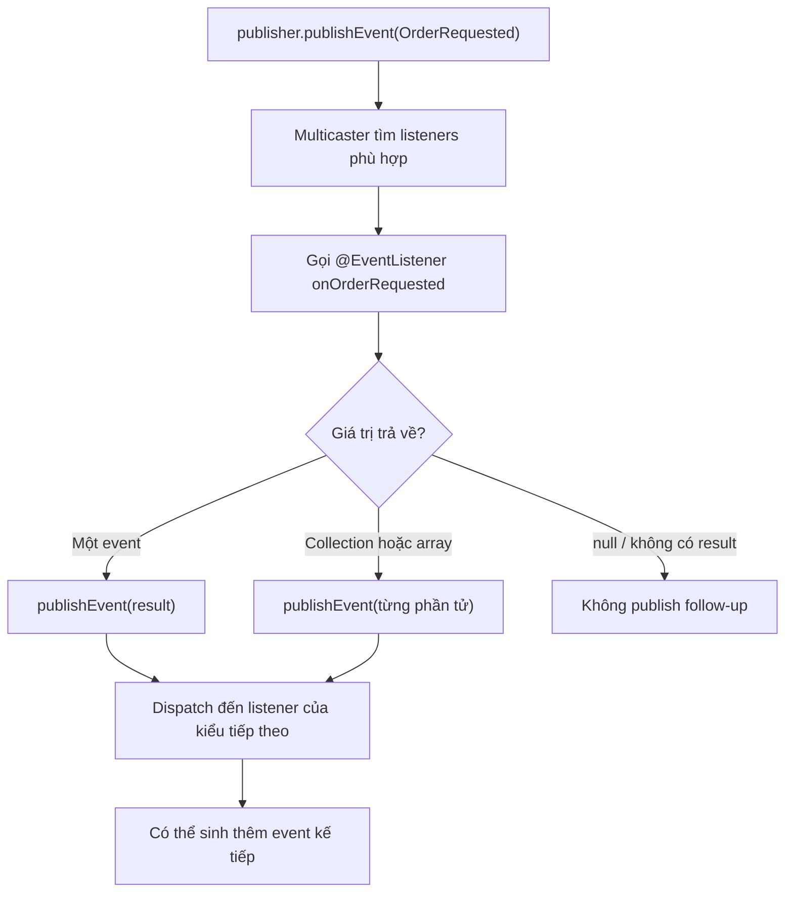
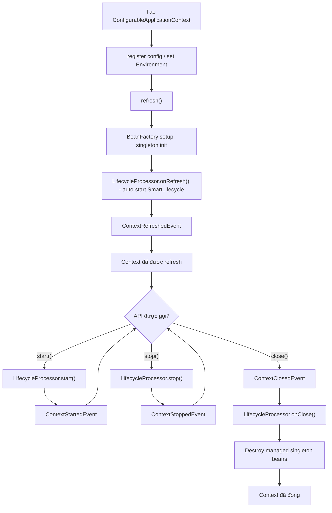

<a id="back-to-top"></a>

# Sự kiện ứng dụng

## Menu
- [Giao tiếp nội bộ bằng ApplicationEventPublisher](#application-events-001)
- [Phát ApplicationEvent hoặc đối tượng sự kiện thông thường](#application-events-002)
- [Nhận sự kiện bằng ApplicationListener và @EventListener](#application-events-003)
- [Kiểu sự kiện, tham số tổng quát và bộ lọc condition](#application-events-004)
- [Đồng bộ mặc định và ảnh hưởng của lỗi ở listener](#application-events-005)
- [Thứ tự listener bằng @Order](#application-events-006)
- [Phát sự kiện tiếp theo từ giá trị trả về](#application-events-007)
- [ApplicationEventMulticaster và tùy biến xử lý lỗi, luồng thực thi](#application-events-008)
- [Listener bất đồng bộ, ngữ cảnh luồng và giới hạn giá trị trả về](#application-events-009)
- [ContextRefreshedEvent, ContextStartedEvent, ContextStoppedEvent và ContextClosedEvent](#application-events-010)
- [Ranh giới sự kiện trong tiến trình với hàng đợi và sự kiện giao dịch](#application-events-011)

## <a id="application-events-001">Giao tiếp nội bộ bằng ApplicationEventPublisher</a>

<details>
<summary>Xem chi tiết</summary>

# Giao tiếp nội bộ bằng ApplicationEventPublisher trong Spring Framework

## 1. Tổng quan và mục tiêu học tập

Trong một ứng dụng Spring, nghiệp vụ đặt hàng có thể liên quan đến nhiều công việc phụ trợ: ghi audit, đếm số đơn hàng, gửi thông báo cho khách hàng, phát tín hiệu thay đổi tồn kho. Nếu `OrderService` gọi trực tiếp tất cả collaborators, service sẽ biết rất nhiều implementation và phải thay đổi mỗi khi bổ sung một loại phản ứng.

**`ApplicationEventPublisher`** là interface Spring cho phép service **phát một sự kiện** mà không cần biết những listeners nào đang theo dõi. Spring Core Container chịu trách nhiệm giao event cho các listeners đã đăng ký trong `ApplicationContext`.

~~~text
              OrderService
                  |
          publishEvent(OrderPlaced)
                  |
                  v
       ApplicationEventPublisher
                  |
                  v
        ApplicationEventMulticaster
             /     |      \
            /      |       \
           v       v        v
     Audit       Metrics   Notification
     Listener    Listener  Listener
~~~

Bài này thuộc nhóm **Sự kiện ứng dụng**, module **Spring Framework - core-container**. Sau khi học, bạn có thể:

1. Nêu đúng hợp đồng của `publishEvent(ApplicationEvent)` và `publishEvent(Object)`.
2. Phân biệt event kế thừa `ApplicationEvent` với arbitrary payload/Java `record`.
3. Đăng ký listeners bằng `@EventListener`, `ApplicationListener<E>` và dùng `ApplicationEventPublisherAware` khi cần.
4. Giải thích dispatch trong context, default synchronous behavior, order, exceptions và asynchronous configuration.
5. Hiểu giới hạn của event in-process: không durable, không tự retry, không tự gửi qua network.
6. Phân biệt lắng nghe ngay lúc publish với xử lý gắn transaction bằng `@TransactionalEventListener`.
7. Kiểm thử publishing/listening, xử lý event loop, sai type, không scan bean và bẫy lifecycle.
8. Tạo dự án Java 17 + Maven + Spring Framework 6.2.19 chạy độc lập và đối chiếu stdout.

## 2. Định nghĩa và hợp đồng ApplicationEventPublisher

Interface `org.springframework.context.ApplicationEventPublisher` có hai overload cốt lõi:

~~~java
default void publishEvent(ApplicationEvent event);

void publishEvent(Object event);
~~~

Đây là chữ ký **rút gọn từ Spring Javadoc**, không phải source code bạn cần chép để tự định nghĩa interface.

- `publishEvent(ApplicationEvent)` nhận một đối tượng kế thừa `org.springframework.context.ApplicationEvent`.
- `publishEvent(Object)` nhận object Java bất kỳ. Nếu object không phải `ApplicationEvent`, Spring bọc nó vào `PayloadApplicationEvent` trước khi dispatch.
- Method trả `void`: không có return value từ listeners, không có danh sách acknowledgments.
- Javadoc nói publish event là một **handoff cho event multicaster**; không khẳng định mọi listener chắc chắn chạy ngay, đồng bộ hay bất đồng bộ.
- Với `ApplicationContext` thông thường và `SimpleApplicationEventMulticaster` mặc định không được gắn executor, listeners tương ứng được gọi **đồng bộ trong publisher thread**.

Phân biệt hai tầng:

| Thành phần | Hợp đồng |
| --- | --- |
| `ApplicationEventPublisher` | Trao sự kiện cho infrastructure, không cam kết timing tuyệt đối |
| Default `SimpleApplicationEventMulticaster` | Thường gọi listeners đồng bộ nếu không có TaskExecutor |
| Custom multicaster có executor | Có thể schedule listener qua executor |
| `@EventListener @Async` | Listener có thể chạy async khi Spring async infrastructure được kích hoạt |

**Đừng tự suy từ `publishEvent` rằng event đã được ghi ra database, gửi tới Kafka/RabbitMQ, được retry hoặc đã chạy sau transaction commit.** Đây trước tiên là notification nội bộ của Spring container.

## 3. Vì sao event giúp giảm coupling?

### Direct invocation

Một service viết:

~~~java
public void placeOrder(String id) {
    orderRepository.save(id);
    auditService.record(id);
    metricsService.increment();
    emailService.sendConfirmation(id);
}
~~~

Đây là **snippet minh họa**, các collaborators do ứng dụng định nghĩa. `OrderService` phải biết ba dịch vụ phụ trợ. Thay đổi số listener có thể buộc sửa business service và unit tests.

### Event-driven notification

~~~java
public final class OrderService {

    private final ApplicationEventPublisher publisher;

    public OrderService(ApplicationEventPublisher publisher) {
        this.publisher = publisher;
    }

    public void placeOrder(String id) {
        // Business operation và persistence được xử lý theo chính sách riêng.
        publisher.publishEvent(new OrderPlaced(id));
    }
}
~~~

Đây là class snippet cần `ApplicationEventPublisher` import và `OrderPlaced` event type. Service chỉ phụ thuộc Spring publisher interface và **event contract**. Listeners có thể bổ sung mà không sửa code publish.

**Giảm direct coupling không xóa mọi coupling.** Publishers và listeners vẫn phải thống nhất ý nghĩa “OrderPlaced”, fields, thời điểm publish, và event có thể lặp/được gửi khi transaction còn mở hay không.

### Khi nào nên dùng?

- Một sự kiện nghiệp vụ có thể có **nhiều consumers tương đối độc lập**.
- Một consumer được thêm/bỏ mà không nên sửa service gốc.
- Logic phản ứng không đòi caller nhận giá trị trả về.
- Tất cả nằm trong cùng JVM/container, hoặc có lớp integration khác làm cầu nối ra ngoài.

Khi yêu cầu bắt buộc A rồi B thành công, gọi trực tiếp trong một orchestration rõ ràng thường dễ hiểu hơn event fan-out.

## 4. Khi event kế thừa ApplicationEvent

`ApplicationEvent` là base class truyền thống của Spring, kế thừa `EventObject`. Trường `source` bắt buộc non-null; `getTimestamp()` là thời điểm event object được tạo, **không** có nghĩa transaction đã commit:

~~~java
import org.springframework.context.ApplicationEvent;

public final class CustomerActivatedEvent extends ApplicationEvent {
    private final String customerId;

    public CustomerActivatedEvent(Object source, String customerId) {
        super(source);
        this.customerId = customerId;
    }

    public String getCustomerId() {
        return customerId;
    }
}
~~~

Class minh họa trên đặt trong file `CustomerActivatedEvent.java`. Trong Spring-managed service, có thể gọi `publisher.publishEvent(new CustomerActivatedEvent(this, "CUS-101"))`. Listener truyền thống `ApplicationListener<CustomerActivatedEvent>` nhận đúng subclass này; `ApplicationListener<E>` ràng buộc `E extends ApplicationEvent`, không nhận trực tiếp một POJO/record làm generic argument.

## 5. Khi event là Java record hoặc POJO thuần

Từ Spring 4.2, `publishEvent(Object)` có thể nhận một object bất kỳ:

~~~java
public record OrderPlaced(String orderId) {}

publisher.publishEvent(new OrderPlaced("ORD-42"));
~~~

Hai dòng là các mảnh Java minh họa: record nằm trong file phù hợp và lệnh publish nằm trong một bean có `ApplicationEventPublisher publisher`. Spring wrap payload trong `PayloadApplicationEvent<OrderPlaced>` để multicast; listener annotated có thể nhận record trực tiếp:

~~~java
@EventListener
public void onOrderPlaced(OrderPlaced event) {
    System.out.println(event.orderId());
}
~~~

Method thuộc một Spring-managed bean và cần import `@EventListener`. Record giúp hợp đồng domain ít phụ thuộc framework; `ApplicationEvent` phù hợp khi cần `source` hoặc API `ApplicationListener<E>`. `PayloadApplicationEvent` **không phải** broker message hay DTO đã được serialize. Chi tiết so sánh constructors, wrapper, generics và hai loại listener nằm ở bài tiếp theo; với phần mở đầu này, chọn event type cụ thể đủ biểu đạt sự thật nghiệp vụ là đủ.

## 6. Inject publisher đúng cách

### Constructor injection

~~~java
@Service
public class AccountService {

    private final ApplicationEventPublisher publisher;

    public AccountService(ApplicationEventPublisher publisher) {
        this.publisher = publisher;
    }

    public void activate(String accountId) {
        publisher.publishEvent(
                new CustomerActivatedEvent(this, accountId));
    }
}
~~~

Đây là class snippet, cần imports `Service`, `ApplicationEventPublisher`, event class và đăng ký Spring bean phù hợp.

`ApplicationContext` cung cấp một `ApplicationEventPublisher` như dependency; thường không cần tự tạo publisher object. Lợi ích:

- Service không phải inject toàn bộ `ApplicationContext`.
- Interface có thể thay bằng fake trong unit test.
- Dependency rõ tại constructor, không ẩn qua static context accessor.

### @Bean method parameter injection

~~~java
@Configuration(proxyBeanMethods = false)
public class AppConfig {

    @Bean
    public AccountService accountService(
            ApplicationEventPublisher publisher) {
        return new AccountService(publisher);
    }
}
~~~

Snippet cần imports và `AccountService` type ở trên. Spring resolve parameter `ApplicationEventPublisher` trong context.

### ApplicationEventPublisherAware

Spring còn cung cấp callback `org.springframework.context.ApplicationEventPublisherAware`:

~~~java
public final class EventNotifier
        implements ApplicationEventPublisherAware {

    private ApplicationEventPublisher publisher;

    @Override
    public void setApplicationEventPublisher(
            ApplicationEventPublisher publisher) {
        this.publisher = publisher;
    }

    public void notifyOrder(String id) {
        publisher.publishEvent(new OrderPlaced(id));
    }
}
~~~

Đây là class snippet, cần imports `ApplicationEventPublisherAware`, `ApplicationEventPublisher` và event type. Spring gọi `setApplicationEventPublisher` khi bean được quản lý bởi context hỗ trợ callback. Với business service mới, constructor injection thường dễ test và tránh field chưa được khởi tạo ở constructor.

### ApplicationContext cũng là publisher

`ApplicationContext` extends `ApplicationEventPublisher`, nên:

~~~java
applicationContext.publishEvent(new OrderPlaced("ORD-42"));
~~~

có thể hoạt động. Tuy nhiên nhận interface hẹp `ApplicationEventPublisher` tránh cho service biết thêm quá nhiều method về bean lookup, environment, resource loading và lifecycle.

## 7. Đăng ký listeners với @EventListener

`@EventListener` thuộc package `org.springframework.context.event`. Annotation cho Spring biết một method lắng nghe event type cụ thể.

~~~java
@Component
public class OrderAuditListener {

    @EventListener
    public void onOrderPlaced(OrderPlaced event) {
        System.out.println("audit=" + event.orderId());
    }
}
~~~

Đây là class snippet cần imports `Component`, `EventListener` và `OrderPlaced`. Spring phải scan/import/register class để tạo bean.

**Chỉ tạo object qua new không đăng ký listener.**

~~~java
OrderAuditListener localObject = new OrderAuditListener();
~~~

Object này không tự nhận event chỉ vì method có annotation. Spring listener infrastructure xử lý methods trên các beans được Spring quản lý.

### Tự nhận event type từ parameter

~~~java
@EventListener
public void orderPlaced(OrderPlaced event) {
    // Spring suy ra event type từ parameter.
}
~~~

Hoặc:

~~~java
@EventListener(OrderPlaced.class)
public void orderPlacedExplicitly(OrderPlaced event) {
    // Spring có event type tường minh.
}
~~~

Hai snippets trong một Spring-managed listener bean.

### No-argument listener và multiple classes

~~~java
@EventListener(classes = {
        ContextRefreshedEvent.class,
        ContextClosedEvent.class
})
public void onContextLifecycle() {
    // Nhận thông báo khi context refresh/close.
}
~~~

Snippet này không lấy payload vì không có parameter. Nếu dùng nhiều event types, đừng khai báo một parameter không tương thích với một trong các types rồi mong Spring tự ép chúng cùng kiểu.

### Event condition bằng SpEL

~~~java
@EventListener(
        condition = "#root.args[0].orderId().startsWith('VIP-')")
public void vipOrders(OrderPlaced event) {
    // Chỉ nhận orderId bắt đầu bằng VIP-.
}
~~~

Snippet dùng `#root.args[0]` để tránh phụ thuộc Java parameter-name metadata. Expression được đánh giá **trong quá trình listener dispatch**. Nó khác `@Conditional`/`@Profile`, là điều kiện chọn bean definitions lúc startup.

### Listener chỉ phản ứng đúng event type

Một listener `@EventListener(OrderPlaced.class)` không tự nhận mọi object tùy ý do application publish. Type/payload matching là một phần của Spring event infrastructure. Khi event không tới listener, kiểm tra parameter type và SpEL condition trước khi kết luận publisher không hoạt động.

## 8. ApplicationListener<E> so với @EventListener

Interface `ApplicationListener<E extends ApplicationEvent>` cung cấp callback:

~~~java
@Override
public void onApplicationEvent(E event) {
    // ...
}
~~~

Với class `CustomerActivatedEvent` kế thừa `ApplicationEvent`, tạo một `ApplicationListener<CustomerActivatedEvent>` như mục 4 là hợp lệ.

| Khả năng | @EventListener | ApplicationListener |
| --- | --- | --- |
| Cần method trên Spring bean | Có | Bean implement interface |
| Nhận plain record payload | Có | Không trực tiếp với generic bound |
| Nhận ApplicationEvent subclass | Có | Có |
| Dùng SpEL condition | Có | Không tích hợp bằng annotation đó |
| Lắng nghe nhiều types | Annotation classes/methods | Advanced adapter, thiết kế riêng |
| Thường dùng | Domain listeners | Infrastructure và callback truyền thống |

Có thể dùng `ApplicationListener<PayloadApplicationEvent<OrderPlaced>>` khi cần interface và generic metadata phù hợp. Với đa số domain events kiểu record, `@EventListener` thuận tiện hơn.

### Listener đăng ký bằng @Bean

~~~java
@Configuration(proxyBeanMethods = false)
public class ListenerConfig {

    @Bean
    public OrderAuditListener auditListener() {
        return new OrderAuditListener();
    }
}
~~~

Snippet trong Java configuration cho thấy class listener không cần `@Component` nếu đã đăng ký như bean; `EventListenerMethodProcessor` có thể phát hiện methods annotated `@EventListener` trên bean đó.

## 9. Default synchronous dispatch và ApplicationEventMulticaster

`ApplicationContext` dùng event multicaster để chọn tất cả registered listeners khớp type. `SimpleApplicationEventMulticaster` là implementation cơ bản.

~~~text
Caller thread
  |
  +--> publisher.publishEvent(OrderPlaced)
              |
              v
       SimpleApplicationEventMulticaster
              |
              +--> auditListener.onEvent(...)
              |
              +--> emailListener.onEvent(...)
              |
              v
       dispatch hoàn tất
  |
  +--> caller tiếp tục
~~~

Khi không có executor và listeners không `@Async`, calls xảy ra đồng bộ trong caller thread. Vì vậy:

- Listener chậm có thể làm HTTP request chậm.
- Exception từ synchronous listener có thể propagate tới publisher.
- Listener không tự có retry hoặc fault isolation.
- `publishEvent` không trả kết quả từ listener.

Đọc đúng Javadoc: **interface publisher không bảo đảm synchronous semantics**. Behavior này có thể thay đổi khi custom multicaster, executor, proxy hoặc @Async listener.

### Listener ordering với @Order

~~~java
@EventListener
@Order(10)
public void audit(OrderPlaced event) {
    // Chạy ưu tiên trước.
}

@EventListener
@Order(20)
public void notifyCustomer(OrderPlaced event) {
    // Chạy ưu tiên sau.
}
~~~

Đây là snippets trong bean với import `org.springframework.core.annotation.Order`. Số nhỏ hơn được ưu tiên trước trong ordered listener dispatch.

Nếu ứng dụng phải đảm bảo A thành công rồi mới gọi B, event order không nhất thiết là mô hình lý tưởng: khi bật async, listener completion timing có thể khác. Hãy orchestration trực tiếp những bước bắt buộc.

### Return value của @EventListener có thể là event mới

~~~java
@EventListener
public InventoryReservationRequested onOrder(OrderPlaced event) {
    return new InventoryReservationRequested(event.orderId());
}
~~~

Snippet yêu cầu record `InventoryReservationRequested`. Spring có thể publish non-null return value như một event tiếp theo. Nếu return array/collection, từng phần tử có thể được phát riêng.

Hãy tránh vòng A→B→A: listener có thể gọi lại hệ thống sự kiện liên tục, gây stack overflow hoặc event storm.

**Giới hạn @Async:** return-based event publishing không hỗ trợ với asynchronous listener method. Muốn phát event tiếp theo từ async handler, inject `ApplicationEventPublisher` rồi gọi `publishEvent(...)` trực tiếp.

## 10. Xử lý exception và chính sách lỗi

Giả sử:

~~~java
@EventListener
public void mail(OrderPlaced event) {
    throw new IllegalStateException("Email transport unavailable");
}
~~~

Nếu handler chạy đồng bộ, exception có thể ném ngược về `publishEvent`, khiến caller không hoàn thành method; tùy logic, listeners khác cũng có thể không được gọi.

**Đây là lý do event không mặc định là “fire-and-forget” an toàn.** Khi handler side effect không đáng làm fail cả business operation, cần cân nhắc async hoặc error policy. Khi handler rất quan trọng đến tính đúng đắn, direct call/transaction design có thể phù hợp hơn.

`SimpleApplicationEventMulticaster` hỗ trợ cấu hình `ErrorHandler` để điều phối lỗi của listeners. Một error handler nuốt exception hay rethrow đều là quyết định ứng dụng; nó không tự tạo dead-letter queue hoặc durability.

Nếu `@EventListener` method ném checked exception, Spring method adapter có thể bọc trong `UndeclaredThrowableException` vì event dispatcher không có checked-exception contract tương ứng. Đọc cause chain, không chỉ lớp exception ngoài.

### Lựa chọn failure mode

1. **Fail fast:** listener exception làm publisher thất bại, thích hợp khi handler là phần bắt buộc.
2. **Log and continue:** custom error handling cho tác vụ phụ trợ; cần observability.
3. **Async processing:** không chặn request nhưng caller không nhận lỗi trực tiếp.
4. **Durable background workflow:** dùng outbox/broker khi cần xử lý lại sau crash.

Không chọn fail-fast/async chỉ theo cảm tính. Phải thống nhất requirements về dữ liệu, transaction, idempotency và SLA.

## 11. Asynchronous events

### @Async trên @EventListener

~~~java
@Configuration
@EnableAsync
public class AsyncConfig {
}
~~~

~~~java
@Component
public class MailListener {

    @Async
    @EventListener
    public void notifyByEmail(OrderPlaced event) {
        // Có thể chạy trong executor khác.
    }
}
~~~

Đây là snippets cần `@EnableAsync`, `@Async`, `@EventListener`, `@Component` imports và async infrastructure/executor được cấu hình phù hợp.

Hệ quả:

- Publisher không nên chờ listener hoàn thành.
- Async void listener exception không propagate trực tiếp về caller; cấu hình `AsyncUncaughtExceptionHandler`/metrics.
- ThreadLocal, logging MDC, request/security context và thread-bound transaction không tự propagate trong mọi executor.
- Cần quản lý executor thread pool, queue capacity, shutdown và rejected tasks.
- Không dựa vào return value của @Async listener để phát event tiếp theo.

### Async ở multicaster

Một infrastructure bean có thể cấu hình:

~~~java
@Bean(name = "applicationEventMulticaster")
public ApplicationEventMulticaster multicaster(TaskExecutor executor) {
    SimpleApplicationEventMulticaster multicaster =
            new SimpleApplicationEventMulticaster();

    multicaster.setTaskExecutor(executor);
    return multicaster;
}
~~~

Đây là snippet trong `@Configuration`, cần imports `ApplicationEventMulticaster`, `SimpleApplicationEventMulticaster` và `TaskExecutor`, cùng executor bean riêng.

Ở Spring Framework 6.2, `ApplicationListener.supportsAsyncExecution()` cho biết khả năng được executor xử lý async; **không** mặc định mọi listener đều có thể chạy async chỉ vì multicaster có executor. Transaction-aware listeners có thể phải chạy trong publishing thread.

### Khi nào nên giữ synchronous?

Những listeners cực nhanh, không phụ thuộc network và cần error propagation rõ có thể xử lý sync phù hợp. Async đưa vào race conditions, completion checks, error handling, context propagation và pool lifecycle; không tự cải thiện độ tin cậy.

## 12. Ví dụ đầy đủ Java 17 + Maven + Spring Framework 6.2.19

Ví dụ đơn giản, không cần Spring Boot/database/web server:

- `OrderService` được tiêm `ApplicationEventPublisher` qua Spring `@Bean` method parameter.
- `OrderPlaced` là Java record, dùng overload `publishEvent(Object)`.
- Có hai `@EventListener` nhận cùng event, có `@Order(10)` và `@Order(20)`.
- `String` cũng được publish như payload và có listener riêng.
- Không bật async, do đó output hiển thị thứ tự synchronous dispatch.

### 12.1. Cấu trúc thư mục

~~~text
application-event-demo/
├── pom.xml
└── src/main/java/demo/
    └── ApplicationEventDemo.java
~~~

### 12.2. pom.xml

~~~xml
<?xml version="1.0" encoding="UTF-8"?>
<project xmlns="http://maven.apache.org/POM/4.0.0"
         xmlns:xsi="http://www.w3.org/2001/XMLSchema-instance"
         xsi:schemaLocation="http://maven.apache.org/POM/4.0.0 https://maven.apache.org/xsd/maven-4.0.0.xsd">
    <modelVersion>4.0.0</modelVersion>
    <groupId>demo</groupId>
    <artifactId>application-event-demo</artifactId>
    <version>1.0.0</version>

    <properties>
        <maven.compiler.release>17</maven.compiler.release>
        <project.build.sourceEncoding>UTF-8</project.build.sourceEncoding>
    </properties>

    <dependencies>
        <dependency>
            <groupId>org.springframework</groupId>
            <artifactId>spring-context</artifactId>
            <version>6.2.19</version>
        </dependency>
    </dependencies>

    <build>
        <plugins>
            <plugin>
                <groupId>org.apache.maven.plugins</groupId>
                <artifactId>maven-compiler-plugin</artifactId>
                <version>3.13.0</version>
            </plugin>
            <plugin>
                <groupId>org.codehaus.mojo</groupId>
                <artifactId>exec-maven-plugin</artifactId>
                <version>3.5.0</version>
            </plugin>
        </plugins>
    </build>
</project>
~~~

### 12.3. src/main/java/demo/ApplicationEventDemo.java

~~~java
package demo;

import org.springframework.context.ApplicationEventPublisher;
import org.springframework.context.annotation.AnnotationConfigApplicationContext;
import org.springframework.context.annotation.Bean;
import org.springframework.context.annotation.Configuration;
import org.springframework.context.event.EventListener;
import org.springframework.core.annotation.Order;

public class ApplicationEventDemo {

    public static void main(String[] args) {
        try (AnnotationConfigApplicationContext context =
                     new AnnotationConfigApplicationContext(Config.class)) {

            OrderService service = context.getBean(OrderService.class);
            service.placeOrder("ORD-42");

            context.publishEvent("inventory-rebuilt");
        }
    }

    public record OrderPlaced(String orderId) {
    }

    public static final class OrderService {
        private final ApplicationEventPublisher publisher;

        public OrderService(ApplicationEventPublisher publisher) {
            this.publisher = publisher;
        }

        public void placeOrder(String orderId) {
            System.out.println("order:before " + orderId);
            publisher.publishEvent(new OrderPlaced(orderId));
            System.out.println("order:after " + orderId);
        }
    }

    public static final class EventHandlers {

        @EventListener
        @Order(10)
        public void audit(OrderPlaced event) {
            System.out.println("listener:audit " + event.orderId());
        }

        @EventListener
        @Order(20)
        public void notifyCustomer(OrderPlaced event) {
            System.out.println("listener:notify " + event.orderId());
        }

        @EventListener
        public void onTextPayload(String payload) {
            System.out.println("listener:payload " + payload);
        }
    }

    @Configuration(proxyBeanMethods = false)
    public static class Config {

        @Bean
        public OrderService orderService(
                ApplicationEventPublisher publisher) {
            return new OrderService(publisher);
        }

        @Bean
        public EventHandlers handlers() {
            return new EventHandlers();
        }
    }
}
~~~

### 12.4. Chạy

Trong thư mục `application-event-demo`:

~~~bash
java -version
mvn -version
mvn -q compile exec:java -Dexec.mainClass=demo.ApplicationEventDemo
~~~

Stdout **do chương trình in**, không tính logging Maven/Spring:

~~~text
order:before ORD-42
listener:audit ORD-42
listener:notify ORD-42
order:after ORD-42
listener:payload inventory-rebuilt
~~~

### 12.5. Giải thích stdout

| Dòng | Cơ chế |
| --- | --- |
| `order:before ORD-42` | Service chuẩn bị publish |
| `listener:audit ORD-42` | Listener có order 10 nhận `OrderPlaced` |
| `listener:notify ORD-42` | Listener order 20 nhận cùng event |
| `order:after ORD-42` | Caller tiếp tục sau synchronous event dispatch |
| `listener:payload inventory-rebuilt` | String được dispatch thông qua payload event wrapper |

Vì `EventHandlers` là một Spring bean, infrastructure có thể phát hiện các methods `@EventListener`. Không cần gắn `@Component` lên class nếu nó đã được khai báo qua `@Bean`.

### 12.6. Spring thực hiện những gì?

1. `AnnotationConfigApplicationContext(Config.class)` khởi tạo, đăng ký configuration và refresh.
2. `OrderService` và `EventHandlers` được tạo từ factory methods.
3. `EventListenerMethodProcessor` nhận diện annotated methods và đăng ký event adapters.
4. `OrderService.placeOrder` phát record `OrderPlaced`.
5. Spring chuyển object thành `PayloadApplicationEvent<OrderPlaced>`, multicaster tìm listeners matching.
6. Hai listeners được gọi theo `@Order` trong mặc định synchronous processing.
7. Sau khi `publishEvent` return, service in `order:after`.
8. Main publish String, listener có parameter `String` nhận payload.

Nếu thêm async vào một listener, expected stdout trên không còn là một assertion đúng về timing; phải điều chỉnh test.

### 12.7. Bài tập mở rộng

**A — Bỏ @Order:** hai listeners vẫn nhận event nhưng không nên dựa vào thứ tự source-code methods. Khi order quan trọng, khai báo tường minh.

**B — Đổi event type:** tạo `AccountRegistered` record và publish. `@EventListener(OrderPlaced)` không nhận event mới vì type không match.

**C — Bỏ bean EventHandlers:** Spring không còn quản lý class listener, các dòng `listener:*` biến mất nhưng publisher vẫn gọi được.

**D — Throw trong audit:** với synchronous dispatch mặc định, `placeOrder` có thể không tới `order:after`. Cần một policy xử lý lỗi thích hợp.

**E — Publish hai lần:** gọi `placeOrder("ORD-42")` lần nữa; listeners nhận thêm một event. Spring không tự deduplicate theo orderId.

**F — Trả event mới:** thay `audit` thành method trả một `InventoryReservationRequested` object, đăng ký listener cho event mới; tránh vòng lặp không dừng.

**G — Gắn @Async:** kích hoạt `@EnableAsync` và executor; stdout có thể đảo thứ tự, cần await/latch khi test.

**H — Dùng ApplicationEvent subclass:** tạo class `OrderPlacedEvent extends ApplicationEvent` và publish; listener có parameter subclass vẫn nhận được.

## 13. Events trong transaction: AFTER_COMMIT khác ngay lúc publish

Giả sử:

~~~java
@Transactional
public void createOrder(Order order) {
    repository.save(order);
    publisher.publishEvent(new OrderPlaced(order.id()));
}
~~~

Đây là snippet minh họa persistence và transaction đã cấu hình; **không** nằm trong demo runnable ở mục 12.

Với `@EventListener` thông thường, listener có thể chạy **trước commit**, khi transaction còn mở. Nếu sau đó rollback, một email hoặc webhook đã gửi ra ngoài không thể tự rollback cùng database.

### TransactionalEventListener

Spring transaction infrastructure hỗ trợ:

~~~java
@TransactionalEventListener(
        phase = TransactionPhase.AFTER_COMMIT)
public void onCommitted(OrderPlaced event) {
    // Side effect sau commit thành công.
}
~~~

Đây là snippet cần Spring transaction API/transaction manager. Default phase là `AFTER_COMMIT`.

| Phase | Ý nghĩa |
| --- | --- |
| `BEFORE_COMMIT` | Trước commit |
| `AFTER_COMMIT` | Sau commit thành công |
| `AFTER_ROLLBACK` | Sau rollback |
| `AFTER_COMPLETION` | Sau completion bất kể kết quả |

Nếu **không có transaction** đang phù hợp, `@TransactionalEventListener` mặc định không chạy. Có thể đặt `fallbackExecution = true` để chạy cả khi không có transaction, nhưng điều đó phải là một yêu cầu được thiết kế có chủ đích.

### Sau commit không đồng nghĩa bền vững

Ngay cả khi callback chạy sau commit, process vẫn có thể crash giữa lúc commit và xử lý xong. `@TransactionalEventListener` giải quyết vấn đề **timing**, không bảo đảm durable delivery/retry. Với external messages bắt buộc phải được giao, nên xem xét **transactional outbox**: ghi record message cùng transaction rồi dispatch bằng worker/broker có retry và idempotency.

Trong reactive transaction, transaction context có thể nằm trong Reactor context chứ không phải ThreadLocal. Spring có `TransactionalEventPublisher` (6.1+) hỗ trợ những use cases đó; không bê nguyên giả định imperative transaction sang reactive flow.

## 14. Parent-child contexts, lifecycle và event scope

### Event nội bộ không phải cross-service

Một event `publishEvent` chỉ đi tới Spring event infrastructure của context hiện tại và hierarchy thích hợp. Nó không tự vượt JVM boundary.

Trong một parent-child context hierarchy, events từ **child có thể propagate lên parent**, khiến parent listeners cũng xử lý event. Chiều ngược từ parent xuống mọi child không mặc định xảy ra. Với root web context và servlet child contexts, cần test duplicate side effects.

### Framework events

Spring tự publish một số context lifecycle events:

- `ContextRefreshedEvent` sau context refresh.
- `ContextStartedEvent` khi gọi start trong bối cảnh hỗ trợ.
- `ContextStoppedEvent` khi gọi stop.
- `ContextClosedEvent` khi context đóng.

Listener:

~~~java
@EventListener
public void onReady(ContextRefreshedEvent event) {
    // Work gắn với lifecycle context.
}
~~~

Đây là snippet. Không nhầm lifecycle events với domain events: `ContextRefreshedEvent` không phải tín hiệu “đơn hàng đã đặt”.

### Publish quá sớm

Phát domain events từ constructor có thể khiến listeners chưa được đăng ký đầy đủ hoặc phụ thuộc semantics early event buffering. Nên publish khi context đã sẵn sàng và business operation thực sự hoàn tất theo chính sách của ứng dụng. Nếu cần startup work, dùng lifecycle events đúng chỗ, cân nhắc idempotency vì một số contexts có thể refresh lại.

### ApplicationEventPublisherAware

Nếu một bean dùng callback `ApplicationEventPublisherAware`, Spring cung cấp publisher khi lifecycle injection diễn ra. Không gọi publish trong constructor của bean đó trước khi field được thiết lập. Constructor injection không có rủi ro field chưa được set nhưng vẫn không nên phát event nghiệp vụ trong quá trình xây dựng bean.

## 15. Unit test và integration test

### 15.1. Unit test service phát event

Một fake publisher giúp kiểm tra event contract mà không cần Spring context:

~~~java
List<Object> emitted = new ArrayList<>();

ApplicationEventPublisher fake = event -> emitted.add(event);

ApplicationEventDemo.OrderService service =
        new ApplicationEventDemo.OrderService(fake);

service.placeOrder("ORD-99");

if (emitted.size() != 1) {
    throw new AssertionError("Expected one event");
}

if (!(emitted.get(0)
        instanceof ApplicationEventDemo.OrderPlaced event)) {
    throw new AssertionError("Unexpected event type");
}

if (!"ORD-99".equals(event.orderId())) {
    throw new AssertionError("Wrong orderId");
}
~~~

Đây là snippet test, cần imports `List`, `ArrayList` và `ApplicationEventPublisher`. Nó xác nhận service publish event; không chứng minh Spring đã phân phối event tới listeners.

### 15.2. Integration test với ApplicationContext

Tạo `AnnotationConfigApplicationContext` và đăng ký một test probe:

~~~java
public class TestEventProbe {

    private final List<String> received = new ArrayList<>();

    @EventListener
    public void record(OrderPlaced event) {
        received.add(event.orderId());
    }

    public List<String> snapshot() {
        return List.copyOf(received);
    }
}
~~~

Đây là class snippet, cần imports `List`, `ArrayList`, `EventListener` và event type. **Phải đăng ký probe như Spring bean** thì method mới nhận event. Với synchronous dispatch không concurrent publishers, `ArrayList` đủ; khi async hoặc concurrent, cần thread-safe collection/synchronization.

### 15.3. Test thứ tự và exceptions

Với `@Order(10)`/`@Order(20)`, ghi markers vào probe và assert `["audit","notify"]` sau publish. Để test exception, cho một synchronous listener ném `IllegalStateException` và assert caller nhận lỗi theo error policy mặc định. Nếu sử dụng custom ErrorHandler hoặc executor, phải thiết kế assertions riêng.

### 15.4. Test async

Async listener cần `CountDownLatch`/test-await với timeout, không assert ngay sau `publisher.publishEvent(...)`. Ngoài completion, cần kiểm tra async exception handling và executor shutdown để tránh thread leaks/flaky tests.

### 15.5. Test transaction behavior

Dùng transaction manager thật, test commit, rollback, no transaction và `fallbackExecution=true`. Một test chỉ có context và `publishEvent` không đủ để chứng minh phase `AFTER_COMMIT` có hoạt động.

### 15.6. Test contract và vòng lặp

Đặt tên events theo **fact** như `OrderPlaced` hoặc `PaymentCaptured`, kiểm tra payload có `orderId` hợp lệ. Thêm test cho idempotent handling nếu caller publish lặp. Với listener tạo new event, test có termination condition thay vì vô tình tạo recursion vô hạn.

## 16. Chọn event hay direct call?

| Nhu cầu | Direct call | Spring application events | Message broker/outbox |
| --- | --- | --- | --- |
| Cần return value ngay | Rất phù hợp | Không trực tiếp | Không trực tiếp |
| Nhiều consumers độc lập trong cùng JVM | Có thể, nhiều dependencies | Phù hợp | Có thể nhưng nặng |
| Không chặn caller | Cần async riêng | Cấu hình async được | Thường async |
| Default durable | Không | **Không** | Có thể đảm bảo bằng persistence |
| Retry sau crash | Tự làm | Không mặc định | Có thể xây dựng |
| Cross-service | Cần network API | Không tự có | Phù hợp |
| Transaction commit timing | Service orchestration | TransactionalEventListener | Outbox |
| Quan sát backlog | Tự xây | Không mặc định | Broker metrics |

Một event tốt mô tả **điều đã xảy ra**:

~~~java
public record OrderPlaced(String orderId) {}
public record PaymentCaptured(String paymentId) {}
public record CustomerActivated(String customerId) {}
~~~

Tên `SendEmailImmediately` mô tả **command** cho một consumer cụ thể, có thể hợp với job/explicit service call hơn. Đừng cố dùng event để che giấu mọi mối quan hệ giữa các domain objects.

## 17. Lỗi thường gặp và hướng khắc phục

| Vấn đề | Nguyên nhân thường gặp | Giải pháp |
| --- | --- | --- |
| Listener không chạy | Class không được scan/register, chỉ new bằng tay | Đăng ký Spring bean |
| Listener nhận sai type | Parameter mismatch hoặc condition false | Kiểm tra event payload và signature |
| Record không dùng với ApplicationListener<Record> | Generic bound extends ApplicationEvent | Dùng @EventListener hoặc wrapper |
| Publisher null | Bean không do Spring quản lý, Aware callback chưa chạy | Constructor injection |
| Publisher bị chặn lâu | Sync listener chậm | Tối ưu/async/broker phù hợp |
| Exception từ listener làm service fail | Default sync propagates errors | Error policy rõ, transaction design |
| @Async không hoạt động | Chưa @EnableAsync hoặc executor/proxy setup | Bổ sung async infrastructure |
| Async exception không về caller | Task chạy thread khác | Async error handler, metrics |
| Listener order không như kỳ vọng | Không @Order hoặc async | Explicit ordering/test |
| Event xử lý hai lần | Nhiều contexts hoặc publish lặp | Idempotency và hierarchy analysis |
| Event không nhận khi constructor chạy | Infrastructure chưa sẵn sàng | Publish sau startup |
| Email gửi rồi DB rollback | Listener chạy trước commit | AFTER_COMMIT hoặc outbox |
| AFTER_COMMIT listener không chạy trong test | Test không có transaction | Test với transaction manager |
| Event mất sau crash | In-process không durable | Outbox/broker |
| Listener trả event gây loop | Event A dẫn B dẫn A | Break cycle |
| Event listener cần result | Publisher void | Direct call |
| Test flaky | Async race, bad timing | Latch, controlled executor |
| Context ThreadLocal mất với async | Không tự propagate | Context propagation |
| Listener nằm ở parent/child cùng xử lý | Event upward propagation | Scope/idempotency |
| Source log rò token | Payload chứa secrets | Redact và tối thiểu dữ liệu |

### Quy trình chẩn đoán

1. Spring có quản lý bean publisher và listener không?
2. Event type là ApplicationEvent subclass hay arbitrary payload?
3. Listener signature và condition có match không?
4. Event được publish sau khi context refresh và handler registration chưa?
5. Có custom multicaster/TaskExecutor/@Async không?
6. Có @Order hoặc listener exception ảnh hưởng thứ tự không?
7. Có transaction đang mở/rollback không?
8. Có parent-child context và duplicate listeners không?
9. Side effect này cần durable delivery hay chỉ best-effort in-process?
10. Đã có unit/integration tests theo đúng dispatch semantics chưa?

## 18. Checklist và tự kiểm tra

- [ ] Service inject `ApplicationEventPublisher` qua constructor hoặc @Bean method.
- [ ] Event class/record biểu diễn một domain fact, không gói Spring context reference.
- [ ] Payload đủ dữ liệu cần thiết nhưng không chứa secrets thừa.
- [ ] Listener là Spring-managed bean.
- [ ] @EventListener type và condition đúng.
- [ ] ApplicationListener generic type extends ApplicationEvent.
- [ ] Hiểu default synchronous listener execution.
- [ ] Có policy rõ cho listener errors.
- [ ] Không ngầm coi @Async là mặc định.
- [ ] Với @Async, có @EnableAsync và executor được quản lý.
- [ ] Khi cần side effect sau commit, dùng transactional listener/transaction policy phù hợp.
- [ ] Khi cần durable delivery, thiết kế outbox/broker.
- [ ] Dùng @Order khi thực sự có yêu cầu thứ tự.
- [ ] Tránh event cycles và duplicate processing.
- [ ] Kiểm tra parent-child context propagation.
- [ ] Test fake publisher, Spring listener integration và async/transaction riêng.

**Câu 1. `publishEvent(Object)` nhận Java record được không?**  
Có; Spring có thể wrap thành `PayloadApplicationEvent`.

**Câu 2. Interface publisher cam kết synchronous không?**  
Không. Default multicaster thông thường sync, nhưng infrastructure có thể thay đổi.

**Câu 3. Có thể dùng `ApplicationListener<OrderPlaced>` nếu OrderPlaced chỉ là record không?**  
Không, vì generic bound yêu cầu extends `ApplicationEvent`.

**Câu 4. @EventListener trong object new ngoài Spring có nhận event không?**  
Không tự động; phải là bean được Spring quản lý.

**Câu 5. @Order dùng khi nào?**  
Khi cần thứ tự xử lý giữa listeners cùng matching event; số order nhỏ trước trong synchronous setup.

**Câu 6. Listener @Async ném exception có về publisher không?**  
Không trực tiếp; cần cơ chế xử lý async exceptions.

**Câu 7. @TransactionalEventListener phase mặc định?**  
`AFTER_COMMIT`.

**Câu 8. Không có transaction thì transactional listener có chạy?**  
Mặc định không, trừ `fallbackExecution=true`.

**Câu 9. AFTER_COMMIT có tự bảo đảm retry sau crash không?**  
Không; cần outbox/queue nếu yêu cầu durable.

**Câu 10. Event từ child ApplicationContext có thể đến parent?**  
Có; cần tránh duplicated side effects.

**Câu 11. Một @EventListener method return object có thể dẫn tới điều gì?**  
Spring có thể publish return object như event mới, ngoại trừ async return-value path.

**Câu 12. Khi nào direct call tốt hơn event?**  
Khi caller cần return value hoặc bước B bắt buộc thành công để bước A được tính là thành công.

**Câu 13. Có thể unit test publisher mà không dựng context?**  
Có; inject fake publisher ghi lại events rồi assert.

**Câu 14. Vì sao @EventListener chậm có thể làm request chậm?**  
Vì mặc định synchronous listeners chạy trong publishing thread.

## Tài liệu chính thức

- [Spring Framework Reference — Application Events](https://docs.spring.io/spring-framework/reference/core/beans/context-introduction.html): observer infrastructure, @EventListener, @Async, @Order, framework events.
- [Spring Framework 6.2 Javadoc — ApplicationEventPublisher](https://docs.spring.io/spring-framework/docs/6.2.19/javadoc-api/org/springframework/context/ApplicationEventPublisher.html).
- [Spring Framework 6.2 Javadoc — ApplicationEvent](https://docs.spring.io/spring-framework/docs/6.2.19/javadoc-api/org/springframework/context/ApplicationEvent.html).
- [Spring Framework 6.2 Javadoc — PayloadApplicationEvent](https://docs.spring.io/spring-framework/docs/6.2.19/javadoc-api/org/springframework/context/PayloadApplicationEvent.html).
- [Spring Framework 6.2 Javadoc — ApplicationEventPublisherAware](https://docs.spring.io/spring-framework/docs/6.2.19/javadoc-api/org/springframework/context/ApplicationEventPublisherAware.html).
- [Spring Framework 6.2 Javadoc — ApplicationListener](https://docs.spring.io/spring-framework/docs/6.2.19/javadoc-api/org/springframework/context/ApplicationListener.html).
- [Spring Framework 6.2 Javadoc — @EventListener](https://docs.spring.io/spring-framework/docs/6.2.19/javadoc-api/org/springframework/context/event/EventListener.html).
- [Spring Framework 6.2 Javadoc — SimpleApplicationEventMulticaster](https://docs.spring.io/spring-framework/docs/6.2.19/javadoc-api/org/springframework/context/event/SimpleApplicationEventMulticaster.html).
- [Spring Framework Reference — Transaction-bound Events](https://docs.spring.io/spring-framework/reference/data-access/transaction/event.html).
- [Spring Framework 6.2 Javadoc — TransactionalEventListener](https://docs.spring.io/spring-framework/docs/6.2.19/javadoc-api/org/springframework/transaction/event/TransactionalEventListener.html).
- [Spring Framework Reference — Task Execution and Scheduling](https://docs.spring.io/spring-framework/reference/integration/scheduling.html).


</details>

- [Quay lại đầu trang](#back-to-top)

---

## <a id="application-events-002">Phát ApplicationEvent hoặc đối tượng sự kiện thông thường</a>

<details>
<summary>Xem chi tiết</summary>

# Phát ApplicationEvent hoặc đối tượng sự kiện thông thường trong Spring Core Container

## 1. Mục tiêu bài học

`ApplicationContext` của Spring không chỉ quản lý bean. Nó còn có một **cơ chế phát và nhận sự kiện trong phạm vi ứng dụng**. Một bean có thể thông báo “đơn hàng đã được gửi”, “cấu hình đã cập nhật” hoặc “công việc đã hoàn thành” mà không cần gọi trực tiếp mọi thành phần quan tâm.

Spring cung cấp hai hình thức phát sự kiện:

1. Phát một object **kế thừa `ApplicationEvent`**.
2. Phát **bất kỳ object Java thông thường** không phải `ApplicationEvent`. Spring tự bọc object đó trong `PayloadApplicationEvent<T>` để event multicaster và listeners xử lý.

Hai cách đều sử dụng `ApplicationEventPublisher.publishEvent(...)` và chung cơ chế listener, nhưng khác nhau ở **kiểu event thực tế** được multicaster nhận và cách truy cập payload. Đây là nội dung chính của chủ đề **“Sự kiện ứng dụng”** trong Spring Framework Core Container.

Kết thúc bài này, bạn có thể:

- Phân biệt `ApplicationEvent`, `PayloadApplicationEvent<T>` và payload domain object.
- Dùng đúng hai overload `publishEvent(ApplicationEvent)` và `publishEvent(Object)`.
- Đăng ký handler bằng `ApplicationListener<E>` hoặc `@EventListener`.
- Hiểu cách matching theo **loại event** và generic payload type.
- Inject `ApplicationEventPublisher` vào một service thay vì phụ thuộc toàn bộ context.
- Nắm default synchronous behavior, ngoại lệ listener, điểm mở rộng `ApplicationEventMulticaster` và những giới hạn của việc phát bất đồng bộ.
- Hiểu ảnh hưởng của vòng đời `refresh()`, event hệ thống, parent–child contexts và transaction-bound events.
- Tự chạy demo Java 17/Spring Framework 6.2.19: một event subclass và một plain Java record, listener tương ứng, output kiểm chứng được.

## 2. Sự kiện ứng dụng là gì?

Một sự kiện ứng dụng là **thông báo mô tả một việc đã xảy ra** hoặc một trạng thái đã thay đổi. Publisher không cần biết listener nào xử lý thông báo.

```text
OrderService
   |
   | publishEvent(OrderSubmitted)
   v
ApplicationEventPublisher
   |
   v
ApplicationEventMulticaster
   |                  |
   v                  v
AuditListener      MetricsListener
   |                  |
   v                  v
ghi audit          cập nhật counter
```

So với việc `OrderService` gọi trực tiếp `audit.write(...)` và `metrics.increment(...)`, mô hình event làm giảm phụ thuộc giữa publisher và số lượng subscribers.

Tuy nhiên, **phát sự kiện trong Spring Context không đồng nghĩa message broker**:

- Không tự lưu event bền vững vào database/queue.
- Không tự bảo đảm retry hay exactly-once delivery.
- Không tự lan sang JVM/process/service khác.
- Không tự bảo đảm listener xử lý bất đồng bộ.
- Không tạo một transaction mới chỉ vì `publishEvent(...)` được gọi.

Đây là một cơ chế **in-process notification**, phù hợp xử lý tích hợp nội bộ. Nếu yêu cầu là truyền thông điệp liên dịch vụ, lưu trữ bền vững hoặc bảo đảm giao hàng sau crash, cần kiến trúc broker/outbox tương ứng.

## 3. Các thành phần của Spring event infrastructure

| Thành phần | Trách nhiệm |
| --- | --- |
| `ApplicationEvent` | Base class cho event kiểu truyền thống, kế thừa `java.util.EventObject` |
| `ApplicationEventPublisher` | API để publisher gửi event |
| `ApplicationContext` | Kế thừa `ApplicationEventPublisher`; tích hợp event infrastructure vào context |
| `PayloadApplicationEvent<T>` | `ApplicationEvent` wrapper cho object thông thường |
| `ApplicationListener<E extends ApplicationEvent>` | Listener theo kiểu classic, nhận một `ApplicationEvent` cụ thể |
| `@EventListener` | Annotation trên method của Spring-managed bean để nhận event |
| `ApplicationEventMulticaster` | Dispatcher tới listeners phù hợp |
| `SimpleApplicationEventMulticaster` | Implementation mặc định của context, thông thường gọi đồng bộ |
| `ApplicationEventPublisherAware` | Callback cấp publisher cho Spring bean |
| `@TransactionalEventListener` | Listener gắn vào phase giao dịch, khi có transaction infrastructure phù hợp |

Trong chương trình thông thường, publisher chỉ cần interface **`ApplicationEventPublisher`**. Listener có thể nhận event bằng **`ApplicationListener`** hoặc annotation **`@EventListener`**.

Không nên viết bean nghiệp vụ trực tiếp thao tác `SimpleApplicationEventMulticaster` nếu không thực sự đang làm infrastructure. Để phát event, dùng publisher API để framework giữ quyền chọn cơ chế multicast hiện hành.

## 4. Hai overload của ApplicationEventPublisher

`org.springframework.context.ApplicationEventPublisher` khai báo:

```java
void publishEvent(Object event);

default void publishEvent(ApplicationEvent event) {
    publishEvent((Object) event);
}
```

Đây là **diễn giải API dạng rút gọn**; code thực tế trong phiên bản Spring cụ thể có thể có chi tiết khác. Mục đích là thể hiện hai overload và rằng mọi event cuối cùng đi vào event publication infrastructure.

### Overload nhận ApplicationEvent

```java
publisher.publishEvent(
        new OrderSubmittedEvent(this, "ORD-7"));
```

Mảnh minh họa này giả định `publisher` là `ApplicationEventPublisher` và `OrderSubmittedEvent extends ApplicationEvent`. Spring sử dụng object `OrderSubmittedEvent` đó như một event, không bọc thêm chỉ vì nó là object.

### Overload nhận Object

```java
publisher.publishEvent(
        new InventoryUpdated("SKU-3", 2));
```

Mảnh minh họa này giả định `InventoryUpdated` là Java record **không extends ApplicationEvent**. Spring biến nó thành một `PayloadApplicationEvent<InventoryUpdated>` ở phía infrastructure.

Dạng `publishEvent(Object)` được hỗ trợ từ **Spring Framework 4.2**, cùng với cơ chế `@EventListener` annotation-based. Vì vậy không còn bắt buộc tạo subclass `ApplicationEvent` cho mọi domain event mới.

### Khi biến có kiểu Object nhưng chứa ApplicationEvent

Quan trọng: ý nghĩa wrapping phụ thuộc **đối tượng thực tế**, không đơn thuần overload mà Java compiler chọn. Nếu runtime value là một `ApplicationEvent`, Spring nhận diện nó là `ApplicationEvent` và không cần bọc như plain payload; nếu không phải, mới tạo `PayloadApplicationEvent`.

## 5. ApplicationEvent: event truyền thống

`ApplicationEvent` kế thừa `java.util.EventObject` và có property `source`. Một event của ứng dụng có thể tự mở rộng:

```java
public final class OrderSubmittedEvent extends ApplicationEvent {

    private final String orderId;

    public OrderSubmittedEvent(Object source, String orderId) {
        super(source);
        this.orderId = orderId;
    }

    public String getOrderId() {
        return orderId;
    }
}
```

Đây là **mảnh class Java hoàn chỉnh** với import `org.springframework.context.ApplicationEvent`, dùng trong file `OrderSubmittedEvent.java`.

Điểm cần hiểu:

- `source` là nguồn phát được truyền cho `super(source)`; `EventObject` yêu cầu source không null.
- `getSource()` trả về source object, không nhất thiết là payload nghiệp vụ.
- `orderId` là dữ liệu riêng của event mà listener dùng để xử lý.
- Một event có thể chứa nhiều fields cần thiết cho subscribers.
- Không bắt buộc lưu cả service/entity lớn trong event. Thường nên dùng identifiers và immutable snapshots gọn để giảm coupling.

Ví dụ `new OrderSubmittedEvent(this, "ORD-7")` giữ reference đến publisher service trong source. Nếu một listener bất đồng bộ dùng source sau này, nên chú ý lifetime và thread safety của object đó.

### Spring framework events cũng là ApplicationEvent

Spring tự phát một số event hệ thống:

- `ContextRefreshedEvent` — context được khởi tạo/refresh xong.
- `ContextStartedEvent` — context được start thông qua lifecycle method.
- `ContextStoppedEvent` — context được stop.
- `ContextClosedEvent` — context đang đóng.
- `RequestHandledEvent` — trong web environment thích hợp khi một HTTP request hoàn tất, tùy integration.

Không phải mọi Spring Context đều tự phát `ContextStartedEvent` hoặc `ContextStoppedEvent` ngay khi refresh. Chúng gắn với các lifecycle operations tương ứng.

## 6. Đối tượng thông thường: domain event không cần extends

Một Java record rất phù hợp làm payload event:

```java
public record InventoryUpdated(
        String sku, int delta) {
}
```

Không có parent class Spring, không có method lifecycle Spring và có các components immutable theo mô hình record.

Publisher gọi:

```java
publisher.publishEvent(
        new InventoryUpdated("SKU-3", 2));
```

Vì `InventoryUpdated` không kế thừa `ApplicationEvent`, Spring tạo wrapper **`PayloadApplicationEvent<InventoryUpdated>`**.

Có thể hình dung:

```text
new InventoryUpdated("SKU-3", 2)
             |
             v
publishEvent(Object)
             |
             v
PayloadApplicationEvent<InventoryUpdated>
   - source: publisher/application context object
   - payload: InventoryUpdated("SKU-3",2)
             |
             v
ApplicationEventMulticaster
             |
             v
matching listeners
```

Đây là mô hình khái niệm. Source của wrapper do infrastructure tạo ra, **không nhất thiết trùng với service object `this` trong event subclass**. Đừng suy rằng `getSource()` của wrapper chính là payload. Muốn dữ liệu nghiệp vụ hãy dùng `getPayload()`.

### Plain object không nhất thiết phải Serializable

Các event payloads trong cùng JVM không bắt buộc phải `Serializable`, và `publishEvent` không tự serialize chúng. Nếu bạn định forward event ra Kafka/RabbitMQ/HTTP, việc serialize là bước khác với chính sách schema, versioning và compatibility.

## 7. PayloadApplicationEvent<T> là gì?

`org.springframework.context.PayloadApplicationEvent<T>` cũng là một `ApplicationEvent`, đồng thời triển khai `ResolvableTypeProvider` để Spring xác định type của payload phục vụ listener matching.

Các API quen thuộc:

```java
PayloadApplicationEvent<InventoryUpdated> wrapper =
        new PayloadApplicationEvent<>(
                "publisher",
                new InventoryUpdated("SKU-3", 2));

InventoryUpdated data = wrapper.getPayload();
Object source = wrapper.getSource();
```

Mảnh Java này cần import `PayloadApplicationEvent` và type `InventoryUpdated` đã định nghĩa trước.

- `getPayload()` là cách lấy object được bọc.
- `getSource()` là source của event wrapper.
- `getResolvableType()` hỗ trợ type matching ở Spring infrastructure.

Thông thường, **không cần tự tạo wrapper**. Hãy gọi `publishEvent(plainObject)` và để Spring bọc. Tự tạo `PayloadApplicationEvent` chỉ cần khi bạn muốn kiểm soát source hoặc cung cấp metadata type cụ thể trong use case nâng cao.

### Khi payload chứa generics

Một plain payload có generic type erased ở runtime có thể làm listener matching phức tạp. Với các sự kiện mang generic type parameters, Spring có `ResolvableType` và `ResolvableTypeProvider` giúp mô tả kiểu đầy đủ, hoặc overload `PayloadApplicationEvent` hỗ trợ cung cấp `ResolvableType` cụ thể. Không suy rằng `new ArrayList<Order>()` luôn giữ được generic element type của List trong runtime.

Khi domain event là một record có concrete fields và class riêng, listener matching thường rõ ràng hơn việc publish các raw generic collections.

## 8. Listener kiểu cổ điển: ApplicationListener<E>

Để nhận event subclass:

```java
public final class OrderSubmittedListener
        implements ApplicationListener<OrderSubmittedEvent> {

    @Override
    public void onApplicationEvent(OrderSubmittedEvent event) {
        System.out.println("order=" + event.getOrderId());
    }
}
```

Đây là class minh họa cần import `org.springframework.context.ApplicationListener` và `OrderSubmittedEvent`; listener phải được **đăng ký** vào ApplicationContext mới tham gia multicasting.

Generic bound của API là **`E extends ApplicationEvent`**. Vì vậy kiểu sau **không hợp lệ**:

```java
// Không biên dịch: InventoryUpdated không extends ApplicationEvent.
class BadListener implements ApplicationListener<InventoryUpdated> {
    // ...
}
```

Đây là anti-example cố ý không biên dịch, dùng để cho thấy vì sao plain object listeners thường phù hợp hơn với `@EventListener` hoặc `ApplicationListener<PayloadApplicationEvent<T>>`.

Một cách khác để nhận payload:

```java
class WrappedInventoryListener
        implements ApplicationListener<PayloadApplicationEvent<InventoryUpdated>> {

    @Override
    public void onApplicationEvent(
            PayloadApplicationEvent<InventoryUpdated> event) {
        InventoryUpdated data = event.getPayload();
        // Xử lý data.
    }
}
```

Mảnh này yêu cầu import `ApplicationListener`, `PayloadApplicationEvent` và record `InventoryUpdated`. Generic matching phụ thuộc resolvable payload type; với event wrapper được Spring tạo cho record trên, type phù hợp.

**Lưu ý:** nếu vừa đăng ký wrapped listener vừa đăng ký annotated listener cho cùng payload, cả hai có thể chạy và tạo duplicate side effects. Hãy chọn chiến lược theo nhu cầu hoặc chủ động thiết kế nhiều subscribers độc lập.

## 9. @EventListener nhận cả ApplicationEvent và plain object

Một method được Spring quản lý có thể khai báo:

```java
@Component
class DomainHandlers {

    @EventListener
    public void onOrderSubmitted(OrderSubmittedEvent event) {
        System.out.println(event.getOrderId());
    }

    @EventListener
    public void onInventoryUpdated(InventoryUpdated payload) {
        System.out.println(payload.sku());
    }
}
```

Đây là mảnh minh họa cần imports `@Component` và `@EventListener`, hai domain types, cũng như **component scanning** hoặc một `@Bean` đăng ký `DomainHandlers`.

Spring phát hiện annotated methods khi context thiết lập listeners, và chọn handler dựa trên event type. Với plain object:

- Infrastructure nhận `PayloadApplicationEvent<InventoryUpdated>`.
- Annotated method có parameter `InventoryUpdated` được Spring hỗ trợ lấy **payload** phù hợp.
- Developer **không bắt buộc** khai báo parameter là wrapper.
- Có thể khai báo parameter `PayloadApplicationEvent<InventoryUpdated>` nếu thật sự muốn truy cập wrapper metadata.

### Đa sự kiện bằng annotation

`@EventListener(classes = {EventA.class, EventB.class})` có thể dùng cho một method không tham số khi chỉ cần được thông báo về vài loại events. Nếu method khai báo **một tham số event**, bảo đảm các loại event được liệt kê tương thích với chữ ký. Không viết method hai tham số `(EventA a, EventB b)` và kỳ vọng Spring sẽ ghép hai lần publish độc lập thành một invocation.

### Điều kiện SpEL

`@EventListener(condition = "...")` cho phép lọc theo SpEL dựa trên event/args. Chỉ dùng khi yêu cầu thực sự cần filtering; điều kiện được đánh giá lúc dispatch và nên tránh side effects, network calls hoặc logic khó test.

## 10. @EventListener và ApplicationListener: nên chọn cách nào?

| Tiêu chí | `ApplicationListener<E>` | `@EventListener` |
| --- | --- | --- |
| Kiểu tham số | `E extends ApplicationEvent` | Có thể là ApplicationEvent hoặc plain payload |
| Vị trí đăng ký | Bean/listener được context biết tới | Method trên Spring-managed bean |
| Generic wrapper | Có thể dùng `PayloadApplicationEvent<T>` | Thường nhận trực tiếp `T` |
| Business boilerplate | Cần implement interface | Chỉ cần annotation |
| Framework/lifecycle events | Rất phù hợp | Cũng phù hợp |
| Return event mới | Không phải contract của interface | Có thể publish kết quả method non-void đồng bộ |
| Khả năng test trực tiếp | Gọi `onApplicationEvent` | Gọi method handler |
| Nhiều event types | Tùy thiết kế/generic wrappers | Annotation hỗ trợ classes/conditions |

Cả hai đều có thể chạy đồng bộ hoặc bất đồng bộ tùy multicast configuration và async annotations. Không áp đặt rằng `ApplicationListener` luôn đồng bộ còn `@EventListener` luôn bất đồng bộ.

Với **plain Java records** và logic nghiệp vụ thông thường, `@EventListener` thường ngắn và dễ đọc. Với hạ tầng hoặc framework event subclasses, `ApplicationListener<E>` vẫn rất tự nhiên.

## 11. Inject ApplicationEventPublisher vào publisher service

Tránh để business service giữ một `ApplicationContext` chỉ để phát event. Nó có thể phụ thuộc interface hẹp `ApplicationEventPublisher`:

```java
public final class OrderService {
    private final ApplicationEventPublisher publisher;

    public OrderService(ApplicationEventPublisher publisher) {
        this.publisher = publisher;
    }

    public void submit(String orderId) {
        // ... business operation ...
        publisher.publishEvent(
                new OrderSubmittedEvent(this, orderId));
    }
}
```

Đây là class minh họa cần `ApplicationEventPublisher`, event type ở trên và wiring của container. Một constructor dependency thể hiện rõ service phát event, đồng thời dễ mock trong unit tests.

`ApplicationEventPublisherAware` là cách thay thế nếu integration yêu cầu lifecycle callback:

```java
public final class PublisherAwareBean
        implements ApplicationEventPublisherAware {

    private ApplicationEventPublisher publisher;

    @Override
    public void setApplicationEventPublisher(
            ApplicationEventPublisher publisher) {
        this.publisher = publisher;
    }
}
```

Mảnh này cần import `ApplicationEventPublisherAware` và `ApplicationEventPublisher`. Spring thực hiện callback với **beans do container quản lý**. Đừng tự `new PublisherAwareBean()` rồi mong field publisher tự có giá trị.

## 12. Vòng đời event và lúc đăng ký listener

Trong `AbstractApplicationContext.refresh()`, Spring có bước tạo hoặc phát hiện event multicaster và đăng ký event listeners, sau đó mới hoàn thành khởi tạo bean và phát `ContextRefreshedEvent`.

Một luồng khái niệm:

```text
prepareRefresh
  |
  v
prepareBeanFactory + process bean definitions
  |
  v
BeanFactoryPostProcessors / BeanPostProcessors
  |
  v
initApplicationEventMulticaster
  |
  v
registerListeners
  |
  v
finishBeanFactoryInitialization
  |
  v
finishRefresh -> ContextRefreshedEvent
  |
  v
Ứng dụng publish domain events
```

Đây là mô tả mức cao; những registry processors và definition parsing có tương tác nhiều vòng. `AbstractApplicationContext` còn có **early event handling** trong lúc refresh: một số events phát sớm được lưu tạm để multicast sau khi listeners được đăng ký.

Đừng thiết kế nghiệp vụ phụ thuộc vào việc một event phát **trong constructor của infrastructure bean** chắc chắn được tất cả listeners nhận ngay lập tức. Thời điểm listener registration và việc context refresh có thất bại hay không đều ảnh hưởng. Thông thường nên phát domain events sau khi context đã khởi tạo, hoặc dùng lifecycle hook được thiết kế rõ ràng.

### @EventListener cần context infrastructure

`@EventListener` không phải Java callback tự hoạt động với một object tạo bằng `new`. Spring phải quản lý listener bean và có `EventListenerMethodProcessor` trong setup phù hợp. Đoạn demo dùng `AnnotationConfigApplicationContext` với `@Configuration` nên infrastructure annotation listeners được cung cấp.

## 13. Synchronous là mặc định, không phải lời hứa của publishEvent

`SimpleApplicationEventMulticaster` là implementation mặc định thường được Spring dùng khi không có event multicaster tùy chỉnh. Theo mặc định, nó gọi listeners **trên thread của publisher**, từng listener trong quá trình multicast.

Với cấu hình mặc định:

```text
thread main:
   service.publishEvent(e)
        |
        +-- listener A hoàn thành
        +-- listener B hoàn thành
        |
   publishEvent(e) trả về
```

Vì vậy, với synchronous listeners, side effects đã hoàn thành có thể được quan sát sau `publishEvent(...)`.

Nhưng Javadoc `ApplicationEventPublisher` cố tình nói publish là **hand-off**: interface **không bảo đảm** execution đồng bộ, bất đồng bộ hay ngay lập tức. Một custom multicaster hoặc listener dùng `@Async` có thể thay đổi behavior.

**Không** viết một integration contract dựa trên “publishEvent luôn trả về sau khi mọi handler xong” khi hệ thống cho phép cấu hình asynchronous execution.

### Thời gian xử lý

Một listener chậm sẽ làm `publishEvent(...)` chậm trong cấu hình synchronous. Đối với I/O tốn thời gian, cân nhắc async listener, job queue hoặc broker; nhưng phải xử lý rõ transactions, retries, cancellation, error reporting và context propagation.

## 14. Lỗi listener và propagation

Giả sử listener đồng bộ:

```java
@EventListener
public void onInventoryUpdated(InventoryUpdated event) {
    throw new IllegalStateException("Listener failed");
}
```

Đây là mảnh minh họa, không thuộc chương trình chạy chính. Nếu không có `ErrorHandler` tùy chỉnh, exception unchecked thường lan về caller của `publishEvent(...)` trong default synchronous mode, có thể khiến đoạn publisher dừng trước khi các listeners tiếp theo được gọi tùy thứ tự dispatch.

Do đó:

- Phát event không phải bản thân một cơ chế “fire-and-forget luôn không lỗi”.
- Không nên chỉ dựa vào một handler exception để coi transaction/DB changes đã được rollback đúng. Rollback còn phụ thuộc transaction boundary và exception propagation.
- Nếu đăng ký một `ErrorHandler` cho multicaster, nó có thể làm thay đổi việc lỗi được log/nuốt/lan ra.
- Nếu handler chạy async, lỗi không tự lan về thread gọi publish; phải có logging, exception handling hoặc retry riêng.

### Event trả về từ @EventListener

Một annotated listener đồng bộ có thể trả về event object mới:

```java
@EventListener
public InventoryUpdated onOrderSubmitted(OrderSubmittedEvent event) {
    return new InventoryUpdated("SKU-3", -1);
}
```

Mảnh minh họa này có nghĩa: sau khi handler chạy, Spring có thể publish giá trị trả về như một **sự kiện mới**. Nếu return là collection/array, mỗi phần tử có thể được phát riêng. Tính năng này **không hỗ trợ việc tự phát event bằng return value từ async `@EventListener`**; trong handler async, cần gọi publisher tường minh khi có nhu cầu.

Tránh viết chuỗi listeners vô hạn kiểu A xử lý ra B, B lại xử lý ra A. Cần xác định causal graph và stop conditions.

## 15. Ví dụ Java 17 hoàn chỉnh: subclass ApplicationEvent và plain record

Ví dụ này dùng **Spring Framework 6.2.19** với `spring-context`, không dùng Spring Boot. Nó:

1. Tạo `OrderSubmittedEvent extends ApplicationEvent`.
2. Tạo `InventoryUpdated` là Java record không extends Spring class.
3. Đăng ký một classic listener `ApplicationListener<OrderSubmittedEvent>`.
4. Đăng ký một `@EventListener` method nhận trực tiếp `InventoryUpdated` payload.
5. Inject `ApplicationEventPublisher` vào bean `EventProducer`.
6. Publish hai sự kiện sau `context.refresh()`.
7. Ghi nhận hai handler calls trong một `EventLog`, sắp xếp trước khi in để output **không phụ thuộc thứ tự dispatch giữa các listeners**.

Chương trình cố ý không sử dụng executor/async và không publish events từ bean constructors. Do đó output đáng tin với default `SimpleApplicationEventMulticaster` và không bị nhiễu bởi framework lifecycle events vì hai listener chỉ nhận đúng domain types.

### Cấu trúc thư mục

```text
spring-events-demo/
├── settings.gradle
├── build.gradle
└── src/main/java/EventPublicationDemo.java
```

### settings.gradle

```groovy
rootProject.name = 'spring-events-demo'
```

### build.gradle

```groovy
plugins {
    id 'application'
}

repositories {
    mavenCentral()
}

dependencies {
    implementation 'org.springframework:spring-context:6.2.19'
}

java {
    toolchain {
        languageVersion = JavaLanguageVersion.of(17)
    }
}

application {
    mainClass = 'EventPublicationDemo'
}
```

### src/main/java/EventPublicationDemo.java

```java
import java.util.ArrayList;
import java.util.Collections;
import java.util.List;

import org.springframework.context.ApplicationEvent;
import org.springframework.context.ApplicationEventPublisher;
import org.springframework.context.ApplicationListener;
import org.springframework.context.annotation.AnnotationConfigApplicationContext;
import org.springframework.context.annotation.Bean;
import org.springframework.context.annotation.Configuration;
import org.springframework.context.event.EventListener;

public class EventPublicationDemo {

    public static final class OrderSubmittedEvent
            extends ApplicationEvent {

        private final String orderId;

        public OrderSubmittedEvent(Object source, String orderId) {
            super(source);
            this.orderId = orderId;
        }

        public String getOrderId() {
            return orderId;
        }
    }

    public record InventoryUpdated(String sku, int delta) {
    }

    public static final class EventLog {
        private final List<String> entries = new ArrayList<>();

        public void add(String value) {
            entries.add(value);
        }

        public List<String> snapshot() {
            return List.copyOf(entries);
        }
    }

    public static final class OrderListener
            implements ApplicationListener<OrderSubmittedEvent> {

        private final EventLog log;

        public OrderListener(EventLog log) {
            this.log = log;
        }

        @Override
        public void onApplicationEvent(OrderSubmittedEvent event) {
            log.add("order:" + event.getOrderId());
        }
    }

    public static final class InventoryListener {

        private final EventLog log;

        public InventoryListener(EventLog log) {
            this.log = log;
        }

        @EventListener
        public void onInventoryUpdated(InventoryUpdated payload) {
            log.add("inventory:" + payload.sku()
                    + ":" + (payload.delta() >= 0 ? "+" : "")
                    + payload.delta());
        }
    }

    public static final class EventProducer {

        private final ApplicationEventPublisher publisher;

        public EventProducer(ApplicationEventPublisher publisher) {
            this.publisher = publisher;
        }

        public void publishBoth() {
            // Là một ApplicationEvent thật, không cần wrapper.
            publisher.publishEvent(
                    new OrderSubmittedEvent(this, "ORD-7"));

            // Là Java record, Spring bọc thành PayloadApplicationEvent.
            publisher.publishEvent(
                    new InventoryUpdated("SKU-3", 2));
        }
    }

    @Configuration(proxyBeanMethods = false)
    public static class AppConfig {

        @Bean
        public EventLog eventLog() {
            return new EventLog();
        }

        @Bean
        public OrderListener orderListener(EventLog eventLog) {
            return new OrderListener(eventLog);
        }

        @Bean
        public InventoryListener inventoryListener(EventLog eventLog) {
            return new InventoryListener(eventLog);
        }

        @Bean
        public EventProducer eventProducer(
                ApplicationEventPublisher publisher) {
            return new EventProducer(publisher);
        }
    }

    public static void main(String[] args) {
        try (AnnotationConfigApplicationContext context =
                     new AnnotationConfigApplicationContext(
                             AppConfig.class)) {

            EventProducer producer =
                    context.getBean(EventProducer.class);
            EventLog log = context.getBean(EventLog.class);

            producer.publishBoth();

            List<String> entries =
                    new ArrayList<>(log.snapshot());
            Collections.sort(entries);

            System.out.println("events.count=" + entries.size());
            System.out.println("events.sorted=" + entries);
            System.out.println("completed=true");
        }
    }
}
```

### Chạy

Yêu cầu JDK 17+ và Gradle 8+:

```bash
gradle run --quiet
# Hoặc ./gradlew run --quiet nếu dự án đã có Gradle Wrapper.
```

### Output chương trình tự in

```text
events.count=2
events.sorted=[inventory:SKU-3:+2, order:ORD-7]
completed=true
```

Các log framework/Gradle (nếu có) không nằm trong output `System.out` này.

### Giải thích từng bước

**Tạo context:** `new AnnotationConfigApplicationContext(AppConfig.class)` tự đăng ký Java config và refresh context. Khi constructor trả về, Spring đã biết `OrderListener` và annotated method `InventoryListener.onInventoryUpdated`.

**Đăng ký listeners:** `OrderListener` là Spring bean implements `ApplicationListener<OrderSubmittedEvent>`. `InventoryListener` cũng là Spring bean; `@EventListener` được infrastructure phát hiện và đăng ký một adapter.

**Publisher injection:** `@Bean eventProducer(ApplicationEventPublisher publisher)` được Spring cung cấp publisher của context. `EventProducer` không phải biết cụ thể `AnnotationConfigApplicationContext`.

**Sự kiện thứ nhất:** `OrderSubmittedEvent` kế thừa `ApplicationEvent`, nên class event tự là type để classic listener matching. Handler đọc `getOrderId()` và ghi `order:ORD-7`.

**Sự kiện thứ hai:** `InventoryUpdated` là Java record thông thường. Spring bọc nó vào `PayloadApplicationEvent<InventoryUpdated>` khi publish. Annotated method nhận trực tiếp `InventoryUpdated` và ghi `inventory:SKU-3:+2`.

**Kết quả:** trong demo không cấu hình async multicaster nên hai handlers hoàn thành trước khi `publishBoth()` trả về. Chương trình sao chép/sort log rồi in hai entries. Sort theo chữ khiến `inventory` đứng trước `order` bất kể thứ tự đăng ký listeners.

**Đóng context:** try-with-resources gọi `context.close()`. Framework có thể phát `ContextClosedEvent` nhưng cả hai listeners trong demo không subscribe event đó, nên không ghi thêm domain log.

### Vì sao code runnable?

- Tên file trùng `public class EventPublicationDemo`.
- Java records cần Java 16+, dùng Java 17 như project.
- `@EventListener` import đúng `org.springframework.context.event.EventListener`.
- `ApplicationEventPublisher` được container inject vào `@Bean` parameter.
- Không có component scanning bị thiếu: cả listener beans được khai báo qua `@Bean`.
- Không cần Spring Boot hoặc web server.
- `Collections.sort` áp dụng trên một copy mutable từ `log.snapshot()`.
- Không phụ thuộc tên thread, timestamp của `ApplicationEvent`, identity hash code hoặc thứ tự log nội bộ.

## 16. Xử lý payload wrapper trực tiếp

Nếu một listener cần truy cập source của wrapper, ngoài payload:

```java
public final class EnvelopeListener {

    @EventListener
    public void onEvent(
            PayloadApplicationEvent<InventoryUpdated> wrapper) {

        InventoryUpdated payload = wrapper.getPayload();
        Object sender = wrapper.getSource();
        // Tùy chính sách, sử dụng payload/sender.
    }
}
```

Đây là **mảnh minh họa** cần imports `PayloadApplicationEvent` và `@EventListener`, record `InventoryUpdated`. Phải đăng ký `EnvelopeListener` thành bean Spring thì callback mới hoạt động.

Nếu thêm listener này vào demo cùng `InventoryListener`, một lần publish plain payload có thể kích hoạt **hai listeners**. Đó không phải event bị Spring tự nhân đôi một cách vô cớ; bạn đã đăng ký hai subscribers với event matching.

### Tự tạo PayloadApplicationEvent

Có thể publish wrapper tường minh:

```java
PayloadApplicationEvent<InventoryUpdated> event =
        new PayloadApplicationEvent<>(
                "inventoryService",
                new InventoryUpdated("SKU-3", 2));

publisher.publishEvent(event);
```

Ở đây object đã extends `ApplicationEvent`, nên khi publish không phải tạo **wrapper lồng wrapper**. `getSource()` trả chuỗi `"inventoryService"` trong ví dụ; `getPayload()` trả record.

Chỉ nên chỉ định source theo dữ liệu domain khi thực sự có lợi. Nếu muốn rõ “ai tạo event”, một trường `origin` trong payload có thể bền vững và dễ serialize hơn reference source trỏ đến bean object.

## 17. Parent–child ApplicationContext và phạm vi nhận event

Trong hierarchy:

```text
Parent ApplicationContext
    ^      listeners của parent
    |
    | event từ child có thể propagate lên parent
    |
Child ApplicationContext
           listeners của child
```

`AbstractApplicationContext` hỗ trợ propagation từ context con lên context cha. Khi child publish event, listeners của child và parent phù hợp có thể cùng nhận (tùy context setup). Đây là **hướng đi lên** hierarchy, không phải phát broadcast tự động tới mọi children.

Quan trọng với system events: parent có thể nhận `ContextRefreshedEvent` của child rồi lại nhận `ContextRefreshedEvent` của chính parent khi nó refresh. Listener chỉ quan tâm lifecycle của **một context** nên kiểm tra `event.getApplicationContext()` có đúng context mục tiêu hay không, không đếm mọi ContextRefreshedEvent như nhau.

Với domain events cũng cần chính sách rõ: nếu cả parent và child đăng ký audit listeners cho cùng event, có thể tạo duplicate audit. Không được suy rằng cùng tên bean ở hai contexts tự khử trùng subscribers.

## 18. Event có được gửi sau commit database không?

`@EventListener` mặc định không chờ database commit. Nếu publisher phát event **bên trong @Transactional method**, synchronous listeners bình thường có thể chạy **trước khi transaction commit**, trong cùng thread/transaction context.

Nếu nghiệp vụ yêu cầu “chỉ xử lý khi transaction commit thành công”, Spring hỗ trợ `@TransactionalEventListener` (Spring Transaction integration):

```java
@TransactionalEventListener(
        phase = TransactionPhase.AFTER_COMMIT)
public void onOrderSubmitted(OrderSubmittedEvent event) {
    // Xử lý sau khi transaction hoàn tất commit.
}
```

Đây là mảnh minh họa, cần imports ở `org.springframework.transaction.event` và transaction infrastructure thực sự được cấu hình. Nếu **không có transaction active**, loại listener này mặc định **không được gọi**, trừ khi chỉ định `fallbackExecution=true` hoặc cơ chế tương đương có chủ đích.

Đừng tưởng việc gọi `publishEvent(...)` tự tạo transaction. Và **AFTER_COMMIT listener vẫn không bảo đảm delivery durable** khi JVM chết sau commit trước khi side effect hoàn tất. Với yêu cầu đáng tin giữa process/services, cân nhắc transactional outbox + broker.

### Reactive transactions

Khi dùng reactive transaction context, thread-local assumptions có thể không đủ. Spring có `TransactionalEventPublisher` để chuyển transaction context vào event theo cách phù hợp. Không áp dụng cơ chế transaction thread-bound của Spring imperative một cách máy móc cho reactive pipelines.

## 19. Cấu hình multicaster và async listeners

Spring tìm bean đặc biệt tên **`applicationEventMulticaster`** để tùy chỉnh việc chuyển tiếp. Nếu không có, context dùng `SimpleApplicationEventMulticaster` mặc định.

Ví dụ custom multicaster đồng bộ với ErrorHandler:

```java
@Bean(name = "applicationEventMulticaster")
ApplicationEventMulticaster applicationEventMulticaster() {
    SimpleApplicationEventMulticaster multicaster =
            new SimpleApplicationEventMulticaster();

    multicaster.setErrorHandler(error ->
            System.err.println("Event handler failed: "
                    + error.getClass().getSimpleName()));

    return multicaster;
}
```

Đây là mảnh Java configuration cần imports `@Bean`, `ApplicationEventMulticaster`, `SimpleApplicationEventMulticaster`. Ví dụ chỉ in loại exception; trong production cần chính sách reporting phù hợp và tránh lộ secret trong exception detail.

Để một listener có thể chạy async, có thể dùng `@Async` trên annotated listener khi application đã bật `@EnableAsync` và có executor thích hợp. Hoặc cấu hình `SimpleApplicationEventMulticaster.setTaskExecutor(...)`.

**Lưu ý Spring 6.2:**

- Không phải mọi listener đều hỗ trợ async execution. `ApplicationListener.supportsAsyncExecution()` cho phép hạ tầng nhận biết listeners cần chạy ở thread publisher (ví dụ một số transactional listeners).
- Async làm thay đổi error propagation, transaction context, thread-local security/request context và ordering.
- `@Async` trên `@EventListener` không thể dùng return value để tự publish event tiếp theo.
- Không cấu hình async chỉ vì muốn `publishEvent(...)` “không block”, mà không có monitoring/backpressure/retry và shutdown policy.

### Listener ordering

`@Order` và `Ordered` có thể ảnh hưởng listener invocation order khi hạ tầng hỗ trợ. Tuy nhiên, xử lý song song/async vẫn có thể làm **thứ tự hoàn tất** khác thứ tự dispatch. Dùng sort trong demo để so sánh result set, không phải vì event order là không bao giờ quan trọng. Nếu thứ tự là nghiệp vụ cốt lõi, phải thiết kế sequencing/serialization rõ.

## 20. Khác biệt với Observer Java truyền thống và message broker

Một `ApplicationEventPublisher` có thể làm các module trong cùng context đỡ phụ thuộc lẫn nhau. Nhưng event là **notification**, không phải lệnh yêu cầu một kết quả trả về trực tiếp.

| Cơ chế | Khi phù hợp | Hạn chế |
| --- | --- | --- |
| Gọi Java method trực tiếp | Cần kết quả ngay, lỗi đồng bộ, contract rõ | Publisher phụ thuộc callee |
| Spring ApplicationEventPublisher | Thông báo nội bộ tới nhiều subscribers | Không durable, không cross-process |
| Java observer tùy chỉnh | Ứng dụng nhỏ không dùng Spring | Tự quản lý registry/lifecycle |
| Message queue/broker | Tích hợp services, retry, buffering, durable messaging | Vận hành và idempotency phức tạp |
| Transactional outbox | Đồng bộ DB commit và phát message bên ngoài | Cần outbox table/publisher/retry |

Không nên dùng ApplicationEvent để che một **đường gọi bắt buộc phải thành công trước khi trả response**. Nếu nghiệp vụ thật sự phải có kết quả từ một collaborator, method call tường minh thường rõ hơn. Nếu event chỉ cung cấp thông báo và nhiều subscribers độc lập, event publication phù hợp.

## 21. Các lỗi thường gặp và cách khắc phục

| Hiện tượng | Nguyên nhân | Hướng giải quyết |
| --- | --- | --- |
| `ApplicationListener<PlainRecord>` không biên dịch | Generic `E extends ApplicationEvent` | Dùng `@EventListener(PlainRecord)` hoặc wrapper typed listener |
| Handler `@EventListener` không chạy | Bean không thuộc Spring context hoặc annotation infrastructure chưa có | Đăng ký listener bean và context configuration đúng |
| Chỉ thấy class `PayloadApplicationEvent` | Đã publish plain object nên Spring tạo wrapper | Đọc `getPayload()` hoặc nhận payload trực tiếp trong annotated method |
| `getSource()` không phải domain payload | Nhầm wrapper source và payload | Dùng `getPayload()` |
| Handler chạy hai lần | Có hai subscribers hoặc child event propagate tới parent | Kiểm tra registration, listener types, context hierarchy |
| Publish dừng vì handler lỗi | Default synchronous multicast không có error handler | Bắt/thiết kế exception policy hoặc custom multicaster |
| Publisher return trước listener xử lý | Async multicaster hoặc `@Async` | Kiểm tra executor và completion semantics |
| Listener chặn request quá lâu | Xử lý I/O nặng đồng bộ trong handler | Tách async job/broker khi có chính sách lỗi rõ |
| Event không được lưu sau crash | Event infrastructure in-memory | Outbox/broker cho reliability |
| Listener AFTER_COMMIT không chạy | Không có transaction active | Dùng transaction thực tế hoặc `fallbackExecution` khi phù hợp |
| Event chạy trước DB commit | Dùng `@EventListener` thông thường | Chọn TransactionalEventListener nếu cần after commit |
| Handler async mất user/security context | Thread-local không tự đi theo executor | Explicit context propagation, tránh phụ thuộc ThreadLocal |
| ContextClosedEvent làm logic chạy thêm | Listener quá rộng (ví dụ ApplicationEvent) | Lọc theo domain type hoặc điều kiện context |
| Generic payload không match | Erasure, thiếu ResolvableType metadata | Event type concrete hoặc ResolvableTypeProvider |
| Mutable event bị sửa trước async processing | Payload giữ object reference | Dùng immutable record/snapshot |
| @EventListener method trả event rồi lặp vô hạn | Chain phát event có vòng | Thiết kế causal graph có giới hạn |

## 22. Checklist test và vận hành

Trước khi đưa vào production:

1. Event là **sự kiện đã xảy ra** hay “command” cần kết quả? Chọn API tương ứng.
2. Payload class là `ApplicationEvent` hay plain Java object? Listener type có match không?
3. Listener đã được đăng ký vào context thật và annotation processing hoạt động chưa?
4. Có ghi rõ cần synchronous hay async? Nếu async, ai theo dõi errors và completion?
5. Có handler trùng do context hierarchy, annotation và classic listener cùng nhận không?
6. Event payload có immutable/snapshot để dùng an toàn ngoài publisher thread không?
7. Có một transaction nào liên quan? `@EventListener` có chạy quá sớm so với commit không?
8. Các listeners có truy cập DB/network không, và có thể chặn thread caller bao lâu?
9. Có test cả trường hợp **không listener**? Publish vẫn không nhất thiết là lỗi.
10. Có test listener exception và chính sách multicast ErrorHandler?
11. Có test sự kiện được publish sau refresh, khi listener đã đăng ký?
12. Có theo dõi metric/log theo event type nhưng không log secret/PII không?
13. Nếu event có generic types, đã test matching trên Spring runtime thật chưa?
14. Có cần ordered delivery, deduplication, retry hay durability? Nếu có, Spring ApplicationEvent đơn lẻ có đủ không?
15. Đã tách unit test của handler khỏi integration test publish/subscribe chưa?

### Bài tập 1: thêm subscriber thứ hai

Đăng ký một `@EventListener` thứ hai nhận `InventoryUpdated` nhưng chỉ tăng counter. Chạy demo và xác minh **mỗi subscriber nhận cùng một event**; số lượng domain events publisher phát vẫn là một, nhưng số callbacks tăng.

### Bài tập 2: in loại wrapper

Tạo một listener nhận `PayloadApplicationEvent<InventoryUpdated>` và in `getPayload().sku()`. So sánh với listener nhận `InventoryUpdated` trực tiếp. Không nhầm `getSource()` với `getPayload()`.

### Bài tập 3: lỗi synchronous

Trong một context test riêng, sửa listener `InventoryUpdated` ném `IllegalStateException`. Quan sát `publishEvent(...)` khi dùng default multicaster rồi thử custom ErrorHandler. Giải thích khác biệt giữa “exception đến caller” và “event vẫn được tất cả subscribers xử lý”.

### Bài tập 4: parent-child propagation

Tạo parent/child contexts với hai listeners khác nhau. Chỉ publish vào child và đếm callbacks. Thử publish từ parent và giải thích vì sao không tự động đi xuống child.

### Bài tập 5: AFTER_COMMIT

Trong một project có Spring transaction manager thật, so sánh `@EventListener` với `@TransactionalEventListener(phase = AFTER_COMMIT)`. Test cả thành công và rollback, đặc biệt khi phát event trong transaction body. Không lấy demo `spring-context` thuần làm bằng chứng Spring tự mở transaction.

## 23. Tài liệu chính thức

1. [Spring Framework 6.2 Reference — Additional Capabilities of ApplicationContext / Standard and Custom Events](https://docs.spring.io/spring-framework/reference/6.2/core/beans/context-introduction.html): event subclass, plain object payload, annotated listeners và synchronous default.
2. [Spring Framework 6.2 Javadoc — ApplicationEventPublisher](https://docs.spring.io/spring-framework/docs/6.2.x/javadoc-api/org/springframework/context/ApplicationEventPublisher.html): hai overload publishEvent; hand-off semantics; reactive context guidance.
3. [Spring Framework 6.2 Javadoc — PayloadApplicationEvent](https://docs.spring.io/spring-framework/docs/6.2.x/javadoc-api/org/springframework/context/PayloadApplicationEvent.html): payload wrapper, getPayload và ResolvableTypeProvider.
4. [Spring Framework 6.2 Javadoc — ApplicationListener](https://docs.spring.io/spring-framework/docs/6.2.x/javadoc-api/org/springframework/context/ApplicationListener.html): generic listener contract và supportsAsyncExecution.
5. [Spring Framework 6.2 Javadoc — EventListener](https://docs.spring.io/spring-framework/docs/6.2.x/javadoc-api/org/springframework/context/event/EventListener.html): method-level listeners, conditions, return values, exception/async semantics.
6. [Spring Framework 6.2 Javadoc — ApplicationEventMulticaster](https://docs.spring.io/spring-framework/docs/6.2.x/javadoc-api/org/springframework/context/event/ApplicationEventMulticaster.html): multicasting và listener matching.
7. [Spring Framework 6.2 Javadoc — SimpleApplicationEventMulticaster](https://docs.spring.io/spring-framework/docs/6.2.x/javadoc-api/org/springframework/context/event/SimpleApplicationEventMulticaster.html): synchronous default, TaskExecutor và ErrorHandler.
8. [Spring Framework 6.2 Javadoc — AbstractApplicationContext](https://docs.spring.io/spring-framework/docs/6.2.x/javadoc-api/org/springframework/context/support/AbstractApplicationContext.html): multicaster bean, early events, lifecycle publication, parent propagation.
9. [Spring Framework Reference — Transaction-bound Events](https://docs.spring.io/spring-framework/reference/6.2/data-access/transaction/event.html): `@TransactionalEventListener` và AFTER_COMMIT.
10. [Spring Framework Reference — Observability of Application Events](https://docs.spring.io/spring-framework/reference/integration/observability.html): synchronous/async boundary và context propagation caveats.

**Kết luận:** `ApplicationEventPublisher.publishEvent(...)` chấp nhận cả **`ApplicationEvent` subclass** lẫn **plain Java object**. Nếu object không phải `ApplicationEvent`, Spring bọc nó thành **`PayloadApplicationEvent<T>`**. Listener có thể dùng `ApplicationListener<E extends ApplicationEvent>` hoặc `@EventListener` nhận thẳng event/payload. Default multicaster thường xử lý đồng bộ, nhưng hợp đồng publisher chỉ là hand-off; cần thiết kế rõ lỗi, lifecycle, transaction và reliability trước khi dùng events cho nghiệp vụ quan trọng.


</details>

- [Quay lại đầu trang](#back-to-top)

---

## <a id="application-events-003">Nhận sự kiện bằng ApplicationListener và @EventListener</a>

<details>
<summary>Xem chi tiết</summary>

# Nhận sự kiện bằng ApplicationListener và @EventListener trong Spring Core Container

## 1. Mục tiêu và tình huống

Spring Framework có cơ chế sự kiện nội bộ để một thành phần phát thông báo mà không phải phụ thuộc trực tiếp vào tất cả thành phần nhận thông báo. Khi một `OrderService` phát “đơn hàng đã tạo”, các listener có thể ghi audit, cập nhật metric hoặc bắt đầu một tác vụ khác.

Trong Spring Core Container có hai cách nhận sự kiện quan trọng:

- **`ApplicationListener<E extends ApplicationEvent>`**: một Spring bean implements interface, nhận các `ApplicationEvent` phù hợp với generic type `E`.
- **`@EventListener`**: đánh dấu một **method của Spring-managed bean**; method có thể nhận `ApplicationEvent` truyền thống hoặc **payload object Java bình thường**.

Mục tiêu bài này là chọn đúng listener API, hiểu **type matching**, registration và lifecycle, xử lý `@EventListener(condition=...)`, `@Order`, `@Async`, exceptions và những giới hạn khác. Ví dụ cuối chạy với **Java 17**, **Spring Framework 6.2.19**, **Gradle**, không dùng Spring Boot.

Điểm cần nhớ: listener **nhận thông báo**, không phải một dependency method call yêu cầu kết quả trả về; phát sự kiện cũng không tự đảm bảo giao hàng bền vững, transaction commit hay async processing.

## 2. Các thành phần tham gia

```text
Publisher bean
     |
     | ApplicationEventPublisher.publishEvent(...)
     v
ApplicationContext / ApplicationEventMulticaster
     |
     +---------------------+-----------------------+
     |                     |                       |
     v                     v                       v
ApplicationListener<E>  @EventListener(E event)  @EventListener(T payload)
     |                     |                       |
     v                     v                       v
classic callback        method adapter           payload dispatch
```

| Thành phần | Vai trò |
| --- | --- |
| `ApplicationEvent` | Base class sự kiện cổ điển; là một `EventObject` có `source` |
| `ApplicationEventPublisher` | API phát sự kiện, có overload cho `ApplicationEvent` và `Object` |
| `ApplicationContext` | Thực hiện publication và đăng ký listeners của context |
| `ApplicationEventMulticaster` | Tìm và gọi các listener tương thích |
| `SimpleApplicationEventMulticaster` | Multicaster mặc định thường xử lý đồng bộ |
| `ApplicationListener<E>` | Callback interface nhận `ApplicationEvent` có kiểu |
| `PayloadApplicationEvent<T>` | Wrapper Spring tạo khi publisher phát object thường |
| `@EventListener` | Annotation gắn trên method nhận một hoặc nhiều loại event |
| `EventListenerMethodProcessor` | Infrastructure phát hiện và đăng ký annotated methods |
| `GenericApplicationListener` | Extension point xét event type qua `ResolvableType` |
| `@TransactionalEventListener` | Annotation cho listener gắn transaction phase, khi có transaction infrastructure |

`ApplicationListener` và `@EventListener` là **hai cách đăng ký listener**, không phải hai loại “bus” riêng biệt. Cả hai có thể được multicaster gọi cho cùng một event nếu matching tương thích.

## 3. Vòng đời: listener phải được đăng ký

Một listener không tự động hoạt động chỉ vì class có tên kết thúc bằng “Listener”. Spring cần **biết listener** trong cùng context hoặc trong context hierarchy liên quan.

Đối với `ApplicationListener`:
- Đăng ký class dưới dạng Spring bean (ví dụ `@Bean` hoặc component scanning).
- Hoặc sử dụng API `ConfigurableApplicationContext.addApplicationListener(...)` thích hợp.
- Khi refresh, `AbstractApplicationContext` phát hiện listeners rồi đăng ký chúng với multicaster.

Đối với `@EventListener`:
- Method phải thuộc **một bean Spring quản lý**.
- Annotation infrastructure phải có `EventListenerMethodProcessor`. Java configuration dùng `AnnotationConfigApplicationContext` sẽ đăng ký infrastructure cần thiết.
- Tự gọi `new Handler()` không khiến Spring tự phát hiện các method có annotation.
- Nếu ứng dụng cấu hình XML thủ công, cần bật annotation processing tương ứng.

Một ứng dụng thường:
1. Tạo context.
2. Register config/component definitions.
3. Gọi `refresh()`.
4. Publish domain events khi đã sẵn sàng.
5. Đóng context theo lifecycle.

Spring có hỗ trợ xử lý một số **early application events** lúc refresh, nhưng không nên thiết kế workflow phụ thuộc việc một event phát từ constructor của bean chưa fully initialized chắc chắn được tất cả listeners nhận.

## 4. ApplicationListener<E>: kiểu interface

Định nghĩa cốt lõi (rút gọn):

```java
@FunctionalInterface
public interface ApplicationListener<E extends ApplicationEvent>
        extends EventListener {

    void onApplicationEvent(E event);
}
```

Đây là phần chính của interface Spring, không phải toàn bộ API của phiên bản cụ thể. Generic bound `E extends ApplicationEvent` có ý nghĩa quan trọng.

Event tùy chỉnh:

```java
public final class OrderCreatedEvent extends ApplicationEvent {
    private final String orderId;

    public OrderCreatedEvent(Object source, String orderId) {
        super(source);
        this.orderId = orderId;
    }

    public String getOrderId() {
        return orderId;
    }
}
```

Đây là class Java minh họa, cần import `org.springframework.context.ApplicationEvent` và lưu thành `OrderCreatedEvent.java`.

Listener:

```java
public final class AuditListener
        implements ApplicationListener<OrderCreatedEvent> {

    @Override
    public void onApplicationEvent(OrderCreatedEvent event) {
        System.out.println("order=" + event.getOrderId());
    }
}
```

Mảnh trên cần import `org.springframework.context.ApplicationListener` và class event. **Chỉ khi `AuditListener` được đăng ký vào context** nó mới nhận event thông qua Spring.

### Type matching

Khi context publish một `OrderCreatedEvent`, một listener `ApplicationListener<OrderCreatedEvent>` có thể nhận nó. Listener kiểu `ApplicationListener<ContextClosedEvent>` không nhận event này; Spring lọc theo event type.

Nếu listener khai báo kiểu quá rộng như `ApplicationListener<ApplicationEvent>`, nó có thể nhận cả **các framework lifecycle events** (`ContextRefreshedEvent`, `ContextClosedEvent`) và cả các domain ApplicationEvent subclasses. Nếu xử lý theo một giả định quá hẹp rồi cast thiếu kiểm tra, code có thể thất bại.

### Vì sao generic type cần được Spring nhìn thấy?

Spring dùng metadata generic và `ResolvableType` để xác định các listener candidates. Tránh che generic type bằng raw `ApplicationListener` hoặc các proxy/generic wrappers không giữ type information thích hợp. Nếu làm listener có logic matching phức tạp, `GenericApplicationListener` có thể phù hợp hơn, nhưng không cần cho use case đơn giản.

## 5. Plain payload không trực tiếp là ApplicationEvent

Từ Spring Framework 4.2, publisher có thể gửi một object Java thường:

```java
public record StockChanged(String sku, int delta) {
}

publisher.publishEvent(new StockChanged("SKU-1", 2));
```

Đây là mảnh minh họa; biến `publisher` có kiểu `ApplicationEventPublisher`.

Khi event argument **không phải `ApplicationEvent`**, Spring bọc nó trong `PayloadApplicationEvent<StockChanged>`. Do đó khai báo sau **sai generic bound**, không biên dịch:

```java
// Anti-example: StockChanged không extends ApplicationEvent.
class Wrong implements ApplicationListener<StockChanged> {
    // ...
}
```

Đây là **anti-pattern cố ý**, không phải đoạn Java chạy được.

Để nhận plain object, có hai cách:

1. `@EventListener` với method parameter `StockChanged`.
2. `ApplicationListener<PayloadApplicationEvent<StockChanged>>` và đọc `event.getPayload()`.

Với domain record, **`@EventListener` thường đơn giản hơn** vì method nhận trực tiếp payload.

## 6. ApplicationListener của PayloadApplicationEvent<T>

Ví dụ classic listener nhận wrapper:

```java
public final class StockWrapperListener
        implements ApplicationListener<
                PayloadApplicationEvent<StockChanged>> {

    @Override
    public void onApplicationEvent(
            PayloadApplicationEvent<StockChanged> event) {
        StockChanged payload = event.getPayload();
        System.out.println(payload.sku() + ":" + payload.delta());
    }
}
```

Mảnh này cần imports `ApplicationListener`, `PayloadApplicationEvent` và record `StockChanged`; listener cũng phải được đăng ký vào Spring context.

**Phân biệt:**
- `event.getSource()` là source object của Spring event wrapper.
- `event.getPayload()` là object domain `StockChanged` đã được publisher gửi.
- `PayloadApplicationEvent` cung cấp metadata loại payload qua `ResolvableTypeProvider`, giúp generic listener matching.

Khi tự publish một `PayloadApplicationEvent<StockChanged>` đã tạo sẵn, nó **đã là ApplicationEvent**; Spring không cần tự bọc nó lần nữa. Nếu ứng dụng gửi một subclass của `ApplicationEvent` qua biến kiểu `Object`, Spring vẫn nhận diện object runtime là một ApplicationEvent.

## 7. @EventListener: một method là một subscriber

Cách thông dụng:

```java
@Component
public final class StockHandlers {

    @EventListener
    public void onStockChanged(StockChanged change) {
        System.out.println("stock=" + change.sku());
    }
}
```

Mảnh minh họa này cần imports `@Component` và `org.springframework.context.event.EventListener`, record `StockChanged` và component scan hoặc cấu hình `@Bean` tương ứng.

Spring có thể suy ra event type từ **tham số duy nhất** của method. Khi publisher phát plain `StockChanged`, infrastructure chuyển wrapper thành argument `StockChanged` để gọi method.

Method annotated có thể nhận `ApplicationEvent` subclass:

```java
@EventListener
public void onOrderCreated(OrderCreatedEvent event) {
    System.out.println(event.getOrderId());
}
```

Đây là method minh họa, cần đặt trong Spring-managed bean.

### Có thể cùng một event được nhận hai lần?

Một event có thể được **nhiều listeners khác nhau** nhận. Nếu cả `AuditListener implements ApplicationListener<OrderCreatedEvent>` và `StockHandlers.onOrderCreated` đều được đăng ký, mỗi listener tương thích sẽ có callback riêng. Không phải publisher đã phát hai lần.

Nếu bạn tự đăng ký **cùng listener instance theo hai đường** ngoài ý định, hoặc parent/child contexts cùng xử lý sự kiện, có thể xuất hiện duplicate side effects. Kiểm tra registration paths thay vì giả định mỗi event chỉ được một consumer xử lý.

## 8. @EventListener(classes=...) và phương thức không tham số

Trong trường hợp listener chỉ cần biết một trong vài sự kiện lifecycle đã xảy ra, có thể chỉ định các loại event bằng annotation:

```java
@EventListener({
        ContextRefreshedEvent.class,
        ContextClosedEvent.class
})
public void onContextSignal() {
    System.out.println("lifecycle signal");
}
```

Đây là method minh họa, cần imports cho `EventListener` và hai event classes. **Không có parameter** là lựa chọn đúng khi annotation liệt kê **nhiều event types**.

Theo Javadoc Spring 6.2:

- Khi `classes` hoặc `value` khai báo **một** event type, method có thể nhận một parameter tương thích hoặc không nhận parameter.
- Khi khai báo **nhiều** event types, method **không được khai báo parameter**.
- Nếu không đặt `classes`/`value`, Spring suy event type từ một method parameter.

Ví dụ này **không hợp lệ theo contract**:

```java
// Anti-pattern: annotation liệt kê 2 loại nhưng method có 1 parameter.
@EventListener({
        ContextRefreshedEvent.class,
        ContextClosedEvent.class
})
public void wrong(ContextRefreshedEvent event) {
    // ...
}
```

Dù Java source có thể biên dịch, Spring không chấp nhận listener declaration này theo quy tắc annotation. Không dùng để cài đặt thực tế.

### Tránh @EventListener(Object.class) quá rộng

Một listener kiểu `Object` có thể match rất nhiều domain payloads và làm phát sinh callbacks không mong muốn. Chỉ nhận những event types thật sự liên quan nghiệp vụ để giảm coupling và ngăn rò rỉ sự kiện không phù hợp.

## 9. Lọc bằng @EventListener(condition=...)

Annotation hỗ trợ SpEL condition, ví dụ chỉ xử lý những thay đổi tồn kho có `delta > 0`:

```java
@EventListener(condition = "#root.args[0].delta() > 0")
public void onRestock(StockChanged change) {
    System.out.println("restock=" + change.sku());
}
```

Đây là method minh họa, trong Spring bean có record `StockChanged`. `#root.args` chứa arguments được dùng gọi listener method; `#root.args[0]` là object `StockChanged`, nên có thể gọi accessor `delta()`.

Spring còn hỗ trợ alias:
- `#root.event` hoặc `event` là đối tượng `ApplicationEvent` thực tế (đối với plain payload thường là wrapper).
- `#root.args` hoặc `args` là mảng method arguments.
- `#a0`, `#p0` tham chiếu argument đầu.
- Tên parameter (ví dụ `#change`) chỉ dùng an toàn khi tên được giữ trong compiled bytecode/metadata.

SpEL condition thường được evaluate **khi event dispatch**, khác với `@Conditional` vốn điều khiển đăng ký bean definitions khi bootstrap.

### Không nhầm loại object trong expression

Với plain payload `StockChanged`:
- `#root.event` là `PayloadApplicationEvent<StockChanged>`.
- `#root.args[0]` là `StockChanged` nếu method parameter là payload.
- Muốn đọc SKU, `#root.args[0].sku()` tránh phải đi xuyên qua wrapper; dùng `#root.event.payload.sku()` nếu bạn chủ động viết condition dựa trên wrapper.

Giữ điều kiện ngắn, side-effect-free; không gọi database hoặc remote API trong condition expression.

## 10. @Order và thứ tự thực thi

`@Order` có thể định thứ tự các annotated listener methods:

```java
@EventListener
@Order(10)
public void first(StockChanged event) {
    // ...
}

@EventListener
@Order(20)
public void second(StockChanged event) {
    // ...
}
```

Đây là hai methods minh họa trong Spring bean, cần imports `EventListener` và `Order`.

Giá trị `@Order` **nhỏ hơn** thường được ưu tiên trước theo ordering contract. `ApplicationListener` trực tiếp có thể dùng `Ordered`/`@Order` trên bean class hoặc các interface listener nâng cao khi phù hợp.

**Giới hạn:** một thứ tự dispatch được chỉ định không đồng nghĩa **thứ tự hoàn thành** được đảm bảo nếu listeners chạy bất đồng bộ. Cũng đừng biến các listener độc lập thành một pipeline bắt buộc theo thứ tự mà không có kiến trúc command/workflow rõ ràng.

Trong demo hoàn chỉnh phía dưới, kết quả ghi nhận được **sắp xếp khi in** để không phụ thuộc thứ tự callback của các subscriber khác nhau.

## 11. @EventListener method có return value

Không phải mọi listener method bắt buộc `void`. Theo Javadoc, một method annotated trả về một object **non-void** có thể khiến Spring phát object kết quả như **sự kiện mới**:

```java
@EventListener
public AuditRecorded afterOrder(OrderCreatedEvent event) {
    return new AuditRecorded(event.getOrderId());
}
```

Đây là mảnh minh họa; `AuditRecorded` là một event class hoặc plain record khác được ứng dụng định nghĩa.

Nếu return value là **array hoặc collection**, Spring có thể phát từng phần tử như một sự kiện riêng. Cơ chế này tiện cho một pipeline nhỏ nhưng dễ gây vòng lặp A→B→A nếu listeners tạo events theo chu kỳ.

**Đặc biệt:** `@EventListener` method chạy bất đồng bộ qua `@Async` **không được dùng return value để tự publish một event tiếp theo**. Nếu async handler cần phát tiếp, inject `ApplicationEventPublisher` rồi gọi `publishEvent(...)` một cách tường minh.

Nếu nghiệp vụ cần biết trực tiếp một kết quả thành công/thất bại, đừng biến listener return value thành cơ chế RPC ngầm. Một method call rõ hợp đồng có thể phù hợp hơn.

## 12. Khi nào event listener chạy đồng bộ?

Spring `AbstractApplicationContext` mặc định dùng `SimpleApplicationEventMulticaster` nếu không có bean multicaster riêng. Mặc định, nó gọi listeners **ngay trong thread publish**, trừ khi async được cấu hình.

```text
Thread: main
    publishEvent(event)
       -> listener A
       -> listener B
    return from publishEvent
```

Điều này làm kết quả dễ quan sát trong demo đồng bộ. Nhưng **`ApplicationEventPublisher.publishEvent(...)` chỉ hứa hand-off**, không hứa mọi listeners hoàn thành đồng bộ trong mọi ứng dụng. Cấu hình async executor, `@Async` hoặc một multicaster khác có thể thay đổi thời gian hoàn thành.

Vì vậy:
- Trong **demo mặc định**, có thể đọc danh sách callbacks sau `publishEvent`.
- Trong **production đã bật async**, phải dùng completion/coordination phù hợp thay vì giả định callbacks đều xong.
- Một listener thực hiện network I/O chậm sẽ giữ thread publisher trong chế độ synchronous; cân nhắc boundary thích hợp nếu latency quan trọng.

## 13. Async listener và ngoại lệ

`@Async` có thể áp dụng cho `@EventListener` khi application bật async infrastructure thích hợp:

```java
@Async
@EventListener
public void sendNotification(OrderCreatedEvent event) {
    // Chạy theo cấu hình async executor.
}
```

Đây là method minh họa, cần `@EnableAsync` và executor phù hợp; **không** nằm trong demo runnable chính.

Các hệ quả:

1. Listener có thể chạy trên thread khác và hoàn tất sau publisher.
2. Exception từ async listener không tự truyền về thread gọi `publishEvent`; cần error handler/observability riêng.
3. Thread-local request/security/transaction context không mặc định được propagate như ý muốn; có thể cần `TaskDecorator`/context propagation.
4. `@Async` method không thể dùng return value để auto-publish event.
5. Shutdown phải tính đến tasks còn chạy; event không tự được lưu bền vững.

`SimpleApplicationEventMulticaster.setTaskExecutor(...)` là một cách khác để chuyển dispatch sang async, nhưng Spring 6.2 có `ApplicationListener.supportsAsyncExecution()`: không phải listener nào cũng cho phép execution bất đồng bộ. **Transaction-synchronized listeners** là ví dụ cần thận trọng về execution context.

## 14. Exception propagation trong listener đồng bộ

Nếu listener synchronous ném một `RuntimeException` mà không có error handler tùy chỉnh, exception có thể lan về caller của `publishEvent(...)`; quá trình gọi các listeners còn lại cũng có thể bị dừng tùy dispatch.

```java
@EventListener
public void fail(StockChanged change) {
    throw new IllegalStateException("Cannot process update");
}
```

Đây là method anti-example để phân tích lỗi, không thuộc demo chạy chính.

Spring `@EventListener` còn cho phép khai báo checked exceptions trong method; khi một checked exception được ném qua listener adapter, nó có thể được wrap thành `UndeclaredThrowableException`, vì publisher/multicaster API không khai báo checked exceptions cho các handlers thông thường.

Nếu bạn muốn custom error policy, có thể cấu hình bean tên `applicationEventMulticaster` dùng `SimpleApplicationEventMulticaster` với `setErrorHandler(...)`; một ErrorHandler có thể log và nuốt lỗi hoặc truyền lại, tùy thiết kế. Cần test:
- Event processing nào vẫn tiếp tục khi một listener hỏng?
- Publisher có biết thất bại?
- Database transaction có rollback không? Phụ thuộc transaction boundary, không chỉ do event.
- Async handler errors được gửi tới monitoring ở đâu?

Tránh biến event thành “fire-and-forget nên luôn an toàn”. Trong default synchronous configuration, lỗi listener có thể ảnh hưởng trực tiếp business call.

## 15. Classic listeners và annotated listeners ở context lifecycle

Một số events chuẩn:

| Event | Khi thường xuất hiện |
| --- | --- |
| `ContextRefreshedEvent` | `ApplicationContext` được initialize/refresh |
| `ContextStartedEvent` | Gọi lifecycle `start()` |
| `ContextStoppedEvent` | Gọi `stop()` |
| `ContextClosedEvent` | `close()` hoặc shutdown |
| `RequestHandledEvent` | Một số web context/integration paths |

Ví dụ:

```java
public final class StartupListener
        implements ApplicationListener<ContextRefreshedEvent> {
    @Override
    public void onApplicationEvent(ContextRefreshedEvent event) {
        System.out.println("context ready");
    }
}
```

Đây là mảnh minh họa, cần imports và đăng ký listener vào context. `ContextRefreshedEvent` được phát khi refresh hoàn tất; không đồng nghĩa “mọi hệ thống bên ngoài đã ready” (DB cluster, broker, remote endpoints...). 

Trong một parent-child context hierarchy, events phát từ child có thể được propagate lên parent. Một listener trong parent vì thế có thể nhìn thấy `ContextRefreshedEvent` của child. Nếu chỉ muốn lắng nghe chính context hiện tại, hãy kiểm tra `event.getApplicationContext()` và filter theo context identity.

**Không coi `ContextStartedEvent` là event bắt buộc sau `refresh()`.** Nó gắn với lifecycle `start()`, không tự xảy ra chỉ do tạo context.

## 16. Generic event type và ResolvableTypeProvider

Khi listener cần phân biệt `EntityCreatedEvent<Person>` với `EntityCreatedEvent<Order>`, kiểu `T` có thể mất đi do Java **type erasure**. Spring có `ResolvableType` và `ResolvableTypeProvider` để event tự công bố runtime generic metadata:

```java
@Override
public ResolvableType getResolvableType() {
    return ResolvableType.forClassWithGenerics(
            getClass(), ResolvableType.forInstance(entity));
}
```

Đây là method minh họa **bên trong** generic event class có field `entity` và implements `ResolvableTypeProvider`, cần import `ResolvableType`. Khi generic type quan trọng, hãy có integration test với một event match và một event không match. `PayloadApplicationEvent<T>` cũng là `ResolvableTypeProvider`, nhưng raw collection không tự có đầy đủ metadata element type. Cách tạo event generic, concrete subclass, `@EventListener(condition)` và kiểm thử negative cases được triển khai đầy đủ trong bài kế tiếp.

## 17. @TransactionalEventListener không giống @EventListener mặc định

`@TransactionalEventListener` là một chuyên biệt thuộc Spring transaction integration:

```java
@TransactionalEventListener(
        phase = TransactionPhase.AFTER_COMMIT)
public void afterCommit(OrderCreatedEvent event) {
    // Side effect chỉ được kích hoạt theo transaction phase.
}
```

Đây là mảnh minh họa, cần imports `org.springframework.transaction.event.TransactionalEventListener` và `org.springframework.transaction.event.TransactionPhase` cùng transaction infrastructure có thật.

So sánh:

- `@EventListener` thông thường: event được dispatch theo multicaster; nếu synchronous trong transaction, callback có thể chạy **trước commit**.
- `@TransactionalEventListener(phase=AFTER_COMMIT)`: listener gắn với phase sau successful commit.
- Không có active transaction? Transactional listener thường **không xử lý**, trừ khi cấu hình `fallbackExecution=true` hoặc chính sách tương đương.
- Sau commit vẫn **không đồng nghĩa durable delivery**. Nếu JVM chết giữa commit và side effect, event nội bộ không tự được phục hồi. Outbox pattern/broker là giải pháp nếu cần reliability mạnh.

Không gắn `@Async` tùy tiện cho transaction-bound listener khi side effect yêu cầu thread-bound transaction/resource context; đọc đúng Spring transaction semantics và test cả commit/rollback.

## 18. Ví dụ Java 17 hoàn chỉnh: nhận event bằng cả hai cách

Demo dưới đây dùng **Spring Framework 6.2.19** và **Gradle application plugin**. Nó cố ý có nhiều subscribers để chứng minh:

1. `PurchaseEvent extends ApplicationEvent` được nhận bởi `ApplicationListener<PurchaseEvent>`.
2. Một `@EventListener(PurchaseEvent)` khác cũng được nhận event đó.
3. `StockChanged` là Java record không extends `ApplicationEvent`; publisher phát trực tiếp object.
4. `ApplicationListener<PayloadApplicationEvent<StockChanged>>` nhận wrapper và lấy `getPayload()`.
5. `@EventListener(StockChanged)` nhận **payload trực tiếp**.
6. Một annotated listener có `condition = "#root.args[0].delta() > 0"` chỉ xử lý thay đổi dương.
7. Kết quả được **sắp xếp** để không phụ thuộc thứ tự invocation của các listeners.
8. Không bật async; callbacks kết thúc trong cùng publish call của default multicaster.

### Thư mục dự án

```text
spring-listener-demo/
├── settings.gradle
├── build.gradle
└── src/main/java/SpringListenerDemo.java
```

### settings.gradle

```groovy
rootProject.name = 'spring-listener-demo'
```

### build.gradle

```groovy
plugins {
    id 'application'
}

repositories {
    mavenCentral()
}

dependencies {
    implementation 'org.springframework:spring-context:6.2.19'
}

java {
    toolchain {
        languageVersion = JavaLanguageVersion.of(17)
    }
}

application {
    mainClass = 'SpringListenerDemo'
}
```

### src/main/java/SpringListenerDemo.java

```java
import java.util.ArrayList;
import java.util.Collections;
import java.util.List;

import org.springframework.context.ApplicationEvent;
import org.springframework.context.ApplicationEventPublisher;
import org.springframework.context.ApplicationListener;
import org.springframework.context.PayloadApplicationEvent;
import org.springframework.context.annotation.AnnotationConfigApplicationContext;
import org.springframework.context.annotation.Bean;
import org.springframework.context.annotation.Configuration;
import org.springframework.context.event.EventListener;

public class SpringListenerDemo {

    public static final class PurchaseEvent extends ApplicationEvent {
        private final String id;

        public PurchaseEvent(Object source, String id) {
            super(source);
            this.id = id;
        }

        public String id() {
            return id;
        }
    }

    public record StockChanged(String sku, int delta) {
    }

    public static final class EventLog {
        private final List<String> items = new ArrayList<>();

        public void add(String line) {
            items.add(line);
        }

        public List<String> sortedCopy() {
            List<String> copy = new ArrayList<>(items);
            Collections.sort(copy);
            return copy;
        }
    }

    public static final class ClassicPurchaseListener
            implements ApplicationListener<PurchaseEvent> {

        private final EventLog log;

        public ClassicPurchaseListener(EventLog log) {
            this.log = log;
        }

        @Override
        public void onApplicationEvent(PurchaseEvent event) {
            log.add("classic:purchase:" + event.id());
        }
    }

    public static final class WrappedStockListener
            implements ApplicationListener<
                    PayloadApplicationEvent<StockChanged>> {

        private final EventLog log;

        public WrappedStockListener(EventLog log) {
            this.log = log;
        }

        @Override
        public void onApplicationEvent(
                PayloadApplicationEvent<StockChanged> event) {
            StockChanged payload = event.getPayload();
            log.add("wrapped:stock:" + payload.sku()
                    + ":" + payload.delta());
        }
    }

    public static final class AnnotatedHandlers {
        private final EventLog log;

        public AnnotatedHandlers(EventLog log) {
            this.log = log;
        }

        @EventListener
        public void onPurchase(PurchaseEvent event) {
            log.add("annotated:purchase:" + event.id());
        }

        @EventListener
        public void onStock(StockChanged event) {
            log.add("annotated:stock:" + event.sku()
                    + ":" + event.delta());
        }

        @EventListener(
                condition = "#root.args[0].delta() > 0")
        public void onPositiveRestock(StockChanged event) {
            log.add("positive:" + event.sku());
        }
    }

    public static final class EventProducer {
        private final ApplicationEventPublisher publisher;

        public EventProducer(ApplicationEventPublisher publisher) {
            this.publisher = publisher;
        }

        public void generate() {
            publisher.publishEvent(new PurchaseEvent(this, "ORD-1"));
            publisher.publishEvent(new StockChanged("SKU-1", 2));
            publisher.publishEvent(new StockChanged("SKU-2", -1));
        }
    }

    @Configuration(proxyBeanMethods = false)
    public static class Config {

        @Bean
        public EventLog eventLog() {
            return new EventLog();
        }

        @Bean
        public ClassicPurchaseListener classicPurchaseListener(
                EventLog log) {
            return new ClassicPurchaseListener(log);
        }

        @Bean
        public WrappedStockListener wrappedStockListener(
                EventLog log) {
            return new WrappedStockListener(log);
        }

        @Bean
        public AnnotatedHandlers annotatedHandlers(EventLog log) {
            return new AnnotatedHandlers(log);
        }

        @Bean
        public EventProducer eventProducer(
                ApplicationEventPublisher publisher) {
            return new EventProducer(publisher);
        }
    }

    public static void main(String[] args) {
        try (AnnotationConfigApplicationContext context =
                     new AnnotationConfigApplicationContext(
                             Config.class)) {

            context.getBean(EventProducer.class).generate();

            List<String> entries =
                    context.getBean(EventLog.class).sortedCopy();

            System.out.println("count=" + entries.size());
            for (String entry : entries) {
                System.out.println(entry);
            }
            System.out.println("done=true");
        }
    }
}
```

### Chạy dự án

Yêu cầu JDK 17+ và Gradle 8+:

```bash
gradle run --quiet
# Hoặc ./gradlew run --quiet nếu đã tạo Gradle Wrapper.
```

### System.out dự kiến

```text
count=7
annotated:purchase:ORD-1
annotated:stock:SKU-1:2
annotated:stock:SKU-2:-1
classic:purchase:ORD-1
positive:SKU-1
wrapped:stock:SKU-1:2
wrapped:stock:SKU-2:-1
done=true
```

Đây chỉ là các dòng **chính chương trình in**. Không bao gồm log framework/Gradle nếu runtime khác sinh thêm.

### Vì sao có đúng bảy entries?

- `PurchaseEvent("ORD-1")` có **hai subscribers**: classic purchase listener và annotated purchase method → **2 entries**.
- `StockChanged("SKU-1", 2)` có **hai general subscribers**: wrapped classic listener và annotated stock method; thêm listener condition `delta > 0` → **3 entries**.
- `StockChanged("SKU-2", -1)` có hai general subscribers; condition `delta > 0` false → **2 entries**.
- Tổng cộng: **2 + 3 + 2 = 7**.
- Mỗi lần publish record, Spring tạo wrapper; classic listener đọc `getPayload()`, annotated listener nhận record.
- `EventLog` dùng `ArrayList` vì demo cố tình dùng multicaster synchronous mặc định. Nếu đổi sang async executor thì class này cần thread-safe data structure và một cơ chế đợi callbacks hoàn tất.
- `sortedCopy()` sắp xếp các entries để output không dựa vào thứ tự callbacks giữa các subscriber beans.
- Khi `AnnotationConfigApplicationContext` bị đóng, context phát lifecycle events nhưng các listener trong demo chỉ đăng ký cho `PurchaseEvent` hoặc `StockChanged`, nên không thêm entries mới.

### Vì sao đoạn code có thể copy để chạy?

- `SpringListenerDemo.java` có đúng public class name.
- Java record và method syntax dùng được trên Java 17.
- `@EventListener` import đúng `org.springframework.context.event.EventListener`.
- Hai classic listeners là Spring beans do `@Bean` khai báo, không cần component scan.
- AnnotatedHandlers cũng là Spring bean; annotation method processor có trong `AnnotationConfigApplicationContext`.
- `EventProducer` inject `ApplicationEventPublisher` bằng parameter của `@Bean` factory method.
- `PayloadApplicationEvent<StockChanged>` được Spring type match thông qua generic metadata.
- Demo không cấu hình transaction/async, nên có thể kiểm tra callbacks ngay sau khi publish.
- SpEL condition dùng `#root.args[0]` chứ không phụ thuộc tên Java method parameter trong bytecode.

## 19. Đăng ký listener thủ công và tránh double registration

Ngoài `@Bean`, một context có thể đăng ký listener object bằng:

```java
AnnotationConfigApplicationContext context =
        new AnnotationConfigApplicationContext();

context.addApplicationListener(
        new ApplicationListener<ContextRefreshedEvent>() {
            @Override
            public void onApplicationEvent(ContextRefreshedEvent event) {
                System.out.println("context refreshed");
            }
        });

context.refresh();
context.close();
```

Đây là một **mảnh minh họa có thể chạy khi thêm imports/main**, không phải phần ví dụ runnable chính. Listener được thêm trước `refresh` để nhận `ContextRefreshedEvent`.

Không tự đồng thời:
- đăng ký cùng object qua `addApplicationListener(...)`;
- đưa nó vào Spring bean definitions;
- khai báo thêm annotated method tương ứng;

mà không hiểu ý nghĩa của mỗi subscription. Có thể gây duplicate behavior hoặc làm hệ thống khó debug.

Khi context đang active, `addApplicationListener(...)` có thể thêm listener vào multicaster đang dùng; nhưng đối với application design ổn định, đăng ký listeners như beans lúc bootstrap thường rõ hơn.

## 20. Parent-child contexts và scope nhận event

`ApplicationContext` có thể có parent. Một sự kiện publish ở context con có thể được truyền tiếp lên parent:

```text
ChildContext.publishEvent(event)
    -> listeners của child
    -> parent.publishEvent(event)
        -> listeners của parent
```

Đây là mô tả khái niệm cho `AbstractApplicationContext`. Nó **không tự broadcast xuống mọi child contexts** khi event được publish ở parent.

Điều này đặc biệt quan trọng với `ContextRefreshedEvent` và `ContextClosedEvent`. Parent listener có thể nhận event có `getApplicationContext()` trỏ đến child. Nếu logic chỉ cần context của nó, hãy filter:

```java
@EventListener
public void onRefresh(ContextRefreshedEvent event) {
    if (event.getApplicationContext() != myContext) {
        return;
    }
    // Xử lý refresh của context này.
}
```

Đây là mảnh minh họa với `myContext` tham chiếu context đích hợp lệ. Dùng identity check khi bạn cố ý phân biệt contexts.

Nếu domain listener có side effect không được nhân đôi, cần kiểm tra cả parent/child registration và event propagation; không chỉ dựa vào `@Order` hay listener priority để sửa duplicate notification.

## 21. Kiểm thử ApplicationListener và @EventListener

Hai mức test bổ trợ nhau:

### Unit test handler thuần

Với listener interface:

```java
EventLog log = new EventLog();
ClassicPurchaseListener listener =
        new ClassicPurchaseListener(log);

listener.onApplicationEvent(
        new PurchaseEvent(listener, "ORD-5"));
```

Mảnh này giả định ba nested classes từ demo chính được import/reference trong test. Unit test trực tiếp không cần Spring Context: nó kiểm tra handler transformation/side effect, nhưng **không kiểm tra việc Spring đăng ký và dispatch listener**.

Với annotated method cũng vậy: gọi `new AnnotatedHandlers(log).onStock(...)` chỉ kiểm tra Java method body, không xác minh annotation được nhận diện hoặc SpEL condition được áp dụng.

### Integration test với context thật

Tạo `AnnotationConfigApplicationContext`, đăng ký config/listeners, refresh rồi publish event qua publisher. Assert:
- Classic listener chỉ nhận event type phù hợp.
- Annotated listener nhận payload class.
- Condition lọc dương/âm chính xác.
- Không nhận framework lifecycle events ngoài ý muốn.
- Kết quả count đúng dù order không cố định.
- `@Async` nếu bật thực sự xử lý trên executor mong muốn.
- Lỗi listener đồng bộ có/không propagate theo ErrorHandler policy.
- Listener có return value có publish event kế tiếp đúng nếu dùng đồng bộ.
- Parent-child propagation có được mong đợi không.

Chỉ khi test thông qua context thật bạn mới phát hiện các lỗi như annotated listener bean chưa đăng ký, thiếu annotation infrastructure hoặc generic payload matching không như kỳ vọng.

## 22. Lỗi thường gặp

| Hiện tượng | Nguyên nhân | Cách xử lý |
| --- | --- | --- |
| `ApplicationListener<StockChanged>` không compile | `StockChanged` không extends `ApplicationEvent` | Dùng `@EventListener(StockChanged)` hoặc wrapper typed listener |
| `@EventListener` không chạy | Listener object không thuộc Spring Context | Khai báo bean/component và annotation infrastructure |
| Listener nhận `PayloadApplicationEvent` thay vì record | Classic listener làm việc với wrapper | Dùng `getPayload()` hoặc annotated method nhận record |
| `getSource()` cho dữ liệu sai | Nhầm event source với payload | Dùng `getPayload()` |
| Handler chạy nhiều lần | Có nhiều subscribers hoặc parent context propagation | Kiểm tra beans, subscriptions và hierarchy |
| Handler chạy khi context refresh/close | Listener type quá rộng như `ApplicationEvent` | Thu hẹp generic type/method parameter |
| `classes` liệt kê nhiều events nhưng method có parameter | Vi phạm Javadoc `@EventListener` | Để method không parameter |
| Condition SpEL không match | Nhầm `#root.event` với `#root.args[0]` | Kiểm tra actual parameter và wrapper |
| Condition phụ thuộc `#name` fail | Parameter name metadata không có | Dùng `#a0` hoặc `#root.args[0]` |
| Publisher chậm bất thường | Listener synchronous làm I/O | Tách async/broker hoặc tối ưu callback |
| Callback chưa xong khi publish trả về | Có `@Async`/async executor | Đồng bộ kết quả có chủ đích |
| Exception từ async handler không tới publisher | Khác thread | Configure error logging/handler |
| Exception đồng bộ làm hỏng publisher call | Error propagates qua multicast | Tách lỗi hoặc ErrorHandler thích hợp |
| @Order không đảm bảo hoàn thành tuần tự | Async execution | Thiết kế execution sequencing riêng |
| Lắng nghe AfterCommit nhưng không có callback | Không active transaction | Cấu hình transaction/fallback đúng |
| Không phân biệt generic events | Erasure hoặc thiếu `ResolvableType` | Dùng concrete events, `ResolvableTypeProvider` |
| Mutable event bị đổi khi async callback chạy | Chia sẻ mutable object | Dùng immutable record/snapshot |
| Event bị mất khi JVM crash | In-memory bus, không durable | Transactional outbox/message broker |

## 23. Checklist thiết kế trước production

1. Event là notification hay một command cần trả kết quả? Nếu là command, cân nhắc gọi method trực tiếp.
2. Loại event có extends `ApplicationEvent` không? Classic listener generic bound có hợp lệ?
3. Plain Java object đã được xử lý bằng `@EventListener` hoặc `PayloadApplicationEvent<T>` chưa?
4. Listener bean được Spring quản lý và có annotation infrastructure phù hợp chưa?
5. Có cần SpEL condition hay nên chuyển logic vào một method rõ ràng?
6. Khi nhiều event classes, annotation method có **không parameter** như Javadoc yêu cầu không?
7. Có biết listener có thể nhận events của parent/child context khác không?
8. Có muốn kết quả deterministic theo order không? Async có phá thứ tự completion không?
9. Đã xử lý lỗi synchronous và asynchronous listener riêng chưa?
10. Có nguy cơ deadlock, vòng publish A→B→A hoặc việc callback gọi lại publisher không?
11. Có cần after-commit semantics? Nếu có, active transaction được bảo đảm ở đâu?
12. Có cần retry/durability/cross-service communication? Nếu có, ApplicationEvent in-memory không đủ.
13. Event object có immutable, nhỏ và không giữ entity persistence context quá lâu không?
14. Logging/monitoring có tránh tiết lộ PII/secret trong event fields không?
15. Đã có integration test xác minh registration, matching, conditions và lifecycle đúng trên phiên bản Spring triển khai chưa?

## 24. Tài liệu chính thức

1. [Spring Framework Reference — Standard and Custom Events](https://docs.spring.io/spring-framework/reference/core/beans/context-introduction.html): `ApplicationListener`, `@EventListener`, condition, ordering, async và generic events.
2. [Spring Framework 6.2 Javadoc — ApplicationListener](https://docs.spring.io/spring-framework/docs/6.2.x/javadoc-api/org/springframework/context/ApplicationListener.html): generic listener và `supportsAsyncExecution`.
3. [Spring Framework 6.2 Javadoc — EventListener](https://docs.spring.io/spring-framework/docs/6.2.x/javadoc-api/org/springframework/context/event/EventListener.html): `classes`, `condition`, return values, checked exceptions, async, `defaultExecution`.
4. [Spring Framework 6.2 Javadoc — PayloadApplicationEvent](https://docs.spring.io/spring-framework/docs/6.2.x/javadoc-api/org/springframework/context/PayloadApplicationEvent.html): wrapper, `getPayload` và `ResolvableTypeProvider`.
5. [Spring Framework 6.2 Javadoc — ApplicationEventPublisher](https://docs.spring.io/spring-framework/docs/6.2.x/javadoc-api/org/springframework/context/ApplicationEventPublisher.html): publish semantics và overloads.
6. [Spring Framework 6.2 Javadoc — SimpleApplicationEventMulticaster](https://docs.spring.io/spring-framework/docs/6.2.x/javadoc-api/org/springframework/context/event/SimpleApplicationEventMulticaster.html): synchronous default, task executor và error handling.
7. [Spring Framework 6.2 Javadoc — AbstractApplicationEventMulticaster](https://docs.spring.io/spring-framework/docs/6.2.x/javadoc-api/org/springframework/context/event/AbstractApplicationEventMulticaster.html): event type filtering và listener metadata.
8. [Spring Framework 6.2 Javadoc — GenericApplicationListener](https://docs.spring.io/spring-framework/docs/6.2.x/javadoc-api/org/springframework/context/event/GenericApplicationListener.html): matching bằng `ResolvableType` và source type.
9. [Spring Framework Reference — Transaction-bound Events](https://docs.spring.io/spring-framework/reference/data-access/transaction/event.html): `@TransactionalEventListener` và transaction phases.
10. [Spring Framework 6.2 Javadoc — AnnotationConfigApplicationContext](https://docs.spring.io/spring-framework/docs/6.2.x/javadoc-api/org/springframework/context/annotation/AnnotationConfigApplicationContext.html): Java configuration/annotation infrastructure.

**Ghi nhớ:** `ApplicationListener<E>` là interface **type-safe dành cho `ApplicationEvent` và các subclass**; `@EventListener` là annotation trên method Spring bean, có thể nhận cả `ApplicationEvent` lẫn **plain domain payload**. Cả hai cùng tham gia event multicaster. Type matching và registration quyết định listener có chạy hay không; SpEL condition, `@Order`, async và transaction phases chỉ thay đổi chính sách xử lý — không thay thế hiểu biết về kiểu event và vòng đời context.


</details>

- [Quay lại đầu trang](#back-to-top)

---

## <a id="application-events-004">Kiểu sự kiện, tham số tổng quát và bộ lọc condition</a>

<details>
<summary>Xem chi tiết</summary>

# Kiểu sự kiện, tham số tổng quát và bộ lọc condition trong Spring Framework

## 1. Mục tiêu và tình huống sử dụng

Trong ứng dụng Spring Core, việc phát một sự kiện không đồng nghĩa tất cả listener đều chạy. Spring có thể lọc dựa trên **kiểu Java của event**, **thông tin generic của event** và **điều kiện SpEL trên dữ liệu event**.

Giả sử hệ thống phát các sự kiện:

- `EntityCreatedEvent<Person>` khi tạo người dùng.
- `EntityCreatedEvent<Purchase>` khi tạo một giao dịch.
- `PriorityNotice` cho thông báo có mức độ ưu tiên khác nhau.
- Hai sự kiện đánh dấu `MarkerA` và `MarkerB`.

Bạn muốn listener Person nhận mọi Person, listener VIP chỉ nhận Person có `vip=true`, listener Purchase không bị gọi bởi Person, listener Notice chỉ chạy khi `level >= 3`. Đây là ba tầng lọc độc lập nhưng phối hợp với nhau:

1. **Lọc theo kiểu:** method nhận `EntityCreatedEvent<Person>` hoặc `PriorityNotice`.
2. **Lọc theo generic:** tham số `Person` khác `Purchase` ngay cả khi raw event class giống nhau, với điều kiện Spring có thể resolve type metadata lúc runtime.
3. **Lọc theo condition:** `@EventListener(condition = "#a0.entity.vip")` hoặc `"#a0.level >= 3"` quyết định gọi method dựa trên instance.

> Một listener `@EventListener` chỉ được gọi khi **event type phù hợp** và **condition (nếu có) được đánh giá là true**. Generic parameter chỉ lọc chính xác khi runtime event cung cấp đủ thông tin loại tham số.

Đây là nội dung về **kiểu sự kiện, tham số tổng quát và bộ lọc condition** trong Spring Framework Core Container. Ví dụ chính dùng **Java 17 và Spring Context 6.2.19**, tự chạy qua Maven, không cần database hay web server.

## 2. Cơ chế application event của Spring Core

Các API cần biết:

| API | Vai trò |
| --- | --- |
| `ApplicationEventPublisher` | Phát một event trong context |
| `ApplicationEvent` | Base class của sự kiện Spring truyền thống |
| `ApplicationListener<E>` | Listener interface có kiểu sự kiện |
| `@EventListener` | Đăng ký method listener qua annotation |
| `ApplicationEventMulticaster` | Chọn và gọi các listeners |
| `SimpleApplicationEventMulticaster` | Implementation mặc định thường chạy đồng bộ |
| `PayloadApplicationEvent<T>` | Wrapper cho event object thường |
| `ResolvableType` | Metadata về kiểu, bao gồm generics |
| `ResolvableTypeProvider` | Event tự mô tả generic type runtime |
| `@EventListener.condition` | SpEL expression để lọc instance |
| `@Order` | Sắp xếp listener khi có yêu cầu về thứ tự |

Mô hình cơ bản:

~~~text
ApplicationEventPublisher.publishEvent(event)
              |
              v
   ApplicationEventMulticaster
              |
              v
  Kiểu Java và generic type phù hợp?
          /             \
        Không             Có
         |                |
      Bỏ qua              v
                  @EventListener.condition?
                        /    \
                     false  true
                       |      |
                    Bỏ qua   Gọi method
~~~

Đây là mô hình khái niệm; trong Spring có thêm các lớp adapter, lifecycle registration, order và error handling.

### Sự kiện là thông báo nội bộ, không phải message broker

Spring application events là cơ chế **in-process**. Nó không bảo đảm gửi bền vững qua JVM khác, không tự hỗ trợ exactly-once delivery, durable retries, dead-letter queue hay outbox. Với giao dịch phân tán, cần kiến trúc messaging thích hợp.

## 3. @EventListener suy kiểu từ method parameter

Một listener đơn giản:

~~~java
@Component
public class UserListeners {

    @EventListener
    public void onRegistered(UserRegistered event) {
        System.out.println("registered=" + event.getName());
    }
}
~~~

Đây là snippet minh họa; cần imports `Component`, `EventListener` và class `UserRegistered` với method `getName()`.

Khi không khai báo thuộc tính `classes`, Spring suy kiểu event listener từ parameter `UserRegistered`. Event khác loại không được gọi vào method này.

Khi có inheritance, listener của superclass/interface event phù hợp có thể nhận instances của subclass theo type assignability. Ngược lại listener chỉ định subclass không nhận tất cả instances của superclass.

### Một method không phải nơi ghép nhiều events

Đoạn sau không diễn đạt điều Spring mong muốn:

~~~java
@EventListener
public void wrong(OrderCreated a, PaymentCompleted b) {
    // ...
}
~~~

Đây là **anti-pattern**, không phải source runnable. Spring không chờ hai events rồi gọi một method có hai event arguments. Nếu cần correlation, xây service lưu trạng thái/workflow riêng hoặc aggregate event payload.

## 4. @EventListener(classes) và @EventListener(value)

Có thể khai báo loại event ngay trên annotation:

~~~java
@EventListener(classes = ContextStartedEvent.class)
public void onStarted() {
    System.out.println("started");
}
~~~

Dạng alias ngắn:

~~~java
@EventListener(ContextStartedEvent.class)
public void onStarted() {
    System.out.println("started");
}
~~~

Nếu muốn cùng một method nhận **nhiều loại**, dùng:

~~~java
@EventListener({
    ContextStartedEvent.class,
    ContextStoppedEvent.class
})
public void onBoundary() {
    System.out.println("context-boundary");
}
~~~

Đây là snippet minh họa cần `ContextStartedEvent`, `ContextStoppedEvent` và `EventListener`.

Theo contract `EventListener` của Spring Framework 6.1, khi khai báo **nhiều event classes** cho một method, method **không có tham số**. Nếu chỉ khai báo một event class, method có thể tùy chọn nhận một parameter tương thích.

### Khi cần đọc dữ liệu hai loại khác nhau

Nếu `UserCreated` và `OrderCreated` có fields khác nhau, đừng dùng multi-class no-argument listener rồi cố truy cập cả hai payloads trong thân method. Nên tách thành hai methods, hoặc thống nhất chúng bằng một interface/type chung phù hợp và làm rõ signature.

## 5. Java object event không nhất thiết extends ApplicationEvent

Spring hỗ trợ publish một object thường:

~~~java
public record UserRegistered(String name) {
}

// Trong Spring-managed code:
publisher.publishEvent(new UserRegistered("Lan"));
~~~

Đây là snippet minh họa, cần biến `publisher` kiểu `ApplicationEventPublisher`.

Spring có thể wrap object thành `PayloadApplicationEvent<UserRegistered>` trong tầng phát sự kiện. Listener:

~~~java
@EventListener
public void handle(UserRegistered registered) {
    System.out.println(registered.name());
}
~~~

nhận **payload object** làm method argument.

Với event tự extends `ApplicationEvent`, Spring publish chính object ấy theo đường của ApplicationEvent.

### Phân biệt wrapper khi dùng SpEL

Nếu listener parameter là POJO:

~~~java
@EventListener(condition = "#a0.level >= 3")
public void onNotice(PriorityNotice notice) {
    // ...
}
~~~

`#a0` là argument `PriorityNotice`. Nhưng `#root.event` trong SpEL context có thể là **PayloadApplicationEvent wrapper**, không phải `PriorityNotice`. Đây là một nguyên nhân điều kiện dựa trên `#root.event.level` có thể lỗi.

## 6. Dùng ApplicationEvent subclass khi cần source

Một lớp event kiểu truyền thống:

~~~java
public final class OrderPaidEvent extends ApplicationEvent {

    private final String orderId;

    public OrderPaidEvent(Object source, String orderId) {
        super(source);
        this.orderId = orderId;
    }

    public String getOrderId() {
        return orderId;
    }
}
~~~

Đây là class minh họa cần import `ApplicationEvent`; top-level public class phải nằm trong file đúng tên.

Publish:

~~~java
publisher.publishEvent(
    new OrderPaidEvent(this, "ORD-17"));
~~~

Listener:

~~~java
@EventListener
public void paid(OrderPaidEvent event) {
    System.out.println(event.getOrderId());
}
~~~

`event.getSource()` cung cấp object mà nhà phát sự kiện chỉ định. Nó có thể là service, entity, event producer hoặc domain object. Đừng giả định source lúc nào cũng là publisher bean; source do constructor quy định.

### Lựa chọn model

- POJO/record event: rõ domain data, ít phụ thuộc framework.
- `ApplicationEvent` subclass: quen thuộc với Spring event API, có `source`, timestamp và integrations truyền thống.
- Generic `ApplicationEvent<T>`: thuận tiện khi nhiều entity types có lifecycle events cùng hình thức, nhưng phải chú ý type erasure.

## 7. ApplicationListener<E> so với @EventListener

Một listener interface:

~~~java
@Component
public class AuditListener
        implements ApplicationListener<OrderPaidEvent> {

    @Override
    public void onApplicationEvent(OrderPaidEvent event) {
        // Xử lý event.
    }
}
~~~

Đây là snippet minh họa cần imports `Component`, `ApplicationListener` và `OrderPaidEvent`.

`ApplicationListener<E>` có contract typed `E extends ApplicationEvent`. Nó rõ khi một class nghe một loại event và phù hợp cho một số registration extensions.

Tương đương theo annotation:

~~~java
@Component
public class AuditListener {

    @EventListener
    public void handle(OrderPaidEvent event) {
        // Xử lý event.
    }
}
~~~

`@EventListener` linh hoạt hơn khi:

- Một bean có nhiều listener methods.
- Muốn thêm `condition` SpEL.
- Muốn xử lý plain-object events.
- Muốn dùng `classes` cho một hoặc nhiều event types.
- Muốn `@Order` trên từng method.

Không nên implement cả hai cho cùng một ý đồ xử lý mà không biết rằng bạn có thể đăng ký **hai listeners** và chạy logic hai lần.

## 8. Generic event là gì?

Giả sử dùng một wrapper chung:

~~~java
public class EntityCreatedEvent<T> extends ApplicationEvent {

    public EntityCreatedEvent(T entity) {
        super(entity);
    }

    @SuppressWarnings("unchecked")
    public T getEntity() {
        return (T) getSource();
    }
}
~~~

Đây là snippet minh họa cần import `ApplicationEvent`. Entity truyền cho constructor phải non-null.

Dùng:

~~~java
EntityCreatedEvent<Person> personEvent =
    new EntityCreatedEvent<>(new Person("Lan", true));

EntityCreatedEvent<Purchase> purchaseEvent =
    new EntityCreatedEvent<>(new Purchase("P-17"));
~~~

Đây là snippet cần definitions `Person` và `Purchase`.

Hai biến có compile-time parameter types khác nhau, nhưng runtime class của cả hai có thể đều là `EntityCreatedEvent.class`.

### Vấn đề Java type erasure

Ở runtime, `new EntityCreatedEvent<Person>(...)` và `new EntityCreatedEvent<Purchase>(...)` không tự chứa Java Class object riêng cho `Person` và `Purchase`. Nếu Spring chỉ thấy raw event class, nó không thể luôn phân biệt listener generic mong muốn.

Ví dụ listener:

~~~java
@EventListener
public void person(EntityCreatedEvent<Person> event) {
    // ...
}

@EventListener
public void purchase(EntityCreatedEvent<Purchase> event) {
    // ...
}
~~~

Để việc chọn listener theo `T` hoạt động chính xác, Spring cần **runtime generic metadata** tương thích.

## 9. Hai cách giữ metadata generic runtime

### 9.1. Concrete subclass cố định generic argument

~~~java
public final class PersonCreatedEvent
        extends EntityCreatedEvent<Person> {

    public PersonCreatedEvent(Person person) {
        super(person);
    }
}
~~~

Hierarchy `PersonCreatedEvent extends EntityCreatedEvent<Person>` chứa thông tin `Person` mà Spring có thể resolve qua reflection.

Ưu điểm: type rõ ràng, phù hợp events giàu ý nghĩa domain. Nhược điểm: nhiều subclasses nếu có nhiều entities hoặc event variants.

### 9.2. Implement ResolvableTypeProvider

Đây là cách Spring Reference giới thiệu cho generic event class khi không muốn tạo subclass riêng:

~~~java
public class EntityCreatedEvent<T>
        extends ApplicationEvent
        implements ResolvableTypeProvider {

    public EntityCreatedEvent(T entity) {
        super(entity);
    }

    @SuppressWarnings("unchecked")
    public T getEntity() {
        return (T) getSource();
    }

    @Override
    public ResolvableType getResolvableType() {
        return ResolvableType.forClassWithGenerics(
            getClass(),
            ResolvableType.forInstance(getSource()));
    }
}
~~~

Cần imports `ApplicationEvent`, `ResolvableTypeProvider` và `ResolvableType`.

Spring hỏi event instance về `ResolvableType` và có thể xem thông tin như `EntityCreatedEvent<Person>` hoặc `EntityCreatedEvent<Purchase>`.

### Lưu ý với proxy và subtype

`ResolvableType.forInstance(getSource())` thường dựa vào runtime class/type thông tin của source. Nếu source là một proxy, decorator hoặc một subtype mà bạn lại muốn match chính xác một semantic base type, thông tin có thể khác mong đợi. Khi cần strict domain identity, lưu một explicit type token hoặc xây subclass rõ ràng rồi integration test.

## 10. ResolvableType là gì?

`org.springframework.core.ResolvableType` mô tả kiểu Java cùng generic parameters, ví dụ:

~~~text
EntityCreatedEvent<Person>
EntityCreatedEvent<Purchase>
List<String>
Map<String, Integer>
~~~

Ví dụ:

~~~java
ResolvableType type = ResolvableType.forClassWithGenerics(
    EntityCreatedEvent.class, Person.class);
~~~

Đây là snippet với các class đã định nghĩa. `ResolvableType` không thay đổi Java type erasure; nó giúp Spring khôi phục/ghi nhận những metadata cần thiết từ hierarchy, method signatures hoặc provider.

### Không dùng phép instanceof với parameterized type không reifiable

Ví dụ sau **không biên dịch**:

~~~java
if (event instanceof EntityCreatedEvent<Person>) {
    // Không hợp lệ.
}
~~~

Có thể kiểm tra raw `EntityCreatedEvent<?>` nhưng điều đó không chứng minh `T` là `Person`. Muốn route events theo `T`, để Spring dùng type metadata hoặc tự có explicit type token an toàn.

## 11. Lọc theo generic parameter trong listener method

Với event class có `ResolvableTypeProvider`:

~~~java
@EventListener
public void onPerson(EntityCreatedEvent<Person> event) {
    Person person = event.getEntity();
    System.out.println(person.getName());
}
~~~

và:

~~~java
@EventListener
public void onPurchase(EntityCreatedEvent<Purchase> event) {
    Purchase purchase = event.getEntity();
    System.out.println(purchase.getId());
}
~~~

Spring đọc method generic signature của listener và đối chiếu runtime type metadata của event.

**Không cần cast thủ công `Object` sang `Person`** trong listener method như một cách đi vòng type erasure; tốt hơn là model event metadata đúng.

### Generic event nhưng raw listener

Một listener nhận raw `EntityCreatedEvent` có thể được áp dụng rộng hơn mong muốn. Nếu yêu cầu nghiệp vụ là chỉ nhận Person, giữ signature cụ thể `EntityCreatedEvent<Person>` và test positive/negative events.

## 12. Condition là bộ lọc SpEL

Ví dụ:

~~~java
@EventListener(condition = "#a0.level >= 3")
public void handle(PriorityNotice notice) {
    // ...
}
~~~

Trong pipeline `@EventListener`, Spring trước tiên xác định listener có phù hợp event type, sau đó đánh giá `condition`. Nếu SpEL trả true theo contract, method được gọi.

Một condition trống mặc định nghĩa là không áp bộ lọc condition.

### Giá trị truthy

Theo EventListener Javadoc của Spring 6.1, condition hợp lệ khi evaluation trả boolean `true` hoặc những string values được chấp nhận như `"true"`, `"on"`, `"yes"` hay `"1"`.

Nên ưu tiên biểu thức **boolean rõ ràng**:

~~~java
@EventListener(condition = "#a0.level >= 3")
~~~

thay vì cho expression trả về chuỗi mà bạn hy vọng sẽ được convert đúng.

### Condition không thay thế validation

Một notice có level âm, payload bị hỏng hoặc field không hợp lệ vẫn nên được validate trước khi publish hoặc trong domain service. Condition chỉ quyết định **listener có chạy**, không tự chứng nhận event hợp lệ.

## 13. Các biến truy cập trong EventListener condition

Spring cung cấp evaluation context chuyên dụng cho event listener.

| SpEL | Ý nghĩa |
| --- | --- |
| `#root.event` | Underlying `ApplicationEvent` được publish/dispatch |
| `event` | Alias truy cập event từ root |
| `#root.args` | Mảng arguments gọi method listener |
| `args` | Alias truy cập arguments |
| `#root.args[0]` | Method argument thứ nhất |
| `args[0]` | Tương đương |
| `#a0` | Argument index 0 |
| `#p0` | Alias index 0 |
| `#name` | Method parameter tên `name` khi metadata có sẵn |

Ví dụ:

~~~java
@EventListener(condition = "#a0.level >= 3")
public void onNotice(PriorityNotice notice) {
    // ...
}
~~~

hoặc:

~~~java
@EventListener(condition = "#root.args[0].level >= 3")
public void onNotice(PriorityNotice notice) {
    // ...
}
~~~

Cả hai tránh phụ thuộc parameter names của bytecode.

### Dùng parameter name cần cấu hình compiler

~~~java
@EventListener(condition = "#notice.level >= 3")
public void onNotice(PriorityNotice notice) {
    // ...
}
~~~

Muốn `#notice` đáng tin cậy, Java compiler thường cần phát metadata tên tham số (ví dụ `-parameters`). Trong project Maven chưa cấu hình rõ việc này, `#a0` hoặc `#p0` ổn định hơn.

## 14. #root.event khác #a0 cho object events

Với plain object event:

~~~java
publisher.publishEvent(new PriorityNotice("high", 5));
~~~

Spring wrap payload thành `PayloadApplicationEvent<PriorityNotice>`. Listener:

~~~java
@EventListener(condition = "#a0.level >= 3")
public void onNotice(PriorityNotice notice) {
    // ...
}
~~~

`#a0` là chính `PriorityNotice` mà method nhận.

`#root.event` có thể là wrapper `PayloadApplicationEvent`. Vì vậy, cú pháp `#root.event.level` **không** chắc hợp lệ với plain payload. Nếu muốn đi từ wrapper, có thể truy cập property payload thích hợp như:

~~~text
#root.event.payload.level
~~~

Với sự kiện extends `ApplicationEvent`, `#root.event` thường là chính event object. Nếu `event.getSource()` là `Person`:

~~~java
@EventListener(condition = "#root.event.source.vip")
public void vip(EntityCreatedEvent<Person> event) {
    // ...
}
~~~

Condition có thể đọc `getSource()` rồi `isVip()`.

**Cách dễ hiểu nhất:** xét dữ liệu đã truyền cho method bằng `#a0`; dùng root event khi cần metadata wrapper/ApplicationEvent cụ thể.

## 15. JavaBean property notation trong condition

SpEL có thể dùng:

~~~text
#a0.level
#a0.entity.vip
#a0.entity.name
~~~

khi object có những getters tương ứng:

~~~java
public int getLevel() { return level; }
public Person getEntity() { return entity; }
public boolean isVip() { return vip; }
public String getName() { return name; }
~~~

SpEL xử lý property access qua JavaBean convention. Nếu property không tồn tại hoặc bị inaccessible, expression có thể ném lỗi.

### Null handling

Nếu `event.getEntity()` có thể null, biểu thức:

~~~java
@EventListener(condition =
    "#a0.entity != null && #a0.entity.vip")
~~~

diễn đạt guard để tránh truy cập `vip` khi `entity` null.

**Không cho rằng condition lỗi đánh giá sẽ đơn thuần trả false.** Nó có thể làm event publisher gặp runtime exception, đặc biệt với synchronous listener.

## 16. Kết hợp generic event và condition

Ví dụ:

~~~java
@EventListener(condition = "#a0.entity.vip")
public void onVipPerson(EntityCreatedEvent<Person> event) {
    // ...
}
~~~

Đây là lời tuyên bố có **hai predicates**:

1. Kiểu phải là `EntityCreatedEvent<Person>` theo matcher của Spring.
2. Property `vip` trên entity phải là true.

Nếu publish Purchase, không nên chạy VIP Person method chỉ vì Purchase tình cờ cũng có field `vip`. Generic type filter là ranh giới thứ nhất.

Nếu publish Person không VIP, generic match nhưng SpEL false → không gọi.

| Event | Generic type match | Condition VIP | Gọi listener? |
| --- | --- | --- | --- |
| Person Lan, VIP true | Có | true | Có |
| Person Minh, VIP false | Có | false | Không |
| Purchase P-17 | Không | Không cần áp filter VIP | Không |

Đây là cách kết hợp **type safety** và **runtime payload condition** trong một method ngắn.

## 17. Ví dụ Java 17 + Spring Context 6.2.19 hoàn chỉnh

Chương trình sau mô phỏng đồng thời hai event entity types, VIP filter, priority filter và multi-event classes. Nó không cần external resources, DB, HTTP hay Spring Boot.

### 17.1. Cấu trúc thư mục

~~~text
spring-event-types/
├── pom.xml
└── src/
    └── main/
        └── java/
            └── com/
                └── example/
                    └── events/
                        └── EventTypesDemo.java
~~~

### 17.2. File pom.xml

~~~xml
<?xml version="1.0" encoding="UTF-8"?>
<project xmlns="http://maven.apache.org/POM/4.0.0"
         xmlns:xsi="http://www.w3.org/2001/XMLSchema-instance"
         xsi:schemaLocation="http://maven.apache.org/POM/4.0.0 https://maven.apache.org/xsd/maven-4.0.0.xsd">
    <modelVersion>4.0.0</modelVersion>
    <groupId>com.example</groupId>
    <artifactId>spring-event-types</artifactId>
    <version>1.0.0</version>
    <properties>
        <maven.compiler.release>17</maven.compiler.release>
        <project.build.sourceEncoding>UTF-8</project.build.sourceEncoding>
    </properties>
    <dependencies>
        <dependency>
            <groupId>org.springframework</groupId>
            <artifactId>spring-context</artifactId>
            <version>6.2.19</version>
        </dependency>
    </dependencies>
    <build>
        <plugins>
            <plugin>
                <groupId>org.apache.maven.plugins</groupId>
                <artifactId>maven-compiler-plugin</artifactId>
                <version>3.13.0</version>
            </plugin>
            <plugin>
                <groupId>org.codehaus.mojo</groupId>
                <artifactId>exec-maven-plugin</artifactId>
                <version>3.3.0</version>
                <configuration>
                    <mainClass>com.example.events.EventTypesDemo</mainClass>
                </configuration>
            </plugin>
        </plugins>
    </build>
</project>
~~~

### 17.3. File EventTypesDemo.java

~~~java
package com.example.events;

import org.springframework.context.ApplicationEvent;
import org.springframework.context.annotation.AnnotationConfigApplicationContext;
import org.springframework.context.annotation.Bean;
import org.springframework.context.annotation.Configuration;
import org.springframework.context.event.EventListener;
import org.springframework.core.ResolvableType;
import org.springframework.core.ResolvableTypeProvider;
import org.springframework.core.annotation.Order;

public class EventTypesDemo {

    public static void main(String[] args) {
        try (AnnotationConfigApplicationContext context =
                 new AnnotationConfigApplicationContext(Config.class)) {

            context.publishEvent(
                new EntityCreatedEvent<>(new Person("Lan", true)));

            context.publishEvent(
                new EntityCreatedEvent<>(new Person("Minh", false)));

            context.publishEvent(
                new EntityCreatedEvent<>(new Purchase("P-17")));

            context.publishEvent(new PriorityNotice("low", 1));
            context.publishEvent(new PriorityNotice("high", 5));

            context.publishEvent(new MarkerA());
            context.publishEvent(new MarkerB());
        }
    }

    public static final class Person {
        private final String name;
        private final boolean vip;

        public Person(String name, boolean vip) {
            this.name = name;
            this.vip = vip;
        }

        public String getName() {
            return name;
        }

        public boolean isVip() {
            return vip;
        }
    }

    public static final class Purchase {
        private final String id;

        public Purchase(String id) {
            this.id = id;
        }

        public String getId() {
            return id;
        }
    }

    public static final class PriorityNotice {
        private final String text;
        private final int level;

        public PriorityNotice(String text, int level) {
            this.text = text;
            this.level = level;
        }

        public String getText() {
            return text;
        }

        public int getLevel() {
            return level;
        }
    }

    public static final class MarkerA {}
    public static final class MarkerB {}

    public static final class EntityCreatedEvent<T>
            extends ApplicationEvent
            implements ResolvableTypeProvider {

        public EntityCreatedEvent(T entity) {
            super(entity);
        }

        @SuppressWarnings("unchecked")
        public T getEntity() {
            return (T) getSource();
        }

        @Override
        public ResolvableType getResolvableType() {
            return ResolvableType.forClassWithGenerics(
                getClass(),
                ResolvableType.forInstance(getSource()));
        }
    }

    @Configuration(proxyBeanMethods = false)
    public static class Config {

        @Bean
        public Handlers handlers() {
            return new Handlers();
        }
    }

    public static class Handlers {

        @EventListener
        @Order(10)
        public void onPerson(EntityCreatedEvent<Person> event) {
            System.out.println(
                "PERSON:" + event.getEntity().getName());
        }

        @EventListener(condition = "#a0.entity.vip")
        @Order(20)
        public void onVip(EntityCreatedEvent<Person> event) {
            System.out.println(
                "VIP:" + event.getEntity().getName());
        }

        @EventListener
        public void onPurchase(EntityCreatedEvent<Purchase> event) {
            System.out.println(
                "PURCHASE:" + event.getEntity().getId());
        }

        @EventListener(condition = "#a0.level >= 3")
        public void onImportant(PriorityNotice notice) {
            System.out.println(
                "NOTICE:" + notice.getText());
        }

        @EventListener(classes = {MarkerA.class, MarkerB.class})
        public void onMarker() {
            System.out.println("MARKER");
        }
    }
}
~~~

### 17.4. Lệnh chạy

Yêu cầu Java 17+ và Maven 3.9.x. Ở thư mục chứa pom.xml:

~~~bash
mvn -q compile exec:java
~~~

Stdout do những `System.out.println` trong code tạo khi dùng Spring multicaster đồng bộ mặc định:

~~~text
PERSON:Lan
VIP:Lan
PERSON:Minh
PURCHASE:P-17
NOTICE:high
MARKER
MARKER
~~~

Maven hoặc logging backend có thể in thêm nội dung riêng.

### 17.5. Giải thích output

**PERSON:Lan:** `EntityCreatedEvent<Person>` khớp listener Person; `@Order(10)` đặt listener này trước listener VIP cùng nhận Person.

**VIP:Lan:** Person Lan có `isVip() == true`, nên condition `#a0.entity.vip` đúng.

**PERSON:Minh:** generic type vẫn Person, nhưng VIP condition false; vì vậy không có dòng `VIP:Minh`.

**PURCHASE:P-17:** listener Purchase nhận đúng `EntityCreatedEvent<Purchase>`; Person listeners không nhận nhầm.

**NOTICE:high:** object `PriorityNotice` có level 5, vượt ngưỡng 3. Level 1 vẫn được publish nhưng condition false nên không in `NOTICE:low`.

**Hai dòng MARKER:** listener không tham số được đăng ký cho cả `MarkerA` và `MarkerB`.

**Không có output cho startup events:** Code không đăng ký listener bắt ContextRefreshedEvent/ContextClosedEvent, nên các event nội bộ này không tạo stdout trong demonstration.

### 17.6. Vì sao stdout có thứ tự dễ xác nhận?

- Phát lần lượt trong một `main` method.
- Context Spring 6.1 được dùng theo mặc định, không cấu hình thread pool cho event multicaster.
- Hai listener Person được chỉ định `@Order(10)` và `@Order(20)`.
- Các loại event khác có listener riêng hoặc một multi-class listener, không cần dựa vào thứ tự discovery methods.

Nếu bạn thêm async multicaster/`@Async` hoặc listeners khác có cùng type, hãy điều chỉnh assertions về thứ tự theo behavior mới.

## 18. Kiểm chứng runtime generic metadata

Một đoạn test nhỏ cho `ResolvableTypeProvider`:

~~~java
EntityCreatedEvent<Person> event =
    new EntityCreatedEvent<>(new Person("Lan", true));

ResolvableType type = event.getResolvableType();

System.out.println(type);
~~~

Đây là snippet sử dụng classes của project đầy đủ. Bạn có thể inspect `type` khi debug; không nên hard-code output String tuyệt đối của `ResolvableType.toString()` như một API ổn định qua mọi minor versions.

### Nếu bỏ implementation provider

Khi bỏ `implements ResolvableTypeProvider` và `getResolvableType()` khỏi generic event class, runtime event có thể không công bố generic argument qua đường mà Spring matcher cần. Kết quả listener Person/Purchase có thể không còn phân tách đúng.

Đó là nguyên nhân cần có **integration test publishing một Person và một Purchase** thay vì chỉ dựa vào khả năng Java code compile.

## 19. @Order khi nhiều listeners cùng type

Một sự kiện có thể match nhiều listener methods:

~~~java
@EventListener
@Order(10)
void record(EntityCreatedEvent<Person> event) {
    // ...
}

@EventListener
@Order(20)
void notifyPerson(EntityCreatedEvent<Person> event) {
    // ...
}
~~~

Các snippets minh họa cần import `Order`.

Trong synchronous event dispatch mặc định, giá trị `@Order` nhỏ hơn có độ ưu tiên cao hơn. Điều này giải thích vì sao trong ví dụ Person listener in trước VIP listener.

**Không dùng thứ tự khai báo methods trong file Java để suy dispatch order.** Thứ tự component scanning, reflection hoặc registration có thể khác.

### @Order không giải quyết bài toán giao dịch

`@Order` không đảm bảo:

- Một database transaction đã commit giữa hai listeners.
- Các listeners async hoàn thành đúng thứ tự.
- Hành động external HTTP được retry exactly once.
- Một listener lỗi vẫn cho tất cả listener còn lại chạy.

Đó là những trách nhiệm cần transaction/event architecture/error policy khác.

## 20. Condition theo tên parameter và -parameters

Javadoc hỗ trợ cú pháp theo tên:

~~~java
@EventListener(condition = "#notice.level >= 3")
public void process(PriorityNotice notice) {
    // ...
}
~~~

Nhưng metadata tên `notice` cần được giữ khi compile. Một Maven project không bật `-parameters` có thể không đảm bảo có tên parameter ở runtime.

### Hai cách tránh vấn đề

Dùng index:

~~~java
@EventListener(condition = "#a0.level >= 3")
~~~

hoặc:

~~~java
@EventListener(condition = "#p0.level >= 3")
~~~

Cách này không phụ thuộc tên Java source parameter.

Nếu muốn tên tham số phục vụ nhiều API reflection khác, cấu hình `maven-compiler-plugin` phát metadata `-parameters` và kiểm thử bytecode thật.

## 21. Khi SpEL condition trả lỗi

Ví dụ:

~~~java
@EventListener(condition = "#a0.unknownField > 3")
public void onNotice(PriorityNotice notice) {
    // ...
}
~~~

Nếu `PriorityNotice` không có getter/property tương ứng, SpEL expression có thể ném runtime evaluation exception. Trong dispatch đồng bộ không có custom error handler, exception có thể truyền về publisher.

**Đừng hiểu condition lỗi giống false.** Hãy test cả điều kiện true và false với dữ liệu thật, cũng như cấu hình null/missing fields nếu domain cho phép.

### Tối ưu condition

Một condition tốt thường ngắn:

~~~java
@EventListener(condition = "#a0.level >= 3")
~~~

Một condition khó bảo trì:

~~~java
@EventListener(condition =
    "@someBean.check(#a0) and "
  + "#a0.customer.address.country == 'VN'")
~~~

Dạng sau có thể gọi service nặng hoặc dereference null trong lúc dispatch. Nếu điều kiện nghiệp vụ phức tạp, chuyển sang Java method/service để có logging, validation, retries và test tường minh.

### Security

SpEL có khả năng gọi methods và truy cập beans. Không dùng expression string đến từ input không đáng tin. Annotation condition nên là mã tĩnh do developers review và không bao gồm credentials hard-code.

## 22. Điều kiện với kiểu event có kế thừa

Ví dụ:

~~~java
class UserEvent extends ApplicationEvent {
    UserEvent(Object source) { super(source); }
}

final class VipUserEvent extends UserEvent {
    VipUserEvent(Object source) { super(source); }
}
~~~

Listener:

~~~java
@EventListener
public void anyUser(UserEvent event) {
    // Có thể nhận UserEvent và VipUserEvent.
}
~~~

Nếu chỉ muốn VIP:

~~~java
@EventListener
public void vip(VipUserEvent event) {
    // Chỉ class VipUserEvent và subtype phù hợp.
}
~~~

Đây là snippets minh họa có imports `ApplicationEvent`, `EventListener`. Không nhầm **type inheritance** với **generic filtering**. Một generic wrapper cần concrete type metadata; inheritance của event classes tự thân có thể phản ánh subtype ngay trong runtime Java class hierarchy.

### Khi condition tốt hơn subtype?

Nếu `vip` là **trạng thái biến đổi** của một Person mà không làm nên event semantic type riêng, `condition="#a0.entity.vip"` có thể hợp lý hơn định nghĩa cả một `VipPersonCreatedEvent` chỉ vì một boolean flag.

Ngược lại, nếu VIP-created có ý nghĩa domain hoàn toàn khác, class event cụ thể có thể giúp source code dễ hiểu và công cụ phân tích static mạnh hơn.

## 23. Phát một event trước khi context ready

Với Java configuration, `EventListenerMethodProcessor` được đăng ký để xử lý `@EventListener`. Nó cần được chạy trong quá trình context refresh/bean initialization.

Không nên test event routing bằng cách publish trước khi config/listeners được setup:

~~~java
AnnotationConfigApplicationContext ctx =
    new AnnotationConfigApplicationContext();

ctx.publishEvent(new PriorityNotice("early", 5));
ctx.register(Config.class);
ctx.refresh();
~~~

Đây là snippet minh họa không phải khuyến nghị. Tùy context lifecycle và cơ chế early events, nó không cho bạn kiểm tra chắc chắn rằng listener đã được đăng ký trước khi publish.

Cách test rõ ràng:

~~~java
ctx.register(Config.class);
ctx.refresh();
ctx.publishEvent(new PriorityNotice("ready", 5));
~~~

Nếu listener vẫn không chạy, mới đi kiểm tra method type, generic parameter, condition và exception.

## 24. Sync và async ảnh hưởng việc kiểm thử

Spring mặc định thường dispatch sự kiện đồng bộ trong thread của publisher thông qua `SimpleApplicationEventMulticaster` nếu không có executor.

Với sync:

- `publishEvent(...)` thường đợi listeners hoàn thành.
- Runtime exception từ listener có thể truyền về caller nếu không có ErrorHandler.
- `@Order` có ý nghĩa đối với thứ tự dispatch.

Với async:

~~~java
@Async
@EventListener
public void handle(PriorityNotice event) {
    // ...
}
~~~

Đây là snippet minh họa; cần `@EnableAsync` và async infrastructure thích hợp. Không kỳ vọng method này chạy async chỉ vì thêm annotation trong mọi context cấu hình.

Khi listener chạy async, thứ tự **hoàn thành** không được `@Order` bảo đảm như sync. Exception có thể được báo về async uncaught exception handler thay vì publisher.

### @TransactionalEventListener

Khi cần after-commit hoặc các pha transaction, dùng `@TransactionalEventListener` với transaction infrastructure thích hợp. Nó có semantics riêng về transaction phase và eligibility; không coi `@EventListener(condition)` là cách thay thế commit synchronization.

## 25. Handler trả event mới và khả năng tạo vòng lặp

Một `@EventListener` đồng bộ có thể trả một event object mới; Spring có thể tự publish return value theo contract.

~~~java
@EventListener
public InvoiceReady onPayment(PaymentCompleted event) {
    return new InvoiceReady(event.getPaymentId());
}
~~~

Đây là snippet minh họa cần định nghĩa `InvoiceReady`, `PaymentCompleted`. Nếu trả collection/array, có thể publish nhiều events theo quy định Spring Reference.

### Những điểm cần kiểm soát

- Nếu listener nhận loại event A và luôn trả về event A, có nguy cơ dispatch loop.
- Event mới sẽ được lọc theo type/generic/condition của những listeners tiếp theo.
- Nếu return event generic, phải giữ runtime type metadata.
- Async listener không hỗ trợ tự publish return value như sync theo contract; inject `ApplicationEventPublisher` và publish tường minh khi cần.

Phần này bổ sung để hiểu vì sao một event chain có thể kích hoạt nhiều methods ngay cả khi publisher ban đầu chỉ phát một event.

## 26. Debug checklist: listener không chạy

1. Publisher có thực sự gọi `publishEvent` không?
2. Event là `ApplicationEvent` hay arbitrary object?
3. Method listener có annotation `@EventListener` đúng chỗ không?
4. Bean chứa listener đã được Spring quản lý (không phải object do `new` tạo ngoài context)?
5. Context đã refresh để `EventListenerMethodProcessor` đăng ký methods chưa?
6. Event runtime class có match method parameter không?
7. Nếu event generic, `getResolvableType()` chứa `Person`/`Purchase` đúng không?
8. Có subclass/proxy khiến runtime entity type khác generic mong muốn?
9. Có `classes` với nhiều event types nhưng method vẫn nhận parameter không?
10. Có condition không, và condition trả true hay false?
11. Condition có dùng parameter name mà compiler không giữ metadata không?
12. `#root.event` có phải payload wrapper chứ không phải object như bạn nghĩ không?
13. Có SpEL evaluation error không?
14. Có listener khác ném exception trước đó trong sync dispatch?
15. Có custom multicaster/async executor/error handler không?
16. Test event bằng một fresh ApplicationContext, dùng một payload đơn giản và listener tối thiểu.

Không chỉ đổi type của listener thành `Object` để che vấn đề, vì bạn sẽ bỏ mất filtering/type safety.

## 27. Bảng lỗi thường gặp

| Dấu hiệu | Nguyên nhân | Hướng xử lý |
| --- | --- | --- |
| Listener generic nhận sai entity | Runtime type erasure/missing metadata | `ResolvableTypeProvider` hoặc concrete subclass |
| Listener generic không chạy | `ResolvableType` không khớp `T` | Inspect event type và listener signature |
| VIP listener nhận cả non-VIP | Condition bị bỏ qua hoặc sai property | Xác nhận annotation/SpEL/actual field |
| Không tìm thấy `#notice` | Thiếu `-parameters` | Dùng `#a0` |
| `#root.event.level` fail với POJO | Underlying event là wrapper | Dùng `#a0.level` |
| Condition lỗi lúc dispatch | Property/method trong SpEL không có | Sửa getter/path, guard null |
| `@EventListener` trên class tạo bằng `new` không chạy | Chưa đăng ký Spring listener bean | Component scanning hoặc `@Bean` |
| Method nhận hai event args báo lỗi | Signature không hợp contract | Một parameter hoặc multi-class no-args |
| Listener chạy hai lần | Đăng ký hai listener/beans trùng | Kiểm tra component scan/config |
| Async không theo `@Order` | Completion order khác dispatch order | Test async đúng semantics |
| Publisher gặp exception | Listener sync ném lỗi | ErrorHandler/exception policy |
| Event mất giữa các JVM | Core event in-process | Broker/outbox khi cần distributed |
| Sự kiện publish quá sớm | Listener chưa được register | Chọn lifecycle thích hợp |
| SpEL gọi network trong condition | Condition chứa side-effect method | Chuyển logic ra Java service |
| Event type qua proxy sai | Runtime type khác domain expectation | Explicit type metadata và integration test |

## 28. Chiến lược kiểm thử

Nên kiểm thử bằng một context mới trong mỗi nhóm tình huống:

| Input event | Listener phải chạy | Listener không chạy |
| --- | --- | --- |
| Person Lan VIP=true | Person, VIP | Purchase |
| Person Minh VIP=false | Person | VIP, Purchase |
| Purchase P-17 | Purchase | Person, VIP |
| PriorityNotice level=1 | Không có Notice output | Notice |
| PriorityNotice level=5 | Notice | — |
| MarkerA | Marker | — |
| MarkerB | Marker | — |
| UnknownEvent | Không có handler cho types trên | Các listener không liên quan |

### Dùng collection để assert thay vì stdout

Trong integration test, có thể tạo bean `EventCapture` giữ một `List<String>` trong phạm vi test và cho listener thêm các markers thay vì in. Rồi assert:

~~~java
List<String> expected = List.of(
    "PERSON:Lan",
    "VIP:Lan",
    "PERSON:Minh",
    "PURCHASE:P-17",
    "NOTICE:high",
    "MARKER",
    "MARKER"
);
~~~

Đây là snippet minh họa expected list, không phải toàn bộ JUnit test. Nếu tests chạy song song, tránh shared mutable static list.

### Negative assertions đặc biệt quan trọng

Một test chỉ khẳng định listener Person nhận Person **chưa đủ** chứng minh generic filtering. Cần publish Purchase và assert Person listener **không nhận Purchase**. Tương tự, test condition phải có case pass và fail.

## 29. Hiệu năng, thiết kế và bảo mật

Một event có thể được xem xét bởi nhiều listener adapters. Loại event đủ cụ thể giúp giảm việc chọn nhầm listeners. Condition SpEL càng đơn giản thì càng dễ hiểu và dễ đoán chi phí.

- Đừng dùng wildcard-type listeners cho mọi sự kiện nếu chỉ xử lý một vài loại.
- Đừng dùng expression gọi database/HTTP trong condition.
- Đừng nhét toàn bộ domain policy vào một annotation string dài.
- Không coi event listener là lớp authorization.
- Đừng log toàn payload nếu có PII, token hay secrets.
- Với lưu lượng cao, xem xét queue/executor/backpressure và error policy.
- Với event quan trọng cần bền vững, cân nhắc transactional outbox/message broker.
- Với nhiều generic types, chọn metadata strategy nhất quán trên publisher và listeners.

### Khi generic event phù hợp

Generic event hữu ích khi nhiều entities chia sẻ lifecycle operation như created/updated/deleted và listeners thật sự cần lọc theo entity type.

### Khi class riêng tốt hơn

Nếu sự kiện có semantic rõ và payload khác biệt sâu, ví dụ `PaymentDeclinedEvent` và `AccountDeletedEvent`, class cụ thể có thể dễ đọc, dễ version và ít nhầm hơn một wrapper `DomainEvent<Object>` quá tổng quát.

## 30. Câu hỏi tự kiểm tra

**Câu 1.** Spring chọn `@EventListener` type từ đâu nếu annotation không chỉ định `classes`?

**Đáp án:** Từ event parameter của method.

**Câu 2.** Có được viết `@EventListener({A.class, B.class})` trên method nhận hai parameters không?

**Đáp án:** Không theo contract của Spring 6.1. Multi-class method cần không có parameters.

**Câu 3.** Vì sao `EntityCreatedEvent<Person>` khó phân biệt `EntityCreatedEvent<Purchase>` bằng runtime class?

**Đáp án:** Java generic type erasure; cùng raw class có thể không giữ `T` trên instance nếu không có thêm metadata.

**Câu 4.** `ResolvableTypeProvider` làm gì?

**Đáp án:** Cho event instance công bố `ResolvableType` chứa generic type arguments cho Spring matcher.

**Câu 5.** Ngoài provider còn cách nào giữ generic metadata?

**Đáp án:** Dùng concrete subclass như `PersonCreatedEvent extends EntityCreatedEvent<Person>`.

**Câu 6.** `condition="#a0.level >= 3"` đọc gì?

**Đáp án:** Field/property `level` của listener method argument index 0.

**Câu 7.** `#root.event` luôn là POJO đã publish không?

**Đáp án:** Không. POJO có thể được bọc thành `PayloadApplicationEvent`.

**Câu 8.** `#a0` có cần compiler `-parameters` không?

**Đáp án:** Không. Nó dựa vào index; `#parameterName` mới cần tên metadata.

**Câu 9.** Generic match thành công nhưng SpEL false thì sao?

**Đáp án:** Method listener bị skip.

**Câu 10.** Condition truy cập property không tồn tại có tự được tính false không?

**Đáp án:** Không nhất thiết; SpEL có thể ném evaluation exception.

**Câu 11.** `@Order` có bảo đảm async listener hoàn thành tuần tự không?

**Đáp án:** Không. Nó hỗ trợ ordering dispatch, không bảo đảm thứ tự hoàn thành async.

**Câu 12.** Spring application event có tự chuyển sang JVM khác không?

**Đáp án:** Không. Cơ chế Core mặc định là in-process.

## 31. Checklist code review

- [ ] Bean chứa `@EventListener` có được Spring quản lý?
- [ ] Listener parameter là event type phù hợp?
- [ ] Với `classes` nhiều types, method không có parameter?
- [ ] Generic event cung cấp metadata `T` rõ ràng qua hierarchy/provider?
- [ ] Test entity đúng và entity sai type đều có?
- [ ] Condition SpEL dùng thuộc tính có getter hợp lệ?
- [ ] Condition trả boolean rõ ràng?
- [ ] `#root.event` và `#a0` được phân biệt khi publish POJO?
- [ ] Dùng `#a0` thay vì tên parameter nếu không chắc metadata?
- [ ] Không dùng SpEL condition để gọi dịch vụ nặng/side effects?
- [ ] Null/invalid payload đã được validate/guard?
- [ ] Có chỉ định `@Order` nếu synchronous listener order quan trọng?
- [ ] Không kỳ vọng `@Order` kiểm soát async completion?
- [ ] Lỗi từ listener và multicaster có policy rõ ràng?
- [ ] Publish event khi context đã ready?
- [ ] Không lộ secrets, không đánh giá untrusted SpEL strings?
- [ ] Có cơ chế broker/outbox nếu event phải durable/distributed?

## 32. Tóm tắt

- `@EventListener` chọn listener theo **event class**, lấy từ method parameter hoặc `classes` annotation.
- **Java generics bị type erasure**, nên `EntityCreatedEvent<Person>` cần concrete generic metadata để phân biệt với `EntityCreatedEvent<Purchase>`.
- Hai cách thông dụng là subclass có generic argument cố định hoặc implement **`ResolvableTypeProvider`**.
- **Condition SpEL** được áp cho event instance sau khi type match: ví dụ `#a0.level >= 3` và `#a0.entity.vip`.
- `#a0`, `#p0`, `#root.args[0]` đều truy cập argument index 0; `#name` cần parameter metadata.
- Khi phát POJO, underlying event có thể là `PayloadApplicationEvent`; đừng đồng nhất `#root.event` với `#a0`.
- `@Order` giúp listener có thứ tự trong dispatch đồng bộ mặc định; không thay thế transaction/async guarantees.
- Condition nên đơn giản, typed event nên rõ ràng, mọi trường hợp generic/filter cần **cả positive và negative tests**.

## 33. Tài liệu tham khảo chính thức

- [Spring Framework Reference — Application Events và Generic Events](https://docs.spring.io/spring-framework/reference/6.1/core/beans/context-introduction.html): `@EventListener`, conditions, generic event dispatch và `ResolvableTypeProvider`.
- [Spring Framework 6.1 — EventListener Javadoc](https://docs.spring.io/spring-framework/docs/6.1.x/javadoc-api/org/springframework/context/event/EventListener.html): `classes`, `condition`, SpEL metadata và contract listener.
- [Spring Framework 6.1 — ApplicationEventPublisher](https://docs.spring.io/spring-framework/docs/6.1.x/javadoc-api/org/springframework/context/ApplicationEventPublisher.html): xuất bản sự kiện.
- [Spring Framework 6.1 — ApplicationListener](https://docs.spring.io/spring-framework/docs/6.1.x/javadoc-api/org/springframework/context/ApplicationListener.html): typed listener interface.
- [Spring Framework 6.1 — PayloadApplicationEvent](https://docs.spring.io/spring-framework/docs/6.1.x/javadoc-api/org/springframework/context/PayloadApplicationEvent.html): wrapper của object payload.
- [Spring Framework 6.1 — ResolvableType](https://docs.spring.io/spring-framework/docs/6.1.x/javadoc-api/org/springframework/core/ResolvableType.html): thông tin generic type runtime.
- [Spring Framework 6.1 — ResolvableTypeProvider](https://docs.spring.io/spring-framework/docs/6.1.x/javadoc-api/org/springframework/core/ResolvableTypeProvider.html): API tự cung cấp generic type metadata.
- [Spring Framework 6.1 — SimpleApplicationEventMulticaster](https://docs.spring.io/spring-framework/docs/6.1.x/javadoc-api/org/springframework/context/event/SimpleApplicationEventMulticaster.html): xử lý đồng bộ và executor.
- [Spring Framework Reference — Spring Expression Language](https://docs.spring.io/spring-framework/reference/6.1/core/expressions.html): cú pháp và semantics SpEL.


</details>

- [Quay lại đầu trang](#back-to-top)

---

## <a id="application-events-005">Đồng bộ mặc định và ảnh hưởng của lỗi ở listener</a>

<details>
<summary>Xem chi tiết</summary>

# Đồng bộ mặc định và ảnh hưởng của lỗi ở listener trong Spring Framework Core Container

## 1. Bài toán: publishEvent có đồng nghĩa xử lý bất đồng bộ không?

Spring `ApplicationEventPublisher` cung cấp cơ chế thông báo một sự kiện cho các listener đăng ký trong `ApplicationContext`. Ví dụ, sau khi một đơn hàng được tạo, một thành phần phát `OrderCreatedEvent`; các listener khác có thể ghi audit, cập nhật chỉ số hoặc kích hoạt bước tiếp theo.

```java
publisher.publishEvent(new OrderCreatedEvent(this, "ORD-42"));
```

Đây là fragment minh họa, cần một class `OrderCreatedEvent` mở rộng `ApplicationEvent` và biến `publisher` kiểu `ApplicationEventPublisher`. Dòng code **không chứng minh** listener sẽ chạy trên luồng khác.

Trong một Spring `ApplicationContext` thông thường:
- Event đi tới `ApplicationEventMulticaster` của context.
- Nếu không cung cấp multicaster riêng, context dùng `SimpleApplicationEventMulticaster` mặc định.
- Multicaster này **gọi listener đồng bộ trên luồng phát sự kiện** khi chưa có executor tùy chỉnh.
- Vì vậy, trong cấu hình mặc định, `publishEvent(...)` chưa trả về cho tới khi các listener đang được xử lý đồng bộ hoàn tất.
- Nếu listener ném exception và không có `ErrorHandler` xử lý, exception **truyền ngược** cho bên phát; quá trình dispatch có thể dừng, các listener ở phía sau không được gọi.

Đây chính là nội dung cần hiểu: **event publication mặc định không phải message queue, không tự bảo đảm cách ly lỗi, không mặc nhiên non-blocking**.

Các khả năng còn tùy cấu hình thực: `@Async`, một `TaskExecutor` gắn vào multicaster, `@TransactionalEventListener` và cách custom listener xử lý exception có thể làm thay đổi thời điểm, luồng và nơi nhận lỗi.

### Mục tiêu học tập

1. Vẽ được đường đi `ApplicationEventPublisher → ApplicationEventMulticaster → ApplicationListener`.
2. Giải thích vì sao listener mặc định chạy đồng bộ và có thể chặn publisher.
3. Quan sát thứ tự listener qua `Ordered`/`@Order` và hệ quả khi listener ở giữa ném lỗi.
4. Phân biệt **mặc định không có ErrorHandler** với **ErrorHandler bắt và bỏ qua lỗi**.
5. Biết lựa chọn giữ lỗi lan truyền, ghi nhận/suppress lỗi hoặc thực thi async theo yêu cầu nghiệp vụ.
6. Nhận diện tác động trong `@Transactional`, trên request thread, thread-local context và transaction-synchronized listeners.
7. Chạy được ví dụ Java 17+ + Spring Framework 6.2, có output dự đoán và các bài test.

## 2. Ba vai trò trong cơ chế event của Spring

### 2.1. ApplicationEventPublisher: điểm phát

`org.springframework.context.ApplicationEventPublisher` có hai overload chính:

```java
void publishEvent(ApplicationEvent event);
void publishEvent(Object event);
```

Đây là chữ ký rút gọn. `ApplicationContext` triển khai `ApplicationEventPublisher`, vì vậy bean có thể inject interface này qua constructor:

```java
public class OrderService {
    private final ApplicationEventPublisher publisher;

    public OrderService(ApplicationEventPublisher publisher) {
        this.publisher = publisher;
    }

    public void createOrder(String orderId) {
        // Thực hiện thao tác nghiệp vụ đã được kiểm soát.
        publisher.publishEvent(new OrderCreatedEvent(this, orderId));
    }
}
```

Đây là fragment cần định nghĩa/import `OrderCreatedEvent`; không bao gồm persistence. Spring nhận `ApplicationEvent` trực tiếp; nếu phát một arbitrary object, context có thể bọc nó trong `PayloadApplicationEvent` để phân phối.

**Hợp đồng quan trọng:** `publishEvent` là một cách bàn giao event cho multicaster, không phải API cam kết listeners chắc chắn được xử lý hoàn tất trong mọi cấu hình. Spring Javadoc diễn đạt sự kiện publication là *hand-off*; việc thực thi đồng bộ/bất đồng bộ hoặc trì hoãn phụ thuộc multicaster/listener. Nhưng trong **default SimpleApplicationEventMulticaster**, listener được gọi đồng bộ nên có những hệ quả cụ thể ta phân tích tiếp.

### 2.2. ApplicationEventMulticaster: điểm điều phối

`ApplicationEventMulticaster` chọn và gọi các listener phù hợp với loại event. `AbstractApplicationContext` tìm bean có tên đặc biệt:

```text
applicationEventMulticaster
```

Nếu không có bean này, context khởi tạo `SimpleApplicationEventMulticaster` mặc định. Nếu có, application tự kiểm soát executor và chính sách lỗi thông qua multicaster tương ứng.

Đường đi tiêu biểu:

```text
Thread T: OrderService.createOrder(...)
               |
               v
         publisher.publishEvent(event)
               |
               v
     ApplicationContext.publishEvent(...)
               |
               v
      SimpleApplicationEventMulticaster
               |
               +-- chọn listeners nhận loại event này
               +-- áp thứ tự nếu listener có Ordered/@Order
               |
               +-- listener A.onApplicationEvent(...)  [T]
               +-- listener B.onApplicationEvent(...)  [T]
               +-- listener C.onApplicationEvent(...)  [T]
               |
               v
          publishEvent(...) trở về cho caller
```

Sơ đồ này là **cấu hình mặc định, không executor** và giả định các listener trả về bình thường. Nếu B ném lỗi mà không có handler, mũi tên sang C có thể không được thực hiện.

### 2.3. ApplicationListener và @EventListener: điểm nhận

Hai kiểu listener thường dùng:

```java
public final class AuditListener
        implements ApplicationListener<OrderCreatedEvent> {

    @Override
    public void onApplicationEvent(OrderCreatedEvent event) {
        // Xử lý event.
    }
}
```

Đây là fragment thiếu import/định nghĩa `OrderCreatedEvent` và bean registration. Một cách khác:

```java
@Component
public final class MetricsListener {
    @EventListener
    public void onCreated(OrderCreatedEvent event) {
        // Xử lý event.
    }
}
```

Đây là fragment annotation-based cần imports và component scanning. `@EventListener` methods được Spring phát hiện và tạo listener adapter tương ứng; nếu không gắn `@Async` và multicaster vẫn mặc định, chúng cũng được gọi đồng bộ.

**Đừng nhầm `@EventListener` với `@Async`:** chỉ có `@EventListener` không khiến method chạy nền.

## 3. Tại sao Spring chọn đồng bộ theo mặc định?

`SimpleApplicationEventMulticaster` mặc định tương đương sử dụng executor đồng bộ (`SyncTaskExecutor`-style behavior) trong thread gọi `publishEvent`. Cách này:
- Có overhead thấp, không cần quản lý thread pool.
- Giữ control flow dễ theo dõi: listener có thể hoàn tất trước bước tiếp theo.
- Truyền exception của listener trực tiếp về call stack publisher nếu không xử lý.
- Giữ thread-bound context của caller (khi phù hợp) như thread-local transaction context, logging MDC hoặc security context có sẵn trên thread hiện tại.
- Làm publisher **chịu chi phí latency** của mọi listener chạy tuần tự.

Ưu điểm này không miễn phí. Nếu listener gọi database chậm, SMTP, HTTP service hoặc xử lý một file lớn, request thread phải đợi; nếu listener gặp deadlock hoặc blocking I/O không có timeout, endpoint phát sự kiện có thể bị treo.

**Đồng bộ không đồng nghĩa cùng transaction một cách tuyệt đối.** Nếu publisher đang chạy trong transaction thread-bound thông thường, listener đồng bộ có thể quan sát transaction đó; nhưng hiệu quả phụ thuộc transaction manager, propagation và cách listener sử dụng tài nguyên. Event system tự nó **không tạo transaction**, cũng không bảo đảm commit đã hoàn thành trước khi listener chạy.

### Một cách tự kiểm tra thread

```java
Thread publisherThread = Thread.currentThread();
publisher.publishEvent(new MyEvent(this));

System.out.println(Thread.currentThread() == publisherThread);
```

Đây chỉ là fragment và phép so sánh sau `publishEvent` chưa chứng minh listener cùng thread; để kiểm đúng, truyền/ghi nhận thread ID bên trong listener rồi đối chiếu với thread phát. Trong demo hoàn chỉnh, sự khác biệt giữa listener failure, handler và publisher đã đủ để chứng minh control flow; có thể mở rộng bằng kiểm thread theo bài tập.

## 4. Điều gì xảy ra khi một listener ném exception?

Giả sử ba listeners nhận cùng event và được sắp theo `Ordered`:

```text
publisher.publishEvent(event)
       |
       +-- Listener A (order=10) → chạy thành công
       |
       +-- Listener B (order=20) → throw IllegalStateException
       |                             |
       |                             v
       |                        không có ErrorHandler
       |                             |
       +-- Listener C (order=30)     X không được gọi
                                     |
                                     v
                       exception truyền tới publisher
```

Trong synchronous default:
1. A in log/ghi kết quả rồi trả về.
2. B bắt đầu xử lý, có thể đã gây side effect, rồi ném exception.
3. Không có handler ở multicaster, lỗi của B thoát khỏi vòng dispatch.
4. C nằm sau B theo thứ tự và **không được gọi trong lần publish đó**.
5. `publishEvent(...)` ném exception về call site, trừ khi có một tầng khác đã bắt.

Đây không phải rollback tự động cho A. Nếu A đã gửi HTTP request, ghi tệp, cập nhật cache hoặc commit một transaction độc lập, các thay đổi đó **không tự hoàn tác** chỉ vì B thất bại. Nếu publisher chạy trong transaction Spring và ngoại lệ không kiểm tra (`RuntimeException`) thoát qua transaction interceptor, transaction chính *có thể* rollback theo rollback rules; side effect ngoài transaction vẫn có thể tồn tại.

### Không phải mọi lỗi đều là NoSuchBean hoặc thiếu listener

Lỗi listener có thể đến từ:
- Validation/domain invariant ném `IllegalStateException`.
- Database connection exception.
- I/O timeout, external HTTP call fail.
- NullPointerException/IndexOutOfBoundsException do bug.
- Serialization/parsing lỗi.
- Transaction/lock conflict.
- Sự cố khi publish **một event khác lồng bên trong** listener.

Spring có thể wrap exception trong infrastructure khác tùy API và listener style, nên không chỉ dựa vào message ngoài cùng. Đọc cause và kiểm loại event/listener gây lỗi.

### Tại sao việc dừng không phải một hàng đợi “retry C”?

Multicaster in-memory không lưu sẵn một durable cursor cho các listeners. Khi B ném lỗi, Spring không tự đặt C vào một retry queue. Nếu user hoặc code chủ động publish lại cùng event, A/B/C có thể chạy lại và gây **duplicate side effects**. Do đó quyết định retry/replay cần event ID, idempotency và chủ đích nghiệp vụ, không dựa vào event multicaster.

## 5. Thứ tự listener: @Order và Ordered

Spring hỗ trợ thứ tự tương đối cho application listeners:
- Với class `ApplicationListener`, triển khai `org.springframework.core.Ordered` và trả số từ `getOrder()`.
- Với method `@EventListener`, dùng `@Order` để chỉ định thứ tự.

```java
@EventListener
@Order(10)
public void first(OrderCreatedEvent event) {
    // Bước được ưu tiên hơn.
}

@EventListener
@Order(20)
public void second(OrderCreatedEvent event) {
    // Bước sau.
}
```

Đây là **method fragments**, cần đặt trong Spring-managed bean, imports `EventListener` và `Order`, cũng như event class. **Số order nhỏ hơn có mức ưu tiên cao hơn**; trong cấu hình multicaster synchronous và listeners cùng nhận một event, 10 thường chạy trước 20.

Lưu ý:
- Đừng phụ thuộc thứ tự giữa listeners có **cùng order** nếu hợp đồng không quy định.
- Với listeners không khai `@Order`/`Ordered`, tránh đoán thứ tự từ tên method, thứ tự source hoặc thứ tự đăng ký ngầm.
- `@Order` **không biến các listeners thành transaction steps atomic**.
- Khi dispatch bất đồng bộ, thứ tự schedule không bảo đảm thứ tự hoàn tất.
- Một listener có order thấp ném exception có thể làm listener order cao hơn không chạy, đúng với chủ đề bài.

Để code có side effects quan trọng theo **chuỗi bắt buộc**, hãy cân nhắc gọi trực tiếp một orchestration service rõ ràng hoặc workflow/transaction boundary. Event listeners phù hợp cho fan-out tương đối độc lập hơn là một chuỗi nghiệp vụ sống còn phụ thuộc strict ordering.

## 6. @EventListener mặc định cũng đồng bộ

`@EventListener` giúp giảm boilerplate so với interface `ApplicationListener`:

```java
@Component
public final class EmailNotificationListener {

    @EventListener
    @Order(30)
    public void send(InvoiceCreatedEvent event) {
        // Không có @Async: thread publish có thể bị chặn tại đây.
    }
}
```

Fragment này cần định nghĩa `InvoiceCreatedEvent`. Khi framework đã đăng ký adapter của method và multicaster không có custom async executor, method chạy trên thread gọi publish. Nếu method ném unchecked exception, publisher có thể nhận exception đó.

### @EventListener với return value

Ở listener đồng bộ thông thường, method `@EventListener` có thể trả một object và Spring có thể tự publish return value như một event mới; nếu trả collection/array, có semantics tương ứng. Tuy nhiên:
- Điều đó tạo **đường publish lồng** và có thể làm call stack/ordering khó nhìn hơn.
- Nếu listener đang xử lý event A nhưng trả event B, các listener B có thể được gọi khi bước xử lý A chưa hoàn tất.
- Với `@Async @EventListener`, Spring Reference cảnh báo **không dùng return value để publish event nối tiếp**; hãy inject `ApplicationEventPublisher` và phát trực tiếp.

Không dùng event return value như một quy trình giao dịch ẩn khó test.

### ApplicationListener hỗ trợ loại event nào?

`ApplicationListener<E>` bị ràng buộc `E extends ApplicationEvent`. Nếu muốn publish một object không extends `ApplicationEvent`, có thể dùng `@EventListener` method nhận payload type hoặc `ApplicationListener<PayloadApplicationEvent<T>>` theo API. Đừng định nghĩa `ApplicationListener<String>` rồi kỳ vọng biên dịch: `String` không extends `ApplicationEvent`.

## 7. Demo Java 17+ — một listener thất bại làm dừng listener kế tiếp

Demo standalone dưới đây dùng **JDK 17+, Maven 3.9+ và Spring Framework 6.2.19** qua `spring-context`. Không cần Boot, web server, database hoặc network runtime. Toàn bộ output được tạo bởi `System.out.println`, không phụ thuộc thread scheduling vì không dùng executor.

Hai lần khởi động một `ApplicationContext` độc lập:
- `DefaultConfig`: không đăng ký custom `applicationEventMulticaster`, vì vậy dùng multicaster mặc định. Listener B ném `IllegalStateException`; C bị bỏ qua và publisher catch được lỗi.
- `HandlingConfig`: đăng ký `SimpleApplicationEventMulticaster` với `ErrorHandler` bắt lỗi và **không rethrow**; listener C tiếp tục chạy, publisher trả về bình thường.

Cả hai configs import **chính cùng một `ListenersConfig`**, bảo đảm sự khác nhau xuất phát từ lỗi policy, không phải hai danh sách listener khác nhau.

### 7.1. Cấu trúc project

```text
spring-event-errors/
├── pom.xml
└── src/main/java/edu/example/events/
    ├── TicketEvent.java
    ├── OrderedTicketListener.java
    ├── ListenersConfig.java
    ├── DefaultConfig.java
    ├── HandlingConfig.java
    └── Main.java
```

**pom.xml**

```xml
<?xml version="1.0" encoding="UTF-8"?>
<project xmlns="http://maven.apache.org/POM/4.0.0"
         xmlns:xsi="http://www.w3.org/2001/XMLSchema-instance"
         xsi:schemaLocation="http://maven.apache.org/POM/4.0.0 https://maven.apache.org/xsd/maven-4.0.0.xsd">
    <modelVersion>4.0.0</modelVersion>
    <groupId>edu.example</groupId>
    <artifactId>spring-event-errors</artifactId>
    <version>1.0.0</version>
    <properties>
        <maven.compiler.release>17</maven.compiler.release>
        <project.build.sourceEncoding>UTF-8</project.build.sourceEncoding>
    </properties>
    <dependencies>
        <dependency>
            <groupId>org.springframework</groupId>
            <artifactId>spring-context</artifactId>
            <version>6.2.19</version>
        </dependency>
    </dependencies>
    <build>
        <plugins>
            <plugin>
                <groupId>org.apache.maven.plugins</groupId>
                <artifactId>maven-compiler-plugin</artifactId>
                <version>3.13.0</version>
            </plugin>
            <plugin>
                <groupId>org.codehaus.mojo</groupId>
                <artifactId>exec-maven-plugin</artifactId>
                <version>3.5.0</version>
                <configuration>
                    <mainClass>edu.example.events.Main</mainClass>
                </configuration>
            </plugin>
        </plugins>
    </build>
</project>
```

**src/main/java/edu/example/events/TicketEvent.java**

```java
package edu.example.events;

import org.springframework.context.ApplicationEvent;

public final class TicketEvent extends ApplicationEvent {
    private final String ticketId;

    public TicketEvent(Object source, String ticketId) {
        super(source);
        this.ticketId = ticketId;
    }

    public String getTicketId() {
        return ticketId;
    }
}
```

`TicketEvent` kế thừa `ApplicationEvent`, lưu một mã đơn giản. `source` truyền vào `super(source)` không được null. Trong demo, ta dùng `Main.class` làm source; trong ứng dụng thật, source có thể là publisher bean hoặc một identity object phù hợp.

**src/main/java/edu/example/events/OrderedTicketListener.java**

```java
package edu.example.events;

import org.springframework.context.ApplicationListener;
import org.springframework.core.Ordered;

public final class OrderedTicketListener
        implements ApplicationListener<TicketEvent>, Ordered {

    private final String label;
    private final int order;
    private final boolean fail;

    public OrderedTicketListener(String label, int order, boolean fail) {
        this.label = label;
        this.order = order;
        this.fail = fail;
    }

    @Override
    public int getOrder() {
        return order;
    }

    @Override
    public void onApplicationEvent(TicketEvent event) {
        System.out.println(
                "listener: " + label + " id=" + event.getTicketId());

        if (fail) {
            throw new IllegalStateException("simulated failure");
        }
    }
}
```

Class này đồng thời:
- Là listener chỉ nhận `TicketEvent` (qua generic type).
- Triển khai `Ordered` để multicaster có thể sắp A/B/C theo 10, 20, 30.
- In một dòng khi được gọi và chủ động ném lỗi ở listener B.

**src/main/java/edu/example/events/ListenersConfig.java**

```java
package edu.example.events;

import org.springframework.context.annotation.Bean;
import org.springframework.context.annotation.Configuration;

@Configuration(proxyBeanMethods = false)
public class ListenersConfig {

    @Bean
    public OrderedTicketListener firstListener() {
        return new OrderedTicketListener("first", 10, false);
    }

    @Bean
    public OrderedTicketListener failingListener() {
        return new OrderedTicketListener("failing", 20, true);
    }

    @Bean
    public OrderedTicketListener lastListener() {
        return new OrderedTicketListener("last", 30, false);
    }
}
```

Spring tự phát hiện các beans triển khai `ApplicationListener` và đăng ký chúng với context multicaster. Chỉ có những listener tương thích `TicketEvent` nhận event này; sự kiện nội bộ `ContextRefreshedEvent`/`ContextClosedEvent` không làm ba listeners in dòng demo.

**src/main/java/edu/example/events/DefaultConfig.java**

```java
package edu.example.events;

import org.springframework.context.annotation.Configuration;
import org.springframework.context.annotation.Import;

@Configuration(proxyBeanMethods = false)
@Import(ListenersConfig.class)
public class DefaultConfig {
    // Không khai báo "applicationEventMulticaster".
    // Spring tự cung cấp SimpleApplicationEventMulticaster mặc định.
}
```

**src/main/java/edu/example/events/HandlingConfig.java**

```java
package edu.example.events;

import org.springframework.context.annotation.Bean;
import org.springframework.context.annotation.Configuration;
import org.springframework.context.annotation.Import;
import org.springframework.context.event.SimpleApplicationEventMulticaster;
import org.springframework.context.support.AbstractApplicationContext;

@Configuration(proxyBeanMethods = false)
@Import(ListenersConfig.class)
public class HandlingConfig {

    @Bean(name = AbstractApplicationContext.APPLICATION_EVENT_MULTICASTER_BEAN_NAME)
    public SimpleApplicationEventMulticaster applicationEventMulticaster() {
        SimpleApplicationEventMulticaster multicaster =
                new SimpleApplicationEventMulticaster();

        multicaster.setErrorHandler(error ->
                System.out.println(
                        "handler caught: " + error.getClass().getSimpleName()));
        return multicaster;
    }
}
```

Bean name `applicationEventMulticaster` là **đặc biệt đối với ApplicationContext**, không phải tùy ý. `setErrorHandler(...)` nhận callback kiểu `org.springframework.util.ErrorHandler`. Callback demo log class name và **trả về bình thường**; do đó lỗi được suppress để dispatch tiếp.

Trong hệ thống thật, không chỉ in class name rồi nuốt mọi lỗi: phải có log/metric/tracing/alert, phân loại critical vs noncritical và chính sách bồi hoàn/retry riêng. Demo cố ý minh họa hiệu ứng của một handler không rethrow.

**src/main/java/edu/example/events/Main.java**

```java
package edu.example.events;

import org.springframework.context.annotation.AnnotationConfigApplicationContext;

public final class Main {

    public static void main(String[] args) {
        System.out.println("=== default synchronous ===");

        try (AnnotationConfigApplicationContext context =
                     new AnnotationConfigApplicationContext(DefaultConfig.class)) {

            try {
                context.publishEvent(new TicketEvent(Main.class, "A-1"));
                System.out.println("publisher returned");
            } catch (IllegalStateException ex) {
                System.out.println("publisher caught: " + ex.getMessage());
            }
            System.out.println("publisher reached end");
        }

        System.out.println("=== handler suppresses ===");

        try (AnnotationConfigApplicationContext context =
                     new AnnotationConfigApplicationContext(HandlingConfig.class)) {

            context.publishEvent(new TicketEvent(Main.class, "B-1"));
            System.out.println("publisher returned");
        }
    }
}
```

### 7.2. Lệnh chạy

Từ thư mục chứa `pom.xml`:

```bash
mvn -q compile exec:java
```

**Những dòng `System.out.println` do chương trình tạo, theo đúng thứ tự:**

```text
=== default synchronous ===
listener: first id=A-1
listener: failing id=A-1
publisher caught: simulated failure
publisher reached end
=== handler suppresses ===
listener: first id=B-1
listener: failing id=B-1
handler caught: IllegalStateException
listener: last id=B-1
publisher returned
```

Các logging riêng của Spring/Maven nếu được bật có thể xuất hiện ngoài những dòng này. Không kiểm exact stdout bao gồm log từ framework; chỉ các dòng `System.out.println` của demo đã được xác định.

### 7.3. Phân tích kết quả default

`DefaultConfig` chỉ import ba listeners. Không có custom multicaster bean nên context dùng `SimpleApplicationEventMulticaster` mặc định:
1. Publisher phát `TicketEvent("A-1")`.
2. Listener first order 10 được gọi, in một dòng và trả về.
3. Listener failing order 20 được gọi, in một dòng rồi ném `IllegalStateException`.
4. Vì multicaster không có `ErrorHandler`, exception không bị nuốt.
5. Vòng dispatch dừng, listener last order 30 không in dòng nào.
6. Catch quanh `context.publishEvent(...)` nhận exception và in `publisher caught: simulated failure`.
7. Sau catch, chương trình tiếp tục in `publisher reached end`; lỗi không làm toàn chương trình chết vì được bắt ở publisher.

**Quan sát quan trọng:** Spring không tự bảo đảm “gọi đủ tất cả listeners” nếu một listener đồng bộ ném lỗi chưa được xử lý.

### 7.4. Phân tích kết quả ErrorHandler

`HandlingConfig` đăng ký multicaster tùy chỉnh có `setErrorHandler(...)`:
1. Listener first chạy như cũ.
2. Listener failing ném đúng exception như cũ.
3. Multicaster bắt exception và gọi error handler.
4. Handler in `handler caught: IllegalStateException` rồi trả về **không throw**.
5. Dispatch tiếp tục sang listener last, in `listener: last id=B-1`.
6. `publishEvent(...)` trở về bình thường; chương trình in `publisher returned`.

**Quan sát quan trọng:** ErrorHandler không sửa dữ liệu bị lỗi, không tự retry và không hoàn tác side effects. Nó chỉ thay đổi đường điều khiển xử lý lỗi của multicaster, trừ khi chính handler thực hiện những hành động khác.

### 7.5. Nếu ErrorHandler rethrow?

Nếu handler ném lại exception:

```java
multicaster.setErrorHandler(error -> {
    recordFailure(error); // Logic báo lỗi riêng, phải tự triển khai.
    if (error instanceof RuntimeException runtime) {
        throw runtime;
    }
    throw new IllegalStateException("Listener failed", error);
});
```

Đây là fragment minh họa (cần `recordFailure`). Khi handler rethrow trong chế độ synchronous, lỗi vẫn truyền về publisher và có thể ngăn các listeners phía sau. Handler không đồng nghĩa suppress; kết quả tùy chính sách được lập trình.

## 8. Các biến thể policy: fail-fast, log-and-continue, async

Khi một listener thất bại, có ít nhất ba chiến lược hợp lệ:

| Policy | Hành vi | Thích hợp khi | Mặt trái |
| --- | --- | --- | --- |
| **Fail-fast đồng bộ** | Lỗi truyền về publisher, dispatch dừng | Listener thuộc invariant nghiệp vụ bắt buộc, sai phải fail operation | Coupling lớn giữa producer và consumers |
| **Log-and-continue** | ErrorHandler ghi nhận rồi suppress, listener sau vẫn chạy | Observers độc lập, fail một consumer không nên chặn others | Nếu chỉ log mà không có recovery, mất tác vụ âm thầm |
| **Async dispatch** | Executor chạy listeners ở task/thread khác khi được phép | Side effects dài, không cần kết quả ngay | Ordering/completion khó dự đoán, exception không nằm trong caller stack, thread context khác |
| **Durable messaging** | Ghi event vào outbox/queue với retry, ack/DLQ | Cần delivery bền, transaction/outbox và recovery | Hạ tầng/độ phức tạp vận hành cao hơn |

Không có policy phổ quát tốt nhất. Chọn theo **business semantics**, không chỉ mục tiêu “loại warning”.

### Có sẵn TaskUtils ErrorHandler

Spring có các tiện ích như `TaskUtils.LOG_AND_SUPPRESS_ERROR_HANDLER` và `TaskUtils.LOG_AND_PROPAGATE_ERROR_HANDLER` trong `org.springframework.scheduling.support.TaskUtils` (kiểm tra version/dependency khi dùng). Có thể lựa chọn khi hợp với chính sách logging; tuy vậy handlers sẵn có không tự cung cấp nghiệp vụ retry, idempotency, DLQ hay alert.

Ví dụ ý tưởng:

```java
multicaster.setErrorHandler(
        TaskUtils.LOG_AND_SUPPRESS_ERROR_HANDLER);
```

Đây là fragment có import `org.springframework.scheduling.support.TaskUtils`, thuộc hạ tầng Spring scheduling và cần dependency tương ứng; **không nằm trong demo runnable**, nên demo tự khai báo lambda handler rõ ràng.

### Exception handling ở listener khác ở publisher

Một listener có thể tự:

```java
try {
    sendNotification(event);
} catch (NotificationException ex) {
    recordNotificationFailure(event, ex);
}
```

Đây là pseudocode; method/types chưa định nghĩa. Nếu listener **bắt và không ném lại**, multicaster xem nó đã trả về bình thường, bất kể có ErrorHandler hay không. Nếu publisher bao `publishEvent` trong catch, catch đó chỉ xử lý exception **thoát lên tới publisher**. Vì vậy khi debug, cần xác định lỗi bị bắt ở tầng nào.

## 9. TaskExecutor làm thay đổi ranh giới lỗi như thế nào?

Với multicaster, có thể gọi `setTaskExecutor(executor)` và `setErrorHandler(handler)` để đổi chính sách dispatch/callback exception. Ví dụ **fragment trong class cấu hình**, không thuộc demo fail-fast của bài này:

```java
@Bean(name = "applicationEventMulticaster")
ApplicationEventMulticaster multicaster(TaskExecutor executor) {
    SimpleApplicationEventMulticaster m =
            new SimpleApplicationEventMulticaster();
    m.setTaskExecutor(executor);
    m.setErrorHandler(error -> {
        // Log/metric/alert; quyết định có rethrow theo policy.
    });
    return m;
}
```

Yêu cầu imports Spring tương ứng và một `TaskExecutor` bean. Executor async có thể làm `publishEvent` trả về trước khi listener xong; exception trong callback không còn nhất thiết lan tới publisher. `@Order` chỉ sắp thứ tự dispatch/submit, **không bảo đảm completion order**. Đừng giả định mọi listener đều chạy async: `ApplicationListener.supportsAsyncExecution() == false` giữ listener trong publisher thread (ví dụ một số transactional listeners), và executor đồng bộ như `SyncTaskExecutor` vẫn chạy ngay tại caller.

Ở bài này, mục tiêu là **so sánh fail-fast và policy không chặn publisher**. Các chi tiết về bean name, ErrorHandler, task rejection, error routing, executor ownership và thread context nằm ở bài `ApplicationEventMulticaster` riêng của chương.

## 10. @Async @EventListener: async ở cấp từng listener

Với Spring `@EnableAsync` và hạ tầng proxy/executor tương thích:

```java
@Component
public class EmailListener {

    @Async
    @EventListener
    public void onOrderCreated(OrderCreatedEvent event) {
        sendEmail(event); // I/O trên executor nếu async thật được kích hoạt.
    }
}
```

Đây là fragment, cần `@EnableAsync` trong config, `@Async`, `@EventListener` imports, `sendEmail` và event type. Một method có `@Async` có thể được xử lý qua async interceptor/proxy, nên call stack publisher không đợi thân method.

Hai trường hợp cần phân biệt:

1. **Multicaster-level async:** `SimpleApplicationEventMulticaster.setTaskExecutor(...)` chọn thực thi listener callback trên executor, trừ những listener không hỗ trợ.
2. **Method-level async:** `@Async @EventListener` đặt async execution tại method listener khi Spring async processing được bật. Multicaster có thể vẫn gọi adapter đồng bộ để lập lịch, còn thân handler chạy async.

### Khi async listener thất bại

Spring Reference lưu ý exception từ một asynchronous listener **không truyền ngược tới publisher** theo cách synchronous; với method `void`, exception có thể được xử lý bởi `AsyncUncaughtExceptionHandler` hoặc cơ chế thực thi liên quan. Một caller của `publishEvent` không thể dùng `try/catch` thông thường để chắc chắn bắt exception phát sinh trong worker thread sau khi publish đã trả về.

```java
try {
    publisher.publishEvent(event);
} catch (RuntimeException ex) {
    // Chỉ bắt các lỗi ném vào luồng caller; không phải mọi lỗi async.
}
```

Đây là fragment. Nếu executor từ chối task ngay lúc submit (ví dụ queue đầy/rejected) thì lỗi submit có thể lại xuất hiện ở thread caller. Vì vậy đừng diễn đạt “async thì publishEvent không bao giờ throw” — điều đó cũng sai.

### @Async và kết quả trả về

Một `@Async @EventListener` method không được dùng return value như cách tự publish một event nối tiếp. Nếu cần phát event khi async processing xong, hãy inject `ApplicationEventPublisher` và publish tường minh sau khi xử lý thành công. Nếu cần bên phát biết kết quả, event observer bất đồng bộ có thể không phải API phù hợp; cân nhắc `CompletableFuture`, request/reply hoặc service call có contract.

### @EnableAsync không phải một nút “mọi listener async”

`@EnableAsync` kích hoạt cơ chế xử lý `@Async` được Spring quản lý, không tự cấu hình `SimpleApplicationEventMulticaster` chạy tất cả listeners khác trên thread pool. Một listener `@EventListener` **không** có `@Async` vẫn đồng bộ nếu multicaster mặc định.

## 11. Tác động với @Transactional: khác nhau giữa publish và commit

Đây là phần đặc biệt quan trọng với nghiệp vụ có database transaction.

Giả sử:

```java
@Transactional
public void createOrder(...) {
    orderRepository.save(...);
    publisher.publishEvent(new OrderCreatedEvent(...));
}
```

Đây là pseudocode để minh họa transaction boundary, cần Spring transaction setup, repository và event class. Với multicaster synchronous mặc định:

- Listener thường chạy **tại thời điểm gọi publish** khi transaction method vẫn đang thực thi.
- Nếu listener đọc DB bằng cùng transaction/thread phù hợp, nó có thể nhìn thấy trạng thái chưa commit.
- Nếu listener ném `RuntimeException` và exception thoát qua `@Transactional` interceptor, transaction có thể được đánh dấu rollback theo rollback rules thông thường.
- Nếu publisher bắt và nuốt exception bên trong transaction method, transaction có thể không tự rollback chỉ vì exception từng xảy ra; còn rollback-only từ tài nguyên/interceptor khác vẫn có thể ảnh hưởng.
- Listener đã gửi email/HTTP request **trước commit** có thể để lại side effect ngay cả khi transaction cuối cùng rollback.

**Không** suy rằng `publishEvent` mặc định đảm bảo event chỉ được deliver sau commit. Spring ApplicationEvent không phải một transactional outbox.

### @TransactionalEventListener

Khi cần gắn handler với transaction phase:

```java
@TransactionalEventListener(phase = TransactionPhase.AFTER_COMMIT)
public void afterCommit(OrderCreatedEvent event) {
    // Xử lý sau khi transaction commit thành công.
}
```

Fragment cần imports Spring transaction event classes và configuration tương thích. `@TransactionalEventListener` mặc định chạy ở phase `AFTER_COMMIT`; cũng có `BEFORE_COMMIT`, `AFTER_ROLLBACK`, `AFTER_COMPLETION`.

Quan trọng:
- Nếu không có transaction phù hợp, listener loại này thường **không được gọi**, trừ khi bật `fallbackExecution=true`.
- `AFTER_COMMIT` nghĩa là callback được gắn vào transaction synchronization, **không đồng nghĩa được chuyển thành durable queue hay chạy trên thread pool**.
- Lỗi trong callback phase commit/after-completion có handling semantics riêng của Spring transaction infrastructure; không gộp mọi exception vào quy tắc của listener đồng bộ thông thường tại thời điểm gọi `publishEvent`.
- Với Spring 6.1+, transaction-synchronized listeners có yêu cầu đặc biệt về `supportsAsyncExecution()` và có thể phải chạy trên thread publisher để đăng ký callback.
- Nếu cần đảm bảo event sống sót qua process crash và có retry, dùng **transactional outbox + message broker/worker** thay vì chỉ `@TransactionalEventListener`.

### @Transactional và ErrorHandler

Nếu multicaster `ErrorHandler` suppress exception trong khi publisher đang trong transaction, transaction có thể tiếp tục theo logic caller. Điều này có thể đúng khi event chỉ là metrics, nhưng nguy hiểm nếu listener phải kiểm invariant quan trọng. Đừng “fix transaction rollback unexpected” bằng cách nuốt mọi listener error.

## 12. Tác động đến latency, thread pool và tài nguyên

Một listener đồng bộ có thể ảnh hưởng request/command:
- Khi có N listeners tuần tự, thời gian `publishEvent` thường tăng theo tổng thời gian xử lý và overhead mỗi listener (nếu không có cache/parallelism).
- Một HTTP call chậm trong listener có thể kéo dài response time của endpoint ngay cả khi phần nghiệp vụ chính đã thành công.
- Nếu listener giữ lock, publisher chịu contention/deadlock risk.
- Nếu listener publish event khác, dispatch có thể lồng nhau trên cùng thread và call stack; một vòng publish A→B→A có thể dẫn tới recursion sâu/stack overflow.
- Khi có rất nhiều events/second, synchronous listener làm giảm throughput của request workers.

Chuyển sang async chỉ thay nơi chịu latency:
- Phải giới hạn queue, số threads và tài nguyên.
- Giám sát executor saturation và rejected submissions.
- Cân nhắc bounded retry, backoff, idempotency.
- Cần context propagation cho trace, security và business tenant identifiers theo policy.
- Không để task lỗi bị log rồi mất vĩnh viễn nếu công việc có tính bắt buộc.
- Dọn/shutdown executor đúng vòng đời context.

**Một lỗi quan trọng:** `SimpleAsyncTaskExecutor` theo cấu hình mặc định có thể tạo threads thay vì dùng một bounded pool; đừng tự chuyển production traffic cao sang executor đó mà không hiểu concurrency throttling/resource limits.

## 13. Idempotency và retry: listener không phải message broker

Người mới thường nghĩ event listeners tách biệt nhau như consumers của queue. Thực tế với `ApplicationEventMulticaster` trong memory:
- Không mặc nhiên có lưu event bền.
- Không mặc nhiên có acknowledgement.
- Không có retry policy toàn cục bảo đảm sau lỗi.
- Không có dead-letter queue.
- Không có transaction atomicity giữa nhiều listeners.
- Không có guarantee delivery khi process crash hoặc restart.
- Không có bảo đảm “exactly once” cho side effects.

Nếu muốn retry listener B sau khi failure, phải định nghĩa rõ:
1. Khi nào retry: trong listener, job scheduler hoặc durable worker?
2. Retry bao nhiêu lần, timeout/backoff thế nào?
3. Nếu A đã xử lý rồi, có chạy A lại không?
4. Event ID và deduplication key là gì?
5. Side effects ngoài DB có idempotent không?
6. Thất bại cuối cùng sẽ alert/DLQ/compensate ra sao?
7. Ai sở hữu transaction boundary của retry?

Ví dụ idempotent pattern: một notification worker lưu event ID đã xử lý thành công vào durable store theo transaction thích hợp; khi cùng ID đến lại, kiểm trạng thái trước khi gửi lại. Thiết kế chi tiết phụ thuộc delivery semantics và external provider. Không coi biến boolean local trong singleton là deduplication bền.

## 14. Cách chọn lỗi policy theo mục đích event

| Sự kiện/listener | Có nên chặn publisher? | Gợi ý |
| --- | --- | --- |
| Xác minh invariant nghiệp vụ bắt buộc | Thường cần kết quả ngay | Service call rõ ràng có exception contract; đừng giấu critical validation trong observer |
| Ghi audit bắt buộc tuân thủ | Không được âm thầm mất | Transactional write/outbox/ack workflow, fail đúng policy |
| Metrics/statistics không quan trọng | Thường không | ErrorHandler ghi metric/log an toàn, tiếp tục |
| Gửi email thông báo | Thường xử lý ngoài request path | Durable queue/outbox nếu mất thông báo là vấn đề |
| Invalidate cache | Tùy consistency requirement | Có thể sync nếu cần nhất quán tức thì; test failure/recovery |
| Log debug event | Không | Listener nhẹ, không throw tùy tiện |
| Gọi dịch vụ ngoài chậm | Thường tránh sync | Async/durable worker có timeouts/bulkheads |
| Thay đổi trạng thái business bắt buộc trước commit | Có thể không phù hợp với events | Explicit orchestration/transaction design |
| WebSocket notification không bắt buộc | Có thể async | Error reporting, reconnect/idempotency |
| Update projection cần eventual consistency | Có thể async/durable | Versioning, retry và observability |

**Quan điểm thiết kế:** nếu một bước phải thành công mới được coi là nghiệp vụ thành công, dùng service/dependency rõ ràng thường minh bạch hơn giả định “một observer chắc chắn đã làm xong” khi phát event.

## 15. Kiểm thử thứ tự, propagation và lỗi thực tế

### 15.1. Kiểm hành vi sync bằng integration context

Dự án mục 7 có thể test:
- Context mặc định, publish TicketEvent → `IllegalStateException` được ném.
- Listener có order 30 **không chạy** khi lỗi ở order 20.
- Nếu publisher bắt lỗi, code phía sau catch vẫn chạy.
- Context có handler suppress → listener cuối chạy và publisher trả bình thường.

Không chỉ assert log text; để test tốt có thể inject một `Recorder` thread-safe, ghi vào list và assert sequence. Đoạn demo chọn stdout để người học thấy trực tiếp kết quả; trong JUnit integration test, kiểm **state/event order** bằng assertions sẽ ổn định hơn.

### 15.2. Test bằng Recorder thay vì sleep

```java
List<String> called = new ArrayList<>();
called.add("first");
called.add("failing");
assertEquals(List.of("first", "failing"), called);
```

Đây là **test fragment**, cần imports `java.util.List`, `java.util.ArrayList` và JUnit `assertEquals`; danh sách phải được listener thật ghi nhận mới có giá trị kiểm chứng. Đừng đưa hai `add` vào test rồi nghĩ đã test Spring: cần kết nối chúng với callback thực sự.

### 15.3. Kiểm exception type

Trong bài demo:

```java
try {
    context.publishEvent(new TicketEvent(Main.class, "X-1"));
    throw new AssertionError("Expected listener exception");
} catch (IllegalStateException expected) {
    if (!"simulated failure".equals(expected.getMessage())) {
        throw new AssertionError("Unexpected exception", expected);
    }
}
```

Đây là test fragment, cần context dùng `DefaultConfig`. Không bọc `publishEvent` trong quá nhiều catch-all khiến test pass vì exception khác.

### 15.4. Test async không dựa vào Thread.sleep

Nếu thử custom executor/`@Async`:
- Dùng `CountDownLatch` hoặc `CompletableFuture` được hoàn tất từ listener.
- Có timeout hữu hạn trong assertion.
- Kiểm thread/name hoặc correlation context trong listener, không chỉ từ publisher.
- Cho listener cố tình throw và kiểm ErrorHandler/AsyncUncaughtExceptionHandler.
- Dọn executor sau test để JVM không bị giữ sống.
- Không assert thứ tự hoàn tất giữa hai tasks chạy song song trừ khi ứng dụng có synchronization contract.

### 15.5. Kiểm transaction behavior

Viết integration test có transaction manager thích hợp để kiểm:
- Listener đồng bộ được gọi trước/đúng thời điểm commit.
- Runtime exception từ listener ảnh hưởng rollback theo transaction rules.
- `@TransactionalEventListener(AFTER_COMMIT)` chỉ chạy sau successful commit và không chạy như plain immediate listener.
- Trường hợp không có transaction với `fallbackExecution=false`.
- Side effect ngoài DB không tự rollback.

Không dùng mock transaction giả rồi kết luận behavior production nếu vấn đề liên quan commit/rollback thực.

## 16. Những bẫy thường gặp và cách khắc phục

| Triệu chứng | Nguyên nhân thường gặp | Cách sửa |
| --- | --- | --- |
| `publishEvent` chậm bất ngờ | Listener mặc định chạy đồng bộ trong thread caller | Giảm I/O, đo latency, cân nhắc async/durable work |
| Exception tại `publishEvent` | Listener đồng bộ ném lỗi | Đọc root cause, xác định listener, xử lý policy |
| Listener cuối không được gọi | Listener trước đã throw, không có handler | Fix lỗi/đổi policy có chủ đích |
| Listener order khác dự kiến | Không dùng Ordered/@Order hoặc order bằng nhau | Định nghĩa ordering và test |
| Dùng @EventListener tưởng tự async | Chưa có @Async/executor | Hiểu multicaster mặc định sync |
| Bật @EnableAsync nhưng không đổi mọi listener | Annotation chỉ tác động @Async methods | Cấu hình đúng listener hoặc multicaster |
| setTaskExecutor nhưng listener vẫn sync | Executor sync hoặc listener supportsAsyncExecution=false | Kiểm executor/listener contract |
| Publisher catch không bắt lỗi async | Lỗi phát sinh ở thread khác | AsyncUncaughtExceptionHandler/ErrorHandler/observability |
| Handler suppress mọi lỗi | Không còn failure propagation, có thể mất tác vụ | Phân loại critical, durable recovery |
| Handler rethrow mà mong dispatch tiếp | Lỗi vẫn thoát vòng dispatch | Đổi policy hoặc listener tự handle |
| Listener gửi email rồi transaction rollback | Side effect chạy trước commit | After-commit/outbox |
| @TransactionalEventListener không chạy | Không có transaction, fallbackExecution=false | Kiểm transaction context/phase |
| Listener đọc state chưa commit | Sync listener chạy trong transaction trước commit | Chọn phase phù hợp |
| ThreadLocal/MDC thiếu khi async | Context không tự propagate đầy đủ | Task decorator/explicit propagation |
| Quá nhiều event tạo thread | Executor không bounded | Bounded pool/queue và backpressure |
| Dùng lại cùng event rồi side effects trùng | Không có dedupe mặc định | Idempotency keys/outbox/retry policy |
| ErrorHandler chỉ log class name, mất stack | Demo policy áp vào prod không đầy đủ | Structured diagnostics và alert |
| Listener ném trong ContextRefreshedEvent | Listener chạy lúc startup | Kiểm startup listener, tránh heavy side effects |
| Listener chưa đăng ký khi publish sớm | Context bootstrap hoặc bean chưa được register | Publish đúng lifecycle, dùng event design phù hợp |
| Dùng ApplicationListener<String> | String không extends ApplicationEvent | @EventListener payload hoặc PayloadApplicationEvent |
| Nhiều event đan nhau | Listener publish event lồng | Tránh vòng phát, dùng workflow rõ |
| Tests async lúc pass lúc fail | Dùng sleep / race | Latch/future với timeout |
| Lỗi đã log nhưng transaction vẫn commit | ErrorHandler suppress | Kiểm policy rollback đúng nghiệp vụ |

## 17. Kết hợp các loại listener trong một context

Một context có thể cùng lúc có:
- `ApplicationListener<OrderCreatedEvent>` interface-based.
- `@EventListener` trên method của component.
- `@Async @EventListener` với async proxy đã kích hoạt.
- `@TransactionalEventListener` gắn transaction synchronization.
- Listeners cho `ContextRefreshedEvent`, `ContextClosedEvent` và các Spring framework events khác.

Không giả định mọi listener trong một context cùng semantics. Với listener async, thread/caller propagation khác; với transaction listener, phase quyết định khi xử lý; với event listeners thông thường và default multicaster, đồng bộ là mặc định.

### Context lifecycle events cũng có thể gây lỗi

`ContextRefreshedEvent` thường được phát cuối `refresh()`. Nếu một listener nhận event này ném exception chưa xử lý, context startup có thể bị ảnh hưởng; đừng xem mọi application event chỉ xuất hiện sau khi ứng dụng đã chạy ổn định.

Tương tự, `ContextClosedEvent` được phát khi đóng context. Listener shutdown throw có thể làm cleanup bị ảnh hưởng; cần xử lý lỗi/cleanup trong mọi component. Không viết shutdown listener gọi external service không timeout rồi khiến quá trình tắt ứng dụng treo.

### Parent/child contexts

Nếu ứng dụng có hierarchy, event có thể propagate giữa child và parent theo context implementation. Một event có thể gặp nhiều listeners hơn người phát tưởng; cần xét thứ tự xử lý, duplicate delivery theo layout contexts và ErrorHandler từng context. Không dựa một listener cùng bean name ở context khác như bảo đảm exactly-once.

## 18. Thiết kế sự kiện và logging an toàn

Một event nên mô tả **điều đã xảy ra**, mang ID và metadata tối thiểu để consumers hoạt động:

```java
public record OrderCreatedPayload(
        String eventId,
        String orderId,
        long occurredAtEpochMillis) {
}
```

Đây là Java record độc lập, có thể publish như payload object bằng `ApplicationEventPublisher.publishEvent(Object)`. Với `@EventListener` method, Spring sẽ có cơ chế xử lý payload type; với `ApplicationListener` kiểu generic truyền thống phải dùng `PayloadApplicationEvent<OrderCreatedPayload>` nếu muốn lắng nghe wrapped event trực tiếp.

Lưu ý:
- Không chứa password, token, private key hoặc raw request body.
- Event object chứa mutable entity/JPA proxy có thể gây lazy-loading lỗi hoặc race khi async; cân nhắc IDs/snapshots immutable.
- Event ID giúp idempotency/deduplication khi có retry/durable transport về sau.
- Đặt version/schema nếu nhiều consumer phụ thuộc vào payload contract.
- Không log toàn bộ event bằng `toString()` nếu nó có dữ liệu cá nhân nhạy cảm.
- Khi ErrorHandler nhận Throwable, exception message/cause có thể chứa raw URL, headers hoặc token; dùng logging policy bảo mật.
- Với trace ID/correlation, propagation sang async thread cần thiết kế rõ; không dựa ngầm vào ThreadLocal.

**Event là cơ chế truyền thông tin giữa components, không thay thế ranh giới bảo mật và không tự bảo đảm delivery.**

## 19. Câu hỏi tự kiểm tra

1. `ApplicationEventPublisher.publishEvent` mặc định chạy listener đồng bộ hay async trong ApplicationContext thông thường?
2. Bean nào điều phối listeners khi Spring context phát event?
3. Bean name đặc biệt để tự cung cấp multicaster là gì?
4. Nếu không có bean custom, class multicaster mặc định thường là gì?
5. Một listener đồng bộ ném exception và không có ErrorHandler thì publisher có thể nhận exception không?
6. Listener nằm sau listener failing có chắc được gọi không?
7. Nếu listener A có side effect ngoài database rồi listener B throw, side effect A có tự rollback không?
8. `@EventListener` đơn độc có khiến method async không?
9. `@Order(10)` và `@Order(20)` thường ưu tiên method nào?
10. Khi các listeners có cùng order, có nên phụ thuộc thứ tự deterministic không?
11. `setErrorHandler` có mặc định suppress mọi exception không?
12. Handler log rồi trả về bình thường ảnh hưởng thế nào đến listener phía sau?
13. Handler rethrow ảnh hưởng thế nào đến publisher synchronous?
14. `@EnableAsync` có tự làm mọi event listener async không?
15. Cấu hình `setTaskExecutor` có bảo đảm mọi listener chạy ở thread khác không?
16. `supportsAsyncExecution() == false` trong Spring 6.2 có ý nghĩa gì?
17. `@Async @EventListener` ném exception sau khi publisher trả về thì try/catch của publisher có bắt được không?
18. Nếu executor reject task tại submit, publisher có thể thấy lỗi không?
19. `@TransactionalEventListener` mặc định dùng phase nào?
20. Nếu không có transaction, `@TransactionalEventListener` thường có chạy không?
21. Tại sao gửi email trong listener đồng bộ trước DB commit dễ rủi ro?
22. Spring ApplicationEvent có bảo đảm queue bền/ack/DLQ/retry không?
23. Vì sao nên có idempotency key khi tự retry event?
24. Listener có thể nhận ContextRefreshedEvent/ContextClosedEvent ở thời điểm nào?
25. Nếu listener publish event khác, vòng gọi có thể lồng nhau không?
26. Vì sao không được log toàn bộ Throwable/event payload chứa credentials?
27. Muốn kiểm async listener, có nên dùng Thread.sleep đoán thời gian không?
28. Nếu nghiệp vụ bắt buộc phải thành công trước khi trả về, có nên giấu nó trong observer không?
29. Trong demo, vì sao không có dòng listener last ở mode mặc định?
30. Trong demo, vì sao mode handler lại in publisher returned?

**Đáp án:** (1) Đồng bộ theo default multicaster. (2) ApplicationEventMulticaster. (3) `applicationEventMulticaster`. (4) `SimpleApplicationEventMulticaster`. (5) Có. (6) Không. (7) Không. (8) Không. (9) Order 10. (10) Không. (11) Không, phụ thuộc handler. (12) Dispatch có thể tiếp tục. (13) Có thể dừng/lỗi truyền về caller. (14) Không. (15) Không; executor/listener contract quan trọng. (16) Chạy trong thread phát theo semantics của multicaster. (17) Không theo call stack sync. (18) Có. (19) AFTER_COMMIT. (20) Không, trừ fallbackExecution. (21) Email đã gửi không rollback cùng DB. (22) Không. (23) Tránh side effect lặp. (24) Startup/shutdown. (25) Có, có thể gây nested dispatch. (26) Rò dữ liệu bí mật. (27) Không, dùng latch/future. (28) Thường nên explicit orchestration. (29) Listener failing throw khiến multicast dừng. (30) Handler suppress lỗi, listener last được gọi rồi publisher trả về.

## 20. Checklist triển khai production

- [ ] Biết default multicaster gọi listeners **đồng bộ** nếu không tùy chỉnh.
- [ ] Không coi publishEvent là background queue.
- [ ] Có quyết định business rõ: failure của listener có làm fail operation không?
- [ ] Với listeners critical, test exception propagation/rollback theo transaction rules.
- [ ] Với observers không critical, log/metric/alert an toàn khi suppress.
- [ ] ErrorHandler không chỉ tắt lỗi; có visibility và recovery khi cần.
- [ ] Không dựa @Order làm orchestration guarantee hoặc atomic transaction.
- [ ] Listener heavy I/O có timeout, retry/backpressure hoặc chuyển sang async/durable.
- [ ] Nếu dùng setTaskExecutor, hiểu task rejection, thread propagation và supportsAsyncExecution.
- [ ] Nếu dùng @Async @EventListener, bật @EnableAsync và kiểm executor/proxy thực.
- [ ] Không kỳ vọng publisher try/catch bắt mọi async exception.
- [ ] Dùng AsyncUncaughtExceptionHandler/logging/metrics phù hợp cho async failures.
- [ ] @TransactionalEventListener được chọn phase đúng và test no-transaction path.
- [ ] Không gửi external irreversible side effect trước commit khi nghiệp vụ yêu cầu after commit.
- [ ] Dùng transactional outbox/broker nếu cần guaranteed eventual processing.
- [ ] Có event ID, idempotency và duplicate handling cho retry workflows.
- [ ] Không publish lại sự kiện mù quáng sau failure khi listener trước có thể đã thành công.
- [ ] Có tests synchronous ordering/error handler/exception propagation.
- [ ] Có tests async với latch/future và timeout hữu hạn.
- [ ] Không phụ thuộc thread-local transaction/MDC/security context sẽ tự theo async.
- [ ] Ghi event/exception metadata đã phân loại, không log token/password/PII.
- [ ] Listener không nên publish event vòng tròn vô hạn.
- [ ] Kiểm startup/shutdown event listeners không làm context treo hoặc lỗi ngoài ý muốn.
- [ ] Nếu có parent-child contexts, kiểm khả năng nhận trùng events.
- [ ] Cân nhắc gọi service trực tiếp cho bước bắt buộc, dùng event cho observers tương đối độc lập.
- [ ] Kiểm Spring Framework version, API, executor implementation và transaction manager đã dùng.

## 21. Tài liệu chính thức

- Spring Framework Reference — Application Events and Listeners: https://docs.spring.io/spring-framework/reference/core/beans/context-introduction.html#context-functionality-events
- Spring Framework 6.2 — `ApplicationEventPublisher` Javadoc: https://docs.spring.io/spring-framework/docs/6.2.x/javadoc-api/org/springframework/context/ApplicationEventPublisher.html
- Spring Framework 6.2 — `ApplicationListener` Javadoc (`supportsAsyncExecution`): https://docs.spring.io/spring-framework/docs/6.2.x/javadoc-api/org/springframework/context/ApplicationListener.html
- Spring Framework 6.2 — `SimpleApplicationEventMulticaster` Javadoc (`setTaskExecutor`, `setErrorHandler`): https://docs.spring.io/spring-framework/docs/6.2.x/javadoc-api/org/springframework/context/event/SimpleApplicationEventMulticaster.html
- Spring Framework 6.2 — `AbstractApplicationContext` Javadoc (`applicationEventMulticaster`): https://docs.spring.io/spring-framework/docs/6.2.x/javadoc-api/org/springframework/context/support/AbstractApplicationContext.html
- Spring Framework 6.2 — `@EventListener` Javadoc: https://docs.spring.io/spring-framework/docs/6.2.x/javadoc-api/org/springframework/context/event/EventListener.html
- Spring Framework 6.2 — `TransactionalEventListener` Javadoc: https://docs.spring.io/spring-framework/docs/6.2.x/javadoc-api/org/springframework/transaction/event/TransactionalEventListener.html
- Spring Framework Reference — Annotation-driven Async Execution: https://docs.spring.io/spring-framework/reference/integration/scheduling.html#scheduling-annotation-support-async
- Spring Framework Reference — Transaction-bound Events: https://docs.spring.io/spring-framework/reference/data-access/transaction/event.html


</details>

- [Quay lại đầu trang](#back-to-top)

---

## <a id="application-events-006">Thứ tự listener bằng @Order</a>

<details>
<summary>Xem chi tiết</summary>

# Thứ tự listener bằng @Order trong Spring Application Events

## 1. Vấn đề cần giải quyết

Trong Spring Framework Core Container, một component có thể phát sự kiện qua `ApplicationEventPublisher.publishEvent(...)`. Nhiều listener cùng quan tâm một loại event: lưu audit log, cập nhật metric, kiểm tra nghiệp vụ, làm mới cache hoặc gửi thông báo. Có tình huống muốn một listener được **gọi** sớm hơn listener khác, dù chúng nằm trong những class riêng.

`@Order` của Spring giải quyết việc **ưu tiên lời gọi các listeners phù hợp**, khi cơ chế multicaster đang sử dụng sắp xếp listeners theo order:

~~~java
@EventListener
@Order(10)
public void handle(OrderPlacedEvent event) {
    // Xử lý sự kiện.
}
~~~

**Quy tắc quan trọng nhất: số order càng nhỏ thì độ ưu tiên càng cao.** `@Order(-100)` thường được gọi trước `@Order(0)`, rồi tới `@Order(10)` trong dispatch đồng bộ cho cùng event.

Tuy nhiên, phải phân biệt ba khái niệm:

1. **Thứ tự gọi listener (invocation order)**: Spring chuyển event đến callback nào trước.
2. **Thứ tự hoàn thành (completion order)**: công việc, I/O hoặc side effects của các callbacks kết thúc theo thứ tự nào.
3. **Thứ tự tạo bean (initialization order)**: Spring instantiate/inject/init singleton nào trước khi app chạy.

`@Order` chỉ phục vụ những bối cảnh sắp xếp được framework hỗ trợ; không tự đảm bảo ba thứ tự trên luôn giống nhau, đặc biệt khi dùng `@Async`, `TaskExecutor`, nested events hoặc transaction callbacks.

### Kết quả học tập

- Đặt `@Order` đúng trên method `@EventListener`.
- Hiểu `Ordered#getOrder()` với `ApplicationListener` interface.
- Giải thích `HIGHEST_PRECEDENCE`, `LOWEST_PRECEDENCE` và các listener cùng order.
- Phân biệt synchronous dispatch mặc định với async processing.
- Hiểu ảnh hưởng khi listener ném exception, khi phát event lồng nhau và khi gắn transaction phase.
- Chạy ví dụ **Java 17 + Spring Framework 6.2.19** gồm cả `@EventListener` và `ApplicationListener + Ordered`, có trace và kiểm tra expected output.
- Biết khi nào cần thay `@Order` bằng workflow/orchestration có dependencies rõ.

## 2. Những interface và annotation tham gia

| Khái niệm | Chức năng |
| --- | --- |
| `ApplicationEventPublisher` | API phát sự kiện |
| `ApplicationEvent` | Base class truyền thống cho các Spring application events |
| `ApplicationListener<E>` | Interface nhận event loại `E extends ApplicationEvent` |
| `@EventListener` | Đánh dấu một method có thể nhận event, hỗ trợ Spring 4.2+ |
| `@Order` | Khai báo độ ưu tiên cho một component/listener trong cơ chế ordering |
| `Ordered` | Interface trả số thứ tự từ `int getOrder()` |
| `ApplicationEventMulticaster` | Chọn, sắp xếp và dispatch những listeners phù hợp |
| `SimpleApplicationEventMulticaster` | Implementation phổ biến mặc định, đồng bộ khi không có executor |
| `EventListenerMethodProcessor` | Phát hiện và đăng ký methods mang `@EventListener` |
| `ApplicationListenerMethodAdapter` | Adapter cho method listener, cung cấp order từ annotation |
| `@Async` | Xử lý method bất đồng bộ khi async infrastructure được bật |
| `@TransactionalEventListener` | Xử lý event theo transaction phase, cần hiểu lifecycle riêng |

~~~text
ApplicationEventPublisher.publishEvent(orderEvent)
                    |
                    v
           ApplicationEventMulticaster
                    |
                    +-- Tìm listeners phù hợp event type
                    |
                    +-- Xác định mức order
                    |      +-- @EventListener @Order(-100)
                    |      +-- @EventListener @Order(0)
                    |      +-- ApplicationListener / Ordered(10)
                    |      +-- @EventListener @Order(20)
                    |
                    +-- Dispatch theo thứ tự đã sắp xếp
                    |      +-- Đồng bộ mặc định: gọi lần lượt
                    |      +-- Executor: có thể chạy chồng chéo
                    |
                    v
                 Hoàn tất publish
~~~

**Không phải tất cả bean đều nhận mọi event.** Spring lọc theo type và những điều kiện liên quan trước hoặc trong dispatch. Một listener vắng mặt do `@Profile`, chưa đăng ký, không match event type hoặc có `@EventListener(condition=...)` false thì `@Order` không khiến listener ấy được gọi.

## 3. Thứ tự tính bằng số, không phải vị trí mã nguồn

| Annotation / giá trị | Ý nghĩa | Thứ tự tương đối |
| --- | --- | --- |
| `@Order(-100)` | Ưu tiên cao | Trước 0 |
| `@Order(0)` | Ưu tiên cao hơn 10 | Sau -100, trước 10 |
| `@Order(10)` | Ưu tiên thấp hơn 0 | Sau 0 |
| `@Order(20)` | Ưu tiên thấp hơn 10 | Sau 10 |
| `Ordered.HIGHEST_PRECEDENCE` | `Integer.MIN_VALUE` | Một trong các mức ưu tiên cao nhất |
| `Ordered.LOWEST_PRECEDENCE` | `Integer.MAX_VALUE` | Mức thấp nhất |
| Không có thứ tự rõ | Thường coi như `LOWEST_PRECEDENCE` | Không cam kết thứ tự với peers cùng mức |

Ví dụ:

~~~java
@EventListener
@Order(-100)
public void validate(OrderPlacedEvent event) { /* ... */ }

@EventListener
@Order(0)
public void record(OrderPlacedEvent event) { /* ... */ }

@EventListener
@Order(50)
public void notifyUser(OrderPlacedEvent event) { /* ... */ }
~~~

Các đoạn này chỉ minh họa methods và giả định type `OrderPlacedEvent` đã tồn tại. Trong dispatcher đồng bộ, nếu chúng được đăng ký cùng context và đều match cùng event, Spring sẽ gọi `validate`, `record`, rồi `notifyUser`.

### Số âm có hợp lệ không?

Có. `@Order(-100)` có ưu tiên **cao hơn** `@Order(0)`. Không có ý nghĩa “số càng lớn càng quan trọng”; comparator của Spring diễn giải các order values theo hướng tăng dần.

### Có nhất thiết bắt đầu từ 1?

Không. Bạn có thể chọn khoảng `-100, 0, 100` để dễ chèn mức trung gian về sau. Tên hằng số có thể rõ hơn số rời rạc:

~~~java
public final class ListenerOrders {
    public static final int VALIDATION = -100;
    public static final int RESERVATION = 0;
    public static final int AUDIT = 10;
    public static final int NOTIFICATION = 20;

    private ListenerOrders() { }
}
~~~

Vì đây là `static final int` compile-time constants, có thể dùng `@Order(ListenerOrders.VALIDATION)`. Những constants giúp review nhưng không biến event listeners thành một workflow có transaction semantics.

## 4. Đặt @Order trên method @EventListener

Theo Javadoc Spring `@EventListener`, annotation dùng để quy định thứ tự listener là `@Order` đặt **cùng method listener**:

~~~java
import org.springframework.context.event.EventListener;
import org.springframework.core.annotation.Order;

public class AccountEvents {

    @EventListener
    @Order(5)
    public void onAccountCreated(AccountCreatedEvent event) {
        // ...
    }
}
~~~

Đây là snippet chưa phải chương trình độc lập vì `AccountCreatedEvent` cần được định nghĩa và bean `AccountEvents` phải được Spring quản lý.

**Sai cú pháp thường gặp:**

~~~java
@EventListener(order = 5) // Sai: @EventListener không có thuộc tính order.
public void onAccountCreated(AccountCreatedEvent event) { }
~~~

Cú pháp đúng là **hai annotations riêng**:

~~~java
@EventListener
@Order(5)
public void onAccountCreated(AccountCreatedEvent event) { }
~~~

### Method-level @Order chính xác hơn class-level

Một bean có thể có nhiều `@EventListener` methods cần mức ưu tiên khác nhau. Đặt order ở từng method giúp mỗi adapter listener có thứ tự riêng. `@Order` trên class cũng được Spring sử dụng trong nhiều sorting contexts, nhưng **không nên mặc định class-level order sẽ quyết định mọi method listener như mong muốn**, đặc biệt trong code có proxies và các loại listener khác nhau.

### Phải đăng ký bean

Spring không tự quét mọi Java class trên filesystem. Nếu listener class không được `@ComponentScan` tìm thấy hoặc không có một BeanDefinition tương ứng, method sẽ không được đăng ký. Trong JavaConfig, có thể khai báo một `@Bean` trả object chứa `@EventListener` methods. Infrastructure xử lý annotation được thiết lập trong ApplicationContext dùng Java configuration thông thường.

## 5. ApplicationListener + Ordered: không cần @EventListener

Interface `ApplicationListener<E>` dành cho listener class có method `onApplicationEvent(E)`:

~~~java
public final class MetricsListener
        implements ApplicationListener<OrderPlacedEvent>, Ordered {

    @Override
    public int getOrder() {
        return 10;
    }

    @Override
    public void onApplicationEvent(OrderPlacedEvent event) {
        // Cập nhật metric.
    }
}
~~~

Đây là snippet với imports `ApplicationListener`, `Ordered` và một `OrderPlacedEvent extends ApplicationEvent`.

Spring có thể sắp `ApplicationListener` triển khai `Ordered` cùng với các method listeners `@EventListener @Order(...)`. Không bắt buộc tất cả listeners viết cùng một kiểu class.

### Annotation @Order trên class ApplicationListener

`@Order` trên component class cũng được một số cơ chế sorting của Spring tôn trọng. Tuy nhiên, nếu một listener implement `Ordered`, method `getOrder()` làm contract dễ kiểm tra và rõ hơn. Tránh vừa dùng `@Order` vừa trả một số khác qua `getOrder()`, bởi người đọc sẽ khó xác định nguồn ưu tiên nào được comparator dùng.

### Có nên dùng PriorityOrdered?

`PriorityOrdered` là marker interface đặc biệt của Spring, thường thấy ở các thành phần infrastructure như bean post-processors. Trong bài toán application events thông thường, `@Order` và `Ordered` đã đủ. Đừng thêm `PriorityOrdered` chỉ để mong một listener trở thành bước nghiệp vụ bắt buộc.

## 6. @Order không ép thứ tự khởi tạo bean

Một class gắn `@Order(1)` **không tự được constructor trước** class gắn `@Order(2)`. Thứ tự khởi tạo bean được quyết định bởi dependency graph, configuration, lazy/eager initialization và lifecycle của container.

~~~java
@Component
@Order(1)
class FirstHandler { }

@Component
@Order(2)
class SecondHandler { }
~~~

Hai annotation trên không hứa rằng constructor `FirstHandler` chạy trước `SecondHandler`.

Nếu bean B cần A đã tồn tại, mô hình dependency bằng constructor:

~~~java
@Bean
PaymentService paymentService(PaymentGateway gateway) {
    return new PaymentService(gateway);
}
~~~

Đây là snippet, cần classes `PaymentService`, `PaymentGateway`. Container sẽ resolve dependency `gateway` khi tạo `paymentService`, thay vì dựa vào thứ tự listener.

### @DependsOn khác @Order

`@DependsOn("beanA")` có thể biểu thị một phụ thuộc thứ tự khởi tạo rõ trong bean graph. Nhưng nó không phải annotation quy định invocation order của event listeners. Ngược lại, `@Order` cho listener không nói rằng object B sẽ phụ thuộc object A.

**Quy tắc:** phụ thuộc khởi tạo dùng dependency injection/`@DependsOn` đúng lúc; thứ tự listener dùng `@Order`; thứ tự thao tác nghiệp vụ bắt buộc dùng explicit orchestration.

## 7. Ví dụ Java 17 hoàn chỉnh: bốn listener, một thứ tự đã xác định

Ví dụ dùng **Java 17**, **Maven**, **Spring Framework 6.2.19** thuần. Không cần database, Spring Boot hoặc web server. Ta sẽ đăng ký:

- Method `validate(...)` mang `@Order(-100)`.
- Method `reserve(...)` mang `@Order(0)`.
- `AuditListener implements ApplicationListener<OrderPlacedEvent>, Ordered` với `getOrder()=10`.
- Method `notifyUser(...)` mang `@Order(20)`.

Cả bốn nhận cùng một `OrderPlacedEvent`; `SimpleApplicationEventMulticaster` mặc định dispatch đồng bộ. Code lưu trace và **tự kiểm tra** từng phần tử để không chỉ in một chuỗi trông có vẻ đúng.

### Cấu trúc thư mục

~~~text
spring-listener-order-demo/
├── pom.xml
└── src/main/java/example/ListenerOrderDemo.java
~~~

### pom.xml

~~~xml
<project xmlns="http://maven.apache.org/POM/4.0.0"
         xmlns:xsi="http://www.w3.org/2001/XMLSchema-instance"
         xsi:schemaLocation="http://maven.apache.org/xsd/maven-4.0.0.xsd">
    <modelVersion>4.0.0</modelVersion>
    <groupId>example</groupId>
    <artifactId>spring-listener-order-demo</artifactId>
    <version>1.0.0</version>

    <properties>
        <maven.compiler.release>17</maven.compiler.release>
        <project.build.sourceEncoding>UTF-8</project.build.sourceEncoding>
    </properties>

    <dependencies>
        <dependency>
            <groupId>org.springframework</groupId>
            <artifactId>spring-context</artifactId>
            <version>6.2.19</version>
        </dependency>
    </dependencies>

    <build>
        <plugins>
            <plugin>
                <groupId>org.apache.maven.plugins</groupId>
                <artifactId>maven-compiler-plugin</artifactId>
                <version>3.13.0</version>
            </plugin>
            <plugin>
                <groupId>org.codehaus.mojo</groupId>
                <artifactId>exec-maven-plugin</artifactId>
                <version>3.5.0</version>
            </plugin>
        </plugins>
    </build>
</project>
~~~

### src/main/java/example/ListenerOrderDemo.java

~~~java
package example;

import java.util.ArrayList;
import java.util.List;
import java.util.Objects;

import org.springframework.context.ApplicationEvent;
import org.springframework.context.ApplicationEventPublisher;
import org.springframework.context.ApplicationListener;
import org.springframework.context.annotation.AnnotationConfigApplicationContext;
import org.springframework.context.annotation.Bean;
import org.springframework.context.annotation.Configuration;
import org.springframework.context.event.EventListener;
import org.springframework.core.Ordered;
import org.springframework.core.annotation.Order;

public final class ListenerOrderDemo {

    public static void main(String[] args) {
        try (var context =
                     new AnnotationConfigApplicationContext(Config.class)) {

            Trace trace = context.getBean(Trace.class);
            OrderService service = context.getBean(OrderService.class);

            service.place("A-101");

            List<String> expected = List.of(
                    "validate:A-101",
                    "reserve:A-101",
                    "audit:A-101",
                    "notify:A-101");

            if (!expected.equals(trace.snapshot())) {
                throw new IllegalStateException(
                        "Unexpected listener order: " + trace.snapshot());
            }

            System.out.println("Invocation order: "
                    + String.join(" -> ", trace.snapshot()));
            System.out.println("Order check: PASS");
        }
    }

    public static final class OrderPlacedEvent
            extends ApplicationEvent {

        private final String orderId;

        public OrderPlacedEvent(Object source, String orderId) {
            super(source);
            this.orderId = Objects.requireNonNull(orderId);
        }

        public String orderId() {
            return orderId;
        }
    }

    public static final class Trace {
        private final List<String> entries = new ArrayList<>();

        public void append(String value) {
            entries.add(value);
        }

        public List<String> snapshot() {
            return List.copyOf(entries);
        }
    }

    public static final class OrderService {
        private final ApplicationEventPublisher publisher;

        public OrderService(ApplicationEventPublisher publisher) {
            this.publisher = publisher;
        }

        public void place(String id) {
            publisher.publishEvent(new OrderPlacedEvent(this, id));
        }
    }

    public static final class MethodHandlers {
        private final Trace trace;

        public MethodHandlers(Trace trace) {
            this.trace = trace;
        }

        @EventListener
        @Order(-100)
        public void validate(OrderPlacedEvent event) {
            trace.append("validate:" + event.orderId());
        }

        @EventListener
        @Order(0)
        public void reserve(OrderPlacedEvent event) {
            trace.append("reserve:" + event.orderId());
        }

        @EventListener
        @Order(20)
        public void notifyUser(OrderPlacedEvent event) {
            trace.append("notify:" + event.orderId());
        }
    }

    public static final class AuditListener
            implements ApplicationListener<OrderPlacedEvent>, Ordered {
        private final Trace trace;

        public AuditListener(Trace trace) {
            this.trace = trace;
        }

        @Override
        public int getOrder() {
            return 10;
        }

        @Override
        public void onApplicationEvent(OrderPlacedEvent event) {
            trace.append("audit:" + event.orderId());
        }
    }

    @Configuration(proxyBeanMethods = false)
    public static class Config {

        @Bean
        public Trace trace() {
            return new Trace();
        }

        @Bean
        public MethodHandlers methodHandlers(Trace trace) {
            return new MethodHandlers(trace);
        }

        @Bean
        public AuditListener auditListener(Trace trace) {
            return new AuditListener(trace);
        }

        @Bean
        public OrderService orderService(
                ApplicationEventPublisher publisher) {
            return new OrderService(publisher);
        }
    }
}
~~~

### Chạy

~~~bash
mvn -q compile exec:java -Dexec.mainClass=example.ListenerOrderDemo
~~~

Stdout của chính chương trình, không tính Maven/logging tùy môi trường:

~~~text
Invocation order: validate:A-101 -> reserve:A-101 -> audit:A-101 -> notify:A-101
Order check: PASS
~~~

### Giải thích kết quả

| Listener | Kiểu | Giá trị order | Vị trí |
| --- | --- | --- | --- |
| `MethodHandlers.validate` | `@EventListener @Order(-100)` | -100 | 1 |
| `MethodHandlers.reserve` | `@EventListener @Order(0)` | 0 | 2 |
| `AuditListener` | `ApplicationListener + Ordered` | 10 | 3 |
| `MethodHandlers.notifyUser` | `@EventListener @Order(20)` | 20 | 4 |

1. `new AnnotationConfigApplicationContext(Config.class)` register và refresh context trước khi constructor trả về.
2. `Config` đăng ký `Trace`, `MethodHandlers`, `AuditListener` và `OrderService`. Event listener annotation processor phát hiện ba methods tương ứng.
3. `OrderService.place(...)` phát event **sau khi context đã refresh**, tránh vấn đề events quá sớm khi listener methods chưa được đăng ký.
4. Tất cả listeners phù hợp với cùng type `OrderPlacedEvent`. Interface listener nhận subtype của `ApplicationEvent` theo generic constraint.
5. Multicaster mặc định chạy đồng bộ, không có `@Async`/executor riêng. Danh sách listeners được sắp theo `-100 < 0 < 10 < 20`, vì vậy trace được append tuần tự.
6. `List.of(...)` cố định các giá trị mong đợi và so sánh với snapshot. Sai thứ tự sẽ khiến chương trình ném `IllegalStateException` thay vì in PASS.
7. `Trace` dùng `ArrayList` vì ví dụ không có concurrency; nếu bật async cần cấu trúc thread-safe và synchronization đúng.
8. Không có các listeners khác cho type `OrderPlacedEvent`, không có nested publish hoặc exception, nên output do code in có thể dự đoán.

### Vì sao event extends ApplicationEvent?

Từ Spring 4.2, `@EventListener` có thể nhận POJO events không kế thừa `ApplicationEvent`. Nhưng interface `ApplicationListener<E>` cổ điển có generic bound `E extends ApplicationEvent`. Demo dùng subclass `OrderPlacedEvent` để minh họa **cùng một event** cho cả hai phong cách listener một cách type-safe.

### Vì sao không có @EnableAsync?

Demo cần kiểm tra invocation order tuần tự. Nếu thêm `@Async`, phép assert ngay sau `publishEvent(...)` sẽ không còn cùng ý nghĩa. Không nên thêm async chỉ để khiến ví dụ “trông thực tế hơn” nhưng làm stdout không ổn định.

## 8. Thứ tự gọi khác thứ tự hoàn thành

Trong dispatch đồng bộ:

~~~text
publisher thread
  -> @Order(-100) bắt đầu
  -> @Order(-100) hoàn thành
  -> @Order(0) bắt đầu
  -> @Order(0) hoàn thành
  -> Ordered(10) bắt đầu
  -> Ordered(10) hoàn thành
  -> @Order(20) bắt đầu
  -> @Order(20) hoàn thành
  -> publishEvent trả về
~~~

Trong trường hợp đó, thứ tự gọi và hoàn thành thường cùng chiều nếu tất cả callback thực sự chạy tuần tự và không có exception.

Nhưng khi multicaster có executor:

~~~text
Publisher:
  submit listener -100
  submit listener    0
  submit listener   10
  submit listener   20

Worker threads:
  listener 20 có thể hoàn tất trước listener -100
  listener  0 có thể chờ lock hoặc I/O
  listener 10 có thể chạy song song
~~~

**`@Order` không đặt synchronization/happens-before giữa các task bodies ở threads khác nhau**. Thứ tự submit không đồng nghĩa thứ tự start hoặc end khi executor có nhiều workers.

### Khi nào hiện tượng này xảy ra?

- Bạn thiết lập `SimpleApplicationEventMulticaster.setTaskExecutor(...)` với một thread pool.
- Một method listener có `@Async` và được framework xử lý bằng proxy/async interceptor.
- Listener tự spawn một thread hoặc đẩy message sang queue rồi return ngay.
- Listener gọi I/O non-blocking, callback kết thúc khi future chưa hoàn tất.

Nếu cần A thật sự **hoàn thành** rồi B mới bắt đầu, hãy biểu diễn dependency bằng workflow service, stage completion signal hoặc một serial executor được thiết kế phù hợp. Đừng chỉ chọn `@Order(A=-100)` và `@Order(B=0)`.

## 9. @Async ảnh hưởng như thế nào?

Ví dụ minh họa:

~~~java
@Component
public class AsyncMailer {

    @Async
    @EventListener
    @Order(20)
    public void sendEmail(OrderPlacedEvent event) {
        mailService.send(event.orderId());
    }
}
~~~

Đây là snippet; cần class `mailService`/imports và bật `@EnableAsync` hoặc async infrastructure phù hợp. Nó không nằm trong chương trình runnable phía trên.

Trong một cấu hình hỗ trợ async, multicaster có thể gọi listener adapter/proxy theo order, nhưng `sendEmail` được giao cho executor xử lý. Vì vậy:

- Không bảo đảm email được gửi sau khi mọi method `@Order(0)` làm việc xong, nhất là khi method trước đó cũng async.
- Exception của async method không nhất thiết lan về caller của `publishEvent(...)`.
- Transaction, security context, Locale hoặc ThreadLocal dữ liệu khác không nhất thiết tự propagate.
- Việc listener return ra một event khác qua return value không được hỗ trợ theo cùng cách đối với async listener; dùng `ApplicationEventPublisher` explicit nếu cần publish từ async body.

### Cần test khác cho @Async

Nếu chỉ cần đảm bảo email/eventual side effect được thực hiện, test async nên dùng `CountDownLatch`, `CompletableFuture` hoặc cơ chế await có deadline hữu hạn. Không dùng `Thread.sleep(200)` như bằng chứng chắc chắn một task đã xong.

Nếu đòi completion order, test phải phản ánh **chính guarantee mà architecture tạo ra**, không áp đặt giả định không được Spring hứa.

## 10. Custom SimpleApplicationEventMulticaster và TaskExecutor

Theo Spring 6.2 Javadoc, `SimpleApplicationEventMulticaster` mặc định tương đương `SyncTaskExecutor`: thường gọi listener ngay trên thread phát event. Có thể cung cấp executor:

~~~java
@Bean(name = "applicationEventMulticaster")
ApplicationEventMulticaster applicationEventMulticaster(
        TaskExecutor executor) {

    var multicaster = new SimpleApplicationEventMulticaster();
    multicaster.setTaskExecutor(executor);
    return multicaster;
}
~~~

Đây là snippet, cần `TaskExecutor` bean và imports `ApplicationEventMulticaster`, `SimpleApplicationEventMulticaster`. Đây là **thay đổi cách dispatch**, không phải một phần của ví dụ mục 7.

### Những điểm phải review khi chuyển sang executor

1. Work có thể chạy trên threads khác publisher.
2. ThreadLocal như transaction, locale và tracing context không tự được copy sang async thread.
3. Một số `ApplicationListener` có `supportsAsyncExecution() == false` vẫn chạy trên thread phát event, chẳng hạn transaction-synchronized listeners.
4. Exception policy thay đổi: exception ở worker thread không nhất thiết chặn listeners khác hoặc lan lại publisher.
5. Thread pool sizing, queue capacity, rejection policy và shutdown cần thiết kế.
6. Listener nhanh/chậm khác nhau có thể tạo thứ tự hoàn thành ngược.
7. `@Order` vẫn không thay thế queue/transaction/persistence guarantees.

### ErrorHandler

`SimpleApplicationEventMulticaster.setErrorHandler(...)` cho phép quyết định cách xử lý lỗi từ listener. Không có handler, một exception phát sinh trong xử lý đồng bộ có thể dừng multicast và lan về publisher. Nếu bạn cấu hình handler tiếp tục sau lỗi, hãy ghi logs/metrics/alerts thích hợp, tránh làm mất thông tin về event handlers thất bại.

## 11. Exceptions có thể thay đổi danh sách được gọi

Giả sử:

~~~text
@Order(-100) validation listener -> throw IllegalStateException
@Order(0)    reservation listener
@Order(10)   audit listener
@Order(20)   mail listener
~~~

Trong default synchronous multicaster không có ErrorHandler, exception từ listener đầu có thể chấm dứt vòng dispatch và propagate cho lời gọi publish. Vì vậy **listener phía sau không nhất thiết được gọi**.

Đây là lý do không nên xem bốn ordered listeners như một workflow có transaction rollback và compensation tự động. Nếu validation thất bại, hãy thể hiện đó là một phần của service method xử lý command, không đẩy mọi validation và side effect thành nhiều event handlers rồi hy vọng order bảo đảm nghiệp vụ.

### Những chính sách cần quyết định

- Lỗi của một listener có chặn các listener khác không?
- Publisher có cần biết xử lý đã thành công hay chỉ enqueue?
- Có cho phép retry? Ai theo dõi số lần retry?
- Side effect có idempotent để chịu duplicate processing?
- Có transaction/outbox hay callback after commit nào cần thiết?
- ErrorHandler có nuốt exception và khiến caller tưởng thành công?

Các câu hỏi này không được giải quyết bởi `@Order`.

## 12. Ties: hai listener cùng số order

Nếu hai listeners đều `@Order(10)`, giá trị priority của chúng **bằng nhau**. Trong một phiên bản/container cụ thể có thể quan sát thấy một thứ tự ổn định do registration hoặc data structure, nhưng **không nên dùng thứ tự đó làm hợp đồng nghiệp vụ**.

~~~java
@EventListener
@Order(10)
public void first(OrderPlacedEvent event) { }

@EventListener
@Order(10)
public void second(OrderPlacedEvent event) { }
~~~

Đây là snippet minh họa. Không có gì trong hai annotation đảm bảo `first` được gọi trước `second` chỉ vì method được viết ở trên trong file Java.

Nếu thứ tự có ý nghĩa:

~~~java
@Order(10) // Bước được gọi sớm hơn.
@Order(20) // Bước được gọi muộn hơn.
~~~

Hoặc tốt hơn, đặt hai thao tác liên quan trong cùng một orchestrator nếu B thực sự phụ thuộc trạng thái A tạo ra.

### Listener không có @Order

Một listener không có annotation hoặc `Ordered` thường được xem là `Ordered.LOWEST_PRECEDENCE` trong quá trình sort. Nếu có nhiều listener mặc định như vậy, đừng giả định chúng luôn chạy theo thứ tự bean names, source files hay registration order.

## 13. @Order chỉ áp dụng giữa các listener cùng match

Một method:

~~~java
@EventListener
@Order(-100)
public void onPayment(PaymentCompletedEvent event) { }
~~~

không được gọi chỉ vì nó có order nhỏ khi một `OrderPlacedEvent` được phát. Trước tiên, multicaster tìm những listeners phù hợp với event type/generic type rồi mới sắp xếp ứng viên.

### Event type inheritance

Nếu một listener nhận `ApplicationEvent` chung, nó có thể phù hợp nhiều event classes hơn so với listener chỉ nhận `OrderPlacedEvent`. Nếu thực sự được chọn, priority của nó tham gia thứ tự ứng viên cho lần dispatch cụ thể.

### @EventListener(condition = ...)

Method listener có thể có condition bằng Spring Expression Language:

~~~java
@EventListener(condition = "#event.priority > 5")
@Order(10)
public void onImportant(ImportantEvent event) {
    // ...
}
~~~

Đây là snippet giả định event có getter/property `priority` và expression binding tương ứng trong Spring version sử dụng. Nếu condition false, callback không xử lý event. `@Order` không ép condition thành true.

### @Profile và đăng ký bean

Nếu listener class được loại bởi `@Profile("prod")` khi active profile là `dev`, nó không có mặt để nhận event. Nếu class không được scan hoặc register, `@Order` cũng không giúp nó xuất hiện.

## 14. Phát nested event và order theo từng lần dispatch

Một listener có thể phát event khác từ bên trong callback:

~~~java
@EventListener
@Order(-100)
public void onOrder(OrderPlacedEvent event) {
    publisher.publishEvent(new InventoryChangedEvent(...));
}
~~~

Đây là snippet kiến trúc, cần định nghĩa `publisher` và `InventoryChangedEvent`.

Với dispatch đồng bộ, trace toàn chương trình có thể trông như:

~~~text
OrderPlacedEvent listener order -100 begins
    publish InventoryChangedEvent
        InventoryChangedEvent listener order 0
        InventoryChangedEvent listener order 10
OrderPlacedEvent listener order -100 finishes
OrderPlacedEvent listener order 0 begins
OrderPlacedEvent listener order 10 begins
~~~

**Không có một thứ tự @Order toàn cục giữa mọi loại event.** Từng event dispatch có danh sách matching listeners riêng, và nested calls có thể thực thi trước khi callback gốc return.

Các vấn đề đáng chú ý:

- Event A phát event B, B phát A có thể gây recursion/cycle.
- Nested listener exception có thể ảnh hưởng outer listener.
- Async nested events làm log interleaving khó đoán.
- Correlation id/order id giúp trace đúng chuỗi nhân quả.

Không dùng một biến static/global mutable để gán sequence cho mọi listener nếu application có nhiều thread và event types; thiết kế tracing rõ.

## 15. @TransactionalEventListener có ngữ nghĩa thời gian khác @Order

Spring có `@TransactionalEventListener` để thực hiện event handler ở một **transaction phase** nhất định, ví dụ:

- `BEFORE_COMMIT`.
- `AFTER_COMMIT` (thường là mặc định).
- `AFTER_ROLLBACK`.
- `AFTER_COMPLETION`.

Ví dụ minh họa (không thuộc Maven demo vì cần transaction infrastructure):

~~~java
@TransactionalEventListener(
        phase = TransactionPhase.AFTER_COMMIT)
@Order(10)
public void sendAfterCommit(OrderPlacedEvent event) {
    // ...
}
~~~

`@Order` có thể cung cấp priority trong những listeners/synchronizations thích hợp, nhưng **không thể ép AFTER_COMMIT chạy trước BEFORE_COMMIT chỉ vì có số nhỏ hơn**.

### Một số ràng buộc thực tế

- Transaction-bound listener có thể không chạy nếu event được phát ngoài transaction và không bật `fallbackExecution`.
- Các transaction synchronization callbacks khác có thể cùng tham gia order; không suy rằng thứ tự chỉ dựa trên listeners bạn viết.
- Transaction-bound listeners có thể khai báo không hỗ trợ async multicaster dispatch để giữ ngữ cảnh transaction trong publisher thread.
- AFTER_COMMIT handler không tự đảm bảo delivery sau khi process crash; với integration quan trọng cần transactional outbox/durable messaging.

Nếu business rule cần “chỉ gửi thông báo sau khi commit dữ liệu” thì chọn transaction phase đúng là quan trọng hơn việc gắn `@Order(-999)` cho notification.

## 16. Khi nào @Order không đủ cho workflow?

Nếu cần các bước:

~~~text
validate -> reserve -> charge -> audit -> notify
~~~

và `charge` chỉ được chạy sau `reserve` thành công, **chuỗi nghiệp vụ tường minh** thường phù hợp hơn:

~~~java
public Receipt processOrder(Order order) {
    ValidatedOrder valid = validate(order);
    Reservation reservation = reserve(valid);
    Receipt receipt = charge(reservation);
    audit(receipt);
    notifySuccess(receipt);
    return receipt;
}
~~~

Đây là snippet thiết kế cần các domain types và implementation phù hợp. Nó thể hiện dependencies, return values, exception propagation và transaction boundary rõ hơn “five event listeners với 5 annotation orders”.

`@Order` phù hợp hơn khi:

- Listener concerns tương đối độc lập.
- Chỉ cần invocation priority trong cùng JVM.
- Listener không có dependency nghiêm ngặt vào state tạo bởi listener trước.
- Không đòi atomic all-or-nothing operation qua nhiều side effects.
- Team có các order conventions nhỏ và được test.

### Không biến Spring event thành broker phân tán

`ApplicationEventPublisher` không tự là durable queue. `@Order` không có tác dụng đảm bảo thứ tự giữa JVMs, replicas hoặc remote consumers. Nếu cần xử lý ngoài process, sử dụng message broker/sequence IDs/outbox với retry, idempotency và transaction semantics phù hợp.

## 17. Kiểm thử thứ tự bằng Spring context thật

**Gọi trực tiếp Java methods theo thứ tự mong muốn không kiểm chứng được @Order.** Cần integration test khởi tạo `ApplicationContext`, đăng ký listeners và phát event sau refresh.

Bộ test gợi ý:

| Kịch bản | Điều cần assert |
| --- | --- |
| Bốn mức order khác nhau | Trace chính xác -100, 0, 10, 20 |
| Đảo thứ tự methods trong source | Trace không đổi |
| Đảo thứ tự @Bean registration | Trace vẫn theo @Order/Ordered |
| Hai listeners order=10 | Không assert thứ tự giữa hai callback đó |
| Event type không match | Listener khác type không có trong trace |
| Condition false | Listener có condition không xử lý event |
| Listener đầu ném lỗi | Theo default error policy: lỗi propagate/dừng dispatch |
| Multicaster với executor | Không assert completion order theo @Order |
| @Async listener | Assert eventual outcome bằng synchronization |
| Nested publish | Assert event-specific trace, không coi order global |
| Transaction phase | Assert phase thật và transaction status phù hợp |
| Bean bị loại bởi @Profile | Không có listener trong context |

### Tránh Thread.sleep trong async tests

`Thread.sleep(100)` không chứng minh task hoàn tất; CI hoặc môi trường chậm có thể khiến test thất bại ngẫu nhiên. Nếu test eventual result, dùng `CountDownLatch`/`CompletableFuture` hoặc công cụ await với timeout bounded. Nếu cần kiểm thử order thực, tạo một dispatcher có contract tuần tự và assert đúng contract đó.

### Test cả registration

Một method mang `@EventListener` trong class không phải Spring bean sẽ không được gọi. Một Spring BeanFactory thuần không tự thiết lập toàn bộ annotation infrastructure; sử dụng context phù hợp và đảm bảo `EventListenerMethodProcessor` được đăng ký.

### Test exception policy

Nếu bạn bổ sung `ErrorHandler` vào `SimpleApplicationEventMulticaster`, hãy có test rằng listener fail được log/metric và policy chọn việc có tiếp tục gọi listeners khác hay không. Đừng chỉ test happy path mà giả định error handling sẽ không thay đổi.

## 18. Checklist code review

- Có xác định đúng loại event và tập listeners thực sự được đăng ký?
- Có dùng `@Order` trên **method `@EventListener`**?
- Có dùng `Ordered#getOrder()` khi muốn explicit order cho interface listener?
- Hiểu rõ **số nhỏ ưu tiên gọi trước**?
- Những listeners cần thứ tự rõ đã được gán giá trị khác nhau?
- Không giả định thứ tự khai báo methods hoặc bean registration?
- Không đánh đồng `@Order` với singleton initialization order?
- Có custom `applicationEventMulticaster` hoặc executor nào làm xử lý bất đồng bộ?
- Có `@Async` annotation và `@EnableAsync`/proxy infrastructure?
- Đã phân biệt invocation/submission order với completion order?
- Exception của listener ưu tiên đầu ảnh hưởng listeners sau như thế nào?
- Có ErrorHandler đang nuốt exception?
- Có listener không hỗ trợ async multicaster execution?
- Có nested publish dẫn tới interleaving event callbacks?
- Có `@TransactionalEventListener` với phase riêng?
- Các business dependencies có nên biểu diễn bằng orchestrator thay vì listener sorting?
- Có test bằng Spring context thật với event custom sau refresh?
- Nếu async, tests có synchronization thay cho `Thread.sleep`?
- Có monitoring/logging và idempotency cho side effects?
- Có tránh coi `@Order` là guarantee cross-process/durable messaging?

## 19. Câu hỏi tự kiểm tra

**Câu 1.** Listener A có `@Order(1)` và B có `@Order(100)`. Trong dispatch đồng bộ cùng event, ai được gọi trước?

**Đáp án:** A, vì số order nhỏ hơn.

**Câu 2.** `@EventListener(order=10)` có phải cú pháp hợp lệ không?

**Đáp án:** Không. Dùng `@EventListener` và `@Order(10)` riêng trên method.

**Câu 3.** Một listener không có order nhận ưu tiên mặc định nào?

**Đáp án:** Thông thường `Ordered.LOWEST_PRECEDENCE` trong cơ chế sorting Spring; không xác định thứ tự giữa những listener cùng mức.

**Câu 4.** `@Order(1)` trên class có đảm bảo bean được tạo trước một bean `@Order(2)` không?

**Đáp án:** Không. Bean lifecycle được điều khiển bởi dependency graph và configuration khác.

**Câu 5.** Interface `ApplicationListener` có thể tham gia cùng danh sách sắp xếp với `@EventListener` không?

**Đáp án:** Có. `ApplicationListener + Ordered` và listener method adapters có thể được multicaster sắp cùng nhau khi chúng match cùng event.

**Câu 6.** Nếu listener khác type có `@Order(-100)`, nó có bắt buộc chạy trước listener của event đang publish không?

**Đáp án:** Không. Listener phải match type/condition trước đã.

**Câu 7.** Vì sao @Order không đảm bảo completion order khi dùng executor?

**Đáp án:** Mỗi task được lên lịch theo worker thread và có thời gian xử lý khác nhau; @Order không tạo synchronization giữa chúng.

**Câu 8.** Một `@Async @EventListener @Order(10)` có luôn hoàn tất sau method `@Order(0)` không?

**Đáp án:** Không. Invocation adapter order không cam kết body async execution/completion order.

**Câu 9.** Khi listener đầu ném unchecked exception, listener sau có chắc được gọi không?

**Đáp án:** Không. Trong synchronous multicaster mặc định không có ErrorHandler, exception có thể dừng dispatch và lan về publisher.

**Câu 10.** Hai listener đều `@Order(10)`. Có đảm bảo method viết trước trong Java file chạy trước không?

**Đáp án:** Không có contract đáng tin chỉ từ giá trị order bằng nhau.

**Câu 11.** `@TransactionalEventListener(AFTER_COMMIT) @Order(-100)` có chạy trước listener `BEFORE_COMMIT @Order(100)` không?

**Đáp án:** Không. Transaction phase xác định điểm kích hoạt; @Order không đảo thứ tự transaction lifecycle.

**Câu 12.** Nếu B nhất thiết cần kết quả của A, có nên chỉ dùng hai event listeners với `@Order(A=0)` và `@Order(B=10)`?

**Đáp án:** Không nên. Nên dùng explicit workflow/dependency hoặc một event mới được phát sau khi A thành công, với failure handling rõ.

**Câu 13.** Vì sao demo dùng một subclass `ApplicationEvent`?

**Đáp án:** `ApplicationListener<E>` truyền thống có giới hạn `E extends ApplicationEvent`, giúp minh họa interface listener cùng với method `@EventListener` cho một event chung.

**Câu 14.** Thử nghiệm nào xác minh Spring thật sự tôn trọng @Order?

**Đáp án:** Tạo context thực, publish event sau refresh, rồi assert trace theo order. Không chỉ gọi methods Java thủ công.

## 20. Tài liệu chính thức

- [Spring Framework Reference — Application Events và Annotation-based Listeners](https://docs.spring.io/spring-framework/reference/core/beans/context-introduction.html)
- [Spring Framework 6.2 Javadoc — @EventListener](https://docs.spring.io/spring-framework/docs/6.2.x/javadoc-api/org/springframework/context/event/EventListener.html)
- [Spring Framework 6.2 Javadoc — @Order](https://docs.spring.io/spring-framework/docs/6.2.x/javadoc-api/org/springframework/core/annotation/Order.html)
- [Spring Framework 6.2 Javadoc — Ordered](https://docs.spring.io/spring-framework/docs/6.2.x/javadoc-api/org/springframework/core/Ordered.html)
- [Spring Framework 6.2 Javadoc — ApplicationListener](https://docs.spring.io/spring-framework/docs/6.2.x/javadoc-api/org/springframework/context/ApplicationListener.html)
- [Spring Framework 6.2 Javadoc — SimpleApplicationEventMulticaster](https://docs.spring.io/spring-framework/docs/6.2.x/javadoc-api/org/springframework/context/event/SimpleApplicationEventMulticaster.html)
- [Spring Framework 6.2 Javadoc — ApplicationListenerMethodAdapter](https://docs.spring.io/spring-framework/docs/6.2.x/javadoc-api/org/springframework/context/event/ApplicationListenerMethodAdapter.html)
- [Spring Framework 6.2 Javadoc — EventListenerMethodProcessor](https://docs.spring.io/spring-framework/docs/6.2.x/javadoc-api/org/springframework/context/event/EventListenerMethodProcessor.html)
- [Spring Framework Reference — Transaction-bound Events](https://docs.spring.io/spring-framework/reference/data-access/transaction/event.html)


</details>

- [Quay lại đầu trang](#back-to-top)

---

## <a id="application-events-007">Phát sự kiện tiếp theo từ giá trị trả về</a>

<details>
<summary>Xem chi tiết</summary>

# Phát sự kiện tiếp theo từ giá trị trả về của @EventListener trong Spring Core Container

## 1. Mục tiêu và tình huống sử dụng

Trong một ứng dụng Spring, một sự kiện nghiệp vụ có thể dẫn đến **một hoặc nhiều sự kiện tiếp theo**. Ví dụ:

```text
OrderRequested
    |
    v
OrderValidated
    |
    +--> StockReserved --> AuditRecorded
    |
    +--> NoticeQueued --> OrderConfirmed
```

Có hai cách phổ biến để phát sự kiện kế tiếp:

1. Một listener được quản lý bởi Spring nhận `ApplicationEventPublisher` rồi **tự gọi** `publishEvent(nextEvent)`.
2. Một method có `@EventListener` xử lý sự kiện đầu vào và **trả về** đối tượng sự kiện kế tiếp. Spring nhận kết quả rồi tự phát nó qua cơ chế application events.

Bài này tập trung vào cách thứ hai: **phát sự kiện tiếp theo từ giá trị trả về của listener**. Đây là một khả năng chính thức của annotation `org.springframework.context.event.EventListener`, xuất hiện từ Spring Framework 4.2 và tiếp tục có trong Spring 6.2.

Ví dụ ngắn:

```java
@EventListener
public OrderValidated onOrderRequested(OrderRequested input) {
    return new OrderValidated(input.orderId());
}
```

Đây là **snippet minh họa**, cần hai classes/records `OrderRequested`, `OrderValidated`, một Spring-managed bean chứa method trên, và application context có hạ tầng `@EventListener`.

Khi Spring dispatch một `OrderRequested` vào method này, giá trị trả về `new OrderValidated(...)` được Spring **publish thành sự kiện mới**. Một listener khác khai báo nhận `OrderValidated` có thể được gọi ngay sau đó, tùy multicaster/executor đã cấu hình.

Điểm mấu chốt:

> **Return value trong `@EventListener` không đơn giản là kết quả cho caller bình thường. Với listener đồng bộ thông thường, Spring diễn giải kết quả non-null là một event mới cần publish.**

Không phải mọi Java method có return value đều phát event. Hành vi đặc biệt này chỉ được Spring áp dụng khi method **đã được đăng ký và được gọi qua cơ chế event listener** thích hợp.

## 2. Bối cảnh: Spring Application Events là gì?

Spring Core Container hỗ trợ cơ chế event *in-process* qua `ApplicationEventPublisher`, `ApplicationListener` và `@EventListener`.

| Thành phần | Chức năng |
|---|---|
| `ApplicationEventPublisher` | API phát sự kiện: `publishEvent(Object)` hoặc `publishEvent(ApplicationEvent)` |
| `ApplicationContext` | Triển khai publisher và tổ chức dispatch qua hạ tầng multicaster |
| `ApplicationEvent` | Base class cổ điển cho event có `source` |
| POJO/record event | Event object không cần kế thừa `ApplicationEvent` từ Spring 4.2 |
| `PayloadApplicationEvent<T>` | Wrapper Spring sử dụng khi publish event object không phải `ApplicationEvent` |
| `ApplicationListener<E>` | Interface xử lý một loại sự kiện |
| `@EventListener` | Gắn annotation lên method để đăng ký listener |
| `ApplicationEventMulticaster` | Hạ tầng tìm listener phù hợp và dispatch sự kiện |
| `EventListenerMethodProcessor` | Hạ tầng quét/đăng ký các annotated listener methods |
| `@Order` | Ảnh hưởng đến thứ tự listeners của cùng một sự kiện trong điều kiện phù hợp |
| `@Async` | Cơ chế gọi method bất đồng bộ, có giới hạn riêng về return-event |

Publish bình thường:

```java
publisher.publishEvent(new OrderRequested("ORD-7", 2));
```

Đây là snippet tích hợp, cần một `ApplicationEventPublisher publisher` và record `OrderRequested` tương ứng.

Nếu object không extends `ApplicationEvent`, Spring có thể bọc nó trong `PayloadApplicationEvent` ở tầng dispatch, nhưng một method `@EventListener` vẫn có thể nhận **đúng payload type**:

```java
@EventListener
public void handle(OrderRequested event) {
    System.out.println(event.orderId());
}
```

Đây là snippet minh họa. Không cần method nhận `PayloadApplicationEvent<OrderRequested>` trong trường hợp thông dụng.

### 2.1. Sự kiện này thuộc cùng JVM, không phải message broker

`ApplicationEventPublisher` không tự cung cấp các bảo đảm của Kafka/RabbitMQ/SQS:

- Không có durable log hoặc persistence mặc định.
- Không có cơ chế retry/dead-letter toàn cục mặc định.
- Không tự truyền sự kiện sang JVM, pod hoặc máy chủ khác.
- Không bảo đảm event sẽ còn khi process crash.
- Không đồng nghĩa một database transaction đã commit.

Dùng return-event phù hợp để phối hợp **những thành phần trong cùng ApplicationContext/JVM** với workflow ngắn, rõ và dễ test. Nếu cần delivery bền vững giữa services, cần message broker, outbox hoặc kiến trúc truyền sự kiện riêng.

## 3. Cơ chế: Spring xử lý return value ra sao?

Trong Spring 6.2, `@EventListener` hỗ trợ method **có kiểu trả về khác `void`**. Khi listener được gọi để xử lý event:

1. Spring nhận event và tìm những listeners quan tâm.
2. Hạ tầng listener kiểm tra signature, type và `condition` (nếu có).
3. Spring gọi method và nhận result.
4. Nếu kết quả là một object phù hợp, Spring **publish result như event kế tiếp**.
5. Nếu result là mảng hoặc `Collection`, Spring publish **từng phần tử riêng lẻ**.
6. Nếu result là `null`, không có next event từ return value đó.
7. Mỗi next event lại đi qua quy trình dispatch và có thể kích hoạt listeners khác.



Điểm cần phân biệt: việc phát ra event từ return value diễn ra bởi **Spring listener adapter**, không phải Java language tự phát sự kiện mỗi khi dùng `return`.

### 3.1. Vì sao @EventListener cần hạ tầng đăng ký?

`@EventListener` được xử lý bởi `EventListenerMethodProcessor`. Với `AnnotationConfigApplicationContext` thông thường, annotation configuration infrastructure được đăng ký tự động.

Một bean listener:

```java
@Component
public class StatusListener {
    @EventListener
    public StatusReady onPrepared(StatusPrepared event) {
        return new StatusReady(event.id());
    }
}
```

Đây là snippet tích hợp cần `@Component`, `@EventListener` và event records. Nếu chỉ tự `new StatusListener()` bên ngoài Spring và gọi Java method trực tiếp, Java trả `StatusReady` cho caller, **không có Spring listener adapter nào để tự publish**.

Tương tự, một method không có `@EventListener` không tự publish return value chỉ vì bean thuộc ApplicationContext.

### 3.2. Một listener không buộc phải có tham số ApplicationEvent

Spring chấp nhận event là object thường:

```java
public record TaskStarted(String taskId) {}
public record TaskFinished(String taskId) {}

@EventListener
public TaskFinished onStarted(TaskStarted started) {
    return new TaskFinished(started.taskId());
}
```

Hai records và method ở đây là snippets tích hợp. Khi `TaskStarted` được publish qua context, method nhận payload object và trả `TaskFinished` làm next event.

Việc kế thừa `ApplicationEvent` vẫn hợp lệ và hữu ích với một số API cũ hoặc khi cần `source`; nhưng **không bắt buộc** cho mọi domain event trong Spring 6.x.

## 4. Bốn dạng return value cần nắm vững

### 4.1. Trả về một object

```java
@EventListener
public PaymentApproved onPaymentRequested(PaymentRequested event) {
    return new PaymentApproved(event.paymentId());
}
```

Spring publish `PaymentApproved` như một event mới nếu method được gọi qua listener mechanism. Cần class/record `PaymentRequested`, `PaymentApproved`.

Nếu nhiều listener cùng nhận `PaymentApproved`, mỗi listener phù hợp có thể được gọi; đây là fan-out của event bus, không phải Java chỉ gọi một handler duy nhất.

### 4.2. Trả về null: không phát sự kiện kế tiếp

```java
@EventListener
public PaymentApproved validate(PaymentRequested request) {
    if (request.amount() <= 0) {
        return null;
    }
    return new PaymentApproved(request.paymentId());
}
```

Đây là snippet minh họa: giá trị `null` được Spring bỏ qua ở bước xử lý follow-up result.

**Không đồng nhất `null` với rollback**: nếu listener đã thực hiện thay đổi trước khi trả `null`, các side effects đó vẫn đã được thực hiện, trừ khi có transaction/compensation được thiết kế riêng.

Nếu cần ghi lại việc bị từ chối, có thể trả về một event riêng như `PaymentRejected`, hoặc phát nó thủ công qua publisher nếu return type cần linh hoạt.

### 4.3. Trả về Collection: mỗi phần tử là một event

```java
@EventListener
public List<Object> onApproved(PaymentApproved approved) {
    return List.of(
        new LedgerUpdated(approved.paymentId()),
        new ReceiptRequested(approved.paymentId())
    );
}
```

Đây là snippet tích hợp, cần import `List` và các event types. `List<Object>` dùng vì có **hai loại event khác nhau**. Spring publish **hai event riêng** chứ không publish một event có payload là `List` trong đường xử lý return-result này.

Có thể trả về `List<SomeEvent>` nếu các phần tử cùng type. Với `List.of(...)`, phần tử không được `null`; nếu cần conditional fan-out, xây danh sách phù hợp hoặc trả collection rỗng.

**Lưu ý:** `Collection` gồm `List`, `Set` và các implementation khác; khi nghiệp vụ cần thứ tự rõ, chọn collection có thứ tự xác định (`List`) và vẫn hiểu rằng thứ tự dispatch thực tế còn có thể chịu ảnh hưởng cơ chế asynchronous multicasting. Không coi `HashSet` là cách bảo đảm order.

### 4.4. Trả về array: mỗi phần tử là một event

```java
@EventListener
public AuditNotice[] onReserved(StockReserved event) {
    return new AuditNotice[]{
        new AuditNotice(event.orderId(), "stock"),
        new AuditNotice(event.orderId(), "reservation")
    };
}
```

Đây là snippet tích hợp. Spring nhận array và publish từng `AuditNotice`. Trong đồng bộ mặc định, chúng được xử lý theo thứ tự phần tử tại đường code xử lý kết quả.

Return `new AuditNotice[0]` hoặc `List.of()` không phát event nào. Với `Collection` hoặc array chứa phần tử `null`, không dựa vào hành vi bỏ qua null như một đặc tả nghiệp vụ; nên loại bỏ null trước khi return.

### 4.5. Kiểu trả về void

```java
@EventListener
public void onRecorded(AuditNotice event) {
    log(event);
}
```

Đây là snippet minh họa. Không có return-result để Spring publish. Nếu method cần tự phát thêm một sự kiện, inject `ApplicationEventPublisher` và gọi `publishEvent(...)` tường minh.

### 4.6. Trả về String, Integer hoặc object thông thường cũng là event!

Một bẫy ít được chú ý:

```java
@EventListener
public String onCompleted(TaskCompleted completed) {
    return "OK";
}
```

Theo cơ chế return-event, Spring không hiểu `"OK"` là một HTTP response, console message hoặc status code trả về caller. Nó sẽ diễn giải object `String` như **payload event** và có thể kích hoạt các listeners đăng ký `String`.

**Thực hành tốt:** Return type của event listener nên là domain event rõ ràng, không phải String/DTO vô tình mang nghĩa “kết quả xử lý” nếu bạn không muốn publish. Nếu cần trả dữ liệu cho caller đồng bộ, dùng service method/API request-response phù hợp, không trông chờ `publishEvent` trả về business result.

## 5. Ví dụ luồng nhiều tầng: một event, Collection, array và null

Giả sử luồng nghiệp vụ:

```text
OrderRequested(orderId, quantity)
       |
       v
onRequested -> OrderValidated hoặc null
       |
       v
onValidated -> List<StockReserved, NoticeQueued>
       |                              |
       v                              v
onStockReserved                    onNoticeQueued
       |                              |
       v                              v
AuditRecorded[2]                 OrderConfirmed
       |                              |
       v                              v
onAuditRecorded                   onConfirmed
```

Chỉ sự kiện đầu tiên được publish bằng `context.publishEvent(...)` trong `main`. Các sự kiện còn lại **được tạo từ return values** của listeners. Ví dụ triển khai đầy đủ ở phần 9.

Mọi event đều là record đơn giản bất biến để dễ hiểu. Spring không yêu cầu event phải là mutable bean và **không tự quản lý mỗi event payload như một singleton bean**. Listener là bean; event object thường là dữ liệu được tạo mới cho từng lần publish.

### 5.1. “Chuỗi sự kiện” không đồng nghĩa một transaction dài

Nếu `OrderRequested` kích hoạt `StockReserved` rồi `OrderConfirmed`, code chỉ đang biểu diễn **chuỗi thông báo nội bộ**. Không tự phát sinh transaction boundary, không bảo đảm commit order của database, không rollback kết quả trước chỉ vì listener sau ném exception.

Trong ứng dụng thật, việc dùng event names như `StockReserved` chỉ nên làm sau khi bước giữ hàng thực sự thành công; đừng phát “đã thành công” trước khi side effect hoàn tất. Với transaction và hệ thống ngoài process, dùng transactional outbox hoặc cơ chế đảm bảo consistency phù hợp.

## 6. Đồng bộ mặc định và thứ tự thực thi

Trong cấu hình Spring Core thông thường không cung cấp executor cho multicaster, event dispatch **mặc định theo hướng đồng bộ**: listener được gọi trong thread publish, và một follow-up event có thể được dispatch ngay trong call stack của listener đầu tiên.

Có thể hình dung:

```text
main
  context.publishEvent(OrderRequested)
    onRequested(...) -> OrderValidated
      publish OrderValidated
        onValidated(...) -> [StockReserved, NoticeQueued]
          publish StockReserved
            onStockReserved(...) -> [AuditRecorded, AuditRecorded]
              publish AuditRecorded #1 -> onAuditRecorded
              publish AuditRecorded #2 -> onAuditRecorded
          publish NoticeQueued
            onNoticeQueued(...) -> OrderConfirmed
              publish OrderConfirmed -> onConfirmed
  publishEvent returns
```

**Không nhầm synchronous với ordered global workflow.** Thứ tự listeners độc lập của **cùng một event** không nên dựa vào ngẫu nhiên component scanning order hoặc phương thức được khai báo trước trong source. Nếu phải bảo đảm listener A chạy trước B với **cùng event**, cân nhắc `@Order` và vẫn cần test với đúng multicaster configuration.

### 6.1. @Order điều khiển điều gì?

```java
@EventListener
@Order(10)
public void audit(OrderPlaced event) {
    // ...
}

@EventListener
@Order(20)
public void notifyOtherSystem(OrderPlaced event) {
    // ...
}
```

Đây là snippets tích hợp cùng một class/những bean được quản lý bởi Spring. Số nhỏ hơn có thứ tự ưu tiên cao hơn khi framework sắp listener phù hợp.

**Giới hạn:** `@Order` sắp xếp những listeners cùng event theo cơ chế Spring, không tự biến một event bus bất đồng bộ thành pipeline tuần tự chắc chắn. Muốn “B chỉ chạy sau khi A hoàn tất”, biểu diễn bằng **follow-up event** từ A hoặc dùng orchestration trực tiếp, thay vì suy diễn global order.

### 6.2. Follow-up events có thể khiến thứ tự trông bất ngờ

Ví dụ cùng `OrderRequested` có hai listeners:

- A tạo và return `OrderValidated`.
- B ghi log rằng đã nhận `OrderRequested`.

Trong multicaster đồng bộ, nếu A chạy trước B, toàn bộ pipeline follow-up của A **có thể chạy xong trước khi B bắt đầu**. Vì vậy không mặc định “mọi listener của event đầu tiên chạy xong rồi mới bắt đầu event tầng 2”.

Khi thứ tự nghiệp vụ là yêu cầu cứng, nên coi follow-up chain như orchestration có kiểm soát, không chỉ như notification fan-out tùy ý.

### 6.3. publishEvent() không trả business result

`ApplicationEventPublisher.publishEvent(...)` trả `void`. Nếu listener trả về `OrderValidated`, **caller của publishEvent không nhận object ấy** như return value.

```java
context.publishEvent(new OrderRequested("A-1", 2));
// Không có biến OrderValidated trả về từ publishEvent().
```

Đây là snippet tích hợp. Để lấy kết quả theo request-response contract, nên gọi trực tiếp application service trả `OrderValidated` rồi publish event như side effect nếu cần.

## 7. EventListener(condition=...) và follow-up

`@EventListener` có thuộc tính `condition` dùng **SpEL**, đánh giá trước khi method xử lý event.

```java
@EventListener(condition = "#a0.quantity() > 0")
public OrderValidated validate(OrderRequested input) {
    return new OrderValidated(input.orderId(), input.quantity());
}
```

Đây là snippet tích hợp, cần record/event tương ứng. `#a0` là argument đầu tiên; `condition` false khiến listener method **không được gọi**, do đó cũng **không có return-result** để publish.

Phân biệt hai cách chặn:

| Cách | Khi nào kiểm tra? | Method có được gọi? | Có next event? |
|---|---|---|---|
| `@EventListener(condition = "...")` false | Trước khi invoke listener | Không | Không |
| `if (...) return null` | Bên trong listener | Có | Không |
| `if (...) return new Rejected(...)` | Bên trong listener | Có | Có, loại `Rejected` |
| Listener ném exception | Trong/ngoài method | Có thể có | Không bảo đảm next event; lỗi được xử lý theo multicaster/error policy |

**Cẩn trọng với biểu thức SpEL:** `#root.event` đại diện cho underlying application event, còn khi dùng POJO payload Spring có thể bọc vào `PayloadApplicationEvent`; `#a0` hoặc `#p0` trỏ tới argument đã resolve cho method. Với nhiều argument hoặc metadata phức tạp, tham khảo Javadoc để chọn expression đúng.

Không dùng expression trên event chứa user input để tự thay thế authorization/validation. `condition` là filter điều kiện gọi listener, không phải ranh giới bảo mật toàn bộ hệ thống.

## 8. Return-event khác publishEvent thủ công ở đâu?

Hai cách đều đưa event mới qua publisher, nhưng mô hình điều khiển khác nhau.

### 8.1. Dùng return value khi follow-up là kết quả trực tiếp

```java
@EventListener
public OrderValidated validate(OrderRequested event) {
    return new OrderValidated(event.orderId(), event.quantity());
}
```

Code gọn, dependency `ApplicationEventPublisher` không cần tiêm vào method/bean chỉ cho mục đích này. Dễ nhìn quan hệ “xử lý A sinh B”.

Dùng khi:

- Listener chạy đồng bộ theo cách mà framework hỗ trợ return-event.
- Follow-up xảy ra **sau** khi method trả về.
- Chỉ cần một event hoặc fan-out đơn giản qua mảng/`Collection`.
- Không cần điều khiển thời điểm publish chính xác giữa nhiều side effects.
- Return type thực sự có nghĩa là **domain event mới**, không phải business result để trả cho caller.

### 8.2. Dùng ApplicationEventPublisher khi cần publish tường minh

```java
@Component
public final class OrderFlowListener {

    private final ApplicationEventPublisher publisher;

    public OrderFlowListener(ApplicationEventPublisher publisher) {
        this.publisher = publisher;
    }

    @EventListener
    public void onRequested(OrderRequested event) {
        OrderValidated validated =
                new OrderValidated(event.orderId(), event.quantity());

        publisher.publishEvent(validated);
    }
}
```

Đây là snippet tích hợp với Spring imports và record tương ứng.

Sử dụng publisher khi:

- Cần phát **nhiều sự kiện ở những thời điểm khác nhau** trong method.
- Cần phát trong callback bất đồng bộ hoặc một đoạn code **không chạy qua listener adapter**.
- Cần tách business result khỏi event emission.
- Muốn gắn instrumentation hoặc policy cụ thể tại các publish sites.
- Cần publish ngay sau một bước thành công thay vì chờ return method.

**Không trả event và gọi publishEvent cùng event vô tình**: nếu listener vừa `publisher.publishEvent(result)` vừa `return result`, event có thể bị phát **hai lần**.

### 8.3. Khi nào dùng service call thay event chain?

Nếu bước B là **bắt buộc** để A coi là hoàn thành, và cần exception/transaction semantics rõ, đôi khi service-to-service call trực tiếp sẽ phù hợp hơn:

```java
public Receipt placeOrder(CreateOrder command) {
    Order order = repository.save(command);
    StockReservation reservation = stockService.reserve(order);
    return receiptService.issue(order, reservation);
}
```

Đây là snippet kiến trúc minh họa; các types/services chưa được khai báo, **không phải chương trình độc lập**. Nó cho caller một kết quả rõ ràng, và exception propagation dễ phân tích hơn so với phụ thuộc một chuỗi listeners.

Có thể **vẫn publish domain event** sau thao tác thành công để các observers không bắt buộc xử lý side effects như metrics, notifications hoặc audit.

## 9. Ví dụ chạy được Java 17 + Spring Framework 6.2

Ví dụ này minh họa một pipeline event đồng bộ mặc định. Nó không cần Spring Boot, web server, database, scheduler hoặc message broker.

### 9.1. Cấu trúc thư mục

```text
return-event-demo/
├── pom.xml
└── src/main/java/example/ReturnEventDemo.java
```

Yêu cầu **JDK 17+** và **Maven 3.9+**. Chọn version Spring `6.2.19` nhất quán với API được phân tích. Ví dụ chạy bằng `exec-maven-plugin` và không cần đóng uber-JAR.

### 9.2. pom.xml

```xml
<project xmlns="http://maven.apache.org/POM/4.0.0"
         xmlns:xsi="http://www.w3.org/2001/XMLSchema-instance"
         xsi:schemaLocation="http://maven.apache.org/POM/4.0.0
                             https://maven.apache.org/xsd/maven-4.0.0.xsd">
    <modelVersion>4.0.0</modelVersion>
    <groupId>example</groupId>
    <artifactId>return-event-demo</artifactId>
    <version>1.0.0</version>

    <properties>
        <maven.compiler.release>17</maven.compiler.release>
        <project.build.sourceEncoding>UTF-8</project.build.sourceEncoding>
    </properties>

    <dependencies>
        <dependency>
            <groupId>org.springframework</groupId>
            <artifactId>spring-context</artifactId>
            <version>6.2.19</version>
        </dependency>
    </dependencies>

    <build>
        <plugins>
            <plugin>
                <groupId>org.apache.maven.plugins</groupId>
                <artifactId>maven-compiler-plugin</artifactId>
                <version>3.13.0</version>
            </plugin>
            <plugin>
                <groupId>org.codehaus.mojo</groupId>
                <artifactId>exec-maven-plugin</artifactId>
                <version>3.5.0</version>
            </plugin>
        </plugins>
    </build>
</project>
```

### 9.3. src/main/java/example/ReturnEventDemo.java

```java
package example;

import java.util.List;

import org.springframework.context.annotation.AnnotationConfigApplicationContext;
import org.springframework.context.annotation.Bean;
import org.springframework.context.annotation.Configuration;
import org.springframework.context.event.EventListener;

public class ReturnEventDemo {

    public record OrderRequested(String orderId, int quantity) {}
    public record OrderValidated(String orderId, int quantity) {}
    public record StockReserved(String orderId) {}
    public record NoticeQueued(String orderId) {}
    public record AuditRecorded(String orderId, String action) {}
    public record OrderConfirmed(String orderId) {}

    public static void main(String[] args) {
        try (var context =
                     new AnnotationConfigApplicationContext(AppConfig.class)) {

            System.out.println("--- accepted ---");
            context.publishEvent(new OrderRequested("A-1", 2));

            System.out.println("--- rejected ---");
            context.publishEvent(new OrderRequested("A-0", 0));
        }
    }

    @Configuration(proxyBeanMethods = false)
    public static class AppConfig {

        @Bean
        public Pipeline pipeline() {
            return new Pipeline();
        }
    }

    public static class Pipeline {

        // 1 event đầu vào -> 1 event mới; null -> dừng chuỗi.
        @EventListener
        public OrderValidated validate(OrderRequested request) {
            System.out.println("validate: " + request.orderId());
            if (request.quantity() <= 0) {
                return null;
            }
            return new OrderValidated(
                    request.orderId(), request.quantity());
        }

        // Một return Collection -> hai event khác loại.
        @EventListener
        public List<Object> expand(OrderValidated validated) {
            System.out.println("expand: " + validated.orderId());
            return List.of(
                    new StockReserved(validated.orderId()),
                    new NoticeQueued(validated.orderId()));
        }

        // Một return array -> hai event cùng loại.
        @EventListener
        public AuditRecorded[] reserve(StockReserved event) {
            System.out.println("stock: " + event.orderId());
            return new AuditRecorded[]{
                    new AuditRecorded(event.orderId(), "reserved"),
                    new AuditRecorded(event.orderId(), "inventory")
            };
        }

        @EventListener
        public void onAudit(AuditRecorded event) {
            System.out.println(
                    "audit: " + event.orderId() + ":" + event.action());
        }

        // Trả về event ở tầng tiếp theo.
        @EventListener
        public OrderConfirmed notifyOrder(NoticeQueued event) {
            System.out.println("notify: " + event.orderId());
            return new OrderConfirmed(event.orderId());
        }

        @EventListener
        public void onConfirmed(OrderConfirmed event) {
            System.out.println("confirmed: " + event.orderId());
        }
    }
}
```

**Vì sao `Pipeline` được tạo bằng `@Bean` thay vì `new Pipeline()` ở main?**

Spring phải **biết về bean chứa `@EventListener` methods** để `EventListenerMethodProcessor` đăng ký listener adapters. Với `AppConfig` qua `AnnotationConfigApplicationContext`, hạ tầng annotation configuration được kích hoạt và `Pipeline` là bean được quản lý. Nếu bạn tự gọi `new Pipeline().validate(...)` ngoài event mechanism, Java trả event object bình thường nhưng **không tự publish**.

### 9.4. Lệnh chạy

Tại thư mục có `pom.xml`:

```bash
mvn -q compile exec:java -Dexec.mainClass=example.ReturnEventDemo
```

**Stdout dự kiến từ các `System.out.println` của demo**, không tính log của Maven nếu môi trường in thêm:

```text
--- accepted ---
validate: A-1
expand: A-1
stock: A-1
audit: A-1:reserved
audit: A-1:inventory
notify: A-1
confirmed: A-1
--- rejected ---
validate: A-0
```

### 9.5. Giải thích stdout từng bước

1. `main` publish `OrderRequested("A-1", 2)`.
2. `validate(...)` nhận event, in `validate: A-1` và trả `OrderValidated`.
3. Spring nhận return value và publish `OrderValidated`.
4. `expand(...)` in `expand: A-1`, trả một `List<Object>` chứa `StockReserved` rồi `NoticeQueued`.
5. Spring publish phần tử đầu `StockReserved`; `reserve(...)` in `stock: A-1`, trả mảng hai `AuditRecorded`.
6. Spring lần lượt publish hai phần tử mảng; `onAudit(...)` in hai dòng `audit`. Không có next return event vì method trả `void`.
7. Spring quay lại `expand` result list, publish phần tử thứ hai `NoticeQueued`; `notifyOrder(...)` in `notify: A-1` và trả `OrderConfirmed`.
8. Spring publish `OrderConfirmed`; `onConfirmed(...)` in `confirmed: A-1`.
9. `main` publish `OrderRequested("A-0", 0)`. `validate(...)` in `validate: A-0`, rồi trả `null`; Spring **không publish** `OrderValidated`, nên không có dòng `expand`, `stock` hay `confirmed` cho A-0.

Kết quả này áp dụng cho **multicaster đồng bộ mặc định**, chỉ có một listener cho mỗi loại event trong demo. Khi cấu hình executor bất đồng bộ, thêm listeners khác cho cùng type hoặc đổi collection type, thời điểm và thứ tự in có thể khác.

### 9.6. Vì sao List<Object> được dùng?

`StockReserved` và `NoticeQueued` là hai records khác nhau. Chúng không cần kế thừa cùng một base class. `List<Object>` cho phép trả fan-out hỗn hợp, và Spring publish **mỗi phần tử với runtime type của nó**.

Tuy nhiên, lạm dụng `List<Object>` sẽ khiến compile-time contract lỏng. Trong hệ thống lớn, có thể tạo một sealed interface `DomainEvent` và các event records triển khai nó, rồi trả `List<DomainEvent>`. Việc thiết kế event hierarchy cần cân nhắc versioning và consumer evolution; ví dụ chọn `Object` để làm rõ cơ chế của Spring.

### 9.7. Một test assertion tối thiểu

Khi phát triển test tự động, thay `System.out.println` bằng một collector bean để ghi các events theo thứ tự, rồi assert:

```java
List<String> expected = List.of(
        "validate:A-1",
        "expand:A-1",
        "stock:A-1",
        "audit:A-1:reserved",
        "audit:A-1:inventory",
        "notify:A-1",
        "confirmed:A-1");
```

Đây là **snippet minh họa dữ liệu test**, cần implementation collector được inject vào listeners. Không tự khẳng định array/list fan-out sẽ giữ thứ tự này khi thay multicaster thành asynchronous executor. Với async tests cần synchronization, timeout và assertions theo quan hệ nhân quả thay vì sleep cố định.

## 10. @Async: giới hạn đặc biệt của return-event

Spring Framework Javadoc `@EventListener` nêu rõ: **listener xử lý bất đồng bộ bằng `@Async` không thể publish subsequent event bằng cách trả giá trị**.

Ví dụ **không nên làm**:

```java
@Async
@EventListener
public OrderValidated validateAsync(OrderRequested request) {
    return new OrderValidated(request.orderId(), request.quantity());
}
```

Đây là **anti-example**. `@Async` có các quy tắc riêng về method return types, interception và proxy, và giá trị trả về không được listener adapter xử lý như một return-event đồng bộ. **Không** dùng signature này để yêu cầu Spring tự sinh `OrderValidated`.

### 10.1. Giải pháp khi xử lý @Async: publish thủ công

```java
@Component
public class AsyncOrderListener {

    private final ApplicationEventPublisher publisher;

    public AsyncOrderListener(ApplicationEventPublisher publisher) {
        this.publisher = publisher;
    }

    @Async
    @EventListener
    public void onRequested(OrderRequested request) {
        OrderValidated next = validateBusinessRules(request);
        if (next != null) {
            publisher.publishEvent(next);
        }
    }
}
```

Đây là **snippet tích hợp**, không phải chương trình độc lập. Cần `@EnableAsync`, executor/proxy infrastructure phù hợp, methods/types `validateBusinessRules`/`OrderRequested`/`OrderValidated`, các imports và bean trong context.

**Lý do:** `@Async` đưa xử lý sang executor/thread khác khi interception được áp dụng. Việc Spring method-listener adapter bắt `return result` không phải hợp đồng publish follow-up cho async listener. Bằng cách inject publisher, bạn nêu rõ thời điểm và thread thực hiện phát sự kiện.

### 10.2. @Async không tự được bật chỉ vì có annotation

Cần bật async processing thích hợp, ví dụ:

```java
@Configuration
@EnableAsync
class AsyncConfig {
}
```

Đây là snippet tích hợp. Khi Spring AOP/proxy được dùng cho `@Async`, phải lưu ý self-invocation, visibility của method, proxy type, thread pool sizing và shutdown. Không lấy việc method chạy đồng bộ do chưa bật `@EnableAsync` làm bằng chứng rằng return-event hoạt động đúng trong chế độ async.

### 10.3. Async làm thay đổi semantics lỗi và thời điểm

Trong mô hình đồng bộ mặc định, listener ném runtime exception thường có thể làm `publishEvent` ném lỗi về caller. Với async, lỗi có thể được xử lý bởi `AsyncUncaughtExceptionHandler` hoặc infrastructure executor, **không truyền đồng bộ cho caller**. `publishEvent` có thể trở về trước khi side effects hoàn tất.

ThreadLocal context như request context, security context, transaction synchronization hoặc logging MDC **không mặc định tự đi theo sang thread khác**. Nếu cần, thiết kế propagation rõ ràng và xem tài liệu observability/security tương ứng.

### 10.4. Không khẳng định mọi kiểu CompletionStage/reactive return đều giống @Async

Spring Framework 6.x có các integration paths riêng cho return values dạng `CompletionStage` hoặc reactive types trong một số adapter và tình huống. Điều đó **không phủ định** cảnh báo của `@EventListener` Javadoc đối với **method listener được gắn `@Async`**.

Để xây pipeline non-blocking, phải chọn một contract riêng và test với đúng version/adapter/executor. Đừng trộn `@Async @EventListener`, `CompletableFuture`, return-event thường và Reactor `Mono` rồi coi chúng là một tính năng duy nhất.

## 11. Listener exceptions và chuỗi sự kiện

Một synchronous listener có thể ném exception:

```java
@EventListener
public OrderValidated validate(OrderRequested event) {
    if (event.quantity() < 0) {
        throw new IllegalArgumentException("Negative quantity");
    }
    return new OrderValidated(event.orderId(), event.quantity());
}
```

Đây là snippet tích hợp. Nếu exception được ném trước `return`, Spring không có `OrderValidated` result từ lần invocation đó để publish.

Trong multicaster đồng bộ mặc định **không có ErrorHandler nuốt lỗi**, runtime exception thường có thể truyền ra `context.publishEvent`. Nhưng nếu cấu hình `SimpleApplicationEventMulticaster` với `ErrorHandler`, executor hoặc xử lý async, đường lỗi có thể khác.

### 11.1. Checked exceptions

Javadoc `@EventListener` lưu ý checked exceptions do listener ném có thể được wrap thành `UndeclaredThrowableException`, vì event publisher abstraction làm việc với runtime exceptions trong đường dispatch phù hợp.

Không viết test cứng khẳng định luôn nhận đúng một exception type nếu bạn thay multicaster/proxy/instrumentation. Hãy kiểm tra nguyên nhân gốc và error policy.

### 11.2. Một event đầu có thể đã gây side effect trước khi event sau lỗi

Nếu event 1 khiến listener lưu DB, rồi listener của event 2 ném exception, Spring **không tự rollback** DB hoặc xóa event 1 khỏi bộ nhớ. Nếu chuỗi là nghiệp vụ quan trọng, đặt transactional boundary thích hợp, đảm bảo idempotency/compensation, hoặc điều phối bằng service.

### 11.3. Không dùng return-event để truyền lỗi như String

Trả `"ERROR"` từ listener sẽ tạo một String event, **không đồng nghĩa ném exception về caller**. Nếu đó là domain fact có nghĩa, định nghĩa event `OrderRejected` rõ ràng; nếu là lỗi phải fail operation, ném exception theo contract của service/multicaster.

## 12. Rủi ro vòng lặp và re-entrant dispatch

Với synchronous dispatch, return-event có thể tạo **chuỗi gọi đệ quy**. Ví dụ nguy hiểm:

```java
@EventListener
public B fromA(A event) {
    return new B();
}

@EventListener
public A fromB(B event) {
    return new A();
}
```

Đây là **anti-example**, `A` và `B` chỉ là types minh họa. Nếu publish `A`, hai listeners có thể liên tục trả event kích hoạt lẫn nhau cho đến `StackOverflowError` hoặc resource exhaustion.

### 12.1. Kiểm soát vòng đời event chain

- Thiết kế event types đại diện cho **chuyển trạng thái một chiều** hợp lý, ví dụ `Requested → Validated → Completed`.
- Với retry, dùng **retry policy và backoff** riêng, không return lại cùng event type vô hạn.
- Lưu `correlationId`/`causationId` để trace chuỗi và phát hiện vòng lặp.
- Dùng **idempotent handlers** để xử lý publish lặp lại theo business key.
- Giới hạn số hop hoặc số lần xử lý khi cấu trúc event graph có thể tạo cycle.
- Với workflow dài, cân nhắc state machine/workflow engine/outbox thay vì nested listener calls.
- Không để một listener vừa nhận lẫn trả **cùng type** nếu không có terminal condition chắc chắn.

### 12.2. Event types nên mô tả một sự thật đã xảy ra

Tên như `PaymentCaptured`, `StockReserved` nên được tạo **sau khi tác vụ thực sự thành công**, không phải chỉ khi bắt đầu gọi external service. Với các bước chưa hoàn tất, dùng tên `PaymentCaptureRequested` hoặc `StockReservationRequested` để phân biệt command và fact.

Điều này giúp các follow-up listeners hiểu đúng mức độ hoàn tất mà event đại diện.

## 13. Transaction và @TransactionalEventListener

`@TransactionalEventListener` liên kết xử lý event với **transaction phase** (ví dụ `AFTER_COMMIT`). Nó **không đồng nhất** với `@EventListener` thông thường:

```java
@TransactionalEventListener(phase = TransactionPhase.AFTER_COMMIT)
public void onCommitted(OrderCreated event) {
    publisher.publishEvent(new NotificationRequested(event.orderId()));
}
```

Đây là snippet tích hợp, yêu cầu Spring transaction management, imports, `publisher` và các event classes. Không chạy độc lập chỉ bằng chương trình phần 9 vì demo không tạo transaction.

Đáng chú ý:

- Khi không có transaction đang active, listener dạng `@TransactionalEventListener` theo mặc định có thể **không được gọi**, trừ khi bật `fallbackExecution` tương ứng.
- `AFTER_COMMIT` không tự khiến mọi thao tác DB mới trong callback có transaction ghi dữ liệu độc lập; cần xét các quy tắc transaction/resources tại phase đó.
- Nếu listener cần publish follow-up, **định nghĩa rõ transaction boundary và thời điểm**. Với yêu cầu giao sự kiện ra broker sau commit, thường cần outbox/transaction synchronization strategy phù hợp.
- Không coi return-event là một giải pháp giải quyết “exactly once delivery” hoặc atomic DB + message broker.

### 13.1. @Order và transaction phases

Nếu có nhiều transactional listeners, thứ tự và phase cần được thiết kế rõ; một listener `AFTER_COMMIT` khác một listener đồng bộ nhận event khi transaction vẫn đang mở. `@Order` có thể hữu ích cho listeners trong cùng một phase, nhưng không phải thay thế cho event graph/transaction semantics.

### 13.2. Reactive transactions

Với reactive pipelines, transaction context thường nằm trong Reactor `Context`, không chỉ ThreadLocal. Các API liên quan có các hướng dẫn riêng cho `TransactionalEventPublisher` và transactional event source. Bài về return-event đồng bộ trong Spring Core **không nên bị diễn giải** thành hợp đồng auto propagation reactive transaction context.

## 14. Parent-child contexts và event visibility

Một ứng dụng web có thể có parent `ApplicationContext` và child contexts. Event publish trong child context có thể **lan truyền lên parent** tùy cơ chế Spring, và listeners trong nhiều contexts có thể nhìn thấy cùng event.

Vì vậy:

- Không mặc định một event chỉ được một ApplicationContext duy nhất xử lý nếu có hierarchy.
- Nếu beans/listeners được đăng ký ở cả parent và child, có thể nhận **duplicate notifications**.
- Thiết kế ownership của publisher và listener location rõ ràng.
- Test context hierarchy khi hệ thống dùng nhiều servlet/application contexts.
- Đừng dùng return-event như cơ chế routing giữa microservices; nó vẫn là in-process context event infrastructure.

Trong demo CLI phần 9 chỉ có **một context**, nên không có phức tạp về hierarchy.

## 15. Performance, vận hành và observability

### 15.1. Fan-out có thể nhân số events rất nhanh

Nếu mỗi event sinh 5 events và mỗi event con lại sinh 5 events, số events ở tầng thứ ba có thể lên đến 125 nếu không có điều kiện dừng. Dù chỉ là in-process events, các listeners có thể chiếm CPU, I/O, connection pools hoặc memory đáng kể.

Không để `@EventListener` trả về một collection không giới hạn lấy thẳng từ user input mà không quota hoặc batch policy.

### 15.2. Tránh blocking workflow dài trong publisher thread

Multicaster đồng bộ mặc định làm caller của `publishEvent` chờ toàn bộ listeners/follow-up chain. Nếu một listener gửi email mạng và timeout 20 giây, business request có thể bị chặn tương ứng.

Có thể chọn asynchronous handling hoặc đưa công việc nặng qua queue/worker. Nhưng hãy chấp nhận thay đổi về error propagation, ordering, consistency và return-event `@Async` như phần 10.

### 15.3. Correlation IDs và logs

Sự kiện nghiệp vụ nên mang IDs cần thiết:

```java
public record OrderValidated(
        String orderId,
        int quantity,
        String correlationId) {
}
```

Đây là snippet minh họa, khác record demo phần 9. Khi listener tạo next event, truyền `correlationId` để có thể theo dõi chuỗi: request → validated → reserved → notified.

Nếu dùng logging MDC hoặc trace context ở async workers, kiểm tra cách propagate; không giả định ThreadLocal từ thread publish tự xuất hiện ở executor thread.

### 15.4. Avoid exposing sensitive payloads

Event object có thể chứa PII, tokens, payment details hoặc thông tin nội bộ. Không log toàn bộ `event.toString()` tùy tiện; Java records tự sinh `toString()` bao gồm nhiều fields. Với dữ liệu nhạy cảm, dùng event payload tối thiểu, redaction và access control trong mọi listener.

### 15.5. Event publication là tín hiệu, không phải durable history

Một event nội bộ giúp decouple handler code, nhưng không phải audit trail chắc chắn. Nếu audit yêu cầu bất biến/tuân thủ, ghi vào storage có guarantees phù hợp rồi phát notification. Đừng coi việc `return new AuditRecorded(...)` từ listener đồng nghĩa audit đã được persisted.

## 16. Lỗi và hiểu nhầm thường gặp

| Hiểu nhầm | Hành vi thực tế | Cách sửa |
|---|---|---|
| “Mọi method trả object đều tạo Spring event” | Chỉ annotated listener được invoke qua hạ tầng Spring có return-event handling | Đăng ký managed bean/`@EventListener`, publish input event |
| “`@EventListener` phải nhận `ApplicationEvent` subclass” | Có thể nhận arbitrary object payload | Dùng record/domain event nếu phù hợp |
| “Return-event được trả lại cho caller của `publishEvent`” | `publishEvent` trả void | Dùng request-response service API nếu cần result |
| “Trả về `List` là một event List” | Return `Collection` được fan-out thành từng element | Định nghĩa wrapper event nếu thật sự muốn một collection payload |
| “Array là một event duy nhất” | Array result được publish mỗi phần tử | Bọc array trong domain event object nếu cần |
| “Trả `null` rollback việc đã làm” | Null chỉ bỏ qua follow-up publication | Thiết kế transaction/compensation riêng |
| “Trả `String` chỉ để log trạng thái” | String trở thành payload event | `void` + logging hoặc typed event |
| “Listener trả event sẽ tự chạy async” | Multicaster mặc định thường đồng bộ | Bật executor/async có chủ đích |
| “`@Async @EventListener` trả object vẫn auto publish” | Javadoc cảnh báo không hỗ trợ | Inject publisher rồi publish thủ công |
| “`@EnableAsync` không cần thiết” | `@Async` cần interception infrastructure thích hợp | Bật và kiểm tra proxy/executor |
| “Một listener duy nhất được nhận mỗi event” | Có thể có nhiều listeners phù hợp | Thiết kế idempotency/ordering |
| “`@Order` bảo đảm tất cả stages tuần tự trên mọi thread” | Không có guarantee toàn cục khi async | Dùng event dependencies/orchestration/test |
| “`condition` false vẫn chạy method rồi trả null” | Condition false có thể skip invocation | Phân biệt filter và in-method guard |
| “Listeners sẽ không gây đệ quy” | Follow-up event có thể kích hoạt listener cũ | Kiểm soát cycle/terminal events |
| “Return-event là message broker” | Nó là in-process event mechanism | Dùng broker/outbox cho delivery durable |
| “Trả event tự tạo transaction” | Không có transaction tự động | Cấu hình transaction riêng |
| “Mọi checked exception được propagate y nguyên” | Có thể wrap thành `UndeclaredThrowableException` | Kiểm tra cause/error policy |
| “`@TransactionalEventListener` chạy cả khi không transaction” | Mặc định thường không, trừ fallback config | Xem `fallbackExecution` và phase |
| “Code `new MyListener().onEvent(e)` cũng auto-publish result” | Đây chỉ là Java method call | Publish vào context |
| “Một return collection rỗng là lỗi” | Không có phần tử nên không có next events | Dùng khi thật sự không cần fan-out |
| “Spring tự deduplicate cùng event payload” | Không có universal dedupe | Dùng event IDs/idempotent consumers |
| “Spring tự tránh duplicate ở parent/child contexts” | Hierarchy có thể làm tăng recipients | Kiểm tra context layout |

### 16.1. Checklist debug theo thứ tự

1. Class chứa `@EventListener` đã trở thành **Spring-managed bean** trong context chưa?
2. Context dùng Java config/`@ComponentScan`/XML annotation processing đã đăng ký listener method processor chưa?
3. Event đầu vào được publish bằng `context.publishEvent(...)` hay method chỉ được gọi như Java thông thường?
4. Listener signature có đúng type với event đang publish không? Với POJO event, có payload wrapping/matching phù hợp không?
5. `@EventListener(condition=...)` có chặn invocation không?
6. Listener return type có phải event object, collection hoặc array không? Có trả `null` do nhánh nghiệp vụ không?
7. Nếu trả Collection/array, những phần tử có thật và thuộc đúng event types không?
8. Có listener nào cho follow-up event type không? Nó có bị lazy/proxy/registration issue không?
9. Có accidental re-publish cùng event type khiến vòng lặp không?
10. Có listener cùng event type khác ném exception khiến đường dispatch dừng hoặc có ErrorHandler thay hành vi không?
11. Có bật `@Async` hoặc multicaster executor làm thay đổi khả năng return-event, ordering và thời gian hoàn thành không?
12. Có bật `@Order` chỉ để đoán workflow order thay vì mô tả bằng event dependencies không?
13. Có parent-child contexts gây duplicate events không?
14. Có `@TransactionalEventListener` chỉ chạy sau phase tương ứng hoặc bị skip khi không transaction không?
15. Có yêu cầu durability/retry/transaction atomicity vượt khả năng của in-process events không?
16. Tests có kiểm tra expected next event types, counts và stop conditions, thay vì chỉ in log không?

## 17. Khi nào nên dùng return-event, và khi nào không?

**Phù hợp** khi:

- Các bước xử lý là event-driven trong cùng JVM.
- Một listener tự nhiên tạo ra **một domain fact mới** sau khi hoàn tất.
- Chuỗi ngắn, rõ, không có cycle và có test về stages.
- Hành vi đồng bộ mặc định là mong muốn, hoặc semantics executor được hiểu rõ theo phiên bản.
- Không cần trả business result trực tiếp cho caller của `publishEvent`.
- Có nhu cầu fan-out nhỏ bằng `List` hoặc array với quan hệ nhân quả rõ ràng.

**Cân nhắc giải pháp khác** khi:

- Listener cần `@Async` và phát follow-up: dùng `ApplicationEventPublisher` tường minh.
- Một bước business bắt buộc phụ thuộc kết quả bước khác: service orchestration có thể dễ hiểu hơn.
- Chuỗi có transaction phức tạp, retry nhiều bước hoặc side effects không idempotent.
- Cần durability, cross-service delivery, ordering toàn cục hoặc dead-letter handling.
- Workflow có thể tạo cycle hoặc fan-out không kiểm soát.
- Bạn thực sự muốn **một collection làm payload của một event**: định nghĩa record wrapper như `BatchPrepared(List<Item> items)` thay vì return raw `List`.
- Return value là String/DTO để sử dụng như kết quả nghiệp vụ chứ **không phải event**.

### 17.1. Mẹo kiến trúc: event wrapper tránh collection fan-out

```java
public record BatchPrepared(List<String> itemIds) {}

@EventListener
public BatchPrepared onReady(BatchReady event) {
    return new BatchPrepared(event.itemIds());
}
```

Đây là snippet tích hợp cần `BatchReady`, imports và managed bean. Spring publish **một `BatchPrepared`** vì return value là một record, dù record chứa một `List` ở bên trong. Điều này khác với return trực tiếp `List<BatchItemPrepared>` khiến Spring publish **nhiều events**.

### 17.2. Checklist thiết kế event contract

Trước khi thêm return-event listener, trả lời:

- Event đầu vào là **command** hay **fact**?
- Kết quả trả về là event tên gì, mang data tối thiểu nào?
- Có bao nhiêu listeners nhận nó và liệu xử lý lặp lại có an toàn?
- Nếu listener trả `null`, business process có kết thúc hợp lệ không?
- Nếu listener ném exception, caller có cần biết và rollback không?
- Thứ tự publish phần tử collection có ý nghĩa nghiệp vụ không?
- Có transaction/async/parent contexts làm thay đổi observable behavior không?
- Có yêu cầu audit/durable propagation vượt event bus nội bộ không?

## 18. Câu hỏi tự kiểm tra

**1. Một `@EventListener` method trả `OrderValidated` non-null thì Spring làm gì?**  
Spring publish đối tượng `OrderValidated` đó như một event tiếp theo khi method được xử lý qua annotation listener infrastructure phù hợp.

**2. `@EventListener` có bắt buộc trả `void` không?**  
Không. Spring hỗ trợ return value tạo follow-up event.

**3. Trả `List.of(new A(), new B())` nghĩa là mấy events?**  
Hai events riêng, một có type A và một có type B.

**4. Trả `new A[]{new A(), new A()}` thì sao?**  
Hai events kiểu A, được publish theo phần tử của array.

**5. Trả `null` có tạo một “null event” không?**  
Không. Không có next event từ return result đó.

**6. Gọi thẳng `new MyListener().handle(e)` có tự publish result không?**  
Không. Java method call thông thường chỉ trả object cho caller, không đi qua Spring listener adapter.

**7. `context.publishEvent(e)` có trả event result của listener không?**  
Không, method trả `void`.

**8. Vì sao `@Async @EventListener` không thể dùng return value để sinh event kế tiếp?**  
Spring Javadoc quy định tính năng return-event này không hỗ trợ async listener methods; cần inject publisher và publish thủ công.

**9. Nếu listener có `condition` false, method có trả event mới không?**  
Không, vì method không được gọi ở lần dispatch đó.

**10. `@Order` có thay thế được pipeline event dependencies không?**  
Không. Nó giúp order listeners cùng event trong điều kiện phù hợp, nhưng không định nghĩa toàn bộ workflow/async execution.

**11. Vòng lặp A → B → A nguy hiểm thế nào khi đồng bộ?**  
Có thể gây dispatch đệ quy vô hạn, stack overflow hoặc resource exhaustion.

**12. Có cần cho event records kế thừa `ApplicationEvent` không?**  
Không với Spring Framework 6.x; POJO/record payload events được hỗ trợ.

**13. Return-event có phải cơ chế gửi event qua Kafka không?**  
Không. Nó là cơ chế application events nội bộ process, không có durable broker guarantees.

**14. Nếu cùng type có hai listeners, Spring chỉ gọi một listener chứ?**  
Không. Cả các listeners phù hợp đều có thể được gọi; nên thiết kế idempotency và error behavior.

**15. Muốn trả một list như *một* event duy nhất phải làm gì?**  
Bọc list trong một domain event object như `BatchPrepared(List<Item> items)`, rồi trả wrapper.

**16. Một event listener ném exception trước khi return có tự phát follow-up event không?**  
Không có result để phát từ invocation đó. Xử lý exception tùy multicaster/error policy.

**17. Return-event có tự bảo đảm DB commit hoặc retry không?**  
Không. Transaction/outbox/retry phải được thiết kế riêng.

**18. Cách nào đơn giản để test chuỗi trong demo?**  
Tạo context mới với config của demo, publish `OrderRequested`, thu nhận các events với collector và assert các stage/count/stop conditions; không dựa vào sleeps.

## 19. Tài liệu tham khảo chính thức

- [Spring Framework 6.2 Reference — ApplicationContext Events and @EventListener](https://docs.spring.io/spring-framework/reference/6.2/core/beans/context-introduction.html): annotation listeners, publish next event from return, collections/arrays, async limitations và order.
- [Spring Framework 6.2.19 Javadoc — EventListener](https://docs.spring.io/spring-framework/docs/6.2.19/javadoc-api/org/springframework/context/event/EventListener.html): return-event contract, SpEL condition, exception handling, async limitations và ordering.
- [Spring Framework 6.2.19 Javadoc — ApplicationEventPublisher](https://docs.spring.io/spring-framework/docs/6.2.19/javadoc-api/org/springframework/context/ApplicationEventPublisher.html): publishEvent overloads và publication semantics.
- [Spring Framework 6.2.19 Javadoc — ApplicationListenerMethodAdapter](https://docs.spring.io/spring-framework/docs/6.2.19/javadoc-api/org/springframework/context/event/ApplicationListenerMethodAdapter.html): method listener adaptation, result handling và event filtering.
- [Spring Framework 6.2.19 Javadoc — SimpleApplicationEventMulticaster](https://docs.spring.io/spring-framework/docs/6.2.19/javadoc-api/org/springframework/context/event/SimpleApplicationEventMulticaster.html): synchronous dispatch defaults, task executor và ErrorHandler.
- [Spring Framework 6.2.19 Javadoc — Async](https://docs.spring.io/spring-framework/docs/6.2.19/javadoc-api/org/springframework/scheduling/annotation/Async.html): asynchronous method constraints.
- [Spring Framework Reference — Transaction-bound Events](https://docs.spring.io/spring-framework/reference/data-access/transaction/event.html): transactional phases và fallbackExecution.
- [Spring Blog — Better Application Events in Spring Framework 4.2](https://spring.io/blog/2015/02/11/better-application-events-in-spring-framework-4-2/): lịch sử POJO events và việc publish result như event.


</details>

- [Quay lại đầu trang](#back-to-top)

---

## <a id="application-events-008">ApplicationEventMulticaster và tùy biến xử lý lỗi, luồng thực thi</a>

<details>
<summary>Xem chi tiết</summary>

# ApplicationEventMulticaster và tùy biến xử lý lỗi, luồng thực thi

## 1. Mục tiêu

Spring Core Container cung cấp **application events** để các bean gửi thông báo đến những thành phần quan tâm mà không gọi trực tiếp từng receiver. Khi `ApplicationEventPublisher.publishEvent(...)` được gọi, việc chọn listener, gọi callback và xử lý lỗi/luồng thực thi thường được giao cho một `ApplicationEventMulticaster`.

Bài học tập trung vào câu hỏi thực tế:

- `ApplicationEventMulticaster` đóng vai trò gì giữa publisher và `ApplicationListener` / `@EventListener`?
- Vì sao `SimpleApplicationEventMulticaster` là lựa chọn mặc định của `ApplicationContext`?
- Làm sao cấu hình một bean tên chính xác `applicationEventMulticaster`?
- Điều gì xảy ra nếu một listener ném exception khi **không có `ErrorHandler`**?
- `setErrorHandler(...)` giúp bắt/ghi lỗi nhưng **không tự retry/rollback** ra sao?
- `setTaskExecutor(...)` khiến listener chạy bất đồng bộ thế nào; vì sao không phải mọi listener đều cho phép async?
- `@Async` trên listener khác gì executor gắn trực tiếp cho multicaster?
- Khi nào phải quan tâm `@Order`, transaction context, thread-local context, shutdown và bảo đảm xử lý?
- Cách viết bài kiểm thử có output ổn định dù các callback async hoàn thành không theo thứ tự.

Ví dụ sử dụng **Java 17**, **Spring Framework 6.2.19** và **Gradle**, không yêu cầu Spring Boot hoặc web server.

## 2. Luồng hoạt động

```text
Service / Publisher
       |
       | publishEvent(event)
       v
ApplicationContext / ApplicationEventPublisher
       |
       v
ApplicationEventMulticaster
       |
       +--- lọc listener theo event type
       |
       +--- quyết định gọi trong thread hiện tại
       |                 hoặc Executor
       |
       +--- listener A.onApplicationEvent(event)
       +--- listener B / @EventListener adapter
       +--- listener C ...
       |
       +--- lỗi tới ErrorHandler (nếu có)
```

`ApplicationEventMulticaster` là một **SPI** thuộc package `org.springframework.context.event`. `AbstractApplicationEventMulticaster` cung cấp hạ tầng đăng ký, lọc và cache listeners; `SimpleApplicationEventMulticaster` là implementation điều phối callback thông dụng.

Trong một `ApplicationContext` chuẩn, publisher không cần lấy multicaster rồi gọi trực tiếp. Hãy inject `ApplicationEventPublisher` để phát event và để context quyết định dispatcher cụ thể.

## 3. ApplicationEventMulticaster API

Các phương thức chính (chữ ký lược bớt):

```java
void addApplicationListener(ApplicationListener<?> listener);

void addApplicationListenerBean(String listenerBeanName);

void removeApplicationListener(ApplicationListener<?> listener);

void removeApplicationListenerBean(String listenerBeanName);

void removeAllListeners();

void multicastEvent(ApplicationEvent event);

void multicastEvent(
        ApplicationEvent event, ResolvableType eventType);
```

Đây là **trích đoạn API tham khảo**, không phải source interface Java độc lập. Các phiên bản Spring còn có thêm thao tác phù hợp với registration/lifecycle.

Hai loại đăng ký:

- **Instance listener** qua `addApplicationListener(listener)`.
- **Listener bean name** qua `addApplicationListenerBean("listenerName")`, cho phép container quản lý bean lifecycle.

Ở cấp ứng dụng, Spring context thường tự phát hiện `ApplicationListener` beans và adapter do `@EventListener` sinh ra. Không cần tự gọi `addApplicationListenerBean` cho mọi listener đã được đăng ký qua `@Bean` hoặc component scanning.

`multicastEvent(event, eventType)` cho phép truyền thông tin kiểu qua `ResolvableType` khi cần, đặc biệt với generic events. Business publisher không phải trực tiếp quản lý generic type descriptors chỉ để gọi `publishEvent(...)` đơn giản.

## 4. Bean name đặc biệt applicationEventMulticaster

`AbstractApplicationContext` có hằng:

```java
AbstractApplicationContext.APPLICATION_EVENT_MULTICASTER_BEAN_NAME
```

Giá trị chuỗi là **`"applicationEventMulticaster"`**.

Trong quá trình `refresh()`, context tìm bean có **tên đó** và kiểu `ApplicationEventMulticaster`. Nếu tồn tại, context dùng bean đó. Nếu không, nó tạo implementation mặc định **`SimpleApplicationEventMulticaster`**.

Ví dụ đăng ký tùy chỉnh:

```java
@Configuration(proxyBeanMethods = false)
class EventInfrastructureConfig {

    @Bean("applicationEventMulticaster")
    static ApplicationEventMulticaster eventMulticaster() {
        return new SimpleApplicationEventMulticaster();
    }
}
```

Mảnh Java minh họa này cần imports `@Configuration`, `@Bean`, `ApplicationEventMulticaster` và `SimpleApplicationEventMulticaster`.

Đặt tên bean là `"customMulticaster"` **không bảo đảm** context sẽ tự lấy nó làm dispatcher. Spring sử dụng **conventional bean name**, không chỉ tìm ngẫu nhiên một bean đúng interface.

Ngược lại, nếu đặt tên đúng nhưng return object không implements `ApplicationEventMulticaster`, quá trình refresh có thể thất bại khi Spring yêu cầu bean theo type.

## 5. SimpleApplicationEventMulticaster mặc định

`SimpleApplicationEventMulticaster` có đặc điểm đáng nhớ:

1. **Mặc định không gắn task executor** → gọi listener trên **thread publish event**.
2. **Mặc định không gắn ErrorHandler** → exception listener có thể dừng multicast hiện tại và truyền về publisher.
3. Có thể dùng `setTaskExecutor(Executor)` để đổi chính sách thực thi.
4. Có thể dùng `setErrorHandler(ErrorHandler)` để thay chính sách khi callback ném exception.
5. Nó tôn trọng `ApplicationListener.supportsAsyncExecution()`: listener không cho phép chạy async vẫn được gọi trong thread phát event.
6. Logic chọn listener theo event type nằm phần lớn trong `AbstractApplicationEventMulticaster` và infrastructure adapter.

Nếu một event được phát và không có listener phù hợp, bản thân điều đó không phải lỗi. Dispatcher có thể đơn giản không gọi callback nào.

**Không hứa:** `ApplicationEventPublisher.publishEvent(...)` là hợp đồng hand-off, không bắt buộc việc xử lý luôn đồng bộ. Ngay cả khi default implementation thường gọi inline, ứng dụng khác có thể cung cấp executor hoặc thay multicaster.

## 6. Không có ErrorHandler: fail-fast mặc định

Giả sử ba listener có thứ tự:

```text
A (order 0) -> ghi nhận thành công
B (order 10) -> ném IllegalStateException
C (order 20) -> ghi nhận thành công
```

Với **multicaster mặc định đồng bộ**, **không có ErrorHandler**:

```text
publisher.publishEvent(event)
     |
     +--> A hoàn tất
     |
     +--> B ném RuntimeException
     |
     X    C có thể không được gọi
     |
     +--> Exception lan về publisher
```

Theo Javadoc `SimpleApplicationEventMulticaster`, khi không có ErrorHandler, listener exception có thể **dừng multicast hiện tại và được propagated đến publisher**.

Tuy nhiên, đừng viết logic phụ thuộc listener C chắc chắn chưa chạy nếu đã thiết lập executor bất đồng bộ. Trong cấu hình async, các listener tasks có thể đã được submit riêng và tiếp tục thực thi ngay cả khi một task ném lỗi.

Một exception từ listener cũng có thể ảnh hưởng transaction đang chạy trong cùng thread: nếu publisher đang trong một transaction và exception không bị xử lý, transaction interceptor có thể đánh dấu rollback theo quy tắc Spring transaction. Bản thân multicaster **không** cung cấp transaction rollback policy.

## 7. setErrorHandler: thay chính sách lỗi

`SimpleApplicationEventMulticaster` có:

```java
void setErrorHandler(ErrorHandler errorHandler);
```

`ErrorHandler` thuộc package `org.springframework.util` và có method `handleError(Throwable)`.

Ví dụ:

```java
SimpleApplicationEventMulticaster multicaster =
        new SimpleApplicationEventMulticaster();

multicaster.setErrorHandler(error ->
        System.err.println(
                "Listener failed: "
                + error.getClass().getSimpleName()));
```

Đây là mảnh Java minh họa, cần import `SimpleApplicationEventMulticaster`; lambda tương thích với `ErrorHandler`.

Nếu ErrorHandler **xử lý lỗi và trả về bình thường**, multicaster có thể tiếp tục gọi listener khác trong cấu hình đồng bộ. Nếu handler lại ném lỗi, exception mới có thể lan trở lại publisher. Chọn chính sách theo mức quan trọng của listener:

| Chính sách | Hệ quả |
| --- | --- |
| Không gắn ErrorHandler | Mặc định fail-fast cho listener đồng bộ |
| Handler log rồi **suppress** | Publisher có thể không thấy lỗi; listener sau vẫn có thể chạy |
| Handler log rồi **rethrow** | Vẫn truyền lỗi, đồng thời thu thập diagnostic |
| Handler gửi alert/metric | Có visibility, nhưng cần guard chính hệ thống logging/metrics |
| Retry trong handler | Có nguy cơ side effect trùng lặp; cần idempotency/backoff |
| Chuyển event sang queue | Có thêm cơ chế vận hành và yêu cầu durability riêng |

Spring có các utility ErrorHandler policies trong `TaskUtils` như `LOG_AND_SUPPRESS_ERROR_HANDLER` và `LOG_AND_PROPAGATE_ERROR_HANDLER`. Khi dùng utility, vẫn nên hiểu rõ side effects và logging policy.

**Không nên** dùng handler nuốt mọi exception chỉ để làm dashboard “luôn xanh”. Nếu một business operation bắt buộc đã thất bại, việc che lỗi khỏi publisher có thể làm ứng dụng báo thành công sai.

## 8. Lỗi listener khác lỗi task submission

Với executor, có ít nhất hai loại thất bại:

- **Callback error:** task được chạy nhưng listener ném `RuntimeException`. ErrorHandler của multicaster được dùng để xử lý lỗi callback.
- **Submission error:** executor từ chối nhận task, ví dụ thread pool đang shutdown hoặc queue đầy → `RejectedExecutionException` có thể được ném lúc gọi `Executor.execute(...)`, **trước khi listener thực sự được chạy**.

Đừng coi `setErrorHandler(...)` là tấm chắn chắc chắn cho mọi lỗi executor. Cần theo dõi chính sách rejection, giới hạn queue, shutdown và giám sát executor ở tầng phù hợp.

Trong production, bounded executor và rejection policy rõ ràng thường tốt hơn một cơ chế tạo thread không giới hạn khi sự kiện có thể đến nhanh.

## 9. setTaskExecutor và đa luồng

Ví dụ cấu hình một executor:

```java
ExecutorService pool = Executors.newFixedThreadPool(4);

SimpleApplicationEventMulticaster multicaster =
        new SimpleApplicationEventMulticaster();
multicaster.setTaskExecutor(pool);
```

Đây là mảnh minh họa, cần imports `ExecutorService`, `Executors`. Phải **shutdown executor** theo lifecycle của ứng dụng; đoạn này chưa là một cấu hình hoàn chỉnh.

Khi `setTaskExecutor(...)` được thiết lập:

- Dispatcher có thể submit từng listener vào executor.
- `publishEvent(...)` **có thể trả về trước khi callbacks hoàn tất**.
- Nhiều listeners có thể chạy đồng thời trên threads khác.
- Completion order không nhất thiết trùng registration/`@Order` order.
- Exceptions trong tasks không tự trả về publisher thread.
- Thread-local transaction/request/security context không tự propagate đầy đủ nếu không được cấu hình.
- Thứ tự của events được xử lý bởi cùng listener cũng cần chính sách riêng nếu nghiệp vụ yêu cầu sequencing.

**Không phải mọi listener được submit async.** Spring 6.2 cung cấp `ApplicationListener.supportsAsyncExecution()`; implementation của multicaster luôn chạy listener nào khai báo không hỗ trợ async **trên thread publisher**. Một số transaction-synchronized listeners cần giữ execution context nên thuộc nhóm này.

## 10. @Async khác setTaskExecutor thế nào?

Hai cách thường thấy:

### Executor của multicaster

```java
multicaster.setTaskExecutor(pool);
```

Hạ tầng **multicaster** quyết định submit listener callback vào executor (nếu listener hỗ trợ async). Chính sách thường ảnh hưởng nhiều listeners.

### Annotation trên handler

```java
@Async
@EventListener
public void onOrderCreated(OrderCreatedEvent event) {
    // ...
}
```

Đây là mảnh handler minh họa, cần `@EnableAsync` hoặc async infrastructure phù hợp. Ở cách này, bean method được Spring AOP async infrastructure xử lý; các listener khác có thể vẫn đồng bộ.

Không nhất thiết dùng **cả hai** cho cùng một handler. Kết hợp bất cẩn có thể tạo nhiều lần scheduling, gây khó khăn về thread context, error reporting, shutdown và quan sát thời điểm hoàn tất.

Đặc biệt, asynchronous `@EventListener` method không tự phát tiếp một event thông qua non-void return value theo contract của annotation. Nếu cần publish event kế tiếp, inject `ApplicationEventPublisher` và gọi tường minh.

## 11. @Order, Ordered và mức độ đảm bảo

Spring có `@Order` và `Ordered` để sắp xếp listeners khi dispatcher xây danh sách callback tương thích.

```java
@EventListener
@Order(5)
public void first(DemoEvent event) {
    // ...
}

@EventListener
@Order(20)
public void later(DemoEvent event) {
    // ...
}
```

Đây là các mảnh method, cần imports. Order value thấp hơn thường được ưu tiên trước.

Trong synchronous execution, thứ tự invoke thường có thể quan sát. Khi dùng concurrent executor, **thứ tự submit không phải thứ tự hoàn tất**; một listener order 20 có thể kết thúc trước listener order 5.

Đừng xây workflow bắt buộc như “validator listener phải chạy thành công trước persistence listener” chỉ dựa vào `@Order`. Nếu dependency giữa các bước là bắt buộc, cân nhắc một service orchestration method rõ ràng, transaction boundary hoặc chuỗi processing có hợp đồng riêng.

## 12. Kiểm soát listener registration và matching

`AbstractApplicationEventMulticaster` có cơ chế đăng ký listeners theo instance hoặc bean name và truy vấn các listeners phù hợp với kiểu event. Nó giữ collection liên kết theo set semantics cho listener instances mặc định, tránh một số kiểu duplicate registration vô tình.

Tuy nhiên, không nên cho rằng **hai listeners khác nhau cùng xử lý một event** được gộp thành một. Nếu bạn có:
- một `ApplicationListener<DemoEvent>`,
- một `@EventListener(DemoEvent)`,
- và một listener trong parent context,

thì có thể có nhiều callbacks hợp lệ từ **một lần publish**.

Khi phát plain object, Spring thường tạo `PayloadApplicationEvent<T>`. Classic `ApplicationListener<PayloadApplicationEvent<T>>` và annotated `@EventListener(T payload)` đều có thể match theo kiểu payload. Custom multicaster không cần tự sửa wrapping behavior nếu dùng đường `ApplicationContext.publishEvent(...)` bình thường.

## 13. Spring lifecycle và bean multicaster

`AbstractApplicationContext.refresh()` có các bước khái niệm:

```text
prepareRefresh
    |
obtain/prepare BeanFactory
    |
invoke BeanFactoryPostProcessors
    |
register BeanPostProcessors
    |
initMessageSource
    |
initApplicationEventMulticaster
    |
onRefresh
    |
registerListeners
    |
finishBeanFactoryInitialization
    |
finishRefresh -> ContextRefreshedEvent
```

Sơ đồ lược bớt các chi tiết và các vòng xử lý bean definitions. **Multicaster được khởi tạo trước khi hoàn thành mọi singleton bean application**. Vì vậy khi tạo custom bean `applicationEventMulticaster`, không nên kéo theo một dependency graph phức tạp có I/O/transactions hoặc phụ thuộc mọi singleton khác phải hoàn tất.

Nếu không đăng ký multicaster riêng, context dùng `SimpleApplicationEventMulticaster` mặc định. Nếu đăng ký custom bean tên đúng nhưng có dependency không thể tạo, context refresh có thể thất bại.

Spring có hỗ trợ thu thập/phát lại một số early events trong refresh; điều này không có nghĩa publisher được bảo đảm có listeners fully registered trong mọi giai đoạn bootstrap tùy chỉnh.

## 14. Ví dụ Gradle/Java 17: ba chính sách xử lý

Chương trình hoàn chỉnh sau mô phỏng ba kịch bản, mỗi kịch bản có **ApplicationContext riêng**:

1. **`failfast`**: custom multicaster đồng bộ **không có ErrorHandler**. Một listener throw; publisher bắt exception; listener sau không chạy.
2. **`handled`**: custom multicaster đồng bộ có ErrorHandler **log rồi suppress**. Listener sau vẫn chạy; publisher trả về bình thường.
3. **`async`**: custom multicaster có ErrorHandler và một `ExecutorService`. Ba listener tasks có thể chạy đồng thời; chương trình đợi completion bằng `CountDownLatch` rồi mới in, không đoán thứ tự kết thúc.

Các listeners implement `Ordered` để kịch bản fail-fast có thứ tự xác định. Lịch sử callbacks được **sort theo chữ** trước khi in, nên async scheduling không làm thay đổi stdout cuối.

### 14.1 Cấu trúc thư mục

```text
event-multicaster-demo/
├── settings.gradle
├── build.gradle
└── src/main/java/EventMulticasterDemo.java
```

### 14.2 settings.gradle

```groovy
rootProject.name = 'event-multicaster-demo'
```

### 14.3 build.gradle

```groovy
plugins {
    id 'application'
}

repositories {
    mavenCentral()
}

dependencies {
    implementation 'org.springframework:spring-context:6.2.19'
}

java {
    toolchain {
        languageVersion = JavaLanguageVersion.of(17)
    }
}

application {
    mainClass = 'EventMulticasterDemo'
}
```

### 14.4 src/main/java/EventMulticasterDemo.java

```java
import java.util.ArrayList;
import java.util.Collections;
import java.util.List;
import java.util.concurrent.CountDownLatch;
import java.util.concurrent.ExecutorService;
import java.util.concurrent.Executors;
import java.util.concurrent.TimeUnit;

import org.springframework.context.ApplicationEvent;
import org.springframework.context.ApplicationEventPublisher;
import org.springframework.context.ApplicationListener;
import org.springframework.context.annotation.AnnotationConfigApplicationContext;
import org.springframework.context.annotation.Bean;
import org.springframework.context.annotation.Configuration;
import org.springframework.context.event.ApplicationEventMulticaster;
import org.springframework.context.event.SimpleApplicationEventMulticaster;
import org.springframework.core.Ordered;

public class EventMulticasterDemo {

    public record Options(String mode) {
    }

    public static final class DemoEvent extends ApplicationEvent {
        public DemoEvent(Object source) {
            super(source);
        }
    }

    public static final class EventLog {
        private final List<String> entries =
                Collections.synchronizedList(new ArrayList<>());
        private final CountDownLatch completed = new CountDownLatch(3);

        public void record(String entry) {
            entries.add(entry);
        }

        public void signalCompletion() {
            completed.countDown();
        }

        public void awaitCompletion() throws InterruptedException {
            if (!completed.await(5, TimeUnit.SECONDS)) {
                throw new IllegalStateException(
                        "Timed out waiting for event callbacks");
            }
        }

        public List<String> snapshotSorted() {
            synchronized (entries) {
                List<String> copy = new ArrayList<>(entries);
                Collections.sort(copy);
                return copy;
            }
        }
    }

    public static final class GoodListener
            implements ApplicationListener<DemoEvent>, Ordered {

        private final EventLog log;

        public GoodListener(EventLog log) {
            this.log = log;
        }

        @Override
        public int getOrder() {
            return 0;
        }

        @Override
        public void onApplicationEvent(DemoEvent event) {
            log.record("good");
            log.signalCompletion();
        }
    }

    public static final class FailingListener
            implements ApplicationListener<DemoEvent>, Ordered {

        private final EventLog log;

        public FailingListener(EventLog log) {
            this.log = log;
        }

        @Override
        public int getOrder() {
            return 10;
        }

        @Override
        public void onApplicationEvent(DemoEvent event) {
            log.record("failed");
            throw new IllegalStateException("Example listener failure");
        }
    }

    public static final class TailListener
            implements ApplicationListener<DemoEvent>, Ordered {

        private final EventLog log;

        public TailListener(EventLog log) {
            this.log = log;
        }

        @Override
        public int getOrder() {
            return 20;
        }

        @Override
        public void onApplicationEvent(DemoEvent event) {
            log.record("tail");
            log.signalCompletion();
        }
    }

    public static final class EventEmitter {
        private final ApplicationEventPublisher publisher;

        public EventEmitter(ApplicationEventPublisher publisher) {
            this.publisher = publisher;
        }

        public void emit() {
            publisher.publishEvent(new DemoEvent(this));
        }
    }

    @Configuration(proxyBeanMethods = false)
    public static class Config {

        @Bean
        public static EventLog eventLog() {
            return new EventLog();
        }

        @Bean(destroyMethod = "shutdown")
        public static ExecutorService eventExecutor() {
            return Executors.newFixedThreadPool(3);
        }

        @Bean(name = "applicationEventMulticaster")
        public static ApplicationEventMulticaster multicaster(
                EventLog log,
                Options options,
                ExecutorService eventExecutor) {

            SimpleApplicationEventMulticaster multicaster =
                    new SimpleApplicationEventMulticaster();

            if (!"failfast".equals(options.mode())) {
                multicaster.setErrorHandler(error -> {
                    log.record(
                            "error:" + error.getClass().getSimpleName());
                    log.signalCompletion();
                });
            }

            if ("async".equals(options.mode())) {
                multicaster.setTaskExecutor(eventExecutor);
            }

            return multicaster;
        }

        @Bean
        public GoodListener goodListener(EventLog log) {
            return new GoodListener(log);
        }

        @Bean
        public FailingListener failingListener(EventLog log) {
            return new FailingListener(log);
        }

        @Bean
        public TailListener tailListener(EventLog log) {
            return new TailListener(log);
        }

        @Bean
        public EventEmitter emitter(ApplicationEventPublisher publisher) {
            return new EventEmitter(publisher);
        }
    }

    private static void run(String mode) throws InterruptedException {
        try (AnnotationConfigApplicationContext context =
                     new AnnotationConfigApplicationContext()) {

            context.registerBean(Options.class, () -> new Options(mode));
            context.register(Config.class);
            context.refresh();

            EventLog log = context.getBean(EventLog.class);
            EventEmitter emitter = context.getBean(EventEmitter.class);

            try {
                emitter.emit();
                log.record("publisher:returned");
            } catch (IllegalStateException ex) {
                log.record("publisher:threw");
            }

            if (!"failfast".equals(mode)) {
                log.awaitCompletion();
            }

            System.out.println(mode + "=" + log.snapshotSorted());
        }
    }

    public static void main(String[] args) throws InterruptedException {
        run("failfast");
        run("handled");
        run("async");
    }
}
```

### 14.5 Chạy

Cần Java 17+ và Gradle 8+:

```bash
gradle run --quiet
# Hoặc ./gradlew run --quiet nếu đã tạo Gradle Wrapper.
```

### 14.6 Stdout dự kiến

```text
failfast=[failed, good, publisher:threw]
handled=[error:IllegalStateException, failed, good, publisher:returned, tail]
async=[error:IllegalStateException, failed, good, publisher:returned, tail]
```

Đây là các dòng do `System.out.println` của chương trình in, không tính logging từ Gradle/Spring (nếu có).

### 14.7 Giải thích từng kịch bản

**failfast:** Listener có `getOrder()` lần lượt 0, 10, 20. `GoodListener` thêm `good`, `FailingListener` thêm `failed` rồi ném `IllegalStateException`. Vì không có ErrorHandler và multicaster đồng bộ, publisher bắt lỗi và ghi `publisher:threw`. `TailListener` không được gọi. Dòng in sắp xếp alphabetically, vì thế `failed` đứng trước `good`.

**handled:** ErrorHandler ghi `error:IllegalStateException` và không rethrow. Listener thứ ba tiếp tục chạy và ghi `tail`. Publisher trở lại bình thường và ghi `publisher:returned`. Latch được signal bởi good, tail và ErrorHandler: tổng ba hoàn tất.

**async:** Từng listener cho phép async và được submit vào pool. EventLog sử dụng `Collections.synchronizedList`; latch chỉ về 0 khi good listener, tail listener và ErrorHandler đều đã hoàn thành phần logging. Publisher có thể ghi `publisher:returned` trước các callback, nhưng `awaitCompletion()` ngăn việc in khi công việc chưa xong. Sau đó kết quả được sort nên trùng tập dòng với `handled`.

**Executor lifecycle:** Bean `eventExecutor` có `destroyMethod="shutdown"`; khi context đóng, Spring gọi shutdown cho pool, tránh để thread pool treo JVM. Vì demo đợi latch trước khi đóng context async, các callback mục tiêu đã hoàn tất trước shutdown.

**Caveat:** Timeout năm giây của demo là một guard để phát hiện lỗi/hanging test, không phải SLA cho production event processing. Production cần cấu hình timeout, cancellation, backpressure, queue capacity và shutdown policy theo tải thực.

## 15. Vì sao demo không phụ thuộc thứ tự async?

Đoạn sau có vai trò quan trọng:

```java
public List<String> snapshotSorted() {
    synchronized (entries) {
        List<String> copy = new ArrayList<>(entries);
        Collections.sort(copy);
        return copy;
    }
}
```

Mảnh code này nằm trong `EventLog` ở file đầy đủ.

Nếu in `entries` ngay trong listener async, ba callbacks có thể xuất hiện theo nhiều thứ tự khác nhau, và test snapshot dễ flaky. Ở demo:
- `Collections.synchronizedList` bảo vệ thao tác add.
- Khóa `synchronized(entries)` bảo vệ tạo bản sao khi có khả năng concurrent mutation.
- `CountDownLatch` xác định completion của ba nhánh.
- Sort chỉ tạo output deterministic cho **bài học**, không biến side effects nghiệp vụ thành thứ tự tuần tự.

Một log sink concurrent thật có thể dùng `ConcurrentLinkedQueue` hoặc hệ thống tracing; đừng sort events nếu thứ tự thời gian là thông tin bạn cần đo.

## 16. Thận trọng với @TransactionalEventListener

Spring hỗ trợ `@TransactionalEventListener` để chạy handler ở một transaction phase như `AFTER_COMMIT`:

```java
@TransactionalEventListener(
        phase = TransactionPhase.AFTER_COMMIT)
public void onCommitted(OrderPlaced event) {
    // Xử lý sau khi transaction commit thành công.
}
```

Đây là mảnh minh họa; cần Spring transaction infrastructure và các imports phù hợp. Transaction listener thường không được gọi nếu không có transaction active, trừ khi `fallbackExecution` được cấu hình.

Một số transactional listeners công bố **`supportsAsyncExecution() == false`**, cần được multicaster gọi trong original publication thread để có transaction context. Đừng cho rằng chỉ cần cấu hình `setTaskExecutor(...)` là mọi `@TransactionalEventListener` sẽ lập tức chạy trên pool.

Ngay cả khi callback sau commit chạy đúng, in-memory event publication vẫn **không bảo đảm bền vững sau crash**. Nếu bắt buộc gửi message ra hệ thống ngoài cùng với DB transaction, cân nhắc transactional outbox.

## 17. Thread-local context, tracing và security

Các giá trị như:

- `TransactionSynchronizationManager` resources,
- `SecurityContextHolder`,
- `LocaleContextHolder`,
- request attributes,
- MDC/logging context,

thường có phần **thread-bound**. Khi listener được gọi qua executor, không mặc định mọi context đều được propagate giống thread publisher.

Vì vậy trong async listener:
1. Truyền dữ liệu cần thiết trong immutable event payload.
2. Dùng `TaskDecorator` hoặc context-propagation mechanism phù hợp nếu framework hỗ trợ.
3. Không mặc định có request/transaction đang active.
4. Tránh giữ reference đến servlet request/entity manager trong event gửi chạy lâu.
5. Dùng trace/span correlation thay vì chỉ tin cùng thread id.
6. Kiểm tra security authorization trong đúng boundary của async work.

Không cố khôi phục một database transaction đã kết thúc bằng việc sao chép đơn giản ThreadLocal; đó không phải transaction propagation hợp lệ.

## 18. Tránh quá tải executor

Một custom multicast executor cho events đến nhanh phải có capacity policy. `Executors.newFixedThreadPool` dùng thread count cố định nhưng queue mặc định có thể không giới hạn, dẫn tới tích tụ memory nếu publisher nhanh hơn consumers.

Đối với production:
- Dùng `ThreadPoolTaskExecutor` hoặc `ThreadPoolExecutor` với queue capacity và rejection policy được cấu hình rõ.
- Giám sát queue depth, active tasks, failure rates, wait time.
- Xác định việc publisher có phải bị backpressure/block/reject khi quá tải không.
- Xử lý riêng các listeners quan trọng và listeners best-effort nếu SLA khác nhau.
- Đóng executor theo lifecycle, đợi hoặc hủy tasks có chủ đích.
- Tách công việc cần durable delivery sang message broker/outbox.

Một `ErrorHandler` cho listener exceptions **không thay thế** task rejection handling, timeout, resource limits hoặc persistent message storage.

## 19. @EventListener vẫn đi qua multicaster

Một `@EventListener` method không trực tiếp implements `ApplicationListener` trong source Java, nhưng Spring đăng ký một adapter `ApplicationListenerMethodAdapter` hoặc mechanism tương ứng vào multicaster.

Ví dụ:

```java
@Component
class BillingEvents {

    @EventListener
    public void onInvoicePaid(InvoicePaid event) {
        // ...
    }
}
```

Mảnh code này cần `@Component`, `@EventListener`, loại `InvoicePaid` và component scanning/bean registration.

Do đó:
- Custom `applicationEventMulticaster` cũng ảnh hưởng annotated listeners nói chung.
- `@Order` trên method có thể ảnh hưởng callback ordering.
- `@Async` trên method có thể làm method body chạy bất đồng bộ ngay cả khi multicaster dispatch inline, tùy async proxy infrastructure.
- ErrorHandler của multicaster xử lý exception **được ném trong phần callback mà multicaster thực sự thực thi**. Nếu body đã được chuyển sang async proxy và ném lỗi sau này trên thread khác, error handling có thể thuộc async infrastructure chứ không trực tiếp nằm trong multicast call.

Đây là lý do cần xem cả **multicaster executor**, **@Async executor** và **transaction listener constraints**, không chỉ nhìn annotation `@EventListener`.

## 20. Parent–child ApplicationContext

Với context hierarchy, một event publish ở child có thể được propagate tới parent context:

```text
Child ApplicationContext.publishEvent(event)
    -> child multicaster
    -> parent.publishEvent(event)
        -> parent multicaster
```

Hành vi này có thể khiến hai multicaster với **chính sách khác nhau** xử lý cùng event:
- Child chạy synchronous fail-fast.
- Parent chạy async.
- Child/parent có ErrorHandler khác nhau.

Đừng hiểu đây là một multicaster toàn cục tự broadcast đến mọi contexts. Việc propagation từ child lên parent còn liên quan code `AbstractApplicationContext.publishEvent`, và listener đăng ký trong parent có thể nhận lifecycle event của child.

Nếu không muốn parent xử lý một domain event cụ thể, hãy filter event type/source/context hoặc thiết kế boundaries giữa contexts. Khi có duplicate side effects, điều tra cả registration và hierarchy thay vì chỉ lỗi “publish hai lần”.

## 21. So sánh chính sách

| Cấu hình | Callback thread | Exception đến publisher? | Dừng listener kế tiếp? | Ghi chú |
| --- | --- | --- | --- | --- |
| Multicaster mặc định | Thread publish | Thường có với synchronous unchecked exception | Có thể dừng | Không có executor/ErrorHandler |
| Đồng bộ + ErrorHandler suppress | Thread publish | Không, nếu handler trả bình thường | Tiếp tục | Có thể che lỗi nghiệp vụ |
| Đồng bộ + ErrorHandler rethrow | Thread publish | Có | Có thể dừng | Giữ fail-fast nhưng bổ sung logging |
| Executor + ErrorHandler | Worker thread khi listener cho phép | Callback error thường không trực tiếp đến publisher | Tasks khác có thể tiếp tục | Cần theo dõi completion |
| `@Async @EventListener` | Theo async proxy/executor | Lỗi method body thuộc async exception handling | Không mặc định ảnh hưởng callbacks khác | Không auto-publish return value |
| Transactional listener | Theo transaction phase, có async constraints | Phụ thuộc callback/transaction mechanism | Phụ thuộc phase | Không tự durable |

Bảng này mô tả chính sách thông dụng, không phải cam kết tuyệt đối nếu một ứng dụng dùng custom implementation hoặc error/task executors đặc biệt.

## 22. Những lỗi thực tế

| Triệu chứng | Nguyên nhân thường gặp | Cách khắc phục |
| --- | --- | --- |
| Custom multicaster không được sử dụng | Sai bean name | Đặt `@Bean("applicationEventMulticaster")` |
| Refresh thất bại ở multicaster | Bean tên đúng nhưng sai type hoặc dependencies init sớm gặp lỗi | Dùng `ApplicationEventMulticaster`, đơn giản hóa infrastructure |
| Publisher ném lỗi listener | Default synchronous, không ErrorHandler | Xác định fail-fast hay suppress có chủ đích |
| Listener cuối không chạy | Listener trước throw | ErrorHandler thích hợp hoặc tách critical workflow |
| ErrorHandler không thấy executor rejection | Lỗi xảy ra lúc submit task | Cấu hình rejection/backpressure riêng |
| Async publisher đã trả mà callback chưa xong | Executor chạy background | Completion coordination hoặc queue/metrics |
| `@Order` không bảo đảm kết quả tuần tự | Async completion order khác dispatch | Serial executor hoặc workflow orchestrator |
| Transaction listener vẫn chạy trong thread gốc | `supportsAsyncExecution()==false` | Đây có thể là đúng contract, đừng ép async |
| Callback thiếu SecurityContext/MDC | Thread-local không propagate | TaskDecorator/explicit context passing |
| Context close treo | Executor không shutdown | Bean destroy method/shutdown strategy |
| Queue tăng vô hạn | Unbounded executor queue | Bounded executor, backpressure |
| @EventListener không được gọi | Method nằm ngoài managed bean hoặc type không match | Kiểm tra bean registration và listener metadata |
| Event nhận hai lần | Có 2 subscribers hoặc parent propagation | Kiểm tra registrations/hierarchy |
| Nuốt lỗi làm publisher báo thành công sai | Handler suppress tất cả | Phân loại lỗi critical và best-effort |
| Test async flaky | Assert trước callback completion | Dùng latch/await có timeout |
| Event bị mất sau JVM crash | Chỉ in-memory multicaster | Outbox/message broker nếu cần durability |

## 23. Kiểm thử nhiều lớp

### Unit test listener

Gọi trực tiếp `onApplicationEvent` với một `DemoEvent` rồi assert trạng thái. Cách này không cần Spring Context, nhanh và rõ, nhưng **không kiểm tra registration, ordering hay multicaster error policy**.

### Integration test có context

Tạo từng `AnnotationConfigApplicationContext` độc lập với chính sách multicaster khác nhau. Publish domain event, assert:
- Listener nào chạy.
- Exception có lan về publisher không.
- ErrorHandler có gọi đúng một lần không.
- Listener khác có tiếp tục không.
- Có dùng đúng executor không.
- Async tests đợi completion trước khi assert.
- Không dựa vào thứ tự hoàn thành ngẫu nhiên.
- Context có shutdown executor mà không treo.
- Lifecycle events không vô tình match listener domain.
- Một listener `supportsAsyncExecution() == false` có thực sự ở thread publish nếu bạn có custom listener như vậy.

Đối với async tests, đừng dùng `Thread.sleep(100)` làm cơ chế chờ duy nhất. `CountDownLatch`, `CompletableFuture` hoặc Awaitility với timeout thích hợp đáng tin hơn.

### Contract test cho exception

Xây một listener cố tình throw và theo dõi:
- Đường fail-fast không ErrorHandler.
- ErrorHandler suppress.
- ErrorHandler rethrow.
- Async handler error.
- Executor rejection.
- Transaction phase listener không có active transaction.

Mỗi trường hợp là một contract khác nhau; không dùng một test duy nhất để “chứng minh mọi event luôn được xử lý”.

## 24. Checklist trước production

1. Có thật sự cần thay default `SimpleApplicationEventMulticaster` không?
2. Đã đặt đúng bean name và type chưa?
3. Event có được publish sau khi context refresh/đăng ký listeners phù hợp không?
4. Những listeners nào critical, những listener nào best-effort?
5. Với critical listener, suppress exception có làm mất tính đúng đắn không?
6. Với async listeners, completion và failure được quan sát ở đâu?
7. Có executor bound, rejection policy và shutdown policy không?
8. Có listener không hỗ trợ async, đặc biệt transactional listeners, và đã test chưa?
9. Có cần context propagation cho tracing/security/locale/request không?
10. Có cần thứ tự bắt buộc, và việc chỉ dùng `@Order` có đủ không?
11. Có event side effects bị thực hiện nhiều lần khi retries/parent propagation không?
12. Có tránh mutable event payload dùng qua thread khác không?
13. Có đủ resource/time limits để ngăn listener chậm làm treo publisher hoặc tăng queue không?
14. Có cần durable delivery? Nếu có, Spring in-process event system không tự đáp ứng.
15. Có integration tests fail-fast/handled/async và shutdown thực sự trên bản Spring triển khai chưa?

## 25. Tài liệu chính thức

1. [Spring Framework 6.2.19 Javadoc — AbstractApplicationContext](https://docs.spring.io/spring-framework/docs/6.2.19/javadoc-api/org/springframework/context/support/AbstractApplicationContext.html): special bean name `applicationEventMulticaster`, default fallback và refresh.
2. [Spring Framework 6.2.19 Javadoc — SimpleApplicationEventMulticaster](https://docs.spring.io/spring-framework/docs/6.2.19/javadoc-api/org/springframework/context/event/SimpleApplicationEventMulticaster.html): `setTaskExecutor`, `setErrorHandler`, synchronous default và async constraints.
3. [Spring Framework 6.2.19 Javadoc — ApplicationEventMulticaster](https://docs.spring.io/spring-framework/docs/6.2.19/javadoc-api/org/springframework/context/event/ApplicationEventMulticaster.html): registration, removal và multicast.
4. [Spring Framework 6.2.19 Javadoc — AbstractApplicationEventMulticaster](https://docs.spring.io/spring-framework/docs/6.2.19/javadoc-api/org/springframework/context/event/AbstractApplicationEventMulticaster.html): listener registration, filtering và caching.
5. [Spring Framework 6.2.19 Javadoc — ApplicationListener](https://docs.spring.io/spring-framework/docs/6.2.19/javadoc-api/org/springframework/context/ApplicationListener.html): `supportsAsyncExecution`, `onApplicationEvent`.
6. [Spring Framework 6.2.19 Javadoc — ApplicationEventPublisher](https://docs.spring.io/spring-framework/docs/6.2.19/javadoc-api/org/springframework/context/ApplicationEventPublisher.html): publisher hand-off semantics.
7. [Spring Framework Reference — Standard and Custom Events](https://docs.spring.io/spring-framework/reference/core/beans/context-introduction.html): `ApplicationListener`, `@EventListener`, dispatch.
8. [Spring Framework Reference — Transaction-bound Events](https://docs.spring.io/spring-framework/reference/data-access/transaction/event.html): `@TransactionalEventListener` và transaction phase.
9. [Spring Framework 6.2.19 Javadoc — ThreadPoolTaskExecutor](https://docs.spring.io/spring-framework/docs/6.2.19/javadoc-api/org/springframework/scheduling/concurrent/ThreadPoolTaskExecutor.html): executor configuration và lifecycle.

**Kết luận:** `ApplicationEventMulticaster` là nơi Spring điều phối **những listener nào** nhận event, **chạy ở đâu** và **lỗi callback được xử lý thế nào**. `SimpleApplicationEventMulticaster` mặc định đồng bộ và fail-fast khi listener throw. Bean tên `applicationEventMulticaster` có thể tùy chỉnh `ErrorHandler` và `TaskExecutor`, nhưng cần phân biệt callback error với executor rejection, hiểu `supportsAsyncExecution()`, quản lý thread-context/shutdown và không nhầm event bus trong cùng JVM với một hệ thống message delivery bền vững.


</details>

- [Quay lại đầu trang](#back-to-top)

---

## <a id="application-events-009">Listener bất đồng bộ, ngữ cảnh luồng và giới hạn giá trị trả về</a>

<details>
<summary>Xem chi tiết</summary>

# Listener bất đồng bộ, ngữ cảnh luồng và giới hạn giá trị trả về trong Spring Framework

## 1. Mục tiêu bài học

Application events trong Spring giúp các bean thông báo cho nhau về một sự việc mà không cần gọi trực tiếp từng consumer. Theo mặc định, listener thông thường trong `SimpleApplicationEventMulticaster` được gọi đồng bộ trong luồng phát sự kiện. Khi listener phải gửi email, kết nối API hoặc chạy tác vụ tốn thời gian, bạn có thể muốn xử lý bất đồng bộ.

Tuy nhiên, **bất đồng bộ thay đổi hợp đồng về thời điểm thực thi, lỗi, ngữ cảnh luồng và giá trị trả về**. Những hiểu nhầm thường gặp là:

- Cứ dùng `@EventListener` thì listener tự chạy trên một thread khác.
- Gắn `@Async` đồng nghĩa publisher có thể chờ kết quả bằng `publishEvent()`.
- Transaction, request context, security context, MDC và `ThreadLocal` luôn được giữ nguyên.
- Một `@Async @EventListener` trả về event mới sẽ được Spring tự phát như với synchronous listener.
- Đăng ký `TaskExecutor` cho multicaster thì mọi listener, kể cả transaction-aware listeners, đều chạy trên executor.
- Xử lý async trong process tương đương có queue bền vững và tự retry.

Các khẳng định trên đều không phải hợp đồng chung của Spring.

Bài thuộc nhóm **Sự kiện ứng dụng**, module **Spring Framework - core-container**, và tập trung vào chủ đề **Listener bất đồng bộ, ngữ cảnh luồng và giới hạn giá trị trả về**.

Sau bài này, bạn sẽ biết:

1. Phân biệt event publishing, multicast delivery, `@Async` method interception và executor configuration.
2. Viết `@Async @EventListener` đúng cách với `@EnableAsync` và `TaskExecutor` được quản lý.
3. Giải thích chuyện xảy ra với `ThreadLocal`, request/security/transaction context, MDC và thread identity.
4. Hiểu sự khác biệt giữa `@EventListener` đồng bộ trả về event và listener bất đồng bộ **không được republish từ return value**.
5. Phát event tiếp theo bằng `ApplicationEventPublisher.publishEvent(...)` **tường minh** trong async listener.
6. Thiết lập logging và exception policy với `AsyncUncaughtExceptionHandler`, `ErrorHandler`, observability và retry khi cần.
7. Phân biệt `@TransactionalEventListener`, `supportsAsyncExecution()` và async target.
8. Viết unit/integration tests không phụ thuộc races, dùng `CountDownLatch`/timeout thay vì `Thread.sleep(...)`.
9. Chạy ứng dụng Java 17 / Spring Framework 6.2.19 có stdout chính xác dù công việc diễn ra trên nhiều threads.

## 2. Cơ chế cơ bản: ai chạy ở thread nào?

`ApplicationEventPublisher` là một interface:

~~~java
void publishEvent(Object event);
~~~

Đây là chữ ký API rút gọn để giải thích, không phải interface bạn cần tự tạo. `publishEvent(...)` trao event cho Spring event infrastructure. Javadoc nói đây là một **handoff**; tự interface không bảo đảm sync/async, timing hay completion.

Trong `ApplicationContext` thông thường, default `SimpleApplicationEventMulticaster` sử dụng executor tương đương `SyncTaskExecutor`: mỗi listener phù hợp được gọi trong **publisher thread** nếu listener không tự đi theo một async path.

~~~text
HTTP/request thread                         Worker thread
        |                                        |
        | publishEvent(new OrderPlaced(...))    |
        v                                        |
  Event multicaster                             |
        |                                        |
        +--> @EventListener synchronous         |
        |          handler(...)                 |
        |          (cùng request thread)         |
        |                                        |
        +--> @Async @EventListener -----------→ proxy schedules task
        |                                        |
        | publishEvent(...) returns              | handler executes
        v                                        | async work
  Caller continues                               |
                                                 v
                                           handler finishes
~~~

Sơ đồ trên mô tả **kết quả điển hình** khi Spring async method execution được bật. Một vài loại listener có constraints riêng (chẳng hạn `TransactionalApplicationListener`) nên vẫn cần kiểm tra configuration thực tế.

### Tại sao tên @EventListener không có nghĩa async?

`@EventListener` mô tả **method nhận loại event nào**. Annotation `@Async` mới tham gia phương thức execute task theo Spring asynchronous interception. Việc bật async cần `@EnableAsync` và executor thích hợp. Hai concerns này độc lập:

| Cấu hình | Dispatch điển hình | Publisher chờ listener? |
| --- | --- | --- |
| `@EventListener`, multicaster mặc định | Synchronous trong publishing thread | Có, đối với listener tương ứng |
| `@Async @EventListener` + `@EnableAsync` | Method được schedule sang executor | Không chờ completion |
| `@EventListener` + custom multicaster executor | Multicaster có thể schedule listener | Không chờ completion nếu đã schedule async |
| `@TransactionalEventListener` | Có phase/synchronization semantics riêng | Phụ thuộc phase và configuration |
| `ApplicationListener.supportsAsyncExecution() == false` | Multicaster phải xử lý trong publishing thread | Không tự chuyển qua executor |

**Không nên dùng `Thread.sleep(...)` như cơ chế xác nhận listener đã chạy.** Thời gian dispatch không cố định, còn test cần một synchronization signal có ý nghĩa.

## 3. @Async trên @EventListener: cấu hình cơ bản

Một listener:

~~~java
@Component
public class EmailNotificationListener {

    @Async("notificationExecutor")
    @EventListener
    public void onOrderPlaced(OrderPlaced event) {
        // Gửi email có thể tốn thời gian.
    }
}
~~~

Đây là **class snippet**, cần imports `@Component`, `@Async`, `@EventListener` và record `OrderPlaced`. Spring phải quản lý object như một bean.

Khai báo configuration:

~~~java
@Configuration
@EnableAsync
public class AsyncNotificationConfig {

    @Bean("notificationExecutor")
    public ThreadPoolTaskExecutor notificationExecutor() {
        ThreadPoolTaskExecutor executor = new ThreadPoolTaskExecutor();
        executor.setCorePoolSize(2);
        executor.setMaxPoolSize(4);
        executor.setQueueCapacity(50);
        executor.setThreadNamePrefix("notification-");
        return executor;
    }
}
~~~

Đây là snippet configuration; cần import `Configuration`, `EnableAsync`, `Bean` và `ThreadPoolTaskExecutor`. Nếu bean được Spring quản lý, lifecycle initialization và shutdown được container điều phối.

### Các điều kiện phải thỏa

1. `@EnableAsync` được xử lý trong application context phù hợp.
2. Listener là **Spring bean**; method cần được infrastructure phát hiện.
3. `@Async("notificationExecutor")` trỏ đến executor bean thực sự tồn tại.
4. Method của target có thể được AOP proxy gọi; tránh `private`/`final` làm hỏng proxy-based interception.
5. Executor đủ tài nguyên, có rejection/shutdown policy rõ.
6. Code không trông chờ return result tới publisher.

Nếu chỉ có `@Async` mà không enable async processing, method có thể tiếp tục chạy đồng bộ vì annotation đơn độc không phải một runtime scheduler.

### Default executor khác executor tự đặt

`@EnableAsync` có quy tắc tìm executor: thông thường xem `TaskExecutor` bean duy nhất, sau đó một `Executor` bean tên `taskExecutor`; nếu không phù hợp có thể dùng `SimpleAsyncTaskExecutor`. Những default này không thay thế chính sách pool sizing/queue capacity mà production app cần.

Để code dễ kiểm tra, dùng một **named executor** và `@Async("notificationExecutor")`, tránh vô tình dùng executor khác khi dự án thêm components mới.

### @Async là proxy-based method interception

Spring thường thực hiện `@Async` qua proxy. Với lời gọi thông thường `this.someAsyncMethod()` từ **bên trong chính target object**, interception có thể bị bypass vì đây là self-invocation. `@EventListener` có một adapter gọi method của listener bean, nhưng nếu logic bên trong handler lại tự gọi thêm một method `@Async` trong cùng bean, self-invocation vẫn là một anti-pattern.

Giải pháp:

- Đặt asynchronous method ở một Spring bean khác và inject bean đó.
- Hoặc thiết kế listener tự thực hiện công việc async qua annotation/executor đã đăng ký đúng.
- Đừng kỳ vọng tự gọi `this.process()` sẽ đi qua Spring AOP proxy.

## 4. Async listener: exception không về publisher

Listener đồng bộ có thể throw unchecked exception lên caller:

~~~java
@EventListener
public void synchronous(OrderPlaced event) {
    throw new IllegalStateException("Cannot record audit");
}
~~~

Với default synchronous multicaster không có `ErrorHandler` custom, exception thường đi ngược qua `publishEvent(...)` và ảnh hưởng operation đang phát event.

Khi listener là `@Async`:

~~~java
@Async("notificationExecutor")
@EventListener
public void asynchronous(OrderPlaced event) {
    throw new IllegalStateException("Cannot send email");
}
~~~

thì method chạy trong worker thread. Publisher **không nhận trực tiếp exception như một synchronous method call**. Với async method trả `void`, không có `Future` để caller gọi `get()` nhận lỗi. Spring cung cấp `AsyncUncaughtExceptionHandler` để xử lý những lỗi này; default behavior thường log exception.

### AsyncUncaughtExceptionHandler

Có thể implement `AsyncConfigurer`:

~~~java
@Configuration
@EnableAsync
public class AsyncErrorPolicy implements AsyncConfigurer {

    @Override
    public Executor getAsyncExecutor() {
        ThreadPoolTaskExecutor executor = new ThreadPoolTaskExecutor();
        executor.setCorePoolSize(2);
        executor.setMaxPoolSize(4);
        executor.setQueueCapacity(64);
        executor.setThreadNamePrefix("event-");
        executor.initialize();
        return executor;
    }

    @Override
    public AsyncUncaughtExceptionHandler
            getAsyncUncaughtExceptionHandler() {
        return (throwable, method, params) -> {
            // Ghi log có cấu trúc, metric/alert, không log secrets.
        };
    }
}
~~~

Đây là **snippet minh họa** với imports `AsyncConfigurer`, `EnableAsync`, `AsyncUncaughtExceptionHandler`, `Executor`, `ThreadPoolTaskExecutor`, `Configuration`. Nếu tự tạo `ThreadPoolTaskExecutor` ngoài quản lý bean như ví dụ, cần nghĩ đến quản lý shutdown/lifecycle; trong ứng dụng thật thường khai báo executor như một bean riêng rồi trả về nó.

**Không để trống handler trong production:** nên log correlation ID, event type, exception cause và retry/escalation policy. Nhưng cũng không nên in nguyên event payload có tokens hoặc thông tin nhạy cảm.

### @Async thông thường có thể return Future, nhưng event path khác

Theo Spring async method API thông thường, một `@Async` method có thể có `void`, `Future<T>` hoặc `CompletableFuture<T>` return type phù hợp. Tuy nhiên **`ApplicationEventPublisher.publishEvent(...)` vẫn trả void**, không thu nhận Future của listener.

Không suy luận từ khả năng return `CompletableFuture` của một asynchronous service method rằng event multicaster sẽ await hoặc publish Future result. **Giới hạn `@EventListener` bất đồng bộ đối với return-value republishing vẫn áp dụng.**

## 5. Return value của @EventListener: giới hạn bắt buộc khi async

Với listener **đồng bộ**, một return value khác `null` có thể được Spring publish thành event mới; collection/array có thể tạo nhiều event. Tuy nhiên, `@Async @EventListener` **không thể** dùng return value để phát subsequent event theo hợp đồng `@EventListener`. Đây là khác biệt dễ tạo bug khi di chuyển listener sang executor:

~~~java
@Async("notificationExecutor")
@EventListener
public CompletableFuture<InvoiceRequested> onOrderPlaced(OrderPlaced event) {
    return CompletableFuture.completedFuture(
            new InvoiceRequested(event.orderId()));
}
~~~

Đây là **phản ví dụ về ý định publish event**, không phải cách Spring phát `InvoiceRequested` tiếp theo. `@Async` có hợp đồng return type `void`/`Future` riêng; một `Future` completed **không** biến nó thành event của listener infrastructure.

Muốn phát event sau khi công việc async hoàn tất, hãy inject `ApplicationEventPublisher` và gọi tường minh từ worker thread:

~~~java
@Async("notificationExecutor")
@EventListener
public void onOrderPlaced(OrderPlaced event) {
    performWork(event);
    publisher.publishEvent(new InvoiceRequested(event.orderId()));
}
~~~

Snippet nằm trong Spring bean có `publisher` và `performWork` do ứng dụng cung cấp. Dispatch của `InvoiceRequested` sau đó có thể sync hoặc async tùy listeners/multicaster của chính event đó. Nếu cần học chaining đồng bộ, `null`, collection và nguy cơ A→B→A recursion, bài `Phát sự kiện tiếp theo từ giá trị trả về` là nơi hướng dẫn chính. Dù đồng bộ hay async, `publishEvent(...)` **không trả về return value của listener**.

## 6. Ngữ cảnh luồng: ThreadLocal không tự “đi theo” event

`ThreadLocal<T>` gắn data với **thread hiện tại**, không gắn với event object, request entity hay JVM global state.

~~~java
private static final ThreadLocal<String> TRACE =
        new ThreadLocal<>();

TRACE.set("trace-123");

publisher.publishEvent(new OrderPlaced("ORD-42"));
~~~

Nếu listener đồng bộ chạy trong cùng thread, `TRACE.get()` có thể thấy `trace-123`. Nếu listener chạy qua executor ở một thread khác, `TRACE.get()` **không tự có** value đã đặt trong publisher thread.

~~~text
Request thread:                        Executor worker:
  TRACE = trace-123                     TRACE = null (mặc định)
  publishEvent(OrderPlaced)  ------->   listener executes
  return                                 TRACE.get() -> null
  TRACE.remove()
~~~

Đó là quy tắc phổ biến của plain `ThreadLocal`. `InheritableThreadLocal` cũng không phải giải pháp tổng quát với thread pools: workers có thể được tạo từ trước, được tái sử dụng và thừa hưởng state không phù hợp.

### Ngữ cảnh nào thường liên quan?

| Context | Cách lưu thông dụng | Có tự được chuyển sang executor? |
| --- | --- | --- |
| Plain `ThreadLocal` | ThreadLocal fields | **Không mặc định** |
| SLF4J/logback `MDC` | ThreadLocal-backed logging context | **Không mặc định** |
| Servlet `RequestContextHolder` | Thread-bound request attributes | Không nên giả định |
| Spring `LocaleContextHolder` | Thread-bound locale context | Không nên giả định |
| Spring Security `SecurityContextHolder` | Strategy thường dùng ThreadLocal | Không mặc định cho generic executor |
| Imperative transaction `TransactionSynchronizationManager` | Thread-bound transaction resources/synchronizations | **Không** chia sẻ transaction sang worker |
| Reactor context | Reactive subscription context | Không phải ThreadLocal Java thuần |
| Event record fields | Immutable payload | **Có**, nếu payload object được truyền phù hợp và data thread-safe |

Kết quả thực tế có thể thay đổi nếu hệ thống thiết lập `TaskDecorator`, Micrometer context-propagation, security-aware executor hoặc cơ chế propagation có chủ đích. **Không suy diễn generic executor luôn chuyển mọi ThreadLocal.**

### Thiết kế event an toàn hơn: truyền metadata tường minh

Nếu listener thật sự cần correlation ID và actor identity:

~~~java
public record OrderPlaced(
        String orderId,
        String correlationId,
        String actorId) {
}
~~~

Publisher có thể tạo event từ những giá trị đã xác thực trong request/service context, và listener đọc qua event fields. Điều này rõ hơn việc listener ngầm phụ thuộc vào MDC hoặc HTTP request object vốn có thể không còn hợp lệ ở worker thread.

Không nhét full `HttpServletRequest`, session object, entity manager, transaction hoặc Spring `ApplicationContext` vào event chỉ để “truyền context”. Những objects đó có lifecycle/thread-safety constraints và làm event khó test.

### Bảo mật

Nếu truyền actorId/tenantId trong payload:

- Chỉ mang những claims đã được xác thực/ủy quyền.
- Không đưa password, access token, raw cookie vào logs hoặc generic event history.
- Không xem correlation ID là authentication credential.
- Tách business audit trail khỏi request ThreadLocal state không đáng tin.
- Kiểm tra tenant boundaries trước side effects ở async handler, không chỉ dựa vào context trước khi publish.

## 7. TaskDecorator và context propagation có chủ đích

Spring cung cấp `TaskDecorator` để wrap `Runnable` được executor chạy. Từ Spring 6.1 có `ContextPropagatingTaskDecorator` hỗ trợ propagation qua Micrometer context propagation infrastructure trong cấu hình phù hợp.

Ví dụ thiết lập một custom `TaskDecorator` chỉ mang **MDC** snapshot, dùng SLF4J:

~~~java
@Bean("notificationExecutor")
public ThreadPoolTaskExecutor notificationExecutor() {
    ThreadPoolTaskExecutor executor = new ThreadPoolTaskExecutor();
    executor.setCorePoolSize(2);
    executor.setMaxPoolSize(4);
    executor.setQueueCapacity(32);

    executor.setTaskDecorator(task -> {
        Map<String, String> captured = MDC.getCopyOfContextMap();
        return () -> {
            Map<String, String> previous = MDC.getCopyOfContextMap();
            try {
                if (captured == null) {
                    MDC.clear();
                } else {
                    MDC.setContextMap(captured);
                }
                task.run();
            } finally {
                if (previous == null) {
                    MDC.clear();
                } else {
                    MDC.setContextMap(previous);
                }
            }
        };
    });

    return executor;
}
~~~

Đây là **snippet cần thêm SLF4J dependency** (cho `MDC`), imports `Map` và `ThreadPoolTaskExecutor`, đặt trong configuration class có `@Bean`. **Không phải demo runnable Core-only** ở mục 13. Code snapshot/restore là thiết yếu: executor threads được tái sử dụng, để lại MDC của request cũ có thể gây rò thông tin giữa tasks.

### Điều TaskDecorator không làm

- Nó không biến `ThreadLocal` thành transaction chung giữa threads.
- Nó không tự gia hạn vòng đời HTTP request.
- Nó không làm security context của một task an toàn vĩnh viễn.
- Nó không tạo distributed tracing bền vững nếu không có observability infrastructure thích hợp.
- Nó không giải quyết lỗi publish return value từ `@Async @EventListener`.

Nếu dùng `ContextPropagatingTaskDecorator`, cần dependencies Micrometer tương thích và context accessors tương ứng; không khẳng định mọi arbitrary custom ThreadLocal sẽ tự được biết để propagate. Phải test chính xác những fields đang cần.

### Ưu tiên dữ liệu explicit hay implicit?

Với event contract business, **explicit fields** thường là lựa chọn an toàn và dễ kiểm thử. TaskDecorator phù hợp cho request-scoped **diagnostic metadata** như trace/span/logging context khi đã cấu hình observability; đừng dựa vào nó để mang một database transaction từ publisher thread sang worker.

## 8. Transaction context và @TransactionalEventListener

Listener async không tự tham gia imperative transaction của publisher.

~~~java
@Transactional
public void placeOrder(Order order) {
    repository.save(order);
    publisher.publishEvent(new OrderPlaced(order.id()));
}
~~~

Đây là snippet có transaction manager/repository mà bài demo Core-only không khai báo. Nếu `@Async @EventListener` chạy ở worker thread, thread-bound transaction state của caller không đi theo. Listener không được mặc định suy rằng commit đã thành công khi nó bắt đầu.

### AFTER_COMMIT listener

`@TransactionalEventListener` hỗ trợ xử lý theo transaction phase:

~~~java
@TransactionalEventListener(
        phase = TransactionPhase.AFTER_COMMIT)
public void afterCommit(OrderPlaced event) {
    // Được gọi khi transaction commit thành công.
}
~~~

Đây là snippet cần Spring transaction infrastructure. Default phase là `AFTER_COMMIT`.

| Phase | Ý nghĩa |
| --- | --- |
| `BEFORE_COMMIT` | Trước commit |
| `AFTER_COMMIT` | Sau commit thành công (default) |
| `AFTER_ROLLBACK` | Sau rollback |
| `AFTER_COMPLETION` | Sau khi hoàn tất, bất kể thành công/thất bại |

`@TransactionalEventListener` bình thường **không chạy khi không có transaction**, trừ khi đặt `fallbackExecution=true`. Với asynchronous requirement, cần phân biệt transaction synchronization scheduling từ actual target work.

### supportsAsyncExecution() trong Spring 6.2

`ApplicationListener.supportsAsyncExecution()` cho biết listener có thể chạy async qua multicaster hay phải thực thi trong publishing thread. `TransactionalApplicationListener` (bao gồm các listener gắn transaction synchronization) không cho multicaster chuyển phần synchronization registration ra khỏi original publishing thread.

Điều này quan trọng vì nếu multicaster schedule registration sang worker thread, transaction của publisher đã không còn ở thread đó; after-commit callback có thể không được đăng ký.

Sau khi transaction callback đến phase phù hợp, chính target xử lý có thể được offload trong thiết kế được Spring hỗ trợ (ví dụ một @Async handler theo semantics chính xác), nhưng điều đó **không** chia sẻ transaction đã commit sang worker.

### AFTER_COMMIT khác durable delivery

Callback AFTER_COMMIT chỉ giải quyết **timing**. Process crash sau commit nhưng trước khi async side effect hoàn tất vẫn có thể mất việc. Nếu cần giao thông điệp đáng tin sau commit, dùng outbox/broker với retry/idempotency. Không xem Spring local events là durable queue.

## 9. Custom ApplicationEventMulticaster và async execution

Ngoài `@Async` trên một listener, bạn có thể thay multicaster bằng một bean tên chuẩn `applicationEventMulticaster`:

~~~java
@Bean(name = "applicationEventMulticaster")
public ApplicationEventMulticaster applicationEventMulticaster(
        TaskExecutor eventsExecutor) {

    SimpleApplicationEventMulticaster multicaster =
            new SimpleApplicationEventMulticaster();
    multicaster.setTaskExecutor(eventsExecutor);
    return multicaster;
}
~~~

Đây là snippet trong một `@Configuration` class, yêu cầu imports `ApplicationEventMulticaster`, `SimpleApplicationEventMulticaster`, `TaskExecutor` và executor bean thực tế.

### So sánh hai chiến lược async

| Cách | Phạm vi tác động | Đặc điểm |
| --- | --- | --- |
| `@Async @EventListener` | Một listener method | Dùng Spring async proxy/method interception, cần `@EnableAsync` |
| Custom multicaster + `setTaskExecutor` | Nhiều listeners hỗ trợ async | Offload dispatch ở multicaster level; không phải mọi listener đều hỗ trợ |
| Direct `TaskExecutor.execute` | Task cụ thể do code tự schedule | Không tự gắn với event semantics; tự xử lý completion/errors |
| Broker/outbox | Durable/cross-process messaging | Khác mô hình in-process |

Một multicaster custom có thể cấu hình `ErrorHandler`:

~~~java
multicaster.setErrorHandler(error -> {
    // Ghi log và đưa vào observability/error policy.
});
~~~

Đây là snippet, không tự retry. Theo `SimpleApplicationEventMulticaster` Javadoc, khi chưa set `ErrorHandler`, exception ở synchronous listener có thể ngắt multicast và propagate về publisher; khi executor async, exception được truyền tới executor/task execution path nên không nhất thiết ngắt listeners khác.

### Không đặt executor mặc định cho mọi thứ nếu không hiểu lifecycle

- Context framework listeners có thể chạy khi refresh/close.
- Transaction synchronizations yêu cầu publishing thread.
- Async scheduling có thể gây races với context shutdown.
- Một số listener code ngầm phụ thuộc ThreadLocal/request.
- Default synchronous timing có thể đang được business tests dựa vào.

Thay multicaster toàn cục là một quyết định kiến trúc, không đơn thuần là hiệu năng.

## 10. Ordering và concurrency

`@Order(10)` ưu tiên một listener trước `@Order(20)` trong cơ chế sắp xếp listeners của Spring:

~~~java
@EventListener
@Order(10)
public void onAudit(OrderPlaced event) { /* ... */ }

@EventListener
@Order(20)
public void onNotify(OrderPlaced event) { /* ... */ }
~~~

Hai snippets trong một Spring bean. Nhưng với async execution:

- **Thứ tự lựa chọn/schedule** không đảm bảo **thứ tự hoàn tất**.
- Hai listeners có thể chạy song song.
- Kết quả phụ thuộc queue, thread availability, locks và external IO.
- Không thể dùng `@Order` thay cho một dependency graph có yêu cầu A hoàn thành trước B.

Nếu bắt buộc audit được ghi trước khi gửi email, hãy orchestration trong một service hoặc phát event B **sau khi A thành công** bằng một workflow rõ ràng, cân nhắc error/durability policy. Đừng hy vọng executor giữ thứ tự hoàn tất chỉ vì @Order.

### Thread-safety của payload và listeners

Một Java `record` bất biến giúp tránh nhiều races, nhưng fields của record có thể tham chiếu object mutable. Ví dụ `record OrderPlaced(List<Item> items)` không làm list tự bất biến. Nên copy defensively khi phát sang async workers.

Listener singleton có thể xử lý nhiều events đồng thời. Tránh shared mutable fields như:

~~~java
private int processedCount;

@Async
@EventListener
public void onOrder(OrderPlaced event) {
    processedCount++; // Có race condition.
}
~~~

Đây là phản ví dụ. Dùng `AtomicInteger`, concurrent collections, transaction storage hoặc coordination phù hợp.

## 11. Return value và exception matrix

| Listener method | Infrastructure | Return value sử dụng thế nào? | Exception tới publisher? |
| --- | --- | --- | --- |
| Synchronous `@EventListener` trả `void` | Default multicaster | Không có result | Runtime exception có thể propagate |
| Synchronous `@EventListener` trả object | Default multicaster | Có thể publish object như event mới | Runtime exception có thể propagate |
| Synchronous `@EventListener` trả collection/array | Default multicaster | Có thể publish từng phần tử | Runtime exception có thể propagate |
| `@Async @EventListener` trả `void` | Async proxy/executor | Không có result | Không trực tiếp |
| `@Async @EventListener` trả `Future`/`CompletableFuture` | Async proxy/executor | **Không có return-value republishing** | Không trực tiếp qua publisher |
| `@Async @EventListener` gọi `publisher.publishEvent(next)` | Worker thread | Sự kiện tiếp theo được phát tường minh | Lỗi thuộc worker execution path |
| Listener được multicaster offload | Custom executor | Phụ thuộc listener adapter và semantics; không tạo publisher return value | Không nhất thiết propagate lên caller |
| `@TransactionalEventListener` | Transaction synchronization | Tùy phase, không phải return-value reply cho publisher | Phụ thuộc phase/execution policy |

**Kết luận:** `ApplicationEventPublisher.publishEvent` trả `void` trong mọi trường hợp. Nếu caller cần một kết quả tính toán đáng tin, nên gọi service trực tiếp hoặc dùng một future/job API riêng, không dùng return value của listener để “trả lời” publisher.

## 12. Error handling, backpressure và shutdown

Chuyển sang async không loại bỏ lỗi; nó chuyển lỗi sang thread và thời điểm khác.

### Queue và giới hạn tài nguyên

Với `ThreadPoolTaskExecutor`:

~~~java
executor.setCorePoolSize(2);
executor.setMaxPoolSize(4);
executor.setQueueCapacity(100);
executor.setThreadNamePrefix("event-");
~~~

Đây là snippet trong cấu hình executor. Khi producer nhanh hơn consumers, tasks xếp hàng, latency tăng và queue có thể đầy. Cần xử lý rejected execution thay vì để service silently mất sự kiện.

Tránh:

- Tạo một thread không giới hạn cho mỗi event.
- Queue không có giới hạn khi payload lớn và traffic cao.
- Fire-and-forget mà không metrics/alerts.
- Bỏ qua shutdown semantics khiến tasks còn chờ bị dừng khi JVM kết thúc.
- Giữ references tới request/entity manager sống ngoài vòng đời hợp lệ.

### Spring application events không durable

Pool shutdown có thể hủy work chưa xong, deployment restart có thể mất queue trong memory. Những side effects cần bảo đảm giao hàng phải dùng durable mechanism (outbox/job store/message broker), có idempotency.

### Observability

Nên có:

1. Event type, event ID/correlation ID, publisher module.
2. Async tasks submitted/running/completed/failed.
3. Executor active count, queue length, rejected tasks.
4. Listener duration và error count theo loại sự kiện.
5. Một policy rõ về logs không chứa secrets.
6. Trace propagation được test, không chỉ kỳ vọng ngầm từ ThreadLocal.

## 13. Ví dụ Java 17 + Maven + Spring Framework 6.2.19 chạy độc lập

Ví dụ được thiết kế để **đảm bảo stdout xác định** dù một listener chạy trên worker thread. Thay vì in trực tiếp từ nhiều threads rồi hy vọng sắp đúng thứ tự, chương trình dùng:

- `CountDownLatch entered`: async listener xác nhận đã bắt đầu.
- `CountDownLatch release`: main chủ động cho listener tiếp tục.
- `CountDownLatch finished`: main chờ listener xong.
- `ThreadLocal<String> TRACE`: cho thấy giá trị từ publisher thread **không tự truyền** sang executor.
- `@EventListener` đồng bộ trả về `WorkCompleted`: Spring tự republish return value.
- `@Async @EventListener` trả `void`: phát `WorkCompleted` **tường minh** bằng publisher.
- `ConcurrentLinkedQueue`: ghi những event completions an toàn giữa threads.

Không cần Spring Boot, database, web server hoặc network.

### 13.1. Cấu trúc

~~~text
async-event-listener-demo/
├── pom.xml
└── src/main/java/demo/
    └── AsyncEventListenerDemo.java
~~~

### 13.2. pom.xml

~~~xml
<?xml version="1.0" encoding="UTF-8"?>
<project xmlns="http://maven.apache.org/POM/4.0.0"
         xmlns:xsi="http://www.w3.org/2001/XMLSchema-instance"
         xsi:schemaLocation="http://maven.apache.org/xsd/maven-4.0.0.xsd https://maven.apache.org/xsd/maven-4.0.0.xsd">
    <modelVersion>4.0.0</modelVersion>
    <groupId>demo</groupId>
    <artifactId>async-event-listener-demo</artifactId>
    <version>1.0.0</version>

    <properties>
        <maven.compiler.release>17</maven.compiler.release>
        <project.build.sourceEncoding>UTF-8</project.build.sourceEncoding>
    </properties>

    <dependencies>
        <dependency>
            <groupId>org.springframework</groupId>
            <artifactId>spring-context</artifactId>
            <version>6.2.19</version>
        </dependency>
    </dependencies>

    <build>
        <plugins>
            <plugin>
                <groupId>org.apache.maven.plugins</groupId>
                <artifactId>maven-compiler-plugin</artifactId>
                <version>3.13.0</version>
            </plugin>
            <plugin>
                <groupId>org.codehaus.mojo</groupId>
                <artifactId>exec-maven-plugin</artifactId>
                <version>3.5.0</version>
            </plugin>
        </plugins>
    </build>
</project>
~~~

### 13.3. src/main/java/demo/AsyncEventListenerDemo.java

~~~java
package demo;

import java.util.concurrent.ConcurrentLinkedQueue;
import java.util.concurrent.CountDownLatch;
import java.util.concurrent.TimeUnit;

import org.springframework.context.ApplicationEventPublisher;
import org.springframework.context.annotation.AnnotationConfigApplicationContext;
import org.springframework.context.annotation.Bean;
import org.springframework.context.annotation.Configuration;
import org.springframework.context.event.EventListener;
import org.springframework.core.task.TaskExecutor;
import org.springframework.scheduling.annotation.Async;
import org.springframework.scheduling.annotation.EnableAsync;
import org.springframework.scheduling.concurrent.ThreadPoolTaskExecutor;

public class AsyncEventListenerDemo {

    private static final ThreadLocal<String> TRACE = new ThreadLocal<>();

    public record SyncRequested(String id) {}
    public record AsyncRequested(String id) {}
    public record WorkCompleted(String id) {}

    public static void main(String[] args) throws Exception {
        try (AnnotationConfigApplicationContext context =
                     new AnnotationConfigApplicationContext(Config.class)) {

            Probe probe = context.getBean(Probe.class);

            TRACE.set("trace-123");
            try {
                // Đồng bộ: return value tự được publish làm event mới.
                context.publishEvent(new SyncRequested("SYNC-1"));

                System.out.println("sync.returnRepublished="
                        + probe.completions.contains("SYNC-1"));

                System.out.println("sync.traceVisible="
                        + "trace-123".equals(probe.syncTrace));

                // Bất đồng bộ: handler bị chặn bởi latch release.
                context.publishEvent(new AsyncRequested("ASYNC-1"));

                if (!probe.entered.await(10, TimeUnit.SECONDS)) {
                    throw new IllegalStateException(
                            "Async listener did not start");
                }

                System.out.println("async.workerThread="
                        + (probe.workerThread != null
                        && probe.workerThread.startsWith("event-worker-")));

                System.out.println("async.traceNotPropagated="
                        + (probe.workerTrace == null));

                System.out.println("async.pendingBeforeRelease="
                        + (probe.finished.getCount() == 1L));

                // Cho worker publish completion event tường minh.
                probe.release.countDown();

                if (!probe.finished.await(10, TimeUnit.SECONDS)) {
                    throw new IllegalStateException(
                            "Async listener did not finish");
                }

                System.out.println("async.explicitEventDelivered="
                        + probe.completions.contains("ASYNC-1"));

                System.out.println("async.completed="
                        + (probe.finished.getCount() == 0L));

            } finally {
                probe.release.countDown();
                TRACE.remove();
            }
        }
    }

    public static final class Probe {
        public final CountDownLatch entered = new CountDownLatch(1);
        public final CountDownLatch release = new CountDownLatch(1);
        public final CountDownLatch finished = new CountDownLatch(1);

        public final ConcurrentLinkedQueue<String> completions =
                new ConcurrentLinkedQueue<>();

        public volatile String workerThread;
        public volatile String workerTrace;
        public volatile String syncTrace;
    }

    // Đồng bộ: Spring lấy return object và publish event kế tiếp.
    public static class SynchronousResponder {
        private final Probe probe;

        public SynchronousResponder(Probe probe) {
            this.probe = probe;
        }

        @EventListener
        public WorkCompleted onSync(SyncRequested event) {
            probe.syncTrace = TRACE.get();
            return new WorkCompleted(event.id());
        }
    }

    // Async: phải publish event kế tiếp một cách tường minh.
    public static class AsynchronousResponder {
        private final Probe probe;
        private final ApplicationEventPublisher publisher;

        public AsynchronousResponder(
                Probe probe, ApplicationEventPublisher publisher) {
            this.probe = probe;
            this.publisher = publisher;
        }

        @Async("eventExecutor")
        @EventListener
        public void onAsync(AsyncRequested event) {
            probe.workerThread = Thread.currentThread().getName();
            probe.workerTrace = TRACE.get();
            probe.entered.countDown();

            try {
                if (!probe.release.await(10, TimeUnit.SECONDS)) {
                    throw new IllegalStateException(
                            "Waiting for release timed out");
                }
                publisher.publishEvent(new WorkCompleted(event.id()));
            } catch (InterruptedException ex) {
                Thread.currentThread().interrupt();
                throw new IllegalStateException(
                        "Worker interrupted", ex);
            } finally {
                probe.finished.countDown();
            }
        }
    }

    public static class CompletionReceiver {
        private final Probe probe;

        public CompletionReceiver(Probe probe) {
            this.probe = probe;
        }

        @EventListener
        public void onCompleted(WorkCompleted event) {
            probe.completions.add(event.id());
        }
    }

    @Configuration(proxyBeanMethods = false)
    @EnableAsync
    public static class Config {

        @Bean("eventExecutor")
        public ThreadPoolTaskExecutor eventExecutor() {
            ThreadPoolTaskExecutor executor =
                    new ThreadPoolTaskExecutor();
            executor.setCorePoolSize(1);
            executor.setMaxPoolSize(1);
            executor.setQueueCapacity(8);
            executor.setThreadNamePrefix("event-worker-");
            return executor;
        }

        @Bean
        public Probe probe() {
            return new Probe();
        }

        @Bean
        public SynchronousResponder synchronousResponder(Probe probe) {
            return new SynchronousResponder(probe);
        }

        @Bean
        public AsynchronousResponder asynchronousResponder(
                Probe probe, ApplicationEventPublisher publisher) {
            return new AsynchronousResponder(probe, publisher);
        }

        @Bean
        public CompletionReceiver completionReceiver(Probe probe) {
            return new CompletionReceiver(probe);
        }
    }
}
~~~

### 13.4. Lệnh chạy

Trong thư mục `async-event-listener-demo` với JDK 17+ và Maven:

~~~bash
java -version
mvn -version
mvn -q compile exec:java -Dexec.mainClass=demo.AsyncEventListenerDemo
~~~

**Stdout do chương trình in** (không tính Maven/Spring logs), khi executor bình thường có thể chạy và không vượt quá timeout:

~~~text
sync.returnRepublished=true
sync.traceVisible=true
async.workerThread=true
async.traceNotPropagated=true
async.pendingBeforeRelease=true
async.explicitEventDelivered=true
async.completed=true
~~~

### 13.5. Tại sao kết quả có thể xác định?

- `sync.returnRepublished=true`: `SynchronousResponder.onSync` trả `WorkCompleted`, adapter của `@EventListener` publish lại sự kiện này; `CompletionReceiver` được gọi sync.
- `sync.traceVisible=true`: listener đồng bộ chạy trong publishing thread nên đọc được `TRACE`.
- `async.workerThread=true`: `@Async("eventExecutor")` chạy qua thread pool có prefix được xác định.
- `async.traceNotPropagated=true`: worker là một thread riêng, không có `TRACE` được thiết lập bằng plain `ThreadLocal.set(...)` trong publisher.
- `async.pendingBeforeRelease=true`: `entered` signal chứng minh handler đã bắt đầu, còn `release` đang chặn nên `finished` chưa giảm.
- `async.explicitEventDelivered=true`: worker gọi `publisher.publishEvent(new WorkCompleted(...))`; listener nhận completion trước khi worker đánh dấu `finished`.
- `async.completed=true`: main đã chờ `finished.await(...)` hoàn tất.

Điểm then chốt là stdout được **in từ main thread sau các latch synchronization boundaries**, không phải đặt một loạt `System.out.println(...)` trong các threads rồi dự đoán scheduler order. Thời gian chờ 10 giây chỉ là giới hạn chống test treo, không phải delay cố định của nghiệp vụ.

### 13.6. Lý do không dùng Thread.sleep

~~~java
context.publishEvent(new AsyncRequested("ASYNC-1"));
Thread.sleep(100);
assertTrue(workFinished);
~~~

Đây là **phản ví dụ**: CPU tải cao, GC hoặc thread pool queue có thể khiến task chưa chạy sau 100 ms; ngủ lâu thì test chậm mà vẫn không thể chứng minh completion. `CountDownLatch`/`CompletableFuture` trong một API riêng mới tạo synchronization dựa trên sự kiện thật.

### 13.7. Tác động của @EnableAsync

Thử bỏ `@EnableAsync` khỏi `Config`. `@Async` có thể không được intercept: listener sẽ chạy đồng bộ và chờ `release` trên main thread, không đến đoạn main giải phóng latch; chương trình cuối cùng báo timeout. Đây là demonstration vì sao cấu hình async infrastructure là điều kiện thiết yếu, không phải một annotation trang trí.

Không thử cấu hình đó trong production; test nên có timeout để phát hiện early.

### 13.8. Thí nghiệm có chủ đích

1. Đổi `@Async("eventExecutor")` thành một executor bean name sai: Spring có thể báo lỗi tìm executor khi xử lý event.
2. Trong async handler, bỏ `publisher.publishEvent(new WorkCompleted(...))`: `async.explicitEventDelivered=false` dù handler hoàn tất.
3. Trong synchronous listener, đổi `return new WorkCompleted(...)` thành `return null`: `sync.returnRepublished=false`.
4. Thêm một event `AsyncRequested` thứ hai: test phải reset latches và records tương ứng; `CountDownLatch` không reset được.
5. Thêm `TRACE.set(...)` ngay trong worker và nhớ `TRACE.remove()` bằng finally: cho thấy context có thể được thiết lập có chủ đích, nhưng phải cleanup.
6. Thay plain ThreadLocal bằng InheritableThreadLocal rồi thử thread pool reuse: không dựa kết quả để áp cho request scoped credentials.
7. Cho worker ném exception sau `release`: main có thể thấy task đã kết thúc nhưng completion event không xuất hiện; đây là lý do cần error metrics/handler, không chỉ latch.
8. Thêm `@Order` cho nhiều async listeners: thứ tự scheduling không bảo đảm finish order.
9. Gắn custom TaskDecorator để truyền MDC, rồi kiểm tra riêng MDC; không kỳ vọng transaction ThreadLocal cũng đi theo.
10. Thêm Spring transaction manager và `@TransactionalEventListener(AFTER_COMMIT)` ở test khác để quan sát lifecycle theo commit/rollback.

## 14. Unit test và integration test

### 14.1. Unit test return semantics

Với synchronous listener method, một unit test gọi method trực tiếp:

~~~java
WorkCompleted result = responder.onSync(
        new SyncRequested("SYNC-1"));
~~~

chỉ chứng minh **Java method trả WorkCompleted**, không chứng minh Spring đã republish nó. Để test return-value event republishing, cần dựng `ApplicationContext` có listener bean được đăng ký và một test receiver ghi events.

### 14.2. Integration test Spring @Async interception

Dùng context có `@EnableAsync`/named executor và test listener. Đặt `CountDownLatch entered/release/finished` như runnable example. Assert worker thread name differs from publisher và method chưa completed trước release. Điều này chứng minh async interception thật, không chỉ một annotation tồn tại trong source.

### 14.3. Context propagation test

Đặt một unique `ThreadLocal` value trong publisher thread, publish async, ghi lại `TRACE.get()` trong worker. Không giả định mọi `ThreadLocal` đều null trong mọi runtime nếu ứng dụng đã có propagation/TaskDecorator. Trong isolated demo, không có decorator nên expected là null.

Nếu ứng dụng dùng MDC propagation, test rằng đúng trace ID được nhận và **không leak** sang task kế tiếp sau khi worker thread được reuse. Cleanup/restore quan trọng như propagate.

### 14.4. Test async exceptions

Cho listener throw `IllegalStateException`, cấu hình custom `AsyncUncaughtExceptionHandler` ghi lỗi vào test probe/latch. Assert handler đã nhận cause. Không bắt exception bằng `try/catch` quanh `publishEvent(...)` rồi kết luận async task không lỗi.

### 14.5. Test multicaster executor riêng

Nếu chọn `applicationEventMulticaster` custom, test với một `ApplicationListener` hỗ trợ async và một `TransactionalApplicationListener`/listener không hỗ trợ async. Xác nhận behavior khác nhau, không dựa vào một global assumption tất cả callbacks đều offload.

### 14.6. Test after-commit

Với transaction manager phù hợp:

- Commit thành công → AFTER_COMMIT listener nhận event.
- Rollback → AFTER_COMMIT listener không nhận.
- Publish ngoài transaction → mặc định listener không được gọi.
- Nếu `fallbackExecution=true` → behavior ngoài transaction theo cấu hình.
- Nếu target async → test task completion riêng sau transaction phase.

### 14.7. Race conditions

Không assert trực tiếp shared `ArrayList` từ worker và main cùng lúc. Dùng `ConcurrentLinkedQueue`, `AtomicReference`, `CountDownLatch` hoặc đồng bộ hóa đúng. `volatile` phù hợp để publish một giá trị đơn giản giữa threads, nhưng không làm nhiều thay đổi logic trở thành transaction nguyên tử.

## 15. Những lỗi phổ biến và cách xử lý

| Hiện tượng | Nguyên nhân | Khắc phục |
| --- | --- | --- |
| @Async listener vẫn chạy ở publisher thread | Thiếu @EnableAsync, proxy bypass, executor setup sai | Kích hoạt async, kiểm tra bean/proxy/executor |
| Async listener không chạy | Bean không được scan/register, executor rejected task | Kiểm tra bean definitions, logging/rejection |
| Event listener chạy nhưng caller không thấy result | publishEvent trả void | Direct call/Future API riêng |
| Async method trả object nhưng không có event mới | Async @EventListener không republish return value | Inject ApplicationEventPublisher và publish tường minh |
| Future completed nhưng listener kế tiếp không chạy | Không có return-value republishing | Publish event rõ ràng trong handler |
| Exception không về try/catch quanh publish | Async task ở thread khác | AsyncUncaughtExceptionHandler, error metrics |
| @Order không giữ thứ tự completed | Tasks concurrent | Workflow orchestration, synchronization |
| MDC/trace ID mất trong handler | ThreadLocal không được propagate | Explicit event metadata/TaskDecorator |
| RequestContextHolder null | Request thread khác executor worker | Không giữ request object; snapshot safe data |
| SecurityContextHolder trống | Generic executor không preserve security context | Propagation strategy/security-aware executor, test |
| Transaction state trống trong worker | TransactionSynchronizationManager thread-bound | AFTER_COMMIT/transaction riêng; không share transaction |
| Listener transactional bị bỏ qua khi multicaster async | Register synchronization sai thread/không có transaction | supportsAsyncExecution handling, Spring transaction APIs |
| @TransactionalEventListener không chạy test | Không có transaction và fallbackExecution false | Test với transaction manager |
| Trùng notification | Multiple parent/child listeners, retry/publish lặp | Idempotency, context scoping |
| Async worker không kết thúc khi shutdown | Executor lifecycle không quản lý | Bounded pool, await/timeout/shutdown |
| Queue memory tăng | Producer nhanh hơn consumer | QueueCapacity, rejection/backpressure, metrics |
| Token của request A xuất hiện trong task B | ThreadLocal/MDC không cleanup sau reuse | Save/restore trong finally |
| Timeout test flaky | Dùng Thread.sleep cố định | Latch/futures với bounded await |
| Listener chain chạy mãi | Return/explicit republish vòng A↔B | Điều kiện dừng, tránh cycle |
| Process crash làm mất pending events | In-memory executor không durable | Outbox/broker cho critical work |
| Method @Async private/final không hiệu lực | AOP proxy constraints | Public non-final method, external proxy |
| Executor name không tồn tại | @Async qualifier không match bean | Kiểm tra @Bean name/executor setup |

### Quy trình chẩn đoán thực tế

1. Xác định event type/payload thực và listener method có matching signature.
2. Xác nhận listener là Spring-managed bean, `@EnableAsync` đã được xử lý.
3. Kiểm tra executor được chọn từ `@Async("...")` hoặc default resolution.
4. Dùng thread name/probe chứng minh handler có chạy ở thread khác thật không.
5. Có custom multicaster và supportsAsyncExecution constraints không?
6. Nếu mất MDC/security/request context, kiểm tra propagation/decorator và cleanup.
7. Nếu “mất event mới”, kiểm tra handler đang return value hay gọi `publishEvent` rõ ràng.
8. Nếu caller không thấy exception, nhìn async error handler và executor logs.
9. Nếu code phụ thuộc DB state, xem transaction commit timing và isolation.
10. Đo queue depth/rejections và kiểm tra shutdown/retry behavior.
11. Viết integration test có latch, không ngủ đoán thời gian.

## 16. Mẫu thiết kế an toàn cho thực tế

Giả sử yêu cầu gửi email xác nhận sau khi đơn hàng commit và không mất việc nếu ứng dụng restart:

~~~text
OrderService --(DB transaction)--> orders table
                  |
                  +--> outbox_messages table
                               |
                               v
                        background worker
                               |
                         send email/broker
                               |
                         retry + idempotency
~~~

Spring `@Async @EventListener` có thể phù hợp cho best-effort notification ít quan trọng, nhưng **không thay thế outbox** nếu phải xử lý lại sau process crash. Tương tự, `@TransactionalEventListener(AFTER_COMMIT)` giúp chọn timing sau commit, nhưng vẫn không tự lưu pending work bền vững.

### Event contract tối thiểu

~~~java
public record OrderPlaced(
        String eventId,
        String orderId,
        String correlationId,
        String actorId) {
}
~~~

Đây là snippet event record, cần dữ liệu đã được kiểm tra từ publisher. Hãy truyền những identifiers cần thiết và tránh truyền toàn bộ lazy entity graph hoặc request/transaction objects.

### Idempotency

Nếu listener có khả năng được gọi lặp do application retries, duplicate publication hoặc parent-child context, hãy kiểm tra idempotency key phía consumer. Có `eventId` trong payload chưa tự đạt exactly-once nếu không có nơi lưu/kiểm tra trạng thái xử lý đáng tin.

### Chuyển dữ liệu an toàn

Chỉ truyền value objects/immutable snapshots tới executor; tránh để worker chạm vào mutable request-scoped services hoặc persistence entities sau khi original scope đã kết thúc.

## 17. Checklist triển khai

- [ ] `@Async @EventListener` được dùng chỉ khi tác vụ thật sự nên async.
- [ ] `@EnableAsync` được đăng ký và executor được chọn tường minh.
- [ ] Listener là Spring bean, method phù hợp AOP proxy interception.
- [ ] Executor pool/queue capacity/rejection policy có giới hạn.
- [ ] Không kỳ vọng publishEvent trả result hoặc future.
- [ ] Không return event từ async listener để mong republish.
- [ ] Cần event mới thì inject publisher và publish tường minh.
- [ ] Không assume ThreadLocal/MDC/request/security context tự được propagate.
- [ ] Dùng immutable event metadata và cleanup propagation context.
- [ ] Không tự chuyển imperative transaction sang worker thread.
- [ ] Phân biệt multicaster executor và `@Async` method execution.
- [ ] Kiểm tra `supportsAsyncExecution()` khi custom multicaster.
- [ ] Có AsyncUncaughtExceptionHandler/logging/metrics cho failures.
- [ ] Không dùng @Order làm completion barrier cho async tasks.
- [ ] Unit/integration tests sử dụng latch/futures thay Thread.sleep.
- [ ] Với yêu cầu after-commit, dùng transactional listener đúng phase.
- [ ] Với yêu cầu durable delivery, dùng outbox/broker.
- [ ] Quản lý executor shutdown và pending tasks.
- [ ] Có trace/correlation ID nhưng không log secrets.
- [ ] Xử lý idempotency nếu publish/processing có thể lặp.

## 18. Câu hỏi tự kiểm tra

**1. `ApplicationEventPublisher.publishEvent` có cam kết async không?**  
Không. Interface chỉ mô tả handoff. Default `SimpleApplicationEventMulticaster` thường synchronous nếu không có executor.

**2. Chỉ viết `@Async @EventListener` đã đủ chưa?**  
Cần enable async infrastructure (`@EnableAsync`) và listener được Spring quản lý; executor và proxy cũng phải phù hợp.

**3. Plain ThreadLocal của publisher có tự sang worker không?**  
Không. Worker là thread khác; chỉ có propagation nếu được cấu hình chủ động và đúng semantics.

**4. Có nên dùng InheritableThreadLocal với thread pool để mang identity request?**  
Không coi đó là giải pháp mặc định; pool reuse tạo nguy cơ stale context và rò dữ liệu.

**5. Listener đồng bộ trả về một object có thể tạo event mới không?**  
Có. Spring `@EventListener` adapter có thể publish return object, kể cả từng phần tử collection/array.

**6. Listener bất đồng bộ có thể phát event kế tiếp bằng return value không?**  
Không. Javadoc nêu hạn chế rõ; phải inject `ApplicationEventPublisher` và gọi `publishEvent(...)`.

**7. Async listener ném exception thì try/catch quanh publishEvent có bắt được không?**  
Thông thường không; lỗi thuộc worker/executor path, cần async exception handling.

**8. `@Order(10)` và `@Order(20)` có bảo đảm thứ tự hoàn tất không?**  
Không khi listeners chạy async/concurrent; ordering và completion là hai vấn đề khác nhau.

**9. TaskDecorator có tự propagate database transaction sang worker không?**  
Không. Transaction context có lifecycle/resource binding riêng, không nên copy ThreadLocal tùy tiện.

**10. `supportsAsyncExecution()` dùng làm gì?**  
Cho multicaster biết listener có hỗ trợ dispatch qua executor hay phải ở publishing thread.

**11. Vì sao `@TransactionalEventListener(AFTER_COMMIT)` khác `@Async @EventListener`?**  
Một cái chọn timing theo transaction completion; cái kia chọn execution scheduling. Hai chiều này độc lập.

**12. Có thể chắc chắn xử lý sau crash chỉ bằng @Async không?**  
Không. Cần durable queue/outbox/job store khi yêu cầu đó.

**13. Unit test gọi một listener method rồi thấy return event có chứng minh Spring đã republish không?**  
Không. Phải integration test với Spring context và một receiver theo dõi event mới.

**14. Tại sao runnable demo dùng CountDownLatch?**  
Để đồng bộ theo signal công việc thật, tránh đoán thời gian bằng Thread.sleep.

**15. Publisher có nhận kết quả CompletableFuture từ async listener không?**  
Không qua API `publishEvent` (return void); không tự trở thành result channel.

## Tài liệu chính thức

- [Spring Framework Reference — Application Events](https://docs.spring.io/spring-framework/reference/core/beans/context-introduction.html): `@EventListener`, async limitations, return-value event publication và ordering.
- [Spring Framework 6.2.19 Javadoc — @EventListener](https://docs.spring.io/spring-framework/docs/6.2.19/javadoc-api/org/springframework/context/event/EventListener.html): asynchronous exception/return-value limitations.
- [Spring Framework 6.2.19 Javadoc — ApplicationEventPublisher](https://docs.spring.io/spring-framework/docs/6.2.19/javadoc-api/org/springframework/context/ApplicationEventPublisher.html): handoff contract.
- [Spring Framework 6.2.19 Javadoc — SimpleApplicationEventMulticaster](https://docs.spring.io/spring-framework/docs/6.2.19/javadoc-api/org/springframework/context/event/SimpleApplicationEventMulticaster.html): default sync, executor, ErrorHandler và thread context.
- [Spring Framework 6.2.19 Javadoc — ApplicationListener](https://docs.spring.io/spring-framework/docs/6.2.19/javadoc-api/org/springframework/context/ApplicationListener.html): `supportsAsyncExecution()`.
- [Spring Framework 6.2.19 Javadoc — TransactionalApplicationListener](https://docs.spring.io/spring-framework/docs/6.2.19/javadoc-api/org/springframework/transaction/event/TransactionalApplicationListener.html).
- [Spring Framework Reference — Task Execution and Scheduling](https://docs.spring.io/spring-framework/reference/integration/scheduling.html): `@Async`, `@EnableAsync`, executor/return types và uncaught exception handling.
- [Spring Framework Reference — Transaction-bound Events](https://docs.spring.io/spring-framework/reference/data-access/transaction/event.html): transaction phases và fallback execution.
- [Spring Framework 6.2.19 Javadoc — TaskDecorator](https://docs.spring.io/spring-framework/docs/6.2.19/javadoc-api/org/springframework/core/task/TaskDecorator.html).
- [Spring Framework 6.2.19 Javadoc — ContextPropagatingTaskDecorator](https://docs.spring.io/spring-framework/docs/6.2.19/javadoc-api/org/springframework/core/task/support/ContextPropagatingTaskDecorator.html).


</details>

- [Quay lại đầu trang](#back-to-top)

---

## <a id="application-events-010">ContextRefreshedEvent, ContextStartedEvent, ContextStoppedEvent và ContextClosedEvent</a>

<details>
<summary>Xem chi tiết</summary>

# ContextRefreshedEvent, ContextStartedEvent, ContextStoppedEvent và ContextClosedEvent trong Spring Core Container

## 1. Vì sao cần hiểu bốn sự kiện vòng đời ApplicationContext?

Một ứng dụng Spring có thể khởi tạo bean, nạp cấu hình, bắt đầu consumer, tạm dừng xử lý và đóng tài nguyên. Trong quá trình ấy, **Spring ApplicationContext** phát những sự kiện chuẩn giúp các thành phần đã được quản lý **quan sát sự thay đổi vòng đời của context**.

Bốn loại thường gặp:

- **`ContextRefreshedEvent`**: context **được khởi tạo hoặc refresh thành công**, đã đi qua phần lớn quá trình thiết lập bean factory và sẵn sàng sử dụng.
- **`ContextStartedEvent`**: ai đó **gọi `start()`** trên `ConfigurableApplicationContext`, yêu cầu lifecycle processor bật các `Lifecycle` components.
- **`ContextStoppedEvent`**: ai đó **gọi `stop()`** trên context, yêu cầu lifecycle processor dừng các `Lifecycle` components.
- **`ContextClosedEvent`**: context **bắt đầu quá trình đóng**, sẽ ngừng lifecycle components và hủy các managed singleton beans theo lifecycle của Spring.

Tất cả kế thừa `ApplicationContextEvent`, vốn kế thừa `ApplicationEvent`. Mỗi event có nguồn context, truy xuất bằng `event.getApplicationContext()`.

**Sai lầm phổ biến:** nghĩ `ContextRefreshedEvent`, `ContextStartedEvent`, `ContextStoppedEvent` và `ContextClosedEvent` là bốn mốc tự động, nhất thiết xuất hiện **đúng một lần theo thứ tự** mỗi khi chạy Spring Boot/Spring Core.

Thực tế, `start()` và `stop()` là các lời gọi **tường minh**; không bắt buộc xảy ra. `SmartLifecycle` có thể tự start khi refresh mà không tạo `ContextStartedEvent`; và `close()` không mặc định phát `ContextStoppedEvent`. `refresh()` có thể được gọi lại trên **một số** context implementations, nhưng không phải tất cả.

> **Hợp đồng cần nhớ:** **refresh, start, stop, close là các thao tác context khác nhau; các event tương ứng không phải synonym và không tự thay thế cho nhau.**

## 2. Bảng so sánh tổng quát

| Sự kiện | Điểm kích hoạt thông dụng | Context/beans khi event tới | Có thể tái diễn? |
|---|---|---|---|
| `ContextRefreshedEvent` | `refresh()` hoàn thành | Bean factory đã được chuẩn bị, singleton không lazy đã được tạo, listener infrastructure hoạt động; context sẵn sàng | Có ở một số refreshable contexts, không phải `GenericApplicationContext` thông thường |
| `ContextStartedEvent` | `context.start()` | `LifecycleProcessor.start()` đã được gọi; những lifecycle beans cần start được yêu cầu start | Có thể gọi `start()` sau `stop()` |
| `ContextStoppedEvent` | `context.stop()` | `LifecycleProcessor.stop()` đã được gọi; những lifecycle beans cần stop được yêu cầu stop | Có thể stop rồi start lại |
| `ContextClosedEvent` | `context.close()`, thường cả shutdown hook | Context đang đóng; trong `AbstractApplicationContext` chuẩn, event được phát **trước** bước auto-stop và destroy singletons | Thông thường cuối vòng đời, không khởi động lại cùng context đó |

Đừng diễn giải bảng thành **mọi I/O async đã hoàn tất** hoặc **mọi consumer đã nhận đủ dữ liệu**. Lifecycle Processor gửi tín hiệu lifecycle cho beans; mức độ hoàn tất còn phụ thuộc implementation của `Lifecycle`/`SmartLifecycle` và việc callback được gọi đúng cách.

Các events không đồng nghĩa:

- `ContextRefreshedEvent` ≠ mỗi lần cấu hình hoặc property được thay đổi.
- `ContextStartedEvent` ≠ “JVM bắt đầu chạy” hoặc “Spring Boot ApplicationStartedEvent”.
- `ContextStoppedEvent` ≠ ứng dụng đã destroy mọi singleton.
- `ContextClosedEvent` ≠ mọi resource đã bị hủy **trước khi listener nhận event**.

### 2.1. Sơ đồ trạng thái



Sơ đồ là **mô hình rút gọn** của Spring Core `AbstractApplicationContext`, không phải tất cả callback hay transaction states. Hai thao tác `start()`/`stop()` có thể được gọi nhiều lần; gọi `close()` đi vào vòng đời cuối, không được hiểu là gọi `stop()` rồi bắt buộc phát `ContextStoppedEvent`.

## 3. Những class và interface cốt lõi

Các loại nằm ở:

```java
import org.springframework.context.ApplicationContext;
import org.springframework.context.ConfigurableApplicationContext;
import org.springframework.context.ApplicationEventPublisher;
import org.springframework.context.Lifecycle;
import org.springframework.context.SmartLifecycle;
import org.springframework.context.event.ApplicationContextEvent;
import org.springframework.context.event.ContextRefreshedEvent;
import org.springframework.context.event.ContextStartedEvent;
import org.springframework.context.event.ContextStoppedEvent;
import org.springframework.context.event.ContextClosedEvent;
import org.springframework.context.event.EventListener;
```

Danh sách imports này là **snippet tham khảo**, không phải class Java hoàn chỉnh.

| Loại | Vai trò |
|---|---|
| `ApplicationContext` | Container và event publisher, cung cấp bean access/message/resource facilities |
| `ConfigurableApplicationContext` | API cấu hình/lifecycle: `refresh()`, `start()`, `stop()`, `close()`, `registerShutdownHook()` |
| `ApplicationContextEvent` | Base event class cho bốn event context lifecycle |
| `ApplicationEventPublisher` | API publish application events, không thay `refresh/start/stop/close` |
| `ApplicationListener<E>` | Listener interface truyền thống |
| `@EventListener` | Annotation khai báo listener methods trên Spring-managed beans |
| `Lifecycle` | Bean tham gia start/stop khi lifecycle processor điều khiển |
| `SmartLifecycle` | Mở rộng `Lifecycle`: auto-start, phase ordering và `stop(Runnable)` |
| `LifecycleProcessor` | Điều phối vòng đời các beans khi context refresh/start/stop/close |
| `DefaultLifecycleProcessor` | Default processor thường được Spring context tạo/cấu hình |

### 3.1. Đọc ApplicationContext nguồn từ event

```java
@EventListener
public void onRefreshed(ContextRefreshedEvent event) {
    ApplicationContext context = event.getApplicationContext();
    System.out.println(context.getDisplayName());
}
```

Đây là snippet **tích hợp**: cần managed bean và imports. `getApplicationContext()` không phải “Spring global singleton”. Với parent-child contexts, event có thể đi qua hơn một context, nên source giúp xác định **context nào phát sinh sự kiện ban đầu**.

### 3.2. Các sự kiện là objects, không phải callbacks lifecycle của mọi bean

Một `ContextClosedEvent` có thể được một listener nhận, nhưng **không có nghĩa Spring gọi một method tên `onClose` trên mọi class**. Listener phải được đăng ký, ví dụ bằng `@EventListener` hoặc `ApplicationListener`, và context phải có event infrastructure phù hợp.

Các cơ chế khác như `@PreDestroy`, `DisposableBean.destroy()`, custom `destroyMethod` là **bean destruction callbacks**, không phải context event listeners. Sự khác biệt này rất quan trọng khi thiết kế cleanup.

## 4. ContextRefreshedEvent — sau khi context khởi tạo hoặc refresh

`ContextRefreshedEvent` được phát khi `ApplicationContext` hoàn thành một chu kỳ **initialize/refresh**. Trong `AbstractApplicationContext.refresh()`, các bước tiêu biểu:

1. `prepareRefresh()`: chuẩn bị trạng thái context, environment/property sources.
2. Tạo/lấy bean factory và chuẩn bị nó.
3. Chạy `BeanFactoryPostProcessor`, đăng ký `BeanPostProcessor`.
4. Khởi tạo message source, multicaster và infrastructure khác.
5. Đăng ký event listeners.
6. Hoàn tất khởi tạo singleton beans không lazy.
7. `finishRefresh()`: gọi `LifecycleProcessor.onRefresh()` để tự khởi động `SmartLifecycle` phù hợp, rồi **publish `ContextRefreshedEvent`**.

Đây là mô tả **thứ tự khái quát**; một số subclasses có hooks/đường đi riêng. Với `AnnotationConfigApplicationContext`, phần lớn application beans đã sẵn sàng khi listener nhận `ContextRefreshedEvent`.

Ví dụ:

```java
@EventListener
public void onContextReady(ContextRefreshedEvent event) {
    System.out.println("Context ready: "
            + event.getApplicationContext().getId());
}
```

Snippet này nằm trong một Spring-managed bean. Thích hợp cho **diagnostics, warm-up có kiểm soát, đăng ký metrics hoặc xác nhận container readiness ở tầng Spring Core**.

### 4.1. ContextRefreshedEvent không phải ContextStartedEvent

Trong Spring Core thông thường:

```text
refresh()
    -> LifecycleProcessor.onRefresh()
       -> auto-start một số SmartLifecycle beans
    -> publish ContextRefreshedEvent
```

Hàm `onRefresh()` có thể khởi động các `SmartLifecycle` beans có `isAutoStartup()==true`; nhưng việc đó **không tương đương** gọi `context.start()` và **không tự phát `ContextStartedEvent`**.

Một bean `SmartLifecycle` có thể đã `isRunning()==true` khi `ContextRefreshedEvent` được phát. Đây là hành vi dễ gây nhầm nếu người học nghĩ mọi start signal đều nhất thiết đi kèm `ContextStartedEvent`.

### 4.2. “Ready for use” không bảo đảm toàn bộ hệ thống ngoài process sẵn sàng

Một context có thể refresh xong, nhưng:

- Một remote dependency có thể chưa reachable.
- Async warm-up tasks vẫn chạy.
- Một HTTP server/worker có readiness checks riêng.
- Một database migration, scheduler hoặc external broker có lifecycle ngoài Spring Core context.

Vì thế không dùng `ContextRefreshedEvent` như chứng chỉ tuyệt đối rằng **mọi business dependency bên ngoài đã healthy**. Với Spring Boot, readiness/liveness và `ApplicationReadyEvent` là các cơ chế riêng cần xem thêm.

### 4.3. Refresh có thể lặp lại hay không?

Spring Reference phân biệt:

- Một số `AbstractRefreshableApplicationContext` subclasses, ví dụ kiểu XML/web refreshable, hỗ trợ **refresh nhiều lần** khi context còn mở.
- `GenericApplicationContext` — và `AnnotationConfigApplicationContext` kế thừa nó — được thiết kế để **refresh một lần**. Cố gọi `refresh()` lần hai thường dẫn đến `IllegalStateException`.

Vì vậy, listener `ContextRefreshedEvent` **nên không giả định event duy nhất trong mọi implementation**; tuy nhiên không được cố “hot reload” một `AnnotationConfigApplicationContext` bằng cách gọi refresh lần hai.

### 4.4. Có nên publish ContextRefreshedEvent thủ công?

Không. Tránh gọi:

```java
publisher.publishEvent(new ContextRefreshedEvent(context));
```

để giả vờ refresh xong. Đây là **anti-pattern**: publish event thủ công **không chạy lại** `refresh()`, không tạo bean definitions, không khởi tạo lifecycle processor và không đảm bảo trạng thái container đúng như event gợi ý.

Nếu cần business “cấu hình đã đổi”, hãy định nghĩa **domain/application event riêng** và thực hiện cơ chế cấu hình lại phù hợp, không mạo danh built-in lifecycle event.

## 5. ContextStartedEvent — được phát khi gọi start()

`ContextStartedEvent` phát ra khi gọi `ConfigurableApplicationContext.start()` trên context đang hoạt động. Trong `AbstractApplicationContext` chuẩn, `start()` gọi lifecycle processor để bắt đầu các beans thích hợp, sau đó publish `ContextStartedEvent`.

```java
AnnotationConfigApplicationContext context =
        new AnnotationConfigApplicationContext(AppConfig.class);

context.start();
```

Đây là snippet **tích hợp** cần `AppConfig`, import `AnnotationConfigApplicationContext` và một kế hoạch đóng context. Lời gọi `start()` **không phải** constructor cho các bean definitions và **không có nghĩa** refresh lại context.

### 5.1. Lifecycle bean nào được start?

- `Lifecycle` là interface có `start()`, `stop()`, `isRunning()`.
- `SmartLifecycle` mở rộng nó với `isAutoStartup()`, phase và `stop(Runnable)`.
- `DefaultLifecycleProcessor.start()` sẽ điều phối các lifecycle beans đang chưa chạy theo quy tắc phases/dependencies.
- Khi `SmartLifecycle` đã được auto-start trong refresh, `context.start()` tiếp theo **có thể không gọi lại bean.start()**, nhưng `ContextStartedEvent` vẫn được phát do API `context.start()` được gọi.

Ví dụ đơn giản:

```java
public final class BackgroundWorker implements Lifecycle {
    private boolean running;

    @Override
    public void start() {
        running = true;
    }

    @Override
    public void stop() {
        running = false;
    }

    @Override
    public boolean isRunning() {
        return running;
    }
}
```

Đây là class minh họa, cần import `Lifecycle` và đăng ký nó như Spring bean nếu muốn lifecycle processor điều khiển. `Lifecycle` thông thường **không tự start chỉ vì bean được tạo**; khác với `SmartLifecycle` có auto-start policy.

### 5.2. Start nhiều lần

Context có thể được start tường minh nhiều lần. Các beans đang `isRunning()==true` thường không cần `start()` lại. Tuy vậy **đừng dùng `ContextStartedEvent` làm chứng chỉ “mọi component chắc chắn được start đúng một lần”**; event có thể phát lại sau các lời gọi start khác.

Nếu một subscriber phải chỉ thực hiện startup task đúng một lần trong đời context, hãy thiết kế idempotency riêng (cờ atomic, state machine, marker) thay vì đếm event.

### 5.3. ContextStartedEvent không phải “ngày hôm nay ứng dụng đã launch thành công”

Spring Boot có event tên **`ApplicationStartedEvent`**; nó không đồng nhất với `ContextStartedEvent`. Boot có pipeline application startup riêng, và việc Boot thực thi `SpringApplication.run()` **không tự có nghĩa** user code gọi `context.start()`.

Đừng đăng ký một `ContextStartedEvent` listener rồi kỳ vọng chắc chắn nhận notification “Spring Boot startup” trên mọi ứng dụng.

## 6. ContextStoppedEvent — được phát khi gọi stop()

`ContextStoppedEvent` được phát khi `ConfigurableApplicationContext.stop()` được gọi. Lúc này Spring yêu cầu `LifecycleProcessor.stop()`, sau đó publish event.

```java
context.stop();
```

Đây là snippet tích hợp với `context` được khởi tạo/refreshed. Các `Lifecycle` beans đang running được yêu cầu dừng theo phase và dependency order.

Điều quan trọng: **stop không đóng ApplicationContext**.

Sau một `context.stop()` thành công trong kịch bản thông thường:

- Context vẫn active và BeanFactory vẫn tồn tại.
- Các singleton bean instances **vẫn được quản lý**.
- `DisposableBean.destroy()`/ `@PreDestroy` **không tự động được gọi chỉ vì stop**.
- Context thường có thể gọi `start()` để restart lifecycle-managed components.
- Không có `ContextClosedEvent` nếu chưa có thao tác close.
- Các beans không implement `Lifecycle` không tự thay đổi trạng thái nhờ `stop()`.

### 6.1. Stop sau refresh và restart

```text
refresh()   -> ContextRefreshedEvent
start()     -> ContextStartedEvent
stop()      -> ContextStoppedEvent
start()     -> ContextStartedEvent
close()     -> ContextClosedEvent
```

Đây là một **chuỗi hợp lệ nếu caller thực sự gọi các APIs đó**. Không phải event timeline bắt buộc cho tất cả apps. `SmartLifecycle` auto-start có thể xuất hiện giữa `refresh()` và `ContextRefreshedEvent`, mà không sinh thêm ContextStartedEvent.

### 6.2. Một context đã stop không bảo đảm mọi thứ đã ngừng hoạt động

Không phải mọi service có thread hoặc socket đều implement `Lifecycle`. Một singleton tạo thread tự do rồi không implement callback stop/destroy có thể **vẫn chạy** sau `context.stop()`.

Vì vậy, nếu bạn quản lý worker pool, Kafka consumer, scheduled tasks hoặc network listener, hãy gắn chúng vào đúng lifecycle của framework hoặc custom `SmartLifecycle`; đừng dựa vào tên “stopped context” để khẳng định tất cả hoạt động đã dừng.

### 6.3. Không dùng stop() để dọn singleton cuối cùng

Nếu mục tiêu là đóng application CLI và giải phóng managed resources, dùng `close()` (hoặc `try-with-resources` với `ConfigurableApplicationContext`) chứ không chỉ `stop()`. Stop dành cho **tạm dừng/restart lifecycle beans**; close kết thúc vòng đời context.

## 7. ContextClosedEvent — bắt đầu quá trình đóng, không phải sau mọi destroy()

`ContextClosedEvent` được Spring phát khi context đóng do:

- `context.close()` được gọi.
- Một **JVM shutdown hook** đã được đăng ký bằng `context.registerShutdownHook()` và context chưa đóng trước đó.
- Một cơ chế quản lý vòng đời tương đương của framework/container thực hiện đóng context theo contract.

Trong `AbstractApplicationContext.doClose()` tiêu chuẩn, thứ tự khái quát:

```text
close()
  |
  +-- đánh dấu closing/closed và chuẩn bị đóng
  |
  +-- publish ContextClosedEvent
  |
  +-- LifecycleProcessor.onClose()
  |      +-- dừng SmartLifecycle/Lifecycle beans đang chạy
  |
  +-- destroy singleton beans (DisposableBean, destroy-method, ...)
  |
  +-- close BeanFactory, cleanup caches/resources
  |
  +-- context không còn active
```

**Điểm tinh tế nhất:** `ContextClosedEvent` được publish **trước** việc stop/destroy managed beans trong implementation tiêu chuẩn. Nó là **thông báo context đang đóng**, không phải “mọi resources đã được giải phóng xong”.

### 7.1. Không cho rằng mọi bean đã destroyed tại ContextClosedEvent

Ví dụ:

```java
@EventListener
public void onClosed(ContextClosedEvent event) {
    System.out.println("Shutting down context "
            + event.getApplicationContext().getId());
}
```

Đây là snippet tích hợp. Listener có thể dùng các dependencies đã được inject sẵn để ghi diagnostics. Nhưng đừng khởi tạo thêm singleton mới, bắt đầu jobs mới hay dựa vào thứ tự chưa được bảo đảm của các destruction callbacks.

Nếu cần giải phóng resource của một bean, tốt nhất **bean đó sở hữu trách nhiệm cleanup** qua `SmartLifecycle.stop(...)`, `DisposableBean.destroy()` hoặc destroy method. `ContextClosedEvent` không thay thế cơ chế cleanup quyết định.

### 7.2. close() khác stop(): vì sao không có ContextStoppedEvent tự động?

Nhiều người kỳ vọng:

```text
close()
  -> ContextStoppedEvent
  -> ContextClosedEvent
```

Trong `AbstractApplicationContext` tiêu chuẩn, đó **không phải** đường xử lý mặc định. `close()` publish `ContextClosedEvent`, rồi `LifecycleProcessor.onClose()` dừng những beans đang chạy và destroy singletons. Nó **không đơn giản gọi public `context.stop()` để publish ContextStoppedEvent**.

Nếu bạn muốn quan sát đúng việc lifecycle bean đã dừng trong quá trình close, triển khai `SmartLifecycle.stop(Runnable)` hoặc callback trong resource-owning bean. Không chờ `ContextStoppedEvent` như tín hiệu cleanup trong mọi shutdown path.

### 7.3. Close là kết thúc vòng đời

Sau `close()`, context không còn phục vụ bean lookups theo contract thông thường; đừng gọi `start()` trên context đã đóng hoặc `refresh()` để “hồi sinh” một `AnnotationConfigApplicationContext`.

Trong các hệ thống cần reload toàn topology, tạo context mới được cấu hình đúng, rồi chuyển ownership/traffic theo quy trình có kiểm soát. Một context đã đóng không phải một object reusable container đã được stop tạm thời.

### 7.4. Shutdown hook

```java
AnnotationConfigApplicationContext context =
        new AnnotationConfigApplicationContext(AppConfig.class);

context.registerShutdownHook();
```

Đây là snippet tích hợp. Khi JVM shutdown bình thường, hook cố gọi close nếu context vẫn chưa được đóng. Nếu code đã `close()` thủ công, Spring xử lý cleanup hook theo contract.

**Không bảo đảm callback chạy khi JVM bị `kill -9`/hard crash, mất điện hoặc process bị terminate mà không thể chạy hooks.** Shutdown hooks cũng cần xử lý nhanh, không block vô hạn, vì orchestrator có thể áp timeout.

Để test `ContextClosedEvent` deterministic, **gọi `close()` tường minh** thay vì chờ JVM shutdown bất định.

## 8. Lifecycle, SmartLifecycle và LifecycleProcessor

Bốn context events và bean lifecycle có liên hệ, nhưng không trùng nhau.

### 8.1. Lifecycle

Hợp đồng cơ bản:

```java
public interface Lifecycle {
    void start();
    void stop();
    boolean isRunning();
}
```

Đây là **chữ ký minh họa** từ Spring, không định nghĩa lại interface trong ứng dụng. Một bean implement `Lifecycle` có thể được processor start/stop khi context start/stop. Nó không nhận `ContextStartedEvent` như một bắt buộc để tự thực hiện start; **processor gọi `start()` trên bean**, rồi context publish event tương ứng.

### 8.2. SmartLifecycle

`SmartLifecycle` thêm:

- `isAutoStartup()` — mặc định true ở giao diện Spring hiện đại, cho phép auto-start khi refresh.
- `getPhase()` — xác định thứ tự các lifecycle components khi start/stop.
- `stop(Runnable callback)` — dành cho stop bất đồng bộ hoặc xác nhận hoàn tất shutdown.

```java
public class WorkerLifecycle implements SmartLifecycle {
    private volatile boolean running;

    @Override public void start() {
        running = true;
    }

    @Override public void stop() {
        running = false;
    }

    @Override public boolean isRunning() {
        return running;
    }

    @Override public boolean isAutoStartup() {
        return true;
    }

    @Override public int getPhase() {
        return 0;
    }

    @Override public void stop(Runnable callback) {
        try {
            stop();
        } finally {
            callback.run();
        }
    }
}
```

Đây là class minh họa Java 17 cần import `SmartLifecycle`; ví dụ hoàn chỉnh ở phần 9 còn in log.

**Không quên callback.run():** đối với `SmartLifecycle.stop(Runnable)`, processor có thể chờ callback báo hoàn tất trong shutdown phase. Nếu implementation quên callback, đóng context có thể bị trì hoãn cho đến khi hết timeout của phase hoặc báo cảnh báo.

### 8.3. Phase và dependency order

`DefaultLifecycleProcessor` thường start theo **phase tăng dần** và stop theo **phase giảm dần**. Dependencies khai báo giữa beans còn có thể ảnh hưởng thứ tự so với phase.

Ví dụ nếu database connector cần sẵn trước message worker:

- Connector phase thấp hơn (start trước).
- Worker phase cao hơn (start sau, stop trước).
- Thiết lập rõ dependency nếu cần bảo đảm.

`SmartLifecycle.DEFAULT_PHASE` trong Spring 6.2 là `Integer.MAX_VALUE`, không phải luôn `0` như `Lifecycle` thông thường. Dùng phase là một tín hiệu ordering, nhưng đừng ép những resources độc lập phải chia sẻ global coordination nếu có cách cấu trúc dependency rõ ràng hơn.

### 8.4. SmartLifecycle và @Lazy

Một bean `SmartLifecycle` được processor xem xét để auto-start, do đó `@Lazy` thường **không đủ để ngăn tạo bean** nếu processor cần instantiate/lookup nó cho lifecycle processing. Nếu không muốn auto-start, thiết kế `isAutoStartup()==false`, hoặc không implement lifecycle đó, thay vì chỉ gắn `@Lazy` rồi kỳ vọng không được đụng tới.

### 8.5. @PostConstruct, InitializingBean và @PreDestroy ở đâu?

Các callbacks này liên quan tới **tạo/hủy từng bean**, không phải “Spring publish bốn context events”.

```text
Tạo bean
 -> inject dependencies / populate properties
 -> Aware callbacks / BeanPostProcessor
 -> @PostConstruct / InitializingBean / custom init
 -> Bean có thể tham gia SmartLifecycle onRefresh/start
 -> ... sử dụng ...
 -> context.close()
 -> ContextClosedEvent (đối với context)
 -> stop Lifecycle beans (nếu còn running)
 -> @PreDestroy / DisposableBean / destroy-method
```

Sơ đồ là **rút gọn**; thứ tự chi tiết tùy lifecycle callback implementations. Trong một context dùng `SmartLifecycle`, `@PostConstruct` thường đã chạy trước auto-start; `ContextRefreshedEvent` xuất hiện muộn hơn trong refresh.

**Phân biệt:** BeanFactoryPostProcessor không phải listener cho ContextRefreshedEvent; nó can thiệp metadata sớm hơn rất nhiều, trong quá trình refresh.

## 9. Ví dụ chạy được Java 17 + Spring Framework 6.2

Ví dụ này tự tạo `AnnotationConfigApplicationContext` và thực hiện **refresh → start → stop → start → close**. Nó có:

- Một bean `LifecycleProbe` implement `SmartLifecycle` để quan sát auto-start, explicit start/stop và close.
- Một bean `EventObserver` với bốn methods `@EventListener` chuyên biệt.
- `LifecycleProbe` cũng implement `DisposableBean` để phân biệt `stop()` với `destroy()`.
- Một luồng chạy đơn, không Spring Boot, không custom event executor, không scheduler và không database.

### 9.1. Mục tiêu kết quả

Trong phần in log, ta muốn quan sát:

1. `LifecycleProbe.start()` diễn ra **trước** `ContextRefreshedEvent` (do auto-start trong finishRefresh).
2. `context.start()` lần đầu vẫn phát `ContextStartedEvent` dù probe đã running.
3. `context.stop()` dừng probe và **phát ContextStoppedEvent** nhưng chưa destroy bean.
4. `context.start()` lần hai start probe lại và phát ContextStartedEvent.
5. `context.close()` phát **ContextClosedEvent trước khi probe.stop() và DisposableBean.destroy()**.
6. Không có ContextStoppedEvent mới được tự động phát chỉ bởi close.

### 9.2. Cấu trúc dự án

```text
spring-context-events/
├── pom.xml
└── src/
    └── main/
        └── java/
            └── example/
                └── ContextEventsDemo.java
```

Yêu cầu Java 17+ và Maven 3.9+. Không phụ thuộc Spring Boot.

### 9.3. pom.xml

```xml
<project xmlns="http://maven.apache.org/POM/4.0.0"
         xmlns:xsi="http://www.w3.org/2001/XMLSchema-instance"
         xsi:schemaLocation="http://maven.apache.org/POM/4.0.0
                             https://maven.apache.org/xsd/maven-4.0.0.xsd">
    <modelVersion>4.0.0</modelVersion>
    <groupId>example</groupId>
    <artifactId>spring-context-events</artifactId>
    <version>1.0.0</version>
    <properties>
        <maven.compiler.release>17</maven.compiler.release>
        <project.build.sourceEncoding>UTF-8</project.build.sourceEncoding>
    </properties>
    <dependencies>
        <dependency>
            <groupId>org.springframework</groupId>
            <artifactId>spring-context</artifactId>
            <version>6.2.19</version>
        </dependency>
    </dependencies>
    <build>
        <plugins>
            <plugin>
                <groupId>org.apache.maven.plugins</groupId>
                <artifactId>maven-compiler-plugin</artifactId>
                <version>3.13.0</version>
            </plugin>
            <plugin>
                <groupId>org.codehaus.mojo</groupId>
                <artifactId>exec-maven-plugin</artifactId>
                <version>3.5.0</version>
            </plugin>
        </plugins>
    </build>
</project>
```

### 9.4. src/main/java/example/ContextEventsDemo.java

```java
package example;

import org.springframework.beans.factory.DisposableBean;
import org.springframework.context.SmartLifecycle;
import org.springframework.context.annotation.AnnotationConfigApplicationContext;
import org.springframework.context.annotation.Bean;
import org.springframework.context.annotation.Configuration;
import org.springframework.context.event.ContextClosedEvent;
import org.springframework.context.event.ContextRefreshedEvent;
import org.springframework.context.event.ContextStartedEvent;
import org.springframework.context.event.ContextStoppedEvent;
import org.springframework.context.event.EventListener;

public class ContextEventsDemo {

    public static void main(String[] args) {

        var context = new AnnotationConfigApplicationContext();
        context.register(DemoConfig.class);

        try {
            System.out.println("--- refresh ---");
            context.refresh();

            System.out.println("--- explicit start ---");
            context.start();

            System.out.println("--- explicit stop ---");
            context.stop();

            System.out.println("--- start again ---");
            context.start();
        } finally {
            System.out.println("--- close ---");
            context.close();
        }

        System.out.println("--- end ---");
    }

    @Configuration(proxyBeanMethods = false)
    public static class DemoConfig {

        @Bean
        public LifecycleProbe lifecycleProbe() {
            return new LifecycleProbe();
        }

        @Bean
        public EventObserver eventObserver(LifecycleProbe probe) {
            return new EventObserver(probe);
        }
    }

    public static final class EventObserver {

        private final LifecycleProbe probe;

        public EventObserver(LifecycleProbe probe) {
            this.probe = probe;
        }

        @EventListener
        public void refreshed(ContextRefreshedEvent event) {
            System.out.println(
                    "event: refreshed; probe running="
                    + probe.isRunning());
        }

        @EventListener
        public void started(ContextStartedEvent event) {
            System.out.println(
                    "event: started; probe running="
                    + probe.isRunning());
        }

        @EventListener
        public void stopped(ContextStoppedEvent event) {
            System.out.println(
                    "event: stopped; probe running="
                    + probe.isRunning());
        }

        @EventListener
        public void closed(ContextClosedEvent event) {
            System.out.println(
                    "event: closed; probe running="
                    + probe.isRunning());
        }
    }

    public static final class LifecycleProbe
            implements SmartLifecycle, DisposableBean {

        private volatile boolean running;

        @Override
        public boolean isAutoStartup() {
            return true;
        }

        @Override
        public int getPhase() {
            return 0;
        }

        @Override
        public boolean isRunning() {
            return running;
        }

        @Override
        public void start() {
            if (!running) {
                running = true;
                System.out.println("lifecycle: start");
            }
        }

        @Override
        public void stop() {
            if (running) {
                running = false;
                System.out.println("lifecycle: stop");
            }
        }

        @Override
        public void stop(Runnable callback) {
            try {
                stop();
            } finally {
                callback.run();
            }
        }

        @Override
        public void destroy() {
            System.out.println("bean: destroy");
        }
    }
}
```

### 9.5. Chạy chương trình

```bash
mvn -q compile exec:java -Dexec.mainClass=example.ContextEventsDemo
```

Stdout **do những `System.out.println` trong demo tạo ra**, không tính log riêng của Maven:

```text
--- refresh ---
lifecycle: start
event: refreshed; probe running=true
--- explicit start ---
event: started; probe running=true
--- explicit stop ---
lifecycle: stop
event: stopped; probe running=false
--- start again ---
lifecycle: start
event: started; probe running=true
--- close ---
event: closed; probe running=true
lifecycle: stop
bean: destroy
--- end ---
```

### 9.6. Phân tích thứ tự từng bước

**Bước 1: `refresh()`**

- `context.register(DemoConfig.class)` khai báo configuration class, chưa tạo hết application beans.
- `context.refresh()` thực hiện bootstrap bean factory.
- `lifecycleProbe` là bean `SmartLifecycle`, `isAutoStartup()==true`, nên `LifecycleProcessor.onRefresh()` start nó; in `lifecycle: start`.
- Spring publish `ContextRefreshedEvent`; `EventObserver.refreshed` in trạng thái `running=true`.

**Bước 2: `start()` lần đầu**

- Probe đã running từ refresh nên processor không cần gọi `probe.start()` lại.
- Spring vẫn publish `ContextStartedEvent`; observer in `running=true`.
- Không có dòng `lifecycle: start` thứ hai ở đây.

**Bước 3: `stop()`**

- Lifecycle processor yêu cầu probe stop, in `lifecycle: stop` và đặt `running=false`.
- Sau đó context publish `ContextStoppedEvent`; observer thấy `running=false`.
- Không có `bean: destroy` lúc stop vì context chưa đóng.

**Bước 4: `start()` lần hai**

- Lifecycle processor thấy probe chưa running và start nó trở lại.
- Spring publish `ContextStartedEvent` thứ hai; observer thấy `running=true`.

**Bước 5: `close()`**

- `ContextClosedEvent` được publish trước khi `LifecycleProcessor.onClose()` dừng probe, vì thế observer thấy `running=true` trong `closed`.
- Processor gọi `stop(Runnable)`; implementation gọi `stop()` rồi `callback.run()`, nên in `lifecycle: stop` trước khi shutdown phase hoàn tất.
- Container destroy singleton bean, `DisposableBean.destroy()` in `bean: destroy`.
- Sau khi `close()` trả về, `main` in `--- end ---`.

**Tại sao thử với `try/finally`?** Nếu một thao tác `start()`/`stop()` ném exception, `finally` vẫn cố đóng context. Đối với chương trình ngắn cũng có thể dùng `try (AnnotationConfigApplicationContext context = ...)`; demo dùng `finally` để in ranh giới close rõ ràng.

**Giới hạn:** Kết quả này cố ý không sử dụng custom `ApplicationEventMulticaster`, `@Async` hoặc custom `LifecycleProcessor`. Khi đổi hạ tầng event/lifecycle, thứ tự observable có thể khác. `@EventListener` methods ở đây là `void`; chúng không publish event follow-up.

### 9.7. Vì sao không gọi refresh lần hai?

`AnnotationConfigApplicationContext` là nhánh `GenericApplicationContext`; sau một `refresh()`, gọi lần hai không phải cơ chế refresh supported. Muốn thử refresh nhiều lần trên một context implementation phù hợp, phải dùng loại `ApplicationContext` **thật sự cho phép refresh lại**, đồng thời kiểm thử listener/bean lifecycle cẩn thận.

### 9.8. Kiểm tra thực tế các event class types

Trong demo, observer dùng bốn methods với event types riêng biệt:

```java
@EventListener
public void refreshed(ContextRefreshedEvent event) { /* ... */ }

@EventListener
public void started(ContextStartedEvent event) { /* ... */ }

@EventListener
public void stopped(ContextStoppedEvent event) { /* ... */ }

@EventListener
public void closed(ContextClosedEvent event) { /* ... */ }
```

Đây là **snippet rút gọn**, không dùng thay file hoàn chỉnh vì thân methods được lược bỏ. Mỗi method được Spring đăng ký thành listener cho type tương ứng. Nếu muốn bắt mọi context lifecycle event cùng một method, có thể nhận `ApplicationContextEvent`:

```java
@EventListener
public void observeAnyContextEvent(ApplicationContextEvent event) {
    System.out.println(event.getClass().getSimpleName());
}
```

Đây là snippet tích hợp cần import `ApplicationContextEvent` và managed bean. Với listener dạng generic/base type, bạn phải lọc loại sự kiện nếu mỗi event cần logic riêng; không đồng nghĩa bốn events có cùng ngữ nghĩa.

## 10. Đăng ký listeners: ApplicationListener và @EventListener

Spring có hai lối chính để quan sát lifecycle events.

### 10.1. @EventListener trên một Spring-managed bean

```java
@Component
public final class ContextObserver {
    @EventListener
    public void onContextRefreshed(ContextRefreshedEvent event) {
        // Ghi nhận context đã hoàn tất refresh.
    }
}
```

Đây là snippet tích hợp, cần import `@Component`, `@EventListener`, `ContextRefreshedEvent`, và component scanning phù hợp. Nếu bean không được Spring phát hiện/đăng ký, method không được gọi chỉ vì bạn thêm annotation.

### 10.2. ApplicationListener<E>

```java
@Component
public final class ContextClosingObserver
        implements ApplicationListener<ContextClosedEvent> {

    @Override
    public void onApplicationEvent(ContextClosedEvent event) {
        System.out.println("Closing context: "
                + event.getApplicationContext().getId());
    }
}
```

Đây là snippet tích hợp, cần `@Component`, `ApplicationListener`, `ContextClosedEvent`, registration phù hợp. Interface này có thể hữu ích khi viết infrastructure listeners hoặc muốn callback interface tường minh.

**Lưu ý:** Đừng đăng ký **cùng một chức năng** bằng cả interface và annotation rồi vô tình chạy hai lần; nếu một bean nhận sự kiện qua hai đường khác nhau, bạn cần hiểu listener registration và duplication.

### 10.3. @EventListener bắt nhiều event types

```java
@EventListener({
        ContextStartedEvent.class,
        ContextStoppedEvent.class
})
public void stateSignal() {
    System.out.println("start or stop signal");
}
```

Đây là snippet tích hợp: Spring hỗ trợ khai báo `classes` cho listener method **không có tham số**. Vì method không nhận event object, nó không phân biệt được started và stopped ngay bên trong method. Muốn xử lý theo type, dùng một `ApplicationContextEvent` parameter hoặc hai methods riêng.

### 10.4. Listener @Lazy và registration

Với một số hình thức lazy bean registration, listener method có thể không được đăng ký sớm như bạn tưởng. Spring Reference cảnh báo `@EventListener` trên beans khai báo lazy có thể không được nhận để xử lý event; với listener dành cho startup/shutdown quan trọng, nên dùng bean được tạo/đăng ký trong bootstrap bình thường.

Tương tự, component scanning sai package, conditional bean bị skip, context configuration chưa import hay proxy behavior đặc biệt đều có thể khiến listener không tồn tại đúng lúc.

### 10.5. Cần đăng ký listener trước khi event xuất hiện

Nếu bạn tự gọi `context.addApplicationListener(...)` **trước refresh**, listener sẽ có cơ hội nhận startup-related events phù hợp. Nếu listener chỉ được đăng ký **sau** `ContextRefreshedEvent`, bạn không thể yêu cầu nó tự nhận lại một event đã qua, trừ khi ứng dụng chủ động replay theo cơ chế riêng.

```java
var context = new AnnotationConfigApplicationContext();

context.addApplicationListener(
        (ContextRefreshedEvent event) ->
                System.out.println("Observed early refresh"));

context.register(AppConfig.class);
context.refresh();
```

Đây là snippet tích hợp, cần `AppConfig` và import context/event, cộng logic `close()`. Nó cho thấy đăng ký listener tường minh trước refresh, không phải một cách “đăng ký global listeners” cho mọi context khác.

## 11. Parent-child ApplicationContext và duplicate lifecycle notifications

Spring cho phép cấu trúc parent/child contexts, ví dụ trong ứng dụng web. **Events được publish trong child context có thể propagate lên parent**. Nếu cả parent lẫn child có listener nhận `ContextRefreshedEvent`, một listener ở parent có thể quan sát event từ child **và** event do parent phát khi parent refresh.

Để biết event thuộc context nào, dùng:

```java
@EventListener
public void refreshed(ContextRefreshedEvent event) {
    if (event.getApplicationContext() != myContext) {
        return;
    }

    // Chỉ xử lý sự kiện phát sinh từ đúng context mình quản lý.
}
```

Đây là snippet tích hợp: `myContext` cần là reference của context sở hữu chức năng này (tiêm qua constructor hoặc một cách rõ ràng). So sánh **identity context** được dùng khi cần chỉ xử lý sự kiện của context chính xác, không dựa vào tên class của event.

### 11.1. Ví dụ ngữ nghĩa parent-child

```text
ParentContext (service layer)
  |
  +-- ChildWebContext (web layer)

ChildWebContext.refresh()
    -> ContextRefreshedEvent source=ChildWebContext
    -> Child listeners
    -> có thể propagate lên Parent listeners
```

Một parent listener không nên tự khởi tạo hạ tầng toàn cục **hai lần** chỉ vì nhận một `ContextRefreshedEvent` source=parent và một event source=child. Hãy quyết định rõ tầng nào chịu trách nhiệm và lọc context nếu cần.

### 11.2. Close trong nhiều contexts

Một child context đóng có thể phát `ContextClosedEvent` lan lên parent. **Đừng tự coi** sự kiện đóng child là lệnh dừng toàn bộ parent resources đang phục vụ các child khác. Parent listener cần kiểm tra source context hoặc định nghĩa ownership phù hợp.

### 11.3. Đừng kiểm tra event.getSource() bằng tên chuỗi

`ApplicationContextEvent.getApplicationContext()` cho tham chiếu `ApplicationContext`; xử lý theo object identity/reference rõ hơn việc kiểm tra `getDisplayName()`, vì display name có thể thay đổi hoặc trùng nhau theo cấu hình.

## 12. @Order, đồng bộ và asynchronous listeners

Với `SimpleApplicationEventMulticaster` mặc định, listeners thường được gọi **đồng bộ** trong thread publish khi không cấu hình task executor. Nhưng nếu ứng dụng thay event multicaster hoặc dùng `@Async`, callbacks có thể chạy ở thread khác.

### 12.1. @Order sắp listener cho cùng event

```java
@EventListener
@Order(10)
public void metrics(ContextClosedEvent event) { /* ... */ }

@EventListener
@Order(20)
public void logClosing(ContextClosedEvent event) { /* ... */ }
```

Đây là snippet minh họa trong managed bean, cần imports. Số nhỏ hơn có priority cao hơn trong ordering mechanism tương ứng. Tuy nhiên:

- `@Order` **không** làm việc destroy singleton tuần tự theo thứ tự các listener methods.
- `@Order` **không** bảo đảm một executor bất đồng bộ chạy xong task A trước B.
- `@Order` **không** thay thế dependency ordering/lifecycle phases.
- Khi shutdown, đừng dựa vào `@Order` để giữ một listener có thread pool luôn còn hoạt động sau khi event callback trả về.

### 12.2. Asynchronous event listeners khi closing

Nếu dùng `@Async @EventListener(ContextClosedEvent.class)`, context có thể đang đóng các executor và dependencies trong khi callback bất đồng bộ chưa hoàn tất. Đừng biến một async close listener thành chỗ ghi dữ liệu quan trọng mà không có cơ chế drain/await đúng cách.

Công việc cleanup bắt buộc thường nên nằm trong `SmartLifecycle.stop(Runnable)` hoặc destroy callback của resource-owning bean; async event callback phù hợp hơn cho **telemetry/best-effort observation** khi được vận hành có kiểm soát.

### 12.3. Exceptions trong event callbacks

Nếu listener đồng bộ ném runtime exception, cách error propagation phụ thuộc multicaster/ErrorHandler và code gọi context lifecycle. Không viết listener `ContextClosedEvent` ném exception chỉ để báo một warning; điều đó có thể ảnh hưởng shutdown flow và logging.

Ưu tiên error handling nội bộ cho diagnostics, không nuốt lỗi critical cleanup một cách tùy tiện. Với asynchronous callbacks, lỗi có thể không trở về thread thực hiện `start/stop/close`.

## 13. ApplicationContextEvent khác custom business events

Bốn context events phản ánh **hạ tầng container**. Business events như `OrderCreated`, `PaymentCaptured`, `InventoryReserved` phản ánh **sự thật nghiệp vụ**.

| Câu hỏi | Dùng event gì? |
|---|---|
| “Spring đã hoàn tất refresh container?” | `ContextRefreshedEvent` |
| “Một caller đã gọi context.start()?” | `ContextStartedEvent` |
| “Một caller đã gọi context.stop()?” | `ContextStoppedEvent` |
| “Context đang bước vào close?” | `ContextClosedEvent` |
| “Đơn hàng đã được tạo?” | Custom `OrderCreated` |
| “Thanh toán thành công?” | Custom `PaymentCaptured` |
| “Consumer xử lý record lỗi?” | Domain/operational event riêng, không dùng ContextStoppedEvent |
| “Application đã hoàn toàn ready với health checks?” | Readiness/health mechanism phù hợp, không chỉ ContextRefreshedEvent |

Ví dụ custom event:

```java
public record OrderCreated(String orderId) {}

publisher.publishEvent(new OrderCreated("A-1"));
```

Đây là snippet tích hợp, cần publisher đã inject và record trong project. Spring cũng có thể dispatch POJO/record events không kế thừa `ApplicationEvent`. Nhưng đừng dùng `ContextStartedEvent` để báo “batch A bắt đầu”; tên đó đã có ngữ nghĩa container.

## 14. Spring Boot events khác Spring Core context events

Spring Boot cung cấp thêm startup/ready lifecycle events, ví dụ:

- `ApplicationStartingEvent`
- `ApplicationEnvironmentPreparedEvent`
- `ApplicationPreparedEvent`
- `ApplicationStartedEvent`
- `ApplicationReadyEvent`
- `ApplicationFailedEvent`

Đây là **các event của Spring Boot**, không phải bốn event của `org.springframework.context.event`. Đặc biệt:

- `ContextStartedEvent` có chữ **Context**, phát bởi `ConfigurableApplicationContext.start()`.
- `ApplicationStartedEvent` (Boot) có chữ **Application**, thuộc pipeline `SpringApplication.run()`.
- `ContextRefreshedEvent` nói container đã refresh, trong khi Boot `ApplicationReadyEvent` thể hiện mốc sau runners và quá trình startup riêng của Boot.

**Không mặc định** Boot sẽ gọi context.start() vì SpringApplication.start đã bắt đầu JVM. Nếu cần code chạy khi Boot thật sự ready, xem `ApplicationReadyEvent` hoặc `ApplicationRunner`/`CommandLineRunner` theo use case. Nếu cần quan sát context được refresh, `ContextRefreshedEvent` vẫn có giá trị như event của Spring Framework.

### 14.1. Tại sao code bootstrapping thay đổi mốc?

Spring Boot điều phối thêm environment processing, auto-config, embedded server, runners và availability/readiness. Một `@EventListener(ContextRefreshedEvent.class)` có thể chạy **trước** những mốc Boot dành cho app-ready. Vì thế không gọi remote consumers từ event này như một thay thế mù quáng cho readiness trong mọi deployment.

### 14.2. Production shutdown trên Boot

Boot thường quản lý context shutdown và có thể cấu hình graceful shutdown cho embedded web servers. `ContextClosedEvent` vẫn là event Spring Framework, nhưng khả năng HTTP server ngừng nhận requests, thời gian drain các active requests và timeout là chính sách riêng của server/Boot/container.

Đừng gán những bảo đảm graceful shutdown của một web server cụ thể cho `ContextClosedEvent` của Spring Core.

## 15. Best practices: dùng mỗi sự kiện vào đúng việc

### ContextRefreshedEvent thích hợp cho

- Ghi mốc container startup/refresh vào metrics.
- Kiểm tra hoặc log một số beans đã được khởi tạo.
- Thiết lập registry/cache từ những dependencies đã sẵn sàng, với xử lý idempotent.
- Gửi một tín hiệu internal “container configuration applied” nếu hệ thống thiết kế rõ.

**Không phù hợp** để chạy job dài, bắt đầu external transaction quan trọng chưa có lifecycle/cleanup, hoặc ép gọi lại refresh trên context không hỗ trợ.

### ContextStartedEvent thích hợp cho

- Quan sát **explicit lifecycle start** do operator/orchestrator gọi.
- Ghi thống kê/metrics trạng thái start.
- Thực hiện logic nhỏ không lặp nguy hiểm khi start được gọi nhiều lần.

**Không phù hợp** để thay `SmartLifecycle.start()` cho một worker phải được start/stop đúng phase; lifecycle method là chỗ quản lý resource-owner trực tiếp.

### ContextStoppedEvent thích hợp cho

- Quan sát explicit `stop()`.
- Ghi trạng thái tạm dừng/resume có chủ đích.
- Log diagnostics sau khi lifecycle processor đã yêu cầu stop.

**Không phù hợp** để dọn toàn bộ singleton resources (vì stop không destroy), hoặc kỳ vọng luôn được phát khi shutdown.

### ContextClosedEvent thích hợp cho

- Log/metrics mốc bắt đầu đóng context.
- Ghi thông tin diagnostic nhẹ và không cản shutdown.
- Thông báo nội bộ rằng context không còn nhận công việc mới, nếu dependency/state được quản lý đúng.

**Không phù hợp** cho logic cần thấy mọi beans đã destroyed; event được phát trước stop/destroy trong implementation chuẩn. Không bắt đầu các scheduled tasks/threads mới ở đây.

## 16. Các tình huống thường gặp và cách quyết định

### 16.1. Ghi một dòng log “container ready”

```java
@EventListener
public void ready(ContextRefreshedEvent event) {
    logger.info("Context refreshed: {}",
            event.getApplicationContext().getId());
}
```

Đây là snippet tích hợp cần logger SLF4J và imports phù hợp. Nếu có nhiều contexts hoặc refresh repeats, log có thể xuất hiện nhiều lần. Nó không nói mọi remote services đã healthy.

### 16.2. Tạm dừng message polling để bảo trì

Nếu message consumer implement `SmartLifecycle`, operator có thể gọi:

```java
context.stop();
// Thực hiện bảo trì trong khi lifecycle-managed consumers đã được yêu cầu dừng.
context.start();
```

Đây là snippet tích hợp. Dùng `stop/start` ở mức **context** chỉ khi hệ thống muốn dừng/tái khởi động *mọi* lifecycle beans liên quan. Nếu chỉ muốn pause một consumer, một domain-specific consumer service API có thể tốt hơn, tránh vô tình stop cả scheduler hay network listener khác.

### 16.3. Đóng ứng dụng CLI khi xử lý xong

```java
try (var context =
             new AnnotationConfigApplicationContext(AppConfig.class)) {

    context.getBean(BatchService.class).run();
}
```

Đây là snippet tích hợp với class config/service phù hợp. `try-with-resources` gọi `context.close()` khi thoát scope, bảo đảm đóng managed resources theo Spring lifecycle, gồm `ContextClosedEvent` nếu context được refresh và chưa đóng.

### 16.4. Không đóng được vì worker đang kẹt

Kiểm tra `SmartLifecycle.stop(Runnable)`: callback có luôn được gọi không? Có đang chờ I/O hoặc thread pool không? Có phase/timeouts/dependency order phù hợp không? Một shutdown hook không nên bị giữ vô hạn bởi network call không timeout.

### 16.5. Sửa property file rồi chờ ContextRefreshedEvent

Sửa `application.properties`/file trong runtime **không tự gọi `refresh()`** của Spring Core context. Nếu dùng Spring Cloud/Boot dynamic config, hãy nghiên cứu cơ chế riêng của stack đó; không đặt mọi hành vi “cấu hình mới được nạp” lên `ContextRefreshedEvent` mà không có lý do.

### 16.6. Listener closure vô tình tạo bean mới

Trong `ContextClosedEvent` callback, tránh gọi `getBean(SomeLazySingleton.class)` chỉ để log. Bean factory có thể đang closing; việc khởi tạo thêm object vào lúc này có thể tạo lifecycle bất thường và dependency ordering khó đoán. Inject những dependencies cần thiết trước khi đóng hoặc lưu trạng thái cần log vào bean owner.

## 17. Các hiểu nhầm thường gặp

| Hiểu nhầm | Thực tế | Cách sửa |
|---|---|---|
| “`refresh()` phát ContextStartedEvent” | `refresh()` phát `ContextRefreshedEvent`; SmartLifecycle có thể auto-start trong refresh | Phân biệt refresh/start |
| “`SmartLifecycle.start()` từ auto-start luôn tạo ContextStartedEvent” | Auto-start trong finishRefresh không qua public context.start() | Đừng đếm StartedEvent để suy số lần start |
| “ContextStartedEvent chắc chắn được phát khi Spring Boot launch” | Boot ApplicationStartedEvent khác ContextStartedEvent | Chọn đúng event |
| “`stop()` destroy singleton beans” | Stop xử lý Lifecycle beans, context còn active | Dùng close khi cần shutdown cuối |
| “`close()` luôn phát ContextStoppedEvent trước” | ContextClosedEvent rồi lifecycleProcessor.onClose; không nhất thiết có stopped event | Không phụ thuộc stopped event khi close |
| “ContextClosedEvent xảy ra sau DisposableBean.destroy()” | Trong AbstractApplicationContext chuẩn, event đến trước destroy | Cleanup ở bean lifecycle methods |
| “ContextClosedEvent nghĩa mọi network job hoàn tất” | Event báo mốc đóng, không phải mọi async task đã drain | Dùng graceful shutdown/drain chính thức |
| “Mọi context có thể refresh lại vô hạn” | GenericApplicationContext/AnnotationConfigApplicationContext chỉ một lần | Tạo context mới |
| “ContextRefreshedEvent chỉ được phát đúng một lần ở mọi apps” | Một số contexts hỗ trợ multiple refresh cycles | Làm listener idempotent |
| “Một context dừng thì mọi thread tự dừng” | Chỉ Lifecycle-managed components nhận stop signal | Implement SmartLifecycle/cleanup đúng |
| “`@EventListener` có hiệu lực trên object được new thủ công” | Cần Spring-managed bean/hạ tầng đăng ký listener | Đăng ký bean |
| “`ContextClosedEvent` là custom domain event” | Nó là Spring infrastructure lifecycle event | Dùng riêng domain event cho nghiệp vụ |
| “`ContextStartedEvent` và `ContextRefreshedEvent` cùng ý nghĩa ‘ready’” | Start vs refresh có lifecycle semantics khác nhau | Dùng đúng mốc |
| “`@Order` điều khiển destroy order của beans” | @Order listeners khác phase/dependency destruction | Dùng lifecycle phases/dependencies |
| “Không có listener ở child thì parent không thể nghe sự kiện child” | Events child có thể propagate lên parent | Kiểm tra event.getApplicationContext() |
| “Listener `ContextRefreshedEvent` ở parent chỉ nhận parent refresh” | Có thể nhận cả child refresh event | Lọc đúng source context |
| “`registerShutdownHook()` bảo đảm chạy khi kill -9” | Không, hard termination không chạy JVM hooks | Dùng external durability/recovery |
| “LifecycleProcessor luôn start mọi bean với bất kỳ type” | Chỉ lifecycle participants thích hợp | Implement Lifecycle/SmartLifecycle |
| “`isAutoStartup=false` có nghĩa bean không bao giờ start” | Explicit context.start() vẫn có thể yêu cầu start | Hiểu khác nhau refresh vs start |
| “SmartLifecycle lazy bean chắc chắn không bị tạo trong refresh” | Lifecycle processor có thể instantiate để quản lý auto-start | Đọc semantics SmartLifecycle |
| “ContextClosedEvent là một nơi an toàn để tạo new threads” | Shutdown đang diễn ra | Dừng/cleanup, không khởi động thêm |

## 18. Checklist chẩn đoán

### 18.1. Nếu không nhận ContextRefreshedEvent

1. Context đã thật sự gọi `refresh()` thành công chưa?
2. Bean chứa `@EventListener` có được đăng ký vào cùng context hoặc hierarchy không?
3. Có `@Lazy`, `@Profile`, `@Conditional` hoặc sai `@ComponentScan` khiến listener không tồn tại lúc event phát không?
4. Listener method signature có type đúng không?
5. Có exception trong refresh trước bước `finishRefresh()` không?
6. Có một listener khác gây lỗi synchronous dispatch làm bạn hiểu sai flow không?
7. Có đang lắng nghe nhầm `ApplicationStartedEvent` của Boot không?

### 18.2. Nếu không nhận ContextStartedEvent

1. Ai thực sự gọi `context.start()`?
2. Bạn chỉ gọi `refresh()` và thấy `SmartLifecycle.start()` chạy tự động chăng?
3. Listener có mặt trong đúng context không?
4. Event có được filter bởi `@EventListener(condition=...)` không?
5. Có async multicaster khiến log xuất hiện muộn không?

### 18.3. Nếu không nhận ContextStoppedEvent

1. Có lời gọi public `context.stop()` không?
2. Bạn chỉ gọi `close()`, vậy **không có yêu cầu phải phát ContextStoppedEvent**.
3. Có shutdown hook hoặc container manager đóng context bằng `close()` chứ không qua stop không?
4. Listener có còn được đăng ký/active trong context thích hợp không?
5. Có parent/child event source khác kỳ vọng không?

### 18.4. Nếu ContextClosedEvent đến “quá sớm”

1. Phân biệt **event published** với **destroy complete**.
2. `AbstractApplicationContext.doClose()` publish event trước stop/destroy.
3. Đưa cleanup resource-owner sang `SmartLifecycle.stop(Runnable)`/`DisposableBean.destroy()`.
4. Nếu muốn chạy *sau* tất cả destroys, dùng một orchestration ở cấp cao hơn theo quy trình đóng, không đặt hậu-destroy logic vào event listener.
5. Với asynchronous listeners, xem executor shutdown và callback completion policy.

### 18.5. Nếu có duplicate events

1. Kiểm tra parent-child contexts propagation.
2. Có đăng ký một listener cả interface `ApplicationListener` và `@EventListener` hay không?
3. Có refresh nhiều lần trên context implementation hỗ trợ không?
4. Có hai instances bean listener hoặc duplicated component scans không?
5. Có code tự publish built-in events thủ công không?
6. Có `start()/stop()` được gọi lặp lại từ orchestration không?

## 19. Thiết kế test cho bốn context events

### 19.1. Test theo thứ tự chính xác trong synchronous example

Thay các `System.out.println` bằng một event recorder thread-safe hoặc `List<String>` được đồng bộ thích hợp. Với cùng setup một thread và default synchronous multicaster, các assertions nên xác nhận:

```text
lifecycle:start
context:refreshed
context:started
lifecycle:stop
context:stopped
lifecycle:start
context:started
context:closed
lifecycle:stop
bean:destroy
```

Nếu bạn thay multicaster bằng executor bất đồng bộ, **không giữ test dựa trên một tổng thứ tự dòng log**; thay bằng synchronization/latches và assertions theo quan hệ nhân quả được contract cho phép.

### 19.2. Test stop không destroy

Trong context còn mở, gọi `context.stop()`, kiểm tra `DisposableBean.destroy()` chưa xảy ra. Sau `context.close()`, kiểm tra destroy callback đã chạy.

Nếu dùng collector, tạo collector ngoài Spring để quan sát state sau close, hoặc giữ reference tới object được quản lý trước shutdown; đừng lookup bean từ closed context.

### 19.3. Test auto-start không tạo started event

Cho một `SmartLifecycle` có `isAutoStartup()==true`. Khi `context.refresh()`, assert `start` đã được gọi, `ContextRefreshedEvent` đã được nhận, nhưng `ContextStartedEvent` chưa có nếu chưa gọi `context.start()` tường minh.

### 19.4. Test close không tạo ContextStoppedEvent

Gọi `close()` mà không gọi `stop()` tường minh. Assert `ContextClosedEvent` xuất hiện, lifecycle bean được stop trong close, nhưng **ContextStoppedEvent không tự xuất hiện** trong implementation thông thường.

### 19.5. Test chỉ nhận event context của chính mình

Với parent-child contexts, ghi cả event class và `event.getApplicationContext()`. Khi child refresh hoặc close, dùng identity check để xác minh parent listener không xử lý sự kiện child như sự kiện parent.

### 19.6. Test các lỗi và timeout

Nếu `SmartLifecycle.stop(Runnable)` bất đồng bộ, unit test phải bảo đảm callback được gọi **sau khi thực sự dừng**. Với close, đặt test timeout hữu hạn; nếu callback bị quên, test không nên treo không giới hạn.

## 20. Câu hỏi tự kiểm tra

**1. `ContextRefreshedEvent` được phát vào giai đoạn nào?**  
Sau khi context refresh thành công, ở bước kết thúc refresh khi infrastructure và phần lớn singleton beans đã sẵn sàng.

**2. `refresh()` tự phát `ContextStartedEvent` không?**  
Không. `SmartLifecycle` có thể auto-start trong refresh, nhưng event của bước đó là `ContextRefreshedEvent`.

**3. Khi nào `ContextStartedEvent` xuất hiện?**  
Khi gọi `ConfigurableApplicationContext.start()` theo cơ chế thông thường.

**4. `ContextStoppedEvent` có hủy mọi singleton không?**  
Không. `stop()` dừng lifecycle components, nhưng không phải `close()`.

**5. `close()` có buộc phải phát `ContextStoppedEvent` không?**  
Không. Context close có đường riêng, publish `ContextClosedEvent` và dừng lifecycle beans trong close.

**6. Tại thời điểm ContextClosedEvent được nhận, tất cả DisposableBean.destroy() đã chạy chưa?**  
Chưa trong `AbstractApplicationContext` tiêu chuẩn: event đến trước cleanup/destroy.

**7. Bean `SmartLifecycle` với autoStartup true bắt đầu khi nào?**  
Trong `LifecycleProcessor.onRefresh()` ở cuối refresh, trước khi publish `ContextRefreshedEvent`.

**8. Bean `Lifecycle` thông thường có auto-start cùng refresh không?**  
Không mặc định; explicit context.start() có thể start nó.

**9. `stop(Runnable callback)` để làm gì?**  
Thông báo hoàn tất stop, đặc biệt cho shutdown async theo phase; callback phải được gọi khi stop xong.

**10. Gọi `context.start()` lần nữa sau khi component đã chạy có nhất thiết gọi bean.start() thêm lần không?**  
Không; processor có thể bỏ qua bean đang running, nhưng ContextStartedEvent vẫn phản ánh explicit start request.

**11. Có thể start lại một context đã stop không?**  
Có trong trường hợp thông thường khi context vẫn active.

**12. Có thể start lại một context đã close không?**  
Không theo vòng đời của `AnnotationConfigApplicationContext` chuẩn.

**13. `AnnotationConfigApplicationContext` có refresh lần hai được không?**  
Không; nó thuộc nhánh `GenericApplicationContext` chỉ hỗ trợ một refresh.

**14. Vì sao listener có thể nhận hai `ContextRefreshedEvent` trong parent-child hierarchy?**  
Một event của parent và event từ child propagate lên parent; cần kiểm tra `getApplicationContext()`.

**15. ContextStartedEvent khác Spring Boot ApplicationStartedEvent thế nào?**  
ContextStartedEvent thuộc Spring Framework lifecycle `start()`; Boot ApplicationStartedEvent thuộc `SpringApplication` startup pipeline.

**16. Nên đặt cleanup của socket/worker ở đâu?**  
Trong resource owner via `SmartLifecycle.stop(...)`/destroy method, không chỉ một ContextClosedEvent listener.

**17. `registerShutdownHook()` có bảo đảm đóng khi hard kill không?**  
Không; hook chỉ chạy khi JVM có cơ hội thực thi shutdown hooks.

**18. `ContextRefreshedEvent` có bảo đảm tất cả remote dependencies ready?**  
Không; nó nói về Spring context refresh, không bảo đảm health của mọi hệ thống ngoài process.

**19. Bốn event này có cần tự publish bằng `ApplicationEventPublisher` không?**  
Thông thường không. Spring phát chúng khi public lifecycle operations được thực hiện; tự publish có thể gây hiểu nhầm trạng thái.

**20. Nếu `ContextStoppedEvent` không đến khi ứng dụng tắt, kiểm tra điều gì trước?**  
Xem có thật sự gọi `context.stop()` hay chỉ gọi `close()`/shutdown hook.

## 21. Tài liệu tham khảo chính thức

- [Spring Framework 6.2 Reference — ApplicationContext events](https://docs.spring.io/spring-framework/reference/6.2/core/beans/context-introduction.html): bảng built-in events, cách dùng `ApplicationListener` và `@EventListener`, refresh/start/stop/close semantics.
- [Spring Framework 6.2 API — ContextRefreshedEvent](https://docs.spring.io/spring-framework/docs/6.2.19/javadoc-api/org/springframework/context/event/ContextRefreshedEvent.html): context initialized/refreshed event.
- [Spring Framework 6.2 API — ContextStartedEvent](https://docs.spring.io/spring-framework/docs/6.2.19/javadoc-api/org/springframework/context/event/ContextStartedEvent.html): context started signal.
- [Spring Framework 6.2 API — ContextStoppedEvent](https://docs.spring.io/spring-framework/docs/6.2.19/javadoc-api/org/springframework/context/event/ContextStoppedEvent.html): context stopped signal.
- [Spring Framework 6.2 API — ContextClosedEvent](https://docs.spring.io/spring-framework/docs/6.2.19/javadoc-api/org/springframework/context/event/ContextClosedEvent.html): context closed signal.
- [Spring Framework 6.2 API — ApplicationContextEvent](https://docs.spring.io/spring-framework/docs/6.2.19/javadoc-api/org/springframework/context/event/ApplicationContextEvent.html): base event class và `getApplicationContext()`.
- [Spring Framework 6.2 API — AbstractApplicationContext](https://docs.spring.io/spring-framework/docs/6.2.19/javadoc-api/org/springframework/context/support/AbstractApplicationContext.html): `finishRefresh()`, `start()`, `stop()`, `doClose()` và `registerShutdownHook()`.
- [Spring Framework 6.2 API — SmartLifecycle](https://docs.spring.io/spring-framework/docs/6.2.19/javadoc-api/org/springframework/context/SmartLifecycle.html): auto-start, phases, `stop(Runnable)` contract.
- [Spring Framework 6.2 API — LifecycleProcessor](https://docs.spring.io/spring-framework/docs/6.2.19/javadoc-api/org/springframework/context/LifecycleProcessor.html): onRefresh/onClose và start/stop.
- [Spring Framework 6.2 API — DefaultLifecycleProcessor](https://docs.spring.io/spring-framework/docs/6.2.19/javadoc-api/org/springframework/context/support/DefaultLifecycleProcessor.html): phase ordering, stop semantics.
- [Spring Framework 6.2 API — EventListener](https://docs.spring.io/spring-framework/docs/6.2.19/javadoc-api/org/springframework/context/event/EventListener.html): annotation-driven listeners, condition/ordering.
- [Spring Framework 6.2 Reference — Lifecycle Callback Methods](https://docs.spring.io/spring-framework/reference/6.2/core/beans/factory-nature.html): bean initialization and destruction callbacks.


</details>

- [Quay lại đầu trang](#back-to-top)

---

## <a id="application-events-011">Ranh giới sự kiện trong tiến trình với hàng đợi và sự kiện giao dịch</a>

<details>
<summary>Xem chi tiết</summary>

# Ranh giới sự kiện trong tiến trình với hàng đợi và sự kiện giao dịch — Spring Framework Core Container

## 1. Tại sao phải phân biệt ba cơ chế truyền sự kiện?

Một ứng dụng có nghiệp vụ “tạo đơn hàng” có thể muốn gửi email, ghi audit, cập nhật chỉ mục tìm kiếm hoặc báo cho một hệ thống khác. Tất cả đều có thể được gọi là **sự kiện**, nhưng cách triển khai quyết định hệ thống có chịu mất dữ liệu, trùng xử lý hay lệch trạng thái không.

Ba khái niệm thường bị trộn lẫn:

1. **Sự kiện trong tiến trình** (*in-process application event*): `ApplicationEventPublisher.publishEvent(...)` chuyển thông tin giữa các bean trong **cùng ApplicationContext/JVM**; mặc định thường đồng bộ. Nó **không tự ghi event bền xuống ổ đĩa/broker**.
2. **Sự kiện gắn vòng đời giao dịch** (*transaction-bound event*): `@TransactionalEventListener` chọn **thời điểm listener phản ứng** theo transaction phase (`BEFORE_COMMIT`, `AFTER_COMMIT`, `AFTER_ROLLBACK`, `AFTER_COMPLETION`). Nó vẫn dựa trên cơ chế event trong application, **không tự biến thành queue bền**.
3. **Hàng đợi/message broker** (*durable messaging*): producer publish đến broker như RabbitMQ/Kafka/SQS hoặc một hệ thống tương đương; có storage, acknowledgement, retry/consumer groups theo từng sản phẩm/cấu hình. **Không tự giải quyết atomicity giữa commit database và publish broker**.

Một kỹ thuật kết hợp thứ ba với giao dịch DB là **Transactional Outbox**: ghi business record và một **outbox record** trong **cùng transaction**, rồi một publisher/worker khác đọc outbox để gửi broker, xử lý retry và deduplication.

Sơ đồ so sánh:

```text
A. Trong tiến trình
OrderService --publishEvent--> Spring multicaster --> Listener (cùng JVM)
                                          Không có durable storage

B. Gắn với transaction
@Transactional/TransactionTemplate
  |-- ghi DB
  |-- publishEvent(OrderCreated)
  |          |-- @EventListener: thường chạy ngay
  |          +-- @TransactionalEventListener(AFTER_COMMIT):
  |                     đăng ký callback theo transaction phase
  |-- commit/rollback
  |          +-- commit: callback AFTER_COMMIT
  |          +-- rollback: callback AFTER_ROLLBACK

C. Outbox + broker
Một DB transaction:
  |-- INSERT orders
  +-- INSERT outbox(event_id, payload, status=NEW)
               |
             COMMIT
               |
      Worker đọc outbox có kiểm soát
               |
      publish -> broker -> consumer(s)
               |              |
          retry/ack        idempotency
```

**Nguyên lý thiết kế:** lựa chọn cơ chế theo bảo đảm nghiệp vụ cần có (cùng tiến trình, sau commit, tồn tại sau crash, giao hàng ít nhất một lần, độ trễ, thứ tự, phục hồi), không chỉ theo từ “event”.

## 2. ApplicationEventPublisher là bus thông báo nội bộ, không phải queue

`org.springframework.context.ApplicationEventPublisher` có:

```java
publisher.publishEvent(new OrderCreated("O-100"));
```

Dòng là fragment: `OrderCreated` là event/payload do ứng dụng định nghĩa và `publisher` cần được inject. Spring hỗ trợ publish một `ApplicationEvent` hoặc object tùy ý qua `publishEvent(Object)` (payload được bọc khi thích hợp bằng `PayloadApplicationEvent`).

Trong `ApplicationContext` tiêu chuẩn, sự kiện đi qua `ApplicationEventMulticaster`. Nếu không tự khai báo bean `applicationEventMulticaster`, Spring cung cấp `SimpleApplicationEventMulticaster` mặc định. Theo tài liệu của lớp này:
- Mặc định listeners được gọi **trong thread publish**, đồng bộ.
- Listener chậm có thể chặn publisher.
- Nếu một listener ném lỗi mà không có `ErrorHandler`, multicasting hiện tại dừng và lỗi có thể truyền về publisher.
- Một `TaskExecutor` có thể thay chính sách thực thi, nhưng không đồng nghĩa có durability, retry hoặc broker.
- Một số listeners như transaction-synchronized listeners không hỗ trợ chuyển tùy tiện sang executor, ngay cả khi multicaster được cấu hình async.

### Mặc định thông báo trong cùng tiến trình

```java
@Component
class OrderAudit {
    @EventListener
    public void onOrderCreated(OrderCreated event) {
        auditRecord(event.orderId());
    }
}
```

Đây là fragment cần khai báo `OrderCreated`, `auditRecord(...)` và imports. Listener chỉ hoạt động nếu bean được Spring quản lý, method được phát hiện và event type phù hợp.

Bốn đặc tính cần nhớ:

| Thuộc tính | Spring in-process event mặc định |
| --- | --- |
| Phạm vi | Một ApplicationContext/JVM, với quy tắc chuyển tiếp giữa context cha/con khi có hierarchy |
| Đồng bộ | Thường cùng thread publisher, trừ khi có async layer |
| Persistence | Không tự lưu bản sự kiện vào database/broker |
| Retry/ack | Không có delivery acknowledgement/durable retry mặc định |
| Khả năng chạy sau crash | Không được bảo đảm |
| Thứ tự | Có thể dùng `@Order`/`Ordered` trong sync dispatch, không phải ordered distributed log |
| Transaction | Không tự liên kết với commit DB, trừ khi dùng transaction-aware listener/hạ tầng phù hợp |
| Lỗi | Có thể propagate đến publisher, gây dừng listeners sau |

**Một event “đã publish” không phải sự kiện “đã được broker nhận”, “đã được xử lý” hay “đã được commit”.** Đây là ba điểm quan sát khác nhau.

## 3. Ranh giới tiến trình: tại sao app event không qua được process crash?

Giả sử ba instance của ứng dụng chạy trên ba pods:

```text
Pod A / JVM A           Pod B / JVM B           Pod C / JVM C
ApplicationContext      ApplicationContext      ApplicationContext
    |                       |                       |
    +-- publishEvent(X)     |                       |
    +-- listener A(X)       |                       |
    |                       X không tự tới B,C       |
```

Một lời gọi `context.publishEvent(X)` ở A không tự broadcast qua B và C. Nếu A bị kill ngay sau khi ghi DB nhưng trước khi phát hoặc hoàn tất listener, in-memory event có thể mất. Nếu người dùng retry request, có thể tạo event trùng hoặc side effects trùng.

Đây là hệ quả từ **ranh giới bộ nhớ/tiến trình**, không phải thiếu annotation:
- `@EventListener` không tạo một mạng cluster event.
- `@Async` chỉ chuyển xử lý lên thread/task khác, không đưa event vào broker.
- `@TransactionalEventListener` gắn với transaction phase trong process; nó không serialize event vào một durable log.
- Thread pool queue trong RAM cũng mất khi process crash nếu không có persistence.
- Application context riêng cũng có event infrastructure riêng, không phải global pub/sub bus.

Nếu cần truyền giữa instances/services hoặc cần xử lý sau restart, sử dụng messaging/durable store phù hợp; xem các lựa chọn ở mục 6 và transactional outbox ở mục 8.

### Cần dùng event in-process khi nào?

Nó rất hữu ích cho:
- Cập nhật metric hoặc cache nội bộ nhẹ, khi mất một update có thể phục hồi.
- Module extension/plug-in trong cùng ứng dụng.
- Quan sát lifecycle và domain notifications không yêu cầu durable delivery.
- Các thao tác độc lập, không cần coupling trực tiếp tại call site.
- Hạ tầng test mô phỏng listener đơn giản.

**Nếu một bước là điều kiện để nghiệp vụ thành công**, gọi service trực tiếp hoặc thiết kế transaction/orchestration rõ thường ít mơ hồ hơn một event listener mang critical business invariant.

## 4. Transaction trong Spring: ranh giới commit/rollback là riêng với publish

Giả sử có transaction:

```java
@Transactional
public void createOrder(OrderRequest request) {
    orderRepository.insert(request);
    eventPublisher.publishEvent(new OrderCreated(request.orderId()));
}
```

Đây là pseudocode cần các types/repository và Spring transaction AOP được cấu hình; ví dụ runnable mục 10 dùng `TransactionTemplate` để không phụ thuộc AOP proxy.

Với một `@EventListener` thông thường và multicaster mặc định:
1. `insert` được thực hiện trong transaction (nếu repository dùng cùng transaction resource).
2. `publishEvent` gọi listener **ngay** trong transaction method, **trước khi method kết thúc và transaction commit**.
3. Listener có thể quan sát state chưa commit qua cùng connection/thread, hoặc không nhìn thấy tùy connection/isolation.
4. Nếu transaction cuối cùng rollback, việc listener “đã chạy” **không tự bị hoàn tác**.

Rủi ro rõ nhất:

```text
Transaction start
   INSERT orders(id='O-100')   [chưa commit]
   publishEvent(OrderCreated)
       sendEmail("Đơn O-100 thành công")  <-- email đã gửi
   ROLLBACK                         <-- DB không có đơn O-100
```

Không dùng `@EventListener` gọi SMTP/HTTP như một bước “đã commit” nếu điều kiện đúng là phải có order commit thành công.

### Transaction không đồng nghĩa rollback mọi side effect

Rollback có thể hoàn tác dữ liệu được quản lý bởi transaction manager của DB tương ứng, nhưng **không thu hồi** email đã gửi, HTTP request đã được đối tác xử lý, file đã xuất ra ổ đĩa hoặc message broker ack đã xảy ra. Cần phân tách:
- DB state nằm trong transaction local.
- External side effects nằm ngoài transaction DB.
- In-memory objects/events không phải durable transaction log.
- Distributed transaction/XA là một mô hình riêng và thường không nên dùng chỉ để né thiết kế outbox mà chưa phân tích trade-offs.

## 5. @TransactionalEventListener và bốn TransactionPhase

`@TransactionalEventListener` nằm trong `org.springframework.transaction.event`, là một listener gắn với transaction phase. Với Spring transaction manager thread-bound thông thường:

| Phase | Khi gọi listener | Trường hợp dùng |
| --- | --- | --- |
| `BEFORE_COMMIT` | Trước commit | Kiểm/chuẩn bị một số bước thuộc ranh giới commit; lỗi có thể ảnh hưởng commit |
| `AFTER_COMMIT` | Sau commit thành công | Ghi nhận/notification chỉ khi giao dịch đã commit |
| `AFTER_ROLLBACK` | Sau rollback | Dọn dẹp/telemetry cho thất bại, không tự phục hồi DB |
| `AFTER_COMPLETION` | Sau transaction hoàn thành (commit hoặc rollback) | Cleanup, metrics theo completion |

Default phase của annotation là **`AFTER_COMMIT`**:

```java
@TransactionalEventListener
public void onCommitted(OrderCreated event) {
    // Được trigger sau successful commit khi có transaction phù hợp.
}
```

Với tên tường minh:

```java
@TransactionalEventListener(phase = TransactionPhase.AFTER_ROLLBACK)
public void onRolledBack(OrderCreated event) {
    // Chỉ được trigger sau rollback của transaction phù hợp.
}
```

Đây đều là method fragments và yêu cầu listener nằm trong Spring-managed bean với hạ tầng transaction/listener phù hợp. Không đồng nhất `AFTER_COMMIT` với “listener sẽ chạy trên thread pool”, cũng không đồng nhất với “event đã được broker lưu”.

### Điều kiện có transaction

Nếu không có active transaction:
- Theo mặc định `fallbackExecution=false`: `@TransactionalEventListener` **không chạy** cho event đó.
- Khi `fallbackExecution=true`, listener có thể xử lý ngay dù không có transaction; điều này cố ý thay đổi business semantics.
- Một `@EventListener` thông thường vẫn có thể nhận event ngoài transaction nếu được đăng ký.

```java
@TransactionalEventListener(
        phase = TransactionPhase.AFTER_COMMIT,
        fallbackExecution = true)
public void afterCommitOrNoTransaction(OrderCreated event) {
    // Trường hợp no-tx không thể gọi là "đã commit".
}
```

Đoạn trên là fragment. Nếu nghiệp vụ yêu cầu **chỉ sau commit**, giữ `fallbackExecution=false` và đảm bảo publisher được gọi trong transaction hợp lệ.

### Thread-bound và reactive transaction

Spring Framework 6.1+ hỗ trợ transaction-bound events cả với `PlatformTransactionManager` (thread-bound) và reactive `ReactiveTransactionManager` (transaction context trong Reactor). Với reactive, thông tin context phải được mang theo event/source theo contract `TransactionalEventPublisher`. Không suy rằng ThreadLocal transaction của JDBC tự lan qua Reactor pipelines hoặc executor khác.

## 6. Tại sao AFTER_COMMIT vẫn không phải message queue bền?

Một callback được đăng ký để chạy sau commit vẫn cần **process sống** và Spring transaction infrastructure thực thi callback. Có thể gặp cửa sổ lỗi:

```text
T0: DB commit succeeded
T1: JVM crash/restart
T2: AFTER_COMMIT listener chưa kịp gửi thông báo
```

Dữ liệu orders đã commit, nhưng thông báo gửi đến broker/email chưa được thực hiện. `@TransactionalEventListener(AFTER_COMMIT)` **giảm rủi ro gửi thông báo cho dữ liệu rollback**, nhưng **không bảo đảm không mất sự kiện sau khi DB commit**.

Một cửa sổ khác:

```text
T0: DB commit succeeded
T1: AFTER_COMMIT listener gửi message tới broker
T2: Broker đã nhận nhưng process chết trước khi ghi nhận local status
T3: Quy trình recovery gửi lại cùng message
```

Khi có retry, message có thể bị giao **hơn một lần**, do đó consumer cần idempotency. Annotation transaction-bound tự nó không giải quyết duplicate delivery, broker acknowledgement hoặc crash recovery.

### Caveat quan trọng: truy cập DB từ AFTER_COMMIT callback

Spring reference cảnh báo ở `AFTER_COMMIT`/`AFTER_ROLLBACK`/`AFTER_COMPLETION`: transaction đã hoàn thành, nhưng một số transaction resources có thể vẫn bound/accessible lúc callback. Các thao tác data access ở đây có thể “tham gia” transaction cũ nhưng **không có commit tiếp theo**. Nếu cần ghi DB từ callback, thiết kế transaction **mới**, ví dụ `PROPAGATION_REQUIRES_NEW` qua proxy/TransactionTemplate đúng cách; hoặc tốt hơn, ghi outbox trong transaction chính trước commit.

Không dùng `@TransactionalEventListener(AFTER_COMMIT)` rồi `repository.save(...)` tùy tiện với giả định mọi write chắc chắn được commit. Ngoài ra, `REQUIRES_NEW` không giải quyết cửa sổ crash giữa commit chính và bắt đầu ghi transaction mới.

### Lỗi trong AFTER_COMMIT

Một listener AFTER_COMMIT throw không thể “uncommit” transaction DB vừa thành công. Tùy transaction synchronization callback phase, lỗi có thể được truyền/ghi log theo cơ chế tương ứng. Cần phân biệt **kết quả DB đã commit** và **kết quả callback**: có tình huống caller thấy lỗi ở rìa transaction completion dù DB đã commit. Không tự retry nguyên command tạo order khi chưa kiểm tra idempotency/business key.

## 7. Hàng đợi/message broker mang bảo đảm khác in-process event

Một message broker có thể vận chuyển message qua process boundary:

```text
Service A                     Broker                      Service B
 DB + producer       [topic/queue/message log]        Consumer
       |                        |                         |
 send message ---------------> store/ack                 poll/deliver
                               |                         |
                         retry/redelivery <------ ack/commit offset
```

Hành vi thực phụ thuộc sản phẩm:
- RabbitMQ: exchange, queue, routing, publisher confirms, acknowledgements, durable queues/persistent messages và policy.
- Kafka: topic log, partitions, consumer offsets, idempotent producer/transactions **trong phạm vi bảo đảm cụ thể**, retention và replication.
- SQS: queue, visibility timeout, redelivery, FIFO/deduplication theo loại queue và cấu hình.
- Một database-backed queue: polling/locking, retry, claim timeout theo schema và transaction của bạn.

Không tuyên bố “broker tự bảo đảm exactly once end-to-end”. Việc xử lý **external side effect** (ví dụ charge credit card, gửi email) vẫn cần idempotency, transaction boundary hoặc mô hình deduplication riêng.

| Tiêu chí | App event trong process | Broker/queue |
| --- | --- | --- |
| Phạm vi | Cùng JVM/context | Nhiều process/service/instances |
| Độ bền | Không mặc định | Có thể có persistence/retention theo config |
| Consumer offline | Không được giữ sự kiện mặc định | Có thể nhận lại khi consumer online, tùy policy |
| Retry/redelivery | Tự lập trình | Có thể có ack, visibility/offset và redelivery |
| Latency | Rất thấp với sync local | Có thêm network/broker overhead |
| Transaction DB producer | Không tự giải quyết | Broker riêng cũng không tự atomic cùng DB |
| Khả năng replay | Không có built-in | Tùy broker/retention |
| Duplicate | Publish lại có thể trùng | At-least-once thường cho phép trùng |
| Ordering | Listener order trong 1 dispatch | Thường chỉ có phạm vi key/partition/queue giới hạn |
| Vận hành | Nhẹ | Có broker, monitoring, auth, schemas, DLQ |

**Bền vững phải được thiết kế và xác nhận**: một queue đặt trong memory, durable flag sai, retention quá ngắn hoặc consumer acknowledgement sai vẫn có thể mất message.

## 8. Dual-write problem: commit database và publish broker

Đây là điểm nối giữa sự kiện giao dịch và message queue:

```java
@Transactional
public void createOrder(Command command) {
    orderRepository.insert(command);
    broker.send(new OrderCreated(command.orderId()));
}
```

Đây là pseudocode (không phải project chạy được). Nếu broker call diễn ra trước DB commit:
- Broker nhận message thành công nhưng DB rollback → consumer thấy “ghost order”.
- Broker call fail nhưng DB transaction đã/đang được xử lý → command thất bại hoặc rollback tùy exception handling; nhiều side effects không đồng nhất.

Nếu sửa thành commit trước, broker send sau:
- DB commit rồi JVM crash trước send → mất event.
- DB commit, broker nhận nhưng client timeout trước nhận ack → retry có thể gửi trùng.

Đây gọi là **dual write**: hai durable stores (DB và broker) không có atomic commit chung. `@TransactionalEventListener(AFTER_COMMIT)` giải quyết việc *không gửi trước commit* nhưng không loại bỏ cửa sổ DB-committed-message-not-sent.

### Vì sao không chỉ cho broker.send trong AFTER_COMMIT?

Vì callback không phải durable recovery record. Khi callback chưa chạy và process chết, từ dữ liệu DB thường không có bằng chứng/việc cần gửi nếu không lưu trạng thái gửi riêng. Nếu nghiệp vụ cần eventual delivery bền, hãy persist event intent cùng business data.

## 9. Transactional Outbox: một transaction ghi nghiệp vụ và ý định gửi

Transactional Outbox là pattern phổ biến để thu hẹp dual-write gap:

```text
                 Transaction #1 (database)
BEGIN
  INSERT INTO orders(id, status) ...
  INSERT INTO outbox(event_id, aggregate_id, payload, status)
           VALUES ('EV-1', 'O-100', ..., 'NEW')
COMMIT                    <-- atomic trong cùng DB transaction
   |
   v
Background worker / CDC connector
  đọc outbox NEW, claim có lock/lease
  send tới broker, chờ confirm
  mark SENT hoặc retry
   |
   v
Consumer phía bên kia xử lý idempotently
```

Điểm cốt lõi:
1. Insert business record và insert outbox record **cùng một transaction manager/datasource/DB boundary**.
2. Nếu rollback, cả business record và outbox record rollback.
3. Nếu commit, cả hai tồn tại bền theo durability contract của database.
4. Worker riêng có thể tìm pending records sau crash/restart.
5. Worker gửi broker rồi cập nhật trạng thái outbox; nếu crash giữa hai bước, có thể gửi trùng.
6. Consumer deduplicate bằng `eventId` hoặc khóa nghiệp vụ thích hợp, không giả định exactly once.
7. Có policy retention/archive cho outbox đã gửi và DLQ/alert cho failures kéo dài.

**Outbox là thiết kế giao dịch + worker, không phải một annotation tự bật.** Không phải cứ có bảng outbox là đã có publish/ack/retry đúng; phải xây scheduler/worker/CDC và test crash scenarios.

### Outbox khác Inbox

- **Outbox** ở producer: giữ intent gửi một event sau business commit.
- **Inbox/dedup table** ở consumer: giữ event IDs đã xử lý, ngăn side effect trùng khi delivery lặp.
- Nếu consumer xử lý cùng một DB, ghi inbox record và cập nhật nghiệp vụ **trong một transaction local** thường giúp idempotency.
- Với external API, có thể cần idempotency key do đối tác hỗ trợ và chính sách kiểm trạng thái.

## 10. Ví dụ runnable Java 17+ Spring Core với H2: immediate, AFTER_COMMIT, AFTER_ROLLBACK và outbox

Đây là ví dụ chạy được dùng **Java 17+, Maven 3.9+, Spring Framework 6.2.19** cùng **H2 2.3.232** in-memory database. Không có Spring Boot, không chạy broker và không yêu cầu Internet khi thực thi chương trình (Maven có thể cần tải dependencies lần đầu).

Ví dụ thực sự có **JDBC transaction** qua `DataSourceTransactionManager` và `TransactionTemplate`. Nó minh họa:
- `@EventListener` chạy **ngay khi publish**, kể cả transaction cuối cùng rollback.
- `@TransactionalEventListener(AFTER_COMMIT)` chỉ chạy sau commit thành công.
- `@TransactionalEventListener(AFTER_ROLLBACK)` chạy ở rollback phase.
- Outbox record ghi cùng transaction business record tồn tại sau commit và biến mất sau rollback.
- Publish ngoài transaction vẫn tới plain listener, nhưng transaction-bound listeners mặc định không chạy.

**Không mô phỏng broker bằng System.out rồi gọi đó là durable queue.** Demo chỉ dừng ở **DB outbox transaction boundary**; worker/queue delivery sẽ được giải thích riêng trong mục 11.

### 10.1. Cấu trúc thư mục

```text
spring-event-boundaries/
├── pom.xml
└── src/main/java/edu/example/boundaries/
    ├── OrderEvent.java
    ├── EventHandlers.java
    ├── AppConfig.java
    └── Main.java
```

**pom.xml**

```xml
<?xml version="1.0" encoding="UTF-8"?>
<project xmlns="http://maven.apache.org/POM/4.0.0"
         xmlns:xsi="http://www.w3.org/2001/XMLSchema-instance"
         xsi:schemaLocation="http://maven.apache.org/POM/4.0.0 https://maven.apache.org/xsd/maven-4.0.0.xsd">
    <modelVersion>4.0.0</modelVersion>
    <groupId>edu.example</groupId>
    <artifactId>spring-event-boundaries</artifactId>
    <version>1.0.0</version>
    <properties>
        <maven.compiler.release>17</maven.compiler.release>
        <project.build.sourceEncoding>UTF-8</project.build.sourceEncoding>
    </properties>
    <dependencies>
        <dependency>
            <groupId>org.springframework</groupId>
            <artifactId>spring-context</artifactId>
            <version>6.2.19</version>
        </dependency>
        <dependency>
            <groupId>org.springframework</groupId>
            <artifactId>spring-jdbc</artifactId>
            <version>6.2.19</version>
        </dependency>
        <dependency>
            <groupId>com.h2database</groupId>
            <artifactId>h2</artifactId>
            <version>2.3.232</version>
        </dependency>
    </dependencies>
    <build>
        <plugins>
            <plugin>
                <groupId>org.apache.maven.plugins</groupId>
                <artifactId>maven-compiler-plugin</artifactId>
                <version>3.13.0</version>
            </plugin>
            <plugin>
                <groupId>org.codehaus.mojo</groupId>
                <artifactId>exec-maven-plugin</artifactId>
                <version>3.5.0</version>
                <configuration>
                    <mainClass>edu.example.boundaries.Main</mainClass>
                </configuration>
            </plugin>
        </plugins>
    </build>
</project>
```

**src/main/java/edu/example/boundaries/OrderEvent.java**

```java
package edu.example.boundaries;

// Object payload: Spring wrap thành PayloadApplicationEvent khi cần.
public record OrderEvent(String orderId) {
}
```

**src/main/java/edu/example/boundaries/EventHandlers.java**

```java
package edu.example.boundaries;

import org.springframework.context.event.EventListener;
import org.springframework.transaction.event.TransactionPhase;
import org.springframework.transaction.event.TransactionalEventListener;

public final class EventHandlers {

    @EventListener
    public void immediate(OrderEvent event) {
        System.out.println("immediate: " + event.orderId());
    }

    @TransactionalEventListener(phase = TransactionPhase.AFTER_COMMIT)
    public void afterCommit(OrderEvent event) {
        System.out.println("after-commit: " + event.orderId());
    }

    @TransactionalEventListener(phase = TransactionPhase.AFTER_ROLLBACK)
    public void afterRollback(OrderEvent event) {
        System.out.println("after-rollback: " + event.orderId());
    }
}
```

**src/main/java/edu/example/boundaries/AppConfig.java**

```java
package edu.example.boundaries;

import javax.sql.DataSource;
import org.h2.jdbcx.JdbcDataSource;
import org.springframework.context.annotation.Bean;
import org.springframework.context.annotation.Configuration;
import org.springframework.jdbc.core.JdbcTemplate;
import org.springframework.jdbc.datasource.DataSourceTransactionManager;
import org.springframework.transaction.PlatformTransactionManager;
import org.springframework.transaction.support.TransactionTemplate;

@Configuration(proxyBeanMethods = false)
public class AppConfig {

    @Bean
    public DataSource dataSource() {
        JdbcDataSource ds = new JdbcDataSource();
        ds.setURL("jdbc:h2:mem:events;DB_CLOSE_DELAY=-1");
        ds.setUser("sa");
        ds.setPassword("");
        return ds;
    }

    @Bean
    public JdbcTemplate jdbcTemplate(DataSource dataSource) {
        return new JdbcTemplate(dataSource);
    }

    @Bean
    public PlatformTransactionManager transactionManager(
            DataSource dataSource) {
        return new DataSourceTransactionManager(dataSource);
    }

    @Bean
    public TransactionTemplate transactionTemplate(
            PlatformTransactionManager transactionManager) {
        return new TransactionTemplate(transactionManager);
    }

    @Bean
    public EventHandlers eventHandlers() {
        return new EventHandlers();
    }
}
```

Trong demo, H2 là database in-memory phục vụ học tập, **không phải durable store qua process restart**. Outbox vẫn chứng minh atomic commit/rollback với business table, nhưng để có durability sản xuất phải thay bằng database bền vững, backup/replication/retention thích hợp.

**src/main/java/edu/example/boundaries/Main.java**

```java
package edu.example.boundaries;

import org.springframework.context.annotation.AnnotationConfigApplicationContext;
import org.springframework.jdbc.core.JdbcTemplate;
import org.springframework.transaction.support.TransactionTemplate;

public final class Main {
    public static void main(String[] args) {
        try (AnnotationConfigApplicationContext context =
                new AnnotationConfigApplicationContext(AppConfig.class)) {

            JdbcTemplate jdbc = context.getBean(JdbcTemplate.class);
            TransactionTemplate tx = context.getBean(TransactionTemplate.class);

            jdbc.execute(
                    "CREATE TABLE orders (id VARCHAR(40) PRIMARY KEY)");
            jdbc.execute(
                    "CREATE TABLE outbox (event_id VARCHAR(40) PRIMARY KEY, "
                    + "order_id VARCHAR(40) NOT NULL, "
                    + "status VARCHAR(20) NOT NULL)");

            System.out.println("== commit ==");
            tx.executeWithoutResult(status -> {
                jdbc.update("INSERT INTO orders(id) VALUES (?)", "OK-1");
                jdbc.update(
                        "INSERT INTO outbox(event_id, order_id, status) "
                        + "VALUES (?, ?, ?)", "EV-1", "OK-1", "NEW");
                context.publishEvent(new OrderEvent("OK-1"));
            });
            printCounts(jdbc);

            System.out.println("== rollback ==");
            tx.executeWithoutResult(status -> {
                jdbc.update("INSERT INTO orders(id) VALUES (?)", "FAIL-1");
                jdbc.update(
                        "INSERT INTO outbox(event_id, order_id, status) "
                        + "VALUES (?, ?, ?)", "EV-2", "FAIL-1", "NEW");
                context.publishEvent(new OrderEvent("FAIL-1"));
                status.setRollbackOnly();
            });
            printCounts(jdbc);

            System.out.println("== outside transaction ==");
            context.publishEvent(new OrderEvent("NO-TX"));
            printCounts(jdbc);
        }
    }

    private static void printCounts(JdbcTemplate jdbc) {
        int orders = jdbc.queryForObject(
                "SELECT COUNT(*) FROM orders", Integer.class);
        int outbox = jdbc.queryForObject(
                "SELECT COUNT(*) FROM outbox", Integer.class);
        System.out.println("orders: " + orders);
        System.out.println("outbox: " + outbox);
    }
}
```

### 10.2. Chạy và output

Từ thư mục chứa `pom.xml`:

```bash
mvn -q compile exec:java
```

**Những dòng do `System.out.println` của dự án in theo thứ tự:**

```text
== commit ==
immediate: OK-1
after-commit: OK-1
orders: 1
outbox: 1
== rollback ==
immediate: FAIL-1
after-rollback: FAIL-1
orders: 1
outbox: 1
== outside transaction ==
immediate: NO-TX
orders: 1
outbox: 1
```

Tài liệu không khẳng định Maven/Spring sẽ hoàn toàn im lặng trên mọi cấu hình. Dòng ở trên là output trực tiếp từ code demo khi không có source khác hoặc listener khác bổ sung.

### 10.3. Chứng minh từng ranh giới

**Lượt commit:**
1. TransactionTemplate bắt đầu JDBC transaction trên DataSource.
2. `orders(OK-1)` và `outbox(EV-1)` được insert trên connection thuộc transaction.
3. `publishEvent(OrderEvent("OK-1"))` gọi plain `@EventListener` ngay, nên in `immediate: OK-1`.
4. Transactional listener đăng ký callback `AFTER_COMMIT`/`AFTER_ROLLBACK` phù hợp.
5. Transaction manager commit. `afterCommit(...)` in `after-commit: OK-1`.
6. Query bên ngoài transaction thấy một order và một outbox row.

**Lượt rollback:**
1. TransactionTemplate bắt đầu transaction mới.
2. Insert order FAIL-1 và outbox EV-2, rồi publish event.
3. Plain listener đã in `immediate: FAIL-1` mặc dù transaction chưa commit.
4. `status.setRollbackOnly()` yêu cầu rollback.
5. Transaction manager rollback cả hai rows được insert trong transaction này.
6. Listener phase `AFTER_ROLLBACK` in `after-rollback: FAIL-1`; phase AFTER_COMMIT không chạy cho FAIL-1.
7. Query counts vẫn là một order và một outbox row (từ lượt commit).

**Lượt ngoài transaction:**
1. `context.publishEvent(new OrderEvent("NO-TX"))` không chạy bên trong TransactionTemplate.
2. Plain listener vẫn in `immediate: NO-TX`.
3. Hai `@TransactionalEventListener` giữ mặc định `fallbackExecution=false`, nên không in thêm dòng.
4. Database counts không đổi.

### 10.4. Vì sao ví dụ không gửi email trong AFTER_COMMIT?

Một callback AFTER_COMMIT có thể an toàn hơn plain listener ở khía cạnh “không gửi khi rollback”, nhưng nếu process chết giữa commit và callback, thông báo vẫn mất. Demo cố tình chỉ **in output** tại transaction phases và lưu một outbox record, không giả vờ rằng đã có durable delivery. Muốn gửi email/broker bền cần worker thật đọc outbox, xem mục 11.

### 10.5. Phân biệt H2 demo và durability production

`jdbc:h2:mem:events;DB_CLOSE_DELAY=-1` giữ dữ liệu trong JVM trong thời gian database còn hoạt động, tiện cho ví dụ deterministic; **không tồn tại qua JVM shutdown/crash**. Không dùng demo H2 in-memory để kết luận outbox đã bền qua máy chủ restart. Với production, thay H2 bằng RDBMS durable phù hợp và dùng migration cho schema, các indexes, permission và retention.

## 11. Worker đọc outbox và publish broker: những bước còn thiếu

Một outbox thực tế thường có schema:

```sql
CREATE TABLE outbox (
    event_id          VARCHAR(100) PRIMARY KEY,
    aggregate_type    VARCHAR(100) NOT NULL,
    aggregate_id      VARCHAR(100) NOT NULL,
    event_type        VARCHAR(100) NOT NULL,
    payload_json      TEXT NOT NULL,
    schema_version    INT NOT NULL,
    status            VARCHAR(20) NOT NULL,
    created_at        TIMESTAMP NOT NULL,
    next_attempt_at   TIMESTAMP,
    attempt_count     INT NOT NULL DEFAULT 0
);
```

Đây là **SQL thiết kế minh họa**, không phải schema của project ở mục 10. Các kiểu dữ liệu, timezone, index và cú pháp locking phải tùy database.

Các bước worker có thể là:

```text
loop:
  claim một batch NEW/RETRY với lock hoặc lease trong DB transaction
  for từng record:
      serialize/validate schema
      publish broker với event_id và routing key
      chờ broker confirm/ack theo contract
      nếu ack:
          mark SENT, lưu metadata/ack, cleanup theo retention
      nếu fail/timeout:
          ghi lỗi an toàn; set RETRY + backoff
          nếu vượt threshold: park/DLQ và alert
```

Điểm quan trọng:
- Có **concurrent worker claim protocol**, tránh cùng một row bị nhiều worker giữ vô hạn.
- `SELECT ... FOR UPDATE SKIP LOCKED` là một ví dụ tính năng trên một số RDBMS, **không phải cú pháp portable toàn bộ DB**.
- Có lease timeout và cách phục hồi records nếu worker crash sau claim.
- Đánh dấu `SENT` **sau** khi broker xác nhận theo contract; đừng đánh dấu sent trước rồi hy vọng send thành công.
- Nếu broker đã nhận nhưng worker chết trước khi mark SENT, **redelivery/duplicate** là điều bình thường.
- Cần idempotent consumer dùng event ID.
- Cần outbox retention/cleanup, indexing `status,next_attempt_at`, batch size/throughput tuning và giám sát backlog.
- Với Kafka/Debezium CDC, connector đọc DB transaction log thay polling là một kiến trúc khác; vẫn cần quản trị serialization, ordering, schema evolution và duplicate delivery.

**Không gộp hai transaction riêng (DB update và broker send) rồi gọi là atomic.** Transactional Outbox giải quyết atomicity của **business data + outbox intent** trong cùng DB, sau đó dựa vào at-least-once + idempotency để nối sang broker/consumer.

## 12. Thiết kế consumer idempotent

Nếu broker gửi `eventId=EV-1` nhiều lần, consumer không được gửi email/charge tiền nhiều lần. Một ví dụ abstract:

```text
consumer transaction:
   INSERT INTO inbox(event_id, processed_at) VALUES ('EV-1', now)
   -- unique key event_id; nếu duplicate => skip
   APPLY business database changes
   COMMIT
   ACK message theo broker contract
```

Đây là pseudocode, không phải một SQL transaction chuẩn có đủ syntax. Trong DB consumer, unique key trên inbox là điểm tựa quan trọng. Nếu business action gọi external provider không transactional, cần provider-side idempotency key hoặc protocol bồi hoàn/trạng thái.

### “Exactly once” phải nêu rõ phạm vi

Một số broker hỗ trợ idempotent producer, transactions hoặc exactly-once processing **trong phạm vi broker/stream computation**. Điều đó không tự biến HTTP payment/email/third-party API thành exactly-once. Với external side effect, kết quả thực tế thường được thiết kế theo **at-least-once delivery + idempotent effect** hoặc nghiệp vụ chịu được trùng.

### Event ID khác order ID

Một order có thể phát nhiều event:
- `OrderCreated`.
- `OrderPaid`.
- `OrderCancelled`.

Nếu chỉ deduplicate bằng `orderId`, consumer có thể bỏ nhầm một event hợp lệ thứ hai. `eventId` phải đại diện từng event occurrence; `aggregateId/orderId` dùng để liên hệ chúng với entity. Routing key theo aggregate giúp giữ thứ tự theo phạm vi nếu broker cung cấp contract tương ứng, nhưng không thay cơ chế ordering/reordering handling bên consumer.

## 13. Một bảng quyết định thiết kế theo yêu cầu

| Yêu cầu | Cơ chế nên cân nhắc | Lý do |
| --- | --- | --- |
| Cập nhật counter trong cùng JVM, mất một event chấp nhận được | Plain `@EventListener` | Nhẹ, rõ |
| Listener chỉ được chạy khi DB transaction commit thành công, mất callback hiếm có thể chấp nhận | `@TransactionalEventListener(AFTER_COMMIT)` | Ràng buộc với phase |
| Bỏ qua xử lý khi DB rollback | `@TransactionalEventListener` mặc định | Không chạy nếu rollback |
| Xử lý lỗi/cleanup sau rollback | `AFTER_ROLLBACK` | Quan sát rollback phase |
| Cross-service fan-out, consumers offline vẫn xử lý sau | Durable broker | Vượt process boundary |
| DB commit rồi message **phải eventually reach broker** sau crash | Transactional outbox + worker + broker | Persist intent cùng business data |
| Consumer gọi payment/email không được duplicate side effect | Inbox/dedup/idempotency key | At-least-once cần chống trùng |
| Giảm latency request với observer không critical | Async executor hoặc broker tùy độ bền | Không chặn caller, nhưng phải xử lý lỗi |
| Quan hệ “bước B phải thành công để A thành công” | Direct service orchestration/transaction design | Rõ contract thay vì ngầm định observer |
| Transactional event trong reactive pipeline | `TransactionalEventPublisher` + Reactor context | Transaction không dựa ThreadLocal |
| Audit bắt buộc không được mất | DB transactional audit/outbox với kiểm soát riêng | Không dựa callback memory-only |
| High-throughput stream analytics/replay | Broker log có retention/partitioning phù hợp | Replay/consumer groups theo scope |

**Câu hỏi trước khi chọn annotation:** Nếu JVM crash đúng sau DB commit, nghiệp vụ có cần sự kiện được xử lý sau khi restart hay không? Nếu “có”, một callback chỉ nằm trong JVM không đủ.

## 14. Những bẫy transaction điển hình

### 14.1. @Transactional self-invocation

Với proxy-based transaction management, method được annotate `@Transactional` có thể không được áp interceptor nếu chính bean gọi nó qua `this.method()`. Khi đó transaction không bắt đầu như kỳ vọng; `@TransactionalEventListener` với `fallbackExecution=false` có thể **không chạy**.

```java
public void submit() {
    this.persistAndPublish(); // Có thể bypass proxy.
}

@Transactional
public void persistAndPublish() {
    // ...
}
```

Đây là fragment. Cách sửa: đặt transactional method ở bean/service được gọi qua proxy, dùng `TransactionTemplate` hoặc chọn AspectJ weaving với cấu hình hiểu rõ. Demo mục 10 dùng TransactionTemplate nên tránh bẫy self-invocation.

### 14.2. Thread khác không mang transaction ThreadLocal tự động

```java
@Async
@EventListener
public void async(OrderEvent event) {
    // Không giả định còn thread-bound JDBC transaction của publisher.
}
```

Đây là fragment cần `@EnableAsync` và executor. Nếu listener cần đăng ký transaction synchronization, nó phải chạy trong context transaction thích hợp. `@TransactionalEventListener` do Spring quản lý có semantics riêng, không nên trộn tùy tiện với `@Async` rồi suy nó vẫn cùng transaction phase/connection.

### 14.3. AFTER_COMMIT với REQUIRES_NEW

Một nghiệp vụ phụ muốn ghi DB thật sau commit có thể cần transaction mới. Nhưng:
- Phải gọi qua Spring transactional proxy/TransactionTemplate để propagation có hiệu lực.
- Connection pool phải đủ tài nguyên; `REQUIRES_NEW` có thể lấy connection riêng.
- Nếu transaction mới thất bại, transaction chính đã commit, cần recovery.
- Nếu process crash trước transaction mới, không có durable guarantee.
- Với ý định gửi broker bắt buộc, outbox trong transaction chính vẫn là giải pháp mạnh hơn.

### 14.4. Đừng nhầm committed state với listener đã hoàn tất

`AFTER_COMMIT` có nghĩa phase xảy ra **sau database commit**, không có nghĩa mọi hoạt động ngoài hệ thống đã được xử lý thành công. Một callback có thể ném exception; DB vẫn đã commit. Điều này là lý do response retry cần idempotency key và tránh tạo cùng order hai lần.

### 14.5. Local vs distributed transactions

Một `DataSourceTransactionManager` bao quản lý DB JDBC connection cho datasource được cấu hình. Nó không tự bao gồm một Kafka/RabbitMQ send vào cùng commit. Các kỹ thuật broker transactions, two-phase commit/XA có semantics phức tạp và giới hạn; đừng gắn `@Transactional` rồi mặc định có atomicity giữa mọi resource.

## 15. Quản trị thứ tự, backpressure và quan sát

### 15.1. Ordering là bài toán theo phạm vi

Trong Spring in-process synchronous dispatch, `@Order` có thể sắp listener callbacks theo priority. Trong broker, thứ tự thường được đảm bảo trong **một partition/key/queue** theo sản phẩm, không mặc định toàn cụm.

Outbox worker có thể scan records theo `created_at`, nhưng nếu nhiều workers/batches hoặc retries thì thứ tự gửi/nhận có thể thay đổi. Nếu nghiệp vụ cần per-order ordering, thiết kế **aggregate sequence number** hoặc routing key theo order, đảm bảo worker/consumer xử lý sequence và out-of-order handling.

### 15.2. Backpressure

Với synchronous listener, publisher chịu latency; với async pool, queue có thể phình; với broker/outbox, backlog tăng khi consumers chậm. Cần theo dõi:
- Outbox pending row count và oldest pending age.
- Publish latency, failure/retry count, DLQ count.
- Broker lag/consumer lag, ack latency.
- Duplicate detection count và handler execution latency.
- Queue capacity, executor rejection, lease expirations.
- Error budget/alert thresholds phù hợp mức độ quan trọng.

Không chỉ log “event published” rồi bỏ qua xác nhận receipt/processing. Mỗi giai đoạn cần metric có tên rõ: `outbox_committed`, `broker_confirmed`, `consumer_processed`, `consumer_acknowledged` — không nên gom thành một flag boolean “delivered”.

### 15.3. Bảo mật event payload

Không đưa password, API token, cookies, full payment data hoặc raw request body vào event object chỉ vì nó “chạy nội bộ”. Event được serialize vào outbox/broker sẽ tồn tại lâu, đến nhiều consumers, backups và monitoring systems. Ưu tiên tối thiểu:
- `eventId`, `eventType`, `aggregateId`, schema version, occurred timestamp.
- Dữ liệu nghiệp vụ thiết yếu đã được phân loại.
- Identity/correlation ID đã được phép log.
- Không log raw payload/exception có credentials.

Áp dụng authentication/authorization cho broker topics, encryption in transit/at rest, retention và schema review. Với PII, có thể dùng reference IDs và fetch dữ liệu nhạy cảm qua service có kiểm soát thay vì fan-out bản sao.

## 16. Kiểm thử crash window, rollback, retry và duplicate

Bài demo ở mục 10 chứng minh **local transaction atomicity** và timing, nhưng một hệ thống production phải kiểm thử thêm:

| Test | Điều phải chứng minh |
| --- | --- |
| Publish trong transaction commit | AFTER_COMMIT listener chạy, outbox và order cùng commit |
| Publish trong transaction rollback | Plain listener có thể chạy, AFTER_COMMIT không, outbox và order cùng rollback |
| Publish ngoài transaction | Plain listener chạy, transactional listener mặc định không |
| JVM crash ngay sau commit trước callback | Không dùng callback memory-only làm guarantee, outbox vẫn còn trong DB durable |
| Broker down | Outbox worker retry có kiểm soát, records không tự bị mất |
| Broker ack timeout sau khi đã nhận | Retry có thể tạo duplicate, consumer idempotency xử lý |
| Worker crash sau broker ack nhưng trước mark SENT | Event có thể gửi lại, không double side effect |
| Hai workers claim cùng batch | Lock/lease protocol ngăn unsafe concurrent processing |
| Poison message | Retry giới hạn, DLQ/parking và alert |
| Consumer crash sau DB write trước broker ack | Redelivery không làm write trùng |
| Out-of-order events | Consumer có sequence guard hoặc bù/đợi khi cần |
| Schema upgrade | Consumer xử lý version tương thích hoặc fail có kiểm soát |
| Transaction listener callback throw | DB có thể đã commit; response/retry policy idempotent |
| Reactive transaction | Context được truyền đúng theo framework contract |
| Cross-context/multiple instances | Không nhầm in-process bus với cluster delivery |

### Test không dựa Thread.sleep

Với Spring async/broker integration:
- Dùng `CountDownLatch`/`CompletableFuture`/broker consumer test fixture với timeout hữu hạn.
- Không dựa thứ tự thread scheduling ngẫu nhiên.
- Test idempotency theo event ID và kiểm trạng thái DB cuối.
- Có integration test với DB/broker thực hoặc Testcontainers khi cần xác minh ack/transaction semantics.
- Tách unit tests của pure domain event handlers và integration tests của transaction/broker wiring.

**Không kết luận hàng đợi bền từ demo H2 in-memory.** Test crash recovery phải dùng durable DB/broker tương ứng với production.

## 17. Lỗi thường gặp và cách sửa

| Triệu chứng | Nguyên nhân | Cách sửa |
| --- | --- | --- |
| App publishEvent nhưng pod khác không nhận | In-process events chỉ ở JVM/context | Broker hoặc cross-process transport thật |
| Sau restart mất notification | Không có persistent event intent | Transactional outbox/durable messaging |
| Email gửi rồi order rollback | Plain listener chạy trước commit | AFTER_COMMIT nếu best effort; outbox nếu phải đảm bảo eventual delivery |
| AFTER_COMMIT không chạy | Không có active transaction, fallbackExecution=false | Kiểm transaction boundary/self-invocation |
| AFTER_ROLLBACK không chạy | Transaction thực sự commit hoặc không có tx | Test rollback-only/exception rules |
| Publisher catch không bắt lỗi async | Task lỗi trong thread khác | Async error handling, metrics và durable recovery |
| @EnableAsync được bật mà transactional callback khác dự kiến | Async method khác transaction-bound listener | Phân biệt cơ chế, tránh suy ThreadLocal tự propagate |
| DB đã commit nhưng callback lỗi | AFTER_COMMIT không rollback commit cũ | Idempotent command/retry, kiểm state |
| Gửi broker trong @Transactional nhưng message không atomic | DB và broker là hai durable stores | Outbox hoặc transaction design phù hợp |
| Outbox record có nhưng broker không nhận | Chưa có worker/CDC, worker fail | Poll/CDC + retry + alert |
| Broker nhận trùng event | Crash sau ack trước mark SENT | Event ID, idempotent consumer |
| Consumer xử lý trùng side effects | Không dedup inbox/provider idempotency | Dedup transaction/idempotency key |
| Outbox backlog tăng mãi | Worker chậm/poison message/lock | Lag metrics, DLQ, scaling, backpressure |
| Xử lý sai thứ tự | Partitioning/concurrency/retry | Aggregate sequence/routing key |
| “Message published” nhưng thực ra chỉ ghi DB | Nhầm intent với delivery | Phân biệt outbox saved/broker ack/consumer ack |
| Consumer không đọc được event sau schema đổi | Không version message | Schema version/compatibility policy |
| @Transactional method gọi nội bộ không hiệu lực | Proxy self-invocation | Service boundary/TransactionTemplate |
| @TransactionalEventListener dùng trong test không có tx | Thiếu transaction manager | Tạo tx đúng hoặc test fallback có chủ đích |
| Log lộ thông tin thanh toán | Event payload quá rộng | Data minimization, redaction và access controls |
| Giữ sự kiện trong Java queue rồi gọi durable | Queue RAM không sống qua crash | Durable store/broker |
| Nghĩ Kafka exactly once = email exactly once | Guarantee scope khác side effect | Application idempotency |
| Outbox row chuyển SENT trước broker ack | Có nguy cơ mất event | Mark SENT sau broker confirm |
| Listener transaction callback ghi DB không commit | Resource vẫn bound sau commit, không có commit kế | REQUIRES_NEW đúng cách hoặc ghi outbox trong tx gốc |

## 18. Bài tập thực hành

**Bài 1 — immediate vs commit:** Từ demo, đặt một plain listener ghi `"immediate"`, một AFTER_COMMIT listener ghi `"committed"`. Chạy transaction thành công và rollback-only, so output.

**Bài 2 — no transaction:** Publish `OrderEvent("NO-TX")` ngoài `TransactionTemplate`. Bật `fallbackExecution=true` cho AFTER_COMMIT listener và giải thích vì sao tên method `afterCommit` bây giờ không bảo đảm có commit.

**Bài 3 — rollback:** Thay `status.setRollbackOnly()` bằng việc ném một `RuntimeException` trong transaction callback; kiểm transaction rollback và cách exception truyền tới caller.

**Bài 4 — outbox atomicity:** Thêm một insert order và insert outbox trong cùng transaction. Gây lỗi SQL giữa hai bước; assert không có trạng thái “order có, outbox vắng” sau rollback.

**Bài 5 — outbox publisher:** Dùng một worker giả đọc `NEW` records, không cần broker thật; mô tả chính xác **chưa có durability cross-process** nếu chỉ in console. Thêm một fake broker API có ack/timeout để test retry state.

**Bài 6 — duplicate:** Cho worker publish EV-1, nhận ack nhưng giả lập crash trước mark SENT. Sau restart worker publish EV-1 lần nữa; viết consumer dedup bằng unique event ID.

**Bài 7 — ordering:** Phát OrderCreated/OrderPaid/OrderCancelled cho cùng order, cho workers xử lý đan xen và thiết kế aggregate version/sequence check.

**Bài 8 — transaction callback I/O:** Thử JDBC write trong AFTER_COMMIT callback, so với thực thi trong TransactionTemplate mới. Giải thích resource-bound caveat và vì sao outbox trong tx gốc bền vững hơn.

**Bài 9 — async:** Đưa plain listener lên bounded executor; kiểm thread và lỗi với latch/future. So sánh với transaction-bound listener và đánh giá việc mất context.

**Bài 10 — quyết định kiến trúc:** Lập bảng cho 5 use cases (metrics, email, audit, cache invalidation, payment authorization), đánh dấu có cần commit, durability, ordering và idempotency.

## 19. Câu hỏi tự đánh giá

1. `ApplicationEventPublisher` có tự đưa event sang các JVM khác không?
2. `SimpleApplicationEventMulticaster` mặc định gọi listener đồng bộ hay async?
3. `@Async` có làm event bền sau process crash không?
4. Một `@EventListener` thông thường chạy trước hay sau DB commit khi publish trong transaction method?
5. `@TransactionalEventListener` mặc định phase nào?
6. Những phase còn lại là gì?
7. Nếu không có transaction, transactional listener mặc định làm gì?
8. `fallbackExecution=true` có phải transaction commit thật không?
9. Vì sao email có thể được gửi dù DB transaction rollback?
10. AFTER_COMMIT có bảo đảm callback chạy khi process crash ngay sau commit không?
11. Vì sao broker không tự làm DB insert và broker send atomic?
12. “Dual-write problem” xảy ra khi nào?
13. Transactional Outbox ghi những gì trong cùng transaction?
14. Nếu DB rollback, outbox row của giao dịch đó thế nào?
15. Outbox record được commit có nghĩa broker đã nhận message chưa?
16. Nếu broker nhận message nhưng worker chết trước mark SENT, có thể xảy ra gì?
17. Vì sao consumer cần inbox/dedup hoặc idempotency key?
18. Broker exactly-once có mặc nhiên bảo đảm một email được gửi đúng một lần không?
19. Khi nào cần dùng `REQUIRES_NEW` sau commit và còn giới hạn gì?
20. Với ThreadLocal transaction, một async thread có tự chia sẻ transaction của publisher không?
21. `@TransactionalEventListener` hỗ trợ reactive transaction như thế nào trong Spring 6.1+?
22. Vì sao H2 in-memory demo không chứng minh crash durability?
23. Phép kiểm nào phân biệt plain listener và AFTER_ROLLBACK listener trong demo?
24. Trong ví dụ, sau rollback có bao nhiêu order và outbox row?
25. Nếu no-tx publish, những listener nào in output?
26. `@Order` có bảo đảm distributed message processing order không?
27. Nếu gửi broker thất bại liên tục, cần các trạng thái và metrics nào?
28. Mục đích của `eventId` khác `orderId` ra sao?
29. Khi nào direct service call minh bạch hơn event?
30. Câu hỏi then chốt nào xác định nên dùng outbox thay vì AFTER_COMMIT đơn thuần?

**Đáp án ngắn:** (1) Không. (2) Đồng bộ. (3) Không. (4) Thường ngay lúc publish, trước commit. (5) AFTER_COMMIT. (6) BEFORE_COMMIT, AFTER_ROLLBACK, AFTER_COMPLETION. (7) Không chạy. (8) Không. (9) Side effect ngoài DB không rollback cùng transaction. (10) Không. (11) Hai durable stores có transaction riêng. (12) Ghi DB và publish broker ở hai bước có crash gap. (13) Business row và event intent/outbox row. (14) Rollback cùng DB transaction. (15) Chưa. (16) Publish lại tạo duplicate. (17) Tránh side effect trùng. (18) Không. (19) Khi cần DB write trong transaction mới; vẫn có crash gap. (20) Không tự động. (21) Reactor context/TransactionalEventPublisher. (22) Dữ liệu mất khi JVM thoát. (23) Plain listener in ngay; AFTER_ROLLBACK chỉ in cho rollback. (24) Mỗi bảng còn 1 row. (25) Chỉ immediate. (26) Không. (27) Backlog, retry/attempt count, oldest age, failure/DLQ và alert. (28) Mỗi event occurrence vs aggregate entity. (29) Bước bắt buộc trong same request/transaction. (30) Nếu JVM crash sau DB commit, event có cần được deliver sau restart không?

## 20. Checklist production

- [ ] Biết phạm vi Spring application event: **in-process**, không durable, không cluster broadcast.
- [ ] Không coi `publishEvent` là broker publish hay message ack.
- [ ] Phân biệt plain `@EventListener` chạy tại publish với transaction-phase listener.
- [ ] Có business decision rõ khi listener failure xảy ra.
- [ ] `@TransactionalEventListener` chọn phase đúng và test no-transaction path.
- [ ] Không bật `fallbackExecution=true` vô ý nếu yêu cầu strictly after commit.
- [ ] Không giả định transaction ThreadLocal tự theo async executor/reactive pipeline.
- [ ] Với DB write trong AFTER_COMMIT, hiểu resource still-bound và commit caveat.
- [ ] Không kỳ vọng AFTER_COMMIT rollback DB cũ khi callback throw.
- [ ] Nếu một callback phải sống qua crash, persist intent vào durable store.
- [ ] Outbox insert cùng DB transaction với business write và cùng transaction manager.
- [ ] Outbox worker có claim/lease, ack, retry/backoff, alert và DLQ/parking.
- [ ] Broker queue/topic có durability/replication/retention phù hợp.
- [ ] Ghi nhận từng giai đoạn: DB committed, outbox saved, broker confirmed, consumer processed.
- [ ] Mark SENT sau broker confirm và chấp nhận duplicate gap.
- [ ] Consumer có event ID dedup/idempotency và kiểm side effect.
- [ ] Có ordering policy theo aggregate/key, không kỳ vọng global order.
- [ ] Schema event có version, compatibility và retention policy.
- [ ] Outbox/inbox có index, cleanup, capacity/backpressure controls.
- [ ] Có tests rollback, crash after commit, broker outage, duplicate redelivery và concurrency.
- [ ] Không log payload/credentials nhạy cảm, có access controls trên broker/outbox.
- [ ] Tách best-effort observers và critical workflows.
- [ ] Không dùng @Transactional self-invocation làm test giả rằng transaction luôn có.
- [ ] Kiểm durability thực với DB/broker production-like; H2 in-memory demo chỉ minh họa atomicity.
- [ ] Đánh giá request latency và thread pool khi thay sync bằng async.
- [ ] Tài liệu hóa guarantee có điều kiện, không khẳng định exactly once end-to-end khi chưa chứng minh.

## 21. Tài liệu chính thức và tài liệu kỹ thuật mở rộng

- Spring Framework 6.2 — Application Events and Listeners: https://docs.spring.io/spring-framework/reference/6.2/core/beans/context-introduction.html#context-functionality-events
- Spring Framework 6.2 — Transaction-bound Events: https://docs.spring.io/spring-framework/reference/6.2/data-access/transaction/event.html
- Spring Framework 6.2 — `TransactionalEventListener` Javadoc: https://docs.spring.io/spring-framework/docs/6.2.x/javadoc-api/org/springframework/transaction/event/TransactionalEventListener.html
- Spring Framework 6.2 — `TransactionPhase` Javadoc: https://docs.spring.io/spring-framework/docs/6.2.x/javadoc-api/org/springframework/transaction/event/TransactionPhase.html
- Spring Framework 6.2 — `ApplicationEventPublisher` Javadoc: https://docs.spring.io/spring-framework/docs/6.2.x/javadoc-api/org/springframework/context/ApplicationEventPublisher.html
- Spring Framework 6.2 — `SimpleApplicationEventMulticaster` Javadoc: https://docs.spring.io/spring-framework/docs/6.2.x/javadoc-api/org/springframework/context/event/SimpleApplicationEventMulticaster.html
- Spring Framework 6.2 — `DataSourceTransactionManager` Javadoc: https://docs.spring.io/spring-framework/docs/6.2.x/javadoc-api/org/springframework/jdbc/datasource/DataSourceTransactionManager.html
- Spring Framework 6.2 — `TransactionTemplate` Javadoc: https://docs.spring.io/spring-framework/docs/6.2.x/javadoc-api/org/springframework/transaction/support/TransactionTemplate.html
- Spring Framework 6.2 — `TransactionalEventPublisher` Javadoc: https://docs.spring.io/spring-framework/docs/6.2.x/javadoc-api/org/springframework/transaction/reactive/TransactionalEventPublisher.html
- H2 Database — official project: https://h2database.com/html/main.html
- Martin Fowler — Transactional Outbox pattern and dual-write discussion: https://microservices.io/patterns/data/transactional-outbox.html
- Apache Kafka — Documentation, delivery semantics: https://kafka.apache.org/documentation/
- RabbitMQ — Consumer Acknowledgements and Publisher Confirms: https://www.rabbitmq.com/docs/confirms


</details>

- [Quay lại đầu trang](#back-to-top)
