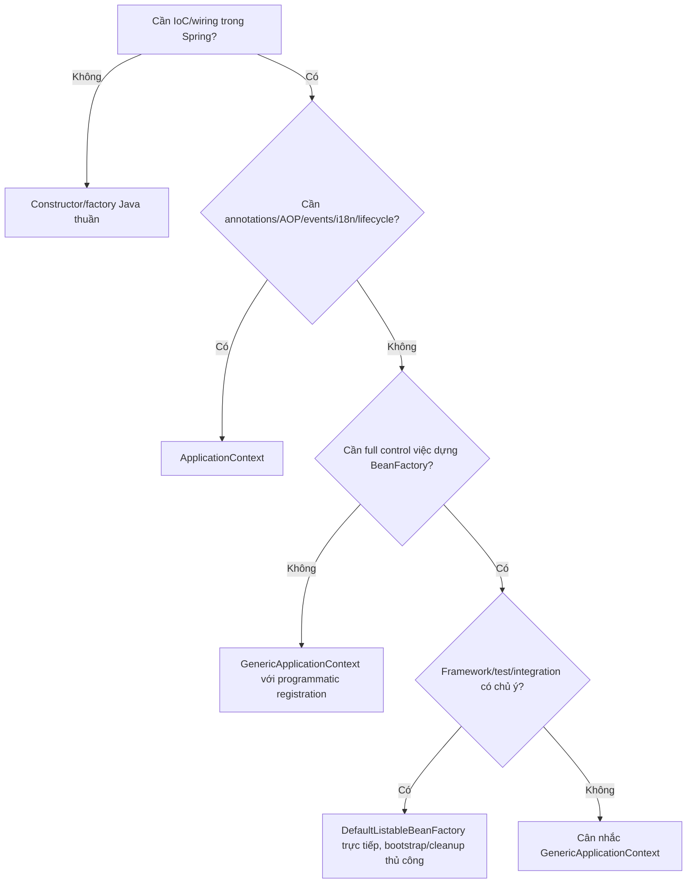

<a id="back-to-top"></a>

# Đăng ký bằng mã

## Menu
- [Khi nào dùng BeanFactory trực tiếp thay ApplicationContext](#programmatic-registration-001)
- [DefaultListableBeanFactory và BeanDefinitionRegistry](#programmatic-registration-002)
- [Tạo định nghĩa bằng BeanDefinitionBuilder](#programmatic-registration-003)
- [GenericApplicationContext và registerBean với Supplier](#programmatic-registration-004)
- [Vai trò của AnnotatedBeanDefinitionReader và ClassPathBeanDefinitionScanner](#programmatic-registration-005)
- [Khác biệt registerSingleton với đăng ký một BeanDefinition](#programmatic-registration-006)
- [AutowireCapableBeanFactory cho đối tượng được tạo bên ngoài](#programmatic-registration-007)
- [Liệt kê, kiểm tra kiểu và tra cứu bean mà tránh tạo sớm ngoài ý muốn](#programmatic-registration-008)
- [Rủi ro thay đổi đăng ký đồng thời sau khi context hoạt động](#programmatic-registration-009)

## <a id="programmatic-registration-001">Khi nào dùng BeanFactory trực tiếp thay ApplicationContext</a>

<details>
<summary>Xem chi tiết</summary>

# Khi nào dùng BeanFactory trực tiếp thay ApplicationContext trong Spring Core Container

## 1. Câu trả lời ngắn: thường chọn ApplicationContext, chỉ chọn BeanFactory trực tiếp khi có lý do cụ thể

Trong Spring Framework, **`BeanFactory`** là hợp đồng nền tảng để tạo bean, phân giải dependency và quản lý các object theo cấu hình. **`ApplicationContext`** kế thừa `BeanFactory` và bổ sung nhiều dịch vụ cấp ứng dụng: khởi động cấu hình thống nhất, tự phát hiện và gọi post-processors, resource loading, internationalization, publication of application events và quản lý lifecycle tích hợp.

Khi phải quyết định một container cho dự án, quy tắc hợp lý là:

> **Ưu tiên `ApplicationContext` cho phần lớn ứng dụng. Dùng trực tiếp một `BeanFactory` như `DefaultListableBeanFactory` khi bạn thực sự cần một container mức thấp, tự kiểm soát bootstrap, cấu hình tối giản, hoặc đang xây framework/library integration.**

Không nên chọn `BeanFactory` trực tiếp chỉ vì nghe rằng “nó nhẹ và lazy hơn”, hay vì ứng dụng không có web server. Một ứng dụng console, CLI, batch, test hoặc service không dùng Spring Boot **vẫn có thể dùng `GenericApplicationContext` hoặc `AnnotationConfigApplicationContext`** rất phù hợp.

Chủ đề này thuộc **đăng ký bean bằng mã (programmatic registration)**. Ta sẽ phân biệt:

- API gốc `BeanFactory` với implementation `DefaultListableBeanFactory`.
- Dựng và đăng ký definitions bằng `registerBeanDefinition`.
- Đăng ký object sẵn có bằng `registerSingleton` và các hệ quả lifecycle.
- Đăng ký bằng mã **nhưng vẫn có ApplicationContext**, ví dụ `GenericApplicationContext.registerBean`.
- Vì sao direct `BeanFactory` **không** tự gọi BFPP/BPP, bật toàn bộ annotation processors hay đóng context giúp bạn.
- Cách lựa chọn có căn cứ, tránh tái tạo toàn bộ hạ tầng Spring bằng tay.

## 2. BeanFactory là gì?

Giao diện `org.springframework.beans.factory.BeanFactory` cung cấp các thao tác nền tảng như:

```java
Object getBean(String name);
<T> T getBean(String name, Class<T> requiredType);
<T> T getBean(Class<T> requiredType);
boolean containsBean(String name);
boolean isSingleton(String name);
boolean isPrototype(String name);
Class<?> getType(String name);
```

Đây là **chữ ký rút gọn**, không phải mã cần định nghĩa lại interface. Các methods lookup có thể ném exceptions khi thiếu hoặc có nhiều bean candidates.

Một `BeanFactory` không nhất thiết là một application configuration system hoàn chỉnh. Nó là **abstraction** cho bean lookup/wiring. Implementation có thể đơn giản như registry chứa các instances sẵn có, hoặc đầy đủ hơn như `DefaultListableBeanFactory`, có khả năng tạo bean từ `BeanDefinition`.

### 2.1. DefaultListableBeanFactory

`org.springframework.beans.factory.support.DefaultListableBeanFactory` là implementation được dùng rộng rãi cho container dựa trên bean definitions.

```java
DefaultListableBeanFactory factory =
        new DefaultListableBeanFactory();

RootBeanDefinition definition =
        new RootBeanDefinition(EmailClient.class);

factory.registerBeanDefinition("emailClient", definition);

EmailClient client =
        factory.getBean("emailClient", EmailClient.class);
```

Đây là **snippet tích hợp**, cần imports `DefaultListableBeanFactory`, `RootBeanDefinition`, và class `EmailClient` có constructor phù hợp.

Cơ chế:

1. `registerBeanDefinition(...)` đặt **metadata** vào registry.
2. `getBean(...)` giải quyết definition tương ứng.
3. Bean factory tạo instance, xử lý constructor/property references và cơ chế lifecycle cốt lõi.
4. Với singleton scope mặc định, lần lookup tiếp theo thường trả cùng instance.
5. Nếu không đăng ký thêm infrastructure, bạn **không tự nhiên có toàn bộ behavior annotation-driven như một ApplicationContext chuẩn**.

### 2.2. Interface và implementation khác nhau

Không gọi:

```java
new BeanFactory();
```

vì `BeanFactory` là interface. `DefaultListableBeanFactory` là implementation cụ thể, đồng thời implement `BeanDefinitionRegistry`, `ConfigurableListableBeanFactory` và các contracts khác.

Các interface liên quan:

| Interface / class | Trách nhiệm |
|---|---|
| `BeanFactory` | Lookup bean bằng tên/type, kiểm tra scope/type |
| `ListableBeanFactory` | Liệt kê các bean definitions/names theo type |
| `HierarchicalBeanFactory` | Cơ chế parent BeanFactory |
| `ConfigurableBeanFactory` | Cấu hình converters/scopes/BPPs, quản lý singleton destruction |
| `ConfigurableListableBeanFactory` | Truy cập và quản lý definition/type metadata cấp cao |
| `BeanDefinitionRegistry` | `registerBeanDefinition`, `removeBeanDefinition` |
| `DefaultListableBeanFactory` | Implementation bean factory + registry phổ biến |
| `ApplicationContext` | Container cấp ứng dụng, là `BeanFactory` cộng thêm dịch vụ |
| `ConfigurableApplicationContext` | `refresh`, `close`, `registerShutdownHook`, lifecycle controls |

**Không chọn implementation chỉ dựa vào tên class**: phải xác định bạn cần lifecycle, annotation support, dynamic registration hay framework integration ở cấp nào.

## 3. ApplicationContext thêm gì so với BeanFactory thuần?

`org.springframework.context.ApplicationContext` **kế thừa `BeanFactory`**, vì vậy bạn vẫn dùng được `getBean(...)`. Khác biệt là lớp container hỗ trợ khởi động ứng dụng đầy đủ hơn.

| Khả năng | Plain DefaultListableBeanFactory | ApplicationContext chuẩn |
|---|---|---|
| Đăng ký `BeanDefinition` | Có | Có qua implementation/registration APIs thích hợp |
| Tạo bean và dependency wiring | Có | Có |
| Singleton/prototype scopes cơ bản | Có | Có |
| `InitializingBean`, `DisposableBean`, custom init/destroy callbacks | Có cơ chế ở BeanFactory; cleanup cần điều phối thủ công | Có, cùng integrated context lifecycle |
| Tự phát hiện bean loại `BeanPostProcessor` | **Không** | **Có** khi refresh |
| Tự phát hiện/chạy `BeanFactoryPostProcessor` | **Không** | **Có** khi refresh |
| Annotation-based injection `@Autowired` | Cần đăng ký processors đúng cách | Thường được bootstrap với annotation infrastructure |
| `@Configuration`, `@Bean`, `@ComponentScan` | Không tự được diễn giải chỉ nhờ plain factory | Được hỗ trợ với annotation configuration setup |
| AOP auto-proxying | Phải đăng ký hạ tầng và advisors phù hợp | Thường tự được tích hợp qua config/enable annotations |
| `ApplicationEventPublisher` | Không tích hợp | Có |
| `MessageSource` tiện dụng | Không tích hợp | Có |
| `ResourceLoader` / tài nguyên | Không là `ResourceLoader` theo contract | Có |
| `refresh()` bootstrap orchestration | Không | Có với configurable contexts |
| `close()` quản lý lifecycle toàn context | Không có API tương đương chuẩn trên plain BeanFactory | Có qua `ConfigurableApplicationContext` |
| `Lifecycle` / `SmartLifecycle` orchestration | Không có tích hợp context-level | Có |
| Phù hợp app thông thường | Có thể, nhưng phải tự nối nhiều phần | **Lựa chọn mặc định** |

Bảng mô tả mức độ **tích hợp/tự động**, không nói plain BeanFactory tuyệt đối không thể hỗ trợ các tính năng mở rộng. Bạn có thể **thêm infrastructure thủ công** nếu thật sự cần, nhưng phải chịu trách nhiệm bootstrap, ordering, cleanup và testing.

### 3.1. Không nhầm “BeanFactory có lifecycle callbacks” với “ApplicationContext integrated lifecycle”

`BeanFactory` vẫn hỗ trợ các lifecycle callbacks khi nó tạo bean từ definitions, ví dụ `InitializingBean.afterPropertiesSet()` và `DisposableBean.destroy()`.

Tuy nhiên:

- Plain factory không tự có một context-level `refresh/start/stop/close` orchestration như `AbstractApplicationContext`.
- Với `DefaultListableBeanFactory`, caller có thể **chủ động gọi `destroySingletons()`** khi kết thúc.
- `ApplicationContext` khi đóng sẽ điều phối thêm lifecycle processor, context events, destruction, caches và những thành phần liên quan.

Vì vậy không nên diễn giải bảng tính năng chính thức “integrated lifecycle management = No” là “plain BeanFactory không thể init/destroy bất kỳ bean nào”.

### 3.2. ApplicationContext không bắt buộc là Spring Boot

Một cách tạo context không dùng Spring Boot:

```java
try (var context =
             new AnnotationConfigApplicationContext(AppConfig.class)) {
    Worker worker = context.getBean(Worker.class);
    worker.execute();
}
```

Đây là **snippet tích hợp**, cần `AppConfig`, `Worker`, Spring Context dependency và imports. Không có `SpringApplication.run(...)`, servlet container, embedded Tomcat hoặc Boot auto-configuration.

Đừng so sánh nhầm “BeanFactory lightweight” với “Spring Boot nặng”. So sánh đúng là **plain BeanFactory** với **Spring Framework ApplicationContext**, còn Boot nằm ở một tầng điều phối riêng.

## 4. Khi nào sử dụng BeanFactory trực tiếp là quyết định hợp lý?

### 4.1. Bạn đang viết thư viện/framework nội bộ cần IoC kernel tối thiểu

Ví dụ một công cụ build, plugin engine, extension registry hoặc test harness muốn:

- Tự đăng ký một tập beans nhỏ bằng mã.
- Quyết định khi nào bean được tạo.
- Không muốn toàn bộ annotation scanning/AOP/event infrastructure.
- Điều khiển chặt các post-processing passes.
- Cấu hình lifetime theo lifecycle của host application, thay vì tạo thêm một full application context.

`DefaultListableBeanFactory` có thể được dùng như một **internal implementation detail** của framework. Host code chịu trách nhiệm chuẩn bị definitions, gọi processors cần thiết và cleanup.

Tuy nhiên, nếu public API của library chỉ cần lấy object, cân nhắc nhận `Supplier<T>`, factory interface hoặc constructor dependencies trước khi đưa một `BeanFactory` ra contract. Tránh ép mọi user của library phụ thuộc Spring IoC.

### 4.2. Cần kiểm soát toàn bộ trình tự bootstrap

Một tool đặc biệt có thể cần:

```text
create factory
  -> register BeanDefinition metadata
  -> chạy custom metadata transformation
  -> register selected BeanPostProcessors
  -> instantiate only chosen beans
  -> use beans
  -> destroy owned singleton instances
```

Plain factory hữu ích nếu bạn **cố ý không** muốn cơ chế refresh tự tìm mọi BFPP/BPP beans và pre-instantiate normal singletons.

Đổi lại bạn phải định nghĩa dependency order, registration timing, error handling và shutdown. Một framework integration được thiết kế kỹ có thể xem đó là ưu điểm; một ứng dụng nghiệp vụ bình thường thường xem đó là **chi phí/rủi ro không cần thiết**.

### 4.3. Một bộ kiểm thử hẹp về BeanDefinition/bean factory SPI

Bạn đang viết unit/integration test cho:

- `BeanDefinition`/constructor resolution.
- Scope và alias registration.
- Custom `BeanPostProcessor`.
- `BeanFactoryPostProcessor` mutation.
- Type conversion hoặc property values population.
- `FactoryBean`/dereference bằng tên có tiền tố `&`.
- Tính idempotent khi register dynamic definitions.

Trong trường hợp đó, plain factory có thể tạo setup đơn giản và ít side effects hơn.

**Giới hạn:** Nếu behavior bạn muốn test thực ra phụ thuộc `@Autowired`, AOP, config parsing hoặc lifecycle event, test plain BeanFactory có thể cho **kết quả sai bối cảnh**. Khi ấy dùng `GenericApplicationContext` hoặc test với đúng production configuration.

### 4.4. Framework cấp thấp đã kiểm soát container rồi

Đôi khi một framework **đã sở hữu BeanFactory**, và component của bạn được cho phép tương tác với nó qua `BeanDefinitionRegistry`/`ConfigurableListableBeanFactory`. Khi chỉ cần đăng ký một definition hoặc đọc metadata, không cần tự tạo ApplicationContext mới.

Ví dụ code của một infrastructure `BeanDefinitionRegistryPostProcessor` nhận `BeanDefinitionRegistry` để thêm definitions. Nó đang làm việc **trong bootstrap của context được host tạo**; không cần nhận cả ApplicationContext chỉ để đăng ký metadata.

**Không nhầm:** tương tác với BeanFactory nội bộ **bên trong ApplicationContext** khác với việc tự tạo và quản lý một plain BeanFactory độc lập.

### 4.5. Một công cụ thật nhỏ với vòng đời được lập trình rõ

Một CLI đơn giản chỉ có vài services có thể chọn direct factory nếu:

- Không cần annotation scanning, events, i18n, AOP, lifecycle phức tạp.
- Không có nhiều module/plugin contexts.
- Startup/cleanup được code tường minh và được test.
- Việc dùng Spring wiring đem lại lợi ích hơn một vài `new` constructor calls.

Nhưng nếu đồ thị object chỉ có hai classes, **Java constructor injection thuần** đôi khi còn đơn giản hơn cả `BeanFactory`. Đừng đưa IoC container vào chỉ vì có thể.

## 5. Khi nào không nên dùng BeanFactory trực tiếp?

### 5.1. Ứng dụng sử dụng nhiều annotations

Khi codebase phụ thuộc `@Component`, `@Autowired`, `@Value`, `@Configuration`, `@Bean`, `@PostConstruct`, `@Transactional`, `@Async`, `@Cacheable`, hoặc annotation-driven AOP, bạn thường muốn `ApplicationContext`.

Các annotations này không phải tất cả tự thực hiện công việc khi JVM load class. Nhiều behaviors xuất hiện vì **post-processors, advisors và context infrastructure** được cấu hình/đăng ký đúng giai đoạn.

Dùng plain factory rồi quên một processor có thể khiến bean tạo ra nhưng **không được inject hoặc proxy đúng**, đôi lúc gây lỗi rất khó phát hiện.

### 5.2. Cần events, quốc tế hóa hoặc resource loading

`ApplicationContext` cung cấp:

- `publishEvent(...)` và `@EventListener` infrastructure.
- `getMessage(...)` với `MessageSource` để i18n.
- `getResource(...)` qua `ResourceLoader`.
- Parent contexts và lifecycle events theo API thống nhất.

Nếu bạn muốn các khả năng này, dùng plain factory đồng nghĩa phải **tự dựng những phần cần thiết** hoặc bổ sung API/service khác.

### 5.3. Muốn container tự xử lý graceful shutdown

Với resources như connection pools, schedulers, messaging consumers và web servers, `ConfigurableApplicationContext.close()`/shutdown hooks/`SmartLifecycle` tạo một mô hình rõ hơn.

Plain factory có `destroySingletons()` để destroy singletons được quản lý, nhưng **không tự điều phối `SmartLifecycle` start/stop theo phases**, context events và hệ thống shutdown phức tạp.

### 5.4. Tạo hàng trăm definitions và dependencies theo module

Khi ứng dụng có nhiều profiles, conditional configuration, imported configurations, AOP integrations hoặc nhu cầu vận hành lớn, lợi ích của tự quản một plain factory giảm nhanh. Hãy tận dụng hạ tầng ApplicationContext thay vì xây một “mini Spring context” kém kiểm chứng.

### 5.5. Lý do duy nhất là “muốn lazy initialization”

Một plain `DefaultListableBeanFactory` thông thường **tạo singleton theo nhu cầu khi `getBean()`**. Ngược lại, `ApplicationContext.refresh()` thường pre-instantiate non-lazy singletons.

Nhưng **ApplicationContext cũng hỗ trợ lazy initialization** thông qua `@Lazy` hoặc `BeanDefinition.setLazyInit(true)`, và có các giới hạn thực tế (dependency eagerly references, BFPP/BPP infrastructure, `SmartLifecycle`).

Do đó “muốn lazy” **không đủ** để loại ApplicationContext. Chọn lazy settings hoặc functional registration trong context nếu những tiện ích context khác vẫn cần.

## 6. Đăng ký bean bằng mã với DefaultListableBeanFactory

### 6.1. Register BeanDefinition: container tạo object

```java
var factory = new DefaultListableBeanFactory();

RootBeanDefinition repositoryDefinition =
        new RootBeanDefinition(AccountRepository.class);

factory.registerBeanDefinition(
        "accountRepository", repositoryDefinition);
```

Đây là snippet tích hợp, cần `AccountRepository` có constructor hợp lệ và imports. Definition chứa **công thức tạo bean**, chưa nhất thiết có object instance tại thời điểm register.

Khi gọi:

```java
AccountRepository repo =
        factory.getBean("accountRepository", AccountRepository.class);
```

factory tạo và quản lý instance tương ứng theo scope. Với singleton mặc định, factory giữ shared object trong registry cho lần truy cập sau.

### 6.2. Set constructor args và property values

```java
RootBeanDefinition serviceDef =
        new RootBeanDefinition(AccountService.class);

serviceDef.getConstructorArgumentValues()
        .addIndexedArgumentValue(0, "tenant-01");

serviceDef.getPropertyValues()
        .add("repository",
             new RuntimeBeanReference("accountRepository"));

factory.registerBeanDefinition("accountService", serviceDef);
```

Đây là snippet tích hợp; `AccountService` cần constructor nhận String và setter `setRepository(AccountRepository)` tương ứng. `RuntimeBeanReference` giữ một **reference** đến bean name, để factory resolve lúc tạo instance.

**Khác biệt:** `new AccountService(...)` ngay trong code là bạn trực tiếp tạo object; `registerBeanDefinition` để container kiểm soát creation, injection, lifecycle callbacks và scope.

### 6.3. BeanDefinitionBuilder

Nếu không muốn tự thao tác `RootBeanDefinition` nhiều lần, Spring có builder:

```java
BeanDefinitionBuilder builder =
        BeanDefinitionBuilder.rootBeanDefinition(AccountService.class);

builder.addConstructorArgValue("tenant-01");
builder.addPropertyReference("repository", "accountRepository");

factory.registerBeanDefinition(
        "accountService", builder.getBeanDefinition());
```

Đây là snippet **thay thế** đoạn đăng ký service phía trên, không đăng ký hai definitions trùng tên trong cùng một ví dụ. Cần import `BeanDefinitionBuilder`.

Builder phù hợp khi framework nhận plugin descriptors rồi biến thành definitions. Nhưng nếu registrations trở nên lớn và cần annotation features, hãy xem functional registration với `GenericApplicationContext`.

### 6.4. registerSingleton: object đã được tạo bên ngoài

```java
AccountRepository external = new AccountRepository();
factory.registerSingleton("externalRepository", external);
```

Đây là snippet tích hợp, cần class tương ứng. `registerSingleton` nhận một object **đã tồn tại** và đưa vào singleton registry, **không phải** một BeanDefinition instruct factory tạo object.

Hệ quả quan trọng:

- Constructor và dependency injection đã diễn ra **ngoài container** theo code của caller.
- Các initialization callbacks và full BPP pipeline **không tự được áp hồi tố** lên object đã tạo chỉ nhờ `registerSingleton`.
- Các semantics cleanup/destruction **không giống** bean tạo từ BeanDefinition; không được mặc định factory biết mọi destroy callback cho singleton được gắn từ bên ngoài.

Nếu object này có resource ownership, hãy quy định **ai đóng nó**. Có thể dùng `initializeBean`/`AutowireCapableBeanFactory` APIs phù hợp khi chủ ý đưa instance sẵn có qua bước initialization, nhưng phải hiểu registration/lifecycle rõ, không xem đó là đường thay thế hoàn toàn tương đương definition.

### 6.5. Bean names, aliases và FactoryBean

Bạn có thể dùng alias registry để ánh xạ tên cho một bean nếu implementation hỗ trợ:

```java
factory.registerAlias("accountRepository", "primaryRepository");
```

Đây là snippet tích hợp. Alias không tạo instance mới. Trong Spring `FactoryBean<T>` có quy ước `getBean("name")` lấy product, `getBean("&name")` lấy factory object, nhưng đó là extension point khác với `BeanFactory` — hai tên có chữ “Factory” không đồng nghĩa.

### 6.6. Đừng đăng ký definitions động không kiểm soát ở giữa runtime

Spring Javadoc cảnh báo đăng ký/ghi đè bean definitions khi container **đang phục vụ truy cập đồng thời** có thể tạo hành vi không ổn định hoặc race. Với cả BeanFactory lẫn ApplicationContext, chuẩn bị definitions **trước giai đoạn sử dụng bình thường** thường an toàn hơn.

Một plugin system thật sự dynamic cần có ownership, synchronization, lifecycle teardown và policy replace rõ, không chỉ gọi `registerBeanDefinition` từ mọi worker thread.

## 7. BeanFactoryPostProcessor và BeanPostProcessor phải được chuẩn bị thủ công

Đây là khác biệt thực tế nhất với ApplicationContext.

### 7.1. BeanFactoryPostProcessor: chỉnh metadata trước khi tạo bean

`BeanFactoryPostProcessor` nhận một `ConfigurableListableBeanFactory`:

```java
BeanFactoryPostProcessor metadataProcessor =
        factoryToConfigure -> factoryToConfigure
                .getBeanDefinition("accountService")
                .getPropertyValues()
                .add("timeoutSeconds", 30);

metadataProcessor.postProcessBeanFactory(factory);
```

Đây là snippet tích hợp cần definition `accountService` có writable `timeoutSeconds`. **Phải chạy trước khi instance được tạo** nếu muốn metadata change ảnh hưởng bean mới.

Với plain `DefaultListableBeanFactory`, chỉ đăng ký một bean definition có class implement `BeanFactoryPostProcessor` **không tự kích hoạt nó**. Bạn phải gọi processor **đúng thời điểm** hoặc tự tổ chức một cơ chế tương đương với context bootstrapping.

Không lấy `factory.getBean("accountService")` trong BFPP để sửa instance, vì có thể khởi tạo quá sớm và bỏ qua BPPs quan trọng.

### 7.2. BeanPostProcessor: chỉnh instance trong lúc tạo

```java
BeanPostProcessor tracingProcessor = new BeanPostProcessor() {
    @Override
    public Object postProcessAfterInitialization(
            Object bean, String beanName) {
        if (bean instanceof AccountService) {
            System.out.println("Initialized: " + beanName);
        }
        return bean;
    }
};

factory.addBeanPostProcessor(tracingProcessor);
```

Đây là snippet tích hợp. Đăng ký BPP **trước khi gọi getBean** để các beans cần xử lý đi qua callback.

Một BPP có thể thay object bằng **proxy**. Khi có nhiều BPPs, thứ tự đăng ký thủ công quan trọng; theo tài liệu Spring, BPPs được thêm bằng `addBeanPostProcessor` **không tự sắp xếp theo `Ordered`**, mà dùng thứ tự đăng ký. Đừng giả định hành vi giống context auto-detection.

### 7.3. ApplicationContext tự xử lý ra sao?

Trong một `ApplicationContext.refresh()` điển hình, Spring:

1. Thu thập local `BeanFactoryPostProcessor` và `BeanDefinitionRegistryPostProcessor` candidates.
2. Chạy chúng theo giai đoạn/ordering phù hợp.
3. Tìm và đăng ký các `BeanPostProcessor` beans.
4. Tiến hành khởi tạo những non-lazy singletons thông thường.
5. Thực hiện initialization/lifecycle và publish events.

`BeanFactory` thuần **không tự orchestration những bước ấy**. Nếu cần chúng, bạn có hai hướng: dựng thủ công đúng contract (phù hợp framework integrator) hoặc dùng ApplicationContext (hợp lý với đa số applications).

### 7.4. @Autowired không tự chạy chỉ vì có annotation

`@Autowired` thường được xử lý bởi `AutowiredAnnotationBeanPostProcessor`. Nếu plain factory không đăng ký annotation processor thích hợp, một field `@Autowired` có thể vẫn `null` mà không có warning ngay tại point of creation.

Một đoạn hướng dẫn từ tài liệu Spring cho plain factory:

```java
factory.addBeanPostProcessor(
        new AutowiredAnnotationBeanPostProcessor());
```

Đây là snippet **khái quát theo tài liệu Spring**; trong một integration thực tế phải cấu hình processor/bean factory callbacks và các annotation infrastructure tương ứng khi cần, không chỉ copy một dòng nếu bài toán có `@Value`, `@Resource`, JSR annotations hoặc thêm các processors khác.

Đặc biệt, **`@Configuration` và `@Bean` không tự được phân tích** bởi plain factory chỉ vì bạn gọi `registerBeanDefinition` cho configuration class. Annotation-driven configuration class parsing cần `ConfigurationClassPostProcessor` và hạ tầng đi kèm.

## 8. Lifecycle: ai khởi tạo, ai hủy?

### 8.1. Plain BeanFactory có callbacks cho bean nó tạo

Một managed bean có thể implement:

```java
public final class FileIndex implements
        InitializingBean, DisposableBean {

    @Override
    public void afterPropertiesSet() {
        // mở hoặc validate resource sau property injection
    }

    @Override
    public void destroy() {
        // release owned resources
    }
}
```

Đây là snippet tích hợp, cần imports và logic cụ thể. Các interfaces này thuộc Spring BeanFactory-level lifecycle.

Nếu instance được factory tạo từ BeanDefinition, `afterPropertiesSet()` thường được gọi như một phần bean initialization. Để dọn singletons khi dùng plain factory, bạn **chủ động** gọi API như `destroySingletons()` trong lifecycle do caller quản lý.

### 8.2. PreInstantiateSingletons là quyết định tường minh

`DefaultListableBeanFactory` hỗ trợ:

```java
factory.preInstantiateSingletons();
```

Phương thức này thúc đẩy tạo các singleton non-lazy definitions sau khi bạn đã hoàn tất đăng ký processors. Nếu muốn lazy-on-first-use, **đừng gọi nó** và chỉ tạo khi `getBean` cần.

Ngược lại, ApplicationContext `refresh()` tiêu chuẩn thường gọi tương đương trong `finishBeanFactoryInitialization()`.

### 8.3. Cleanup plain factory

Ví dụ:

```java
DefaultListableBeanFactory factory =
        new DefaultListableBeanFactory();

try {
    // register definitions/processors, then use getBean...
} finally {
    factory.destroySingletons();
}
```

Đây là **snippet cấu trúc** chưa có definitions, không phải project hoàn chỉnh. `destroySingletons()` có thể kích hoạt destroy callbacks cho managed singleton beans mà factory biết. Nó **không tự đóng mọi resource mở ngoài container** và không hứa gọi destroy cho prototype beans.

**Prototype**: Spring container thường quản lý việc tạo và initialization, nhưng **không tự theo dõi/hủy từng prototype instance** như singleton. Caller sở hữu cleanup sau khi nhận prototype.

### 8.4. Context close có thêm lifecycle orchestration

`ConfigurableApplicationContext.close()` ngoài destroy singletons còn điều phối event `ContextClosedEvent`, `LifecycleProcessor.onClose()` và `SmartLifecycle` stop phases.

Một plain factory không có event publisher/context lifecycle engine mặc định. Nếu workers/queues/pools cần graceful stop, quyết định dùng ApplicationContext hoặc triển khai explicit owner-managed lifecycle với tests.

## 9. Ví dụ hoàn chỉnh Java 17 + Spring Framework 6.2

Demo dưới đây kiểm chứng bằng **hai container độc lập**:

- **Plain `DefaultListableBeanFactory`**: đăng ký definitions bằng mã, gọi BFPP thủ công, thêm BPP thủ công, lookup bean và gọi `destroySingletons()` tường minh.
- **`GenericApplicationContext`**: đăng ký cùng bean definitions, đồng thời đăng ký BFPP/BPP **như bean definitions**; khi gọi `refresh()`, Spring **tự phát hiện và kích hoạt** processors, rồi `close()` thực hiện cleanup.

Hai nhánh dùng cùng entity class và cùng logic processor để loại trừ sự khác biệt nghiệp vụ.

### 9.1. Yêu cầu và cấu trúc

Yêu cầu **JDK 17+**, **Maven 3.9+**, `spring-context:6.2.0`. Không cần Spring Boot, database, web server hay component scanning.

```text
beanfactory-direct-demo/
├── pom.xml
└── src/main/java/example/BeanFactoryChoiceDemo.java
```

### 9.2. pom.xml

```xml
<project xmlns="http://maven.apache.org/POM/4.0.0"
         xmlns:xsi="http://www.w3.org/2001/XMLSchema-instance"
         xsi:schemaLocation="http://maven.apache.org/POM/4.0.0
                             https://maven.apache.org/xsd/maven-4.0.0.xsd">
    <modelVersion>4.0.0</modelVersion>
    <groupId>example</groupId>
    <artifactId>beanfactory-direct-demo</artifactId>
    <version>1.0.0</version>
    <properties>
        <maven.compiler.release>17</maven.compiler.release>
        <project.build.sourceEncoding>UTF-8</project.build.sourceEncoding>
    </properties>
    <dependencies>
        <dependency>
            <groupId>org.springframework</groupId>
            <artifactId>spring-context</artifactId>
            <version>6.2.0</version>
        </dependency>
    </dependencies>
    <build>
        <plugins>
            <plugin>
                <groupId>org.apache.maven.plugins</groupId>
                <artifactId>maven-compiler-plugin</artifactId>
                <version>3.13.0</version>
            </plugin>
            <plugin>
                <groupId>org.codehaus.mojo</groupId>
                <artifactId>exec-maven-plugin</artifactId>
                <version>3.5.0</version>
            </plugin>
        </plugins>
    </build>
</project>
```

### 9.3. src/main/java/example/BeanFactoryChoiceDemo.java

```java
package example;

import org.springframework.beans.factory.DisposableBean;
import org.springframework.beans.factory.InitializingBean;
import org.springframework.beans.factory.config.BeanFactoryPostProcessor;
import org.springframework.beans.factory.config.BeanPostProcessor;
import org.springframework.beans.factory.config.RuntimeBeanReference;
import org.springframework.beans.factory.support.DefaultListableBeanFactory;
import org.springframework.beans.factory.support.RootBeanDefinition;
import org.springframework.context.support.GenericApplicationContext;

public final class BeanFactoryChoiceDemo {

    public static void main(String[] args) {

        System.out.println("--- plain BeanFactory ---");

        DefaultListableBeanFactory factory =
                new DefaultListableBeanFactory();

        factory.registerBeanDefinition(
                "repository", new RootBeanDefinition(Repository.class));
        factory.registerBeanDefinition("service", serviceDefinition());

        // Plain factory không tự phát hiện/chạy BFPP bean:
        // ta tự gọi processor trước khi tạo service.
        new LabelMetadataProcessor("plain")
                .postProcessBeanFactory(factory);

        // Plain factory không tự quét BeanPostProcessor definitions:
        // ta đăng ký instance BPP trực tiếp và đúng thời điểm.
        factory.addBeanPostProcessor(new LabelBeanProcessor("plain"));

        try {
            Service plain = factory.getBean("service", Service.class);
            System.out.println("plain result: " + plain.describe());
            System.out.println("plain singleton: "
                    + (plain == factory.getBean("service")));
        } finally {
            // Không có ApplicationContext.close(); chủ động destroy.
            factory.destroySingletons();
        }

        System.out.println("--- ApplicationContext ---");

        try (GenericApplicationContext context =
                     new GenericApplicationContext()) {

            context.registerBeanDefinition(
                    "repository", new RootBeanDefinition(Repository.class));
            context.registerBeanDefinition(
                    "service", serviceDefinition());

            // Đăng ký processors như bean definitions. Context sẽ
            // TỰ PHÁT HIỆN và xử lý khi refresh.
            context.registerBeanDefinition(
                    "metadataProcessor",
                    withTag(LabelMetadataProcessor.class, "context"));
            context.registerBeanDefinition(
                    "beanProcessor",
                    withTag(LabelBeanProcessor.class, "context"));

            context.refresh();

            Service service = context.getBean("service", Service.class);
            System.out.println("context result: " + service.describe());
            System.out.println("context singleton: "
                    + (service == context.getBean("service")));
        }
    }

    private static RootBeanDefinition serviceDefinition() {
        RootBeanDefinition definition =
                new RootBeanDefinition(Service.class);

        definition.getPropertyValues()
                .add("repository",
                     new RuntimeBeanReference("repository"));
        definition.getPropertyValues()
                .add("label", "initial");

        return definition;
    }

    private static RootBeanDefinition withTag(
            Class<?> type, String tag) {

        RootBeanDefinition definition = new RootBeanDefinition(type);
        definition.getConstructorArgumentValues()
                .addIndexedArgumentValue(0, tag);
        return definition;
    }

    public static final class Repository {
        public String id() {
            return "repo";
        }
    }

    public static final class Service
            implements InitializingBean, DisposableBean {

        private Repository repository;
        private String label;
        private String processedBy = "none";

        public void setRepository(Repository repository) {
            this.repository = repository;
        }

        public void setLabel(String label) {
            this.label = label;
        }

        public void setProcessedBy(String processedBy) {
            this.processedBy = processedBy;
        }

        @Override
        public void afterPropertiesSet() {
            if (repository == null) {
                throw new IllegalStateException("repository required");
            }
            System.out.println("init: " + label);
        }

        public String describe() {
            return label + "|" + processedBy + "|" + repository.id();
        }

        @Override
        public void destroy() {
            System.out.println("destroy: " + label);
        }
    }

    public static final class LabelMetadataProcessor
            implements BeanFactoryPostProcessor {

        private final String tag;

        public LabelMetadataProcessor(String tag) {
            this.tag = tag;
        }

        @Override
        public void postProcessBeanFactory(
                org.springframework.beans.factory.config
                        .ConfigurableListableBeanFactory beanFactory) {

            beanFactory.getBeanDefinition("service")
                    .getPropertyValues().add("label", tag);

            System.out.println("BFPP: " + tag);
        }
    }

    public static final class LabelBeanProcessor
            implements BeanPostProcessor {

        private final String tag;

        public LabelBeanProcessor(String tag) {
            this.tag = tag;
        }

        @Override
        public Object postProcessAfterInitialization(
                Object bean, String beanName) {

            if (bean instanceof Service service) {
                service.setProcessedBy(tag);
                System.out.println("BPP: " + tag);
            }
            return bean;
        }
    }
}
```

### 9.4. Chạy

Trong thư mục chứa `pom.xml`:

```bash
mvn -q compile exec:java -Dexec.mainClass=example.BeanFactoryChoiceDemo
```

**Stdout kỳ vọng từ các `System.out.println`** (không tính Maven/Spring logging có thể thêm):

```text
--- plain BeanFactory ---
BFPP: plain
init: plain
BPP: plain
plain result: plain|plain|repo
plain singleton: true
destroy: plain
--- ApplicationContext ---
BFPP: context
init: context
BPP: context
context result: context|context|repo
context singleton: true
destroy: context
```

### 9.5. Vì sao kết quả đúng?

**Nhánh plain factory:**

1. `registerBeanDefinition` cho `repository` và `service` chưa tạo service ngay.
2. `LabelMetadataProcessor("plain").postProcessBeanFactory(factory)` được **gọi thủ công**. Nó đổi local definition property `label` từ `"initial"` thành `"plain"`, in `BFPP: plain`.
3. `addBeanPostProcessor(new LabelBeanProcessor("plain"))` đăng ký callback sẽ chạy khi factory tạo beans về sau.
4. `getBean("service")` tạo `Repository`, tạo `Service`, inject setter references/properties, gọi `afterPropertiesSet()` in `init: plain`.
5. BPP xử lý sau initialization, gắn marker `processedBy="plain"`, in `BPP: plain`.
6. `describe()` trả `plain|plain|repo`; bean singleton được cache, nên hai lần lookup cùng object.
7. `destroySingletons()` thực hiện destroy callback cho managed `Service` singleton, in `destroy: plain`.

**Nhánh GenericApplicationContext:**

1. Context được tạo **chưa refresh**, cho phép đăng ký definitions.
2. `metadataProcessor` và `beanProcessor` được đăng ký **như BeanDefinitions**; không phải gọi `postProcessBeanFactory(...)`/ `addBeanPostProcessor(...)` thủ công.
3. `refresh()` tự nhận biết BFPP local, gọi nó để đổi label sang `"context"`; in `BFPP: context`.
4. Context tự nhận biết BPP local, thêm vào factory’s post-processing pipeline.
5. Trong non-lazy singleton pre-instantiation, `Service` được tạo và init, in `init: context`, sau đó BPP in `BPP: context`.
6. Lúc `getBean("service")` được gọi trong `main`, instance đã sẵn sàng; `describe()` trả `context|context|repo`.
7. `try-with-resources` gọi `context.close()`; singleton destroy callback in `destroy: context`.

**Điểm kiểm chứng:** hai kết quả nghiệp vụ giống nhau về logic, nhưng chi phí orchestration thuộc **ai** khác nhau. Plain factory yêu cầu code chủ động chạy processors/cleanup; context tổ chức các bước chuẩn cho ứng dụng.

### 9.6. Có nên gọi trực tiếp factory.destroySingletons() sau mỗi getBean?

Không. `destroySingletons()` là **kết thúc lifecycle của singleton registry do factory sở hữu**, không phải cleanup riêng một lần lookup. Chỉ gọi tại **shutdown boundary**, khi không còn active consumers cần dùng các singleton đó.

### 9.7. Vì sao demo không dùng @Autowired?

Mục tiêu là so sánh **cơ chế cốt lõi** không phụ thuộc annotation infrastructure. Service nhận dependency qua `RuntimeBeanReference` và setter để cả plain factory lẫn context đều xử lý đúng.

Nếu đổi `Service` sang field `@Autowired Repository repository;`, plain factory sẽ cần đăng ký `AutowiredAnnotationBeanPostProcessor` đúng cách; còn context annotation infrastructure tùy implementation sẽ cần được bật/đăng ký thích hợp. Đó là một **bài kiểm thử khác**, không nên trộn vào một sample nhằm kiểm chứng BFPP/BPP auto-detection.

### 9.8. Thử nghiệm thay đổi để thấy sự khác biệt

Với nhánh plain, thử **bỏ** dòng:

```java
factory.addBeanPostProcessor(new LabelBeanProcessor("plain"));
```

Khi đó `getBean("service")` vẫn tạo Service theo BeanDefinition, nhưng `processedBy` giữ `"none"`. Kết quả `plain result` thành `plain|none|repo`.

Nếu bỏ lời gọi BFPP thủ công, property label vẫn là `"initial"`; output tương ứng bắt đầu bằng `initial`. Các thay đổi này là **thí nghiệm riêng**, không thực hiện đồng thời với output kỳ vọng gốc.

Với context, nếu bỏ **definition của bean `metadataProcessor`**, label không còn được đổi sang context. Nếu bỏ definition `beanProcessor`, BPP marker không được set. Bản thân `refresh()` không thể xử lý một custom processor mà bạn hoàn toàn chưa đăng ký.

## 10. Vẫn muốn đăng ký bằng mã nhưng không muốn BeanFactory thuần? Dùng GenericApplicationContext

Nhiều trường hợp developer nghĩ “tôi cần programmatic registration, nên phải dùng BeanFactory trực tiếp”. Điều này **không đúng**.

`GenericApplicationContext` cho phép register definitions hoặc **functional bean registration**:

```java
GenericApplicationContext context = new GenericApplicationContext();

context.registerBean(
        "clock",
        java.time.Clock.class,
        java.time.Clock::systemUTC);

context.registerBean(
        "reportService",
        ReportService.class,
        () -> new ReportService(context.getBean(
                "clock", java.time.Clock.class)));

context.refresh();
```

Đây là snippet tích hợp cần class `ReportService` với constructor nhận `Clock`; phải đóng context sau khi dùng. Đây là **registration qua suppliers**, không phải component scanning, nhưng vẫn nhận **context-level lifecycle/infrastructure**.

### 10.1. So sánh ba lựa chọn thực tế

| Lựa chọn | Bạn đăng ký gì? | Ai xử lý bootstrap/lifecycle? | Phù hợp |
|---|---|---|---|
| Plain `DefaultListableBeanFactory` | `BeanDefinition`, singleton instances, processors | **Bạn** | Framework SPI, test hẹp, container mức thấp |
| `GenericApplicationContext` | Programmatic definitions, suppliers, registerBean | **Spring ApplicationContext** | Ứng dụng muốn cấu hình bằng code linh hoạt |
| `AnnotationConfigApplicationContext` | `@Configuration`, component classes, scanning, registerBean | **Spring ApplicationContext** | Ứng dụng theo mô hình annotation Java Config |

`GenericApplicationContext` là câu trả lời rất thường xuyên khi yêu cầu là **“không muốn XML hay scanning, nhưng vẫn muốn container đầy đủ”**.

### 10.2. Functional registration và @Configuration không đồng nhất

`registerBean(name, type, supplier)` cung cấp một **factory callback** để tạo object. Nó không tự có cùng ngữ nghĩa với full parsing `@Configuration`/`@Bean` nếu bạn chưa thêm annotation infrastructure phù hợp.

Nếu muốn dùng `@Configuration` classes và `@ComponentScan`, `AnnotationConfigApplicationContext` là lựa chọn tự nhiên hơn. Đừng tạo một plain GenericApplicationContext rồi kỳ vọng mọi annotations tự được parse nếu chưa cấu hình.

### 10.3. Không dùng ApplicationContext chỉ để gọi getBean khắp business code

Dù dùng context, application code nên ưu tiên **constructor injection** thay vì gọi `context.getBean(...)` ở mọi business method. Bean lookup trực tiếp thường phù hợp ở composition root, plugin/extension point hoặc integration code.

Ví dụ tốt:

```java
public final class ReportService {
    private final Clock clock;

    public ReportService(Clock clock) {
        this.clock = clock;
    }
}
```

Đây là snippet minh họa; cần `java.time.Clock` import. Business service không biết bean factory, dễ unit-test hơn.

## 11. Startup performance và memory: đừng kết luận chỉ theo tên container

Nhiều người chọn plain BeanFactory vì cho rằng “không pre-instantiate singleton thì luôn nhanh hơn”. Cần tách:

- **Đăng ký definitions**: tạo metadata objects.
- **Tìm processor/parse configurations**: thêm công việc ở application context.
- **Khởi tạo eager singleton beans**: làm I/O, xây dependency graph.
- **Nạp class/scan classpath**: chi phí riêng.
- **First request/first getBean**: laziness dời công việc sang lúc khác.

Plain factory có thể khởi động nhanh hơn trong một workload rất nhỏ, nhưng:

1. **Thời gian không biến mất** nếu bean cuối cùng vẫn phải được tạo.
2. Một ứng dụng có performance bottleneck ở database/network chứ không phải Spring context.
3. ApplicationContext cũng hỗ trợ **lazy beans**.
4. Việc tự viết và duy trì bootstrap phức tạp có chi phí phát triển cao hơn vài mili-giây startup.
5. Cần benchmark với **cùng bean graph và features**, không so plain two-bean factory với một Boot enterprise app nhiều auto-configurations.

Kết luận thực tế: đo **startup latency, memory, error behavior và first-use latency** bằng benchmark, không dùng lời truyền miệng.

### 11.1. Khi nào plain factory thật sự tiết kiệm?

Khi một tool/framework chỉ cần một số lớp đơn giản, cố ý không nạp đầy đủ annotation/AOP/events infrastructure, lợi ích có thể đáng kể. Nhưng nếu code phải thêm lại mọi processor để mô phỏng context, lợi ích trở nên nhỏ và risk tăng.

### 11.2. Lazy không giải quyết mọi vấn đề

Một singleton lazy có thể bị tạo sớm vì:

- Eager singleton khác inject dependency.
- Processor cần scan/type-check.
- `SmartLifecycle` auto-start.
- Explicit `getBean(...)`.
- Framework integration gọi lookup lúc bootstrap.

Đừng xem lazy là bằng chứng container đã tránh mọi side effects ở startup.

## 12. Annotation infrastructure: tính năng nào cần processor nào?

| Tính năng | Hạ tầng thường gặp | Lưu ý với plain factory |
|---|---|---|
| `@Autowired`, `@Value` | `AutowiredAnnotationBeanPostProcessor`, embedded value resolution | Phải setup đúng pipeline |
| `@Resource`, `@PostConstruct`, `@PreDestroy` | `CommonAnnotationBeanPostProcessor` và các processors liên quan | Không tự xuất hiện chỉ vì JAR có class annotation |
| `@Configuration`, `@Bean`, `@Import` | `ConfigurationClassPostProcessor` (BDRPP) | Plain factory không tự parse |
| `@Transactional` (proxy) | Transaction advisors + auto-proxy infrastructure | Cần transaction manager và proxy setup |
| `@Async` | Async annotation processor/auto-proxy và executor | Cần invocation qua proxy |
| `@Cacheable` | Cache infrastructure/advisors | Cần CacheManager/cache config |
| `@EventListener` | EventListener method registration và ApplicationContext events | Plain factory không có built-in event publisher |
| `@Lazy` | Bean definition metadata/lazy resolution rules | Có khả năng ở core, nhưng annotation parsing cần hạ tầng |
| `@Scope` | Scope metadata và `Scope` registrations | Singleton/prototype cơ bản có, custom web scopes cần setup |
| `@Profile`, `@Conditional` | Configuration class registration processing | Không tự xử lý khi chỉ register class thành plain definition |

Bảng mô tả **các thành phần khái niệm**, không khẳng định tất cả tính năng do một class duy nhất thực hiện.

Nếu team phải đăng ký năm đến mười processors và integration services chỉ để plain BeanFactory hoạt động như application context, đó thường là dấu hiệu nên **đổi sang ApplicationContext**.

## 13. Hệ quả với scopes, FactoryBean và object ownership

### 13.1. Singleton, prototype và custom scopes

`DefaultListableBeanFactory` hỗ trợ singleton/prototype scopes theo metadata. Để có request/session scopes trong web app, cần scope implementations và lifecycle web context tương ứng; chúng **không tự xuất hiện** chỉ vì dùng plain factory.

```java
RootBeanDefinition prototype =
        new RootBeanDefinition(TransientWorker.class);
prototype.setScope("prototype");
factory.registerBeanDefinition("worker", prototype);
```

Đây là snippet tích hợp với `TransientWorker` class. Mỗi `getBean("worker")` thường tạo instance mới. Factory không tự hủy mỗi prototype khi caller bỏ sử dụng.

### 13.2. FactoryBean khác BeanFactory

`FactoryBean<T>` là một **bean tạo ra object sản phẩm**. Với tên `analyticsClientFactory`:

```java
Object product = factory.getBean("analyticsClientFactory");
Object factoryObject = factory.getBean("&analyticsClientFactory");
```

Đây là snippet tích hợp nếu bean tương ứng implement `FactoryBean<T>`. Nó minh họa quy tắc `&` dereference, không thay đổi quyết định dùng direct BeanFactory hay context.

### 13.3. registerSingleton và shutdown ownership

Nếu object được tạo bên ngoài và đưa vào registry, owner cần quyết định cleanup thực tế. Tránh:

```java
DataSource ds = makeDataSource();
factory.registerSingleton("dataSource", ds);
// ... rồi kết thúc process, không đóng ds ở đâu.
```

Đây là **anti-pattern minh họa**; factory không thể suy toàn bộ lifecycle protocol của một object arbitrary bạn tạo sẵn. Dùng BeanDefinition/factory method + destroy method nếu muốn container quản lý callback, hoặc chủ động đóng object ở owner.

### 13.4. BeanFactory không phải Service Locator bắt buộc

Nếu một library chỉ nhận `BeanFactory`, nó có thể tự gọi lookup trong mọi method, tạo coupling với Spring. Cân nhắc constructor injection interface dependencies hoặc một factory nhỏ do chính bạn định nghĩa để giữ business code độc lập.

## 14. Những lỗi phổ biến khi chuyển ApplicationContext sang BeanFactory

| Triệu chứng | Nguyên nhân | Cách xử lý |
|---|---|---|
| Bean được tạo nhưng `@Autowired` field null | Không đăng ký annotation BPP | Dùng context hoặc bootstrap annotation processors đúng |
| `@PostConstruct` không chạy | Thiếu common annotation processor | Đăng ký callback processor hoặc chọn context |
| `@Bean` method không tạo bean | Chưa parse configuration class | Dùng AnnotationConfigApplicationContext/ConfigurationClassPostProcessor |
| `@Transactional` không hoạt động | Không có proxy infrastructure/transaction manager | Cấu hình transaction proxy ở context thích hợp |
| `@EventListener` không được gọi | Plain factory không có ApplicationContext event bus | Dùng context hoặc own event bus |
| BFPP bean đã register nhưng metadata không đổi | BFPP không tự được gọi | Gọi `postProcessBeanFactory` thủ công đúng thời điểm |
| BPP bean đã register nhưng không xử lý service | Plain factory không auto-detect/register | `addBeanPostProcessor` trước creation |
| `@Value` placeholder chưa resolve | Thiếu embedded value resolver/placeholder configurer | Cấu hình resolution infrastructure |
| Ứng dụng không dừng socket/worker | Không có integrated lifecycle, caller quên cleanup | Dùng context close hoặc explicit stop/destroy |
| Prototype leak | Container không auto-destroy prototype | Caller cleanup |
| Bean đã khởi tạo trước khi BPP được thêm | Registration order sai | Bootstrap processors trước `getBean` |
| BFPP gọi `getBean` làm mất proxy | Premature instantiation | Chỉnh BeanDefinition metadata, không eager instantiate |
| ApplicationContext không cho `refresh()` lần 2 | GenericApplicationContext single refresh | Tạo context mới, không re-refresh |
| `BeanFactory` thấy bean theo type không như mong đợi | Multiple candidates, aliases, FactoryBean type metadata | Dùng `getBeanNamesForType`, qualifiers/explicit references |
| Startup benchmark thiếu công bằng | Hai containers có tập features/beans khác nhau | Benchmark cùng workload và configs |
| Thêm definitions giữa nhiều threads gây lỗi | Mutate live container không có policy đồng bộ | Chuẩn bị trước runtime hoặc quản lý integration riêng |

### 14.1. Debug có hệ thống

1. Xác nhận code đang dùng **`DefaultListableBeanFactory`** thuần hay `ApplicationContext`.
2. Kiểm tra **bean definitions** đã được register và tên có đúng không.
3. Phân biệt `registerBeanDefinition` với `registerSingleton`.
4. Kiểm tra scope và lần gọi `getBean` đầu tiên.
5. Liệt kê các BPPs đã được đăng ký trong factory, kể cả programmatic registrations.
6. Xác định BFPP có được **gọi** trước tạo service không, không chỉ được định nghĩa.
7. Nếu dùng annotations, xác định infrastructure nào **đã được bật**.
8. Kiểm tra bean có bị tạo sớm bởi processor/FactoryBean/type matching không.
9. Kiểm tra proxy object thực tế nếu dùng AOP.
10. Kiểm tra `destroySingletons()`/`close()` ở đúng boundary.
11. Kiểm tra prototype cleanup và externally registered singleton ownership.
12. Nếu nhiều contexts, xác định processor và target bean thuộc factory nào.
13. Test cả đường thành công và exception trong startup/shutdown.

## 15. Cây quyết định chọn container



Một câu hỏi phụ quan trọng: bạn cần **kiểm soát cách đăng ký** hay **kiểm soát chính pipeline container**?

- Nếu chỉ muốn **đăng ký bằng Java code**, `GenericApplicationContext.registerBean` thường giải quyết tốt.
- Nếu bạn cần **tự chạy từng phase** để tích hợp framework hoặc xây container custom, plain `DefaultListableBeanFactory` có thể hợp lý.
- Nếu cần cả annotation-driven features và các lifecycle/events tích hợp, dùng `AnnotationConfigApplicationContext` hoặc một implementation của `ApplicationContext` phù hợp.

## 16. Checklist review thiết kế

Trước khi quyết định dùng plain `BeanFactory`, trả lời:

1. Có thực sự cần IoC container, hay constructors/interfaces Java đủ?
2. Tại sao `GenericApplicationContext` không đáp ứng?
3. Có cần `@Autowired`, `@Value`, `@PostConstruct` hoặc `@Transactional`?
4. Ai đăng ký BFPP/BDRPP và ở giai đoạn nào?
5. Ai đăng ký BPPs và theo thứ tự nào?
6. Có chính sách lazy/eager instantiation rõ ràng không?
7. Ai gọi `destroySingletons()` kể cả khi startup lỗi?
8. Externally supplied singletons có cleanup/ownership hợp lệ không?
9. Có event bus, MessageSource, ResourceLoader hay lifecycle processor cần dùng không?
10. Có nhiều BeanFactories hoặc parent-child contexts cần phối hợp không?
11. Có tests để bắt thiếu injection/proxy/lifecycle callbacks không?
12. Khi nâng cấp Spring, ai chịu trách nhiệm duy trì bootstrap logic thủ công?
13. Thành công performance có được đo bằng numbers đáng tin trên cùng workload không?
14. API library có vô tình lộ BeanFactory ra domain/application code không?

Nếu đa số câu hỏi dẫn tới “chúng tôi cần tự dựng lại những gì Spring context đã có”, hãy **chọn ApplicationContext**.

## 17. Câu hỏi tự kiểm tra

**1. Có phải BeanFactory luôn tốt hơn vì nhẹ hơn?**  
Không. Lựa chọn phụ thuộc yêu cầu; ApplicationContext là khuyến nghị mặc định cho phần lớn ứng dụng.

**2. ApplicationContext có còn hỗ trợ getBean không?**  
Có. Nó kế thừa BeanFactory.

**3. DefaultListableBeanFactory dùng để làm gì?**  
Tạo/manage beans từ BeanDefinitions, hỗ trợ registry, DI và core bean lifecycle.

**4. Plain BeanFactory tự phát hiện một BeanPostProcessor được register như definition không?**  
Không như ApplicationContext; phải đăng ký/invoke đúng cách.

**5. Tại sao phải gọi BeanFactoryPostProcessor thủ công khi dùng plain factory?**  
Vì không có refresh orchestration tự scan và invoke các BFPP beans.

**6. BeanFactory có thể gọi InitializingBean.afterPropertiesSet() không?**  
Có, cho beans được tạo theo pipeline phù hợp.

**7. Vì sao vẫn cần destroySingletons khi dùng plain factory?**  
Để cleanup managed singleton instances khi owner kết thúc lifecycle.

**8. registerSingleton có giống registerBeanDefinition không?**  
Không. Một bên gắn instance đã có; bên kia đăng ký metadata để container tự tạo bean.

**9. Vì sao @Autowired field có thể null trong plain factory?**  
Thiếu AutowiredAnnotationBeanPostProcessor/annotation infrastructure thích hợp.

**10. Muốn đăng ký beans bằng code nhưng vẫn có lifecycle/events, nên chọn gì?**  
GenericApplicationContext hoặc AnnotationConfigApplicationContext với programmatic registration.

**11. Có nên dùng BeanFactory để tránh Spring Boot?**  
Không nhất thiết. ApplicationContext thuộc Spring Framework và dùng độc lập Boot.

**12. Plain BeanFactory có thể dùng singleton/prototype không?**  
Có. Nhưng prototype destruction vẫn do caller sở hữu sau khi lấy bean.

**13. Điều gì xảy ra nếu BFPP sửa property sau khi singleton đã được tạo?**  
Metadata mới không tự làm singleton cũ được tái khởi tạo/inject lại.

**14. Một BPP thêm sau getBean có tự xử lý instance đã tạo không?**  
Không tự động.

**15. Khi nào plain BeanFactory hợp lý nhất?**  
Framework integration, tool cấp thấp hoặc test cần kiểm soát chính xác bean creation/processing pipeline.

**16. Với yêu cầu chỉ là giảm startup time, trước khi đổi container nên làm gì?**  
Đo benchmark, xem lazy beans/scan/auto-config/I/O bottlenecks và tính chi phí bảo trì.

**17. BeanFactory có tự publish application events không?**  
Không có built-in `ApplicationEventPublisher` tích hợp như ApplicationContext.

**18. BeanFactory trực tiếp có làm @Configuration tự chạy không?**  
Không. Cần configuration-class processing infrastructure hoặc chọn annotation context.

**19. Kết quả hai nhánh demo khác nhau ở đâu?**  
Không khác logic bean; khác ở cách processor được gọi: thủ công với plain factory, tự động qua context.refresh.

**20. Quy tắc lựa chọn cuối cùng?**  
Chọn ApplicationContext trừ khi có một nhu cầu rõ để sử dụng BeanFactory ở cấp thấp và đội phát triển chấp nhận duy trì bootstrap/cleanup.

## 18. Tài liệu tham khảo chính thức

- [Spring Framework 6.2 — The BeanFactory API](https://docs.spring.io/spring-framework/reference/6.2/core/beans/beanfactory.html): lựa chọn `BeanFactory` hoặc `ApplicationContext`, feature matrix, hướng dẫn đăng ký/call post-processors thủ công.
- [Spring Framework 6.2 — Introduction to the IoC Container](https://docs.spring.io/spring-framework/reference/6.2/core/beans/introduction.html): vai trò core IoC và ApplicationContext.
- [Spring Framework — Container Extension Points](https://docs.spring.io/spring-framework/reference/core/beans/factory-extension.html): BFPP/BPP, auto-detection, manual registration, ordering.
- [Spring Framework 6.2 API — DefaultListableBeanFactory](https://docs.spring.io/spring-framework/docs/6.2.0/javadoc-api/org/springframework/beans/factory/support/DefaultListableBeanFactory.html): `registerBeanDefinition`, `getBean`, `preInstantiateSingletons`.
- [Spring Framework 6.2 API — GenericApplicationContext](https://docs.spring.io/spring-framework/docs/6.2.0/javadoc-api/org/springframework/context/support/GenericApplicationContext.html): programmatic/functional bean registration và lifecycle.
- [Spring Framework 6.2 API — BeanDefinitionBuilder](https://docs.spring.io/spring-framework/docs/6.2.0/javadoc-api/org/springframework/beans/factory/support/BeanDefinitionBuilder.html): tạo definitions bằng mã.
- [Spring Framework 6.2 API — ConfigurableBeanFactory](https://docs.spring.io/spring-framework/docs/6.2.0/javadoc-api/org/springframework/beans/factory/config/ConfigurableBeanFactory.html): BPP registration và singleton destruction.
- [Spring Framework 6.2 API — BeanFactoryPostProcessor](https://docs.spring.io/spring-framework/docs/6.2.0/javadoc-api/org/springframework/beans/factory/config/BeanFactoryPostProcessor.html): metadata callback.
- [Spring Framework 6.2 API — BeanPostProcessor](https://docs.spring.io/spring-framework/docs/6.2.0/javadoc-api/org/springframework/beans/factory/config/BeanPostProcessor.html): instance callbacks.
- [Spring Framework 6.2 — Bean Overview](https://docs.spring.io/spring-framework/reference/6.2/core/beans/definition.html): BeanDefinition metadata, programmatic registration và runtime mutation caveats.


</details>

- [Quay lại đầu trang](#back-to-top)

---

## <a id="programmatic-registration-002">DefaultListableBeanFactory và BeanDefinitionRegistry</a>

<details>
<summary>Xem chi tiết</summary>

# DefaultListableBeanFactory và BeanDefinitionRegistry — Đăng ký bean bằng mã trong Spring Core Container

## 1. Bài toán: tự khai báo bean mà không dùng @Component hay @Bean

Khi triển khai Spring IoC container, chúng ta thường tạo beans bằng `@Component`, `@Bean` hoặc XML. Tuy nhiên, có những trường hợp danh sách bean phụ thuộc module cài đặt, descriptor plugin, cấu hình được kiểm soát lúc startup, test fixture hoặc thư viện tạo hạ tầng. Lúc đó, thay vì viết sẵn từng annotation, có thể **tạo và đăng ký `BeanDefinition` bằng Java code**.

Hai API trung tâm là:

- **`BeanDefinitionRegistry`** (`org.springframework.beans.factory.support.BeanDefinitionRegistry`): *giao diện ghi/tra metadata* của bean, gồm `registerBeanDefinition`, `removeBeanDefinition`, `getBeanDefinition`, `containsBeanDefinition`.
- **`DefaultListableBeanFactory`** (`org.springframework.beans.factory.support.DefaultListableBeanFactory`): *lớp thực thi bean factory và registry đa dụng* của Spring. Nó có thể lưu definitions, tìm bean theo tên/kiểu, giải dependencies, instantiate bean, thực hiện nhiều bước lifecycle, quản lý singleton/prototype.

Ví dụ tối giản:

```java
DefaultListableBeanFactory factory = new DefaultListableBeanFactory();
RootBeanDefinition definition = new RootBeanDefinition(MyService.class);
factory.registerBeanDefinition("myService", definition);

MyService service = factory.getBean("myService", MyService.class);
```

Đây là **fragment**, cần class `MyService`, imports và cleanup lifecycle phù hợp. Nó minh họa hai thời điểm khác nhau:
1. `registerBeanDefinition` đăng ký **công thức để tạo bean**, không nhất thiết tạo object ngay.
2. `getBean` tìm definition, tạo/cấp instance theo scope khi cần.

**Không nhầm với**:

```java
MyService ready = new MyService();
factory.registerSingleton("myService", ready);
```

`registerSingleton` đưa **object đã có** vào singleton cache/registry; nó không tự chạy toàn bộ creation, injection, init/destroy callbacks theo bean definition. Vì vậy hai đường đăng ký này khác nhau về lifecycle và khả năng cấu hình.

Mục tiêu bài là hiểu các interface, registry versus instance, metadata, constructor/property references, scope, alias, overriding, lifecycle, extension point trước refresh, ApplicationContext wiring, ví dụ Java 17+ Maven chạy được và các lỗi thực tế.

## 2. Sơ đồ tầng giao diện và trách nhiệm

`DefaultListableBeanFactory` kết hợp nhiều hợp đồng của Spring:

```text
BeanDefinitionRegistry
   | registerBeanDefinition(name, definition)
   | removeBeanDefinition(name)
   | containsBeanDefinition(name)
   +--------------------------+
                              |
                              v
                  DefaultListableBeanFactory
                              ^
                              |
                 ConfigurableListableBeanFactory
                   + BeanFactory / ListableBeanFactory
                   + ConfigurableBeanFactory
                   + SingletonBeanRegistry (qua cấp kế thừa)
                              |
                   getBean(), getBeanNamesForType(),
                   preInstantiateSingletons(), destroySingletons()
```

Sơ đồ diễn đạt **vai trò** hơn là vẽ toàn bộ UML inheritance của từng superclass. `DefaultListableBeanFactory` thừa kế `AbstractAutowireCapableBeanFactory` (qua `AbstractBeanFactory`) và implements `ConfigurableListableBeanFactory`, `BeanDefinitionRegistry` và các interfaces khác.

Phân tách:
- **Registry** lưu thông tin *bean nào nên có*, class/creator, scope, arguments, property values, qualifiers, conditions đã xử lý.
- **Factory** tạo hoặc tìm bean instances, duy trì singleton caches và chuyển metadata thành objects.
- **ApplicationContext** xây thêm lifecycle refresh, Environment, events, resource abstraction, message sources, annotation/configuration processing và tự động phát hiện nhiều post-processors.

Một `DefaultListableBeanFactory` đơn lẻ rất mạnh nhưng **không tương đương một `AnnotationConfigApplicationContext` đã refresh**. Đây là khác biệt quan trọng khi lập trình bằng mã thấp tầng.

### Bảng lựa chọn API

| Muốn thực hiện | API hoặc lớp thích hợp | Ý nghĩa |
| --- | --- | --- |
| Tự tạo bean definition | `RootBeanDefinition`, `GenericBeanDefinition`, `BeanDefinitionBuilder` | Metadata để Spring có thể tạo bean |
| Thêm definition vào registry | `registerBeanDefinition(name, bd)` | Đăng ký recipe, chưa bắt buộc tạo object |
| Xóa definition | `removeBeanDefinition(name)` | Điều chỉnh metadata theo lifecycle và cache rules |
| Kiểm tra definition local | `containsBeanDefinition(name)` | Không nhìn singleton-only registration như definition |
| Lấy metadata | `getBeanDefinition(name)` | Đọc/sửa có kiểm soát trước instance creation |
| Tạo/lấy object | `getBean(name/type)` | Truy xuất instance, có thể instantiate |
| Tạo singleton eager | `preInstantiateSingletons()` | Tạo các non-lazy singleton definitions thông thường |
| Đăng ký object đã tạo | `registerSingleton(name, object)` | Không áp đầy đủ init/destroy lifecycle |
| Dùng bean factory nền | `DefaultListableBeanFactory` | Container thấp tầng |
| Dùng IoC context hoàn chỉnh | `AnnotationConfigApplicationContext` / `GenericApplicationContext` | Đời sống bean + annotation processing và extension points |
| Can thiệp definitions trước beans tạo | `BeanDefinitionRegistryPostProcessor` | Chạy ở phase registration của context |
| Mở rộng xử lý instance | `BeanPostProcessor` | Callback quanh initialization, không phải nơi khai definitions |

Không thêm annotations vô nghĩa lên registry object: bản thân `BeanDefinitionRegistry` chỉ là **API**, không tự trở thành Spring bean cần được inject trong mọi bối cảnh.

## 3. BeanDefinition là metadata — không phải instance

`BeanDefinition` nằm trong `org.springframework.beans.factory.config` và mô tả:
- Bean class hoặc factory method/supplier.
- Bean name và aliases được registry quản lý.
- Constructor arguments và property values.
- Scope: `singleton`, `prototype` hoặc custom scope.
- Lazy initialization, primary, autowiring mode, qualifiers.
- Initialization và destruction callback method names.
- Depends-on relationships và role/description/source metadata.

Một definition được tạo bằng:

```java
RootBeanDefinition bd = new RootBeanDefinition(EmailService.class);
bd.setScope(BeanDefinition.SCOPE_SINGLETON);
bd.setLazyInit(false);
bd.setInitMethodName("init");
bd.setDestroyMethodName("close");
```

Đây là **fragment**, class `EmailService` phải có constructor phù hợp và callbacks `init()`/`close()` theo contract. Metadata có thể tồn tại **mà object EmailService chưa hề được tạo**.

### Recipe và product khác nhau

```text
BeanDefinition("emailService")
   class: EmailService
   scope: singleton
   property: apiEndpoint
   initMethod: init
       |
       | factory.getBean("emailService")
       v
EmailService instance
   constructor → dependencies/properties → postprocessors → init
       |
       v
Singleton cache
```

Đăng ký recipe cho phép container chủ động:
- Chọn constructor và resolve references.
- Áp scope.
- Tạo nhiều prototype instances khi caller yêu cầu.
- Áp các callbacks và `BeanPostProcessor` **đã đăng ký**.
- Quản lý destruction callbacks của singleton được tạo theo definition.

Đăng ký một singleton object có sẵn **không cung cấp** cùng hợp đồng. Nếu cần IoC quản lý đầy đủ, ưu tiên bean definition thay vì object instance.

### RootBeanDefinition và GenericBeanDefinition

`RootBeanDefinition` là representation hợp nhất/cụ thể của bean definition và tiện cho lập trình cấu hình đơn giản. `GenericBeanDefinition` linh hoạt khi xây definition có parent name hoặc những biểu diễn registry-level. `BeanDefinitionBuilder` giúp code dễ đọc hơn khi khai constructor/property dependencies.

Không hiểu chữ “Root” trong `RootBeanDefinition` là “bean này bắt buộc sống trong root ApplicationContext”. Đó là tên **loại metadata**, không chỉ vị trí trong parent/child context hierarchy.

## 4. BeanDefinitionRegistry: giao diện khai báo definitions

Các methods thường dùng:

```java
void registerBeanDefinition(String beanName, BeanDefinition beanDefinition);
void removeBeanDefinition(String beanName);
BeanDefinition getBeanDefinition(String beanName);
boolean containsBeanDefinition(String beanName);
String[] getBeanDefinitionNames();
int getBeanDefinitionCount();
boolean isBeanDefinitionOverridable(String beanName);
```

Đây là **trích yếu API**, không phải đoạn Java định nghĩa lại interface. Một `BeanDefinitionRegistry` **không bắt buộc** tự cung cấp method `getBean(...)` vì truy xuất object thuộc `BeanFactory`.

Ví dụ tách vai trò:

```java
BeanDefinitionRegistry registry = new DefaultListableBeanFactory();

BeanDefinition def = new RootBeanDefinition(Service.class);
registry.registerBeanDefinition("service", def);

System.out.println(registry.containsBeanDefinition("service"));
```

Fragment cần class `Service` và imports; output boolean là `true`. Để `getBean`, cast sang `BeanFactory` hoặc giữ biến concrete factory:

```java
DefaultListableBeanFactory factory = new DefaultListableBeanFactory();
factory.registerBeanDefinition(
        "service", new RootBeanDefinition(Service.class));
Service service = factory.getBean(Service.class);
```

### containsBeanDefinition khác containsBean

- `containsBeanDefinition("x")`: có definition **đăng ký trong registry hiện tại** không?
- `containsBean("x")`: BeanFactory có thể resolve bean theo tên đó không? Có thể là singleton-only object hoặc bean từ parent factory theo lookup contract.
- `containsSingleton("x")`: singleton object đã có trong local singleton registry không?
- `getBeanDefinitionCount()`: đếm **definitions**, không nhất thiết bằng số singleton đang được cache.
- `getBeanDefinitionNames()`: names của definitions, không tính alias là definition riêng.

Vì vậy có thể đồng thời:

```text
containsBeanDefinition("external") = false
containsSingleton("external")      = true
containsBean("external")           = true
```

Đây là trường hợp điển hình của `registerSingleton("external", instance)`, được demo xác nhận ở mục 10.

### removeBeanDefinition có nghĩa gì?

Nó xóa metadata đăng ký. Nhưng nếu bean đã được tạo/injected sang các object khác, việc xóa definition **không tự thu hồi những references đã lưu trong Java objects**. Với `DefaultListableBeanFactory`, thay đổi definitions có thể làm cache/singleton liên quan bị reset tùy implementation, không phải một cơ chế rolling reload an toàn cho beans đã được dùng live.

Nên thay đổi definitions **trước khi** application mở phục vụ request, thay vì remove/register bean trong nhiều threads đang gọi service. Spring Reference cảnh báo việc runtime registration song song với live factory access không được hỗ trợ chính thức như một API hot reload tổng quát.

## 5. DefaultListableBeanFactory: implementation phổ biến

Một plain factory:

```java
DefaultListableBeanFactory factory = new DefaultListableBeanFactory();
factory.registerBeanDefinition(
        "clock", new RootBeanDefinition(SystemClock.class));

SystemClock clock1 = factory.getBean("clock", SystemClock.class);
SystemClock clock2 = factory.getBean(SystemClock.class);
System.out.println(clock1 == clock2);
```

Fragment cần `SystemClock` class, imports và phần cleanup. Với default singleton scope, kết quả là `true`.

Công việc mà `DefaultListableBeanFactory` làm:
1. Giữ map bean-name → BeanDefinition.
2. Hợp nhất/chuẩn hóa definition metadata khi cần.
3. Chọn candidate theo type/name và autowiring rules.
4. Giải constructor args và property references.
5. Instantiate object khi `getBean` hoặc pre-instantiation cần.
6. Áp `BeanPostProcessor` **nếu đã có trong factory**.
7. Thực hiện initialization callbacks theo `BeanDefinition` và supported interfaces.
8. Cache singleton instances, tạo prototype mới mỗi lần theo scope.
9. Chạy destruction callbacks đã đăng ký khi container hủy singleton.

**Nhưng** default factory thuần **không tự làm mọi thứ của `ApplicationContext`**, chẳng hạn tự quét `@Component` packages, xử lý `@Configuration` classes, auto-register annotation BeanPostProcessors hay sự kiện context chỉ vì có factory.

### Dùng DefaultListableBeanFactory khi nào?

Thích hợp:
- Xây container nhỏ trong tests hoặc embedded framework.
- Tự viết framework integration tạo bean definitions từ descriptors.
- Nghiên cứu IoC internals, lifecycle/DI.
- Implement custom namespace/DSL adapters và registry processors.
- Cần truy cập registry thấp tầng từ plugin subsystem kiểm soát thời điểm startup.

Ít thích hợp:
- Business services thông thường chỉ cần `@Bean`/`@Component`.
- Code production cố gắng hot-swap singleton bằng `registerBeanDefinition` khi requests đang chạy.
- Ứng dụng kỳ vọng annotation features tự kích hoạt khi dùng bare BeanFactory.

## 6. Constructor injection bằng BeanDefinitionBuilder

`BeanDefinitionBuilder` là builder thuận tiện của Spring:

```java
BeanDefinition addressDef =
        BeanDefinitionBuilder.rootBeanDefinition(Address.class)
                .addConstructorArgValue("Hà Nội")
                .getBeanDefinition();

BeanDefinition serviceDef =
        BeanDefinitionBuilder.rootBeanDefinition(Service.class)
                .addConstructorArgReference("address")
                .getBeanDefinition();

registry.registerBeanDefinition("address", addressDef);
registry.registerBeanDefinition("service", serviceDef);
```

Đây là fragments, cần classes `Address`/`Service` có matching constructors và biến `registry`. `addConstructorArgValue` truyền **literal value**; `addConstructorArgReference` tạo reference tới bean đã/đang được định nghĩa theo tên.

Nếu chỉ muốn dùng `RootBeanDefinition` trực tiếp:

```java
RootBeanDefinition service = new RootBeanDefinition(Service.class);
service.getConstructorArgumentValues()
        .addGenericArgumentValue(new RuntimeBeanReference("address"));
registry.registerBeanDefinition("service", service);
```

`RuntimeBeanReference` là metadata, **không phải object Address tại registration time**. Spring resolve nó khi tạo Service.

### Vì sao không dùng new Service(new Address(...))?

Dùng `new` là hoàn toàn hợp lệ cho Java thuần, nhưng object đó không tự tham gia đầy đủ Spring IoC lifecycle. `BeanDefinition` có lợi khi:
- Định nghĩa được scope/constructor wiring mà container kiểm soát.
- Có postprocessors và proxies khi context hỗ trợ.
- Có dependency graph để quản lý khởi tạo.
- Có thể introspect bean type/metadata trước khi tạo instance.

Không bắt mọi domain object thành Spring bean nếu không cần: IoC registry phục vụ **application composition**, không phải thay toàn bộ cách viết Java.

### Constructor overload và giá trị primitive

Nếu class có nhiều constructors cùng số tham số/kiểu gần nhau, literal strings có thể cần explicit type metadata hoặc indexed constructor args để giải ambiguities. `BeanDefinitionBuilder.addConstructorArgValue` thêm argument theo thứ tự; khi có overload không rõ, có thể dùng `ConstructorArgumentValues.ValueHolder`/index/type hoặc giản lược constructor design.

Không dựa vào name strings rồi hy vọng container đoán đúng parameter có `String`, `int` hay enum nếu conversion context chưa cấu hình.

## 7. Property injection và BeanDefinition metadata

Nếu class có JavaBean setter:

```java
public final class HttpOptions {
    private String endpoint;

    public void setEndpoint(String endpoint) {
        this.endpoint = endpoint;
    }

    public String getEndpoint() {
        return endpoint;
    }
}
```

Đây là Java class độc lập, không cần Spring import. Ta có thể khai setter value:

```java
BeanDefinition def = BeanDefinitionBuilder
        .rootBeanDefinition(HttpOptions.class)
        .addPropertyValue("endpoint", "https://api.example.invalid")
        .getBeanDefinition();

registry.registerBeanDefinition("httpOptions", def);
```

Khi Spring tạo bean, nó gọi property setter phù hợp. Nếu value cần lấy từ bean khác:

```java
BeanDefinition def = BeanDefinitionBuilder
        .rootBeanDefinition(Client.class)
        .addPropertyReference("options", "httpOptions")
        .getBeanDefinition();
```

Fragments cần class `Client` có `setOptions(HttpOptions)`.

**Khác với `@Value`**: trong bare BeanFactory, property value trong BeanDefinition được Spring xử lý theo BeanWrapper/conversion machinery. Annotation `@Value` trên field/constructor tham số lại phụ thuộc `AutowiredAnnotationBeanPostProcessor` và embedded value resolver tương ứng; plain `DefaultListableBeanFactory` không tự cấu hình toàn bộ annotation infrastructure.

### Đừng gán giá trị nhạy cảm vào metadata và log nó

URL có credentials, token, password có thể nằm trong property values và `BeanDefinition.toString()`/diagnostics. Với secret, dùng cấu hình có chính sách access và không dump definitions. Nếu tạo definitions từ external metadata, validate/mask trước khi register.

## 8. Scope, lazy và preInstantiateSingletons

Một definition có scope:

```java
BeanDefinition singletonDef =
        BeanDefinitionBuilder.rootBeanDefinition(Service.class)
                .setScope(BeanDefinition.SCOPE_SINGLETON)
                .getBeanDefinition();

BeanDefinition prototypeDef =
        BeanDefinitionBuilder.rootBeanDefinition(WorkUnit.class)
                .setScope(BeanDefinition.SCOPE_PROTOTYPE)
                .getBeanDefinition();
```

Fragments cần classes. Hai loại scope cơ bản:
- **Singleton (mặc định)**: một shared bean instance cho mỗi bean definition trong mỗi factory/container.
- **Prototype**: mỗi yêu cầu tạo bean thích hợp có thể tạo instance mới.

`preInstantiateSingletons()` trên `DefaultListableBeanFactory` thúc đẩy tạo **non-lazy singleton definitions** theo rules của factory. Nó không tạo tất cả prototypes; nếu một prototype là dependency của singleton được tạo, prototype đó có thể được tạo trong quá trình giải dependency.

```java
factory.preInstantiateSingletons();
```

Đừng hiểu “singleton” là một Java singleton **toàn JVM**. Hai factory độc lập có thể có hai bean instances cùng class, cùng tên.

### Lazy initialization

```java
RootBeanDefinition lazyDef = new RootBeanDefinition(ExpensiveClient.class);
lazyDef.setLazyInit(true);
factory.registerBeanDefinition("expensiveClient", lazyDef);
```

Khi `preInstantiateSingletons()`, lazy singleton thường không bị tạo, trừ khi cần làm dependency cho bean non-lazy khác hoặc infrastructure resolution. `getBean("expensiveClient")` có thể kích hoạt instantiate vào thời điểm gọi.

### Prototype destruction caveat

Spring thường quản lý initialization của prototype được nó tạo, nhưng **không tự thu gom/destroy mọi prototype instance** khi factory/context đóng. Caller chịu trách nhiệm cleanup những prototype objects cần đóng resource hoặc dùng custom scope/manager phù hợp.

## 9. Lifecycle và sự khác biệt registerSingleton

### Đăng ký definition

```java
RootBeanDefinition bd = new RootBeanDefinition(Worker.class);
factory.registerBeanDefinition("worker", bd);
Worker worker = factory.getBean("worker", Worker.class);
```

Khi tạo từ definition, Spring có thể chạy:
1. Constructor/factory method.
2. Property population/dependency injection theo metadata và processors.
3. `BeanNameAware`/`BeanFactoryAware` callbacks khi được hỗ trợ.
4. `BeanPostProcessor.postProcessBeforeInitialization`.
5. `InitializingBean.afterPropertiesSet` và custom init method.
6. `BeanPostProcessor.postProcessAfterInitialization`.
7. Destruction callbacks phù hợp khi factory/container shutdown.

### Đăng ký singleton đã có

```java
Worker ready = new Worker();
factory.registerSingleton("manualWorker", ready);
```

Spring Javadoc quy định instance đưa vào `registerSingleton` được giả định là **đã khởi tạo hoàn chỉnh**. Registry **không tự** gọi `InitializingBean.afterPropertiesSet()`, custom init method hay đưa instance qua quá trình bean post-processing đầy đủ như definition-created bean; cũng **không tự** thêm destroy callback cho `DisposableBean` bằng đường này.

**Hệ quả:** nếu `Worker` cần Spring injection, lifecycle/proxy, hãy đăng ký definition hoặc dùng `AutowireCapableBeanFactory` phù hợp rồi đảm bảo lifecycle policy trước khi đưa object vào registry. Không kỳ vọng thêm một object thô qua registerSingleton sẽ tự nhận `@Autowired` fields.

### Bảng so sánh

| Khía cạnh | `registerBeanDefinition` | `registerSingleton` |
| --- | --- | --- |
| Đầu vào | `BeanDefinition` metadata | Object instance đã tạo |
| Lúc tạo instance | Do factory khi cần/pre-instantiate | Caller đã tạo từ trước |
| Scope prototype | Được hỗ trợ qua definition | Không; đối tượng cụ thể là singleton |
| Constructor dependencies | Container resolve theo metadata | Caller tự đảm bảo đã dựng object |
| Init callbacks | Có khi instance tạo theo bean lifecycle | Không chạy tự động |
| Destroy callbacks | Có với managed singleton phù hợp | Không được tự đăng ký |
| BeanDefinition count | Tăng khi có definition mới | Không tăng |
| Chỉnh sửa metadata | Có qua definition | Không có definition riêng |
| Nguy cơ trạng thái chưa inject | Thấp hơn khi cấu hình đúng | Cao nếu object đưa vào chưa hoàn chỉnh |
| Use case | Configuration runtime/extension startup | Third-party instance đã tự hoàn tất init |

**Lưu ý:** Java interface `SingletonBeanRegistry` có khả năng truy xuất tên singleton; một external singleton đã đăng ký vẫn được `getBean` và type lookup tìm thấy trong phạm vi hợp đồng tương ứng. Nhưng nó không thành một BeanDefinition chỉ vì nằm trong cache.

## 10. Ví dụ Java 17+ Maven hoàn chỉnh: definitions, reference, prototype, alias và registrar

Dự án dưới đây dùng **Java 17+, Maven 3.9+, Spring Framework 6.2.18** qua `spring-context`. Không cần Spring Boot, database, network hoặc file cấu hình. Nó gồm hai tình huống **độc lập**:

- `DefaultListableBeanFactory` tự tạo: đăng ký bốn BeanDefinitions, dependency constructor, prototype, lifecycle monitor; thêm alias, singleton object thủ công, chặn trùng tên và destroy managed singleton.
- `AnnotationConfigApplicationContext`: đăng ký `BeanDefinitionRegistryPostProcessor` trước `refresh()`; processor tạo thêm BeanDefinition trong phase bootstrap, rồi context dùng nó như bean bình thường.

### 10.1. Cấu trúc dự án

```text
spring-registry-demo/
├── pom.xml
└── src/main/java/edu/example/registry/
    ├── CatalogConfig.java
    ├── ProductClient.java
    ├── RequestToken.java
    ├── LifecycleMonitor.java
    ├── ExternalValue.java
    ├── ExtraGreeting.java
    ├── DynamicRegistrar.java
    └── Main.java
```

**pom.xml**

```xml
<?xml version="1.0" encoding="UTF-8"?>
<project xmlns="http://maven.apache.org/POM/4.0.0"
         xmlns:xsi="http://www.w3.org/2001/XMLSchema-instance"
         xsi:schemaLocation="http://maven.apache.org/POM/4.0.0 https://maven.apache.org/xsd/maven-4.0.0.xsd">
    <modelVersion>4.0.0</modelVersion>
    <groupId>edu.example</groupId>
    <artifactId>spring-registry-demo</artifactId>
    <version>1.0.0</version>
    <properties>
        <maven.compiler.release>17</maven.compiler.release>
        <project.build.sourceEncoding>UTF-8</project.build.sourceEncoding>
    </properties>
    <dependencies>
        <dependency>
            <groupId>org.springframework</groupId>
            <artifactId>spring-context</artifactId>
            <version>6.2.18</version>
        </dependency>
    </dependencies>
    <build>
        <plugins>
            <plugin>
                <groupId>org.apache.maven.plugins</groupId>
                <artifactId>maven-compiler-plugin</artifactId>
                <version>3.13.0</version>
            </plugin>
            <plugin>
                <groupId>org.codehaus.mojo</groupId>
                <artifactId>exec-maven-plugin</artifactId>
                <version>3.5.0</version>
                <configuration>
                    <mainClass>edu.example.registry.Main</mainClass>
                </configuration>
            </plugin>
        </plugins>
    </build>
</project>
```

**src/main/java/edu/example/registry/CatalogConfig.java**

```java
package edu.example.registry;

public final class CatalogConfig {
    private final String prefix;

    public CatalogConfig(String prefix) {
        this.prefix = prefix;
    }

    public String prefix() {
        return prefix;
    }
}
```

**src/main/java/edu/example/registry/ProductClient.java**

```java
package edu.example.registry;

public final class ProductClient {
    private final CatalogConfig config;

    public ProductClient(CatalogConfig config) {
        this.config = config;
    }

    public String greet(String name) {
        return config.prefix() + " " + name;
    }
}
```

Hai classes không có Spring annotations, nên ví dụ chứng minh **metadata registry vẫn tạo được object và inject references qua constructor**.

**src/main/java/edu/example/registry/RequestToken.java**

```java
package edu.example.registry;

public final class RequestToken {
}
```

`RequestToken` có implicit public no-arg constructor do class public và không khai constructor, phù hợp prototype definition.

**src/main/java/edu/example/registry/LifecycleMonitor.java**

```java
package edu.example.registry;

import org.springframework.beans.factory.DisposableBean;
import org.springframework.beans.factory.InitializingBean;

public final class LifecycleMonitor
        implements InitializingBean, DisposableBean {

    private boolean initialized;
    private boolean destroyed;

    @Override
    public void afterPropertiesSet() {
        initialized = true;
    }

    @Override
    public void destroy() {
        destroyed = true;
    }

    public boolean wasInitialized() {
        return initialized;
    }

    public boolean wasDestroyed() {
        return destroyed;
    }
}
```

Monitor thay state thay vì in trong callback, để thứ tự output không phụ thuộc chi tiết pre-instantiation. Khi factory `destroySingletons()` gọi destroy callback, chương trình kiểm state sau khi cleanup.

**src/main/java/edu/example/registry/ExternalValue.java**

```java
package edu.example.registry;

public record ExternalValue(String text) {
}
```

Đây là một object hoàn chỉnh do caller tạo, dùng với `registerSingleton` để so với BeanDefinition.

**src/main/java/edu/example/registry/ExtraGreeting.java**

```java
package edu.example.registry;

public final class ExtraGreeting {
    private final String text;

    public ExtraGreeting(String text) {
        this.text = text;
    }

    public String message() {
        return text;
    }
}
```

**src/main/java/edu/example/registry/DynamicRegistrar.java**

```java
package edu.example.registry;

import org.springframework.beans.factory.support.BeanDefinitionBuilder;
import org.springframework.beans.factory.support.BeanDefinitionRegistry;
import org.springframework.beans.factory.support.BeanDefinitionRegistryPostProcessor;

public final class DynamicRegistrar
        implements BeanDefinitionRegistryPostProcessor {

    @Override
    public void postProcessBeanDefinitionRegistry(
            BeanDefinitionRegistry registry) {
        registry.registerBeanDefinition(
                "extraGreeting",
                BeanDefinitionBuilder.rootBeanDefinition(ExtraGreeting.class)
                        .addConstructorArgValue("plugin ready")
                        .getBeanDefinition());
    }
}
```

Spring 6.2 `BeanDefinitionRegistryPostProcessor` có default empty implementation cho `postProcessBeanFactory(...)`; class chỉ cần override `postProcessBeanDefinitionRegistry(...)`. Nó được context gọi **trước giai đoạn tạo normal application singleton beans**, nên có thể thêm `extraGreeting` đúng lúc.

**src/main/java/edu/example/registry/Main.java**

```java
package edu.example.registry;

import org.springframework.beans.factory.config.BeanDefinition;
import org.springframework.beans.factory.BeanDefinitionStoreException;
import org.springframework.beans.factory.support.BeanDefinitionBuilder;
import org.springframework.beans.factory.support.DefaultListableBeanFactory;
import org.springframework.beans.factory.support.RootBeanDefinition;
import org.springframework.context.annotation.AnnotationConfigApplicationContext;

public final class Main {
    public static void main(String[] args) {
        System.out.println("== plain bean factory ==");

        DefaultListableBeanFactory factory =
                new DefaultListableBeanFactory();
        factory.setAllowBeanDefinitionOverriding(false);

        RootBeanDefinition config =
                new RootBeanDefinition(CatalogConfig.class);
        config.getConstructorArgumentValues()
                .addGenericArgumentValue("Xin chào");

        factory.registerBeanDefinition("catalogConfig", config);
        factory.registerBeanDefinition(
                "productClient",
                BeanDefinitionBuilder.rootBeanDefinition(ProductClient.class)
                        .addConstructorArgReference("catalogConfig")
                        .getBeanDefinition());
        factory.registerBeanDefinition(
                "requestToken",
                BeanDefinitionBuilder.rootBeanDefinition(RequestToken.class)
                        .setScope(BeanDefinition.SCOPE_PROTOTYPE)
                        .getBeanDefinition());
        factory.registerBeanDefinition(
                "lifecycleMonitor",
                new RootBeanDefinition(LifecycleMonitor.class));

        factory.registerAlias("productClient", "clientAlias");
        factory.registerSingleton(
                "externalValue", new ExternalValue("outside"));

        factory.preInstantiateSingletons();
        LifecycleMonitor monitor =
                factory.getBean(LifecycleMonitor.class);

        try {
            ProductClient client =
                    factory.getBean("productClient", ProductClient.class);
            ProductClient alias =
                    factory.getBean("clientAlias", ProductClient.class);

            RequestToken token1 = factory.getBean(RequestToken.class);
            RequestToken token2 = factory.getBean(RequestToken.class);

            System.out.println("definition count: "
                    + factory.getBeanDefinitionCount());
            System.out.println("client says: " + client.greet("An"));
            System.out.println("same singleton alias: " + (client == alias));
            System.out.println("different prototype: " + (token1 != token2));
            System.out.println("monitor initialized: "
                    + monitor.wasInitialized());
            System.out.println("manual singleton definition: "
                    + factory.containsBeanDefinition("externalValue"));
            System.out.println("manual singleton accessible: "
                    + factory.getBean("externalValue", ExternalValue.class)
                            .text().equals("outside"));

            boolean blocked = false;
            try {
                factory.registerBeanDefinition(
                        "catalogConfig",
                        new RootBeanDefinition(CatalogConfig.class));
            } catch (BeanDefinitionStoreException ex) {
                blocked = true;
            }
            System.out.println("duplicate blocked: " + blocked);
        } finally {
            factory.destroySingletons();
        }

        System.out.println("monitor destroyed: " + monitor.wasDestroyed());

        System.out.println("== application context ==");
        try (AnnotationConfigApplicationContext context =
                     new AnnotationConfigApplicationContext()) {
            context.registerBean(DynamicRegistrar.class);
            context.refresh();

            System.out.println("registrar bean available: "
                    + (context.getBean(DynamicRegistrar.class) != null));
            System.out.println("registered says: "
                    + context.getBean(ExtraGreeting.class).message());
        }
    }
}
```

### 10.2. Build và chạy

Tại thư mục chứa `pom.xml`:

```bash
mvn -q compile exec:java
```

**13 dòng do `Main` in (không tính log của Maven/Spring):**

```text
== plain bean factory ==
definition count: 4
client says: Xin chào An
same singleton alias: true
different prototype: true
monitor initialized: true
manual singleton definition: false
manual singleton accessible: true
duplicate blocked: true
monitor destroyed: true
== application context ==
registrar bean available: true
registered says: plugin ready
```

Maven có thể in thêm metadata/log riêng tùy môi trường. Không có yếu tố random thread, network, locale formatting hoặc order-dependent constructor printing trong ví dụ.

### 10.3. Giải thích plain factory

1. `setAllowBeanDefinitionOverriding(false)` được gọi trước khi đăng ký để lỗi trùng tên không bị im lặng override.
2. `catalogConfig` là `RootBeanDefinition` có constructor argument literal `"Xin chào"`.
3. `productClient` là definition có `RuntimeBeanReference` do builder tạo; factory giải reference tới catalogConfig khi instantiate.
4. `requestToken` có scope prototype; hai lần `getBean` trả hai object khác nhau.
5. `lifecycleMonitor` là singleton definition, triển khai `InitializingBean`/`DisposableBean`.
6. `registerAlias` thêm tên thứ hai cho một bean, không tạo bean definition thứ năm.
7. `registerSingleton` thêm `externalValue` object hoàn chỉnh, không tạo bean definition thứ năm.
8. `preInstantiateSingletons()` tạo non-lazy singleton beans và gọi init callback của monitor; prototype không tự eager vì không ai cần nó trong bước này.
9. `getBeanDefinitionCount()` trả 4: config, client, token, monitor.
10. `client == alias` là true vì alias resolve cùng singleton object.
11. Khi đăng ký lại `catalogConfig` trong chế độ không cho overriding, factory ném một `BeanDefinitionStoreException` phù hợp (ví dụ `BeanDefinitionOverrideException`).
12. `destroySingletons()` kích hoạt callback destroy của monitor; external singleton không tự nhận destroy callback.
13. Không dùng annotation scanning trong plain factory, vì mọi definition đều được lập bằng API Java.

### 10.4. Giải thích registry processor trong ApplicationContext

1. Tạo `AnnotationConfigApplicationContext` chưa refresh.
2. `registerBean(DynamicRegistrar.class)` lập bean definition cho registry post-processor.
3. `refresh()` khởi động infrastructure và xử lý registry post-processors.
4. `DynamicRegistrar.postProcessBeanDefinitionRegistry` đăng ký `extraGreeting` definition.
5. Context tạo/cấp bean theo definition thêm trong phase này.
6. `context.getBean(ExtraGreeting.class)` tìm được bean và trả `"plugin ready"`.
7. `try-with-resources` đóng context; khác plain factory, context có cleanup lifecycle tích hợp.

Dự án chứng minh **trách nhiệm khác nhau** của registry (đăng ký metadata), factory (tạo beans), BFPP/BDRPP (chỉnh metadata ở đúng phase), và context (bao trùm bootstrap/annotation lifecycle).

## 11. Dùng AnnotationConfigApplicationContext và GenericApplicationContext để đăng ký

Trong ứng dụng thông thường, thay vì new `DefaultListableBeanFactory` cô lập, có thể đăng ký definitions trước `refresh()`:

```java
try (AnnotationConfigApplicationContext context =
        new AnnotationConfigApplicationContext()) {
    context.registerBean(
            "myService", MyService.class,
            () -> new MyService("enabled"));
    context.refresh();
    MyService service = context.getBean(MyService.class);
}
```

Đây là fragment với class `MyService` được định nghĩa bởi ứng dụng. API `registerBean(...)` của `GenericApplicationContext`/`AnnotationConfigApplicationContext` là cách programmatic registration ở mức context hiện đại, tiện khi không cần thao tác BeanDefinition thấp tầng.

Nếu cần viết trực tiếp registry:

```java
GenericApplicationContext context = new GenericApplicationContext();
context.registerBeanDefinition(
        "myService",
        new RootBeanDefinition(MyService.class));
context.refresh();
```

Đây là fragment; phải đóng context theo lifecycle phù hợp. `GenericApplicationContext` giữ một internal `DefaultListableBeanFactory`, implements `BeanDefinitionRegistry`, và `refresh()` thường dùng một lần trên cùng context. Không gọi refresh nhiều lần với cùng `GenericApplicationContext` rồi mong các instances được recreate như `AbstractRefreshableApplicationContext`.

### Đăng ký trước refresh, không đợi sau refresh

Spring Reference khuyến nghị đăng ký metadata và manually supplied singleton instances **càng sớm càng tốt** để type matching/autowiring có cái nhìn nhất quán. Nếu bean được thêm sau khi container đã khởi tạo nhiều services:
- Singleton dependencies đã inject không tự được thay thế.
- Các collection injections đã resolve có thể không có bean mới.
- BeanFactoryPostProcessors/BeanPostProcessors registration phases đã qua.
- Registry caches/type indexes có thể phải invalidate, không phải hot-swap API bảo đảm.
- Concurrent lookups với registry modifications có thể gây inconsistency.

Đăng ký trong **bootstrap trước refresh** hoặc dùng `BeanDefinitionRegistryPostProcessor` là chiến lược an toàn và dễ kiểm thử hơn.

## 12. BeanDefinitionRegistryPostProcessor: mở rộng definitions đúng thời điểm

`BeanDefinitionRegistryPostProcessor` là extension của `BeanFactoryPostProcessor`, có method:

```java
void postProcessBeanDefinitionRegistry(BeanDefinitionRegistry registry);
```

Khi được `ApplicationContext` phát hiện, nó có cơ hội thêm/sửa BeanDefinitions **sau khi standard definitions được load nhưng trước khi normal bean instantiation** và trước detection/giai đoạn regular BFPP tiếp theo.

So sánh:

| Extension point | Làm việc với | Thời điểm | Tác dụng chính |
| --- | --- | --- | --- |
| `BeanDefinitionRegistryPostProcessor` | BeanDefinitionRegistry | Trước regular BFPP processing | Đăng ký thêm metadata, kể cả definitions cho processors khác khi đúng contract |
| `BeanFactoryPostProcessor` | ConfigurableListableBeanFactory và metadata đã có | Sau registration stage, trước normal beans | Chỉnh properties/placeholders/definition metadata |
| `BeanPostProcessor` | Object instance | Khi bean được tạo/khởi tạo | Inject/wrap/proxy/transform bean instance |

### Khi nào dùng BDRPP?

- Dynamic module provider có một danh sách bean types xác định lúc startup.
- Feature flags cho phép chọn một adapter class theo deployment environment (phải xác thực nguồn).
- Framework integration tự động khai definitions từ metadata.
- Dùng test extension để register fake beans trước autowiring.

Tránh dùng BDRPP để:
- Thực hiện nghiệp vụ/database migrations trong phase registry.
- Khởi tạo nhiều application beans trước khi post-processors đã sẵn sàng.
- Thay thế service singleton trong lúc app đang live.
- Đăng ký một BDRPP mới từ `ImportBeanDefinitionRegistrar` một cách không tuân lifecycle; Spring API có các ràng buộc riêng.

### Ordering của registry processors

`PriorityOrdered`/`Ordered` có thể ảnh hưởng thứ tự xử lý các processors được context phát hiện. Nhưng thứ tự **không có nghĩa** mọi bean definition sẽ được đọc lại ngay lập tức theo thứ tự source Java file. Khi có processors được sinh thêm trong pass, Spring có vòng detection/invocation để xử lý chúng theo bootstrap policy.

Nếu thư viện phụ thuộc một processor khác, dùng dependency contract/documented ordering và integration tests thay vì dựa classpath scan order ngẫu nhiên.

### BFPP và BPP không cùng mục đích

Không lấy `BeanFactoryPostProcessor` để gọi `getBean("expensiveService")` trong bootstrap chỉ nhằm chỉnh object: việc đó có thể instantiate bean **quá sớm**, khiến bean không còn eligible cho một số post-processors/proxy. BDRPP nên thao tác **definitions**, tránh khởi tạo regular business beans trong stage này.

## 13. ImportBeanDefinitionRegistrar, component scanning và dynamic config

Một API khác của Spring là `ImportBeanDefinitionRegistrar`, thường được import từ một `@Configuration` bằng `@Import(MyRegistrar.class)`. Nó có quyền thao tác `BeanDefinitionRegistry` dựa trên metadata của importing configuration class.

```java
public final class FeatureRegistrar
        implements ImportBeanDefinitionRegistrar {

    @Override
    public void registerBeanDefinitions(
            AnnotationMetadata metadata,
            BeanDefinitionRegistry registry) {
        registry.registerBeanDefinition(
                "featureAdapter",
                new RootBeanDefinition(FeatureAdapter.class));
    }
}
```

Fragment cần imports `ImportBeanDefinitionRegistrar`, `AnnotationMetadata`, `BeanDefinitionRegistry`, `RootBeanDefinition` và class `FeatureAdapter`. Spring dùng loại registrar này khi xử lý configuration class imports.

Khác nhau:
- `ImportBeanDefinitionRegistrar` gắn vào `@Import`/configuration metadata, giúp framework bật definitions dựa trên annotation/feature.
- `BeanDefinitionRegistryPostProcessor` là một **BeanFactoryPostProcessor extension** chạy trong bootstrap registry phase.
- Cả hai có thể register definitions, nhưng **không phải cùng một lifecycle hook** và không tùy tiện thay thế lẫn nhau.
- Javadoc `ImportBeanDefinitionRegistrar` cảnh báo không khai `BeanDefinitionRegistryPostProcessor` types qua registrar do lifecycle constraints của configuration class processing.

Khi chỉ có vài beans cố định, một `@Bean` method rõ ràng thường ít code và dễ maintain hơn cả hai extensions này.

## 14. Bean name, alias và overriding policy

### Tên bean là khóa trong registry

Mỗi definition có một canonical bean name trong registry. Alias tạo tên phụ:

```java
factory.registerAlias("productClient", "clientAlias");
ProductClient a = factory.getBean("productClient", ProductClient.class);
ProductClient b = factory.getBean("clientAlias", ProductClient.class);
```

Alias không là một definition mới. Đừng tưởng `getBeanDefinitionCount()` tăng vì đăng ký alias.

Nếu bean name trùng với definition đã có, Spring có thể:
- Cho phép override nếu policy bật, thay metadata với những hệ quả cache/lifecycle tương ứng.
- Ném `BeanDefinitionOverrideException` nếu overriding bị chặn.
- Với cấu hình `@Bean` và component scanning, có một số ưu tiên/điều kiện đặc biệt cần xét theo Spring version.

### Disable overriding có chủ đích

```java
DefaultListableBeanFactory factory = new DefaultListableBeanFactory();
factory.setAllowBeanDefinitionOverriding(false);
```

Fragment có import phù hợp. Thiết lập này **trước** khi register definitions, giúp bắt lỗi trùng tên. Trong Spring Framework `DefaultListableBeanFactory`, behavior mặc định và policy có thể khác những quy ước auto-configuration của Spring Boot; trong bài runnable ta bật chế độ rõ ràng để không phụ thuộc default.

**Đừng giải quyết xung đột bằng cách bật overriding vô điều kiện**. Khi hai modules khai cùng name, bạn có thể vô tình thay implementation hoặc phá bean lifecycle; tên rõ và điều kiện register minh bạch tốt hơn.

### Đăng ký có điều kiện một cách an toàn

```java
if (!registry.containsBeanDefinition("featureClient")) {
    registry.registerBeanDefinition(
            "featureClient",
            new RootBeanDefinition(FeatureClient.class));
}
```

Fragment này có thể hữu ích trong single-threaded bootstrap, nhưng giữa check và register vẫn có race nếu nhiều writers. Đừng dùng `containsBeanDefinition` → `registerBeanDefinition` như **concurrent atomic compare-and-set**. Trên startup chuẩn do một orchestrator điều phối, thiết kế registration ownership và fail-fast nếu config mâu thuẫn.

## 15. Type matching, autowiring, @Primary và qualifiers

`DefaultListableBeanFactory` hỗ trợ tra cứu theo type:

```java
String[] names = factory.getBeanNamesForType(PaymentGateway.class);
PaymentGateway gateway = factory.getBean(PaymentGateway.class);
```

Fragment cần class/interface `PaymentGateway` và factory có definitions. Khi có **nhiều** beans cùng type mà không có tie-breaker, lookup by type có thể ném `NoUniqueBeanDefinitionException`.

Metadata có thể khai:
- `setPrimary(true)` để ưu tiên candidate trong by-type autowiring.
- `AutowireCandidateQualifier`/qualifier metadata cho injection point tương ứng.
- `setAutowireCandidate(false)` để loại bean khỏi candidates trong một số autowiring paths.
- `dependsOn` để tạo quan hệ startup/destruction ordering phù hợp.

```java
RootBeanDefinition primary = new RootBeanDefinition(FastGateway.class);
primary.setPrimary(true);
registry.registerBeanDefinition("fastGateway", primary);
```

Đây là fragment. `primary` chỉ giải ambiguity theo autowiring rules khi container biết các candidates; nó không phải một alias, không tự thay đổi thứ tự `getBeanDefinitionNames()` hoặc biến implementation thành global singleton mọi context.

### FactoryBean và prefix &

Nếu một bean là `FactoryBean<?>`, `getBean("factoryName")` thường trả **product** của factory, còn `getBean("&factoryName")` lấy chính factory instance. Đây là một cơ chế khác `BeanDefinitionRegistry`: registry lưu definition cho factory bean, còn bean factory có product semantics.

Không nhầm `FactoryBean` với `BeanFactory` hoặc `BeanFactoryPostProcessor`. Nếu bằng chương trình bạn register definition cho `FactoryBean`, hiểu thêm object type inference từ `getObjectType()` và scope của product.

## 16. Tự động xử lý annotation khi dùng ApplicationContext

Một `AnnotationConfigApplicationContext` bình thường có `ConfigurationClassPostProcessor` để xử lý `@Configuration`, `@Bean`, `@Import`, component scanning, và có processors cho nhiều injection annotations.

Nhưng bare `DefaultListableBeanFactory` **không tự**:
- Quét package `@Component`.
- Chọn và đăng ký mọi `@Bean` method từ configuration class.
- Xử lý toàn bộ `@Autowired`/`@Value`/`@PostConstruct` chỉ vì annotations hiện diện.
- Cung cấp ApplicationContext events, Environment hierarchy, MessageSource như một context hoàn chỉnh.

Nếu code như:

```java
public final class AnnotatedService {
    @Autowired
    private Repository repository;
}
```

Đây là fragment. Đăng ký `new RootBeanDefinition(AnnotatedService.class)` trong plain factory mà không có `AutowiredAnnotationBeanPostProcessor`/dependencies tương ứng **không đảm bảo field repository được inject**.

Với use case ứng dụng:
- Ưu tiên `AnnotationConfigApplicationContext` để tận dụng bootstrap, post-processors và bean lifecycle.
- Nếu phải dùng plain factory, đăng ký các processors và dependencies thực sự cần theo tài liệu; không giả định mọi annotation có hiệu lực.
- Với domain objects cần đơn giản, dùng constructor arguments/`RuntimeBeanReference` trong BeanDefinition để tránh phụ thuộc annotation infrastructure.

### @Bean và programmatic registration không loại trừ nhau

Một ApplicationContext có thể kết hợp:
- `@Configuration`/`@Bean` thông thường.
- `@ComponentScan`.
- `context.registerBean(...)` trước refresh.
- `BeanDefinitionRegistryPostProcessor`.
- `ImportBeanDefinitionRegistrar`.

Điểm quan trọng là có **một ownership/precedence policy** để tránh duplicate names và đảm bảo mọi definitions xuất hiện đủ sớm cho autowiring/processing.

## 17. Lifecycle time: chuẩn bị registry trước khi refresh

Một lifecycle của context dạng khái niệm:

```text
new AnnotationConfigApplicationContext()
        |
        +-- register configuration class / registerBean / metadata
        |
        +-- refresh()
              |
              +-- prepare bean factory + load/process definitions
              +-- invoke BeanDefinitionRegistryPostProcessor
              +-- invoke remaining BeanFactoryPostProcessor
              +-- register BeanPostProcessor
              +-- configure context infrastructure
              +-- preInstantiateSingletons (non-lazy)
              +-- publish ContextRefreshedEvent
        |
        +-- application runs
        |
        +-- close() → singleton destruction callbacks
```

Sơ đồ gộp những bước lớn, không biểu diễn đúng tất cả internal methods theo thứ tự tuyệt đối của mọi subclass. Trình tự đáng nhớ là **definitions phải sẵn sàng trước việc tạo những singleton cần dùng**, và processors cần đăng ký đủ sớm.

### Register bean sau refresh có gì nguy hiểm?

Một factory có thể cho phép một số động tác đăng ký tại runtime, nhưng:
- Existing singleton đã giữ reference cũ.
- Autowired collections/arrays đã được resolve.
- BeanPostProcessors/bộ quét đã hoàn tất phase tự động nhận diện.
- PostProcessor được đăng ký muộn có thể không được invoke theo bootstrap như mong đợi.
- Có race với concurrent threads.
- Beans mới có thể không được đưa vào lifecycle shutdown theo cách bạn tưởng nếu đăng ký ngoài policy.

Spring Reference khuyến cáo metadata/manual singleton registrations càng sớm càng tốt; runtime modification song song với live access không phải mô hình hot reload được đảm bảo. Khi cần module bật/tắt động, cân nhắc contexts riêng, plugin lifecycle/registries riêng, routing proxies hoặc cấu trúc dispatch quản lý concurrency.

## 18. Xóa hoặc thay bean definition: hiểu hậu quả

`BeanDefinitionRegistry.removeBeanDefinition("foo")` có thể xóa metadata. Nhưng người dùng dễ hiểu nhầm nó như “uninstall bean hoàn chỉnh”.

```java
Service held = context.getBean(Service.class);
// Đừng xem registry.removeBeanDefinition(...) như "revoke held".
```

Fragment trên cần context và `Service`. Sau khi definition thay đổi, `held` vẫn là Java reference trong caller; không có cơ chế JVM tự xóa reference đó. Nếu proxy/service giữ connection/threads, phải quản lý lifecycle và swapping contract riêng.

### Overriding không phải live rolling deploy

`registerBeanDefinition("foo", newDefinition)` trong khi request threads đang dùng foo có thể gây:
- Object cũ vẫn được tham chiếu.
- Object mới do getBean trả trong một số đường.
- Proxy/caches của components khác không cập nhật.
- Post-processors/initialization chạy khác kỳ vọng vì bootstrap đã qua.
- Runtime compatibility giữa versions của interfaces/beans khó bảo đảm.

Trong phần lớn ứng dụng, tốt hơn deploy/restart một context mới hoặc thay implementation qua indirection bean/service đã được thiết kế sẵn, thay vì mutate core registry trong lúc container live.

### Test override và rollback

Viết integration test đăng ký hai definitions có cùng name:
- `setAllowBeanDefinitionOverriding(false)` → registration thứ hai fail.
- Nếu có nhu cầu test replacement, dựng context/factory mới riêng để cô lập, không sửa global shared factory trong test suite đang chạy song song.
- Không biến exception khi override thành một warning bị nuốt để tiếp tục startup với config mơ hồ.

## 19. Debugging: thông tin cần kiểm khi bean không được tạo

Nếu bạn đăng ký bằng mã nhưng `getBean` fail, hãy phân loại:

| Triệu chứng | Nguyên nhân thường gặp | Hướng kiểm tra |
| --- | --- | --- |
| `NoSuchBeanDefinitionException` | Chưa register, sai tên, lookup nhầm context | `getBeanDefinitionNames()`, registration path, context |
| `NoUniqueBeanDefinitionException` | Nhiều candidates cùng type | Names/type, @Primary/qualifier |
| `BeanDefinitionStoreException` tại registration | Metadata không hợp lệ, trùng name khi disallow overriding | Constructor/config/overriding policy |
| `BeanCreationException` tại getBean/refresh | Constructor mismatch, dependency thiếu, init callback fail | Root cause và dependency graph |
| Field @Autowired null trong plain factory | Chưa đăng ký annotation processor | Dùng context hoặc manual BPP setup |
| getBean trả singleton nhưng count definitions là 0 | `registerSingleton` không tạo definition | Kiểm `containsSingleton` và registry |
| Prototype tạo nhiều objects | Scope đúng là prototype | Tránh kỳ vọng singleton |
| Bean chưa tạo sau registerBeanDefinition | Metadata chưa kích hoạt instantiation | `getBean` hoặc `preInstantiateSingletons` |
| Bean từ processor không có | Processor chưa register hoặc register sau refresh | BDRPP phase, pre-refresh |
| Processor được tạo rất sớm gây proxy warnings | Processor lookup dependencies kích hoạt beans quá sớm | Tránh getBean trong BFPP/BDRPP |
| Bean duplicate bị override im lặng | Policy cho overriding | Tắt overriding để phát hiện sớm |
| Alias tưởng như definition thứ hai | `registerAlias` chỉ tên phụ | `getBeanDefinitionCount` không tăng |
| Bean destroy callback không chạy | Dùng registerSingleton hoặc prototype/không đóng factory | Definition-created managed singleton và cleanup |
| Dynamic plugin bean không thấy trong list đã inject | Autowired collection resolve trước registration | Register tại bootstrap hoặc thiết kế dynamic provider |
| Register sau refresh và app có race | Concurrent definition mutation | Không hot-edit BeanFactory khi live |
| @Value placeholder chưa resolve | Plain factory thiếu environment/placeholder infrastructure | Cấu hình context/resolvers |
| FactoryBean product type khó phát hiện | `getObjectType()` không cung cấp type sớm | Implement type contract/metadata |
| Parent BeanFactory có bean nhưng registry local không có definition | Parent lookup khác local registry | Hiểu scope local registry và parent delegation |

### Diagnostic snippet

```java
System.out.println(
        Arrays.toString(factory.getBeanDefinitionNames()));
System.out.println(factory.containsBeanDefinition("productClient"));
System.out.println(factory.containsSingleton("productClient"));
System.out.println(Arrays.toString(
        factory.getBeanNamesForType(ProductClient.class)));
```

Đây là fragment cần import `java.util.Arrays` và `ProductClient`. Chỉ in **bean names/type names đã được chấp nhận**; metadata có thể lộ hostnames/credentials nếu in raw definition properties. Không dump toàn bộ environment/bean definitions trong production logs.

### Khi debugging @Configuration trong context

`@Bean` definitions có thể được tạo bởi `ConfigurationClassPostProcessor`, khác với `RootBeanDefinition` bạn tự new; **đừng coi tất cả BeanDefinitions có cùng beanClass**. Một factory method definition có thể trỏ tới configuration class và method name, và `getBeanDefinition(...).getBeanClassName()` có thể là null hoặc giá trị khác bạn suy. Dùng BeanDefinition API và type resolution đúng context thay vì đọc một field như chân lý duy nhất.

## 20. Kiểm thử programmatic registration

### Test 1: registry chứa definition nhưng chưa có instance

Với một factory mới và chưa gọi `getBean`:

```java
DefaultListableBeanFactory factory = new DefaultListableBeanFactory();
factory.registerBeanDefinition(
        "client", new RootBeanDefinition(ProductClient.class));

boolean defPresent = factory.containsBeanDefinition("client");
boolean instancePresent = factory.containsSingleton("client");
```

Đây là fragment **chỉ kiểm metadata/instance state**; `ProductClient` trong project mẫu có constructor cần dependency nên nếu gọi `getBean("client")` ngay, BeanCreationException có thể xảy ra vì thiếu `CatalogConfig`. Điều đó càng chứng minh registration không đồng nghĩa instantiate.

### Test 2: dependency reference được giải đúng

Từ ví dụ mục 10:
- `ProductClient` được đăng ký với `addConstructorArgReference("catalogConfig")`.
- Khi factory tạo client, constructor nhận object `CatalogConfig`.
- Assert `client.greet("An").equals("Xin chào An")`.
- Không cần Spring annotations cho hai classes.

### Test 3: prototype khác singleton

```java
RequestToken a = factory.getBean(RequestToken.class);
RequestToken b = factory.getBean(RequestToken.class);
if (a == b) {
    throw new AssertionError("Prototype unexpectedly shared");
}
```

Fragment chỉ chạy khi prototype definition đã được register đúng như trong mục 10. Nếu scope là singleton, assert cần đảo nghĩa.

### Test 4: lifecycle callbacks

Tạo monitor với `InitializingBean`/`DisposableBean`:
- Trước `getBean`/`preInstantiateSingletons`, chưa có instance để kiểm.
- Sau creation, `wasInitialized()` true.
- Sau `destroySingletons()`, `wasDestroyed()` true.
- Nếu cùng object được tạo sẵn rồi `registerSingleton`, callbacks không tự chạy — đây là một test phân biệt hai APIs.

### Test 5: overriding policy

```java
factory.setAllowBeanDefinitionOverriding(false);
factory.registerBeanDefinition(
        "named", new RootBeanDefinition(First.class));
try {
    factory.registerBeanDefinition(
            "named", new RootBeanDefinition(Second.class));
    throw new AssertionError("Duplicate definition was allowed");
} catch (BeanDefinitionStoreException expected) {
    // PASS: registered-name collision was rejected.
}
```

Fragment cần `First`/`Second` và imports. Test hữu ích khi nhiều plugin providers có thể cạnh tranh bean name.

### Test 6: processor chạy trước bean creation

Dùng `AnnotationConfigApplicationContext` như project:
- Register BDRPP trước `refresh`.
- Khi context đã refresh, `getBean(ExtraGreeting.class)` trả object.
- Nếu BDRPP ném exception trong registry phase, context startup fail; đó thường là tín hiệu cấu hình sai cần sửa.
- Đừng mock `BeanDefinitionRegistry` hoàn toàn rồi tuyên bố lifecycle của context đã được test; cần integration test cho processor.

## 21. Lựa chọn thiết kế trong ứng dụng thật

| Nhu cầu | Cách nên cân nhắc | Lý do |
| --- | --- | --- |
| Một vài components cố định | `@Component` / `@Bean` | Đơn giản, dễ đọc |
| Bean do class đã biết nhưng props khác theo môi trường | `@Bean` nhận config typed | Ít metadata thấp tầng |
| Programmatic class/supplier trong context trước refresh | `GenericApplicationContext.registerBean` | Ngắn, rõ, đầy đủ context |
| Plugin tự đăng ký metadata theo startup descriptor | `BeanDefinitionRegistryPostProcessor` | Đúng thời điểm khai thêm definitions |
| Framework import theo annotation | `ImportBeanDefinitionRegistrar` | Kết hợp annotation metadata |
| Học IoC container mechanics | `DefaultListableBeanFactory` | Nhìn trực tiếp registry và instance lifecycle |
| Một object third-party hoàn chỉnh cần lookup như bean | `registerSingleton` có quản lý init/destroy ngoài container | Object đã được dựng bởi caller |
| Bean cần Spring lifecycle/autowiring/proxy | `registerBeanDefinition` hoặc `registerBean` | Container tự tạo và xử lý |
| Runtime tenant/module bật tắt thường xuyên | Scoped registry/context riêng hoặc proxy dispatch | Tránh sửa registry live |
| Dynamic workers cần DI list thay đổi khi app chạy | Provider/registry động có concurrency policy | Không kỳ vọng collection injection tự refresh |
| Tránh bean override do module xung đột | `setAllowBeanDefinitionOverriding(false)` và naming policy | Fail fast |
| Nhiều candidates cùng interface | Primary/qualifier/explicit name | Tránh ambiguity |
| Cần kiểm điều kiện kích hoạt BeanDefinition | Condition/registrar đúng phase | Không tạo bean thừa rồi xóa |

### Ba nguyên tắc thực hành

1. **Đăng ký metadata càng sớm càng tốt.** Điều này giúp autowiring, type matching và processors nhìn thấy cấu trúc bean đồng nhất.
2. **BeanDefinition không phải object; singleton registration không phải definition.** Luôn biết bạn đang làm việc với recipe hay instance.
3. **Ưu tiên API cao hơn nếu đủ.** `@Bean`/`registerBean` dễ duy trì hơn `RootBeanDefinition` trực tiếp cho phần lớn ứng dụng; chỉ dùng tầng registry khi có yêu cầu dynamic thật.

## 22. Câu hỏi tự đánh giá và đáp án

1. `BeanDefinitionRegistry` có vai trò chính là gì?
2. `DefaultListableBeanFactory` khác registry interface ở điểm nào?
3. `registerBeanDefinition` có bắt buộc tạo object ngay không?
4. `getBean` có thể làm bean instantiate lúc nào?
5. `BeanDefinition` chứa những metadata chính gì?
6. `RootBeanDefinition` có nghĩa phải đặt bean trong root ApplicationContext không?
7. `BeanDefinitionBuilder.addConstructorArgReference` khác `addConstructorArgValue` thế nào?
8. `RuntimeBeanReference` đại diện object thật ngay lúc registration hay metadata reference?
9. `registerSingleton` có tự gọi `InitializingBean.afterPropertiesSet` không?
10. Một singleton registered manually có tăng `getBeanDefinitionCount` không?
11. `containsBeanDefinition` có phải kiểm tra mọi bean có thể lookup không?
12. `containsSingleton` kiểm điều gì khác definition?
13. Alias có tạo definition mới không?
14. `prototype` scope có tái dùng object cho mọi `getBean` không?
15. `preInstantiateSingletons` có bắt buộc tạo tất cả prototypes không?
16. BeanFactory plain có tự scan `@Component` không?
17. Field `@Autowired` có tự hoạt động trong bare BeanFactory không có BPP không?
18. `BeanDefinitionRegistryPostProcessor` chạy ở giai đoạn nào?
19. `BeanFactoryPostProcessor` khác `BeanPostProcessor` thế nào?
20. Vì sao không nên gọi `getBean` cho business service trong registry processor?
21. `ImportBeanDefinitionRegistrar` thường được kích hoạt bằng annotation nào?
22. Muốn bảo vệ khỏi register trùng tên nên bật cấu hình nào?
23. `DefaultListableBeanFactory` có thể vừa là registry vừa là factory không?
24. Một definition có thể tham chiếu bean định nghĩa ở đâu?
25. Nếu bean đã được inject vào service khác, remove definition có thu hồi Java reference không?
26. Vì sao runtime registration concurrent không phải hot reload API được bảo đảm?
27. Sau khi `registerBeanDefinition` nhưng trước `getBean`, `containsSingleton` có thể false không?
28. Vì sao class `ProductClient` trong demo không cần `@Component`?
29. Trong demo, definition count là bao nhiêu và vì sao?
30. Trong demo, hai `RequestToken` có giống nhau theo identity không?
31. Trong demo, `clientAlias` có tạo object ProductClient khác không?
32. Vì sao `ExternalValue` truy xuất được nhưng không có BeanDefinition?
33. Khi context gọi `refresh`, BDRPP có thể tạo bean definition cho ExtraGreeting không?
34. Nếu cần bean dùng `@Value`, vì sao ApplicationContext thường tiện hơn bare factory?
35. Với bean cần lifecycle destroy, nên tránh dùng API nào cho raw instance?
36. Nếu nhiều beans cùng type, exception nào có thể xuất hiện?
37. `FactoryBean` và `BeanFactory` có phải cùng một interface không?
38. Những test nào cần viết khi plugin đăng ký beans bằng mã?
39. Có nên log raw BeanDefinitions nếu có secret config không?
40. Khi nào nên bỏ ý định dynamic registration và dùng static @Bean?

**Đáp án ngắn:** (1) Quản lý BeanDefinition metadata. (2) Thêm khả năng tạo/lookup beans, DI/lifecycle. (3) Không. (4) Theo lookup/eager pre-instantiation. (5) Class, factory method, args, properties, scope, lifecycle, autowire info. (6) Không. (7) Bean reference vs literal. (8) Metadata reference. (9) Không. (10) Không. (11) Không; chỉ local definition. (12) Singleton instance đang có. (13) Không. (14) Không, tạo mới theo request. (15) Không. (16) Không. (17) Không tự đầy đủ. (18) Sau load definitions trước normal instantiation. (19) BFPP xử lý metadata; BPP xử lý object instances. (20) Có thể tạo quá sớm trước proxies/postprocessors. (21) `@Import`. (22) `setAllowBeanDefinitionOverriding(false)`. (23) Có. (24) Trong registry/parent lookup theo contract, không nhất thiết instantiate trước. (25) Không. (26) Race/cache/injection đã đóng băng. (27) Có. (28) Có definition do code register. (29) 4: config, client, token, monitor. (30) Không. (31) Không. (32) Đăng ký qua registerSingleton. (33) Có. (34) Context tự cấu hình processors/environment. (35) RegisterSingleton raw. (36) `NoUniqueBeanDefinitionException`. (37) Không. (38) DI/scope/duplicate/phase/lifecycle/restart. (39) Không. (40) Khi danh sách beans cố định và cần maintainability.

## 23. Checklist áp dụng

- [ ] Hiểu `BeanDefinitionRegistry` là API lưu definitions, không phải factory lookup interface.
- [ ] Phân biệt metadata `BeanDefinition` với bean instances.
- [ ] Dùng `DefaultListableBeanFactory` khi cần điều khiển IoC cấp thấp.
- [ ] Với ứng dụng thông thường, ưu tiên `@Bean`/`@Component` và `GenericApplicationContext.registerBean`.
- [ ] Đăng ký definitions và externally supplied singletons **trước refresh/normal initialization**.
- [ ] Không mutate registry concurrent với live bean lookups.
- [ ] Không hot-swap bằng remove/register definition nếu chưa thiết kế lifecycle/concurrency.
- [ ] Dùng `BeanDefinitionBuilder` để giảm boilerplate metadata.
- [ ] Dùng `addConstructorArgReference`/`RuntimeBeanReference` cho bean dependencies.
- [ ] Không nhầm raw literal với bean name reference.
- [ ] Biết setter property injection cần matching JavaBean setter.
- [ ] Xác định singleton/prototype scope rõ.
- [ ] Không kỳ vọng prototype tự được destroy khi context close.
- [ ] Dùng `preInstantiateSingletons` có chủ đích.
- [ ] Không giả định `registerSingleton` thực thi injection/init/destroy callbacks.
- [ ] Kiểm `containsBeanDefinition` khác `containsSingleton` và `containsBean`.
- [ ] Alias không làm số definitions tăng.
- [ ] Tắt overriding khi cần fail-fast với duplicate names.
- [ ] Có naming policy nếu nhiều plugin providers đăng ký beans.
- [ ] Với nhiều candidates, cấu hình primary/qualifier rõ.
- [ ] Đừng instantiate business beans trong BFPP/BDRPP.
- [ ] Nếu dùng BDRPP, kiểm processor được register trước phase refresh.
- [ ] Đừng nhầm BDRPP với BPP hoặc ImportBeanDefinitionRegistrar.
- [ ] Nếu cần annotations `@Autowired`/`@Value`, đảm bảo processors có mặt.
- [ ] Có integration test đầy đủ context khi dùng dynamic registration.
- [ ] Giữ bean metadata/secret credentials khỏi raw logs.
- [ ] Dùng lifecycle teardown `destroySingletons` hoặc close context đúng chỗ.
- [ ] Không dựa vào bean class name duy nhất khi BeanDefinition là factory-method definition.
- [ ] Thêm test scope, constructor reference, overriding và duplicate registration.
- [ ] Khi cần runtime extensibility, dùng plugin module/context lifecycle rõ và concurrency-safe abstractions.
- [ ] Không dùng mutable global/static singleton hack để thay vai trò BeanFactory.

## 24. Tài liệu chính thức

- Spring Framework Reference — Bean Overview/BeanDefinition metadata và programmatic registration: https://docs.spring.io/spring-framework/reference/core/beans/definition.html
- Spring Framework Reference — Container Extension Points: https://docs.spring.io/spring-framework/reference/core/beans/factory-extension.html
- Spring Framework 6.2 — `BeanDefinitionRegistry` Javadoc: https://docs.spring.io/spring-framework/docs/6.2.x/javadoc-api/org/springframework/beans/factory/support/BeanDefinitionRegistry.html
- Spring Framework 6.2 — `DefaultListableBeanFactory` Javadoc: https://docs.spring.io/spring-framework/docs/6.2.x/javadoc-api/org/springframework/beans/factory/support/DefaultListableBeanFactory.html
- Spring Framework 6.2 — `BeanDefinitionBuilder` Javadoc: https://docs.spring.io/spring-framework/docs/6.2.x/javadoc-api/org/springframework/beans/factory/support/BeanDefinitionBuilder.html
- Spring Framework 6.2 — `RootBeanDefinition` Javadoc: https://docs.spring.io/spring-framework/docs/6.2.x/javadoc-api/org/springframework/beans/factory/support/RootBeanDefinition.html
- Spring Framework 6.2 — `BeanDefinitionRegistryPostProcessor` Javadoc: https://docs.spring.io/spring-framework/docs/6.2.x/javadoc-api/org/springframework/beans/factory/support/BeanDefinitionRegistryPostProcessor.html
- Spring Framework 6.2 — `ImportBeanDefinitionRegistrar` Javadoc: https://docs.spring.io/spring-framework/docs/6.2.x/javadoc-api/org/springframework/context/annotation/ImportBeanDefinitionRegistrar.html
- Spring Framework 6.2 — `GenericApplicationContext` Javadoc: https://docs.spring.io/spring-framework/docs/6.2.x/javadoc-api/org/springframework/context/support/GenericApplicationContext.html
- Spring Framework 6.2 — `BeanDefinition` Javadoc: https://docs.spring.io/spring-framework/docs/6.2.x/javadoc-api/org/springframework/beans/factory/config/BeanDefinition.html
- Spring Framework Reference — Using @Bean Annotation: https://docs.spring.io/spring-framework/reference/core/beans/java/bean-annotation.html


</details>

- [Quay lại đầu trang](#back-to-top)

---

## <a id="programmatic-registration-003">Tạo định nghĩa bằng BeanDefinitionBuilder</a>

<details>
<summary>Xem chi tiết</summary>

# Tạo định nghĩa bean bằng BeanDefinitionBuilder trong Spring Framework

## 1. Mục tiêu: mô tả bean bằng mã thay vì tạo object trực tiếp

Spring Core Container quản lý các bean dựa trên **BeanDefinition**: metadata mô tả class, cách khởi tạo, các phụ thuộc, scope và lifecycle của một bean. Khi viết Java configuration, bạn thường gặp:

~~~java
@Bean
public ReportService reportService(Engine engine) {
    return new ReportService(engine, "RPT");
}
~~~

Spring cũng có thể nhận bean definitions được **tạo bằng mã**, hoàn toàn không cần khai báo `@Bean` cho từng bean. API thuận tiện cho công việc này là:

~~~java
BeanDefinitionBuilder builder =
    BeanDefinitionBuilder.genericBeanDefinition(ReportService.class);

builder.addConstructorArgReference("engine");
builder.addConstructorArgValue("RPT");
builder.addPropertyValue("region", "VN");

AbstractBeanDefinition definition = builder.getBeanDefinition();
~~~

Đây là một đoạn **mô tả bean**, không phải gọi trực tiếp `new ReportService(...)`. Muốn Spring quản lý nó, bạn còn phải **đăng ký definition với một `BeanDefinitionRegistry`**:

~~~java
registry.registerBeanDefinition("reportService", definition);
~~~

Sau khi container thực hiện lifecycle tạo bean, mới có thể truy cập bean instance:

~~~java
ReportService service =
    context.getBean("reportService", ReportService.class);
~~~

> **Ba bước phải tách bạch:** `BeanDefinitionBuilder` **xây metadata** → `BeanDefinitionRegistry` **đăng ký metadata dưới một tên** → `BeanFactory/ApplicationContext` **khởi tạo và quản lý object theo metadata**.

Bài này tập trung vào chủ đề **“Tạo định nghĩa bằng BeanDefinitionBuilder”** trong phần *Đăng ký bằng mã* của Spring Framework Core Container. Nội dung bao gồm API, tham số constructor, references, setters, scope, init/destroy, lazy init, parent definitions, factory methods, thời điểm đăng ký, lỗi thường gặp và project **Java 17 + Spring Context 6.1.13** runnable.

## 2. BeanDefinition là gì?

Một bean definition không nhất thiết đã có Java object tương ứng. Nó là bản mô tả gồm:

| Thuộc tính metadata | Câu hỏi nó trả lời |
| --- | --- |
| Bean class hoặc supplier/factory method | Bean sẽ được tạo bằng cách nào? |
| Bean name | Bean được đăng ký và lookup dưới tên gì? |
| Constructor argument values/references | Constructor cần những dependencies nào? |
| Property values/references | Setter/property injection cần gì? |
| Scope | Singleton, prototype hoặc custom scope? |
| Lazy initialization | Singleton có được tạo khi refresh hay lúc cần? |
| Init/destroy method names | Callback lifecycle được gọi lúc nào? |
| Primary / autowire candidate | Bean tham gia lựa chọn dependency như thế nào? |
| Depends-on | Bean nào phải được khởi tạo trước? |
| Parent bean definition | Metadata có kế thừa một definition khác không? |
| Role / description / source | Bean thuộc application, support hay infrastructure? |

Giao diện `BeanDefinition` nằm trong package `org.springframework.beans.factory.config`. Các implementation thường dùng:

- `GenericBeanDefinition`: định nghĩa linh hoạt cho kiểu declarative.
- `RootBeanDefinition`: định nghĩa root/merged metadata, rất hữu ích cho programmatic factory method hoặc supplier.
- `ChildBeanDefinition`: định nghĩa có tên parent definition rõ ràng.
- `AbstractBeanDefinition`: lớp cơ sở chia sẻ nhiều thiết lập cho các implementations trên.

`BeanDefinitionBuilder` thuộc package `org.springframework.beans.factory.support`. Nó xây các definitions này bằng fluent API.

**Không nhầm `BeanDefinition` với `ApplicationContext`:** definition là dữ liệu cấu hình; context/factory là hạ tầng lưu, giải quyết dependency, tạo instance, áp BeanPostProcessor và quản lý lifecycle.

## 3. Ba API cùng tham gia, nhưng có nhiệm vụ khác nhau

| API | Hành động | Ví dụ |
| --- | --- | --- |
| `BeanDefinitionBuilder` | Tạo và cấu hình metadata | `genericBeanDefinition(Foo.class)` |
| `BeanDefinitionRegistry` | Lưu definition dưới bean name | `registerBeanDefinition("foo", def)` |
| `BeanFactory` | Trả instance khi bean được yêu cầu | `getBean("foo")` |
| `ApplicationContext` | Vận hành vòng đời ứng dụng và BeanFactory | `refresh()`, `close()` |

Một flow thông dụng với `AnnotationConfigApplicationContext`:

~~~text
1. new AnnotationConfigApplicationContext()
          |
          v
2. BeanDefinitionBuilder tạo metadata
          |
          v
3. context.registerBeanDefinition(name, definition)
          |
          v
4. context.refresh()
          |
          v
5. BeanFactory tạo eager singleton và thực thi lifecycle
          |
          v
6. context.getBean(name, type)
          |
          v
7. context.close() hủy singleton phù hợp
~~~

Trong `AnnotationConfigApplicationContext` được tạo bằng constructor không tham số, bạn có thể register definitions trước `refresh()`. Không nên hiểu rằng gọi `getBeanDefinition()` trên builder tự đăng ký hoặc tự khởi tạo bean.

## 4. Ba phương thức factory của BeanDefinitionBuilder

Spring 6.1 cung cấp nhiều static factories để chọn dạng definition.

### 4.1. `genericBeanDefinition`

~~~java
BeanDefinitionBuilder builder =
    BeanDefinitionBuilder.genericBeanDefinition(MyService.class);
~~~

Trả builder làm việc với `GenericBeanDefinition`.

Có overload truyền tên class:

~~~java
BeanDefinitionBuilder builder =
    BeanDefinitionBuilder.genericBeanDefinition(
        "com.example.MyService");
~~~

Và có overload truyền `Supplier<T>` để cung cấp instance, khi thích hợp:

~~~java
BeanDefinitionBuilder builder =
    BeanDefinitionBuilder.genericBeanDefinition(
        MyService.class,
        () -> new MyService());
~~~

Ba snippets **minh họa riêng**, yêu cầu class `MyService` có constructor tương ứng.

### 4.2. `rootBeanDefinition`

~~~java
BeanDefinitionBuilder builder =
    BeanDefinitionBuilder.rootBeanDefinition(MyService.class);
~~~

Trả builder tạo `RootBeanDefinition`. Đây là loại metadata thường dùng trong merged definitions hoặc programmatic registrations cần factory method/supplier type details.

Spring 6.1 cũng hỗ trợ overload root definition từ bean class và supplier:

~~~java
BeanDefinitionBuilder builder =
    BeanDefinitionBuilder.rootBeanDefinition(
        MyService.class,
        MyService::new);
~~~

### 4.3. `childBeanDefinition`

~~~java
BeanDefinitionBuilder builder =
    BeanDefinitionBuilder.childBeanDefinition("baseSettings");
~~~

Tạo `ChildBeanDefinition` với tên **parent bean definition** là `baseSettings`.

**Quan trọng:** Parent definition **không phải parent ApplicationContext**. Đây là quan hệ kế thừa metadata giữa definitions, thường trong cùng BeanFactory; không liên quan trực tiếp tới việc child context che một bean cùng tên của parent context.

### Nên chọn loại nào?

- Với class + constructor args + property values thông thường, `genericBeanDefinition(Class)` là lựa chọn dễ đọc.
- Với factory methods hoặc suppliers và type metadata, `rootBeanDefinition` là lựa chọn hợp lý.
- Với inheritance của định nghĩa đã được xác định, có thể dùng `childBeanDefinition`; `GenericBeanDefinition.setParentName` cũng là cơ chế linh hoạt.

Javadoc Spring 6.1 phân biệt rõ lợi ích của `GenericBeanDefinition` và `RootBeanDefinition`; không coi root/generic/child là ba lựa chọn luôn hoàn toàn tương đương trong mọi extension point.

## 5. Fluent API: trả về builder để nối các bước

Một builder có thể được thiết lập thành một chuỗi:

~~~java
AbstractBeanDefinition definition =
    BeanDefinitionBuilder
        .genericBeanDefinition(ReportService.class)
        .addConstructorArgReference("engine")
        .addConstructorArgValue("RPT")
        .addPropertyValue("region", "VN")
        .setScope(BeanDefinition.SCOPE_SINGLETON)
        .setLazyInit(false)
        .setInitMethodName("initialize")
        .setDestroyMethodName("shutdown")
        .getBeanDefinition();
~~~

Đây là snippet cần imports `BeanDefinitionBuilder`, `AbstractBeanDefinition`, `BeanDefinition`, cùng class `ReportService` và một bean `engine` có thể resolve được khi khởi tạo.

Các cấu hình có ý nghĩa:

- `addConstructorArgReference("engine")`: constructor arg là một bean reference, không phải literal string `"engine"`.
- `addConstructorArgValue("RPT")`: literal constructor arg.
- `addPropertyValue("region","VN")`: property setter injection.
- `setScope(...)`: singleton cho toàn BeanFactory theo mặc định.
- `setLazyInit(false)`: eager singleton nếu không có cơ chế thay đổi phù hợp.
- `setInitMethodName("initialize")`: gọi method init sau khi Spring điền dependencies.
- `setDestroyMethodName("shutdown")`: gọi method hủy với singleton do context quản lý.
- `getBeanDefinition()`: validate cơ bản và trả definition.

**Không có `registerBeanDefinition` ở cuối chuỗi trên.** Đó là nhiệm vụ riêng của registry và cần tên bean.

## 6. `getBeanDefinition()` khác `getRawBeanDefinition()`

Hai API:

~~~java
AbstractBeanDefinition checked =
    builder.getBeanDefinition();

AbstractBeanDefinition raw =
    builder.getRawBeanDefinition();
~~~

- `getBeanDefinition()`: trả definition **sau bước validation metadata** mà builder thực hiện.
- `getRawBeanDefinition()`: trả object definition thô chưa áp validation ấy.

**Không hiểu validation metadata là xác nhận toàn bộ bean sẽ khởi tạo thành công.** Những thứ như thiếu bean reference, không tìm được setter hoặc constructor, type conversion sai, exception trong init method vẫn có thể chỉ bộc lộ khi container thực sự tạo bean.

Nếu không có lý do đặc biệt cần chỉnh metadata thô, ưu tiên `getBeanDefinition()`.

### Builder không phải immutable object

Builder có trạng thái được chỉnh qua các method. Đừng chia sẻ một builder mutable giữa các threads/registrations rồi giả định mỗi lần `getBeanDefinition()` trả snapshot độc lập. Tạo builder mới cho mỗi bean cần đăng ký, hoặc clone definition có chủ đích khi xây framework.

## 7. Constructor values và bean references

Hai câu lệnh trông giống nhau nhưng semantics khác:

~~~java
builder.addConstructorArgValue("engine");
builder.addConstructorArgReference("engine");
~~~

Dòng đầu truyền literal `String "engine"`. Dòng sau truyền **BeanReference tới bean name `engine`**; Spring tra bean name khi giải quyết constructor argument.

Ví dụ:

~~~java
BeanDefinitionBuilder engine =
    BeanDefinitionBuilder.genericBeanDefinition(Engine.class)
        .addConstructorArgValue("primary");

BeanDefinitionBuilder report =
    BeanDefinitionBuilder.genericBeanDefinition(ReportService.class)
        .addConstructorArgReference("engine")
        .addConstructorArgValue("RPT");
~~~

Nếu `ReportService` có constructor:

~~~java
public ReportService(Engine engine, String prefix) {
    this.engine = engine;
    this.prefix = prefix;
}
~~~

thì khi tạo bean report, Spring truyền bean `engine` và literal `"RPT"`.

### Constructor args được thêm theo index

`addConstructorArgValue` và `addConstructorArgReference` thêm argument vào indexed list do builder theo dõi. Thứ tự thêm rất quan trọng khi constructor có nhiều tham số.

Nếu bạn có overloaded constructors hoặc conversion không rõ ràng, cần test constructor resolution hoặc sử dụng explicit typed metadata / BeanDefinition constructor argument API thích hợp.

### Thiếu reference xảy ra lúc nào?

Nếu đăng ký report với `addConstructorArgReference("missingEngine")` nhưng không hề đăng ký `missingEngine`, builder vẫn có thể tạo metadata. Container có thể ném `BeanCreationException`/`NoSuchBeanDefinitionException` khi thực sự resolve dependency. Với eager singleton, lỗi thường xuất hiện trong `refresh()`.

## 8. Setter/property injection bằng builder

Nếu class có property JavaBean:

~~~java
public void setRegion(String region) {
    this.region = region;
}
~~~

bạn có thể viết:

~~~java
builder.addPropertyValue("region", "VN");
~~~

Spring tìm setter hoặc writable property tương ứng khi tạo bean.

### Property reference

~~~java
builder.addPropertyReference("engine", "engineBean");
~~~

Dòng này chỉ hợp lệ nếu bean đang xây có writable property `engine` tương thích và registry có bean `engineBean`.

So sánh:

~~~text
addPropertyValue("engine", "engineBean")
  -> đưa String literal, không tự resolve thành một bean

addPropertyReference("engine", "engineBean")
  -> đăng ký một bean reference
~~~

### `addAutowiredProperty`

Spring 6.1 có:

~~~java
builder.addAutowiredProperty("engine");
~~~

Đây là marker cho property được autowire theo hạ tầng thích hợp. Nó **khác** việc đặt cụ thể BeanReference bằng tên. Cần setter/writable property và autowire resolution đúng; khi muốn dependency rõ, `addPropertyReference` hoặc constructor injection thường dễ kiểm thử hơn.

### Khi property không tồn tại

Nếu class chỉ có constructor và không có setter `setRegion`, một `addPropertyValue("region","VN")` có thể khiến bean creation báo `NotWritablePropertyException`/exception liên quan. BeanDefinitionBuilder không tự sinh setter.

## 9. BeanDefinitionRegistry: nơi lưu definition

Giao diện `BeanDefinitionRegistry` thuộc package `org.springframework.beans.factory.support`.

Nó cung cấp:

~~~java
registry.registerBeanDefinition("reportService", definition);
registry.containsBeanDefinition("reportService");
registry.getBeanDefinition("reportService");
registry.removeBeanDefinition("reportService");
~~~

Đây là snippets trong method với `registry` kiểu `BeanDefinitionRegistry` và `definition` kiểu `BeanDefinition`.

Các implementation được dùng phổ biến:

- `DefaultListableBeanFactory`.
- `GenericApplicationContext`.
- `AnnotationConfigApplicationContext` (kế thừa từ `GenericApplicationContext`).

### Bean name không nằm trong constructor của Builder

Builder chỉ mô tả metadata. Tên `reportService` được lựa chọn khi gọi `registerBeanDefinition`.

Bạn hoàn toàn có thể tạo **hai definitions khác nhau** cho cùng một class và đăng ký dưới hai tên khác nhau, tạo các instances/scope behaviors khác nhau.

### Cùng tên trong một registry

Nếu cố đăng ký hai definitions dưới cùng name, Spring áp policy cho phép hay không cho phép overriding. Đừng tự giả định lần đăng ký thứ hai luôn tạo thêm một bean độc lập.

Đây là **duplicate name trong cùng BeanFactory**, khác hẳn việc có bean cùng tên ở parent/child contexts.

## 10. Thời điểm đăng ký: trước `refresh()` là rõ ràng nhất

Một chương trình nhỏ:

~~~java
try (AnnotationConfigApplicationContext context =
         new AnnotationConfigApplicationContext()) {

    context.registerBeanDefinition(
        "engine",
        BeanDefinitionBuilder
            .genericBeanDefinition(Engine.class)
            .addConstructorArgValue("primary")
            .getBeanDefinition());

    context.refresh();

    Engine engine = context.getBean("engine", Engine.class);
}
~~~

Đây là snippet cần import `AnnotationConfigApplicationContext`, `BeanDefinitionBuilder` và class `Engine` có constructor nhận String.

### Vì sao phải trước refresh?

Với `AnnotationConfigApplicationContext`/`GenericApplicationContext`:

- Registry đã sẵn sàng ngay khi context được tạo.
- Bạn có thể đưa definitions vào trước startup.
- `refresh()` xử lý bean factory post-processors, bean post-processors và khởi tạo eager singleton.
- Nếu thêm definitions sau khi refresh, bạn có thể bỏ lỡ các giai đoạn xử lý metadata/infrastructure quan trọng.

Spring hỗ trợ các APIs đăng ký động với điều kiện nhất định, nhưng **“đăng ký vào registry sau khi app đã chạy” không tự tương đương với một lần refresh hoàn chỉnh**. Với hầu hết use cases, hãy đăng ký trước refresh hoặc qua extension point đúng giai đoạn.

## 11. Khi nào dùng BeanDefinitionRegistryPostProcessor?

Nếu cần tạo nhiều definitions dựa trên configuration/classpath scan trong quá trình startup, một extension point phù hợp là `BeanDefinitionRegistryPostProcessor`.

Nó có callback:

~~~java
void postProcessBeanDefinitionRegistry(
    BeanDefinitionRegistry registry);
~~~

Dùng callback để thêm definitions **trước khi các application beans thông thường được instantiate**. Với callback còn lại `postProcessBeanFactory`, bạn có thể chỉnh metadata của BeanFactory sau giai đoạn registry.

### Sketch

~~~java
public void postProcessBeanDefinitionRegistry(
        BeanDefinitionRegistry registry) {

    AbstractBeanDefinition def =
        BeanDefinitionBuilder
            .genericBeanDefinition(Engine.class)
            .addConstructorArgValue("auto")
            .getBeanDefinition();

    registry.registerBeanDefinition("engine", def);
}
~~~

Đây là **method minh họa**, cần đặt trong class implement `BeanDefinitionRegistryPostProcessor` cùng callback cần thiết. Không phải một chương trình Java hoàn chỉnh.

**Tránh gọi `getBean()` để instantiate application services sớm trong registry post-processor.** Nhiệm vụ của giai đoạn này là làm việc với bean definitions, không phải chạy logic runtime. Tạo bean quá sớm có thể bỏ qua BeanPostProcessors và làm hỏng lifecycle.

## 12. Cách tiếp cận khác: ImportBeanDefinitionRegistrar

Khi tạo một annotation cấu hình tùy chỉnh, Spring có `ImportBeanDefinitionRegistrar`. Một registrar có thể nhận `BeanDefinitionRegistry` và register definitions theo annotation metadata.

Ví dụ ý tưởng:

~~~java
@Override
public void registerBeanDefinitions(
        AnnotationMetadata importingClassMetadata,
        BeanDefinitionRegistry registry) {

    AbstractBeanDefinition def =
        BeanDefinitionBuilder
            .genericBeanDefinition(Engine.class)
            .addConstructorArgValue("from-registrar")
            .getBeanDefinition();

    registry.registerBeanDefinition("engine", def);
}
~~~

Đây là snippet bên trong class implement `ImportBeanDefinitionRegistrar`; cần imports đúng `AnnotationMetadata`, `BeanDefinitionRegistry`, `AbstractBeanDefinition` và class `Engine`.

Nó thường kết hợp với `@Import(...)` từ một `@Configuration` hoặc custom enable annotation. Đây là lựa chọn tốt khi xây module/library cấu hình bằng annotation. Không cần dùng registrar nếu ứng dụng chỉ có một bean bình thường và `@Bean` đã đủ.

## 13. Ví dụ Maven hoàn chỉnh: singleton, prototype, lazy, constructor và property

Chương trình dưới đây xây **bốn BeanDefinitions bằng mã**:

1. `engine`: `Engine("primary")`, singleton mặc định.
2. `reportService`: có constructor bean reference `engine`, literal prefix `"RPT"`, setter `region="VN"`, init `initialize` và destroy `shutdown`.
3. `ticket`: có constructor literal `"T-1"`, scope prototype.
4. `lazyWorker`: singleton lazy init, chưa instantiate ở lúc `refresh()`.

Chương trình cũng đọc metadata từ registry để chứng minh definition và instance là hai thứ riêng, rồi in kết quả theo thứ tự xác định.

### 13.1. Cấu trúc project

~~~text
bean-definition-builder-demo/
├── pom.xml
└── src/
    └── main/
        └── java/
            └── com/
                └── example/
                    └── builder/
                        └── BeanDefinitionBuilderDemo.java
~~~

### 13.2. File `pom.xml`

~~~xml
<?xml version="1.0" encoding="UTF-8"?>
<project xmlns="http://maven.apache.org/POM/4.0.0"
         xmlns:xsi="http://www.w3.org/2001/XMLSchema-instance"
         xsi:schemaLocation="http://maven.apache.org/POM/4.0.0 https://maven.apache.org/xsd/maven-4.0.0.xsd">
    <modelVersion>4.0.0</modelVersion>
    <groupId>com.example</groupId>
    <artifactId>bean-definition-builder-demo</artifactId>
    <version>1.0.0</version>

    <properties>
        <maven.compiler.release>17</maven.compiler.release>
        <project.build.sourceEncoding>UTF-8</project.build.sourceEncoding>
    </properties>

    <dependencies>
        <dependency>
            <groupId>org.springframework</groupId>
            <artifactId>spring-context</artifactId>
            <version>6.1.13</version>
        </dependency>
    </dependencies>

    <build>
        <plugins>
            <plugin>
                <groupId>org.apache.maven.plugins</groupId>
                <artifactId>maven-compiler-plugin</artifactId>
                <version>3.13.0</version>
            </plugin>
            <plugin>
                <groupId>org.codehaus.mojo</groupId>
                <artifactId>exec-maven-plugin</artifactId>
                <version>3.3.0</version>
                <configuration>
                    <mainClass>com.example.builder.BeanDefinitionBuilderDemo</mainClass>
                </configuration>
            </plugin>
        </plugins>
    </build>
</project>
~~~

### 13.3. File `src/main/java/com/example/builder/BeanDefinitionBuilderDemo.java`

~~~java
package com.example.builder;

import org.springframework.beans.factory.config.BeanDefinition;
import org.springframework.beans.factory.support.AbstractBeanDefinition;
import org.springframework.beans.factory.support.BeanDefinitionBuilder;
import org.springframework.context.annotation.AnnotationConfigApplicationContext;

public class BeanDefinitionBuilderDemo {

    public static void main(String[] args) {
        try (AnnotationConfigApplicationContext context =
                 new AnnotationConfigApplicationContext()) {

            AbstractBeanDefinition engineDefinition =
                BeanDefinitionBuilder
                    .genericBeanDefinition(Engine.class)
                    .addConstructorArgValue("primary")
                    .getBeanDefinition();

            AbstractBeanDefinition reportDefinition =
                BeanDefinitionBuilder
                    .genericBeanDefinition(ReportService.class)
                    .addConstructorArgReference("engine")
                    .addConstructorArgValue("RPT")
                    .addPropertyValue("region", "VN")
                    .setScope(BeanDefinition.SCOPE_SINGLETON)
                    .setInitMethodName("initialize")
                    .setDestroyMethodName("shutdown")
                    .getBeanDefinition();

            AbstractBeanDefinition ticketDefinition =
                BeanDefinitionBuilder
                    .genericBeanDefinition(Ticket.class)
                    .addConstructorArgValue("T-1")
                    .setScope(BeanDefinition.SCOPE_PROTOTYPE)
                    .getBeanDefinition();

            AbstractBeanDefinition lazyDefinition =
                BeanDefinitionBuilder
                    .rootBeanDefinition(LazyWorker.class)
                    .setLazyInit(true)
                    .getBeanDefinition();

            context.registerBeanDefinition("engine", engineDefinition);
            context.registerBeanDefinition("reportService", reportDefinition);
            context.registerBeanDefinition("ticket", ticketDefinition);
            context.registerBeanDefinition("lazyWorker", lazyDefinition);

            System.out.println("definition.engine=" +
                context.containsBeanDefinition("engine"));
            System.out.println("definition.report=" +
                context.containsBeanDefinition("reportService"));
            System.out.println("definition.ticket-scope=" +
                context.getBeanDefinition("ticket").getScope());

            context.refresh();

            Engine engine = context.getBean("engine", Engine.class);
            ReportService report =
                context.getBean("reportService", ReportService.class);

            System.out.println("engine.label=" + engine.getLabel());
            System.out.println("report=" + report.describe());

            System.out.println("report.singleton=" +
                context.isSingleton("reportService"));
            System.out.println("report.same-instance=" +
                (report ==
                    context.getBean("reportService", ReportService.class)));

            Ticket first = context.getBean("ticket", Ticket.class);
            Ticket second = context.getBean("ticket", Ticket.class);

            System.out.println("ticket.prototype=" +
                context.isPrototype("ticket"));
            System.out.println("ticket.same-instance=" +
                (first == second));
            System.out.println("ticket.values=" +
                first.getCode() + "," + second.getCode());

            System.out.println("lazy.before=" +
                context.getBeanFactory().containsSingleton("lazyWorker"));

            LazyWorker worker =
                context.getBean("lazyWorker", LazyWorker.class);
            System.out.println("lazy.value=" + worker.getValue());

            System.out.println("lazy.after=" +
                context.getBeanFactory().containsSingleton("lazyWorker"));
        }
        // close() gọi destroy callback của singleton reportService.
    }

    public static final class Engine {
        private final String label;

        public Engine(String label) {
            this.label = label;
        }

        public String getLabel() {
            return label;
        }
    }

    public static final class ReportService {
        private final Engine engine;
        private final String prefix;
        private String region;
        private boolean initialized;

        public ReportService(Engine engine, String prefix) {
            this.engine = engine;
            this.prefix = prefix;
        }

        public void setRegion(String region) {
            this.region = region;
        }

        public void initialize() {
            initialized = true;
        }

        public String describe() {
            return prefix + "/" + engine.getLabel()
                   + "/" + region + "/" + initialized;
        }

        public void shutdown() {
            System.out.println("report.destroyed");
        }
    }

    public static final class Ticket {
        private final String code;

        public Ticket(String code) {
            this.code = code;
        }

        public String getCode() {
            return code;
        }
    }

    public static final class LazyWorker {
        public LazyWorker() {
        }

        public String getValue() {
            return "lazy-worker";
        }
    }
}
~~~

### 13.4. Lệnh chạy

Với JDK 17+ và Maven 3.9.x, đứng tại thư mục có `pom.xml`:

~~~bash
mvn -q compile exec:java
~~~

Các dòng do chính chương trình in:

~~~text
definition.engine=true
definition.report=true
definition.ticket-scope=prototype
engine.label=primary
report=RPT/primary/VN/true
report.singleton=true
report.same-instance=true
ticket.prototype=true
ticket.same-instance=false
ticket.values=T-1,T-1
lazy.before=false
lazy.value=lazy-worker
lazy.after=true
report.destroyed
~~~

Spring/Maven có thể in thêm log, nhưng các dòng `System.out.println` ở trên không phụ thuộc hostname, đường dẫn filesystem hay network.

### 13.5. Giải thích từng nhóm

**definition.engine=true / definition.report=true**: `BeanDefinitionRegistry` đã chứa hai definitions trước `refresh()`. Đây **không phải** lời khẳng định hai objects đã được tạo vào lúc in.

**definition.ticket-scope=prototype**: metadata scope đã được builder ghi vào definition.

**engine.label=primary**: constructor argument literal `"primary"` được Spring truyền cho `Engine`.

**report=RPT/primary/VN/true**: report nhận `Engine` qua bean reference, literal prefix `RPT`, property setter region `VN` và init method đã đặt `initialized=true`.

**report.singleton=true / report.same-instance=true**: bean report là singleton trong BeanFactory này, lookup nhiều lần cho cùng instance.

**ticket.prototype=true / ticket.same-instance=false**: mỗi lookup prototype tạo instance mới. Cả hai có cùng literal constructor argument `"T-1"` nhưng khác object identity.

**lazy.before=false**: singleton lazyWorker chưa được instantiate bởi `refresh()`; `containsSingleton` kiểm tra singleton cache chứ không chỉ có BeanDefinition.

**lazy.value=lazy-worker / lazy.after=true**: lookup tạo singleton lazyWorker và cache nó.

**report.destroyed**: `AnnotationConfigApplicationContext.close()` ở cuối try-with-resources gọi custom destroy method của singleton reportService một lần trong tình huống demo.

### 13.6. Tại sao chương trình không dùng @Configuration?

Mục tiêu chính là **đăng ký hoàn toàn bằng `BeanDefinitionBuilder`**. `AnnotationConfigApplicationContext` vẫn là một Spring container đầy đủ, nhưng chương trình không khai báo bất kỳ `@Bean` method nào cho bốn application beans. Nhờ vậy, mọi constructor/property/lifecycle metadata trong demo đều đến từ builder.

### 13.7. Ranh giới của stdout

Ví dụ cố ý không sử dụng:

- Autowire candidates trùng type.
- Context parent/child.
- Custom BeanFactoryPostProcessors.
- Threads hay async initialization.
- Remote resources.
- Dynamic registration sau refresh.

Nếu tự thêm các thành phần ấy, thứ tự khởi tạo hoặc output có thể khác và cần cập nhật integration test tương ứng.

## 14. Scope singleton và prototype do metadata quyết định

Builder có API:

~~~java
builder.setScope(BeanDefinition.SCOPE_SINGLETON);
builder.setScope(BeanDefinition.SCOPE_PROTOTYPE);
~~~

Mỗi dòng trên là lựa chọn cấu hình **riêng**, không gọi liên tiếp trên cùng builder nếu không muốn setting sau ghi đè setting trước.

| Scope | Hành vi thường gặp |
| --- | --- |
| singleton | Một instance cho mỗi BeanFactory và bean name |
| prototype | Tạo instance mới mỗi lần bean được yêu cầu/resolve |
| request/session | Chỉ hoạt động khi web scope tương ứng đã được đăng ký và đang active |
| custom | Scope do ứng dụng/framework cung cấp |

### Prototype không tự được destroy khi context đóng

Spring quản lý khởi tạo và dependency injection cho prototype, nhưng **không tự gọi đầy đủ destruction callbacks cho mọi prototype đã cấp phát lúc context shutdown** như cách xử lý singleton.

Nếu prototype giữ file handles hoặc sockets, consumer phải chịu trách nhiệm đóng/cleanup hoặc dùng một scope/lifecycle pattern phù hợp.

### Prototype inject trực tiếp vào singleton

Nếu một singleton được tạo với constructor arg reference tới prototype, prototype thường được resolve **một lần tại thời điểm singleton được tạo**. Gọi method trên singleton nhiều lần không tự làm Spring inject prototype mới. Muốn lấy theo mỗi lượt, cần provider/lookup mechanism rõ ràng.

## 15. Lazy initialization không phải đăng ký trễ

~~~java
BeanDefinitionBuilder builder =
    BeanDefinitionBuilder
        .genericBeanDefinition(LazyWorker.class)
        .setLazyInit(true);
~~~

`setLazyInit(true)` không trì hoãn **đăng ký definition**. Definition đã tồn tại ngay sau `registerBeanDefinition`.

Nó trì hoãn việc khởi tạo eager singleton cho tới khi bean thực sự cần. Nhưng một bean lazy nếu là dependency của eager singleton **vẫn có thể phải được tạo khi eager singleton được khởi tạo**.

### Kiểm tra đúng thứ cần kiểm tra

- `registry.containsBeanDefinition("lazyWorker")`: có metadata đã đăng ký?
- `beanFactory.containsSingleton("lazyWorker")`: đã có singleton instance trong cache?
- `context.getBean("lazyWorker")`: có thể kích hoạt tạo bean.

Ba phép kiểm tra này không đồng nghĩa.

### Prototype + lazyInit

Prototype vốn được tạo theo nhu cầu lookup, nên `lazyInit` không có cùng ý nghĩa như với singleton eager. Đừng dùng nó như cách chính để quản lý prototype creation timing.

## 16. Init method và destroy method trong Builder

Hai method:

~~~java
builder.setInitMethodName("initialize");
builder.setDestroyMethodName("shutdown");
~~~

chỉ định tên callbacks của bean class.

Trong BeanFactory:

1. Constructor/factory method tạo object.
2. Spring giải quyết dependencies và property values.
3. BeanPostProcessors thực hiện những callbacks thích hợp.
4. Custom init method chạy theo Spring lifecycle.
5. Bean sẵn sàng cho consumer.
6. Khi destroy singleton, callbacks hủy chạy theo lifecycle.

### Đúng method signature

Ví dụ:

~~~java
public void initialize() {
    // Khởi tạo nội bộ.
}

public void shutdown() {
    // Giải phóng tài nguyên.
}
~~~

Hai methods thuộc bean class; nếu cấu hình tên method sai hoặc method không phù hợp, bean startup/shutdown có thể lỗi hoặc không đạt ý định.

### Đừng dùng destroy method để đóng resource không thuộc quyền bean

Nếu reportService sử dụng một shared Engine nhưng không sở hữu Engine lifecycle, `shutdown()` của reportService không nên tự đóng một shared resource được dùng bởi beans khác. Ownership phải rõ ràng.

## 17. addDependsOn: yêu cầu khởi tạo trước

Builder có:

~~~java
builder.addDependsOn("databaseInitializer");
~~~

Điều này bổ sung thông tin `dependsOn` của definition, dùng để đảm bảo bean phụ thuộc được khởi tạo trước bean hiện tại theo lifecycle rules của Spring.

**Không đồng nghĩa với constructor injection:** `dependsOn` chỉ mô tả thứ tự tạo/hủy và dependency relationship, không tự truyền `databaseInitializer` vào constructor hoặc setter.

Nếu bean cần dùng instance của dependency, vẫn phải khai báo BeanReference hoặc mechanism DI tương ứng.

### Khi nào hữu ích?

- Một bootstrap/registration task phải chạy trước một service.
- Một cache/data initializer cần sẵn sàng trước consumer.
- Có yêu cầu lifecycle ordering dù method constructor không trực tiếp nhận reference.

Tránh lạm dụng `dependsOn` để che thiết kế dependency graph không rõ.

## 18. @Primary và `setPrimary`

Builder có:

~~~java
builder.setPrimary(true);
~~~

Đây là metadata gợi ý Spring chọn bean này khi autowiring theo type có nhiều candidates phù hợp.

### Không thay named lookup

~~~java
context.getBean("engine");
~~~

vẫn tra tên cụ thể. `setPrimary(true)` không biến bean name `engine` thành tên khác.

### Nếu có nhiều beans cùng type

Bạn có thể cần một default implementation hoặc sử dụng `@Qualifier`/BeanDefinition qualifiers. `setPrimary(true)` là một công cụ cho candidate selection, không giải quyết mọi ambiguity khi nhiều beans đều primary hoặc khi qualifier khác được chỉ định.

### `setAutowireCandidate` và role

`AbstractBeanDefinition` còn có những metadata như `autowireCandidate`, `role`. Builder cung cấp API đặt role và các options liên quan. Hãy dùng chúng có chủ đích, đặc biệt khi viết infrastructure code.

## 19. Parent definition không phải parent ApplicationContext

Builder hỗ trợ:

~~~java
BeanDefinitionBuilder base =
    BeanDefinitionBuilder
        .genericBeanDefinition(Settings.class)
        .setAbstract(true)
        .addPropertyValue("timeout", 30);

BeanDefinitionBuilder child =
    BeanDefinitionBuilder
        .childBeanDefinition("baseSettings")
        .addPropertyValue("region", "VN");
~~~

Đây là snippets minh họa yêu cầu class `Settings` có writable properties, register `baseSettings` và child dưới names phù hợp cùng registry trước khi tạo child. Parent definition abstract không được instantiate trực tiếp.

Ý nghĩa:

- `baseSettings` cung cấp metadata chung.
- Child definition có thể kế thừa metadata như bean class/property values theo Spring merging rules.
- Child có thể bổ sung/override property values của mình.

**Không nhầm** với:

~~~java
childApplicationContext.setParent(parentApplicationContext);
~~~

Một bên là **BeanDefinition inheritance**; một bên là **BeanFactory/ApplicationContext hierarchy**. Hai khái niệm cùng dùng từ “parent/child” nhưng thuộc hai cấp tổ chức khác nhau.

### Nên dùng generic với parent name khi nào?

`GenericBeanDefinition` cũng có thể được cấu hình `setParentName(...)` để linh hoạt hơn về kế thừa. Javadoc Spring 6.1 coi GenericBeanDefinition phù hợp với declarative definitions có khả năng thay đổi parent relationship qua metadata.

## 20. Factory method bằng BeanDefinitionBuilder

Có những bean không được tạo trực tiếp qua public constructor. Builder cung cấp:

~~~java
builder.setFactoryMethod("create");
~~~

và:

~~~java
builder.setFactoryMethodOnBean(
    "create", "factoryHolder");
~~~

Ý nghĩa khái quát:

- `setFactoryMethod("create")`: tên **static factory method** trên bean class của definition.
- `setFactoryMethodOnBean("create","factoryHolder")`: tên method trên **factory bean instance** đã được đăng ký.

### Static factory method

Giả sử:

~~~java
public final class TokenFactory {
    public static Token create() {
        return new Token("issued");
    }
}
~~~

Có thể xây definition gắn `TokenFactory.class` với factory method `create`; kết quả bean là `Token` theo factory method, chứ không phải bản thân `TokenFactory`.

### Instance factory method

Nếu có một bean `tokenFactory` đã được đăng ký, bạn có thể dùng method `create` trên instance ấy. Đừng nhầm factory **bean name** với Java class name.

### Khi nào ưu tiên Supplier?

Với một factory đơn giản, một Supplier-based registration có thể dễ đọc hơn. Với type metadata/phân tích trước instantiate, cần cân nhắc khả năng Spring suy type, lifecycle và AOT processing.

Các snippets trong mục này minh họa API, không phải một project độc lập; project mục 13 sử dụng constructor creation để giữ kết quả chạy rõ ràng.

## 21. Instance Supplier là cơ chế nâng cao

Từ Spring 5+, `BeanDefinitionBuilder` hỗ trợ tạo definition từ class và `Supplier<T>`:

~~~java
BeanDefinitionBuilder builder =
    BeanDefinitionBuilder.genericBeanDefinition(
        Engine.class,
        () -> new Engine("supplier"));
~~~

Khi Spring tạo bean, supplier có thể cung cấp object, còn Spring vẫn quản lý bean definition và lifecycle theo cấu hình thích hợp.

### Cảnh báo về Supplier

Nếu supplier thủ công tự tạo toàn bộ dependency graph bằng `new`, Spring không tự đoán những dependencies ấy đã được lấy từ container. Khi bean có lifecycle, proxies, scope hoặc circular dependencies, cần thiết kế rõ cách supplier tương tác BeanFactory.

Với dependencies bình thường, constructor arg references hoặc autowiring standard giúp Spring nhìn thấy graph rõ hơn.

### Constructor reference và Supplier không giống nhau

~~~java
BeanDefinitionBuilder.genericBeanDefinition(
    Engine.class).addConstructorArgValue("main");
~~~

cho phép BeanFactory resolve constructor arguments theo bean definition metadata.

~~~java
BeanDefinitionBuilder.genericBeanDefinition(
    Engine.class, () -> new Engine("main"));
~~~

đưa logic tạo instance vào Supplier. Cả hai đều có thể tạo Engine, nhưng mức metadata Spring thấy và đường instantiate là khác nhau.

## 22. Đăng ký trực tiếp DefaultListableBeanFactory

Bạn không bắt buộc có `ApplicationContext` nếu chỉ muốn thử BeanFactory:

~~~java
DefaultListableBeanFactory factory =
    new DefaultListableBeanFactory();

factory.registerBeanDefinition(
    "engine",
    BeanDefinitionBuilder
        .genericBeanDefinition(Engine.class)
        .addConstructorArgValue("main")
        .getBeanDefinition());

Engine engine = factory.getBean("engine", Engine.class);
~~~

Đây là snippet có imports `DefaultListableBeanFactory`, `BeanDefinitionBuilder` và class `Engine`.

### Khác với full ApplicationContext

`DefaultListableBeanFactory` tự nó là một low-level BeanFactory/registry. Khi dùng trực tiếp, nhiều infrastructure features mà ApplicationContext tự thiết lập (component scanning, annotation processors, lifecycle events, environment/message resources...) có thể không sẵn sàng nếu không cấu hình thêm.

Đặc biệt, đừng viết code mẫu dùng annotation injection phức tạp với bare BeanFactory rồi mặc định nó hoạt động y như `AnnotationConfigApplicationContext`. Bài này dùng context đầy đủ trong ví dụ chính để tránh sai khác infrastructure.

## 23. Lấy metadata sau khi đăng ký

Một số thao tác:

~~~java
BeanDefinition definition =
    context.getBeanDefinition("reportService");

String scope = definition.getScope();
boolean lazy = definition.isLazyInit();
String beanClassName = definition.getBeanClassName();
~~~

Đây là snippets minh họa sau khi definition được đăng ký, cần imports `BeanDefinition`.

Nếu definition được tạo với class object, `getBeanClassName()` thường chứa fully qualified class name. Tuy nhiên khi có factory methods/suppliers, metadata type có thể khác và không nên suy ra luôn bean runtime class bằng cách đọc trường ấy.

### Kiểm tra BeanDefinition không gọi constructor

~~~java
context.containsBeanDefinition("reportService");
~~~

chỉ kiểm tra registry có definition. Để kiểm tra singleton đã được tạo, có thể dùng `context.getBeanFactory().containsSingleton("reportService")`. Để khởi tạo/lấy object, dùng `getBean(...)`.

Cách debug tốt là quan sát cả **definition tồn tại** và **instance đã được tạo**, tránh nhầm đăng ký với instantiation.

## 24. Metadata được merge và xử lý bởi container

BeanDefinitionBuilder không trực tiếp:

- Khởi tạo Java object.
- Gọi constructor.
- Resolve các BeanReferences.
- Inject setters.
- Chạy BeanPostProcessors.
- Tự quyết định autowire candidate cuối cùng.
- Chạy init/destroy callbacks.

Những bước này do **BeanFactory/ApplicationContext** thực hiện ở lifecycle phù hợp.

### Vòng đời khái niệm

~~~text
BeanDefinitionBuilder
    |
    v
AbstractBeanDefinition
    |
    v
BeanDefinitionRegistry.registerBeanDefinition(name, def)
    |
    v
Container refresh / bean lookup
    |
    v
Resolve class / constructor / bean references
    |
    v
Instantiate + property population
    |
    v
BeanPostProcessors + init method
    |
    v
Bean instance sẵn sàng
    |
    v
Destroy singleton khi context close
~~~

Một lỗi ở bất kỳ giai đoạn sau registration có thể khiến bean startup thất bại, dù `getBeanDefinition()` không hề ném exception.

## 25. Khi register quá muộn

Nếu gọi `registerBeanDefinition` sau `refresh()`, tùy context implementation bạn có thể thấy metadata xuất hiện và một số bean instances vẫn có thể được tạo. Tuy nhiên không nên giả định:

- Mọi `BeanFactoryPostProcessor` sẽ tự chạy lại.
- BeanDefinitions mới tự được quét/áp toàn bộ import processing.
- Mọi BeanPostProcessors mới sẽ được đăng ký đúng thứ tự.
- Existing singleton dependencies sẽ được inject lại.
- Event listeners trong bean mới tự đạt registration semantics giống startup.

### Hướng đúng cho đăng ký động

Nếu số lượng definitions phải được quyết định khi khởi tạo app, dùng:

- Startup code trước `refresh()`.
- `BeanDefinitionRegistryPostProcessor`.
- `ImportBeanDefinitionRegistrar`.
- Parser/reader infrastructure khi xây namespace hoặc framework integration.

Nếu thật sự cần runtime plugin system, phải thiết kế plugin lifecycle, context boundaries và registration strategy riêng. Chỉ gọi builder rồi register một definition không tự tạo một module hot-reload hoàn chỉnh.

## 26. Exception khi định nghĩa sai

| Triệu chứng | Nguyên nhân | Hướng sửa |
| --- | --- | --- |
| `NoSuchBeanDefinitionException` | Constructor/property reference trỏ tới tên không tồn tại | Đăng ký đúng bean trước khi resolution |
| `BeanCreationException` | Constructor/initializer thất bại | Xem root cause |
| `BeanNotOfRequiredTypeException` | Lookup name có type không tương thích | Kiểm tra class/product type |
| `BeanDefinitionOverrideException` | Trùng bean name nhưng registry không cho override | Chọn tên khác hoặc sửa registration |
| `BeanDefinitionValidationException` | Metadata definition invalid | Kiểm tra class/factory/init/destroy metadata |
| `NotWritablePropertyException` | Property name không có setter/write access | Sửa property name hoặc dùng constructor |
| `NoUniqueBeanDefinitionException` | Autowire by type có nhiều candidates | @Primary/qualifier/explicit ref |
| `BeanCurrentlyInCreationException` | Circular dependency không giải quyết được | Thiết kế lại graph |
| Class loading error | Dùng class name String sai hoặc dependency thiếu | Kiểm tra classpath |
| Missing custom scope | Scope string chưa được register | Đăng ký scope hoặc chọn singleton/prototype |
| Bean không được xử lý bởi annotation post-processor | Sử dụng bare BeanFactory/infrastructure chưa đăng ký | Dùng ApplicationContext hoặc đăng ký processors |
| Destroy method không chạy với prototype | Không tự quản lý destroy prototype | Consumer/owner cleanup đúng lifecycle |

### Tại sao chỉ catch lỗi register chưa đủ?

Một `BeanDefinition` có thể hợp lệ về cú pháp nhưng không thể instantiate do runtime dependencies hoặc Java method signatures. Integration tests nên gọi `context.refresh()` và `getBean()`, không chỉ kiểm tra `containsBeanDefinition()`.

## 27. Những anti-pattern thường gặp

**Anti-pattern 1 — Tạo builder rồi quên register:**

~~~java
BeanDefinitionBuilder.genericBeanDefinition(MyService.class)
    .getBeanDefinition();
~~~

Không có bean name/registry; context sẽ không tự tạo MyService.

**Anti-pattern 2 — Nhầm literal với bean reference:**

~~~java
builder.addConstructorArgValue("engine");
~~~

Nếu constructor cần `Engine`, phải dùng `addConstructorArgReference("engine")`, không phải String.

**Anti-pattern 3 — Sai setter:**

~~~java
builder.addPropertyValue("regoin", "VN");
~~~

Tên `regoin` sai nên property injection có thể lỗi.

**Anti-pattern 4 — Dùng singleton để tạo nhiều instances:**

~~~java
builder.setScope(BeanDefinition.SCOPE_SINGLETON);
~~~

Nếu mong mỗi `getBean` tạo object mới, dùng prototype hoặc provider phù hợp.

**Anti-pattern 5 — Tin lazy bean luôn chưa tạo trước first direct lookup:**

~~~java
builder.setLazyInit(true);
~~~

Một eager singleton khác có thể cần lazy bean như dependency.

**Anti-pattern 6 — Đăng ký definition sau refresh rồi trông chờ mọi post-processors chạy lại:** Không đúng với startup lifecycle.

**Anti-pattern 7 — Gọi `getBean()` trong registry processor để “kiểm thử” definition:** Tạo bean sớm có thể bỏ lỡ BeanPostProcessors.

**Anti-pattern 8 — Dùng một builder mutable cho nhiều bean names rồi chỉnh definition nhiều lần:** Dễ chia sẻ metadata tình cờ và tạo kết quả khó đoán.

**Anti-pattern 9 — Quên cleanup prototype:** Container không tự hủy mọi prototype instances lúc close.

**Anti-pattern 10 — Tạo generic definition nhưng cố gọi type-specific BeanFactory APIs trước khi refresh:** Type metadata có thể chưa được resolve đầy đủ, nhất là factory/supplier beans.

## 28. Cách phân biệt BeanDefinitionBuilder với @Bean

| Tiêu chí | `@Bean` | `BeanDefinitionBuilder` |
| --- | --- | --- |
| Khai báo | Java configuration method | Fluent builder code |
| Tên bean | Tên method hoặc annotation name | Truyền khi `registerBeanDefinition` |
| Constructor args | Method logic/parameters | Constructor metadata values/references |
| Setter values | Gọi setter trong Java hoặc DI khác | PropertyValues metadata |
| Scope/lazy | `@Scope`, `@Lazy` | `setScope`, `setLazyInit` |
| Init/destroy | `@Bean(initMethod, destroyMethod)` | `setInitMethodName`, `setDestroyMethodName` |
| Dữ liệu động | Phải có logic cấu hình bổ sung | Có thể sinh nhiều definitions theo metadata |
| Mức dễ đọc | Rất tốt cho số ít beans | Tốt khi xây infrastructure nhiều definitions |
| Rủi ro | Config class/proxy/inter-bean methods | Sai metadata/registration order/constructor resolution |

### Khi nào ưu tiên @Bean?

Khi ứng dụng có vài beans cần tạo rõ ràng, `@Bean` và constructor injection thường ngắn và dễ bảo trì hơn.

### Khi nào builder phù hợp?

Khi bạn đang:

- Viết framework integration hoặc plugin registration.
- Tạo nhiều bean definitions từ dữ liệu metadata có kiểm soát.
- Xây `ImportBeanDefinitionRegistrar` hay `BeanDefinitionRegistryPostProcessor`.
- Viết namespace/parser infrastructure.
- Muốn cấu hình một set of beans bằng mã mà không phải tạo vô số `@Bean` methods.

Không nên dùng builder chỉ vì nó “thấp cấp hơn”; chọn API dễ đọc và cần thiết nhất.

## 29. So sánh với GenericApplicationContext.registerBean

Spring còn có cách đăng ký ngắn hơn:

~~~java
context.registerBean(
    "engine",
    Engine.class,
    () -> new Engine("primary"));
~~~

Đây là snippet dùng `GenericApplicationContext`/`AnnotationConfigApplicationContext` và class `Engine`.

Hoặc có thể dùng `BeanDefinitionCustomizer` để cấu hình metadata trực tiếp:

~~~java
context.registerBean(
    "lazyWorker",
    LazyWorker.class,
    definition -> definition.setLazyInit(true));
~~~

### Khác biệt thực tế

`registerBean(...)` thường đủ khi bạn muốn đăng ký một class/supplier kèm vài customizations.

`BeanDefinitionBuilder` hữu ích khi cần constructor references, properties, complex BeanDefinition inheritance, lifecycle config hoặc muốn truyền definition qua `BeanDefinitionRegistry` APIs.

Không phải builder là cách duy nhất để đăng ký bằng mã trong Spring. Mục tiêu của bài là hiểu **mẫu xây BeanDefinition rồi register**.

## 30. Đăng ký bằng class name String và classloading

Builder có:

~~~java
BeanDefinitionBuilder builder =
    BeanDefinitionBuilder.genericBeanDefinition(
        "com.example.MyService");
~~~

Cách này hữu ích cho một số scanners/parsers khi lúc đọc metadata bạn chỉ biết tên class. Nhưng:

- Sai tên class có thể chỉ bộc lộ khi bean được resolve/instantiate.
- Class loader phải nhìn thấy class tương ứng.
- Với JPMS/native images/AOT, metadata và reflection requirements cần kiểm soát kỹ hơn.
- Không lấy arbitrary class names từ input không đáng tin rồi đăng ký/instantiate tùy tiện.

Khi code compile-time đã có class, ưu tiên `MyService.class` vì compiler bắt được typo và IDE có thể refactor an toàn.

## 31. BeanDefinition parent/child và application context hierarchy

Hai khái niệm thường bị nhầm vì đều dùng “parent/child”.

### Metadata inheritance

~~~text
BeanDefinition "baseSettings" (abstract)
       |
       v
BeanDefinition "moduleSettings" (child metadata)
~~~

Khi container merge definitions, child có thể kế thừa class/constructor/property metadata của parent definition.

### Context hierarchy

~~~text
Parent ApplicationContext
       |
       v
Child ApplicationContext
~~~

Child context có thể lookup beans từ parent factory và local bean trùng tên có thể che ancestor bean. Đây **không phải** cùng một quá trình như `BeanDefinitionBuilder.childBeanDefinition("baseSettings")`.

Trong project đang tìm hiểu việc đăng ký bằng mã, hãy dùng đúng thuật ngữ để không vô tình trộn inheritance metadata với context visibility.

## 32. Khi nào cần BeanDefinitionHolder?

`BeanDefinitionHolder` lưu:

- BeanDefinition.
- Primary bean name.
- Aliases tùy chọn.

Nó hữu ích cho các readers/parsers hoặc code framework cần mang definition cùng identity trước khi register.

Ví dụ `BeanDefinitionReaderUtils.registerBeanDefinition(holder, registry)` hỗ trợ đăng ký theo holder trong những trường hợp phù hợp.

**Không bắt buộc dùng BeanDefinitionHolder** cho ví dụ đơn giản; `registry.registerBeanDefinition("name", definition)` là API trực tiếp.

Đừng đưa aliases vào một list tùy tiện rồi kỳ vọng registry tự đăng ký chúng nếu bạn chỉ gọi overload nhận name+definition; cần API đăng ký alias hoặc utility tương ứng.

## 33. Chú ý với static factory, instance factory và Supplier

Ba cách tạo instance:

~~~text
Constructor:
  new Engine("primary") qua constructor metadata

Static factory method:
  TokenFactory.create()

Instance factory method:
  tokenFactoryBean.create()

Supplier:
  () -> new Engine("primary")
~~~

Cùng một bean name có thể đại diện product của factory chứ không phải chính factory class. Khi metadata type hoặc init method không rõ, kiểm tra type được Spring suy ra và thời điểm tạo.

### Không tự động hưởng tất cả annotation behaviors

Một bean được đăng ký bằng `BeanDefinitionBuilder` trong `AnnotationConfigApplicationContext` có thể được xử lý bởi các BeanPostProcessors được đăng ký, nhưng một bare `DefaultListableBeanFactory` không tự mang mọi annotation infrastructure.

Nếu sử dụng `@Autowired`, `@PostConstruct` hoặc proxies từ aspects, hãy xác minh processors cần thiết có được đăng ký trong container tương ứng.

## 34. Các câu hỏi tự kiểm tra

**Câu 1:** `BeanDefinitionBuilder.getBeanDefinition()` có tự tạo bean instance không?

**Đáp án:** Không. Nó trả metadata definition, không phải managed object.

**Câu 2:** Làm sao bean definition có tên `reportService`?

**Đáp án:** `BeanDefinitionRegistry.registerBeanDefinition("reportService", definition)`.

**Câu 3:** `addConstructorArgValue("engine")` khác `addConstructorArgReference("engine")` thế nào?

**Đáp án:** Một bên là String literal; bên kia là BeanReference tới bean tên engine.

**Câu 4:** Nếu muốn setter injection cho property `region`, dùng API gì?

**Đáp án:** `addPropertyValue("region","VN")` nếu bean có writable property thích hợp.

**Câu 5:** `setScope("prototype")` mang ý nghĩa gì?

**Đáp án:** BeanFactory tạo instance mới khi được yêu cầu/resolve theo prototype scope; không giữ một singleton duy nhất.

**Câu 6:** `setLazyInit(true)` có trì hoãn việc đăng ký definition không?

**Đáp án:** Không. Nó trì hoãn khởi tạo singleton nếu không bị một eager dependency làm nó được tạo sớm.

**Câu 7:** `getRawBeanDefinition()` khác `getBeanDefinition()` ra sao?

**Đáp án:** Raw không thực hiện builder validation; getBeanDefinition có bước validate metadata trước khi trả.

**Câu 8:** Đăng ký definition tốt nhất ở thời điểm nào trong GenericApplicationContext?

**Đáp án:** Trước `refresh()`, hoặc trong infrastructure registry processing đúng giai đoạn.

**Câu 9:** `childBeanDefinition("base")` có tự tạo child ApplicationContext không?

**Đáp án:** Không. Đây là bean definition inheritance metadata, không phải container hierarchy.

**Câu 10:** Với factory method `create`, bean runtime class nhất thiết là factory class không?

**Đáp án:** Không. Bean có thể là sản phẩm do factory method trả.

**Câu 11:** Singleton có custom destroy method thì khi nào chạy?

**Đáp án:** Khi BeanFactory/ApplicationContext quản lý destruction lifecycle, thường lúc context đóng.

**Câu 12:** Prototype có được context tự hủy mọi instances khi close không?

**Đáp án:** Không theo lifecycle mặc định; caller/owner cần cleanup phù hợp.

**Câu 13:** `BeanDefinitionRegistryPostProcessor` phù hợp để làm gì?

**Đáp án:** Thêm/chỉnh BeanDefinitions sớm trước khi application beans được instantiate trong startup processing.

**Câu 14:** `getBeanDefinition()` thành công có bảo đảm `refresh()` thành công không?

**Đáp án:** Không. Missing references, constructor mismatch hoặc runtime errors có thể xuất hiện sau.

## 35. Checklist thực hiện và review

- [ ] Đã chọn builder phù hợp `generic`, `root` hay `child`?
- [ ] Bean class hoặc factory method có đúng, public/accessible theo requirements?
- [ ] Constructor arguments thêm đúng thứ tự và đúng types?
- [ ] String literal đã phân biệt với bean references?
- [ ] Setter property names có thật và writable?
- [ ] Đã đặt scope rõ nếu không muốn singleton mặc định?
- [ ] Lazy init có được hiểu đúng, đặc biệt với eager dependencies?
- [ ] Init/destroy method signatures đúng, ownership resources rõ?
- [ ] Bean name đăng ký có unique trong registry theo policy?
- [ ] Đã gọi `registerBeanDefinition` thay vì chỉ tạo builder?
- [ ] Registration xảy ra trước refresh hoặc trong extension point phù hợp?
- [ ] Có test `context.refresh()` và `getBean()`, không chỉ kiểm tra metadata?
- [ ] Có test singleton identity và prototype identity khi dùng scopes?
- [ ] Có test missing bean reference và sai property names?
- [ ] Có lưu ý bare BeanFactory thiếu annotation infrastructure?
- [ ] Có tránh `getBean()` quá sớm trong BeanDefinitionRegistryPostProcessor?
- [ ] Có đảm bảo không đánh giá arbitrary class names/suppliers từ untrusted input?
- [ ] Có phân biệt bean definition parent/child với ApplicationContext hierarchy?
- [ ] Có tránh dynamic registration kỳ vọng refresh lại toàn bộ existing beans?
- [ ] Có tests run với JDK/version Spring đúng production?

## 36. Tổng kết

- **`BeanDefinitionBuilder` là builder cho BeanDefinition metadata**, không phải bean instance factory được gọi ngay.
- Có các lựa chọn `genericBeanDefinition`, `rootBeanDefinition`, `childBeanDefinition` tùy ngữ cảnh.
- **Constructor value** là literal; **constructor reference** là dependency theo bean name. Setter values/references có quy tắc tương tự.
- `setScope`, `setLazyInit`, `setInitMethodName` và `setDestroyMethodName` cho phép cấu hình behavior của bean tại runtime.
- **`getBeanDefinition()`** thực hiện validation metadata cơ bản; không kiểm chứng toàn bộ bean creation.
- **`BeanDefinitionRegistry.registerBeanDefinition(name, def)`** mới đưa metadata vào container.
- Đăng ký **trước refresh** là lộ trình đơn giản, đáng tin cậy; ở infrastructure cấp framework, dùng registry post-processor hoặc registrar đúng giai đoạn.
- Singleton, prototype, lazy behavior và lifecycle được thực thi bởi **BeanFactory/ApplicationContext**, không bởi builder.
- `childBeanDefinition` liên quan **kế thừa metadata**, hoàn toàn khác **parent–child ApplicationContext**.
- Trong ứng dụng bình thường, `@Bean` có thể dễ đọc hơn; builder phát huy tác dụng khi đăng ký nhiều definitions **động nhưng có kiểm soát**.

## 37. Tài liệu chính thức

- [Spring Framework 6.1 — BeanDefinitionBuilder Javadoc](https://docs.spring.io/spring-framework/docs/6.1.13/javadoc-api/org/springframework/beans/factory/support/BeanDefinitionBuilder.html): các factory methods, constructor/property arguments, scope, lifecycle và raw/validated definitions.
- [Spring Framework 6.1 — BeanDefinitionRegistry Javadoc](https://docs.spring.io/spring-framework/docs/6.1.13/javadoc-api/org/springframework/beans/factory/support/BeanDefinitionRegistry.html): register/get/remove definitions theo tên.
- [Spring Framework 6.1 — GenericBeanDefinition Javadoc](https://docs.spring.io/spring-framework/docs/6.1.13/javadoc-api/org/springframework/beans/factory/support/GenericBeanDefinition.html): khai báo flexible definition và parentName.
- [Spring Framework 6.1 — RootBeanDefinition Javadoc](https://docs.spring.io/spring-framework/docs/6.1.13/javadoc-api/org/springframework/beans/factory/support/RootBeanDefinition.html): merged bean definitions và programmatic factory/supplier registrations.
- [Spring Framework 6.1 — ChildBeanDefinition Javadoc](https://docs.spring.io/spring-framework/docs/6.1.13/javadoc-api/org/springframework/beans/factory/support/ChildBeanDefinition.html): kế thừa parent bean definition metadata.
- [Spring Framework 6.1 — BeanDefinition Javadoc](https://docs.spring.io/spring-framework/docs/6.1.13/javadoc-api/org/springframework/beans/factory/config/BeanDefinition.html): chuẩn metadata scope, property values và constructor arguments.
- [Spring Framework 6.1 — GenericApplicationContext Javadoc](https://docs.spring.io/spring-framework/docs/6.1.13/javadoc-api/org/springframework/context/support/GenericApplicationContext.html): registerBeanDefinition trước refresh, lifecycle semantics.
- [Spring Framework 6.1 — BeanDefinitionRegistryPostProcessor Javadoc](https://docs.spring.io/spring-framework/docs/6.1.13/javadoc-api/org/springframework/beans/factory/support/BeanDefinitionRegistryPostProcessor.html): thời điểm thêm definitions trong startup.
- [Spring Framework 6.1 — ImportBeanDefinitionRegistrar Javadoc](https://docs.spring.io/spring-framework/docs/6.1.13/javadoc-api/org/springframework/context/annotation/ImportBeanDefinitionRegistrar.html): đăng ký definitions từ cấu hình annotation.
- [Spring Framework Reference — Bean Overview](https://docs.spring.io/spring-framework/reference/6.1/core/beans/definition.html): BeanDefinition metadata và vòng đời IoC.
- [Spring Framework Reference — Bean Scopes](https://docs.spring.io/spring-framework/reference/6.1/core/beans/factory-scopes.html): singleton, prototype, web/custom scopes.


</details>

- [Quay lại đầu trang](#back-to-top)

---

## <a id="programmatic-registration-004">GenericApplicationContext và registerBean với Supplier</a>

<details>
<summary>Xem chi tiết</summary>

# GenericApplicationContext và registerBean với Supplier trong Spring Framework

## 1. Giới thiệu và mục tiêu

Spring Core Container thường được giới thiệu qua `@Component`, `@Configuration` và `@Bean`. Tuy nhiên, có những ứng dụng cần **đăng ký bean hoàn toàn bằng Java code** mà không muốn viết XML, classpath scanning hay một configuration class cố định: plugin/module được lựa chọn theo cấu hình, công cụ CLI, test fixture, thư viện xây dựng container, ứng dụng nhúng hoặc một framework tự lắp ghép thành phần từ metadata có sẵn.

`org.springframework.context.support.GenericApplicationContext` là một `ApplicationContext` có một `DefaultListableBeanFactory` nội bộ và đồng thời là `BeanDefinitionRegistry`. Bạn có thể gọi `registerBean(...)` trước khi `refresh()` để tạo **BeanDefinition** động, trong đó tùy chọn `Supplier<T>` chỉ định cách tạo instance và `BeanDefinitionCustomizer` tùy biến metadata của bean.

Ví dụ:

~~~java
GenericApplicationContext context = new GenericApplicationContext();

context.registerBean(
        "clock",
        Clock.class,
        () -> Clock.systemUTC());

context.refresh();

Clock clock = context.getBean("clock", Clock.class);
context.close();
~~~

Đây là ví dụ rút gọn; cần imports `GenericApplicationContext` và `Clock`. Ý tưởng quan trọng không nằm ở `Clock` mà ở việc chương trình **đăng ký mô tả bean trước**, sau đó Spring điều phối việc tạo, cache, inject, post-process và hủy theo metadata/lifecycle của container.

### Kết quả học tập

Bạn sẽ có khả năng:

1. Phân biệt `GenericApplicationContext` với `DefaultListableBeanFactory`, `AnnotationConfigApplicationContext` và các container cấu hình bằng XML.
2. Sử dụng đúng overload `registerBean(String, Class<T>, Supplier<T>, BeanDefinitionCustomizer...)`.
3. Giải thích lúc nào `Supplier.get()` được gọi và tại sao `registerBean` không nhất thiết tạo instance ngay.
4. Đăng ký bean bằng `Class` không Supplier để Spring tự resolve constructor.
5. Cấu hình bean scope, primary, lazy-init, init/destroy callback, qualifiers/metadata khi thích hợp.
6. Phân biệt `BeanDefinition` registration, `registerSingleton` cho instance có sẵn, `@Bean` factory method và `FactoryBean`.
7. Kiểm chứng Supplier-created object vẫn được Spring quản lý qua aware callbacks, `BeanPostProcessor`, init/destroy theo hợp đồng.
8. Hiểu giới hạn `refresh()` chỉ gọi một lần của `GenericApplicationContext`.
9. Tránh capture context sai lifecycle, injection/circular dependency, eager initialization và thread-safety hazards.
10. Chạy ví dụ **Java 17 + Maven + Spring Framework 6.2.19** có stdout có thể đối chiếu và assertions cho singleton, prototype, lazy, primary, constructor injection và lifecycle.

## 2. GenericApplicationContext là gì?

Theo Spring Framework 6.2 Javadoc, `GenericApplicationContext` là một implementation tổng quát của `ApplicationContext` có **một `DefaultListableBeanFactory` nội bộ duy nhất** và không giả định một định dạng BeanDefinition nào. Nó hỗ trợ đăng ký `BeanDefinition` thông qua interface `BeanDefinitionRegistry` và sau đó dùng `refresh()` để khởi tạo container với các semantics của ApplicationContext.

~~~text
                         ApplicationContext APIs
                                  │
                         GenericApplicationContext
                                  │
              ┌───────────────────┴───────────────────┐
              │                                       │
       BeanDefinitionRegistry                ApplicationContext
              │                                       │
  registerBean(...)                        getBean(...)
  registerBeanDefinition(...)              getEnvironment()
  registerAlias(...)                       publishEvent(...)
  removeBeanDefinition(...)                getMessage(...)
              │                                       │
              └──────────────┬────────────────────────┘
                             ▼
                  DefaultListableBeanFactory
                      ├── BeanDefinitions
                      ├── singleton registry
                      ├── scopes
                      ├── BeanPostProcessors
                      ├── dependency resolution
                      └── bean lifecycle
~~~

### Đặc điểm đặc biệt: chỉ refresh một lần

`GenericApplicationContext` giữ cùng BeanFactory nội bộ trong suốt vòng đời. Khác với một số `ApplicationContext` implementation có thể tạo BeanFactory mới theo mỗi lần refresh, **GenericApplicationContext chỉ hỗ trợ `refresh()` một lần**. Tạo lại context mới nếu cần một cấu hình lifecycle hoàn toàn mới.

~~~java
GenericApplicationContext context = new GenericApplicationContext();
context.registerBean("service", Service.class);
context.refresh();

// Không gọi context.refresh() lần hai như một cơ chế hot reload.
~~~

Đây là snippet cần class `Service` phù hợp. `refresh()` lần thứ hai trên một GenericApplicationContext không phải quy trình cấu hình lại được hỗ trợ.

### Registry có sẵn trước refresh

Ngay sau constructor, bạn đã có thể gọi:

~~~java
context.registerBean("a", A.class);
context.registerBean("b", B.class);
context.registerAlias("a", "firstA");
~~~

Tuy nhiên, **đăng ký definition** không đồng nghĩa object đã được tạo. Việc tạo singleton không lazy thường diễn ra ở bước `finishBeanFactoryInitialization` trong quá trình refresh; các singleton lazy hoặc prototype thường được tạo khi được yêu cầu.

## 3. registerBean overload nào dùng cho Supplier?

Spring 6.2 có các overload tiêu biểu:

~~~java
<T> void registerBean(
        Class<T> beanClass,
        Supplier<T> supplier,
        BeanDefinitionCustomizer... customizers);

<T> void registerBean(
        String beanName,
        Class<T> beanClass,
        Supplier<T> supplier,
        BeanDefinitionCustomizer... customizers);

<T> void registerBean(
        String beanName,
        Class<T> beanClass,
        BeanDefinitionCustomizer... customizers);

<T> void registerBean(
        Class<T> beanClass,
        BeanDefinitionCustomizer... customizers);
~~~

Đây là chữ ký **rút gọn**; có các overload khác nhận explicit constructor arguments và các nullability annotations phụ thuộc bản Spring. `Supplier<T>` đến từ `java.util.function.Supplier`. `BeanDefinitionCustomizer` đến từ `org.springframework.beans.factory.config.BeanDefinitionCustomizer`.

### Mẫu khai báo phổ biến

~~~java
context.registerBean(
        "client",
        ApiClient.class,
        () -> new ApiClient("https://service.internal"),
        beanDefinition -> beanDefinition.setLazyInit(true));
~~~

Khi chưa có bean name rõ ràng, có thể:

~~~java
context.registerBean(
        ApiClient.class,
        () -> new ApiClient("https://service.internal"));
~~~

Trong `GenericApplicationContext`, nếu không truyền beanName, Spring dùng tên dựa trên **fully-qualified class name** theo cơ chế `registerBean` của context, không tự giống component-scanning naming strategy ngắn như `apiClient`. Nếu code cần lấy bean theo tên ổn định hoặc cấu hình nhiều beans cùng một class, hãy đặt tên tường minh.

### Tại sao cần cả Class<T> và Supplier<T>?

- `beanClass` là **thông tin type/BeanDefinition** để BeanFactory tra cứu, resolve dependencies, tạo metadata và xử lý runtime.
- `supplier` là **callback tạo đối tượng thực tế** khi bean cần được instantiate.
- `customizers` cập nhật `BeanDefinition` trước khi nó được đăng ký.

Phải đảm bảo object trả về từ supplier **tương thích type** đã khai báo. Nếu khai báo sai class/type, downstream injection, type lookup và post-processing có thể bị sai hoặc lỗi runtime. Không dùng `Object.class` để “né” hệ type nếu bean có một interface rõ.

### Supplier không có annotation magic

Một lambda `() -> new ApiClient(...)` là Java code thông thường. Spring không tự biết các tham số bạn tính toán trong lambda là dependencies để sắp xếp constructor graph; chỉ những dependencies được ghi rõ/resolve đúng mới xuất hiện trong quan hệ đó. Nếu cần autowiring constructor do container quyết định, **không truyền Supplier** và để Spring giải quyết constructor thích hợp.

## 4. BeanDefinition, Supplier và instance có sẵn là ba chuyện khác nhau

Có ba cách thường bị trộn:

| Cách đăng ký | Container giữ gì? | Tạo instance lúc nào? |
| --- | --- | --- |
| `context.registerBean("x", X.class, () -> new X(...))` | BeanDefinition + instance Supplier | Khi singleton/prototype được tạo theo scope/lazy rules |
| `context.registerBean("x", X.class)` | BeanDefinition với beanClass, không Supplier | Container chọn constructor, tự instantiate |
| `context.getBeanFactory().registerSingleton("x", alreadyCreated)` | Một singleton object có sẵn trong singleton registry | Object đã tồn tại trước khi đăng ký |

### BeanDefinition là mô tả

`BeanDefinition` chứa các attributes như class, scope, lazy-init, primary, init/destroy metadata, qualifiers và các dependency descriptors khác. Spring có thể dùng cùng mô tả để tạo:

- Một singleton đúng một lần (default scope).
- Một prototype mới mỗi lần getBean.
- Một scoped bean trong một custom scope đã đăng ký.
- Một bean lazy khi truy cập lần đầu.

`registerBean` nhận Supplier nhưng vẫn tạo **BeanDefinition**. Supplier không phải phương pháp trực tiếp “nhét sẵn object vào singleton cache”.

### registerSingleton nhận instance

~~~java
ManagedClient ready = new ManagedClient();
context.getBeanFactory().registerSingleton("client", ready);
~~~

Đây là snippet; bean đã được tạo bởi application code. Việc đăng ký singleton hiện hữu **khác lifecycle của một bean được container tạo từ BeanDefinition**. Với `registerSingleton`, không tự kỳ vọng container retroactively chạy đủ bộ dependency injection, initialization/post-processing/destroy callbacks như một definition mới được tạo qua `registerBean`. Ownership và cleanup cần được quyết định rõ.

### Supplier gọi từ bean creation path

~~~java
AtomicInteger invocations = new AtomicInteger();
context.registerBean(
        "counter",
        Counter.class,
        () -> {
            invocations.incrementAndGet();
            return new Counter();
        });
~~~

Đăng ký này chưa yêu cầu một `Counter` tồn tại. Sau `context.refresh()`, bean singleton non-lazy có thể đã được tạo vì Spring eager-pre-instantiation, nên counter tăng trước khi code gọi `getBean("counter")`. Nếu đánh dấu lazy, supplier có thể chỉ chạy ở lần truy cập đầu. Không dùng “supplier chỉ chạy sau getBean” như một luật chung.

## 5. Thời điểm gọi Supplier: singleton, lazy và prototype

### Singleton mặc định

~~~java
context.registerBean(
        "clock",
        Clock.class,
        Clock::systemUTC);
~~~

Với default singleton và không lazy, Spring thường gọi supplier trong `refresh()` khi tạo các singleton thường. Kết quả được cache trong BeanFactory và những lần `getBean` sau trả cùng instance.

### Singleton lazy

~~~java
context.registerBean(
        "slowClient",
        SlowClient.class,
        SlowClient::new,
        bd -> bd.setLazyInit(true));
~~~

Spring trì hoãn tạo instance đến khi cần. **Ngoại lệ quan trọng:** một non-lazy singleton khác phụ thuộc `slowClient` có thể khiến slowClient vẫn được tạo trong refresh khi resolve dependency. Lazy không bảo đảm “đợi đến HTTP request đầu tiên” nếu bean bị tham chiếu sớm.

### Prototype

~~~java
context.registerBean(
        "requestToken",
        Token.class,
        Token::new,
        bd -> bd.setScope(BeanDefinition.SCOPE_PROTOTYPE));
~~~

Sau refresh, chưa cần tạo token. Mỗi lần lookup một prototype có thể gọi Supplier để tạo instance mới. Những instance prototype được Spring đưa qua những bước initialization thông thường, nhưng **Spring không tự theo dõi và gọi destroy callbacks cho mọi prototype đã phát ra**; caller sở hữu cleanup theo use case.

### So sánh số lần gọi

| Bean | Scope/lazy | Sau refresh | Hai lần getBean trực tiếp |
| --- | --- | --- | --- |
| Singleton thường | singleton, eager | Thường được tạo một lần | Cùng object |
| Singleton lazy | singleton, lazy | Thường chưa được tạo nếu không bị dependency bắt buộc | Một object, supplier chạy khi lần đầu cần |
| Prototype | prototype | Không được eager-preinstantiate như singleton | Hai object khác nhau, supplier chạy hai lần |

Không nhầm lifecycle của Supplier với lifecycle của Java lambda object. Lambda có thể tồn tại một lần trong definition, còn `get()` có thể được gọi 0, 1 hoặc nhiều lần tùy scope và nhu cầu.

## 6. BeanDefinitionCustomizer và metadata

`BeanDefinitionCustomizer` có đúng một abstract method dùng để tùy biến `BeanDefinition`. Khi gọi `registerBean`, Spring tạo một definition phù hợp class, thiết lập supplier nếu có, rồi áp dụng các customizers trước khi register.

Ví dụ:

~~~java
context.registerBean(
        "primaryClient",
        Client.class,
        () -> new Client("primary"),
        bd -> bd.setPrimary(true),
        bd -> bd.setLazyInit(false));
~~~

Các customizers là Java lambdas; có thể truyền nhiều callbacks. Cần hiểu chúng **được chạy khi định nghĩa bean được tạo/đăng ký**, không phải tại mỗi lần lookup bean.

### Những customizations thường gặp

| Thuộc tính | Ví dụ | Ý nghĩa |
| --- | --- | --- |
| Scope | `bd.setScope("prototype")` | Mỗi lookup có thể tạo instance khác |
| Lazy init | `bd.setLazyInit(true)` | Trì hoãn tạo singleton tới khi được yêu cầu |
| Primary | `bd.setPrimary(true)` | Ưu tiên candidate khi inject theo type giữa nhiều candidates |
| Depends-on | `bd.setDependsOn("settings")` | Đảm bảo dependency bean được tạo trước bean này trong vòng lifecycle phù hợp |
| Init method | `bd.setInitMethodName("start")` | Gọi custom init method theo container lifecycle |
| Destroy method | `bd.setDestroyMethodName("close")` | Custom destroy callback khi bean được container destroy |
| Role | `bd.setRole(BeanDefinition.ROLE_INFRASTRUCTURE)` | Metadata phân loại infrastructure/application/support |
| Description | `bd.setDescription("...")` | Giúp diagnostic/documentation |
| Autowire candidate | `bd.setAutowireCandidate(false)` | Không được chọn làm candidate auto-injection thông thường |
| Primary + qualifiers | `bd.setPrimary(...)` và qualifier metadata nếu cần | Phân giải nhiều beans cùng type |

Không nên đặt metadata ngẫu nhiên. Mỗi customizer có thể ảnh hưởng dependency resolution/lifecycle và khó debug khi một plugin sử dụng context từ xa.

### setDependsOn không tự giống constructor dependency

Nếu A cần object B trong constructor, constructor injection biểu diễn một dependency thực. `dependsOn` chỉ cung cấp ordering và có thể ảnh hưởng destruction order; nó không tự truyền object B vào A. Với Supplier cần lấy dependency:

~~~java
context.registerBean(
        "manager",
        Manager.class,
        () -> new Manager(context.getBean(Repository.class)),
        bd -> bd.setDependsOn("repository"));
~~~

Đây là snippet; type `Manager`/`Repository` cần tồn tại. Mẫu này explicit nhưng capture context và gọi `getBean` từ Supplier, cần quản lý circular dependency, factory state và test. Nếu không cần custom creation, dùng container constructor resolution cho rõ.

## 7. Constructor injection mà không cần Supplier

`GenericApplicationContext.registerBean("service", Service.class)` đăng ký definition cho class. Spring có thể resolve constructor để tạo service.

~~~java
public final class Gateway {
    private final Transport transport;

    public Gateway(Transport transport) {
        this.transport = transport;
    }
}

// Trong lúc cấu hình context:
context.registerBean("transport", Transport.class, Transport::new);
context.registerBean("gateway", Gateway.class);
~~~

Đây là snippet; `Transport` cần class/constructor thích hợp. Khi tạo `Gateway`, Spring tìm constructor public phù hợp và resolve `Transport` từ BeanFactory.

### Cân nhắc overloads và constructor args

Nếu class có nhiều constructors, ambiguity có thể xảy ra. Bạn có thể:

- Giữ một constructor public rõ ràng.
- Dùng `@Autowired` khi có annotation infrastructure phù hợp.
- Truyền explicit constructor args qua overload `registerBean(String, Class, Object...)`.
- Dùng Supplier nếu cần một factory path không thể biểu diễn thuận tiện bằng constructor autowiring.

**Lưu ý version:** Spring 6.2 Javadoc của `GenericApplicationContext` ghi rõ registerBean không Supplier có thể resolve public constructor, và overload nhận constructor args hỗ trợ phối hợp một số explicit values với autowiring.

### Trường hợp nhiều bean cùng type

Nếu hai beans cùng type `Client`, Spring cần một rule để chọn một dependency đơn. `primary` là một rule:

~~~java
context.registerBean(
        "primaryClient",
        Client.class,
        () -> new Client("primary"),
        bd -> bd.setPrimary(true));

context.registerBean(
        "backupClient",
        Client.class,
        () -> new Client("backup"));

context.registerBean("gateway", Gateway.class);
~~~

Nếu constructor của `Gateway` nhận `Client` và các conditions khác không gây mơ hồ, container có thể chọn bean `primaryClient`. Điều này khác với **thứ tự đăng ký**; bean đăng ký trước không tự trở thành candidate được chọn khi hai beans cùng type.

### @Qualifier với programmatic registration

Khi cần nhiều implementations cùng interface được inject vào nhiều points, đặt bean names, qualifiers rõ hoặc constructor parameters được chú thích `@Qualifier` phù hợp với annotation processing. Không tạo nhiều beans cùng type rồi dựa vào default naming implementation nếu domain thực sự cần xác định cụ thể.

## 8. Supplier có quyền sở hữu dependency nào?

Trong lambda:

~~~java
Supplier<Processor> supplier =
        () -> new Processor(externalClient, configuredMode);
~~~

`externalClient` và `configuredMode` có thể là objects/value được capture từ bên ngoài. Spring không tự biết chúng có lifecycle gì nếu bạn không đăng ký/biểu diễn đúng trong BeanFactory.

### Khi nào Supplier hữu ích?

- Tạo object bằng một static factory method/method reference của thư viện.
- Sử dụng một external API factory vốn không có constructor public.
- Chọn implementation theo cấu hình được kiểm tra trước refresh.
- Tạo test doubles/mock/stub hoặc in-memory adapters bằng code.
- Dùng metadata để cấu hình scope/lazy/primary trong một registration function.
- Lắp ghép container từ module discovery/feature flags đã được giới hạn.
- Dùng framework extension APIs để đăng ký beans mà không cần sửa class nguồn.

### Khi nào nên tránh?

- Chỉ để viết `() -> new Service(repository)` trong khi constructor injection của Spring đã giải quyết đúng.
- Khi lambda phải gọi hàng chục `context.getBean(...)`, tạo một service locator khó test.
- Khi capture mutable state/thread-local/user request vào một singleton supplier.
- Khi constructor có side effects nặng mà application bootstrap không nên làm.
- Khi supplier trả object từ cache global nhưng định nghĩa lại có scope prototype; Spring có thể gọi supplier nhiều lần mà vẫn nhận **cùng object** do logic callback, vi phạm kỳ vọng prototype distinctness.
- Khi supplier cần bootstrap plugin không đáng tin từ input external chưa validate.

### Type chính xác

~~~java
context.registerBean(
        "transport",
        Transport.class,
        () -> new HttpTransport(...));
~~~

Đây là snippet; `HttpTransport` phải implements `Transport`. Type `Transport.class` ổn nếu downstream dependencies chỉ cần interface; nếu cần lookup theo concrete implementation, khai báo beanClass và provider semantics phù hợp. Spring không tự sửa type metadata do supplier trả sai.

## 9. Supplier-created beans vẫn được BeanFactory quản lý

Một hiểu lầm lớn là: **“tự new trong Supplier thì Spring không chạy BeanPostProcessor”**. Không đúng cho một bean tạo qua `registerBean(..., Supplier...)`. Supplier chỉ cung cấp instance ở một bước tạo object; phần lớn các bước lifecycle của bean được định nghĩa trong container vẫn áp dụng.

Một luồng khái niệm:

~~~text
registerBean("managed", Managed.class, Managed::new)
         │
         ▼
BeanDefinition + Supplier được lưu trong registry
         │
         ▼
refresh() hoặc getBean() yêu cầu tạo bean
         │
         ▼
Spring gọi Supplier.get() → new Managed()
         │
         ▼
Spring populate properties / xử lý dependency như cấu hình cho phép
         │
         ▼
Aware callbacks (BeanNameAware, BeanFactoryAware...)
         │
         ▼
BeanPostProcessor.postProcessBeforeInitialization
         │
         ▼
InitializingBean.afterPropertiesSet + custom init method
         │
         ▼
BeanPostProcessor.postProcessAfterInitialization
         │
         ▼
Bean sẵn sàng sử dụng trong scope của container
         │
         ▼
Khi scope/lifecycle yêu cầu: destroy callbacks
~~~

Thứ tự chi tiết của autowiring, aware callbacks và Spring annotation processors phụ thuộc cách đăng ký processor, scope, bean metadata và các extensions. Đây là sơ đồ tổng quát.

### Implement InitializingBean và DisposableBean

~~~java
public final class Managed
        implements BeanNameAware, InitializingBean, DisposableBean {

    private String name;
    private boolean initialized;
    private boolean destroyed;

    @Override
    public void setBeanName(String name) {
        this.name = name;
    }

    @Override
    public void afterPropertiesSet() {
        initialized = true;
    }

    @Override
    public void destroy() {
        destroyed = true;
    }
}
~~~

Đây là class minh họa; cần imports của ba Spring interfaces. Nếu class được đăng ký với Supplier trả `new Managed()` dưới scope singleton, Spring vẫn có thể gọi aware/init/destroy lifecycle. Ví dụ chạy đầy đủ ở mục 12 có assertions cho behavior này.

### @PostConstruct và annotation infrastructure

Nếu muốn `@PostConstruct` hoạt động, phải có processor phù hợp trong BeanFactory và dependencies tương ứng. Một `GenericApplicationContext` trần **không tự quét/đăng ký mọi bean post processor từ annotation** như `AnnotationConfigApplicationContext`. Trong Spring 6.x, `@PostConstruct` dùng `jakarta.annotation`; phải có Jakarta annotation API và processor được đăng ký.

Không hứa một `@Autowired` field hay `@PostConstruct` trong object do Supplier trả sẽ hoạt động trong bất cứ GenericApplicationContext chưa cấu hình annotation processors nào. Các callback interfaces của Spring và BPP được đăng ký rõ có behavior khác với annotation infrastructure phụ thuộc registration.

### BeanPostProcessor tự định nghĩa

~~~java
context.registerBean(
        "auditBeanPostProcessor",
        AuditBeanPostProcessor.class,
        AuditBeanPostProcessor::new);
~~~

Nếu `AuditBeanPostProcessor implements BeanPostProcessor` và được Spring nhận diện trong giai đoạn đăng ký processors, nó sẽ được áp dụng cho các beans được tạo phù hợp. Supplier-created beans không bị bỏ qua chỉ vì object được trả từ lambda.

**Cảnh báo:** BeanPostProcessor có scope theo BeanFactory hiện tại. Đăng ký processor ở parent context không tự khiến nó xử lý những beans thuộc child context.

## 10. Sự khác biệt giữa BeanFactoryPostProcessor và BeanPostProcessor

`BeanFactoryPostProcessor` can thiệp vào **metadata của BeanDefinitions** trước khi các singleton thông thường được tạo; `BeanPostProcessor` can thiệp vào **bean instances** trước/sau initialization.

Nếu sử dụng `GenericApplicationContext` để xây dựng registry:

1. Gọi `registerBean` cho các bean definitions.
2. Đăng ký thêm BeanFactoryPostProcessor/BeanDefinitionRegistryPostProcessor nếu cần.
3. Gọi `refresh()` để container xử lý các extension points theo thứ tự lifecycle.
4. Tạo các singleton thông thường.

Đừng dùng một Supplier để tạo/đăng ký hàng loạt BeanDefinitions trong lúc container đang instantiate mọi singleton rồi giả định mọi BFPP sẽ chạy lại trên chúng. Các giai đoạn post-processing trong `refresh()` có thứ tự; metadata nên được chuẩn bị trước khi giai đoạn xử lý tương ứng kết thúc.

### BeanDefinitionRegistryPostProcessor

Nếu cần discovery/register beans theo logic chạy trong giai đoạn registry post-processing, Spring hỗ trợ `BeanDefinitionRegistryPostProcessor`. Cách này phù hợp hơn việc động chèn definitions ngẫu nhiên trong một Bean Supplier. Tuy vậy nó phức tạp hơn; phần lớn bài toán cấu hình nhỏ chỉ cần đăng ký trước refresh.

## 11. Tránh các bẫy vòng phụ thuộc/capture context

Ví dụ sau có mùi thiết kế:

~~~java
context.registerBean(
        "serviceA",
        ServiceA.class,
        () -> new ServiceA(context.getBean(ServiceB.class)));

context.registerBean(
        "serviceB",
        ServiceB.class,
        () -> new ServiceB(context.getBean(ServiceA.class)));
~~~

Đây là snippet có classes giả định. Khi tạo A, Supplier A gọi getBean(B); khi tạo B, Supplier B gọi getBean(A), dẫn đến circular dependency khó giải quyết hoặc lỗi creation.

### Dependency trong Supplier không minh bạch

Container thấy supplier của A như một instance factory callback, không nhất thiết suy ra trước toàn bộ graph A→B nếu bạn không cung cấp metadata phù hợp. Diagnostics có thể khó hơn constructor injection.

**Ưu tiên:**

~~~java
public final class ServiceA {
    public ServiceA(ServiceB serviceB) {
        // ...
    }
}
~~~

được đăng ký không Supplier khi có thể, cho phép container resolve constructor graph.

### Tránh capture một context chưa sẵn sàng

Một Supplier có thể gọi `context.getBean(...)` chỉ khi các dependencies của nó đã được đăng ký và container đang ở trạng thái thích hợp. Khi nhiều beans tạo theo startup, logic này có thể vô tình kích hoạt eager initialization, lifecycle callbacks chưa hoàn thành hoặc dependency cycle.

### Context không phải global service locator

Nếu một service cần hai dependencies, inject chúng vào constructor. Không truyền cả `GenericApplicationContext` vào service rồi cho business code tự gọi `getBean` mỗi lần xử lý request trừ khi framework/plugin extension thực sự yêu cầu.

## 12. Ví dụ Java 17 hoàn chỉnh có kiểm chứng

Ví dụ thuần Spring Framework Core, **Java 17 + Maven + Spring Framework 6.2.19**, không cần Spring Boot/web server/database.

Chương trình minh họa:

- Một `Client` singleton có `primary=true` và một `Client` backup có `lazy=true`.
- `Gateway(Client)` được Spring tự chọn constructor, không Supplier và nhận primary client.
- Một `Token` prototype được tạo qua Supplier với ID tăng mỗi lần lookup.
- Một `Managed` singleton do Supplier tạo, vẫn được Spring gọi `BeanNameAware`, `InitializingBean` và `DisposableBean`.
- Một `CountingBpp` được đăng ký programmatically, xác nhận cả primary và backup clients tạo bằng Supplier vẫn đi qua `BeanPostProcessor`.
- Không cần assumption về thứ tự khởi tạo các bean không phụ thuộc nhau; assertions dùng **giá trị và instance identity**, không dựa vào println trong constructor.

### Cấu trúc thư mục

~~~text
spring-generic-supplier/
├── pom.xml
└── src/
    └── main/
        └── java/
            └── example/
                └── GenericSupplierDemo.java
~~~

### pom.xml

~~~xml
<project xmlns="http://maven.apache.org/POM/4.0.0"
         xmlns:xsi="http://www.w3.org/2001/XMLSchema-instance"
         xsi:schemaLocation="http://maven.apache.org/POM/4.0.0 https://maven.apache.org/xsd/maven-4.0.0.xsd">
    <modelVersion>4.0.0</modelVersion>
    <groupId>example</groupId>
    <artifactId>spring-generic-supplier</artifactId>
    <version>1.0.0</version>

    <properties>
        <maven.compiler.release>17</maven.compiler.release>
        <project.build.sourceEncoding>UTF-8</project.build.sourceEncoding>
    </properties>

    <dependencies>
        <dependency>
            <groupId>org.springframework</groupId>
            <artifactId>spring-context</artifactId>
            <version>6.2.19</version>
        </dependency>
    </dependencies>

    <build>
        <plugins>
            <plugin>
                <groupId>org.apache.maven.plugins</groupId>
                <artifactId>maven-compiler-plugin</artifactId>
                <version>3.13.0</version>
            </plugin>
            <plugin>
                <groupId>org.codehaus.mojo</groupId>
                <artifactId>exec-maven-plugin</artifactId>
                <version>3.5.0</version>
            </plugin>
        </plugins>
    </build>
</project>
~~~

### src/main/java/example/GenericSupplierDemo.java

~~~java
package example;

import java.util.concurrent.atomic.AtomicInteger;

import org.springframework.beans.BeansException;
import org.springframework.beans.factory.BeanNameAware;
import org.springframework.beans.factory.DisposableBean;
import org.springframework.beans.factory.InitializingBean;
import org.springframework.beans.factory.config.BeanPostProcessor;
import org.springframework.beans.factory.config.BeanDefinition;
import org.springframework.context.support.GenericApplicationContext;

public final class GenericSupplierDemo {

    public static void main(String[] args) {
        AtomicInteger tokenSequence = new AtomicInteger();
        AtomicInteger primaryCalls = new AtomicInteger();
        AtomicInteger backupCalls = new AtomicInteger();

        Managed managed;

        try (var context = new GenericApplicationContext()) {
            context.registerBean(
                    "primaryClient",
                    Client.class,
                    () -> {
                        primaryCalls.incrementAndGet();
                        return new Client("primary");
                    },
                    bd -> bd.setPrimary(true));

            context.registerBean(
                    "backupClient",
                    Client.class,
                    () -> {
                        backupCalls.incrementAndGet();
                        return new Client("backup");
                    },
                    bd -> bd.setLazyInit(true));

            // Không Supplier: Spring tự resolve public constructor Client.
            context.registerBean("gateway", Gateway.class);

            context.registerBean(
                    "prototypeToken",
                    Token.class,
                    () -> new Token(tokenSequence.incrementAndGet()),
                    bd -> bd.setScope(BeanDefinition.SCOPE_PROTOTYPE));

            context.registerBean(
                    "managed",
                    Managed.class,
                    Managed::new);

            context.registerBean(
                    "countingBpp",
                    CountingBpp.class,
                    CountingBpp::new);

            context.refresh();

            // Backup lazy không được instantiate trong refresh
            // vì các dependencies của Gateway chọn primary.
            boolean backupAbsentBeforeLookup =
                    !context.getBeanFactory()
                            .containsSingleton("backupClient");

            Gateway gateway = context.getBean("gateway", Gateway.class);
            Client primary = context.getBean("primaryClient", Client.class);
            boolean primarySelected = gateway.client() == primary;

            Client backup = context.getBean("backupClient", Client.class);
            Token first = context.getBean("prototypeToken", Token.class);
            Token second = context.getBean("prototypeToken", Token.class);
            boolean distinctTokens = first != second;

            managed = context.getBean("managed", Managed.class);
            CountingBpp bpp =
                    context.getBean("countingBpp", CountingBpp.class);

            require(backupAbsentBeforeLookup, "backup should be lazy");
            require(primarySelected, "primary client selection");
            require("primary".equals(gateway.client().id()),
                    "injected primary id");
            require("backup".equals(backup.id()), "backup id");
            require(primaryCalls.get() == 1, "primary supplier count");
            require(backupCalls.get() == 1, "backup supplier count");
            require(distinctTokens, "prototype instances");
            require(first.id() == 1 && second.id() == 2,
                    "prototype sequence");
            require("managed".equals(managed.beanName()),
                    "BeanNameAware callback");
            require(managed.initialized(), "InitializingBean callback");
            require(bpp.processedClients() == 2,
                    "BeanPostProcessor on Supplier beans");

            System.out.println("Gateway client: "
                    + gateway.client().id());
            System.out.println("Primary selected: " + primarySelected);
            System.out.println("Backup lazy before lookup: "
                    + backupAbsentBeforeLookup);
            System.out.println("Backup client: " + backup.id());
            System.out.println("Primary supplier calls: "
                    + primaryCalls.get());
            System.out.println("Backup supplier calls: "
                    + backupCalls.get());
            System.out.println("Prototype distinct: " + distinctTokens);
            System.out.println("Prototype IDs: " + first.id()
                    + ", " + second.id());
            System.out.println("Managed bean name: "
                    + managed.beanName());
            System.out.println("Managed initialized: "
                    + managed.initialized());
            System.out.println("BPP processed clients: "
                    + bpp.processedClients());
        }

        require(managed.destroyed(),
                "DisposableBean.destroy on context close");
        System.out.println("Managed destroyed: " + managed.destroyed());
        System.out.println("Verification: PASS");
    }

    private static void require(boolean ok, String description) {
        if (!ok) {
            throw new IllegalStateException(
                    "Verification failed: " + description);
        }
    }

    public static final class Client {
        private final String id;

        public Client(String id) {
            this.id = id;
        }

        public String id() {
            return id;
        }
    }

    public static final class Gateway {
        private final Client client;

        public Gateway(Client client) {
            this.client = client;
        }

        public Client client() {
            return client;
        }
    }

    public static final class Token {
        private final int id;

        public Token(int id) {
            this.id = id;
        }

        public int id() {
            return id;
        }
    }

    public static final class Managed
            implements BeanNameAware, InitializingBean, DisposableBean {

        private String beanName;
        private boolean initialized;
        private boolean destroyed;

        @Override
        public void setBeanName(String beanName) {
            this.beanName = beanName;
        }

        @Override
        public void afterPropertiesSet() {
            initialized = true;
        }

        @Override
        public void destroy() {
            destroyed = true;
        }

        public String beanName() {
            return beanName;
        }

        public boolean initialized() {
            return initialized;
        }

        public boolean destroyed() {
            return destroyed;
        }
    }

    public static final class CountingBpp
            implements BeanPostProcessor {

        private final AtomicInteger clients = new AtomicInteger();

        @Override
        public Object postProcessAfterInitialization(
                Object bean, String beanName) throws BeansException {
            if (bean instanceof Client) {
                clients.incrementAndGet();
            }
            return bean;
        }

        public int processedClients() {
            return clients.get();
        }
    }
}
~~~

### Chạy

~~~bash
mvn -q compile exec:java -Dexec.mainClass=example.GenericSupplierDemo
~~~

Các dòng do `System.out.println` của chương trình in (không tính Maven logging và thông báo phụ thuộc runtime):

~~~text
Gateway client: primary
Primary selected: true
Backup lazy before lookup: true
Backup client: backup
Primary supplier calls: 1
Backup supplier calls: 1
Prototype distinct: true
Prototype IDs: 1, 2
Managed bean name: managed
Managed initialized: true
BPP processed clients: 2
Managed destroyed: true
Verification: PASS
~~~

### Giải thích các assertions

**Primary selected: true.** Có hai beans type `Client`: `primaryClient` và `backupClient`. BeanDefinition của primary được đánh dấu `primary=true`. Khi tạo `Gateway(Client client)`, container chọn primary candidate. Điều này xác minh metadata được sử dụng để resolve dependency chứ không phải thứ tự gọi registerBean.

**Backup lazy before lookup: true.** Backup singleton có `setLazyInit(true)` và không bị constructor `Gateway` cần vì gateway lấy primary. Sau `refresh()`, `containsSingleton("backupClient")` là false; ngay sau khi gọi getBean thì supplier chạy một lần.

**Supplier calls: 1.** Mỗi singleton được tạo đúng một lần trong mô hình không gọi factory động lại. Lưu ý nếu một context được restart bằng cách tạo instance mới, supplier của container mới có lifecycle riêng.

**Prototype distinct & IDs: 1,2.** Token definition có prototype scope, mỗi `getBean` gọi Supplier để tạo object mới và tăng sequence.

**Managed bean name/initialized/destroyed.** `Managed::new` là Supplier, nhưng bean được Spring quản lý qua callback interfaces; khi context.close, singleton được destroy theo lifecycle.

**BPP processed clients: 2.** `CountingBpp` được đăng ký là BeanPostProcessor trước refresh và được container nhận diện. Nó kiểm tra hai Client objects (primary eager và backup lazy) ở post-initialization stage. Sự kiện này xác nhận một Supplier-created instance không “bỏ qua Spring BPP”.

### Vì sao không dùng @ComponentScan trong demo?

Mục tiêu là kiểm chứng **programmatic bean registration bằng Supplier**. `GenericApplicationContext` không cần quét package để biết các beans; mọi BeanDefinition trong demo được đăng ký bằng code tường minh. Điều này giúp dễ nhìn thấy ranh giới registration → refresh → instantiation.

### Vì sao không dùng @PostConstruct?

`GenericApplicationContext` thuần không mặc định có mọi annotation processors. Demo dùng `BeanNameAware`, `InitializingBean` và `DisposableBean` có contract trực tiếp, tránh giả định về Jakarta annotation infrastructure.

### Có khẳng định code đã chạy thật ở mọi platform không?

Output được suy ra từ cấu hình/lifecycle đã nêu, phù hợp với Spring Framework 6.2.19 APIs. Mọi environment thực tế vẫn cần chạy lệnh Maven để kiểm chứng classpath/JDK/plugins tương ứng. Không dùng log Maven làm phần của expected stdout.

## 13. Đăng ký init/destroy method qua customizer

Nếu bean không implement Spring interfaces, có thể cấu hình lifecycle metadata:

~~~java
context.registerBean(
        "connectionPool",
        ConnectionPool.class,
        ConnectionPool::new,
        bd -> bd.setInitMethodName("start"),
        bd -> bd.setDestroyMethodName("stop"));
~~~

Đây là snippet với `ConnectionPool` được giả định có public methods `start()` và `stop()` phù hợp với lifecycle metadata. Spring sẽ gọi các methods này theo lifecycle khi singleton được tạo/hủy, trừ khi scope/lifecycle/customization làm thay đổi.

### Tránh gọi init hai lần

Nếu Supplier tự gọi `pool.start()` trước khi return và BeanDefinition cũng có `setInitMethodName("start")`, pool có thể bị start hai lần. Đừng lẫn trách nhiệm:

- **Supplier:** tạo object, cung cấp constructor arguments.
- **Container init callback:** khởi tạo sau khi population/aware callbacks.
- **Container destroy callback:** giải phóng tài nguyên khi context đóng.
- **Service lifecycle:** mở/đóng các tác vụ theo semantic riêng nếu cần.

Nếu thư viện bắt buộc bắt đầu hoạt động ngay lúc factory tạo instance, cần xác định rõ có nên khai báo init method lần nữa hay không.

### Prototype destroy

Nếu bean `prototype` có custom destroy method, Spring không tự gọi destroy cho từng instance sau khi nó được trao cho caller như singleton. Code gọi `getBean` cần ownership/close policy rõ, hoặc sử dụng wrapper/provider quản lý cleanup.

## 14. registerBean so với registerBeanDefinition

`registerBean` là convenience API cấp cao cho việc tạo `BeanDefinition` từ `Class<T>` và optional Supplier/customizers. Trong một framework phức tạp, bạn có thể cần thao tác trực tiếp trên definition:

~~~java
RootBeanDefinition definition =
        new RootBeanDefinition(Client.class);
definition.setInstanceSupplier(
        () -> new Client("primary"));
definition.setPrimary(true);

context.registerBeanDefinition("client", definition);
~~~

Đây là snippet, cần import `RootBeanDefinition`, definition của `Client` và context. Nó biểu thị về mặt ý tưởng cùng loại registration: BeanDefinition + Supplier + primary metadata.

### Khi nào dùng cách nào?

| API | Khi nên dùng | Đánh đổi |
| --- | --- | --- |
| `registerBean` | Ứng dụng/framework cần registration ngắn, type-safe | Có thể không biểu đạt thuận tiện metadata rất đặc biệt |
| `registerBeanDefinition` | Cần kiểm soát BeanDefinition trực tiếp, reader hoặc thư viện metadata | Nhiều code, dễ cấu hình sai |
| `registerSingleton` | Đã sở hữu một instance được tạo trước | Không tự áp đầy đủ lifecycle như BeanDefinition |
| `AnnotationConfigApplicationContext.register(...)` | Đăng ký `@Configuration`/`@Component` classes | Khác với Supplier factory registration |
| `@Bean` | Configuration tĩnh bằng JavaConfig | Ít phù hợp với modules cần đăng ký động theo dữ liệu |
| XML bean definitions | Legacy/integration XML | Tách config khỏi Java source nhưng không đúng nhu cầu code-only |

Một GenericApplicationContext cũng có thể dùng `XmlBeanDefinitionReader` hoặc resource bean definition readers khác trước refresh. Tên “Generic” là vì không bị buộc vào một định dạng nguồn, không phải vì có một cơ chế dependency injection hoàn toàn khác.

## 15. registerBean và @Bean factory methods khác nhau ra sao?

Với JavaConfig:

~~~java
@Configuration
public class Config {

    @Bean
    Client client() {
        return new Client("primary");
    }
}
~~~

Spring tạo BeanDefinition tương ứng factory method của configuration class, và xử lý các metadata do annotation cung cấp.

Với programmatic registration:

~~~java
context.registerBean(
        "client",
        Client.class,
        () -> new Client("primary"));
~~~

Spring tạo BeanDefinition từ class + Supplier. Không cần `@Configuration`/`@Bean`, và bạn có thể quyết định đăng ký tại runtime bootstrap theo module metadata.

**Điểm giống nhau:** cả hai là **BeanDefinitions do Spring quản lý** và các bước lifecycle thích hợp vẫn có hiệu lực.

**Điểm khác nhau:** `@Bean` khai báo factory method trong configuration class, Spring có các rules về method proxying, inter-`@Bean` calls và configuration class processing. `registerBean(..., Supplier)` dùng Java Supplier trực tiếp, không tự có inter-`@Bean` behavior hay annotation metadata nếu không được khai báo.

## 16. Trong parent-child contexts

`GenericApplicationContext` có thể được dùng trong cấu trúc parent-child ApplicationContext:

~~~java
GenericApplicationContext parent = new GenericApplicationContext();
parent.registerBean("shared", SharedService.class);
parent.refresh();

GenericApplicationContext child = new GenericApplicationContext();
child.setParent(parent);
child.registerBean("feature", Feature.class);
child.refresh();
~~~

Đây là snippet cần `SharedService`, `Feature` classes. Các BeanDefinitions vẫn thuộc context đã đăng ký chúng; child bean có thể lookup parent bean nếu local không có, parent không tự nhìn thấy bean riêng của child.

### Supplier ở child tham chiếu parent bean

~~~java
child.registerBean(
        "feature",
        Feature.class,
        () -> new Feature(child.getBean(SharedService.class)));
~~~

Có thể làm nếu parent đã sẵn sàng và không có circular dependency, nhưng phụ thuộc từ supplier vào BeanFactory trở nên ẩn. Nếu constructor của `Feature` nhận `SharedService`, đăng ký `Feature.class` không Supplier thường rõ ràng hơn và giúp Spring resolve hierarchy.

### BPP không tự thừa kế

Parent BeanPostProcessor chỉ xử lý các beans do parent quản lý; child cần processor riêng nếu cần annotations/AOP/proxies. Ngược lại, child processor không xử lý các parent singletons mà child lấy được bằng getBean. Đăng ký Supplier ở child không làm “vô hiệu hóa” boundary này.

## 17. Đăng ký theo cấu hình và điều kiện

Programmatic registration đặc biệt hữu ích khi ứng dụng phải chọn implementation dựa trên dữ liệu bootstrap đã validate.

~~~java
String transportMode = settings.transportMode();

if ("http".equals(transportMode)) {
    context.registerBean(
            "transport",
            Transport.class,
            HttpTransport::new);
} else if ("inMemory".equals(transportMode)) {
    context.registerBean(
            "transport",
            Transport.class,
            InMemoryTransport::new);
} else {
    throw new IllegalArgumentException(
            "Unsupported transport mode: " + transportMode);
}
~~~

Đây là snippet; `settings`, `Transport` và implementations cần được định nghĩa. Logic chọn registration chạy **trước refresh**, đảm bảo chỉ có một BeanDefinition phù hợp.

### Chọn registration, không chọn mỗi request

Một quyết định bootstrap tạo BeanDefinition là lựa chọn kiến trúc cho vòng đời context. Nếu mode thay đổi giữa requests, đừng liên tục register/unregister bean definitions để thay implementation. Dùng Strategy/Factory/Provider được inject, request context hoặc dynamic configuration cơ chế rõ ràng.

### Bảo mật configuration input

Nếu input được đọc từ file/remote source, whitelist implementation types và validate config trước khi đăng ký. Không biến một class name do user nhập thành `Class.forName(...)` rồi lập tức register bean và chạy constructor tùy ý. Phải coi plugin classes và Suppliers là **code thực thi**, không phải dữ liệu vô hại.

## 18. Test strategy

### Unit test Supplier riêng

Một Supplier có thể được test như Java function:

~~~java
Supplier<Client> supplier = () -> new Client("test");
Client client = supplier.get();

assert "test".equals(client.id());
~~~

Đây là snippet dùng Java assertions (cần bật `-ea`) hoặc một testing library; nó **không kiểm chứng Spring lifecycle/BeanDefinition**.

### Integration test với GenericApplicationContext

Dùng context thực:

~~~java
try (var ctx = new GenericApplicationContext()) {
    ctx.registerBean("client", Client.class,
            () -> new Client("primary"));
    ctx.refresh();

    Client a = ctx.getBean("client", Client.class);
    Client b = ctx.getBean("client", Client.class);

    if (a != b) {
        throw new AssertionError("Singleton identity changed");
    }
}
~~~

Đây là snippet; phải định nghĩa `Client`. Nó kiểm tra behavior Spring singleton, chứ không chỉ tính đúng của Supplier.

### Ma trận kiểm thử đáng có

| Trường hợp | Setup | Assert |
| --- | --- | --- |
| Named singleton | `registerBean("x",X.class,supplier)` | getBean(name) trả đúng type, cùng instance |
| Primary selection | Hai candidates cùng type, một primary | Constructor injection lấy primary |
| Lazy singleton | lazy=true, không có eager dependency | Supplier chưa chạy ngay khi refresh |
| Lazy bị kéo sớm | Non-lazy bean phụ thuộc lazy | Lazy có thể được tạo trong refresh |
| Prototype | scope=prototype | Hai getBean có instance khác |
| Supplier returning shared object | prototype Supplier trả cùng object | Test phát hiện contract application không như ý |
| BeanPostProcessor | Đăng ký BPP trước refresh | Supplier-created bean được post-process |
| Init callback | InitializingBean hoặc metadata | Được gọi khi tạo bean |
| Destroy callback | DisposableBean singleton | Được gọi khi context.close |
| Prototype cleanup | Prototype có resource | Caller đóng object đúng ownership |
| Constructor no Supplier | Class có public constructor với dependency | BeanFactory resolve dependency |
| Missing dependency | Constructor/Supplier yêu cầu bean không có | Fail với exception rõ |
| Circular Supplier lookup | A→B→A | Fail; cần refactor graph |
| Duplicate bean name | Đăng ký lại definition cùng tên | Phụ thuộc overriding policy, test nếu cho phép |
| Name generated | Không truyền beanName | Biết name strategy/lookup by type |
| Refresh twice | Gọi trên GenericApplicationContext | Không được hỗ trợ |
| Post-refresh registration | Đăng ký sau refresh | Không giả định eager processors được chạy lại |
| Parent-child | Child tra parent service | Parent BeanDefinition vẫn thuộc parent |

### Không dùng Thread.sleep để kiểm tra lazy

Nếu test lazy, quan sát counter/Supplier invocation hoặc `containsSingleton(name)`. Một lệnh `Thread.sleep(...)` không chứng minh container chưa tạo bean vì lazy semantics không dựa trên thời gian.

### Kiểm tra context được đóng

Dùng try-with-resources hoặc `finally`:

~~~java
try (var ctx = new GenericApplicationContext()) {
    // register, refresh, getBean
} // close(), gọi destroy cho managed singleton
~~~

Nếu Supplier tự mở network socket hoặc thread pool, đảm bảo bean có lifecycle close phù hợp. Một context bị leak có thể làm application không thoát hoặc giữ threads/resources.

## 19. Lỗi thường gặp

| Triệu chứng | Nguyên nhân | Cách sửa |
| --- | --- | --- |
| `NoSuchBeanDefinitionException` | Quên registerBean, sai name/type, chưa refresh | Đọc registry và registration order |
| `BeanCreationException` trong Supplier | Lambda ném exception, dependency sai | Giữ stack trace/validate input |
| Constructor autowiring không chạy | Bạn đã dùng Supplier tự new không inject dependencies | Để Spring resolve constructor hoặc inject rõ |
| @Autowired field không được tiêm | GenericApplicationContext chưa đăng ký annotation processor | Đăng ký infrastructure phù hợp hoặc constructor injection |
| @PostConstruct không gọi | Thiếu InitDestroyAnnotationBeanPostProcessor/infrastructure | Bật annotation config phù hợp hoặc dùng lifecycle contract khác |
| Supplier chạy trong refresh, không phải getBean | Bean singleton non-lazy eager | Dùng lazy hoặc kiểm tra lifecycle |
| Lazy bean vẫn khởi tạo sớm | Bean non-lazy khác cần dependency | Tách dependency/ObjectProvider nếu thực cần lazy |
| Supplier chạy nhiều lần | Prototype, custom scope hoặc caller tạo contexts khác | Kiểm tra scope và instance creation |
| Prototype trả cùng object | Supplier trả instance cached/global | Trả object mới mỗi call nếu cần prototype |
| Ambiguous dependency | Nhiều beans cùng type, không có primary/qualifier | Dùng primary/qualifier/names |
| Bean khác class thực tế | Declared class không khớp returned object | Type metadata nhất quán |
| BPP không áp dụng | Processor đăng ký sai scope/lifecycle | Đăng ký BPP trong đúng context trước refresh |
| BFPP không xử lý metadata đúng | Đăng ký sau phase hoặc chỉ ở parent | Đăng ký trước refresh tại đúng factory |
| Bean destroy không gọi | Instance đăng ký bằng registerSingleton hoặc prototype không theo dõi | Chọn BeanDefinition/callback/cleanup đúng |
| IllegalStateException khi refresh lần hai | GenericApplicationContext one-refresh-only | Tạo context mới |
| Override bean name bất ngờ | Trùng tên definitions và overriding policy | Đặt tên unique, khóa override |
| Dựa vào @Order để force bean startup order | @Order không xác lập bean initialization graph | Constructor/dependency/@DependsOn |
| Memory leak sau close | Bean mở file/socket/thread mà không close | Destroy metadata/DisposableBean |
| Deadlock/circular dependency | Suppliers getBean lẫn nhau | Refactor constructor graph |
| Test giả định registration order luôn bằng invocation order | Container tạo bean theo dependencies/lazy | Assert semantics, không đoán thứ tự |
| Dữ liệu cấu hình thay giữa lúc tạo singleton | Capture mutable settings | Immutable snapshot/validation trước refresh |
| Chạy ổn JVM nhưng native image lỗi | Dynamic classes/reflection hints/AOT khác | Đánh giá Spring AOT/native constraints |

## 20. Những giới hạn khi đăng ký sau refresh

`GenericApplicationContext` cho phép truy cập registry/BeanFactory trực tiếp, và một số thao tác definition registration về mặt kỹ thuật có thể thực hiện sau khi context đã active. Nhưng đây **không phải** một lần refresh mới:

- `BeanFactoryPostProcessor` đã chạy trước đó sẽ không tự chạy lại trên definitions mới.
- `BeanPostProcessor` đã được đăng ký có thể tác động lên instances mới, nhưng những processors bổ sung sau đó không có nghĩa được tự auto-detect/reorder như trong refresh.
- `@Profile`, `@Conditional` và classpath scanning conditions không được tự đánh giá lại như một startup mới.
- Non-lazy singleton mới đăng ký sau refresh không tự nhất thiết được eager-preinstantiate ngay như trong `finishBeanFactoryInitialization`.
- Dependencies/caches/type lookups có thể bị ảnh hưởng bởi việc thay registry trong lúc nhiều threads đang gọi getBean.

**Đối với configuration bình thường, đăng ký đầy đủ trước `refresh()`.** Nếu cần dynamic plugin management tại runtime, xây lifecycle manager rõ ràng, đồng bộ hóa registry access và kiểm thử trong môi trường thực; hoặc tạo child context mới cho mỗi module/revision theo kiến trúc được thiết kế.

## 21. AOT và native-image considerations

Programmatic bean registration có thể hữu ích trong những integration/framework cases vì không cần classpath scanning. Tuy nhiên, khi đóng gói native image/AOT, **mọi loại reflection, constructor invocation, dynamic class loading và metadata cần thiết phải được xử lý bởi AOT/runtime hints tương ứng**.

`GenericApplicationContext` có các API liên quan AOT processing, nhưng **không** có nghĩa mọi Supplier tùy ý đều automatically native-compatible. Nếu supplier dùng `Class.forName` trên tên do config runtime gửi hoặc reflective dynamic proxy, có thể cần hints/configuration riêng. Đánh giá theo Spring version và packaging target.

Không coi việc demo chạy với JVM/Maven là bằng chứng ứng dụng sẽ chạy y hệt trong GraalVM native image. Đây là một môi trường đóng gói khác với constraints riêng.

## 22. Quy tắc lựa chọn trong dự án

**Chọn registerBean(..., Supplier...) khi:**

- Cần registration được sinh từ code/metadata tại bootstrap.
- Constructor của thư viện không phù hợp autowiring hoặc cần một factory method tùy biến.
- Muốn khai báo metadata scope/lazy/primary cùng với factory logic.
- Phải lắp ghép plugin strategies có whitelist, sau khi config đã được validate.
- Muốn viết test fixture nhỏ mà vẫn dùng Spring lifecycle.

**Chọn registerBean(..., Class) không Supplier khi:**

- Có public constructor rõ ràng.
- Spring có thể resolve dependencies theo type/qualifier.
- Không cần tạo instance bằng logic đặc thù.
- Muốn dependency graph và exceptions từ container dễ kiểm tra.

**Chọn @Configuration/@Bean khi:**

- Cấu hình Java tĩnh, team quen annotation-based configuration.
- Cần đọc wiring dễ dàng trong codebase bình thường.
- Ưu tiên IDE navigation và các cơ chế Spring annotation processing.

**Chọn registerSingleton(existing) khi:**

- Đã có object được một hệ khác quản lý và muốn expose cho lookup qua BeanFactory.
- Chấp nhận rằng container không tự retrospectively tạo/chạy đầy đủ lifecycle của instance sẵn.
- Có kế hoạch ownership/cleanup rõ ngoài BeanDefinition semantics.

## 23. Câu hỏi tự kiểm tra

**Câu 1.** `registerBean("x", X.class, X::new)` tạo X ngay lúc gọi hay chỉ đăng ký definition?

**Đáp án:** Đăng ký BeanDefinition kèm Supplier. Object được tạo khi bean cần instantiate theo scope/lazy/lifecycle; singleton eager thường được tạo trong refresh.

**Câu 2.** Nếu `registerBean("slow", Slow.class, Slow::new, bd -> bd.setLazyInit(true))`, tại sao Supplier vẫn có thể chạy lúc refresh?

**Đáp án:** Một non-lazy singleton cần `slow` có thể kéo nó vào dependency resolution khi refresh.

**Câu 3.** `Supplier` có vô hiệu hóa `BeanPostProcessor` không?

**Đáp án:** Không. Bean tạo theo Supplier trong BeanDefinition vẫn đi qua appropriate Spring bean lifecycle/post-processing.

**Câu 4.** `registerSingleton("x", existing)` có tương đương registerBean Supplier trả existing không?

**Đáp án:** Không. registerSingleton chỉ đăng ký một singleton object có sẵn; BeanDefinition lifecycle không tương đương.

**Câu 5.** `BeanDefinitionCustomizer` chạy khi nào?

**Đáp án:** Khi tạo/đăng ký BeanDefinition; không phải mỗi lần Supplier.get được gọi.

**Câu 6.** Làm sao ưu tiên một bean giữa hai candidates cùng type?

**Đáp án:** Metadata `setPrimary(true)`, hoặc `@Qualifier`/names phù hợp.

**Câu 7.** Một class có một public constructor và dependency đã đăng ký; có bắt buộc Supplier không?

**Đáp án:** Không. `registerBean("service", Service.class)` cho phép container resolve constructor.

**Câu 8.** Prototype Supplier luôn trả object khác nhau phải không?

**Đáp án:** Spring gọi Supplier cho mỗi prototype creation; nhưng nếu Supplier tự trả cùng singleton cached object, những kết quả có thể cùng identity. Supplier cần tuân semantics thiết kế.

**Câu 9.** GenericApplicationContext có cho gọi refresh nhiều lần không?

**Đáp án:** Không. Nó có một BeanFactory persistent, chỉ refresh một lần; muốn lifecycle mới hãy tạo context mới.

**Câu 10.** Vì sao @Autowired field có thể không hoạt động trong GenericApplicationContext trần?

**Đáp án:** Cần annotation processing infrastructure thích hợp; GenericApplicationContext không tự tương đương mọi configuration processors của AnnotationConfigApplicationContext.

**Câu 11.** Có thể thay Supplier của một bean sau refresh rồi kỳ vọng singleton cũ biến mất không?

**Đáp án:** Không tự động. BeanDefinition metadata và singleton cache/lifecycle tách biệt; runtime reconfiguration cần quản lý rõ.

**Câu 12.** Nếu Supplier A gọi getBean(B), B gọi getBean(A), điều gì có thể xảy ra?

**Đáp án:** Circular dependency/BeanCurrentlyInCreation hoặc BeanCreationException; nên refactor dependency graph.

**Câu 13.** BPP đăng ký ở parent GenericApplicationContext có tự xử lý child beans không?

**Đáp án:** Không. Processor scope theo từng BeanFactory.

**Câu 14.** Khi ứng dụng đóng context, managed singleton có `DisposableBean.destroy` sẽ được xử lý không?

**Đáp án:** Có, theo singleton lifecycle nếu bean thuộc context và không có cấu hình phá vỡ behavior.

**Câu 15.** Có thể dùng Supplier để tạo object qua static factory của thư viện thay constructor không?

**Đáp án:** Có, ví dụ `context.registerBean("service", Service.class, LibraryFactory::createService)` nếu type hợp lệ.

## 24. Checklist review trước khi merge code

1. Bean được register đúng context và trước refresh?
2. Bean name có unique/stable khi nhiều implementations cùng class?
3. `beanClass` có khớp object Supplier trả?
4. Có cần Supplier hay constructor autowiring đã đủ?
5. Supplier có pure/deterministic ở mức cần thiết, không capture mutable/request state?
6. Có dependency cycles do Supplier gọi `getBean`?
7. Scope singleton/prototype có đúng với instance creation logic?
8. `lazyInit` có đáp ứng expectation khi có eager dependencies?
9. `primary`/`qualifier` có giải quyết ambiguity rõ?
10. `BeanDefinitionCustomizer` có thay metadata đúng và chỉ lúc registration?
11. Có lifecycle init/destroy cho external resources?
12. Prototype resources có người chịu trách nhiệm cleanup?
13. Có cần BeanPostProcessor/annotation infrastructure trong đúng context?
14. Có tránh lạm dụng registerSingleton cho object cần Spring lifecycle?
15. Có tránh dựa vào bean registration order thay dependency graph?
16. Có test singleton identity, prototype distinction, lazy Supplier invocation count?
17. Có test injection by type với nhiều candidates?
18. Có test BeanPostProcessor và aware/init/destroy callbacks?
19. Không gọi `refresh()` lần hai trên GenericApplicationContext?
20. Nếu runtime registration, có lifecycle policy và thread-safety rõ?
21. Nếu parent-child, processors và definitions có đặt đúng owner?
22. Nếu AOT/native image, dynamic reflection/registration hints có được xét?
23. Nếu Supplier phụ thuộc config external, input có được validate/allowlist?
24. Context có được đóng chắc chắn bằng try-with-resources?
25. Các exceptions khi tạo bean có được log/trace không để lộ secrets?

## 25. Tài liệu tham khảo

- [Spring Framework 6.2.19 — GenericApplicationContext Javadoc](https://docs.spring.io/spring-framework/docs/6.2.x/javadoc-api/org/springframework/context/support/GenericApplicationContext.html)
- [Spring Framework 6.2 — BeanDefinitionCustomizer Javadoc](https://docs.spring.io/spring-framework/docs/6.2.x/javadoc-api/org/springframework/beans/factory/config/BeanDefinitionCustomizer.html)
- [Spring Framework 6.2 — BeanDefinition Javadoc](https://docs.spring.io/spring-framework/docs/6.2.x/javadoc-api/org/springframework/beans/factory/config/BeanDefinition.html)
- [Spring Framework 6.2 — DefaultListableBeanFactory Javadoc](https://docs.spring.io/spring-framework/docs/6.2.x/javadoc-api/org/springframework/beans/factory/support/DefaultListableBeanFactory.html)
- [Spring Framework 6.2 — RootBeanDefinition Javadoc](https://docs.spring.io/spring-framework/docs/6.2.x/javadoc-api/org/springframework/beans/factory/support/RootBeanDefinition.html)
- [Spring Framework 6.2 — BeanPostProcessor Javadoc](https://docs.spring.io/spring-framework/docs/6.2.x/javadoc-api/org/springframework/beans/factory/config/BeanPostProcessor.html)
- [Spring Framework Reference — Bean Overview and BeanDefinition](https://docs.spring.io/spring-framework/reference/core/beans/definition.html)
- [Spring Framework Reference — Programmatic Bean Registration](https://docs.spring.io/spring-framework/reference/core/beans/java/programmatic-bean-registration.html)
- [Spring Framework Reference — Container Extension Points](https://docs.spring.io/spring-framework/reference/core/beans/factory-extension.html)
- [Spring Framework Reference — Bean Scopes](https://docs.spring.io/spring-framework/reference/core/beans/factory-scopes.html)


</details>

- [Quay lại đầu trang](#back-to-top)

---

## <a id="programmatic-registration-005">Vai trò của AnnotatedBeanDefinitionReader và ClassPathBeanDefinitionScanner</a>

<details>
<summary>Xem chi tiết</summary>

# Vai trò của AnnotatedBeanDefinitionReader và ClassPathBeanDefinitionScanner trong Spring Framework

## 1. Vấn đề và mục tiêu

Để Spring IoC Container quản lý một Java object, chỉ việc class tồn tại trên classpath là chưa đủ: container cần biết **BeanDefinition**, tức metadata mô tả tên bean, class/factory, scope, lazy/primary status, dependency information và những thuộc tính liên quan đến creation. Hai con đường quan trọng để đưa definitions vào registry bằng annotation là:

- **`AnnotatedBeanDefinitionReader`**: developer cung cấp **Java class tường minh**. Reader diễn giải annotation metadata và đăng ký definition.
- **`ClassPathBeanDefinitionScanner`**: developer cung cấp **base package**. Scanner duyệt classpath, tìm ứng viên bằng filters (ví dụ `@Component`), đánh giá conditions và đăng ký definitions.

~~~text
Direct class registration:
   ManualService.class
          |
          v
 AnnotatedBeanDefinitionReader
          |
          v
 BeanDefinitionRegistry

Package discovery:
   "demo.scan"
          |
          v
 ClassPathBeanDefinitionScanner
          |
    tìm *.class, đọc metadata
    include/exclude candidates
          |
          v
 BeanDefinitionRegistry

Common registry → context.refresh() → bean creation / injection
~~~

Bài học thuộc nhóm **Đăng ký bằng mã** của module **Spring Framework - core-container**. Sau bài này, bạn có thể:

1. Phân biệt Java class, `BeanDefinition`, `BeanDefinitionRegistry`, bean instance.
2. Nắm vai trò chính xác của reader và scanner, cùng những API như `registerBean`, `register` và `scan`.
3. Biết khi nào class không có `@Component` vẫn được đăng ký và vì sao scanner bỏ qua class không khớp filter.
4. Hiểu metadata như `@Profile`, `@Conditional`, `@Scope`, `@Lazy`, `@Primary`, bean naming và dependency injection.
5. Biết `AnnotationConfigApplicationContext.register(...)` và `scan(...)` tương ứng với hai chiến lược.
6. Nắm thứ tự bootstrap, tác động của `refresh()`, custom filters và sự khác biệt giữa đăng ký definition với tạo object.
7. Tránh xung đột bean names, package scanning quá rộng, sai classpath và conditional registration khó quan sát.
8. Chạy ví dụ **Java 17, Maven và Spring Framework 6.2.9** với output xác định.

## 2. Ba tầng khác nhau: class, BeanDefinition, instance

### 2.1. Java class

~~~java
package demo.manual;

public final class ManualGreeting {

    public String message() {
        return "manual";
    }
}
~~~

Đây là Java class bình thường. Nó chưa tự thành Spring bean khi file xuất hiện trên classpath.

### 2.2. BeanDefinition

`BeanDefinition` chứa metadata để Spring BeanFactory biết cần tạo object từ đâu và quản lý theo chính sách nào. Các thuộc tính thông dụng:

| Metadata | Vai trò |
| --- | --- |
| Bean class hoặc factory method | Chỉ đường tạo instance |
| Bean name/aliases | Định danh trong registry |
| Scope | Singleton, prototype hoặc custom scope |
| Lazy flag | Có thể trì hoãn singleton creation |
| Primary/qualifier/autowire candidate | Hỗ trợ chọn dependency |
| Constructor/property values | Cung cấp input cho object construction |
| Depends-on | Một số yêu cầu thứ tự initialization |
| Init/destroy metadata | Lifecycle callbacks |

Khi `reader.registerBean(...)` hoặc `scanner.scan(...)` đăng ký definition, **không có cam kết object đã được khởi tạo ngay tại thời điểm ấy**.

### 2.3. Bean instance

Đây mới là Java object do container tạo/cung cấp. `context.refresh()` thường khởi tạo các singleton non-lazy, nhưng không phải mọi scope hoặc lazy bean đều được tạo tại refresh. `getBean(...)` có thể kích hoạt creation cho bean chưa tồn tại.

~~~text
BeanDefinition ───► BeanFactory ───► Object instance
 metadata             create + DI        lifecycle
                       BPP, callbacks
~~~

### 2.4. Registry

`org.springframework.beans.factory.support.BeanDefinitionRegistry` có các operations như:

~~~java
void registerBeanDefinition(
        String beanName,
        BeanDefinition definition);

boolean containsBeanDefinition(String beanName);

BeanDefinition getBeanDefinition(String beanName);
~~~

Đây là phần chữ ký rút gọn, không phải interface cần tự viết. Cả reader và scanner đều cần một `BeanDefinitionRegistry` làm nơi ghi definitions. `GenericApplicationContext` và `AnnotationConfigApplicationContext` là những context implementations có thể sử dụng làm registry.

**Ghi nhớ:** scanner không là BeanFactory tạo object. Reader cũng không là BeanFactory tạo object. Hai thành phần giúp đưa **definitions** vào container, còn việc tạo instance thuộc lifecycle của BeanFactory/ApplicationContext.

## 3. AnnotatedBeanDefinitionReader: chủ động chọn class

`org.springframework.context.annotation.AnnotatedBeanDefinitionReader` là adapter để đăng ký bean classes từ `Class<?>` đã biết. Javadoc nhấn mạnh nó là lựa chọn khác với scanner, áp dụng annotation resolution cho **những classes được đăng ký trực tiếp**, không quét package.

### 3.1. Khởi tạo

~~~java
BeanDefinitionRegistry registry = ...;

AnnotatedBeanDefinitionReader reader =
        new AnnotatedBeanDefinitionReader(registry);
~~~

Đây là snippet trong một bootstrap method có registry hợp lệ. Một constructor khác cho phép truyền `Environment` tường minh:

~~~java
new AnnotatedBeanDefinitionReader(registry, environment);
~~~

Nếu registry triển khai `EnvironmentCapable`, constructor cơ bản thường dùng environment của registry. Điều này quan trọng khi `@Profile`/`@Conditional` phụ thuộc profile, properties hay môi trường khởi động.

### 3.2. register(Class<?>...)

~~~java
reader.register(AppConfig.class, PaymentService.class);
~~~

Caller đã biết chính xác các class cần đăng ký. Reader không đi tìm tất cả classes trong package chứa chúng. Các classes có thể là `@Configuration`, `@Component` hoặc component classes phù hợp khác. Khi class là `@Configuration`, việc xử lý `@Bean`/`@Import` và các metadata liên quan tiếp tục ở bước configuration-class processing trong context lifecycle.

### 3.3. registerBean(Class<?>, name)

~~~java
reader.registerBean(ManualGreeting.class, "manualGreeting");
~~~

Ví dụ này có thể dùng class `ManualGreeting` hoàn toàn **không có @Component**. Khi đăng ký tường minh, reader đã biết class target nên không cần xem nó có khớp default component-scan filter hay không. Nếu không cung cấp name, Spring áp dụng `BeanNameGenerator` mặc định (hoặc custom generator).

### 3.4. Supplier và customizer

~~~java
reader.registerBean(
        ExternalClient.class,
        "externalClient",
        () -> new ExternalClient("https://api.example.invalid"),
        definition -> definition.setLazyInit(true));
~~~

Đây là **snippet API**, `ExternalClient` là class ứng dụng có constructor nhận String. Overload với `Supplier<T>` và `BeanDefinitionCustomizer` cho phép tạo instance qua callback và thay đổi BeanDefinition metadata trước registration. Dùng supplier khi thật sự cần custom creation; nếu dependency injection tiêu chuẩn đã đủ thì constructor injection thường minh bạch hơn.

### 3.5. Reader có quan tâm annotation không?

**Có.** Reader không cần `@Component` để chọn class tường minh nhưng vẫn diễn giải class annotations thích hợp:

- `@Scope` và scoped proxy metadata.
- `@Lazy`.
- `@Primary`, `@DependsOn`, `@Role` và qualifiers tương ứng.
- `@Profile` và `@Conditional` để quyết định có đăng ký hay skip.
- `@Configuration` cùng metadata cần được xử lý sau đó.

Nếu gọi `reader.registerBean(DisabledManual.class)` với class có `@Profile("inactive")`, environment chỉ active profile `demo` thì bean có thể **không có BeanDefinition**. “Đã gọi registration method” không đồng nghĩa “đã đăng ký thành công nếu điều kiện không khớp”.

### 3.6. Annotation infrastructure

Khi reader được tạo, Spring sử dụng `AnnotationConfigUtils.registerAnnotationConfigProcessors(...)` để đảm bảo annotation configuration infrastructure cần thiết đã được đăng ký theo cách phù hợp (ví dụ configuration class processing và annotation-aware DI support). Những infrastructure definitions này có thể ảnh hưởng `getBeanDefinitionCount()`.

Reader creation **không** thay thế `context.refresh()`, không bảo đảm tạo ứng dụng ngay lập tức. Việc gọi reader nhiều lần không nên được hiểu là mỗi lần sẽ thêm một bản sao hoàn toàn của mọi infrastructure processor.

## 4. ClassPathBeanDefinitionScanner: tìm ứng viên trong package

`ClassPathBeanDefinitionScanner` kế thừa `ClassPathScanningCandidateComponentProvider` và được thiết kế để duyệt classpath packages nhằm tự phát hiện bean candidates phù hợp.

### 4.1. Khởi tạo và scan

~~~java
ClassPathBeanDefinitionScanner scanner =
        new ClassPathBeanDefinitionScanner(registry);

scanner.scan("com.example.payment", "com.example.audit");
~~~

Đây là snippet: `registry` là BeanDefinitionRegistry, hai packages phải nằm trên runtime classpath. Input của scanner là **String package names**, không phải `Class<?>` tokens.

### 4.2. Scanner pipeline

~~~text
scan("com.example.payment")
    |
    v
Package → classpath resource pattern
    |
    v
ResourcePatternResolver duyệt *.class
    |
    v
MetadataReader đọc annotation/type metadata
    |
    v
Include/exclude TypeFilters
    |
    v
@Conditional / @Profile và candidate checks
    |
    v
BeanNameGenerator + ScopeMetadataResolver
    |
    v
BeanDefinitionHolder / BeanDefinitionRegistry
    |
    v
Beans sẵn cho Spring context khi refresh
~~~

Scanner có thể dùng class metadata thay vì load/instantiate mọi candidate class để quyết định type/filter match. Tuy nhiên vẫn có thể gặp classpath/JAR/bytecode errors. Nó **không** tương đương Java reflective loop `Class.forName` với `newInstance` cho mọi class.

### 4.3. Những annotations mặc định được phát hiện

Default filters nhận diện `@Component` cùng các stereotypes meta-annotated:

- `@Service`.
- `@Repository`.
- `@Controller`.
- `@Configuration`.
- Composed annotations custom được meta-annotated bằng `@Component`.

Khi Jakarta `@ManagedBean` và JSR-330 `@Named` nằm trong classpath/version phù hợp, scanner cũng có thể hỗ trợ chúng.

~~~java
@Service
public class BillingService {
}
~~~

Spring thấy `@Service` nhờ quan hệ meta-annotation với `@Component`. Nhưng một class Java thuần như:

~~~java
public class PlainHelper {
}
~~~

không tự được scanner chọn theo default filters. Dù file `PlainHelper.class` nằm ngay trong package được quét, vẫn không có definition nếu không khớp filter khác.

### 4.4. Các constructor filters

~~~java
new ClassPathBeanDefinitionScanner(registry);
new ClassPathBeanDefinitionScanner(registry, false);
new ClassPathBeanDefinitionScanner(registry, true, environment);
~~~

Các overload minh họa:

- Constructor đầu bật default filters.
- Constructor thứ hai với `false` **tắt** default filters; cần thêm include filters nếu muốn candidates.
- Constructor thứ ba cung cấp environment để đánh giá profile/conditions.

Scanner có thể dùng registry là `ResourceLoader`/`EnvironmentCapable` khi những capabilities tồn tại, phổ biến ở ApplicationContext.

## 5. Reader và Scanner khác nhau ở đâu?

| Câu hỏi | AnnotatedBeanDefinitionReader | ClassPathBeanDefinitionScanner |
| --- | --- | --- |
| Input | Class object được chỉ định | Base package name(s) |
| Tự tìm class mới xuất hiện trong package? | Không | Có, nếu khớp filters |
| Class bắt buộc @Component? | **Không** khi explicit registration | **Mặc định có stereotype/filter match** |
| Đọc annotation metadata? | Có | Có |
| Hỗ trợ @Profile/@Conditional? | Có | Có |
| Dùng BeanNameGenerator? | Có | Có |
| Có include/exclude TypeFilter cho package discovery? | Không theo nhiệm vụ | Có |
| Có registerBean Supplier overload? | Có | Không trực tiếp qua scan |
| Kết quả | BeanDefinitions trong registry | BeanDefinitions trong registry |
| Có tạo tất cả singleton ngay khi gọi? | Không | Không |
| Trường hợp dùng | Explicit module/bootstrap registration | Component discovery theo package |

**Cả hai phối hợp được trong cùng một registry.** Một bean do reader đăng ký có thể là dependency của bean do scanner phát hiện, miễn Spring dependency resolution thỏa điều kiện.

## 6. AnnotationConfigApplicationContext sử dụng hai cơ chế này

`AnnotationConfigApplicationContext` cung cấp API cấp cao:

~~~java
AnnotationConfigApplicationContext context =
        new AnnotationConfigApplicationContext();

context.register(AppConfig.class);
context.scan("com.example.payments");
context.refresh();
~~~

`register(...)` sử dụng con đường của `AnnotatedBeanDefinitionReader`; `scan(...)` sử dụng `ClassPathBeanDefinitionScanner`. Với **no-arg constructor**, bạn phải gọi `refresh()` sau khi đăng ký.

Các constructor nhận classes hoặc base packages có thể đăng ký rồi refresh tự động:

~~~java
new AnnotationConfigApplicationContext(AppConfig.class);
new AnnotationConfigApplicationContext("com.example.payments");
~~~

Đừng tự gọi `refresh()` lần nữa tùy tiện trên một context không hỗ trợ repeated refresh; lifecycle đã được thực hiện bởi constructor thích hợp.

### @ComponentScan và scanner

~~~java
@Configuration
@ComponentScan("com.example.payments")
public class AppConfig {
}
~~~

`@ComponentScan` là khai báo trên class. Khi `@Configuration` class được Spring xử lý, scanner infrastructure dùng package/filter metadata để tìm candidates. Một `@Configuration` được reader đăng ký có thể **gián tiếp dẫn tới scanning** vì chính class ấy khai báo `@ComponentScan`.

~~~text
reader.register(AppConfig.class)
        |
        v
context.refresh()
        |
        v
ConfigurationClassPostProcessor
        |
  process @ComponentScan
        |
        v
scanner discovers additional beans
~~~

Không vì vậy mà hai classes reader/scanner đồng nghĩa: một bên nhận known classes, một bên tự khám phá candidates.

## 7. Metadata: Scope, Lazy, Profile, Conditional

### @Profile

~~~java
@Component
@Profile("production")
public class ProductionGateway {
}
~~~

Scanner có thể thấy `@Component` nhưng đánh giá profile và skip nếu `production` inactive. Reader nếu nhận direct class cũng xét profile metadata.

### @Conditional

~~~java
@Configuration
@Conditional(MyCondition.class)
class OptionalFeatureConfig {
}
~~~

Đây là snippet, cần `MyCondition implements Condition`. Khi điều kiện không khớp, configuration class hoặc component không đủ điều kiện đăng ký. `@Profile` thực chất là một specialization của `@Conditional`.

### @Scope và @Lazy

~~~java
@Component
@Scope("prototype")
public class PerCallHandler {
}
~~~

~~~java
@Component
@Lazy
public class HeavyIndexer {
}
~~~

Hai class snippets: Scope quyết định instance lifecycle; lazy flag có thể trì hoãn creation. Scanner/reader có thể ghi metadata vào definition, nhưng tự registration không nhất thiết tạo instance.

### @Primary và qualifier

`@Primary`/`@Qualifier` tham gia dependency resolution khi nhiều candidates. Chúng không tự sửa package scan boundaries. Đừng nhầm “bean được đăng ký” với “bean chắc chắn sẽ được @Autowired chọn”.

### @DependsOn

`@DependsOn` hỗ trợ điều phối initialization order giữa những beans đã được đăng ký; nó không khiến một class chưa quét/đăng ký tự được chọn.

### Đặt Environment đúng thời điểm

Active profiles, property sources và custom condition inputs phải có **trước khi registration/configuration evaluation diễn ra**. Thay profile sau scanner đã quét không tự đảo ngược quyết định loại candidate trước đó.

## 8. Naming strategy, duplicate và conflict

### Explicit name của reader

~~~java
reader.registerBean(ManualGreeting.class, "manualGreeting");
~~~

### Explicit name của scanner candidate

~~~java
@Component("scannedGreeting")
public class ScannedGreeting {
}
~~~

### Default bean names

`AnnotationBeanNameGenerator` thường tạo tên kiểu camelCase từ simple class name khi không khai báo tên, ví dụ `PaymentService` → `paymentService`. Nhưng bean naming có corner cases theo JavaBeans conventions, vì vậy khi component được tham chiếu theo tên thì nên đặt explicit name.

### Custom generator

~~~java
reader.setBeanNameGenerator(customGenerator);
scanner.setBeanNameGenerator(customGenerator);
~~~

Đây là snippets có biến `BeanNameGenerator customGenerator`. Spring có `FullyQualifiedAnnotationBeanNameGenerator` hữu ích khi cần giảm trùng names giữa classes ở package khác nhau.

### Khi reader và scanner cùng tên

Nếu reader đã đăng ký `manualGreeting` nhưng scanner lại phát hiện một class khác dùng `@Component("manualGreeting")`, candidate check và registry overriding policy quyết định kết quả. Có thể skip compatible definition hoặc báo conflict; **đừng giả định cái sau luôn ghi đè cái trước**.

Một số tùy chọn liên quan:

- `BeanDefinitionRegistry.containsBeanDefinition` kiểm tra tồn tại.
- `ClassPathBeanDefinitionScanner.checkCandidate` kiểm tra registration candidates.
- `DefaultListableBeanFactory` có overriding policy.
- Spring Boot có chính sách cấu hình bean definition overriding riêng.

Với module plugin bootstrap, hãy test gọi registration nhiều lần và test tên trùng với classes khác nhau; không mặc định mọi duplicate đều idempotent.

## 9. Scanner filters và ranh giới package

### Dùng default filters

~~~java
ClassPathBeanDefinitionScanner scanner =
        new ClassPathBeanDefinitionScanner(context);

scanner.scan("com.example.services");
~~~

`@Component` và meta-stereotypes trong package được chọn có thể thành candidates.

### Tắt default filters

~~~java
ClassPathBeanDefinitionScanner scanner =
        new ClassPathBeanDefinitionScanner(context, false);
~~~

Khi tắt default filters mà không thêm include filter, scanner không còn tự chọn `@Component` bằng chính bộ lọc mặc định.

### Thêm include/exclude

~~~java
scanner.addIncludeFilter(
        new AnnotationTypeFilter(MyMarker.class));

scanner.addExcludeFilter(
        new AssignableTypeFilter(LegacyAdapter.class));
~~~

Đây là snippets có custom `@interface MyMarker`, class `LegacyAdapter` và imports `AnnotationTypeFilter`, `AssignableTypeFilter`. Include/exclude filters xác định metadata candidates, nhưng những điều kiện và class eligibility checks khác vẫn áp dụng.

Tương đương declarative:

~~~java
@Configuration
@ComponentScan(
        basePackages = "com.example.handlers",
        useDefaultFilters = false,
        includeFilters = @ComponentScan.Filter(
                type = FilterType.ANNOTATION,
                classes = MyMarker.class))
public class HandlersConfig {
}
~~~

Đây là snippet; cần `MyMarker` annotation type thật sự. Không tự cho rằng custom filter đồng nghĩa phải khởi tạo tất cả classes.

### Không scan quá rộng

`scanner.scan("com")` hoặc scan gần root dự án có thể kéo thêm controllers, test components, dev-only helpers và config ngoài ý muốn. Hậu quả:

- Conflicts cùng bean name.
- Constructor injection ambiguity.
- Unexpected infrastructure beans.
- Startup chậm vì nhiều classpath resources.
- Test/production khác nhau do classpath/module dependencies.
- Component condition chạy với profile/environment ngoài dự kiến.

Đặt scan boundaries rõ, giữ package structure theo modules và kiểm thử packaged artifact. Class file phải nằm trong **runtime classpath**; source tồn tại trong IDE không đủ.

## 10. Ví dụ đầy đủ Java 17 + Maven + Spring 6.2.9

Demo dùng **một GenericApplicationContext** làm registry cho cả reader và scanner. Nó chứng minh:

1. Reader đăng ký class **không có @Component**.
2. Reader trực tiếp đăng ký class thuần `PlainHelper` với tên `explicitPlain` dù class nằm trong package scanner.
3. Scanner phát hiện `ScannedGreeting` có `@Component("scannedGreeting")`.
4. Scanner không tự đăng ký `PlainHelper` theo default filters.
5. Reader và scanner đều skip `@Profile("inactive")` khi profile active là `demo`.
6. `ScannedGreeting` nhận dependency `ManualGreeting` do reader đăng ký.
7. `containsBeanDefinition` kiểm tra registration; `getBean` kiểm tra object sử dụng được.

### 10.1. Cây thư mục

~~~text
reader-scanner-demo/
├── pom.xml
└── src/main/java/
    └── demo/
        ├── RegisterVsScanDemo.java
        ├── manual/
        │   ├── ManualGreeting.java
        │   └── DisabledManual.java
        └── scan/
            ├── ScannedGreeting.java
            ├── PlainHelper.java
            └── DisabledScan.java
~~~

### 10.2. pom.xml

~~~xml
<?xml version="1.0" encoding="UTF-8"?>
<project xmlns="http://maven.apache.org/POM/4.0.0"
         xmlns:xsi="http://www.w3.org/2001/XMLSchema-instance"
         xsi:schemaLocation="http://maven.apache.org/POM/4.0.0 https://maven.apache.org/xsd/maven-4.0.0.xsd">
    <modelVersion>4.0.0</modelVersion>
    <groupId>demo</groupId>
    <artifactId>reader-scanner-demo</artifactId>
    <version>1.0.0</version>
    <properties>
        <maven.compiler.release>17</maven.compiler.release>
        <project.build.sourceEncoding>UTF-8</project.build.sourceEncoding>
    </properties>
    <dependencies>
        <dependency>
            <groupId>org.springframework</groupId>
            <artifactId>spring-context</artifactId>
            <version>6.2.9</version>
        </dependency>
    </dependencies>
    <build>
        <plugins>
            <plugin>
                <groupId>org.apache.maven.plugins</groupId>
                <artifactId>maven-compiler-plugin</artifactId>
                <version>3.13.0</version>
            </plugin>
            <plugin>
                <groupId>org.codehaus.mojo</groupId>
                <artifactId>exec-maven-plugin</artifactId>
                <version>3.5.0</version>
            </plugin>
        </plugins>
    </build>
</project>
~~~

### 10.3. demo/manual/ManualGreeting.java

~~~java
package demo.manual;

public final class ManualGreeting {

    public String message() {
        return "manual";
    }
}
~~~

Class không có stereotype và sẽ được reader đăng ký tường minh.

### 10.4. demo/manual/DisabledManual.java

~~~java
package demo.manual;

import org.springframework.context.annotation.Profile;

@Profile("inactive")
public final class DisabledManual {
}
~~~

Reader sẽ đánh giá `@Profile` khi được yêu cầu register class. Profile `inactive` không active trong demo.

### 10.5. demo/scan/ScannedGreeting.java

~~~java
package demo.scan;

import demo.manual.ManualGreeting;
import org.springframework.stereotype.Component;

@Component("scannedGreeting")
public final class ScannedGreeting {

    private final ManualGreeting manual;

    public ScannedGreeting(ManualGreeting manual) {
        this.manual = manual;
    }

    public String message() {
        return "scan:" + manual.message();
    }

    public ManualGreeting manual() {
        return manual;
    }
}
~~~

Class có stereotype; scanner chọn nó trong `demo.scan`. Một constructor duy nhất nhận `ManualGreeting` được Spring resolve từ definition mà reader đã đăng ký, không cần `@Autowired` trên constructor trong Spring 6.2.

### 10.6. demo/scan/PlainHelper.java

~~~java
package demo.scan;

public final class PlainHelper {

    public String value() {
        return "plain";
    }
}
~~~

Class thuần không có stereotype. Scanner mặc định bỏ qua. Reader ở main vẫn có thể đăng ký nó với tên explicit `explicitPlain`.

### 10.7. demo/scan/DisabledScan.java

~~~java
package demo.scan;

import org.springframework.context.annotation.Profile;
import org.springframework.stereotype.Component;

@Component("disabledScan")
@Profile("inactive")
public final class DisabledScan {
}
~~~

Class match stereotype nhưng condition profile false khi chỉ active `demo`, nên scanner không đăng ký definition.

### 10.8. demo/RegisterVsScanDemo.java

~~~java
package demo;

import demo.manual.DisabledManual;
import demo.manual.ManualGreeting;
import demo.scan.PlainHelper;
import demo.scan.ScannedGreeting;

import org.springframework.context.annotation.AnnotatedBeanDefinitionReader;
import org.springframework.context.annotation.ClassPathBeanDefinitionScanner;
import org.springframework.context.support.GenericApplicationContext;

public class RegisterVsScanDemo {

    public static void main(String[] args) {
        try (GenericApplicationContext context =
                     new GenericApplicationContext()) {

            context.getEnvironment().setActiveProfiles("demo");

            AnnotatedBeanDefinitionReader reader =
                    new AnnotatedBeanDefinitionReader(context);

            ClassPathBeanDefinitionScanner scanner =
                    new ClassPathBeanDefinitionScanner(context);

            // Reader nhận class trực tiếp, không cần @Component.
            reader.registerBean(
                    ManualGreeting.class, "manualGreeting");

            reader.registerBean(
                    PlainHelper.class, "explicitPlain");

            reader.registerBean(
                    DisabledManual.class, "disabledManual");

            // Scanner chỉ tìm candidates trong package demo.scan.
            scanner.scan("demo.scan");

            // Trước thời điểm này là đăng ký definitions.
            context.refresh();

            System.out.println("reader.manual="
                    + context.containsBeanDefinition("manualGreeting"));

            System.out.println("reader.plain="
                    + context.containsBeanDefinition("explicitPlain"));

            System.out.println("reader.inactive="
                    + context.containsBeanDefinition("disabledManual"));

            System.out.println("scanner.component="
                    + context.containsBeanDefinition("scannedGreeting"));

            System.out.println("scanner.plainIgnored="
                    + !context.containsBeanDefinition("plainHelper"));

            System.out.println("scanner.inactive="
                    + context.containsBeanDefinition("disabledScan"));

            ManualGreeting manual =
                    context.getBean("manualGreeting", ManualGreeting.class);

            ScannedGreeting scanned =
                    context.getBean("scannedGreeting", ScannedGreeting.class);

            System.out.println("manual.value=" + manual.message());
            System.out.println("scanned.value=" + scanned.message());

            System.out.println("sameDependency="
                    + (scanned.manual() == manual));
        }
    }
}
~~~

### 10.9. Chạy

Từ thư mục `reader-scanner-demo`:

~~~bash
java -version
mvn -version
mvn -q compile exec:java -Dexec.mainClass=demo.RegisterVsScanDemo
~~~

Stdout chương trình (không tính Maven/Spring logs) khi giữ nguyên code và active profile:

~~~text
reader.manual=true
reader.plain=true
reader.inactive=false
scanner.component=true
scanner.plainIgnored=true
scanner.inactive=false
manual.value=manual
scanned.value=scan:manual
sameDependency=true
~~~

### 10.10. Giải thích từng dòng

| Output | Vì sao? |
| --- | --- |
| `reader.manual=true` | Class ManualGreeting dù không @Component vẫn được reader đăng ký |
| `reader.plain=true` | PlainHelper được reader đăng ký theo tên explicitPlain |
| `reader.inactive=false` | Reader tôn trọng @Profile("inactive") và bỏ qua |
| `scanner.component=true` | Scanner thấy ScannedGreeting với @Component trong demo.scan |
| `scanner.plainIgnored=true` | PlainHelper không có @Component nên không có definition tên plainHelper |
| `scanner.inactive=false` | DisabledScan có @Component nhưng @Profile không khớp |
| `manual.value=manual` | Bean do reader đăng ký có instance dùng được |
| `scanned.value=scan:manual` | Bean do scanner đăng ký gọi dependency do reader đăng ký |
| `sameDependency=true` | Cả hai tham chiếu đến cùng singleton ManualGreeting |

**Vì sao PlainHelper có thể được dùng khi scanner bỏ qua nó?** Reader tạo bean definition với tên `explicitPlain`, scanner không tạo definition tên `plainHelper`. Không phải scanner “lấy lại bean” hay có hai instances; hai cơ chế chỉ chia sẻ registry.

### 10.11. Thử thay đổi

**Thử A:** Bỏ `reader.registerBean(ManualGreeting.class, "manualGreeting")`. `ScannedGreeting` cần dependency ManualGreeting nên `context.refresh()` có thể thất bại với `UnsatisfiedDependencyException` và cause về bean type thiếu.

**Thử B:** Dùng `new ClassPathBeanDefinitionScanner(context, false)`, không thêm include filters. ScannedGreeting không được chọn nên `scanner.component=false`.

**Thử C:** Đổi active profile từ demo sang inactive **trước khi tạo reader và scanner**. `DisabledManual` và `DisabledScan` có thể đăng ký, hai dòng inactive trở thành true.

**Thử D:** Bỏ `@Component` trên ScannedGreeting. Scanner không tự tìm class; muốn có bean phải thêm registration trực tiếp hoặc filter phù hợp.

**Thử E:** Chuyển scanner sang `scanner.scan("demo.manual")`. Nó không quét demo.scan nên ScannedGreeting không được chọn.

**Thử F:** Dùng `scanner.addIncludeFilter(new AssignableTypeFilter(PlainHelper.class))` trước scan. Class không stereotype cũng có thể match custom filter. Kiểm tra bean naming và duplicate policy vì reader đã đăng ký cùng class dưới tên khác.

**Thử G:** Dùng `AnnotationConfigApplicationContext` với no-arg constructor, gọi `register(ManualGreeting.class)` và `scan("demo.scan")` rồi `refresh()`. Hai đường registration có counterparts ở API cấp cao.

**Thử H:** Thêm `@Lazy` vào ManualGreeting; vì ScannedGreeting eager singleton cần nó, nó vẫn có thể bị tạo ở refresh để thỏa dependency. Đừng suy từ annotation lazy rằng bean chắc chắn chưa instantiate trong mọi object graph.

**Thử I:** Thử trùng bean name giữa một class reader đăng ký và một class scanner tìm thấy. Quan sát conflict handling; không kỳ vọng overwrite một cách im lặng.

**Thử J:** Tạo một bean class `@Configuration` có `@Bean`, đăng ký nó bằng reader và refresh. Các definitions từ `@Bean` xuất hiện qua configuration processing, không phải reader trực tiếp gọi method ngay trong `register`.

## 11. Kiểm tra trước và sau refresh

Bạn có thể kiểm tra definition local bằng:

~~~java
boolean known =
        context.containsBeanDefinition("manualGreeting");
~~~

Ngay sau reader registration và trước refresh, Boolean này có thể true mà instance chưa được tạo. Sau refresh, `context.getBean(...)` mới chứng minh object tạo và dependency resolution hoạt động.

Một vài bẫy:

- Bean definition có thể tồn tại nhưng constructor ném exception.
- Bean không được tạo ngay nếu lazy singleton hoặc prototype.
- Bean có `@Conditional` skip nên không có definition.
- `BeanFactoryPostProcessor` hoặc `ConfigurationClassPostProcessor` có thể thêm/chỉnh definitions trong refresh.
- `registerSingleton(name, object)` tạo registry entry cho object có sẵn chứ không giống một annotation-driven BeanDefinition với đầy đủ lifecycle.

~~~java
context.getBeanFactory().registerSingleton(
        "external", new ManualGreeting());
~~~

Đây là snippet low-level để so sánh; chỉ dùng khi hiểu lifecycle, vì object tạo bên ngoài BeanFactory có thể không được áp đầy đủ những bước creation/injection/post-processing của container.

## 12. Test Reader độc lập

~~~java
try (GenericApplicationContext context =
             new GenericApplicationContext()) {

    AnnotatedBeanDefinitionReader reader =
            new AnnotatedBeanDefinitionReader(context);

    reader.registerBean(ManualGreeting.class, "manualGreeting");

    if (!context.containsBeanDefinition("manualGreeting")) {
        throw new AssertionError("Expected definition");
    }

    context.refresh();

    if (!"manual".equals(
            context.getBean(ManualGreeting.class).message())) {
        throw new AssertionError("Wrong instance");
    }
}
~~~

Đây là snippet test với class ManualGreeting ở ví dụ. Nó phân biệt definition registration với instance creation.

### Test @Profile

Dựng context mới cho từng profile, đặt `setActiveProfiles(...)` trước reader/scanner calls. Với inactive false, assert bean thiếu; với inactive true, assert bean có. Thay profile sau registration không phải cách tự động rescan hoặc remove definitions đã đăng ký.

### Test Scanner độc lập

~~~java
try (GenericApplicationContext context =
             new GenericApplicationContext()) {

    new AnnotatedBeanDefinitionReader(context);

    ClassPathBeanDefinitionScanner scanner =
            new ClassPathBeanDefinitionScanner(context);

    scanner.scan("demo.scan");

    if (!context.containsBeanDefinition("scannedGreeting")) {
        throw new AssertionError("Expected scanned component");
    }

    if (context.containsBeanDefinition("plainHelper")) {
        throw new AssertionError("Plain helper should not be scanned");
    }
}
~~~

Đây là snippet chỉ kiểm tra **definitions**, không lấy `ScannedGreeting` instance do test chưa cung cấp `ManualGreeting` dependency; muốn test lifecycle, đăng ký dependency rồi refresh.

### Test custom filters

Dùng scanner với `useDefaultFilters=false` và thêm filter cho một annotation riêng; assert beans đúng inclusion/exclusion. Cẩn thận infrastructure definitions làm tổng `BeanDefinitionCount` khác số domain beans. Nên assert theo names/types mục tiêu thay vì số lượng toàn context nếu chưa lọc.

### Test bean conflicts

Trong test riêng, tạo hai classes khác nhau có cùng explicit bean name, đăng ký theo reader/scanner. Kiểm tra exception/candidate policy đúng framework configuration. Không làm thử nghiệm trên registry của người khác hoặc application production.

### Test packaged JAR

Classpath discovery có thể khác IDE khi chạy JAR, custom classloader, Spring Boot nested JAR hoặc AOT/native builds. Với scanning modules, integration test packaged runtime quan trọng hơn việc chỉ thấy files trong source tree.

## 13. Troubleshooting

| Triệu chứng | Nguyên nhân | Hướng xử lý |
| --- | --- | --- |
| Reader đăng ký nhưng getBean lỗi | Constructor, dependency, condition hoặc lifecycle | Xem containsBeanDefinition và root cause |
| @Component không được scanner chọn | Package sai, classpath thiếu, filter exclude | Kiểm tra basePackages/runtime artifact |
| Class thuần trong package không có bean | Mặc định scanner cần stereotype/filter | Dùng reader.registerBean hoặc custom filter |
| @Service cũng không được chọn | Có thể tắt default filters | Kiểm tra useDefaultFilters |
| @Profile class bị bỏ qua | Active profile không phù hợp | Đặt Environment trước registration |
| @Conditional class không xuất hiện | Condition không khớp | Debug metadata và property sources |
| Có BeanDefinition nhưng chưa thấy constructor log | Lazy/prototype/refresh timing | Hiểu thời điểm creation |
| @Configuration đã đăng ký nhưng @Bean chưa có | Configuration processor chưa chạy/context chưa refresh | Kiểm tra refresh/infrastructure |
| Bean name khác kỳ vọng | AnnotationBeanNameGenerator convention | Explicit name / custom generator |
| Scanner báo conflict | Trùng bean name và incompatible definitions | Đổi tên, kiểm soát policy |
| Code tạo cùng bean nhiều lần | Nhiều contexts hoặc duplicate registration | Phân biệt registries và lifecycle |
| Bean do reader không inject vào scanned bean | Khác context, type mismatch, candidate ambiguity | Dùng cùng registry hoặc hierarchy hợp lệ |
| Scanner quá chậm | Base package quá rộng | Thu hẹp scope |
| IDE pass, Maven packaged JAR fail | Classpath packaging khác | Kiểm tra Maven dependencies và final artifact |
| @Autowired chưa chạy với object new bên ngoài | Không được Spring tạo qua BeanDefinition | Đăng ký bean đúng pipeline |
| AOT/native thiếu component động | Build-time metadata/reflection constraints | Test native build và hints phù hợp |
| Reader.registerBean() tạo class không có @Component nhưng scanner không | Hai APIs có selection khác nhau | Đúng semantics, không phải bug |

### Quy trình chẩn đoán

1. Xác nhận mình dùng reader hay scanner.
2. Nếu reader: chính xác class token, class constructible và conditions.
3. Nếu scanner: base package, classpath, stereotypes, custom filters.
4. Kiểm tra tên bean và `BeanNameGenerator`.
5. Đặt environment/profile trước registration.
6. Kiểm tra `containsBeanDefinition(name)` trước/sau refresh.
7. Với lỗi getBean, đọc dependency/constructor/BeanPostProcessor cause.
8. Với trùng names, kiểm tra policy thay vì retry mù quáng.
9. Test context chạy cùng packaging của deployment.
10. Chỉ dùng low-level infrastructure nếu API cấp cao không đủ.

## 14. Checklist áp dụng

- [ ] Phân biệt class, BeanDefinition và bean instance.
- [ ] Reader nhận classes trực tiếp; scanner nhận package strings.
- [ ] Scanner dùng default component stereotype filters hoặc custom filters.
- [ ] Class không có @Component vẫn có thể được reader đăng ký.
- [ ] Reader/scanner đều đánh giá metadata @Profile/@Conditional.
- [ ] Scope/lazy metadata không có nghĩa tạo instance tức thì.
- [ ] BeanDefinitionRegistry được dùng đúng context.
- [ ] Đăng ký xong trước khi refresh no-arg context.
- [ ] Bean names/qualifiers được chọn rõ.
- [ ] Tránh scanner quét root package quá rộng.
- [ ] Kiểm soát duplicate/conflict policy.
- [ ] Có tests cho plain class, profile-disabled class và stereotype candidate.
- [ ] Có tests cho constructor injection cross-registration.
- [ ] Không nhầm BeanDefinition registration với registerSingleton(object).
- [ ] Hiểu @ComponentScan được xử lý qua configuration class parsing.
- [ ] Kiểm tra behavior trong packaged JAR.
- [ ] Không cần new reader/scanner nếu @Bean/@ComponentScan đã đủ.

## 15. Câu hỏi tự kiểm tra

**1. AnnotatedBeanDefinitionReader nhận gì?**  
Các `Class<?>` được chọn trực tiếp, không cần quét base package.

**2. ClassPathBeanDefinitionScanner nhận gì?**  
Các base package names rồi tìm candidate classes trên runtime classpath.

**3. Class không @Component có thể được reader đăng ký không?**  
Có; caller chỉ định class tường minh, dù class vẫn phải constructible và không bị conditions loại.

**4. Scanner có tự đăng ký mọi class trong package không?**  
Không. Mặc định phải match component stereotype filter hoặc filter tùy biến.

**5. @Service được phát hiện thế nào?**  
Vì nó là stereotype meta-annotated bằng @Component.

**6. Reader và Scanner có tạo object ngay khi register/scan không?**  
Không phải hợp đồng; chúng tạo BeanDefinitions.

**7. @Profile inactive có bị reader bỏ qua không?**  
Có, reader cũng xử lý annotation condition metadata.

**8. Khi dùng AnnotationConfigApplicationContext no-arg, làm gì sau register/scan?**  
Gọi `refresh()` để khởi tạo context.

**9. register() và scan() của AnnotationConfigApplicationContext tương ứng với gì?**  
Reader và scanner.

**10. @ComponentScan trên @Configuration có thể dẫn đến scanning không?**  
Có, khi configuration-class processing đọc metadata trong refresh.

**11. Nếu useDefaultFilters=false mà không có include filters thì sao?**  
Các stereotypes không còn tự được chọn theo default filters.

**12. Tại sao PlainHelper demo không được scanner chọn dù nó nằm trong demo.scan?**  
Nó không có stereotype; reader đăng ký nó riêng dưới tên explicitPlain.

**13. ScannedGreeting có inject ManualGreeting do reader đăng ký được không?**  
Có, nếu cùng context registry và type/dependency resolution hợp lệ.

**14. BeanDefinition đã có có chứng minh singleton instance đã được khởi tạo không?**  
Không; lazy/prototype/refresh timing còn ảnh hưởng.

**15. Hai definitions trùng name có luôn “cái sau thắng” không?**  
Không; tùy candidate conflict/overriding policy.

**16. Tại sao cần test JAR thay vì chỉ chạy IDE?**  
Vì scanner duyệt runtime classpath/JAR resources, không đọc source tree trực tiếp.

## Tài liệu chính thức

- [Spring Framework 6.2 Javadoc — AnnotatedBeanDefinitionReader](https://docs.spring.io/spring-framework/docs/6.2.9/javadoc-api/org/springframework/context/annotation/AnnotatedBeanDefinitionReader.html): registerBean, register, environment, name/scope metadata.
- [Spring Framework 6.2 Javadoc — ClassPathBeanDefinitionScanner](https://docs.spring.io/spring-framework/docs/6.2.9/javadoc-api/org/springframework/context/annotation/ClassPathBeanDefinitionScanner.html): scan, filters, registration.
- [Spring Framework 6.2 Javadoc — AnnotationConfigApplicationContext](https://docs.spring.io/spring-framework/docs/6.2.9/javadoc-api/org/springframework/context/annotation/AnnotationConfigApplicationContext.html): register/scan counterparts.
- [Spring Framework 6.2 Javadoc — BeanDefinitionRegistry](https://docs.spring.io/spring-framework/docs/6.2.9/javadoc-api/org/springframework/beans/factory/support/BeanDefinitionRegistry.html).
- [Spring Framework 6.2 Javadoc — GenericApplicationContext](https://docs.spring.io/spring-framework/docs/6.2.9/javadoc-api/org/springframework/context/support/GenericApplicationContext.html).
- [Spring Framework 6.2 Javadoc — ClassPathScanningCandidateComponentProvider](https://docs.spring.io/spring-framework/docs/6.2.9/javadoc-api/org/springframework/context/annotation/ClassPathScanningCandidateComponentProvider.html).
- [Spring Framework Reference — Classpath Scanning and Managed Components](https://docs.spring.io/spring-framework/reference/6.2/core/beans/classpath-scanning.html).
- [Spring Framework Reference — Java-based Container Configuration](https://docs.spring.io/spring-framework/reference/6.2/core/beans/java.html).
- [Spring Framework Reference — @Profile and @Conditional](https://docs.spring.io/spring-framework/reference/6.2/core/beans/java/bean-definition-profiles.html).


</details>

- [Quay lại đầu trang](#back-to-top)

---

## <a id="programmatic-registration-006">Khác biệt registerSingleton với đăng ký một BeanDefinition</a>

<details>
<summary>Xem chi tiết</summary>

# Khác biệt registerSingleton với đăng ký một BeanDefinition trong Spring Core Container

## 1. Vấn đề cần giải quyết

Spring IoC Container có thể quản lý một bean theo hai con đường khá khác nhau:

1. **Đưa một object đã tồn tại** vào singleton registry: `registerSingleton(beanName, singletonObject)`.
2. **Đưa một định nghĩa cách tạo bean** vào bean definition registry: `registerBeanDefinition(beanName, beanDefinition)`.

Cả hai cuối cùng có thể làm `getBean("name")` trả về một object. Tuy nhiên, chúng **khác đáng kể** về ai tạo object, vòng đời, constructor/dependency injection, `BeanPostProcessor`, scope, metadata và destruction callbacks.

Người học thường thấy cả hai API cùng “đăng ký bean” rồi kết luận chúng tương đương. Kết luận ấy sai: **registerSingleton đăng ký một instance đã hoàn thiện; registerBeanDefinition đăng ký một recipe để Spring tạo và quản lý instance**.

Bài này tập trung vào lập trình đăng ký bean trong **Spring Framework Core Container**, dùng `DefaultListableBeanFactory` và `GenericApplicationContext`, Java 17 và Spring Framework 6.2.18. Không cần Spring Boot.

Sau khi đọc, bạn có thể:

- Nêu đúng contract của `SingletonBeanRegistry.registerSingleton`.
- Nêu đúng contract của `BeanDefinitionRegistry.registerBeanDefinition`.
- Phân biệt singleton instance đã đăng ký với singleton bean definition chưa instantiate.
- Dự đoán `BeanNameAware`, `InitializingBean`, `DisposableBean`, `BeanPostProcessor` trên từng đường đi.
- Đối chiếu `containsBean`, `containsSingleton`, `containsBeanDefinition`, `getBeanDefinitionNames` và `getBeansOfType`.
- Hiểu metadata: class, scope, lazy, primary, dependencies, factory method và lifecycle.
- Biết dùng `GenericApplicationContext.registerBean(...)` khi muốn API Java đơn giản mà vẫn có một BeanDefinition.
- Tránh đăng ký trùng tên, thêm beans quá muộn hoặc che giấu tài nguyên không được đóng.
- Chạy một demo Java 17 hoàn chỉnh cho thấy khác biệt trước/sau refresh và close.

## 2. Hai sơ đồ: object có sẵn so với recipe tạo object

### A. registerSingleton

```text
Code ứng dụng
    |
    v
new ExternalClient(...)
    |
    v
Object đã tạo / đã tự cấu hình
    |
    | registerSingleton("externalClient", object)
    v
Singleton Registry
    |
    | getBean("externalClient")
    v
Trả lại chính object đã đăng ký
```

Không có `BeanDefinition` tương ứng bắt buộc phải tồn tại. Spring **không tự chạy** initialization callbacks hoặc đăng ký destruction callbacks chỉ vì gọi `registerSingleton`.

### B. registerBeanDefinition

```text
Code ứng dụng
    |
    v
RootBeanDefinition / GenericBeanDefinition
    |
    | registerBeanDefinition("managedClient", definition)
    v
Bean Definition Registry
    |
    | refresh / getBean
    v
BeanFactory resolves constructor/dependencies
    |
    v
Tạo instance
    |
    v
Aware callbacks -> BeanPostProcessors -> init callbacks
    |
    v
Managed bean / singleton cache (nếu scope singleton)
    |
    v
Context close -> destruction callbacks (nếu áp dụng)
```

Hai sơ đồ diễn tả **quy trình thông thường**; scope, lazy initialization, custom scopes, factory methods, post-processors và thời điểm refresh có thể thay đổi chi tiết. Nhưng ranh giới quan trọng vẫn là: **đăng ký instance** khác **đăng ký metadata để tạo instance**.

## 3. Các interfaces và implementation chính

| Thành phần | Vai trò |
| --- | --- |
| `SingletonBeanRegistry` | Registry chứa singleton instances; có `registerSingleton` và `getSingleton` |
| `BeanDefinitionRegistry` | Registry chứa `BeanDefinition` metadata; có `registerBeanDefinition` |
| `BeanFactory` | Lấy bean qua `getBean` và nhiều phương thức tra cứu khác |
| `ConfigurableBeanFactory` | Cấu hình scopes, type converter, destruction và singleton registry |
| `ConfigurableListableBeanFactory` | Kết hợp các giao diện cho BeanFactory có khả năng liệt kê/configure |
| `DefaultListableBeanFactory` | Implementation hỗ trợ cả singleton registry và bean definition registry |
| `GenericApplicationContext` | ApplicationContext sở hữu một DefaultListableBeanFactory và cho phép đăng ký definitions bằng Java |
| `RootBeanDefinition` | Bean definition độc lập, có metadata class/constructor/properties/scope |
| `GenericBeanDefinition` | Bean definition chung có thể chỉ định parentName cho metadata inheritance |
| `BeanDefinitionBuilder` | Fluent builder để tạo định nghĩa không phải tự gọi mọi setter |
| `BeanDefinitionCustomizer` | Callback tùy biến definition khi dùng `registerBean` |

Phân biệt **điểm đăng ký** và **điểm sử dụng**: ứng dụng có thể đăng ký qua registry API, nhưng consumers thường chỉ biết `BeanFactory.getBean(...)` hoặc inject dependencies.

## 4. Hợp đồng của registerSingleton

`SingletonBeanRegistry` cung cấp method:

```java
void registerSingleton(String beanName, Object singletonObject);
```

Theo Javadoc Spring 6.2, object phải **đã được tạo** và được coi là **đã khởi tạo đầy đủ**. Phương thức này đưa object vào registry dưới tên được chỉ định.

Ví dụ:

```java
DefaultListableBeanFactory factory =
        new DefaultListableBeanFactory();

ExternalClient existing = new ExternalClient("west");
factory.registerSingleton("externalClient", existing);

ExternalClient lookup =
        factory.getBean("externalClient", ExternalClient.class);

System.out.println(lookup == existing); // true
```

Đây là **mảnh minh họa**, cần imports và class `ExternalClient` có constructor tương ứng. Không có `new ExternalClient(...)` bên trong `getBean` khi instance đã được đăng ký.

Điều này phù hợp khi:

- Một object đến từ **thư viện bên ngoài** có vòng đời riêng.
- Object đã được dựng, kiểm thử và cấu hình hoàn chỉnh bởi bootstrap code.
- Cần expose một singleton đã tồn tại để các Spring beans khác sử dụng.
- Đã có instance do external container hoặc framework sở hữu.
- Không muốn Spring tự gọi constructor hoặc làm bước initialization.

**Không phù hợp** nếu bạn muốn Spring tự tạo object, inject dependencies hoặc quản lý đầy đủ init/destroy callbacks; khi đó dùng BeanDefinition.

## 5. Hợp đồng của registerBeanDefinition

`BeanDefinitionRegistry` khai báo:

```java
void registerBeanDefinition(
        String beanName, BeanDefinition beanDefinition);
```

Nó đăng ký **mô tả bean**, không nhất thiết tạo instance tại thời điểm gọi.

Ví dụ:

```java
DefaultListableBeanFactory factory =
        new DefaultListableBeanFactory();

RootBeanDefinition definition =
        new RootBeanDefinition(ExternalClient.class);

definition.getConstructorArgumentValues()
        .addIndexedArgumentValue(0, "east");

factory.registerBeanDefinition("managedClient", definition);
```

Đây là mảnh minh họa, cần class `ExternalClient(String)`. Instance `managedClient` thường chỉ được tạo khi `factory.getBean("managedClient")` được gọi, hoặc khi ApplicationContext refresh pre-instantiates singleton beans.

Metadata có thể mô tả:

- Bean class, factory method hoặc instance supplier.
- Constructor arguments.
- Property values và bean references.
- Scope: singleton, prototype, custom scope.
- Lazy initialization.
- Primary/qualifier/autowire candidate flags.
- Dependencies và init/destroy method names.
- BeanDefinition parentName/abstract template nếu cần.
- Bean role/source/attributes dùng bởi infrastructure.

**Không nhầm “đăng ký definition” với “đã tạo bean”.** Definition là recipe; việc instantiate phụ thuộc thời điểm và scope.

## 6. Bảng so sánh nhanh

| Tiêu chí | `registerSingleton` | `registerBeanDefinition` |
| --- | --- | --- |
| Đầu vào | Một **instance** đã tồn tại | Một **BeanDefinition** |
| Ai gọi constructor? | Caller trước khi đăng ký | Spring hoặc factory/supplier theo metadata |
| Lúc đăng ký đã có object? | **Có** | Thường **chưa** |
| Phạm vi instance | Chính instance singleton được đăng ký | Scope theo definition |
| BeanNameAware | Không tự gọi | Spring gọi trong lifecycle bình thường |
| InitializingBean | Không tự gọi | Có khi bean được Spring tạo |
| BeanPostProcessor | Không tự áp dụng lại | Có trong lifecycle tương ứng |
| @Autowired injection | Không tự thực hiện | Có khi annotation processor được cài đặt |
| DisposableBean khi close | Không tự đăng ký destroy | Có với singleton managed bean |
| Bean definition metadata | Không có nếu chỉ manual singleton | Có |
| `containsBeanDefinition(name)` | **false** nếu không có definition | **true** |
| `containsSingleton(name)` | **true** ngay khi đăng ký | true **sau** khi singleton được tạo |
| `getBean(name)` | Trả instance đã đăng ký | Resolve/tạo hoặc trả cached instance |
| Lazy/prototype | Không biểu đạt qua registerSingleton | Có thể cấu hình bằng definition |
| Thay implementation | Thường phải quản lý external instance/name collision | Phụ thuộc BeanDefinition override policy |
| Use case | Expose external instance | Spring-managed application components |

Bảng này nói về **chính API đăng ký**. Không có nghĩa object manual singleton không thể *được code khác đã inject trước* hoặc không thể *được tự đóng bởi bên sở hữu*. Chỉ là lời gọi `registerSingleton` **không thực hiện các bước đó thay caller**.

## 7. Lifecycle: điều dễ sai nhất

Một Spring bean bình thường có thể trải qua quy trình khái niệm:

```text
BeanDefinition
   |
   v
Instantiate object
   |
   v
Populate properties / resolve dependencies
   |
   v
BeanNameAware / BeanFactoryAware / other Aware
   |
   v
BeanPostProcessor.postProcessBeforeInitialization
   |
   v
InitializingBean.afterPropertiesSet / custom init
   |
   v
BeanPostProcessor.postProcessAfterInitialization
   |
   v
Ready for consumers
   |
   v
Destroy callbacks when applicable
```

`registerSingleton("name", existingObject)` **bỏ qua cơ chế khởi tạo tự động này** đối với object vừa đăng ký. Đặc biệt Javadoc nhấn mạnh:

- Không tự gọi `InitializingBean.afterPropertiesSet()`.
- Không tự gọi các callbacks destruction như `DisposableBean.destroy()`.
- Object phải được coi là đã fully initialized.

Nếu một instance đã được dựng bên ngoài Spring và cần được initialize bằng Spring facilities, `AutowireCapableBeanFactory` có một số methods cho từng bước riêng, nhưng đó là **workflow bổ sung có chủ đích**, không phải side effect của `registerSingleton`.

### Vì sao destruction quan trọng?

Một manual singleton có thể giữ socket, connection, file handle hoặc thread pool. Nếu bạn chỉ gọi `registerSingleton` rồi chờ `ApplicationContext.close()` tự gọi `destroy` trên object đó, bạn có thể làm rò rỉ tài nguyên.

Ngược lại, với BeanDefinition-managed singleton implementing `DisposableBean`, Spring có thể tự đăng ký destruction callback và gọi lúc context đóng.

Nếu tài nguyên thuộc external owner, nên xác định rõ **ai chịu trách nhiệm đóng**; không để cả external owner và Spring cùng tự đóng một resource mà không có idempotency policy.

## 8. BeanPostProcessor và proxying

`BeanPostProcessor` có thể thực hiện:

- Injection annotations như `@Autowired` thông qua processor phù hợp.
- Init callbacks/customization.
- AOP proxy creation qua infrastructure có liên quan.
- Validation hoặc decorators của framework.

Với BeanDefinition-managed instance, lifecycle của BeanFactory đi qua các processors đã được đăng ký phù hợp.

Manual `registerSingleton` đưa object trực tiếp vào cache. Object đó **không tự được post-process**, nên có thể bỏ qua dependency injection, @PostConstruct, proxying hoặc custom tracing wrappers mà developer vốn tưởng sẽ có.

**Hệ quả nghiêm trọng:** cùng class Java nhưng một instance được tạo qua BeanDefinition, một instance được đăng ký sẵn bằng `registerSingleton` có thể có **khác behavior** về AOP/transaction/security nếu cơ chế proxy được Spring áp dụng cho instance managed mà không áp dụng cho manual instance.

Nếu muốn Spring xử lý một instance được tạo bằng Supplier, một lựa chọn tốt hơn thường là **đăng ký BeanDefinition có instance supplier**, thay vì registerSingleton.

## 9. @Autowired có tự chạy với registerSingleton không?

Không. Giả sử:

```java
public final class Gateway {
    @Autowired
    private Credentials credentials;
}
```

Đây là mảnh class minh họa, yêu cầu bean processor xử lý `@Autowired` trong context.

Nếu bạn thực hiện:

```java
Gateway gateway = new Gateway();
context.getDefaultListableBeanFactory()
        .registerSingleton("gateway", gateway);
```

chỉ lời gọi `registerSingleton` **không tự thực hiện field injection** cho `credentials`. Field có thể vẫn null nếu chưa có ai tự gán.

Với bean definition:

```java
context.registerBean(
        "gateway", Gateway.class);
```

khi tạo qua một context đã đăng ký `AutowiredAnnotationBeanPostProcessor`, Spring có thể xử lý `@Autowired` theo đúng lifecycle. Nhưng cũng không được khẳng định mọi `GenericApplicationContext` tối giản tự bật annotation processors: cần cấu hình annotation infrastructure, ví dụ sử dụng `AnnotationConfigApplicationContext` hoặc đăng ký processors thích hợp.

**Không dùng `@Autowired` như công cụ thần kỳ** hoạt động trên mọi object được tạo bằng `new` ở ngoài container.

## 10. Aware, init và destroy: một ví dụ cụ thể

Một class:

```java
public final class ManagedProbe
        implements BeanNameAware, InitializingBean, DisposableBean {

    private String name;
    private boolean initialized;
    private boolean destroyed;

    @Override
    public void setBeanName(String name) {
        this.name = name;
    }

    @Override
    public void afterPropertiesSet() {
        initialized = true;
    }

    @Override
    public void destroy() {
        destroyed = true;
    }
}
```

Đây là **mảnh minh họa class**, cần imports Spring tương ứng, trong file Java phù hợp.

Nếu đăng ký **instance có sẵn**:

```java
ManagedProbe probe = new ManagedProbe();
factory.registerSingleton("manualProbe", probe);
```

Chỉ đăng ký thôi sẽ **không** gọi `setBeanName`, `afterPropertiesSet` hoặc `destroy` khi registry/context đóng.

Nếu đăng ký **BeanDefinition**:

```java
factory.registerBeanDefinition(
        "managedProbe",
        new RootBeanDefinition(ManagedProbe.class));
```

thì khi Spring tạo bean, các callback bean lifecycle liên quan được xử lý, và destruction callback của singleton managed được đăng ký nếu phù hợp.

Phần demo ở dưới đi xa hơn: giữ reference để đọc flags **sau khi context.close()`**, tránh nhầm “context closed” với “object vẫn còn tồn tại ở JVM”.

## 11. Phân biệt containsBean và containsBeanDefinition

Với một manual singleton tên `externalClient`:

```java
factory.containsBean("externalClient");            // true
factory.containsSingleton("externalClient");       // true
factory.containsBeanDefinition("externalClient");  // false
```

Đây là các mảnh minh họa cho một `DefaultListableBeanFactory` có manual singleton và **không có BeanDefinition trùng tên**.

Giá trị `containsBeanDefinition=false` **không** đồng nghĩa `getBean` thất bại. Nó chỉ nói rằng registry definitions không sở hữu metadata recipe tên đó.

Với một BeanDefinition singleton tên `managedClient` **chưa instantiate**:

```java
factory.containsBeanDefinition("managedClient"); // true
factory.containsSingleton("managedClient");      // false ban đầu
```

Sau `getBean("managedClient")` hoặc context pre-instantiation, `containsSingleton(...)` sẽ trở thành true, trừ scope/cấu hình khác.

Các flags này trả lời ba câu hỏi khác nhau:

1. Có thể resolve một bean theo name không?
2. Đã có cached singleton instance chưa?
3. Có metadata definition local tương ứng không?

Trong unit test, nên assert cả ba nếu đang học sự khác biệt của hai đường đăng ký.

## 12. getBeanDefinitionNames và getBeansOfType không giống nhau

Đây là **cạm bẫy đặc biệt**:

- `getBeanDefinitionNames()` chỉ liệt kê **tên bean definitions**.
- `getBeanDefinitionCount()` đếm **definitions**, không phải mọi manual singleton.
- `getBeansOfType(SomeType.class)` trong `DefaultListableBeanFactory` **có thể bao gồm các manually registered singleton instances** thuộc type phù hợp, dù chúng không có BeanDefinition.
- `getBeanNamesForType(...)` cũng không bỏ qua các singleton được đăng ký bằng con đường khác definitions.
- `getBeanNamesIterator()` của `ConfigurableListableBeanFactory` có thể thống nhất cả definition names lẫn manual singleton names.

Do đó:

```java
DefaultListableBeanFactory factory =
        new DefaultListableBeanFactory();

factory.registerSingleton(
        "manual", new ExampleService());

System.out.println(
        factory.containsBeanDefinition("manual"));       // false
System.out.println(
        factory.getBeansOfType(ExampleService.class)
                .containsKey("manual"));                 // true
```

Đây là mảnh minh họa cần class `ExampleService`. Hai kết quả `false` và `true` **không mâu thuẫn**: query đầu xét metadata, query sau xét bean objects theo type.

Không ghi trong tài liệu rằng “manual singleton sẽ không xuất hiện ở `getBeansOfType`”. Điều đó sai với `DefaultListableBeanFactory` của Spring 6.2.

## 13. Scope: singleton instance khác scope metadata

`registerSingleton` luôn gắn **một object instance** vào singleton registry. Nó không đăng ký một **prototype recipe** hay một custom scope template.

Khi đăng ký BeanDefinition, bạn có thể đặt:

```java
RootBeanDefinition definition =
        new RootBeanDefinition(TaskHandler.class);

definition.setScope(
        BeanDefinition.SCOPE_PROTOTYPE);

context.registerBeanDefinition(
        "taskHandler", definition);
```

Đây là mảnh minh họa, yêu cầu imports `RootBeanDefinition`, `BeanDefinition` và `TaskHandler` class. Mỗi lần `getBean("taskHandler")` có thể tạo một instance riêng.

Với prototype beans, Spring thường xử lý **initialization callbacks** cho mỗi instance nhưng không tự gọi destroy callbacks khi application context đóng. Người gọi giữ reference prototype có trách nhiệm cleanup theo use case.

**Điểm mấu chốt:** BeanDefinition không nhất thiết mang nghĩa singleton, còn `registerSingleton` đăng ký một singleton object cụ thể đã có.

## 14. Lazy initialization khác pre-created manual instance

BeanDefinition có thể đặt:

```java
definition.setLazyInit(true);
```

Với singleton BeanDefinition lazy, object thường được tạo vào lần `getBean` đầu tiên hoặc khi cần làm dependency. `containsBeanDefinition` đã true sau đăng ký, nhưng `containsSingleton` có thể false trước khi instantiate.

Còn manual `registerSingleton` đã nhận object instance làm đối số, nghĩa là caller đã tạo nó trước khi đăng ký. Dù không ai gọi `getBean`, object vẫn tồn tại theo reference mà caller/registry giữ.

Không có “manual lazy object” chỉ vì đặt tên hoặc bọc `Supplier` rồi đăng ký bằng `registerSingleton`; nếu muốn late construction, dùng BeanDefinition/Supplier API.

## 15. Cách tạo BeanDefinition bằng RootBeanDefinition

Programmatic registration ví dụ:

```java
GenericApplicationContext context =
        new GenericApplicationContext();

RootBeanDefinition definition =
        new RootBeanDefinition(ExampleService.class);

definition.getConstructorArgumentValues()
        .addIndexedArgumentValue(0, "server-a");

definition.setLazyInit(true);
definition.setScope(BeanDefinition.SCOPE_SINGLETON);

context.registerBeanDefinition(
        "exampleService", definition);
context.refresh();

ExampleService service =
        context.getBean("exampleService", ExampleService.class);
context.close();
```

Đây là mảnh minh họa; `ExampleService` cần constructor `(String)` và imports tương ứng.

Một `RootBeanDefinition` là **metadata object**. Nếu bạn giữ reference đến nó và thay đổi settings một cách tùy tiện sau khi BeanFactory đã merge definitions/instantiate singleton, **không nên** kỳ vọng mọi object đã tạo lập tức phản ánh thay đổi. Cấu hình beans nên hoàn tất trước `refresh()`.

Khi cần đăng ký dynamic bean definitions runtime, hãy xác định compatibility với đã-instantiated singletons, caching, auto-wiring candidates, application listeners, post-processors và shutdown lifecycle. Không coi dynamic registration là một thay thế an toàn cho startup configuration trong mọi ứng dụng.

## 16. GenericApplicationContext.registerBean: API gọn nhưng vẫn là definition

Spring `GenericApplicationContext` cung cấp API:

```java
context.registerBean(
        "service",
        ExampleService.class,
        () -> new ExampleService("server-b"));
```

Đây là mảnh minh họa cần class `ExampleService` và biến `context` kiểu `GenericApplicationContext`.

Mặc dù lambda **sẽ tạo object**, hành vi này vẫn là **đăng ký BeanDefinition với instance supplier**. Spring được phép gọi Supplier khi BeanFactory cần instantiate bean và thực hiện lifecycle tương ứng.

Các overload khác hỗ trợ `BeanDefinitionCustomizer`:

```java
context.registerBean(
        "service",
        ExampleService.class,
        () -> new ExampleService("server-b"),
        bd -> bd.setLazyInit(true));
```

Điểm cần phân biệt:

| API | Thời điểm object được tạo | Có BeanDefinition? |
| --- | --- | --- |
| `registerSingleton("x", existing)` | Object đã được tạo trước lời gọi | Không do lời gọi này |
| `registerBeanDefinition("x", bd)` | Khi BeanFactory instantiate từ bd | Có |
| `registerBean("x", Type.class, supplier)` | Khi Spring gọi Supplier theo definition | **Có** |
| `@Bean` method | Khi BeanFactory xử lý factory method | **Có**, do configuration processing |

Vì vậy, nếu bạn muốn sử dụng external construction logic nhưng vẫn nhận Spring lifecycle, `registerBean(..., Supplier, customizers)` thường thích hợp hơn việc tạo object bên ngoài rồi `registerSingleton`.

## 17. Khi nào Supplier cũng không làm hết mọi việc tự động?

Một `Supplier<T>` cung cấp **cách tạo object**. Với object nhận về từ Supplier, Spring vẫn có thể chạy BeanPostProcessors và init/destroy lifecycle phù hợp. Tuy nhiên:

- Spring không nhất thiết tự autowire constructor arguments **bên trong code mà Supplier tự new**.
- Nếu Supplier đã tự chọn dependency, trách nhiệm chọn dependency đó có thể thuộc code application.
- Nếu object cần field/setter injection, annotation processor phải được cài đặt đúng.
- Scope và caching vẫn do BeanDefinition metadata kiểm soát.
- Supplier không tự bảo đảm idempotency khi scope prototype hoặc retry creation.

Do đó “Supplier tạo object” và “BeanFactory tạo object bằng constructor resolution” không hoàn toàn giống nhau, dù cả hai là con đường **BeanDefinition-managed**.

## 18. Đăng ký dependency theo RuntimeBeanReference

BeanDefinition có thể mô tả dependency bằng một bean reference:

```java
RootBeanDefinition consumer =
        new RootBeanDefinition(ConsumerService.class);

consumer.getConstructorArgumentValues()
        .addIndexedArgumentValue(
                0, new RuntimeBeanReference("externalClient"));

context.registerBeanDefinition(
        "consumer", consumer);
```

Đây là mảnh minh họa, cần class `ConsumerService` có constructor nhận type của bean `externalClient`, và import `RuntimeBeanReference` từ `org.springframework.beans.factory.config`.

Điều này hoạt động ngay cả khi `externalClient` là **manual singleton** đã đăng ký: Spring vẫn có thể resolve bean name từ BeanFactory để cung cấp dependency cho một **managed consumer**.

Sự khác biệt:

- **ConsumerService** do BeanDefinition tạo → đi qua managed lifecycle.
- **externalClient** manual singleton → bản thân không được lifecycle-initialize bởi lời gọi registerSingleton.
- Việc một managed consumer phụ thuộc manual object không biến manual object trở thành BeanDefinition-managed.

Bạn có thể dùng con đường này để bridge objects từ một SDK bên ngoài vào Spring configuration, nhưng ownership/cleanup của SDK object cần được thiết kế riêng.

## 19. Ví dụ chạy hoàn chỉnh Java 17 và Spring Framework 6.2.18

Demo có hai `TrackedBean` cùng class và các interface callback:

- `manual`: được `new` bởi ứng dụng rồi đăng ký bằng `registerSingleton` trước `refresh`.
- `managed`: được Spring tạo từ `RootBeanDefinition`.
- `consumer`: được Spring tạo từ BeanDefinition, constructor nhận `manual` qua `RuntimeBeanReference`.

Chúng ta so sánh trước refresh, sau refresh, sau close và gọi cleanup thủ công cho manual bean cuối cùng.

### 19.1 Cấu trúc

```text
registration-demo/
├── settings.gradle
├── build.gradle
└── src/main/java/RegistrationDemo.java
```

### 19.2 settings.gradle

```groovy
rootProject.name = 'registration-demo'
```

### 19.3 build.gradle

```groovy
plugins {
    id 'application'
}

repositories {
    mavenCentral()
}

dependencies {
    implementation 'org.springframework:spring-context:6.2.18'
}

java {
    toolchain {
        languageVersion = JavaLanguageVersion.of(17)
    }
}

application {
    mainClass = 'RegistrationDemo'
}
```

### 19.4 src/main/java/RegistrationDemo.java

```java
import org.springframework.beans.factory.BeanNameAware;
import org.springframework.beans.factory.DisposableBean;
import org.springframework.beans.factory.InitializingBean;
import org.springframework.beans.factory.config.RuntimeBeanReference;
import org.springframework.beans.factory.support.DefaultListableBeanFactory;
import org.springframework.beans.factory.support.RootBeanDefinition;
import org.springframework.context.support.GenericApplicationContext;

public class RegistrationDemo {

    public static final class TrackedBean
            implements BeanNameAware, InitializingBean, DisposableBean {

        private final String label;
        private String beanName;
        private boolean initialized;
        private boolean destroyed;

        public TrackedBean(String label) {
            this.label = label;
        }

        @Override
        public void setBeanName(String name) {
            this.beanName = name;
        }

        @Override
        public void afterPropertiesSet() {
            initialized = true;
        }

        @Override
        public void destroy() {
            destroyed = true;
        }

        public String label() {
            return label;
        }

        public String beanName() {
            return beanName;
        }

        public boolean initialized() {
            return initialized;
        }

        public boolean destroyed() {
            return destroyed;
        }
    }

    public static final class ConsumerService {
        private final TrackedBean dependency;

        public ConsumerService(TrackedBean dependency) {
            this.dependency = dependency;
        }

        public TrackedBean dependency() {
            return dependency;
        }
    }

    public static void main(String[] args) throws Exception {
        TrackedBean manual = new TrackedBean("manual");
        TrackedBean managed;

        try (GenericApplicationContext context =
                     new GenericApplicationContext()) {

            DefaultListableBeanFactory factory =
                    context.getDefaultListableBeanFactory();

            // 1) Object đã tồn tại trước khi đăng ký.
            factory.registerSingleton("manual", manual);

            // 2) Recipe: Spring sẽ tạo một instance về sau.
            RootBeanDefinition managedDefinition =
                    new RootBeanDefinition(TrackedBean.class);

            managedDefinition.getConstructorArgumentValues()
                    .addIndexedArgumentValue(0, "managed");

            context.registerBeanDefinition(
                    "managed", managedDefinition);

            // 3) Recipe khác tham chiếu manual singleton.
            RootBeanDefinition consumerDefinition =
                    new RootBeanDefinition(ConsumerService.class);

            consumerDefinition.getConstructorArgumentValues()
                    .addIndexedArgumentValue(
                            0, new RuntimeBeanReference("manual"));

            context.registerBeanDefinition(
                    "consumer", consumerDefinition);

            System.out.println("before.manualSingleton="
                    + factory.containsSingleton("manual"));
            System.out.println("before.manualDefinition="
                    + context.containsBeanDefinition("manual"));
            System.out.println("before.managedDefinition="
                    + context.containsBeanDefinition("managed"));
            System.out.println("before.managedSingleton="
                    + factory.containsSingleton("managed"));

            context.refresh();

            managed = context.getBean("managed", TrackedBean.class);

            TrackedBean lookup =
                    context.getBean("manual", TrackedBean.class);
            ConsumerService consumer =
                    context.getBean("consumer", ConsumerService.class);

            System.out.println("after.manualSame="
                    + (manual == lookup));
            System.out.println("after.consumerUsesManual="
                    + (consumer.dependency() == manual));
            System.out.println("after.manualInitialized="
                    + manual.initialized());
            System.out.println("after.managedInitialized="
                    + managed.initialized());
            System.out.println("after.manualBeanName="
                    + (manual.beanName() == null ? "NONE"
                                                 : manual.beanName()));
            System.out.println("after.managedBeanName="
                    + managed.beanName());
            System.out.println("after.manualSingleton="
                    + factory.containsSingleton("manual"));
            System.out.println("after.managedSingleton="
                    + factory.containsSingleton("managed"));

            System.out.println("after.manualInTypeLookup="
                    + context.getBeansOfType(TrackedBean.class)
                            .containsKey("manual"));
            System.out.println("after.trackedTypeCount="
                    + context.getBeansOfType(TrackedBean.class).size());

            // close() được try-with-resources gọi cuối khối.
            // Biến managed vẫn còn reference hợp lệ sau close.
        }

        System.out.println("closed.manualDestroyed="
                + manual.destroyed());
        System.out.println("closed.managedDestroyed="
                + managed.destroyed());

        // Chủ sở hữu bên ngoài tự quyết định cleanup manual object.
        manual.destroy();
        System.out.println("explicit.manualDestroyed="
                + manual.destroyed());
    }
}
```

### 19.5 Lệnh chạy

Yêu cầu Java 17+ và Gradle 8+:

```bash
gradle run --quiet
# Hoặc ./gradlew run --quiet nếu project đã có Gradle Wrapper.
```

### 19.6 Stdout dự kiến

```text
before.manualSingleton=true
before.manualDefinition=false
before.managedDefinition=true
before.managedSingleton=false
after.manualSame=true
after.consumerUsesManual=true
after.manualInitialized=false
after.managedInitialized=true
after.manualBeanName=NONE
after.managedBeanName=managed
after.manualSingleton=true
after.managedSingleton=true
after.manualInTypeLookup=true
after.trackedTypeCount=2
closed.manualDestroyed=false
closed.managedDestroyed=true
explicit.manualDestroyed=true
```

Dòng output ở trên chỉ bao gồm những gì chương trình tự in. Nếu Gradle hoặc Spring có logging riêng, những log đó không phải một phần của stdout được chứng minh ở đây.

### 19.7 Trước context.refresh()

- `before.manualSingleton=true`: object đã được thêm trực tiếp vào singleton registry.
- `before.manualDefinition=false`: manual registration không tạo một BeanDefinition.
- `before.managedDefinition=true`: recipe có trong definition registry.
- `before.managedSingleton=false`: singleton managed chưa được BeanFactory tạo, vì chưa refresh và chưa yêu cầu getBean.

Sự khác biệt giữa “có definition” và “có instance” đã hiện rõ trước startup.

### 19.8 Sau context.refresh()

- `after.manualSame=true`: BeanFactory trả chính object `manual` do caller tạo.
- `after.consumerUsesManual=true`: BeanDefinition của `ConsumerService` resolve `RuntimeBeanReference("manual")`, chứng minh manual object **vẫn có thể là dependency cho beans khác**.
- `after.manualInitialized=false` và `after.manualBeanName=NONE`: Spring không tự gọi `InitializingBean`/`BeanNameAware` cho manual object chỉ vì `registerSingleton`.
- `after.managedInitialized=true` và `after.managedBeanName=managed`: BeanFactory đã instantiate `managed` theo definition, gọi Aware + init callbacks.
- `after.managedSingleton=true`: sau refresh, non-lazy singleton managed được tạo và cached.
- `after.manualInTypeLookup=true` và `after.trackedTypeCount=2`: `getBeansOfType` trong `DefaultListableBeanFactory` nhận diện cả manual singleton và managed bean theo type. **Đừng nhầm nó với getBeanDefinitionNames**.

### 19.9 Sau close

Khi context đóng:
- `managed` là singleton BeanDefinition-managed implementing `DisposableBean` nên Spring gọi `destroy()`.
- `manual` là manual registered instance nên `registerSingleton` **không tự đăng ký callback destroy**, cờ vẫn false.
- `manual.destroy()` được gọi explicit sau close trong demo để thể hiện ai chịu trách nhiệm cleanup: ở đây là caller.

**Không suy rằng manual object không bao giờ được phép đóng.** Nó có thể được đóng bởi external framework/owner, hoặc bằng cơ chế lifecycle registration bổ sung có chủ đích. Điểm chuẩn là `registerSingleton` không tự làm việc đó.

### 19.10 Mức độ kiểm chứng

File Java đầy đủ chỉ dùng Spring `spring-context` (kéo theo `spring-beans`), không cần Boot, servlet, database hay component scanning. Ví dụ sử dụng `BeanNameAware`/`InitializingBean`/`DisposableBean` — những callback nền tảng không phụ thuộc `@Autowired` processor. Mọi output là boolean hoặc chuỗi do code xác định, không dựa trên timestamp hay thứ tự hash map.

## 20. Có thể làm Spring xử lý instance có sẵn không?

Có những API dành cho **autowiring hoặc initialization một object đang tồn tại**, nhưng phải gọi rõ ràng:

- `AutowireCapableBeanFactory.autowireBean(existing)` cho autowiring properties được hỗ trợ.
- `AutowireCapableBeanFactory.initializeBean(existing, "name")` thực hiện bước initialize callbacks và BeanPostProcessors tương ứng.
- `AutowireCapableBeanFactory.configureBean(existing, "someDefinition")` liên hệ một object đã tạo với cấu hình definition tương ứng, khi có definition phù hợp.
- `ConfigurableBeanFactory.registerDisposableBeanIfNecessary(...)` là hạ tầng nội bộ/protected, không nên gọi tùy tiện từ business code.

**Nhưng** những thao tác này không làm `registerSingleton` tự biến thành registration có BeanDefinition. Việc kết hợp các API để sở hữu/destroy một instance cần chính sách riêng và kiểm thử đầy đủ.

Nếu ứng dụng muốn Spring quản lý nhất quán từ tạo instance đến destroy, cách đơn giản hơn thường là **BeanDefinition + Supplier**.

## 21. Khác biệt với @Bean và @Component

### @Bean

```java
@Configuration
class AppConfig {
    @Bean
    ExternalClient externalClient() {
        return new ExternalClient("north");
    }
}
```

Đây là class minh họa với imports tương ứng. Mặc dù body có `new`, container **đăng ký một BeanDefinition** cho `@Bean` factory method. Khi tạo bean, Spring thực hiện lifecycle tương ứng.

### @Component

```java
@Component
class OrderService {
}
```

Đây là class minh họa, cần component scanning. `@Component` cũng dẫn tới registration của BeanDefinition khi component scan được xử lý; không phải `registerSingleton` một pre-created object.

### registerBean

`GenericApplicationContext.registerBean(...)` là API programmatic tạo BeanDefinition, không phải alias cho `registerSingleton`.

**Tóm lại:** nhìn thấy keyword `new` trong method `@Bean` **không** đủ kết luận đó là manual singleton. Hãy xem ai giữ recipe, ai gọi method và ai sở hữu lifecycle.

## 22. Đăng ký muộn sau refresh

Theo Javadoc, `registerSingleton` có thể được dùng **ngay lúc runtime** để expose một instance bổ sung. Tuy nhiên điều đó không bảo đảm mọi components đã instantiated sẽ tự động nhận dependency mới.

Ví dụ:
- `ServiceA` đã constructor-inject một dependency trước khi manual singleton được thêm.
- Bạn register singleton mới sau refresh.
- `ServiceA` không tự được constructor-inject lại và không tự quay về trạng thái trước khi tạo.

Với `registerBeanDefinition` cũng vậy: mặc dù `GenericApplicationContext` cho phép đăng ký definitions, thay đổi registry khi nhiều threads đã hoạt động hoặc khi bean dependencies đã cached có thể gây behavior phức tạp. `BeanFactoryPostProcessor` và `BeanPostProcessor` không tự được đăng ký/chạy lại như bootstrap ban đầu cho mọi old beans.

**Chiến lược tốt:** hoàn thành phần lớn registration **trước `refresh()`**. Dynamic plugins/runtime registration có thể cần một plugin registry/API riêng, synchronization policy, refresh strategy hoặc child context có lifecycle độc lập.

## 23. Bean name collision, override và concurrency

Không đăng ký một manual singleton dưới bean name đã có instance khác:

```java
factory.registerSingleton("client", first);
factory.registerSingleton("client", second);
```

Đây là **anti-example**: gọi thứ hai có thể ném `IllegalStateException` vì singleton dưới tên đó đã được bind.

Nếu tên đã có BeanDefinition nhưng singleton chưa instantiate, việc manual registration trùng name có thể tạo sự giao thoa ngoài dự kiến giữa metadata và singleton cache; không dùng nó như chiến lược “override” hợp lệ.

`DefaultListableBeanFactory.setAllowBeanDefinitionOverriding(...)` kiểm soát **overriding bean definitions**, không phải cam kết rằng `registerSingleton` luôn được thay instance đã tồn tại.

### Thread-safety và thời điểm đăng ký

Registry đồng bộ các truy cập singleton khi cần, nhưng business code có thể vẫn gặp **semantic race** nếu vừa publish/consume bean vừa thay registrations. Tránh runtime mutate singleton names mà không có application-level coordination.

Nếu muốn hot-swap một service instance, thường nên expose một stable proxy/facade hoặc configuration lookup có tính nguyên tử, thay vì xóa/đăng ký bean definitions liên tục khi hệ thống đang hoạt động.

## 24. FactoryBean và scope nâng cao

`FactoryBean<T>` là một **bean factory object** tạo product beans qua `getObject()`. Nếu đăng ký bằng BeanDefinition, Spring có metadata và factory lifecycle rõ ràng.

Một raw `FactoryBean` object có thể được đưa vào singleton registry theo con đường manual, nhưng lúc ấy:
- Object `FactoryBean` vẫn là một instance đã tồn tại, không tự được init/destroy callbacks qua `registerSingleton`.
- `BeanFactory.getBean("name")` có semantics đặc biệt khi bean implements `FactoryBean` (trả product), còn `getBean("&name")` lấy raw FactoryBean.
- `getSingleton(name)` của registry là lookup raw singleton, **không** tự áp dụng prefix `&` như BeanFactory API.
- Product caching và singleton semantics là trách nhiệm khác với metadata registration.

Đây là tình huống nâng cao. Với mục tiêu học hai API đăng ký, nên bắt đầu bằng normal class như `TrackedBean` để không trộn thêm FactoryBean indirection.

Một BeanDefinition prototype cũng khác hoàn toàn manual singleton: `registerSingleton` không biểu đạt “mỗi lần getBean tạo object mới”.

## 25. Khi nào dùng cách nào?

| Bối cảnh | Gợi ý |
| --- | --- |
| Đã có SDK client instance do external bootstrap tạo | `registerSingleton` nếu lifecycle thuộc external owner |
| Muốn Spring tạo bean và inject constructor dependencies | `registerBeanDefinition` / `registerBean` / `@Bean` |
| Cần `@PostConstruct`, BeanPostProcessor, AOP proxy | BeanDefinition-managed creation |
| Cần `DisposableBean` hoặc destroyMethod lúc close | BeanDefinition-managed registration |
| Cần prototype/lazy/primary/qualifier/scope | BeanDefinition |
| Muốn dùng existing object nhưng vẫn có Spring init/destroy | Cân nhắc BeanDefinition với Supplier và lifecycle phù hợp |
| Chỉ cần expose immutable object đã sẵn sàng | `registerSingleton` đơn giản |
| Muốn dynamic runtime plugin registration | Thiết kế lifecycle/registry/thread-safety rõ, không mặc định an toàn |
| Muốn cấu hình Java code rõ và type-safe | `GenericApplicationContext.registerBean(...)` hoặc `@Bean` |
| Đang cần bean name/type diagnostics | So sánh `containsSingleton`, `containsBeanDefinition` và type lookup |

**Quy tắc chọn:** nếu Spring phải **làm chủ vòng đời bean**, hãy đưa Spring một **definition**. Nếu caller đã tạo, khởi tạo đầy đủ và chịu trách nhiệm cleanup object, `registerSingleton` có thể hợp lý.

## 26. Lỗi thường gặp

| Hiện tượng | Nguyên nhân | Cách xử lý |
| --- | --- | --- |
| `afterPropertiesSet` không chạy | Object được đăng ký qua `registerSingleton` | Dùng BeanDefinition hoặc explicit initialization workflow |
| `destroy` không chạy khi context.close | Manual singleton không auto-register destructor | External owner cleanup hoặc BeanDefinition |
| `@Autowired` field null | Manual object không qua processor | BeanDefinition-managed hoặc explicit autowireBean |
| `BeanNameAware` không nhận name | Instance đã tồn tại trước đăng ký | BeanDefinition hoặc initialize workflow phù hợp |
| `containsBeanDefinition` false nhưng getBean được | Manual singleton không có definition | Đây là hành vi đúng |
| `getBeansOfType` vẫn tìm manual object | DefaultListableBeanFactory tính cả manual singleton | Phân biệt lookup theo type với definition count |
| `containsSingleton` false với bean definition | Singleton chưa instantiate hoặc không singleton scope | Gọi getBean/refresh và xem scope |
| Prototype không hoạt động | Dùng manual singleton | Dùng BeanDefinition scope prototype |
| Bean khởi tạo quá sớm | Caller `new` trước registerSingleton | BeanDefinition lazy/constructor resolution |
| Context close không giải phóng SDK client | External ownership chưa rõ | Implement explicit cleanup |
| Register trùng manual name ném lỗi | Singleton name đã tồn tại | Đặt tên duy nhất và có policy |
| Thay Definition nhưng object cũ không đổi | Singleton đã được tạo và cached | Thiết kế lifecycle/recreation thay vì sửa metadata tùy tiện |
| BPP/AOP khác nhau cho cùng class | Một instance bypasses BeanFactory lifecycle | Dùng BeanDefinition/Supplier |
| Bean Supplier không tự autowire constructor trong lambda | Caller tự chọn cách new | Inject deps rõ ràng trong Supplier hoặc dùng BeanFactory constructor resolution |
| Dynamic registration không ảnh hưởng beans cũ | Startup wiring đã hoàn tất | Restart/rebind/child context khi cần |

## 27. Checklist kiểm thử

Bộ assertions tối thiểu nên bao gồm:

1. Manual object đã tồn tại trước registration.
2. `getBean("manual")` trả chính instance đó bằng identity `==`.
3. `containsBeanDefinition("manual")==false` nếu không tạo definition trùng.
4. `containsSingleton("manual")==true` ngay sau registerSingleton.
5. BeanDefinition được đăng ký nhưng `containsSingleton("managed")` chưa nhất thiết true trước refresh.
6. Managed singleton có `BeanNameAware` callback.
7. Managed singleton có `InitializingBean` callback.
8. Manual singleton **không tự có** các callback chỉ do đăng ký.
9. `RuntimeBeanReference("manual")` từ managed bean resolve được manual object.
10. Type lookup `getBeansOfType` có thể thấy manual singleton.
11. Managed singleton `DisposableBean.destroy()` chạy khi close.
12. Manual singleton không được auto destroy chỉ qua registerSingleton.
13. Scope prototype được kiểm thử bằng definition, không bằng manual instance.
14. BeanPostProcessor/AOP behavior khác nhau nếu một object bị bypass.
15. Registration/refresh/close được thực hiện đúng thứ tự, không share bean factory đã đóng.

Bài tập mở rộng: viết một `BeanPostProcessor` đếm số lần `postProcessBeforeInitialization` được gọi cho type `TrackedBean`. So sánh managed và manual instance. Sau đó thử `registerBean("supplied", TrackedBean.class, () -> new TrackedBean("supplied"))`: instance Supplier được tạo theo definition và đi qua những processor/lifecycle cần thiết.

## 28. Tài liệu chính thức

1. [Spring Framework 6.2.18 Javadoc — SingletonBeanRegistry](https://docs.spring.io/spring-framework/docs/6.2.18/javadoc-api/org/springframework/beans/factory/config/SingletonBeanRegistry.html): `registerSingleton` và cảnh báo không gọi init/destroy.
2. [Spring Framework 6.2.18 Javadoc — DefaultListableBeanFactory](https://docs.spring.io/spring-framework/docs/6.2.18/javadoc-api/org/springframework/beans/factory/support/DefaultListableBeanFactory.html): hỗ trợ cả singleton và BeanDefinition registration, type-based lookup.
3. [Spring Framework 6.2.18 Javadoc — BeanDefinitionRegistry](https://docs.spring.io/spring-framework/docs/6.2.18/javadoc-api/org/springframework/beans/factory/support/BeanDefinitionRegistry.html): `registerBeanDefinition`, `removeBeanDefinition`.
4. [Spring Framework 6.2.18 Javadoc — BeanDefinition](https://docs.spring.io/spring-framework/docs/6.2.18/javadoc-api/org/springframework/beans/factory/config/BeanDefinition.html): metadata class, scope, constructor args, properties và lifecycle.
5. [Spring Framework 6.2.18 Javadoc — RootBeanDefinition](https://docs.spring.io/spring-framework/docs/6.2.18/javadoc-api/org/springframework/beans/factory/support/RootBeanDefinition.html): definition độc lập cho programmatic registration.
6. [Spring Framework 6.2.18 Javadoc — GenericApplicationContext](https://docs.spring.io/spring-framework/docs/6.2.18/javadoc-api/org/springframework/context/support/GenericApplicationContext.html): `registerBean`, `registerBeanDefinition`, `getDefaultListableBeanFactory` và `refresh`.
7. [Spring Framework 6.2.18 Javadoc — AutowireCapableBeanFactory](https://docs.spring.io/spring-framework/docs/6.2.18/javadoc-api/org/springframework/beans/factory/config/AutowireCapableBeanFactory.html): các methods xử lý object có sẵn bằng Spring facilities.
8. [Spring Framework 6.2 Reference — Bean Overview](https://docs.spring.io/spring-framework/reference/6.2/core/beans/definition.html): cách BeanDefinition biểu diễn cấu hình của managed bean.
9. [Spring Framework 6.2 Reference — Bean Lifecycle](https://docs.spring.io/spring-framework/reference/6.2/core/beans/factory-nature.html): callbacks khởi tạo, destruction và BeanPostProcessors.
10. [Spring Framework 6.2 Javadoc — ConfigurableListableBeanFactory](https://docs.spring.io/spring-framework/docs/6.2.x/javadoc-api/org/springframework/beans/factory/config/ConfigurableListableBeanFactory.html): thông tin introspection và bean names.

**Ghi nhớ:** `registerSingleton` **đưa một instance hoàn chỉnh vào singleton cache**. `registerBeanDefinition` **đưa metadata tạo bean cho Spring**, cho phép container xử lý scopes, constructor/dependency wiring, post-processing, init và destruction. Một manual singleton vẫn là bean có thể lookup theo type/name và làm dependency cho bean khác, nhưng **không tự sở hữu lifecycle Spring** chỉ nhờ thao tác đăng ký.


</details>

- [Quay lại đầu trang](#back-to-top)

---

## <a id="programmatic-registration-007">AutowireCapableBeanFactory cho đối tượng được tạo bên ngoài</a>

<details>
<summary>Xem chi tiết</summary>

# AutowireCapableBeanFactory cho đối tượng được tạo bên ngoài Spring Container

## 1. Bài toán: object không do Spring tạo nhưng cần dependency injection

Trong một ứng dụng Java, không phải mọi object đều được dựng bởi Spring. Một số object được tạo bằng `new`, bằng thư viện bên thứ ba, một framework legacy, một plugin engine, serializer, factory nội bộ, một hệ thống callback hoặc framework test. Những object như vậy có thể cần dùng `@Autowired`, `@Value`, `@PostConstruct` hoặc các Spring dependencies, nhưng **Spring không tự động can thiệp mọi lệnh `new` trong JVM**.

Ví dụ:

```java
public class ExternalReportTask {

    @Autowired
    private ReportRepository repository;

    public String run() {
        return repository.fetchLatest();
    }
}

// Ở một framework ngoài Spring:
ExternalReportTask task = new ExternalReportTask();
task.run(); // Dễ NullPointerException nếu repository chưa được inject.
```

Đây là **snippet minh họa**, không phải chương trình độc lập: cần imports, interface `ReportRepository` và một instance Spring context. Việc gắn `@Autowired` **không khiến field được inject** khi constructor được gọi trực tiếp bên ngoài BeanFactory.

Spring cung cấp **`AutowireCapableBeanFactory`** để code tích hợp có thể yêu cầu container **cấu hình, inject, khởi tạo hoặc hủy** một instance vốn không thuộc quá trình tạo bean thông thường.

Tư tưởng then chốt:

- `BeanFactory`: tra cứu bean, ví dụ `getBean("reportRepository")`.
- `AutowireCapableBeanFactory`: mở rộng BeanFactory bằng các API để **đưa bean factory tham gia vào vòng đời object do hệ thống khác tạo**.
- `ApplicationContext`: ứng dụng chủ yếu nên dùng context/constructor injection; có thể lấy giao diện này từ `ConfigurableApplicationContext.getAutowireCapableBeanFactory()` khi cần tích hợp đặc biệt.
- **Tiêm phụ thuộc**, **khởi tạo**, **đưa vào bean registry**, và **hủy** là bốn việc khác nhau. Gọi một method không tự nhiên thực hiện tất cả bốn việc.

> Chọn `AutowireCapableBeanFactory` khi đối tượng **bắt buộc do một hệ thống ngoài Spring tạo**, nhưng vẫn cần Spring hỗ trợ wiring/lifecycle. Đừng biến nó thành cách DI chính cho mọi lớp trong ứng dụng.

## 2. Giao diện nằm ở đâu và dùng trong trường hợp nào?

Tên đầy đủ:

```java
org.springframework.beans.factory.config.AutowireCapableBeanFactory
```

Theo Javadoc Spring 6.2, interface này là extension của `BeanFactory` nhằm hỗ trợ autowiring cho **existing bean instances**; mục tiêu điển hình là **integration code** của framework bên ngoài. Nó **không phải** API được khuyến nghị sử dụng rộng rãi trong business/service code thông thường.

Một thiết kế hợp lý:

```text
Third-party framework / plugin host
    |
    +--> tạo instance ExternalAction bằng new / factory riêng
    |
    +--> Spring bridge
             |
             +--> AutowireCapableBeanFactory.autowireBean(externalAction)
             +--> AutowireCapableBeanFactory.initializeBean(...)
             |
    +--> Framework ngoài sử dụng instance hoặc proxy đã trả về
    |
    +--> Khi framework kết thúc vòng đời:
             +--> bridge yêu cầu destroyBean(...) nếu contract phù hợp
```

**Hai điều kiện cốt lõi:**

1. Một **Spring `ApplicationContext` đã được cấu hình và `refresh()` hoàn tất** phải tồn tại, kèm hạ tầng processors thích hợp để xử lý annotations.
2. Bridge phải quyết định **owner** của instance và thời điểm cleanup. Spring **không tự theo dõi mọi object bên ngoài** chỉ vì bạn đã inject fields cho nó.

### 2.1. Cách lấy AutowireCapableBeanFactory từ context

```java
ConfigurableApplicationContext context = // context đã refresh
AutowireCapableBeanFactory factory =
        context.getAutowireCapableBeanFactory();
```

Đây là **snippet tích hợp**; cần một context đang active và imports:

```java
import org.springframework.beans.factory.config.AutowireCapableBeanFactory;
import org.springframework.context.ConfigurableApplicationContext;
```

Không phải mọi reference có static type `ApplicationContext` đều khai báo method này. Khi cần, dùng `ConfigurableApplicationContext` hoặc một bean/integration point được truyền factory theo contract thích hợp.

**Không nên giữ reference đến factory sau khi context đã đóng** rồi tiếp tục tạo/inject objects. Vòng đời instance được nối với một nguồn dependencies có thể đã bị destroy.

### 2.2. AnnotationConfigApplicationContext và DefaultListableBeanFactory

Trong demo Java Config, có thể tạo:

```java
try (var context =
        new AnnotationConfigApplicationContext(AppConfig.class)) {
    AutowireCapableBeanFactory factory =
            context.getAutowireCapableBeanFactory();
}
```

Đây là snippet tích hợp, yêu cầu `AppConfig` có thật. `AnnotationConfigApplicationContext` đăng ký annotation infrastructure (trong đó có `AutowiredAnnotationBeanPostProcessor`) và refresh context.

Một `DefaultListableBeanFactory` thuần cũng triển khai `AutowireCapableBeanFactory`, nhưng **không tự cài đủ annotation post-processors**. Do đó `plainFactory.autowireBean(external)` không mặc định tương đương với dùng một annotation application context đã bootstrap.

## 3. Vì sao @Autowired trên object được new thủ công không chạy?

Khi Spring trực tiếp tạo một bean từ `BeanDefinition`, việc khởi tạo trải qua nhiều bước: resolve constructor, tạo instance, populate properties, gọi `InstantiationAwareBeanPostProcessor`, callbacks và initialization, đôi khi trả proxy.

Ngược lại:

```java
NotificationHandler handler = new NotificationHandler();
```

là một lệnh Java thông thường. Không có một runtime interceptor mặc định bắt mọi `new` để điền fields. `@Autowired` chỉ là metadata; nó cần thành phần của Spring đọc annotation và inject dependency.

Một bridge có thể gọi:

```java
factory.autowireBean(handler);
```

Lúc đó, nếu `AutowiredAnnotationBeanPostProcessor` và những hạ tầng liên quan được cài trong factory, các injection points phù hợp có thể được xử lý.

**Nhưng `autowireBean` không đồng nghĩa “đối tượng đã hoàn tất toàn bộ Spring lifecycle”.** Nó chủ yếu thực hiện population/after-instantiation property processing cho instance đã tồn tại.

### 3.1. @Autowired constructor không thể làm lại khi object đã tạo xong

Nếu external library đã gọi:

```java
new PluginAction()
```

thì `autowireBean(existing)` **không thể quay ngược thời gian để chọn một constructor `@Autowired` khác**. Nó làm việc với object đã được tạo.

Vì vậy một class chỉ có constructor bắt buộc:

```java
public PluginAction(Dependency dependency) {
    this.dependency = dependency;
}
```

không thể được framework ngoài gọi `new PluginAction()` nếu không có no-arg constructor. Cách giải quyết tốt nhất thường là **tích hợp factory/supplier của framework ngoài** để Spring hoặc caller có dependency ngay tại thời điểm construct.

Khi Spring được quyền tạo object, `factory.createBean(PluginAction.class)` có thể dùng constructor resolution phù hợp và full bean creation. Điều này khác với **inject vào existing instance**.

### 3.2. Field injection và method injection

```java
public class ExternalJob {

    @Autowired
    private Clock clock;

    private AuditSink auditSink;

    @Autowired
    public void setAuditSink(AuditSink auditSink) {
        this.auditSink = auditSink;
    }
}
```

Đây là snippet minh họa, cần imports và Spring bean candidates `Clock`, `AuditSink`. `autowireBean(existingJob)` có thể xử lý cả annotated field và annotated setter nếu factory có processor thích hợp.

Tuy nhiên, **Spring annotation injection không bằng autowiring toàn bộ JavaBean setters**. Legacy property injection theo name/type và annotation injection là những cơ chế có thể được kích hoạt theo API/hạ tầng khác nhau.

## 4. Bảng các API quan trọng của AutowireCapableBeanFactory

| Method | Đầu vào | Hành vi chính | Có tạo object mới? | Có chạy full initialization? |
|---|---|---|---|---|
| `autowireBean(existing)` | Existing instance | Áp after-instantiation callbacks, property processors như annotation injection | **Không** | **Không** |
| `autowireBeanProperties(existing, mode, check)` | Existing instance | Autowire JavaBean properties theo name/type, kết hợp applicable instantiation-aware callbacks | Không | Không |
| `applyBeanPropertyValues(existing, beanName)` | Existing instance + existing definition name | Áp explicit property values trong definition tương ứng | Không | Không |
| `initializeBean(existing, beanName)` | Existing instance + logical name | Aware callbacks, init callbacks và standard BPPs; có thể trả wrapper/proxy | Không | **Có cho những bước init thích hợp**, nhưng **không** tự autowireBean |
| `configureBean(existing, beanName)` | Existing instance + matching definition | Kết hợp property configuration và initialization theo definition | Không | Có, yêu cầu definition |
| `createBean(Class<T>)` | Class | Spring instantiate, autowire và initialize một object mới | **Có** | **Có** |
| `autowire(Class, mode, check)` | Class + legacy mode | Instantiate và property/constructor autowire theo strategy | Có | **Không** chạy standard BPP/init đầy đủ |
| `destroyBean(existing)` | Existing instance | Destruction callbacks, `DisposableBean` và registered destruction-aware BPPs | Không | Không; **hủy**, không phải initialize |
| `applyBeanPostProcessorsBeforeInitialization(...)` | Existing instance + name | Chỉ gọi pre-init BPP chain | Không | Không đầy đủ; deprecated ở 6.1+ |
| `applyBeanPostProcessorsAfterInitialization(...)` | Existing instance + name | Chỉ gọi post-init BPP chain | Không | Không đầy đủ; deprecated ở 6.1+ |

**Đừng chọn API theo tên gần giống nhau**. Đọc contract riêng của method trong Spring version bạn dùng, vì một số overload/method cũ đã được đánh dấu deprecated từ Spring 6.1.

### 4.1. Các chế độ autowiring lịch sử

```java
AutowireCapableBeanFactory.AUTOWIRE_NO
AutowireCapableBeanFactory.AUTOWIRE_BY_NAME
AutowireCapableBeanFactory.AUTOWIRE_BY_TYPE
AutowireCapableBeanFactory.AUTOWIRE_CONSTRUCTOR
```

Đây là các constants cho legacy autowiring APIs, **không phải** danh sách mọi kiểu injection hiện đại. `AUTOWIRE_AUTODETECT` là một mode lịch sử/deprecated; không nên thiết kế mới dựa trên nó.

Khi code sử dụng `@Autowired`/constructor injection bình thường trong Spring-managed beans, thường không cần tự viết một switch trên `AUTOWIRE_BY_TYPE` hoặc `AUTOWIRE_CONSTRUCTOR`.

## 5. autowireBean(existing) — bước tiêm phụ thuộc vào instance có sẵn

Ví dụ:

```java
ExternalHandler handler = thirdPartyFactory.newHandler();
factory.autowireBean(handler);
```

Đây là snippet tích hợp. `thirdPartyFactory` thuộc hệ thống ngoài; `factory` là `AutowireCapableBeanFactory` từ context active.

Điều Spring có thể làm:

- Tìm annotated fields hoặc methods phù hợp.
- Resolve candidates từ bean factory đang dùng.
- Điền dependencies qua annotation post-processors.
- Thực hiện applicable after-instantiation/property callbacks.

Điều method **không cam kết tự làm**:

- Không gọi lại constructor khác.
- Không phải full equivalent của `initializeBean`.
- Không tự gọi mọi `@PostConstruct`/custom init callback.
- Không tự gọi `@PreDestroy` trong tương lai.
- Không tự đăng ký instance thành một singleton bean có tên.
- Không tự cấp event/listener lifecycle registration cho object như một Spring-managed bean thông thường.
- Không bảo đảm instance đang giữ ngoài framework tự biến thành AOP proxy.

### 5.1. Nếu muốn @PostConstruct: gọi initializeBean riêng

```java
factory.autowireBean(handler);

Object result =
        factory.initializeBean(handler, "externalHandler");
```

Sau bước này, nếu hạ tầng `CommonAnnotationBeanPostProcessor`/`InitDestroyAnnotationBeanPostProcessor` thích hợp được đăng ký, `@PostConstruct` có thể được gọi trong pre-initialization processing. `InitializingBean.afterPropertiesSet()` cũng được gọi nếu class implement interface và method contract áp dụng.

**Bắt buộc chú ý giá trị trả về:** `initializeBean` trả **`Object`** và BPP có thể **wrap/proxy** instance. Nếu caller bỏ qua `result` rồi tiếp tục dùng biến `handler` cũ, có thể bypass aspects/security/transactions mà proxy cung cấp.

Trong demo phần 10, BPP được thiết kế trả nguyên instance nên `result == handler` là true; đó **không phải bảo đảm chung**.

### 5.2. Mỗi pha chỉ nên chạy đúng một lần theo contract

Nếu code gọi:

```java
factory.autowireBean(handler);
factory.initializeBean(handler, "externalHandler");
factory.initializeBean(handler, "externalHandler");
```

thì callback khởi tạo có thể **chạy hai lần**, khiến mở lại resources, duplicate subscriptions hoặc tăng counters sai. APIs này là công cụ mức thấp và **không phải một lifecycle manager idempotent mặc định**.

Bridge nên lưu state: created → injected → initialized → in use → destroyed, hoặc đơn giản đóng gói thành một phương thức bridge chỉ được gọi một lần cho mỗi instance.

### 5.3. Khi field không được inject

Nếu `factory.autowireBean(handler)` đã được gọi nhưng dependency vẫn null, kiểm tra:

1. `handler` thực sự là object nào? Có phải object sẽ được third-party host sử dụng không?
2. Factory có annotation injection BPP chưa?
3. Dependency candidate có nằm trong đúng factory/hierarchy không?
4. Có nhiều candidates làm `NoUniqueBeanDefinitionException` không?
5. Field/method `@Autowired` có nằm trên instance chính xác không?
6. Có tự gọi lệnh `new Handler()` thứ hai sau injection không?
7. Spring context đã được refresh và còn active không?
8. Framework có clone/deserialize object sau khi bạn inject không?

Không che lỗi bằng `@Autowired(required = false)` tràn lan nếu dependency là bắt buộc. Hãy sửa owner và thời điểm injection.

## 6. initializeBean(existing, beanName) — khởi tạo, Aware callbacks, BPP và proxy

`initializeBean` là giai đoạn hoàn tất initialization cho instance mà code khác đã tạo. Nó thực hiện những callback thích hợp như:

1. Factory-aware callbacks (`BeanNameAware`, `BeanClassLoaderAware`, `BeanFactoryAware`) theo supported initialization path.
2. Các `BeanPostProcessor.postProcessBeforeInitialization` đã đăng ký, trong đó có processor có thể thực hiện `@PostConstruct`.
3. `InitializingBean.afterPropertiesSet()` khi object implement interface.
4. Các `BeanPostProcessor.postProcessAfterInitialization`, có thể trả **proxy/object khác**.

**Nhưng nó không tự điền toàn bộ annotations fields như bước property injection**. Đối với existing instance cần `@Autowired`, thông thường gọi `autowireBean` trước.

### 6.1. beanName dùng để làm gì?

```java
Object initialized =
        factory.initializeBean(external, "externalAdapter");
```

Tên `externalAdapter` được chuyển cho các BeanPostProcessor callbacks/aware mechanisms khi phù hợp. Với `initializeBean`, **không bắt buộc phải có một BeanDefinition cùng tên**. Tên có thể đóng vai trò diagnostic và một input cho post-processors.

Tuy nhiên, khi một BPP/AOP advisor quyết định có wrap object hay không, bean name cũng có thể ảnh hưởng logic matching. Không tùy tiện chọn tên trùng bean definition thực sự nếu có thể gây nhầm ownership/semantics.

### 6.2. Nếu BPP tạo proxy, phải giữ reference nào?

Ví dụ minh họa:

```java
Object candidate =
        factory.initializeBean(external, "externalAdapter");

thirdPartyRegistry.install(candidate);
```

`candidate` có thể là object gốc hoặc proxy. Một third-party API yêu cầu concrete class có thể không chấp nhận JDK dynamic proxy chỉ implement interface. Khi thiết kế bridge:

- Ưu tiên contracts qua **interface** nếu integration framework hỗ trợ.
- Xác định proxy strategy (JDK interface proxy hoặc class-based proxy) khi có AOP.
- Không ép cast trả về sang concrete class khi BPP có thể tạo JDK proxy.
- Không dùng original instance tiếp tục nếu behavior cần proxy.
- Nếu external host chỉ sử dụng object nó đã tạo và không cho replace reference, có thể **không sử dụng được proxy-based AOP đầy đủ**, dù injection succeeded.

### 6.3. BeanNameAware không chứng minh instance đã đăng ký

Một external class:

```java
public final class ExternalNamed
        implements BeanNameAware {

    private String name;

    @Override
    public void setBeanName(String name) {
        this.name = name;
    }
}
```

Đây là snippet tích hợp cần import `BeanNameAware`.

Sau `initializeBean(external, "externalNamed")`, `name` có thể là `"externalNamed"`, nhưng **`context.containsBean("externalNamed")` vẫn có thể false**. Callback nhận name không đồng nghĩa có BeanDefinition/singleton registry entry.

## 7. configureBean(existing, beanName) — đầy đủ hơn nhưng cần definition

Nếu muốn existing object nhận **property values và cấu hình từ BeanDefinition có sẵn**, dùng:

```java
Object configured =
        factory.configureBean(external, "externalTemplate");
```

Đây là snippet tích hợp. Khác với `initializeBean`, `configureBean` **đòi hỏi một BeanDefinition cùng tên**.

`configureBean` có thể:

- Thực hiện autowire bean properties theo metadata.
- Áp các `PropertyValues` đã khai báo trong definition.
- Gọi supported aware callbacks.
- Chạy initialization callbacks và BPP chain.
- Trả object gốc **hoặc object đã được wrap/proxy**.

### 7.1. Khi nào configureBean hợp lý?

Một plugin host tạo instance bằng factory riêng, nhưng Spring registry có một bean definition đóng vai trò **template cấu hình**:

```java
RootBeanDefinition template =
        new RootBeanDefinition(ExternalTask.class);

template.getPropertyValues()
        .add("timeoutMillis", 1000);

registry.registerBeanDefinition(
        "externalTaskTemplate", template);
```

Đây là snippet tích hợp; `registry` phải là `BeanDefinitionRegistry`, class `ExternalTask` cần setter `setTimeoutMillis`. Code sau có thể gọi `configureBean(externalTask, "externalTaskTemplate")` để áp property value lên existing instance.

**Chú ý thiết kế:** Nếu definition cũng được eager-created thành singleton trong `ApplicationContext.refresh()`, có thể xuất hiện **thêm một instance** do Spring tự tạo bên cạnh existing object của host. Nếu mục đích chỉ là template cho external instance, quản lý scope/lazy-init/definition registration và lookup cẩn thận; không xem `configureBean` là operation “gắn existing object vào singleton registry”.

### 7.2. configureBean khác initializeBean như thế nào?

| Tiêu chí | initializeBean | configureBean |
|---|---|---|
| Có cần BeanDefinition cùng tên? | **Không** | **Có** |
| Đưa existing object vào BeanFactory? | Không | Không tự động |
| Apply explicit PropertyValues của definition? | Không | Có |
| Init callbacks và BPPs? | Có | Có |
| Có thể trả proxy? | Có | Có |
| Dùng khi | Instance đã được injected/cấu hình và cần init | Instance cần được cấu hình theo một definition cụ thể |

Nếu không có definition, `configureBean(...)` ném `NoSuchBeanDefinitionException`; đó không phải lỗi `@Autowired` injection đơn thuần.

## 8. autowireBeanProperties, applyBeanPropertyValues và legacy modes

Đây là các methods **cấp thấp** dùng cho integration khi code cần điều khiển rõ từng phần, không phải đường mặc định của Spring application services.

### 8.1. autowireBeanProperties

```java
factory.autowireBeanProperties(
        existing,
        AutowireCapableBeanFactory.AUTOWIRE_BY_TYPE,
        false);
```

Đây là snippet tích hợp, `existing` là một object đã được tạo. Lời gọi thử autowire writable JavaBean properties theo type, với dependency check flag tương ứng.

**Không nhầm** property-by-type autowiring cũ với toàn bộ `@Autowired` semantics. `@Autowired` fields/methods được annotation post-processor xử lý, có thể hoạt động trong đường after-instantiation callbacks khi processor được đăng ký, nhưng đó là thành phần riêng.

`AUTOWIRE_BY_NAME` dựa trên tên property; `AUTOWIRE_BY_TYPE` dựa trên type. Trường hợp nhiều bean cùng type phải thiết kế resolution rõ (tên, qualifier, primary hoặc API tương ứng) thay vì dựa vào thứ tự tình cờ.

### 8.2. applyBeanPropertyValues

```java
factory.applyBeanPropertyValues(
        existing, "externalTemplate");
```

Method áp **explicit property values** từ BeanDefinition tên `externalTemplate`, không tự thay mọi hình thức autowiring hoặc standard initialization. Nó yêu cầu BeanDefinition tương ứng tồn tại.

Nếu code cần cả properties, aware callbacks và init/post-processors, `configureBean` phù hợp hơn một chuỗi thủ công dễ bỏ bước.

### 8.3. autowire(Class, mode, dependencyCheck) và createBean

Legacy:

```java
Object fresh = factory.autowire(
        Worker.class,
        AutowireCapableBeanFactory.AUTOWIRE_BY_TYPE,
        false);
```

Đây là snippet tích hợp. Method này **tạo object mới** theo autowire mode, nhưng không thực hiện đầy đủ standard BPP/init như `createBean(Class<T>)`.

Trong Spring 6.2, overload `createBean(Class, int, boolean)` đã **deprecated từ 6.1**, nên ưu tiên generic `createBean(Class<T>)` nếu Spring là bên được phép instantiate.

### 8.4. Vì sao không tự gọi từng applyBeanPostProcessors* method?

Các methods `applyBeanPostProcessorsBeforeInitialization` và `applyBeanPostProcessorsAfterInitialization` đã deprecated từ Spring 6.1, hướng người dùng đến **`initializeBean(existing, name)`** thay vì tự dựng một tập callbacks không hoàn chỉnh.

Một sequence tự viết có nguy cơ:

- Chạy callback hai lần.
- Bỏ `BeanNameAware` hoặc `InitializingBean`.
- Chạy BPPs sai thứ tự.
- Quên dùng returned proxy.
- Tạo các object AOP không phù hợp với external host.

Với integration mới, bắt đầu từ `autowireBean` + `initializeBean`, `configureBean` hoặc `createBean` tùy ownership, rồi kiểm tra Javadoc version cụ thể.

## 9. createBean(Class<T>) — Spring tạo đầy đủ object mới khi có quyền

Nếu framework ngoài có extension point nhận một **supplier/factory** để tạo instance, bạn có thể cấu hình:

```java
PluginWorker worker =
        factory.createBean(PluginWorker.class);
```

`createBean(Class<T>)` là đường **create + injection + initialization**. Nó hữu ích hơn `autowireBean(existing)` khi Spring được quyền quyết định constructor và tạo object mới.

### 9.1. Constructor injection hoạt động ở thời điểm tạo

```java
public final class PluginWorker {
    private final AuditService audit;

    @Autowired
    public PluginWorker(AuditService audit) {
        this.audit = audit;
    }
}
```

Đây là snippet tích hợp. `factory.createBean(PluginWorker.class)` có thể chọn constructor phù hợp và resolve `AuditService`, trong khi `factory.autowireBean(existingWorker)` không thể thay thế final field đã được constructor của host thiết lập.

### 9.2. createBean không đồng nghĩa singleton quản lý như getBean()

Một `createBean(Class)` tạo ra một instance hoàn chỉnh theo processor pipeline, nhưng **không tự đăng ký instance ấy thành named singleton** để có thể `getBean("pluginWorker")` hoặc tự được hủy trong `context.close()`.

Khi code gọi `createBean()` cho object cần close, phải có **cleanup ownership** rõ. Javadoc `destroyBean(Object)` mô tả trường hợp đối tượng được tạo qua `createBean(Class)` là ứng viên điển hình.

### 9.3. Khi nào nên ưu tiên @Bean hoặc registerBean?

Nếu Spring thực sự **sở hữu** đối tượng xuyên suốt vòng đời, thường đơn giản hơn:

```java
@Configuration
public class AppConfig {
    @Bean
    public PluginWorker pluginWorker(AuditService audit) {
        return new PluginWorker(audit);
    }
}
```

Đây là snippet tích hợp. Bean được đăng ký và quản lý trong context theo bean definition, thay vì một anonymous object tạm do integration bridge tự tạo.

`GenericApplicationContext.registerBean(...)` cũng phù hợp khi muốn programmatic registration với supplier nhưng vẫn giữ context lifecycle. Không chọn `AutowireCapableBeanFactory` chỉ để né khai báo bean bình thường.

## 10. Ví dụ đầy đủ: Java 17 + Spring 6.2 autowire, initialize và destroy object bên ngoài

Chương trình sau **chạy được độc lập**, không dùng Spring Boot hoặc web server. Một third-party factory tượng trưng tạo `ExternalHandler` bằng lệnh `new`; Spring context không tạo instance này. Integration bridge yêu cầu Spring inject dependencies, chạy initialization và chủ động gọi destruction callback.

Demo quan sát:

1. External instance **chưa inject** ngay sau `new`.
2. `autowireBean` điền `@Autowired GreetingService`, nhưng **chưa gọi `@PostConstruct`**.
3. `initializeBean` gọi `@PostConstruct` và một custom `BeanPostProcessor` sau init.
4. Result được dùng như object có thể đã được proxy; ví dụ trả nguyên instance.
5. External object **không có named bean registration**.
6. `destroyBean` kích hoạt `@PreDestroy` cho object bên ngoài.
7. `context.close()` chỉ đóng những beans do context thực sự quản lý; demo không trông đợi Spring tự hủy ExternalHandler lần nữa.

### 10.1. Yêu cầu và cấu trúc

Yêu cầu JDK 17+, Maven 3.9+ và Spring Framework 6.2.0. Dùng Jakarta annotations, không dùng `javax.annotation` từ Spring 5/Java EE.

```text
external-autowiring-demo/
├── pom.xml
└── src/main/java/example/ExternalAutowiringDemo.java
```

### 10.2. pom.xml

```xml
<project xmlns="http://maven.apache.org/POM/4.0.0"
         xmlns:xsi="http://www.w3.org/2001/XMLSchema-instance"
         xsi:schemaLocation="http://maven.apache.org/POM/4.0.0
                             https://maven.apache.org/xsd/maven-4.0.0.xsd">
    <modelVersion>4.0.0</modelVersion>
    <groupId>example</groupId>
    <artifactId>external-autowiring-demo</artifactId>
    <version>1.0.0</version>

    <properties>
        <maven.compiler.release>17</maven.compiler.release>
        <project.build.sourceEncoding>UTF-8</project.build.sourceEncoding>
    </properties>

    <dependencies>
        <dependency>
            <groupId>org.springframework</groupId>
            <artifactId>spring-context</artifactId>
            <version>6.2.0</version>
        </dependency>
        <dependency>
            <groupId>jakarta.annotation</groupId>
            <artifactId>jakarta.annotation-api</artifactId>
            <version>2.1.1</version>
        </dependency>
    </dependencies>

    <build>
        <plugins>
            <plugin>
                <groupId>org.apache.maven.plugins</groupId>
                <artifactId>maven-compiler-plugin</artifactId>
                <version>3.13.0</version>
            </plugin>
            <plugin>
                <groupId>org.codehaus.mojo</groupId>
                <artifactId>exec-maven-plugin</artifactId>
                <version>3.5.0</version>
            </plugin>
        </plugins>
    </build>
</project>
```

### 10.3. src/main/java/example/ExternalAutowiringDemo.java

```java
package example;

import jakarta.annotation.PostConstruct;
import jakarta.annotation.PreDestroy;

import org.springframework.beans.factory.config.AutowireCapableBeanFactory;
import org.springframework.beans.factory.config.BeanPostProcessor;
import org.springframework.beans.factory.annotation.Autowired;
import org.springframework.context.annotation.AnnotationConfigApplicationContext;
import org.springframework.context.annotation.Bean;
import org.springframework.context.annotation.Configuration;

public final class ExternalAutowiringDemo {

    public static void main(String[] args) {
        try (var context =
                     new AnnotationConfigApplicationContext(Config.class)) {

            AutowireCapableBeanFactory factory =
                    context.getAutowireCapableBeanFactory();

            ExternalHandler external = ThirdPartyFactory.makeHandler();

            System.out.println(
                    "before autowire: " + external.hasDependency());

            // Chỉ injection/properties, chưa full initialization.
            factory.autowireBean(external);

            System.out.println(
                    "after autowire: dependency="
                    + external.hasDependency()
                    + ", initialized="
                    + external.isInitialized());

            // Có thể trả original instance hoặc proxy.
            Object initialized =
                    factory.initializeBean(external, "externalHandler");

            System.out.println(
                    "same instance: " + (initialized == external));
            System.out.println("business: " + external.run());

            // Chưa đăng ký vào singleton registry.
            System.out.println(
                    "registered in context: "
                    + context.containsBean("externalHandler"));

            // Bridge vẫn chịu trách nhiệm destruction.
            factory.destroyBean(external);
        }
    }

    public static final class ThirdPartyFactory {
        static ExternalHandler makeHandler() {
            return new ExternalHandler("plugin-7");
        }
    }

    public static final class GreetingService {
        public String greet(String name) {
            return "hello-" + name;
        }
    }

    public static final class ExternalHandler {

        private final String id;

        @Autowired
        private GreetingService greeting;

        private boolean initialized;

        ExternalHandler(String id) {
            this.id = id;
        }

        boolean hasDependency() {
            return greeting != null;
        }

        boolean isInitialized() {
            return initialized;
        }

        @PostConstruct
        void init() {
            initialized = true;
            System.out.println("postconstruct: " + id);
        }

        public String run() {
            if (!initialized || greeting == null) {
                throw new IllegalStateException("handler not ready");
            }
            return greeting.greet(id);
        }

        @PreDestroy
        void destroy() {
            System.out.println("predestroy: " + id);
        }
    }

    public static final class ExternalHandlerMarker
            implements BeanPostProcessor {

        @Override
        public Object postProcessAfterInitialization(
                Object bean, String beanName) {

            if (bean instanceof ExternalHandler) {
                System.out.println("bpp: " + beanName);
            }
            return bean;
        }
    }

    @Configuration(proxyBeanMethods = false)
    public static class Config {

        @Bean
        public GreetingService greetingService() {
            return new GreetingService();
        }

        // Static giúp tạo BPP trước normal bean instances.
        @Bean
        public static BeanPostProcessor marker() {
            return new ExternalHandlerMarker();
        }
    }
}
```

### 10.4. Lệnh chạy

Trong thư mục chứa `pom.xml`:

```bash
mvn -q compile exec:java -Dexec.mainClass=example.ExternalAutowiringDemo
```

**Stdout dự kiến của các lệnh `System.out.println`**, không tính log build/runtime nếu có:

```text
before autowire: false
after autowire: dependency=true, initialized=false
postconstruct: plugin-7
bpp: externalHandler
same instance: true
business: hello-plugin-7
registered in context: false
predestroy: plugin-7
```

### 10.5. Vì sao kết quả theo thứ tự này?

- `ThirdPartyFactory.makeHandler()` gọi `new ExternalHandler("plugin-7")`, nên field `@Autowired GreetingService` vẫn `null` và cờ `initialized=false`.
- `factory.autowireBean(external)` đưa instance qua property post-processing của Spring; `AutowiredAnnotationBeanPostProcessor` inject singleton `GreetingService` từ context. Nó **chưa** chạy initialization callbacks, nên dòng thứ hai vẫn có `initialized=false`.
- `factory.initializeBean(external, "externalHandler")` chạy pre-init BPPs, trong đó `@PostConstruct` được xử lý khi Jakarta annotation infrastructure hiện diện; method `init()` in `postconstruct: plugin-7`.
- Tiếp đó `ExternalHandlerMarker.postProcessAfterInitialization` nhận object là `ExternalHandler` và in `bpp: externalHandler`, rồi trả lại chính object. Vì ví dụ không tạo proxy, `initialized == external` là `true`.
- `external.run()` dùng dependency đã inject và state đã initialize để tạo `hello-plugin-7`.
- Không có `@Bean("externalHandler")` hay explicit singleton registration, nên `context.containsBean("externalHandler")` là false.
- `factory.destroyBean(external)` áp destruction-aware BPPs; `CommonAnnotationBeanPostProcessor` có thể gọi `@PreDestroy`, in `predestroy: plugin-7`.
- `try-with-resources` đóng context sau đó. ExternalHandler không phải một singleton context-owned, nên không được mặc định destroy lần nữa.

### 10.6. Tại sao demo dùng static @Bean cho marker BPP?

Spring khởi tạo và đăng ký BeanPostProcessor beans **sớm**. Static `@Bean` method giúp tránh khởi tạo sớm instance của configuration class trước khi BPP infrastructure hoàn chỉnh. Đó là khuyến nghị khi tự khai báo BPP, không phải một yêu cầu cho mọi `@Bean`.

### 10.7. Vì sao dùng jakarta.annotation-api?

Spring Framework 6.x chuyển sang Jakarta namespaces cho các common annotations như `jakarta.annotation.PostConstruct` và `jakarta.annotation.PreDestroy`. Code Spring 5/Java EE cũ có thể dùng `javax.annotation`; **không trộn namespace trong ví dụ Spring 6** rồi kỳ vọng annotation processor tự xử lý giống nhau.

Demo thêm dependency trực tiếp để compilation/runtime annotation classes có mặt trong project, tránh dựa vào phụ thuộc transitively có thể khác theo setup.

### 10.8. Hạn chế của demo

- Object bên ngoài được tạo chỉ một lần, ở một thread.
- Custom BPP trả object gốc, không sử dụng Spring AOP.
- Không dùng transaction, async, event listener registration hoặc Spring MVC.
- Không test proxy replacement/casting vì mỗi proxy strategy cần cấu hình riêng.
- Không đăng ký external instance vào singleton registry.
- Không gọi `initializeBean` hoặc `destroyBean` hai lần.
- Đã sử dụng injection **field** để mô phỏng một third-party no-arg/parameterized creation path, nhưng với business code Spring-managed bình thường **constructor injection** vẫn tốt hơn.

## 11. Thêm một kiểu tích hợp: có thể chọn createBean(Class)

Giả sử plugin framework có extension point đăng ký một supplier:

```java
pluginHost.registerFactory(
        PluginAction.class,
        () -> factory.createBean(PluginAction.class));
```

Đây là snippet minh họa, cần `pluginHost`, `PluginAction`, `factory`. Nó làm Spring **tạo instance**, nên có thể sử dụng constructor injection, các BPPs và init callbacks phù hợp.

**Nhưng `createBean` vẫn không tự đưa object vào managed singleton registry**. Host phải quản lý lifecycle cho từng plugin instance và gọi `destroyBean`/cleanup đúng lúc. Nếu plugin host tạo cùng loại nhiều lần, mỗi lần có một instance mới theo API này.

### 11.1. Factory Method callback tốt hơn field injection trong một số thiết kế

Nếu third-party library chấp nhận provider/supplier và chỉ đòi `ExternalAction` interface, bạn có thể tránh “tạo bên ngoài rồi sửa state”:

```java
host.setActionSupplier(
        () -> factory.createBean(ExternalActionImpl.class));
```

Đây là snippet tích hợp. Hướng tiếp cận này giúp dependencies sẵn từ construction stage, phù hợp immutable fields. Tuy nhiên vẫn cần nghĩ tới proxy returned type, scope và cleanup.

### 11.2. Nếu object phải do library bên ngoài tạo, hãy tìm official bridge trước

Frameworks như JUnit, Hibernate, CDI hoặc Servlet environments có integration mechanisms riêng, đôi khi đã hỗ trợ Spring-managed creation/injection. Trước khi tự gọi `autowireBean` ở mọi nơi, kiểm tra **bridge chính thức** để tránh duplicate initialization, leaks hoặc proxy incompatibility.

Ví dụ testing: Spring TestContext Framework và `@SpringJUnitConfig`/`@ExtendWith(SpringExtension.class)` có cơ chế chuẩn để cung cấp DI trong tests. Không cần tùy tiện cầm context global rồi inject test objects bằng tay nếu integration chính thức đã đáp ứng.

## 12. destroyBean(Object) và quyền sở hữu vòng đời

`destroyBean(existing)` thực hiện bước destroy với callbacks thích hợp cho một object cụ thể, thường dùng cho object được tạo qua `createBean(Class)` hoặc existing instance do host sở hữu.

```java
factory.destroyBean(external);
```

Đây là snippet tích hợp. Những cơ chế có thể tham gia:

- `DestructionAwareBeanPostProcessor` callbacks.
- `DisposableBean.destroy()`, nếu object implement interface.
- Những destruction semantics mà API method có hỗ trợ.

Không suy rằng `destroyBean(external)` tương đương một context-level shutdown, cũng không suy rằng nó tự remove một named singleton registration.

### 12.1. Trách nhiệm cleanup vẫn thuộc host

Nếu `ExternalHandler` là object do plugin host tạo, host biết lúc nào action bị unload. Bridge nên gắn destruction vào đúng event unload hoặc close của host.

Nếu host tạo 100 instances mà bridge chỉ gọi `destroyBean` cho một instance, 99 instances còn lại có thể giữ resources. Spring không tự chạy một job quét heap để thu gom mọi instance từng được autowire.

### 12.2. Tránh double-destroy

`destroyBean` **không nên được gọi hai lần** vào cùng resource-owning object nếu destructors không idempotent. Đặc biệt, nếu external instance sau đó được Spring đưa vào một managed definition với lifecycle thực sự, việc cả host lẫn context tự đóng có thể gây duplicate cleanup.

Định nghĩa owner duy nhất:

```text
created by host
  -> host owns lifecycle
  -> Spring bridge inject/init
  -> host uses returned object
  -> host invokes destroy/cleanup once
```

Hoặc:

```text
created and registered by Spring as a managed bean
  -> container owns lifecycle
  -> Spring handles initialization/destruction
  -> host only borrows bean reference
```

**Không trộn hai mô hình ownership không kiểm soát.**

### 12.3. Prototype và externally initialized instances

Một prototype được Spring tạo bằng `getBean` thường không tự được Spring destroy sau khi caller lấy object. `createBean` cũng không đăng ký một singleton cho context-managed destruction. Với các trường hợp như vậy, dùng `destroyBean` hoặc API cleanup trực tiếp phù hợp với người sở hữu.

## 13. @Autowired, @Resource, @Value và annotation infrastructure

### 13.1. @Autowired và @Value

`AutowiredAnnotationBeanPostProcessor` xử lý các injection annotations như `@Autowired` và `@Value` khi factory được cấu hình phù hợp.

Với `@Value`:

```java
public class ExternalWorker {

    @Value("${worker.mode:local}")
    private String mode;
}
```

Đây là snippet tích hợp. Để resolve `worker.mode`, factory cần **embedded value resolver/environment property configuration** thích hợp. Nếu dùng `AnnotationConfigApplicationContext`, hạ tầng context/Environment thường được chuẩn bị. Với plain `DefaultListableBeanFactory` chưa bootstrap, chỉ gắn annotation không tự giải quyết placeholder.

### 13.2. @Resource và common annotations

`jakarta.annotation.Resource` thường được xử lý qua `CommonAnnotationBeanPostProcessor`. `@PostConstruct`/`@PreDestroy` cũng thuộc nhóm Jakarta annotations, có processing paths phù hợp trong context.

Phân biệt:

| Annotation | Chức năng | Cần hạ tầng |
|---|---|---|
| `@Autowired` | Resolve/inject dependency, thông thường theo type + qualifiers | Autowired annotation processor |
| `@Value` | Inject literal/expression/property placeholder | Annotation processor + resolver/Environment |
| `@Resource` | Dependency injection theo tên/các rules của annotation | Common annotation processor |
| `@PostConstruct` | Initialization callback | Init-destroy annotation processor |
| `@PreDestroy` | Destruction callback | Destruction-aware annotation processor |

Trong external object, không phải cứ autowire `@Autowired` thành công là lifecycle `@PostConstruct`/`@PreDestroy` tự động hoàn tất. Sử dụng API tương ứng và bảo đảm processor hiện diện.

### 13.3. Không phải annotation nào cũng được “kích hoạt” bởi initializeBean

Các frameworks quét named beans, ví dụ:

- `@EventListener`: event method registration liên quan bean discovery và application context listener infrastructure.
- `@Scheduled`: scheduled annotation post-processor, scheduling setup và lifecycle.
- `@Controller`: Spring MVC handler mappings khám phá các beans trong context.
- `@Transactional`: AOP proxy infrastructure và transaction manager.
- `@Cacheable`: caching AOP setup.
- `@Async`: asynchronous proxy/infrastructure.

Một external object được `autowireBean + initializeBean` **không tự trở thành named application bean** để tất cả những loại component scanning/bean discovery ấy tìm được. Mỗi feature có contract riêng; test với đúng processor/integration thay vì mặc định mọi annotation đã hoạt động.

## 14. AOP/proxy: nguyên nhân khó chẩn đoán nhất

Giả sử một external service class có `@Transactional`. Một `BeanPostProcessor` trong ApplicationContext có thể tạo AOP proxy khi initialization được áp dụng.

```java
Object initialized =
        factory.initializeBean(rawExternal, "externalPayment");
```

Kết quả có thể là proxy. Nhưng third-party host vẫn đang giữ:

```java
rawExternal
```

Nếu host tiếp tục gọi object gốc, transaction advice **không chạy qua proxy**. Vì vậy, injection thành công không chứng minh `@Transactional` hoạt động.

### 14.1. Cách xử lý

1. Nếu host cho phép **thay thế instance**, giao **object returned** từ `initializeBean` hoặc `configureBean` cho host.
2. Nếu host chỉ chấp nhận một interface, kiểm tra proxy trả về phù hợp interface đó.
3. Nếu host yêu cầu original identity và không thể thay object, hãy xem custom integration, AspectJ weaving hoặc thiết kế khác thay vì cố gọi lại `initializeBean` nhiều lần.
4. Cẩn thận với self-invocation: `this.annotatedMethod()` trong bean thường bypass proxy-based AOP.
5. Đảm bảo advisor/transaction infrastructure **được đăng ký đúng BeanFactory** và context đang active.
6. Không tạo và bỏ rơi nhiều proxy instances cho cùng raw object mà không có chiến lược ownership.

### 14.2. Cẩn thận khi cast

```java
PaymentHandler candidate =
        (PaymentHandler) factory.initializeBean(
                external, "externalPayment");
```

Đây là snippet có **rủi ro `ClassCastException`** nếu BPP trả JDK proxy không implement concrete class `PaymentHandler`. Cách an toàn hơn là dựa vào interface mà host cần, hoặc cấu hình class-based proxy khi khả thi/đúng requirements.

### 14.3. Không tự ép Spring đăng ký singleton để “sửa proxy”

`registerSingleton("x", rawExternal)` đặt **raw existing instance** vào singleton registry, không tự biến nó thành return value từ `initializeBean` hoặc áp toàn bộ annotation/lifecycle retroactively.

Nếu bạn muốn Spring sở hữu proxy/instance, cân nhắc `@Bean`, `registerBean` hoặc một BeanDefinition/factory method phù hợp để Spring có đầy đủ creation pipeline.

## 15. Thread safety, timing và scope

### 15.1. Một instance external được nhiều threads dùng

Nếu host đưa cùng một object cho nhiều threads, không được để nhiều threads cùng gọi `autowireBean`/`initializeBean` một cách tùy ý trong runtime.

Các setters, `@PostConstruct` và BPPs có thể mutate object state; cần một **bootstrap phase** hoàn tất trước publication tới workers. Thiết kế:

```text
ThirdPartyFactory.create()
    -> bridge.autowire()
    -> bridge.initialize()
    -> publish initialized/proxy reference safely
    -> concurrent processing
    -> quiesce workers
    -> bridge.destroy()
```

Spring APIs này **không tự thay thế thread-safety policy** của external host.

### 15.2. Không làm việc với context đã đóng

Đóng context có thể destroy dependency beans như data sources, caches hoặc executors. Một external object được inject reference vẫn có thể giữ những references đó nhưng không có nghĩa chúng còn usable.

Bridge nên được đóng **trước khi parent application context đóng dependencies**, hoặc thiết kế shutdown ordering rõ ràng. Nếu host còn xử lý callback sau khi context close, request đó phải bị từ chối hoặc chuyển sang một context khác còn active.

### 15.3. Scope và request/session proxies

Nếu external object là singleton sống lâu nhưng được inject một request-scoped dependency, direct injection có thể sai scope nếu không có scoped proxy/provider đúng. Khi callback của host chạy ngoài web request thread, request scope có thể không active, dẫn đến `ScopeNotActiveException` hoặc lỗi tương tự.

Đừng coi `autowireBean` là cơ chế tự tạo request context cho một thread bất kỳ.

### 15.4. Classloaders và plugin modules

Trong plugin architecture, external object có thể được load bởi plugin classloader riêng. Spring injection reflection có thể gặp access restrictions, JPMS encapsulation, duplicate interface classes hoặc classloader leaks.

Các lưu ý:

- Đảm bảo plugin type/classloader nhất quán với bean type resolution.
- Dùng interfaces chung ở classloader được cả hai bên nhìn thấy.
- Tránh giữ references tới classloader/plugin object sau unload.
- Cleanup subscriptions/executors trước khi loại bỏ plugin.
- Kiểm tra modules cần `opens` cho reflective field injection nếu dùng JPMS.

## 16. Phân biệt những cách biến object thành Spring-managed

Một object **đã tồn tại** có thể được xử lý theo những cách khác nhau:

| Cách | Ai tạo? | Được Spring inject/init? | Có named registration? | Ai chịu trách nhiệm destroy? |
|---|---|---|---|---|
| `new External()` | Host | Không tự động | Không | Host |
| `autowireBean(existing)` | Host | Annotation/property injection thích hợp, không full init | Không | Host |
| `autowireBean + initializeBean` | Host | Injection + init/BPP, có thể proxy | Không | Host, thường dùng `destroyBean` |
| `configureBean(existing, name)` | Host | Definition properties + init, yêu cầu definition | Không đăng ký existing instance tự động | Host cần chính sách |
| `createBean(External.class)` | Spring factory theo integration call | Full creation/injection/init | Không tự thành named singleton | Integration caller |
| `registerSingleton(name, existing)` | Host | Không tự full processing retroactively | **Có**, instance được gắn singleton name | Phải kiểm tra ownership/cleanup policy; không suy là managed-definition lifecycle |
| `@Bean` hoặc `registerBean` trong context | Spring/bean supplier | Đường managed creation chuẩn | Có | Context theo scope |

**Lưu ý đặc biệt về `registerSingleton`:** không nên gắn existing instance chưa initialize vào singleton registry rồi kết luận tự động có constructor injection, `@Autowired`, `@PostConstruct`, AOP proxy và destroy callbacks giống bean tạo qua definition. Nếu phải đăng ký object existing, xây bridge có thứ tự rõ và kiểm tra method-specific lifecycle semantics.

### 16.1. @Configurable và AspectJ là một hướng khác

Spring có cơ chế **`@Configurable` + AspectJ weaving** để hỗ trợ DI cho những objects được tạo bằng `new` bên ngoài container, nhưng:

- Cần AspectJ weaving và cấu hình runtime/build-time thích hợp.
- Không hoạt động chỉ vì gắn annotation lên class.
- Có complexity/overhead và constraints riêng.
- Không tự giải quyết mọi vấn đề lifecycle/owner/proxy.

Đối với đa số integration đơn giản, một **explicit bridge** dùng `AutowireCapableBeanFactory` hoặc supplier được host hỗ trợ dễ kiểm soát hơn.

## 17. Troubleshooting: lỗi thường gặp

| Triệu chứng | Nguyên nhân phổ biến | Cách giải quyết |
|---|---|---|
| `@Autowired` vẫn null sau `new` | Object không Spring-managed | Gọi bridge autowire hoặc để Spring tạo |
| `autowireBean` chạy nhưng không inject | Thiếu BPP/nhầm factory/object/candidate | Kiểm tra annotation infrastructure và owner |
| `@PostConstruct` không chạy | Chỉ gọi autowireBean | Gọi initializeBean và có init annotation processor |
| `@PreDestroy` không chạy khi context.close | External object không được container sở hữu | Host gọi destroyBean/cleanup |
| `initializeBean` trả proxy nhưng transaction không chạy | Host giữ object gốc | Dùng returned reference |
| `ClassCastException` sau initializeBean | JDK proxy chỉ implement interface | Dùng interface contract/đúng proxy mode |
| `configureBean` báo thiếu definition | Chưa đăng ký beanName | Đăng ký definition hoặc dùng autowireBean + initializeBean |
| Constructor dependency thiếu | Host đã tạo object trước Spring | Đổi creation path sang createBean/supplier |
| `@Value` không resolve placeholder | Thiếu resolver/environment config | Cấu hình context/placeholder infrastructure |
| `@Resource` không được xử lý | Thiếu CommonAnnotationBeanPostProcessor/Jakarta runtime | Cấu hình annotation processor đúng |
| `@EventListener` không nhận event | External instance chưa là named managed listener bean | Dùng managed bean hoặc explicit registration mechanism |
| `@Scheduled` không chạy | Scheduled bean discovery không thấy object | Dùng managed scheduling integration |
| `destroyBean` gọi hai lần gây lỗi | Hai owners hoặc cleanup chưa idempotent | Chỉ một owner, gọi destroy đúng một lần |
| Object external còn dùng bean đã closed | Shutdown ordering sai | Dừng host trước context |
| Request-scoped dependency fail | Không có active request scope | Dùng scoped provider/context phù hợp |
| Plain BeanFactory không inject annotations | Không tự đăng ký annotation BPP | Dùng annotation context hoặc setup thủ công |
| Duplicate initialization | Gọi initializeBean lặp | Bridge state machine/idempotence |
| Plugin unload giữ memory | References/classloader/resource leak | Đóng subscriptions/threads, xóa references |
| Access to private field fails | JPMS reflective access restrictions | Điều chỉnh module opens/type design |

### 17.1. Quy trình debug 10 bước

1. Xác định chính xác **ai đã tạo** instance (`new`, library, bean factory, Spring context).
2. Xác định **đúng instance** mà host sẽ thực sự sử dụng; tránh inject vào A nhưng host dùng B.
3. Xác định `AutowireCapableBeanFactory` lấy từ **context active nào**.
4. Kiểm tra `AutowiredAnnotationBeanPostProcessor` và các processors cần thiết đã được đăng ký.
5. Kiểm tra candidate types/qualifiers/primary và scope, thay vì tùy tiện sửa `required=false`.
6. Ghi nhận trước và sau `autowireBean` để phân biệt injection với init callbacks.
7. Nếu cần `@PostConstruct`, gọi `initializeBean` đúng một lần; kiểm tra returned reference.
8. Nếu cần AOP, kiểm tra proxy có được tạo và host có dùng **returned proxy** không.
9. Nếu cần cleanup, kiểm tra owner có gọi `destroyBean`/close đúng thời điểm trước context shutdown không.
10. Nếu dùng `configureBean`, kiểm tra BeanDefinition tên đã chọn thực sự tồn tại và không vô tình tạo duplicate managed instances.

## 18. Các tình huống ứng dụng

### 18.1. Framework controller/action tạo object hộ bạn

Một framework legacy có thể tạo action mỗi request bằng reflection. Tích hợp tốt nhất là adapter/factory extension:

```java
public ExternalAction createAction() {
    ExternalAction action = legacyFactory.createAction();
    beanFactory.autowireBean(action);
    return (ExternalAction) beanFactory.initializeBean(
            action, "externalAction");
}
```

Đây là snippet **minh họa**, giả định `ExternalAction` là interface hoặc type compatible với returned proxy, `legacyFactory`/ `beanFactory` tồn tại. Host phải đảm bảo teardown phù hợp khi request/job kết thúc.

Nếu framework chỉ cho callback “object constructed” nhưng không cho replace object reference, bạn có thể **không tận dụng được proxy return**; chỉ field/method injection vào raw instance có thể áp dụng được.

### 18.2. Plugin được tạo bởi ServiceLoader hoặc reflection

Plugin host có thể dùng Java `ServiceLoader` hoặc reflection để construct extension. Sau đó một Spring bridge inject shared services. Hãy cân nhắc thread safety, plugin classloader và unload destruction; không để root context giữ instance mãi nếu plugin cần hot reload.

### 18.3. Object được deserialize

Một serializer/deserializer có thể tự tạo object mà Spring không biết. Nếu đó thực sự là application component cần services, có thể dùng bridge sau deserialization. Nhưng **không inject service dependencies vào arbitrary untrusted deserialized domain objects**; ranh giới deserialization cần validation và trust policy riêng.

Nhiều DTOs/domain entities không nên có service dependencies. Giữ chúng **POJO dữ liệu** và gọi application service đã được Spring inject có thể an toàn, dễ test hơn.

### 18.4. Unit tests và test helpers

Một unit test đôi khi dùng `new Handler()` rồi muốn Spring inject. Nếu đang sử dụng Spring TestContext/JUnit integration, thường tốt hơn để Spring Test framework quản lý injection hoặc inject mock dependencies bằng constructor.

Dùng `AutowireCapableBeanFactory` trong test phù hợp khi chính hành vi integration bridge là thứ bạn muốn kiểm chứng, không phải shortcut thay mọi unit-test setup.

### 18.5. Servlet Filter/Listener ngoài Spring

Servlet container có thể tạo `Filter` hoặc `ServletContextListener`. Một số frameworks đã cung cấp `DelegatingFilterProxy`, `WebApplicationContextUtils` hoặc các integration classes để cho Spring quản lý phần dependency. Ưu tiên cơ chế chính thức được stack hỗ trợ trước khi dùng một bridge tự chế.

Nếu tự inject/filter, phân biệt **Servlet container lifecycle** với Spring bean lifecycle. Không để cả container và Spring cùng destroy cùng một resource-owning filter nếu chưa thỏa thuận rõ.

### 18.6. Không tạo một global static ApplicationContext holder vô kiểm soát

Một pattern dễ thấy nhưng khó bảo trì:

```java
GlobalContextHolder.get()
        .getAutowireCapableBeanFactory()
        .autowireBean(this);
```

Đây là **anti-pattern minh họa**. Nó đưa hidden global dependency vào constructor của external object, làm unit tests, multi-context apps và shutdown timing khó kiểm soát.

Tốt hơn: tại integration boundary, inject `AutowireCapableBeanFactory` vào một **Spring-managed bridge** rồi host gọi bridge khi tạo object.

## 19. Best practices

1. **Đừng dùng API này nếu Spring có thể tạo object thông thường.** Constructor injection, `@Bean`, `registerBean` đơn giản và an toàn hơn.
2. Nếu third-party host có factory/supplier extension point, xem xét `createBean(Class)` hoặc một Spring-managed factory.
3. Nếu object đã có sẵn, ưu tiên `autowireBean(existing)` khi chỉ cần injection.
4. Nếu cũng cần initialization/BPPs, gọi `initializeBean(existing, name)` sau khi injection.
5. Nếu cần `BeanDefinition` properties, xem `configureBean(existing, name)` nhưng nhớ nó yêu cầu definition.
6. **Luôn xem giá trị trả về** từ `initializeBean`/`configureBean`; có thể là proxy.
7. Không mặc định object được autowire sẽ tự xuất hiện trong registry, component scanning, events hoặc scheduling.
8. Định nghĩa ownership destroy rõ; `destroyBean` tại thời điểm host unload nếu cần.
9. Tránh gọi lifecycle callbacks lặp lại.
10. Bảo đảm callback injection xảy ra **trước khi host publish instance cho nhiều threads**.
11. Dùng context đang active và phù hợp bean ownership/hierarchy.
12. Không tự phỏng đoán `@Transactional` hoạt động khi host dùng raw instance.
13. Kiểm tra Jakarta vs javax annotation namespaces theo Spring version.
14. Với frameworks đã có official integration, **ưu tiên integration chính thức**.
15. Viết integration test để kiểm tra **behavior** (injection, init, proxy, destruction), không chỉ xem annotations có tồn tại hay không.

## 20. Test strategy và những assertion nên có

### 20.1. Unit test cho bridge

Cho một `ExternalHandler` chưa inject:

```java
ExternalHandler external = externalFactory.make();
assertFalse(external.hasDependency());

factory.autowireBean(external);
assertTrue(external.hasDependency());
assertFalse(external.isInitialized());

Object exposed =
        factory.initializeBean(external, "externalHandler");
assertNotNull(exposed);
assertTrue(external.isInitialized());
```

Đây là snippet **theo JUnit-style**, cần test framework, bridge và classes đã định nghĩa. Nếu BPP proxying được bật, assert qua **interface behavior**, không ép `assertSame(external, exposed)` như một quy tắc chung.

### 20.2. Test destruction

Tạo một object có `@PreDestroy` hoặc `DisposableBean` và cờ `destroyed`. Sau `factory.destroyBean(external)`, assert callback đã chạy đúng một lần. Sau `context.close()`, không giả định callback chạy thêm trên external chưa đăng ký.

### 20.3. Test AOP proxy

Nếu bridge quảng bá tính năng transaction/advice, assert:

- Returned object thực sự là proxy phù hợp (`AopUtils.isAopProxy` trong test có Spring AOP).
- Host giữ **returned proxy**, không raw target.
- Calls đi qua proxy boundary.
- Transactions/advice được kích hoạt theo expected semantics.
- Self-invocation limitation được kiểm tra.

Đừng chỉ assert `@Transactional` annotation xuất hiện trên class.

### 20.4. Test các đường lỗi

- Không tìm thấy required dependency → fail rõ thay vì trả object lỗi.
- Có hai candidates cùng type → error rõ hoặc qualifier.
- `configureBean` với missing definition → `NoSuchBeanDefinitionException`.
- `initializeBean` với @PostConstruct ném exception → bridge không publish half-initialized object.
- `destroyBean` failure → host cleanup policy vẫn giữ resources khác được xử lý.
- Context đóng trước host → reject late integration calls.

### 20.5. Kiểm tra nhiều contexts

Trong hierarchy parent-child, một factory hoạt động trong **context nơi nó thuộc về**. Nếu dependencies chỉ nằm ở child nhưng bridge giữ factory parent, injection có thể không tìm thấy chúng. Chọn factory từ context có đúng visibility/ownership. Không mặc định parent nhìn thấy child beans.

## 21. Câu hỏi tự kiểm tra

**1. `AutowireCapableBeanFactory` dùng để giải quyết điều gì?**  
Cho phép tích hợp Spring autowiring/configuration/lifecycle vào objects vốn do framework hoặc code khác tạo.

**2. Có nên dùng nó trong mọi Spring service không?**  
Không. Trong business code nên dùng DI bình thường; interface này hướng tới framework integration.

**3. `autowireBean(existing)` có tạo object mới không?**  
Không. Nó thao tác trên instance đã được tạo.

**4. `autowireBean` có tự chạy `@PostConstruct` không?**  
Không như full initialization. Thông thường cần `initializeBean` và init-annotation processor phù hợp.

**5. `initializeBean(existing, name)` có tự inject annotated fields không?**  
Không thay cho property injection; nếu cần, gọi `autowireBean` trước.

**6. Tại sao phải giữ giá trị trả về của `initializeBean`?**  
Vì post-processor có thể trả proxy thay vì object gốc.

**7. Khi nào dùng `configureBean(existing, name)`?**  
Khi object đã có sẵn cần cấu hình theo một **BeanDefinition cùng tên**, rồi initialization.

**8. Nếu không có BeanDefinition tương ứng, `configureBean` có hoạt động không?**  
Không; nó cần definition và có thể ném `NoSuchBeanDefinitionException`.

**9. `autowireBeanProperties` khác `autowireBean` thế nào?**  
Một phương thức cho legacy property-by-name/type strategies, phương thức kia tập trung after-instantiation/property processors, ví dụ annotation injection.

**10. `createBean(Class)` có thể dùng constructor injection không?**  
Có, khi Spring được phép tạo object mới qua đầy đủ bean creation logic.

**11. `createBean(Class)` có tự trở thành singleton có tên không?**  
Không. Cần phân biệt tạo object với đăng ký named managed bean.

**12. Context.close() có tự gọi @PreDestroy trên mọi object được autowireBean không?**  
Không. External objects không tự trở thành managed singleton registry entries.

**13. Cách hủy external object theo Spring callbacks là gì?**  
`destroyBean(existing)` vào thời điểm host kết thúc lifecycle, khi processor/contract phù hợp.

**14. Nếu external object có @Transactional thì autowireBean đủ chưa?**  
Chưa. Proxy infrastructure, initialization và việc host **dùng returned proxy** rất quan trọng.

**15. Nếu host không chấp nhận thay object gốc bằng proxy, vấn đề gì xảy ra?**  
Proxy-based AOP có thể không được áp khi calls vẫn đi trực tiếp vào raw object.

**16. BeanNameAware nhận tên có chứng minh bean được đăng ký không?**  
Không. `initializeBean` có thể truyền logical bean name dù không có definition/registry entry.

**17. Tại sao một plain DefaultListableBeanFactory có thể không xử lý @Autowired?**  
Nó không tự bootstrap annotation post-processors như một annotation-config context.

**18. `@PostConstruct` ở Spring 6 dùng namespace nào?**  
`jakarta.annotation.PostConstruct`.

**19. Có nên gọi initializeBean hai lần để chắc chắn không thiếu bước không?**  
Không. Nó có thể lặp callbacks, dẫn đến duplicate initialization.

**20. Trường hợp nào tốt hơn cả AutowireCapableBeanFactory?**  
Khi có thể để Spring sở hữu bean từ đầu qua `@Bean`, component registration hoặc `registerBean`.

## 22. Tài liệu tham khảo chính thức

- [Spring Framework 6.2 API — AutowireCapableBeanFactory](https://docs.spring.io/spring-framework/docs/6.2.x/javadoc-api/org/springframework/beans/factory/config/AutowireCapableBeanFactory.html): contracts và khác biệt giữa `autowireBean`, `initializeBean`, `configureBean`, `createBean`, `destroyBean`.
- [Spring Framework 6.2 API — AbstractAutowireCapableBeanFactory](https://docs.spring.io/spring-framework/docs/6.2.x/javadoc-api/org/springframework/beans/factory/support/AbstractAutowireCapableBeanFactory.html): implementation details của bean creation/wiring/init.
- [Spring Framework 6.2 API — ConfigurableApplicationContext](https://docs.spring.io/spring-framework/docs/6.2.x/javadoc-api/org/springframework/context/ConfigurableApplicationContext.html): lấy `getAutowireCapableBeanFactory()`, context lifecycle.
- [Spring Framework 6.2 API — AutowiredAnnotationBeanPostProcessor](https://docs.spring.io/spring-framework/docs/6.2.x/javadoc-api/org/springframework/beans/factory/annotation/AutowiredAnnotationBeanPostProcessor.html): `@Autowired`/`@Value` injection mechanics.
- [Spring Framework 6.2 API — CommonAnnotationBeanPostProcessor](https://docs.spring.io/spring-framework/docs/6.2.x/javadoc-api/org/springframework/context/annotation/CommonAnnotationBeanPostProcessor.html): common Jakarta annotations, injection/lifecycle processing.
- [Spring Framework Reference — Classpath Scanning and Managed Components](https://docs.spring.io/spring-framework/reference/core/beans/classpath-scanning.html): registration, managed components, wiring.
- [Spring Framework Reference — Bean Lifecycle Callback Methods](https://docs.spring.io/spring-framework/reference/core/beans/factory-nature.html): init/destruction contracts.
- [Spring Framework Reference — The BeanFactory API](https://docs.spring.io/spring-framework/reference/core/beans/beanfactory.html): differences between factory and application context.
- [Spring Framework 6.2 API — BeanPostProcessor](https://docs.spring.io/spring-framework/docs/6.2.x/javadoc-api/org/springframework/beans/factory/config/BeanPostProcessor.html): before/after initialization and object replacement.
- [Spring Framework 6.2 API — DestructionAwareBeanPostProcessor](https://docs.spring.io/spring-framework/docs/6.2.x/javadoc-api/org/springframework/beans/factory/config/DestructionAwareBeanPostProcessor.html): destruction callback hook for externally managed objects.


</details>

- [Quay lại đầu trang](#back-to-top)

---

## <a id="programmatic-registration-008">Liệt kê, kiểm tra kiểu và tra cứu bean mà tránh tạo sớm ngoài ý muốn</a>

<details>
<summary>Xem chi tiết</summary>

# Liệt kê, kiểm tra kiểu và tra cứu bean mà tránh tạo sớm ngoài ý muốn

## 1. Vấn đề: thao tác khám phá bean có thể gây side effect

Trong Spring Core Container, ứng dụng thường cần biết những bean nào đã được đăng ký, bean có kiểu gì và bean nào có thể dùng cho một extension point. Tuy nhiên, **liệt kê tên** khác **kiểm tra kiểu**, và cả hai khác hẳn **lấy instance**.

Một công cụ kiểm tra chỉ muốn in danh sách các bean có thể vô tình chạy constructor, truy cập database, mở connection, khởi động thread hoặc tạo prototype nếu gọi nhầm API. Đặc biệt, `FactoryBean` khiến việc dự đoán product type đôi khi cần khởi tạo chính factory object.

Mục tiêu bài:

- Chọn đúng giữa `getBeanDefinitionNames()`, `getBeanNamesForType(...)`, `getType(...)`, `isTypeMatch(...)`, `getBeansOfType(...)` và `getBean(...)`.
- Phân biệt `getBeanDefinitionCount()` với số singleton đã tạo.
- Hiểu các cờ `includeNonSingletons` và `allowEagerInit`.
- Dùng `ObjectProvider<T>` để trì hoãn object retrieval, không nhầm provider với object.
- Hiểu `FactoryBean<T>`, `getObjectType()`, `getObject()` và prefix `&`.
- Hiểu lazy singleton, prototype, custom scopes và parent–child contexts.
- Thiết kế diagnostics không instantiate cả container.
- Chạy ví dụ Java 17 với Spring Framework 6.2.18, đo constructor calls trước/sau lookup và xác nhận output.
- Xử lý các trường hợp thiếu type metadata mà không đưa ra kết luận sai.

**Nguyên tắc:** hỏi **tên/type metadata** trước, chỉ lấy **instance** khi cần thực sự.

## 2. Ba mức tương tác với BeanFactory

```text
Level 1 — Definition metadata
  getBeanDefinitionNames()
  getBeanDefinitionCount()
  getBeanDefinition(name)
             |
             v
  Tên / cấu hình, chưa yêu cầu target instance

Level 2 — Type and candidate discovery
  getBeanNamesForType(type, includeNonSingletons, false)
  getType(name, false)
  isTypeMatch(name, type)
             |
             v
  Dựa vào metadata, class resolution, FactoryBean type prediction
  Có giới hạn hoặc side effects tùy trường hợp

Level 3 — Actual instance retrieval
  getBean(name)
  getBeansOfType(type)
  provider.getObject()
             |
             v
  Instantiate, inject, initialize, cache nếu cần
```

Sơ đồ là hướng dẫn lựa chọn chứ không phải cam kết mọi method ở Level 2 side-effect-free tuyệt đối. Một số type checks có thể thực hiện reflective analysis, load classes, gọi type predictors hoặc khởi tạo FactoryBeans khi overload/chính sách cho phép.

## 3. Các interface liên quan

| Type | Vai trò |
| --- | --- |
| `BeanFactory` | Lấy bean theo tên/kiểu; kiểm tra type; `getBeanProvider` |
| `ListableBeanFactory` | Liệt kê definitions và truy vấn theo type |
| `BeanDefinitionRegistry` | Đăng ký, đọc và xóa BeanDefinitions |
| `SingletonBeanRegistry` | Đăng ký và truy vấn singleton instances |
| `DefaultListableBeanFactory` | Implementation thường dùng, bao gồm cả definitions và singleton registry |
| `GenericApplicationContext` | Context dùng `DefaultListableBeanFactory` và `refresh` lifecycle |
| `ObjectProvider<T>` | Handle lazy cho dependency |
| `ResolvableType` | Metadata cho generic types |
| `FactoryBean<T>` | Factory object tạo một product type `T` |
| `BeanFactoryUtils` | Helpers tìm qua ancestor factories |

Mục tiêu diagnostics nên xác định rõ: tìm **bean names**, tìm **type candidates** hay yêu cầu **bean objects**. Nếu mới cần tên mà gọi API trả Map instances, bạn đã bỏ lỡ cơ hội tránh khởi tạo sớm.

## 4. BeanDefinition và instance là hai trạng thái khác nhau

Một `RootBeanDefinition` ghi lại metadata của một bean:

```java
RootBeanDefinition bd =
        new RootBeanDefinition(ReportService.class);
bd.setLazyInit(true);
factory.registerBeanDefinition("reportService", bd);
```

Đây là mảnh minh họa cần imports, class `ReportService` và biến `factory` kiểu `DefaultListableBeanFactory`.

Ngay sau đăng ký:
- `containsBeanDefinition("reportService")` true.
- `getBeanDefinitionNames()` chứa `reportService`.
- `containsSingleton("reportService")` có thể false vì chưa instantiate.
- `getBean("reportService")` có thể tạo instance lần đầu.

Ngược lại, `registerSingleton("external", object)` đăng ký một object đã tồn tại; không tự tạo BeanDefinition. Dù `containsBeanDefinition("external")` false, `getBean("external")` vẫn có thể trả instance.

Vì vậy:
- **BeanDefinition count** không phải **bean instance count**.
- **Names của definitions** không phải **toàn bộ names BeanFactory có thể resolve**.
- **Tên có tồn tại** không chứng minh **bean đã được tạo**.

## 5. getBeanDefinitionNames và getBeanDefinitionCount

`ListableBeanFactory.getBeanDefinitionNames()` liệt kê local bean definition names:

```java
String[] names = factory.getBeanDefinitionNames();
Arrays.sort(names);
System.out.println(Arrays.toString(names));
```

Đây là mảnh minh họa, cần `java.util.Arrays` và factory thích hợp.

Điểm mạnh:
- Không gọi constructor của target bean chỉ để nhận names.
- Không tạo prototype instances.
- Không gọi `FactoryBean.getObject()` để liệt kê definition names.
- Không bắt buộc object phải đã instantiate.

Giới hạn:
- **Không** tự bao gồm manually registered singleton instances không có definition.
- **Không** tự duyệt parent contexts.
- **Không** filter theo Java type.

`getBeanDefinitionCount()` đếm chính danh sách definitions. Với `DefaultListableBeanFactory`, có thể inspect `getBeanDefinition(name)` để đọc class/scope/lazy/qualifiers nhưng cần hiểu rằng merged definitions có thể khác raw definitions nếu có metadata inheritance.

Không dùng danh sách names rồi gọi `getBean(name)` với từng phần tử chỉ để in class name.

## 6. containsBean, containsSingleton và containsBeanDefinition

Ba API trả lời ba câu hỏi:

| Method | Câu hỏi |
| --- | --- |
| `containsBean(name)` | BeanFactory có thể resolve tên này (kể cả singleton manual hoặc ancestor lookup)? |
| `containsSingleton(name)` | Đã có singleton object được registered/cached dưới tên này chưa? |
| `containsBeanDefinition(name)` | Registry cục bộ có metadata definition dưới tên này không? |

Ví dụ:

```java
factory.registerSingleton(
        "existing", new ExistingService());

System.out.println(
        factory.containsBean("existing"));           // true
System.out.println(
        factory.containsSingleton("existing"));      // true
System.out.println(
        factory.containsBeanDefinition("existing")); // false
```

Đây là mảnh minh họa cần class `ExistingService`. Không tự đồng nhất `containsSingleton=false` với bean không tồn tại: prototype bean sẽ không xuất hiện trong singleton cache, còn lazy singleton có thể chưa tạo.

`containsBean` không chứng minh quá trình tạo bean chắc chắn thành công: metadata tồn tại nhưng constructor, missing dependencies hoặc scope có thể gây lỗi khi getBean.

## 7. getBeanNamesForType — phương án thường dùng cho discovery

Các overload quan trọng:

```java
String[] getBeanNamesForType(Class<?> type);

String[] getBeanNamesForType(
        Class<?> type,
        boolean includeNonSingletons,
        boolean allowEagerInit);

String[] getBeanNamesForType(ResolvableType type);

String[] getBeanNamesForType(
        ResolvableType type,
        boolean includeNonSingletons,
        boolean allowEagerInit);
```

Đây là chữ ký API rút gọn.

Ví dụ ưu tiên tránh khởi tạo chỉ vì dò type:

```java
String[] candidates = factory.getBeanNamesForType(
        ReportService.class, true, false);
```

Mảng trả **tên**, không phải instances.

- `includeNonSingletons=true`: bao gồm các candidate prototypes/scoped beans phù hợp.
- `allowEagerInit=false`: hạn chế initialize `FactoryBean`/factory-bean references/lazy singleton chỉ để đoán type.
- Loại trả về `String[]` giúp bạn in, filter hoặc sort names trước rồi chọn bean cần dùng.

Nếu factory/product type không thể dự đoán mà không khởi tạo, cờ false có thể khiến một candidate bị bỏ sót. Đây là **tradeoff đúng đắn** khi discovery cần tránh startup side effects.

## 8. Hai cờ không cùng ý nghĩa

| Cờ | true | false |
| --- | --- | --- |
| `includeNonSingletons` | Có thể tính cả prototype/scoped candidates | Chỉ singleton candidates |
| `allowEagerInit` | Cho phép một số eager type introspection, gồm initialize FactoryBeans khi cần | Giảm eager initialization phục vụ type introspection |

`includeNonSingletons=false` **không** có nghĩa “chỉ những singleton object đã instantiate”. Một lazy singleton BeanDefinition có thể được liệt kê bằng metadata dù chưa chạy constructor.

`allowEagerInit=false` **không** có nghĩa “không tạo object khi cần trả result”. Cờ này giới hạn **eager type checks**; `getBeansOfType` vẫn có thể tạo bean để xây Map instance.

Đừng dùng `false, false` chỉ vì “an toàn” rồi kết luận không có matching bean nào. Bạn đã chủ động bỏ prototypes và có thể chưa nhìn thấy FactoryBean products thiếu type metadata.

## 9. Type prediction dựa trên metadata

Nếu bean class rõ:

```java
new RootBeanDefinition(ReportService.class);
```

Spring thường biết dự kiến object type mà không instantiate bean.

Nếu định nghĩa đến từ `@Bean`:

```java
@Bean
ReportService reportService() {
    return new DefaultReportService();
}
```

Đây là mảnh Java configuration. Return type được khai báo `ReportService` giúp type prediction mà chưa cần gọi body của factory method.

Một factory method có return type `Object` quá chung hoặc một `FactoryBean` không cung cấp object type ổn định làm type discovery khó khăn.

Best practice: **khai báo type cụ thể, giữ factory metadata tốt**, tránh remote I/O trong type prediction.

## 10. getType(name, false)

`BeanFactory` định nghĩa:

```java
Class<?> getType(String name);

Class<?> getType(
        String name, boolean allowFactoryBeanInit);
```

Đây là chữ ký API rút gọn; kết quả có thể null.

Ví dụ:

```java
Class<?> type =
        factory.getType("reportService", false);

if (type == null) {
    System.out.println("Type is not yet determinable");
}
```

Dùng `false` để tránh initialize FactoryBean **chỉ để xác định product type** nếu metadata chưa đủ. Không có nghĩa bean chắc chắn tồn tại ở dạng chưa khởi tạo, và cũng không cam kết sẽ phát hiện mọi type trong hệ thống.

`getType("factoryBeanName")` nói về **object mà getBean(factoryBeanName) trả về**, thường là product. Còn `getType("&factoryBeanName")` nói về type của chính FactoryBean khi có thể xác định.

Nhớ kiểm tra null: `type == null` có thể đơn giản là type chưa có metadata đủ sớm, **không phải** bằng chứng bean name không tồn tại.

## 11. isTypeMatch và ResolvableType

`isTypeMatch(name, Class<?>)` cho biết bean dưới tên đó có dự kiến assignable về một type hay không:

```java
boolean matches = factory.isTypeMatch(
        "reportService", ReportService.class);
```

Overload `isTypeMatch(name, ResolvableType)` xét metadata generics khi có.

Nhưng `isTypeMatch` không có overload nhận `allowEagerInit=false`. Với `FactoryBean` hoặc custom factory methods, type prediction có chi tiết tùy implementation. Nếu bắt buộc **không initialize FactoryBean vì type check**, biểu đạt rõ qua `getType(name,false)` hoặc `getBeanNamesForType(type,true,false)` sẽ phù hợp hơn.

Nếu tên không tồn tại, type-check API có thể ném `NoSuchBeanDefinitionException`; đừng dùng ngoại lệ đó như flow thường xuyên thay cho `containsBean` khi duyệt names có kiểm soát.

## 12. FactoryBean là trường hợp nhạy cảm

`FactoryBean<T>` vừa là bean object, vừa cung cấp **product objects**. Ví dụ:

```java
public final class WidgetFactory implements FactoryBean<Widget> {

    @Override
    public Widget getObject() {
        return new Widget("created");
    }

    @Override
    public Class<?> getObjectType() {
        return Widget.class;
    }

    @Override
    public boolean isSingleton() {
        return true;
    }
}
```

Đây là class minh họa, cần imports và `Widget` class.

Các lệnh:

| Lệnh | Ý nghĩa |
| --- | --- |
| `getType("widgetFactory", false)` | Type của product, nếu dự đoán được mà không khởi tạo factory |
| `getType("&widgetFactory", false)` | Type của raw factory |
| `getBean("widgetFactory")` | Product do `getObject()` trả |
| `getBean("&widgetFactory")` | Raw `WidgetFactory` object |

Với `allowEagerInit=true`, Spring có thể initialize FactoryBean để gọi `getObjectType()` nếu type chưa thể suy ra. Điều này **không nhất thiết** gọi `getObject()`; factory constructor và product creation là hai sự kiện riêng.

Với `allowEagerInit=false`, container cố hạn chế việc initialize FactoryBean chỉ để dự đoán product type. Nếu product type không biết được sớm, nó có thể không xuất hiện trong danh sách candidates.

## 13. Thiết kế getObjectType đúng

`FactoryBean.getObjectType()` có thể được Spring gọi trong giai đoạn type discovery. Theo Javadoc, implementation nên cố trả type một cách sớm, kể cả khi factory chưa fully initialized.

Không nên viết:

```java
@Override
public Class<?> getObjectType() {
    Product product = getObject(); // Anti-pattern.
    return product.getClass();
}
```

Đây là mảnh **anti-pattern**. Nó tạo product chỉ để biết type và có thể gây I/O nặng trong startup/bean scanning.

Tốt hơn:

```java
@Override
public Class<?> getObjectType() {
    return Product.class;
}
```

Nếu cần dynamic product type, hãy thiết kế metadata/registration đủ rõ hoặc chấp nhận khi không eager thì không thể tìm được một số candidates. Với framework infrastructure, có extension point `FactoryBean.OBJECT_TYPE_ATTRIBUTE` trên BeanDefinition để mô tả product type theo đúng contract, không nên gắn arbitrary string vào đó.

## 14. getBeansOfType trả instances, có thể tạo bean

`ListableBeanFactory.getBeansOfType(...)` có dạng:

```java
Map<String, ReportService> instances =
        factory.getBeansOfType(
                ReportService.class, true, false);
```

**Dù `allowEagerInit=false`, đây vẫn là API trả những `ReportService` instances**, không phải metadata. Với prototype phù hợp, nó có thể tạo một instance mới để đưa vào Map. Với lazy singleton phù hợp, nó có thể instantiate singleton ngay lúc gọi.

Javadoc khuyến nghị sử dụng `getBeanNamesForType` và **selective `getBean`** để tránh những side effects, giảm việc khởi tạo không cần thiết và dễ thấy exception tại bean đang cần.

Ví dụ phân biệt:

```java
String[] names = factory.getBeanNamesForType(
        PrototypeJob.class, true, false);
// Chỉ names; constructor PrototypeJob có thể chưa chạy.

Map<String, PrototypeJob> jobs =
        factory.getBeansOfType(
                PrototypeJob.class, true, false);
// Cần objects trong Map; có thể chạy constructor.
```

Đây là mảnh minh họa cần class `PrototypeJob` và imports.

Không ghi rằng `getBeansOfType(...,false)` là “chế độ không instantiate”. Nó **chỉ hạn chế type-check eager initialization**.

## 15. getBeansOfType khi nào phù hợp?

Dùng khi:
- Nghiệp vụ thực sự cần **tất cả strategy instances** để thực thi.
- Việc tạo instances ngay tại chỗ là được phép.
- Các scopes đang active.
- Đã xem xét FactoryBean product semantics.
- Đã sẵn sàng xử lý exceptions khởi tạo bean.

Không dùng khi:
- Chỉ cần liệt kê names cho dashboard.
- Chỉ cần kiểm tra loại plugin có được cấu hình không.
- Đang chạy trong BeanFactoryPostProcessor trước lúc infrastructure hoàn tất.
- Custom scopes chưa active.
- Constructor có kết nối DB/network không được phép chạy lúc diagnostics.

Một Map instance từ `getBeansOfType` không đại diện cho metadata-only; hãy gọi nó là **instance retrieval** trong thiết kế API của bạn.

## 16. ObjectProvider — hoãn object retrieval

`BeanFactory.getBeanProvider(Type)` cung cấp `ObjectProvider<T>`:

```java
ObjectProvider<ReportService> provider =
        factory.getBeanProvider(
                ReportService.class, false);
```

**Nhận provider handle** không đồng nghĩa đã tạo `ReportService`. Lúc thực sự cần:

```java
ReportService service = provider.getObject();
```

Hành vi khác nhau:

| Method | Có thể instantiate? |
| --- | --- |
| `getObject()` | Có |
| `getIfAvailable()` | Có nếu tìm được candidate |
| `getIfUnique()` | Có nếu unique |
| `ifAvailable(Consumer)` | Có, để gọi consumer |
| `stream()` | Có trong quá trình duyệt stream |
| `orderedStream()` | Có, khi stream bị consume |
| `iterator()` | Có khi iterate |

`ObjectProvider` là **lazy access handle**, không phải danh sách object đã được tải hoặc một API chỉ đọc metadata.

Khi có nhiều candidates cùng type, `getObject()` có thể ném `NoUniqueBeanDefinitionException` theo selection semantics. Nếu cần nhiều candidates có thứ tự, chọn stream/orderedStream có chủ đích và chấp nhận actual instance retrieval.

## 17. Scopes khiến hậu quả càng rõ

### Lazy singleton

Một singleton BeanDefinition có `lazyInit=true` thường chưa được instantiate khi chỉ enumerate names; nhưng `getBean` hoặc `getBeansOfType` có thể instantiate.

### Prototype

Một prototype BeanDefinition có thể được type-discovered từ class metadata không cần tạo instance. Nhưng mỗi `getBean("prototype")` tạo object mới; `getBeansOfType` có thể tạo một instance để trả về trong Map.

### Custom scopes

Một scoped bean có thể được liệt kê bằng type metadata ngay cả khi scope chưa active. Nhưng cố lấy instance trong một request/session scope chưa active có thể ném `ScopeNotActiveException` hoặc loại lỗi tương ứng.

### Manually registered singleton

`DefaultListableBeanFactory.registerSingleton("external", object)` cung cấp một instance có sẵn. Nó không có BeanDefinition do thao tác đó tạo, nhưng **type lookup của DefaultListableBeanFactory vẫn có thể thấy instance này**.

Cùng một “có bean” nhưng cách đăng ký và scope quyết định liệu object đang tồn tại hay không.

## 18. Generic-aware discovery bằng ResolvableType

Class literal `Repository.class` có thể chưa đủ để phân biệt `Repository<Order>` với `Repository<User>`.

```java
ResolvableType type =
        ResolvableType.forClassWithGenerics(
                Repository.class, Order.class);

String[] names = factory.getBeanNamesForType(
        type, true, false);
```

Mảnh code cần `ResolvableType` và các types `Repository`, `Order`.

`ResolvableType` hỗ trợ generic matching **khi Spring có metadata đủ rõ**, ví dụ declared field/return type hoặc bean class inheritance. Java type erasure không tự nhiên biến mất khi dùng API này. Raw types, runtime factories hoặc proxy implementations có thể làm kết quả dự đoán không đủ.

Không khẳng định `getBeanNamesForType(ResolvableType)` sẽ nhận ra mọi dynamic product bất kể `FactoryBean` có cung cấp metadata hay không.

## 19. Parent–child ApplicationContext và local-only listing

`BeanFactory.getBean(name)` có thể hỏi parent factory khi không có bean local. Nhưng `ListableBeanFactory.getBeanNamesForType` và `getBeansOfType` thường chỉ xét **beans local**.

Ví dụ:

```java
RootService parentInstance =
        child.getBean("rootService", RootService.class);

String[] childLocalNames =
        child.getBeanNamesForType(
                RootService.class, true, false);
```

Child có thể lấy parent bean ở dòng đầu nhưng `childLocalNames` vẫn rỗng.

Muốn type names từ ancestor factories:

```java
String[] names =
        BeanFactoryUtils.beanNamesForTypeIncludingAncestors(
                child, RootService.class, true, false);
```

Mảnh cần imports `BeanFactoryUtils`/class tương ứng. Cách này không tự biến những names thành instances. Nếu dùng `beansOfTypeIncludingAncestors` trả Map instances, cần chấp nhận object retrieval như các method `getBeansOfType` khác.

## 20. Cẩn thận với getBeanNamesForAnnotation

`getBeanNamesForAnnotation(...)` nghe giống “chỉ lấy tên”, nhưng Javadoc `ListableBeanFactory` lưu ý việc tìm annotation có thể xét FactoryBean products và vì thế **initialize FactoryBeans để xác định object type**.

Ví dụ:

```java
String[] names =
        factory.getBeanNamesForAnnotation(MyExtension.class);
```

Đây là mảnh minh họa với annotation `MyExtension`. Không mặc định tất cả thao tác trả `String[]` đều side-effect-free.

Nếu cần introspection chắc chắn không chạm factory object, bắt đầu với BeanDefinition metadata (có giới hạn của nó). Một số annotations trên product chỉ có thể xác định khi Spring biết product type.

## 21. Những lời gọi thường tạo sớm ngoài ý muốn

```java
for (String name : factory.getBeanDefinitionNames()) {
    Object bean = factory.getBean(name);
    System.out.println(bean.getClass().getName());
}
```

Đây là **anti-pattern** khi mục tiêu chỉ là liệt kê. Nó có thể tạo tất cả beans, kể cả prototypes, gọi factory methods, khởi tạo resources và làm startup chậm.

Một anti-pattern khác:

```java
Map<String, Plugin> plugins =
        factory.getBeansOfType(Plugin.class);
System.out.println(plugins.keySet());
```

Bạn chỉ in names, nhưng đã yêu cầu objects. Hãy thay bằng:

```java
String[] names = factory.getBeanNamesForType(
        Plugin.class, true, false);
System.out.println(Arrays.toString(names));
```

Mảnh này chỉ cần plugin interface, factory và import Arrays. Nếu product FactoryBean bị thiếu do không eager, hãy cải thiện metadata thay vì vô điều kiện chuyển sang eager lookup.

## 22. Ví dụ đầy đủ Java 17: chứng minh bằng constructor counters

Ví dụ dùng `DefaultListableBeanFactory` trực tiếp thay vì một `ApplicationContext.refresh()`, để tránh framework pre-instantiate normal singletons trước khi ta đo tác động từng lời gọi.

Bốn dạng đăng ký:

- `external`: manual singleton object.
- `lazyService`: lazy singleton BeanDefinition, constructor đếm số lần tạo.
- `prototypeService`: prototype BeanDefinition, constructor đếm số lần tạo.
- `productFactory`: FactoryBean với **hai bộ đếm riêng** cho factory object và product object.

Mỗi phép đo được đặt sát API tương ứng; kết quả được in theo kiểu xác định, không phụ thuộc map iteration order.

### 22.1. Cấu trúc

```text
bean-discovery-demo/
├── settings.gradle
├── build.gradle
└── src/main/java/BeanDiscoveryDemo.java
```

### 22.2. settings.gradle

```groovy
rootProject.name = 'bean-discovery-demo'
```

### 22.3. build.gradle

```groovy
plugins {
    id 'application'
}

repositories {
    mavenCentral()
}

dependencies {
    implementation 'org.springframework:spring-context:6.2.18'
}

java {
    toolchain {
        languageVersion = JavaLanguageVersion.of(17)
    }
}

application {
    mainClass = 'BeanDiscoveryDemo'
}
```

### 22.4. src/main/java/BeanDiscoveryDemo.java

```java
import java.util.Arrays;
import java.util.Map;
import java.util.concurrent.atomic.AtomicInteger;

import org.springframework.beans.factory.FactoryBean;
import org.springframework.beans.factory.ObjectProvider;
import org.springframework.beans.factory.config.BeanDefinition;
import org.springframework.beans.factory.support.DefaultListableBeanFactory;
import org.springframework.beans.factory.support.RootBeanDefinition;

public class BeanDiscoveryDemo {

    public record ExternalService(String name) {
    }

    public static final class LazyService {
        public static final AtomicInteger CREATED =
                new AtomicInteger();

        public LazyService() {
            CREATED.incrementAndGet();
        }
    }

    public static final class PrototypeService {
        public static final AtomicInteger CREATED =
                new AtomicInteger();

        public PrototypeService() {
            CREATED.incrementAndGet();
        }
    }

    public record Product(String text) {
    }

    public static final class ProductFactory
            implements FactoryBean<Product> {

        public static final AtomicInteger FACTORIES =
                new AtomicInteger();
        public static final AtomicInteger PRODUCTS =
                new AtomicInteger();

        public ProductFactory() {
            FACTORIES.incrementAndGet();
        }

        private Product shared;

        @Override
        public synchronized Product getObject() {
            if (shared == null) {
                shared = new Product("fromFactory");
                PRODUCTS.incrementAndGet();
            }
            return shared;
        }

        @Override
        public Class<?> getObjectType() {
            return Product.class;
        }

        @Override
        public boolean isSingleton() {
            return true;
        }
    }

    private static String sorted(String[] data) {
        String[] copy = data.clone();
        Arrays.sort(copy);
        return Arrays.toString(copy);
    }

    public static void main(String[] args) {

        DefaultListableBeanFactory factory =
                new DefaultListableBeanFactory();

        factory.registerSingleton(
                "external", new ExternalService("ready"));

        RootBeanDefinition lazy =
                new RootBeanDefinition(LazyService.class);
        lazy.setLazyInit(true);
        factory.registerBeanDefinition(
                "lazyService", lazy);

        RootBeanDefinition prototype =
                new RootBeanDefinition(PrototypeService.class);
        prototype.setScope(BeanDefinition.SCOPE_PROTOTYPE);
        factory.registerBeanDefinition(
                "prototypeService", prototype);

        RootBeanDefinition product =
                new RootBeanDefinition(ProductFactory.class);
        product.setLazyInit(true);
        factory.registerBeanDefinition(
                "productFactory", product);

        System.out.println("definitionNames="
                + sorted(factory.getBeanDefinitionNames()));

        System.out.println("external.definition="
                + factory.containsBeanDefinition("external"));

        String[] externalNames = factory.getBeanNamesForType(
                ExternalService.class, true, false);
        System.out.println("external.typeFound="
                + Arrays.asList(externalNames)
                        .contains("external"));

        System.out.println("initial.lazy="
                + LazyService.CREATED.get());
        System.out.println("initial.prototype="
                + PrototypeService.CREATED.get());
        System.out.println("initial.factory="
                + ProductFactory.FACTORIES.get());

        String[] lazyNames = factory.getBeanNamesForType(
                LazyService.class, true, false);
        System.out.println("safe.lazyNames="
                + sorted(lazyNames));

        boolean known = factory.getType(
                "lazyService", false) == LazyService.class;
        System.out.println("safe.typeKnown=" + known);

        // Không khởi tạo FactoryBean chỉ để biết product type.
        factory.getBeanNamesForType(Product.class, true, false);
        factory.getType("productFactory", false);

        System.out.println("after.safe.lazy="
                + LazyService.CREATED.get());
        System.out.println("after.safe.factory="
                + ProductFactory.FACTORIES.get());

        ObjectProvider<LazyService> provider =
                factory.getBeanProvider(LazyService.class, false);

        System.out.println("provider.handle.lazy="
                + LazyService.CREATED.get());

        LazyService firstLazy = provider.getObject();
        System.out.println("provider.get.lazy="
                + LazyService.CREATED.get());

        LazyService secondLazy = factory.getBean(
                "lazyService", LazyService.class);
        System.out.println("lazy.same="
                + (firstLazy == secondLazy));

        Map<String, PrototypeService> byType =
                factory.getBeansOfType(
                        PrototypeService.class, true, false);

        System.out.println("map.prototypeCount="
                + PrototypeService.CREATED.get());
        System.out.println("map.hasPrototype="
                + byType.containsKey("prototypeService"));

        PrototypeService first = factory.getBean(
                "prototypeService", PrototypeService.class);
        PrototypeService second = factory.getBean(
                "prototypeService", PrototypeService.class);

        System.out.println("later.prototypeCount="
                + PrototypeService.CREATED.get());
        System.out.println("prototype.distinct="
                + (first != second));

        Product a = factory.getBean(
                "productFactory", Product.class);
        Product b = factory.getBean(
                "productFactory", Product.class);
        ProductFactory raw = factory.getBean(
                "&productFactory", ProductFactory.class);

        System.out.println("factory.instances="
                + ProductFactory.FACTORIES.get());
        System.out.println("factory.products="
                + ProductFactory.PRODUCTS.get());
        System.out.println("factory.sameProduct="
                + (a == b));
        System.out.println("factory.rawType="
                + raw.getClass().getSimpleName());

        factory.destroySingletons();
    }
}
```

### 22.5. Lệnh chạy

Yêu cầu JDK 17+ và Gradle 8+:

```bash
gradle run --quiet
# Hoặc ./gradlew run --quiet khi đã có Gradle Wrapper.
```

### 22.6. System.out dự kiến

```text
definitionNames=[lazyService, productFactory, prototypeService]
external.definition=false
external.typeFound=true
initial.lazy=0
initial.prototype=0
initial.factory=0
safe.lazyNames=[lazyService]
safe.typeKnown=true
after.safe.lazy=0
after.safe.factory=0
provider.handle.lazy=0
provider.get.lazy=1
lazy.same=true
map.prototypeCount=1
map.hasPrototype=true
later.prototypeCount=3
prototype.distinct=true
factory.instances=1
factory.products=1
factory.sameProduct=true
factory.rawType=ProductFactory
```

Đây là các dòng chương trình tự in, không tính Gradle/Spring logging.

### 22.7. Phân tích từng nhóm

**Definition names:** Chỉ `lazyService`, `prototypeService`, `productFactory` là definitions. `external` được đăng ký thủ công bằng `registerSingleton` nên không có definition nhưng `getBeanNamesForType(ExternalService.class,true,false)` vẫn nhận ra manual instance trong `DefaultListableBeanFactory`.

**Safe inspection:** `getBeanNamesForType(LazyService.class,true,false)` nhận type từ BeanDefinition metadata mà không tạo instance. `getType("lazyService",false)` trả `LazyService.class`. Counter lazy vẫn 0.

**FactoryBean inspection:** Hai lệnh `getBeanNamesForType(Product.class,true,false)` và `getType("productFactory",false)` được thiết kế **không initialize factory chỉ để tìm type**. Type có thể suy từ metadata hoặc chưa xác định; demo không assert mảng product names hay type result ở giai đoạn này. Factory counter vẫn 0.

**Provider:** Tạo `ObjectProvider<LazyService>` không instantiate. `provider.getObject()` tạo LazyService đầu tiên; `getBean("lazyService")` sau đó dùng singleton cached, identity giữ nguyên.

**Prototype:** `getBeansOfType(PrototypeService.class,true,false)` phải trả một instance nên prototype count tăng lên 1. Hai `getBean` tiếp theo tăng lên 3, hai references khác nhau.

**FactoryBean product:** `getBean("productFactory")` làm Spring tạo raw FactoryBean và gọi `getObject()` cho product. ProductFactory báo product singleton; chính `getObject()` cũng lưu `shared` và chỉ tăng counter khi tạo lần đầu, nên cả khi gọi factory trực tiếp, contract dùng chung một product vẫn đúng. BeanFactory còn có thể cache singleton product cho những lần lookup sau. Prefix `&` trả raw factory mà không tạo product mới.

### 22.8. Vì sao không gọi refresh?

Với một ApplicationContext, `refresh()` pre-instantiates non-lazy singletons và thiết lập infrastructure. Điều đó có thể làm constructor counters tăng trước khi bài đo introspection bắt đầu. `DefaultListableBeanFactory` trực tiếp giúp **isolate từng thao tác** mà không phải đo các tác động startup không liên quan.

Không đồng nhất ví dụ thuần factory với mọi behavior của `AnnotationConfigApplicationContext` khi có `@ComponentScan`, BeanPostProcessors hoặc AOP infrastructure.

## 23. Điều gì thay đổi khi ApplicationContext.refresh()?

Trong context bình thường:
- BeanDefinition non-lazy singleton được tạo khi `preInstantiateSingletons()`.
- Lazy singleton chỉ tạo khi cần, nhưng non-lazy dependency có thể yêu cầu nó sớm.
- Prototype không được pre-instantiated chỉ vì là prototype.
- FactoryBean có thể được khởi tạo để xử lý type metadata trong các giai đoạn infrastructure tùy config.
- BeanFactoryPostProcessors có thể tự truy vấn definitions, đôi khi vô ý gọi `getBean`.
- BeanPostProcessors và annotation processors cần được phát hiện/đăng ký trước khi beans application được instantiate.

Nếu đo constructor sau refresh rồi nói “`getBeanDefinitionNames` đã tạo bean”, đó có thể là **nhầm nguyên nhân**. Hãy đo trước và sau từng giai đoạn có kiểm soát.

`@Lazy` không bảo đảm bean mãi mãi không được tạo: chỉ hạn chế auto-instantiation, không ngăn explicit `getBean` hoặc dependency resolution.

## 24. Bẫy khi chạy diagnostics trong BeanFactoryPostProcessor

`BeanFactoryPostProcessor` nên làm việc trên **BeanDefinition metadata** trước khi singleton beans được tạo. Nếu bên trong post-processor bạn gọi:

```java
beanFactory.getBeansOfType(Plugin.class);
```

đây là mảnh **anti-pattern**: nó có thể tạo Plugin instances **quá sớm**, trước khi đầy đủ BeanPostProcessors được đăng ký. Những instances tạo lúc đó có thể thiếu AOP proxy hoặc injection behavior như bạn kỳ vọng.

Nên ưu tiên:

```java
String[] names = beanFactory.getBeanNamesForType(
        Plugin.class, true, false);
```

Hoặc nếu chỉ cần raw metadata:

```java
for (String name : beanFactory.getBeanDefinitionNames()) {
    BeanDefinition bd =
            beanFactory.getBeanDefinition(name);
    // Inspect metadata mà không lấy target instance.
}
```

Cả hai đoạn là mảnh minh họa trong phương thức của `DefaultListableBeanFactory` hoặc `ConfigurableListableBeanFactory` tùy type. Khi một FactoryBean chỉ công bố type sau initialization, non-eager discovery có thể thiếu candidate; đây thường là cái giá hợp lý để không phá lifecycle.

## 25. FactoryBean metadata và giới hạn “an toàn tuyệt đối”

Không nên tuyên bố một API type query **luôn không làm gì ngoài đọc Map**. Một số implementation cần:
- Resolve bean class/factory method return type.
- Dùng `SmartInstantiationAwareBeanPostProcessor.predictBeanType` hoặc type matching hooks.
- Hỏi `FactoryBean.getObjectType()` khi đã có factory instance.
- Truy cập parent BeanFactory để resolve type nếu name không local.
- Load metadata/bytecode hoặc thực hiện reflection.
- Quản lý internal caches và locks.

Ngay cả khi chưa instantiate target bean, các hoạt động này vẫn tốn CPU/memory. Đối với FactoryBean custom, hãy giữ `getObjectType()` **nhanh, idempotent, không mở network/db connection**.

Nếu ứng dụng có yêu cầu cứng “không thực thi bất kỳ user code nào trong diagnostics”, hãy định nghĩa một **metadata registry riêng** hoặc chỉ đọc định nghĩa tĩnh đã được kiểm duyệt; không kỳ vọng một type discovery API của IoC container bảo đảm sandbox không side effects.

## 26. Mẫu thiết kế discovery rồi retrieval

Một workflow rõ:

```text
1. Load cấu hình/BeanDefinitions
         |
         v
2. Liệt kê type candidates không eager
   getBeanNamesForType(T, true, false)
         |
         v
3. Kiểm tra tên/qualifiers/metadata
         |
         v
4. Chọn bean name phù hợp nhu cầu
         |
         v
5. Khi feature được sử dụng:
   getBean(chosenName, T)
         |
         v
6. Quản lý lifecycle/metrics/exception
```

Ví dụ trong code:

```java
String[] names = factory.getBeanNamesForType(
        Plugin.class, true, false);

Arrays.sort(names);

for (String name : names) {
    System.out.println("Candidate: " + name);
}

// Chỉ sau khi đã chọn tên và có nhu cầu dùng thật:
Plugin plugin = factory.getBean(names[0], Plugin.class);
```

Đây là mảnh minh họa, **cần kiểm tra `names.length > 0`** trước khi truy cập `names[0]` trong code production. Cần imports và `Plugin` interface; chọn phần tử đầu theo alphabet không phải policy plugin ranking phù hợp cho mọi ứng dụng.

Nếu một candidate bị bỏ sót do FactoryBean không cung cấp metadata, cách sửa thường là cải thiện type declaration hoặc thiết kế explicit plugin registration, không phải instantiate toàn bộ để “chắc chắn tìm hết”.

## 27. getBeansOfType có thể bắt đầu eager creation dù allowEagerInit=false

So sánh hai dòng:

```java
String[] names = factory.getBeanNamesForType(
        ExpensiveService.class, true, false);

Map<String, ExpensiveService> all =
        factory.getBeansOfType(
                ExpensiveService.class, true, false);
```

Dòng thứ nhất trả `String[]`; với metadata đủ rõ có thể không instantiate target. Dòng thứ hai trả `Map<String,ExpensiveService>` với **object thật**. Cờ false ở dòng hai ngăn một số eager FactoryBean type checks, **không** ngăn tạo instance của các named matches để đưa vào Map.

Khi có một scoped bean nhưng scope chưa active, dòng thứ nhất có thể trả name, còn dòng thứ hai có thể lỗi lúc lấy object.

Sự phân biệt này quan trọng hơn việc API được đặt tên `getBeans...` hay `getBeanNames...`: hãy nhìn **return type** và contract chi tiết.

## 28. Lỗi phổ biến

| Hiện tượng | Nguyên nhân | Khắc phục |
| --- | --- | --- |
| Constructor chạy khi chỉ muốn liệt kê | Gọi `getBeansOfType` hoặc vòng lặp `getBean` | Dùng `getBeanDefinitionNames`/`getBeanNamesForType` |
| Manual singleton không xuất hiện ở definitions | `registerSingleton` không tạo BeanDefinition | Dùng by-type names hoặc singleton registry |
| `getBeansOfType` tạo prototype dù allowEagerInit=false | Method phải trả instances | Dùng names cho discovery |
| FactoryBean đã initialize khi quét types | Cho eager init hoặc type metadata thiếu | Dùng false, cải thiện `getObjectType`/metadata |
| `getType(name,false)` trả null | Không đủ metadata cho product type | Xử lý unknown, không kết luận “không có bean” |
| `getType("factory")` trả product type | `FactoryBean` indirection | Dùng `&factory` để xem raw factory |
| `getBean("factory")` tạo product | Normal FactoryBean semantics | Không getBean khi chỉ muốn type |
| ObjectProvider vẫn instantiate | Đã gọi `getObject` hoặc consume stream | Phân biệt handle với retrieval |
| FactoryBean getObjectType gây network call | Custom implementation có side effects | Trả type metadata ổn định |
| getBeanNamesForAnnotation initialize factory | Annotation query có thể cần product type | Dùng BeanDefinition metadata nếu đủ |
| Prototype count tăng mỗi lần getBean | Scope prototype | Expected behavior, không cache instance |
| Lazy singleton đã tạo trước diagnostics | Dependency của non-lazy bean hoặc startup | Đo lifecycle stages |
| getBeanNamesForType không thấy parent | ListableBeanFactory local-only | BeanFactoryUtils including ancestors |
| type result quá rộng | Raw generics / broad return type | ResolvableType/định nghĩa cụ thể |
| ScopeNotActiveException khi quét | Đã cố lấy scoped instance | Chỉ names/metadata lúc scope chưa active |
| BeanFactoryPostProcessor làm startup sai | Gọi getBean quá sớm | Chỉ sửa/đọc definitions |
| In được class nhưng hệ thống chạy side effects | Introspection bằng getBean().getClass() | getType(name,false) khi phù hợp |

## 29. Checklist kiểm thử

1. Register một lazy singleton BeanDefinition và đo constructor counter.
2. `getBeanDefinitionNames` trả name, counter không tăng.
3. `getBeanNamesForType(T,true,false)` trả name khi type metadata rõ, counter không tăng.
4. `getType(name,false)` nhận đúng type cho bean class trực tiếp.
5. Manual singleton không có BeanDefinition nhưng được DefaultListableBeanFactory tìm theo type.
6. Tạo `ObjectProvider` mà chưa getObject thì counter vẫn 0.
7. `provider.getObject` instantiate lazy singleton một lần.
8. Gọi lại `getBean` cho singleton trả cùng reference.
9. `getBeansOfType(Prototype.class,true,false)` tạo một prototype.
10. Hai `getBean` prototype riêng tạo hai instances.
11. `FactoryBean` có factory counter và product counter riêng.
12. Type query non-eager không initialize FactoryBean chỉ để tìm type.
13. Product singleton được cache khi `FactoryBean.isSingleton()` true.
14. `getBean("&name")` trả factory object, không phải product.
15. Thử FactoryBean không có type metadata để hiểu false có thể miss candidate.
16. Test parent–child visibility riêng với local-only listings.
17. Test custom scope chưa active: names query và object query khác behavior.
18. Đo startup của ApplicationContext theo phases, tránh gán nhầm effects cho type discovery.
19. Tách unit test FactoryBean.getObjectType khỏi integration test BeanFactory.
20. Dùng assertions trên counters, không phụ thuộc arbitrary iteration order.

## 30. Quy tắc lựa chọn nhanh

| Bạn cần | API ưu tiên | Lưu ý |
| --- | --- | --- |
| Số definitions local | `getBeanDefinitionCount` | Không phải instance count |
| Tên definitions local | `getBeanDefinitionNames` | Không gồm manual-only singletons |
| Metadata cụ thể | `getBeanDefinition(name)` | Chỉ khi có definition |
| Tên candidates theo type | `getBeanNamesForType(T,true,false)` | Có thể bỏ sót FactoryBean type unknown |
| Kiểu sản phẩm theo name | `getType(name,false)` | Có thể null |
| Kiểm tra type compatibility | `isTypeMatch(name,T)` | Không có non-eager flag |
| Hoãn dùng một dependency | `getBeanProvider(T,false)` | getObject sẽ lấy instance |
| Sử dụng một bean | `getBean(name,T)` | Có thể instantiate |
| Sử dụng tất cả beans thuộc type | `getBeansOfType(T,...)` | Tạo instances nếu cần |
| Lấy raw FactoryBean | `getBean("&name")` | Khác product |
| Duyệt cả parent | `BeanFactoryUtils.*IncludingAncestors` | Tôn trọng shadowing |
| Kiểm tra đã tạo singleton chưa | `containsSingleton(name)` | Cache state, không đồng nghĩa bean existence |

Lời khuyên: **Đừng đánh đồng “lấy tên” với “tạo bean” và đừng đánh đồng cờ allowEagerInit với một lệnh cấm khởi tạo tuyệt đối.** Đánh giá từng method qua return type và contract.

## 31. Tài liệu tham khảo chính thức

1. [Spring 6.2.18 Javadoc — ListableBeanFactory](https://docs.spring.io/spring-framework/docs/6.2.18/javadoc-api/org/springframework/beans/factory/ListableBeanFactory.html): `getBeanNamesForType`/`getBeansOfType` và các flags.
2. [Spring 6.2.18 Javadoc — BeanFactory](https://docs.spring.io/spring-framework/docs/6.2.18/javadoc-api/org/springframework/beans/factory/BeanFactory.html): `getBean`, `getType`, `isTypeMatch`, `getBeanProvider`.
3. [Spring 6.2.18 Javadoc — DefaultListableBeanFactory](https://docs.spring.io/spring-framework/docs/6.2.18/javadoc-api/org/springframework/beans/factory/support/DefaultListableBeanFactory.html): registry, eager class loading, by-type query.
4. [Spring 6.2.18 Javadoc — FactoryBean](https://docs.spring.io/spring-framework/docs/6.2.18/javadoc-api/org/springframework/beans/factory/FactoryBean.html): `getObjectType`, `getObject`, singleton product và type attribute.
5. [Spring 6.2.18 Javadoc — ObjectProvider](https://docs.spring.io/spring-framework/docs/6.2.18/javadoc-api/org/springframework/beans/factory/ObjectProvider.html): lazy retrieval, optional/stream APIs.
6. [Spring 6.2.18 Javadoc — BeanFactoryUtils](https://docs.spring.io/spring-framework/docs/6.2.18/javadoc-api/org/springframework/beans/factory/BeanFactoryUtils.html): including-ancestor helpers.
7. [Spring 6.2.18 Javadoc — SingletonBeanRegistry](https://docs.spring.io/spring-framework/docs/6.2.18/javadoc-api/org/springframework/beans/factory/config/SingletonBeanRegistry.html): `containsSingleton` và cache lookup.
8. [Spring 6.2.18 Javadoc — RootBeanDefinition](https://docs.spring.io/spring-framework/docs/6.2.18/javadoc-api/org/springframework/beans/factory/support/RootBeanDefinition.html): bean class, scope, lazy metadata.
9. [Spring Framework Reference — Lazy-initialized Beans](https://docs.spring.io/spring-framework/reference/6.2/core/beans/dependencies/factory-lazy-init.html): lazy-init và dependencies.
10. [Spring Framework Reference — Bean Overview](https://docs.spring.io/spring-framework/reference/6.2/core/beans/definition.html): BeanDefinition và lifecycle.

**Ghi nhớ:** `getBeanDefinitionNames` và `getBeanNamesForType` phục vụ **khám phá names**; `getType(name,false)` giới hạn eager FactoryBean init khi tra kiểu; `ObjectProvider` hoãn retrieval. Ngược lại, `getBean` và `getBeansOfType` phục vụ **lấy instances thật** và có thể chạy constructors, post-processors và FactoryBean.getObject. Với công cụ diagnostics, plugin discovery hay BeanFactoryPostProcessor, hãy **tách metadata inspection khỏi object creation** để tránh side effects không chủ đích.


</details>

- [Quay lại đầu trang](#back-to-top)

---

## <a id="programmatic-registration-009">Rủi ro thay đổi đăng ký đồng thời sau khi context hoạt động</a>

<details>
<summary>Xem chi tiết</summary>

# Rủi ro thay đổi đăng ký đồng thời sau khi context hoạt động trong Spring Framework

## 1. Bài toán: thay bean ngay khi hệ thống đang phục vụ request

Một ứng dụng Spring Core Container bắt đầu bằng việc tạo `ApplicationContext`, đăng ký các `BeanDefinition` rồi gọi `refresh()`. Sau đó các request threads, scheduled tasks hoặc worker threads liên tục tra cứu và sử dụng beans.

Giả sử ứng dụng có một service đang xử lý:

~~~java
PaymentService service =
    context.getBean("paymentService", PaymentService.class);

service.execute();
~~~

Trong lúc đó, một luồng quản trị muốn thay thế implementation:

~~~java
registry.registerBeanDefinition(
    "paymentService", replacementDefinition);
~~~

Câu hỏi không còn đơn thuần là “API có cho đăng ký một definition không?”, mà là:

- Nếu luồng A đang tra cứu bean, còn luồng B thay registry, **luồng A nhìn thấy cấu hình nào**?
- Bean singleton cũ đã được inject vào một consumer thì **có tự thay thành instance mới**?
- Metadata cache, singleton cache và các danh sách bean names/types có thể đang bị những luồng khác đọc không?
- Những `BeanPostProcessor`, event listeners, proxies, `@Autowired` và lifecycle registrations đã được thiết lập khi `refresh()` có tự chạy lại không?
- Khi bean cũ đang xử lý công việc, việc hủy/đóng nó có làm request đang chạy thất bại?
- Nếu một batch thay nhiều definitions có một bước lỗi, có cơ chế **commit/rollback nguyên tử** cho toàn bộ container không?

> **Kết luận cốt lõi:** Đừng coi `BeanDefinitionRegistry` của context đã hoạt động là một cơ sở dữ liệu giao dịch có thể hot-swap tùy ý giữa nhiều threads. Spring Framework Reference cảnh báo rõ: **đăng ký bean mới ở runtime đồng thời với truy cập BeanFactory đang phục vụ không được hỗ trợ chính thức**, và có thể dẫn tới lỗi truy cập đồng thời, trạng thái container không nhất quán hoặc cả hai.

Điều này **không** có nghĩa mọi lời gọi `registerBeanDefinition` sau `refresh()` đều lập tức ném exception, hoặc toàn bộ code Spring không có synchronization. Rủi ro nằm ở **tính nhất quán end-to-end** của graph dependencies, lifecycle, các caches và nhiều hoạt động được thực hiện đồng thời.

Bài tập trung vào chủ đề *“Rủi ro thay đổi đăng ký đồng thời sau khi context hoạt động”* trong nhóm *Đăng ký bằng mã*, thuộc **Spring Framework — Core Container**. Cuối bài có project **Java 17 + Spring Context 6.1.13** biên dịch/chạy được, minh họa chiến lược an toàn hơn bằng `AtomicReference` và hai reader threads.

## 2. Ba khái niệm: đăng ký định nghĩa, đăng ký singleton và chuyển hành vi

Phải phân biệt ba thao tác:

| Thao tác | API tiêu biểu | Điều gì thay đổi? |
| --- | --- | --- |
| Đăng ký `BeanDefinition` | `BeanDefinitionRegistry.registerBeanDefinition(name, definition)` | Metadata để BeanFactory có thể tạo bean |
| Đăng ký singleton có sẵn | `SingletonBeanRegistry.registerSingleton(name, instance)` | Một instance đã được tạo và đặt trong singleton registry |
| Chuyển hành vi của managed bean | `AtomicReference<Strategy>.set(next)` | Trạng thái ứng dụng trong một singleton đang được Spring quản lý |

Chỉ thao tác thứ ba **không yêu cầu sửa BeanFactory registry** sau startup. Vì vậy khi nhu cầu thực là “đổi chiến lược đang được sử dụng”, thường có thiết kế an toàn, rõ nghĩa và dễ test hơn việc ghi đè definitions.

### `BeanDefinition` không phải object

~~~java
BeanDefinition definition =
    BeanDefinitionBuilder
        .genericBeanDefinition(ProcessingService.class)
        .getBeanDefinition();
~~~

Đây là snippet cần imports `BeanDefinition`, `BeanDefinitionBuilder` và class `ProcessingService`. Tại đây mới có metadata.

### Đăng ký metadata không phải refresh

~~~java
registry.registerBeanDefinition("processor", definition);
~~~

Một registry có thể chứa `processor`, nhưng điều này không tự bảo đảm:

- Bean instance đã được tạo.
- Nó đã trải qua toàn bộ bean post-processing.
- Các consumer đã có reference mới.
- Annotation listeners mới đã được phát hiện.
- Một transaction của việc thay nhiều bean definitions đã commit.

### Sửa policy bên trong bean lại là bài toán khác

~~~java
router.switchTo(nextStrategy);
~~~

Đây là snippet minh họa với `router` do Spring tạo, và `nextStrategy` đã được khởi tạo/hợp lệ. Có thể bảo vệ phép đổi bằng `AtomicReference`, immutable configuration snapshots hoặc một giao thức đồng bộ phù hợp. **Không phải mọi thay đổi policy đều cần đăng ký lại bean.**

## 3. Lộ trình chuẩn: definitions trước, bean usage sau

Theo Javadoc `GenericApplicationContext`, mẫu sử dụng điển hình là:

~~~text
Tạo GenericApplicationContext
      |
      v
Đăng ký BeanDefinitions vào BeanDefinitionRegistry
      |
      v
Cấu hình BeanFactoryPostProcessors/BeanPostProcessors
      |
      v
refresh()
      |
      v
Tạo non-lazy singleton, apply processors, init callbacks
      |
      v
ApplicationContext sẵn sàng phục vụ
      |
      v
getBean(), autowiring, events, lifecycle usage
~~~

Một skeleton dễ kiểm soát:

~~~java
try (AnnotationConfigApplicationContext context =
         new AnnotationConfigApplicationContext()) {

    context.registerBeanDefinition(
        "service",
        BeanDefinitionBuilder
            .genericBeanDefinition(ProcessingService.class)
            .getBeanDefinition());

    context.refresh();

    ProcessingService service =
        context.getBean("service", ProcessingService.class);
}
~~~

Snippet này giả định class `ProcessingService` có constructor hợp lệ và cần imports `AnnotationConfigApplicationContext` và `BeanDefinitionBuilder`. Nó là **mô hình registration đúng thời điểm**.

### Vì sao trước `refresh()`?

Vì container có thể:

- Duyệt definitions và áp `BeanFactoryPostProcessor`.
- Đăng ký BeanPostProcessors phù hợp.
- Phân tích autowiring candidates và type metadata.
- Khởi tạo eager singletons.
- Gọi lifecycle initialization callbacks.
- Đăng ký infrastructure event listeners.
- Chuẩn bị caches giúp bean lookup nhanh.

Khi workload bắt đầu, hệ thống đã sử dụng những kết quả của quá trình này. Thêm/sửa/xóa definitions **sau đó** không đồng nghĩa Spring tự tạo lại toàn bộ application graph.

## 4. Cảnh báo chính thức từ Spring Reference

Trang **Bean Overview** trong Spring Framework Reference mô tả việc đăng ký thủ công BeanDefinitions và singleton instances qua `DefaultListableBeanFactory`, đồng thời nhấn mạnh:

- Bean metadata và manually supplied singletons nên được đăng ký **càng sớm càng tốt** để container suy luận đúng trong autowiring và introspection.
- Việc overriding metadata/instances đã tồn tại được hỗ trợ ở một mức độ nhất định.
- **Đăng ký beans mới tại runtime cùng lúc có truy cập live BeanFactory không được hỗ trợ chính thức**.

Đây là cảnh báo về một **kịch bản concurrent live use**, không phải phủ nhận rằng `DefaultListableBeanFactory` có synchronization nội bộ hay rằng `registerBeanDefinition(...)` không callable sau startup.

### Vì sao phải diễn đạt chính xác?

Câu “Spring cấm mọi dynamic registration sau refresh” quá mạnh và dễ sai. Có API cho runtime registration, và một số kịch bản được hỗ trợ ở mức độ nhất định.

Câu “Spring bảo đảm thread-safe toàn bộ mọi lần hot-swapping beans vì registry dùng ConcurrentHashMap” cũng sai. Thread safety của **một cấu trúc dữ liệu** không bảo đảm atomicity của **dependency graph, object lifecycle và infrastructure callbacks**.

Cách diễn đạt chính xác hơn: **đừng coi việc sửa BeanDefinitionRegistry đồng thời với truy cập runtime là một quy trình deploy/replace toàn ứng dụng được Spring bảo đảm.**

## 5. Những nơi trạng thái có thể không đồng bộ

Container không chỉ lưu một map `name -> BeanDefinition`.

Một số trạng thái cần xét:

| Trạng thái | Nội dung | Rủi ro khi đổi sau startup |
| --- | --- | --- |
| BeanDefinition registry | Metadata tên/class/constructor/property/scope | Metadata mới xuất hiện giữa các lookups |
| Bean definition name list | Danh sách thứ tự/names | Enumeration và registration race |
| Merged definition cache | Metadata sau merge/resolve parent | Cached resolution khác metadata mới |
| By-type lookup caches | Names/candidates theo type | Autowiring candidate set thay đổi |
| Singleton registry | Bean instances đã khởi tạo | Object đang được dùng nhưng metadata thay |
| Dependency map | Thông tin bean phụ thuộc nhau | Destroy/recreate không tự rewiring |
| BeanPostProcessors | Infrastructure xử lý bean creation | BPP mới không tự xử lý beans đã tạo |
| BeanFactoryPostProcessors | Chỉnh metadata lúc bootstrap | Không tự chạy lại toàn bộ |
| EventListener registrations | Listener adapters đã đăng ký | Một bean mới có annotated listener không tự được đăng ký như trong refresh |
| Proxy/AOP infrastructure | Proxies/interceptors/advisors | Existing object/proxy không tự đổi |
| Lifecycle registry | Đối tượng khởi động/dừng | Init/destroy không tương đương hot-swap transaction |
| Consumer references | Fields/constructor parameters | Bean cũ vẫn có thể bị giữ bởi references |

**Không có một API `registerBeanDefinition` đơn lẻ nào biểu đạt “thay tất cả trạng thái trên một cách nguyên tử, cho mọi request threads”.**

## 6. Race condition khi đồng thời register và lookup

Xét tình huống minh họa:

~~~text
Thời gian       Thread A: request          Thread B: admin
---------       ----------------          ----------------
t0              resolve bean names
t1                                        registerBeanDefinition("new", def)
t2              resolve candidate types
t3                                        update another definition
t4              instantiate/call bean
~~~

Từng method có thể thực hiện synchronization riêng nhưng **cả chuỗi** này không phải một transaction ứng dụng.

### Những biểu hiện có thể gặp

- Lookup thấy một tập bean names khác so với lần resolve type.
- Một request chưa thấy bean mới, request khác đã thấy.
- Một dependency cần bean mới nhưng bean chưa có đầy đủ supporting definitions.
- Type ambiguity xuất hiện sau khi có thêm bean cùng interface.
- Một bean vừa được định nghĩa nhưng chưa có đầy đủ infrastructure như bean có từ startup.
- Một lần introspection hoặc enumeration đọc registry đang thay đổi và gặp lỗi truy cập đồng thời tùy phiên bản/đường code.

**Không khẳng định** một interleaving cụ thể sẽ **luôn** gây `ConcurrentModificationException`. Kết quả phụ thuộc implementation, version, timing và cấu hình, nhưng chính tính không được bảo đảm là rủi ro.

## 7. Multiple-definition changes không nguyên tử

Giả sử một plugin gồm ba definitions:

~~~text
pluginParser
pluginValidator
pluginService -> depends on pluginParser, pluginValidator
~~~

Một admin thread đăng ký lần lượt:

~~~java
registry.registerBeanDefinition("pluginParser", parserDef);
registry.registerBeanDefinition("pluginValidator", validatorDef);
registry.registerBeanDefinition("pluginService", serviceDef);
~~~

Đây là snippet minh họa, không phải ví dụ được khuyến nghị chạy trên live registry.

Nếu một request xen vào **giữa các lời gọi**, nó có thể nhìn thấy trạng thái chỉ có một hoặc hai definitions. Nếu registration thứ ba thất bại, hai definitions đầu vẫn có thể đã tồn tại.

### Không có commit cho nhóm

`BeanDefinitionRegistry` không cung cấp “beginTransaction/commit/rollback” cho một batch arbitrary changes với toàn bộ bean graph và tất cả consumers.

Nếu nghiệp vụ cần “cả plugin version mới xuất hiện cùng lúc”, giải pháp tốt hơn là:

1. Chuẩn bị một **version mới** bên ngoài active object graph.
2. Validate và khởi tạo đủ dependencies.
3. Chuyển một **điểm điều phối** ở application layer sang version mới.
4. Chờ công việc cũ hoàn tất rồi mới cleanup version cũ.

Việc chuyển một tham chiếu atomic tới một **immutable snapshot** có thể tạo điểm commit rõ ràng cho những request đọc qua snapshot ấy.

## 8. Ghi đè definition cùng tên không cập nhật object đã inject

Giả sử:

~~~java
class InvoiceController {
    private final PricingService pricing;

    InvoiceController(PricingService pricing) {
        this.pricing = pricing;
    }
}
~~~

Spring đã tạo controller và truyền `PricingService v1` vào constructor.

Sau đó bạn ghi đè bean definition tên `pricingService` bằng metadata của `PricingService v2`.

Ngay cả khi một lookup mới có thể trả object mới, **controller cũ vẫn giữ Java reference tới object đã được inject**. Thay BeanDefinition không phải phép toán JVM rewrite những references trong fields.

### Nếu bean v1 bị destroy lúc ghi đè

Một số đường reset của bean factory có thể xử lý caches/singleton liên quan khi definition được thay. Điều đó có thể làm tình hình tệ hơn: object v1 có thể đã bị hủy/đóng trong khi một request vẫn giữ reference và đang thực hiện thao tác.

Không giả định exact behavior “old singleton chắc chắn còn sống” hoặc “chắc chắn được destroy ngay” ở mọi version, mọi cách override. Tùy factory implementation và registration path. Điều phải bảo đảm ở tầng ứng dụng là **in-flight users không dùng một tài nguyên bị retire quá sớm**.

## 9. registerSingleton khác registerBeanDefinition

Một API thấp cấp:

~~~java
beanFactory.registerSingleton("extraService", instance);
~~~

cho phép đặt **một object đã được tạo** vào singleton registry.

Nhưng instance được cung cấp theo cách này không tự hưởng toàn bộ các giai đoạn creation mà một BeanDefinition trải qua. Chẳng hạn:

- Spring không tự thực thi constructor injection của object đã được tạo từ bên ngoài.
- Không tự áp trọn lifecycle initialization và tất cả BeanPostProcessors cho object có sẵn chỉ vì nó được register như singleton.
- Nếu object cần destroy callback, việc register theo low-level API không đồng nghĩa mọi lifecycle callback được tự phát hiện/đăng ký.
- Existing consumers không tự được inject lại.
- Name collision và concurrent access vẫn phải được kiểm soát.

### API có synchronization không giải quyết mọi thứ

Javadoc `DefaultSingletonBeanRegistry.registerSingleton` có nói tới synchronization của singleton access và trường hợp runtime singleton registration. Nhưng đó là **một contract cho singleton registry**, không phải cam kết rằng việc thêm/đổi plugin beans đồng thời sẽ làm toàn bộ application graph nhất quán.

**Không thay một lệnh `registerBeanDefinition` bằng `registerSingleton` và kỳ vọng rủi ro biến mất.**

## 10. Caches của bean factory không phải cache cấu hình có thể refresh toàn hệ thống

Spring có `clearMetadataCache()` và các đường reset metadata thích hợp.

Tuy nhiên:

- `clearMetadataCache()` không tự phá/recreate toàn bộ bean instances đã được cấp cho consumers.
- Bean definitions đã được tạo có thể có merged metadata cached theo chính sách riêng.
- Type/annotation discovery có thể dùng caches khác.
- ApplicationContext đã qua refresh có nhiều infrastructure registrations không phụ thuộc riêng một cache.
- `BeanDefinitionRegistryPostProcessor` và các post-processors startup không tự chạy lại chỉ vì bạn gọi clear metadata cache.

Không dùng:

~~~java
beanFactory.clearMetadataCache();
~~~

như một “lệnh hot reload toàn bộ Spring container”. Nó không có semantics đó.

### `freezeConfiguration()`

Spring `ConfigurableListableBeanFactory.freezeConfiguration()` báo rằng definitions được xem là ổn định, cho phép container cache metadata mạnh hơn. Trong quá trình `refresh()` thông thường, Spring có thể freeze bean factory configuration sau khi xử lý definitions.

`isConfigurationFrozen()` là tín hiệu về caching/configuration stability, **không phải cơ chế transaction lock hay flag bảo mật cấm mọi API sửa definition**.

## 11. Vì sao chạy lại `refresh()` không phải cách sửa?

`GenericApplicationContext` giữ một `DefaultListableBeanFactory` nội bộ ngay từ lúc tạo. Javadoc nêu rõ `refresh()` với implementation này **chỉ được gọi một lần**.

Mẫu sai:

~~~java
context.refresh();
// Context đã phục vụ request.
context.registerBeanDefinition("extra", definition);
context.refresh(); // Không phải cách reload hợp lệ cho GenericApplicationContext.
~~~

Đây là **anti-pattern minh họa**, không phải code runnable.

### Với context type khác?

Một số implementation của `AbstractRefreshableApplicationContext` có cơ chế refreshable BeanFactory. Tuy vậy, **refresh lại container đang phục vụ** vẫn có vấn đề với in-flight requests, existing references, close/recreate lifecycle và concurrent access. Không suy rằng API refresh tồn tại nghĩa là có zero-downtime atomic graph swap.

### Thiết kế tốt hơn

Đối với deployment lớn, tạo context mới/version mới rồi chuyển traffic sau khi health/readiness pass; không refresh một live context trên request threads.

## 12. BeanFactoryPostProcessor không tự áp lên definitions được thêm muộn

`BeanFactoryPostProcessor` làm việc với bean metadata trước khi tạo application singleton thông thường. Nó có thể cấu hình/biến đổi definitions; nhiều hạ tầng như property placeholders vận hành trong giai đoạn này.

Nếu thêm definition **sau refresh**:

- Đừng mặc định toàn bộ `BeanFactoryPostProcessor` sẽ được chạy lại cho bean mới.
- Đừng kỳ vọng các conditional/configuration parsing stages tự đánh giá lại.
- Bean mới có thể có raw property placeholder values hoặc không được chỉnh metadata như definitions ban đầu trong một số cấu hình.
- Các post-processors runtime có thể vẫn áp với **bean được tạo sau này**, nhưng điều đó không tương đương chạy lại toàn bộ bootstrap.

### Extension points để đăng ký đúng thời điểm

Nếu cần programmatic bean registration trong startup, sử dụng:

- Startup `registerBeanDefinition` trước `refresh()`.
- `BeanDefinitionRegistryPostProcessor`.
- `ImportBeanDefinitionRegistrar`.
- `GenericApplicationContext.registerBean(...)` trước refresh.

Đó là các cơ chế để container nhìn definitions kịp lúc.

## 13. BeanPostProcessor và existing bean instances

`BeanPostProcessor` thường tham gia vòng đời **tạo bean**. Nó có thể thiết lập proxy, xử lý annotations hoặc thêm lifecycle hooks.

Khi bean A đã được tạo:

~~~text
A instantiated -> properties -> BeanPostProcessors -> initialized
~~~

nó không được “tạo lại” tự động chỉ vì một new BeanPostProcessor xuất hiện muộn trong registry.

Đặc biệt khi bạn thử register mới:

- `AutowiredAnnotationBeanPostProcessor`.
- `CommonAnnotationBeanPostProcessor`.
- Infrastructure tạo AOP proxies.
- Listener adapters.
- `BeanFactoryPostProcessor` hoặc custom configuration processors.

sau khi context đã ready, đừng suy rằng mọi bean hiện hữu sẽ được retroactively xử lý.

### Ví dụ rủi ro

Một bean đã inject raw service, sau đó bạn thêm một aspect hoặc proxy-related infrastructure. Raw reference đã inject không tự biến thành proxy version.

Rủi ro này có thể âm thầm ảnh hưởng security, transaction boundary hoặc metrics behavior, không chỉ gây exception dễ thấy.

## 14. Event listeners được phát hiện trong startup

Spring `@EventListener` methods được xử lý bởi infrastructure chuyên biệt trong context startup, ví dụ `EventListenerMethodProcessor`.

Nếu runtime register một bean mới với:

~~~java
@EventListener
public void onEvent(DomainEvent event) {
    // ...
}
~~~

Spring không cung cấp cam kết rằng chỉ việc thêm BeanDefinition muộn sẽ tự chạy lại **đầy đủ** quá trình scan/registration event listener methods tương tự khi context refresh.

Nếu hệ thống thực sự cho phép dynamic listeners, nên:

- Có API đăng ký/hủy listener rõ ràng tại event multicaster hoặc application event framework.
- Xác định lifecycle và concurrency của listener registration.
- Kiểm soát cleanup và in-flight event dispatch.
- Test với Spring version/runtime chính xác.

Đừng dựa vào một annotation method mới trên BeanDefinition muộn như cơ chế plugin event subscription hoàn chỉnh.

## 15. @Autowired và candidate set thay đổi trong lúc lookup

Giả sử một interface `PaymentGateway` có bean default:

~~~text
gatewayDefault -> PaymentGateway
~~~

Một request tạo bean `PaymentFacade`, Spring đang resolve dependency `PaymentGateway`.

Đúng lúc ấy admin thread thêm:

~~~text
gatewaySpecial -> PaymentGateway
~~~

Candidate set có thể trở nên ambiguous hoặc khác nhau giữa các lần resolve. Việc thêm `@Primary`/qualifier metadata và type caches lại tạo thêm trạng thái cần nhất quán.

### Primary không tạo transaction

`@Primary` hỗ trợ Spring chọn candidate theo type. Nó **không** khóa toàn bộ registry để mọi luồng nhìn thấy một version nhất quán. Nếu quá trình thay một bộ definitions gồm “thêm bean mới, đổi primary cũ, sửa consumer config”, không có single commit point built-in cho mọi bước ấy.

### Qualifier không cập nhật dependencies đã inject

Consumer singleton đã được tạo và inject candidate cũ sẽ không tự resolve lại constructor arguments khi có bean mới.

Để thay runtime behavior, đưa điểm lựa chọn vào một **managed router/service** rõ ràng thay vì gắng sử dụng repeated DI resolution như một hot-swap API.

## 16. Lỗi khi removeBeanDefinition trên live context

`BeanDefinitionRegistry.removeBeanDefinition(name)` bỏ một definition ra khỏi registry.

Nhưng điều đó không có nghĩa:

- Java objects đang được giữ bởi callers tự biến mất.
- In-flight method calls ngừng ngay, an toàn.
- Đã tạo bean khác còn phụ thuộc bean đó tự được rebuild.
- Event listeners, scheduled tasks hay open resources tự được retire đúng thứ tự.
- Mọi caches của các integrations đều được cập nhật nhất quán.

### Không remove live dependencies một cách tùy tiện

Một scheduled task có thể đang chạy `process()` trên old bean. Một request có thể giữ reference từ constructor injection. Xóa metadata và/hoặc reset singleton lifecycle không có nghĩa những luồng này cùng dừng lại ở một barrier.

Cần một quy trình **quiescence/drain**: ngừng nhận công việc mới trên version cũ, đợi công việc đang chạy kết thúc, sau đó mới đóng resource.

## 17. Rủi ro visibility và Java Memory Model

Nếu ứng dụng quyết định dùng một mutable field để đổi strategy sau startup:

~~~java
class UnsafeRouter {
    Strategy current; // Không volatile, không có synchronization.
}
~~~

rồi một thread ghi:

~~~java
router.current = newStrategy;
~~~

trong khi nhiều threads khác đọc field ấy, code tạo **data race**. JVM không bảo đảm mọi readers sẽ nhìn thấy update vào thời điểm bạn kỳ vọng, ngoài các quan hệ happens-before do memory model quy định.

### AtomicReference giải quyết gì?

~~~java
private final AtomicReference<Strategy> active =
    new AtomicReference<>(initialStrategy);
~~~

Khi:

~~~java
active.set(nextStrategy);
~~~

việc đọc qua `active.get()` có visibility semantics phù hợp, và **mỗi lần đọc nhận một reference hoàn chỉnh**, không phải object pointer “nửa v1 nửa v2”.

**Nhưng:** Nó chỉ giải quyết tính nguyên tử/visibility của **một reference**. Nếu update cần thay đồng thời nhiều independent references, hãy đóng gói thành **một immutable snapshot** rồi hoán đổi **một AtomicReference<Snapshot>`**.

## 18. Atomic snapshot thay cho nhiều fields mutable

Anti-pattern:

~~~java
volatile Strategy strategy;
volatile Policy policy;
volatile Validator validator;
~~~

Ngay cả ba fields đều `volatile`, reader có thể lấy strategy mới nhưng policy cũ nếu writer cập nhật từng field.

Giải pháp:

~~~java
public record RouteConfig(
    Strategy strategy,
    Policy policy,
    Validator validator,
    long version) {}

private final AtomicReference<RouteConfig> active;
~~~

Đây là snippet minh họa với interfaces/classes `Strategy`, `Policy`, `Validator`.

Writer tạo **một RouteConfig mới, hợp lệ**, rồi:

~~~java
active.set(nextConfig);
~~~

Reader lấy một lần:

~~~java
RouteConfig snapshot = active.get();
snapshot.validator().validate(...);
snapshot.strategy().process(...);
~~~

Lưu ý: record chỉ bảo đảm fields/reference giữ nguyên, không tự deep-freeze objects. Những object được tham chiếu phải được thiết kế thread-safe/immutable phù hợp.

### In-flight operations và old snapshot

Reader đã lấy snapshot v1 có thể tiếp tục dùng v1 sau khi writer chuyển active sang v2. Điều này thường là **đúng thiết kế**: công việc đang chạy hoàn tất bằng snapshot mà nó đã bắt đầu. Đừng destroy v1 ngay nếu snapshot v1 còn được sử dụng.

## 19. Ví dụ Java 17 + Spring Context 6.1.13: an toàn với hai reader threads

Ví dụ runnable không cố gây race nguy hiểm trên live BeanDefinitionRegistry. Thay vào đó nó chứng minh một thiết kế an toàn:

1. Đăng ký **ba definitions trước `refresh()`**: `strategyV1`, `strategyV2` và `router`.
2. `router` là singleton Spring-managed, nhận `strategyV1` qua constructor reference.
3. Hai threads cùng lấy **snapshot v1** của router.
4. `CountDownLatch` bảo đảm cả hai đã lấy v1 trước khi main đổi active reference.
5. Main gọi `router.switchTo(strategyV2)`, đây là application state change qua `AtomicReference`, **không phải registry mutation**.
6. Main mở latch; cả hai readers thấy v2 ở lookup mới, còn reference cũ của mỗi reader vẫn hợp lệ.
7. Output theo thứ tự **in từ main sau khi lấy Futures**, nên không phụ thuộc scheduler interleaving.
8. `getBean("router")` vẫn trả cùng singleton object dù strategy được đổi.

### 19.1. Cấu trúc thư mục

~~~text
safe-runtime-strategy-demo/
├── pom.xml
└── src/
    └── main/
        └── java/
            └── com/
                └── example/
                    └── runtime/
                        └── SafeRuntimeStrategyDemo.java
~~~

### 19.2. File pom.xml

~~~xml
<?xml version="1.0" encoding="UTF-8"?>
<project xmlns="http://maven.apache.org/POM/4.0.0"
         xmlns:xsi="http://www.w3.org/2001/XMLSchema-instance"
         xsi:schemaLocation="http://maven.apache.org/POM/4.0.0 https://maven.apache.org/xsd/maven-4.0.0.xsd">
    <modelVersion>4.0.0</modelVersion>
    <groupId>com.example</groupId>
    <artifactId>safe-runtime-strategy-demo</artifactId>
    <version>1.0.0</version>

    <properties>
        <maven.compiler.release>17</maven.compiler.release>
        <project.build.sourceEncoding>UTF-8</project.build.sourceEncoding>
    </properties>

    <dependencies>
        <dependency>
            <groupId>org.springframework</groupId>
            <artifactId>spring-context</artifactId>
            <version>6.1.13</version>
        </dependency>
    </dependencies>

    <build>
        <plugins>
            <plugin>
                <groupId>org.apache.maven.plugins</groupId>
                <artifactId>maven-compiler-plugin</artifactId>
                <version>3.13.0</version>
            </plugin>
            <plugin>
                <groupId>org.codehaus.mojo</groupId>
                <artifactId>exec-maven-plugin</artifactId>
                <version>3.3.0</version>
                <configuration>
                    <mainClass>com.example.runtime.SafeRuntimeStrategyDemo</mainClass>
                </configuration>
            </plugin>
        </plugins>
    </build>
</project>
~~~

### 19.3. File src/main/java/com/example/runtime/SafeRuntimeStrategyDemo.java

~~~java
package com.example.runtime;

import java.util.concurrent.Callable;
import java.util.concurrent.CountDownLatch;
import java.util.concurrent.ExecutorService;
import java.util.concurrent.Executors;
import java.util.concurrent.Future;
import java.util.concurrent.atomic.AtomicReference;

import org.springframework.beans.factory.support.BeanDefinitionBuilder;
import org.springframework.context.annotation.AnnotationConfigApplicationContext;

public class SafeRuntimeStrategyDemo {

    public static void main(String[] args) throws Exception {
        try (AnnotationConfigApplicationContext context =
                 new AnnotationConfigApplicationContext()) {

            // Bước 1: đăng ký toàn bộ bean definitions TRƯỚC refresh.
            context.registerBeanDefinition(
                "strategyV1",
                BeanDefinitionBuilder
                    .genericBeanDefinition(StrategyV1.class)
                    .getBeanDefinition());

            context.registerBeanDefinition(
                "strategyV2",
                BeanDefinitionBuilder
                    .genericBeanDefinition(StrategyV2.class)
                    .getBeanDefinition());

            context.registerBeanDefinition(
                "router",
                BeanDefinitionBuilder
                    .genericBeanDefinition(StrategyRouter.class)
                    .addConstructorArgReference("strategyV1")
                    .getBeanDefinition());

            System.out.println("defined.v1=" +
                context.containsBeanDefinition("strategyV1"));
            System.out.println("defined.v2=" +
                context.containsBeanDefinition("strategyV2"));
            System.out.println("defined.router=" +
                context.containsBeanDefinition("router"));

            context.refresh();

            StrategyRouter router =
                context.getBean("router", StrategyRouter.class);

            RouteStrategy next =
                context.getBean("strategyV2", RouteStrategy.class);

            System.out.println("router.singleton=" +
                context.isSingleton("router"));

            // Bước 2: tạo hai readers, đồng bộ tại một điểm đã biết.
            CountDownLatch bothCapturedOld = new CountDownLatch(2);
            CountDownLatch allowSecondRead = new CountDownLatch(1);
            ExecutorService pool = Executors.newFixedThreadPool(2);

            try {
                Callable<String> readTwice = () -> {
                    RouteStrategy first = router.snapshot();

                    // Thông báo đã chụp snapshot đầu tiên.
                    bothCapturedOld.countDown();

                    // Chỉ đọc lại sau khi main đổi active strategy.
                    allowSecondRead.await();

                    RouteStrategy second = router.snapshot();

                    return first.route("job") +
                        " -> " + second.route("job");
                };

                Future<String> reader1 = pool.submit(readTwice);
                Future<String> reader2 = pool.submit(readTwice);

                // Bước 3: đợi cả hai readers đã giữ v1.
                bothCapturedOld.await();

                // Không sửa BeanDefinitionRegistry khi app đang chạy.
                router.switchTo(next);

                // Bước 4: cho readers quan sát lại.
                allowSecondRead.countDown();

                // Chỉ main in kết quả, tránh thứ tự thread ngẫu nhiên.
                System.out.println("reader1=" + reader1.get());
                System.out.println("reader2=" + reader2.get());

            } finally {
                allowSecondRead.countDown();
                pool.shutdownNow();
            }

            System.out.println("router.same-instance=" +
                (router == context.getBean(
                    "router", StrategyRouter.class)));

            System.out.println("router.current=" +
                router.route("job"));
        }
    }

    public interface RouteStrategy {
        String route(String input);
    }

    public static final class StrategyV1
            implements RouteStrategy {

        @Override
        public String route(String input) {
            return "v1/" + input;
        }
    }

    public static final class StrategyV2
            implements RouteStrategy {

        @Override
        public String route(String input) {
            return "v2/" + input;
        }
    }

    public static final class StrategyRouter {
        private final AtomicReference<RouteStrategy> active;

        public StrategyRouter(RouteStrategy initial) {
            this.active = new AtomicReference<>(initial);
        }

        public RouteStrategy snapshot() {
            return active.get();
        }

        public void switchTo(RouteStrategy next) {
            if (next == null) {
                throw new IllegalArgumentException(
                    "Strategy must not be null");
            }
            active.set(next);
        }

        public String route(String input) {
            // Lấy đúng một snapshot cho một lượt xử lý.
            RouteStrategy selected = snapshot();
            return selected.route(input);
        }
    }
}
~~~

### 19.4. Cách chạy

Cần **JDK 17+** và Maven 3.9.x. Chạy tại thư mục chứa `pom.xml`:

~~~bash
mvn -q compile exec:java
~~~

Stdout do các `System.out.println` của chính chương trình tạo ra:

~~~text
defined.v1=true
defined.v2=true
defined.router=true
router.singleton=true
reader1=v1/job -> v2/job
reader2=v1/job -> v2/job
router.same-instance=true
router.current=v2/job
~~~

Maven hoặc logging backends có thể in thêm log khác; các dòng được nêu trên là kết quả của chương trình.

### 19.5. Vì sao kết quả deterministic?

- `bothCapturedOld` chỉ về 0 **sau khi cả hai threads đã lấy reference v1**.
- Main đợi `bothCapturedOld.await()` trước khi swap.
- `AtomicReference.set(next)` đặt reference mới với Java memory visibility semantics cần thiết.
- `allowSecondRead` chỉ mở sau khi swap; cả hai readers sẽ lấy v2 khi đọc lần sau.
- `Future.get()` chờ task hoàn tất, và **main thread** in reader1 rồi reader2 đúng thứ tự.
- Không có BeanDefinition registration nào xảy ra sau `context.refresh()`.
- `router` không bị thay bean name hay instance, nên `router.same-instance=true`.

Các chiến lược trong demo là immutable/stateless, vì thế reference v1 đã được chụp vẫn an toàn khi chuyển active sang v2.

### 19.6. Điều ví dụ cố ý không làm

Nó **không chứng minh** việc gọi `registerBeanDefinition` đồng thời với `getBean` là an toàn. Ngược lại, ví dụ cho thấy ta có thể đáp ứng yêu cầu “runtime switch” **mà không đưa concurrent mutations vào BeanFactory**.

Nó cũng không dạy cách hủy một implementation cũ đang có in-flight users: cả v1 và v2 vẫn là Spring-managed singleton beans sống tới khi context close. Đối với resource-heavy strategies, cần thêm quiescence/retirement protocol.

## 20. Tại sao AtomicReference chưa phải giải pháp mọi thứ?

`AtomicReference` giải quyết một phần của bài toán **visibility và atomic publication**.

Nó không tự:

- Validate cấu hình mới.
- Đảm bảo chiến lược mới đã khởi tạo và health-check thành công.
- Rollback các side effects của instance mới.
- Ngăn business transaction đang chạy trên old snapshot.
- Đóng kết nối, dừng schedulers hoặc giải phóng resources của strategy cũ.
- Bảo đảm chuyển version đồng thời trên nhiều JVM.
- Tự giải quyết database schema compatibility.
- Làm Spring BeanFactory chạy lại post-processors.

Một design production phải xác định **đơn vị chuyển đổi** và **đơn vị retire**.

### Old snapshot có thể tiếp tục được sử dụng

Nếu Thread A đã lấy v1, còn Thread B swap active sang v2, Thread A vẫn dùng v1 cho công việc hiện tại. Điều này là hệ quả bình thường của snapshot routing, không phải data race.

Vì vậy tuyệt đối không gắn `switchTo(v2)` với `v1.close()` ngay lập tức nếu v1 có thể đang phục vụ công việc.

## 21. Quiescence / drain trước khi destroy bản cũ

Một quy trình thay strategy/stateful plugin an toàn hơn:

~~~text
Prepare version v2
    |
    v
Validate dependencies + init + health checks
    |
    v
Atomic switch active v1 -> v2
    |
    v
Stop accepting NEW jobs on v1
    |
    v
Wait for in-flight v1 jobs to finish
    |
    v
Close/destroy v1 resources
~~~

### Cách xác định in-flight users

Tùy ứng dụng có thể dùng:

- Reference counting per version.
- Lease/token cho mỗi request.
- Read-write coordination với quiescence barrier.
- Immutable snapshots chỉ giữ cheap/stateless instances cho đến shutdown.
- Structured lifecycle manager quản lý các version đang active và retiring.

Nếu object chứa file handles, thread pools hoặc database connections, shutdown phải chờ những users còn dùng object ấy.

### Timeout và force-close

Nếu có timeout khi drain, cần quyết định policy rõ: từ chối request mới, chờ thêm, cancel in-flight work, hay force-close có báo lỗi. Không che tính chất mất dữ liệu/thất bại bên dưới một method `destroySingleton` tùy tiện.

## 22. Phương án context-per-version hoặc child-context isolation

Khi **thực sự phải thay cả một nhóm managed beans**, thay chỉ một strategy reference có thể chưa đủ. Một phương án kiến trúc:

1. Root `ApplicationContext` giữ những shared services có vòng đời ổn định.
2. Mỗi plugin/module version tạo một **child context** với beans của version ấy.
3. Register toàn bộ definitions vào child context **trước refresh**.
4. Refresh child version mới, chạy health/readiness checks.
5. Chuyển một router/manager atomic tới child version mới.
6. Quiesce active jobs của child version cũ.
7. Close child cũ sau khi không còn in-flight work.

### Lợi ích

- Một version có riêng BeanFactory và singleton registry.
- BeanPostProcessors và startup infrastructure của version được chạy trong chính context ấy.
- Không sửa global root BeanFactory đang phục vụ các request.
- Có một nơi rõ ràng để đóng resources khi retire.
- Dễ kiểm thử config của plugin độc lập trước khi publish.

### Những giới hạn vẫn còn

- Child context **nhìn lên** parent; parent không tự nhìn xuống child. Nếu một parent singleton phải gọi plugin, nó cần một bridge/router chủ động, không chỉ `@Autowired` một bean xuất hiện ở child.
- Nếu plugin version đăng ký network ports/paths hoặc external resources trùng nhau, child isolation chưa chắc đủ; cần tránh conflicts bên ngoài JVM.
- Khi đóng old child, các references tới old beans có thể còn nằm ở nơi khác; bắt buộc drain/ownership policy.
- Chi phí khởi tạo nhiều ApplicationContexts có thể cao; cần đánh giá resources/performance.
- Nếu cần AOT/native-image support, runtime dynamic class discovery phải tương thích packaging/hints.

**Child context là isolation boundary**, không phải công tắc miễn phí cho global atomic bean-graph replacement.

## 23. Tại sao một global synchronized block có thể vẫn chưa đủ?

Giả sử code viết:

~~~java
synchronized (lock) {
    registry.registerBeanDefinition("service", replacement);
}
~~~

Nó chỉ tuần tự hóa **các threads cũng khóa chính lock ấy**.

Nếu request threads:

~~~java
context.getBean("service");
~~~

không tham gia cùng giao thức locking, synchronized block của admin **không** biến toàn bộ concurrent lookups thành một transaction.

### Đăng ký nhiều definitions trong một lock

Ngay cả khi tất cả registrations của admin cùng khóa:

~~~java
synchronized (lock) {
    registry.registerBeanDefinition("a", aDef);
    registry.registerBeanDefinition("b", bDef);
}
~~~

các consumers không dùng lock ấy có thể thấy intermediate state. Ngoài ra existing references và lifecycle callbacks vẫn nằm ngoài phạm vi transaction lock ấy.

### Khi nào lock có ích?

Khóa có thể là một phần của **application-level protocol** nếu toàn bộ publishers/readers cùng tuân thủ và việc drain/close được thiết kế phù hợp. Nhưng không nên tự tuyên bố container-level linearizability chỉ vì có một monitor quanh registry writes.

## 24. BeanDefinitionRegistryPostProcessor là startup hook, không phải hot-swap hook

`BeanDefinitionRegistryPostProcessor` có callback `postProcessBeanDefinitionRegistry(...)` để bổ sung definitions trước khi regular beans được instantiate.

~~~java
@Override
public void postProcessBeanDefinitionRegistry(
        BeanDefinitionRegistry registry) {

    BeanDefinition def =
        BeanDefinitionBuilder
            .genericBeanDefinition(FeatureService.class)
            .getBeanDefinition();

    registry.registerBeanDefinition("featureService", def);
}
~~~

Đây là **method snippet** bên trong implementation `BeanDefinitionRegistryPostProcessor`; cần imports `BeanDefinition`, `BeanDefinitionBuilder`, `BeanDefinitionRegistry` và class `FeatureService`, cùng callback interface còn lại.

### Tại sao thích hợp hơn sau refresh?

Ở giai đoạn registry post-processing, container vẫn đang thực hiện bootstrap. Nó có cơ hội phân tích/hoàn thiện definitions trước khi mở workload thông thường.

**Không lạm dụng callback này để gọi `getBean()` sớm**. Bean creation quá sớm có thể khiến object không đi qua đầy đủ BeanPostProcessors.

### ImportBeanDefinitionRegistrar

`ImportBeanDefinitionRegistrar` là một extension point khác để đăng ký definitions dựa trên metadata của configuration annotations. Nó cũng phục vụ bootstrap hơn là runtime hot swap trên live registry.

## 25. Dynamic singleton registration chỉ phù hợp trong phạm vi contract xác định

Spring có `SingletonBeanRegistry.registerSingleton(...)`, và Javadoc nói rằng runtime singleton registration là một trường hợp có thể xảy ra.

Nhưng cần tách:

**Đăng ký một instance sẵn có theo name** khác với **thay toàn bộ dependency graph đang được inject**.

### Câu hỏi trước khi dùng registerSingleton

1. Instance đã được init và validate chưa?
2. Nó có cần lifecycle destroy callback không? Ai đăng ký và thực hiện?
3. Bean name có đang tồn tại không?
4. Có consumer nào đã inject version cũ không?
5. Có nhiều threads đang getBean/sử dụng instance đó không?
6. Có BeanPostProcessors/proxy cần áp không?
7. Nó có là autowire candidate theo đúng semantics mà caller mong muốn không?
8. Có shutdown protocol và owner rõ không?

Nếu câu trả lời không chắc, đừng dùng low-level registry mutation như chiến lược đổi service trên production.

## 26. Runtime feature toggles nên dùng feature service, không thêm/bớt beans

Một feature toggle thường trả lời câu hỏi:

~~~text
Có bật tính năng xử lý mới cho nhóm request này không?
~~~

Nó **không nhất thiết** cần ứng dụng tạo hoặc hủy Spring bean tương ứng theo mỗi lần toggle.

Một cách làm:

~~~java
public final class FeatureRouter {
    private final AtomicReference<FeatureConfig> active;

    public FeatureRouter(FeatureConfig initial) {
        active = new AtomicReference<>(initial);
    }

    public void update(FeatureConfig next) {
        active.set(next);
    }

    public Result handle(Input input) {
        FeatureConfig snapshot = active.get();
        return snapshot.process(input);
    }
}
~~~

Đây là **snippet kiến trúc**; cần `FeatureConfig`, `Input`, `Result` và import `AtomicReference`.

Ưu điểm:

- Bean identity ổn định.
- Existing consumers tiếp tục giữ cùng router.
- Runtime policy thay đổi bằng một reference.
- Không sửa metadata/container lifecycle.
- Có thể test cả v1/v2 và concurrency dễ hơn.

Nhưng vẫn cần validate config trước `update` và retire những resources stateful đúng cách.

## 27. Event, scheduled tasks và transaction side effects

Ngay cả khi registry writes không gây exception, thay một bean type đang được dùng trong các cơ chế sau rất phức tạp:

### `@Scheduled`

Scheduled tasks được phát hiện và đăng ký trong startup bởi infrastructure. Bean định nghĩa muộn có `@Scheduled` method không tự được đảm bảo chạy đúng quy trình discovery như một bean startup. Nếu cần dynamic scheduling, sử dụng scheduler APIs/lifecycle quản lý rõ.

### `@EventListener`

Event listeners được đăng ký từ annotated methods khi context xử lý event listener infrastructure. Dynamic beans không tự là dynamic event subscription framework đầy đủ.

### `@Transactional`

Transaction behavior thường có thể được áp bởi proxies khi bean được tạo. Bean đã inject từ trước không tự được thay proxy. Một runtime replacement thiếu proxy đúng có thể làm method không còn transaction boundary như dự kiến.

### `@Async`

Async methods liên quan proxies, executors và exception handlers. Thay đổi bean registrations muộn không bảo đảm existing call paths chuyển qua implementation đã được post-process.

**Kết luận:** Các annotation này thường gắn với **bean creation và bootstrap infrastructure**, không phải các records mà bạn có thể hot-edit giữa requests rồi mong mọi behavior cập nhật đồng bộ.

## 28. AOT/native image và runtime bean registrations

Spring Framework/AOT hoặc Spring Boot native image tối ưu hóa bean creation dựa trên những definitions và runtime hints biết trước tại build time.

Nếu runtime plugin cố đăng ký class hoàn toàn mới:

- Có thể thiếu reflection/resource/proxy hints.
- Class có thể không có trong native image.
- Bean type/introspection có thể không hoạt động như JVM classpath bình thường.
- Một dynamic strategy cần giới hạn vào tập types/resources đã đóng gói hoặc có cơ chế plugin phù hợp runtime deployment.

Đừng coi việc code compile trên HotSpot JVM là bảo đảm dynamic class registration cũng chạy trong một native executable được build tĩnh.

## 29. Rủi ro đóng context trong khi thread vẫn dùng beans

Một nguy cơ khác ngoài registration writes: một luồng gọi `context.close()` trong khi request threads vẫn đang xử lý các beans.

Context close bắt đầu singleton destruction và có thể dừng executors, close pools hoặc cancel tasks. Các references của những requests đang chạy không tự biến mất nhưng dependencies có thể đã được đóng.

### Shutdown sequence

1. Ngừng nhận workload mới.
2. Đợi/drain in-flight requests/tasks theo timeout policy.
3. Stop lifecycle components theo thứ tự.
4. Close context để destroy singleton resources.
5. Confirm không còn background thread giữ reference tới closed resources.

Nếu đổi version bằng child contexts, vẫn phải áp sequence này cho **old child**, không chỉ gọi `close()` ngay sau khi đổi active pointer.

## 30. Observability: log gì khi cấu hình runtime thay đổi?

Một quy trình vận hành lành mạnh có thể ghi:

- Current **configuration version**.
- Source/reason của change request (không log secrets).
- Thời điểm validate và activate version mới.
- Số in-flight operations còn ở old version.
- Duration quiescence/drain.
- Kết quả health check của new version.
- Lỗi/rollback status nếu activate thất bại.
- Count beans theo context/version khi cần diagnostics.
- Thread pool/connection/resource metrics.

Không nên log full BeanDefinition property values vì có thể chứa passwords, tokens hoặc private config.

### Version marker trên response/trace

Nếu một request đã chọn snapshot version 17, gắn version identifier vào trace/log giúp phân biệt việc kết quả khác nhau do **old/new version rollout** hay do lỗi consistency.

Điều này đặc biệt hữu ích khi deploy nhiều instances: mỗi node có thể switch vào thời điểm khác nhau, nên version observability cần vượt một JVM.

## 31. Những sai lầm thường gặp

| Hiện tượng | Suy luận sai | Cách đúng |
| --- | --- | --- |
| `registerBeanDefinition` không ném exception | Nghĩ runtime concurrent registration được hỗ trợ end-to-end | Phân biệt API callable và graph-consistency contract |
| `ConcurrentHashMap` có synchronization | Nghĩ toàn container update nguyên tử | Xét metadata, singleton, caches, consumers, lifecycle |
| `clearMetadataCache()` chạy xong | Nghĩ existing beans đã được tạo lại | Cache clearing không rewiring instances |
| Bean mới có cùng name | Nghĩ old injected references tự đổi | Java references cũ vẫn có thể được giữ |
| Dùng `registerSingleton` thay definition | Nghĩ full injection/post-processing tự xảy ra | Instance có sẵn không đi qua trọn creation lifecycle |
| Có thêm `@EventListener` | Nghĩ event method tự đăng ký sau refresh | Infrastructure registration thường là startup phase |
| Có thêm `@Scheduled` | Nghĩ scheduling registration tự hoàn chỉnh | Cần dynamic scheduler API riêng |
| Gọi `refresh()` lần nữa | Nghĩ reset hot context an toàn | GenericApplicationContext refresh một lần |
| Một synchronized lock quanh writes | Nghĩ request readers tự bị chặn | Readers phải tham gia cùng protocol, chưa giải quyết lifecycle |
| Swap AtomicReference rồi close old object | Nghĩ không request nào còn dùng old | Drain in-flight snapshots trước khi close |
| Một số luồng nhìn thấy v1, số khác v2 | Nghĩ chắc chắn là memory visibility bug | Có thể là expected snapshot semantics, cần versioning |
| Dynamic bean tạo proxy không đúng | Nghĩ metadata đủ là tự có AOP | Kiểm tra BeanPostProcessor/refresh lifecycle |
| Runtime JVM chạy được | Nghĩ AOT/native cũng dynamic như vậy | Kiểm tra build-time hints và types |
| Spring Boot allow overriding | Nghĩ mọi live overwrite an toàn | Chính sách duplicate name không phải concurrency transaction |
| Test luôn pass trên máy dev | Nghĩ không có race | Stress/concurrency test, nhưng vẫn tuân theo documented support |

## 32. Phân biệt các lỗi và cách kiểm tra

Các exceptions có thể xuất hiện tùy tình huống:

- `BeanDefinitionOverrideException` nếu policy không cho cùng bean name.
- `NoSuchBeanDefinitionException` khi dependency chưa được đăng ký hoặc bị remove.
- `NoUniqueBeanDefinitionException` khi có thêm multiple by-type candidates.
- `BeanCreationException` nếu runtime constructor/property/init thất bại.
- `BeanCurrentlyInCreationException` nếu graph phát sinh circular dependency.
- Các exceptions do concurrent iteration/introspection tùy implementation.
- Exceptions của ứng dụng khi một old resource đã bị đóng nhưng in-flight request vẫn sử dụng.

**Không có một exception duy nhất đại diện cho “live BeanFactory mutation unsupported”.** Một hệ thống có thể chạy một thời gian dài trước khi một race phơi bày vấn đề.

### Debug thứ tự

1. Bean definitions được đăng ký lúc nào, trước hay sau `refresh()`?
2. Có threads nào đang lookup/instantiate cùng thời điểm?
3. Có ghi đè/loại bỏ same-name bean không?
4. Bean singleton cũ đã được tạo chưa?
5. Có consumers đang giữ references cũ không?
6. Có type caches, BPPs, annotation listeners, schedulers bị ảnh hưởng không?
7. Có resources cần drain trước khi destroy không?
8. Có một atomic activation point ở application layer chưa?
9. Có rollback/canary test cho version mới?
10. Thí nghiệm tái hiện trên đúng Spring/JDK version nào?

## 33. Kiểm thử concurrency: điều gì có thể và không thể kết luận?

Trong ví dụ mục 19, `CountDownLatch` tạo một **interleaving xác định**, có thể kiểm tra expected output chắc chắn.

Đối với một ứng dụng có runtime plugin loading thật, cần thêm:

- Repeated tests với nhiều readers.
- Controlled load khi switch versions.
- Simulated slow requests đang giữ old snapshot.
- Failure injection trong validation của new version.
- Retirement timeout/forced shutdown tests.
- Memory visibility/in-flight reference tests.
- Test số lượng created/destroyed resources.
- Test rollback khi new version không healthy.
- Test cross-node version consistency nếu có nhiều JVMs.

### Không nên dùng stress test để tuyên bố hỗ trợ undocumented behavior

Nếu 100.000 lần thử register/getBean cùng lúc không gặp lỗi, nó **không chứng minh** toàn bộ cách sử dụng ấy được Spring hỗ trợ chính thức. Lịch thread và trạng thái caches trong production có thể khác.

Thử nghiệm giúp phát hiện lỗi; nó không nâng một API không có end-to-end guarantee thành transaction API.

## 34. Khi nào nên dùng child context theo version?

| Nhu cầu | Cách tiếp cận |
| --- | --- |
| Chỉ bật/tắt feature flag | Bean ổn định + atomic immutable config |
| Chọn giữa hai strategies đã biết | AtomicReference tới Spring-managed strategies |
| Muốn thay nhiều config fields cùng lúc | AtomicReference tới một immutable snapshot |
| Thêm plugin với beans, BPPs, listeners riêng | Build child context mới, validate, route, drain và close old |
| Thay toàn bộ service deployment | Rolling/blue-green application instances |
| Nạp bean definition lúc startup từ metadata | BeanDefinitionRegistryPostProcessor hoặc registrar |
| Chỉnh BeanDefinition sau refresh để rebuild cả graph | Không nên xem là hot-swap contract |
| Thay singleton reference trong registry khi nhiều requests chạy | Rủi ro consistency/lifecycle; chọn protocol rõ |

Trong mọi lựa chọn, hãy xác định **đối tượng cần thay**: một giá trị cấu hình, một strategy, một nhóm bean hay cả deployment. API phải phù hợp đúng cấp.

## 35. Câu hỏi tự kiểm tra

**Câu 1:** `registerBeanDefinition` sau `refresh()` có luôn bị từ chối không?

**Đáp án:** Không thể nói luôn bị từ chối. Nhưng việc đăng ký new beans đồng thời với live BeanFactory access không được Spring Reference hỗ trợ chính thức, nên không được coi là cách thay toàn bộ runtime graph an toàn.

**Câu 2:** Vì sao registry thread-safe ở mức map chưa đủ?

**Đáp án:** BeanFactory còn giữ metadata caches, singleton instances, dependency graph và infrastructure lifecycle; một thay đổi hoàn chỉnh tác động nhiều nơi.

**Câu 3:** Ghi đè definition có cập nhật field đã constructor-inject vào singleton cũ không?

**Đáp án:** Không. Field chứa Java reference cũ; nó không tự rewire.

**Câu 4:** `clearMetadataCache` có phải lệnh rebuild tất cả bean instances không?

**Đáp án:** Không. Nó không có contract đó.

**Câu 5:** `registerSingleton` có tự thực hiện toàn bộ BeanPostProcessor lifecycle cho object ngoài container không?

**Đáp án:** Không. Nó nhận object đã tồn tại; caller phải hiểu initialization/lifecycle responsibilities.

**Câu 6:** `GenericApplicationContext.refresh()` có thể dùng lần hai như lệnh hot reload không?

**Đáp án:** Không theo contract implementation, chỉ được gọi một lần.

**Câu 7:** Dùng AtomicReference để switch có bảo đảm không reader nào còn giữ strategy cũ không?

**Đáp án:** Không. Reader đã chụp reference trước swap có thể tiếp tục dùng bản cũ; cần drain trước retire.

**Câu 8:** Nếu muốn thay ba fields một cách nhất quán, nên làm gì?

**Đáp án:** Đóng gói thành immutable snapshot và swap một AtomicReference duy nhất, thay vì update từng field riêng.

**Câu 9:** Tại sao đồng bộ writes với synchronized(lock) chưa đủ?

**Đáp án:** Readers không tham gia lock vẫn có thể xen vào, và existing injected references/lifecycle vẫn không được quản lý bởi lock đơn giản.

**Câu 10:** Khi thật sự cần thay một bộ beans, hướng nào tốt?

**Đáp án:** Tạo một context/version mới, register trước refresh, validate, atomically route sang version mới, drain in-flight users, rồi close old context/version.

**Câu 11:** `@EventListener` bean mới đăng ký sau refresh chắc chắn được scan lại?

**Đáp án:** Không nên dựa vào giả định ấy. Event listener processing được thiết kế quanh startup/bean lifecycle; nếu dynamic subscription cần API rõ.

**Câu 12:** Ví dụ mục 19 có modify BeanDefinitionRegistry khi hai readers đang chạy không?

**Đáp án:** Không. Nó chủ ý giữ registry ổn định và chỉ swap một application-layer AtomicReference.

## 36. Checklist code review

- [ ] Bean definitions có được đăng ký trước `refresh()`?
- [ ] Có logic runtime gọi `registerBeanDefinition`, `removeBeanDefinition` hoặc `registerSingleton` từ request/admin threads không?
- [ ] Nếu có, đã đánh giá nó nằm trong contract hỗ trợ chính thức nào?
- [ ] Có ghi đè singleton same-name lúc in-flight users vẫn giữ old reference không?
- [ ] Có tách BeanDefinition metadata và bean instance identity?
- [ ] Có hiểu clearMetadataCache/freezeConfiguration không phải hot-reload transaction?
- [ ] Có tưởng `refresh()` lần hai được hỗ trợ trên GenericApplicationContext không?
- [ ] BeanFactoryPostProcessors/BeanPostProcessors có cần chạy lại nhưng thực tế không chạy không?
- [ ] Event listeners, scheduled tasks, proxies, transactions có phụ thuộc infrastructure startup?
- [ ] Nếu thay nhiều dependencies, có một atomic commit point/snapshot không?
- [ ] Nếu dùng AtomicReference, state được tham chiếu có thread-safe/immutable không?
- [ ] Có xử lý readers đã giữ old snapshot?
- [ ] Có drain trước khi close/destroy old instances?
- [ ] Có rollback/error handling nếu version mới không healthy?
- [ ] Có version/metrics để chẩn đoán mixed old/new traffic?
- [ ] Có tránh nhận SpEL/classnames/suppliers từ untrusted input không?
- [ ] Có kiểm thử concurrent readers và failure injection?
- [ ] Nếu chạy AOT/native image, dynamic types/hints có được tính đến?
- [ ] Có chọn architecture hợp yêu cầu: toggle, router, child context hay rolling deployment?
- [ ] Thực hiện shutdown theo trình tự dừng nhận workload → drain → close?

## 37. Tóm tắt

- `BeanDefinitionRegistry` phục vụ **đăng ký metadata**. Nó không phải transaction manager cho runtime bean graph.
- Spring Reference khuyến nghị đăng ký definitions và manually supplied singleton instances **sớm**, trước khi container thực hiện autowiring/introspection trên live graph.
- **New bean registration cùng lúc có live access không được hỗ trợ chính thức**, có thể dẫn tới concurrent access exceptions, inconsistent state hoặc cả hai.
- Một vài methods có synchronization hoặc cho phép runtime calls **không có nghĩa toàn bộ hot swap nhất quán**.
- Ghi đè definition **không tự sửa existing Java references**, không tự làm lại mọi post-processors/proxies/event listeners.
- `clearMetadataCache()` không rebuild runtime graph; `GenericApplicationContext.refresh()` không được gọi hai lần như một hot reload command.
- Một **stable Spring-managed router** kết hợp `AtomicReference<Strategy>` hay `AtomicReference<ImmutableSnapshot>` giải quyết nhiều nhu cầu thay policy an toàn hơn.
- Readers đang dùng old snapshot vẫn cần quiescence/drain trước khi old resources được hủy.
- Khi thay cả nhóm bean, cân nhắc **new context per version**, validate/activate/drain/close; hoặc rolling/blue-green deployment khi thay toàn application.
- Luôn kiểm thử **concurrency, lifecycle, lỗi từng phần, version consistency và deployment packaging** bằng chính Spring/JDK version thực tế.

## 38. Tài liệu chính thức

1. [Spring Framework Reference — Bean Overview](https://docs.spring.io/spring-framework/reference/core/beans/definition.html): cảnh báo rõ về runtime bean registration đồng thời với live BeanFactory access; metadata/instances nên đăng ký sớm.
2. [Spring Framework 6.1 — DefaultListableBeanFactory Javadoc](https://docs.spring.io/spring-framework/docs/6.1.x/javadoc-api/org/springframework/beans/factory/support/DefaultListableBeanFactory.html): register/remove BeanDefinition, reset caches, freezeConfiguration, overriding policy.
3. [Spring Framework 6.1 — BeanDefinitionRegistry Javadoc](https://docs.spring.io/spring-framework/docs/6.1.x/javadoc-api/org/springframework/beans/factory/support/BeanDefinitionRegistry.html): contract đăng ký, kiểm tra và xóa bean definitions.
4. [Spring Framework 6.1 — GenericApplicationContext Javadoc](https://docs.spring.io/spring-framework/docs/6.1.x/javadoc-api/org/springframework/context/support/GenericApplicationContext.html): register definitions trước refresh, chỉ refresh một lần.
5. [Spring Framework 6.1 — ConfigurableListableBeanFactory Javadoc](https://docs.spring.io/spring-framework/docs/6.1.x/javadoc-api/org/springframework/beans/factory/config/ConfigurableListableBeanFactory.html): merged metadata cache, freezeConfiguration và singleton pre-instantiation.
6. [Spring Framework 6.1 — DefaultSingletonBeanRegistry Javadoc](https://docs.spring.io/spring-framework/docs/6.1.x/javadoc-api/org/springframework/beans/factory/support/DefaultSingletonBeanRegistry.html): singleton registration, synchronization và destruction.
7. [Spring Framework 6.1 — BeanDefinitionRegistryPostProcessor Javadoc](https://docs.spring.io/spring-framework/docs/6.1.x/javadoc-api/org/springframework/beans/factory/support/BeanDefinitionRegistryPostProcessor.html): registry modifications tại startup phase.
8. [Spring Framework 6.1 — ImportBeanDefinitionRegistrar Javadoc](https://docs.spring.io/spring-framework/docs/6.1.x/javadoc-api/org/springframework/context/annotation/ImportBeanDefinitionRegistrar.html): registration từ annotation metadata.
9. [Spring Framework 6.1 — BeanDefinitionBuilder Javadoc](https://docs.spring.io/spring-framework/docs/6.1.x/javadoc-api/org/springframework/beans/factory/support/BeanDefinitionBuilder.html): xây metadata BeanDefinition bằng mã.
10. [Java SE 17 — AtomicReference Javadoc](https://docs.oracle.com/en/java/javase/17/docs/api/java.base/java/util/concurrent/atomic/AtomicReference.html): atomic reference update và memory semantics.
11. [Java SE 17 — CountDownLatch Javadoc](https://docs.oracle.com/en/java/javase/17/docs/api/java.base/java/util/concurrent/CountDownLatch.html): đồng bộ và happens-before dùng trong ví dụ.
12. [Java SE 17 — ExecutorService Javadoc](https://docs.oracle.com/en/java/javase/17/docs/api/java.base/java/util/concurrent/ExecutorService.html): quản lý worker pool, Future và shutdown.


</details>

- [Quay lại đầu trang](#back-to-top)
