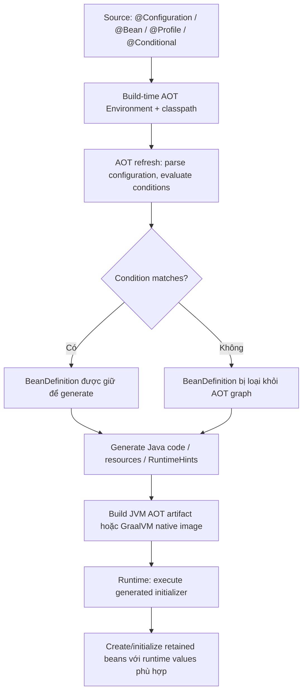

<a id="back-to-top"></a>

# Tích hợp nâng cao

## Menu
- [Phân biệt xử lý trước thời gian chạy với khởi tạo context thông thường](#advanced-integration-001)
- [Đồ thị bean có thể xác định trước và vai trò metadata kiểu](#advanced-integration-002)
- [Ảnh hưởng của profile và điều kiện tại thời điểm xử lý AOT](#advanced-integration-003)
- [RuntimeHints cho phản chiếu, tài nguyên và proxy](#advanced-integration-004)
- [Giới hạn đăng ký bean động trong ứng dụng dùng AOT](#advanced-integration-005)
- [LoadTimeWeaver, biến đổi lớp và ranh giới với cơ chế proxy](#advanced-integration-006)
- [Kiểm tra phiên bản API và hành vi khác nhau giữa các nhánh Spring](#advanced-integration-007)

## <a id="advanced-integration-001">Phân biệt xử lý trước thời gian chạy với khởi tạo context thông thường</a>

<details>
<summary>Xem chi tiết</summary>

# Phân biệt xử lý trước thời gian chạy với khởi tạo ApplicationContext thông thường

## 1. Mục tiêu bài học

Trong Spring Framework 6.2, **khởi tạo container lúc chạy** (*normal runtime context initialization*) và **xử lý Ahead-of-Time – AOT** là hai giai đoạn có nhiều điểm chung nhưng phục vụ mục đích khác nhau.

Khi chạy một ứng dụng Spring thông thường, container phân tích configuration, đăng ký bean definitions, tạo các singleton cần thiết, inject dependencies, áp dụng BeanPostProcessors, gọi initialization callbacks và bắt đầu cung cấp services. Việc đó có thể phụ thuộc vào classpath và Environment hiện tại.

Với AOT, Spring cố thực hiện **những quyết định cấu hình có thể xác định sớm** ở bước build/processing; sau đó tạo mã và metadata phục vụ một context tối ưu tại runtime. Việc **refresh để chuẩn bị AOT** có chủ đích **không tạo các application bean instances bình thường**, mà chuẩn bị và phân tích BeanFactory đã có những BeanDefinitions được chọn. Một số infrastructure processors vẫn có thể được tạo hoặc chạy để phục vụ processing.

Sau bài này, bạn sẽ:

- Phân biệt `refresh()` với `refreshForAotProcessing(RuntimeHints)`.
- Hiểu `ApplicationContextAotGenerator`, `GenerationContext` và generated `ApplicationContextInitializer`.
- Biết AOT xử lý những gì tại build time và runtime còn làm những gì.
- Thấy tác động của `@Configuration`, `@ComponentScan`, `@Profile`, `@Conditional`, imports và bean definition registration.
- Phân biệt `BeanFactoryPostProcessor`, `BeanPostProcessor` và AOT processor variants.
- Hiểu giới hạn với `registerSingleton`, arbitrary instance suppliers, dynamic conditions và circular references.
- Biết khi nào cần `RuntimeHints` cho reflection, resource, serialization và JDK proxy.
- Không nhầm **AOT optimizations**, **GraalVM native image**, **Spring Boot AOT tooling** và **JVM thông thường**.
- Chạy ví dụ Java 17/Spring Framework 6.2.18 so sánh hai con đường bằng constructor counters.

## 2. Một ví dụ tình huống

Ứng dụng có:

```java
@Configuration(proxyBeanMethods = false)
public class AppConfig {

    @Bean
    public PaymentService paymentService() {
        return new PaymentService();
    }
}
```

Đây là mảnh configuration minh họa, giả định `PaymentService` có constructor công khai và import các annotations thích hợp.

Trong **normal refresh**, Spring phải xử lý định nghĩa và tạo `paymentService` nếu đó là non-lazy singleton. Trong **refresh for AOT processing**, Spring phân tích configuration và quyết định BeanDefinition cần thiết nhưng **không khởi tạo PaymentService chỉ vì đó là một singleton bình thường**.

Chính khác biệt về **thời điểm tạo instance** và **mục đích của việc xử lý** khiến một tác vụ build-time có thể khám phá bean types, profiles và reflection needs mà không khởi chạy toàn bộ nghiệp vụ hay mở tất cả connections thật.

## 3. Hai luồng nhìn từ trên xuống

### 3.1 Normal startup

```text
Run application on JVM
        |
        v
Create ApplicationContext
        |
        v
register config / scan classes
        |
        v
context.refresh()
        |
        +-- parse @Configuration, @Import, @ComponentScan
        +-- run BeanFactoryPostProcessors
        +-- register BeanPostProcessors
        +-- initialize MessageSource / event multicaster
        +-- instantiate non-lazy singletons
        +-- inject dependencies, post-process, init callbacks
        +-- publish ContextRefreshedEvent
        |
        v
Application beans usable
        |
        v
Serve requests/jobs; close -> destruction
```

### 3.2 AOT processing and optimized runtime

```text
BUILD / PROCESSING ENVIRONMENT
    |
    v
Create non-refreshed GenericApplicationContext
    |
    v
Resolve configuration and conditional definitions
    |
    v
refreshForAotProcessing(RuntimeHints)
    |  prepares BeanFactory / definitions
    |  does not instantiate normal application beans
    v
ApplicationContextAotGenerator with GenerationContext
    |
    +-- BeanFactory initialization AOT contributions
    +-- Bean registration AOT contributions
    +-- generated Java sources / resource metadata
    +-- RuntimeHints (reflection, resource, serialization, proxy)
    |
    v
Compile/package generated output
    |
    v
OPTIMIZED RUNTIME (JVM or native image, with integration)
    |
    v
Use generated ApplicationContextInitializer
    |
    v
Create real application beans; run lifecycle
```

Hai sơ đồ mang tính khái niệm. **`refreshForAotProcessing` chỉ là một bước chuẩn bị**, không tự biên dịch generated Java, không tạo native binary và cũng không chứng minh một ứng dụng đã có full AOT integration.

## 4. Định nghĩa AOT trong Spring Framework

**Ahead-of-Time processing** là chuyển một số bước phân tích từ **startup time** sang **build time**, dựa trên classpath và Environment được xem là tương đối cố định.

Các bước có thể được chuyển đi:
- Phân tích configuration classes.
- Nhận diện `@Bean`, `@Import`, component scanning và bean definitions.
- Đánh giá `@Profile` và những `@Conditional` ảnh hưởng sự tồn tại của bean.
- Tính toán metadata cho injection, lifecycle và proxying.
- Sinh code đăng ký beans.
- Cung cấp RuntimeHints để constrained runtime biết cần reflection/resources/JDK proxies nào.

Kết quả là runtime bớt phụ thuộc vào discovery động và reflection không được mô tả trước.

**Không đồng nghĩa compile toàn bộ business logic thành code chạy trước:** constructors và methods của application services vẫn chạy tại runtime khi được dùng. AOT chỉ thay đổi cách chuẩn bị container và cách mô tả các thao tác phải làm.

## 5. Vì sao vẫn cần runtime initialization?

Một service có thể phụ thuộc vào:
- Giá trị request người dùng.
- Kết nối database production.
- Credentials đọc từ runtime secret store.
- Socket/server availability.
- Clock/timezone/current tenant.
- Database schema hoặc transactions đang chạy.

Những dữ liệu này **không thể cố định hết lúc build**. Spring AOT không cố instantiate tất cả beans tại build time rồi serialize trạng thái của chúng sang application runtime.

Thay vào đó, AOT sinh **mã cho cách đăng ký/tạo bean** và hints phù hợp. Tới runtime, khi context được initialize bằng generated contributions, container mới tạo application beans thực sự và chạy lifecycle cần thiết.

Nếu constructor của `DataSource` mở connection, yêu cầu môi trường build chạy constructor đó như một phần discovery là thiết kế AOT kém an toàn. Tốt hơn hãy biểu đạt bean class, constructor, dependencies rõ ràng để AOT phân tích mà không cần mở connection thật.

## 6. refresh() trong container thông thường

`AbstractApplicationContext.refresh()` điều phối lifecycle. Với `AnnotationConfigApplicationContext`, thường có các bước:

1. Chuẩn bị và validate context state.
2. Lấy BeanFactory và cấu hình nền.
3. Gọi `BeanFactoryPostProcessor`/registry processors.
4. Đăng ký `BeanPostProcessor`.
5. Thiết lập MessageSource và ApplicationEventMulticaster.
6. Đăng ký event listeners.
7. **Pre-instantiate non-lazy singleton beans**.
8. Gọi constructor/dependency injection/`Aware`/init callbacks.
9. Hoàn tất refresh và phát lifecycle event.

Một `@Bean` non-lazy singleton thường được tạo trước khi `refresh()` trả về. Một `@Lazy` bean có thể chưa được tạo cho tới khi có request đầu tiên, nhưng nếu là dependency bắt buộc của bean non-lazy thì vẫn có thể được tạo sớm.

Vì vậy không viết:

```java
context.refresh();
System.out.println("No bean was initialized");
```

Đây là anti-example về suy luận; câu in không phản ánh contract của `refresh()`.

## 7. refreshForAotProcessing(RuntimeHints)

Trong Spring Framework 6.2, `GenericApplicationContext` và các subclasses có:

```java
void refreshForAotProcessing(RuntimeHints runtimeHints);
```

Method này chuẩn bị persistent representation của configuration và BeanFactory tới mức AOT engine có thể phân tích definitions. Theo Javadoc:

- Đây là một **biến thể** của regular refresh dành cho AOT.
- Chỉ những nhóm post-processors phù hợp được kích hoạt, với `BeanDefinitionRegistryPostProcessor` và `MergedBeanDefinitionPostProcessor` được nhấn mạnh ở contract.
- Nó **không tạo các application bean instances bình thường**.
- Không đi qua toàn bộ các bước như `finishBeanFactoryInitialization`/`finishRefresh` của regular refresh.

Ví dụ API:

```java
RuntimeHints hints = new RuntimeHints();

AnnotationConfigApplicationContext context =
        new AnnotationConfigApplicationContext();

context.register(MyApplicationConfig.class);
context.refreshForAotProcessing(hints);
context.close();
```

Mảnh Java trên cần imports cho `RuntimeHints`, `AnnotationConfigApplicationContext` và `MyApplicationConfig` class.

**Quan trọng:** Một call `refreshForAotProcessing` **không tương đương** `ApplicationContextAotGenerator.processAheadOfTime(...)`. Nó chỉ chuẩn bị trạng thái; bước generator còn cần `GenerationContext`, generated files/code và build integration.

## 8. Cái gì chạy trong refresh for AOT?

Spring Reference mô tả:
- Configuration class parsing, import selectors, classpath scanning và registry post-processing vẫn cần thực hiện ở build.
- Conditions `@Profile`/`@Conditional` được đánh giá lúc này để quyết định definitions có mặt hay không.
- `BeanFactoryPostProcessor` có thể tham gia vào quá trình chuẩn bị definitions; các biến thể AOT-specific processor cũng có contract riêng.
- `MergedBeanDefinitionPostProcessor` có thể phân tích lifecycle/injection metadata.
- `SmartInstantiationAwareBeanPostProcessor` có thể giúp type prediction hoặc quyết định proxy type.
- Những bean thực hiện `BeanFactoryInitializationAotProcessor` hoặc `BeanRegistrationAotProcessor` cùng dependencies của chúng có thể được **khởi tạo** để tạo contributions.

Do đó câu nói **“AOT refresh không bao giờ instantiate bất kỳ object nào”** là quá tuyệt đối. Chính xác hơn:

> **AOT refresh không instantiate các application beans như normal refresh; một số infrastructure beans/processors vẫn có thể được khởi tạo vì cần phân tích và sinh code.**

Điều này quan trọng khi viết custom infrastructure: constructor/process method của một AOT processor không được vô tình làm I/O không kiểm soát tại build time.

## 9. ApplicationContextAotGenerator là entry point

`org.springframework.context.aot.ApplicationContextAotGenerator` có:

```java
ClassName processAheadOfTime(
        GenericApplicationContext applicationContext,
        GenerationContext generationContext);
```

Chữ ký trên đã rút gọn import; `ClassName` từ `org.springframework.javapoet`.

Javadoc yêu cầu truyền vào một **non-refreshed** `GenericApplicationContext`. AOT generator có nhiệm vụ:
1. Refresh context cho AOT processing.
2. Duyệt BeanFactory và các AOT processor contributions.
3. Sinh Java sources/resource files/generated classes theo `GenerationContext`.
4. Thu thập `RuntimeHints`.
5. Trả **ClassName của generated `ApplicationContextInitializer` entry point**.

Điểm dễ nhầm: `processAheadOfTime` **không trả instance ApplicationContext** và cũng **không tự tạo native executable**. Nó trả metadata về initializer code mà build sẽ sử dụng.

Khi dùng Spring Boot Gradle/Maven AOT plugin, nhiều bước setup/output/compilation được **tooling tự điều phối**. Tự gọi generator API thủ công đòi hỏi chuẩn bị `GenerationContext` và generated files cho đầy đủ.

## 10. ApplicationContextInitializer của generated AOT code

Runtime code được sinh có một entry point thuộc họ `ApplicationContextInitializer<...>`. Mục đích là áp dụng những bean definitions và settings đã được phân tích trước đó vào context mới.

Hình dung:

```text
Original configuration
   @Configuration / @Bean / component scan
          |
          v
Build-time AOT generator
          |
          +-- generated bean definitions
          +-- generated registration code
          +-- generated runtime hints
          |
          v
Runtime context initializer
          |
          v
BeanFactory with prepared definitions
          |
          v
Real bean creation and lifecycle at runtime
```

Một generated class name có thể thay đổi tùy entry point và Spring version. Đừng hardcode tên generated class trong tài liệu hoặc viết import tới class chưa được generator tạo.

Nếu ứng dụng chạy **normal JVM build** mà không có AOT-generated assets, đơn thuần đặt `spring.aot.enabled=true` không thể kỳ diệu tạo missing initializer. Cần có pipeline tạo/compile/đóng gói output và sử dụng đúng runtime integration.

## 11. BeanFactoryInitializationAotProcessor

Đây là một extension point cho **toàn BeanFactory**. Một component có thể inspect trạng thái BeanFactory sau khi definitions đã được chuẩn bị, rồi cung cấp contribution tạo mã/hints tương ứng.

Ví dụ trường hợp thích hợp:
- Tái tạo một registration strategy ở optimized runtime.
- Sinh code đăng ký infrastructure beans.
- Đăng ký resources/proxy/reflection hints cần thiết cho một subsystem.
- Thay thế dynamic runtime discovery bằng data được xác định build-time.

Implementations có thể được đăng ký trong `META-INF/spring/aot.factories` bằng đúng key của interface, hoặc trong một số trường hợp là infrastructure bean.

Cẩn thận: nếu một bean trực tiếp implements `BeanFactoryInitializationAotProcessor`, nó và dependencies có thể được **khởi tạo lúc AOT processing**, sau đó không nhất thiết hiện diện như một normal application bean trong optimized runtime. Hãy giữ nó là infrastructure nhẹ, không phụ thuộc connection live.

## 12. BeanRegistrationAotProcessor

Đây là extension point **theo từng bean registration**. Nó có thể customize code generation cho một BeanDefinition mà core AOT generator cần chuyển thành registration code.

Ví dụ:
- Processor biết cách sinh code injection và lifecycle cho một pattern cụ thể.
- `AutowiredAnnotationBeanPostProcessor` có AOT participation để chuyển field/method injection metadata thành generated code.
- Infrastructure đặc thù cần generated bean instance supplier thay cho reflection động.

Nếu processor **không** có contribution riêng, core generator dùng default bean registration behavior. Không cần viết một processor mới cho mọi `@Bean` bình thường.

**Phân biệt với BeanFactoryPostProcessor:** BFPP sửa/đọc definitions trong container; BeanRegistrationAotProcessor đưa ra **contribution sinh code**. Một class có thể liên quan cả hai, nhưng mục tiêu và thời điểm xử lý khác nhau.

## 13. BeanDefinitionRegistryPostProcessor và AOT

Một `BeanDefinitionRegistryPostProcessor` có thể đăng ký definitions **trước khi các bean instances được tạo**. Đây là cơ chế thích hợp khi custom component cần thêm beans để AOT thấy chúng.

```java
public class ExtraBeansRegistrar
        implements BeanDefinitionRegistryPostProcessor {

    @Override
    public void postProcessBeanDefinitionRegistry(
            BeanDefinitionRegistry registry) {

        registry.registerBeanDefinition(
                "extraService",
                new RootBeanDefinition(ExtraService.class));
    }

    @Override
    public void postProcessBeanFactory(
            ConfigurableListableBeanFactory beanFactory) {
        // Không cần tạo application bean ở đây.
    }
}
```

Đây là **mảnh minh họa**, cần imports và `ExtraService` type; bean/process registration phải được cấu hình đúng nơi.

Mô hình được Spring Reference khuyến nghị cho application configuration là **`ImportBeanDefinitionRegistrar` + `@Import`** khi custom registration gắn với configuration class. Cơ chế này chạy như một phần của configuration class parsing, tự nhiên hơn so với một callback xảy ra sau khi phần lớn definitions đã được xử lý.

Không dùng `beanFactory.registerSingleton(...)` để chỉ “giấu” một pre-created application object vào registry rồi kỳ vọng AOT generator có thể tái tạo object đó. Manual singleton instance **không phải BeanDefinition recipe** có thể translate an toàn.

## 14. Vì sao registerSingleton có vấn đề cho AOT?

Giả sử:

```java
DefaultListableBeanFactory factory = ...;

ExternalClient client = new ExternalClient("configured");
factory.registerSingleton("externalClient", client);
```

Đây là mảnh minh họa, chưa đầy đủ imports/biến factory.

Bean đã **được tạo trước**, rồi đưa thẳng vào singleton registry; nó không có recipe tạo instance rõ ràng trong BeanDefinition. Spring AOT không thể tùy ý:
- Serialize cả object state rồi nhúng vào generated app.
- Phỏng đoán constructor nào đáng dùng.
- Suy toàn bộ dependencies và lifecycle.
- Phân tích mọi reflection/resource needs bằng cách chạy business code.

**Spring 6.2 Reference xác định manual singleton registration là một trong những hạn chế của AOT transformations.**

Nếu cần AOT-friendly registration:
- Đăng ký `RootBeanDefinition` hoặc `GenericBeanDefinition` phù hợp.
- Dùng `@Bean` return type cụ thể.
- Đăng ký qua `ImportBeanDefinitionRegistrar` trong configuration parsing.
- Tránh gửi object đã pre-initialize làm nguồn thông tin duy nhất cho generator.

Điều này không có nghĩa `registerSingleton` bị cấm trong **mọi** Spring application; nó vẫn hữu ích trong normal runtime khi external owner quản lý object. Chỉ không nên tin rằng AOT có thể tự chuyển arbitrary instance thành generated instantiation code.

## 15. Instance Supplier và AOT restrictions

Ví dụ programmatic:

```java
context.registerBean(
        "service",
        Service.class,
        () -> createDynamicService());
```

Mảnh code này cần `GenericApplicationContext`, `Service` và method `createDynamicService()`.

Normal runtime có thể gọi Supplier lambda để tạo bean. Nhưng một arbitrary supplier được đăng ký programmatically **không nhất thiết chuyển được thành generated AOT code**: logic lambda có thể phụ thuộc nhiều dynamic factors mà generator không phân tích được.

Spring 6.2 AOT Reference cảnh báo về bean definitions chứa **instance suppliers (lambda/method references)** không transform được theo đường hỗ trợ thông thường. Đừng suy rằng mọi `registerBean(Supplier)` tự nhiên tương thích AOT chỉ vì cuối cùng cũng có BeanDefinition.

Điều này có khác biệt với **generated suppliers** mà chính Spring AOT code generator tạo ra từ configuration model đã hiểu. Sinh một `BeanInstanceSupplier` có cấu trúc rõ ràng từ BeanDefinition không đồng nghĩa arbitrary user lambda có thể dịch sang source code.

## 16. `@Profile` và `@Conditional`: quyết định bean presence trước runtime

Trong normal `refresh()`, Spring đánh giá `@Profile`/`@Conditional` theo `Environment` của lần startup đó. Ở AOT processing, các conditions quyết định **BeanDefinition có hiện diện hay không** được xét trong **build-time environment** và phản ánh vào generated registration. Vì thế thay `spring.profiles.active` hoặc property chọn bean chỉ lúc chạy optimized artifact không tự thêm lại definition đã bị loại khỏi build.

```java
@Bean @Profile("dev")
DevRepository devRepository() { return new DevRepository(); }

@Bean @Profile("prod")
ProdRepository prodRepository() { return new ProdRepository(); }
```

Đây là hai method minh họa trong `@Configuration`; cần định nghĩa/import các types. Nếu AOT chọn `dev` ở build thì `prodRepository` không tự xuất hiện chỉ vì deployment truyền profile prod. **Giá trị runtime** như URL, timeout hoặc secrets của bean đã được đăng ký là câu chuyện khác, không nhất thiết bị cố định ở build. Bài chuyên biệt về profile/condition ở AOT phía sau trình bày truth table, Boot process-aot profiles và cách quản lý artifact cho từng môi trường.

## 17. @Configuration, @ComponentScan và imports

Trong normal refresh, Spring cần parsing configuration classes, classpath scanning và imports ở startup nếu chưa có generated representation.

Trong AOT processing, các bước discovery phải chạy sớm hơn:
- `@Configuration` classes được phân tích build time.
- `@ComponentScan` xác định candidate classes tại build time.
- `@Import`, `ImportSelector`, `ImportBeanDefinitionRegistrar` được áp dụng để xác định bean graph.
- Conditions được đánh giá theo build-time Environment.

Điều này quan trọng cho **native image**: không có classpath quét động như mô hình JVM thông thường. Nếu một plugin xuất hiện **sau** khi native binary đã build, AOT-generated bean graph không tự biết tới plugin đó.

Với ứng dụng cần dynamic plugin discovery, hãy thiết kế một API runtime đã được biết trước thay vì dựa vào scanning các JAR chưa tồn tại trong build.

## 18. `@Bean` return type cần đủ chính xác để AOT phân tích

Một `@Bean` method công bố `MyInterface` trong khi luôn trả `MyImplementation` có thể che metadata annotation/injection/lifecycle nằm **chỉ trên implementation** khỏi analysis trước lúc bean được tạo:

```java
// Metadata sớm chỉ công bố interface:
@Bean MyInterface myService() { return new MyImplementation(); }

// Nếu luôn trả đúng type ấy, công bố rõ hơn:
@Bean MyImplementation myService() { return new MyImplementation(); }
```

Đây là **hai cách viết thay thế**, không đặt đồng thời trong cùng configuration; cần types/imports phù hợp. Consumer vẫn có thể inject qua `MyInterface`. Không ép return type concrete nếu factory **thật sự** trả nhiều implementation types; khi đó phải thiết kế metadata/registration rõ và test AOT. Bài **đồ thị bean và metadata kiểu** giải thích sâu `ResolvableType`, `FactoryBean.getObjectType()`, generic signatures và type prediction trước initialization.

## 19. Constructor selection và AOT

Normal BeanFactory có cơ chế chọn constructor dựa trên candidates, `@Autowired` annotations, parameters và resolvable dependencies.

Ở AOT, bạn nên tránh dựa vào constructor selection mơ hồ vì generator cần xác định đường tạo instance từ metadata có sẵn.

```java
public class TaskService {

    public TaskService() {
    }

    @Autowired
    public TaskService(JobRepository repository) {
        // ...
    }
}
```

Đây là mảnh minh họa cần imports, `JobRepository` type và context có bean tương ứng.

Annotation `@Autowired` chỉ constructor mong muốn giúp selection rõ hơn. Tránh cho nhiều public constructors rồi trông chờ runtime suy đoán động trong AOT-generated code.

Có thể cung cấp metadata preferred constructors cho bean definition theo API phù hợp trong use case advanced, nhưng không cần tự làm nếu Java class API đơn giản, constructor injection rõ ràng.

## 20. Custom constructor args và complex values

Spring BeanFactory bình thường có thể nhận custom arguments để khởi tạo prototype:

```java
Service service =
        context.getBean(Service.class, "runtime-tenant-id");
```

Đây là mảnh minh họa cho bean có constructor tương ứng.

Trong AOT-optimized context, custom args có thể:
- Bắt framework thực hiện dynamic constructor resolution không có reflection hints.
- Bỏ qua generated instance supplier.
- Bỏ qua optimizations như generated autowiring logic.

Spring AOT Reference khuyến nghị **manual factory pattern**: đăng ký một factory bean đã được framework quản lý, và cho factory method nhận runtime arguments để tạo một transient object theo cách tường minh.

Tương tự, tùy tiện đặt arbitrary custom data structures làm constructor argument values của BeanDefinition có thể làm `ValueCodeGenerator` không biết cách sinh mã cho chúng. Ưu tiên simple constants, references và model được hỗ trợ; nếu thật cần custom code generation, xem extension point `ValueCodeGenerator.Delegate`.

## 21. Circular dependencies trong AOT

Normal Spring BeanFactory ở một số cấu hình có thể giải **setter/field circular dependencies** bằng early singleton exposure. Nhưng **constructor cycles** vẫn thường không thể tự giải.

Spring AOT Reference nêu AOT-optimized context **không hỗ trợ explicit circular dependencies** như nhiều cấu hình normal runtime có thể xử lý.

```text
A requires B
B requires A

Normal runtime:
  some setter/field cycles may be resolvable with early references

AOT-optimized runtime:
  explicit bean graph cycles should be removed
```

Hướng sửa:
- Rút dependency ngược thành interface/port/event.
- Tách orchestration khỏi implementations.
- Dùng `@Lazy` injection hoặc `ObjectProvider` khi một dependency thật sự chỉ cần tại runtime sau startup.
- Viết integration tests dùng AOT-generated context, không chỉ test normal refresh.

Đừng bật raw circular references và kỳ vọng generated code tự giữ tất cả invariants của early proxy exposure.

## 22. RuntimeHints là gì?

`org.springframework.aot.hint.RuntimeHints` tập hợp thông tin mà một constrained runtime/native image cần biết trước:

| Nhóm | Dùng cho |
| --- | --- |
| Reflection | Constructors/methods/fields cần reflective invocation |
| Resources | Classpath resource files/patterns cần đóng gói |
| Serialization | Types cần serialization support |
| JDK proxies | Các interface combinations cần proxy generation |
| JNI | Hints cho native interface interop khi phù hợp |

Các hints thường được Spring AOT processors tự tạo cho core framework, nhưng third-party libraries/custom reflection có thể cần developer cung cấp.

Ví dụ:

```java
RuntimeHints hints = new RuntimeHints();

hints.resources().registerPattern(
        "settings/application.properties");
```

Đây là mảnh Java minh họa. Nó mới **đăng ký ý định resource accessibility**; muốn resource có mặt trong native image còn phải chạy pipeline phù hợp và bảo đảm file thực sự tồn tại trong build inputs.

### RuntimeHints không phải resource loader

`RuntimeHints` không tạo file, không đọc properties và không tự mở resource tại runtime. Nó nói với AOT/native tooling **những capabilities phải được bảo tồn** trong output.

## 23. RuntimeHintsRegistrar và @ImportRuntimeHints

Một cách dễ quản lý custom hints là:

```java
public final class DictionaryHints
        implements RuntimeHintsRegistrar {

    @Override
    public void registerHints(
            RuntimeHints hints, ClassLoader classLoader) {

        hints.resources().registerPattern("dicts/*");
    }
}
```

Đây là class Java minh họa, cần imports `RuntimeHintsRegistrar` và `RuntimeHints`.

Đăng ký kèm component:

```java
@Component
@ImportRuntimeHints(DictionaryHints.class)
public class DictionaryService {
}
```

Đây là class minh họa; cần imports Spring annotations và DictionaryHints type.

Đặt hints **gần feature thực sự dùng chúng** giúp hints không bị contributed khi feature đó không nằm trong BeanFactory. Với startup/native behavior quan trọng, cần test resources/hints trong AOT processing và bản native image thử nghiệm, chứ không chỉ chạy JVM unit tests.

Các registrars cũng có thể đăng ký qua `META-INF/spring/aot.factories` với key thích hợp. Đừng nhầm file `aot.factories` với `spring.factories` hoặc `AutoConfiguration.imports` của Boot.

## 24. So sánh JVM normal, JVM AOT và native image

| Vấn đề | JVM normal | JVM có AOT optimizations | GraalVM native image |
| --- | --- | --- | --- |
| Bootstrap representation | Phân tích cấu hình tại runtime | Sử dụng generated AOT contributions | Sử dụng generated contributions và native compilation |
| Bean instances | Tạo tại runtime | Tạo tại runtime | Tạo theo semantics của image/runtime |
| Bean graph dynamic conditions | Đánh giá mỗi lần normal startup | Nhiều quyết định build-time cố định | Nhiều quyết định build-time cố định |
| Reflection | JVM dynamic reflection sẵn có | Vẫn có JVM reflection; AOT giảm nhu cầu | Cần hints/metadata cho reflection |
| Classpath scanning | Có thể hoạt động tại startup | Thường được chuyển sang build-time generation | Phải xử lý sớm trong pipeline |
| Build pipeline | Compile/package truyền thống | Generate/compile/include AOT assets | AOT + GraalVM native-image |
| Startup | Có runtime configuration parsing | Có thể giảm phần discovery | Có thể giảm nhiều startup overhead tùy app |
| Artifact | JVM JAR/classes | JVM JAR/classes + generated assets | Executable native binary |

**Không có một thứ tự thời gian tuyệt đối** về performance cho mọi ứng dụng. AOT/native đánh đổi build complexity, restrictions và tooling để tối ưu một số use cases; benchmark phải đo ứng dụng cụ thể.

## 25. Spring Framework vs Spring Boot: ai điều phối AOT?

**Spring Framework** cung cấp các API thấp:
- `GenericApplicationContext.refreshForAotProcessing(...)`.
- `ApplicationContextAotGenerator`.
- `BeanFactoryInitializationAotProcessor` / `BeanRegistrationAotProcessor`.
- `RuntimeHints` và registrars.
- `ApplicationContextInitializer` model.

**Spring Boot** cung cấp build/runtime integration cho Boot applications thông qua Gradle/Maven plugins, quá trình processAot hoặc nativeCompile phù hợp và generated application bootstrap. Tên task, plugin version và flag có thể thay đổi theo Boot release; không suy một command áp dụng cho mọi phiên bản.

**GraalVM** thực hiện native compilation. Spring AOT là điều kiện của phần lớn luồng native Spring nhưng **không đồng nghĩa** chính GraalVM hoặc Boot tự có mặt khi chỉ thêm dependency `spring-context`.

Vì vậy:
- Một demo thuần Spring Framework có thể gọi `refreshForAotProcessing` để **minh họa sự khác biệt**.
- Một demo build image thực sự phải có **AOT generation pipeline + generated source compilation + native build support**.
- Không hứa `gradle run` bình thường đang dùng generated AOT initialization nếu chưa cấu hình task tương ứng.

## 26. Ví dụ Java 17 hoàn chỉnh: refresh() so với refreshForAotProcessing()

Ví dụ dùng **Spring Framework 6.2.18**, không dùng Spring Boot. Nó không tự generate AOT files hay build native image; nó **chạy chính xác hai kiểu refresh** và đo số lần application constructors được gọi.

Chúng ta có:
- `EagerService`: `@Bean` non-lazy singleton.
- `LazyService`: `@Bean @Lazy` singleton.
- `DevFeature`: bean chỉ có khi `dev` profile active.
- Ba `AtomicInteger` counters cho ba loại instances.

Chạy **hai contexts độc lập** để không trộn singleton caches:

1. Normal context: `refresh()` tạo eager + dev singleton; lazy chưa tạo. `getBean(LazyService.class)` tạo lazy.
2. Reset counters, tạo AOT-processing context: `refreshForAotProcessing(new RuntimeHints())` đăng ký definitions tương ứng nhưng **không tạo ba application beans**. Không gọi `getBean` sau AOT refresh, vì đây là một **preparation context**, không phải normal runtime container để sử dụng services.
3. Đọc `containsBeanDefinition` và `containsSingleton` để chứng minh khái niệm definition vs instance.

### 26.1 Cấu trúc project

```text
spring-aot-vs-runtime/
├── settings.gradle
├── build.gradle
└── src/main/java/AotVsRuntimeDemo.java
```

### 26.2 settings.gradle

```groovy
rootProject.name = 'spring-aot-vs-runtime'
```

### 26.3 build.gradle

```groovy
plugins {
    id 'application'
}

repositories {
    mavenCentral()
}

dependencies {
    implementation 'org.springframework:spring-context:6.2.18'
}

java {
    toolchain {
        languageVersion = JavaLanguageVersion.of(17)
    }
}

application {
    mainClass = 'AotVsRuntimeDemo'
}
```

### 26.4 src/main/java/AotVsRuntimeDemo.java

```java
import java.util.concurrent.atomic.AtomicInteger;

import org.springframework.aot.hint.RuntimeHints;
import org.springframework.context.annotation.AnnotationConfigApplicationContext;
import org.springframework.context.annotation.Bean;
import org.springframework.context.annotation.Configuration;
import org.springframework.context.annotation.Lazy;
import org.springframework.context.annotation.Profile;

public class AotVsRuntimeDemo {

    public static final class Counters {
        static final AtomicInteger EAGER = new AtomicInteger();
        static final AtomicInteger LAZY = new AtomicInteger();
        static final AtomicInteger DEV = new AtomicInteger();

        static void reset() {
            EAGER.set(0);
            LAZY.set(0);
            DEV.set(0);
        }
    }

    public static final class EagerService {
        public EagerService() {
            Counters.EAGER.incrementAndGet();
        }
    }

    public static final class LazyService {
        public LazyService() {
            Counters.LAZY.incrementAndGet();
        }
    }

    public static final class DevFeature {
        public DevFeature() {
            Counters.DEV.incrementAndGet();
        }
    }

    @Configuration(proxyBeanMethods = false)
    public static class AppConfig {

        @Bean
        public EagerService eagerService() {
            return new EagerService();
        }

        @Bean
        @Lazy
        public LazyService lazyService() {
            return new LazyService();
        }

        @Bean
        @Profile("dev")
        public DevFeature devFeature() {
            return new DevFeature();
        }
    }

    private static void normalRuntime() {
        Counters.reset();

        try (AnnotationConfigApplicationContext context =
                     new AnnotationConfigApplicationContext()) {

            context.getEnvironment().setActiveProfiles("dev");
            context.register(AppConfig.class);

            System.out.println("normal.before.eager="
                    + Counters.EAGER.get());

            context.refresh();

            System.out.println("normal.after.eager="
                    + Counters.EAGER.get());
            System.out.println("normal.after.lazy="
                    + Counters.LAZY.get());
            System.out.println("normal.after.dev="
                    + Counters.DEV.get());
            System.out.println("normal.hasDevDefinition="
                    + context.containsBeanDefinition("devFeature"));

            context.getBean(LazyService.class);

            System.out.println("normal.afterGet.lazy="
                    + Counters.LAZY.get());
            System.out.println("normal.eagerSingleton="
                    + context.getBeanFactory()
                            .containsSingleton("eagerService"));
        }
    }

    private static void aotPreparation() {
        Counters.reset();

        try (AnnotationConfigApplicationContext context =
                     new AnnotationConfigApplicationContext()) {

            context.getEnvironment().setActiveProfiles("dev");
            context.register(AppConfig.class);

            RuntimeHints hints = new RuntimeHints();
            context.refreshForAotProcessing(hints);

            System.out.println("aot.hasEagerDefinition="
                    + context.containsBeanDefinition("eagerService"));
            System.out.println("aot.hasLazyDefinition="
                    + context.containsBeanDefinition("lazyService"));
            System.out.println("aot.hasDevDefinition="
                    + context.containsBeanDefinition("devFeature"));

            System.out.println("aot.eagerCount="
                    + Counters.EAGER.get());
            System.out.println("aot.lazyCount="
                    + Counters.LAZY.get());
            System.out.println("aot.devCount="
                    + Counters.DEV.get());

            System.out.println("aot.eagerSingleton="
                    + context.getBeanFactory()
                            .containsSingleton("eagerService"));

            // Không gọi context.getBean(EagerService.class) ở đây:
            // Đây là processing context, chưa phải optimized runtime.
        }
    }

    public static void main(String[] args) {
        normalRuntime();
        aotPreparation();
    }
}
```

### 26.5 Chạy trên JVM

Yêu cầu JDK 17+ và Gradle 8+:

```bash
gradle run --quiet
# Hoặc ./gradlew run --quiet nếu project đã có Gradle Wrapper.
```

**Lưu ý:** Lệnh trên chạy một chương trình Java để *so sánh* normal refresh và AOT preparation. Nó **không tạo AOT generated sources/natives** và không bật chế độ Spring Boot AOT runtime.

### 26.6 System.out dự kiến

```text
normal.before.eager=0
normal.after.eager=1
normal.after.lazy=0
normal.after.dev=1
normal.hasDevDefinition=true
normal.afterGet.lazy=1
normal.eagerSingleton=true
aot.hasEagerDefinition=true
aot.hasLazyDefinition=true
aot.hasDevDefinition=true
aot.eagerCount=0
aot.lazyCount=0
aot.devCount=0
aot.eagerSingleton=false
```

Các dòng trên là kết quả chính chương trình in; chúng không bao gồm logging của Spring, Gradle hoặc môi trường khác. Đếm đúng ba application service types đã nêu, **không đo số infrastructure instances** Spring có thể tạo khi xử lý configuration.

### 26.7 Vì sao normal refresh khởi tạo EagerService?

`AppConfig.eagerService()` là một non-lazy singleton `@Bean`. Trong normal `refresh`, BeanFactory gọi bước pre-instantiation của singleton definitions, nên constructor tăng counter từ 0 lên 1 trước khi `refresh()` trả về.

### 26.8 Vì sao LazyService còn bằng 0?

Method `lazyService()` được gắn `@Lazy`. Không bean non-lazy nào trong ví dụ cần `LazyService`, nên nó chưa được tạo ở cuối refresh. Khi code explicit `context.getBean(LazyService.class)`, Spring tạo nó; counter thành 1.

Nếu thay AppConfig để non-lazy `EagerService` inject LazyService trực tiếp, thì lazy service có thể bị khởi tạo trước. `@Lazy` không có nghĩa object không bao giờ được tạo lúc bootstrap.

### 26.9 Vì sao DevFeature được tạo ở normal refresh?

Environment active profile được đặt thành `dev` **trước `refresh()`**. `@Profile("dev")` đánh giá true, nên `devFeature` BeanDefinition được đăng ký. Bean non-lazy singleton này được tạo và counter thành 1.

Nếu active profile không chứa dev, bean definition đó có thể bị loại; không được mặc định `@Profile` tự thay đổi sau refresh khi bạn chỉnh environment.

### 26.10 Vì sao AOT có definitions nhưng counters bằng 0?

`refreshForAotProcessing(hints)` vẫn phân tích Java config và điều kiện build-time, do đó ba definitions xuất hiện. Nhưng processing refresh không chạy bình thường tới `preInstantiateSingletons`/application bean initialization, nên counters của `EagerService`, `LazyService` và `DevFeature` đều bằng 0.

`aot.eagerSingleton=false` xác nhận chưa có eagerService singleton instance được cache.

Đừng gọi `getBean` trên processing context chỉ để “test xem bean chạy được không”. Muốn test hoạt động runtime hãy tạo context bình thường hoặc chạy **optimized context được build/generated** với pipeline tương ứng.

## 27. Tại sao demo không gọi ApplicationContextAotGenerator trực tiếp?

`ApplicationContextAotGenerator` là API dành cho **code generation tooling**. Một ví dụ đầy đủ gọi nó cần:
- `GenerationContext` implementation.
- `GeneratedFiles` target.
- Java source generation/build output.
- Compilation/classpath có generated classes.
- Runtime initializer discovery and invocation.
- RuntimeHints/native configuration export.

Nếu chỉ viết:

```java
new ApplicationContextAotGenerator();
```

bạn mới **tạo một generator object**, chưa có một chương trình AOT. Ngay cả `processAheadOfTime` cũng cần các inputs/build outputs thích hợp; kết quả là tên generated initializer, không phải executable.

Vì mục tiêu của bài B306 là **phân biệt giai đoạn processing với normal context initialization**, demo tập trung vào `refresh` versus `refreshForAotProcessing`, rồi chỉ rõ giới hạn của demo. Khi triển khai AOT thật, dùng Spring Boot plugin hoặc AOT processor tooling đã cấu hình đúng với version hiện tại.

## 28. Các lỗi cấu hình hay gặp

| Hiện tượng | Nguyên nhân | Cách khắc phục |
| --- | --- | --- |
| Tưởng AOT refresh tạo singleton như normal refresh | Nhầm mục đích processing | Đọc BeanDefinition/counters, không gọi application bean |
| Tưởng AOT không chạy bất kỳ bean code nào | Infrastructure processors có thể khởi tạo | Giữ AOT processors nhẹ, kiểm tra build-time side effects |
| Dev bean biến mất trong optimized app | Profile build-time khác runtime mong muốn | Chọn profiles đúng từ AOT processing |
| @Conditional thay đổi runtime nhưng không thêm bean | Bean graph đã cố định build-time | Phân biệt runtime values và build-time graph |
| Manual singleton không có generated registration | `registerSingleton` không có recipe | Dùng BeanDefinition/registrar phù hợp |
| Supplier lambda không transform | Arbitrary instance supplier không hỗ trợ | Dùng @Bean/metadata rõ hoặc AOT extension |
| @Bean return interface quá chung | AOT không phát hiện implementation annotations | Return concrete implementation type khi cần metadata |
| Nhiều constructors không chọn đúng | Ambiguous reflective resolution | @Autowired preferred constructor/clear design |
| Runtime reflection fail trong native binary | Thiếu RuntimeHints | Registrar và native tests |
| Classpath resource không có trong image | Resource chưa được hint/included | RuntimeHints.resources và build config |
| JDK proxy không được native image hỗ trợ | Thiếu proxy hints/interface combo | Register proper JDK proxy hints |
| Circular references fail trong optimized runtime | AOT hạn chế explicit bean cycles | Refactor, @Lazy/ObjectProvider khi hợp lý |
| AOT generated initializer class missing | Chưa generate/compile/include output | Sửa build pipeline |
| Bật spring.aot.enabled mà không build AOT | Flag không tạo generated files | Chạy plugin AOT task rồi build |
| BeanFactoryPostProcessor gọi getBean quá sớm | Startup/postprocessors bị kích hoạt khác lúc AOT | Chỉ thao tác definition metadata |
| Runtime URL khác nhưng bean vẫn hoạt động | URL value runtime đọc động | Không nhầm property values với graph conditions |
| Profile thay sau refresh nhưng definitions không đổi | Conditions đã được evaluated | Tạo context mới/refresh theo contract, với AOT phải rebuild |

## 29. Checklist tối ưu AOT-friendly configuration

1. Classpath và dependencies có được cố định khi build?
2. Có profiles/conditions ảnh hưởng bean presence chưa được lựa chọn rõ?
3. Custom bean registration có dùng `BeanDefinitionRegistry` không?
4. Có `registerSingleton` thủ công trong đường AOT generation không?
5. Có bean definitions chứa arbitrary suppliers không thể translate?
6. `@Bean` return types đã đủ cụ thể để AOT inspect members chưa?
7. Có constructor ambiguity hoặc runtime custom arguments không?
8. Có field injection/lifecycle annotations phụ thuộc implementation type bị ẩn?
9. Có custom FactoryBean `getObjectType()` trả type ổn định không?
10. Custom BFPP có vô tình tạo application beans khi processing?
11. AOT processors có runtime I/O/DB/network dependencies không?
12. Có explicit circular dependencies cần loại bỏ không?
13. Có reflection/resources/serialization/JDK proxies đòi hỏi hints bổ sung không?
14. Có cần phân biệt JVM normal, AOT JVM và native tests trong CI không?
15. Có test optimized runtime thực tế, không chỉ `refreshForAotProcessing` demo không?
16. Có đo build time, startup latency, memory và compatibility với môi trường production không?
17. Có biết ai chịu trách nhiệm generate/compile/include ApplicationContextInitializer code?
18. Có thể chạy lại build khi thay đổi profile/conditional graph không?

## 30. Bài tập thực hành

### Bài tập 1: đổi profile

Trong demo, đổi cả normal và AOT preparation sang `prod`. Dự đoán:

- `containsBeanDefinition("devFeature")` false trong cả hai contexts.
- `DevFeature` không được instantiate.
- `EagerService` vẫn được tạo với normal refresh, không được tạo trong AOT preparation.

Giải thích vì sao **hai lần chạy demo với Environment khác nhau** là hai lần phân tích độc lập, không phải optimized app build một lần rồi runtime thêm bean definitions.

### Bài tập 2: thay LazyService thành dependency bắt buộc

Sửa `EagerService` để constructor nhận `LazyService`, thay `@Bean eagerService()` thành method nhận `LazyService`. Ở normal refresh, lazy counter có thể tăng lên 1 vì dependency cần thiết của eager singleton. Trong AOT preparation, application bean constructors vẫn không chạy.

### Bài tập 3: thêm BeanFactoryPostProcessor

Đăng ký một BFPP chỉ đọc `getBeanDefinitionNames()` và kiểm tra số definitions, không gọi `getBean()`. Quan sát BFPP chạy trong cả normal refresh lẫn processing phù hợp. Phân biệt việc đọc BeanDefinition với tạo application beans.

### Bài tập 4: custom RuntimeHints

Tạo `RuntimeHintsRegistrar` đăng ký resource pattern `dicts/*`. Kiểm tra có đúng resource files trong build inputs. Với native build pipeline thật, test classpath resource có thể được đọc từ executable.

### Bài tập 5: generated runtime

Trong Spring Boot sample với plugin tương thích:
- Build có AOT processing.
- Inspect generated sources/resources.
- Chạy JVM với AOT optimizations nếu được packaging hỗ trợ.
- Build native image nếu có GraalVM native tooling.
- So sánh việc thay đổi `@Profile` giữa build time và runtime.

Không suy rằng demo thuần Spring `gradle run` đã thực hiện những bước này.

## 31. So sánh quyết định ở build và lúc chạy

| Quyết định | Thông thường ở normal startup | Trong AOT flow |
| --- | --- | --- |
| Scan package để tìm @Component | Runtime startup | Build-time processing |
| @Import và registry callback | Runtime startup | Build-time processing |
| @Profile chọn bean có tồn tại | Runtime startup | Build-time choice |
| @Conditional property quyết định bean presence | Runtime startup | Build-time choice |
| Constructor application service chạy | Runtime | **Vẫn runtime**, khi bean được tạo |
| Dependency injection thật vào service | Runtime | Runtime bằng generated strategy |
| Bean init/destroy callbacks | Runtime | Vẫn runtime theo lifecycle |
| Resource reflection access hints | JVM dynamic, không cần native hints | AOT emits metadata cho constrained runtime |
| Người dùng gửi request | Runtime | Runtime |
| DB credentials/secret được sử dụng | Runtime | Runtime theo app design |
| Runtime manual singleton registration | Có thể thực hiện | Không phải recipe AOT auto-convert |
| Native code compilation | Không liên quan | Sau AOT, cần GraalVM build bước riêng |

Bảng tránh hai cực đoan: “AOT làm hết mọi việc trước runtime” và “AOT chỉ thay đổi tốc độ compiler”. AOT chủ yếu **dịch sớm hoạt động khám phá/registration và cung cấp generated code/hints**.

## 32. Tài liệu chính thức

1. [Spring Framework 6.2 — Ahead of Time Optimizations](https://docs.spring.io/spring-framework/reference/6.2/core/aot.html): giới thiệu, refresh for AOT, generator, processors, RuntimeHints, restrictions và best practices.
2. [Spring Framework 6.2 Javadoc — GenericApplicationContext](https://docs.spring.io/spring-framework/docs/6.2.x/javadoc-api/org/springframework/context/support/GenericApplicationContext.html): `refreshForAotProcessing(RuntimeHints)` và `refresh()`.
3. [Spring Framework 6.2 Javadoc — ApplicationContextAotGenerator](https://docs.spring.io/spring-framework/docs/6.2.x/javadoc-api/org/springframework/context/aot/ApplicationContextAotGenerator.html): `processAheadOfTime`, non-refreshed context và initializer result.
4. [Spring Framework 6.2 Javadoc — BeanFactoryInitializationAotProcessor](https://docs.spring.io/spring-framework/docs/6.2.x/javadoc-api/org/springframework/beans/factory/aot/BeanFactoryInitializationAotProcessor.html): BeanFactory-wide contributions.
5. [Spring Framework 6.2 Javadoc — BeanRegistrationAotProcessor](https://docs.spring.io/spring-framework/docs/6.2.x/javadoc-api/org/springframework/beans/factory/aot/BeanRegistrationAotProcessor.html): per-bean processing.
6. [Spring Framework 6.2 Javadoc — RuntimeHints](https://docs.spring.io/spring-framework/docs/6.2.x/javadoc-api/org/springframework/aot/hint/RuntimeHints.html): reflection/resources/serialization/proxy hints.
7. [Spring Framework 6.2 Javadoc — RuntimeHintsRegistrar](https://docs.spring.io/spring-framework/docs/6.2.x/javadoc-api/org/springframework/aot/hint/RuntimeHintsRegistrar.html): custom registrar API.
8. [Spring Framework 6.2 Javadoc — ImportRuntimeHints](https://docs.spring.io/spring-framework/docs/6.2.x/javadoc-api/org/springframework/context/annotation/ImportRuntimeHints.html): linking registrars to components.
9. [Spring Framework 6.2 Javadoc — AbstractApplicationContext](https://docs.spring.io/spring-framework/docs/6.2.x/javadoc-api/org/springframework/context/support/AbstractApplicationContext.html): normal refresh lifecycle.
10. [Spring Framework 6.2 Reference — Lazy-initialized Beans](https://docs.spring.io/spring-framework/reference/6.2/core/beans/dependencies/factory-lazy-init.html): lazy bean startup và dependencies.
11. [Spring Framework Reference — Bean Definition Profiles](https://docs.spring.io/spring-framework/reference/6.2/core/beans/environment.html): profiles và điều kiện môi trường.
12. [Spring Boot Reference — GraalVM Native Images](https://docs.spring.io/spring-boot/reference/packaging/native-image/introducing-graalvm-native-images.html): integration của Spring AOT với Boot/native tooling (cần đối chiếu đúng phiên bản Boot khi làm thật).

**Kết luận:** `refresh()` khởi tạo một **ApplicationContext thật** để chạy ứng dụng, tạo non-lazy singleton beans và thực hiện full lifecycle. `refreshForAotProcessing(RuntimeHints)` chuẩn bị **bean definitions và metadata** cho AOT processing mà không instantiate normal application beans. `ApplicationContextAotGenerator` cùng `GenerationContext` mới thực hiện code generation, trả initializer entry point. Những quyết định bean graph như profiles/conditions được đẩy sang build time, còn application services vẫn được tạo và chạy tại runtime. Vì vậy hãy tách rõ **build-time discovery**, **generated configuration** và **runtime bean lifecycle**, không nhầm AOT preparation với khởi động ứng dụng hoàn chỉnh hay biên dịch native image.


</details>

- [Quay lại đầu trang](#back-to-top)

---

## <a id="advanced-integration-002">Đồ thị bean có thể xác định trước và vai trò metadata kiểu</a>

<details>
<summary>Xem chi tiết</summary>

# Đồ thị bean có thể xác định trước và vai trò metadata kiểu trong Spring Framework

## 1. Vấn đề thực tế và mục tiêu

Spring Core Container xây dựng một tập hợp các **bean definitions**, dùng chúng để xác định bean nào tồn tại, bean nào có thể được inject vào bean khác, bean được tạo theo constructor hoặc factory method nào và các callback/lifecycle processors cần áp dụng. Trên JVM thông thường, rất nhiều quyết định có thể được đưa ra khi khởi chạy hoặc khi bean được lấy lần đầu. Nhưng khi tích hợp các công cụ cần phân tích ứng dụng **trước lúc chạy** — đặc biệt Spring Ahead-of-Time processing (AOT) và GraalVM Native Image — Spring cần **đồ thị bean có thể xác định đủ sớm**, với type metadata đủ chính xác.

Ví dụ một service có factory method:

~~~java
@Bean
public PaymentPort paymentPort() {
    return new DefaultPaymentPort();
}
~~~

`PaymentPort` là interface do ứng dụng định nghĩa, `DefaultPaymentPort` là implementation. Code Java hoàn toàn hợp lệ. Tuy nhiên một công cụ phân tích definitions **chưa khởi tạo bean** chỉ nhìn thấy type công khai `PaymentPort` từ method signature; nó không thể mặc nhiên chạy body để biết object sẽ là `DefaultPaymentPort`. Nếu implementation có `@Autowired` members, `@EventListener` methods hoặc lifecycle callbacks cần phát hiện từ concrete class, metadata quá rộng có thể gây thiếu thông tin ở build time.

Cách khai báo chính xác hơn, nếu factory thực sự luôn trả class ấy:

~~~java
@Bean
public DefaultPaymentPort paymentPort() {
    return new DefaultPaymentPort();
}
~~~

Consumer vẫn được phép inject `PaymentPort` interface, vì concrete implementation đáp ứng contract. **Khai báo return type cụ thể phục vụ metadata và phân tích; injection interface phục vụ kiến trúc phụ thuộc**, hai điều này không mâu thuẫn.

Bài thuộc nhóm **Tích hợp nâng cao** trong module **Spring Framework - core-container**, với trọng tâm **Đồ thị bean có thể xác định trước và vai trò metadata kiểu**.

Sau bài, bạn sẽ:

1. Phân biệt đồ thị bean definitions, đồ thị dependency edges đã biết và đồ thị object instances tại runtime.
2. Hiểu Spring type prediction từ class metadata, `@Bean` return signatures, factory method metadata và `FactoryBean.getObjectType()`.
3. Sử dụng `BeanFactory.getType`, `ListableBeanFactory.getBeanNamesForType` và `ResolvableType` để quan sát type trước khi khởi tạo.
4. Biết vì sao `@Bean` trả `Object` hoặc interface quá rộng có thể gây khó khăn cho AOT và một số BeanPostProcessor.
5. Hiểu thông tin generic parameters qua `ResolvableType` và `RootBeanDefinition.setTargetType`.
6. Nhận biết các giới hạn của dynamic registration, `registerSingleton`, arbitrary suppliers, conditions, profiles, late BeanFactory modifications và runtime scanning.
7. Hiểu tổng quan `ApplicationContextAotGenerator`, `BeanFactoryInitializationAotProcessor`, `BeanRegistrationAotProcessor` và `RuntimeHints`.
8. Phân biệt dự đoán type với **khởi tạo bean thật** và biết khi nào type inspection có thể gây eager initialization.
9. Xây dựng cấu hình an toàn hơn với Spring AOT/native image, tránh circular dependencies và phụ thuộc vào reflection không được khai báo.
10. Chạy ví dụ Java 17 + Maven + Spring Framework 6.2.9, quan sát metadata trước khi tạo lazy singleton, generic type filtering và `FactoryBean` product.

## 2. “Đồ thị bean” là gì?

Một ứng dụng có các bean:

~~~text
                         Configuration
                              |
               đăng ký các BeanDefinitions
                              |
                              v
               +--------------------------+
               | Spring BeanFactory       |
               |                          |
               | "controller"             |
               |    needs "orderService"  |
               |                          |
               | "orderService"           |
               |    needs "paymentGateway"|
               |    needs "orderStore"    |
               |                          |
               | "paymentGateway"         |
               | "orderStore"             |
               +--------------------------+
~~~

Nếu mọi dependency được khai báo rõ bằng constructor parameters, `@Bean` method parameters hoặc qualifiers, Spring có thể suy được nhiều relationships trước khi khởi tạo instances.

Tuy nhiên cần phân biệt **ba lớp thông tin**:

| Lớp | Mô tả | Có thể xác định sớm đến đâu? |
| --- | --- | --- |
| Definition graph | Bean names, source classes/factory methods, conditions, scopes | Thường có sau configuration parsing/registration |
| Candidate/type graph | Declared types, generic arguments, qualifiers, một số dependencies dự đoán được | Phụ thuộc metadata đủ cụ thể và extension points |
| Runtime object graph | Actual instances/proxies, dynamic lookups, external resources, side effects | Không nhất thiết biết hoàn toàn khi build-time |

Nói “đồ thị bean có thể xác định trước” **không có nghĩa Spring biết trước mọi lời gọi `getBean(...)`, mọi object tạo bằng `new` và mọi runtime branch**. Nó có nghĩa phần cấu hình mà Spring cần tối ưu có thể mô tả bằng những BeanDefinitions, type relationships và conditions ổn định ở điểm phân tích.

### Một số edges chỉ xuất hiện muộn

~~~java
public class Router {
    private final ApplicationContext context;

    public Router(ApplicationContext context) {
        this.context = context;
    }

    public Object select(String code) {
        return context.getBean(code);
    }
}
~~~

Đây là snippet, cần imports `ApplicationContext`. Nếu `code` đến từ request runtime, build-time analysis **không thể suy ra duy nhất** object nào được lookup chỉ từ `Router` constructor. Kiểu service-locator/dynamic-name lookup có thể hợp lệ trên JVM, nhưng khiến graph khó dự đoán hơn và không tự đảm bảo AOT biết mọi bean được cần.

Một graph càng explicit thì càng dễ:

- Validate required dependencies.
- Kiểm tra candidate ambiguity.
- Generate bean registration/creation code.
- Xác định reflection/proxy/resource runtime hints.
- Test component/module boundaries.
- Phát hiện circular dependencies trước deployment.

## 3. BeanDefinition: đơn vị cơ bản của phân tích

`BeanDefinition` là metadata về một managed bean. Các thành phần thường gặp:

- `beanClass` hoặc factory method và factory bean.
- Bean name và aliases.
- Scope, lazy flag, primary/qualifier information.
- Constructor argument values và property values.
- Autowire candidate metadata.
- Init/destroy lifecycle information.
- Factory method return type, `ResolvableType` hoặc concrete class.
- Conditional registration đã được đánh giá trong configuration phase.

~~~text
BeanDefinition(metadata)
      |
      +--> Type prediction
      |
      +--> Dependency candidate selection
      |
      +--> BeanPostProcessor / AOT contributions
      |
      +--> Bean instance creation (runtime)
~~~

`BeanDefinition` không phải object instance. Trong một `ApplicationContext`, bạn có thể có definition cho một lazy bean trước khi constructor của bean đó chạy.

### RootBeanDefinition

`org.springframework.beans.factory.support.RootBeanDefinition` là một implementation được BeanFactory/AOT infrastructure dùng với metadata đầy đủ hơn. Có thể đăng ký programmatically:

~~~java
RootBeanDefinition def =
        new RootBeanDefinition(DefaultPaymentPort.class);

registry.registerBeanDefinition("paymentPort", def);
~~~

Đây là snippet, với `BeanDefinitionRegistry registry` và class `DefaultPaymentPort` do ứng dụng định nghĩa. Nó mô tả một bean có type rõ ngay ở registration time.

Nếu cần generic parameter info:

~~~java
RootBeanDefinition def = new RootBeanDefinition(GenericCache.class);

def.setTargetType(
        ResolvableType.forClassWithGenerics(
                GenericCache.class, String.class));

registry.registerBeanDefinition("stringCache", def);
~~~

Đây là snippet, `GenericCache<T>` là class generic do ứng dụng định nghĩa. `setTargetType` khai báo type thông tin cho matching/AOT; metadata cần **trung thực với object thực sự sẽ được tạo**, không được gán `String` trong khi object chỉ hợp `Integer`.

### Không đánh đồng metadata với annotations trên instance

Một BeanDefinition có thể biểu diễn một class, một @Bean factory method, factory method bị conditional guard hoặc một FactoryBean product. Không phải tất cả metadata đều nằm trên class raw. Phải đọc correct registration model thay vì chỉ gọi `bean.getClass().getAnnotations()` sau khi bean đã trở thành proxy.

## 4. Type prediction trước lúc khởi tạo bean

Spring cần trả lời những câu hỏi:

~~~java
Class<?> type = context.getType("paymentGateway", false);
String[] matching = context.getBeanNamesForType(
        PaymentGateway.class, true, false);
~~~

Đây là snippets với `ApplicationContext` tương ứng và type do ứng dụng định nghĩa. `getType(name, allowFactoryBeanInit)` nỗ lực xác định type mà `getBean(name)` sẽ trả, mà không nhất thiết phải tạo instance. Với `FactoryBean`, `allowFactoryBeanInit=false` yêu cầu tránh tạo FactoryBean chỉ để hỏi product type khi chưa có metadata.

`ListableBeanFactory.getBeanNamesForType(type, includeNonSingletons, allowEagerInit)` cho phép điều chỉnh:

- `includeNonSingletons`: có liệt kê prototype/scoped candidates hay chỉ singleton?
- `allowEagerInit`: có cho phép type introspection tạo factory/lazy-related infrastructure khi cần không?

### Vì sao phải cẩn thận với allowEagerInit?

Khi `allowEagerInit=true`, Spring có thể cần khởi tạo một số `FactoryBean` hoặc factory-reference objects để biết product type. Việc tìm type không phải lúc nào cũng hoàn toàn side-effect-free.

Khi `allowEagerInit=false`, danh sách tìm được có thể **không đầy đủ** với những product types không thể xác định bằng metadata. Đó là trade-off giữa giảm eager initialization và độ đầy đủ của type discovery.

### getType trước và sau khi tạo bean

Trước creation, Spring thường dựa vào:

1. Declared bean class.
2. `@Bean` factory method signature.
3. `FactoryBean<T>` generic/product information.
4. Explicit `ResolvableType` metadata.
5. Spring `SmartInstantiationAwareBeanPostProcessor.predictBeanType` / `determineBeanType` khi áp dụng.

Sau creation, actual exposed object/proxy có thể cung cấp type information thêm. Vì vậy `getType(...)` trước và sau creation không nhất thiết phản ánh cùng một độ chính xác trong mọi cấu hình.

**Quan trọng:** type prediction không phải bảo đảm bean chắc chắn construct thành công. Constructor có thể fail, scope có thể inactive, dependencies có thể missing, factory có thể throw và conditional registration có thể loại bean.

## 5. @Bean return type: quá rộng và vừa đủ cụ thể

Xét cấu hình:

~~~java
public interface Sender {
    String send(String id);
}

public class MailSender implements Sender {
    @Override
    public String send(String id) {
        return "mail:" + id;
    }
}
~~~

Nếu factory trả interface:

~~~java
@Bean
public Sender sender() {
    return new MailSender();
}
~~~

thì metadata sớm biết `Sender`. Nếu factory trả concrete type:

~~~java
@Bean
public MailSender sender() {
    return new MailSender();
}
~~~

metadata sớm biết `MailSender`, trong khi clients vẫn có thể inject `Sender`.

### Vì sao AOT quan tâm?

Spring AOT docs khuyến nghị **expose most precise bean type**. AOT engine cần phát hiện, ví dụ:

- `@Autowired` fields/methods trên implementation.
- Init/destroy callback annotations như `@PostConstruct`.
- `@EventListener` methods cần reflection/registration.
- Method metadata phục vụ annotation-driven infrastructure.
- Một số proxy/type contributions.

Nếu method trả interface, AOT analysis không được mặc định **instantiate implementation rồi inspect object thật**; vì vậy không thể suy ra toàn bộ metadata của implementation chỉ từ declared return type.

**Không diễn giải thành “lúc chạy JVM, @Bean trả interface sẽ luôn làm @EventListener thất bại”.** JVM runtime BeanPostProcessors có thể quan sát instance thực; hạn chế AOT xuất hiện khi metadata cần biết trước và runtime discovery đã được chuyển lên build-time.

### Khai báo Object còn rủi ro hơn

~~~java
@Bean
public Object sender() {
    return new MailSender();
}
~~~

Java hợp lệ, nhưng Spring thấy metadata `Object` trước instance creation. Điều này có thể khiến by-type discovery, AOT hints và annotation introspection khó chính xác.

### Trường hợp nên giữ interface?

Trong một số module/plugin APIs, factory có thể trả **nhiều implementations runtime** nên concrete return type không đúng. Khi đó không nên gian lận type signature. Thay vào đó:

- Rà soát liệu biến thể implementation cần ổn định tại build time không.
- Đăng ký rõ các BeanDefinitions theo condition/profile.
- Cung cấp type metadata/hints tường minh qua extension points phù hợp.
- Đảm bảo AOT build và runtime sử dụng cùng tập cấu hình.
- Không phụ thuộc việc runtime “bất ngờ” tạo một implementation mới mà build chưa biết.

Nguyên tắc là **type metadata chính xác với những gì app có thể tạo**, không phải ép mọi code sử dụng concrete implementation.

## 6. FactoryBean và khả năng dự đoán kiểu sản phẩm

`FactoryBean<T>` là một abstraction đặc biệt: bean factory object có method `getObject()` tạo **product object**, và `getObjectType()` mô tả type product.

~~~java
public class ReportFactoryBean implements FactoryBean<Report> {

    @Override
    public Report getObject() {
        return new Report("R-1");
    }

    @Override
    public Class<?> getObjectType() {
        return Report.class;
    }

    @Override
    public boolean isSingleton() {
        return true;
    }
}
~~~

Đây là class snippet, cần type `Report` và import `FactoryBean`. Theo contract, `getObjectType()` nên trả type khi biết được, có thể được gọi **trước khi FactoryBean fully initialized**. Không đặt mọi quyết định của method này phụ thuộc runtime state chưa có ở lúc Spring cần type metadata.

### Tra cứu product và factory instance

~~~java
Report product =
        context.getBean("reportFactory", Report.class);

ReportFactoryBean factory =
        context.getBean("&reportFactory", ReportFactoryBean.class);
~~~

Trong example, `reportFactory` bean name là FactoryBean. Prefix `&` yêu cầu chính factory, không phải product.

### getObjectType() trả null thì sao?

Contract cho phép trả `null` khi product type chưa biết, nhưng Spring có thể không xem product đó là candidate khi autowiring dựa type. Nếu chỉ có một FactoryBean cung cấp product type ở runtime mà `getObjectType` trả null trong analysis, container có thể bỏ lỡ candidate hoặc không tạo đúng hints.

**Đừng gọi getObject() chỉ để suy type** nếu có thể cung cấp `getObjectType()`. `getObject()` có thể tạo resource nặng, mở network connection hoặc khởi tạo singleton sớm.

### Generic FactoryBean<T>

Nếu class generic:

~~~java
public class ClientFactoryBean<T extends Client> implements FactoryBean<T> {
    // ...
}
~~~

thì `T` không nhất thiết suy được từ raw class. Spring AOT hướng dẫn:

~~~java
RootBeanDefinition definition =
        new RootBeanDefinition(ClientFactoryBean.class);

definition.setTargetType(
        ResolvableType.forClassWithGenerics(
                ClientFactoryBean.class,
                ConcreteClient.class));

registry.registerBeanDefinition("client", definition);
~~~

Đây là **snippet minh họa**; cần `Client`, `ConcreteClient`, `ClientFactoryBean` và registry thật, và FactoryBean phải tạo được product phù hợp. `BeanDefinition.beanClass` vẫn là FactoryBean, còn `ResolvableType` cung cấp generic product type có thể xác định trước.

### Khi nào nên bỏ FactoryBean?

Nếu factory không giữ state dài hạn và không cần tồn tại như object sau registration, dùng một `@Bean` factory method với concrete return type thường đơn giản hơn. Mỗi `FactoryBean` thêm một lớp phân tích type và lifecycle cần hiểu.

## 7. ResolvableType: giữ generic metadata

Java generics bị **type erasure** khi làm việc với runtime instances. Tuy nhiên method signature và parameterized type metadata vẫn có thể phản ánh generic type, được Spring biểu diễn bằng `org.springframework.core.ResolvableType`.

~~~java
public interface Repository<T> {
    T load();
}
~~~

Hai beans:

~~~java
@Bean
public Repository<String> textRepository() {
    return () -> "hello";
}

@Bean
public Repository<Integer> numberRepository() {
    return () -> 7;
}
~~~

Đây là snippets phải đặt trong `@Configuration` class, yêu cầu interface `Repository<T>` đúng như trên. Factory method signatures mang type `Repository<String>` và `Repository<Integer>`, dù raw class của interfaces giống nhau.

Tra cứu:

~~~java
ResolvableType textType =
        ResolvableType.forClassWithGenerics(
                Repository.class, String.class);

String[] textNames =
        context.getBeanNamesForType(textType);
~~~

Spring có thể phân biệt parameterized signatures, không chỉ raw interface `Repository.class`.

### Khi nào generics không biết đủ?

Nếu bạn khai báo:

~~~java
@Bean
@SuppressWarnings("rawtypes")
public Repository repository() {
    return () -> "hello";
}
~~~

thì signature chỉ biểu diễn raw Repository; cụ thể hóa generic arg `String` ở runtime không được đảm bảo qua metadata method. Đừng mong `ResolvableType<Repository<String>>` luôn tìm đúng bean khi metadata bị xóa.

### ResolvableType không phải serializer

`ResolvableType` mô tả type relations/generic signature để Spring so khớp và introspect. Nó không tự tạo một JSON schema, không tự serialize bean và không thay cho `RuntimeHints` khi reflection cần ở native image.

### Typed collection injections

Một injection point:

~~~java
public ReportService(List<Repository<String>> repositories) {
    // ...
}
~~~

vẫn chịu candidate matching theo generic metadata. Một definition không cung cấp được type argument rõ có thể tạo ambiguity hoặc không được chọn như mong đợi. Khi số candidates nhiều, dùng `@Qualifier` hoặc explicit configuration contracts.

## 8. Metadata chính xác giúp phát hiện dependencies và processors

Spring cần suy type để quyết định:

- `@Autowired` cần tìm bean nào.
- `@Qualifier` / `@Primary` ảnh hưởng candidate selection ra sao.
- Một BeanPostProcessor có cần xử lý bean class không.
- `@EventListener` methods có cần tạo listener adapters không.
- `@PostConstruct` / destroy callbacks có cần AOT generation không.
- Một bean có triển khai `BeanFactoryPostProcessor` / `BeanPostProcessor` hay không.
- Có cần JDK/CGLIB proxy hoặc reflection hints không.

### Ví dụ BeanPostProcessor type detection

Một `@Bean` method khai báo:

~~~java
@Bean
public Object auditingProcessor() {
    return new AuditingBeanPostProcessor();
}
~~~

có thể không cho Spring nhận diện đây là BeanPostProcessor từ return type đủ sớm, khi infrastructure đang dựng bean factory. Khai báo:

~~~java
@Bean
public AuditingBeanPostProcessor auditingProcessor() {
    return new AuditingBeanPostProcessor();
}
~~~

giúp type prediction. Đây là snippets, `AuditingBeanPostProcessor` phải implement `BeanPostProcessor` và imports tương ứng.

### Static BeanFactoryPostProcessor @Bean methods

Nếu đăng ký `BeanFactoryPostProcessor` bằng `@Bean`, đôi khi dùng `static @Bean` tránh khởi tạo enclosing `@Configuration` class quá sớm. Điều này giúp initialization order và metadata availability. Tuy nhiên `static` không có nghĩa method chạy “trước classloading” hoặc mọi registration tự được phân tích AOT đúng; cần đúng lifecycle.

### Proxy type prediction

Đối với Spring AOP, raw bean class và **exposed proxy type** có thể khác nhau. Spring có `SmartInstantiationAwareBeanPostProcessor` hooks như `predictBeanType`/`determineBeanType` để góp type prediction. Một JDK proxy thường expose interfaces chứ không phải concrete target class.

Vì vậy lời gọi:

~~~java
context.getType("service");
~~~

phụ thuộc Spring biết gì ở thời điểm inquiry. Không dùng nó như cách tuyệt đối xác minh actual target instance hoặc chứng minh mọi interceptor sẽ chạy.

### Type metadata và parent-child hierarchy

`ListableBeanFactory.getBeanNamesForType(...)` chỉ liệt kê **local** beans; không tự hợp nhất parent factories. Nếu cần type candidates xuyên hierarchy, dùng `BeanFactoryUtils.beanNamesForTypeIncludingAncestors(...)` theo semantics cùng-name shadowing. Đây là chiều khác với “loại bean có thể dự đoán”; đừng nhầm thiếu kết quả do metadata với thiếu vì scope tra cứu.

## 9. Tại sao metadata kiểu trở thành hợp đồng AOT?

Trong AOT processing, Spring phân tích **BeanDefinitions và declared types khi application instances chưa được tạo**. Code generation cần dự đoán constructor/factory method, injection point, annotations, lifecycle metadata và proxy needs từ model đã có. Đây là lý do vấn đề `@Bean Object`, `FactoryBean.getObjectType() == null` và generic `ResolvableType` không chỉ ảnh hưởng `getBeanNamesForType` mà còn ảnh hưởng AOT.

```text
BeanDefinition + declared type / ResolvableType
                 |
                 v
      AOT analysis (build time)
           /          \
          v            v
  registration code   RuntimeHints
          \            /
           v          v
       optimized runtime: tạo bean thật
```

Classpath và các profile/condition quyết định bean presence phải đủ ổn định khi build; đổi topology bằng runtime scan hoặc dynamic registration không được tự động phản ánh trong generated model. **AOT không tạo tất cả application beans ở build time** để đoán class thực từ factory body. Bài tổng quan AOT đã mô tả chi tiết `refreshForAotProcessing` và generator; tại đây ta tập trung vào độ chính xác **type metadata mà generator nhìn thấy**.

## 10. AOT extension points liên quan trực tiếp đến type metadata

| Thành phần | Vai trò đối với kiểu bean |
| --- | --- |
| `ApplicationContextAotGenerator` | Đọc những BeanDefinitions đã chuẩn bị để sinh registration code; không gọi factory method tùy ý để phát hiện type thực |
| `BeanRegistrationAotProcessor` | Phân tích `RegisteredBean` và type/injection/lifecycle metadata của từng definition; có thể góp generated registration code |
| `BeanFactoryInitializationAotProcessor` | Đóng góp xử lý/hints ở cấp toàn BeanFactory khi framework integration cần |
| `RuntimeHints` | Mô tả reflective members, resources, serialization/JDK proxies **mà việc nhìn declared types không tự suy hết** |

Đừng viết processor AOT riêng chỉ vì có một factory method: Spring đã hỗ trợ nhiều cấu hình `@Bean` thông dụng. Với custom annotations trên implementation, hãy thử **expose precise return type trước**, rồi bổ sung đúng `RuntimeHintsRegistrar`/AOT contribution nếu native/AOT tests cho thấy thiếu metadata.

Một `BeanRegistrationAotProcessor` khác `BeanPostProcessor` chạy trên **instance**: AOT processor phải làm việc với definition/type chưa cần tạo application object. Ví dụ registrar/hints chuyên sâu nằm ở bài RuntimeHints và đăng ký bean động; đây chỉ là bản đồ liên hệ tới type prediction.

## 11. Các failure modes của metadata khó xác định trước

| Cách khai báo | Vì sao type graph có thể thiếu | Hướng sửa |
| --- | --- | --- |
| `@Bean Object service()` | AOT không thấy class triển khai/lifecycle members chỉ từ declared return | Công bố return type **cụ thể và trung thực** |
| `FactoryBean<T>` với `getObjectType() == null` | Product type không được báo khi type lookup/AOT cần metadata | Trả product type ổn định khi biết trước; giữ generic signature |
| `RootBeanDefinition` raw generic factory | Mất type argument cho matching/processor | Cung cấp `ResolvableType` chính xác qua `setTargetType` |
| Supplier lambda tùy ý | Creation path khó chuyển thành generated code | Dùng `@Bean`/constructor metadata hoặc AOT extension nếu cần |
| Object tạo sẵn qua `registerSingleton` | Không có BeanDefinition recipe để suy instantiation | Đăng ký definition lúc AOT-visible processing |
| Runtime lookup theo tên/class bất kỳ | Candidate/path có thể chỉ xuất hiện sau build | Chọn set implementation đã biết, hoặc thiết kế runtime factory khác |

**Không nhầm** một test `getType(..., false)` trả type với cam kết bean sẽ instantiate thành công, cũng không kết luận mọi `FactoryBean` phải khởi tạo sớm. Bảng này là ranh giới **metadata còn thiếu**, không phải lệnh cấm toàn bộ dynamic values hoặc mọi runtime `new`. Bài đăng ký bean động phía sau đào sâu phase và alternative architecture.

## 12. Ví dụ FactoryBean và generic registration rõ metadata

Một type tạo product:

~~~java
public record Report(String id) {}
~~~

Factory:

~~~java
public final class ReportFactoryBean implements FactoryBean<Report> {

    @Override
    public Report getObject() {
        return new Report("R-1");
    }

    @Override
    public Class<?> getObjectType() {
        return Report.class;
    }

    @Override
    public boolean isSingleton() {
        return true;
    }
}
~~~

Nếu đăng ký @Bean:

~~~java
@Bean
public ReportFactoryBean reportFactory() {
    return new ReportFactoryBean();
}
~~~

Spring có concrete FactoryBean type trong method signature, `FactoryBean<Report>` generic contract và `getObjectType`. Đây là phương án dễ phân tích hơn một `@Bean public Object factory()` trả runtime FactoryBean không rõ.

### Programmatic FactoryBean generic

~~~java
RootBeanDefinition definition =
        new RootBeanDefinition(ClientFactoryBean.class);

definition.setTargetType(
        ResolvableType.forClassWithGenerics(
                ClientFactoryBean.class, MyClient.class));

registry.registerBeanDefinition("myClient", definition);
~~~

Đây là snippet cần generic class `ClientFactoryBean<T>`, concrete `MyClient` và registry. Spring AOT documentation đưa pattern tương tự: class của definition vẫn là FactoryBean, generic `ResolvableType` xác định product type rõ trước.

### Không trả null từ getObjectType nếu biết type

Nếu product luôn là `Report`, code tốt:

~~~java
@Override
public Class<?> getObjectType() {
    return Report.class;
}
~~~

Code không nên trả `null` chỉ vì `getObject()` chưa chạy. Cơ chế type discovery cần biết product class trước khi gọi factory.

### Làm gì khi FactoryBean tạo nhiều product variants?

Nếu product class phụ thuộc profile/property conditions, hãy đảm bảo type contract ổn định trong build-time configuration, hoặc đăng ký nhiều concrete definitions bằng conditions rõ ràng. Nếu product types thật sự chỉ được chọn từ data runtime không biết trước, phải đánh giá AOT support/hints một cách chủ động.

## 13. Proxy, AOP và kiểu bean được công bố

Spring có thể tạo proxy cho một target như:

~~~text
BeanDefinition return type: PaymentPort
Target concrete type:      DefaultPaymentPort
Exposed bean runtime type: JDK Proxy implements PaymentPort
~~~

Đó là ba thông tin khác nhau. `AopUtils.getTargetClass(bean)` khi runtime có thể xác định target type của Spring proxy, nhưng AOT không thể dựa vào luôn việc **khởi tạo tất cả proxy instances** trong build-phase chỉ để inspect.

### JDK vs class proxy

- JDK dynamic proxy expose interfaces.
- CGLIB class-based proxy là subclass của target class (nếu class/method không bị final constraints).
- `@Bean` signature và autowiring dependency type phải phù hợp **exposed proxy contract**.
- AOT còn cần proxy hints/bytecode metadata để tạo proxy runtime thích hợp.
- Self-invocation qua `this.method()` vẫn bypass Spring AOP proxy; AOT không thay đổi quy tắc này.

Một bean definition có declared concrete type hữu ích cho AOT analysis, nhưng nếu runtime proxy chỉ expose interface, hãy test actual injection compatibility. **Metadata chính xác** không đồng nghĩa ép consumer phải cast bean thành target concrete class.

### FactoryBean product type khác FactoryBean class

`context.getType("reportFactory")` nói về product type trong convention của `FactoryBean`; `context.getType("&reportFactory")` nói về factory object. Không diễn giải hai query như một bean có hai implementations xung đột; đây là semantics đặc biệt của `FactoryBean`.

## 14. Ví dụ Java 17 + Maven + Spring Framework 6.2.9

Demo minh họa những loại metadata dễ hiểu, **không chạy AOT build**. Nó chạy Spring JVM thông thường, nhưng dùng API introspection trước khi chạm vào lazy beans để thấy AOT phải dựa vào thông tin gì.

Nội dung:

1. `exactGateway`: @Bean declared return type cụ thể `MailGateway`.
2. `broadGateway`: @Bean declared return type interface `Gateway`, actual object là `SmsGateway`.
3. `StringStore` và `IntegerStore`: two `Store<T>` generic signatures, tra cứu bằng `ResolvableType`.
4. `ReportFactoryBean`: khai báo concrete FactoryBean và product `Report`.
5. Tất cả business @Bean methods đặt `@Lazy`, giúp kiểm tra type metadata **trước khi MailGateway/SmsGateway constructors chạy**.
6. Không dựa vào việc AOT sẽ tự đoán implementation hidden trong `@Bean Gateway broadGateway()`.

### 14.1. Cấu trúc thư mục

~~~text
bean-metadata-graph-demo/
├── pom.xml
└── src/main/java/demo/
    └── BeanMetadataGraphDemo.java
~~~

### 14.2. pom.xml

~~~xml
<?xml version="1.0" encoding="UTF-8"?>
<project xmlns="http://maven.apache.org/POM/4.0.0"
         xmlns:xsi="http://www.w3.org/2001/XMLSchema-instance"
         xsi:schemaLocation="http://maven.apache.org/POM/4.0.0 https://maven.apache.org/xsd/maven-4.0.0.xsd">
    <modelVersion>4.0.0</modelVersion>

    <groupId>demo</groupId>
    <artifactId>bean-metadata-graph-demo</artifactId>
    <version>1.0.0</version>

    <properties>
        <maven.compiler.release>17</maven.compiler.release>
        <project.build.sourceEncoding>UTF-8</project.build.sourceEncoding>
    </properties>

    <dependencies>
        <dependency>
            <groupId>org.springframework</groupId>
            <artifactId>spring-context</artifactId>
            <version>6.2.9</version>
        </dependency>
    </dependencies>

    <build>
        <plugins>
            <plugin>
                <groupId>org.apache.maven.plugins</groupId>
                <artifactId>maven-compiler-plugin</artifactId>
                <version>3.13.0</version>
            </plugin>
            <plugin>
                <groupId>org.codehaus.mojo</groupId>
                <artifactId>exec-maven-plugin</artifactId>
                <version>3.5.0</version>
            </plugin>
        </plugins>
    </build>
</project>
~~~

### 14.3. src/main/java/demo/BeanMetadataGraphDemo.java

~~~java
package demo;

import java.util.Arrays;
import java.util.concurrent.atomic.AtomicInteger;

import org.springframework.beans.factory.FactoryBean;
import org.springframework.context.annotation.AnnotationConfigApplicationContext;
import org.springframework.context.annotation.Bean;
import org.springframework.context.annotation.Configuration;
import org.springframework.context.annotation.Lazy;
import org.springframework.core.ResolvableType;

public class BeanMetadataGraphDemo {

    private static final AtomicInteger created = new AtomicInteger();

    public interface Gateway {
        String send(String id);
    }

    public static final class MailGateway implements Gateway {
        public MailGateway() {
            created.incrementAndGet();
        }

        @Override
        public String send(String id) {
            return "mail:" + id;
        }
    }

    public static final class SmsGateway implements Gateway {
        public SmsGateway() {
            created.incrementAndGet();
        }

        @Override
        public String send(String id) {
            return "sms:" + id;
        }
    }

    public interface Store<T> {
        T value();
    }

    public static final class StringStore implements Store<String> {
        @Override
        public String value() {
            return "hello";
        }
    }

    public static final class IntegerStore implements Store<Integer> {
        @Override
        public Integer value() {
            return 7;
        }
    }

    public record Report(String id) {}

    public static final class ReportFactoryBean
            implements FactoryBean<Report> {

        @Override
        public Report getObject() {
            return new Report("R-1");
        }

        @Override
        public Class<?> getObjectType() {
            return Report.class;
        }

        @Override
        public boolean isSingleton() {
            return true;
        }
    }

    @Configuration(proxyBeanMethods = false)
    public static class Config {

        @Bean("exactGateway")
        @Lazy
        public MailGateway exactGateway() {
            return new MailGateway();
        }

        @Bean("broadGateway")
        @Lazy
        public Gateway broadGateway() {
            return new SmsGateway();
        }

        @Bean("stringStore")
        @Lazy
        public Store<String> stringStore() {
            return new StringStore();
        }

        @Bean("integerStore")
        @Lazy
        public Store<Integer> integerStore() {
            return new IntegerStore();
        }

        @Bean("reportFactory")
        @Lazy
        public ReportFactoryBean reportFactory() {
            return new ReportFactoryBean();
        }
    }

    private static boolean has(String[] names, String name) {
        return Arrays.asList(names).contains(name);
    }

    public static void main(String[] args) {
        try (AnnotationConfigApplicationContext context =
                     new AnnotationConfigApplicationContext(Config.class)) {

            System.out.println("before.instances=" + created.get());

            System.out.println("exact.declared="
                    + context.getType("exactGateway", false)
                            .getSimpleName());

            System.out.println("broad.declared="
                    + context.getType("broadGateway", false)
                            .getSimpleName());

            String[] exactMatches = context.getBeanNamesForType(
                    MailGateway.class, true, false);

            String[] smsMatches = context.getBeanNamesForType(
                    SmsGateway.class, true, false);

            System.out.println("exact.typeMatch="
                    + has(exactMatches, "exactGateway"));

            System.out.println("broad.hiddenConcrete="
                    + !has(smsMatches, "broadGateway"));

            ResolvableType strings =
                    ResolvableType.forClassWithGenerics(
                            Store.class, String.class);

            ResolvableType integers =
                    ResolvableType.forClassWithGenerics(
                            Store.class, Integer.class);

            System.out.println("generic.string="
                    + has(context.getBeanNamesForType(strings),
                            "stringStore"));

            System.out.println("generic.integer="
                    + has(context.getBeanNamesForType(integers),
                            "integerStore"));

            System.out.println("generic.notCrossMatched="
                    + !has(context.getBeanNamesForType(strings),
                            "integerStore"));

            System.out.println("after.metadata.instances="
                    + created.get());

            MailGateway exact =
                    context.getBean("exactGateway", MailGateway.class);

            Gateway broad =
                    context.getBean("broadGateway", Gateway.class);

            System.out.println("exact.message="
                    + exact.send("ORD-42"));

            System.out.println("broad.runtimeType="
                    + broad.getClass().getSimpleName());

            System.out.println("broad.message="
                    + broad.send("ORD-42"));

            System.out.println("after.getBean.instances="
                    + created.get());

            Report product =
                    context.getBean("reportFactory", Report.class);

            ReportFactoryBean factory =
                    context.getBean("&reportFactory",
                            ReportFactoryBean.class);

            System.out.println("factory.product=" + product.id());
            System.out.println("factory.type="
                    + factory.getObjectType().getSimpleName());
        }
    }
}
~~~

### 14.4. Lệnh chạy

Từ thư mục `bean-metadata-graph-demo` với JDK 17+ và Maven:

~~~bash
java -version
mvn -version
mvn -q compile exec:java -Dexec.mainClass=demo.BeanMetadataGraphDemo
~~~

Stdout do chương trình in, không tính log Maven/Spring:

~~~text
before.instances=0
exact.declared=MailGateway
broad.declared=Gateway
exact.typeMatch=true
broad.hiddenConcrete=true
generic.string=true
generic.integer=true
generic.notCrossMatched=true
after.metadata.instances=0
exact.message=mail:ORD-42
broad.runtimeType=SmsGateway
broad.message=sms:ORD-42
after.getBean.instances=2
factory.product=R-1
factory.type=Report
~~~

### 14.5. Phân tích kết quả

| Output | Ý nghĩa |
| --- | --- |
| `before.instances=0` | Vì @Lazy, chưa khởi tạo MailGateway/SmsGateway |
| `exact.declared=MailGateway` | Metadata @Bean method trả concrete class |
| `broad.declared=Gateway` | Metadata chỉ công bố interface, chưa thể suy SmsGateway từ method body |
| `exact.typeMatch=true` | Type introspection nhận biết concrete MailGateway candidate |
| `broad.hiddenConcrete=true` | Pre-creation lookup không tự biết interface Gateway sẽ trả SmsGateway |
| `generic.string=true` | `Store<String>` signature nhận diện qua ResolvableType |
| `generic.integer=true` | `Store<Integer>` signature nhận diện qua ResolvableType |
| `generic.notCrossMatched=true` | `Store<Integer>` không tự nhận là `Store<String>` |
| `after.metadata.instances=0` | Các type queries không tạo hai gateway targets trong demo |
| `exact.message=mail:ORD-42` | Bean concrete hoạt động |
| `broad.runtimeType=SmsGateway` | Runtime object sau getBean là implementation ẩn sau interface signature |
| `broad.message=sms:ORD-42` | Runtime business logic hoạt động bình thường trên JVM |
| `after.getBean.instances=2` | Hai gateway constructors đã chạy khi được yêu cầu |
| `factory.product=R-1` | `getBean("reportFactory")` trả FactoryBean product |
| `factory.type=Report` | `getObjectType` trả type product rõ ràng |

### 14.6. Vì sao @Lazy hữu ích trong bài học này?

Nếu bean eager singleton được tạo ngay lúc context refresh, `getType("broadGateway")` có thể đã nhìn thấy runtime instance `SmsGateway`. Khi đó demo không còn minh họa chính xác tình huống **đồ thị metadata phải có trước khi object tồn tại**.

`@Lazy` trên factory methods khiến các gateways không được tạo ngay nếu không có dependent eager bean cần chúng. Không nên kết luận @Lazy là yêu cầu của AOT: ở đây nó chỉ dùng để tách thời điểm type introspection và runtime instantiation.

### 14.7. Vì sao không đưa AOT build vào lệnh Maven demo?

Phương án chạy AOT build/native image tùy Maven plugin/build configuration và target runtime, không thể chỉ thêm `spring-context` dependency rồi giả vờ `mvn exec:java` là AOT-native test.

Demo được thiết kế để **giải thích metadata/type prediction trên JVM**. Để xác nhận một project có AOT compatibility, cần chạy AOT code generation/build bằng tích hợp Spring Boot hoặc framework build tools thực sử dụng, kiểm tra generated artifacts và native executable khi applicable.

### 14.8. Một số thí nghiệm có kiểm soát

**A. Đổi declared return của exactGateway thành Gateway.** Hãy chú ý `context.getType("exactGateway", false)` thay đổi từ MailGateway thành Gateway trước creation; concrete pre-type matching có thể không còn tìm được definition đó.

**B. Đổi declared return của broadGateway thành SmsGateway.** Pre-creation type prediction có thể nhận ra concrete SmsGateway.

**C. Bỏ @Lazy.** Gateways có thể instantiate trong refresh; `before.instances` không còn 0. Điều này chứng minh metadata vs runtime object information được thu ở những thời điểm khác nhau.

**D. Đổi `ReportFactoryBean.getObjectType()` trả `null`.** Một số type-based lookups/autowiring có thể bỏ qua product; đừng gọi `getObject()` thay thế trong type metadata path.

**E. Xóa generic argument khỏi return signature `Store<String>`.** `ResolvableType` query chuyên biệt có thể không đủ metadata để match như trước.

**F. Thêm một `@EventListener` method chỉ trên SmsGateway.** Với declared @Bean return type Gateway, AOT analysis có thể không phát hiện method annotation ấy từ implementation. Hãy đổi declared return type cho đúng hoặc cấu hình metadata/hints thích hợp.

**G. Đặt consumer inject `Gateway` khi có hai beans.** Spring có thể ném `NoUniqueBeanDefinitionException` vì có hai candidates. Dùng `@Qualifier` hoặc primary selection khi nghiệp vụ có lựa chọn rõ.

**H. Thử FactoryBean generic.** Đăng ký `FactoryBean<Report>` với RootBeanDefinition targetType chứa concrete generic arg rồi quan sát matching, đảm bảo product type contract vẫn đúng.

**I. Dùng profile quyết định bean presence.** So sánh definitions giữa build-time AOT profiles và runtime. Đừng kỳ vọng thay active profile sau AOT build sẽ tạo một bean chưa từng có trong generated graph.

## 15. Các sai lầm thường gặp về metadata kiểu

### Sai lầm 1: “Có BeanDefinition là chắc chắn có instance”

Không. BeanDefinition là metadata. Lazy/prototype/scoped bean có thể chưa có object; factory method còn có thể throw. AOT analysis có thể kiểm tra definitions mà không instantiate chúng.

### Sai lầm 2: “Một @Bean trả interface thì runtime Spring luôn lỗi”

Không. JVM Spring có thể chạy bình thường; vấn đề là **metadata ban đầu không bao hàm các annotation/callbacks trên concrete implementation**, đặc biệt khi Spring AOT cần biết trước.

### Sai lầm 3: “AOT sẽ chạy mọi @Bean để xem type runtime”

Không. AOT-specific refresh không tạo toàn bộ user bean instances. Đây là lý do cần precise signatures và BeanDefinition metadata.

### Sai lầm 4: “RuntimeHints tạo thêm bean vào application”

Không. `RuntimeHints` mô tả reflection/resources/proxies/serialization requirements. Bean registration vẫn phải hiện diện theo AOT-visible configuration graph.

### Sai lầm 5: “FactoryBean.getObjectType() chỉ cần hoạt động sau getObject()”

Sai. Nó có thể được hỏi sớm, trước FactoryBean initialization hoàn tất. Nếu product type biết trước, trả nó ổn định và tránh side effects.

### Sai lầm 6: “Generic type bị erasure nên Spring không bao giờ phân biệt Store<String>”

Không. Generic signatures trong factory methods/bean metadata được `ResolvableType` dùng để matching, dù actual runtime object không mang tất cả type arguments.

### Sai lầm 7: “registerSingleton(instance) tương đương RootBeanDefinition”

Không. Một cái cung cấp object có sẵn; một cái mô tả cách tạo object và metadata phục vụ AOT. Không tùy tiện dùng direct singleton registration cho thành phần cần AOT generated creation.

### Sai lầm 8: “Tự thay profile ở runtime sẽ khiến AOT thêm bean mới”

Không thể giả định vậy. Presence-changing conditions được quyết định tại build time trong AOT-optimized graph.

### Sai lầm 9: “AOT không cho dynamic runtime values”

Nó hạn chế **thay đổi bean definition graph và introspection không biết trước**, chứ không cấm mọi runtime configuration value hoặc nghiệp vụ đọc dữ liệu.

### Sai lầm 10: “Một setter cycle chạy trên JVM thì AOT chắc chắn chạy”

Spring AOT docs cảnh báo optimized context không hỗ trợ explicit circular dependencies như regular runtime có thể làm. Cần refactor hoặc lazy lookup thiết kế chủ đích.

## 16. Troubleshooting theo tình huống

| Hiện tượng | Giả thuyết thường gặp | Cách kiểm tra và xử lý |
| --- | --- | --- |
| JVM chạy nhưng native image thiếu một @EventListener | @Bean return type quá rộng; implementation metadata không được AOT inspect | Khai báo concrete return type và chạy AOT integration tests |
| Bean bị thiếu trong native runtime | Dynamic runtime registration hoặc build-time condition false | Đưa registration vào AOT-visible configuration/ImportBeanDefinitionRegistrar |
| @Profile đổi khi deploy nhưng bean không đổi | Bean presence đã xác định ở AOT build | Chọn profile build-time hoặc tránh profile-dependent graph runtime |
| @Conditional phụ thuộc property thay đổi ngoài build | Conditions ảnh hưởng definitions được evaluate sớm | Tách value runtime và presence decision |
| getBeanNamesForType thiếu FactoryBean product | Product type không biết sớm hoặc allowEagerInit=false | Implement getObjectType ổn định, thêm generic metadata |
| FactoryBean trả Object rồi AOT không biết product | Declared type/generic mất | FactoryBean<T> concrete signatures/RootBeanDefinition target type |
| Một @Bean interface type khiến processor không được phát hiện | Type prediction không thấy implementation | Expose most precise return type |
| @Autowired generics ambiguity | Bean signatures raw hoặc type erasure metadata thiếu | ResolvableType/qualified beans/generic signatures rõ |
| getType trước và sau creation khác nhau | Metadata vs actual runtime instance/proxy | Kiểm tra chính xác thời điểm introspection |
| BeanCreationException dù name/type tồn tại | Instance creation, dependencies, scope và lifecycle còn lỗi | Đọc cause chain, không suy từ getType thành construct success |
| AOT xử lý chậm/không phù hợp khi programmatic supplier | Custom instance supplier không transform | Dùng factory methods hoặc AOT-aware registration |
| RuntimeHints thiếu reflection | Dynamic reflective API không discoverable | @ImportRuntimeHints/RuntimeHintsRegistrar |
| Reflection works JVM but fails native | Reflection resource/proxy hints chưa đủ | Native build tests, metadata/hints |
| Bean hiện trong JVM nhưng AOT generated registrations thiếu | Registration diễn ra quá muộn | Registry registration trong configuration phase |
| Dynamic classpath scanning khi native runtime | AOT graph/classpath fixed | Scan build time và generate registrations |
| Circular dependency startup fail dưới AOT | Early singleton exposure không được tối ưu hóa như regular JVM | Phá vòng hoặc carefully deferred dependency |
| Prototype getBean(customArgs) native failure | Dynamic constructor/factory selection không AOT optimized | Tạo manual factory bean |
| CGLIB/JDK proxy không được tạo | Proxy metadata/hints/constraints chưa phù hợp | Xem generated hints và proxy mode |
| App cần implementation mà declared type chỉ là Object | Type metadata quá rộng | Precise @Bean return/signature |
| Runtime AOP target type khác metadata | Proxy exposed interfaces vs raw class | Kiểm tra isAopProxy, return types, consumers |
| Test trong regular JVM pass nhưng native fails | Hai chế độ dùng phase/discovery khác | Test AOT-generated app/native image riêng |
| Config class bị khởi tạo sớm khi AOT processor bean tạo | Non-static @Bean processor và dependencies nặng | Static @Bean cho infrastructure processor khi phù hợp |
| “Đồ thị bean xác định trước” vẫn có runtime ObjectProvider | Lookup được trì hoãn, candidate set vẫn build-time known | Phân biệt graph registry với timing object access |

### Một quy trình debug có thể lặp lại

1. Liệt kê definitions mà build-time configuration thực sự đăng ký.
2. Kiểm tra active profiles và presence-affecting properties ở **AOT build**.
3. Kiểm tra `@Bean` factory signatures có trả concrete type đủ chính xác.
4. Kiểm tra `FactoryBean.getObjectType` và generic arguments.
5. Sử dụng `getType(..., false)`/`getBeanNamesForType(..., allowEagerInit=false)` để khảo sát metadata sớm, nhưng hiểu hạn chế.
6. Nếu là AOT/native issue, xem generated code/resources/hints.
7. Kiểm tra method annotations/lifecycle callbacks có nằm trên type AOT có thể thấy.
8. Xác định beans có được đăng ký quá muộn bởi runtime-only callbacks không.
9. Kiểm tra reflection, serialization, resources và JDK proxy hints.
10. So sánh behavior trong JVM thông thường, AOT-enabled JVM và native executable khi có thể.
11. Đọc bean creation stacktrace gốc, không chỉ “NoSuchBeanDefinitionException”.
12. Thêm integration tests để đảm bảo graph ổn định khi thay cấu hình và packaging.

## 17. Test strategy cho metadata và AOT

### 17.1. Type metadata test không instantiate lazy bean

Với Config của demo, khi context refresh:

~~~java
boolean known =
        context.getType("exactGateway", false)
                == MailGateway.class;

if (!known) {
    throw new AssertionError("Missing concrete metadata");
}
~~~

Đây là snippet. Phải đảm bảo bean được `@Lazy` nếu test muốn chứng minh prediction **trước** constructor execution, và test counters hoặc `BeanFactory.containsSingleton(...)` theo scope/timing phù hợp.

### 17.2. Generic candidate test

~~~java
ResolvableType wanted =
        ResolvableType.forClassWithGenerics(
                Store.class, String.class);

if (!Arrays.asList(context.getBeanNamesForType(wanted))
        .contains("stringStore")) {
    throw new AssertionError("Wrong generic matching");
}
~~~

Snippet cần `context` và classes trong demo. Để test không tạo beans ngoài mong muốn, chọn overload phù hợp và có counters/fixtures rõ. Với default overload có thể có những type-inspection behavior khác khi xuất hiện FactoryBean phức tạp.

### 17.3. FactoryBean product test

~~~java
Report product = context.getBean(
        "reportFactory", Report.class);

if (!"R-1".equals(product.id())) {
    throw new AssertionError("Wrong product");
}
~~~

Test này xác nhận product runtime contract, nhưng muốn test **early type** phải query type trước khi FactoryBean được instantiate và quan sát side effects riêng.

### 17.4. AOT processing test

Một unit test chỉ gọi `new AnnotationConfigApplicationContext(Config.class)` không xác nhận AOT optimization tương thích. Tích hợp build-time AOT/test support theo phiên bản Spring Boot/Spring Framework đang dùng và verify generated hints/code hoặc chạy AOT-enabled JVM/native runtime.

### 17.5. Native image smoke test

Nếu production là GraalVM native executable:

- Build với đúng classpath, profile và properties.
- Khởi động native binary.
- Thực hiện một số flows có @Autowired, AOP, events và reflection.
- Test những module code paths có dynamic factory registrations.
- Kiểm tra tracing/logs cho missing reflection/resource hints.
- Lặp thử với variants môi trường được hỗ trợ khi một build được phép chạy nhiều môi trường.

### 17.6. Contract tests cho thư viện/starter

Nếu bạn phát triển thư viện tích hợp Spring, viết tests để xác nhận:

- Auto-configuration import đăng ký definitions trong AOT phase.
- Types từ BeanDefinitions đủ cụ thể để processors nhận ra features.
- Generated hints đi kèm những components thực cần.
- Không có bean registrations bất ngờ sau AOT graph freezing.
- FactoryBean products expose đúng type và generics.
- Không có explicit circular dependencies.

## 18. Checklist thiết kế

- [ ] Phân biệt BeanDefinition graph, candidate/type graph và runtime object graph.
- [ ] Không suy rằng introspection đồng nghĩa bean đã instantiate.
- [ ] Khai báo `@Bean` return type cụ thể nhất mà vẫn đúng object thực sự trả về.
- [ ] Consumer vẫn có thể inject interface phù hợp.
- [ ] Tránh `@Bean public Object` nếu implementation metadata quan trọng.
- [ ] `FactoryBean.getObjectType()` trả type ổn định khi có thể biết trước.
- [ ] Giữ generic metadata bằng `ResolvableType` khi dùng generic factories/registries.
- [ ] Biết `BeanFactory.getType`/`getBeanNamesForType` có thể dùng type prediction sớm.
- [ ] Hiểu `allowEagerInit=false` có thể tránh initialization nhưng giảm độ đầy đủ type lookup.
- [ ] Không nhầm proxy exposed type với raw target class.
- [ ] Khi AOT, build-time classpath ổn định.
- [ ] Profiles và conditions tác động bean presence được chọn tại build time.
- [ ] Programmatic registration xảy ra trong AOT-visible BeanDefinitionRegistry phase.
- [ ] Tránh runtime-only `registerSingleton` như nguồn bean quan trọng cho generated AOT code.
- [ ] Không kỳ vọng arbitrary Supplier/lambda registrations tự transform AOT.
- [ ] Đăng ký `RuntimeHints` cho dynamic reflection/resources/proxies không suy được.
- [ ] Không giả định AOT refresh chạy tất cả runtime bean initializers.
- [ ] Tránh explicit circular dependencies trong AOT-optimized contexts.
- [ ] Không dùng runtime getBean(customArgs) với dynamic constructor selection không được hỗ trợ.
- [ ] Viết AOT/native integration tests cho features thật sự sử dụng.
- [ ] Đọc version cụ thể của Spring Framework/Boot khi lựa chọn AOT APIs.

## 19. Câu hỏi tự kiểm tra

**1. BeanDefinition có phải bean instance không?**  
Không. Đó là metadata để container biết cách tạo/quản lý bean.

**2. “Đồ thị bean xác định trước” có nghĩa mọi runtime method call được biết ở build time không?**  
Không. Nó chỉ yêu cầu những beans/definitions và thông tin type mà AOT cần có thể xác định đủ sớm.

**3. Tại sao @Bean return type interface có thể khó cho AOT?**  
Engine không mặc định tạo implementation object để inspect annotations/members chỉ tồn tại trên class concrete.

**4. Có cần đổi mọi consumer sang inject concrete implementation không?**  
Không. @Bean factory method có thể khai báo concrete type, còn consumers inject interface.

**5. `FactoryBean.getObjectType()` để làm gì?**  
Báo type của product để Spring matching/autowiring trước khi phải tạo product.

**6. `getObjectType()` trả null dù product type cố định thì sao?**  
Type-based candidate discovery có thể bỏ lỡ FactoryBean product.

**7. `ResolvableType` mang lại lợi ích gì?**  
Biểu diễn generic type arguments và hỗ trợ candidate matching chính xác hơn raw Class.

**8. Cờ allowEagerInit có tác động gì?**  
Cho phép/không cho phép Spring eager-initialize một số factories khi cần type metadata, đổi lại tính đầy đủ của results.

**9. AOT refresh có khởi tạo tất cả user bean instances không?**  
Không. Nó chủ yếu khám phá definitions và chạy processors thích hợp để generate code/hints.

**10. `ApplicationContextAotGenerator` làm gì?**  
Điều phối AOT processing cho ApplicationContext, trả generated context initializer entry point.

**11. `BeanRegistrationAotProcessor` khác BeanPostProcessor runtime thế nào?**  
Một cái phân tích/góp generated code theo registered BeanDefinition lúc AOT build, cái kia xử lý instances trong runtime lifecycle.

**12. `RuntimeHints` tự thêm @Bean mới vào context không?**  
Không. Nó mô tả reflection/resource/proxy/serialization needs.

**13. Profiles có thể tùy ý thay bean presence sau khi native image build không?**  
Không nên giả định; decisions ảnh hưởng bean definitions được cố định tại build time.

**14. Vì sao registerSingleton không đủ cho AOT?**  
Nó đăng ký object đã tạo, thiếu BeanDefinition creation metadata để transform như AOT registrations.

**15. Vì sao Supplier<Bean> tùy ý có thể khó transform?**  
AOT engine không thể tự tái hiện mọi lambda captures/runtime logic thành generated creation code theo contract.

**16. Circular setter cycle JVM chạy được có chắc chạy AOT không?**  
Không. AOT-optimized contexts có constraints nghiêm hơn và explicit cycles có thể khiến startup fail.

**17. `getType("factory")` và `getType("&factory")` khác nhau thế nào?**  
Một cái thường nói product type của FactoryBean, cái kia nói factory object type.

**18. Native image thiếu resources/reflection hints cần làm gì?**  
Khai báo `RuntimeHints`/`@ImportRuntimeHints` và chạy native integration tests.

**19. Ví dụ demo có chứng minh đã AOT-build thành công chưa?**  
Chưa. Nó minh họa metadata/type prediction trên JVM; AOT build là bước riêng với tooling thích hợp.

**20. Quy tắc quan trọng nhất?**  
Đăng ký graph một cách determinable, cung cấp type metadata **trung thực và cụ thể**, tránh dynamic registration/early cycles và test đúng AOT target runtime.

## Tài liệu chính thức

- [Spring Framework 6.2 Reference — Ahead of Time Optimizations](https://docs.spring.io/spring-framework/reference/6.2/core/aot.html): giới hạn build-time graph, type precision, FactoryBean và RuntimeHints.
- [Spring Framework 6.2 Javadoc — ApplicationContextAotGenerator](https://docs.spring.io/spring-framework/docs/6.2.9/javadoc-api/org/springframework/context/aot/ApplicationContextAotGenerator.html).
- [Spring Framework 6.2 Javadoc — BeanFactoryInitializationAotProcessor](https://docs.spring.io/spring-framework/docs/6.2.9/javadoc-api/org/springframework/beans/factory/aot/BeanFactoryInitializationAotProcessor.html).
- [Spring Framework 6.2 Javadoc — BeanRegistrationAotProcessor](https://docs.spring.io/spring-framework/docs/6.2.9/javadoc-api/org/springframework/beans/factory/aot/BeanRegistrationAotProcessor.html).
- [Spring Framework 6.2 Javadoc — RegisteredBean](https://docs.spring.io/spring-framework/docs/6.2.9/javadoc-api/org/springframework/beans/factory/support/RegisteredBean.html).
- [Spring Framework 6.2 Javadoc — BeanFactory](https://docs.spring.io/spring-framework/docs/6.2.9/javadoc-api/org/springframework/beans/factory/BeanFactory.html): getType và FactoryBean object type.
- [Spring Framework 6.2 Javadoc — ListableBeanFactory](https://docs.spring.io/spring-framework/docs/6.2.9/javadoc-api/org/springframework/beans/factory/ListableBeanFactory.html): getBeanNamesForType, ResolvableType và allowEagerInit.
- [Spring Framework 6.2 Javadoc — ResolvableType](https://docs.spring.io/spring-framework/docs/6.2.9/javadoc-api/org/springframework/core/ResolvableType.html).
- [Spring Framework 6.2 Javadoc — RootBeanDefinition](https://docs.spring.io/spring-framework/docs/6.2.9/javadoc-api/org/springframework/beans/factory/support/RootBeanDefinition.html).
- [Spring Framework 6.2 Javadoc — FactoryBean](https://docs.spring.io/spring-framework/docs/6.2.9/javadoc-api/org/springframework/beans/factory/FactoryBean.html).
- [Spring Framework 6.2 Javadoc — RuntimeHints](https://docs.spring.io/spring-framework/docs/6.2.9/javadoc-api/org/springframework/aot/hint/RuntimeHints.html).
- [Spring Framework Reference — Programmatic Bean Registration](https://docs.spring.io/spring-framework/reference/6.2/core/beans/java/programmatic-bean-registration.html).
- [Spring Framework Reference — Java-based Container Configuration](https://docs.spring.io/spring-framework/reference/6.2/core/beans/java.html).


</details>

- [Quay lại đầu trang](#back-to-top)

---

## <a id="advanced-integration-003">Ảnh hưởng của profile và điều kiện tại thời điểm xử lý AOT</a>

<details>
<summary>Xem chi tiết</summary>

# Ảnh hưởng của profile và điều kiện tại thời điểm xử lý AOT trong Spring Core Container

## 1. Tại sao `@Profile` và `@Conditional` đặc biệt quan trọng khi dùng AOT?

Trong chế độ Spring thông thường, quá trình `ApplicationContext.refresh()` diễn ra **khi ứng dụng chạy**. Container đọc `Environment`, phân tích `@Configuration`, quyết định `@Profile` và `@Conditional`, rồi đăng ký các `BeanDefinition` phù hợp. Do đó khi khởi động hai lần với hai profiles hoặc properties khác nhau, hai lần có thể nhận **hai bean graphs khác nhau**.

**Spring AOT (Ahead-of-Time)** thay đổi thời điểm này. AOT chuẩn bị một phần cấu hình container **tại build time** và tạo code/assets giúp runtime dựng lại một bean graph đã được quyết định. Các điều kiện ảnh hưởng tới **việc một bean có tồn tại hay không** phải được quyết định từ `Environment` và classpath **trong lúc AOT processing**.

Ví dụ:

```java
@Configuration(proxyBeanMethods = false)
class TransportConfig {
    @Bean
    @Profile("dev")
    Transport mockTransport() {
        return new MockTransport();
    }

    @Bean
    @Profile("prod")
    Transport liveTransport() {
        return new LiveTransport();
    }
}
```

Đây là **snippet tích hợp**, cần các interface/classes `Transport`, `MockTransport`, `LiveTransport`. Với AOT build khi `dev` active, `mockTransport` được xét chọn còn `liveTransport` bị loại từ graph AOT. **Đừng giả định** chạy artifact đó với `SPRING_PROFILES_ACTIVE=prod` sẽ tự sinh lại `liveTransport` đã bị loại.

> **Nguyên tắc cốt lõi:** **AOT cố định quyết định về cấu trúc bean graph tại build time**. Properties chỉ ảnh hưởng giá trị hoạt động của **bean đã tồn tại** có thể vẫn thay đổi ở runtime, nhưng properties/profiles dùng để quyết định **đăng ký bean** không được sử dụng như một công tắc runtime động trong artifact đã AOT-optimized.

Nội dung bài này thuộc nhóm **Tích hợp nâng cao** của Spring Framework Core Container; trọng tâm là điều kiện chọn bean, xử lý cấu hình, AOT build/runtime, tính tái lập của artifacts và kỹ thuật kiểm thử.

## 2. Ba giai đoạn cần phân biệt

| Giai đoạn | Container thường | AOT-optimized container |
|---|---|---|
| Khai báo | `@Configuration`, `@Bean`, `@Component`, `@Profile`, `@Conditional` | Giống cú pháp khai báo thường |
| Xử lý cấu hình | Chủ yếu trong `refresh()` ở runtime | Chạy **AOT processing** ở build time |
| Đánh giá điều kiện bean presence | Trong khi runtime phân tích configuration | **Trong build-time AOT refresh** |
| BeanDefinition được giữ lại | Phụ thuộc runtime Environment | Tập definitions **được chốt cho generated initialization** |
| Classpath scanning | Có thể dùng ở runtime JVM | Những discovery decisions liên quan phải chuẩn bị tại build time |
| Khởi tạo application bean instances | Trong runtime refresh | Vẫn được tạo **ở runtime** khi chạy AOT artifact, không phải toàn bộ objects được build sẵn |
| Sinh code và hints | Không bắt buộc | Có thể sinh Java source, proxy bytecode và RuntimeHints |
| Đổi profile để thay bean graph | Có thể với lần tạo context thông thường mới | **Không hỗ trợ** thay các decisions AOT đã cố định mà không build lại |
| Đổi giá trị config không ảnh hưởng graph | Thông thường có thể | Vẫn có thể tùy binding/nguồn cấu hình và logic runtime |

Điểm rất dễ nhầm: **AOT không có nghĩa toàn bộ ứng dụng chạy trong quá trình build**. Spring dùng một kiểu **refresh riêng phục vụ AOT** để tạo **bean definitions**; phần lớn application instances vẫn được tạo khi artifact chạy. Tuy nhiên, các quyết định `@Profile`/`@Conditional` đã được xử lý từ trước.

### 2.1. Timeline



Đây là **mô hình khái quát**, không thay thế toàn bộ Spring AOT engine internals. Vấn đề nằm ở nhánh `Condition matches?`: **không chạy lại cùng một vòng selection ở runtime để sinh một definition đã bỏ qua**.

## 3. Nơi quyết định `@Profile`/`@Conditional` xuất hiện trong AOT pipeline

Spring Framework cung cấp `ApplicationContextAotGenerator` và chế độ `refreshForAotProcessing(RuntimeHints)` để chuẩn bị BeanDefinitions mà **không instantiate ordinary application singletons**. Trong pha configuration parsing của lần xử lý đó, các `@Profile`/`@Conditional` được đánh giá với **Environment có hiệu lực tại build**. Generated `ApplicationContextInitializer` sau đó khởi tạo context dựa trên graph đã được lựa chọn.

```text
AOT build Environment + classpath
            |
  parse @Configuration / @Import
            |
  @Profile / @Conditional match?
        /             \
       v               v
  giữ definition    bỏ definition
       |               |
       +----> generate registrations/hints
                     |
              AOT optimized runtime
```

`refreshForAotProcessing` đơn độc chỉ là **bước preparation**, không phải build native image hoặc generate initializer hoàn chỉnh. `BeanFactoryInitializationAotProcessor`/`BeanRegistrationAotProcessor` là extension points cho đóng góp code/hints; infrastructure processors có thể chạy ở build nhưng không có nghĩa toàn bộ ứng dụng chạy lúc build. Từ đây, bài tập trung **input và output của quyết định profile/condition**, còn bài đầu chương giải thích chi tiết API AOT engine.

## 4. @Profile được đánh giá thế nào tại build time?

`@Profile` là annotation của Spring Framework: `org.springframework.context.annotation.Profile`. Nó dựa trên `Environment.acceptsProfiles(...)`/profile condition để quyết định một configuration class hoặc bean definition có được đăng ký.

### 4.1. @Profile trên @Configuration

```java
@Configuration(proxyBeanMethods = false)
@Profile("dev")
class DevConfig {

    @Bean
    DevGateway devGateway() {
        return new DevGateway();
    }
}
```

Đây là snippet tích hợp. Nếu `dev` không active trong **AOT build Environment**, cả configuration class này và các `@Bean` do nó đóng góp có thể bị loại. Không nên kỳ vọng nó được khôi phục bằng cách bật `dev` **chỉ tại runtime** sau khi AOT graph đã sinh.

### 4.2. @Profile trên từng @Bean method

```java
@Configuration(proxyBeanMethods = false)
class GatewayConfig {

    @Bean("gateway")
    @Profile("dev")
    Gateway devGateway() {
        return new StubGateway();
    }

    @Bean("gateway")
    @Profile("prod")
    Gateway prodGateway() {
        return new HttpGateway();
    }
}
```

Đây là **snippet minh họa**, cần interface và implementations phù hợp. Nó dùng các method names khác nhau và một shared bean name `gateway` để diễn đạt hai alternatives; **chỉ an toàn khi profiles thực sự loại trừ nhau**. Nếu `dev` và `prod` cùng active, hai definitions có thể tranh cùng tên và sinh collision/override behavior tùy container policy.

Trong dự án thực tế, thường rõ hơn khi dùng **hai `@Configuration` classes có `@Profile` đối lập**, mỗi class cung cấp implementation cho cùng interface, hoặc điều kiện được thiết kế loại trừ nhau bằng explicit feature selection.

### 4.3. Multiple profiles và biểu thức

`@Profile` hỗ trợ:

```java
@Profile("dev")             // dev active
@Profile("!prod")           // prod không active
@Profile({"dev", "test"})   // OR giữa dev và test
@Profile("prod & cloud")    // AND của prod và cloud
```

Đây là snippets annotation độc lập, không dán cả bốn lên cùng class. Trong AOT processing, những biểu thức này được đánh giá với profiles của **build-time Environment**.

**Lưu ý:** `@Profile("!prod")` vẫn có thể match khi build không đặt profile prod, bao gồm các build “default”. Nếu artifact ấy được deploy sang prod với `prod` mới bật, nó không tự đảo ngược selection AOT đã thực hiện.

### 4.4. Default profile không phải môi trường build “không có điều kiện”

Khi không có active profiles, Spring thường dùng default profile tên `default`. `@Profile("default")` có thể match trong trường hợp này. Vì vậy, một AOT build thiếu `SPRING_PROFILES_ACTIVE` có thể chọn **default-specific implementation**, không phải bỏ qua profile filtering.

Nếu cần build theo môi trường deployment, phải chỉ định profiles minh bạch ở phase AOT chứ không chỉ ở `java -jar`.

## 5. @Conditional và biến môi trường quyết định bean presence

`@Conditional` là annotation Spring Framework:

```java
@Conditional(SomeCondition.class)
```

Một `Condition` tự định nghĩa có chữ ký:

```java
public boolean matches(
        ConditionContext context,
        AnnotatedTypeMetadata metadata) {
    return context.getEnvironment()
            .getProperty("feature.audit.enabled", Boolean.class, false);
}
```

Đây là snippet **body method minh họa**, cần `Condition` implementation và imports. Khi Spring xử lý configuration, điều kiện đọc property và quyết định **có đăng ký definition hay không**.

### 5.1. Normal JVM runtime

Nếu tạo một context mới theo regular `refresh()` với `feature.audit.enabled=true`, definition audit có thể tồn tại. Với false, definition không tồn tại. Quyết định xảy ra trong **runtime context initialization**.

### 5.2. AOT build

Nếu AOT processing đọc `feature.audit.enabled=true`, definition audit được đưa vào generated bean graph. Khi chạy artifact AOT với một external environment có `feature.audit.enabled=false`, **bean đã được chốt là tồn tại vẫn tồn tại**. Đổi property runtime không phải lệnh rebuild AOT definitions.

Ngược lại, nếu build với false, chạy artifact đã AOT-optimized với true **không tự tạo bean** audit vốn bị loại.

### 5.3. Bảng truth table

| Build-time `feature.audit.enabled` | Chọn audit bean khi AOT | Runtime property | AOT bean graph |
|---|---|---|---|
| true | Có | true | Audit bean có |
| true | Có | false | **Audit bean vẫn có** |
| false | Không | true | **Audit bean vẫn không có** |
| false | Không | false | Audit bean không có |

Bảng mô tả property dùng **để chọn definition**. Nếu audit bean được giữ lại nhưng phương thức của nó **đọc runtime property trong logic bình thường**, phương thức ấy vẫn có thể cư xử khác theo giá trị runtime. Đây là hai lớp quyết định khác nhau.

## 6. Spring Core @Conditional khác Spring Boot @ConditionalOnProperty

`@Conditional` và `@Profile` thuộc **Spring Framework Core**. Các annotation tiện ích như:

- `@ConditionalOnProperty`
- `@ConditionalOnClass`
- `@ConditionalOnMissingClass`
- `@ConditionalOnBean`
- `@ConditionalOnMissingBean`
- `@ConditionalOnResource`
- `@ConditionalOnExpression`

là tiện ích **Spring Boot auto-configuration** (cùng nhiều condition variants khác), không có chỉ nhờ dependency `spring-context`.

Ví dụ Boot:

```java
@Configuration(proxyBeanMethods = false)
class AuditAutoConfiguration {

    @Bean
    @ConditionalOnProperty(
            prefix = "feature.audit",
            name = "enabled",
            havingValue = "true")
    AuditClient auditClient() {
        return new AuditClient();
    }
}
```

Đây là snippet tích hợp **chỉ chạy trong dự án Boot có dependencies và imports phù hợp**. Trong Boot AOT, `@ConditionalOnProperty` này cũng được đánh giá theo build Environment vì nó quyết định **bean presence**.

### 6.1. Điều kiện theo classpath

`@ConditionalOnClass(Driver.class)` hay `@ConditionalOnMissingClass` phụ thuộc classpath. AOT giả định classpath **đầy đủ và cố định lúc build**; thêm một JAR vào runtime sau đó không biến mất/khôi phục generated definitions cho feature bị loại.

Điều kiện theo classpath khác với giá trị environment, nhưng chúng cùng thuộc phạm vi **build-time topology decisions**.

### 6.2. Điều kiện theo bean availability

`@ConditionalOnBean` và `@ConditionalOnMissingBean` có thể phụ thuộc **thứ tự xử lý configuration classes** và bean definitions đã được đăng ký tại thời điểm đánh giá, đặc biệt trong Boot auto-configuration. AOT không biến một condition sai thành đúng; nó phản ánh kết quả configuration analysis tại build.

Nếu một programmatic bean definition chỉ được đăng ký sau bước AOT discovery, conditional-on-bean decisions có thể không thấy nó. Thiết kế registration phải diễn ra trong những hooks AOT có thể phân tích.

### 6.3. Không dùng @Conditional để kiểm tra trạng thái “sống” của remote service

```java
public boolean matches(ConditionContext ctx,
                       AnnotatedTypeMetadata metadata) {
    return remoteApi.isHealthy(); // ANTI-PATTERN
}
```

Đây là snippet **anti-pattern**. Nó có thể chạy ngay trong AOT build, khi network, secrets, database hoặc external services chưa sẵn sàng. Kết quả có thể không reproducible hoặc “đóng băng” trạng thái remote tình cờ vào artifact.

Điều kiện nên dựa trên **build contract xác định được**: classpath, profile, static feature/property intended for build. Runtime health nên được xử lý bằng service behavior, readiness checks và circuit breakers, không phải loại bean vì một ping tại build time.

## 7. Phân biệt bean presence và bean runtime behavior

Đây là phân biệt quan trọng nhất khi triển khai multi-environment.

### 7.1. Trường hợp cấu trúc bean thay đổi

```java
@Bean
@Profile("prod")
PaymentGateway realPaymentGateway() {
    return new RealPaymentGateway();
}
```

Nếu `prod` được chọn khi AOT build, bean definition tương ứng được generate; không chuyển sang mock gateway đã bị loại chỉ bằng `spring.profiles.active=dev` ở runtime.

### 7.2. Trường hợp giá trị cấu hình có thể thay đổi

```java
@Bean
PaymentPolicy paymentPolicy(Environment environment) {
    return new PaymentPolicy(
            environment.getRequiredProperty("payment.limit", Long.class));
}
```

Đây là snippet tích hợp, cần class `PaymentPolicy` và import `Environment`. **Bean này luôn tồn tại** trong cấu hình minh họa; nó chỉ **đọc một giá trị tại runtime construction**. Build AOT không bắt buộc hardcode giá trị `payment.limit` nếu API/value path được giữ cho runtime.

Nhưng cũng **không nên hứa rằng mọi `@Value`/binding value chắc chắn luôn late-bound** trong mọi framework/plugin tùy chỉnh: có các AOT contributions, bean instance suppliers hoặc property resolution strategies khác nhau. Kiểm tra đường code thật và test artifact AOT.

### 7.3. Đổi Environment khi ứng dụng đang chạy

Một `PaymentPolicy` được tạo từ giá trị `payment.limit` ở constructor có thể **giữ giá trị đó**; thay Environment sau khi bean được tạo **không tự gọi constructor hoặc rebind**.

Do đó có ba tầng quyết định cần tách:

1. **Build time:** bean definition có xuất hiện trong AOT graph hay không.
2. **Runtime startup:** instance đọc properties/bind cấu hình nào khi được tạo.
3. **Runtime after startup:** giá trị có được reload theo cơ chế dynamic config hay chỉ giữ nguyên.

AOT chủ yếu cố định tầng 1; không tự cung cấp dynamic refresh cho tầng 2/3.

### 7.4. Profiles chỉ thay đổi giá trị không chọn beans

Spring Boot AOT documentation nêu: profiles chỉ thay đổi **configuration values không ảnh hưởng conditions** vẫn có thể được dùng ở runtime. Ví dụ cả dev/prod cùng dùng một `StorageClient` bean; profile-specific `storage.timeout` thay đổi được tại runtime nếu không quyết định bean definition và được đọc đúng thời điểm.

**Không kết luận sai rằng “AOT cấm toàn bộ runtime properties/profiles”.** AOT cấm kỳ vọng **runtime condition re-evaluation thay generated bean graph**.

## 8. Build-time Environment được lấy từ đâu?

Build-time AOT processing nhìn thấy những nguồn có mặt khi build/plugin chạy:

- Explicit `Environment.setActiveProfiles(...)` trong framework AOT setup.
- Spring Boot AOT plugin `profiles` configuration.
- System properties của AOT build JVM.
- Environment variables có mặt trong process AOT.
- Application configuration files được load trong AOT build.
- Classpath/dependencies của build.
- Custom property sources/initializers được đăng ký đủ sớm trong pipeline AOT.

**Không đồng nhất** các nguồn này với environment của host sẽ chạy artifact vài ngày sau.

Một bảng kiểm soát:

| Biến | Build host | Runtime host | Có thể ảnh hưởng quyết định AOT? |
|---|---|---|---|
| Active profile `prod` | Có tại build | Có/không tại runtime | **Có**, nếu quyết định @Profile |
| `feature.audit.enabled` | true | false | **Có**, nếu @Conditional dùng property |
| Database password | Không nên cần | Secret runtime | **Không nên** dùng để chọn beans |
| Request ID | Không | Theo request | Không phải build topology decision |
| Resource classpath | Có/không | Khác build | Điều kiện classpath phải chốt ở build |
| Timeout numeric | Cấu hình mặc định | Override runtime | Thông thường runtime value nếu không dùng chọn bean |

Trong CI/CD, cần đảm bảo **AOT artifact cùng môi trường mục tiêu** nếu graph phải khác nhau; hoặc thiết kế một graph ổn định cho mọi deployment và biến thiên chỉ nằm trong runtime values.

## 9. Ví dụ Spring Core độc lập: AOT refresh đánh giá profile + condition

Ví dụ này dùng **Java 17 + Spring Framework 6.2.0**, không dùng Spring Boot, GraalVM hoặc plugin native. Nó tạo ba `AnnotationConfigApplicationContext` riêng, set profiles/properties **trước AOT refresh**, đăng ký `@Configuration`, rồi gọi:

```java
context.refreshForAotProcessing(new RuntimeHints());
```

Sau đó chỉ kiểm tra **bean definitions**; **không instantiate business beans** bằng `getBean`. Đây là minh họa **giai đoạn build-time analysis**, chưa tự sinh native image hay runnable AOT initializer.

### 9.1. Cấu trúc

```text
profile-condition-aot/
├── pom.xml
└── src/main/java/example/AotConditionsDemo.java
```

Yêu cầu JDK 17+ và Maven 3.9+.

### 9.2. pom.xml

```xml
<project xmlns="http://maven.apache.org/POM/4.0.0"
         xmlns:xsi="http://www.w3.org/2001/XMLSchema-instance"
         xsi:schemaLocation="http://maven.apache.org/POM/4.0.0
                             https://maven.apache.org/xsd/maven-4.0.0.xsd">
    <modelVersion>4.0.0</modelVersion>
    <groupId>example</groupId>
    <artifactId>profile-condition-aot</artifactId>
    <version>1.0.0</version>
    <properties>
        <maven.compiler.release>17</maven.compiler.release>
        <project.build.sourceEncoding>UTF-8</project.build.sourceEncoding>
    </properties>
    <dependencies>
        <dependency>
            <groupId>org.springframework</groupId>
            <artifactId>spring-context</artifactId>
            <version>6.2.0</version>
        </dependency>
    </dependencies>
    <build>
        <plugins>
            <plugin>
                <groupId>org.apache.maven.plugins</groupId>
                <artifactId>maven-compiler-plugin</artifactId>
                <version>3.13.0</version>
            </plugin>
            <plugin>
                <groupId>org.codehaus.mojo</groupId>
                <artifactId>exec-maven-plugin</artifactId>
                <version>3.5.0</version>
            </plugin>
        </plugins>
    </build>
</project>
```

### 9.3. src/main/java/example/AotConditionsDemo.java

```java
package example;

import java.util.Map;

import org.springframework.aot.hint.RuntimeHints;
import org.springframework.context.annotation.AnnotationConfigApplicationContext;
import org.springframework.context.annotation.Bean;
import org.springframework.context.annotation.Conditional;
import org.springframework.context.annotation.Condition;
import org.springframework.context.annotation.ConditionContext;
import org.springframework.context.annotation.Configuration;
import org.springframework.context.annotation.Profile;
import org.springframework.core.env.MapPropertySource;
import org.springframework.core.type.AnnotatedTypeMetadata;

public final class AotConditionsDemo {

    public static void main(String[] args) {
        inspect("dev", true);
        inspect("prod", false);
        inspect("prod", true);
    }

    private static void inspect(
            String profile, boolean featureEnabled) {

        var context = new AnnotationConfigApplicationContext();

        context.getEnvironment().setActiveProfiles(profile);
        context.getEnvironment().getPropertySources().addFirst(
                new MapPropertySource(
                        "aot-demo",
                        Map.of("demo.feature.enabled",
                               Boolean.toString(featureEnabled))));

        context.register(DemoConfiguration.class);

        try {
            // AOT refresh phân tích definitions, không gọi
            // getBean() để tạo business objects trong ví dụ.
            context.refreshForAotProcessing(new RuntimeHints());

            boolean dev =
                    context.containsBeanDefinition("devClient");
            boolean prod =
                    context.containsBeanDefinition("prodClient");
            boolean extra =
                    context.containsBeanDefinition("optionalFeature");
            boolean common =
                    context.containsBeanDefinition("commonClient");

            System.out.println(
                    profile + " feature=" + featureEnabled
                    + " -> dev=" + dev
                    + ", prod=" + prod
                    + ", optional=" + extra
                    + ", common=" + common);
        } finally {
            context.close();
        }
    }

    @Configuration(proxyBeanMethods = false)
    public static class DemoConfiguration {

        @Bean
        @Profile("dev")
        public Client devClient() {
            return new Client("dev");
        }

        @Bean
        @Profile("prod")
        public Client prodClient() {
            return new Client("prod");
        }

        @Bean
        @Conditional(FeatureEnabledCondition.class)
        public OptionalFeature optionalFeature() {
            return new OptionalFeature();
        }

        @Bean
        public Client commonClient() {
            return new Client("common");
        }
    }

    public static final class FeatureEnabledCondition
            implements Condition {

        @Override
        public boolean matches(
                ConditionContext context,
                AnnotatedTypeMetadata metadata) {

            return context.getEnvironment().getProperty(
                    "demo.feature.enabled",
                    Boolean.class,
                    false);
        }
    }

    public record Client(String label) {
    }

    public static final class OptionalFeature {
    }
}
```

### 9.4. Chạy ví dụ

```bash
mvn -q compile exec:java -Dexec.mainClass=example.AotConditionsDemo
```

Stdout **từ `System.out.println` của demo** (không tính Maven/Spring logging):

```text
dev feature=true -> dev=true, prod=false, optional=true, common=true
prod feature=false -> dev=false, prod=true, optional=false, common=true
prod feature=true -> dev=false, prod=true, optional=true, common=true
```

### 9.5. Phân tích kết quả

**Lần 1:** Build Environment có active profile `dev`, `demo.feature.enabled=true`:

- `@Profile("dev")` match → có `devClient`.
- `@Profile("prod")` không match → không có `prodClient`.
- `@Conditional(FeatureEnabledCondition.class)` đọc true → có `optionalFeature`.
- `commonClient` không conditional → luôn có.

**Lần 2:** Profile `prod`, feature false:

- Chọn `prodClient`, loại `devClient`.
- Loại `optionalFeature`.
- Giữ `commonClient`.

**Lần 3:** Profile `prod`, feature true:

- Vẫn chọn `prodClient`.
- Lần này giữ `optionalFeature`.
- `commonClient` vẫn có.

**Ý nghĩa AOT:** Một AOT generator nhận context ở trạng thái **tương ứng một trong các lần phân tích** sẽ sinh artifacts phản ánh tập definitions mà lần phân tích đó đã chọn. Demo không dùng `ApplicationContextAotGenerator` để ghi source files; nó chỉ phơi bày **build-time decision point** bằng API Spring Framework.

### 9.6. Vì sao không gọi getBean trong ví dụ?

AOT refresh phục vụ discovery/analysis, không phải một regular runtime refresh. Việc tạo application bean instances ở build time sẽ làm mất tính tinh khiết của quá trình build, có thể đòi secrets/network/database và không đúng mục tiêu ví dụ.

Dùng `containsBeanDefinition` để chứng minh **definition được giữ hay bị loại**. Trong ví dụ này không dùng parent-child contexts hay custom BeanDefinitionRegistryPostProcessor.

### 9.7. Có phải bản demo đã tạo native image?

**Chưa.** Nó gọi `refreshForAotProcessing(RuntimeHints)` để quan sát semantics ở core. Native image yêu cầu build tools/GraalVM và pipeline generate/compile bổ sung. Ví dụ chạy với JVM bình thường nhằm tập trung vào `@Profile`/`@Conditional` thay vì biến các tools thành một bài khác.

## 10. Triển khai Spring Boot Maven AOT cho nhiều profiles

Khi dùng Spring Boot 3.4.x, `spring-boot-maven-plugin:process-aot` chạy quá trình AOT. Plugin nhận tham số **`profiles`** để cấu hình active profiles **của AOT build**, không phải chỉ của JVM cuối cùng chạy artifact.

Ví dụ một execution được cấu hình profile build:

```xml
<build>
  <plugins>
    <plugin>
      <groupId>org.springframework.boot</groupId>
      <artifactId>spring-boot-maven-plugin</artifactId>
      <executions>
        <execution>
          <id>process-aot</id>
          <goals>
            <goal>process-aot</goal>
          </goals>
          <configuration>
            <profiles>prod</profiles>
          </configuration>
        </execution>
      </executions>
    </plugin>
  </plugins>
</build>
```

Đây là **POM fragment**, không phải POM hoàn chỉnh. Dùng trong một ứng dụng Spring Boot 3.4.x đã có parent/dependency management và `@SpringBootApplication`. Profiles cũng có thể được cấu hình trong Maven profile riêng để build các artifacts khác nhau.

### 10.1. Có nhiều profiles build

```xml
<configuration>
    <profiles>prod,cloud</profiles>
</configuration>
```

Đây là snippet cho plugin's `process-aot` execution. Nếu `@Profile("prod & cloud")`, điều kiện chỉ match khi hai profiles active đúng trong AOT Environment.

**Không nhầm:** Maven profile `-Pnative` là **build profile của Maven**, còn Spring profile `prod` là **Environment profile của Spring**. Maven `-Pnative` không tự đồng nghĩa `spring.profiles.active=prod`.

### 10.2. Đặt build-time properties cho conditions

Một condition như `@ConditionalOnProperty(prefix="feature", name="audit", havingValue="true")` đòi giá trị `feature.audit` được cung cấp **ở AOT build**. Tùy setup có thể đặt trong:

- `application-prod.properties`/YAML được AOT build chọn nhờ plugin profiles.
- Environment variables của CI job thực hiện process-aot.
- `systemPropertyVariables` hoặc `jvmArguments` của AOT Maven plugin, đúng cơ chế documented.
- Những bootstrap property sources khác thực sự xuất hiện lúc AOT processing.

Ví dụ plugin configuration:

```xml
<configuration>
    <profiles>prod</profiles>
    <systemPropertyVariables>
        <feature.audit>true</feature.audit>
    </systemPropertyVariables>
</configuration>
```

Đây là snippet cấu hình **AOT plugin**. Không cho rằng file `application-prod.properties` sẽ tự được chọn nếu AOT plugin không có profile prod hoặc một nguồn khác không đặt `spring.profiles.active` đủ sớm.

### 10.3. Lệnh minh họa

Với dự án Boot đúng plugin setup:

```bash
mvn -Pnative package
```

Đây là command pattern được Boot starter-parent native profile hỗ trợ khi đã cấu hình plugin tương ứng. Nó kích hoạt AOT processing trong lifecycle build; **không bảo đảm máy có GraalVM và Native Build Tools để compile binary** nếu bạn chưa cấu hình native-image build goal/toolchain.

Một mục tiêu riêng để kiểm tra AOT processing:

```bash
mvn spring-boot:process-aot
```

Với pipeline Maven, có thể cần compile/classes/resources được chuẩn bị trước khi gọi goal trực tiếp; dùng các lifecycle bindings theo tài liệu plugin và project setup để tránh thiếu classes. Đừng xem câu lệnh ở đây là generic Maven command cho một project chỉ có `spring-context` như demo phần 9.

### 10.4. JVM AOT mode

Nếu jar đã được build **kèm generated AOT code**, Boot hỗ trợ chạy trên JVM với:

```bash
java -Dspring.aot.enabled=true -jar target/my-application.jar
```

Đây là snippet **tích hợp**; thay tên artifact bằng JAR do project tạo. Không thêm `-Dspring.aot.enabled=true` vào JAR chưa generate AOT rồi mong Spring tự generate code tại runtime.

### 10.5. Native image

Native executable cần GraalVM Native Image (hoặc compatible buildpacks/toolchain) và AOT hints. Build-time profile selection vẫn có cùng ý nghĩa: một binary tạo cho bean graph prod **không tự chuyển thành graph dev** khi process chạy.

Nếu cần hai đồ thị bean khác nhau:

```text
CI build AOT profile=dev  -> artifact-dev
CI build AOT profile=prod -> artifact-prod
```

Nếu chỉ cần khác `db.url`, timeouts hoặc hostnames nhưng **không thay bean presence**, ưu tiên một bean topology ổn định và runtime configuration được thiết kế đúng.

## 11. Gradle và profile của ProcessAot

Spring Boot Gradle plugin có task AOT phù hợp; tùy phiên bản/plugin, có thể cấu hình arguments cho process:

```groovy
tasks.withType(
    org.springframework.boot.gradle.tasks.aot.ProcessAot
).configureEach {
    args('--spring.profiles.active=prod,cloud')
}
```

Đây là snippet tích hợp Groovy DSL theo Boot documentation, cần project đã áp dụng Spring Boot Gradle plugin. Không dùng cú pháp này trực tiếp trong Kotlin DSL vì syntax khác.

Một khác biệt quan trọng: environment cấu hình cho task **processAot** là **build environment**. Các system properties/variables của `bootRun` thông thường hoặc shell chạy deployed application **không tự được chia sẻ** đến task nếu build script chưa thiết lập tương ứng.

## 12. @ConditionalOnProperty không phải cơ chế bật/tắt runtime động

Giả sử Boot có:

```java
@Bean
@ConditionalOnProperty(
        name = "app.email.enabled",
        havingValue = "true")
EmailSender emailSender() {
    return new EmailSender();
}
```

Ở regular Boot startup, đổi `app.email.enabled` có thể ảnh hưởng bean definition khi tạo **context mới**. Trong AOT build, condition sẽ được kiểm tra **lúc process-aot**.

### 12.1. Hai cách thiết kế khác nhau

**Phương án A — Build-time feature selection**

Chỉ một nhóm deployments cần email sender; CI tạo artifacts tương ứng cho từng môi trường. Dùng `@ConditionalOnProperty` là hợp lý nếu việc rebuild là lựa chọn có chủ đích.

**Phương án B — Runtime feature toggle**

Cùng artifact cần bật/tắt email sending mà không rebuild. Đừng dùng `@ConditionalOnProperty` trên bean definition như runtime toggle cho AOT. Đăng ký bean cố định và đưa flag vào **logic phương thức**:

```java
public final class EmailSender {
    private final FeatureFlags flags;

    public EmailSender(FeatureFlags flags) {
        this.flags = flags;
    }

    public void send(String recipient, String body) {
        if (!flags.emailEnabled()) {
            return;
        }
        // Implement gửi email khi được cho phép.
    }
}
```

Đây là snippet tích hợp, cần `FeatureFlags` interface/bean và implementation gửi email. Nếu flag cần thay đổi **trong khi app đang chạy**, `FeatureFlags` cần đọc nguồn mutable hoặc được cập nhật theo cơ chế config được thiết kế; một constructor-injected immutable boolean tự nó không hot reload.

### 12.2. Có thể runtime tạo bean mới bằng code không?

AOT optimized container được xây với một **tập definitions đã chốt**. Việc tự đăng ký bean động sau startup có thể bỏ qua generated code, hints, bean registration AOT contributions và các native-image constraints. Đừng giả định pattern `registry.registerBeanDefinition(...)` vốn có thể chạy trên regular JVM runtime sẽ có parity trong AOT/native image.

Nếu hệ thống bắt buộc hỗ trợ plugin dynamic runtime, cần thiết kế rõ classpath, reflection hints, resource access và plugin lifecycle; nhiều trường hợp nên giữ đường JVM regular hoặc phân tách plugin service thay vì ép AOT cố định phải xử lý topology tùy ý.

## 13. Programmatic registration cũng chịu ràng buộc điều kiện build-time

Nếu một `ImportBeanDefinitionRegistrar` được import qua `@Configuration @Profile("prod")`, registrar đó chỉ được xử lý khi **build-time profile prod** khớp. Nếu chính registrar đọc `Environment` rồi đăng ký `RootBeanDefinition` theo feature flag, đó cũng là quyết định **bean presence tại build**, không phải rule được chạy lại tùy ý sau deploy.

```java
@Override
public void registerBeanDefinitions(
        AnnotationMetadata metadata, BeanDefinitionRegistry registry) {
    registry.registerBeanDefinition(
            "auditClient", new RootBeanDefinition(AuditClient.class));
}
```

Đây là method minh họa của `ImportBeanDefinitionRegistrar`; cần imports và `AuditClient`. Việc registration phải diễn ra qua AOT-visible configuration processing. `registerSingleton(new AuditClient())` không tương đương BeanDefinition có creation metadata; **hints cũng không tự tạo một definition bị loại**. Bài về đăng ký bean động xử lý toàn bộ các exceptions, postprocessors và runtime plugin strategy.

## 14. RuntimeHints và conditions phải phản ánh cùng feature graph

Nếu một bean dùng resource hoặc reflection đặc thù chỉ có trong cấu hình prod, hints cho feature đó nên được đóng góp bởi **AOT-visible component/configuration tương ứng**:

```java
@ImportRuntimeHints(ProdFeatureHints.class)
@Configuration(proxyBeanMethods = false)
@Profile("prod")
class ProdFeatureConfig {}
```

Đây là snippet, cần `ProdFeatureHints implements RuntimeHintsRegistrar` và imports. Khi config bị loại ở build, không được mong runtime bật profile prod sẽ vừa **thêm bean** vừa **tự góp hints**. Ngược lại, đăng ký hints cho một class không tự tạo bean definition của class đó. `RuntimeHints` hỗ trợ reflection/resources/serialization/proxies cần cho các paths native; không nên nhúng secrets hay build-only data không cần thiết vào generated artifacts. Bài RuntimeHints kế tiếp trình bày cách đăng ký và kiểm thử từng loại hint.

## 15. Những lỗi thường gặp khi xử lý AOT theo môi trường

| Triệu chứng | Nguyên nhân khả dĩ | Cách xử lý |
|---|---|---|
| `@Profile("prod")` bean không có ở AOT runtime | Build AOT không active prod | Đặt profile cho process-aot rồi build lại |
| `dev` bean vẫn có khi chạy with prod | Dev được chọn tại AOT build | Không kỳ vọng runtime override thay bean graph |
| `@ConditionalOnProperty` không đổi bean khi đổi env | Condition đã được evaluated build-time | Rebuild hoặc đổi sang runtime feature flag |
| AOT build vô tình chọn `default` profile | Không đặt build profiles | CI ghi explicit AOT profiles |
| `@ConditionalOnClass` bỏ feature | Classpath build thiếu class | Chốt dependencies build đúng |
| `@ConditionalOnBean` không match | Definition chưa được đăng ký lúc analysis | Sắp config/registrars cho đúng AOT lifecycle |
| AOT build cần kết nối database | Custom Condition/BFPP/AOT processor có side effect | Chuyển sang deterministic metadata checks |
| JVM thường chạy, JVM AOT báo thiếu bean | Regular runtime parse conditions khác build snapshot | So build/run environments và generated graph |
| Native image thiếu resource | Thiếu resource hints | `@ImportRuntimeHints`, resource patterns |
| Native reflection fail | Thiếu reflection hints cho dynamic types | Đăng ký RuntimeHints rõ |
| Runtime đổi profile nhưng timeout vẫn giữ cũ | Bean tạo từ value tại startup, không dynamic-rebind | Kiểm tra binding/runtime refresh policy |
| Build local thành công, CI thất bại | Different env/property precedence/classpath | Pin toolchain và AOT build inputs |
| Programmatic bean không có sau AOT | Đăng ký singleton instance hoặc đăng ký quá muộn | Dùng BeanDefinitionRegistry/registrar |
| ComponentScan không tìm plugin native runtime | Discovery không nằm trong AOT snapshot | Đăng ký trước build hoặc đổi kiến trúc |
| `spring.aot.enabled=true` nhưng không có generated code | Jar chưa được AOT processed | Build đúng plugin/profile trước |
| Nhiều profile builds dùng cùng artifact name gây nhầm | Artifact provenance chưa rõ | Đặt labels/metadata, checksum và CI matrix |
| Condition phụ thuộc clock/random/network | Không deterministic ở build | Dùng build-time feature flag minh bạch |
| Một type bean quá chung | AOT inference không đủ | Khai báo precise @Bean return type |
| `@Conditional` custom kiểm tra runtime singleton | AOT refresh không instantiate application beans | Điều kiện dựa metadata/environment, không side effect |
| Tests thông thường pass, AOT fail | Chỉ test regular context | Test AOT context và native path |

## 16. CI/CD: quản lý artifacts theo profile và điều kiện

Một deployment pipeline có thể cố ý tạo hai variants:

```text
SOURCE + dependencies + build toolchain
        |
        +-- AOT build with prod + audit=true
        |       -> prod-audit artifact
        |
        +-- AOT build with staging + audit=false
                -> staging-no-audit artifact
```

Trong mỗi variant, pipeline nên log/công bố:

- Git commit hoặc source revision.
- Spring Framework/Boot version.
- Java/GraalVM toolchain versions.
- Build-time active profiles.
- **Tên các non-secret condition properties** và giá trị quyết định graph.
- Dependency/classpath fingerprint.
- AOT generated artifacts/build log checks.
- Target deployment image checksum.

Không in secrets. Việc biết artifact đã build theo graph nào giúp tránh việc deploy nhầm `dev` optimized artifact sang `prod` và tự hỏi tại sao runtime profile không đổi beans.

### 16.1. Artifact promotion: cùng binary qua staging → prod?

Nếu staging và production **cần bean graph khác nhau**, một binary AOT cố định có thể không phù hợp cho cả hai. Bạn cần **hai artifacts** hoặc một **topology chung** chứa những beans cần thiết và dùng runtime config để điều khiển behavior.

Nếu staging/prod chỉ khác URLs, thresholds và credentials nhưng có **cùng bean definitions**, bạn có thể promote cùng artifact và inject runtime configuration phù hợp. Điều này thường hỗ trợ supply-chain traceability tốt hơn.

### 16.2. Reproducible builds

Các properties dùng trong build-time conditions là **build inputs**. Nếu CI build hai lần với `feature.audit.enabled` khác nhau, generated code/hints có thể khác nhau dù source revision giống nhau.

Để tái lập, pin profiles, properties, classpath, versions và plugin configuration. Không để implicit developer machine environment làm thay đổi topology trong build artifacts.

### 16.3. Secrets và security

AOT generation có thể chạy config parsing hoặc AOT infrastructure processors. Hãy ngăn custom conditions đọc secrets chỉ để quyết định bean presence. Nếu condition nhúng một secret vào generated source hoặc logs, rò rỉ có thể lan sang build cache/artifact registry.

Credentials cần được xử lý an toàn tại runtime startup, không commit vào `application-prod.properties` trong source và không bake vào native image.

## 17. Testing: chứng minh selection xảy ra đúng lúc

Một chiến lược kiểm thử tốt có **hai nhóm tests**:

### 17.1. Test regular Spring context

Dựng các `AnnotationConfigApplicationContext` có different profiles/properties, gọi `refresh()`, assert graph và business behavior. Điều này xác nhận conditions logic nhưng **chưa chứng minh AOT build graph** đúng.

### 17.2. Test AOT refresh context

Theo demo phần 9, dùng `refreshForAotProcessing(new RuntimeHints())` và kiểm tra `containsBeanDefinition("name")`. Test các combinations:

```text
dev  + feature=true  -> devClient + optionalFeature
dev  + feature=false -> devClient only
prod + feature=true  -> prodClient + optionalFeature
prod + feature=false -> prodClient only
```

Đây là mong đợi selection; `commonClient` luôn được giữ trong cả bốn cases.

### 17.3. Test Boot AOT package/JVM AOT mode

Build artifact với AOT plugin profiles/condition properties, chạy JVM:

```bash
java -Dspring.aot.enabled=true -jar target/my-application.jar
```

Assert bean presence/absence bằng test endpoint, startup logging hoặc context introspection hợp lý. Sau đó cố chạy cùng artifact với **runtime condition values trái ngược** và xác nhận graph không tự đổi.

**Không phải mọi Spring Boot test có thể dùng cùng source dễ dàng ở both modes**; AOT test support có cơ chế riêng, ví dụ `process-test-aot` và `@DisabledInAotMode` cho tests không tương thích.

### 17.4. Test native image

Nếu deployment target là GraalVM native, test actual binary và reflection/resources/dynamic proxies. JVM AOT test là một bước giá trị nhưng không bảo đảm native restrictions đã được đáp ứng.

### 17.5. Test điều kiện không phụ thuộc runtime-only state

Viết unit tests cho custom `Condition.matches` dựa trên `MockEnvironment`/property sources có thể tái lập. Các conditions không được gọi DB, file secrets hoặc remote API chỉ để xác định một bean có thể tồn tại.

## 18. Checklist troubleshooting nhanh

Khi artifact AOT có beans khác kỳ vọng:

1. Xác định **bạn thực sự chạy AOT artifact** hay chỉ regular JVM app.
2. Xác định version Spring Framework/Boot và native/JVM mode.
3. Xác định active profiles của **process-aot**, không chỉ `spring.profiles.active` của runtime host.
4. Xác định build-time condition properties và source precedence.
5. Đọc các `@Profile` expression, `@Conditional`, Boot conditional annotations.
6. Kiểm tra default profile nếu không có active profiles.
7. Xác định condition đã được đánh giá trước/ sau registrar registrations theo semantics.
8. Kiểm tra classpath build có các optional classes tương ứng không.
9. Kiểm tra `BeanDefinition` có được thêm trong hooks AOT-visible không.
10. Kiểm tra generated source/resources/hints (đừng đọc secrets ra logs).
11. Phân biệt “bean definition absent” với “bean present nhưng property value khác”.
12. Phân biệt “bean absent” với “getBean lazy/prototype tạo instance muộn”.
13. Đối chiếu JVM normal, JVM AOT và native behaviors.
14. Kiểm tra custom AOT/BFPP processors không đòi runtime connections trong build.
15. Nếu profile/condition phải thay graph, **build lại** với đúng inputs thay vì chỉ thay runtime env.
16. Nếu runtime toggle là requirement, **thiết kế stable bean topology** và feature-flag behavior.
17. Trong pipeline, cố định artifact provenance và release matrix.

## 19. Câu hỏi tự kiểm tra

**1. `@Profile` được đánh giá ở đâu khi AOT processing?**  
Tại **build-time AOT refresh/configuration processing**.

**2. Chạy AOT artifact đã build với dev profile rồi bật prod lúc runtime có tạo prod-only bean không?**  
Không tự động. Bean graph đã được quyết định trong AOT build.

**3. `@ConditionalOnProperty` thuộc Spring Framework Core hay Spring Boot?**  
Spring Boot. Spring Core cung cấp `@Conditional` và `Condition`.

**4. Nếu property chỉ thay timeout của một bean cố định, AOT có cấm runtime override không?**  
Không theo nghĩa chung; property values không làm thay bean presence có thể vẫn được đọc lúc runtime theo binding/creation semantics.

**5. Nếu property quyết định có bean hay không?**  
Nó là **build-time condition input** với AOT.

**6. `@Profile({"dev", "test"})` biểu thị AND hay OR?**  
OR: một trong các profiles match là đủ.

**7. `@Profile("prod & cloud")` có nghĩa gì?**  
Cả prod và cloud phải active tại thời điểm đánh giá.

**8. Nếu không có active profiles?**  
Spring có thể xét default profiles; `@Profile("default")` có thể match.

**9. AOT refresh có tạo mọi application singleton instances không?**  
Không; nó chủ yếu xây BeanDefinitions/metadata cho code generation.

**10. BFPP có chạy trong AOT refresh không?**  
Có những BFPP/BDRPP phục vụ configuration parsing/definition mutation được gọi như tài liệu mô tả.

**11. Có thể dùng @PostConstruct side effects để quyết định AOT build không?**  
Không. AOT refresh không khởi tạo toàn bộ business beans để chạy init callbacks.

**12. `ApplicationContextAotGenerator` làm gì?**  
Phân tích context và tạo code/resources/hints, trả generated initializer entrypoint.

**13. `RuntimeHints` giúp gì?**  
Khai báo reflection, resources, serialization, JDK proxies cần khi native/AOT runtime.

**14. Có RuntimeHints thì bean tự xuất hiện không?**  
Không. Bean cần được đăng ký trong generated graph.

**15. `registerSingleton(existing)` có phải đường đăng ký programmatic AOT-friendly không?**  
Không; Spring AOT không tự chuyển existing arbitrary singleton instance thành reproducible creation code.

**16. Nên dùng registrar nào nếu cần thêm definitions khi processing @Configuration?**  
`ImportBeanDefinitionRegistrar` hoặc appropriate registry-based hook để AOT thấy definitions.

**17. Maven profile `-Pnative` có bằng Spring `prod` profile không?**  
Không. Một bên là Maven build profile; bên kia là Spring Environment profile.

**18. Có thể chạy AOT code trên JVM không?**  
Có khi generated code đã được package đúng; bật `-Dspring.aot.enabled=true`.

**19. Tại sao custom Condition không nên gọi network để check health?**  
Vì nó có thể chạy ở build, làm build phụ thuộc remote state và tạo artifacts không tái lập.

**20. Nếu muốn một native binary toggle tính năng lúc chạy?**  
Giữ bean graph ổn định và điều khiển **runtime behavior**, không thay `@Conditional` bean presence.

**21. Hai deployment environments khác nhau về bean graph có nên dùng một AOT artifact duy nhất không?**  
Không mặc định; cần build variants hoặc thiết kế lại cho cùng topology.

**22. Thế nào là một regression test AOT tốt?**  
Khẳng định build-time profiles/conditions chọn đúng definitions, kiểm tra artifact ở JVM AOT/native khi cần, và thử runtime overrides không làm graph bất ngờ biến đổi.

## 20. Tài liệu tham khảo chính thức

- [Spring Framework 6.2 — Ahead of Time Optimizations](https://docs.spring.io/spring-framework/reference/6.2/core/aot.html): mô tả build-time conditions, hạn chế `@Profile`, static classpath, AOT refresh, generated code, programmatic registrations và RuntimeHints.
- [Spring Framework 6.2 — Using @Profile](https://docs.spring.io/spring-framework/reference/6.2/core/beans/environment.html): profiles/default profile và cách dùng trong `Environment`.
- [Spring Framework 6.2 — Conditional](https://docs.spring.io/spring-framework/docs/6.2.x/javadoc-api/org/springframework/context/annotation/Conditional.html): điều kiện trên `@Configuration`/`@Bean`.
- [Spring Framework 6.2 — Condition](https://docs.spring.io/spring-framework/docs/6.2.x/javadoc-api/org/springframework/context/annotation/Condition.html): `matches(ConditionContext, AnnotatedTypeMetadata)`.
- [Spring Framework 6.2 — AnnotationConfigApplicationContext](https://docs.spring.io/spring-framework/docs/6.2.x/javadoc-api/org/springframework/context/annotation/AnnotationConfigApplicationContext.html): context với Java config và AOT refresh support.
- [Spring Framework 6.2 — RuntimeHints](https://docs.spring.io/spring-framework/docs/6.2.x/javadoc-api/org/springframework/aot/hint/RuntimeHints.html): reflection/resource/proxy hints.
- [Spring Framework 6.2 — ImportRuntimeHints](https://docs.spring.io/spring-framework/docs/6.2.x/javadoc-api/org/springframework/context/annotation/ImportRuntimeHints.html): declarative registration.
- [Spring Boot 3.4 — Ahead-of-Time Processing FAQ](https://docs.spring.io/spring-boot/3.4/how-to/aot.html): điều kiện `@Conditional` và profiles evaluated build time; Maven plugin profiles, Gradle ProcessAot.
- [Spring Boot 3.4 — Spring Boot Maven Plugin AOT](https://docs.spring.io/spring-boot/3.4/maven-plugin/aot.html): `process-aot` và các tham số `profiles`, `systemPropertyVariables`.
- [Spring Boot 3.4 — AOT on the JVM](https://docs.spring.io/spring-boot/3.4/reference/packaging/aot.html): build jar chứa generated code và dùng `spring.aot.enabled`.
- [Spring Boot 3.4 — Native Images](https://docs.spring.io/spring-boot/3.4/reference/packaging/native-image/introducing-graalvm-native-images.html): GraalVM native-image và build-time assumptions.


</details>

- [Quay lại đầu trang](#back-to-top)

---

## <a id="advanced-integration-004">RuntimeHints cho phản chiếu, tài nguyên và proxy</a>

<details>
<summary>Xem chi tiết</summary>

# RuntimeHints cho phản chiếu, tài nguyên và proxy trong Spring Framework

## 1. Vấn đề mà RuntimeHints giải quyết

Ứng dụng Spring chạy trên JVM thường có thể tra cứu class bằng tên lúc runtime, gọi constructor/method qua reflection, mở một file classpath tùy ý, hoặc tạo JDK dynamic proxy. Các thao tác này dựa trên khả năng JVM nhìn thấy rất nhiều metadata và classpath resources lúc chương trình đã chạy.

Với **GraalVM Native Image** và quá trình **Ahead-of-Time (AOT) processing**, phần lớn thông tin phải được biết khi build; các thành phần không chứng minh được sẽ cần metadata/hints rõ ràng. Một phần logic trông hoàn toàn bình thường trên JVM có thể thất bại ở native executable do thiếu reflection metadata, classpath resources hoặc proxy interface list.

Ví dụ, code dưới đây hợp lệ trên JVM:

~~~java
Class<?> type = Class.forName("example.SecretFormatter");
var constructor = type.getDeclaredConstructor(String.class);
constructor.setAccessible(true);
Object formatter = constructor.newInstance("hello");
~~~

Nhưng một native image builder không nhất thiết suy ra rằng tên class nằm trong string và constructor không public ấy cần được gọi bằng reflection. Tương tự, đường dẫn resource được xây từ input hay danh sách interfaces dùng tạo dynamic proxy có thể không được AOT phân tích đủ.

**`org.springframework.aot.hint.RuntimeHints` là API mô tả những khả năng runtime cần giữ lại; nó không thực thi reflection, không tải resource và không tự tạo proxy.** Hints được đóng góp vào pipeline AOT/native build để tạo metadata cần thiết.

### Mục tiêu

Sau bài này bạn có thể:

1. Phân biệt execution trên JVM, Spring AOT processing và GraalVM Native Image.
2. Đọc cấu trúc `RuntimeHints` gồm reflection, resources, proxies, serialization và JNI.
3. Đăng ký reflection theo class/member/method/constructor, và hiểu `MemberCategory` cùng `ExecutableMode`.
4. Đăng ký đúng classpath resource pattern và resource bundle; phân biệt với filesystem/external resources.
5. Đăng ký JDK interface proxy bằng `registerJdkProxy(...)` và không nhầm với class-based/CGLIB proxies.
6. Tạo `RuntimeHintsRegistrar` rồi đưa vào AOT bằng `@ImportRuntimeHints` hoặc metadata `META-INF/spring/aot.factories` khi có lý do.
7. Viết test bằng `RuntimeHintsPredicates` để xác minh hints được đóng góp.
8. Tránh hints quá rộng, thiếu hints hoặc vô tình tạo metadata cho components không tồn tại.
9. Chạy ví dụ **Java 17 + Spring Framework 6.2.19 + Maven** chứng minh ba hint families; hiểu giới hạn của một test trên JVM.
10. Có quy trình tìm missing metadata và xác minh ứng dụng ở native executable thực sự.

## 2. Ba giai đoạn phải tách biệt

~~~text
Source / Dependencies / Spring Configuration
                    |
                    v
          Spring AOT processing
            (phân tích bean graph,
             tạo source/metadata,
             gọi RuntimeHintsRegistrar)
                    |
                    v
          GraalVM native-image build
            (closed-world analysis,
             reachability và metadata)
                    |
                    v
           Native executable runtime
            (reflection / resource /
             proxy theo thông tin có sẵn)
~~~

**Spring AOT không đồng nghĩa GraalVM native-image.** Spring AOT có thể tạo Java source và metadata đóng góp trước bước native compilation. Build tool như Spring Boot Maven/Gradle plugin hoặc một cơ chế tích hợp phù hợp sẽ orchestration các bước. `RuntimeHints` là phần dữ liệu mô tả nhu cầu runtime, không phải công cụ build thay Maven/GraalVM.

### Native vs JVM

| Khả năng | JVM thông thường | Native executable |
| --- | --- | --- |
| `Class.forName` | Có thể load class nằm trên classpath theo runtime string | Phải phù hợp reachability/metadata native build |
| `getDeclaredConstructor/newInstance` | Reflective invocation có thể được thực hiện theo Java access rules | Constructor cần metadata invocation thích hợp |
| `getDeclaredMethod/invoke` | Reflective invocation thông thường | Method cần hint thích hợp |
| `getResourceAsStream` | Đọc resource đã nằm trên classpath | Resource thường cần được include trong image |
| `Proxy.newProxyInstance` | Tạo JDK dynamic proxy lúc runtime | Danh sách interfaces có thể cần JDK proxy hint |
| `@Bean/@Component` | Spring runtime khám phá và tạo beans | Spring AOT có thể sinh cấu hình và metadata, nhưng không suy ra mọi dynamic use |
| Reflection hints | Không tự thay đổi logic Java | Cho native tool biết metadata cần giữ |

**Có hint nhưng class/resource không tồn tại** vẫn có thể lỗi. Hints không thay thế dependency packaging, path đúng, Java access control, bean registration hoặc code thực thi hợp lệ.

## 3. Cấu trúc RuntimeHints API

~~~java
RuntimeHints hints = new RuntimeHints();

hints.reflection();     // ReflectionHints
hints.resources();      // ResourceHints
hints.proxies();        // ProxyHints
hints.serialization();  // SerializationHints
hints.jni();            // ReflectionHints cho JNI access
~~~

Đây là snippet; import `org.springframework.aot.hint.RuntimeHints`.

| Nhánh | Những yêu cầu được mô tả | Ví dụ |
| --- | --- | --- |
| `reflection()` | Runtime introspection/invocation của types/members | Gọi private constructor, method theo tên |
| `resources()` | Bao gồm classpath resources và resource bundles | `templates/invoice.html`, `i18n/messages` |
| `proxies()` | JDK interface-based dynamic proxy | `Proxy` với `PaymentPort` và `Auditable` |
| `serialization()` | Hints cho Java serialization | Lưu/đọc object bằng Java serialization APIs |
| `jni()` | Reflection-like metadata cho JNI use | Native libraries cần access classes/members |

Bài tập trung **ba nhánh đầu**. Serialization/JNI có requirements riêng; không đăng ký vô tội vạ nếu code không sử dụng.

### RuntimeHints object không phải global magic registry

Một `new RuntimeHints()` trong JVM application chỉ tạo một object chứa metadata trong memory. **Nó không tự làm cho native image build biết metadata ấy.** Để hints thực sự được AOT pipeline thu thập, cần đăng ký một `RuntimeHintsRegistrar` bằng cơ chế Spring AOT hoặc nguồn metadata tương đương.

Đây là lý do ví dụ có cả:

- Một `RuntimeHintsRegistrar` có thể được Spring AOT gọi.
- `@ImportRuntimeHints` gắn vào configuration hiện diện trong BeanFactory.
- Một phép gọi registrar trực tiếp trong `main` **chỉ để unit-test inspect hints**, không giả vờ rằng AOT đã tự chạy trong JVM app.

## 4. Reflection: loại hành động nào cần giữ metadata?

Reflection có nhiều mục đích:

- **Introspection:** liệt kê constructors/methods/fields, đọc annotations/metadata.
- **Invocation:** tạo instance bằng `Constructor.newInstance(...)`, gọi method qua `Method.invoke(...)`, truy cập field.
- **Declared vs public:** `getDeclaredMethod` có thể tìm private members; `getMethod` hướng tới public members, kể cả inherited.
- **Specific member vs category:** đăng ký đúng method/constructor hoặc dùng những `MemberCategory` rộng hơn.

### Đăng ký theo MemberCategory

~~~java
hints.reflection().registerType(
        SecretFormatter.class,
        MemberCategory.INVOKE_DECLARED_CONSTRUCTORS,
        MemberCategory.INVOKE_DECLARED_METHODS);
~~~

Đây là snippet với import `MemberCategory`. Nó cho native metadata đủ để invoke các constructors/methods khai báo trong type, kể cả private members, theo các quy tắc runtime khác vẫn áp dụng.

Các `MemberCategory` phổ biến gồm:

| Category | Ý tưởng sử dụng |
| --- | --- |
| `INTROSPECT_PUBLIC_CONSTRUCTORS` | Cần inspect public constructors |
| `INTROSPECT_DECLARED_CONSTRUCTORS` | Cần inspect declared constructors |
| `INVOKE_PUBLIC_CONSTRUCTORS` | Cần invoke public constructors |
| `INVOKE_DECLARED_CONSTRUCTORS` | Cần invoke declared constructors |
| `INTROSPECT_PUBLIC_METHODS` | Cần inspect public methods |
| `INTROSPECT_DECLARED_METHODS` | Cần inspect declared methods |
| `INVOKE_PUBLIC_METHODS` | Cần invoke public methods |
| `INVOKE_DECLARED_METHODS` | Cần invoke declared methods |
| `DECLARED_FIELDS` | Cần metadata cho declared fields |
| `PUBLIC_FIELDS` | Cần metadata cho public fields |

Danh mục chính xác/phương thức và semantics lấy từ Spring 6.2 Javadoc. **Không nên cứ chọn mọi MemberCategory cho mọi bean:** điều đó mở rộng image metadata, khó review và làm che dấu nơi phát sinh nhu cầu reflection thật.

### Đăng ký đúng member cụ thể

~~~java
try {
    Constructor<SecretFormatter> ctor =
            SecretFormatter.class.getDeclaredConstructor(String.class);
    hints.reflection().registerConstructor(ctor, ExecutableMode.INVOKE);

    Method method =
            SecretFormatter.class.getDeclaredMethod("format", String.class);
    hints.reflection().registerMethod(method, ExecutableMode.INVOKE);
} catch (NoSuchMethodException exception) {
    throw new IllegalStateException(exception);
}
~~~

Đây là snippet; import `java.lang.reflect.Constructor`, `Method`, `ExecutableMode`, và cần định nghĩa class. Cách này cụ thể hơn `INVOKE_DECLARED_METHODS` nếu chỉ đúng một method được gọi.

### ExecutableMode và mức cấp phép

`ExecutableMode.INTROSPECT` và `ExecutableMode.INVOKE` phân biệt nhu cầu tìm metadata với nhu cầu gọi executable reflectively. Một chỉ dẫn chỉ phục vụ introspection không được mặc nhiên coi là đủ cho `Method.invoke` hoặc `Constructor.newInstance`. Khi ghi hints cho một API thực sự invoke, dùng `INVOKE` thích hợp.

### TypeReference khi không muốn class loading trực tiếp

~~~java
hints.reflection().registerType(
        TypeReference.of("com.example.optional.ExternalType"),
        MemberCategory.INVOKE_PUBLIC_CONSTRUCTORS);
~~~

Đây là snippet; `TypeReference` chỉ đại diện tên type, không chứng minh class chắc chắn có mặt. Với optional dependency, dùng `registerTypeIfPresent(classLoader, typeName, categories...)` khi cần tránh góp metadata cho loại không được đóng gói.

## 5. ReflectionHints và suy luận metadata

Spring AOT có thể tự suy nhiều hints từ những infrastructure contracts đã biết. Ví dụ, trong các đường Spring MVC/serialization thường gặp, AOT có thể phân tích type signature và đăng ký phản chiếu cần thiết; `@EventListener` được meta-annotated `@Reflective` để diễn đạt nhu cầu invoke method.

Nhưng code dynamic không nhất thiết được suy ra:

~~~java
String name = externalConfig.get("formatter.class");
Class<?> type = Class.forName(name);
Method method = type.getDeclaredMethod("format", String.class);
method.setAccessible(true);
return method.invoke(instance, input);
~~~

Nếu tên class hoặc method đến từ runtime input, AOT build có thể không biết tập target classes/members. Bạn phải xác định những types thực sự được phép dùng và đăng ký hints tương ứng.

### Không dùng hints như cách chạy class tùy ý từ user input

Native metadata không phải authorization. Không cho người dùng truyền arbitrary class name rồi gọi `Class.forName`/`newInstance` chỉ vì bạn có đăng ký reflection. Whitelist implementations, validate configuration, dùng interface/service registry và tránh reflective code execution từ input không tin cậy.

### Class.forName vẫn cần class trong image

Ngay cả khi bạn thêm hint `registerType(...)`, native image có thể không tồn tại target nếu build không include class/dependency cần thiết, nếu class path hoặc reachability configuration khác. Kiểm tra packaging trước khi nghi “thiếu RuntimeHints”.

## 6. ResourceHints: đăng ký classpath files

JVM resource lookup:

~~~java
try (InputStream in = RuntimeHintsDemo.class
        .getClassLoader()
        .getResourceAsStream("config/greeting.txt")) {
    // Đọc data.
}
~~~

Đây là snippet cần import `InputStream`/exception handling. Với native image, resource phải được include thích hợp. Spring cung cấp:

~~~java
hints.resources().registerPattern("config/greeting.txt");
~~~

### Đường dẫn và pattern

| Ví dụ | Ý nghĩa |
| --- | --- |
| `registerPattern("config/greeting.txt")` | Một classpath resource cụ thể |
| `registerPattern("templates/*.html")` | Các files khớp pattern trong thư mục templates |
| `registerPattern("templates/**")` | Tập rộng hơn theo pattern matching |
| `registerResourceBundle("i18n/messages")` | ResourceBundle theo basename, dành cho localized bundles |
| `registerType(SomeClass.class)` | Giữ bytecode của type như resource cho use cases cần đọc class bytes |

**Đừng đăng ký `**/*` cho toàn bộ classpath nếu chỉ cần vài files.** Pattern quá rộng làm binary lớn, che missing declarations và tăng rủi ro đưa dữ liệu không cần thiết vào binary.

### Resource bundle khác file đơn

Nếu code dùng `ResourceBundle.getBundle("i18n.messages", locale)` hoặc `MessageSource` với bundle resolution phù hợp, sử dụng `registerResourceBundle("i18n.messages")` hoặc basename đúng theo API; đừng máy móc gọi `registerPattern("i18n/messages.properties")` rồi giả định mọi locale-specific bundles đều được bao gồm.

Tính đúng của basename cần kiểm tra theo kiểu loader:

- `ResourceBundle` theo base name dạng dotted package thường `i18n.messages`.
- `ResourceBundleMessageSource` trong Spring dùng basename conventions của chính nó.
- `ClassPathResource` lấy slash-separated path, không tự thêm `.properties`.
- Với reloadable/external files, resource có thể nằm ngoài image và được quản lý theo cơ chế filesystem.

### Không tự tạo file bằng hint

`registerPattern("config/greeting.txt")` chỉ mô tả cần giữ file khớp pattern **nếu file có trong inputs của native build**. Nếu quên đặt resource ở `src/main/resources/config/greeting.txt`, application vẫn có thể nhận `null` từ `getResourceAsStream`.

### Filesystem và network resources

Nếu app đọc `file:/etc/app/config.yml` hoặc tải URL từ remote server, đó không phải classpath resource mà `ResourceHints.registerPattern` được thiết kế để embed. Cần cấu hình mount/network permissions, đường dẫn, runtime environment và bảo mật riêng.

## 7. ProxyHints: JDK interface-based dynamic proxy

Java cho phép tạo một object proxy implements một hoặc nhiều interfaces:

~~~java
EchoPort proxy = (EchoPort) Proxy.newProxyInstance(
        EchoPort.class.getClassLoader(),
        new Class<?>[]{EchoPort.class},
        (instance, method, args) -> "echo:" + args[0]);
~~~

Đây là snippet; cần interface `EchoPort` có method một tham số và import `java.lang.reflect.Proxy`.

Native image builder có thể cần metadata cho **chính xác danh sách interfaces** của dynamic proxy:

~~~java
hints.proxies().registerJdkProxy(EchoPort.class);
~~~

Nếu proxy implements nhiều interfaces:

~~~java
hints.proxies().registerJdkProxy(
        PaymentPort.class,
        Auditable.class);
~~~

Thứ tự interfaces có thể có ý nghĩa cho proxy hint matching; các tests của `RuntimeHintsPredicates.proxies().forInterfaces(...)` cũng xét thứ tự. Đừng đăng ký `PaymentPort` riêng rồi mặc định đó là hint đúng cho một proxy implements `PaymentPort, Auditable` đồng thời.

### JDK proxy vs class-based proxy

| Loại | Cơ chế | Nơi hint chủ yếu liên quan |
| --- | --- | --- |
| JDK dynamic proxy | `java.lang.reflect.Proxy` tạo object implements interfaces | `ProxyHints.registerJdkProxy(...)` |
| Spring AOP interface proxy | Spring chọn JDK proxy cho tập interfaces phù hợp | Spring AOT có thể đóng góp hints; custom dynamic cases cần check |
| CGLIB/class proxy | Sinh subclass/bytecode để proxy concrete class | Không tương đương `registerJdkProxy(MyClass.class)` |
| Scoped/lazy proxy | Cơ chế chọn target/resolve dependency | Hints phụ thuộc implementation, type và AOT infrastructure |

**Đừng đăng ký một concrete class vào `registerJdkProxy` như thể đó là một interface được proxy.** JDK `Proxy` làm việc với interfaces; class-based proxy có các ràng buộc khác (final classes/methods, constructors, native AOT generation).

### Spring AOP có thể tự cung cấp hints

Với AOP configuration có thể được Spring AOT phân tích, nhiều proxy metadata đã được framework sinh ra. Hãy kiểm tra AOT generated output và native tests trước khi thêm hàng loạt proxy hints thủ công; custom `Proxy.newProxyInstance` dùng runtime interface lists thường là trường hợp cần hints tường minh.

## 8. RuntimeHintsRegistrar: nơi khai báo hints đúng

Spring định nghĩa:

~~~java
public interface RuntimeHintsRegistrar {
    void registerHints(RuntimeHints hints, ClassLoader classLoader);
}
~~~

Một implementation tập hợp reflection/resources/proxy requirements:

~~~java
public final class FeatureRuntimeHints implements RuntimeHintsRegistrar {
    @Override
    public void registerHints(
            RuntimeHints hints, ClassLoader classLoader) {

        hints.reflection().registerType(
                SecretFormatter.class,
                MemberCategory.INVOKE_DECLARED_CONSTRUCTORS,
                MemberCategory.INVOKE_DECLARED_METHODS);

        hints.resources().registerPattern("config/greeting.txt");
        hints.proxies().registerJdkProxy(EchoPort.class);
    }
}
~~~

Đây là snippet với definitions/imports cần thiết. Trong ứng dụng thật, đặt registrar gần thư viện/component cần hints để dễ bảo trì.

### ClassLoader parameter để làm gì?

Tham số `classLoader` cho registrar cơ hội kiểm tra optional classes/resources đang thực sự có trên deployment classpath. Không nhất thiết phải dùng; nếu phải kiểm tra optional dependency, dùng `ClassUtils.isPresent(...)` hoặc helper `registerTypeIfPresent(...)` theo hướng dẫn Spring thay vì tạo ClassNotFoundException không cần thiết.

### Registrar được gọi lúc nào?

Trong AOT build, Spring phát hiện và invoke registrar để đóng góp vào `RuntimeHints` tập trung; **không phải cứ ứng dụng JVM chạy là bean `RuntimeHintsRegistrar` sẽ được instantiate và tự đăng ký mọi hints**. Gắn annotation hoặc metadata ở điểm mà AOT engine thực sự quét.

## 9. @ImportRuntimeHints và đăng ký có điều kiện theo bean

~~~java
@Configuration(proxyBeanMethods = false)
@ImportRuntimeHints(FeatureRuntimeHints.class)
public class FeatureConfiguration {
    // Các @Bean hoặc imports thực sự sử dụng feature.
}
~~~

`@ImportRuntimeHints` có thể đặt trên bean class hoặc `@Bean` factory method theo Spring Reference; registrar được phát hiện khi AOT processing xét thành phần đó. Đặt gần feature làm tránh metadata cho feature bị loại khỏi bean graph.

### Tại sao đặt gần component là tốt?

Nếu một app có optional payment gateway module, và bean/configuration không được include, hints có thể không cần được contribute. Đưa mọi optional types vào một global registrar thường làm metadata rộng hơn và gây nhầm classpath behavior.

### META-INF/spring/aot.factories

Một library cũng có thể đăng ký globally bằng file `META-INF/spring/aot.factories`. Key là **fully qualified name của `RuntimeHintsRegistrar`**; value là tên implementation:

~~~properties
org.springframework.aot.hint.RuntimeHintsRegistrar=\
com.example.infrastructure.FeatureRuntimeHints
~~~

Đây là nội dung ví dụ ở mức library packaging. Cần đảm bảo tên class khớp package thực, resource được đóng gói đúng. Dùng global registration khi hints thực sự phải được đóng góp từ library và không phụ thuộc bean annotation path; không lạm dụng nếu feature có thể không dùng.

### Không phải SpringFactoriesLoader thông thường

`META-INF/spring/aot.factories` phục vụ AOT registration contract cụ thể; đừng tự thay bằng `META-INF/spring.factories` rồi giả định AOT engine sẽ đọc cùng một key từ file khác.

## 10. @Reflective, @ReflectiveScan và @RegisterReflection

Spring 6.2 còn có annotation-driven hints:

- `@Reflective`: mô tả rằng annotated member/type cần reflection; Spring có processor mặc định và cho tùy biến.
- `@ReflectiveScan`: mở phạm vi quét các packages để tìm reflective annotations, kể cả ngoài beans theo quy tắc framework.
- `@RegisterReflection`: specialization giúp khai báo hints cho types/members qua annotation.
- `@RegisterReflectionForBinding`: dành cho data binding/serialization-like reflective properties cases.

Ví dụ:

~~~java
@RegisterReflection(
        classes = {SecretFormatter.class},
        memberCategories = {
                MemberCategory.INVOKE_DECLARED_CONSTRUCTORS,
                MemberCategory.INVOKE_DECLARED_METHODS
        })
class ReflectiveConfig {
}
~~~

Đây là snippet cần đúng annotation/imports của Spring version. Nó minh họa một hướng declarative, không cần cho mọi bean khi Spring AOT đã tự phân tích.

### Không tự assume annotation được quét ở mọi nơi

Một annotation nằm trên class không được Spring AOT xem xét trong configuration hiện tại có thể không sinh hints. Kiểm tra đúng scope scanning/bean registration và AOT generation pipeline.

### Tại sao @EventListener thường không cần manual reflection hint?

Spring Framework có infrastructure nhận biết reflective use của `@EventListener`; những members quen thuộc có thể đã được xử lý tự động. Hãy ưu tiên API/conventions chính thức trước khi khai báo reflection cho cả package một cách rộng.

## 11. Ví dụ Java 17 chạy được trên JVM và tự kiểm tra hints

Ta xây một chương trình độc lập với ba hành vi runtime:

1. Dùng reflection gọi private constructor/private method của `SecretFormatter`.
2. Đọc resource `config/greeting.txt` từ classpath.
3. Tạo JDK proxy implements `EchoPort`.

Một `RuntimeHintsRegistrar` tương ứng khai báo requirements. `RuntimeHintsPredicates` kiểm tra rằng hints có thể phủ các nhu cầu đã đăng ký. Ví dụ còn dùng `@ImportRuntimeHints` ở một `@Configuration` để minh họa nơi registrar được tích hợp nếu có Spring AOT build.

**Lưu ý phương pháp:** Chạy `java -jar`/Maven trên JVM chỉ chứng minh code và hint objects/predicates; không chứng minh một native executable đã được build. Trong `main` ta chủ động gọi registrar để kiểm thử riêng; callback AOT tự động là một giai đoạn build khác.

### Cấu trúc tệp

~~~text
runtime-hints-demo/
├── pom.xml
└── src/main/
    ├── java/example/RuntimeHintsDemo.java
    └── resources/config/greeting.txt
~~~

### pom.xml

~~~xml
<project xmlns="http://maven.apache.org/POM/4.0.0"
         xmlns:xsi="http://www.w3.org/2001/XMLSchema-instance"
         xsi:schemaLocation="http://maven.apache.org/xsd/maven-4.0.0.xsd">
    <modelVersion>4.0.0</modelVersion>
    <groupId>example</groupId>
    <artifactId>runtime-hints-demo</artifactId>
    <version>1.0.0</version>
    <properties>
        <maven.compiler.release>17</maven.compiler.release>
        <project.build.sourceEncoding>UTF-8</project.build.sourceEncoding>
    </properties>
    <dependencies>
        <dependency>
            <groupId>org.springframework</groupId>
            <artifactId>spring-context</artifactId>
            <version>6.2.19</version>
        </dependency>
    </dependencies>
    <build>
        <plugins>
            <plugin>
                <groupId>org.apache.maven.plugins</groupId>
                <artifactId>maven-compiler-plugin</artifactId>
                <version>3.13.0</version>
            </plugin>
            <plugin>
                <groupId>org.codehaus.mojo</groupId>
                <artifactId>exec-maven-plugin</artifactId>
                <version>3.5.0</version>
            </plugin>
        </plugins>
    </build>
</project>
~~~

### src/main/resources/config/greeting.txt

~~~text
HELLO_RESOURCE
~~~

File resource chứa đúng một dòng, lưu UTF-8. `String.trim()` trong demo loại bỏ newline cuối file; expected output không phụ thuộc CRLF/LF.

### src/main/java/example/RuntimeHintsDemo.java

~~~java
package example;

import java.io.IOException;
import java.io.InputStream;
import java.lang.reflect.Constructor;
import java.lang.reflect.Method;
import java.lang.reflect.Proxy;
import java.nio.charset.StandardCharsets;

import org.springframework.aot.hint.MemberCategory;
import org.springframework.aot.hint.RuntimeHints;
import org.springframework.aot.hint.RuntimeHintsRegistrar;
import org.springframework.aot.hint.predicate.RuntimeHintsPredicates;
import org.springframework.context.annotation.AnnotationConfigApplicationContext;
import org.springframework.context.annotation.Bean;
import org.springframework.context.annotation.Configuration;
import org.springframework.context.annotation.ImportRuntimeHints;

public final class RuntimeHintsDemo {

    public static void main(String[] args) throws Exception {

        // JVM unit check: gọi registrar có chủ đích, KHÔNG phải
        // một lần chạy GraalVM native-image/AOT plugin.
        RuntimeHints hints = new RuntimeHints();
        new DemoHints().registerHints(
                hints, RuntimeHintsDemo.class.getClassLoader());

        boolean reflection = RuntimeHintsPredicates.reflection()
                .onType(SecretFormatter.class).test(hints);

        boolean resource = RuntimeHintsPredicates.resource()
                .forResource("config/greeting.txt").test(hints);

        boolean proxyHint = RuntimeHintsPredicates.proxies()
                .forInterfaces(EchoPort.class).test(hints);

        require(reflection, "reflection hint missing");
        require(resource, "resource hint missing");
        require(proxyHint, "proxy hint missing");

        String reflected = callPrivateFormatter("HELLO");
        String loaded = loadResource();

        EchoPort proxy = (EchoPort) Proxy.newProxyInstance(
                EchoPort.class.getClassLoader(),
                new Class<?>[] {EchoPort.class},
                (instance, method, parameters) -> {
                    if ("echo".equals(method.getName())) {
                        return "PROXY:" + parameters[0];
                    }
                    if ("toString".equals(method.getName())) {
                        return "DemoEchoProxy";
                    }
                    throw new UnsupportedOperationException(
                            method.getName());
                });
        String echoed = proxy.echo("HELLO");

        // Cấu hình gắn @ImportRuntimeHints được Spring quản lý;
        // registrar từ annotation được gọi ở AOT build, không
        // tự bổ sung vào object hints thủ công phía trên.
        try (var context =
                     new AnnotationConfigApplicationContext(
                             AppConfig.class)) {
            require(context.getBean(Marker.class) != null,
                    "Spring configuration");
        }

        require("HELLO_REFLECTED".equals(reflected),
                "reflection invocation");
        require("HELLO_RESOURCE".equals(loaded),
                "classpath resource");
        require("PROXY:HELLO".equals(echoed),
                "JDK proxy invocation");

        System.out.println("Reflection hint: " + reflection);
        System.out.println("Resource hint: " + resource);
        System.out.println("Proxy hint: " + proxyHint);
        System.out.println("Reflected value: " + reflected);
        System.out.println("Resource value: " + loaded);
        System.out.println("Proxied value: " + echoed);
        System.out.println("RuntimeHints self-check: PASS");
    }

    private static String callPrivateFormatter(String value)
            throws ReflectiveOperationException {

        Class<?> type = Class.forName(
                "example.RuntimeHintsDemo$SecretFormatter");

        Constructor<?> constructor =
                type.getDeclaredConstructor(String.class);
        constructor.setAccessible(true);
        Object instance = constructor.newInstance(value);

        Method method = type.getDeclaredMethod("format");
        method.setAccessible(true);
        return (String) method.invoke(instance);
    }

    private static String loadResource() throws IOException {
        try (InputStream stream = RuntimeHintsDemo.class
                .getClassLoader()
                .getResourceAsStream("config/greeting.txt")) {
            if (stream == null) {
                throw new IOException("Resource missing");
            }
            return new String(
                    stream.readAllBytes(), StandardCharsets.UTF_8).trim();
        }
    }

    private static void require(boolean success, String message) {
        if (!success) {
            throw new IllegalStateException(message);
        }
    }

    private static final class SecretFormatter {
        private final String value;

        private SecretFormatter(String value) {
            this.value = value;
        }

        private String format() {
            return value + "_REFLECTED";
        }
    }

    public interface EchoPort {
        String echo(String value);
    }

    public static final class DemoHints
            implements RuntimeHintsRegistrar {
        @Override
        public void registerHints(
                RuntimeHints hints, ClassLoader classLoader) {
            hints.reflection().registerType(
                    SecretFormatter.class,
                    MemberCategory.INVOKE_DECLARED_CONSTRUCTORS,
                    MemberCategory.INVOKE_DECLARED_METHODS);

            hints.resources().registerPattern(
                    "config/greeting.txt");

            hints.proxies().registerJdkProxy(EchoPort.class);
        }
    }

    public static final class Marker { }

    @Configuration(proxyBeanMethods = false)
    @ImportRuntimeHints(DemoHints.class)
    public static class AppConfig {
        @Bean
        Marker marker() {
            return new Marker();
        }
    }
}
~~~

### Chạy

~~~bash
mvn -q compile exec:java -Dexec.mainClass=example.RuntimeHintsDemo
~~~

Các dòng do chương trình tự in, không tính Maven/Spring logging:

~~~text
Reflection hint: true
Resource hint: true
Proxy hint: true
Reflected value: HELLO_REFLECTED
Resource value: HELLO_RESOURCE
Proxied value: PROXY:HELLO
RuntimeHints self-check: PASS
~~~

### Diễn giải

- `DemoHints.registerHints(...)` đăng ký reflection metadata cho declared constructors/methods của SecretFormatter, resource path và JDK proxy interface.
- `RuntimeHintsPredicates.reflection().onType(...).test(hints)` kiểm tra có reflection type hint. Đây là một check cơ bản; tests nghiêm ngặt nên kiểm tra mức method/constructor invocation thay vì chỉ sự tồn tại type.
- `RuntimeHintsPredicates.resource().forResource(...).test(hints)` kiểm tra pattern bao phủ resource path.
- `RuntimeHintsPredicates.proxies().forInterfaces(...).test(hints)` kiểm tra JDK proxy hint cho **đúng interface list**.
- `callPrivateFormatter` thực hiện Java reflection thật: tìm private constructor và method, bật reflective access và gọi. Trong JVM thông thường metadata hints không bắt buộc; native executable cần chúng nếu reflective operation còn trong runtime.
- `loadResource` đọc resource thật từ Maven classpath; file phải tồn tại trong `src/main/resources`.
- `Proxy.newProxyInstance` tạo proxy thực, invocation handler trả `PROXY:HELLO`.
- `@ImportRuntimeHints` trên AppConfig giúp AOT nhận registrar khi cấu hình này thuộc analysis graph. Trong một lần chạy JVM thường, annotation không tự biến `new RuntimeHints()` ở main thành global AOT hints.
- Tất cả assertions thực hiện trước dòng PASS, không dùng nguồn stdout giả hoặc placeholder cho kết quả.

### Vì sao private formatter là nested class?

Đây là một type thực có tên binary `example.RuntimeHintsDemo$SecretFormatter` để chứng minh `Class.forName` với runtime string. Nested private constructor/method làm nhu cầu invocation metadata rõ ràng. Không suy rằng reflection hints tự vượt Java security/module encapsulation rules trong mọi environment.

### Vì sao marker context được tạo?

Để minh họa `@ImportRuntimeHints` gắn với một configuration class có mặt trong Spring context; không nhầm đăng ký annotation với việc chạy AOT build. `Marker` không liên quan trực tiếp tới reflection/resource/proxy hints.

### Kiểm chứng thật với native image

Muốn xác nhận native executable, cần thêm native/AOT build toolchain phù hợp (thường Spring Boot plugin hoặc custom Spring AOT integration) và chạy native build, sau đó chạy native binary. Lệnh Maven ở trên **không** tạo native binary; PASS ở JVM chỉ là regression check cho metadata và hành vi Java.

## 12. Kiểm tra hints đủ chi tiết bằng RuntimeHintsPredicates

Trong unit tests, hãy kiểm tra đúng thứ code cần làm, không chỉ “type có tồn tại”:

~~~java
var ctor = SecretFormatter.class
        .getDeclaredConstructor(String.class);
var method = SecretFormatter.class
        .getDeclaredMethod("format");

boolean canInvokeConstructor =
        RuntimeHintsPredicates.reflection()
                .onConstructor(ctor)
                .invoke()
                .test(hints);

boolean canInvokeMethod =
        RuntimeHintsPredicates.reflection()
                .onMethod(method)
                .invoke()
                .test(hints);
~~~

Đây là snippet trong một method cho phép `NoSuchMethodException`/đã có `hints`, `SecretFormatter` accessible ở scope test. Hai predicates kiểm tra invocation capability cho member thực, sát với việc dùng `newInstance` và `invoke` hơn `onType(...)`.

### Negative test

Có thể assert rằng một resource không liên quan **không** được bao phủ:

~~~java
boolean unrelatedResourceIncluded =
        RuntimeHintsPredicates.resource()
                .forResource("secrets/production.key")
                .test(hints);

if (unrelatedResourceIncluded) {
    throw new AssertionError("Overbroad resource hints");
}
~~~

Nếu hint pattern quá rộng, negative test giúp phát hiện binary đang include những files ngoài feature scope.

### Unit tests chỉ biết nhu cầu được mô hình hóa

Một test viết rằng “cần reflection trên X” chỉ chứng minh metadata phủ nhu cầu đó. Nếu ứng dụng runtime có thêm path qua Y chưa ai biết, test không phát hiện. Bổ sung integration tests/native smoke tests và quan sát dynamic reflection operations để tăng coverage.

## 13. Kiểm thử classpath resources và bundles

Một resource có thể tồn tại trên JVM nhưng vẫn không có trong image nếu hints không được đóng góp đúng build path. Kiểm thử hai tầng:

**Tầng 1: resource đang nằm trong build inputs.**

~~~java
ClassLoader loader = Thread.currentThread()
        .getContextClassLoader();
if (loader.getResource("config/greeting.txt") == null) {
    throw new IllegalStateException("Missing build resource");
}
~~~

**Tầng 2: ResourceHints bao phủ path.**

~~~java
if (!RuntimeHintsPredicates.resource()
        .forResource("config/greeting.txt")
        .test(hints)) {
    throw new IllegalStateException("Missing native resource hint");
}
~~~

Lưu ý các tests này vẫn chạy trên JVM. Native verification là tầng thứ ba.

### ResourceBundle

Nếu có:

~~~text
src/main/resources/i18n/messages.properties
src/main/resources/i18n/messages_vi.properties
src/main/resources/i18n/messages_en.properties
~~~

và ứng dụng dùng Java `ResourceBundle.getBundle("i18n.messages", locale)`, khai báo:

~~~java
hints.resources().registerResourceBundle("i18n.messages");
~~~

Đây là hướng đúng về ý nghĩa bundle. Đừng sử dụng `registerPattern("i18n/messages.properties")` duy nhất rồi khẳng định tất cả locale variants và bundle lookup semantics đã được bảo đảm.

### Dynamic resource names

Một path như `"dicts/" + language + ".txt"` phụ thuộc runtime locale; nếu tập locales hữu hạn, chọn pattern như `dicts/*.txt` có thể thích hợp. Nhưng wildcard sẽ bao gồm mọi resource khớp, kể cả file không dùng; nếu chỉ có ba ngôn ngữ, danh sách explicit paths có thể an toàn/nhỏ hơn.

## 14. Về proxy: nhiều interfaces và thứ tự

Giả sử:

~~~java
Object p = Proxy.newProxyInstance(
        loader,
        new Class<?>[] {
                PaymentPort.class,
                AuditPort.class
        },
        invocationHandler);
~~~

Trong registrar:

~~~java
hints.proxies().registerJdkProxy(
        PaymentPort.class,
        AuditPort.class);
~~~

Đây là matching interface set và order. Theo `ProxyHintsPredicates` Javadoc, order của interface inputs **có ý nghĩa** khi kiểm tra JDK proxy hint. Không phải cứ register từng interface một cách riêng lẻ là tương đương một proxy implements cả hai.

### Spring AOP có internal proxy interfaces

Một Spring AOP JDK proxy có thể implement thêm framework marker interfaces so với business interfaces. `AopProxyUtils.completeJdkProxyInterfaces(...)` là convenience API trong trường hợp chuyên sâu. Ưu tiên để Spring AOT tự xử lý proxy configuration có thể phân tích; chỉ manual register interface lists nếu bạn thực sự kiểm soát được danh sách runtime.

### CGLIB/class-based khác

Spring AOP có thể dùng class proxy cho concrete target không có interface hoặc khi cấu hình force-target-class. Đừng nghĩ `registerJdkProxy(ConcreteService.class)` mô tả CGLIB proxy. CGLIB/native behavior chịu generated classes, reachability, Spring AOT proxy generation và hạn chế type; test đúng cơ chế của ứng dụng.

## 15. Làm gì khi reflection hint thiếu?

Triệu chứng native:

- `ClassNotFoundException`/lỗi reachability liên quan một type được load từ string.
- `NoSuchMethodException` khi reflective lookup/invocation metadata thiếu.
- Missing reflection configuration/runtime exception (tùy native-image version).
- Framework binding/serialization lỗi trên types có private constructor hoặc getter/setter dùng reflectively.

Các bước điều tra:

1. Xác định đường code thật thực hiện `Class.forName`, `getDeclaredConstructor`, `getDeclaredMethod` hoặc library-specific reflection.
2. Xác định **exact bean/class/member signatures** cần introspect hay invoke.
3. Kiểm tra Spring AOT có auto-detect type không.
4. Thử một `RuntimeHintsRegistrar` hẹp và gắn qua `@ImportRuntimeHints` gần feature.
5. Viết `RuntimeHintsPredicates` test cho hành vi cần.
6. Chạy native-image integration smoke test; kiểm tra error mới có phát sinh tại một đường dynamic khác không.
7. Review để tránh `INVOKE_DECLARED_METHODS` quá rộng nếu chỉ cần một method cụ thể.
8. Nếu use case là binding object graph, cân nhắc `@RegisterReflectionForBinding` / binding registrar thay vì tự đăng ký từng nested type không đầy đủ.

**Hãy thêm đúng metadata cần thiết, không cho phép reflective access tới mọi class/method của toàn ứng dụng.**

## 16. Làm gì khi classpath resource thiếu?

Triệu chứng có thể là `getResourceAsStream(...) == null`, `FileNotFoundException` hoặc một template engine không tìm thấy file.

Quy trình:

1. Xác nhận resource có mặt trong `src/main/resources` và JAR/build inputs.
2. Dùng chính xác slash-separated resource path như code gọi.
3. Kiểm tra resource nằm trên classpath hay trên filesystem.
4. Nếu resource là localized bundle, dùng `registerResourceBundle(...)`.
5. Nếu resource path động, khai báo pattern đủ để bao phủ tập files hợp lệ.
6. Test `RuntimeHintsPredicates.resource().forResource(...)`.
7. Native build/smoke test cùng requested resource/locale thực.
8. Kiểm tra có vô tình include secrets/private files bằng wildcard không.

### Lưu ý bảo mật resource inclusion

Classpath resources được embed vào native executable có thể bị trích xuất hoặc quan sát. Đừng đưa production secrets, tokens hay private keys vào `src/main/resources` rồi thêm hints để giữ chúng. Secrets nên được cung cấp từ secret manager/environment/filesystem với quyền truy cập phù hợp ở runtime.

## 17. Làm gì khi proxy hint thiếu?

Triệu chứng native dynamic proxy creation fail hoặc bean AOP/proxy creation không hoạt động đúng.

Các bước:

1. Xác định proxy là JDK interface proxy hay class-based proxy.
2. Nếu JDK proxy, lấy **đúng interface list và order** được truyền tới `Proxy.newProxyInstance`.
3. Kiểm tra các framework marker interfaces nếu có Spring AOP.
4. Xem hints đã được Spring AOT tự tạo chưa.
5. Nếu code tự tạo JDK proxy, dùng `registerJdkProxy(...)` phù hợp.
6. Test với `RuntimeHintsPredicates.proxies().forInterfaces(...)`.
7. Không dùng JDK proxy hint để xử lý final class/class proxy lỗi.
8. Chạy native smoke test qua method proxy để kiểm tra invocation semantics.

Proxy hints không sửa lỗi business contract, self-invocation hoặc final method limitations; chúng chỉ giúp AOT biết một proxy dạng đó sẽ cần thiết.

## 18. Tracing agent và agent-based tests

Đối với reflection/dynamic behavior mà static analysis chưa thấy, GraalVM tracing agent có thể ghi lại runtime calls trong các test paths rồi tạo native metadata JSON. Đây là **bằng chứng bổ sung**, không phải lý do bỏ hoàn toàn source-level hints.

Spring còn cung cấp testing utilities như `RuntimeHintsPredicates` và các module/test agents trong AOT test infrastructure (ví dụ `spring-core-test` cho targeted invocation recording theo version phù hợp).

### Những giới hạn của agent

- Agent chỉ ghi đường code đã thực sự chạy.
- Nếu test không gọi chức năng hiếm gặp, metadata tương ứng có thể thiếu.
- Tracing metadata có thể rộng hơn nhu cầu thực.
- Môi trường agent/JDK/native-image version ảnh hưởng output.
- Không commit nguyên JSON ghi từ workload có chứa thông tin nhạy cảm mà không review.

Cách làm bền vững là dùng **hints rõ nguồn gốc và lý do**, unit predicates, và end-to-end native tests cho các tính năng quan trọng.

## 19. Native build và Spring Boot: phân biệt vai trò

Trong các dự án Spring Boot hỗ trợ GraalVM, build plugin có thể thực hiện AOT processing, tạo generated code/metadata và gọi native-image toolchain. **Nhưng đoạn ví dụ Maven thuần Spring Context phía trên không có một profile native-build riêng**. Không tự dùng lệnh `mvn -q compile exec:java` rồi tuyên bố đã kiểm tra Native Image.

Quy trình triển khai native có thể là:

~~~text
1. Cấu hình build tool Spring AOT + GraalVM Native Build Tools
2. Build JVM app/test, xác nhận dependencies/resources
3. Chạy AOT processing, kiểm tra generated artifacts
4. Build native executable
5. Chạy native executable trong môi trường thật
6. Exercise reflection/resource/proxy paths
7. Bổ sung hints/predicates nếu thiếu
8. Rebuild và chạy lại smoke tests
~~~

Plugin version, system prerequisites (GraalVM, native-image, toolchains), commands và generated directories tùy Spring Boot/Gradle/Maven version cụ thể. Không áp một command native build cho mọi ứng dụng core-container thuần.

### JVM thành công không phải chứng nhận native thành công

Vì JVM thường hỗ trợ dynamic reflection/resources/proxy rộng hơn, ứng dụng có thể pass toàn bộ JVM tests nhưng native build vẫn fail do thiếu metadata; đó chính là vấn đề mà RuntimeHints được thiết kế để giải quyết.

## 20. Conditional hints, optional libraries và reachability

Nếu một thư viện có dependency optional như XML parser, database driver hoặc plugin-specific serializer, không nên đăng ký reflection cho classes không có trên classpath một cách mặc định.

~~~java
hints.reflection().registerTypeIfPresent(
        classLoader,
        "com.example.optional.SpecialCodec",
        MemberCategory.INVOKE_PUBLIC_CONSTRUCTORS);
~~~

Tương tự, `ResourceHints.registerPatternIfPresent(...)` có thể kiểm tra một vị trí trước khi thêm pattern. Đây là behavior build-time phụ thuộc classpath, không phải feature flag live sau deploy.

### Reachability metadata

Một số hint models có conditional reachability semantics: nhu cầu metadata chỉ cần có khi một type/feature reachable. Cần dùng API builder tương ứng và hiểu native-image metadata mapping; không đăng ký mọi hint với condition mơ hồ mà chưa có tests kiểm tra.

### Không phụ thuộc vào runtime ClassLoader động

Native executable không luôn hỗ trợ mọi mô hình dynamic class loader giống một JVM thường, ngay cả khi bạn có metadata cho một số classes. Nếu architecture phải tải JAR/bytecode/plugin types hoàn toàn mới sau khi native executable build, cần xem lại kiến trúc và native constraints. RuntimeHints không biến closed-world native image thành một JVM có dynamic loading vô hạn.

## 21. Tự kiểm tra theo nhóm hint

| Vấn đề | Đặt câu hỏi | Test cần có |
| --- | --- | --- |
| Reflection | Class và member nào được gọi reflectively? | onConstructor/onMethod invoke predicates |
| Reflection metadata scope | Có thật cần declared methods/fields toàn type? | Negative coverage/size review |
| Classpath resource | Resource file có trong build inputs? | classpath load + resource predicate |
| Dynamic resource pattern | Runtime paths nào có thể phát sinh? | Một test cho mỗi valid path/locale |
| Resource bundle | Basename đúng conventions? | forBundle predicate / runtime locale test |
| JDK proxy | Có đúng interface list/order? | forInterfaces predicate |
| Class proxy | Có nhầm sang JDK proxy registration? | Native integration proxy test |
| AOT wiring | Registrar đã được @ImportRuntimeHints hoặc aot.factories đóng góp? | Generated metadata/native check |
| Optional dependency | Hint có góp dù dependency vắng? | Build matrix with/without module |
| Native execution | JVM tests có che missing metadata? | Native binary smoke test |
| Security | File/class quá rộng có vô tình được expose? | Pattern/metadata diff review |

## 22. Lỗi phổ biến và cách khắc phục

| Triệu chứng | Nguyên nhân | Cách xử lý |
| --- | --- | --- |
| Reflection chạy JVM nhưng fail native | Thiếu invocation metadata | registerMethod/registerConstructor hoặc member category đúng |
| Có onType hint nhưng invoke vẫn lỗi | Hint chỉ tồn tại type, thiếu executable invocation | Dùng predicate .invoke() cho member |
| Class.forName không tìm thấy | Class không nằm trong image hoặc tên binary sai | Kiểm tra packaging/reachability/type name |
| Private reflection không hoạt động | Missing metadata/access/module rules | Kiểm tra cả Native Image hints và Java access rules |
| Resource lookup trả null | File vắng trong build hoặc resource hint thiếu | Đưa file vào src/main/resources + registerPattern |
| Locale vi có message nhưng en thiếu | Bundle hint/locale files thiếu | registerResourceBundle, test từng Locale |
| Wildcard kéo bí mật vào binary | Pattern quá rộng | Giới hạn include paths, security review |
| registerJdkProxy dùng concrete class | JDK Proxy yêu cầu interface | Dùng interface/class-proxy strategy đúng |
| Đăng ký interface riêng nhưng proxy multi-interface fail | Interface list không khớp | registerJdkProxy với đầy đủ interfaces |
| Native Spring AOP fail | Framework-generated proxy metadata chưa đủ hoặc custom dynamic proxy | Phân biệt AOP/class/JDK proxy, kiểm tra AOT |
| Có registrar class nhưng hints không xuất hiện | Chưa import/đăng ký AOT callback đúng | @ImportRuntimeHints / aot.factories |
| Gọi registrar thủ công trong main tưởng native build biết | RuntimeHints object cục bộ chỉ trong JVM | Đăng ký qua AOT pipeline |
| Có @Reflective trên class không được quét | AOT scope thiếu component/scanning path | @ReflectiveScan/bean registration phù hợp |
| Metadata vượt quá lớn | MemberCategory/pattern quá rộng | Đăng ký precise members/files |
| Native build pass, chức năng hiếm fail | Test paths thiếu | Native smoke tests/tracing agent coverage |
| Agent JSON có rất nhiều hints | Agent ghi toàn bộ calls đã observe | Curate metadata, chuyển sang maintainable hints |
| Runtime plugin động không load được | Native closed-world limitation | Static module selection/alternate deployment |
| Test predicate pass nhưng native fail | Sai AOT wiring/resource packaging/version khác | Kiểm tra generated output và native end-to-end |
| Hint import luôn được đóng góp cho optional module | Global registrar không conditional | Đặt gần component hoặc conditional metadata |
| Class based proxy lỗi vì final | Không thể subclass/override final | Thiết kế type/proxy hợp lệ, không chỉ thêm hint |

## 23. Khi nào dùng annotations và khi nào dùng registrar?

**Ưu tiên `@Reflective` / `@RegisterReflection`** nếu một type/member có yêu cầu reflection tĩnh và annotation có thể đi kèm ngay điểm sử dụng.

**Ưu tiên `@ImportRuntimeHints + RuntimeHintsRegistrar`** nếu component cần phối hợp nhiều hint families hoặc dynamic paths: reflection, bundles, files và JDK proxies trong cùng feature, có điều kiện theo classloader.

**Dùng `META-INF/spring/aot.factories`** nếu library cần đóng góp metadata toàn cục khi AOT processing và không có phù hợp một component bean-based registration.

**Dùng tracing agent** để khám phá missing usage hoặc verify dynamic libraries, nhưng review và cấu trúc lại metadata dài hạn để dễ bảo trì.

**Không làm gì thêm** khi Spring AOT/plugin/library đã suy ra hints đầy đủ và native tests pass. Thêm hints trùng lặp không phải tự động tăng độ an toàn.

## 24. Câu hỏi tự kiểm tra

**Câu 1.** RuntimeHints có tạo proxy hay gọi method reflectively không?

**Đáp án:** Không. Nó đăng ký nhu cầu metadata, runtime Java code mới thực hiện operations.

**Câu 2.** Chạy Maven/JVM demo PASS có chứng minh native image PASS không?

**Đáp án:** Không. Phải chạy AOT/native-image build và smoke test native binary.

**Câu 3.** Private constructor được gọi bằng `newInstance` cần gì?

**Đáp án:** Reflection invocation metadata thích hợp cho constructor, bên cạnh Java access rules và class reachability.

**Câu 4.** Resource nằm trong `src/main/resources` có luôn được include native tự động không?

**Đáp án:** Không phải mọi dynamic resources đều được suy ra. Cần resource hint thích hợp nếu AOT không thể nhận biết.

**Câu 5.** `registerPattern("config/app.yml")` có tạo file đó không?

**Đáp án:** Không. File phải có trong build inputs; hint chỉ yêu cầu include khi native build.

**Câu 6.** Dùng Java ResourceBundle có nên chỉ đăng ký file default bundle?

**Đáp án:** Không nếu cần locale variants; dùng `registerResourceBundle` với basename đúng và test nhiều locales.

**Câu 7.** `registerJdkProxy(PaymentPort.class)` có đủ cho proxy implements PaymentPort và Auditable đồng thời không?

**Đáp án:** Không thể giả định. Đăng ký đúng tập interfaces, đúng order dùng ở runtime.

**Câu 8.** ProxyHints.registerJdkProxy có mô tả CGLIB class proxy không?

**Đáp án:** Không. JDK dynamic proxy và class-based proxy là hai cơ chế khác.

**Câu 9.** Vì sao cần @ImportRuntimeHints?

**Đáp án:** Để Spring AOT nhận registrar gắn với bean/configuration được xét, thay vì chỉ tạo RuntimeHints object cục bộ trên JVM.

**Câu 10.** Hints quá rộng có tác hại gì?

**Đáp án:** Có thể làm metadata/binary phình to, che nhu cầu thực, vô tình include files không cần, khó review.

**Câu 11.** Khi nào dùng `registerTypeIfPresent`?

**Đáp án:** Khi optional library có thể vắng khỏi deployment classpath, muốn chỉ góp hint khi type có mặt.

**Câu 12.** @ReflectiveScan có tác dụng gì?

**Đáp án:** Mở rộng scanning phạm vi annotated types/members để Spring AOT xem xét nhu cầu reflection.

**Câu 13.** Hint có thay thế Java access checks hoặc application authorization không?

**Đáp án:** Không. Nó không cấp quyền application-level hay bỏ qua module boundaries.

**Câu 14.** Vì sao RuntimeHintsPredicates không thay native integration test?

**Đáp án:** Predicate chỉ so metadata đã tạo với nhu cầu đã mô tả, không kiểm chứng mọi runtime paths, packaging và GraalVM behavior.

## 25. Checklist review trước khi release native

1. Đã xác định tất cả reflection entrypoints không thể được AOT suy ra?
2. Có dùng exact class/member signatures thay vì broad categories không cần?
3. Reflection type hint có phân biệt introspect và invoke?
4. Có test private constructor/method mà ứng dụng thật gọi?
5. Có tránh reflection theo class name không được whitelist?
6. Resource files có thực sự nằm trong build inputs?
7. Resource patterns có đủ các runtime locales/paths hợp lệ?
8. Có tránh wildcard include secrets?
9. ResourceBundle basename đúng?
10. JDK proxy interface set/order đã được test?
11. Có tránh nhầm JDK proxy với CGLIB/class proxy?
12. Spring AOT đã tự tạo hints nào, manual hints nào là thiếu?
13. Registrar có được import bằng @ImportRuntimeHints hoặc aot.factories đúng?
14. Nếu feature optional, hints có được gắn gần component?
15. Có unit tests dùng RuntimeHintsPredicates cho mỗi hint family?
16. Có negative tests để phát hiện overbroad patterns?
17. AOT generated code/metadata có được build và inspect?
18. Có build native binary bằng toolchain phù hợp không?
19. Native smoke tests có chạy reflection/resource/proxy paths thực?
20. Optional dependencies/profile/build matrices đã được test?
21. Có đo binary size và startup/memory sau thêm hints?
22. Có kiểm tra exception/logging không lộ secrets?
23. Có retry/rollout strategy nếu một native-only failure xảy ra không?
24. Có ghi lại owner và lý do từng hint để không bị xóa nhầm?
25. Có phân biệt kết quả JVM, metadata test, AOT compilation và native execution?

## 26. Tài liệu tham khảo

- [Spring Framework 6.2 Reference — Ahead-of-Time Optimizations và Runtime Hints](https://docs.spring.io/spring-framework/reference/6.2/core/aot.html)
- [Spring Framework 6.2 Javadoc — RuntimeHints](https://docs.spring.io/spring-framework/docs/6.2.x/javadoc-api/org/springframework/aot/hint/RuntimeHints.html)
- [Spring Framework 6.2 Javadoc — RuntimeHintsRegistrar](https://docs.spring.io/spring-framework/docs/6.2.x/javadoc-api/org/springframework/aot/hint/RuntimeHintsRegistrar.html)
- [Spring Framework 6.2 Javadoc — ReflectionHints](https://docs.spring.io/spring-framework/docs/6.2.x/javadoc-api/org/springframework/aot/hint/ReflectionHints.html)
- [Spring Framework 6.2 Javadoc — ResourceHints](https://docs.spring.io/spring-framework/docs/6.2.x/javadoc-api/org/springframework/aot/hint/ResourceHints.html)
- [Spring Framework 6.2 Javadoc — ProxyHints](https://docs.spring.io/spring-framework/docs/6.2.x/javadoc-api/org/springframework/aot/hint/ProxyHints.html)
- [Spring Framework 6.2 Javadoc — MemberCategory](https://docs.spring.io/spring-framework/docs/6.2.x/javadoc-api/org/springframework/aot/hint/MemberCategory.html)
- [Spring Framework 6.2 Javadoc — ExecutableMode](https://docs.spring.io/spring-framework/docs/6.2.x/javadoc-api/org/springframework/aot/hint/ExecutableMode.html)
- [Spring Framework 6.2 Javadoc — @ImportRuntimeHints](https://docs.spring.io/spring-framework/docs/6.2.x/javadoc-api/org/springframework/context/annotation/ImportRuntimeHints.html)
- [Spring Framework 6.2 Javadoc — RuntimeHintsPredicates](https://docs.spring.io/spring-framework/docs/6.2.x/javadoc-api/org/springframework/aot/hint/predicate/RuntimeHintsPredicates.html)
- [Spring Framework Reference — Spring AOP Proxying Mechanisms](https://docs.spring.io/spring-framework/reference/6.2/core/aop/proxying.html)
- [GraalVM Native Image — Reachability Metadata](https://www.graalvm.org/latest/reference-manual/native-image/metadata/)


</details>

- [Quay lại đầu trang](#back-to-top)

---

## <a id="advanced-integration-005">Giới hạn đăng ký bean động trong ứng dụng dùng AOT</a>

<details>
<summary>Xem chi tiết</summary>

# Giới hạn đăng ký bean động trong ứng dụng dùng AOT — Spring Framework Core Container

## 1. Bài toán: mã chạy trên JVM chưa chắc phù hợp ứng dụng AOT

Trong Spring Framework, bạn có thể tạo bean bằng mã thay vì chỉ dùng `@Component` hoặc `@Bean`. Ví dụ, đọc tên class plugin từ một file rồi gọi `registerBeanDefinition(...)`; hoặc dựng object rồi gọi `registerSingleton(...)`. Ở một ứng dụng JVM thông thường, nhiều cách làm như vậy có thể chạy — miễn đúng quy tắc container và thời điểm khởi tạo.

Nhưng với **Spring Ahead-of-Time (AOT) processing**, Spring phải phân tích cấu trúc bean **ở giai đoạn build** để sinh code khởi tạo, metadata proxy và `RuntimeHints`. Vì thế ứng dụng không thể dựa vào giả định rằng lúc runtime có thể khám phá vô hạn class/bean mới rồi vẫn được AOT engine tạo metadata cho chúng.

Ba ví dụ đối lập:

```java
// Phù hợp hướng AOT: metadata được tạo trong phase cấu hình
registry.registerBeanDefinition(
        "policy", new RootBeanDefinition(KnownPolicy.class));
```

```java
// Không chuyển đổi AOT bằng cơ chế này:
factory.registerSingleton("policy", new KnownPolicy());
```

```java
// Rủi ro khi quyết định type/bean chỉ sau khi runtime đã bắt đầu:
String className = externalConfig.get("plugin.class");
Class<?> type = Class.forName(className);
registry.registerBeanDefinition(
        "plugin", new RootBeanDefinition(type));
```

Tất cả đều là **fragments** (cần imports, variables, classes/config); không phải project hoàn chỉnh. Điểm khác biệt không đơn giản là “Spring cấm Reflection” hay “Native Image cấm new”. Trọng tâm là **bean graph và metadata được AOT biết ở thời điểm xử lý**.

**Quy tắc vàng:** nếu plugin/bean phải được Spring quản lý như một phần IoC graph trong ứng dụng AOT, hãy khiến `BeanDefinition` của nó xuất hiện ở **build-time AOT processing** thông qua cấu hình và extension points được hỗ trợ; đừng trông chờ việc đăng ký instance hoặc khám phá class sau đó tự động sinh lại AOT code/runtime hints.

### Mục tiêu học tập

Sau bài này, bạn có thể:
1. Phân biệt Spring AOT, GraalVM Native Image và JVM AOT-optimized mode.
2. Giải thích vì sao classpath, `@Profile` và `@Conditional` ảnh hưởng tới bean graph phải xác định khi build.
3. Lựa chọn `BeanDefinitionRegistry`, `ImportBeanDefinitionRegistrar` hoặc `BeanDefinitionRegistryPostProcessor` đúng giai đoạn.
4. Hiểu giới hạn của `registerSingleton`, custom `instanceSupplier`, dynamic classpath scan và post-refresh bean mutation.
5. Dùng `RuntimeHints` cho nhu cầu reflection/resource/proxy thực sự chưa suy luận được, không lạm dụng hints để chữa thiếu bean definition.
6. Nhận diện các trường hợp khó: `FactoryBean`, type quá rộng, custom constructor arguments, circular dependencies, dynamic provider/plugin.
7. Chạy ví dụ Java 17+ Maven bằng Spring Framework Core và diễn giải **giới hạn chứng minh** của việc chạy trên JVM.
8. Lên test matrix build-time/runtime và migration checklist.

## 2. AOT làm lộ giới hạn của đăng ký bean động

Trong Spring AOT, configuration parsing, conditions và những registry postprocessors có thể tham gia ở **build time**. Generated initialization cần một recipe có thể diễn đạt lại: bean name/type, constructor/factory metadata và các dependencies. Nó không thể đoán đầy đủ các objects hoặc plugins sẽ được tạo từ **dữ liệu chỉ xuất hiện sau deploy**.

```text
@Import / @Bean / registry callbacks tại build
              |
       BeanDefinitions có metadata
              |
       Spring AOT analysis/generation
              |
       Generated initialization + hints
              |
           Optimized runtime
              |
       Tạo instances đã được biết trước
```

Điều này **không cấm tạo Java objects bằng `new` lúc runtime** hoặc đọc runtime config; nó giới hạn giả định rằng một BeanFactory đã AOT-generated sẽ tự khám phá thêm arbitrary Spring-managed definitions cùng generated wiring/hints. `ApplicationContextAotGenerator` và `refreshForAotProcessing` làm việc chủ yếu với metadata, không instantiate mọi application bean ở build. Bài đầu chương đã so sánh refresh/AOT engine; tại đây câu hỏi là **registrar và thời điểm đăng ký bean**.

## 3. Phân biệt AOT trên JVM với native executable

| Khía cạnh | Spring chạy JVM truyền thống | JVM có generated AOT initialization | GraalVM Native Image dùng Spring AOT |
| --- | --- | --- | --- |
| IoC configuration discovery | Chủ yếu runtime | Nhiều quyết định build time | Nhiều quyết định build time |
| Bean presence conditions | Có thể do runtime Environment quyết định | Largely chốt khi AOT build | Largely chốt khi AOT build |
| Classpath động | JVM có khả năng rộng hơn | Bean graph không tự cập nhật generated model | Closed-world/reachability constraints nghiêm ngặt hơn |
| Reflection động | JVM thường cho phép nếu accessible | Có thể có nhưng không đồng nghĩa metadata AOT đầy đủ | Cần reachability/metadata hints khi chưa được phân tích |
| `RuntimeHints` | Thường không bắt buộc cho reflection thông thường | Được sinh/phục vụ native support | Cực kỳ quan trọng khi cần reflection/proxy/resources |
| `registerSingleton` động | Có thể lookup từ registry | Không phải input được AOT chuyển đổi | Không được AOT xử lý như bean definition chuẩn |
| Test cần thiết | JVM startup | AOT-generated JVM startup | Native image build + native runtime |

Spring Framework hướng dẫn rằng `spring.aot.enabled=true` cho phép dùng AOT-optimized setup **khi ứng dụng đã có generated assets**. Không chỉ thêm system property vào một Java jar không chứa AOT generated code rồi kết luận đang chạy AOT.

**Không nói “một Spring Native app không thể instantiate object mới”.** Java `new` cho classes reachable vẫn có thể hoạt động. Điều bị giới hạn là khả năng tự khám phá/classload/introspect mọi type bất kỳ, và khả năng đăng ký bean mới mà không có AOT-generated registration/lifecycle support.

## 4. Những quyết định bị chốt ở build time

Theo Spring Framework AOT Reference, những hạn chế cơ bản gồm:

1. **Classpath cố định và được xác định đầy đủ ở build time.** Tính năng auto-discovery/scan phải đóng góp definitions khi AOT phân tích.
2. **Bean graph không được thay đổi tùy ý ở runtime.** Bean presence/absence phải nhất quán với mô hình đã phân tích.
3. **`@Profile` được xét theo build-time profile.** Profile dùng khi AOT tạo assets được kích hoạt tương ứng khi chạy AOT; không dùng một profile runtime hoàn toàn khác để kỳ vọng graph sinh lại.
4. **`@Conditional` dựa trên property ảnh hưởng bean presence được xét ở build time.** Chỉnh property vào runtime không thể tự tạo thêm bean chưa có trong generated model.
5. **Bean definitions dùng custom instance suppliers** là những trường hợp Spring Framework Reference 6.2 cảnh báo không được chuyển đổi AOT trực tiếp như model được hỗ trợ.
6. **Singleton object được đăng ký thủ công bằng `registerSingleton`** không phải candidate definition có thể AOT-transform.
7. **AOT cần type metadata đủ cụ thể**, vì không thể an toàn suy mọi annotation/callback từ object instance chưa được tạo.

### Build profile khác runtime profile: ví dụ

```java
@Configuration(proxyBeanMethods = false)
public class AdapterConfiguration {
    @Bean
    @Profile("cloud")
    public CloudAdapter cloudAdapter() {
        return new CloudAdapter();
    }

    @Bean
    @Profile("local")
    public LocalAdapter localAdapter() {
        return new LocalAdapter();
    }
}
```

Đây là **configuration fragment** cần classes/imports. Trong regular JVM startup, active profile có thể chọn branch tương ứng. Trong AOT flow, beans mang `@Profile` được xác định theo **build-time active profiles**. Nếu AOT đã build chỉ với `cloud`, thay startup parameter sang `local` không phải phép biến generated bean graph thành graph khác.

### Runtime property nào còn thay đổi được?

Một cấu hình giá trị runtime không làm thay đổi bean graph có thể vẫn dùng được:

```java
public final class RetryPolicy {
    public int nextDelay(int configuredMillis) {
        return Math.min(configuredMillis, 10_000);
    }
}
```

Đây là Java fragment. `configuredMillis` có thể được đọc từ request/config provider runtime khi đó là **business data**; nó không yêu cầu thay thế `BeanDefinition` hoặc thêm class mới. Nhưng nếu property `feature.enabled` được dùng trong `@ConditionalOnProperty` để **tạo/không tạo bean**, đó là một build-time decision trong AOT.

Nói ngắn: **runtime values có thể biến đổi; runtime bean topology không được coi là tùy biến vô hạn**.

## 5. Đăng ký BeanDefinition đúng thời điểm

`BeanDefinitionRegistry` là API mang metadata của bean, ví dụ:

```java
RootBeanDefinition definition =
        new RootBeanDefinition(EmailGateway.class);

registry.registerBeanDefinition("emailGateway", definition);
```

Đây là fragment. Khi gọi trong **đường configuration parsing/BeanFactoryPostProcessor phase được AOT thực thi**, definition hiện diện để AOT inspect/generate code. Khi gọi **sau refresh() bởi một HTTP request**, đó là một chuyện hoàn toàn khác.

Bảng so sánh:

| Cơ chế | Nguồn metadata xuất hiện | Đánh giá AOT |
| --- | --- | --- |
| `@Bean` method cụ thể trong `@Configuration` | Configuration parsing build time | Thường phù hợp |
| `@Component` đã được scan ở build | Configuration parsing/scanning build time | Thường phù hợp |
| `@Import(Registrar.class)` | Import processing build time | Lựa chọn idiomatic cho dynamic definitions có thể xác định lúc build |
| `BeanDefinitionRegistryPostProcessor` | Registry processing build time | Có thể phù hợp nhưng cần tránh duplicate runtime behavior |
| `GenericApplicationContext.registerBean(...)` trước refresh | Phụ thuộc đường context được AOT engine phân tích | Không tự động an toàn nếu callback/instance supplier không transform được |
| `registerBeanDefinition` trong `ApplicationRunner` sau startup | Sau generated graph | Không đáp ứng contract bean graph tĩnh của AOT |
| `registerBeanDefinition` trong HTTP controller | Runtime sau refresh | Không được AOT discover/generate hints tự động |
| `registerSingleton` với `new Object()` | Chỉ instance, không phải full definition | Không AOT-transform như BeanDefinition |
| `BeanDefinition` có lambda supplier tùy ý | Dynamic instance recipe | Bị Spring AOT 6.2 giới hạn |
| Quét directory JAR plugin lúc process startup | Classpath runtime thay đổi | Không phù hợp closed-world native model nếu class/type chưa biết khi build |

**Cẩn thận từ “dynamic”:** dynamic **tại build** là có thể: một registrar duyệt compile-time classpath hoặc build-time config và tạo definitions. Dynamic **sau build** bằng arbitrary class names/instances là câu chuyện khác.

## 6. ImportBeanDefinitionRegistrar: lựa chọn thuận cho AOT

Spring Reference khuyến nghị `ImportBeanDefinitionRegistrar` như một lựa chọn idiomatic khi cần thêm definitions bằng mã từ `@Import`, vì nó được kích hoạt trong **configuration class parsing**, vốn là phase AOT engine xử lý.

```java
@Configuration(proxyBeanMethods = false)
@Import(FeatureRegistrar.class)
public class PluginConfiguration {
    // Các bean được khai báo tĩnh và imports ở đây.
}

public final class FeatureRegistrar
        implements ImportBeanDefinitionRegistrar {
    @Override
    public void registerBeanDefinitions(
            AnnotationMetadata metadata,
            BeanDefinitionRegistry registry) {
        registry.registerBeanDefinition(
                "featurePolicy",
                new RootBeanDefinition(FeaturePolicy.class));
    }
}
```

Đây là **fragment**: cần imports, classes ở các Java files phù hợp. Không đăng ký thêm object đã khởi tạo; registrar chỉ khai metadata.

### Vì sao @Import tốt hơn chạy registrar ở @PostConstruct?

Khi Spring xử lý `@Import`:
- Class configuration đã được AOT biết.
- Registrar có cơ hội đưa BeanDefinitions vào registry **trước khi generated model được quyết định**.
- Spring có type/constructor/lifecycle metadata để tạo code/hints.
- Dependency của bean mới có thể được resolve trong container model.
- Khi chạy AOT runtime, không cần re-run một vòng khám phá classes tùy ý chỉ để biết bean tồn tại.

Trong `@PostConstruct`, lúc đó bean đang được instantiated/initialized — và AOT processing thông thường **không instantiate regular application beans**. Những registration side effects diễn ra trong @PostConstruct có thể hoàn toàn vắng mặt trong build-time analysis.

### Registrar nên phụ thuộc dữ liệu nào?

Nên:
- Dùng annotation attributes và `AnnotationMetadata` đã biết.
- Dùng set types/module descriptors cố định theo artifact được build.
- Dùng build-time profiles/config có thể tái lập.
- Register precise `RootBeanDefinition` với constructor metadata đơn giản.
- Fail fast nếu có duplicate bean names hoặc module type không nằm trên build classpath.

Tránh:
- Gọi HTTP service lấy danh sách bean class names mỗi lần khởi động production.
- Đọc tenant/user sessions để tạo định nghĩa bean mới.
- Phụ thuộc ngẫu nhiên vào thứ tự filesystem.
- Dùng secret runtime chỉ để quyết định bean presence.
- Gọi `getBean(...)` cho regular application services trong registrar.

## 7. BeanDefinitionRegistryPostProcessor và nguy cơ chạy lại

`BeanDefinitionRegistryPostProcessor` (BDRPP) cho phép thao tác registry trước normal bean instantiation:

```java
public final class PluginRegistryProcessor
        implements BeanDefinitionRegistryPostProcessor {
    @Override
    public void postProcessBeanDefinitionRegistry(
            BeanDefinitionRegistry registry) {
        if (!registry.containsBeanDefinition("policy")) {
            registry.registerBeanDefinition(
                    "policy",
                    new RootBeanDefinition(Policy.class));
        }
    }
}
```

Fragment cần `Policy` type, imports; class này **không nằm trong project runnable bên dưới**.

Theo Spring AOT Reference, BDRPP được AOT engine gọi trong lúc build để các definitions xuất hiện. Tuy nhiên nếu BDRPP bản thân được đăng ký như một bean thông thường, nó có thể còn chạy ở runtime AOT-optimized context, **trừ khi** bạn xử lý đúng qua `BeanFactoryInitializationAotProcessor` để thay đổi lifecycle/đóng góp generated behavior.

Rủi ro:
- Đăng ký cùng tên hai lần → override/collision.
- Build-time definitions khác runtime definitions vì đọc config bất nhất.
- Runtime processor cố scan classpath/native resource không còn hỗ trợ.
- Bean graph generated không chứa phụ thuộc vừa thêm runtime.
- Processor create business beans quá sớm trong build stage, gây network/database side effects.
- Misconfiguration chỉ xuất hiện khi native/AOT startup, không thấy ở JVM regular path.

### So sánh BDRPP và Import registrar

| Tiêu chí | ImportBeanDefinitionRegistrar | BeanDefinitionRegistryPostProcessor |
| --- | --- | --- |
| Được kích hoạt từ | `@Import` trong config parsing | BeanFactory post-processing stage |
| Thích hợp | Framework integration dựa annotation/module config | Thêm/chỉnh definitions toàn registry |
| AOT build | Được gọi trong configuration parsing | Được gọi trong AOT refresh |
| Nguy cơ lặp runtime | Ít hơn với registration via generated config path | Cần chú ý processor bean tiếp tục chạy khi optimized context |
| Input nên dùng | AnnotationMetadata, build-known classes | Registry và build-known configuration |
| Cần instance business beans? | Không nên | Không nên |
| Có thay thế nhau hoàn toàn? | Không | Không |

Không chọn BDRPP chỉ vì nó có tên “PostProcessor” nghe mạnh hơn. Nếu mục tiêu là đăng ký module theo `@Enable...`/`@Import`, registrar thường đơn giản và ít ngạc nhiên hơn.

## 8. registerSingleton: vì sao bean đã tồn tại không đủ cho AOT?

`registerSingleton(String,Object)` lưu **instance** vào singleton registry. Nó không đăng ký `BeanDefinition` có thể AOT inspect, và cũng không tự thực hiện đầy đủ initialization/destroy callbacks như khi factory tạo bean từ metadata.

```java
FeaturePolicy ready = new FeaturePolicy("ready");
factory.registerSingleton("featurePolicy", ready);
```

Đây là fragment. Trong ordinary JVM IoC, `factory.getBean("featurePolicy")` có thể lookup object. Nhưng AOT generator không tự “reverse-engineer” constructor, dependencies, reflection hints và lifecycle contract từ một arbitrary already-created object. Spring AOT Reference 6.2 nêu rõ manually registered singletons **không được AOT transform**.

### “Nếu tạo singleton trước AOT build thì sao?”

Đừng nghĩ gọi `registerSingleton` trong một BDRPP tại build time là đủ. AOT processing chủ yếu xem **bean definitions**, không coi mọi manual singleton instance là candidate BeanDefinition tương đương. Nếu cần object trong runtime context:
- Register proper definition với precise class/factory method.
- Dùng `@Bean` trả concrete type nếu creation logic là code rõ.
- Với third-party object phức tạp, tạo bean bằng factory method/typed provider đã được khai báo khi AOT analysis.
- Cung cấp hints/processor nếu framework-specific behavior chưa được nhận diện.

Nếu một object chỉ là **dữ liệu local của ứng dụng**, không phải Spring-managed singleton, có thể khởi tạo nó bằng `new` khi runtime. AOT không cấm tạo ordinary Java objects reachable từ executable; không phải mọi Java object đều cần nằm trong bean factory.

## 9. Instance suppliers và custom lambda recipes

Spring Framework `BeanDefinition` cho phép tùy biến cách tạo instance, ví dụ:

```java
RootBeanDefinition definition =
        new RootBeanDefinition(PluginService.class);
definition.setInstanceSupplier(
        () -> new PluginService(runtimeRegistry.lookup()));
registry.registerBeanDefinition("pluginService", definition);
```

Đây là **anti-example fragment** với `runtimeRegistry` chưa khai báo. Một runtime JVM factory có thể gọi supplier để tạo bean. Nhưng Spring AOT 6.2 Reference liệt kê **BeanDefinitions with instance suppliers (lambdas/method references) cannot be transformed ahead of time** theo contract AOT engine.

Cần phân biệt:
- **Lambda supplier bạn tự đặt trên BeanDefinition** và kỳ vọng AOT suy ra logic runtime tùy ý.
- **Generated `BeanInstanceSupplier`** mà chính AOT engine sinh sau khi phân tích một `@Bean`/constructor cụ thể.

Hai thứ không đồng nghĩa. Spring tạo generated suppliers như một phần optimization, không có nghĩa mọi user-defined supplier tùy ý đều AOT-safe.

### Cách thay

Thay vì supplier tùy ý:
- Đưa creation logic vào một `@Bean` method có return type cụ thể.
- Hoặc dùng `RootBeanDefinition` trỏ tới class + constructor arguments được AOT hỗ trợ.
- Nếu khởi tạo object phụ thuộc runtime data, tạo **một bean factory/service đã được biết trước** rồi để service tạo ordinary objects khi cần, thay vì thêm definition mới mỗi lần.
- Với use case custom AOT generation cực đặc biệt, dùng AOT contribution extension points chứ không giả định generated logic tự xuất hiện.

## 10. Ví dụ chạy được Java 17+ Maven: build-visible và late runtime registration

Dự án sau dùng **JDK 17+, Maven 3.9+ và Spring Framework 6.2.18** (chỉ `spring-context`). Không cần Spring Boot, database, broker, external service. Dự án gồm POM và một class `Main` có các nested classes.

Nó minh họa hai hình thức:
- **Đúng hướng AOT:** `@Import(StaticRegistrar.class)` làm `FeaturePolicy` trở thành BeanDefinition khi configuration parsing. `@Bean` trả type cụ thể `Greeter`.
- **Chỉ minh họa khả năng JVM runtime:** sau `refresh()`, code thêm `LatePlugin` BeanDefinition, rồi lookup object. Điều này **không có nghĩa** generated AOT runtime sẽ biết/biến đổi plugin đó; trong ứng dụng AOT, kiểu late registration này cần thiết kế lại.

**Trung thực về phạm vi kiểm chứng:** `mvn -q compile exec:java` bên dưới chứng minh behavior của **ordinary JVM Spring Core**. Nó không chạy `ApplicationContextAotGenerator`, không build Native Image, và không chứng minh generated AOT artifacts cho code này. Để kiểm AOT thực, cần bổ sung AOT build plugin/harness và chạy các matrix ở mục 17.

### 10.1. Cấu trúc thư mục

```text
spring-aot-registry-demo/
├── pom.xml
└── src/main/java/edu/example/aot/
    └── Main.java
```

**pom.xml**

```xml
<?xml version="1.0" encoding="UTF-8"?>
<project xmlns="http://maven.apache.org/POM/4.0.0"
         xmlns:xsi="http://www.w3.org/2001/XMLSchema-instance"
         xsi:schemaLocation="http://maven.apache.org/POM/4.0.0 https://maven.apache.org/xsd/maven-4.0.0.xsd">
    <modelVersion>4.0.0</modelVersion>
    <groupId>edu.example</groupId>
    <artifactId>spring-aot-registry-demo</artifactId>
    <version>1.0.0</version>
    <properties>
        <maven.compiler.release>17</maven.compiler.release>
        <project.build.sourceEncoding>UTF-8</project.build.sourceEncoding>
    </properties>
    <dependencies>
        <dependency>
            <groupId>org.springframework</groupId>
            <artifactId>spring-context</artifactId>
            <version>6.2.18</version>
        </dependency>
    </dependencies>
    <build>
        <plugins>
            <plugin>
                <groupId>org.apache.maven.plugins</groupId>
                <artifactId>maven-compiler-plugin</artifactId>
                <version>3.13.0</version>
            </plugin>
            <plugin>
                <groupId>org.codehaus.mojo</groupId>
                <artifactId>exec-maven-plugin</artifactId>
                <version>3.5.0</version>
                <configuration>
                    <mainClass>edu.example.aot.Main</mainClass>
                </configuration>
            </plugin>
        </plugins>
    </build>
</project>
```

**src/main/java/edu/example/aot/Main.java**

```java
package edu.example.aot;

import org.springframework.beans.factory.support.BeanDefinitionRegistry;
import org.springframework.beans.factory.support.RootBeanDefinition;
import org.springframework.context.annotation.AnnotationConfigApplicationContext;
import org.springframework.context.annotation.Bean;
import org.springframework.context.annotation.Configuration;
import org.springframework.context.annotation.Import;
import org.springframework.context.annotation.ImportBeanDefinitionRegistrar;
import org.springframework.core.type.AnnotationMetadata;

public final class Main {

    public static final class FeaturePolicy {
        private final String label;

        public FeaturePolicy(String label) {
            this.label = label;
        }

        public String label() {
            return label;
        }
    }

    public static final class Greeter {
        private final FeaturePolicy policy;

        public Greeter(FeaturePolicy policy) {
            this.policy = policy;
        }

        public String greet(String name) {
            return "Hello " + name + " / " + policy.label();
        }
    }

    public static final class LatePlugin {
        public String identity() {
            return "late-jvm";
        }
    }

    // Được Spring gọi khi parse @Configuration / @Import.
    public static final class StaticRegistrar
            implements ImportBeanDefinitionRegistrar {

        @Override
        public void registerBeanDefinitions(
                AnnotationMetadata importingClassMetadata,
                BeanDefinitionRegistry registry) {
            RootBeanDefinition definition =
                    new RootBeanDefinition(FeaturePolicy.class);
            definition.getConstructorArgumentValues()
                    .addIndexedArgumentValue(0, "known-at-build");
            registry.registerBeanDefinition(
                    "featurePolicy", definition);
        }
    }

    @Configuration(proxyBeanMethods = false)
    @Import(StaticRegistrar.class)
    public static class AppConfig {

        @Bean
        public Greeter greeter(FeaturePolicy policy) {
            return new Greeter(policy);
        }
    }

    public static void main(String[] args) {
        try (AnnotationConfigApplicationContext context =
                     new AnnotationConfigApplicationContext(AppConfig.class)) {

            System.out.println("== import registrar ==");
            System.out.println("static definition: "
                    + context.getBeanFactory()
                            .containsBeanDefinition("featurePolicy"));
            System.out.println("greeting: "
                    + context.getBean(Greeter.class).greet("Lan"));

            // Phần sau CHỈ minh họa khả năng JVM runtime,
            // KHÔNG phải pattern khuyên dùng cho AOT.
            System.out.println("== late registration on JVM ==");
            System.out.println("late before: "
                    + context.getBeanFactory()
                            .containsBeanDefinition("latePlugin"));

            context.getDefaultListableBeanFactory()
                    .registerBeanDefinition(
                            "latePlugin",
                            new RootBeanDefinition(LatePlugin.class));

            System.out.println("late JVM object: "
                    + context.getBean(LatePlugin.class).identity());
        }
    }
}
```

**Lệnh chạy:**

```bash
mvn -q compile exec:java
```

**Các dòng do `System.out.println` trong chương trình in, theo đúng thứ tự:**

```text
== import registrar ==
static definition: true
greeting: Hello Lan / known-at-build
== late registration on JVM ==
late before: false
late JVM object: late-jvm
```

Maven/Spring có thể phát thêm logs tùy cấu hình. Dòng stdout ở trên không là bằng chứng code đã được AOT/native-compile; đây là một **baseline JVM** được viết có chủ đích.

### 10.2. Tại sao registrar là build-visible?

Khi `AppConfig` được parse, `@Import(StaticRegistrar.class)` cung cấp callback. Registrar đăng ký một `RootBeanDefinition` trỏ trực tiếp `FeaturePolicy.class`, với một simple constructor argument string. AOT engine cũng đi qua configuration parsing/bean factory processing nên có cơ hội thấy definition này, xác định type và sinh code thích hợp.

Không có dynamic class scanning hoặc runtime secrets trong registrar, không có instance supplier lambda và không đăng ký object đã instantiated.

### 10.3. Tại sao @Bean khai Greeter cụ thể?

`@Bean public Greeter greeter(FeaturePolicy policy)` nêu cụ thể return type `Greeter`. Nhờ đó AOT type analysis có thể thấy class thực, constructor/use-sites. Nếu method chỉ trả interface `Object` hoặc quá rộng, AOT khó nhận biết annotation-based behavior/lifecycle của implementation.

### 10.4. Tại sao late registration vẫn in kết quả khi chạy JVM?

`DefaultListableBeanFactory` ở normal JVM cho phép nhiều thao tác đăng ký metadata, kể cả ở thời điểm sau refresh trong một số trường hợp. `getBean(LatePlugin.class)` có thể tạo object từ definition vừa thêm. Nhưng:
- Các beans đã initialized không được tự inject lại.
- AOT generator đã phân tích graph trước runtime nên không tự nhìn thấy LatePlugin.
- Native reachability/reflection metadata chưa chắc có.
- Việc runtime mutation song song requests không có thread-safe hot-reload contract đầy đủ.
- Người học **không nên** thay phần “== late registration on JVM ==” bằng một production plugin subsystem trong Native Image mà không thiết kế lại.

**Ví dụ minh họa tương phản**, không phải pattern AOT-approved.

## 11. Metadata kiểu cho definitions được đăng ký bằng mã

`RootBeanDefinition(KnownPlugin.class)` cho AOT biết concrete class sớm hơn so với registration chỉ công bố `Object.class` hoặc một factory product type chưa xác định:

```java
RootBeanDefinition definition =
        new RootBeanDefinition(KnownPlugin.class);
registry.registerBeanDefinition("knownPlugin", definition);
```

Đây là snippet, cần class `KnownPlugin`, registry và imports. Khi dùng `FactoryBean<T>`, hãy giữ `getObjectType()` ổn định và `ResolvableType` cho type argument nếu thực sự cần. **Không tạo bean để kiểm type ở build time**; nếu class cần có `@Autowired`, `@EventListener` hoặc lifecycle annotations trên implementation, `@Bean` nên công bố type đủ cụ thể khi chính xác. Bài metadata/bean graph phân tích riêng cách query type không eager-init và generic matching.

## 12. Vì sao thêm RuntimeHints không sửa một plugin thiếu BeanDefinition?

`RuntimeHints` khai báo reflective members, classpath resource patterns, serialization và JDK proxy metadata cho native runtime. Nó **không** gọi `registerBeanDefinition`, không import một JAR chưa có ở build, không khôi phục registration bị `@Conditional` loại và không tự chạy late-plugin discovery.

Ví dụ một `RuntimeHintsRegistrar` có thể cần cho plugin **đã có definition lúc build** nhưng dùng reflection/resource động:

```java
public final class PluginHints implements RuntimeHintsRegistrar {
    @Override
    public void registerHints(RuntimeHints hints, ClassLoader loader) {
        hints.resources().registerPattern("config/plugin-policy.txt");
    }
}
```

Đây là class snippet, cần imports, file resource thật và đăng ký qua `@ImportRuntimeHints(PluginHints.class)`/AOT metadata phù hợp. Nếu resource không nằm trong build inputs, hint cũng không tạo ra file. Bài RuntimeHints chỉ rõ registrar, predicates và native tests; bài này tiếp tục hướng sửa **topology** khi muốn runtime plugins.

## 13. Khi nào cần BeanFactoryInitializationAotProcessor?

`org.springframework.beans.factory.aot.BeanFactoryInitializationAotProcessor` cho library/framework tác động vào generated initialization ở **bean factory level**. Nó có thể trả một AOT contribution, cho phép:
- Sinh code setup đặc biệt cho hạ tầng.
- Thêm runtime hints.
- Chuyển các hiệu ứng build-time registration sang generated runtime setup đúng contract.
- Tránh lặp lại một BeanFactoryPostProcessor không nên chạy sau AOT generation.

Khác với `BeanDefinitionRegistryPostProcessor`, đây là **AOT-specific extension point**. Người viết framework có thể cần dùng khi auto-registrar của mình tham gia phức tạp, nhưng business application đơn giản không nên vội triển khai.

### AOT processor có thể được instantiate ngay ở build

Spring Reference cảnh báo nếu một bean implements `BeanFactoryInitializationAotProcessor`, bean đó và dependencies của nó có thể được khởi tạo **trong AOT processing**. Vì vậy nên dùng cho hạ tầng rất gọn, không phụ thuộc DB/HTTP/secret runtime. Nếu khai từ `@Bean` method trên config class, tài liệu khuyên method nên `static` để tránh khởi tạo sớm enclosing configuration class.

```java
@Configuration(proxyBeanMethods = false)
class AotInfrastructureConfig {
    @Bean
    static BeanFactoryInitializationAotProcessor myProcessor() {
        return new MyAotProcessor();
    }
}
```

Đây là **configuration fragment** cần class `MyAotProcessor` implements contract thực, imports và logic contribution. Không thuộc demo runnable. Đừng copy khung này rồi nghĩ đã có AOT contribution nếu `processAheadOfTime(...)` chưa được triển khai đúng.

### BeanRegistrationAotProcessor khác gì?

`BeanRegistrationAotProcessor` xử lý **một RegisteredBean** để tạo contribution riêng ở cấp bean registration. Nó được dùng bởi một số BeanPostProcessor hoặc library infrastructure cần model hóa behavior của bean. Nếu không có custom processor, Spring thường dùng default implementation để xử lý bean definition.

Không viết processor cho mọi bean chỉ để “chạy được native”; trước hết dùng supported BeanDefinitions, precise types và hints. Custom processor là giải pháp hạ tầng nâng cao khi default generation không thể mô tả behavior.

## 14. Instance creation arguments, reflection và custom values

Một use case JVM:

```java
ReportTask task = context.getBean(
        ReportTask.class, requestId, requestOptions);
```

Đây là fragment, `ReportTask` và variables chưa khai. Lấy bean với **runtime constructor arguments** có thể bypass generated `BeanInstanceSupplier` mà AOT đã tạo, buộc introspection để chọn constructor và bỏ qua những optimizations khác; Spring Reference cảnh báo method/field autowiring có thể không đi qua generated path như dự kiến.

### Thay bằng factory bean cố định

```java
@Component
public final class ReportTaskFactory {
    public ReportTask create(
            String requestId, ReportOptions options) {
        return new ReportTask(requestId, options);
    }
}
```

Đây là **class fragment** cần ReportTask/ReportOptions. AOT biết `ReportTaskFactory` như một bean; còn các `ReportTask` được Java code tạo là **business objects**, không nhất thiết phải trở thành Spring-managed beans. Nếu các objects cần dependency injection/lifecycle, phải thiết kế factory rõ cách cấp collaborators và cleanup.

### Complex constructor argument values

Một `RootBeanDefinition` có thể chứa custom maps/records/callback objects khó serialize thành generated Java. Runtime JVM resolver có thể chấp nhận chúng, nhưng code generator không chắc biết tạo lại giá trị. Ưu tiên:
- Primitive/string/enum/simple types được framework hỗ trợ.
- `RuntimeBeanReference` tới bean khác được build-known.
- Typed `@Bean` method để dựng complex object trong Java.
- External configuration **values** được nạp khi chạy qua một bean đã biết.
- Nếu rất cần framework serializer custom, nghiên cứu `ValueCodeGenerator.Delegate` và đăng ký trong `META-INF/spring/aot.factories` theo contract.

Không đưa secrets/password vào generated metadata hay logs khi debugging build.

## 15. FactoryBean và generic type resolution

`FactoryBean<T>` tạo product T thay cho factory object. Nếu AOT không biết T chính xác, nhiều cơ chế type prediction và metadata generation có thể thiếu thông tin.

Ví dụ trừu tượng:

```java
RootBeanDefinition def =
        new RootBeanDefinition(ClientFactoryBean.class);
def.setTargetType(
        ResolvableType.forClassWithGenerics(
                ClientFactoryBean.class, HttpClient.class));
registry.registerBeanDefinition("httpClient", def);
```

Đây là **fragment** cần `ClientFactoryBean` implements `FactoryBean<HttpClient>` và imports. Spring AOT Reference khuyến nghị explicit `ResolvableType` cho những FactoryBean definitions đăng ký bằng mã để nhận biết type sản phẩm.

Ngoài ra:
- `FactoryBean.getObjectType()` phải trả type chính xác và càng sớm càng tốt theo contract.
- Không chôn type động trong `getObject()` đến runtime rồi mong AOT đoán.
- Nếu factory object không có state/lifecycle đặc biệt, một `@Bean` method trả concrete client có thể đơn giản hơn.
- `getBean("x")` và `getBean("&x")` có semantics product vs factory riêng; debug đúng entity.
- Product caching và bean scope không được suy từ generic type mà phải theo `FactoryBean`/container rules.

## 16. Circular dependencies và proxy trong AOT

Spring Framework AOT Reference lưu ý **AOT-optimized context sẽ không khởi động với explicit circular dependencies**, kể cả một số vòng setter/field có thể chạy khi regular JVM factory cho phép early singleton references.

```text
Legacy JVM graph:
    A.setB(B)
    B.setA(A)     <-- có thể thử early reference

AOT graph:
    A --> B --> A <-- phải refactor/defer một edge
```

Không giải bằng cách tăng `setAllowCircularReferences(true)` trong AOT rồi kỳ vọng static generated model sửa tương tự normal creation path. Ưu tiên:
- Refactor A/B cùng phụ thuộc service C hoặc orchestrator.
- Dùng `@Lazy` trên injection point cụ thể khi runtime call thật có thể trì hoãn.
- Dùng `ObjectProvider<B>` nếu chỉ lookup sau khi startup hoàn tất.
- Không gọi lazy proxy/provider trong constructor/@PostConstruct của A khiến cycle tái xuất.
- Test proxy type, Spring AOP advice và transaction behavior.

### Proxy hints cần biết trước

JDK dynamic proxies trong Native Image thường cần interface types được AOT/hints biết. Class-based proxy generation có thể cần bytecode/proxy artifacts do build sinh ra. Nếu plugin bean loại/class/proxy advice chỉ được phát hiện sau build, generated proxy support không tự xuất hiện.

AOT-friendly code nên:
- Khai bean type cụ thể.
- Dùng annotations và advisor infrastructure mà Spring AOT thấy được.
- Giữ constructor graph acyclic.
- Tránh late creation of arbitrary advice types.
- Test `@Transactional`/`@Async`/`@Cacheable` paths bằng integration tests trong AOT mode khi quan trọng.

## 17. Chiến lược kiểm thử: baseline JVM là chưa đủ

Một quy trình chất lượng nên có **ba tầng**:

**Tầng A — Regular JVM integration tests**
- Context tạo từ configuration thật.
- Registrar/BDRPP chạy, đúng bean names/types.
- Constructor/property injections và lifecycle thành công.
- Behaviors và conditions hoạt động cho runtime JVM chuẩn.
- Tránh duplicate names và những registration branches không dự kiến.

**Tầng B — AOT processing và JVM AOT startup**
- Build generated assets bằng plugin/task phù hợp phiên bản dự án.
- Dùng correct build-time profiles/properties.
- Kiểm generated source/metadata phản ánh expected bean graph.
- Chạy JVM với generated AOT setup đã được build.
- So expected bean presence và tính năng với baseline.
- Kiểm native/resource/reflection/proxy hints từ contribution.

**Tầng C — Native Image build và runtime**
- Build Native Image bằng GraalVM/toolchain tương thích.
- Start executable và thực thi flows có reflection/resources/serialization/proxies.
- Kiểm plugin/tên class/type nào bị thiếu, không chỉ kiểm process starts.
- Test config matrix và error recovery trong hình thái deploy thực tế.

### Không tạo AOT bằng một system property vô nghĩa

Ví dụ tài liệu Spring Boot cho ứng dụng **đã tích hợp AOT build** có thể dùng:

```bash
# Minh họa cho ứng dụng Spring Boot đã cấu hình plugin phù hợp:
mvn -Pnative package
java -Dspring.aot.enabled=true -jar target/your-app.jar
```

Hai dòng **không chạy trực tiếp** cho Maven demo `spring-aot-registry-demo` ở mục 10, vì dự án đó chỉ có Spring Core, không khai Spring Boot Maven Plugin hay generated AOT packaging. `your-app.jar` là một tên placeholder và cần thay theo artifact thực; đây là **hướng kiểm thử**, không phải output được demo cam kết.

Với Gradle, plugin AOT có `processAot` task; với Maven Boot có `spring-boot:process-aot` goal. Kiểm version Boot plugin và flags trong tài liệu chính thức; không copy cú pháp Gradle sang Maven.

### Build profile matrix

| Build-time profile/condition | Runtime profile/condition | Điều cần xác minh |
| --- | --- | --- |
| `cloud` và cloud adapter present | `cloud` | Generated model có cloud adapter |
| `cloud` | `local` | Không kỳ vọng local-only bean tự xuất hiện |
| `search.enabled=true` ảnh hưởng bean presence | `false` | Bean vẫn theo build graph, không tùy ý biến mất |
| Plugin jar hiện diện khi AOT build | Same plugin jar | Classes/resources/hints có thể được xử lý |
| Plugin jar không có khi AOT build | Thêm jar lúc deploy | Không coi đây là supported automatic native plugin discovery |
| Hai modules cùng bean name | Any | Fail fast/resolve naming conflict khi build |

Nếu một product cần cấu hình build-time khác nhau, tạo **artifacts theo feature profile variants** hoặc thiết kế stable graph và runtime strategies. Không mặc định một binary AOT chứa mọi bean branch tùy ý chưa được sinh metadata.

## 18. Thiết kế plugin AOT-friendly thay vì mutate BeanFactory khi live

Một hệ thống plugin thường có hai yêu cầu riêng:
- **Mở rộng implementation set:** thêm class/JAR/module mới.
- **Thay đổi cấu hình hoạt động:** bật/tắt plugin, chọn strategy, đổi policy/tenant lúc runtime.

Trên JVM thường có thể liên hệ cả hai với runtime class loading và dynamic bean registration. Trong AOT/native:
- Implementation set nên xác định **khi build**, nằm trong generated artifact.
- Runtime có thể **chọn giữa implementations đã known** bằng một strategy registry/router cố định.
- Không cần tạo/xóa Spring beans mỗi lần flag đổi.
- Tenant-specific state nên nằm trong data/services/scopes phù hợp, không khai một BeanDefinition cho mỗi user/tenant động.
- Plugins thực sự được cài từ bên ngoài sau build nên dùng process/service boundary, IPC/HTTP/messaging hoặc một runtime extension platform khác có contract rõ.

### Stable graph, dynamic selection

```java
public interface ShippingStrategy {
    String code();
    long quote(long weightGrams);
}

public final class ShippingRouter {
    private final Map<String, ShippingStrategy> strategies;

    public ShippingRouter(List<ShippingStrategy> candidates) {
        Map<String, ShippingStrategy> found = new HashMap<>();
        for (ShippingStrategy strategy : candidates) {
            if (found.put(strategy.code(), strategy) != null) {
                throw new IllegalArgumentException("Duplicate shipping code");
            }
        }
        this.strategies = Map.copyOf(found);
    }

    public long quote(String code, long grams) {
        ShippingStrategy strategy = strategies.get(code);
        if (strategy == null) {
            throw new IllegalArgumentException("Unknown shipping strategy");
        }
        return strategy.quote(grams);
    }
}
```

Đây là **type fragments** (cần imports `java.util.List`, `Map`, `HashMap` và strategy implementations), không nằm trong runnable Maven demo. Các ShippingStrategy implementations nên được khai trước AOT build. Runtime `code` chỉ chọn giữa existing beans, không tạo BeanDefinition mới.

### Khi nào cần process boundary?

Nếu khách hàng phải upload plugin JAR sau khi native executable đã build, đó là requirement **runtime extensibility outside closed world**. Thường nên:
- Chạy plugin trong một service/worker khác (có thể JVM dynamic runtime).
- Cung cấp versioned API/sandbox/rate limits.
- Gửi commands/events qua validated schema.
- Giữ Native Image app làm stable core, không cố dynamic classpath scanning trong native process.
- Có policy authentication/isolation, rollout và plugin compatibility.

Không nói Spring Framework cấm mọi loại plugin, mà phải chọn extension architecture **phù hợp khả năng AOT build**.

## 19. Khi nào dynamic bean registration vẫn có chỗ đứng?

Có ba trường hợp cần tách biệt:

1. **Dynamic at build:** registrar đọc build-time descriptors và đăng ký concrete BeanDefinitions. Đây chính là một pattern AOT tương thích nếu metadata/timing đúng.
2. **Dynamic runtime trên JVM không dùng AOT:** đôi khi một framework có thể khai thêm definitions; nhưng Spring không cam kết mutation concurrent với live access là generic hot reload an toàn. Cần lifecycle/routing/injection design rõ.
3. **Dynamic data, không dynamic BeanDefinition:** một bean registry/service đã khai static quản lý runtime descriptors, strategies, workers hoặc domain objects. Đây thường là lựa chọn hợp AOT nhất cho config thay đổi khi deploy chạy.

Ví dụ **thực tế có thể thay đổi sau build** mà không đăng ký thêm bean:
- Cache map tenantId → TenantConfig được refresh có kiểm soát.
- A known `PaymentRouter` chọn provider đã được build-in.
- Feature toggle làm một method no-op hoặc chọn strategy, trong khi beans vẫn tồn tại.
- Job scheduler lưu task descriptors trong database rồi dùng một scheduler bean được AOT-known để thực thi.
- External service endpoint discovery mà HTTP client bean vẫn là type cố định.

Một số runtime patterns có thể bị hạn chế bởi Native Image reflection/serialization, nhưng thường có thể giải bằng RuntimeHints cho types đã biết, không phải sửa BeanFactory graph.

## 20. Lỗi thường gặp và chẩn đoán

| Triệu chứng | Nguyên nhân khả dĩ | Hướng sửa |
| --- | --- | --- |
| JVM chạy, AOT startup không có plugin bean | Bean chỉ được đăng ký sau refresh/runtime | Chuyển registration tới @Import/registry phase |
| Native missing bean definition | AOT không quan sát code branch runtime | Build-visible registrar, test generated graph |
| `registerSingleton` hoạt động ở JVM nhưng bean thiếu AOT metadata | Chỉ có object, không có definition | Proper BeanDefinition/@Bean |
| Custom instanceSupplier không AOT-transform | User lambda recipe không được model hóa | @Bean concrete type/RootBeanDefinition |
| `@Profile` đổi ở runtime nhưng bean không đổi | Condition evaluated build time | Build per profile/ổn định graph |
| `@ConditionalOnProperty` không phản ánh runtime flag | Bean-presence condition đã chốt | Runtime routing hoặc rebuild |
| Plugin JAR bổ sung lúc deploy không thấy | Classpath closed-world trong native | Include at build hoặc external process |
| Reflection errors trong native | Thiếu hints cho known class/members | @ImportRuntimeHints/RuntimeHintsRegistrar |
| Resource không tìm thấy | Resource không đóng gói hoặc thiếu resource hint | Include resource + resource hint |
| Proxy interface thiếu | AOT chưa biết interface/proxy need | Proper bean/advisor metadata và JDK proxy hint |
| `@EventListener` trên implementation không được detect | @Bean return type quá rộng | Trả concrete type |
| `FactoryBean` product type null/unknown | Type prediction thiếu | Precise getObjectType/ResolvableType |
| Custom constructor arg complex không generate được | Value không serialize thành generated code | Simple metadata/factory method |
| getBean với runtime args bỏ injection được generate | Dynamic constructor introspection/bypass supplier | Manual factory bean |
| Setter cycle regular JVM chạy nhưng AOT fail | Explicit circular dependency bị AOT hạn chế | Refactor/@Lazy/ObjectProvider |
| BDRPP tạo definition trùng | Processor chạy build và runtime | @Import registrar hoặc AOT contribution |
| AOT processor connect DB lúc build | Infrastructure bean phụ thuộc runtime services | Giảm dependencies và side effects |
| Conditional bean mất khi native | Build env khác môi trường chạy | Reproduce build profile/env |
| Unit tests pass nhưng native fail | Chỉ test regular JVM | Test AOT + native artifact |
| Native image lớn do reflection hints quá rộng | Hints đăng ký tràn lan | Targeted hints/concrete types |
| Chạy `spring.aot.enabled=true` nhưng không đổi hành vi | Chưa sinh/generated assets | Cấu hình AOT plugin và inspect output |
| Runtime plugin routing có race | Mutable map/config không thread-safe | Immutable snapshot/atomic swap/locks |
| Sửa bean definition lúc live rồi dependencies cũ vẫn tồn tại | Injection đã xảy ra | Stable router/proxy hoặc rebuild context |
| Đã có hints nhưng bean vẫn không tồn tại | Hints không đăng ký BeanDefinition | Correct registry/AOT phase |

### Kế hoạch debug 8 bước

1. Ghi rõ executable đang chạy regular JVM, generated-AOT JVM hay Native Image.
2. Xác định bean missing/mismatch bằng name/type, không dump secrets.
3. Xác nhận definition có mặt **ở AOT build-time model**.
4. Tìm nơi đăng ký: `@Bean`, registrar, BDRPP, post-refresh method, runtime reflection.
5. Ghi active profiles, conditional properties trong **build environment**.
6. Kiểm BeanDefinition return type, constructor args/suppliers, FactoryBean product type.
7. Nếu bean có nhưng reflection/proxy/resource fail, bổ sung targeted RuntimeHints.
8. Build lại AOT/native và test runtime outcome, không chỉ assert JVM regular startup.

## 21. Bài tập tự thực hành

**Bài 1:** Chạy demo mục 10 và giải thích vì sao dòng `static definition: true` xuất hiện trước bất kỳ late registration nào.

**Bài 2:** Chuyển `LatePlugin` thành một `@Bean` return type concrete trong `AppConfig`; bỏ post-refresh registration. Kiểm normal JVM startup.

**Bài 3:** Đổi registrar thành đọc `@EnableFeature` annotation metadata với một tập compile-time class có whitelist. Dùng `@Import(Registrar.class)` để đăng ký đúng metadata.

**Bài 4:** Viết một BDRPP register bean `policy`, cấu hình kiểm tra duplicate names. Giải thích vì sao cần xem behavior khi AOT optimized runtime không được re-run duplicate registration.

**Bài 5:** Tạo hai profiles `cloud`/`local` rồi chạy AOT build cho mỗi profile với Boot plugin tương thích. Kiểm generated bean presence, không chỉ runtime values.

**Bài 6:** Đặt `@Bean` return type interface khi implementation có `@EventListener`; điều tra generation behavior và sửa return type concrete.

**Bài 7:** Tạo known class cần load resource `config/policy.txt`. Thêm resource vào artifact và `@ImportRuntimeHints`; native integration test kiểm ClassPathResource.

**Bài 8:** Tạo `FactoryBean<MyClient>` generics rõ, đăng ký qua `RootBeanDefinition.setTargetType`; test object type prediction.

**Bài 9:** Tạo bean bằng custom `instanceSupplier` và so AOT analysis với một factory method typed @Bean; ghi rõ lỗi/giới hạn version đang dùng.

**Bài 10:** Tạo hai singleton setter-cyclic beans, test regular JVM rồi generated-AOT startup; refactor sang acyclic graph hoặc deferred edge.

**Bài 11:** Thay per-tenant dynamic BeanDefinitions bằng một singleton tenant policy service giữ immutable snapshot map, có test concurrency/refresh.

**Bài 12:** Đặt yêu cầu “plugin JAR mới sau deploy”; vẽ thiết kế process boundary với API và contracts thay vì giả định Native Image load JAR mới.

## 22. Câu hỏi tự đánh giá

1. Spring AOT phân tích ApplicationContext ở build hay runtime?
2. `ApplicationContextAotGenerator` có vai trò gì?
3. `refreshForAotProcessing` khác `refresh` thông thường như thế nào?
4. `@Profile` trong AOT quyết định bean presence vào lúc nào?
5. Property ảnh hưởng `@Conditional` được đánh giá vào lúc nào?
6. Runtime value thay đổi có luôn đồng nghĩa phải thay BeanDefinition không?
7. BeanDefinitionRegistry hữu ích cho AOT ở giai đoạn nào?
8. Vì sao @ImportBeanDefinitionRegistrar là lựa chọn idiomatic?
9. BDRPP khác ImportBeanDefinitionRegistrar ở lifecycle hook nào?
10. BDRPP bean có nguy cơ chạy lại ở AOT runtime không?
11. Khi nào cần `BeanFactoryInitializationAotProcessor`?
12. `BeanRegistrationAotProcessor` làm việc ở mức bean hay toàn context?
13. `registerSingleton` cung cấp đầy đủ BeanDefinition metadata không?
14. AOT 6.2 có hỗ trợ chuyển đổi arbitrary user instance suppliers không?
15. AOT-generated BeanInstanceSupplier có giống user lambda supplier không?
16. Vì sao @Bean return type cụ thể quan trọng?
17. RuntimeHints dùng cho những nhu cầu nào?
18. RuntimeHints có tự tạo Spring BeanDefinition không?
19. Hints có đưa một class không nằm trong native image build vào runtime không?
20. FactoryBean product type cần gì để AOT infer?
21. Complex BeanDefinition constructor property values gặp rủi ro gì?
22. getBean với runtime constructor args có nguy cơ gì?
23. AOT có khuyến nghị circular dependencies không?
24. @Lazy injection point khác lazy init bean ở chỗ nào?
25. Plugin JAR được thêm sau native build có mặc nhiên trở thành Spring bean không?
26. Trong demo, late plugin được tạo trong mode nào?
27. Demo có tự chứng minh native image compatibility không?
28. Cách runtime chọn strategy đã build-known có phải dynamic bean registration không?
29. AOT JVM và Native Image có cùng mức hạn chế reflection không?
30. Nếu một @Conditional bean cần khác giữa cloud/local, bạn thiết kế build như thế nào?
31. Runtime plugin framework nên chọn kiến trúc nào nếu cần upload JAR mới?
32. Khi nào một plain Java object có thể được tạo bằng new mà không cần Spring BeanDefinition?
33. Tại sao self-register bean trong @PostConstruct không được build-time AOT thấy?
34. Có nên log toàn bộ generated metadata/config nếu chứa secret không?
35. Một CI pipeline đúng nên có mấy loại startup kiểm chứng?

**Đáp án:** (1) Build. (2) Phân tích context và tạo contribution/generated initializer. (3) Chủ yếu xử lý definitions, không normal bean instantiation. (4) Build. (5) Build với conditions ảnh hưởng bean topology. (6) Không. (7) Configuration/registry processing tại build. (8) Chạy lúc configuration parsing. (9) Import parsing vs registry post-processing. (10) Có, tùy cách register và AOT contribution. (11) Khi framework cần generated factory initialization behavior. (12) Per registered bean. (13) Không. (14) Không theo documented transformation support. (15) Không. (16) Để engine biết implementation/lifecycle metadata. (17) Reflection, resources, serialization, JDK proxies. (18) Không. (19) Không. (20) Precise generic/object type/ResolvableType. (21) Code generator có thể không tái dựng được custom values. (22) Bypass generated instance supplier, thiếu reflection hints/wiring. (23) Không, tránh explicit cycles. (24) Tạo lazy proxy cho dependency vs hoãn eager bean instantiation. (25) Không. (26) Regular JVM ở demo. (27) Không. (28) Không. (29) Không; native closed-world nghiêm hơn. (30) AOT build variants theo profile, hoặc stable bean graph/router. (31) External process/service/plugin host phù hợp. (32) Khi chỉ là ordinary reachable Java business object. (33) Regular beans không được tạo trong AOT processing phase. (34) Không. (35) JVM regular, generated-AOT JVM, native runtime tùy deployment target.

## 23. Checklist áp dụng trong production

- [ ] Xác nhận dự án dùng regular JVM, generated AOT JVM hay GraalVM Native Image.
- [ ] Biết chính xác build-time classpath và các module được đóng gói.
- [ ] Khai Spring BeanDefinitions cần thiết **trong AOT-visible configuration**.
- [ ] Ưu tiên @Bean return type cụ thể hoặc @ImportBeanDefinitionRegistrar.
- [ ] BDRPP chỉ thao tác build-known definitions và có policy ngăn chạy lại sai ở runtime.
- [ ] Không dùng @PostConstruct/ApplicationRunner/HTTP request để tạo bean topology mà AOT phải biết.
- [ ] Không nhầm `registerSingleton` với AOT-transformable BeanDefinition.
- [ ] Không dựa vào arbitrary instance supplier lambda như model AOT 6.2 được hỗ trợ.
- [ ] Không thay active profile runtime để kỳ vọng graph AOT tự biến đổi.
- [ ] Ghi rõ những config là runtime values và những config quyết định bean presence.
- [ ] Không scan classpath runtime trong native image để tìm classes chưa được build.
- [ ] Dùng stable router/registry service cho runtime strategy selection.
- [ ] Tách plugin upload sau deploy thành external extension service khi cần.
- [ ] Khai precise bean types và FactoryBean generic type rõ ràng.
- [ ] Tránh custom constructor values khó chuyển thành generated code.
- [ ] Không dùng dynamic getBean constructor arguments nếu generated supplier cần injection optimizations.
- [ ] Tránh circular dependencies; dùng acyclic graph, @Lazy edge hoặc ObjectProvider có kiểm soát.
- [ ] Thêm RuntimeHints có mục tiêu cho reflection/resources/serialization/proxies chưa được suy.
- [ ] Không coi RuntimeHints là cách đăng ký bean hoặc load new JAR.
- [ ] Không cho AOT infrastructure processor phụ thuộc live DB/HTTP/secret runtime ở build.
- [ ] Test generated bean definitions và thời điểm registration.
- [ ] Test build-time profile/property combinations.
- [ ] Test JVM thường, AOT-generated JVM và native artifact nếu có.
- [ ] Kiểm metadata generated, proxy advice, resources và reflective paths.
- [ ] Không mutate BeanFactory concurrent với application requests.
- [ ] Không lưu secrets trong generated config/logs/AOT diagnostics.
- [ ] Quản lý naming conflicts và dynamic module failures theo fail-fast policy.
- [ ] Document rõ mọi phần “JVM demo only” không được tự tuyên bố native compatible.
- [ ] Kiểm toolchain/plugin/Spring versions trước khi áp các đoạn native-build commands.

## 24. Tài liệu chính thức

- Spring Framework 6.2 Reference — Ahead of Time Optimizations: https://docs.spring.io/spring-framework/reference/6.2/core/aot.html
- Spring Framework 6.2 Reference — Container Extension Points: https://docs.spring.io/spring-framework/reference/6.2/core/beans/factory-extension.html
- Spring Framework 6.2 Reference — Bean Definition and Programmatic Registration: https://docs.spring.io/spring-framework/reference/6.2/core/beans/definition.html
- Spring Framework 6.2 Javadoc — `ImportBeanDefinitionRegistrar`: https://docs.spring.io/spring-framework/docs/6.2.x/javadoc-api/org/springframework/context/annotation/ImportBeanDefinitionRegistrar.html
- Spring Framework 6.2 Javadoc — `BeanDefinitionRegistryPostProcessor`: https://docs.spring.io/spring-framework/docs/6.2.x/javadoc-api/org/springframework/beans/factory/support/BeanDefinitionRegistryPostProcessor.html
- Spring Framework 6.2 Javadoc — `BeanFactoryInitializationAotProcessor`: https://docs.spring.io/spring-framework/docs/6.2.x/javadoc-api/org/springframework/beans/factory/aot/BeanFactoryInitializationAotProcessor.html
- Spring Framework 6.2 Javadoc — `BeanRegistrationAotProcessor`: https://docs.spring.io/spring-framework/docs/6.2.x/javadoc-api/org/springframework/beans/factory/aot/BeanRegistrationAotProcessor.html
- Spring Framework 6.2 Javadoc — `RuntimeHints`: https://docs.spring.io/spring-framework/docs/6.2.x/javadoc-api/org/springframework/aot/hint/RuntimeHints.html
- Spring Framework 6.2 Javadoc — `RuntimeHintsRegistrar`: https://docs.spring.io/spring-framework/docs/6.2.x/javadoc-api/org/springframework/aot/hint/RuntimeHintsRegistrar.html
- Spring Framework 6.2 Javadoc — `@ImportRuntimeHints`: https://docs.spring.io/spring-framework/docs/6.2.x/javadoc-api/org/springframework/context/annotation/ImportRuntimeHints.html
- Spring Boot — Ahead-of-Time Processing, conditions and profiles: https://docs.spring.io/spring-boot/how-to/aot.html
- Spring Boot — Maven Plugin AOT processing: https://docs.spring.io/spring-boot/maven-plugin/aot.html
- Spring Boot — Ahead-of-Time Processing With the JVM: https://docs.spring.io/spring-boot/3.5/reference/packaging/aot.html
- GraalVM Native Image — official documentation: https://www.graalvm.org/latest/reference-manual/native-image/


</details>

- [Quay lại đầu trang](#back-to-top)

---

## <a id="advanced-integration-006">LoadTimeWeaver, biến đổi lớp và ranh giới với cơ chế proxy</a>

<details>
<summary>Xem chi tiết</summary>

# LoadTimeWeaver, biến đổi lớp và ranh giới với cơ chế proxy

## 1. Mục tiêu

Spring Core Container có thể kết hợp hai cơ chế mở rộng hành vi Java code rất dễ bị lẫn:

**Spring AOP proxy** tạo một **object proxy** (JDK dynamic proxy hoặc CGLIB subclass proxy) để intercept lời gọi phương thức từ bên ngoài **đi qua proxy**. **Load-time weaving (LTW)** cho phép một `ClassFileTransformer` biến đổi **bytecode class trước lúc JVM định nghĩa class**. Khi dùng AspectJ, việc weave vào method execution có thể tác động cả internal method call và objects không được Spring IoC quản lý.

Bài tập trung vào `LoadTimeWeaver`, classloaders, transformers, AspectJ LTW, `@EnableLoadTimeWeaving`, `META-INF/aop.xml`, Java agent và ranh giới giữa AOP proxy với bytecode transformation. Đầu ra gồm cả thí nghiệm Java 17 với Spring Framework 6.2.18 **quan sát transformer callback nhưng không sửa bytes**, cùng ví dụ **AspectJ weaving thật** bằng Java agent trong một JVM process riêng.

Sau bài, bạn cần có thể:

- Nêu tại sao Spring AOP khác AspectJ LTW.
- Giải thích vai trò của `ClassFileTransformer` và của `LoadTimeWeaver`.
- Phân biệt callback instrument class và thực sự weave advice.
- Cấu hình classloader/agent **trước khi class target được load**.
- Hiểu proxy self-invocation và vì sao AspectJ woven execution không có giới hạn đó.
- Phân biệt `@Aspect` declaration style với engine đang thực thi advice.
- Biết giới hạn của final/private methods, domain objects tạo bằng `new`, ClassLoader identity.
- Chọn Spring-managed weaving theo classloader hay JVM-wide `-javaagent`.
- Phát hiện double advice khi một target đồng thời chịu Spring AOP và AspectJ weaving.
- Test và debug những trường hợp transformer không được gọi, aop.xml không được tìm thấy hoặc target loaded quá sớm.

## 2. Hai đường thực thi hoàn toàn khác nhau

### A. Spring AOP proxy

```text
Client
  |
  | proxy.greet()
  v
[ JDK / CGLIB proxy ]  <-- advisor, interceptor, advice
  |
  v
[ target object ]
  |
  v
target.greet() method body
```

Proxy tồn tại ở **mức instance object**. Target class không phải được chỉnh bytecode bằng AspectJ chỉ vì Spring tạo proxy. Nếu target gọi `this.greet()`, lời gọi không đi qua proxy bên ngoài và thường **bỏ qua advice** gắn với `greet`.

### B. Load-time weaving

```text
JVM yêu cầu nạp demo.BusinessService
           |
           v
ClassLoader đọc class-file bytes
           |
           v
ClassFileTransformer callback
           |
           +--- return null => không đổi bytes
           |
           +--- return valid byte[] => class bytes thay đổi
           v
JVM define class từ resulting bytes
           |
           v
new BusinessService()
           |
           v
Method execution có thể đã chứa woven aspect logic
```

**Chỉ có transformer được gọi không đồng nghĩa class đã được weave.** Nó có thể ghi log, đếm calls, hoặc trả null. Để có AspectJ advice, cần AspectJ weaver và configuration/pointcut phù hợp.

## 3. Đối chiếu thuật ngữ

| Khái niệm | Cấp độ | Trách nhiệm |
| --- | --- | --- |
| `BeanPostProcessor` | Spring bean lifecycle | Có thể thay bean instance bằng AOP proxy |
| `ProxyFactory` | Spring AOP | Tạo JDK/CGLIB proxy programmatically |
| `LoadTimeWeaver` | Spring classloading SPI | Đăng ký ClassFileTransformer |
| `ClassFileTransformer` | Java instrumentation | Nhận class bytes trước khi JVM define class |
| `SimpleInstrumentableClassLoader` | Java ClassLoader | Load class qua transformer chain |
| AspectJ LTW | Bytecode weaving | Chèn advice vào selected class join points tại load time |
| AspectJ CTW | Build compilation | Weave classes khi compile bằng AspectJ |
| AspectJ post-compile weaving | Build artifact | Weave compiled class/JAR files trước runtime |
| Spring AOT | Build-time bean processing | Sinh bean registration code/RuntimeHints; không phải LTW |
| `@Aspect` | Khai báo aspect | Được Spring AOP hoặc AspectJ interpret tùy setup |

Một `@Aspect` class không xác định engine. `@EnableAspectJAutoProxy` dùng **Spring AOP proxying**; AspectJ load-time weaving cần **AspectJ weaver** được kích hoạt riêng.

## 4. Interface LoadTimeWeaver

`org.springframework.instrument.classloading.LoadTimeWeaver` có ba method:

```java
void addTransformer(ClassFileTransformer transformer);

ClassLoader getInstrumentableClassLoader();

ClassLoader getThrowawayClassLoader();
```

Đây là phần chữ ký interface, không phải class Java độc lập; `ClassFileTransformer` thuộc `java.lang.instrument`.

- `addTransformer` đăng ký transformer cho classloader/instrumentation phù hợp.
- `getInstrumentableClassLoader` trả ClassLoader có thể chịu transformer.
- `getThrowawayClassLoader` trả loader tạm để kiểm tra types không ảnh hưởng tới loader chính. Theo contract, nó không được là cùng instance với loader instrumentable.

Đối với Spring application context, có thể có bean infrastructure tên quy ước `loadTimeWeaver`. Đừng đánh đồng tên này với `applicationEventMulticaster` hay `conversionService`.

## 5. Những implementation cần biết

`SimpleLoadTimeWeaver` sử dụng `SimpleInstrumentableClassLoader`, phù hợp cho tests hoặc standalone demos. `InstrumentationLoadTimeWeaver` làm việc với JVM Instrumentation API nếu Instrumentation sẵn có; Spring cung cấp `spring-instrument` agent để giúp lấy JVM instrumentation. `DefaultContextLoadTimeWeaver` lựa chọn chiến lược thích hợp dựa trên environment/classloader. Một số app servers có adapters riêng, chẳng hạn Tomcat/JBoss/GlassFish.

Không phải mọi classloader hỗ trợ transformation methods. Nếu context được cấu hình với weaver nhưng target được nạp bởi **parent ClassLoader khác**, transformer của child loader có thể không nhìn thấy class cần weave.

**Quy tắc:** chọn weaver theo ClassLoader thực sự định nghĩa các target classes.

## 6. ClassFileTransformer không bắt buộc thay bytes

Lambda transformer Java:

```java
ClassFileTransformer observer =
        (loader, className, redefiningClass,
         protectionDomain, originalBytes) -> {

            if ("demo/ObservedType".equals(className)) {
                System.out.println("Class inspected");
            }

            return null;  // Không thay class bytes.
        };
```

Đây là mảnh minh họa cần import `ClassFileTransformer`.

`className` được truyền dưới dạng JVM internal name, thường phân cách package bằng `/`. `null` có nghĩa transformer không có thay đổi. Nếu trả byte array, bytes phải hợp lệ; việc sửa tùy tiện một byte có thể làm JVM ném `ClassFormatError` hoặc `VerifyError`.

Nếu cần class bytecode edits thật, dùng engine được thiết kế cho mục đích đó như AspectJ, ASM hoặc Byte Buddy thay vì tìm/replace chuỗi trên bytes.

## 7. Thứ tự class loading quyết định kết quả

Để LTW áp dụng lúc class được define, transformer phải **được gắn trước khi target class load**. Nếu `Class.forName` hoặc `new Target()` chạy trước, class có thể đã được define; đăng ký transformer về sau không làm JVM tự động reweave class đang có.

Java Instrumentation API có `retransformClasses` và `redefineClasses` khi agent/JVM hỗ trợ, nhưng **không phải** hành vi tự động của Spring `LoadTimeWeaver.addTransformer`.

Các nguồn class load sớm:
- Type literal `Target.class` dùng trong bootstrap.
- Static initialization của config/utility classes.
- Framework scanning có code khởi tạo class không cần thiết.
- App server shared classloaders.
- Custom BeanFactoryPostProcessors chủ động gọi `getBean`.
- Một Java agent khác gây early linking.

`-javaagent` chạy trước application `main` thường giải quyết thứ tự cài transformer trong JVM khi thích hợp.

## 8. Class identity và ClassLoader isolation

JVM định nghĩa identity của một Java class bằng **tên class + defining ClassLoader**. Hai loaders có thể nạp cùng binary name:

```text
Application ClassLoader:
  demo.ObservedType -> Class A

Instrumentable ClassLoader:
  demo.ObservedType -> Class B

Class A != Class B
```

Một instance của Class B không tự cast được sang Class A dù cùng tên. Điều này có thể tạo `ClassCastException` khi ứng dụng trộn API types được load qua hai classloaders.

`SimpleLoadTimeWeaver` dùng loader riêng trong demo để bạn quan sát callback rõ ràng; đây **không phải** hướng cấu hình production cho mọi app servers. Trong thực tế cần kiểm tra parent delegation, exclusions, class-loader ownership và khả năng unload khi redeploy.

## 9. @EnableLoadTimeWeaving

Spring Java config có thể dùng:

```java
@Configuration
@EnableLoadTimeWeaving(
        aspectjWeaving =
                EnableLoadTimeWeaving.AspectJWeaving.AUTODETECT)
class WeavingConfiguration {
}
```

Mảnh này cần imports `@Configuration` và `@EnableLoadTimeWeaving`.

| Giá trị | Ý nghĩa |
| --- | --- |
| `ENABLED` | Bật Spring-managed AspectJ load-time weaving |
| `DISABLED` | Không bật AspectJ weaving qua Spring annotation này |
| `AUTODETECT` | Nếu classpath có `META-INF/aop.xml` thì bật; mặc định |

**@EnableLoadTimeWeaving không tương đương @EnableAspectJAutoProxy.** Cái thứ nhất liên quan ClassFileTransformer/AspectJ weaving. Cái thứ hai tạo Spring AOP proxies. Dùng cả hai cần lý do rõ ràng.

## 10. LoadTimeWeavingConfigurer

Khi muốn cung cấp weaver cụ thể:

```java
@Configuration
@EnableLoadTimeWeaving(
        aspectjWeaving =
                EnableLoadTimeWeaving.AspectJWeaving.DISABLED)
class CustomWeaverConfiguration
        implements LoadTimeWeavingConfigurer {

    @Override
    public LoadTimeWeaver getLoadTimeWeaver() {
        return new SimpleLoadTimeWeaver();
    }
}
```

Mảnh configuration yêu cầu imports thích hợp. Nó chọn một `LoadTimeWeaver`, nhưng **chưa tạo AspectJ advice** vì option `DISABLED` và chưa có AspectJ transformer nào được thêm.

Nếu dùng `@EnableLoadTimeWeaving(ENABLED)`, cần thêm AspectJ engine/dependencies và classloader support thích hợp. Đặt tên một arbitrary bean `myWeaver` không bảo đảm Spring LTW infrastructure sẽ tự sử dụng nó.

## 11. META-INF/aop.xml và AspectJ LTW

File classpath `META-INF/aop.xml` mô tả aspects và filter types:

```xml
<!DOCTYPE aspectj PUBLIC
  "-//AspectJ//DTD//EN"
  "https://www.eclipse.org/aspectj/dtd/aspectj.dtd">
<aspectj>
  <weaver options="-Xlint:ignore">
    <include within="demo.AgentTarget"/>
  </weaver>
  <aspects>
    <aspect name="demo.CountingAspect"/>
  </aspects>
</aspectj>
```

- `<weaver>`: điều khiển matching/weaving scope.
- `<include within>`: giới hạn target types cần weave.
- `<aspect>`: aspect class được AspectJ runtime nhận diện.
- File phải được đóng gói **đúng trên runtime classpath** (ví dụ `src/main/resources/META-INF/aop.xml`).

Spring Reference khuyến nghị giới hạn application packages để tránh weaving libraries không liên quan, giảm warnings/overhead.

Không tự kết luận có `aop.xml` nghĩa weaving đang chạy: phải có transformer engine được cài.

## 12. JVM javaagent vs Spring-managed LTW

**AspectJ agent:**

```text
-javaagent:/path/to/aspectjweaver.jar
```

JVM khởi tạo agent trước `main`; AspectJ transformer có thể nhận các target class definitions trong phạm vi mà agent/weaver cho phép.

**Spring-managed LTW:** Spring có thể cấu hình transformer theo ClassLoader của một web application/module, thường phù hợp hơn khi một JVM chứa nhiều applications độc lập.

**Spring instrument agent:**

```text
-javaagent:/path/to/spring-instrument.jar
```

Agent này cung cấp khả năng `java.lang.instrument.Instrumentation` cho Spring adapter; nó **không tự là AspectJ weaver**. Muốn weave AspectJ code vẫn phải có AspectJ transformers, aspect classes và `aop.xml`.

Không gắn đồng thời hai hệ thống biến đổi cùng class khi chưa hiểu cách phân phối classloader/transformer. Double weaving hoặc duplicate advice có thể gây vấn đề vận hành.

## 13. Spring AOP proxy và self-invocation

Giả sử:

```java
class Worker {

    public void outer() {
        inner();    // this.inner(), không qua proxy.
    }

    public void inner() {
        // business operation
    }
}
```

Với một Spring AOP proxy được advisor match `inner`:
- Client gọi `proxy.inner()`: advice có thể chạy.
- Client gọi `proxy.outer()`: target thực thi `outer()`; call `this.inner()` xảy ra **bên trong target** nên không gọi lại proxy's interceptor trên `inner`.

CGLIB subclass proxy cũng không tự khắc phục self-call bypass theo mô hình delegation thông thường của Spring AOP. Nếu business boundary bắt buộc chạy advice, hãy tách logic thành một bean/port khác và gọi qua injected proxy, hoặc cân nhắc AspectJ weaving.

## 14. AspectJ method execution không cần lời gọi qua proxy

Khi AspectJ weaves vào method body:

```java
@Before("execution(* demo.AgentTarget.hello(..))")
public void beforeHello() {
    // Tăng counter.
}
```

Mảnh này nằm trong `@Aspect` class.

Advice chạy trên **method execution** đã woven, dù call đến từ method ngoài hay self-invocation, miễn actual execution pointcut match. Nó không cần Spring `ApplicationContext` nếu AspectJ agent đã weave class và aspect runtime có sẵn.

Đây là lý do AspectJ phù hợp hơn proxy AOP cho:
- Domain objects tạo bằng `new` hoặc ORM.
- Self-invocation bắt buộc có advice.
- Method execution của non-Spring objects.
- Field get/set hoặc constructor join points, khi được định nghĩa đúng trong AspectJ language.

Không phải AspectJ luôn là lựa chọn tốt nhất: agent/build weaving tăng mức phức tạp hơn Spring AOP.

## 15. @AspectJ style không đủ để bật weaving

Một `@Aspect` class có thể được:
1. Spring AOP tự động tạo advisor/proxy khi bật `@EnableAspectJAutoProxy` và configuration thích hợp.
2. AspectJ weaver áp dụng vào target class bytecode khi có agent/LTW/CTW.

Annotation giống nhau, **execution engine khác**.

Điều này giải thích tại sao người học thêm `@EnableAspectJAutoProxy` rồi vẫn thấy self-invocation bỏ qua advice: vì Spring đang dùng **proxy-based AOP**, không phải AspectJ class-file weaving.

## 16. Giới hạn của proxy so với weaving

| Trường hợp | Spring AOP proxy | AspectJ weaving |
| --- | --- | --- |
| External public method call qua proxy | Có thể advised | Có thể advised nếu woven |
| Internal self-call | Thường bypasses proxy advice | Method execution vẫn có thể advised |
| Đối tượng `new Target()` không do Spring quản lý | Không tự proxy | Có thể woven khi class match |
| Private method | Spring proxy không intercept trực tiếp | AspectJ có join point execution phù hợp |
| Field get/set | Không thuộc Spring AOP method proxy model | AspectJ hỗ trợ field join points |
| Constructor join points | Không thuộc normal proxy model | AspectJ hỗ trợ khi pointcut đúng |
| Final class | CGLIB không subclass; interface proxy có thể dùng | Không cần subclass target để weave |
| Final method | CGLIB không override/advice; JDK proxy có nuances | Bytecode weaving có thể xử lý |
| Spring bean lifecycle | Tích hợp AOP BeanPostProcessors tự nhiên | Weaving không tự làm object thành bean |
| Startup setup | Advisor/proxy infrastructure | Classloader transformer/agent hoặc offline weaving |

Không nên tuyên bố AspectJ weave mọi Java/JDK class hoặc mọi private/final construct bất kể module/classloader restrictions. Từng pointcut, classload order và compiler constraints vẫn phải được kiểm tra.

## 17. @Configurable và non-container objects

Spring cung cấp `@Configurable` phối hợp với `AnnotationBeanConfigurerAspect` của `spring-aspects.jar`. Khi class đã được AspectJ weave, aspect có thể nhờ Spring inject dependencies cho object do `new` hoặc ORM tạo.

```java
@Configurable
public class DomainOrder {
    @Autowired
    private PriceService priceService;
}
```

Đây là mảnh minh họa, cần `PriceService` và các import.

**@Configurable tự nó không thực hiện injection.** Phải có `spring-aspects`, weaving thật và Spring configuration thích hợp (`@EnableSpringConfigured` hoặc tương đương).

Không gắn `@Configurable` tùy tiện cho class cũng được Spring đăng ký thành normal bean; Spring Reference cảnh báo **double initialization** khi container và aspect đều configure object đó.

## 18. @Transactional và AspectJ mode

`@Transactional` ở Spring thông thường dùng AOP proxy; self-call bypass transaction advice. Có thể chọn AspectJ weaving mode khi hệ thống đòi interception ngay trong target bytecode, nhưng chỉ annotation option thôi không đủ.

Để dùng AspectJ transaction aspect, cần:
- Spring transaction manager/infrastructure đúng.
- `spring-aspects` và AspectJ weaving được cấu hình.
- Runtime/build weaving target classes.
- Annotation placement trên implementation class/method theo AspectJ rules.

Spring Reference lưu ý Java annotations trên interfaces không được AspectJ thừa kế sang implementation như một loại tự động áp dụng. Nếu muốn transaction interception bằng AspectJ, hãy đặt annotations đúng implementation class/method.

## 19. Dùng đồng thời cả hai có thể gây duplicate advice

Nếu cùng một service method:
- Được Spring AOP proxy intercept, **và**
- Chứa woven AspectJ advice,

thì mỗi lần call có thể bị log/validate/trace **hai vòng**.

Kiểm soát:
- Scope của `aop.xml` weaving include/exclude.
- Spring AOP aspect selection/include names nếu dùng XML auto-proxy.
- Các pointcut expressions có overlap không.
- Ai là chủ sở hữu transaction/cache/security policies.
- Separate integration tests cho mỗi execution path.

Không khuyến nghị bật cả Spring LTW, AspectJ agent và Spring AOP auto-proxy ở production rồi “xem có hoạt động không” mà thiếu design.

## 20. Ví dụ hoàn chỉnh: Spring transformer hook đối chiếu proxy AOP

Dự án có hai chương trình Java 17 chạy độc lập. Chương trình đầu dùng **Spring `SimpleLoadTimeWeaver`** + **Spring `ProxyFactory`**, không cần Java agent. Chương trình thứ hai chạy bằng AspectJ `-javaagent`, chứng minh self-invocation woven.

### 20.1 Cấu trúc project

```text
spring-ltw-proxy-demo/
├── settings.gradle
├── build.gradle
└── src/main/
    ├── java/demo/
    │   ├── LtwProxyDemo.java
    │   ├── ObservedType.java
    │   ├── AgentDemo.java
    │   ├── AgentTarget.java
    │   └── CountingAspect.java
    └── resources/META-INF/aop.xml
```

### 20.2 settings.gradle

```groovy
rootProject.name = 'spring-ltw-proxy-demo'
```

### 20.3 build.gradle

```groovy
plugins {
    id 'application'
}

repositories {
    mavenCentral()
}

dependencies {
    implementation 'org.springframework:spring-context:6.2.18'
    implementation 'org.aspectj:aspectjweaver:1.9.22.1'
}

java {
    toolchain {
        languageVersion = JavaLanguageVersion.of(17)
    }
}

application {
    mainClass = 'demo.LtwProxyDemo'
}

tasks.register('runAspectJ', JavaExec) {
    group = 'application'
    description = 'Show real AspectJ load-time weaving'
    classpath = sourceSets.main.runtimeClasspath
    mainClass = 'demo.AgentDemo'

    doFirst {
        def agent = configurations.runtimeClasspath.files.find {
            it.name.startsWith('aspectjweaver-') &&
                it.name.endsWith('.jar')
        }

        if (agent == null) {
            throw new GradleException('Missing aspectjweaver.jar')
        }

        jvmArgs('-javaagent:' + agent.absolutePath)
    }
}
```

Gradle task `runAspectJ` tìm AspectJ weaver JAR trong runtime dependencies và truyền nó vào JVM mà không hardcode absolute path. Nó tạo **một process mới** cho kịch bản LTW, tách biệt `gradle run`.

### 20.4 src/main/java/demo/ObservedType.java

```java
package demo;

public class ObservedType {

    public String hello() {
        return "hello";
    }

    public String outer() {
        return this.hello();
    }
}
```

### 20.5 src/main/java/demo/LtwProxyDemo.java

```java
package demo;

import java.lang.instrument.ClassFileTransformer;
import java.util.concurrent.atomic.AtomicInteger;

import org.aopalliance.intercept.MethodInterceptor;
import org.springframework.aop.framework.ProxyFactory;
import org.springframework.aop.support.AopUtils;
import org.springframework.instrument.classloading.SimpleLoadTimeWeaver;

public class LtwProxyDemo {

    public interface Talker {
        String hello();
        String outer();
    }

    public static class PlainTalker implements Talker {

        @Override
        public String hello() {
            return "hello";
        }

        @Override
        public String outer() {
            return this.hello();
        }
    }

    public static void main(String[] args) throws Exception {

        AtomicInteger transforms = new AtomicInteger();
        SimpleLoadTimeWeaver weaver =
                new SimpleLoadTimeWeaver();

        ClassFileTransformer observer =
                (loader, name, redef, domain, bytes) -> {
                    if ("demo/ObservedType".equals(name)) {
                        transforms.incrementAndGet();
                    }
                    return null; // Không sửa class bytes.
                };

        weaver.addTransformer(observer);

        ClassLoader instrumentable =
                weaver.getInstrumentableClassLoader();

        Class<?> loaded = Class.forName(
                "demo.ObservedType", true, instrumentable);

        Object target =
                loaded.getDeclaredConstructor().newInstance();

        String value = (String) loaded.getMethod(
                "outer").invoke(target);

        System.out.println("ltw.calls="
                + transforms.get());
        System.out.println("ltw.value="
                + value);
        System.out.println("ltw.newLoader="
                + (loaded.getClassLoader() !=
                    LtwProxyDemo.class.getClassLoader()));

        AtomicInteger adviceCalls = new AtomicInteger();

        ProxyFactory factory =
                new ProxyFactory(new PlainTalker());
        factory.setProxyTargetClass(false);
        factory.addAdvice((MethodInterceptor) invocation -> {
            if ("hello".equals(
                    invocation.getMethod().getName())) {
                adviceCalls.incrementAndGet();
            }
            return invocation.proceed();
        });

        Talker proxy = (Talker) factory.getProxy();

        System.out.println("proxy.jdk="
                + AopUtils.isJdkDynamicProxy(proxy));
        System.out.println("proxy.interface="
                + (proxy instanceof Talker));
        System.out.println("proxy.concrete="
                + (proxy instanceof PlainTalker));

        System.out.println("proxy.direct="
                + proxy.hello());
        System.out.println("proxy.self="
                + proxy.outer());
        System.out.println("proxy.advices="
                + adviceCalls.get());
    }
}
```

Điểm quan trọng: `Class.forName(..., instrumentable)` nạp `ObservedType` bằng **instrumentable loader**. Nếu thay thành `new ObservedType()` trong `LtwProxyDemo`, code có thể dùng parent loader và không đi qua transformer bạn đã gắn vào child instrumentable loader.

`ClassFileTransformer` trả null nên đây là một **observer**, không có AspectJ bytecode weaving.

### 20.6 Chạy

```bash
gradle run --quiet
```

### 20.7 System.out dự kiến

```text
ltw.calls=1
ltw.value=hello
ltw.newLoader=true
proxy.jdk=true
proxy.interface=true
proxy.concrete=false
proxy.direct=hello
proxy.self=hello
proxy.advices=1
```

Giải thích:
- Transformer được gọi cho `ObservedType` đúng một lần trong class-loading path.
- `outer()` vẫn hoạt động như source ban đầu vì transformer trả null.
- Classloader thực sự define `ObservedType` là instrumentable loader khác main loader.
- Spring AOP tạo JDK proxy cho `Talker`; JDK proxy implements interface chứ không extends `PlainTalker`.
- `proxy.hello()` từ bên ngoài tăng counter một lần.
- `proxy.outer()` làm target gọi `this.hello()`, bỏ qua interceptor của external proxy nên counter giữ 1.

Output không in proxy-generated class names hoặc identity hashes, tránh phụ thuộc JDK runtime.

## 21. Ví dụ AspectJ LTW thật với Java agent

Thêm ba files Java và `META-INF/aop.xml` đã chỉ ra ở cấu trúc project.

### 21.1 src/main/java/demo/AgentTarget.java

```java
package demo;

public class AgentTarget {

    public String hello() {
        return "hello";
    }

    public String outer() {
        return this.hello();
    }
}
```

### 21.2 src/main/java/demo/CountingAspect.java

```java
package demo;

import java.util.concurrent.atomic.AtomicInteger;

import org.aspectj.lang.annotation.Aspect;
import org.aspectj.lang.annotation.Before;

@Aspect
public class CountingAspect {

    public static final AtomicInteger CALLS =
            new AtomicInteger();

    @Before("execution(* demo.AgentTarget.hello(..))")
    public void beforeHello() {
        CALLS.incrementAndGet();
    }
}
```

### 21.3 src/main/java/demo/AgentDemo.java

```java
package demo;

public class AgentDemo {

    public static void main(String[] args) {
        AgentTarget target = new AgentTarget();

        System.out.println("aspect.direct="
                + target.hello());
        System.out.println("aspect.self="
                + target.outer());
        System.out.println("aspect.adviceCount="
                + CountingAspect.CALLS.get());
    }
}
```

### 21.4 src/main/resources/META-INF/aop.xml

```xml
<!DOCTYPE aspectj PUBLIC
  "-//AspectJ//DTD//EN"
  "https://www.eclipse.org/aspectj/dtd/aspectj.dtd">
<aspectj>
  <weaver options="-Xlint:ignore">
    <include within="demo.AgentTarget"/>
  </weaver>
  <aspects>
    <aspect name="demo.CountingAspect"/>
  </aspects>
</aspectj>
```

### 21.5 Chạy agent

```bash
gradle runAspectJ --quiet
```

Expected `System.out` khi AspectJ agent/aop.xml được cấu hình đúng và target được woven:

```text
aspect.direct=hello
aspect.self=hello
aspect.adviceCount=2
```

Một lần advice chạy khi `main` gọi `target.hello()`, một lần khác chạy khi `target.outer()` gọi `this.hello()`. Vì advice nằm trong method execution đã woven, self-invocation không bypass như proxy Spring AOP.

Nếu chạy `demo.AgentDemo` mà **không có agent/weaving**, các methods vẫn trả hello nhưng `aspect.adviceCount=0`. Chỉ thêm `@Aspect` class và `aop.xml` vào classpath **không tự kích hoạt Java instrumentation**.

**Kiểm chứng hạn chế:** ví dụ đã được rà soát tĩnh về cấu trúc, imports và các API, nhưng kết quả thật phụ thuộc Java/AspectJ version, aspect discovery/classloading. Khi chuyển sang production, chạy task và kiểm tra actual weaver diagnostics. Đây là Gradle source recipe, không phải kết quả build đã được thực thi ở môi trường này.

## 22. Vì sao project có cả spring-context và aspectjweaver?

`spring-context` kéo theo `spring-aop` và `spring-core`, nên `ProxyFactory` và `SimpleLoadTimeWeaver` sẵn có trong code đầu.

`aspectjweaver` cung cấp AspectJ weaving agent và runtime annotations/matcher được dùng trong code `CountingAspect`. Trong ví dụ thứ nhất, dù jar tồn tại, **không có -javaagent** nên không có AspectJ LTW từ agent đó. `SimpleLoadTimeWeaver` chỉ có observer trả null, cũng không tự enable AspectJ.

Trong ví dụ thứ hai, Gradle task bật `-javaagent`. Agent sẽ kiểm tra `META-INF/aop.xml` và weave `AgentTarget` theo pointcut đã cấu hình.

Khi ứng dụng ngoài đời dùng Spring `@EnableAspectJAutoProxy`, dependency `aspectjweaver` còn thường cần cho AspectJ pointcut parsing, nhưng đó **vẫn là proxying**, không tự chuyển sang class weaving.

## 23. Ranh giới giữa LTW và AOT

| Cơ chế | Thời điểm chính | Đầu ra |
| --- | --- | --- |
| Spring AOP proxy | Runtime bean creation/post-processing | Proxy object |
| AspectJ LTW | Class load time | Modified class bytes |
| AspectJ CTW | Compile time | Woven class files |
| AspectJ post-compile weaving | Build, sau javac | Woven existing class files |
| Spring AOT | Build-time container analysis | Generated bean registration code/hints |
| GraalVM native-image | Native compilation | Closed-world native binary |

**Spring AOT không phải AspectJ weaving.** `refreshForAotProcessing`/`ApplicationContextAotGenerator` xử lý bean graph/registration trước runtime, không tự tạo một AspectJ LTW agent.

**LTW cũng không tự làm constructor dependency injection:** class được weave vẫn có thể được tạo bởi `new` ngoài BeanFactory. Muốn inject object ngoài container cần một cơ chế riêng như `@Configurable` + configured aspect.

Native-image thường không có cùng khả năng JVM dynamic class loading/java agents như JVM chuẩn; không hứa `-javaagent` dùng được tương đương trong GraalVM native binary.

## 24. Khi nào chọn giải pháp?

**Dùng Spring AOP proxy** nếu bạn chỉ cần method-execution advice trên Spring-managed beans: transaction, caching, metrics, security hoặc logging theo business interfaces. Nó đơn giản hơn vì không cần weave classes và không yêu cầu điều chỉnh JVM launcher.

**Cân nhắc AspectJ weaving** nếu:
- Cần advise self-invocation của methods.
- Cần join points ngoài method-execution proxy model.
- Cần intercept code tạo bằng `new` bên ngoài Spring.
- Cần field/constructor join points phù hợp.
- Có quyền quản lý build-time weaving hoặc JVM agent/class loader.

**Dùng custom LoadTimeWeaver** khi bạn viết framework integration và cần gắn transformer cho application ClassLoader một cách chủ động; đừng tự viết class rewriting không có thư viện/verification đúng.

Nếu vấn đề chỉ là một giao dịch Spring `@Transactional` self-call, trước khi thêm AspectJ infrastructure hãy cân nhắc refactor business boundary sang một service khác.

## 25. Vấn đề hiệu năng và an toàn classloading

LTW tác động tới startup/classloading nên cần:
- Giới hạn `<include within>` đúng package/classes.
- Theo dõi transformer execution time và số classes được xét.
- Không thực hiện network/DB/blocking logging trong transformer callback.
- Không reload/redefine classes khi không hiểu JVM verification constraints.
- Giữ classloaders được scope đúng và cleanup khi redeploy.
- Test tính tương thích JPMS, class loader hierarchy và Java agent permissions.
- Tránh bytecode mismatch giữa compiled class, AspectJ weaver và target JDK.
- Lưu ý AspectJ woven aspects có thể mang singleton/pertype/perthis lifecycle riêng không đồng nghĩa singleton của Spring BeanFactory.

Một transformer lỗi có thể làm quá trình load class thất bại ngay từ startup, khác với AOP proxy creation fail khi bean được tạo hoặc method được gọi.

## 26. Những lỗi thường gặp

| Triệu chứng | Nguyên nhân | Cách khắc phục |
| --- | --- | --- |
| `@Aspect` tồn tại nhưng không có weaving | Chỉ bật Spring AOP hoặc thiếu agent | Phân biệt proxy mode và AspectJ LTW setup |
| Spring AOP self-invocation không advice | Call qua `this` trên target | Refactor hoặc AspectJ weaving |
| Transformer không thấy target | Sai loader / class đã được load | Đăng ký trước load, kiểm tra defining loader |
| Transformer được gọi nhưng method không khác | Trả null bytecode | Cần actual weaving transformer để đổi logic |
| `ClassCastException` dù class name giống | Classloaders khác | Không cast cross-loader, thiết kế loader boundaries |
| Agent JVM không khởi động | Sai JAR path/JDK policy | Kiểm tra launcher command và version |
| AspectJ không thấy `aop.xml` | File không nằm trên runtime classpath | Dùng `src/main/resources/META-INF/aop.xml` |
| Advice không match | Sai pointcut/weaver include | Kiểm tra fully-qualified type/method signatures |
| Advice đếm hai lần | Spring AOP + AspectJ overlap | Tách pointcuts/aspects |
| CGLIB không proxy final class | Không thể extends final | Dùng interface proxy hoặc weaving |
| Private method không advice qua proxy | Không đi qua proxy invocation | AspectJ pointcut hoặc refactor |
| `@Configurable` không inject | Chưa cấu hình spring-aspects weaving | Cấu hình đủ aspect + Spring integration |
| Object bị initialize hai lần | Vừa @Configurable vừa Spring bean | Đừng dùng cùng config path cho 1 bean |
| LTW chạy ở dev nhưng fail ở server | Server ClassLoader khác | Chọn container-specific weaver |
| Agent chạy nhưng self count = 0 | Aspect không woven vào target | Bật AspectJ weaving diagnostics, kiểm tra filters |
| Startup chậm | Weave quá rộng | Filter classes, benchmark |
| Native binary không hỗ trợ agent | Nhầm JVM instrumentation với native image | Dùng build-time/precompiled strategy |

## 27. Checklist kiểm thử

1. Một transformer trả null, class vẫn chạy chính xác như trước.
2. Observer callback chỉ chạy khi target class được load qua instrumentable ClassLoader phù hợp.
3. Số callback không được nhầm với số method invocations.
4. JDK proxy implements business interface nhưng không extends concrete implementation.
5. External proxy call vào advised method tăng counter.
6. Self-call qua target không tăng counter proxy advice.
7. Với AspectJ weaver agent, execution advice chạy cả trực tiếp và self-call.
8. Khi tắt agent, aspect `@Before` không tự weave.
9. Sai `<include within>` không match target thì woven advice không chạy.
10. Parent/child ClassLoader identities được kiểm tra khi multi-context.
11. Không gắn `@Configurable` cho container-managed bean chỉ để thử.
12. Transaction/cache/security advice không chạy hai lần ngoài ý định.
13. App server runtime có đúng JVM args/agent versions.
14. Production có logging đủ để xác định types nào đã woven.
15. Test `final`/private/constructor join points riêng nếu nghiệp vụ phụ thuộc chúng.

Không dùng `Thread.sleep` để test class load; dùng counts, class identity và method results. Nếu test real agent không hoạt động, xác minh file packaging và process command trước khi sửa Spring bean definitions.

## 28. Tài liệu chính thức

1. [Spring 6.2 Reference — Using AspectJ with Spring Applications](https://docs.spring.io/spring-framework/reference/6.2/core/aop/using-aspectj.html): LTW, aop.xml, spring-aspects và Spring ClassLoader integration.
2. [Spring 6.2 Reference — Proxying Mechanisms](https://docs.spring.io/spring-framework/reference/6.2/core/aop/proxying.html): JDK/CGLIB, self-invocation, AspectJ differences.
3. [Spring 6.2 Reference — Choosing AOP Style](https://docs.spring.io/spring-framework/reference/6.2/core/aop/choosing.html): Spring AOP vs AspectJ.
4. [Spring 6.2 Javadoc — LoadTimeWeaver](https://docs.spring.io/spring-framework/docs/6.2.x/javadoc-api/org/springframework/instrument/classloading/LoadTimeWeaver.html): transformer SPI.
5. [Spring 6.2 Javadoc — SimpleLoadTimeWeaver](https://docs.spring.io/spring-framework/docs/6.2.x/javadoc-api/org/springframework/instrument/classloading/SimpleLoadTimeWeaver.html): standalone/test loader.
6. [Spring 6.2 Javadoc — SimpleInstrumentableClassLoader](https://docs.spring.io/spring-framework/docs/6.2.x/javadoc-api/org/springframework/instrument/classloading/SimpleInstrumentableClassLoader.html): class transformer hook.
7. [Spring 6.2 Javadoc — EnableLoadTimeWeaving](https://docs.spring.io/spring-framework/docs/6.2.x/javadoc-api/org/springframework/context/annotation/EnableLoadTimeWeaving.html): auto/on/off modes.
8. [Spring 6.2 Javadoc — LoadTimeWeavingConfigurer](https://docs.spring.io/spring-framework/docs/6.2.x/javadoc-api/org/springframework/context/annotation/LoadTimeWeavingConfigurer.html): custom weaver.
9. [Spring 6.2 Javadoc — InstrumentationLoadTimeWeaver](https://docs.spring.io/spring-framework/docs/6.2.x/javadoc-api/org/springframework/instrument/classloading/InstrumentationLoadTimeWeaver.html): JVM Instrumentation integration.
10. [Spring 6.2 Javadoc — ProxyFactory](https://docs.spring.io/spring-framework/docs/6.2.x/javadoc-api/org/springframework/aop/framework/ProxyFactory.html): programmatic AOP proxy.
11. [Java 17 Javadoc — ClassFileTransformer](https://docs.oracle.com/en/java/javase/17/docs/api/java.instrument/java/lang/instrument/ClassFileTransformer.html): bytes, null return, transformer lifecycle.
12. [AspectJ LTW Guide](https://eclipse.dev/aspectj/doc/latest/devguide/ltw.html): weaving agent, aop.xml và engine behavior.

**Kết luận:** `LoadTimeWeaver` là **cầu nối classloading instrumentation**, còn Spring AOP là **object proxy mechanism**. Spring AOP intercept method calls đi qua proxy, do đó self-invocation trên target thường bypass advice. AspectJ weaving biến đổi class bytes lúc class load (hoặc offline) và có thể intercept method execution ngay trong class, bao gồm self-invocation và non-Spring objects. Muốn có AspectJ LTW thực sự, cần **weaver + aop.xml + classloading/agent setup đúng**; một callback ClassFileTransformer hoặc `@Aspect` annotation đơn lẻ chưa đủ.


</details>

- [Quay lại đầu trang](#back-to-top)

---

## <a id="advanced-integration-007">Kiểm tra phiên bản API và hành vi khác nhau giữa các nhánh Spring</a>

<details>
<summary>Xem chi tiết</summary>

# Kiểm tra phiên bản API và hành vi khác nhau giữa các nhánh Spring

## 1. Mục tiêu: xác minh đúng phiên bản trước khi áp dụng một ví dụ Spring

Khi đọc hướng dẫn Spring, một đoạn mã có thể biên dịch và chạy tốt ở **Spring Framework 6.2**, nhưng không tồn tại ở **5.3**, hoặc đã đổi contract ở **7.0**. Ngay cả khi code biên dịch được, **runtime behavior** có thể thay đổi do điều kiện môi trường, cách Spring Boot cấu hình container, JDK, Jakarta EE, thứ tự xử lý post-processor hay phiên bản thư viện thứ ba.

Điểm cần ghi nhớ:

> **Một API có cùng tên ở hai phiên bản chưa chứng minh hành vi giống nhau; một API có mặt trong Javadoc phiên bản mới chưa chứng minh nó tồn tại trong classpath của ứng dụng hiện tại.**

Bài học này hướng dẫn một quy trình có thể lặp lại để kiểm tra: nhánh Spring Framework đang chạy, quan hệ Spring Boot/Framework, Java và Jakarta baselines, sự tồn tại và chữ ký API, `@since`/`@Deprecated`/removed APIs, behavior tests ở Spring Core Container, Maven/Gradle dependency resolution và quá trình nâng cấp 5.3 → 6.x → 7.x.

**Phạm vi:** Spring Framework **core container** và những tầng tích hợp liên quan. Các ví dụ web/transaction/test chỉ được dùng khi giúp giải thích sự tương thích, không biến bài thành hướng dẫn triển khai web.

## 2. Spring Framework, Spring Boot và nhánh phiên bản: ba khái niệm khác nhau

### 2.1. Spring Framework là nền tảng

Spring Framework cung cấp các modules:

- `spring-core`: primitives, Environment, conversion, reflection utilities, resources.
- `spring-beans`: `BeanFactory`, BeanDefinition, DI, scope và lifecycle.
- `spring-context`: `ApplicationContext`, Java configuration, events, annotation processing và AOT.
- `spring-aop`: AOP infrastructure.
- `spring-expression`: SpEL.
- `spring-test`: Spring TestContext/testing integration.
- Cùng những modules khác như spring-tx, spring-web, spring-webmvc, spring-jdbc.

Khi ghi “đang dùng Spring 6.2”, cần biết **các modules thực tế đã resolve về phiên bản nào**, không chỉ nhìn phiên bản trực tiếp khai báo cho `spring-context`. Một ứng dụng kéo `spring-beans` 6.x và `spring-core` 7.x do override thiếu kiểm soát có thể lỗi linkage.

### 2.2. Spring Boot là tầng quản lý và tự cấu hình

Spring Boot cung cấp BOM, starters, auto-configuration, plugin build và application bootstrap. Nó sử dụng Spring Framework theo tổ hợp **đã được kiểm thử**.

Ví dụ phân lớp phổ biến:

```text
Spring Boot 2.7.x -> Spring Framework 5.3.x
Spring Boot 3.0.x -> Spring Framework 6.0.x
Spring Boot 3.2.x -> Spring Framework 6.1.x
Spring Boot 3.4 / 3.5 -> Spring Framework 6.2.x
Spring Boot 4.0 / 4.1 -> Spring Framework 7.0.x
```

Đây là **ánh xạ theo dòng chính**, không phải một phép suy ra version patch cụ thể. Phải kiểm tra **BOM thực tế** hoặc `spring-boot-dependencies` của đúng Boot release bạn đang dùng, vì maintenance updates có thể đổi Spring patch levels. Boot 4.1.1 (được tài liệu chính thức công bố trong năm 2026) yêu cầu Framework 7.0.9 trở lên; không thể mặc định ghép mọi Boot 4.1 với Framework 7.0.0 tùy ý.

### 2.3. SemVer và lịch phát hành

Spring dùng `MAJOR.MINOR.PATCH`, ví dụ `6.2.0`, `6.2.19`, `7.0.0`. Không suy rằng:

- Mọi thay đổi `PATCH` đều có nội dung giống nhau.
- Một API deprecated trong patch sẽ bị xóa ngay patch kế.
- API thuộc 7.0 tự động xuất hiện trong 6.2 bằng cách thêm dependency tùy ý.
- Spring Boot 4 tự nhiên hỗ trợ cùng Jakarta API level với Spring Boot 3.
- Chỉ cần compiler Java 17 là chạy được mọi integration dependency.

**Quy tắc:** Hãy ghi cả **compile classpath**, **runtime classpath**, **Java runtime**, **framework version**, **Boot BOM** và **artifact metadata** trong hồ sơ chẩn đoán.

## 3. Bảng mốc chính của các nhánh Spring Framework

| Nhánh Framework | Java baseline | Jakarta/Java EE baseline | Điểm cần chú ý khi học core container |
|---|---|---|---|
| 5.3.x | Java 8+ trong dòng 5.3 | Java EE 7/8, chủ yếu namespace `javax` | Giai đoạn cuối của thế hệ 5; một số tiện ích cũ đã bị deprecated/được thay sau đó |
| 6.0.x | **Java 17+** | **Jakarta EE 9+**, namespace `jakarta` cho EE APIs | Major migration khỏi nhiều `javax.*`, removed legacy APIs, AOT nền tảng |
| 6.1.x | Java 17+ | Jakarta EE 9/10 | **Parameter-name discovery**: không còn fallback đọc LocalVariableTable; cần `-parameters` cho Java source khi tên tham số quan trọng |
| 6.2.x | Java 17+ | Jakarta EE 9/10 | `@Fallback`, thêm chính sách candidate metadata và bean override test support `@MockitoBean` |
| 7.0.x | Vẫn **Java 17+** | **Jakarta EE 11**, ví dụ Servlet 6.1/JPA 3.2/Validation 3.1 | `BeanRegistrar`/`BeanRegistry`, cập nhật null-safety/JSpecify, loại bỏ nhiều APIs cũ, không tiếp tục hỗ trợ javax.annotation/javax.inject |

**Lưu ý quan trọng (ngày 17/10/2026):** Đây là bảng theo **generation**, không cố liệt kê tất cả patch hay trạng thái hỗ trợ. Khi chọn một bản để triển khai, hãy kiểm tra release notes và support policy mới nhất của **đúng nhánh**. Spring Framework 7.0 là dòng GA kể từ 13/11/2025; tài liệu Spring hiện công bố các patch 7.0.x mới hơn, còn Spring Boot 4.1 sử dụng Spring Framework 7.0.x.

### 3.1. Mốc 5.3 → 6.0: thay đổi nền tảng chứ không chỉ Java syntax

Spring Framework 6.0 (phát hành năm 2022) tăng Java baseline lên 17, chuyển API level Jakarta EE 9+, với package names `jakarta.servlet`, `jakarta.persistence`, `jakarta.validation`, `jakarta.annotation` trong integrations phù hợp.

**Một ứng dụng Java 17 chạy Spring 5.3** không tự trở thành ứng dụng Spring 6.0. Bạn còn phải chuyển dependency graph và các APIs sử dụng Jakarta. Tương tự, chỉ đổi `pom.xml` sang Spring 6.0 nhưng vẫn dùng `javax.servlet.Filter` của Java EE 8 có thể làm extension integration không compatible dù mã riêng compile theo JDK 17.

### 3.2. Mốc 6.0 → 6.1: tên tham số tại runtime

Spring 6.1 đã loại bỏ `LocalVariableTableParameterNameDiscoverer`. Một số feature dựa vào tên tham số (constructor candidate resolution, property binding, SpEL method bindings, v.v.) cần class files giữ thông tin tên tham số qua `javac -parameters`.

```bash
javac -parameters -d out src/main/java/example/MyService.java
```

Ví dụ này là lệnh compiler minh họa; `MyService.java` phải tồn tại cùng dependencies nếu có Spring imports. `-g` (debug symbols) **không** thay thế `-parameters` trong behavior Spring 6.1+.

### 3.3. Mốc 6.1 → 6.2: candidate selection và bean override tests

Từ **6.2** có `@Fallback`:

```java
@Bean
public PaymentClient realPaymentClient() {
    return new PaymentClient("real");
}

@Bean
@Fallback
public PaymentClient fallbackPaymentClient() {
    return new PaymentClient("fallback");
}
```

Đây là snippet tích hợp Spring 6.2+, cần `@Configuration` class, imports, `PaymentClient` và không dùng làm mã biên dịch với 6.1. Nếu nhiều candidates cùng type, `@Fallback` đánh dấu candidate phụ để candidate còn lại được chọn; nó khác với `@Primary`, và không áp dụng như một công tắc loại bỏ bean khỏi registry. Các collection injections vẫn có thể nhận cả fallback beans.

Spring 6.2 còn có TestContext bean override APIs như `@MockitoBean`, `@MockitoSpyBean` và `@TestBean`. Không tự suy rằng annotation test từ Spring Boot các version cũ có cùng package, default policy và registration semantics.

### 3.4. Mốc 6.2 → 7.0: API mới lẫn API bị gỡ

Spring 7.0 giữ Java 17 baseline nhưng chuyển Jakarta EE 11. Nó giới thiệu programmatic registration qua `BeanRegistrar` và `BeanRegistry`, nâng cấp JSpecify null-safety, và bỏ một số API cũ như `spring-jcl` module (thay bằng Commons Logging phù hợp). Nhiều hỗ trợ `javax.annotation`/`javax.inject` còn sót lại từ giai đoạn tương thích 6.x cũng bị loại ở 7.0.

Đặc biệt: **không lấy Java 17 baseline để kết luận không có breaking change.** Binary linkage, dependent Jakarta API levels, logging libraries, validation/JPA/servlet APIs, Kotlin/test tools và reflection hints vẫn có thể thay đổi.

## 4. Bốn trục tương thích cần kiểm tra trước khi kết luận

| Trục | Câu hỏi kiểm tra | Bằng chứng tốt |
|---|---|---|
| Source API | Code có compile với version cụ thể? | Compile against selected jar + compiler |
| Binary linkage | Bytecode đã biên dịch gọi đúng symbol/signature trong runtime jars? | Resolved runtime dependency tree, link/runtime smoke test |
| Behavior | Bean resolution, scopes, post-processing, AOP và event order có như mong đợi? | Integration tests chạy trên từng branch |
| Platform | Java/Jakarta/Servlet/JPA/Test libraries phù hợp? | System requirements, BOM, dependency constraints và deployment container |

**Compile pass ≠ runtime pass ≠ behavior pass.** Một interface signature có thể tương thích source nhưng thay default method behavior; một binary có thể load class mà thất bại khi lần đầu gọi method bị xóa.

### 4.1. Source compatibility

```java
import org.springframework.context.annotation.Fallback;
```

Đoạn import này **không compile** dưới Spring Framework 6.1, vì type được giới thiệu từ 6.2. Nếu thư viện của bạn muốn hỗ trợ cả 6.1 lẫn 6.2, không được buộc mọi source compile tham chiếu trực tiếp tới `@Fallback`.

### 4.2. Binary compatibility

Một thư viện compile với 7.0 gọi một method chỉ có ở 7.0 có thể bị `NoSuchMethodError` khi runtime lắp 6.2, ngay cả khi Maven đã build module library thành công trước đó.

### 4.3. Behavior compatibility

Ví dụ hai phiên bản đều có `ApplicationContext` và `@Autowired`, nhưng logic phân giải candidate có thêm khái niệm `@Fallback` ở 6.2. Code vẫn compile khi loại bỏ annotation trong branch cũ, nhưng **khả năng chọn bean** có thể khác khi có nhiều candidates. Việc test chỉ thấy application start được chưa đủ để xác minh inject đúng bean.

### 4.4. Platform compatibility

`jakarta.servlet.Filter` và `javax.servlet.Filter` không phải cùng Java type. Một web filter compiled với namespace cũ không tự được servlet container Jakarta EE mới coi là đúng interface. Phải migrate code và dependencies liên quan, không sử dụng package shadowing để che class mismatch.

## 5. Chẩn đoán thật nhanh phiên bản runtime bằng SpringVersion

`SpringVersion` là API trong `org.springframework.core` có thể báo version của Spring Core artifact đang được load:

```java
import org.springframework.core.SpringVersion;

System.out.println(SpringVersion.getVersion());
```

Đây là snippet tích hợp, cần đặt trong method/class và có `spring-core` trên classpath.

**Điểm cần tránh:** `SpringVersion.getVersion()` giúp thấy Spring Core version, **không** bảo đảm `spring-context`, `spring-beans`, `spring-aop` cùng patch level. Một ứng dụng bị mix dependency versions vẫn có thể in một chuỗi version trông hợp lệ.

### 5.1. In vị trí class được load

```java
Class<?> type = org.springframework.context.ApplicationContext.class;

var codeSource = type.getProtectionDomain().getCodeSource();
System.out.println(
        codeSource == null ? "unknown" : codeSource.getLocation());
```

Đây là snippet Java đặt trong method. Nó hữu ích khi ứng dụng có nhiều JARs, classloaders, WAR deployments hoặc shaded libraries. Đường dẫn JAR/class source giúp phát hiện artifact thực sự đã nạp. Có thể `CodeSource` không có hoặc null trong một số classloader/module/security environments, nên code phải xử lý null.

### 5.2. Đừng phụ thuộc một API lấy version để quyết định bảo mật

`SpringVersion.getVersion()` có thể trả `null` trong classpath packaging đặc biệt, hoặc một version chỉ đại diện module core. Không dùng nó làm feature switch duy nhất; kiểm tra **API actual availability** và **contracts** khi cần chạy trên nhiều branches.

## 6. Nguồn có độ tin cậy cao để kiểm tra API

### 6.1. Đọc Javadoc có version cố định

Ví dụ:

- Spring 6.2: `https://docs.spring.io/spring-framework/docs/6.2.x/javadoc-api/`.
- Spring 7.0: `https://docs.spring.io/spring-framework/docs/7.0.x/javadoc-api/`.
- Pin exact patch khi điều tra `6.2.0` so với `6.2.19`.

Một link `/reference/` không có version có thể tự trỏ đến docs mới nhất. **Đừng đọc tài liệu Spring 7.0 rồi tin rằng code chạy trên 6.1**.

### 6.2. Kiểm tra @since

Trong Javadoc:

```text
@Fallback             Since: 6.2
BeanRegistrar         Since: 7.0
BeanRegistry          Since: 7.0
```

Nếu `@since` của API mới hơn version runtime, không thể sử dụng API đó theo đường source bình thường. Nhưng `@since` **không chứng minh hành vi không thay đổi sau đó**; vẫn phải đọc release notes/implementation contract của version bạn đang dùng.

### 6.3. Kiểm tra @Deprecated, forRemoval và removed

`@Deprecated` nghĩa API không còn được khuyến nghị; đôi khi Javadoc ghi `forRemoval=true` hoặc mô tả replacement. Nó **không** nhất thiết bị xóa ngay trên patch/minor kế tiếp.

Khi class/method bị xóa, code mới compile sẽ fail; binary cũ có thể fail bằng `NoClassDefFoundError`/`NoSuchMethodError`/linkage exception khi runtime load. Không suy mọi deprecated API đều còn đến vĩnh viễn.

### 6.4. Đọc release notes theo đúng chặng

Khi nâng cấp 5.3 → 7.0, hãy đọc **từng chặng**:

```text
Spring 5.3
    -> Spring 6.0 release notes
    -> Spring 6.1 release notes
    -> Spring 6.2 release notes
    -> Spring 7.0 release notes
```

Một changelog chỉ của 7.0 không lặp lại toàn bộ thay đổi 6.0/6.1/6.2. Xác định API thay đổi tại chặng nào, có replacement/migration note nào và project đã đi qua intermediate version chưa.

## 7. Kiểm tra Maven dependencies thực tế

### 7.1. Dùng BOM nếu chạy Spring Boot

Trong project Spring Boot, nên để `spring-boot-dependencies`/starter-parent quản lý phiên bản Spring modules:

```xml
<parent>
    <groupId>org.springframework.boot</groupId>
    <artifactId>spring-boot-starter-parent</artifactId>
    <version>4.0.0</version>
    <relativePath/>
</parent>
```

Đây là **fragment** để minh họa, không phải POM hoàn chỉnh. Trong project hiện hữu, dùng đúng Boot version đã được dự án lựa chọn và kiểm thử; đừng đổi parent sang 4.0.0 chỉ để “có Spring 7.0” mà bỏ qua Jakarta/Java compatibility.

Trong các dependencies `spring-context`/`spring-beans` trực tiếp của project Boot, thường **không cần hardcode version**:

```xml
<dependency>
    <groupId>org.springframework</groupId>
    <artifactId>spring-context</artifactId>
</dependency>
```

Đây là fragment trong project có BOM hoặc parent cung cấp version.

### 7.2. Quan sát resolved dependency tree

```bash
mvn dependency:tree -Dincludes=org.springframework
```

Nếu cần Maven Dependency Plugin chi tiết cho một cụm modules:

```bash
mvn dependency:tree -Dverbose
```

Lệnh xuất dependencies đã được giải quyết, không chỉ khai báo trực tiếp. Hãy tìm `spring-core`, `spring-beans`, `spring-context`, `spring-aop`, `spring-expression` và Spring test modules; kiểm tra version alignment.

**Không trộn Framework 6.2 với Framework 7.0 modules** để “chỉ dùng một annotation mới” rồi cho rằng classpath ổn. Những classes có thể liên hệ qua binary signatures/contract nội bộ không tương thích.

### 7.3. Effective POM

```bash
mvn help:effective-pom
```

Giúp kiểm tra property/version đã được áp từ parent, BOM imports, plugin management và active Maven profiles. Source POM không luôn thể hiện final versions sau mediation.

### 7.4. Dependency convergence

Với Maven Enforcer, có thể dùng `dependencyConvergence`/ `requireUpperBoundDeps` trong build policy để phát hiện các version xung đột. Nhưng điều kiện convergence cũng cần kiểm tra exceptions/third-party transitive dependencies phù hợp, không dùng chỉ vì cho rằng nó chứng minh binary compatibility.

## 8. Kiểm tra Gradle dependency resolution

```bash
./gradlew dependencies --configuration runtimeClasspath
```

Để xem nguồn version cụ thể:

```bash
./gradlew dependencyInsight --dependency spring-context --configuration runtimeClasspath
```

Nếu `spring-core` được chọn bởi một constraint/platform khác, `dependencyInsight --dependency spring-core` sẽ làm rõ lý do selection.

Trong Boot Gradle projects, dùng plugin/BOM hoặc Gradle platform của Boot thích hợp. Đừng thêm manual `force("org.springframework:spring-core:7.0.0")` khi toàn bộ Boot version vẫn dựa trên Framework 6.2.

### 8.1. Multi-module projects

Khi có:

```text
app
  -> module-a compile with Spring 7
  -> module-b compile with Spring 6
  -> app runtime selects one version
```

Không phải app sẽ tạo hai bản BeanFactory độc lập cho hai modules. JVM classpath thường resolve một version của Spring classes theo classloader. **Maven/Gradle dependency mediation không thay thế API compatibility test**.

Nếu module-a gọi API 7.0 nhưng app dùng Framework 6.2, nó có thể gặp linkage error dù module-b compile được.

## 9. Demo chạy được Java 17: kiểm tra API trên Spring Framework 6.2 và 7.0

Mục tiêu của demo:

1. In **Spring Core runtime version**.
2. Kiểm tra bằng reflection một type từ 6.2: `org.springframework.context.annotation.Fallback`.
3. Kiểm tra type mới 7.0: `org.springframework.beans.factory.BeanRegistrar`.
4. Kiểm tra `@Bean.defaultCandidate` (thêm từ 6.2).
5. Tạo một `AnnotationConfigApplicationContext` bình thường, xác minh DI/container hoạt động với API **chung**.
6. Dùng **cùng source Java 17** trên 6.2.0 và 7.0.0; không compile trực tiếp import `BeanRegistrar` ở branch 6.2.

### 9.1. Cấu trúc project

```text
spring-branch-probe/
├── pom.xml
└── src/main/java/example/SpringBranchProbe.java
```

Yêu cầu JDK 17+, Maven 3.9+. Không cần Boot hoặc web server.

### 9.2. pom.xml

```xml
<project xmlns="http://maven.apache.org/POM/4.0.0"
         xmlns:xsi="http://www.w3.org/2001/XMLSchema-instance"
         xsi:schemaLocation="http://maven.apache.org/POM/4.0.0
                             https://maven.apache.org/xsd/maven-4.0.0.xsd">
    <modelVersion>4.0.0</modelVersion>

    <groupId>example</groupId>
    <artifactId>spring-branch-probe</artifactId>
    <version>1.0.0</version>

    <properties>
        <maven.compiler.release>17</maven.compiler.release>
        <project.build.sourceEncoding>UTF-8</project.build.sourceEncoding>
        <spring.framework.version>6.2.0</spring.framework.version>
    </properties>

    <dependencies>
        <dependency>
            <groupId>org.springframework</groupId>
            <artifactId>spring-context</artifactId>
            <version>${spring.framework.version}</version>
        </dependency>
    </dependencies>

    <build>
        <plugins>
            <plugin>
                <groupId>org.apache.maven.plugins</groupId>
                <artifactId>maven-compiler-plugin</artifactId>
                <version>3.13.0</version>
            </plugin>
            <plugin>
                <groupId>org.codehaus.mojo</groupId>
                <artifactId>exec-maven-plugin</artifactId>
                <version>3.5.0</version>
            </plugin>
        </plugins>
    </build>
</project>
```

Đây là POM độc lập của **demo Spring Framework**, không phải Boot production POM. Trong ứng dụng Boot hãy dùng BOM; trong demo chỉ có `spring-context` dependency để Maven tự chọn các Spring modules transitively cùng branch. Có thể chọn **hai phiên bản cụ thể** bằng property Maven.

### 9.3. src/main/java/example/SpringBranchProbe.java

```java
package example;

import org.springframework.context.annotation.AnnotationConfigApplicationContext;
import org.springframework.context.annotation.Bean;
import org.springframework.context.annotation.Configuration;
import org.springframework.core.SpringVersion;

public final class SpringBranchProbe {

    public static void main(String[] args) {
        System.out.println("Spring=" + SpringVersion.getVersion());
        System.out.println("Fallback=" +
                hasType("org.springframework.context.annotation.Fallback"));
        System.out.println("BeanRegistrar=" +
                hasType("org.springframework.beans.factory.BeanRegistrar"));
        System.out.println("Bean.defaultCandidate=" +
                hasMethod(Bean.class, "defaultCandidate"));

        try (var context =
                     new AnnotationConfigApplicationContext(Config.class)) {
            System.out.println("Service=" +
                    context.getBean(Service.class).message());
        }
    }

    private static boolean hasType(String binaryName) {
        try {
            Class.forName(binaryName, false,
                    SpringBranchProbe.class.getClassLoader());
            return true;
        } catch (ClassNotFoundException ex) {
            return false;
        }
    }

    private static boolean hasMethod(
            Class<?> type, String methodName) {
        try {
            type.getMethod(methodName);
            return true;
        } catch (NoSuchMethodException ex) {
            return false;
        }
    }

    @Configuration(proxyBeanMethods = false)
    public static class Config {
        @Bean
        public Service service() {
            return new Service("hello-branch");
        }
    }

    public record Service(String message) {
    }
}
```

**Vì sao dùng reflection?** Nếu source `import org.springframework.beans.factory.BeanRegistrar;`, cùng file sẽ **không compile với 6.2**. Reflection giúp hỏi “type có mặt không?” mà không làm compile-time linkage tới type của 7.0.

`Class.forName(name, false, loader)` tránh chủ ý initialize type chỉ để kiểm tra presence. Trong môi trường custom classloader, `LinkageError` vẫn có thể xảy ra nếu type hiện diện nhưng dependencies bị thiếu; demo không nuốt lỗi ấy để tránh báo hiện diện một API hỏng.

### 9.4. Chạy với Framework 6.2.0

```bash
mvn -q clean compile exec:java -Dexec.mainClass=example.SpringBranchProbe -Dspring.framework.version=6.2.0
```

Stdout dự kiến của demo (bỏ log của Maven):

```text
Spring=6.2.0
Fallback=true
BeanRegistrar=false
Bean.defaultCandidate=true
Service=hello-branch
```

### 9.5. Chạy với Framework 7.0.0

```bash
mvn -q clean compile exec:java -Dexec.mainClass=example.SpringBranchProbe -Dspring.framework.version=7.0.0
```

Stdout dự kiến:

```text
Spring=7.0.0
Fallback=true
BeanRegistrar=true
Bean.defaultCandidate=true
Service=hello-branch
```

### 9.6. Giải thích từng dòng

- `Spring`: manifest version của `spring-core` tương ứng với dependency graph đã resolve. Trong demo chỉ có một branch và một module `spring-context`, transitive Spring dependencies được Maven resolve nhất quán.
- `Fallback`: class tồn tại từ Spring Framework 6.2. Không có ở 6.1, hiện diện ở 7.0.
- `BeanRegistrar`: type bắt đầu ở Framework 7.0. Trên 6.2, chỉ hỏi qua reflection trả false.
- `Bean.defaultCandidate`: `@Bean` có attribute này từ 6.2 và vẫn được giữ ở 7.0.
- `Service`: một managed bean với `@Configuration` và `@Bean` API dùng chung. Nó cho thấy container cơ bản có thể được tạo trong cả hai branches.

**Cảnh báo về stdout:** Hai outputs trên là **dự kiến về logic API phiên bản được pin**, không phải kết quả đo trong máy của người đọc. Nếu runtime transitive dependencies bị override hoặc jar bị shaded, kiểm tra `mvn dependency:tree` và source class locations. Không tự sửa code để ép output như kỳ vọng.

### 9.7. Test không chỉ hỏi “class có tồn tại”

Reflection presence test đủ cho một câu hỏi về API availability, nhưng **chưa chứng minh behavior** của API. Ví dụ thấy `BeanRegistrar=true` không bảo đảm custom registrar thực tế tạo đúng bean dưới profile phù hợp, AOT không bỏ definition hoặc lifecycle callback chạy đúng.

Nếu định dùng feature trong production, viết **behavior test** sử dụng public API thật, chạy trong ứng dụng có đúng BOM/dependencies.

## 10. API chỉ thuộc Spring Framework 7: ví dụ BeanRegistrar

Spring Framework 7 cung cấp `BeanRegistrar`/`BeanRegistry` để đăng ký bean bằng code:

```java
import org.springframework.beans.factory.BeanRegistrar;
import org.springframework.beans.factory.BeanRegistry;
import org.springframework.core.env.Environment;

public final class GatewayRegistrar implements BeanRegistrar {

    @Override
    public void register(
            BeanRegistry registry, Environment environment) {
        registry.registerBean("gateway", Gateway.class);
    }
}
```

Đây là class **tích hợp Spring 7+**, cần `Gateway` class có constructor phù hợp. Để dùng với Java Config:

```java
@Configuration
@Import(GatewayRegistrar.class)
class GatewayConfiguration {
}
```

Đây là snippet tích hợp, cần imports và class registrar ở trên.

Một phiên bản chương trình viết theo public `BeanRegistrar` **không biên dịch** nếu classpath chỉ có Spring Framework 6.2. Nếu thư viện phải hỗ trợ 6.2 và 7.0, hãy:

- Giữ API registration đã có từ 6.x (ví dụ `BeanDefinitionRegistry`/ `ImportBeanDefinitionRegistrar`) cho module cross-version, hoặc
- Tách adapter dành riêng cho Spring 7 và khai báo compatibility rõ ràng.

**Không tạo shim class trùng package `org.springframework.beans.factory.BeanRegistrar`** để code compile trên 6.x; shadowing Spring-owned types dễ dẫn đến binary conflicts.

## 11. Sự khác biệt @Fallback: từ bản không có annotation sang bản có

Trong Spring 6.2:

```java
@Configuration(proxyBeanMethods = false)
class ClientConfig {

    @Bean
    Client fastClient() {
        return new Client("fast");
    }

    @Bean
    @Fallback
    Client slowFallbackClient() {
        return new Client("slow");
    }
}
```

Snippet này **chỉ compile với Spring Framework 6.2+**, cần `Client` class và imports. Nếu inject một `Client` mà cả hai là candidates, `fastClient` được chọn vì `slowFallbackClient` được đánh dấu fallback. Nếu inject `List<Client>`, cả hai vẫn có thể xuất hiện.

### 11.1. Tương đương với @Primary không?

Không hoàn toàn. `@Primary` đánh dấu một candidate **ưu tiên**. `@Fallback` đánh dấu một candidate **phụ**, để những candidates không fallback được xét trước. Nếu nhiều candidates không fallback cùng loại, vẫn có thể ambiguous.

Khi port logic sang Spring 6.1, có thể cân nhắc `@Primary` ở candidate mong muốn hoặc `@Qualifier` ở injection point, nhưng phải **test behavior**; không sửa `@Fallback` thành `@Primary` một cách máy móc nếu project có nhiều alternatives.

### 11.2. @Bean.defaultCandidate

`@Bean(defaultCandidate = false)` xuất hiện ở 6.2, tác động selection đối với plain type injection mà không có qualifier. Khác với `autowireCandidate = false`, nó có thể vẫn được chọn khi injection point có qualifier thích hợp.

```java
@Bean(defaultCandidate = false)
Client internalClient() {
    return new Client("internal");
}
```

Snippet chỉ phù hợp Spring Framework 6.2+, cần class/imports. Không suy rằng đây là cú pháp ở Spring 6.0/6.1 dù `@Bean` vốn đã tồn tại lâu.

## 12. Parameter name discovery: hành vi 6.1 có thể đổi dù code vẫn compile

Một case DI khó nhận ra:

```java
public final class NeedsClient {
    public NeedsClient(Client primaryClient) {
        // ...
    }
}
```

Giả sử có nhiều candidates `Client`, và Spring cần tên constructor argument để hỗ trợ resolution khi không có qualifier rõ. Với Spring 6.1+, bytecode **cần chứa MethodParameters metadata** thông qua `javac -parameters` nếu việc nhận diện tên tham số là cần thiết.

### 12.1. Thiết lập Maven compiler

```xml
<plugin>
    <groupId>org.apache.maven.plugins</groupId>
    <artifactId>maven-compiler-plugin</artifactId>
    <version>3.13.0</version>
    <configuration>
        <release>17</release>
        <parameters>true</parameters>
    </configuration>
</plugin>
```

Đây là POM fragment. Nếu cần cài `-parameters` cho toàn bộ modules, kiểm tra parent/plugin management và inherited configurations, không chỉ sửa một module phụ.

### 12.2. Thiết lập Gradle

```groovy
tasks.withType(JavaCompile).configureEach {
    options.compilerArgs += ['-parameters']
}
```

Snippet này là Gradle Groovy DSL, yêu cầu Java plugin. Với Kotlin DSL, cú pháp có khác. Compiler options cần được áp cho cả source sets thích hợp, đặc biệt nếu metadata được dùng trong tests/reflection.

### 12.3. Kiểm tra bytecode

```bash
javap -p -v -classpath target/classes example.NeedsClient
```

Tìm `MethodParameters` và tên thực `primaryClient`. Nếu chỉ có `LocalVariableTable` do debug symbols nhưng thiếu `MethodParameters`, **đừng dựa vào đường bytecode parsing cũ** để Spring 6.1+ đoán tên tham số.

### 12.4. Dùng @Qualifier để giảm mong manh

Nếu muốn chọn một bean cụ thể, `@Qualifier("primaryClient")` ở constructor parameter có thể làm intent rõ và tránh phụ thuộc vào tên parameter trùng tên bean. Tuy nhiên khi dùng qualifier, phải test matching type/qualifier đúng; không phải một cách chữa mọi ambiguity.

## 13. javax → jakarta: thay namespace không chỉ thay import

Trước Spring 6, những annotations tích hợp thường thấy:

```java
import javax.annotation.PostConstruct;
import javax.annotation.PreDestroy;
import javax.inject.Inject;
```

Với Spring 6/7 và Jakarta ecosystem:

```java
import jakarta.annotation.PostConstruct;
import jakarta.annotation.PreDestroy;
import jakarta.inject.Inject;
```

Đây là các snippets về imports, không phải các class hoàn chỉnh. Spring Framework 6.0 từng có mức tương thích một số annotations `javax` trong một giai đoạn chuyển tiếp, nhưng Spring 7.0 **bỏ hỗ trợ các `javax.annotation` và `javax.inject` annotations đó**.

**Không viết:** “Spring 6 tự động thay `javax` thành `jakarta` cho mọi thư viện.” Java vẫn phân biệt các binary class names. Các integrations Servlet/JPA/Bean Validation cần migrate dependencies, providers và runtime/container.

### 13.1. javax.annotation không phải javax.sql

Không search/replace toàn bộ `javax.` thành `jakarta.`. Ví dụ `javax.sql.DataSource` thuộc Java SE API và vẫn là `javax.sql.DataSource`. `javax.crypto` cũng thuộc Java SE.

Phải phân loại API **Java EE/Jakarta EE được đổi namespace** với API **Java SE giữ namespace javax**.

### 13.2. Một object cùng tên hiển thị không đồng nhất interface

Nếu một Filter compiled cho `javax.servlet.Filter` được đưa vào Tomcat 11 Jakarta Servlet environment, nó không implement `jakarta.servlet.Filter`. Đây là type incompatibility, không phải thiếu một annotation đơn lẻ.

### 13.3. Test và third-party dependencies

Migrate Jakarta không chỉ ở main sources: test fixtures, mocks, embedded servlet containers, JPA providers, validation libraries, serializers, JMS libraries và Spring Security integrations đều có thể yêu cầu versions tương thích. Dựa vào Boot BOM khi dùng Boot để tránh mix ecosystem.

## 14. API bị xóa: đọc release notes cụ thể, không đoán

Các release notes Spring 6.0 và 7.0 liệt kê thay đổi/loại bỏ lớn:

- Spring 6.0 bỏ những APIs RPC/remoting cũ, EJB access specialized support, Joda-Time formatting support và Ehcache 2 integration.
- Spring 7.0 bỏ `spring-jcl` module và thay đổi nền tảng logging dependency; applications thường không cần thay API logging calls nhưng custom dependency exclusions cần xem lại.
- Spring 7.0 bỏ hỗ trợ `javax.annotation`/`javax.inject` injection/lifecycle annotations cũ.
- Một số MVC path mapping/content negotiation options deprecated trước đó đã bị remove trong 7.0.

Các ví dụ này dùng để minh họa **phương pháp tra cứu**. Trước khi xóa một module hoặc nâng cấp cross-major, hãy đọc toàn bộ release notes của nhánh, kể cả các caveats thuộc web/test/data integration.

### 14.1. Các kiểu lỗi khi nâng cấp

| Dấu hiệu | Ý nghĩa thường gặp | Cách kiểm tra |
|---|---|---|
| `cannot find symbol` | Source API không có trong compile classpath | Javadoc `@since`, dependency tree, imports |
| `package ... does not exist` | Thiếu module/dependency hoặc package đã đổi/xóa | BOM/dependency tree, migration notes |
| `NoClassDefFoundError` | JVM không tìm được class cần lúc runtime/link | Runtime classpath, class source |
| `NoSuchMethodError` | Binary gọi method không khớp runtime class | Compile/runtime versions, method signature |
| `AbstractMethodError` | Interface/implementation binary không tương thích | Dependency versions, interfaces/provider |
| `IllegalAccessError` | Visibility/linkage rules giữa binaries thay đổi | Exact bytecode/APIs/modules |
| `BeanCreationException` | Container runtime wiring/initialization failure | Cause chain, conditions, bean definitions |
| `NoUniqueBeanDefinitionException` | Candidate resolution thay đổi/ambiguous | @Primary/@Fallback/@Qualifier |
| `ClassCastException` | Proxy/interface/namespace mismatch | Runtime type, package, proxy strategy |
| Native/AOT lỗi reflection | Chưa có hints cho dynamic use hoặc graph AOT khác | AOT generated source, RuntimeHints |

Mỗi lỗi cần **bằng chứng**. Không sửa bằng cách thêm bất kỳ Spring jar nào vào `lib/` của application server mà chưa kiểm tra dependency conflict.

## 15. Những hành vi Core Container nên regression-test giữa versions

### 15.1. BeanDefinition registry và @Configuration parsing

Kiểm tra beans tồn tại:

```java
assertTrue(context.containsBeanDefinition("orderService"));
```

Snippet theo kiểu JUnit, cần test framework và context. Quan sát registration có thay đổi do conditions/profiles, classpath scanning hoặc annotations version-specific không.

### 15.2. Candidate selection

Khi có nhiều beans cùng type, assert **object thực tế được inject**, không chỉ assert context refresh thành công:

```java
Client chosen = context.getBean(Controller.class).getClient();
assertEquals("fast", chosen.name());
```

Snippet test minh họa cần Controller/Client classes và JUnit. Các thay đổi `@Fallback` (6.2), `defaultCandidate`, qualifiers hoặc parameter name discovery có thể đổi candidate.

### 15.3. BeanPostProcessor và AOP proxies

Kiểm tra một target bean có proxy hay không, interceptor có được gọi qua proxy và self-invocation limitation có làm bypass advice không. Không xem `@Transactional` trên source là bằng chứng proxy đã tồn tại.

### 15.4. Circular references

Core Framework thường cho phép thử một số singleton setter cycles theo underlying factory defaults, còn Spring Boot có thể đặt `allowCircularReferences=false` mặc định. Vì vậy **không kết luận version behavior chỉ từ Spring Framework number** nếu runtime đi qua Boot/bootstrap configuration.

Test:
- Constructor A↔B (không thể giải bằng early singleton).
- Setter singleton A↔B với policy explicit.
- Proxy-wrapped singleton early reference.
- Prototype cycles (không dùng singleton early cache).

### 15.5. Bean lifecycle

Assert `@PostConstruct`, `InitializingBean`, `BeanPostProcessor`, `SmartLifecycle` auto-start và `@PreDestroy` xảy ra theo contract đã chọn. Với Spring 7, bảo đảm dùng **Jakarta annotations**; đừng tin rằng `javax.annotation.PostConstruct` còn được xử lý như branch cũ.

### 15.6. @Profile/@Conditional/AOT

Nếu ứng dụng dùng AOT, `@Profile` và conditions có thể được chốt ở **build time** chứ không tái quyết định bean graph tại runtime. So sánh **regular runtime context**, **JVM AOT** và **native runtime** theo cùng intended build inputs. Không coi AOT mode khác là “Spring 7 thay đổi @Profile” mà chưa xác định build-time configuration.

### 15.7. Resource loading và bean factories

Nếu dùng `BeanFactory` trực tiếp, các BFPP/BPP có thể cần đăng ký thủ công; `ApplicationContext` autodetect processors. Đây là khác biệt **loại container**, không mặc định là regression giữa 6.2 và 7.0.

## 16. Thiết kế matrix CI cho thư viện hỗ trợ nhiều nhánh

Một thư viện khai báo hỗ trợ **Spring Framework 6.2 và 7.0** cần chạy tối thiểu:

```text
CI matrix
  |
  +-- JDK 17 + Spring Framework 6.2.x
  |     -> compile + unit + integration
  |
  +-- JDK 17 + Spring Framework 7.0.x
        -> compile + unit + integration
```

Khi có Boot integration, thêm các lanes theo **Boot BOM** tương ứng, ví dụ Boot 3.5 vs Boot 4.0/4.1. Khi cần JDK 21/25, mở rộng lanes riêng và kiểm tra third-party support.

### 16.1. Compile target thấp nhất

Nếu library muốn hỗ trợ 6.2 và 7.0 cùng một JAR, một chiến lược là **compile core module against 6.2** để tránh import types chỉ có ở 7.0. Nhưng điều đó không đảm bảo binary hoặc behavior chạy trên 7.0: vẫn phải test runtime.

### 16.2. Conditional integration modules

Nếu cần features `BeanRegistrar` 7.0 mà không muốn bỏ support 6.2:

```text
core-lib (Spring 6.2 public APIs only)
    |
    +-- integration-spring-6x
    |
    +-- integration-spring-7x (BeanRegistrar-based implementation)
```

Tách modules/artifacts theo compile API baseline; chọn adapter phù hợp với application BOM. Tránh “fat jar” chứa một class trực tiếp reference type 7-only được nạp sớm ở runtime 6.2.

### 16.3. Feature detection bằng reflection không đủ cho mọi thứ

Reflection hữu ích khi kiểm tra một API class có tồn tại. Nhưng nếu một class dùng type mới trong **field signature**, **method signature** hoặc **superinterface**, JVM có thể fail linkage **trước khi** code reflection detection chạy, tùy thời điểm load/verify.

Với sản phẩm production, ưu tiên compile-time separated adapters hoặc dùng SPI có compatibility rõ. Chỉ dùng reflection fallback khi không thể tránh và có tests cho cả versions.

### 16.4. Không dùng version string comparison để chọn logic mọi lúc

```java
if (SpringVersion.getVersion().compareTo("7.0") >= 0) {
    // Bad as a general feature check.
}
```

Đây là **anti-pattern**: so chuỗi lexicographic không phải so semantic version; string có thể null/snapshot/RC hoặc format khác; API behavior có thể thay trong patch.

Tốt hơn: compile/version constraints được pin trong dependency management; feature detection thực tế khi bắt buộc; và behavior tests. Khi cần so version numbers, dùng parser phù hợp và test các qualifiers, không chỉ `String.compareTo`.

## 17. Khi nào bắt buộc đọc source implementation?

Thông thường Javadoc và release notes đủ để biết API contract. Nhưng trong vấn đề Core Container phức tạp, đôi khi cần xác minh execution path:

- `DefaultListableBeanFactory.resolveDependency`: chọn candidate và qualifier matching.
- `AbstractAutowireCapableBeanFactory.doCreateBean`: instantiate, populate và initialize.
- `PostProcessorRegistrationDelegate`: tìm/đăng ký processor theo phases.
- `ConfigurationClassPostProcessor`: xử lý Java configuration metadata.
- `DefaultSingletonBeanRegistry`: singleton registry và early exposure.
- `AbstractApplicationContext.refresh/doClose`: refresh/close ordering.

**Chỉ xem source đúng tag/release**, ví dụ tag `v6.2.0` hoặc `v7.0.0`. Không dùng `main` branch source để diễn giải hành vi một artifact 6.2.0 đã xuất bản.

### 17.1. Implementation khác contract

Cấu trúc nội bộ như three-level singleton cache, constructor resolver heuristics hoặc ordering chi tiết có thể thay giữa minor versions mà public API vẫn giữ ổn định. Business code không nên phụ thuộc vào field private hoặc incidental iteration order.

### 17.2. Tránh test quá chặt theo exception message

Một `BeanCurrentlyInCreationException` có thể được wrap bởi `UnsatisfiedDependencyException`, và exception message được cải thiện qua patches. Trong regression test, assert **exception family/cause** hoặc outcome đã định, không lock nguyên chuỗi log dễ thay đổi.

### 17.3. Coi source code và Javadoc theo đúng patch là bằng chứng chính

Không chỉ tìm StackOverflow answer hoặc copied tutorial không ghi version. Thứ tự kiểm tra đáng tin:

1. Mã đang chạy + dependency tree.
2. Javadoc exact version.
3. Release notes/upgrade guide exact branch.
4. Source tagged version.
5. Test thực nghiệm tối giản.
6. Community discussion nếu cần context, luôn đối chiếu tài liệu chính thức.

## 18. Checklist nâng cấp theo từng bước

### 18.1. Trước khi nâng cấp

- Ghi baseline JDK, Framework, Boot, test tools, Jakarta/Servlet/JPA versions.
- Lưu `mvn dependency:tree` hoặc Gradle `runtimeClasspath` report.
- Ghi API deprecated và removed sử dụng trong source.
- Đọc release notes của **mọi bước upgrade**.
- Xác định injection candidates, profiles, conditions và BeanFactoryPostProcessors tùy biến.
- Xác định AOP/transaction/cache/async proxy semantics và tests tương ứng.
- Kiểm tra `-parameters` nếu đi qua 6.1+.
- Dùng Jakarta namespaces đúng thế hệ và Java EE providers tương thích.
- Xác định AOT/native restrictions nếu build có AOT.

### 18.2. Trong lúc nâng cấp

- Nâng Boot parent/BOM trước nếu ứng dụng dùng Boot; không tự ép một module Framework 7 vào Boot 3.
- Giữ Spring modules đồng nhất version line.
- Sửa imports, class names và deprecations có replacement.
- Xóa những transitive dependencies lỗi thời được kéo vào dự án.
- Compile sạch với compiler flags chính xác.
- Chạy unit, integration, context startup, contract tests.
- So output runtime dependency tree với compile tree.
- Test classloader/proxy/serialization/validation behavior khi có migration Jakarta hoặc AOT.

### 18.3. Sau nâng cấp

- Chạy canary/smoke test trong environment tương tự production.
- Theo dõi startup exceptions, bean count/selection, transactions, listener registration và shutdown.
- Không chỉ đối chiếu HTTP status 200; theo dõi side effects và đúng object được inject.
- Ghi kết quả cùng exact versions, JDK và platform.
- Không bỏ dependency overrides nếu chưa hiểu vì sao ban đầu chúng được thêm.
- Pin security patches/hỗ trợ maintenance branch phù hợp theo policy tổ chức.
- Đóng issue nâng cấp khi cả **API compatibility** và **behavior compatibility** đều được chứng minh.

## 19. Những sai lầm thường gặp

| Sai lầm | Điều xảy ra | Cách sửa |
|---|---|---|
| Xem docs “latest” cho app 6.1 | Dùng API 6.2/7.0 không tồn tại | Pin docs Javadoc theo version |
| Dùng `@Fallback` trong Spring 6.1 | Compile fail | Nâng lên 6.2 hoặc dùng API cũ phù hợp |
| Dùng `BeanRegistrar` ở Framework 6.2 | Type chưa tồn tại | Spring 7 hoặc BDRPP/registrar 6.x |
| Chỉ nhìn `SpringVersion` | Không phát hiện modules khác version | Kiểm tra dependency tree |
| Override `spring-core` trong Boot mà không nâng BOM | Binary incompatibility | Dùng tested BOM align |
| Tin compile là đủ | NoSuchMethodError ở runtime | Run integration tests thực tế |
| Tin context refresh là đủ | Sai bean candidate hoặc advice bypass | Assert output/bean identity |
| Chỉ đổi JDK 17 là xong Jakarta migration | Provider APIs khác | Migrate classpath/namespace |
| Replace mọi `javax.*` thành `jakarta.*` | Làm sai `javax.sql`, `javax.crypto` | Phân loại Java SE vs Jakarta |
| Không bật `-parameters` khi nâng 6.1 | Parameter names không còn discover | Compiler config và javap |
| Tin @Deprecated đồng nghĩa removed ngay | Migration effort sai | Đọc deprecated-for-removal/version notes |
| Tin Spring 7 là Java 25-only | Tránh nâng không cần thiết | Spring 7 giữ Java 17 baseline |
| Tin Boot4 tương thích Boot3 auto-config hoàn toàn | Jakarta/module behavior khác | Review Boot4 migration guide |
| Tin API 7 đã có ở Framework 6.2 qua reflection | Type absent/LinkageError | Tách adapters/compile baselines |
| Test 5.3 behavior bằng source 7.0 | Kết luận sai | Checkout đúng release tag |
| So sánh version string lexicographic | Branch selection sai | Semantic version/feature contract |
| Dùng javax.annotation lifecycle trên Spring 7 | Callback có thể không được xử lý | Chuyển jakarta.annotation |
| Đổi runtime profile và kỳ vọng AOT regenerate | Bean graph không đổi | Rebuild AOT hoặc stable topology |
| So sánh log lines chính xác qua branches | Fragile tests | Assert semantics, not incidental logs |
| Đổi tất cả libraries cùng lúc | Không xác định nguồn regression | Incremental upgrade + matrix tests |

## 20. Câu hỏi tự kiểm tra

**1. Spring Framework và Spring Boot có cùng phiên bản không?**  
Không. Boot quản lý một bộ Framework dependencies theo BOM đã kiểm thử.

**2. Spring Framework 5.3 yêu cầu Java 17 trở lên không?**  
Không. Nó thuộc thế hệ có Java 8 baseline, dù có hỗ trợ các JVM mới trong phạm vi của release line.

**3. Spring 6.0 đổi baseline nào quan trọng nhất?**  
Java 17 và Jakarta EE 9+.

**4. Spring 7.0 có bắt buộc Java 25 không?**  
Không. Nó vẫn giữ Java 17 baseline; Java 25 là runtime LTS thế hệ mới được chú trọng.

**5. @Fallback xuất hiện từ nhánh nào?**  
Spring Framework 6.2.

**6. BeanRegistrar xuất hiện từ nhánh nào?**  
Spring Framework 7.0.

**7. Nếu import BeanRegistrar và compile với 6.2 thì sao?**  
Không compile vì type chưa tồn tại.

**8. SpringVersion.getVersion() cho biết gì?**  
Version của Spring Core artifact được load; không đảm bảo tất cả modules align.

**9. Làm thế nào kiểm tra class API thật sự hiện diện?**  
Javadoc exact version, compile và khi cần reflection/classpath probe.

**10. API present có đủ chứng minh behavior không?**  
Không. Cần integration tests với configuration tương ứng.

**11. Vì sao Spring 6.1 cần javac -parameters trong một số cases?**  
Vì không còn LocalVariableTable-based parameter name discovery.

**12. @Bean(defaultCandidate=false) có ở Spring 6.1 không?**  
Không. Nó được thêm từ 6.2.

**13. javax.annotation.PostConstruct nên đổi thành gì cho Spring 7?**  
jakarta.annotation.PostConstruct.

**14. Có đổi javax.sql.DataSource thành jakarta.sql.DataSource không?**  
Không. javax.sql là Java SE namespace.

**15. Trong Boot project nên nâng từng Spring jar hay BOM?**  
Thông thường nâng tested Boot BOM/starter-parent, rồi kiểm tra dependency tree.

**16. NoSuchMethodError thường chỉ ra gì?**  
Runtime binary đang gọi method signature không có trong loaded class.

**17. Khi nâng 5.3 → 7.0 nên đọc release notes nào?**  
6.0, 6.1, 6.2 và 7.0, cùng Boot notes nếu dùng Boot.

**18. Vì sao source tag quan trọng?**  
Main branch implementation có thể khác release thực tế.

**19. @Fallback có loại fallback bean khỏi collection injection không?**  
Không mặc định; nó ảnh hưởng ưu tiên single-candidate selection.

**20. Javadoc @since có bảo đảm hành vi y nguyên về sau không?**  
Không; cần đọc release notes và test.

**21. Có thể một app compile được với 6.2 nhưng chạy sai với 7.0 không?**  
Có, do binary, dependency integration, removal hoặc behavioral change.

**22. Khi nào dùng reflection branch detection?**  
Khi cần kiểm tra API availability mà code không link type ngay; vẫn phải test và quản lý LinkageError.

**23. Đã có proxy thì test injection như thế nào?**  
Kiểm tra proxy/call behavior thật, không dựa vào annotation trên source.

**24. CI tối thiểu cho library hỗ trợ 6.2 và 7.0 là gì?**  
Compile/integration lanes cho hai branches, với Java/Jakarta/BOM đúng.

**25. Kết luận quan trọng nhất của bài?**  
Xác minh **API + binary + behavior + platform** trên **đúng version** trước khi áp dụng snippet hoặc nâng cấp ứng dụng.

## 21. Tài liệu tham khảo chính thức

- [Spring Framework 7.0 Release Notes](https://github.com/spring-projects/spring-framework/wiki/Spring-Framework-7.0-Release-Notes): upgrade từ 6.2, Jakarta EE 11, removed APIs, chương trình mới.
- [Spring Framework 6.2 Release Notes](https://github.com/spring-projects/spring-framework/wiki/Spring-Framework-6.2-Release-Notes): thay đổi core container và các additions theo nhánh.
- [Spring Framework 6.1 Release Notes](https://github.com/spring-projects/spring-framework/wiki/Spring-Framework-6.1-Release-Notes): `-parameters` requirement và các thay đổi API/behavior.
- [Spring Framework 6.0 Release Notes](https://github.com/spring-projects/spring-framework/wiki/Spring-Framework-6.0-Release-Notes): Java 17, Jakarta migration và removed legacy APIs.
- [Spring Framework 7.0 GA](https://spring.io/blog/2025/11/13/spring-framework-7-0-general-availability/): thế hệ Framework 7 và baseline.
- [Spring Framework 6.2 API — Fallback](https://docs.spring.io/spring-framework/docs/6.2.x/javadoc-api/org/springframework/context/annotation/Fallback.html): `@since 6.2` và candidate semantics.
- [Spring Framework 6.2 API — Bean](https://docs.spring.io/spring-framework/docs/6.2.x/javadoc-api/org/springframework/context/annotation/Bean.html): `defaultCandidate` và các attributes.
- [Spring Framework 7.0 API — BeanRegistrar](https://docs.spring.io/spring-framework/docs/7.0.x/javadoc-api/org/springframework/beans/factory/BeanRegistrar.html): `@since 7.0` và programmatic registration.
- [Spring Framework 7.0 Reference — Programmatic Bean Registration](https://docs.spring.io/spring-framework/reference/7.0/core/beans/java/programmatic-bean-registration.html): `BeanRegistry`, `BeanRegistrar` patterns.
- [Spring Boot 4.1 System Requirements](https://docs.spring.io/spring-boot/4.1/system-requirements.html): Java, Framework version và Jakarta requirements.
- [Spring Framework 6.2 Reference — Autowiring Collaborators](https://docs.spring.io/spring-framework/reference/6.2/core/beans/dependencies/factory-autowire.html): autowire candidate behavior và metadata.
- [Spring Framework 6.2 Reference — @MockitoBean](https://docs.spring.io/spring-framework/reference/6.2/testing/annotations/integration-spring/annotation-mockitobean.html): test bean override API.


</details>

- [Quay lại đầu trang](#back-to-top)
