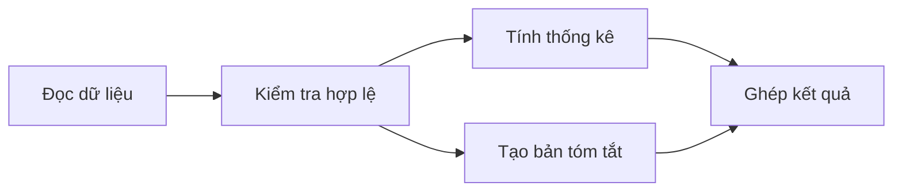

<a id="back-to-top"></a>

# Thiết kế đồng thời

## Menu
- [Chia nhỏ task theo mức độ độc lập](#concurrency-design-001)
- [Producer–consumer và queue có giới hạn](#concurrency-design-002)
- [Work queue, worker pool và task dispatch](#concurrency-design-003)
- [Fan-out / fan-in và tổng hợp kết quả](#concurrency-design-004)
- [Message passing để giảm shared mutable state](#concurrency-design-005)
- [Ownership và tránh chia sẻ state không cần thiết](#concurrency-design-006)
- [Bulkhead: giới hạn tải theo loại tài nguyên](#concurrency-design-007)
- [Rate limiting và giới hạn in-flight requests](#concurrency-design-008)
- [Đảm bảo idempotency khi task có thể được chạy lại](#concurrency-design-009)
- [Timeout budget qua nhiều bước xử lý](#concurrency-design-010)
- [Tránh giữ lock xuyên qua call không kiểm soát](#concurrency-design-011)
- [Phân biệt concurrency control và business transaction](#concurrency-design-012)

## <a id="concurrency-design-001">Chia nhỏ task theo mức độ độc lập</a>

<details>
<summary>Xem chi tiết</summary>

# Chia nhỏ task theo mức độ độc lập trong Java Concurrency

## 1. Mục tiêu và phạm vi

Khi một công việc lớn được chia thành nhiều task, câu hỏi đầu tiên không phải là “tạo bao nhiêu thread?”, mà là **những phần việc nào có thể chạy độc lập mà vẫn tạo ra kết quả đúng?** Thiết kế tốt bắt đầu từ quan hệ phụ thuộc dữ liệu, trạng thái và thứ tự thực hiện; API Java được chọn sau khi đã hiểu các quan hệ đó.

Sau bài này, bạn có thể:
- Phân biệt task độc lập, task phụ thuộc và task dùng chung tài nguyên.
- Tách công việc theo dữ liệu hoặc chức năng, xác định điểm đồng bộ và điểm tổng hợp kết quả.
- Dùng `ExecutorService`, `Callable`, `Future` và `CompletableFuture` cho những kiểu phụ thuộc phù hợp.
- Quyết định độ hạt task, giới hạn đồng thời, chính sách lỗi và cách kiểm chứng hiệu quả.

Phạm vi là **Java Concurrency nói chung**. Ví dụ dùng Java SE và không dựa vào Spring, `@Async`, Spring TaskExecutor hoặc bất kỳ cơ chế Spring riêng nào.

## 2. “Độc lập” nghĩa là gì?

Một **task** là đơn vị công việc có đầu vào, điều kiện bắt đầu và kết quả hoặc tác động xác định. Hai task `A` và `B` *độc lập về thực thi* khi có thể đổi thứ tự hoặc chạy chồng thời gian mà không làm sai tính đúng đắn. Độc lập không nhất thiết có nghĩa là chúng chạy trên hai thread khác nhau.

Có ba mức cần phân biệt:

| Quan hệ | Dấu hiệu | Cách tổ chức |
|---|---|---|
| Độc lập hoàn toàn | Cùng đọc dữ liệu bất biến, tạo các kết quả riêng | Có thể submit song song; tổng hợp sau |
| Phụ thuộc một chiều | B cần đầu ra của A | A phải hoàn thành trước B; biểu diễn quan hệ bằng chuỗi stage |
| Cùng thay đổi trạng thái/tài nguyên | A và B ghi chung biến, file, transaction hoặc thiết bị | Cô lập sở hữu, đồng bộ truy cập hoặc thiết kế lại để tránh ghi chung |

Ví dụ xử lý 10.000 đơn hàng:
- Tính tổng doanh thu của **những nhóm đơn không giao nhau** có thể là nhiều task độc lập. Mỗi task trả về một tổng cục bộ, sau đó cộng các tổng.
- Tạo hóa đơn từ kết quả kiểm tra đơn hàng là task **phụ thuộc**: phải có kết quả kiểm tra hợp lệ trước.
- Hai task cùng tăng một biến `total` thông thường là **tranh chấp trạng thái**. Dữ liệu bị chia đôi không tự làm thao tác ghi chung trở nên an toàn.

Cần xem xét ba chiều độc lập riêng biệt:

1. **Dữ liệu:** Có ghi vào cùng vị trí hay phụ thuộc kết quả chưa được tính không?
2. **Tài nguyên:** Có cùng truy cập connection, file, quota API, rate limit hoặc thiết bị hữu hạn không?
3. **Ý nghĩa nghiệp vụ:** Kết quả có cần duy trì thứ tự, tính nguyên tử, bất biến (invariant) hoặc “tất cả thành công hoặc tất cả thất bại” không?

Một task đọc dữ liệu chung có thể độc lập về dữ liệu nhưng vẫn bị giới hạn bởi connection pool. Một phép tính có thể chạy đồng thời về kỹ thuật nhưng không được đổi thứ tự nếu yêu cầu nghiệp vụ là “trừ tồn kho rồi mới xác nhận đơn”.

## 3. Từ yêu cầu đến đồ thị phụ thuộc (DAG)

Xem mỗi task là một nút; vẽ cạnh `A → B` khi B cần kết quả của A. Đồ thị hợp lệ để lập lịch theo phụ thuộc phải không có chu trình (DAG). Những nút không phụ thuộc nhau và đã có đủ tiền đề mới là ứng viên chạy đồng thời.



Ở đây C và D **có thể** chạy đồng thời sau B; E chỉ bắt đầu khi cả hai có kết quả. Không nên chạy B đồng thời với A nếu B cần dữ liệu từ A.

Quy trình phân tích một task lớn:

1. **Xác định đầu ra và bất biến:** Kết quả đúng trông như thế nào? Có ràng buộc thứ tự hay tính nhất quán nào?
2. **Liệt kê bước thật sự cần thiết:** Đọc, kiểm tra, tính toán, ghi, tổng hợp; xác định input/output của từng bước.
3. **Đánh dấu phụ thuộc:** Phụ thuộc dữ liệu, phụ thuộc trạng thái, phụ thuộc tài nguyên và ràng buộc nghiệp vụ.
4. **Cắt tại ranh giới độc lập:** Ưu tiên input bất biến, task sở hữu dữ liệu của mình và kết quả cục bộ.
5. **Tạo điểm kết hợp (join):** Xác định chỗ chờ và ghép kết quả, quy tắc xử lý lỗi.
6. **Ước lượng chi phí:** Task có đủ lớn để việc lập lịch và truyền dữ liệu đáng giá không?
7. **Kiểm chứng:** So với thuật toán tuần tự và thử trường hợp biên trước khi tối ưu throughput.

**Không phải mọi bước đều nên song song hóa.** Nếu tất cả đều phụ thuộc trên một chuỗi, thêm thread không phá được thứ tự logic đó. Đường phụ thuộc dài nhất (critical path) đặt cận dưới cho thời gian hoàn thành, ngay cả khi có rất nhiều worker.

## 4. Hai cách chia phổ biến

### 4.1. Phân rã theo dữ liệu (data parallelism)

Một phép xử lý áp dụng lên các phần dữ liệu tách biệt:

```text
Dữ liệu đầu vào
    ├── Nhóm 1 ──> Task 1 ──> Kết quả 1 ──┐
    ├── Nhóm 2 ──> Task 2 ──> Kết quả 2 ──┼──> Reduce ──> Kết quả cuối
    └── Nhóm 3 ──> Task 3 ──> Kết quả 3 ──┘
```

Phù hợp với thống kê, xử lý ảnh, đọc nhiều file độc lập hoặc đánh giá hàng loạt bản ghi. Phần `reduce` cần đúng về toán học: cộng số nguyên là phép kết hợp được trong phạm vi không tràn số; lấy trung bình các trung bình của nhóm có kích thước khác nhau là **sai** nếu không kèm số lượng. Với số thực, thứ tự cộng có thể làm thay đổi sai số làm tròn.

Một mô hình an toàn là **map → local result → reduce**: các task không thay đổi bộ cộng dồn chung.

### 4.2. Phân rã theo chức năng (functional decomposition)

Những nhánh tính toán khác nhau dùng chung đầu vào đã sẵn sàng, ví dụ từ hồ sơ đã tải: một task chuẩn bị thông báo, một task tính thông tin gợi ý. Chúng có thể bắt đầu sau cùng một bước tải và ghép lại ở cuối.

Phân rã theo chức năng thường chứa nhiều ràng buộc thứ tự hơn phân rã theo dữ liệu. Chỉ chạy hai nhánh đồng thời khi chúng không phụ thuộc vào tác động phụ chưa được bảo đảm của nhau.

## 5. Ví dụ Java 17: chia nhóm đơn hàng, tổng hợp không chia sẻ biến ghi

Mỗi task chỉ đọc danh sách bất biến và trả về một `Partial`. Thread chính lấy hai kết quả sau khi task hoàn thành; không có `AtomicLong`, khóa hay bộ cộng dồn chung giữa worker.

Lưu mã sau vào `TaskDecompositionDemo.java`:

```java
import java.util.ArrayList;
import java.util.List;
import java.util.concurrent.Callable;
import java.util.concurrent.ExecutorService;
import java.util.concurrent.Executors;
import java.util.concurrent.Future;

public class TaskDecompositionDemo {
    record Order(String id, long cents) {}
    record Partial(long count, long cents) {}

    static Partial summarize(List<Order> batch) {
        long count = 0;
        long cents = 0;
        for (Order order : batch) {
            count++;
            cents += order.cents();
        }
        return new Partial(count, cents);
    }

    public static void main(String[] args) throws Exception {
        List<Order> orders = List.of(
            new Order("A", 10_000),
            new Order("B", 20_000),
            new Order("C", 15_000),
            new Order("D", 5_000)
        );

        int middle = orders.size() / 2;
        List<List<Order>> batches = List.of(
            orders.subList(0, middle),
            orders.subList(middle, orders.size())
        );

        ExecutorService pool = Executors.newFixedThreadPool(2);
        try {
            List<Callable<Partial>> tasks = new ArrayList<>();
            for (List<Order> batch : batches) {
                tasks.add(() -> summarize(batch));
            }

            List<Future<Partial>> futures = pool.invokeAll(tasks);
            long totalCount = 0;
            long totalCents = 0;
            for (Future<Partial> future : futures) {
                Partial result = future.get();
                totalCount += result.count();
                totalCents += result.cents();
            }

            System.out.println("Số đơn: " + totalCount);
            System.out.println("Tổng (cent): " + totalCents);
        } finally {
            pool.shutdown();
        }
    }
}
```

Chạy bằng JDK 17 hoặc mới hơn:

```bash
javac TaskDecompositionDemo.java
java TaskDecompositionDemo
```

Kết quả chính xác:

```text
Số đơn: 4
Tổng (cent): 50000
```

Giải thích:
- `List.of(...)` tạo danh sách không hỗ trợ thay đổi phần tử; các `subList` ở đây là các view chỉ đọc của dữ liệu đó. Nếu dùng danh sách có thể sửa từ nơi khác, hãy chụp snapshot hoặc thiết lập quyền sở hữu rõ ràng trước khi submit.
- Hai batch không chồng lấn; `summarize` chỉ sử dụng biến cục bộ và trả kết quả bất biến dạng `record`.
- `invokeAll` submit mọi `Callable` và đợi chúng hoàn thành; danh sách `Future` trả về theo **thứ tự task đầu vào**, không phải thứ tự worker hoàn thành.
- `future.get()` nhận giá trị hoặc ném `ExecutionException` nếu task lỗi. Kết quả của task đã hoàn thành được công bố an toàn qua cơ chế `Future`.
- `shutdown()` ngừng nhận task mới và cho task đã submit tiếp tục hoàn thành; nó không tự đợi vô hạn. Ở luồng thành công của ví dụ, `invokeAll` đã đợi các task.

Đây là ví dụ minh họa thiết kế, **không chứng minh chạy song song nhanh hơn**: bốn bản ghi quá ít để đáng chi phí thread pool. Trên dữ liệu thật, cần đo kích thước batch và thời gian mỗi task. Nếu cộng tổng có thể vượt `long`, cân nhắc `Math.addExact` hoặc `BigInteger` theo yêu cầu.

## 6. Ví dụ Java 17: phụ thuộc trước, độc lập sau với CompletableFuture

Trong đồ thị `loadProfile → (buildGreeting, buildLocale) → combine`, hai nhánh sau có chung tiền đề nhưng không phụ thuộc lẫn nhau. `CompletableFuture` biểu diễn quan hệ đó mà không cần tự gọi `get()` giữa các bước.

Lưu thành `TaskDependencyDemo.java`:

```java
import java.util.concurrent.CompletableFuture;
import java.util.concurrent.ExecutorService;
import java.util.concurrent.Executors;

public class TaskDependencyDemo {
    record Profile(String id, String locale) {}

    static Profile loadProfile(String id) {
        return new Profile(id, "vi");
    }

    public static void main(String[] args) {
        ExecutorService pool = Executors.newFixedThreadPool(3);
        try {
            CompletableFuture<Profile> loaded =
                CompletableFuture.supplyAsync(() -> loadProfile("u42"), pool);

            CompletableFuture<String> greeting =
                loaded.thenApplyAsync(p -> "Xin chào " + p.id(), pool);

            CompletableFuture<String> locale =
                loaded.thenApplyAsync(p -> "ngôn ngữ=" + p.locale(), pool);

            CompletableFuture<String> combined =
                greeting.thenCombine(locale, (a, b) -> a + "; " + b);

            System.out.println(combined.join());
        } finally {
            pool.shutdown();
        }
    }
}
```

```bash
javac TaskDependencyDemo.java
java TaskDependencyDemo
```

```text
Xin chào u42; ngôn ngữ=vi
```

`thenApplyAsync` chỉ kích hoạt khi `loaded` hoàn thành bình thường; hai nhánh có thể chạy chồng nhau nếu executor có worker sẵn sàng. `thenCombine` chờ kết quả từ cả hai. **Độc lập cho phép đồng thời; không bảo đảm hai nhánh luôn được thực thi cùng lúc.** Nếu một stage thất bại, stage phụ thuộc thường hoàn thành ngoại lệ; `join()` có thể ném `CompletionException`. Khi có yêu cầu phục hồi, lựa chọn `exceptionally`, `handle` hoặc `whenComplete` theo chính sách kết quả, không âm thầm bỏ lỗi.

Lưu ý: `thenApply` (không có `Async`) có thể chạy ở thread hoàn thành stage trước hoặc thread đăng ký callback, tùy thời điểm. Không mặc định rằng mọi stage tương ứng một thread riêng; chọn explicit executor và đo khi cần kiểm soát nơi thực thi.

## 7. Độ hạt task: chia bao nhiêu là vừa?

Song song hóa giúp giảm thời gian khi lượng công việc hữu ích đủ lớn so với overhead. Một mô hình định tính:

```text
T_parallel ≈ T_work / số worker hữu dụng
             + T_submit + T_queue + T_join
             + T_contention + T_imbalance
```

Đây là mô hình tư duy, không phải công thức dự báo chính xác: số worker hữu dụng phụ thuộc CPU, I/O, phụ thuộc task và tải hệ thống. Nếu một phần công việc buộc tuần tự, tốc độ tăng vẫn bị giới hạn bởi phần tuần tự (định luật Amdahl).

Chọn kích thước task theo các tiêu chí:
- **Quá nhỏ:** Hàng triệu task cho vài phép cộng mỗi task khiến chi phí queue, đối tượng và chuyển ngữ cảnh lấn át công việc.
- **Quá lớn:** Chỉ một hai task nặng khiến worker khác nhàn rỗi và khó hủy một phần.
- **Cân bằng kém:** Một batch chứa phần lớn công việc sẽ kéo dài critical path, dù các batch khác kết thúc sớm.
- **Chia tốn chi phí:** Copy dữ liệu lớn, chuyển đổi format hoặc phân phối input có thể xóa lợi ích song song.
- **Phụ thuộc kết quả:** Nếu bước kế tiếp phải đợi mọi task, batch chậm nhất quyết định thời điểm join.

Với công việc đồng nhất, thử bắt đầu bằng số batch tương đương hoặc gấp vài lần số worker rồi đo. Với công việc biến thiên mạnh, nhiều task vừa phải trên một executor dùng chung có thể cân bằng tốt hơn; vẫn phải kiểm soát số task chờ và bộ nhớ. Không có kích thước batch đúng cho mọi bài.

## 8. CPU-bound, I/O-bound và giới hạn tài nguyên

| Tính chất task | Điểm nghẽn | Định hướng |
|---|---|---|
| CPU-bound: tính hash, biến đổi số học, phân tích dữ liệu | Core CPU và băng thông bộ nhớ | Pool hữu hạn; lấy `Runtime.getRuntime().availableProcessors()` làm mốc đo thử |
| I/O-bound: chờ mạng, file, database | Thời gian chờ và giới hạn tài nguyên ngoài | Điều chỉnh số task in-flight theo latency, connection pool, quota và khả năng backend |
| Mixed: đọc rồi xử lý nặng | I/O và CPU ở các thời điểm khác nhau | Có thể tách stage hoặc dùng pool phù hợp, tránh để một stage làm đói stage khác |

`Executors.newFixedThreadPool(n)` giới hạn số worker nhưng hàng đợi công việc có thể tăng rất lớn nếu submit nhanh hơn xử lý. Trong hệ thống tải cao, cần **backpressure**: hạn chế lượng công việc đang chờ, chia theo lô, hoặc cấu hình `ThreadPoolExecutor` với hàng đợi hữu hạn và chính sách từ chối rõ ràng. Đừng dùng thêm thread để “sửa” việc backend chỉ chịu được số kết nối cố định.

**Java 21+** có virtual threads (`Executors.newVirtualThreadPerTaskExecutor()`) phù hợp nhiều tác vụ blocking I/O; chúng giảm chi phí chờ của thread kiểu truyền thống nhưng **không khiến phép tính CPU nặng nhanh hơn**, không loại bỏ giới hạn connection/quota, và vẫn cần kiểm soát số thao tác đồng thời. Ví dụ chính ở trên dùng Java 17 để dễ biên dịch ở nhiều môi trường.

## 9. Dữ liệu chia sẻ: điểm làm task tưởng độc lập trở nên nguy hiểm

**Ví dụ sai về thiết kế** (đoạn minh họa, không phải chương trình hoàn chỉnh):

```java
long[] total = {0};
tasks.add(() -> {
    total[0] += calculate(batch); // read-modify-write không nguyên tử
    return null;
});
```

Nhiều worker ghi `total[0]` gây race và có thể mất cập nhật. Dùng `volatile` cho một biến cũng **không** làm phép `x += value` trở thành nguyên tử. Sửa phù hợp nhất cho bài toán tổng hợp là để mỗi task `return` kết quả cục bộ và cộng ở bước reduce như ví dụ 5. Nếu buộc cộng dồn chung, cần công cụ đồng bộ/atomic thích hợp và đánh giá contention.

Những bẫy tương tự:
- Dùng chung `ArrayList`, `HashMap` có ghi mà không đồng bộ.
- Hai task sửa cùng object hoặc vùng nhớ dù danh sách input khác nhau.
- Đọc rồi ghi file chung mà không thỏa thuận vùng ghi/thứ tự.
- Phụ thuộc vào `ThreadLocal`, transaction context hoặc trạng thái thread cũ khi đổi executor.
- Viết vào cùng tài nguyên bên ngoài: đồng thời trên Java không bảo đảm thao tác nghiệp vụ ngoài tiến trình là nguyên tử.

Quy tắc thiết kế hữu ích: **immutable input → xử lý cục bộ → immutable result → một nơi tổng hợp**. Nếu bắt buộc chia sẻ trạng thái, định nghĩa cụ thể ai sở hữu, ai đọc/ghi, điều kiện đồng bộ và lúc nào dữ liệu được công bố an toàn. Tránh coi `sleep()` là cách đồng bộ hoặc dùng thứ tự log để chứng minh tính đúng đắn.

## 10. Lỗi, hủy, timeout và vòng đời task

Chia nhỏ task làm phát sinh câu hỏi: khi 1 trong 20 task thất bại, 19 task còn lại phải làm gì? Hãy chọn chính sách ngay từ đầu:
- **All-or-nothing:** Một task lỗi khiến kết quả toàn bộ không hợp lệ; báo lỗi, hủy công việc không còn cần thiết và dọn tài nguyên.
- **Best-effort:** Chấp nhận một phần kết quả nhưng ghi rõ task thất bại và độ đầy đủ; không đánh đồng dữ liệu thiếu với số 0.
- **Retry:** Chỉ retry khi thao tác an toàn để thực hiện lại (idempotent hoặc có cơ chế khử trùng lặp), với số lần và thời hạn hữu hạn.

Với `ExecutorService`, `Future.get()` có thể ném `InterruptedException` (thread chờ bị interrupt), `ExecutionException` (task lỗi) hoặc `CancellationException` (bị hủy). Dùng `invokeAll(tasks, timeout, unit)` để có hạn chót chung; những task chưa hoàn thành tại hạn chót bị hủy, nên phải kiểm tra `isCancelled()` trước khi lấy kết quả. `Future.cancel(true)` yêu cầu interrupt nhưng không bảo đảm dừng ngay, đặc biệt nếu task không hợp tác hoặc đang gọi API không hỗ trợ interrupt.

Khi bắt `InterruptedException` mà không ném tiếp, thường cần phục hồi cờ bằng `Thread.currentThread().interrupt()` và thoát đúng cách. Các task chạy lâu nên có điểm kiểm tra interrupt thích hợp và dọn tài nguyên trong `finally`/`try-with-resources`. `shutdownNow()` chỉ cố gắng ngắt công việc; không bảo đảm mọi task dừng tức thì.

Tránh deadlock do **task chờ task khác trên cùng pool quá nhỏ**. Ví dụ pool một thread chạy task A; A submit B vào chính pool đó rồi `B.get()` trong khi B chưa có worker để chạy. Hãy biểu diễn phụ thuộc ở bên ngoài bằng `CompletableFuture`, tránh blocking join trong worker, hoặc thiết kế executor đủ phù hợp và kiểm chứng liveness.

## 11. Đúng trước, nhanh sau: kiểm thử và đo lường

Bắt đầu bằng phiên bản tuần tự có kết quả rõ ràng, sau đó đối chiếu kết quả song song trên cùng input. Với phép gộp có thứ tự hoặc số thực, phải xác định sai số và thứ tự chấp nhận được trước.

Những tình huống cần thử:
- Input rỗng, một phần tử, số phần tử lẻ, số phần tử ít hơn số worker.
- Dữ liệu có batch rất nặng, một task ném exception, timeout và interrupt.
- Nhiều lần chạy cùng input: kiểm tra tính đúng và tính quyết định của kết quả nếu hợp đồng yêu cầu.
- Tải đồng thời từ nhiều request và tài nguyên hữu hạn: pool, queue, heap, connection, quota.
- So với tuần tự bằng workload đủ lớn; đo latency (p50/p95), throughput, CPU, allocation, queue time và thời gian chờ.

Nếu benchmark Java nghiêm túc, dùng công cụ như JMH sau khi xác định bài toán và cách làm ấm JVM. Dùng JFR, thread dump và profiler để tìm tình trạng đợi khóa, blocking hoặc mất cân bằng task. Đừng kết luận nhanh/chậm dựa trên ví dụ bốn đơn hàng hoặc một lần chạy.

## 12. Một quy trình quyết định ngắn

Trước khi thêm một nhánh song song, trả lời lần lượt:

1. **Task tạo ra gì?** Đầu vào và đầu ra có thể mô tả độc lập không?
2. **Phụ thuộc vào đâu?** Nếu task B đợi A, ghi một cạnh trong DAG thay vì chạy ngẫu nhiên rồi hy vọng đúng.
3. **Ai sở hữu trạng thái?** Có thể thay ghi chung bằng kết quả cục bộ bất biến không?
4. **Ghép thế nào?** Phép reduce có đúng với mọi cách chia và thứ tự hoàn thành không?
5. **Chạy ở đâu?** CPU-bound, blocking I/O hay mixed; worker và giới hạn tài nguyên là bao nhiêu?
6. **Nếu lỗi thì sao?** Hủy/timeout/retry/partial result; ai giải phóng tài nguyên?
7. **Có lợi thật không?** Đo kết quả và hiệu năng so với baseline tuần tự.

### Bài tập áp dụng

Bạn cần xử lý 1.000 file log: đọc và đếm số dòng lỗi trong từng file, rồi xuất một báo cáo tổng. Hãy xác định (a) ranh giới task độc lập, (b) cách trả kết quả, (c) chỗ join, (d) giới hạn số file đang mở, (e) xử lý một file lỗi, và (f) cách đối chiếu với phép đếm tuần tự.

Một thiết kế cơ sở: mỗi task xử lý **một file hoặc một nhóm file**, trả `(file, errorCount)` hoặc lỗi có ngữ cảnh; reducer tổng hợp sau khi các task kết thúc theo chính sách đã chọn. Số task thực thi đồng thời cần tôn trọng giới hạn I/O/file descriptor. Nếu báo cáo đòi thứ tự tên file, **sắp xếp kết quả lúc xuất** thay vì giả định thứ tự task hoàn thành.

**Kết luận kỹ thuật:** Ranh giới task nên được xác định bởi quan hệ phụ thuộc và quyền sở hữu dữ liệu trước. Java executor giúp lập lịch thực thi; tính đúng của việc chia task đến từ thiết kế đầu vào, phụ thuộc, đồng bộ và cách ghép kết quả.


</details>

- [Quay lại đầu trang](#back-to-top)

---

## <a id="concurrency-design-002">Producer–consumer và queue có giới hạn</a>

<details>
<summary>Xem chi tiết</summary>

# Producer–consumer và queue có giới hạn trong Java

## 1. Bài toán và mục tiêu

**Producer–consumer** là mô hình nhiều luồng tạo công việc (producer), đưa công việc vào một vùng đệm chung (queue), còn một hoặc nhiều luồng khác lấy công việc ra để xử lý (consumer). Producer và consumer chạy độc lập, có tốc độ biến động, nên cần một cơ chế trao đổi an toàn giữa các luồng.

Với **bounded queue** (hàng đợi có giới hạn), số phần tử đang chờ không được vượt quá một dung lượng `capacity` đã chọn. Đây là thiết kế quan trọng để giới hạn mức tiêu thụ bộ nhớ, điều tiết tốc độ sản xuất và tạo **backpressure**: khi consumer chưa theo kịp, producer phải chờ, hết thời gian chờ hoặc nhận một quyết định từ chối rõ ràng.

Sau bài này, bạn cần có thể:
- Giải thích quan hệ giữa producer, queue, consumer, dung lượng và backpressure.
- Chọn đúng phương thức `put`, `take`, `offer`, `poll` và xử lý ngắt luồng.
- Xây một luồng xử lý công việc Java với `ArrayBlockingQueue` mà không mất tác vụ do lỗi đồng bộ thông thường.
- Thiết kế kết thúc, kiểm soát quá tải, quan sát hiệu năng và kiểm thử các trường hợp queue đầy/rỗng.

Phạm vi là **Java concurrency nói chung**, sử dụng các API trong JDK, không phụ thuộc framework.

## 2. Từ mô hình đến các bất biến

Giả sử producer nhận sự kiện, consumer xử lý từng sự kiện:

~~~text
Producer P1 ──┐
              ├──> [ bounded FIFO queue: capacity = 3 ] ──> Consumer C1
Producer P2 ──┘                                    └───────> Consumer C2
~~~

Tại mọi thời điểm, nếu `size` là số tác vụ đang đợi trong queue, bất biến cơ bản là:

~~~text
0 <= size <= capacity
~~~

- **Queue chưa đầy:** producer có thể đặt thêm phần tử.
- **Queue đầy:** `put` phải đợi đến khi có chỗ; `offer` không thời hạn trả `false` ngay; `offer(timeout)` đợi tối đa khoảng thời gian cho phép.
- **Queue chưa rỗng:** consumer lấy một phần tử ra.
- **Queue rỗng:** `take` chờ công việc mới; `poll` không thời hạn trả `null` ngay; `poll(timeout)` chờ có giới hạn.
- **FIFO:** `ArrayBlockingQueue` lấy ra theo thứ tự *được đưa vào queue*. Khi nhiều producer cùng chạy, thứ tự giữa các producer không cố định; khi nhiều consumer cùng xử lý, **thứ tự hoàn thành** cũng có thể khác thứ tự lấy ra.

Ví dụ queue dung lượng 2, chỉ có một producer và một consumer:

| Bước | Hành động | Nội dung queue sau bước |
| --- | --- | --- |
| 1 | P đặt A | [A] |
| 2 | P đặt B | [A, B] (đầy) |
| 3 | P gọi `put(C)` | Vẫn [A, B]; P đang chờ |
| 4 | C gọi `take()` lấy A | [B]; P có cơ hội tiếp tục |
| 5 | `put(C)` hoàn tất | [B, C] |

Không cần consumer gọi một API “đánh thức producer” thủ công: `BlockingQueue` thực hiện điều phối này. Tuy vậy, vừa có chỗ trống không có nghĩa producer đang đợi sẽ được CPU chạy ngay; bộ lập lịch luồng quyết định thời điểm thực thi.

### Queue giải quyết điều gì, và không giải quyết điều gì?

`BlockingQueue` phối hợp luồng và trao đổi phần tử an toàn mà không cần người dùng tự khóa quanh từng thao tác `put`/`take`. Nó cũng cung cấp quan hệ **happens-before**: các hành động của một luồng trước khi đưa phần tử vào `BlockingQueue` xảy ra trước các hành động của luồng khác sau khi lấy/truy cập phần tử đó từ queue. Điều này hỗ trợ công bố đối tượng an toàn qua queue.

Nhưng queue **không** làm cho bản thân đối tượng công việc trở thành bất biến. Nếu producer tiếp tục sửa một đối tượng mutable sau khi enqueue trong khi consumer đọc đối tượng đó, bạn vẫn có thể gặp race condition. Ưu tiên truyền dữ liệu bất biến (`record` hoặc đối tượng chỉ đọc), hoặc có đồng bộ riêng cho trạng thái mutable.

Queue cũng không tự cung cấp lưu trữ bền vững, retry, transaction, chống xử lý trùng hay đảm bảo tác vụ đã hoàn thành. Consumer lấy thành công chỉ chứng minh tác vụ đã rời queue, chưa chứng minh xử lý nghiệp vụ đã thành công.

## 3. Các phương thức quan trọng của `BlockingQueue<E>`

| Ý định | Đợi vô hạn theo thiết kế API | Trả kết quả ngay | Đợi có thời hạn |
| --- | --- | --- | --- |
| Thêm phần tử khi queue đầy | `put(e)` | `offer(e)` trả `false` | `offer(e, timeout, unit)` trả `false` khi hết hạn |
| Lấy phần tử khi queue rỗng | `take()` | `poll()` trả `null` | `poll(timeout, unit)` trả `null` khi hết hạn |

Các API khác cần phân biệt:

- `add(e)` ném `IllegalStateException` nếu queue có giới hạn và đã đầy; `remove()` ném `NoSuchElementException` nếu rỗng.
- `peek()` đọc phần tử đầu nhưng **không lấy ra**; trả `null` nếu rỗng.
- `remainingCapacity()` và `size()` chỉ phản ánh trạng thái tại một thời điểm. Giữa thao tác kiểm tra và thao tác enqueue có thể có luồng khác thay đổi queue; vì thế đừng viết kiểu “`if (remainingCapacity() > 0) put(...)`” với kỳ vọng không bao giờ bị chặn.
- `drainTo(collection, n)` chuyển nhiều phần tử đang chờ sang collection nhằm giảm số lần lấy; không tự động biến việc xử lý cả batch thành một transaction.
- `BlockingQueue` không chấp nhận phần tử `null`, vì `null` được dùng làm tín hiệu “không có phần tử” cho một số phương thức.

**Điểm cần nhớ:** “đợi vô hạn” mô tả không đặt timeout trong API; luồng vẫn có thể bị interrupt. Các phương thức `put`, `take` và các bản timeout khai báo `InterruptedException`. Đừng nuốt ngoại lệ này rồi tiếp tục vòng lặp vô tận.

## 4. Ví dụ Java 17 chạy được: hai producer, hai consumer, queue dung lượng 3

Ví dụ dùng `ArrayBlockingQueue<Work>`, một record bất biến làm thông điệp, `ExecutorService` quản lý luồng và một thông điệp dừng chuyên biệt (**poison pill**) cho mỗi consumer. Main chỉ phát tín hiệu dừng **sau khi tất cả producer hoàn tất**, để không có công việc mới đứng sau tín hiệu dừng.

Lưu tệp **ProducerConsumerDemo.java**:

~~~java
import java.util.ArrayList;
import java.util.List;
import java.util.concurrent.ArrayBlockingQueue;
import java.util.concurrent.BlockingQueue;
import java.util.concurrent.ExecutorService;
import java.util.concurrent.Executors;
import java.util.concurrent.Future;
import java.util.concurrent.TimeUnit;
import java.util.concurrent.atomic.AtomicInteger;

public class ProducerConsumerDemo {
    record Work(int producerId, int sequence) {}

    // Giá trị này nằm ngoài miền dữ liệu công việc thông thường.
    private static final Work STOP = new Work(-1, -1);

    public static void main(String[] args) throws Exception {
        int producerCount = 2;
        int consumerCount = 2;
        int workPerProducer = 6;

        BlockingQueue<Work> queue = new ArrayBlockingQueue<>(3);
        ExecutorService pool =
                Executors.newFixedThreadPool(producerCount + consumerCount);
        AtomicInteger produced = new AtomicInteger();
        AtomicInteger consumed = new AtomicInteger();

        List<Future<?>> producers = new ArrayList<>();
        List<Future<?>> consumers = new ArrayList<>();

        try {
            for (int i = 0; i < producerCount; i++) {
                final int id = i;
                producers.add(pool.submit(() -> {
                    for (int n = 1; n <= workPerProducer; n++) {
                        queue.put(new Work(id, n));
                        produced.incrementAndGet();
                    }
                    return null;
                }));
            }

            for (int i = 0; i < consumerCount; i++) {
                consumers.add(pool.submit(() -> {
                    while (true) {
                        Work work = queue.take();
                        if (work.equals(STOP)) {
                            return null;
                        }

                        // Nơi thực hiện xử lý nghiệp vụ cho "work".
                        // Ví dụ đếm một tác vụ đã xử lý thành công.
                        consumed.incrementAndGet();
                    }
                }));
            }

            // get() còn chuyển lỗi của producer về main.
            for (Future<?> producer : producers) {
                producer.get();
            }

            // Mỗi consumer phải nhận một tín hiệu dừng.
            for (int i = 0; i < consumerCount; i++) {
                queue.put(STOP);
            }

            // Đợi các consumer xử lý xong, đồng thời nhận lỗi nếu có.
            for (Future<?> consumer : consumers) {
                consumer.get();
            }

            System.out.printf(
                    "produced=%d, consumed=%d, remaining=%d%n",
                    produced.get(), consumed.get(), queue.size());
        } finally {
            // Khi gặp lỗi, đánh thức những tác vụ còn đang đợi bằng interrupt.
            // Trên đường thành công mọi Future ở trên đều đã hoàn tất.
            pool.shutdownNow();
            pool.awaitTermination(5, TimeUnit.SECONDS);
        }
    }
}
~~~

Biên dịch/chạy với JDK 17+:

~~~bash
javac ProducerConsumerDemo.java
java ProducerConsumerDemo
~~~

Kết quả cuối **xác định** của ví dụ, dù lịch thực thi của các luồng không xác định:

~~~text
produced=12, consumed=12, remaining=0
~~~

**Vì sao đúng?**

1. Hai producer sinh tổng cộng `2 × 6 = 12` phần tử. `put` chỉ trở về sau khi queue nhận phần tử; biến `produced` tăng ngay sau đó.
2. Bốn luồng chạy trên pool có bốn worker, nên có luồng producer và consumer để tiến hành đồng thời. Khi queue đầy, producer đợi; khi rỗng, consumer đợi.
3. Main gọi `get()` của **mọi producer** trước khi enqueue hai STOP. Với FIFO, STOP được xếp sau toàn bộ công việc đã enqueue; mỗi consumer nhận STOP sẽ rời vòng lặp.
4. `get()` của **mọi consumer** chỉ kết thúc sau khi các tác vụ trước STOP đã được lấy và đếm. Vì vậy `consumed == 12` và queue rỗng.
5. Nếu một tác vụ trong pool ném ngoại lệ, `Future.get()` ném `ExecutionException`, không bị bỏ qua âm thầm. Khối `finally` gửi interrupt khi cần dọn dẹp.

Đây là mẫu minh họa **kết thúc có kiểm soát khi mọi producer hoàn thành bình thường**. Trong hệ thống chạy liên tục, phải thiết kế thêm đường xử lý cho producer thất bại, consumer chết sớm, công việc treo hoặc yêu cầu hủy; chỉ gọi `put(STOP)` có thể mắc kẹt nếu queue đầy mà không còn consumer hoạt động.

**Lưu ý kiểm chứng:** bộ đếm ở đây mô phỏng xử lý thành công tức thì. Nếu thay comment bằng một thao tác có thể thất bại, chỉ tăng `consumed` sau khi thao tác thành công, và xác định chính sách lỗi riêng.

## 5. Khi quá tải: đợi, hết hạn, từ chối hay bỏ công việc?

Không có một chính sách phù hợp cho mọi hệ thống. Chọn theo thời gian chờ chấp nhận được, chi phí mất dữ liệu và cách phía gửi phản ứng.

- **`put`:** producer chờ cho đến khi có chỗ hoặc bị ngắt; hữu ích khi không được phép bỏ công việc và có thể chấp nhận chờ. Nếu mọi thành phần đều phụ thuộc vòng chờ lẫn nhau, vẫn có thể tạo deadlock ở cấp ứng dụng.
- **`offer` không timeout:** trả `false` ngay khi đầy; phù hợp với yêu cầu phản hồi tức thì. **Bắt buộc kiểm tra boolean**.
- **`offer` có timeout:** chờ một ngân sách thời gian có giới hạn; khi hết hạn, quyết định trả lỗi, retry có giới hạn, ghi nhận hoặc chuyển đến nơi khác.
- **Bỏ phần tử:** chỉ hợp lệ khi dữ liệu có thể bỏ theo yêu cầu nghiệp vụ (ví dụ sự kiện đo lường có thể lấy mẫu). Cần đo lượng bị bỏ.
- **Điều chỉnh upstream:** giảm tốc độ nhận, giảm mức đồng thời tạo việc, hoặc đưa tín hiệu quá tải về phía gửi.

Ví dụ nhỏ, độc lập, dùng một queue dung lượng 1 và **không có consumer**, để thấy chính xác các giá trị trả về. Lưu tệp **QueueOfferDemo.java**:

~~~java
import java.util.concurrent.ArrayBlockingQueue;
import java.util.concurrent.BlockingQueue;
import java.util.concurrent.TimeUnit;

public class QueueOfferDemo {
    public static void main(String[] args) throws InterruptedException {
        BlockingQueue<String> queue = new ArrayBlockingQueue<>(1);

        System.out.println(queue.offer("A"));
        System.out.println(queue.offer("B"));
        System.out.println(queue.offer("B", 50, TimeUnit.MILLISECONDS));
        System.out.println(queue.poll());
        System.out.println(queue.poll());
    }
}
~~~

~~~bash
javac QueueOfferDemo.java
java QueueOfferDemo
~~~

Stdout:

~~~text
true
false
false
A
null
~~~

Lần `offer("B", 50, MILLISECONDS)` có thể thức dậy vì bị interrupt (khi đó ném `InterruptedException`), nhưng trong chương trình đơn luồng này không có consumer, không có thao tác ngắt, nên queue luôn đầy đến khi hết hạn và trả `false`. Không suy ra thời gian thực thi chính xác bằng 50 ms: lịch CPU và thời gian hệ thống có sai số.

### Timeout là một hợp đồng, không chỉ một con số

Nếu một request có tổng ngân sách 200 ms, đừng cho enqueue chờ 200 ms **rồi** tiếp tục xử lý nghiệp vụ thêm 200 ms và vẫn gọi đó là request 200 ms. Hãy quản lý một deadline hoặc chia ngân sách thời gian giữa các giai đoạn, có xử lý khi không thể nhận thêm công việc.

Ví dụ chính sách:
- Thành công enqueue trong 20 ms → nhận yêu cầu.
- Hết 20 ms mà queue còn đầy → phản hồi “đang quá tải”, đếm một lần từ chối.
- Phía gọi quyết định có retry hay không; nếu retry, cần backoff, giới hạn số lần, và kiểm soát khả năng xử lý trùng.

`InterruptedException` là tín hiệu điều khiển quan trọng. Khi phương thức cho phép `throws InterruptedException`, thường nên **propagate**; nếu buộc phải bắt để thoát vòng, gọi `Thread.currentThread().interrupt()` trước khi trả về hoặc dừng xử lý để giữ trạng thái ngắt cho tầng gọi. Không viết `catch (InterruptedException e) {}`.

## 6. Chọn queue phù hợp

| Cấu trúc trong `java.util.concurrent` | Dung lượng/đặc tính | Khi nên dùng hoặc lưu ý |
| --- | --- | --- |
| `ArrayBlockingQueue<E>` | Dung lượng cố định khi tạo; FIFO; nội bộ dùng mảng | Lựa chọn rõ ràng cho bounded producer–consumer. |
| `LinkedBlockingQueue<E>` | Có thể chỉ định capacity; nếu không, capacity mặc định là `Integer.MAX_VALUE` | Hợp lệ nếu truyền giới hạn rõ ràng; mặc định “gần như không giới hạn” dễ tăng bộ nhớ khi backlog. |
| `LinkedBlockingDeque<E>` | Có thể bounded; thêm/lấy ở hai đầu | Dùng khi thật sự cần thao tác hai đầu; cần quy định rõ chính sách thứ tự. |
| `SynchronousQueue<E>` | Không lưu phần tử chờ (capacity logic bằng 0); mỗi lần chuyển giao cần bên nhận phù hợp | Handoff trực tiếp, không tạo backlog trong queue; hành vi chờ/từ chối khác bounded buffer thông thường. |
| `PriorityBlockingQueue<E>` | Không bounded theo tham số capacity; lấy theo ưu tiên | Không thay cho bounded FIFO; có thể đói tác vụ ưu tiên thấp. |
| `DelayQueue<E>` | Queue không bounded, chỉ lấy phần tử hết độ trễ | Phù hợp lập lịch trì hoãn, không phải cơ chế chặn backlog theo capacity. |
| `ConcurrentLinkedQueue<E>` | Non-blocking, không bounded; không có `take`/`put` | Khi cần hàng đợi đồng thời không chặn và đã có cơ chế chờ/giới hạn riêng. |

Đừng nhầm **thread-safe** với **bounded**. Một queue an toàn luồng nhưng không có giới hạn vẫn có thể làm hệ thống cạn bộ nhớ nếu producer nhanh hơn consumer lâu dài.

`ArrayBlockingQueue` hỗ trợ constructor `new ArrayBlockingQueue<>(capacity, true)` để chọn thứ tự phục vụ công bằng hơn cho các luồng đang chờ. Chế độ công bằng có thể giảm throughput; nó không đảm bảo mọi tác vụ nghiệp vụ có latency bằng nhau hoặc consumer hoàn thành đúng thứ tự enqueue. Dùng mặc định khi chưa có lý do đo lường cụ thể.

## 7. Backpressure và cách xác định dung lượng

Gọi:
- `λ` là tốc độ phần tử đến (items/giây).
- `μ` là tốc độ xử lý **tổng cộng** của tất cả consumer (items/giây).
- `C` là capacity của queue; `Q` là số phần tử đang chờ.

Nếu tải đến duy trì ở mức **`λ > μ`**, backlog tăng dần cho tới khi queue đầy. Tăng `C` chỉ trì hoãn thời điểm đầy; không sửa được thiếu hụt năng lực xử lý. Nếu `λ < μ` trong dài hạn, vẫn có thể gặp queue đầy do burst ngắn, jitter, GC pause, I/O chậm hay tác vụ có độ dài không đều.

Một quy trình chọn capacity thực tế:

1. Đo tốc độ đến trung bình và ở giờ cao điểm, phân phối thời gian xử lý, số consumer thực sự chạy được.
2. Xác định **thời gian đợi tối đa chấp nhận được** của công việc và mức dùng bộ nhớ tối đa. Queue là vùng chờ, không phải kho vô hạn.
3. Ước lượng backlog của một burst: ví dụ 200 công việc/giây trong 0,5 giây mà consumer tạm ngừng có thể tạo khoảng 100 phần tử đang chờ; cần cộng phần tồn trước đó và độ biến động.
4. Ước lượng bộ nhớ = số phần tử lưu × kích thước thực tế của phần tử và dữ liệu mà nó tham chiếu + overhead queue. Đừng chỉ đo kích thước record rỗng nếu nó giữ một payload lớn.
5. Chạy thử với lưu lượng bình thường, burst và sự cố consumer chậm; quan sát các percentile latency, timeout/reject, GC và CPU. Điều chỉnh cả tốc độ nhận, concurrency và capacity.

Quan hệ Little `L = λ × W` có thể giúp phân tích **hệ thống ổn định** khi định nghĩa nhất quán số công việc đang ở hệ thống, tốc độ hoàn thành và thời gian lưu trú. Không dùng công thức đó như một cách bảo đảm capacity trong tình huống tải luôn vượt năng lực hoặc burst cực đoan. Queue dài có thể tăng latency ngay cả khi throughput nhìn có vẻ tốt.

**Đối với consumer làm CPU-bound**, thêm luồng vượt quá mức CPU hữu ích thường chỉ tăng chuyển ngữ cảnh. **Đối với công việc I/O-bound**, nhiều consumer hơn có thể tăng throughput nếu hệ thống downstream cho phép, nhưng cũng có thể chuyển điểm nghẽn sang kết nối, cơ sở dữ liệu hoặc dịch vụ khác. Mọi quyết định concurrency phải đo thực tế.

## 8. Đóng hệ thống và xử lý lỗi

### Cách 1 — Poison pill khi đã biết producer hoàn tất

Cách dùng trong ví dụ phù hợp với tập producer/consumer đã biết và muốn **xử lý nốt công việc còn trong queue**. Điều kiện đúng gồm:

- Ngừng producer hoặc đợi tất cả producer hoàn thành trước khi đặt STOP.
- Đặt **một STOP cho mỗi consumer** đang hoạt động và thực sự sẽ đọc STOP.
- STOP không được trùng một giá trị công việc thật.
- Không có producer mới enqueue sau STOP; nếu không, công việc có thể bị bỏ lại.
- Nếu consumer đã chết hoặc queue đầy mãi, main có thể bị kẹt ở `put(STOP)`; cần đường lỗi/cancellation riêng.

Poison pill là một **quy ước ứng dụng**, không phải chức năng đóng queue được cung cấp bởi `BlockingQueue`. Queue không tự có thao tác `close()` theo giao diện này.

### Cách 2 — Hủy bằng interrupt/cancellation

Khi phải dừng khẩn cấp, có thể giữ các `Future`, gọi `cancel(true)`, hoặc gọi `shutdownNow()` trên executor rồi chờ kết thúc có giới hạn. Các thao tác chặn đáp ứng interrupt bằng `InterruptedException`. Tuy nhiên, phương thức không hỗ trợ interrupt hoặc công việc đang thực hiện I/O không có timeout có thể không dừng ngay. `shutdownNow()` là nỗ lực hủy, không cam kết mọi task đã dừng.

Phân biệt hai yêu cầu nghiệp vụ:
- **Graceful drain:** ngừng nhận công việc mới, xử lý nốt queue, cho consumer thoát, rồi đóng tài nguyên.
- **Immediate stop:** yêu cầu dừng nhanh, chấp nhận hoặc xử lý riêng các phần tử còn tồn và công việc đang dang dở.

Đừng dùng `ExecutorService.shutdown()` rồi kỳ vọng nó tự làm consumer đang chờ `take()` thoát: `shutdown()` chỉ ngừng nhận task mới và chờ task đang chạy; nó không tự gửi sentinel hay interrupt các task đang chặn.

### Nếu xử lý thất bại thì sao?

Ngay khi `take()` thành công, phần tử đã bị gỡ khỏi queue. Nếu consumer ném exception sau đó, queue **không tự đưa lại** phần tử. Bạn phải chọn một chính sách có chủ đích: ghi lỗi và bỏ, retry có giới hạn, đưa vào queue retry riêng, hoặc lưu vào hệ thống bền vững khi yêu cầu không mất dữ liệu. Retry phải có backoff và khả năng nhận diện công việc trùng; retry ngay vào cùng queue đang đầy có thể làm quá tải thêm trầm trọng.

Không suy luận “exactly once” hay độ bền dữ liệu từ `BlockingQueue`. Với lỗi tiến trình/JVM, các phần tử trong bộ nhớ có thể mất. Nếu cần lưu trữ bền và xác nhận xử lý, thiết kế thêm tầng dữ liệu phù hợp.

## 9. Tại sao `wait/notifyAll` vẫn đáng hiểu?

`BlockingQueue` thường là lựa chọn tốt hơn tự viết vùng đệm. Nhưng hiểu cơ chế monitor giúp phân tích các lỗi race condition. Đoạn sau là **một lớp minh họa**, không phải chương trình chạy độc lập; muốn chạy cần thêm `main` và luồng gọi:

~~~java
import java.util.ArrayDeque;
import java.util.Objects;

final class MonitorBuffer<T> {
    private final ArrayDeque<T> items = new ArrayDeque<>();
    private final int capacity;

    MonitorBuffer(int capacity) {
        if (capacity <= 0) {
            throw new IllegalArgumentException("capacity must be positive");
        }
        this.capacity = capacity;
    }

    public synchronized void put(T value) throws InterruptedException {
        Objects.requireNonNull(value);
        while (items.size() == capacity) {
            wait();
        }
        items.addLast(value);
        notifyAll();
    }

    public synchronized T take() throws InterruptedException {
        while (items.isEmpty()) {
            wait();
        }
        T value = items.removeFirst();
        notifyAll();
        return value;
    }
}
~~~

Các điểm cốt lõi:

- `synchronized` đảm bảo các bước kiểm tra trạng thái và sửa deque có tính loại trừ lẫn nhau, đồng thời cung cấp quy tắc visibility của monitor.
- `wait()` nhả monitor trong lúc chờ và lấy lại monitor trước khi tiếp tục. Nó **phải** được gọi khi luồng đang giữ monitor của đối tượng tương ứng.
- Dùng **`while` thay vì `if`** vì có thể có spurious wakeup, hoặc một luồng khác giành phần tử/chỗ trống trước luồng vừa thức dậy.
- `notifyAll()` đánh thức các bên chờ để tự kiểm tra lại điều kiện; cách này đơn giản và an toàn về logic cho buffer có cả producer và consumer chờ, dù có thể gây thêm lần đánh thức.
- Thực thi xử lý nghiệp vụ chậm **ngoài** synchronized block để tránh giữ khóa quá lâu; ví dụ ở trên chỉ thao tác deque khi giữ monitor.

Lớp tự viết cần thêm kiểm thử concurrency, xử lý đóng/hủy và quan sát hoạt động. Trong mã ứng dụng, ưu tiên `ArrayBlockingQueue` hoặc primitive JDK thích hợp để giảm diện tích lỗi.

## 10. Những lỗi thiết kế thường gặp

| Sai lầm | Hậu quả | Cách sửa |
| --- | --- | --- |
| Dùng `LinkedBlockingQueue<>()` mặc định và gọi nó là bounded | Backlog tăng rất lớn khi quá tải | Truyền capacity rõ ràng hoặc dùng `ArrayBlockingQueue`. |
| Gọi `offer` nhưng bỏ qua kết quả | Mất công việc âm thầm | Xử lý `false` bằng chính sách từ chối/retry rõ ràng. |
| Kiểm tra `size` trước `put` như một điều kiện bất biến | Check–then–act race; vẫn có thể bị chặn | Dùng trực tiếp phương thức queue với chính sách chờ phù hợp. |
| Gọi `take` trên một consumer phải dừng nhưng không có cơ chế hủy | Consumer chờ mãi khi queue rỗng | Thiết kế sentinel, timeout, interrupt hoặc vòng đời riêng. |
| Chỉ gửi một STOP cho nhiều consumer | Một consumer thoát, các consumer khác có thể chờ mãi | Một tín hiệu dừng cho mỗi consumer hoặc cơ chế đóng khác. |
| Đặt STOP trước khi producer hoàn tất | Có thể còn tác vụ đứng sau STOP và bị bỏ lại | Tách pha ngừng producer và pha drain. |
| Bắt rồi nuốt `InterruptedException` | Khó hủy, ứng dụng treo khi shutdown | Propagate hoặc khôi phục interrupt và thoát. |
| Giữ đối tượng mutable rồi sửa sau enqueue | Consumer thấy trạng thái không nhất quán | Truyền message bất biến hoặc đồng bộ trạng thái riêng. |
| Đếm số lần `take` như số tác vụ xử lý thành công | Chỉ số thành công sai khi xử lý ném exception | Đếm sau điểm hoàn tất, theo dõi failures/retries riêng. |
| Tăng capacity vô hạn để chữa consumer chậm | Tăng latency, RAM, nguy cơ OOM | Sửa throughput, giới hạn nhận và chính sách quá tải. |

## 11. Quan sát, kiểm thử và các giới hạn cần chứng minh

**Chỉ số nên đo:** độ đầy queue (`size / capacity`), số lần `offer` bị từ chối hoặc timeout, thời gian producer đợi enqueue, thời gian tác vụ nằm trong queue, thời gian xử lý, throughput producer/consumer, số consumer đang hoạt động, số lỗi/retry, tốc độ tăng backlog và percentile độ trễ. Hãy ghi nhận theo thời gian; snapshot `size()` không đủ phản ánh spike ngắn.

Về kiểm thử, nên có các trường hợp có kỳ vọng rõ:

1. **Queue đầy:** capacity = 1; cho một phần tử vào, xác minh `offer` tiếp theo trả `false` và timed offer hết hạn khi không có consumer.
2. **Queue rỗng:** xác minh `poll` trả `null`; kiểm thử `take` bằng một luồng riêng rồi đặt phần tử từ luồng khác để quan sát unblock.
3. **Nhiều producer và consumer:** sinh ID duy nhất, thu các ID đã xử lý vào một cấu trúc thread-safe, xác nhận đủ số lượng và mỗi ID đúng một lần trong điều kiện không có lỗi xử lý.
4. **Interrupt:** cho worker chờ ở `put` hoặc `take`, ngắt nó và xác minh worker thoát theo hợp đồng đã định.
5. **Shutdown:** dừng producer, phát đủ STOP, xác nhận mọi worker kết thúc trong timeout; có đường dọn dẹp khi một producer hoặc consumer thất bại.
6. **Burst/quá tải:** tạo tốc độ đến cao hơn tốc độ tiêu thụ tạm thời và xác nhận queue không vượt capacity, thời gian chờ/từ chối đúng chính sách.

Để kiểm thử nhiều luồng, ưu tiên `CountDownLatch`/`CyclicBarrier` điều phối thời điểm bắt đầu và `Future.get(timeout, unit)` để tránh treo vô hạn. Không dựa hoàn toàn vào `Thread.sleep(...)` để “chờ chắc” một trạng thái race: test có thể ngẫu nhiên pass/fail theo máy chạy. Dùng deadline ở test để phát hiện deadlock và luôn thu dọn executor.

### Tình huống tự kiểm tra

**Tình huống A:** Producer tạo 500 công việc/giây, consumer tổng cộng chỉ xử lý được 350 công việc/giây liên tục. Tăng capacity từ 1.000 lên 10.000 có làm hệ thống bền vững không?

**Đáp án:** Không. Trong giai đoạn tốc độ giữ nguyên, backlog tăng khoảng 150 công việc/giây cho đến khi đầy. Capacity lớn chỉ tăng thời gian trước khi backpressure/timeout/reject xảy ra và thường tăng latency. Cần giảm tải đến hoặc tăng năng lực xử lý thực.

**Tình huống B:** Có ba consumer, hai producer, và muốn drain toàn bộ rồi dừng bằng poison pill. Cần bao nhiêu STOP, đặt khi nào?

**Đáp án:** Ba STOP, **sau khi cả hai producer đã xác nhận hoàn tất** và không còn producer mới đưa việc vào queue. Sau đó chờ tất cả consumer kết thúc; chuẩn bị đường lỗi nếu consumer không còn hoạt động.

**Tình huống C:** Consumer lấy được tác vụ, sau đó xử lý ném exception. `BlockingQueue` có tự retry không?

**Đáp án:** Không. `take()` đã xóa tác vụ khỏi queue; việc xử lý thất bại phải được ứng dụng quản lý bằng chính sách lỗi/retry riêng.

## 12. Quy tắc áp dụng

Khi triển khai producer–consumer trong Java, trước hết xác định **dữ liệu có được phép mất không**, thời gian đợi tối đa, số consumer, năng lực downstream và cách shutdown. Nếu cần bounded FIFO trong bộ nhớ, khởi đầu bằng `ArrayBlockingQueue` với capacity được đo và kiểm tra, chọn `put` hoặc `offer(timeout)` theo hợp đồng quá tải, xử lý đầy đủ `InterruptedException`, bảo đảm thứ tự kết thúc producer–consumer, và đo backlog cùng latency dưới tải thực.

Điểm mạnh của bounded queue là nó biến việc **consumer chậm hơn producer** thành trạng thái có giới hạn, nhìn thấy được và có thể xử lý. Việc lựa chọn phải đi cùng chính sách chờ, từ chối, xử lý lỗi và đóng hệ thống — chỉ tạo một đối tượng queue chưa đủ để hoàn thành thiết kế đồng thời.

</details>

- [Quay lại đầu trang](#back-to-top)

---

## <a id="concurrency-design-003">Work queue, worker pool và task dispatch</a>

<details>
<summary>Xem chi tiết</summary>

# Work queue, worker pool và task dispatch trong Java Concurrency

## 1. Bài toán cần giải quyết

Giả sử một ứng dụng nhận yêu cầu xử lý báo cáo, gửi email hoặc tính toán dữ liệu. Yêu cầu có thể đến nhanh hơn tốc độ xử lý. Nếu mỗi yêu cầu tạo một `Thread` platform mới, ứng dụng dễ tốn bộ nhớ, tăng chi phí chuyển ngữ cảnh và mất kiểm soát khi lưu lượng tăng đột biến. Nếu xử lý trực tiếp trên luồng nhận yêu cầu, thời gian phản hồi và khả năng nhận thêm việc lại bị ảnh hưởng.

Một thiết kế phổ biến tách ba trách nhiệm:

1. **Work queue (hàng đợi công việc):** lưu các tác vụ đang chờ, có thể có giới hạn dung lượng.
2. **Worker pool (nhóm worker):** tập các thread nhận và thực hiện tác vụ; số worker giới hạn lượng công việc đang được xử lý cùng lúc.
3. **Task dispatch (điều phối tác vụ):** quyết định tác vụ nào được nhận, đưa vào queue hay giao ngay cho worker, cách xử lý khi quá tải, theo dõi lỗi và vòng đời.

~~~text
Producer(s) -- submit task --> [ Work queue ] -- take --> Worker 1
                                         |-------> Worker 2
                                         |-------> Worker N
                         | full |
                         v
              wait / reject / caller runs / shed load
~~~

**Task** là đơn vị việc cần làm, thường biểu diễn bằng `Runnable` (không có giá trị trả về) hoặc `Callable<T>` (trả `T` và có thể ném checked exception). **Worker** là thread thực thi task. **Queue** là chỗ chứa task *chưa bắt đầu chạy*. Với Java, API trung tâm nằm trong `java.util.concurrent`: `BlockingQueue`, `Executor`, `ExecutorService` và `ThreadPoolExecutor`.

Mô hình này không bảo đảm mọi task chạy đúng thứ tự đưa vào queue. Một queue FIFO bảo đảm **thứ tự lấy ra** ở đầu queue (trong điều kiện sử dụng thích hợp), nhưng nhiều worker có thể hoàn tất task ở những thời điểm khác nhau.

## 2. Cách work queue phối hợp với worker

### 2.1. Producer–consumer và nguyên tắc blocking

Trong mô hình producer–consumer:

- **Producer** tạo task rồi đưa vào queue.
- **Consumer/worker** gọi `take()` để chờ và lấy task; khi queue trống, thread đợi thay vì liên tục kiểm tra.
- Khi queue có giới hạn và đầy, producer có thể chờ chỗ trống (`put`), chờ có timeout (`offer` có timeout) hoặc xử lý thất bại ngay (`offer` không timeout).
- Worker thực hiện task ngoài thao tác lấy queue. Nhiều producer và consumer có thể sử dụng `BlockingQueue` đồng thời mà không cần tự thêm `synchronized` quanh mỗi `put`/`take`.

Các lựa chọn cơ bản của `BlockingQueue<E>`:

| Hành động | Ném ngoại lệ nếu không làm ngay | Trả trạng thái ngay | Chờ vô hạn | Chờ có timeout |
| --- | --- | --- | --- | --- |
| Thêm item | `add(e)` | `offer(e)` → `boolean` | `put(e)` | `offer(e, timeout, unit)` |
| Lấy và xóa | `remove()` | `poll()` → item hoặc `null` | `take()` | `poll(timeout, unit)` |
| Chỉ xem đầu queue | `element()` | `peek()` | Không có | Không có |

Ví dụ `queue.put(task)` có thể khiến **producer** bị chặn khi queue đầy; đây là một hình thức **backpressure** đơn giản. Đừng gọi `put` trên luồng không được phép chờ lâu (ví dụ luồng giữ khóa quan trọng) nếu có nguy cơ gây nghẽn dây chuyền. `BlockingQueue` không nhận phần tử `null`; `poll()` trả `null` để biểu diễn không có item.

Các thao tác trên blocking queue cũng hỗ trợ tính hiển thị bộ nhớ: những hành động diễn ra **trước khi** một thread đưa item vào queue *happen-before* những hành động diễn ra **sau khi** thread khác lấy/chạm đến item đó qua queue. Đây là một phần của hợp đồng concurrency, không phải sự tình cờ do CPU cache.

### 2.2. Chọn loại queue

| Queue | Đặc điểm | Dùng khi nào | Rủi ro/cần lưu ý |
| --- | --- | --- | --- |
| `ArrayBlockingQueue<>(capacity)` | FIFO, dung lượng cố định | Muốn giới hạn số task chờ và dự đoán bộ nhớ | Producer có thể chờ hoặc bị từ chối khi đầy |
| `LinkedBlockingQueue<>(capacity)` | FIFO, dung lượng cấu hình | Muốn queue có giới hạn nhưng không yêu cầu mảng cố định | Nếu **không truyền capacity**, giới hạn là `Integer.MAX_VALUE`, thực tế có thể phình bộ nhớ |
| `SynchronousQueue<>` | Không lưu item; truyền trực tiếp cho worker đang nhận | Handoff trực tiếp, tránh tích tụ queue | Nếu không có consumer sẵn sàng, `offer` thất bại ngay; với pool có thể làm tăng thread hoặc gây reject |
| `PriorityBlockingQueue<>` | Ưu tiên theo comparator/natural ordering, về cơ bản không bounded | Cần xử lý theo độ ưu tiên | Không duy trì FIFO cho task cùng độ ưu tiên nếu không tự bổ sung sequence; dễ starvation; không tự backpressure |
| `DelayQueue<>` | Chỉ lấy item khi delay đã hết, không bounded | Tác vụ cần trì hoãn theo thời gian | Không phải scheduler tổng quát của pool; phần tử phải implement `Delayed` |

Dùng một queue có giới hạn thường an toàn hơn cho hệ thống có lưu lượng biến động. Tuy vậy, **queue capacity không phải throughput**: tăng chiều dài queue chỉ cho nhiều task chờ hơn, không làm worker xử lý nhanh hơn.

## 3. Ví dụ chạy được: tự xây work queue với hai worker

Ví dụ này minh họa producer đẩy công việc vào `ArrayBlockingQueue`; hai worker lặp `take()` cho đến khi nhận tín hiệu kết thúc. Sau khi tất cả task được đưa vào queue, producer gửi **một poison pill cho mỗi worker** để chúng thoát vòng lặp.

Lưu thành **`WorkQueueDemo.java`** (JDK 17+):

~~~java
import java.util.Comparator;
import java.util.List;
import java.util.concurrent.ArrayBlockingQueue;
import java.util.concurrent.BlockingQueue;
import java.util.concurrent.CopyOnWriteArrayList;

public class WorkQueueDemo {
    private static final int STOP = -1;

    public static void main(String[] args) throws InterruptedException {
        BlockingQueue<Integer> queue = new ArrayBlockingQueue<>(2);
        List<Integer> processed = new CopyOnWriteArrayList<>();

        Runnable consumer = () -> {
            try {
                while (true) {
                    int jobId = queue.take();
                    if (jobId == STOP) {
                        return;
                    }
                    processed.add(jobId);
                }
            } catch (InterruptedException ex) {
                Thread.currentThread().interrupt();
            }
        };

        Thread first = new Thread(consumer, "worker-1");
        Thread second = new Thread(consumer, "worker-2");
        first.start();
        second.start();

        for (int id = 1; id <= 4; id++) {
            queue.put(id);
        }

        // Chỉ gửi STOP sau khi đã gửi xong tất cả job thật.
        queue.put(STOP);
        queue.put(STOP);

        first.join();
        second.join();

        processed.sort(Comparator.naturalOrder());
        System.out.println("Processed: " + processed);
    }
}
~~~

Biên dịch và chạy:

~~~bash
javac -encoding UTF-8 WorkQueueDemo.java
java WorkQueueDemo
~~~

Kết quả:

~~~text
Processed: [1, 2, 3, 4]
~~~

**Giải thích:**

1. Queue chỉ chứa tối đa hai phần tử *đang chờ*. Khi đầy, `put` sẽ chờ worker lấy bớt item.
2. Hai worker đồng thời lấy job. Vì vậy thứ tự thực thi/hoàn tất có thể khác nhau; chương trình **sort sau khi `join()`** để stdout ổn định.
3. `STOP` được thêm **sau** tất cả job thật, queue là FIFO, mỗi worker nhận một tín hiệu và kết thúc.
4. `join()` buộc main đợi hai worker dừng trước khi in kết quả.
5. `CopyOnWriteArrayList` chỉ được dùng để dễ tạo ví dụ nhỏ; với hệ thống ghi kết quả với tần suất cao, chi phí sao chép mảng mỗi lần thêm rất lớn. Thường dùng bộ tổng hợp phù hợp hoặc `ConcurrentLinkedQueue`.

**Poison pill có giới hạn:** cần một sentinel **không thể trùng dữ liệu thật** (ở đây job hợp lệ chỉ mang ID dương); số sentinel và số consumer phải tương ứng. Nếu producer khác còn tiếp tục gửi task, nếu worker chết bất ngờ hoặc nếu có nhiều nguồn gửi STOP, cần một giao thức đóng queue chắc chắn hơn. `BlockingQueue` **không có `close()` tổng quát**; task pool chuyên dụng thường nên dùng `ExecutorService`.

## 4. `Executor` và `ExecutorService`: giao task thay vì quản lý thread thủ công

Ở mức thấp, ta có thể gọi `new Thread(task).start()`. Với tác vụ đến liên tục, cách này khiến code tự gánh việc tạo, quản lý, hủy và theo dõi từng thread. API `Executor` tách nơi **gửi task** khỏi nơi **chạy task**:

~~~java
Executor executor = ...;
executor.execute(() -> doWork());
~~~

Đây là **mảnh mã minh họa**, giả định `executor` và `doWork()` đã được định nghĩa. `ExecutorService` mở rộng `Executor` với `submit(Callable/Runnable)`, `Future`, `shutdown`, `awaitTermination` và các cơ chế chờ/hủy tác vụ.

| API | Cách dùng | Nhận kết quả hoặc lỗi |
| --- | --- | --- |
| `execute(Runnable)` | Gửi fire-and-forget task, nhưng vẫn cần ghi nhận lỗi | Không trả `Future`; lỗi uncaught tùy worker/executor |
| `submit(Runnable)` | Gửi task và theo dõi trạng thái | `Future<?>`; `get()` trả `null` khi thành công |
| `submit(Callable<T>)` | Gửi task trả kết quả | `Future<T>.get()` lấy kết quả; lỗi của task bọc trong `ExecutionException` |
| `Future.cancel(true)` | Yêu cầu hủy và có thể interrupt worker | Hủy mang tính hợp tác, không bảo đảm task dừng ngay |
| `shutdown()` | Ngừng nhận task mới, xử lý task đã nhận | **Không chờ** tất cả task xong |
| `awaitTermination(...)` | Chờ pool kết thúc sau khi đã shutdown | Trả `true` khi dừng, `false` khi hết timeout |
| `shutdownNow()` | Thử interrupt task đang chạy và trả về task chưa bắt đầu | Best-effort; không bảo đảm worker dừng ngay |

`submit` không đồng nghĩa với “đã xử lý xong” khi phương thức trả về. `execute` và `submit` cũng có thể bị **từ chối ngay khi gửi** nếu executor đã shutdown hoặc bị giới hạn tài nguyên. Với `Future`, nếu **không bao giờ gọi `get()`**, một exception trong task có thể không được quan sát ở caller.

Các factory thường gặp:

~~~java
ExecutorService fixed = Executors.newFixedThreadPool(4);
ExecutorService single = Executors.newSingleThreadExecutor();
ExecutorService cached = Executors.newCachedThreadPool();

// Dùng shutdown() / awaitTermination() khi kết thúc.
// Các dòng trên minh họa việc tạo executor, không phải chương trình hoàn chỉnh.
~~~

- `newFixedThreadPool(4)` có bốn worker tối đa theo thiết kế và dùng queue chờ thực tế **không bounded**; không coi đây là cơ chế backpressure hoàn chỉnh.
- `newSingleThreadExecutor()` giữ một worker xử lý tuần tự; vẫn có queue chờ có thể lớn.
- `newCachedThreadPool()` dùng direct handoff và có thể tạo nhiều platform thread khi tải đến liên tục; cần đánh giá giới hạn tài nguyên.
- Trong Java 21+, `Executors.newVirtualThreadPerTaskExecutor()` **tạo một virtual thread mới cho mỗi task**, không phải một pool gồm số virtual thread cố định. Muốn khống chế concurrency truy cập database, HTTP hoặc tài nguyên khác, cần một giới hạn riêng (ví dụ semaphore) thay vì cho rằng executor tự giới hạn số tác vụ.

Các factory dễ dùng nhưng không phải lúc nào cũng cho kiểm soát queue capacity, thread count và rejection policy như hệ thống cần. Khi các thông số này quan trọng, dùng `ThreadPoolExecutor` trực tiếp.

## 5. `ThreadPoolExecutor`: quy tắc dispatch cần nắm thật chắc

Constructor phổ biến (Java 17+):

~~~java
ThreadPoolExecutor executor = new ThreadPoolExecutor(
        corePoolSize,
        maximumPoolSize,
        keepAliveTime,
        TimeUnit.MILLISECONDS,
        workQueue,
        threadFactory,
        rejectedExecutionHandler);
~~~

Đây là **mảnh mã cấu hình**; các tên biến mang nghĩa tham số, chưa khai báo trong đoạn này.

Các tham số:

- `corePoolSize`: mức worker cốt lõi. Nếu số worker **ít hơn core**, pool ưu tiên tạo worker mới khi nhận task, ngay cả khi queue còn chỗ (mặc định không tạo trước tất cả core worker).
- `maximumPoolSize`: giới hạn tối đa worker đang tồn tại trong pool. Có tác dụng rõ nhất khi queue **không nhận thêm task**.
- `keepAliveTime`: thời gian worker *vượt quá core* có thể rảnh trước khi nghỉ; mặc định core workers không bị timeout trừ khi bật `allowCoreThreadTimeOut(true)`.
- `workQueue`: nơi chờ task khi đã có ít nhất core worker; dung lượng queue tác động trực tiếp đến việc pool có mở thêm worker tới max hay không.
- `threadFactory`: đặt tên, daemon, handler cho platform thread theo yêu cầu.
- `rejectedExecutionHandler`: xử lý task không thể nhận vào pool (bao gồm tình huống shutdown).

Thứ tự quyết định khi gửi một task vào `ThreadPoolExecutor`:

~~~text
Gọi execute(task)
   |
   +-- running workers < corePoolSize ? --> tạo worker mới xử lý task
   |
   +-- nếu không: thử offer(task) vào workQueue
   |       |
   |       +-- nhận được --> task chờ worker lấy
   |
   +-- queue không nhận thêm: workers < maximumPoolSize ?
   |       |
   |       +-- có --> tạo thêm worker chạy task
   |
   +-- không --> rejectedExecutionHandler
~~~

Đây là **luồng quyết định khái niệm**. Implementation có thêm kiểm tra trạng thái run/shutdown và xử lý cạnh tranh giữa thread để tránh nhận task sau khi executor ngừng hoạt động.

**Hệ quả hay bị hiểu sai:** cấu hình `core=2, max=8` với `LinkedBlockingQueue` không có giới hạn thực tế thường chỉ chạy **2 worker** vì queue cứ nhận thêm task; `max=8` không tự làm pool mở rộng. Với `ArrayBlockingQueue<>(100)`, task bắt đầu đi vào queue khi đã có hai core worker; pool chỉ tăng số worker tiếp khi queue không nhận thêm. Với `SynchronousQueue`, không có chỗ lưu task chờ nên executor thử mở thêm worker sớm hơn nếu không handoff được.

### 5.1. Ví dụ có thể tự kiểm chứng: queue đầy và từ chối task

Chương trình sau tạo **1 worker** và queue có **1 vị trí**. Task đầu tiên chờ tín hiệu `CountDownLatch` nên chắc chắn chiếm worker; task thứ hai nằm trong queue; task thứ ba không còn chỗ nhận và bị từ chối theo `AbortPolicy`. Cách dùng latch giúp kết quả độc lập với sự nhanh/chậm của scheduler.

Lưu thành **`PoolRejectionDemo.java`**:

~~~java
import java.util.concurrent.ArrayBlockingQueue;
import java.util.concurrent.CountDownLatch;
import java.util.concurrent.RejectedExecutionException;
import java.util.concurrent.ThreadPoolExecutor;
import java.util.concurrent.TimeUnit;

public class PoolRejectionDemo {
    public static void main(String[] args) throws InterruptedException {
        ThreadPoolExecutor pool = new ThreadPoolExecutor(
                1, 1, 0L, TimeUnit.MILLISECONDS,
                new ArrayBlockingQueue<>(1),
                new ThreadPoolExecutor.AbortPolicy());

        CountDownLatch started = new CountDownLatch(1);
        CountDownLatch release = new CountDownLatch(1);
        boolean rejected = false;

        try {
            pool.execute(() -> {
                started.countDown();
                try {
                    release.await();
                } catch (InterruptedException ex) {
                    Thread.currentThread().interrupt();
                }
            });

            started.await();              // task 1 đang giữ worker
            pool.execute(() -> { });      // task 2 đang chờ trong queue

            try {
                pool.execute(() -> { });  // task 3 không còn slot
            } catch (RejectedExecutionException ex) {
                rejected = true;
            }
        } finally {
            release.countDown();
            pool.shutdown();
        }

        boolean stopped = pool.awaitTermination(5, TimeUnit.SECONDS);
        System.out.println("Third rejected: " + rejected);
        System.out.println("Pool stopped: " + stopped);
    }
}
~~~

Chạy:

~~~bash
javac -encoding UTF-8 PoolRejectionDemo.java
java PoolRejectionDemo
~~~

Kết quả khi máy chạy bình thường và pool dừng trước timeout:

~~~text
Third rejected: true
Pool stopped: true
~~~

Số worker, queue slot và trình tự latch đã được khống chế. `awaitTermination(5, SECONDS)` có thể trả `false` nếu JVM bị tạm dừng/quá tải lâu hơn timeout; đó là lý do kết quả dòng cuối được mô tả có điều kiện. Phần này cho thấy **task dispatch bị ảnh hưởng bởi trạng thái worker và queue**, không chỉ bởi `maximumPoolSize`.

## 6. Rejection policy chính là quyết định khi quá tải

Khi pool không nhận task, `ThreadPoolExecutor` gọi `RejectedExecutionHandler`. Bốn policy có sẵn:

| Policy | Hành vi | Khi nên cân nhắc |
| --- | --- | --- |
| `AbortPolicy` | Ném `RejectedExecutionException` (mặc định) | Cần trả thông báo quá tải/rate limit và không được mất task thầm lặng |
| `CallerRunsPolicy` | Nếu chưa shutdown, caller **tự chạy task** | Muốn tự giảm tốc producer bằng cách buộc caller thực hiện công việc; chú ý latency và việc chặn caller |
| `DiscardPolicy` | Bỏ qua task, không báo lỗi | Chỉ cho dữ liệu có thể mất, có metrics và chấp nhận mất việc |
| `DiscardOldestPolicy` | Bỏ task đầu queue, thử gửi task hiện tại lại | Chỉ khi chấp nhận đổi ưu tiên/mất task; dễ phá thứ tự và giả định nghiệp vụ |

Với `CallerRunsPolicy`, khi pool **đã shutdown**, task có thể bị **bỏ qua** theo hợp đồng của policy. Vì vậy không được suy diễn rằng policy này luôn đảm bảo tất cả task được xử lý.

**Backpressure thực tế** là kết hợp nhiều lớp: queue bounded, giới hạn producer/request, giới hạn số thao tác đến downstream, timeout, retry có kiểm soát và tín hiệu quá tải rõ ràng. Chỉ đổi `AbortPolicy` sang `CallerRunsPolicy` chưa đủ nếu caller là event loop hoặc đang giữ một khóa quan trọng.

Một ví dụ thiết kế ranh giới nhận task:

~~~java
// Mảnh minh họa: executor, task và rejectedCounter đã tồn tại.
try {
    executor.execute(task);
} catch (RejectedExecutionException rejected) {
    rejectedCounter.incrementAndGet();
    // Báo "quá tải" cho phía gửi hoặc lưu sang cơ chế bền vững.
}
~~~

Đoạn này **không phải chương trình hoàn chỉnh**; task đã reject không thể được coi là “đã nhận”. Nếu queue chỉ nằm trong bộ nhớ, shutdown/crash có thể làm mất task còn chờ. Với yêu cầu không được mất việc, cần một cơ chế durable queue/transaction/ack riêng; `BlockingQueue` không phải message broker bền vững.

## 7. Lấy kết quả: `Callable`, `Future` và completion-order dispatch

`Runnable` thích hợp khi không cần kết quả. `Callable<T>` trả `T` và có thể ném checked exception, nên thường dùng với `ExecutorService.submit`. `Future.get()` đợi kết quả; `ExecutionException` chứa nguyên nhân gốc. Nếu cần xử lý **task nào xong trước thì lấy trước**, `ExecutorCompletionService` cung cấp một completion queue; gọi `take()` để lấy `Future` đã hoàn tất.

Ví dụ độc lập **`CompletionDispatchDemo.java`** (Java 17+):

~~~java
import java.util.ArrayList;
import java.util.Collections;
import java.util.List;
import java.util.concurrent.ExecutorCompletionService;
import java.util.concurrent.ExecutorService;
import java.util.concurrent.Executors;
import java.util.concurrent.Future;

public class CompletionDispatchDemo {
    public static void main(String[] args) throws Exception {
        ExecutorService pool = Executors.newFixedThreadPool(2);
        try {
            ExecutorCompletionService<Integer> completed =
                    new ExecutorCompletionService<>(pool);

            for (int i = 1; i <= 3; i++) {
                int id = i;
                completed.submit(() -> id * id);
            }

            List<Integer> results = new ArrayList<>();
            for (int i = 0; i < 3; i++) {
                Future<Integer> future = completed.take();
                results.add(future.get());
            }

            Collections.sort(results);
            System.out.println("Results: " + results);
        } finally {
            pool.shutdown();
        }
    }
}
~~~

~~~bash
javac -encoding UTF-8 CompletionDispatchDemo.java
java CompletionDispatchDemo
~~~

Stdout:

~~~text
Results: [1, 4, 9]
~~~

`completed.take()` trả `Future` theo **thứ tự hoàn thành**, vốn có thể thay đổi giữa các lần chạy. Chỉ sau khi `sort` kết quả in ra mới cố định. `submit` có thể ném `RejectedExecutionException` ngay nếu pool không nhận task; một task đã nhận nhưng ném exception khi chạy sẽ làm `future.get()` ném `ExecutionException`.

Nếu từng task có thời hạn riêng, cân nhắc `future.get(timeout, unit)` và `future.cancel(true)`; nhớ rằng cancel thường dựa trên interrupt và tác vụ phải hợp tác. `shutdown()` trong `finally` không chờ kết thúc như `awaitTermination()`, nhưng ví dụ đã lấy đủ ba kết quả nên tất cả công việc gửi đã xong trước khi rời try.

## 8. Dispatch và thứ tự xử lý: FIFO không đồng nghĩa hoàn thành tuần tự

Một queue FIFO với hai worker có thể tạo dòng thời gian:

~~~text
Thời điểm     Worker A                  Worker B
t0            lấy task 1                lấy task 2
t1            task 1 chờ I/O            task 2 tính xong
t2            vẫn đang chờ              lấy task 3
t3            task 1 xong               task 3 xong
Hoàn tất:     2, 1, 3  (hoặc một thứ tự khác tùy lịch)
~~~

Điều cần phân biệt:

- **Enqueue order:** thứ tự producer đưa task vào queue. Nhiều producer đồng thời tạo thứ tự cạnh tranh, không mặc nhiên theo thời gian từ hệ thống ngoài.
- **Dequeue/start order:** thứ tự worker nhận/bắt đầu task. FIFO queue thường giữ thứ tự lấy item, nhưng worker có thể bị scheduler tạm dừng trước khi chạy tác vụ thật.
- **Completion order:** thứ tự task kết thúc; với nhiều worker, không được suy ra từ FIFO.

Nếu cần thao tác cùng tài khoản/đơn hàng chạy đúng thứ tự, có thể dùng **single-thread executor** cho một nhóm công việc, hoặc **partition theo key** tới các queue/worker tuần tự. Nếu cần giữ thứ tự kết quả nhưng vẫn xử lý song song, đánh số sequence rồi sắp xếp/tập hợp trước khi phát kết quả. Cả hai cách có chi phí chờ; đừng áp dụng đồng bộ toàn cục nếu chỉ một nhóm key cần tuần tự.

**Task priority** cũng cần xem xét: hàng đợi ưu tiên có thể khiến task mức thấp chờ rất lâu (**starvation**). Cần cơ chế aging hoặc các hàng đợi riêng nếu hệ thống buộc phải có công bằng. **Task timeout** phải tính cả **thời gian nằm trong queue** nếu SLA tính từ lúc nhận việc, chứ không chỉ thời gian xử lý sau khi một worker bắt đầu.

## 9. Worker pool phù hợp cho CPU-bound hay I/O-bound?

- **CPU-bound:** công việc chủ yếu tiêu thụ CPU; khởi đầu hợp lý là số worker platform thread quanh số lõi CPU có thể dùng được, rồi đo theo workload và giới hạn container. Quá nhiều worker có thể làm tăng context switching mà không tăng throughput.
- **Blocking I/O-bound:** worker có thời gian đáng kể chờ network/disk/database. Với platform threads, có thể cần nhiều worker hơn số lõi, nhưng tài nguyên khác như connection pool và memory vẫn giới hạn concurrency.
- **Java 21+ virtual threads:** cho phép nhiều task blocking theo lối code đồng bộ mà không cần giữ một platform thread cho mỗi task; `newVirtualThreadPerTaskExecutor()` không tạo **pool giới hạn cố định**. Vẫn cần backpressure hoặc semaphore cho tài nguyên downstream.
- **Mixed workload:** nếu tác vụ CPU nặng chia sẻ cùng pool với tác vụ chờ I/O lâu, công việc ngắn có thể bị đói worker. Có thể dùng các executor/queue riêng theo loại workload và SLA.

Không có con số `poolSize=16` hay `queueCapacity=1000` đúng cho mọi hệ thống. Thiết kế dựa trên **arrival rate**, **service rate**, **thời gian task nằm trong queue**, bộ nhớ mỗi task, giới hạn downstream và mục tiêu độ trễ. Nếu trung bình có 60 task/s đến mà toàn bộ worker chỉ xử lý ổn định 40 task/s, backlog tăng xấp xỉ **20 task/s** khi tình trạng kéo dài. Queue 100 slot sẽ đầy rất nhanh nếu không có cơ chế điều tiết nguồn vào (đây là ước lượng lý tưởng hóa, bỏ qua biến động và trạng thái ban đầu).

### Phân biệt các giới hạn

| Giới hạn | Bảo vệ điều gì? | Thiết lập ở đâu? |
| --- | --- | --- |
| Worker count | Số task đang chạy trên worker pool | `corePoolSize`/`maximumPoolSize` |
| Work queue capacity | Số task đang chờ trong pool | `BlockingQueue` bounded |
| Downstream concurrency | Số kết nối/call đồng thời đến DB hoặc dịch vụ ngoài | `Semaphore`, connection pool, rate limiter |
| Timeout | Thời gian chờ tối đa để lấy/hoàn thành tác vụ | `Future.get(timeout)` hoặc cơ chế timeout riêng |
| Admission/rate limit | Số request đầu vào chấp nhận | Logic điều tiết ở producer/entry point |

Các giới hạn cần khớp nhau. Ví dụ pool có 100 worker nhưng database chỉ có 10 connection thì tăng worker không làm database đáp ứng nhanh hơn; nhiều worker có thể chỉ mắc kẹt chờ connection.

## 10. Lifecycle và shutdown an toàn

**Với custom queue + worker tự quản:** phải định nghĩa rõ khi nào producer ngừng gửi, consumer nào cần tín hiệu kết thúc, cách drain task còn chờ, cách xử lý interrupt và task lỗi. Poison pill phù hợp cho ví dụ có một producer kiểm soát được quá trình kết thúc; hệ thống nhiều producer cần giao thức đóng cẩn thận để không mất task.

**Với `ExecutorService`/`ThreadPoolExecutor`:**

1. Ngừng tiếp nhận task mới ở tầng producer.
2. Gọi `shutdown()`: từ chối task đến sau đó nhưng để task đã được nhận chạy tiếp.
3. Gọi `awaitTermination(timeout, unit)` để chờ có hạn.
4. Nếu quá thời gian và cần dừng, gọi `shutdownNow()`, ghi nhận task còn chờ được trả về và xử lý chúng theo chính sách ứng dụng.
5. Với `InterruptedException`, yêu cầu dừng phù hợp rồi khôi phục cờ interrupt (`Thread.currentThread().interrupt()`).

Mẫu Java 17+ sau là **phương thức độc lập** để đặt trong một lớp Java có các import tương ứng:

~~~java
import java.util.concurrent.ExecutorService;
import java.util.concurrent.TimeUnit;

public static void stopPool(ExecutorService pool) {
    pool.shutdown();
    try {
        if (!pool.awaitTermination(10, TimeUnit.SECONDS)) {
            pool.shutdownNow();
            if (!pool.awaitTermination(10, TimeUnit.SECONDS)) {
                System.err.println("Pool still running");
            }
        }
    } catch (InterruptedException e) {
        pool.shutdownNow();
        Thread.currentThread().interrupt();
    }
}
~~~

`shutdownNow()` **không** cưỡng bức kill thread: nó cố interrupt tác vụ đang chạy và trả danh sách task chưa bắt đầu; task bỏ qua interrupt có thể không dừng. `isShutdown()` chỉ nói pool đã được yêu cầu dừng; `isTerminated()` mới xác nhận đã chấm dứt toàn bộ công việc sau shutdown.

Một nguồn treo phổ biến là **task trong pool chờ `Future.get()` của task khác cũng đang xếp hàng chờ chính pool đó**, trong khi tất cả worker đều bận chờ. Ví dụ pool một worker: task A submit task B vào cùng pool rồi `get()` chờ B; B không thể chạy vì A đang chiếm worker. Đây là **thread starvation deadlock**. Khắc phục bằng cách thiết kế luồng phụ thuộc, tránh blocking chéo cùng pool, dùng compose bất đồng bộ hoặc tách executor có kiểm soát.

## 11. Theo dõi hiệu năng và vận hành

Đối với `ThreadPoolExecutor`, có thể đọc một số số đo để quan sát:

| API/metric | Ý nghĩa | Lưu ý |
| --- | --- | --- |
| `getPoolSize()` | Worker hiện tồn tại | Không phải tổng số task |
| `getActiveCount()` | Ước tính worker đang thực thi task | Là **ước lượng tức thời** |
| `getQueue().size()` | Số task đang chờ hiện tại | Thay đổi liên tục; không dùng như cơ chế đồng bộ |
| `getCompletedTaskCount()` | Ước tính số task đã hoàn tất | Là số tích lũy, không phải throughput tức thời |
| Rejected task count | Số task không được nhận | Cần tự đo qua handler/ngoại lệ, chú ý policy có thể không ném |
| Queue wait time | Từ lúc nhận task đến lúc worker bắt đầu | Phải chủ động đo; quan trọng cho SLA |
| Task execution time | Từ lúc thực thi đến khi kết thúc | Phân tích riêng với queue wait time |
| End-to-end latency | Từ lúc nhận yêu cầu đến khi có kết quả | Tính cả xếp hàng, thực thi và truyền kết quả |

Không nên suy đoán tải chỉ từ queue size tại một thời điểm. Queue có thể rỗng vì worker quá nhiều, vì producer không còn việc hoặc vì chính sách reject đang loại bỏ task. Quan sát cùng **tốc độ nhận, tốc độ hoàn thành, latency percentile, lỗi, timeout, mức CPU, heap và downstream saturation**.

Một số tình huống cần kiểm thử:

- **Burst load:** một khoảng tăng lưu lượng ngắn; kiểm tra queue tăng rồi giảm như dự kiến.
- **Sustained overload:** đầu vào nhanh hơn đầu ra lâu dài; xác nhận reject/throttle có kiểm soát, không tăng bộ nhớ không giới hạn.
- **Slow task:** một số tác vụ bị treo I/O; kiểm tra timeout, cancellation và không làm nghẽn tất cả worker.
- **Task failure:** task ném runtime exception; theo dõi lỗi, không để task không liên quan biến mất.
- **Graceful stop:** ngừng producer, drain/chờ worker và xác minh không còn task được nhận nhưng chưa xử lý.
- **Ordering/duplicates:** khi retry hoặc worker thất bại, kiểm tra idempotency và thứ tự theo business key.

Đối với dữ liệu quan trọng, nên thiết kế **idempotency key**, retry có giới hạn, và ghi nhận trạng thái hoàn thành/đã nhận rõ ràng. `BlockingQueue`/`ThreadPoolExecutor` trong bộ nhớ không cung cấp giao dịch, persistence hay exactly-once delivery.

## 12. Lỗi thường gặp và cách sửa

| Lỗi | Hậu quả | Cách xử lý |
| --- | --- | --- |
| `while (true) { if (!queue.isEmpty()) queue.remove(); }` | Busy-spin, thao tác kiểm tra rồi lấy không atomic | Dùng `take()`/`poll(timeout)` |
| Dùng queue không bounded mà không giám sát | Bộ nhớ tăng khi input vượt khả năng phục vụ | Chọn capacity có tính toán và rejection/backpressure |
| Cấu hình `maxPoolSize` lớn nhưng queue không bounded | Pool thường không tăng quá core | Hiểu quy tắc dispatch trước khi sizing |
| `Future.get()` ngay sau mỗi lần `submit` trong vòng lặp | Vô tình tuần tự hóa công việc | Submit trước rồi thu kết quả hoặc dùng `CompletionService` |
| Không gọi `Future.get()`/không bắt lỗi task | Không phát hiện failure | Thu Future, ghi exception, quyết định retry/compensation |
| Bỏ qua `InterruptedException` | Task không hủy đúng, shutdown treo | Dừng phù hợp và khôi phục interrupt nếu không xử lý hoàn toàn |
| Bỏ qua `RejectedExecutionException` | Task thất lạc im lặng | Xử lý overload ở nơi gửi, ghi metrics |
| Coi `shutdown()` là dừng ngay | Tác vụ vẫn chạy; tài nguyên chưa giải phóng | Dùng `awaitTermination()` rồi xử lý timeout |
| Worker làm I/O lâu trong pool CPU | CPU tasks xếp hàng không cần thiết | Tách workload và tài nguyên |
| Coi FIFO là thứ tự hoàn tất | Sai trạng thái khi task song song | Tạo sequence/partition/điều phối kết quả |
| Dùng poison pill sai số lượng | Consumer treo hoặc task còn tồn | Giao thức đóng rõ ràng, một sentinel trên mỗi worker |
| Coi queue in-memory là hàng đợi bền vững | Mất task sau crash | Dùng cơ chế durable khi yêu cầu reliability |

## 13. Tóm lược quyết định thiết kế

- Muốn producer–consumer đơn giản, kiểm soát trực tiếp dữ liệu trong queue: bắt đầu với **`BlockingQueue` bounded + worker loops**, làm rõ shutdown protocol.
- Muốn phân phát task thông dụng và quản lý vòng đời: dùng **`ExecutorService`**.
- Muốn chọn rõ **core/max/queue capacity/rejection**: dùng **`ThreadPoolExecutor`** và kiểm thử quá tải trước khi triển khai.
- Muốn trả kết quả và quản lý lỗi: dùng **`Callable`/`Future`**, hoặc **`ExecutorCompletionService`** cho completion order.
- Muốn tác vụ blocking I/O với Java 21+: xem xét **virtual threads**, nhưng vẫn giới hạn số thao tác đến tài nguyên khan hiếm.
- Muốn reliability cao: xác định rõ admission, timeout, retry, idempotency, persistence và quan sát; pool/queue một mình không thể bảo đảm hoàn thành khi JVM crash.

### Tài liệu chính thức

- [Java SE 21 — `BlockingQueue`](https://docs.oracle.com/en/java/javase/21/docs/api/java.base/java/util/concurrent/BlockingQueue.html) — các chế độ `put/offer/take/poll`, memory consistency và poison pill.
- [Java SE 21 — `ThreadPoolExecutor`](https://docs.oracle.com/en/java/javase/21/docs/api/java.base/java/util/concurrent/ThreadPoolExecutor.html) — quy tắc core/queue/max, cấu hình và rejection.
- [Java SE 21 — `ExecutorService`](https://docs.oracle.com/en/java/javase/21/docs/api/java.base/java/util/concurrent/ExecutorService.html) — `submit`, `Future` và shutdown.
- [Java SE 21 — `ExecutorCompletionService`](https://docs.oracle.com/en/java/javase/21/docs/api/java.base/java/util/concurrent/ExecutorCompletionService.html) — kết quả theo thứ tự hoàn thành.
- [Java SE 21 — `Executors`](https://docs.oracle.com/en/java/javase/21/docs/api/java.base/java/util/concurrent/Executors.html) — các factory và virtual thread per task.


</details>

- [Quay lại đầu trang](#back-to-top)

---

## <a id="concurrency-design-004">Fan-out / fan-in và tổng hợp kết quả</a>

<details>
<summary>Xem chi tiết</summary>

# Fan-out / fan-in và tổng hợp kết quả trong Java Concurrency

**Fan-out / fan-in** là mô hình thiết kế đồng thời gồm hai pha: **fan-out** tách một công việc thành nhiều tác vụ có thể chạy độc lập; **fan-in** chờ hoặc phối hợp các kết quả và tạo đầu ra chung. Trong Java, mô hình này có thể được xây dựng bằng `ExecutorService`, `Future`, `CompletionService` và `CompletableFuture`. Mục tiêu là tận dụng thời gian chờ I/O hoặc năng lực xử lý song song **khi các tác vụ thật sự có thể chạy đồng thời**, đồng thời giữ được tính đúng đắn khi có lỗi, timeout, hủy và áp lực tài nguyên.

Ví dụ: một chương trình cần tính giá từ ba nguồn độc lập. Fan-out gửi ba tác vụ lấy giá; fan-in ghép kết quả theo thứ tự nguồn rồi tính tổng hoặc ra quyết định. Ba tác vụ có thể kết thúc theo thứ tự khác thứ tự gửi, nhưng **quy tắc tổng hợp do chương trình quyết định**, không nên phụ thuộc ngẫu nhiên vào lịch chạy thread.

Bài này chỉ xét **concurrency trong Java**, không gắn với framework cụ thể.

## 1. Fan-out và fan-in là hai trách nhiệm khác nhau

```text
                       ┌── Task A ── Result A ──┐
Input / Request ───────┼── Task B ── Result B ──┼── Aggregate ── Output
                       └── Task C ── Result C ──┘
               fan-out                         fan-in
```

Ở pha **fan-out**, cần xác định:
- Những phần việc nào **độc lập về dữ liệu và thứ tự**? Nếu B cần output của A thì B phụ thuộc A, không thể coi là một nhánh chạy song song hoàn toàn.
- Mỗi tác vụ cần đầu vào riêng gì? Có dùng dữ liệu mutable chung không?
- Tối đa được chạy bao nhiêu tác vụ cùng lúc? Executor, connection pool, CPU, API giới hạn tốc độ và bộ nhớ đều có thể là nút thắt.
- Khi người gọi hủy hay hết hạn, tác vụ còn cần tiếp tục không?

Ở pha **fan-in**, cần xác định:
- **All-or-nothing:** thiếu một kết quả thì cả phép tổng hợp thất bại.
- **Partial success:** lấy mọi kết quả thành công, đồng thời trả về lỗi của từng nhánh.
- **First result / quorum:** chỉ cần kết quả đầu tiên hoặc đủ một số kết quả hợp lệ; đây là chính sách khác với “đợi tất cả”.
- **Thứ tự:** giữ thứ tự đầu vào, sắp xếp theo một khóa nghiệp vụ, hay xử lý theo thứ tự hoàn thành?
- **Thời hạn:** là timeout cho từng nhánh, cho lần chờ, hay một **deadline chung** cho toàn bộ yêu cầu?

Một thiết kế tốt phải nêu rõ **hợp đồng tổng hợp** trước khi chọn API. Không nên chạy đồng thời rồi chỉ gọi `join()` trên bất kỳ future nào có sẵn mà chưa quyết định cách xử lý thất bại.

### Độ trễ kỳ vọng và giới hạn thực tế

Nếu ba nhánh độc lập có thời gian lần lượt là 100 ms, 180 ms và 250 ms, chạy tuần tự mất xấp xỉ 530 ms (chưa kể overhead). Nếu đủ tài nguyên để thực thi đồng thời và fan-in cần tất cả, độ trễ lý tưởng xấp xỉ **250 ms cộng chi phí lập lịch/tổng hợp**, vì phải chờ nhánh chậm nhất. Đây chỉ là mô hình minh họa: tài nguyên tranh chấp, I/O, CPU, hàng đợi executor và biến động mạng có thể khiến kết quả khác nhiều.

**Concurrency không mặc nhiên giúp chương trình nhanh hơn.** Nếu các tác vụ là CPU-bound, số lõi CPU giới hạn mức song song hữu ích. Nếu các tác vụ đều gọi một dịch vụ có connection pool nhỏ, fan-out lớn chỉ làm hàng đợi tại pool dài hơn.

## 2. Chọn cơ chế fan-out / fan-in của Java

| Cơ chế | Phù hợp khi | Cách thu kết quả | Lưu ý |
|---|---|---|---|
| `ExecutorService.submit` + `Future.get` | Muốn kiểm soát tác vụ, executor và hủy | Gọi `get()` lần lượt trên danh sách future | Các tác vụ đã submit vẫn chạy đồng thời; việc chờ theo danh sách có thể làm chậm xử lý kết quả hoàn thành sớm |
| `ExecutorService.invokeAll` | Có sẵn tập `Callable`, cần đợi cả nhóm | Trả danh sách `Future` theo **thứ tự input** | `invokeAll` chờ nhóm hoàn thành, không đồng nghĩa mọi kết quả đều thành công; từng `get()` có thể ném lỗi |
| `ExecutorCompletionService` | Muốn xử lý kết quả theo **thứ tự hoàn thành** | `take()`/`poll()` nhận future đã hoàn thành | `take()` có thể chờ; `get()` trên future nhận được vẫn có thể ném lỗi |
| `CompletableFuture.allOf` | Đợi **tất cả** các future | Lấy kết quả riêng sau khi `allOf` hoàn tất | Future tổng hợp trả `Void`; lỗi của các nhánh không được liệt kê đầy đủ tự động |
| `CompletableFuture.thenCombine` | Ghép **hai** công việc độc lập | Nhận cả hai giá trị để tổng hợp | Có thể nối nhiều cặp; với N nhánh thường dùng `allOf` |
| `CompletableFuture.anyOf` | Muốn quan sát **một nhánh hoàn thành đầu tiên** | Trả `Object` hoặc lỗi của nhánh hoàn thành | **Không phải** “kết quả thành công đầu tiên”; nhánh đầu tiên cũng có thể thất bại |
| `handle`, `exceptionally` | Muốn biến lỗi nhánh thành kết quả/fallback | Tạo stage có chính sách phục hồi rõ ràng | Phải phân biệt lỗi được xử lý và lỗi vẫn phải trả cho caller |

`CompletableFuture.supplyAsync(supplier)` mặc định thường dùng `ForkJoinPool.commonPool()` nếu không truyền `Executor` (trừ tình huống đặc biệt của runtime). Trong ví dụ thực hành, truyền executor tường minh để phân biệt nơi tác vụ chạy với nơi tập hợp kết quả, và để kiểm soát mức độ song song.

## 3. Ví dụ đầy đủ: fan-out ba phép tính, fan-in giữ thứ tự đầu vào

Lưu thành **`FanOutFanInDemo.java`** (Java 17+):

```java
import java.util.List;
import java.util.concurrent.CompletableFuture;
import java.util.concurrent.ExecutorService;
import java.util.concurrent.Executors;

public class FanOutFanInDemo {
    public static void main(String[] args) {
        ExecutorService executor = Executors.newFixedThreadPool(3);
        try {
            List<Integer> inputs = List.of(3, 5, 7);

            // FAN-OUT: tạo cả ba tác vụ trước khi chờ.
            List<CompletableFuture<Integer>> tasks = inputs.stream()
                    .map(n -> CompletableFuture.supplyAsync(
                            () -> n * n, executor))
                    .toList();

            CompletableFuture<?>[] allTasks =
                    tasks.toArray(new CompletableFuture<?>[0]);

            // FAN-IN: chờ cả nhóm, sau đó đọc kết quả theo thứ tự input.
            CompletableFuture<List<Integer>> results =
                    CompletableFuture.allOf(allTasks)
                            .thenApply(ignored -> tasks.stream()
                                    .map(CompletableFuture::join)
                                    .toList());

            List<Integer> values = results.join();
            int sum = values.stream().mapToInt(Integer::intValue).sum();

            System.out.println("Results: " + values);
            System.out.println("Sum: " + sum);
        } finally {
            executor.shutdown();
        }
    }
}
```

Chạy:

```bash
javac FanOutFanInDemo.java
java FanOutFanInDemo
```

Kết quả chính xác:

```text
Results: [9, 25, 49]
Sum: 83
```

**Giải thích:**
1. `supplyAsync(..., executor)` lập lịch ba phép tính độc lập trên executor. Việc tạo cả ba future **trước** khi đợi giúp chúng có cơ hội chạy đồng thời.
2. `allOf(allTasks)` trả một `CompletableFuture<Void>`: nó hoàn thành sau khi tất cả future thành phần đã hoàn thành. Bản thân `allOf` **không gom một `List<Integer>`**.
3. `thenApply` chỉ chạy khi `allOf` hoàn thành **bình thường**; lúc đó `join()` trên từng `tasks` không còn phải đợi. Danh sách kết quả đi theo thứ tự của `inputs`, dù thứ tự tác vụ thực thi/hoàn thành có thể khác.
4. `executor.shutdown()` chỉ dừng nhận công việc mới và cho tác vụ đã submit tiếp tục; ở đường chạy bình thường, việc đợi `results.join()` đã bảo đảm các tác vụ cần thiết hoàn tất.

Ví dụ dùng `newFixedThreadPool(3)` để thấy ba tác vụ được thực thi bằng tối đa ba worker threads. Trong hệ thống thực, số worker phải dựa vào loại công việc và tài nguyên, không mặc định “cứ N nhánh thì mở N platform threads”.

### Lỗi thường gặp: vô tình biến fan-out thành tuần tự

Sai về ý đồ song song:

```java
for (int n : inputs) {
    int result = CompletableFuture
            .supplyAsync(() -> expensiveWork(n), executor)
            .join(); // Chờ ngay sau mỗi lần submit.
    consume(result);
}
```

Đây là **snippet** dùng các biến/hàm đã có, không phải chương trình độc lập. Vì mỗi vòng đợi xong mới submit vòng sau, các tác vụ không cùng tiến hành. Đúng hơn là tạo danh sách future trước, sau đó xây nhánh fan-in hoặc `allOf`.

## 4. Ghép hai nhánh trực tiếp bằng thenCombine

Khi có đúng hai nguồn độc lập, `thenCombine` biểu diễn quan hệ hợp nhất gọn hơn `allOf`:

```java
CompletableFuture<Integer> price =
        CompletableFuture.supplyAsync(() -> 100, executor);
CompletableFuture<Integer> tax =
        CompletableFuture.supplyAsync(() -> 10, executor);

CompletableFuture<Integer> total =
        price.thenCombine(tax, Integer::sum);

System.out.println(total.join()); // 110
```

Đây là snippet trong một method có `executor` phù hợp và import `CompletableFuture`. Hàm kết hợp chỉ chạy khi **cả hai** nhánh hoàn thành bình thường. Nếu một nhánh thất bại thì future kết hợp sẽ hoàn thành ngoại lệ; muốn fallback phải quyết định chính sách xử lý lỗi.

**Phân biệt `thenCombine` và `thenCompose`:** `thenCombine` kết hợp **hai tương lai độc lập**. `thenCompose` nối tác vụ B phụ thuộc giá trị tương lai của A, tức một chuỗi có quan hệ dữ liệu; không nên gọi phần phụ thuộc này là fan-out độc lập.

## 5. Thu kết quả theo thứ tự hoàn thành với CompletionService

Một tác vụ hoàn thành sớm có thể được xử lý ngay, không cần chờ future nằm trước nó trong danh sách. `ExecutorCompletionService` nhận `Callable<T>` và đưa **future đã hoàn thành** vào hàng đợi; `take()` nhận phần tử hoàn thành tiếp theo. Thứ tự có thể thay đổi mỗi lần chạy.

Ví dụ đầy đủ, kết quả tổng không phụ thuộc thứ tự hoàn thành. Lưu thành **`CompletionOrderDemo.java`**:

```java
import java.util.List;
import java.util.concurrent.Callable;
import java.util.concurrent.ExecutionException;
import java.util.concurrent.ExecutorCompletionService;
import java.util.concurrent.ExecutorService;
import java.util.concurrent.Executors;

public class CompletionOrderDemo {
    public static void main(String[] args)
            throws InterruptedException, ExecutionException {
        ExecutorService executor = Executors.newFixedThreadPool(3);
        try {
            List<Callable<Integer>> jobs = List.of(
                    () -> 40,
                    () -> 2,
                    () -> 7
            );

            ExecutorCompletionService<Integer> completions =
                    new ExecutorCompletionService<>(executor);

            for (Callable<Integer> job : jobs) {
                completions.submit(job);
            }

            int sum = 0;
            for (int i = 0; i < jobs.size(); i++) {
                // take() đợi một Future đã hoàn thành.
                sum += completions.take().get();
            }

            System.out.println("Sum: " + sum);
        } finally {
            executor.shutdown();
        }
    }
}
```

Chạy:

```bash
javac CompletionOrderDemo.java
java CompletionOrderDemo
```

Kết quả:

```text
Sum: 49
```

Đặc điểm cần nhớ:
- `take()` lấy tương lai theo **thứ tự hoàn thành**, không theo thứ tự gửi.
- `take()` có thể ném `InterruptedException` khi thread đang đợi bị interrupt.
- `take().get()` vẫn có thể ném `ExecutionException` do lỗi của tác vụ, hoặc `CancellationException` nếu future bị hủy. Bản thân “đã hoàn thành” **không đồng nghĩa thành công**.
- Nếu cần ghép kết quả vào đúng vị trí nguồn, hãy trả một kiểu dữ liệu bao gồm `requestId`/chỉ số hoặc lưu quan hệ future → input, thay vì dựa vào thứ tự từ hàng đợi completion.
- `CompletionService` phù hợp để tính tích lũy, trả từng phần, hoặc xử lý những kết quả có sẵn trước; phải giải quyết việc các tác vụ còn lại đang chạy ra sao nếu quyết định dừng sớm.

## 6. allOf không tự tổng hợp giá trị hoặc đầy đủ mọi lỗi

Hợp đồng quan trọng của `CompletableFuture.allOf(f1, f2, ...)`:

1. Nó hoàn thành khi **tất cả các `CompletableFuture` được truyền vào hoàn thành**; không có nghĩa trả thành công ngay khi một future trả về.
2. Nếu bất kỳ nhánh nào hoàn thành ngoại lệ, future kết hợp cũng hoàn thành ngoại lệ (thường quan sát bằng `CompletionException` tại `join()`).
3. Nó **không tạo danh sách kết quả**, và **không tự trả danh sách mọi nguyên nhân thất bại**. Lỗi được cung cấp tại `join()` của future kết hợp không đủ để suy ra mọi nhánh hỏng.
4. Gọi `allOf()` với **mảng rỗng** trả về future đã hoàn thành bình thường với giá trị `null`; với danh sách rỗng, ta có thể chủ động trả `List.of()` nếu đó là hợp đồng chương trình.

Các trường hợp xử lý lỗi phải được thiết kế riêng, ví dụ:

| Chính sách fan-in | Cách triển khai | Ý nghĩa |
|---|---|---|
| Tất cả phải thành công | `allOf`, sau đó `join()` các nhánh | Nếu một nhánh thất bại, toàn bộ aggregate thất bại; `allOf` tự nó không dừng sớm các nhánh còn lại |
| Một số nhánh được phép thất bại | Bọc từng nhánh bằng `handle` thành kiểu `Outcome`, sau đó `allOf` | Thu được cả giá trị và lỗi của từng nhánh |
| Một nhánh có giá trị dự phòng | `exceptionally(...)` trên nhánh phù hợp trước khi `allOf` | Tổng hợp tiếp với fallback; cần thông báo là dữ liệu đã fallback nếu nghiệp vụ cần |
| Chỉ cần một nhánh hoàn thành | `anyOf` | Nhánh hoàn thành đầu tiên **có thể là lỗi**, và các nhánh khác không tự bị hủy |
| Cần mọi lỗi chứ không chỉ lỗi đầu tiên | Lưu `Outcome` theo từng nhánh | Không dựa vào exception của `allOf` làm báo cáo toàn bộ |

**Chú ý:** “all-or-nothing” là chính sách **giá trị kết quả**; nó không tự cung cấp rollback cho I/O hoặc tác dụng phụ ở các tác vụ đã chạy. Nếu ba nhánh cập nhật ba hệ thống và một nhánh lỗi, các thao tác thành công khác **không tự đảo ngược**. Phải có cơ chế bù trừ hoặc quy tắc idempotency riêng nếu có side effects.

## 7. Ví dụ đầy đủ: gom cả kết quả thành công lẫn lỗi từng nhánh

Một cách chắc chắn để làm **partial success** là biến mỗi completion thành một kết quả mang trạng thái. `handle` thực thi với cả hai đường bình thường và thất bại, nên future kiểu `Outcome` có thể hoàn thành bình thường với thông tin thất bại được lưu như dữ liệu.

Lưu thành **`PartialFanInDemo.java`** (Java 17+):

```java
import java.util.List;
import java.util.concurrent.CompletableFuture;
import java.util.concurrent.CompletionException;
import java.util.stream.IntStream;

public class PartialFanInDemo {
    record Outcome(int index, Integer value, String error) {}

    public static void main(String[] args) {
        List<CompletableFuture<Integer>> branches = List.of(
                CompletableFuture.completedFuture(10),
                CompletableFuture.failedFuture(
                        new IllegalStateException("source unavailable")),
                CompletableFuture.completedFuture(30)
        );

        List<CompletableFuture<Outcome>> safeBranches =
                IntStream.range(0, branches.size())
                        .mapToObj(i -> branches.get(i).handle((value, failure) -> {
                            Throwable root = failure;
                            while (root instanceof CompletionException
                                    && root.getCause() != null) {
                                root = root.getCause();
                            }
                            return new Outcome(
                                    i,
                                    value,
                                    root == null
                                            ? null
                                            : root.getClass().getSimpleName());
                        }))
                        .toList();

        CompletableFuture<?>[] all =
                safeBranches.toArray(new CompletableFuture<?>[0]);
        CompletableFuture.allOf(all).join();

        List<Outcome> outcomes =
                safeBranches.stream()
                        .map(CompletableFuture::join)
                        .toList();

        int successSum = 0;
        for (Outcome outcome : outcomes) {
            if (outcome.error() == null) {
                System.out.println("task " + outcome.index()
                        + ": value=" + outcome.value());
                successSum += outcome.value();
            } else {
                System.out.println("task " + outcome.index()
                        + ": error=" + outcome.error());
            }
        }
        System.out.println("Sum of successes: " + successSum);
    }
}
```

Chạy:

```bash
javac PartialFanInDemo.java
java PartialFanInDemo
```

Stdout chính xác:

```text
task 0: value=10
task 1: error=IllegalStateException
task 2: value=30
Sum of successes: 40
```

**Điểm đáng chú ý:**
- `Outcome` là một `record` Java 17, chứa chỉ số nguồn, giá trị hoặc tên loại lỗi. Ở hệ thống thực, có thể giữ `Throwable` và metadata chi tiết, nhưng cần hạn chế lộ thông tin nhạy cảm khi trả về cho người dùng.
- Ba nhánh của ví dụ được tạo sẵn để output có thể tái lập chính xác; mã này minh họa **chính sách fan-in khi lỗi**. Phần tạo concurrent tasks đã được minh họa bằng executor ở mục 3.
- Một nhánh lỗi không làm mất hai nhánh thành công. `allOf` ở đây nhận **future đã qua `handle`**, vì vậy mỗi nhánh báo trạng thái qua `Outcome`.
- Nếu callback `handle` tự ném lỗi, stage tương ứng vẫn có thể thất bại. “Bọc lỗi vào dữ liệu” là chiến lược phải được kiểm tra như bất kỳ đoạn mã nào khác.
- Không mặc định mọi lỗi đều được phép bỏ qua. Nếu một nhánh bắt buộc (ví dụ xác thực dữ liệu quan trọng) thất bại, chính sách tổng hợp có thể yêu cầu fail request dù nhánh tùy chọn khác thành công.

### exceptionally, handle và whenComplete khác nhau ra sao?

- `exceptionally(error -> fallback)` chạy trên nhánh lỗi và trả một **giá trị thay thế**; không có thông tin lỗi nữa nếu chỉ giữ giá trị sau fallback.
- `handle((value, error) -> outcome)` nhận cả hai trường hợp và thích hợp để tạo kiểu kết quả mang trạng thái.
- `whenComplete((value, error) -> log(...))` chủ yếu để quan sát; nó **không biến thất bại thành thành công** chỉ vì callback chạy xong. Nếu callback ném lỗi thì kết quả stage còn tùy nhánh đầu vào; không nên dùng `whenComplete` làm cơ chế recovery.

Một lỗi thường gặp là log trong `whenComplete` rồi gọi `allOf(...).join()` và ngạc nhiên khi `CompletionException` vẫn xuất hiện.

## 8. Giới hạn số nhánh chạy đồng thời: backpressure và tài nguyên

Dù một executor có nhiều thread, các nguồn I/O vẫn có giới hạn: connection pool, file descriptors, API quota, bộ nhớ, CPU, DB sessions. Fan-out 50.000 tác vụ rồi fan-in tất cả có thể gây backlog lớn, timeout và tăng bộ nhớ dù tác vụ phần lớn đang chờ.

Có ba phạm vi cần phân biệt:

1. **Số tác vụ đã tạo/submit:** ảnh hưởng bộ nhớ, queue và áp lực hệ thống.
2. **Số tác vụ thật sự đang chạy:** bị giới hạn bởi scheduler/executor và khả năng tài nguyên.
3. **Số thao tác đến một tài nguyên hữu hạn:** thường cần chính sách bulkhead/rate limit/`Semaphore` theo tài nguyên, có thể nhỏ hơn số tác vụ.

Ví dụ giới hạn tối đa hai tác vụ cùng đi vào vùng sử dụng tài nguyên:

```java
import java.util.concurrent.Semaphore;

// Snippet bên trong một class có limiter và thao tác cần giới hạn.
private final Semaphore limiter = new Semaphore(2);

String callLimited() throws InterruptedException {
    limiter.acquire();
    try {
        return callExternalService();
    } finally {
        limiter.release();
    }
}
```

Đây là mã minh họa, **không phải một file Java độc lập**: `callExternalService()` là phương thức của ứng dụng. Luôn `release()` trong `finally` sau khi acquire thành công. `Semaphore` giới hạn số công việc **đang giữ permit**, nhưng nếu tạo vô hạn future chờ permit thì vẫn tích lũy công việc; do đó thực tế còn cần **giới hạn đầu vào/queue**, batch hoặc cơ chế trả lỗi khi quá tải.

Với tác vụ CPU-bound, dùng nhóm worker có kích thước hợp lý theo CPU. Với tác vụ I/O-bound, có thể tăng concurrency có kiểm soát và xác nhận bằng đo đạc. Tránh dùng một pool nhỏ cho những tác vụ phải đợi công việc được submit **vào chính pool đó**; nếu tất cả worker đều đang chờ con, các tác vụ con có thể không bao giờ được chạy (thread starvation deadlock).

### Virtual Threads (Java 21+) có thay thế giới hạn concurrency không?

Không. Có thể dùng `Executors.newVirtualThreadPerTaskExecutor()` để tạo một virtual thread cho mỗi tác vụ chờ I/O; nhưng virtual threads **không tạo thêm connection, CPU hay database capacity**. Vẫn cần semaphore/bulkhead hoặc giới hạn số request đồng thời tại nguồn dữ liệu.

Snippet Java 21+ (đặt trong method, không phải chương trình độc lập):

```java
try (var executor = Executors.newVirtualThreadPerTaskExecutor()) {
    Future<String> first = executor.submit(() -> fetchFirst());
    Future<String> second = executor.submit(() -> fetchSecond());
    // Xử lý kết quả và lỗi theo hợp đồng fan-in của bài toán.
}
```

`ExecutorService` hỗ trợ `AutoCloseable` từ Java 19; đoạn `try-with-resources` này cần Java 21+ để dùng Virtual Threads chính thức. Nếu dùng Java 17, dùng `ExecutorService` với `shutdown()`/`awaitTermination()` trong vòng đời phù hợp.

## 9. Timeout và deadline chung: không nhân đôi ngân sách chờ

Đặt riêng timeout cho từng lần `Future.get(timeout)` có thể tạo ra tổng thời gian vượt mức mong muốn nếu gọi tuần tự. Ví dụ ba lần `get(1, SECONDS)` trên ba nhánh chưa hoàn thành có thể khiến người gọi đợi gần ba giây, thay vì một giây **cho toàn request**.

Những công cụ thường dùng:

| API | Tác động timeout |
|---|---|
| `Future.get(timeout, unit)` | Chỉ giới hạn **lần đợi của caller**; tự nó không đánh dấu Future thất bại hay hủy công việc |
| `CompletableFuture.orTimeout(timeout, unit)` | Sắp xếp để **chính future** hoàn thành ngoại lệ bằng `TimeoutException` nếu chưa xong khi hết hạn |
| `CompletableFuture.completeOnTimeout(value, timeout, unit)` | Nếu chưa xong thì hoàn thành bình thường bằng giá trị fallback khi hết hạn |
| `ExecutorService.invokeAll(tasks, timeout, unit)` | Chờ toàn bộ nhóm đến giới hạn thời gian; tác vụ chưa hoàn thành bị cancel khi return do timeout |
| `CompletionService.poll(timeout, unit)` | Chờ tối đa một khoảng thời gian để **lấy một future đã hoàn thành**; nếu quá hạn trả `null` |

Với `CompletableFuture`, cả `orTimeout` và `completeOnTimeout` hoạt động trên **chính future nhận lời gọi** (không tự tạo bản sao chỉ để timeout). Nếu nhiều thành phần đang tham chiếu future đó, chúng đều thấy trạng thái mới.

**Deadline chung:** tính một mốc hết hạn theo đồng hồ monotonic tại đầu request (ví dụ `System.nanoTime()`), rồi khi mỗi bước phải chờ thì chỉ dùng **thời gian còn lại**. Tránh dùng `currentTimeMillis()` để đo khoảng chờ vì đồng hồ hệ thống có thể bị chỉnh. Hết deadline cần quyết định: fail, trả partial success, hoặc trả fallback và xử lý/cancel các nhánh chưa hoàn thành.

Khi đã đạt deadline, hủy các `Future` không còn cần thiết bằng `cancel(true)` nếu mô hình tác vụ cho phép. Tuy nhiên:
- `Future.cancel(true)` với một tác vụ submit qua executor có thể gửi interrupt cho thread đang chạy, nhưng công việc phải **hợp tác** với interrupt mới dừng đúng nghĩa.
- `CompletableFuture.cancel(true)` chỉ làm future hoàn thành dưới dạng cancellation; tham số `mayInterruptIfRunning` **không được dùng để interrupt công việc bên trong** theo hợp đồng lớp này.
- Hủy future kết hợp bằng `allOf(...).cancel(...)` **không tự bảo đảm mọi nhánh con được hủy**. Nếu muốn dừng tất cả, phải lưu và chủ động quản lý các future hoặc tài nguyên tác vụ.

Do đó cần phân biệt “caller không còn muốn đợi” với “thực sự dừng tác vụ và side effects”.

## 10. Xử lý interruption, lỗi và lifecycle

Ở ranh giới chờ, `Future.get()` có thể ném `InterruptedException` (thread đợi bị ngắt), `ExecutionException` (tác vụ thất bại), và có thể ném trực tiếp `CancellationException`. Với `CompletableFuture.join()`, lỗi thường được bọc bằng `CompletionException` (unchecked), còn cancellation có thể ném `CancellationException` trực tiếp. Đừng xử lý chung mọi trường hợp bằng `catch (Exception)` rồi trả danh sách rỗng.

Ví dụ mẫu trong method đã có `List<Future<T>> futures`:

```java
try {
    for (Future<String> future : futures) {
        consume(future.get());
    }
} catch (InterruptedException interrupted) {
    for (Future<String> future : futures) {
        future.cancel(true);
    }
    Thread.currentThread().interrupt();
    // Hoặc truyền tiếp InterruptedException khi chữ ký method cho phép.
    throw new IllegalStateException("Fan-in interrupted", interrupted);
} catch (ExecutionException failed) {
    Throwable cause = failed.getCause();
    // Ghi nhận nguyên nhân và quyết định cancel, retry hoặc partial result.
    report(cause);
}
```

Đây là **snippet**, cần bổ sung các biến/hàm, import và xử lý `CancellationException` theo ngữ cảnh. Khôi phục interrupt flag khi bạn bắt nhưng không truyền tiếp `InterruptedException`, vì việc giữ tín hiệu này có ích cho tầng gọi và quản lý lifecycle.

**Executor lifecycle:** khi tạo executor riêng, phải `shutdown()` hoặc đóng đúng quy tắc; trong ứng dụng chạy lâu, thường có executor dùng chung với vòng đời được quản lý và không tạo pool mới cho mỗi request. Phân biệt `shutdown()` (không nhận tác vụ mới) với `shutdownNow()` (cố gắng interrupt các tác vụ đang chạy và trả tác vụ chưa bắt đầu); không phương thức nào bảo đảm mọi tác vụ lập tức ngừng.

## 11. Tổng hợp theo input order, completion order hoặc khóa nghiệp vụ

Có ít nhất ba quy tắc thứ tự độc lập:

- **Input order:** cần kết quả tương ứng `[A, B, C]` để render hoặc đối chiếu; lưu vị trí mỗi task rồi ghép theo input. Ví dụ `allOf` + `tasks.stream().map(join)`.
- **Completion order:** cần xử lý cái sẵn trước để giảm latency hiển thị/tích lũy; dùng `ExecutorCompletionService.take()`, nhưng kết quả có thể đến `[C, A, B]`.
- **Business key order:** kết quả của mỗi nhánh có `id`/`timestamp`/độ ưu tiên; cần sort/group theo khóa trước khi công bố tổng hợp. Thứ tự hoàn thành của thread không được dùng làm khóa nghiệp vụ.

Tổng hợp không giao hoán hoặc không kết hợp được (ghép chuỗi có thứ tự, chọn bản ghi mới nhất, áp dụng patch, tính toán floating-point nhạy cảm với thứ tự) phải nêu quy tắc rõ ràng. Với phép cộng số thực, thay đổi thứ tự có thể tạo sai khác nhỏ do làm tròn dấu phẩy động; không mặc định cách reduce theo completion order cho kết quả bit-for-bit giống nhau.

Thay vì để các tác vụ đồng thời cập nhật `ArrayList` chung hoặc biến `int sum` không được đồng bộ, cách an toàn đơn giản là **trả kết quả riêng từng tác vụ** và tổng hợp sau khi chúng hoàn thành. Nếu bắt buộc cập nhật trạng thái đồng thời, dùng các cấu trúc đồng bộ/atomic phù hợp và đánh giá tranh chấp.

## 12. Xử lý lỗi chiến lược: fail, fallback, retry hay partial

Một chiến lược nhất quán cần trả lời:

| Tình huống | Chính sách thường hợp lý | Rủi ro nếu bỏ qua |
|---|---|---|
| Nhánh bắt buộc thất bại | Fail request, ghi nguyên nhân và quyết định hủy những nhánh còn lại | Tổng hợp sai dữ liệu bắt buộc |
| Nhánh tùy chọn thất bại | Trả `Outcome` hoặc fallback được đánh dấu | Người dùng không biết thông tin thiếu hoặc bị thay thế |
| Lỗi tạm thời | Retry có giới hạn, có delay/backoff/jitter và deadline | Retry storm, tải tăng gấp bội |
| Rate limit / overload | Giảm concurrency, queue bounded, trả tín hiệu quá tải | Hàng đợi vô hạn và timeout lan rộng |
| Request hết deadline | Dừng chờ, trả lỗi hoặc partial theo hợp đồng; cleanup/cancel nếu hợp lệ | Tiêu thụ tài nguyên cho kết quả không còn ai cần |
| Side effect thành công một phần | Idempotency/bù trừ/transaction tương ứng | Không thể “rollback” chỉ bằng `CompletableFuture` |

**Retry phải cân nhắc side effects:** gửi lại một yêu cầu ghi dữ liệu không idempotent có thể tạo hai giao dịch. Với fan-out lớn, retry đồng loạt có thể làm dịch vụ phía sau quá tải nặng hơn. Giới hạn số lần retry, dùng mã nhận dạng/idempotency key khi phù hợp và dành ngân sách timeout cho toàn workflow.

Nếu bài toán cần “lấy đủ 2 trong 3 kết quả” (*quorum*) hoặc “chọn kết quả thành công đầu tiên”, đó là thuật toán fan-in riêng với trạng thái số lượng thành công, lỗi và tác vụ đang chạy. `CompletableFuture.anyOf` không giải quyết tự động chính sách này, vì nó hoàn thành theo **future đầu tiên hoàn thành**, kể cả khi thất bại.

## 13. Quan sát và kiểm thử tính đúng đắn

Các phép đo có ích với fan-out/fan-in:
- **Độ trễ tổng** và độ trễ từng nhánh (p50/p95/p99), đặc biệt nhánh chậm nhất khi đợi tất cả.
- **Số nhánh được tạo**, đang chạy, đang chờ queue, thành công, lỗi, timeout, cancel và retry.
- **Tài nguyên thực**: kích thước executor/queue, CPU, connection pool, số thao tác I/O đang mở, giới hạn của downstream.
- **Mã tương quan** cho mỗi request và mỗi nhánh; log lỗi gốc theo nhánh để xác định nhánh nào khiến fan-in thất bại.

Kiểm thử nên bao phủ ít nhất các tình huống: tất cả thành công; một nhánh lỗi sớm trong khi nhánh khác vẫn chạy; nhiều nhánh đồng thời thất bại; kết quả trả sai thứ tự; timeout; interrupt; cancellation; executor từ chối tác vụ (`RejectedExecutionException`); danh sách input rỗng; và nhánh lặp với dữ liệu đầu vào giống nhau. Với concurrency, đừng dựa vào `Thread.sleep` và hy vọng scheduler chạy theo thứ tự cố định: dùng `CountDownLatch`, `Phaser` hoặc công cụ điều phối có chủ đích để kiểm soát điểm đồng bộ trong test.

Khi debug, xem **tác vụ có được submit đồng loạt không**, có stage nào thực thi công việc blocking trên chính executor đang chạy fan-in không, và có tác vụ nào đang giữ khóa/tài nguyên mà nhánh khác cần hay không.

## 14. Checklist thiết kế fan-out / fan-in

1. Tách các nhánh **thực sự độc lập**; không vô tình đợi từng nhánh ngay sau khi submit.
2. Xác định **chính sách tổng hợp** trước: all-or-nothing, partial, first, quorum, hay fallback.
3. Chọn API theo cách cần lấy kết quả: `allOf`/`thenCombine`, `CompletionService` hoặc `Future`/`invokeAll`.
4. Quy định **thứ tự kết quả** (input, completion hoặc business key), không phụ thuộc ngẫu nhiên vào scheduler.
5. Quản lý executor, queue, giới hạn tài nguyên, và deadline chung; cân bằng throughput với latency.
6. Phân biệt `ExecutionException`, `CompletionException`, cancellation và interruption; giữ nguyên nhân lỗi và tín hiệu dừng.
7. Định nghĩa rõ retry, fallback, cleanup và side effects; hủy future không đồng nghĩa rollback công việc.
8. Đo lường và test khi các nhánh hoàn thành, thất bại hoặc bị ngắt **theo thứ tự bất kỳ**.

**Kết luận:** Fan-out giúp triển khai nhiều công việc độc lập cùng lúc; fan-in biến các kết quả bất đồng bộ thành một câu trả lời có **hợp đồng rõ ràng**. Nắm được giới hạn tài nguyên, kiểu dữ liệu kết quả, thứ tự tổng hợp và chính sách lỗi quan trọng hơn việc chỉ tăng số lượng thread.

### API Java chính thức

- [Java 21: `CompletableFuture`](https://docs.oracle.com/en/java/javase/21/docs/api/java.base/java/util/concurrent/CompletableFuture.html)
- [Java 21: `ExecutorCompletionService`](https://docs.oracle.com/en/java/javase/21/docs/api/java.base/java/util/concurrent/ExecutorCompletionService.html)
- [Java 21: `ExecutorService`](https://docs.oracle.com/en/java/javase/21/docs/api/java.base/java/util/concurrent/ExecutorService.html)


</details>

- [Quay lại đầu trang](#back-to-top)

---

## <a id="concurrency-design-005">Message passing để giảm shared mutable state</a>

<details>
<summary>Xem chi tiết</summary>

# Message passing để giảm shared mutable state trong Java

## 1. Vấn đề: nhiều thread cùng sửa một trạng thái

Khi các thread cùng đọc và ghi một đối tượng **có thể thay đổi** (shared mutable state), kết quả có thể phụ thuộc thứ tự chạy. Ví dụ một bộ đếm:

~~~java
// Minh họa tình huống có race; không phải chương trình độc lập.
int old = counter;
counter = old + 1;
~~~

Thao tác tăng số nguyên nhìn đơn giản nhưng gồm đọc, tính và ghi. Nếu hai thread cùng thấy `old == 10`, cả hai có thể ghi `11`, mất một lượt tăng. `volatile` có thể hỗ trợ visibility và một số bảo đảm thứ tự, nhưng không khiến phép tăng gồm nhiều bước trở thành atomic. `synchronized`, `Lock` hoặc `AtomicInteger` là những giải pháp hợp lệ tùy yêu cầu; khi dữ liệu phức tạp gồm nhiều trường liên quan, việc giữ toàn bộ invariant bằng các khóa có thể khó kiểm soát.

**Message passing** chọn cách tổ chức khác: **một thực thể sở hữu và thay đổi trạng thái**, các thực thể còn lại gửi **thông điệp yêu cầu thao tác** tới chủ sở hữu thay vì trực tiếp sửa trạng thái đó. Chủ sở hữu xử lý từng thông điệp trong một luồng điều khiển có quy tắc.

~~~text
Producer A ── Add(2) ─┐
                      ├──> Mailbox (thread-safe queue) ──> Owner ──> state
Producer B ── Read() ─┘                                │
                                                       └──> reply/result
~~~

Ví dụ owner giữ số dư, bộ đếm hoặc một phần dữ liệu ứng dụng. Producer gửi lệnh `Add(2)`; owner cập nhật trạng thái; nếu người gửi cần kết quả, owner trả lời qua `CompletableFuture` hoặc một queue phản hồi. Các producer không cần nắm tham chiếu tới chính state.

**Giảm shared mutable state không có nghĩa mọi thành phần đều bất biến hoặc không có đồng bộ.** Bản thân `BlockingQueue` và `CompletableFuture` là các cấu trúc phối hợp an toàn giữa thread; khác biệt là dữ liệu nghiệp vụ mutable được giới hạn trong phạm vi một owner, không bị nhiều thread cùng cập nhật tùy ý.

Bài học áp dụng cho Java concurrency nói chung, không phụ thuộc Spring hoặc cơ chế framework.

## 2. Bốn thành phần của thiết kế message passing

| Thành phần | Vai trò | Quy tắc quan trọng |
| --- | --- | --- |
| **Message** | Mang dữ liệu hoặc ý định thao tác | Ưu tiên immutable; có đủ thông tin để xử lý |
| **Sender / producer** | Tạo và gửi message | Không sửa state thuộc owner; xử lý trường hợp mailbox đầy/đóng |
| **Mailbox / channel** | Chuyển message giữa các thread | Thread-safe, có chính sách thứ tự và dung lượng rõ |
| **Owner / consumer** | Đọc message và cập nhật state của mình | Duy nhất một chủ thể sửa mỗi phần state; xử lý lỗi và phản hồi |

Message thường rơi vào hai nhóm:

- **Command:** yêu cầu thay đổi, chẳng hạn `Deposit(amount)`, `Reserve(id)`, `Add(delta)`. Nếu cần kết quả, command mang một reply channel hoặc correlation ID.
- **Query:** yêu cầu đọc, chẳng hạn `GetBalance(reply)`. Owner trả **snapshot hoặc giá trị bất biến**, thay vì trả về chính collection mutable nội bộ.

Trong Java 17, `record` rất phù hợp để khai báo message dữ liệu:

~~~java
record Deposit(long amount, String transactionId) {}
record BalanceSnapshot(long cents) {}
~~~

Các trường của record là `final` nhưng **record chỉ bảo đảm tính bất biến nông (shallow immutability)**. Nếu record giữ `ArrayList` hoặc mảng có thể sửa, caller vẫn có thể thay đổi nội dung sau khi gửi. Khi message chứa collection, dùng bản sao phòng vệ và view bất biến, ví dụ `List.copyOf(items)`, với điều kiện các phần tử cũng không bị thay đổi ngoài ý muốn.

### Thứ tự và tính đúng đắn

Một owner xử lý tuần tự các message lấy từ mailbox, nên không có hai thao tác cập nhật cùng chạy đồng thời **trong owner đó**. Với queue FIFO như `ArrayBlockingQueue`, message được lấy theo thứ tự đưa thành công vào queue. Khi có nhiều producer đồng thời, thứ tự giữa các lời gửi cạnh tranh phụ thuộc lịch chạy; đừng coi thứ tự viết trong log ở hai thread khác nhau là một thứ tự toàn cục đã được bảo đảm.

**Invariant** như “số dư không âm” hay “tổng đúng bằng tổng các giao dịch chấp nhận” cần được kiểm tra và cập nhật **ngay trong owner**. Chuyển cả chuỗi “đọc, kiểm tra, sửa” vào một command thống nhất; đừng tách thành query rồi command riêng nếu cần tính atomic giữa hai bước đó.

## 3. Java chuẩn có những công cụ nào?

Message passing là **mẫu thiết kế**, không phải một từ khóa riêng trong Java.

| API | Phù hợp khi | Điều cần nhớ |
| --- | --- | --- |
| `BlockingQueue<E>` | Producer/consumer trên nhiều platform thread | `put/take` chặn; dùng queue có giới hạn để tạo backpressure |
| `ArrayBlockingQueue<E>` | Cần dung lượng cố định, FIFO | Thread-safe; `put` có thể chờ khi đầy |
| `LinkedBlockingQueue<E>` | Cần queue có hoặc không có giới hạn | Constructor mặc định dùng capacity rất lớn; tránh tích backlog vô hạn |
| `CompletableFuture<T>` | Cần trả kết quả/lỗi cho người gửi | Complete future là trao kết quả, không tự dừng command đã gửi |
| `ExecutorService` | Cần quản lý thread thực thi consumer | Một single-thread executor dễ làm owner; cần đóng/shutdown |
| `Flow.Publisher/Subscriber` | Luồng bất đồng bộ có demand/backpressure protocol | Backpressure của `Flow` khác với thao tác chặn của `BlockingQueue` |
| `SynchronousQueue<E>` | Bàn giao trực tiếp cho thread đang nhận | Không lưu buffer; chỉ ghép cặp put/take thành công |

Một actor có mailbox là cách tổ chức message passing phổ biến, nhưng **Java không tự áp dụng actor isolation chỉ nhờ khai báo queue**. Bạn phải thực sự giữ state private, tránh trả tham chiếu mutable, giới hạn việc xử lý state trong owner và xác định vòng đời. Một queue thread-safe không khiến tự động mọi object nằm trong message trở thành thread-safe.

## 4. Ví dụ Java 17 hoàn chỉnh: CounterMailbox với một owner

Ví dụ này minh họa quy tắc sở hữu và phản hồi:

1. `CounterMailbox` giữ `int total` **chỉ trong stack của owner thread**.
2. Producer gửi `Add` hoặc `Snapshot` qua `ArrayBlockingQueue<Message>` capacity 2.
3. Mỗi command mang một `CompletableFuture<Integer>` làm kênh trả lời; owner là nơi hoàn tất future.
4. `Math.addExact` kiểm tra overflow. Nếu lỗi, owner trả về failed future và vẫn giữ giá trị cũ.
5. `Stop` là thông điệp dừng. Khi đóng, hệ thống xếp `Stop` **sau các message đã enqueue** và chờ owner hoàn tất.
6. `synchronized` chỉ bảo vệ thao tác **gửi và đóng mailbox**; nó không dùng để bảo vệ `total`, vì không thread nào ngoài owner trực tiếp truy cập `total`.

Lưu vào `MessagePassingDemo.java`:

~~~java
import java.util.concurrent.ArrayBlockingQueue;
import java.util.concurrent.BlockingQueue;
import java.util.concurrent.CompletableFuture;
import java.util.concurrent.CompletionException;
import java.util.concurrent.CompletionStage;

public class MessagePassingDemo {
    private sealed interface Message
            permits Add, Snapshot, Stop {}

    private record Add(
        int delta, CompletableFuture<Integer> reply
    ) implements Message {}

    private record Snapshot(
        CompletableFuture<Integer> reply
    ) implements Message {}

    private enum Stop implements Message {
        INSTANCE
    }

    private static final class CounterMailbox implements AutoCloseable {
        private final BlockingQueue<Message> inbox;
        private final Thread owner;
        private boolean closed;

        CounterMailbox(int capacity) {
            this.inbox = new ArrayBlockingQueue<>(capacity);
            this.owner = new Thread(this::runLoop, "counter-owner");
            this.owner.start();
        }

        CompletionStage<Integer> add(int delta)
                throws InterruptedException {
            CompletableFuture<Integer> reply =
                new CompletableFuture<>();
            enqueue(new Add(delta, reply));
            return reply.minimalCompletionStage();
        }

        CompletionStage<Integer> snapshot()
                throws InterruptedException {
            CompletableFuture<Integer> reply =
                new CompletableFuture<>();
            enqueue(new Snapshot(reply));
            return reply.minimalCompletionStage();
        }

        private synchronized void enqueue(Message message)
                throws InterruptedException {
            if (closed) {
                throw new IllegalStateException("Mailbox đã đóng");
            }
            // Chặn nếu queue đầy: producer chịu backpressure.
            inbox.put(message);
        }

        private void runLoop() {
            int total = 0; // Chỉ owner thread đọc và ghi.
            try {
                while (true) {
                    Message message = inbox.take();
                    if (message == Stop.INSTANCE) {
                        return;
                    }
                    if (message instanceof Add add) {
                        try {
                            int next = Math.addExact(total, add.delta());
                            total = next;
                            add.reply().complete(total);
                        } catch (ArithmeticException error) {
                            add.reply().completeExceptionally(error);
                        }
                    } else if (message instanceof Snapshot query) {
                        query.reply().complete(total);
                    }
                }
            } catch (InterruptedException interrupted) {
                Thread.currentThread().interrupt();
            }
        }

        @Override
        public synchronized void close()
                throws InterruptedException {
            if (!closed) {
                // Đợi chỗ trống nếu cần, sau đó xếp Stop cuối queue.
                inbox.put(Stop.INSTANCE);
                closed = true;
            }
            owner.join();
        }
    }

    public static void main(String[] args) throws Exception {
        try (CounterMailbox counter = new CounterMailbox(2)) {
            CompletionStage<Integer> first = counter.add(2);
            CompletionStage<Integer> second = counter.add(3);
            CompletionStage<Integer> state = counter.snapshot();

            System.out.println("+2 -> " +
                first.toCompletableFuture().join());
            System.out.println("+3 -> " +
                second.toCompletableFuture().join());
            System.out.println("snapshot -> " +
                state.toCompletableFuture().join());

            CompletionStage<Integer> overflow =
                counter.add(Integer.MAX_VALUE);
            try {
                overflow.toCompletableFuture().join();
            } catch (CompletionException error) {
                System.out.println("overflow -> " +
                    error.getCause().getClass().getSimpleName());
            }

            System.out.println("after error -> " +
                counter.snapshot().toCompletableFuture().join());
        }
    }
}
~~~

Biên dịch và chạy bằng JDK 17 trở lên:

~~~bash
javac -encoding UTF-8 MessagePassingDemo.java
java MessagePassingDemo
~~~

Stdout:

~~~text
+2 -> 2
+3 -> 5
snapshot -> 5
overflow -> ArithmeticException
after error -> 5
~~~

Các dòng luôn theo thứ tự này dù owner chạy trên một thread khác: `main` đưa `Add(2)`, `Add(3)`, `Snapshot` vào queue theo thứ tự, sau đó in kết quả theo thứ tự chờ từng stage. `Math.addExact(5, Integer.MAX_VALUE)` ném `ArithmeticException`, còn `total` chỉ được gán sau khi phép cộng thành công, nên snapshot cuối vẫn là `5`.

### Vì sao thiết kế này giảm race?

Producer không được cấp tham chiếu tới `total`. Nó chỉ có thể mô tả thay đổi bằng `Add(delta)`. Mỗi lần xử lý `Add` trong owner gồm đọc, tính, kiểm tra overflow và ghi, trước khi owner xử lý message tiếp theo. Vì vậy không thể xảy ra **lost update giữa hai producer** khi chỉ owner được phép cập nhật state.

`ArrayBlockingQueue` cung cấp đồng bộ phù hợp để chuyển message giữa producer và consumer. Trong contract của `BlockingQueue`, các hành động trước khi thread đặt object vào queue xảy ra-before các hành động sau khi thread khác lấy object tương ứng ra khỏi queue. Điều đó giúp owner quan sát message đã được công bố đúng cách. Với kết quả, `CompletableFuture` là cơ chế phối hợp an toàn để producer nhận tín hiệu hoàn tất.

`minimalCompletionStage()` (Java 9+) trả về một view chỉ để compose, giúp caller khó can thiệp vào thao tác `complete` của future nguồn. Caller vẫn có thể gọi `toCompletableFuture()` để chờ kết quả của view, như ví dụ; thao tác trên future trả về từ view không phải quyền điều khiển trực tiếp future nội bộ của mailbox.

### Giới hạn của ví dụ

Đây là ví dụ **trong một JVM**, không lưu bền trên đĩa và không triển khai retry. Không có cơ chế restart owner nếu thread gặp sự cố nghiêm trọng. Đường `InterruptedException` trong owner minh họa việc giữ interrupt flag, nhưng ứng dụng production phải xử lý toàn bộ command còn đang chờ, hoàn tất các reply bằng lỗi, công bố trạng thái stop và quyết định retry/restart. Ví dụ chỉ gọi `close()` từ thread bên ngoài owner và không chủ động interrupt owner. Đồng bộ hóa `enqueue/close` đảm bảo không nhận thêm command sau khi đã xếp `Stop` trong trường hợp dùng đúng API lớp này.

## 5. Cân nhắc blocking và backpressure

Không nên dùng message passing như cái cớ để tạo queue vô hạn. Nếu producer gửi nhanh hơn owner xử lý, số message chờ sẽ tăng, dẫn đến tốn bộ nhớ và độ trễ.

Trong ví dụ, `ArrayBlockingQueue<>(2)` đặt giới hạn **hai message đang chờ trong queue** (không tính message owner đã lấy ra). Khi đầy, `put()` chặn producer cho tới khi có chỗ. Đó là một dạng **backpressure**: tốc độ tạo công việc bị điều tiết bởi tốc độ tiêu thụ.

Các lựa chọn chính:

| Cách gửi | Khi queue đầy | Trade-off |
| --- | --- | --- |
| `put(message)` | Chờ cho tới khi có chỗ; có thể bị interrupt | Đơn giản nhưng có thể chặn thread gọi |
| `offer(message)` | Trả `false` ngay | Cần chính sách từ chối, retry hoặc bỏ |
| `offer(message, timeout, unit)` | Chờ có giới hạn rồi trả `false` | Kiểm soát thời gian chờ, vẫn cần xử lý thất bại |
| `add(message)` | Ném `IllegalStateException` khi queue có giới hạn và đầy | Hợp cho trường hợp muốn fail-fast qua exception |

Không nên `put()` vào cùng mailbox từ **owner thread** nếu queue có thể đầy: owner sẽ tự chờ mình lấy message khỏi queue, gây deadlock. Tương tự, nếu một continuation của `CompletableFuture` chạy đồng bộ trên owner và tự gọi một operation chặn chờ owner, có thể tạo vòng chờ. Trong hệ thống có throughput cao, nên tách xử lý nặng/chặn I/O khỏi vòng lấy message của owner, hoặc dùng một thiết kế bất đồng bộ với backpressure rõ ràng.

Khi có overload, hãy xác định chính sách trên từng loại message: chờ, trả lỗi quá tải, bỏ loại message không quan trọng, gộp snapshot, hoặc chia partition. **Không tự động retry command thay đổi state** nếu chưa giải quyết idempotency; một lệnh có thể đã được xử lý dù caller timeout.

## 6. Request–reply: kết quả, lỗi, timeout và cancellation

Không phải message nào cũng cần phản hồi. Event kiểu “đã có thay đổi” có thể fire-and-forget **chỉ khi ứng dụng chấp nhận không biết kết quả ngay**. Với command cần cam kết, dùng reply:

~~~java
// Đoạn minh họa: một lớp nhận CompletionStage<Integer>
// từ CounterMailbox.add(...) của mục 4.
CompletionStage<String> report =
    counter.add(7).thenApply(value -> "total=" + value);
~~~

`thenApply` ở đây chỉ chạy khi `add(7)` thành công. Nếu owner hoàn tất future bằng lỗi, `report` cũng thất bại nếu không có handler phục hồi. Caller có thể dùng `handle`, `exceptionally` hoặc `whenComplete` tùy mục đích.

**Timeout của request–reply không đồng nghĩa message bị rút khỏi mailbox.** Nếu caller đợi một stage trong một khoảng thời gian rồi bỏ đợi, command có thể vẫn nằm trong queue hoặc đã xử lý. Tương tự, cancel future của caller không tự xóa message và không đảo ngược state đã thay đổi.

Để xử lý đáng tin cậy trong ứng dụng phức tạp, có thể thêm:

- `requestId`/correlation ID để ghép message và response.
- Deadline được kiểm tra tại owner trước khi thực thi nếu command quá hạn không còn giá trị.
- Idempotency key để retry không áp dụng cùng thay đổi hai lần.
- Trạng thái kết quả rõ ràng: accepted, rejected, committed, failed; phân biệt *đã enqueue* với *đã xử lý*.
- Giới hạn số request đang chờ phản hồi và cách dọn future bỏ rơi.

Ví dụ `CompletionStage` ở mục 4 biểu diễn **kết quả sau khi owner xử lý**, chứ không chỉ “đã bỏ vào queue”. Việc enqueue thành công và completion của reply là hai thời điểm khác nhau.

## 7. Dữ liệu immutable, ownership và tránh rò tham chiếu mutable

Giả sử owner giữ `Map<String, List<String>>`. Một query trả trực tiếp list nội bộ sẽ phá isolation:

~~~java
// Sai ý tưởng trong một owner quản lý mutable List:
reply.complete(internalList); // caller có thể sửa list!
~~~

Tốt hơn là tạo snapshot:

~~~java
// Minh họa, đặt trong owner; internalList thuộc owner.
reply.complete(java.util.List.copyOf(internalList));
~~~

`List.copyOf` tạo danh sách không cho sửa qua API của list trả về, nhưng nếu phần tử bên trong mutable và vẫn bị thay đổi ở nơi khác, dữ liệu chưa trở thành snapshot sâu. Khi cần cô lập hoàn toàn, sao chép cấu trúc lồng nhau hoặc trả DTO immutable chỉ chứa dữ liệu cần thiết.

Với message đầu vào cũng vậy:

~~~java
record SubmitBatch(java.util.List<String> items) {
    SubmitBatch {
        items = java.util.List.copyOf(items);
    }
}
~~~

Đây là record Java 17 hợp lệ: compact constructor biến `items` thành bản sao bất biến trước khi gán tự động vào field. `String` immutable nên ở ví dụ này không có vấn đề phần tử mutable.

Không gửi một `ByteBuffer` đang tiếp tục bị producer sửa trong khi owner đọc; không giữ object mutable được chia sẻ qua reference rồi cho rằng chỉ nhờ gọi `queue.put` đã hết race. Quy tắc ownership chỉ có hiệu lực nếu **không còn tác nhân khác đồng thời sửa object mà owner đang thao tác**.

## 8. Khi một owner trở thành nút thắt

Message passing đánh đổi quyền cập nhật state tập trung để có quy tắc dễ lý giải. Nếu mọi thao tác đều đi qua một owner, throughput cập nhật bị giới hạn bởi tốc độ owner xử lý từng message. Những cách mở rộng thường dùng:

1. **Partition theo khóa:** Ví dụ mỗi account ID được ánh xạ vào một mailbox/owner cố định. Mỗi owner xử lý state của một tập khóa riêng, giảm tranh chấp; các thao tác cần đồng thời chạm nhiều partition lại cần giao thức phối hợp riêng.
2. **Tách command và tính toán nặng:** Owner nhận kết quả tính toán dưới dạng message mới, thay vì chặn vòng xử lý trong lúc gọi network hoặc chạy tác vụ nặng. Cần bảo đảm kết quả muộn vẫn hợp lệ với phiên bản state hiện tại.
3. **Batching:** Gom nhiều command nhỏ khi ngữ nghĩa cho phép; xác định rõ thứ tự, điều kiện commit và cách phản hồi từng command.
4. **Coalesce:** Với trạng thái dạng “giá trị mới nhất”, đôi khi có thể thay nhiều update chờ bằng một update cuối. Không áp dụng cho command phải ghi nhận đủ từng lần, như chuyển tiền.
5. **Đọc snapshot:** Cung cấp bản immutable cho nhiều reader, nhưng phải nói rõ độ mới của snapshot. Snapshot có thể cũ so với các command vừa enqueue.

Một hệ thống có nhiều owner vẫn phải giải quyết message chuyển giữa các owner, thứ tự cross-partition, xử lý lỗi và tính nhất quán. Mô hình local queue trong cùng JVM không tự mang lại durability, exactly-once delivery hay transaction phân tán.

## 9. So sánh với synchronized, atomic và ThreadLocal

| Lựa chọn | Nơi state được cập nhật | Khi nên cân nhắc |
| --- | --- | --- |
| `synchronized` / `ReentrantLock` | Nhiều thread truy cập nhưng có khóa bảo vệ | State dùng chung nhỏ, invariant dễ bảo vệ và contention chấp nhận được |
| `AtomicInteger` / CAS | Nhiều thread update theo phép atomic | Một vài biến/operation độc lập, cần tránh lost update đơn giản |
| `ThreadLocal` | Mỗi thread giữ state riêng | Dữ liệu thật sự gắn với thread; cần cleanup khi thread pool tái sử dụng |
| **Message passing** | Một owner xử lý state, thread khác gửi message | Invariant phức tạp, cần serialize command và giảm diện tích shared mutable state |

Các kỹ thuật này không loại trừ nhau: mailbox dùng đồng bộ nội bộ; reply có thể dùng primitive an toàn; nhiều owner có thể dùng `AtomicLong` cho metric tổng hợp. Điều cần tránh là trộn ownership thiếu quy tắc, ví dụ vừa bắt owner xử lý `Add` qua queue vừa cho thread ngoài trực tiếp gọi `counter++`.

So với `ThreadLocal`, state của owner **gắn với một thành phần logic** và giao thức message, không mặc định gắn với thread bất kỳ xử lý request. Khi cần di chuyển công việc qua nhiều thread hoặc cần trao quyền truy cập có kiểm soát, message passing giúp thể hiện đường chuyển giao rõ ràng hơn.

## 10. Shutdown, lỗi bất ngờ và khả năng quan sát

Ví dụ `Stop` là **poison pill**: một message đặc biệt báo consumer dừng. Với một owner và queue FIFO, gửi `Stop` sau các message đã enqueue cho phép xử lý hết message trước đó. Nếu nhiều consumer cùng lấy từ một queue, một poison pill chỉ dừng **một** consumer; phải thiết kế số lượng tín hiệu hoặc cơ chế dừng phù hợp.

Cần xử lý các trường hợp sau trong ứng dụng thực:

- **Không nhận thêm message khi đóng:** kiểm tra closed và enqueue phải có cùng chính sách đồng bộ. Không để message đến sau `Stop`, vì sẽ không có ai xử lý.
- **Không bị kẹt khi consumer chết:** nếu owner dừng bất ngờ, các future còn chờ phải được complete exceptionally và queue cần được drain/reject. `close` với `put` có thể chặn mãi nếu consumer đã chết mà queue đầy.
- **Interrupt:** `BlockingQueue.put/take` có thể ném `InterruptedException`. Chọn fail/stop/retry rõ ràng và phục hồi interrupt flag nếu không xử lý tiếp. Không vô tình nuốt interrupt.
- **Lỗi business:** chỉ fail message liên quan nếu có thể tiếp tục an toàn, giữ invariant trước khi thông báo lỗi. Trong ví dụ, overflow không làm owner chết.
- **Callback nặng:** `CompletableFuture.complete` có thể chạy trực tiếp các dependent action không có hậu tố `Async` trên thread đang complete. Nếu consumer là owner, một continuation nặng có thể chặn cả mailbox; chuyển việc nặng sang executor phù hợp.
- **Metrics:** theo dõi độ dài queue, số message bị từ chối, thời gian chờ enqueue, thời gian từ enqueue đến xử lý, số lỗi và tuổi của message lâu nhất.
- **Giao thức kết thúc:** xác định liệu `close` phải drain tất cả message, từ chối ngay hay checkpoint state trước khi dừng. `Thread.join` là đợi owner kết thúc, không chứng minh message đã được lưu bền.

Một message được lấy khỏi queue mới chỉ thể hiện *đã chuyển giao vào owner*. Nếu owner chết trước khi commit, không nên báo người gửi rằng thao tác đã thành công. Khi yêu cầu độ bền sau crash, cần thêm lưu trữ/giao thức bền vững và xác nhận commit; queue trong bộ nhớ không giải quyết điều đó.

## 11. Lỗi thường gặp và cách kiểm thử

| Lỗi | Hệ quả | Cách phòng tránh |
| --- | --- | --- |
| Gửi tham chiếu mutable rồi producer tiếp tục sửa | Data race dù có queue | Immutable message hoặc chuyển giao ownership thật sự |
| Owner trả collection nội bộ | Caller phá invariant của owner | Trả immutable snapshot/DTO |
| Queue không giới hạn | Tồn đọng message và tăng bộ nhớ | Bounded queue, backpressure, overload policy |
| Producer giữ lock khác rồi chờ `put` | Có thể tạo deadlock với owner | Kiểm tra lock ordering; tránh blocking trong critical section |
| Owner gọi `join` trên reply do chính owner phải hoàn tất | Tự chờ mình, deadlock | Chuyển thành message/continuation không chặn |
| Chỉ kiểm tra kết quả enqueue | Báo thành công trước khi command được xử lý | Có acknowledgement sau xử lý |
| Caller timeout rồi gửi lại không idempotent | Cùng update được áp dụng hai lần | Request ID, deadline, idempotency |
| Chỉ một owner cho mọi dữ liệu không liên quan | Nút thắt hiệu năng | Chia partition theo khóa và quản lý cross-partition |
| Bắt mọi exception rồi bỏ qua | Stage treo, mất lỗi hoặc state hỏng | Fail reply, ghi nhận lỗi, chính sách restart |
| Gửi Stop trước các producer khác | Message nằm sau Stop không được xử lý | Đóng admission trước rồi xếp Stop, await shutdown |

Để tự kiểm thử bài này:

1. Chạy `MessagePassingDemo` và đối chiếu đúng năm dòng stdout.
2. Thêm nhiều lệnh `add(1)` từ các producer khác nhau, sau khi **tất cả lệnh đã enqueue** thì gửi `snapshot`; tổng phải đúng số lệnh thành công. Đừng khẳng định thứ tự từng producer nếu không có ordering protocol.
3. Thử `add(Integer.MAX_VALUE)` sau `5`: phải nhận lỗi overflow và total vẫn là `5`.
4. Giảm queue capacity xuống `1` và cho owner xử lý chậm có kiểm soát; kiểm tra `put` thực sự chờ hoặc `offer` trả `false` theo chính sách.
5. Thử `add` sau `close`: phải bị từ chối; không có thao tác nào được chấp nhận sau tín hiệu dừng.
6. Thử owner chết đột ngột trong một bản triển khai thử nghiệm: bảo đảm caller nhận failure thay vì chờ tương lai mãi mãi. Đây là yêu cầu production cần bổ sung cho demo.
7. Cho một message chứa collection mutable, thay đổi collection ở producer sau khi enqueue; xác minh vì sao cần bản sao phòng vệ.

## 12. Kết luận áp dụng

**Message passing giảm shared mutable state bằng cách biến quyền cập nhật thành trách nhiệm của một owner và biến tương tác thành các message có hợp đồng rõ.** Mấu chốt không nằm ở tên class queue: nó nằm ở ranh giới ownership, tính bất biến của dữ liệu chuyển giao, thứ tự xử lý và cách gửi kết quả/lỗi.

Với Java 17, `record`/`sealed interface` giúp mô tả message, `BlockingQueue` chuyển message an toàn giữa thread, và `CompletableFuture` cung cấp request–reply dễ ghép. Thiết kế hiệu quả còn cần queue có giới hạn, không chặn owner vô ý, dọn tài nguyên và hoàn tất các reply trong mọi đường lỗi. Khi owner giới hạn throughput, chia partition theo khóa thay vì quay lại cho nhiều thread tự ý sửa cùng một object.

</details>

- [Quay lại đầu trang](#back-to-top)

---

## <a id="concurrency-design-006">Ownership và tránh chia sẻ state không cần thiết</a>

<details>
<summary>Xem chi tiết</summary>

# Ownership và tránh chia sẻ state không cần thiết trong Java Concurrency

## 1. Vấn đề: chia sẻ dữ liệu quá nhiều làm chương trình khó đúng

Khi nhiều thread cùng làm việc, trực giác ban đầu thường là đặt các biến vào một object dùng chung rồi thêm `synchronized`, `Lock` hoặc atomic để bảo vệ. Điều đó có thể cần thiết, nhưng một thiết kế tốt thường bắt đầu từ câu hỏi sớm hơn: **dữ liệu này thực sự cần được nhiều tác vụ cùng sở hữu và cùng thay đổi hay không?**

Trong thiết kế đồng thời (concurrency design), **ownership** là quy ước về **ai được quyền đọc, ai được quyền thay đổi một trạng thái, và khi nào quyền đó được chuyển giao**. Đây là quy ước thiết kế ở cấp object/task/API; Java không có một hệ thống kiểu tuyến tính bắt buộc chỉ một chủ sở hữu như một số ngôn ngữ khác. Vì thế lập trình viên phải thể hiện quy ước bằng cấu trúc dữ liệu, giao diện, vòng đời task và cơ chế trao đổi.

Bài học thuộc Java concurrency nói chung, dùng Java 17+ và `java.util.concurrent`. Không dùng thành phần Spring.

Mục tiêu thực hành:

- Nhận diện **shared mutable state** và những đường tham chiếu vô tình làm nó bị chia sẻ.
- Thiết kế dữ liệu sở hữu riêng cho một task, hoặc snapshot bất biến được nhiều task cùng đọc.
- Chuyển thông tin giữa các task bằng message/queue/Future thay vì cùng sửa một object.
- Phân biệt **ownership**, **immutability**, **thread confinement**, **safe publication**, **synchronization** và **data race**.
- Thiết lập ranh giới vòng đời, bảo đảm dữ liệu và lỗi được thu về trước khi task kết thúc.
- Biết khi nào state thật sự cần dùng chung, và tối thiểu hóa phạm vi chia sẻ thay vì cố loại bỏ mọi cơ chế đồng bộ.

## 2. Từ shared mutable state đến quyền sở hữu

Một object trở thành **shared** khi ít nhất hai thread có thể truy cập cùng object đó. Nếu object hoặc các object nó tham chiếu có thể thay đổi, ta có **shared mutable state**. Ví dụ:

```java
// Ví dụ minh họa về thiết kế dễ gây lỗi; không phải chương trình độc lập.
class SharedCart {
    final java.util.List<String> items = new java.util.ArrayList<>();
}
SharedCart cart = new SharedCart();

// Nếu hai task gọi cart.items.add(...) đồng thời:
// ArrayList không bảo đảm an toàn cho cập nhật đồng thời.
```

Hai vấn đề tách biệt thường xuất hiện:

1. **Tính nguyên tử / race condition:** thao tác nhiều bước bị xen kẽ, gây mất cập nhật, trạng thái trung gian không hợp lệ hoặc hỏng cấu trúc dữ liệu.
2. **Visibility và ordering:** thread khác không nhất thiết quan sát đúng thời điểm/trật tự ghi nếu không có quan hệ *happens-before* thích hợp theo Java Memory Model.

Thêm `volatile` vào tham chiếu `cart` không làm `ArrayList` bên trong thành thread-safe. Thêm `AtomicInteger` cho một trường không tự bảo vệ bất biến liên quan đến nhiều trường. Và đặt `synchronized` lên một phương thức không giúp gì nếu các caller vẫn truy cập dữ liệu qua những đường tham chiếu không được bảo vệ.

### Ownership mô tả điều gì?

Xét một chương trình nhận danh sách yêu cầu rồi tính kết quả:

- **Đầu vào:** ai tạo? Ai được sửa trước và sau khi nộp task?
- **Trong task:** trạng thái tạm có được giữ trong biến local và không lộ cho thread khác?
- **Kết quả:** task trả object mới, hay sửa trực tiếp bảng kết quả của caller?
- **Chuyển giao:** sau khi nộp message, producer có tiếp tục sửa cùng object không?
- **Vòng đời:** caller có chờ kết quả hoặc đóng executor trước khi kết thúc không?

Một contract tốt khiến câu trả lời rõ ràng. Ví dụ: “Caller tạo `Task` bất biến; mỗi worker chỉ dùng biến local; worker trả `Result`; caller duy nhất tổng hợp `Result` sau `Future.get()`.” Khi đó ít trạng thái dùng chung cần đồng bộ.

**Owner không nhất thiết là một thread cố định.** Task có thể chạy trên bất kỳ thread nào do executor chọn, nhưng vẫn có quyền sở hữu riêng đối với dữ liệu của task. Ngược lại, object bất biến có thể được nhiều thread cùng đọc mà không cần chỉ định một thread sở hữu độc quyền khi đọc.

## 3. Ba chiến lược thiết kế thường dùng

| Chiến lược | Quyền truy cập | Khi phù hợp | Giới hạn cần nhớ |
| --- | --- | --- | --- |
| **Task-local / thread-confined state** | Một task giữ và sửa dữ liệu riêng | Tính toán trung gian, parser, buffer tạm, accumulator độc lập | Không công bố tham chiếu mutable cho task khác |
| **Immutable shared data** | Nhiều task đọc; không ai sửa object sau khi tạo | Configuration, request snapshot, dữ liệu tra cứu | Bất biến phải bao phủ các thành phần mutable bên trong |
| **Message passing / ownership transfer** | Producer giao thông tin cho consumer; consumer là bên cập nhật state của nó | Worker queue, actor-like component, pipeline | Cần quy tắc đóng, giới hạn queue, xử lý lỗi và không mutate sau khi chuyển |

Ba cách có thể kết hợp: một producer gửi **message bất biến** vào queue, mỗi consumer dùng **local state** của mình; kết quả trả về bằng `Future` hoặc một queue phản hồi. Đây là cách giảm bớt số object bị nhiều thread cùng sửa.

Không nên hiểu “ownership” theo nghĩa chỉ thread duy nhất mới được tham chiếu một object. Với object bất biến, chia sẻ tham chiếu có thể an toàn; với object mutable, cần làm rõ **quyền sửa** và **cơ chế công bố**.

## 4. Ví dụ trước–sau: bỏ bộ đếm tổng dùng chung

Cách dễ gặp là các worker cùng ghi vào một biến tổng:

```java
// Minh họa mẫu dễ xảy ra data race, không phải chương trình độc lập.
int[] total = {0};
Runnable work = () -> {
    // Giả sử nhiều thread cùng chạy work.
    total[0]++; // đọc -> cộng -> ghi; không atomic
};
```

`total[0]++` gồm các bước đọc, tính và ghi; với nhiều worker, cập nhật có thể bị mất. Ngoài ra, mã này không có cơ chế chờ hoàn thành hoặc công bố kết quả đầy đủ. Có thể thay bằng `AtomicInteger` khi đúng là một bộ đếm chung, nhưng đôi khi dữ liệu không cần cộng từ nhiều thread.

**Thiết kế theo ownership:** phân vùng dữ liệu, mỗi task xử lý phần của mình, rồi trả một `Result`; chỉ caller tổng hợp sau khi task hoàn tất.

Lưu mã sau vào tệp **`OwnedTasksDemo.java`**:

```java
import java.util.ArrayList;
import java.util.List;
import java.util.concurrent.ExecutorService;
import java.util.concurrent.Executors;
import java.util.concurrent.Future;

public class OwnedTasksDemo {
    record Task(String id, int units) {}
    record Result(String id, int cents) {}

    static Result calculate(Task task) {
        // subtotal chỉ thuộc về một lần thực thi task.
        int subtotal = task.units() * 100;
        return new Result(task.id(), subtotal);
    }

    public static void main(String[] args) throws Exception {
        List<Task> tasks = List.of(
                new Task("A", 2),
                new Task("B", 3)
        );

        ExecutorService executor = Executors.newFixedThreadPool(2);
        try {
            List<Future<Result>> pending = new ArrayList<>();
            for (Task task : tasks) {
                pending.add(executor.submit(() -> calculate(task)));
            }

            // Caller duy nhất đọc và trình bày kết quả.
            for (Future<Result> future : pending) {
                Result result = future.get();
                System.out.println(result.id() + "=" + result.cents());
            }
        } finally {
            executor.shutdown();
        }
    }
}
```

Chạy với JDK 17+:

```bash
javac OwnedTasksDemo.java
java OwnedTasksDemo
```

Stdout:

```text
A=200
B=300
```

**Vì sao chương trình không cần lock cho tổng tiền?**

1. `Task` chỉ chứa `String` và `int`, những thành phần không bị sửa trong chương trình; `List.of(...)` tạo danh sách không cho sửa cấu trúc danh sách.
2. Mỗi lần gọi `calculate` tạo biến local `subtotal` riêng. Không có hai worker cùng ghi `subtotal`.
3. `Result` là record mới của từng task; worker không ghi vào danh sách kết quả chung mà trả về qua `Future`.
4. Caller duy nhất tạo/thêm vào `pending`; lúc đó các worker chỉ giữ `Task` và trả `Result`, không sửa `pending`.
5. `Future.get()` chờ task hoàn tất và cung cấp quan hệ *happens-before* theo contract executor. Mọi ghi của task trước khi hoàn tất được caller quan sát đúng khi lấy kết quả.
6. Dù hai task có thể hoàn thành theo thứ tự khác nhau, thứ tự in là **A rồi B** vì `pending` giữ thứ tự nộp và caller đọc từng `Future` theo thứ tự ấy.

Nếu chương trình cần cộng tất cả kết quả, caller có thể làm sau các `get()` bằng một biến local, không cần các worker cộng chung. Trong tác vụ thực tế, `finally` nên quản lý cả thời hạn dừng và các task lỗi/chưa hoàn thành theo yêu cầu ứng dụng; `shutdown()` ở đây chỉ phát tín hiệu không nhận task mới, còn `get()` trong vòng lặp đã chờ hai task của ví dụ.

### Khi nào vẫn nên dùng atomic hoặc lock?

Nếu nhiều thread thực sự cần cập nhật cùng bộ đếm toàn hệ thống, `AtomicLong` có thể phù hợp. Nếu cần duy trì bất biến “trừ tồn kho và ghi lịch sử phải nhất quán”, có thể phải dùng lock hoặc đồng bộ ở cấp dữ liệu/tài nguyên. Ownership giúp **giảm lượng state chia sẻ**; nó không tuyên bố các cơ chế đồng bộ là vô dụng.

## 5. Immutability: nhiều người đọc, không ai sửa

### Bất biến nông và bất biến sâu

`final` chỉ ngăn gán lại **tham chiếu của trường**, không khóa object mà tham chiếu đó trỏ tới.

```java
// Minh họa không an toàn nếu object bị chia sẻ và bị sửa đồng thời.
final java.util.List<String> names = new java.util.ArrayList<>();
names.add("one"); // vẫn được: final không đóng băng ArrayList
```

Một record cũng **không tự động có tính bất biến sâu**:

```java
record Job(String id, java.util.List<String> tags) {}
```

Record có field cuối cùng, nhưng nếu caller đưa vào `ArrayList` rồi tiếp tục `add`, dữ liệu trong `Job` đổi theo; và `job.tags()` có thể để lộ danh sách mutable cho người dùng sửa.

Khắc phục bằng **defensive copy tại biên tạo object**:

```java
import java.util.List;

// Mảnh mã minh họa: đặt trong Job.java hoặc chương trình phù hợp.
record Job(String id, List<String> tags) {
    Job {
        tags = List.copyOf(tags);
    }
}
```

Trong compact constructor, giá trị tham số `tags` được thay bằng danh sách sao chép trước khi được gán vào trường record. `List.copyOf` tạo danh sách không cho sửa bằng API của nó. Tương tự, `Map.copyOf` và `Set.copyOf` có thể tạo snapshot không cho sửa tương ứng. Các phương thức copy này từ chối phần tử hoặc key/value `null` theo quy tắc API.

Tuy nhiên, **`List.copyOf` chỉ là bản sao nông**: nếu phần tử là `MutableAddress`, mỗi phần tử đó vẫn có thể bị sửa qua tham chiếu khác. Muốn bất biến sâu phải dùng phần tử bất biến hoặc sao chép các object mutable bên trong theo contract riêng.

### `Collections.unmodifiableList` khác snapshot

```java
import java.util.ArrayList;
import java.util.Collections;
import java.util.List;

List<String> source = new ArrayList<>(List.of("A"));
List<String> view = Collections.unmodifiableList(source);
List<String> snapshot = List.copyOf(source);

source.add("B");

System.out.println(view);      // [A, B]
System.out.println(snapshot);  // [A]
```

Đây là mảnh mã minh họa bên trong một method, **không phải chương trình độc lập**. View `unmodifiableList` không cho sửa qua `view` nhưng vẫn phản ánh thay đổi từ `source`. `List.copyOf` cung cấp snapshot cấu trúc của danh sách ở thời điểm copy, với điều kiện phần tử được coi là an toàn để chia sẻ. Đừng công bố một “read-only view” lên collection vẫn được thread khác sửa rồi tưởng rằng nó đã immutable hoặc thread-safe.

### Bất biến cần được công bố an toàn

Object immutable có thiết kế đúng vẫn cần được đưa tới thread khác theo kênh công bố phù hợp, ví dụ:

- Truyền tham số khi nộp task cho executor.
- Đặt message vào `BlockingQueue`.
- Trao đổi thông qua `Future`, concurrent collection hoặc cơ chế đồng bộ có contract rõ.
- Xây dựng đầy đủ object trước khi đưa vào field `final` được công bố theo quy tắc Java Memory Model, tránh để lộ `this` khi constructor còn chạy.

Với các object bất biến được xây dựng đúng, các quy tắc `final` có bảo đảm bổ sung; tuy nhiên không nên dùng điều đó thay cho thiết kế đường truyền dữ liệu và vòng đời rõ ràng. Không xuất bản sớm object đang xây dựng hoặc để method khác đọc một cấu trúc mutable khi chưa có hàng rào bộ nhớ.

## 6. Chuyển quyền sở hữu qua message và BlockingQueue

Giả sử producer nhận yêu cầu và consumer duy nhất cập nhật tổng cục bộ. Một thiết kế tốt là producer chỉ tạo **message** rồi giao vào mailbox. Consumer đọc từng message, cập nhật **biến total chỉ mình nó nắm giữ**.

Lưu trong tệp **`MailboxDemo.java`**:

```java
import java.util.concurrent.ArrayBlockingQueue;
import java.util.concurrent.BlockingQueue;

public class MailboxDemo {
    record Message(int amount, boolean stop) {}

    public static void main(String[] args) throws InterruptedException {
        BlockingQueue<Message> mailbox = new ArrayBlockingQueue<>(2);

        Thread consumer = new Thread(() -> {
            int total = 0; // Chỉ thread consumer thay đổi.
            try {
                while (true) {
                    Message message = mailbox.take();
                    if (message.stop()) {
                        break;
                    }
                    total += message.amount();
                }
                System.out.println("total=" + total);
            } catch (InterruptedException e) {
                Thread.currentThread().interrupt();
            }
        });

        consumer.start();
        mailbox.put(new Message(4, false));
        mailbox.put(new Message(5, false));
        mailbox.put(new Message(0, true)); // Tín hiệu kết thúc sau dữ liệu
        consumer.join();
        System.out.println("finished");
    }
}
```

Chạy với JDK 17+:

```bash
javac MailboxDemo.java
java MailboxDemo
```

Stdout:

```text
total=9
finished
```

**Đường đi của ownership:**

1. Producer tạo `Message` chứa dữ liệu bất biến và gửi qua `mailbox.put`.
2. Consumer nhận qua `mailbox.take`. Queue đảm bảo an toàn khi trao đổi giữa các thread và có memory consistency effects theo contract `java.util.concurrent`: những hành động trước khi đặt object vào queue *happen-before* những hành động sau khi thread khác lấy object đó ra.
3. Consumer duy nhất sửa biến `total`. Producer không có tham chiếu đến biến local này, nên không thể vô tình tạo data race trên `total`.
4. Capacity `2` biểu thị mailbox **có giới hạn**; nếu đầy, `put` đợi cho đến khi còn chỗ. Đây là một dạng backpressure, cần quản lý trong ứng dụng thật.
5. Message `stop` được gửi cuối cùng; với ví dụ một producer, queue FIFO và một consumer, tất cả message trước nó được xử lý trước khi consumer thoát.
6. `join()` khiến main đợi consumer trước khi in `finished`; hai dòng stdout có thứ tự xác định.

`BlockingQueue` làm **việc truyền tham chiếu** an toàn, chứ **không tự biến object mutable thành immutable**. Nếu gửi `ArrayList` vào queue rồi producer tiếp tục thêm/xóa phần tử trong khi consumer đọc, data race vẫn có thể xảy ra. Vì thế chọn message bất biến, sao chép phòng vệ, hoặc quy ước chuyển quyền **producer không còn được truy cập để sửa sau khi gửi**.

Với nhiều producer, nhiều consumer hoặc hệ thống chạy lâu dài, giao thức đóng bằng một “poison message” cần thiết kế riêng: một stop message có thể chỉ làm một consumer dừng; producer có thể còn gửi sau stop; shutdown sai thứ tự làm mất dữ liệu hoặc chờ vô hạn. Cần ownership cho **vòng đời mailbox**: ai đóng, ai đợi, ai chịu trách nhiệm xử lý và báo lỗi.

## 7. Ownership transfer không giống chỉ truyền reference

Xét ví dụ sau:

```java
// Mảnh mã minh họa lỗi thiết kế.
List<String> payload = new ArrayList<>();
payload.add("first");
queue.put(payload);       // Consumer có thể lấy ngay.
payload.add("second");    // Producer tiếp tục sửa cùng ArrayList.
```

Nếu `queue` là `BlockingQueue<List<String>>`, lệnh `put`/`take` chỉ điều phối đưa/nhận phần tử và visibility cho các hành động trước khi đưa vào. Nó không cấm sửa sau khi giao. Việc `payload.add("second")` vẫn cùng lúc với consumer đọc là chia sẻ mutable state.

Ba phương án hợp lệ tùy yêu cầu:

1. **Copy-and-share:** producer gọi `queue.put(List.copyOf(payload))`, consumer nhận snapshot bất biến về cấu trúc; an toàn khi phần tử là immutable.
2. **Exclusive handoff:** producer đưa một object mutable rồi cam kết không còn sửa hoặc đọc nó theo cách có race; consumer được chuyển quyền sửa. Contract phải được giữ ở mọi caller.
3. **Shared mutable state có đồng bộ:** khi cả hai thật sự cần sửa cùng object, sử dụng cấu trúc thread-safe hoặc lock thích hợp bảo vệ toàn bộ bất biến.

Trong Java, độc quyền là **quy ước**, không phải trình biên dịch xác minh. Cần review các đường alias: biến khác, collection khác, callback, closure hay static field vẫn có thể giữ cùng tham chiếu. Nếu không kiểm soát được mọi alias, snapshot immutable thường dễ kiểm chứng hơn.

## 8. Thread confinement và task confinement

**Thread confinement**: trạng thái chỉ được một thread truy cập. Có thể dùng biến local trong `Runnable.run()`, hoặc một instance worker sở hữu một cấu trúc dữ liệu và xử lý các message tuần tự.

**Task confinement**: trạng thái gắn với một phép xử lý logic, dù executor có thể chọn thread khác nhau cho những task khác nhau. Đây thường là cách mô tả hữu ích hơn cho nhiều chương trình Java hiện đại.

```java
// Mảnh mã minh họa.
Callable<Integer> task = () -> {
    int localSum = 0;
    for (int value : inputSnapshot) {
        localSum += value;
    }
    return localSum;
};
```

Khi `inputSnapshot` không thay đổi và `localSum` không thoát khỏi task, nhiều invocation có thể chạy đồng thời mà không chia sẻ `localSum`. Chỉ có việc nộp task và thu kết quả cần quản lý.

Lưu ý biến local **chứa tham chiếu** không đồng nghĩa object được trỏ tới là riêng tư. Ví dụ `List<String> local = sharedList;` vẫn trỏ vào danh sách chia sẻ. Một lambda có thể capture một tham chiếu mutable từ vùng ngoài; `effectively final` chỉ khiến biến không thể gán lại, không ngăn sửa object.

`ThreadLocal<T>` là công cụ lưu giá trị riêng cho **mỗi thread**, nhưng nó không thay thế ownership ở cấp tác vụ:

- Trong pool thread tái sử dụng, nếu quên `remove()`, giá trị của task cũ có thể còn ảnh hưởng task sau, đồng thời giữ tài nguyên lâu hơn cần thiết.
- Với virtual thread tạo theo mỗi tác vụ, dùng nhiều `ThreadLocal` hoặc giá trị lớn cũng tiêu tốn bộ nhớ; không nên biến mọi tham số thành context ẩn.
- Task có thể chuyển giữa các thread qua các stage async khác nhau; không mặc định một `ThreadLocal` sẽ theo mọi lời gọi sau khi rời thread ban đầu.
- Truyền tham số tường minh, immutable request context hoặc message thường khiến ownership rõ hơn; `ThreadLocal` có chỗ dùng khi contract của thư viện yêu cầu.

## 9. Ownership và Java Memory Model: không bỏ qua happens-before

Tách trạng thái giúp giảm race, nhưng những lần trao đổi giữa thread vẫn cần có cơ chế đúng.

| Sự kiện | Bảo đảm có ích |
| --- | --- |
| Tạo dữ liệu rồi gọi `thread.start()` | Hành động trước `start` *happen-before* hành động trong thread mới |
| Một thread đã kết thúc, thread khác `join()` thành công | Hành động của thread kết thúc *happen-before* thread chờ đi tiếp sau `join` |
| Nộp `Runnable` hoặc `Callable` cho `ExecutorService` | Hành động trước submit *happen-before* thực thi task |
| Task hoàn tất và caller lấy kết quả bằng `Future.get()` | Hành động trong task *happen-before* hành động sau khi lấy kết quả |
| `BlockingQueue.put` rồi consumer `take` đúng phần tử | Hành động trước đưa phần tử *happen-before* hành động sau khi lấy nó |
| Ghi và đọc cùng một biến `volatile`, hoặc lock/unlock tương ứng | Có ordering/visibility theo quy tắc JMM tương ứng; không tự đảm bảo mọi thao tác phức hợp là atomic |

`happens-before` nói về trật tự và visibility, **không chứng minh một object không còn bị sửa**. Nếu đưa object mutable vào queue và sau đó producer tiếp tục sửa, bảo đảm put/take không loại bỏ tương tác sai sau mốc handoff.

Mọi trạng thái dùng chung phải có một câu trả lời rõ: chỉ đọc immutable? Có một owner ghi? Có protocol handoff? Hay có một cơ chế đồng bộ bảo vệ truy cập? Không thể thay câu trả lời bằng `Thread.sleep(100)`, `yield()`, hoặc đoán rằng thread này sẽ chạy trước thread kia.

## 10. Bất biến nghiệp vụ và cách chia ranh giới

Nhiều race không nằm ở một lệnh `++` mà ở **bất biến nhiều trường**.

Ví dụ một kho hàng có `available` và `reserved`, yêu cầu tổng số phải không vượt quá `capacity`. Hai thread cùng đọc “còn chỗ” rồi cùng đặt chỗ có thể phá invariant ngay cả khi mỗi trường là một atomic riêng. Nếu thật sự có một kho chung phải cập nhật tức thì, bạn cần một cơ chế đồng bộ **ở mức toàn bộ thao tác kiểm tra và cập nhật**, hoặc dồn tất cả lệnh đặt chỗ tới một owner duy nhất.

Mô hình **single writer**:

```text
Nhiều producer
   |     |
   v     v
  immutable commands
         |
         v
  bounded mailbox
         |
         v
  một owner xử lý tuần tự
         |
         +--> state mutable chỉ owner sửa
         |
         +--> immutable result / Future / response queue
```

Ưu điểm: invariant được kiểm tra trong cùng một nơi, giảm lock giữa nhiều caller. Đổi lại, owner có thể thành nút thắt cổ chai; cần quản lý capacity, fairness, timeout, lỗi và shutdown. Nếu throughput cần tăng, cân nhắc chia state thành các **partition độc lập** (ví dụ mỗi key thuộc một owner) với ranh giới rõ ràng. Phân vùng sai hoặc task nhiều key có thể lại đòi hỏi phối hợp/transaction giữa các owner.

Không nên gọi mọi “có một thread xử lý” là không có concurrency: nhiều producer vẫn có thể chạy song song và mailbox cần đồng bộ. Lợi ích nằm ở chỗ **state mutable cốt lõi có một chủ thể ghi**, khiến invariant dễ chứng minh hơn.

## 11. Quản lý lỗi, timeout và vòng đời cùng ownership

Chỉ thiết kế dữ liệu chưa đủ; một task có thể thất bại, bị hủy hoặc kéo dài quá thời hạn.

- **Ai sở hữu Future?** Caller nộp task nên giữ `Future` hoặc truyền quyền quản lý cho thành phần khác có trách nhiệm chờ, hủy và báo lỗi.
- **Ai dừng executor?** Thành phần tạo executor nên có hợp đồng shutdown/close rõ; không để mỗi tác vụ tùy tiện gọi shutdown lên executor chung.
- **Ai đóng queue?** Chọn một coordinator hoặc protocol chốt số producer, bảo đảm mọi message hợp lệ đã xử lý hoặc được báo thất bại.
- **Ai đóng tài nguyên?** Socket/stream/DB connection không thể chuyển giao chỉ bằng một câu nói. Cần mô tả ai đóng, thứ tự đóng, xử lý exception và đường cancel.
- **Nếu timeout?** `Future.get(timeout, unit)` báo timeout chờ; nó không tự đảm bảo task đã dừng. Chủ thể quản lý có thể gọi `cancel(true)` và cần task hợp tác xử lý interrupt.
- **Nếu task ném exception?** `Future.get()` có thể ném `ExecutionException`. Không đánh dấu thành công vì producer đã enqueue hoặc `submit()` trả về.
- **Nếu queue đầy?** `put()` chặn tới khi có chỗ; `offer(timeout)` cho phép chính sách từ chối/giới hạn thay vì block vô hạn.

Trong Java 17, `ExecutorService` được quản lý bằng `shutdown()` và `awaitTermination(...)` khi cần chờ đầy đủ, cùng chính sách cancel/`shutdownNow()` tùy lỗi. Không đặt cơ chế dừng bằng cách cho tất cả worker tự chờ nhau, dễ gây deadlock. Ở JDK mới có thêm tiện ích quản lý lifecycle, nhưng nguyên tắc ownership vẫn là xác định rõ **scope** nào tạo task và scope nào thu kết quả.

**Quyền sở hữu object không bằng quyền sở hữu kết quả.** Có thể task đã hoàn thành và không còn sửa object, nhưng caller vẫn chưa gọi `Future.get()` để nhận exception. Ngược lại, có thể caller không có quyền sửa input nữa nhưng vẫn có nghĩa vụ nhận kết quả.

## 12. Checklist thiết kế trước khi thêm lock

Hãy tự trả lời theo thứ tự:

1. **Liệt kê state:** object nào có thể thay đổi? Field nào trỏ tới collection, array, buffer hoặc object mutable bên trong?
2. **Xác định owner của từng phần:** caller, một task, một worker/partition hay thành phần giữ state chung?
3. **Tìm alias:** có nơi nào khác đang giữ tham chiếu tới cùng object để sửa? Lambda capture, static field, cache, listener, callback và getter có lộ dữ liệu không?
4. **Tách input và output:** có thể đưa snapshot immutable cho task và trả immutable result không? Có thể cộng gộp ở caller thay vì cộng chung?
5. **Xác định điểm handoff:** qua queue/Future/start/join hay publication khác? Producer có ngừng mutate sau điểm đó không?
6. **Giữ invariant:** nếu nhiều field phải nhất quán, đã có một owner ghi hoặc một critical section bao trọn chưa?
7. **Ràng buộc tài nguyên:** queue có giới hạn? Có quá nhiều task concurrent? Timeout, backpressure, cancel và shutdown do ai phụ trách?
8. **Kiểm chứng:** có thể dùng test nhiều lần để phát hiện race, nhưng test pass không chứng minh không còn race. Hãy suy luận dựa trên ownership, contracts của API và Java Memory Model.

### Những anti-pattern phổ biến

| Anti-pattern | Hệ quả | Điều chỉnh |
| --- | --- | --- |
| Đưa `ArrayList` chung cho mọi task rồi để mỗi task `add` | Race, cập nhật mất hoặc cấu trúc hỏng | Mỗi task trả kết quả; owner duy nhất ghép danh sách sau `get` |
| Gắn `final` vào field `Map` và coi Map bất biến | Vẫn có thể sửa phần tử/entry | Defensive copy và phần tử immutable; contract rõ |
| Dùng `Collections.unmodifiableList` trên danh sách đang mutate | View vẫn phản ánh thay đổi ngoài | Dùng snapshot `List.copyOf` nếu phần tử an toàn |
| Truyền object mutable qua queue rồi tiếp tục sửa | Race sau thời điểm giao | Copy trước khi gửi hoặc handoff độc quyền |
| Mỗi worker cập nhật nhiều atomic để giữ một invariant chung | Invariant có thể sai giữa các bước | Single writer hoặc đồng bộ bao trọn thao tác |
| Dùng `ThreadLocal` cho mọi dữ liệu tác vụ | Context ẩn, giữ tài nguyên, khó chuyển qua async stage | Tham số rõ ràng và task-local state |
| Có `volatile` trên tham chiếu rồi đọc/sửa fields bên trong tùy ý | Không biến object graph thành thread-safe | Chia ownership hoặc đồng bộ đúng state |
| Tạo task rồi bỏ `Future`, không bao giờ kiểm tra kết quả | Lỗi bị bỏ quên, vòng đời mơ hồ | Caller/scope sở hữu Future và thu lỗi |
| Cố giới hạn số task bằng cách tạo thread pool thật nhỏ cho mọi việc chờ I/O | Nghẽn throughput, latency cao | Giới hạn tài nguyên đích và dùng executor phù hợp workload |
| Chuyển state vào singleton/static chỉ để nhiều task tiện truy cập | Tăng vùng chia sẻ và trách nhiệm đồng bộ | Đưa dữ liệu làm tham số và trả kết quả |
| Thêm lock cục bộ trong một class nhưng expose danh sách mutable qua getter | Caller vẫn sửa ngoài lock | Cung cấp API thao tác, snapshot hoặc encapsulation |

## 13. Bài tập vận dụng và câu hỏi tự kiểm tra

**Bài tập 1 – Tổng kết kết quả:** Có 100 task đọc 100 file và đếm số dòng. Thiết kế nào ít shared mutable state hơn: (A) task tăng một `int` chung, (B) mỗi task trả `long` qua `Future` rồi caller cộng? **B** là lựa chọn dễ kiểm chứng. Task vẫn có thể đọc dữ liệu đầu vào chung bất biến, nhưng accumulator không bị nhiều worker sửa.

**Bài tập 2 – Alias qua record:** `record Request(List<String> names) {}` có tự bảo vệ danh sách khỏi bị sửa không? **Không.** Field là final nhưng danh sách có thể mutable. Dùng defensive copy ở constructor; nếu phần tử cũng mutable thì cần copy sâu hoặc phần tử bất biến.

**Bài tập 3 – Sau queue.put:** Producer đưa `ArrayList` vào `BlockingQueue` rồi sửa list; consumer đồng thời duyệt. Có bảo đảm không race vì queue thread-safe không? **Không.** Queue bảo vệ việc giao phần tử và visibility tại thời điểm handoff, không bảo vệ những chỉnh sửa sau đó.

**Bài tập 4 – Invariant nhiều trường:** Hai `AtomicInteger` cho `available` và `reserved` có đủ giữ invariant liên quan đến cả hai không? **Không nhất thiết**; cập nhật riêng lẻ vẫn có thể xen kẽ. Cần ownership một writer, transaction/lock phù hợp hoặc thiết kế invariant khác.

**Bài tập 5 – ThreadLocal:** Task A và B chạy nối tiếp trên cùng platform thread từ pool. Nếu A đặt context vào `ThreadLocal` rồi không `remove()`, B có thể đọc context cũ không? **Có**, tùy đường code. Vì vậy cần cleanup trong `finally` hoặc tránh context ẩn.

**Bài tập 6 – Future:** `submit` trả về `Future` có nghĩa task đã thành công? **Không.** Task có thể chưa chạy, đang chạy hoặc hoàn tất lỗi. Caller phải quản lý và nhận kết quả/exception đúng contract.

**Bài tập 7 – Chỉ một chủ thể sửa:** Nếu một consumer duy nhất cập nhật `total` là biến local, có cần `AtomicInteger` cho biến ấy không? **Không** trong mô hình của ví dụ. Queue và `join` bảo đảm trao đổi và điểm hoàn tất; không có thread khác sửa `total`.

## 14. Nguyên tắc thực hành cần nhớ

Thiết kế concurrency bằng cách **định nghĩa ownership trước khi thêm synchronization**:

- Dữ liệu chỉ phục vụ một phép xử lý thì giữ **task-local**; kết quả được trả về khi task xong.
- Dữ liệu cần chia sẻ để đọc thì dùng **immutable snapshot** và kiểm soát toàn bộ object graph.
- Dữ liệu phải được sửa theo thời gian thì cố gắng chọn **một owner ghi**; các caller khác gửi lệnh hoặc thông điệp qua kênh thread-safe.
- State không thể tránh chia sẻ mutable cần có **đồng bộ đúng mức invariant**, không chỉ bảo vệ vài dòng rời rạc.
- Mọi handoff phải có contract rõ về **khi nào mất quyền sửa**, visibility, giới hạn dung lượng, xử lý lỗi và vòng đời.

Cách tư duy này khiến code dễ kiểm thử và bảo trì hơn: thay vì phải chứng minh mỗi phép đọc/ghi trên hàng loạt object chia sẻ đều đúng, ta giảm số nơi có quyền ghi, giảm alias và chỉ cần chứng minh các **ranh giới giao tiếp** là an toàn.


</details>

- [Quay lại đầu trang](#back-to-top)

---

## <a id="concurrency-design-007">Bulkhead: giới hạn tải theo loại tài nguyên</a>

<details>
<summary>Xem chi tiết</summary>

# Bulkhead: giới hạn tải theo loại tài nguyên trong Java

## 1. Mục tiêu và phạm vi

Bulkhead là một mẫu thiết kế bảo vệ hệ thống đồng thời: **phân chia sức chứa cho các nhóm công việc** để một nhóm đang chậm hoặc quá tải không chiếm hết tài nguyên cần cho nhóm khác. Sau bài này, bạn có thể nhận diện tranh chấp thread/connection/queue, chọn cơ chế cô lập thích hợp, cài đặt giới hạn trong Java, xử lý quá tải và kiểm thử khả năng cô lập.

Bài học xét **Java concurrency nói chung**, với API `java.util.concurrent` và tài nguyên JVM; không yêu cầu framework hoặc cơ chế cấu hình của Spring.

## 2. Tại sao cần bulkhead?

Một ứng dụng xử lý ba luồng công việc: gọi dịch vụ thanh toán chậm qua mạng, truy vấn cơ sở dữ liệu và xử lý dữ liệu trong bộ nhớ. Nếu tất cả dùng chung 20 worker, 20 lời gọi thanh toán bị kẹt sẽ khiến hai luồng còn lại xếp hàng dù chúng vẫn khỏe. Khi request mới đến nhanh hơn tốc độ hoàn tất, hàng đợi, độ trễ và bộ nhớ sử dụng có thể tăng liên tục.

Đó là **cascading failure qua tài nguyên chung**: lỗi của một dependency lan sang tính năng khác do thread, kết nối hoặc queue bị giữ hết. Bulkhead mượn ý tưởng các khoang kín trên tàu: một khoang bị ngập không làm ngập toàn tàu. Mỗi nhóm công việc có giới hạn riêng; khi nhóm A bão hòa, tải mới của A bị xếp hàng trong giới hạn hoặc bị từ chối, còn B có khả năng tiếp tục phục vụ.

```text
Không cô lập:
    Thanh toán ─┐
    Truy vấn DB ├──> Executor chung (20 worker) ──> nghẽn mọi loại việc
    Tính toán ──┘

Có bulkhead:
    Thanh toán ──> Pool A (8 worker, queue 16) ──> API thanh toán
    Truy vấn DB ─> Pool B (6 worker, queue 12) ──> Database
    Tính toán ───> Pool C (4 worker, queue 8) ────> CPU
```

Những con số trên chỉ là minh họa, không phải cấu hình mặc định. Cần kiểm tra giới hạn tài nguyên thực tế trước khi chọn kích thước.

## 3. Chia theo tài nguyên thực sự bị tranh chấp

| Tài nguyên / nhóm tải | Cơ chế phù hợp | Ngân sách cần quan sát |
| --- | --- | --- |
| Platform thread cho tác vụ blocking | `ThreadPoolExecutor` riêng với queue hữu hạn | Worker đang chạy, việc đang chờ, rejection |
| Request đang gọi API/backend | `Semaphore` theo downstream | Số lời gọi in-flight, latency, timeout |
| JDBC/HTTP/socket connection | Connection pool hữu hạn; semaphore trước khi mượn connection nếu cần | Kết nối đang dùng, thời gian chờ, quota |
| Công việc CPU-bound | Executor theo năng lực CPU | CPU saturation, context switching |
| Bộ nhớ và buffer sự kiện | Bounded queue, giới hạn số phần tử hoặc byte | Queue depth, heap, backlog age |

Một tác vụ có thể đồng thời chiếm thread, connection và memory. Chia thành hai executor sẽ **không cô lập được** hai nhóm nếu cả hai vẫn tranh nhau cùng một JDBC pool quá nhỏ; cũng không làm tăng CPU vật lý. Chọn ranh giới theo **bottleneck quan sát được** và tính ngân sách của tài nguyên chung.

Bulkhead giới hạn **số hoạt động đồng thời**; rate limiter giới hạn **tốc độ khởi tạo** hoạt động theo thời gian. Ví dụ hai permit có thể xử lý hàng trăm request/giây nếu mỗi request kết thúc cực nhanh, hoặc chỉ vài request/giây khi downstream chậm. Có thể cần cả hai.

## 4. Hai kiểu bulkhead trong Java

### 4.1. Thread-pool bulkhead

Tạo executor riêng cho mỗi nhóm công việc cần cô lập, bao gồm **số worker tối đa, queue hữu hạn và chính sách khi đầy**. Tác vụ của A không thể chiếm worker hoặc slot chờ của B. Với `ThreadPoolExecutor`, `corePoolSize`, `maximumPoolSize` và `BlockingQueue` quyết định sức chứa; `RejectedExecutionHandler` xử lý yêu cầu mới khi không nhận thêm được.

Chú ý: `Executors.newFixedThreadPool(n)` dùng hàng đợi không giới hạn dung lượng theo cấu hình. Vì vậy nó có giới hạn worker nhưng **không có giới hạn backlog hữu hạn**; lượng việc đang đợi có thể tăng đến khi bộ nhớ trở thành vấn đề. Muốn fail-fast rõ ràng, tạo `ThreadPoolExecutor` với queue bounded như `ArrayBlockingQueue` và `AbortPolicy`.

Pool riêng có chi phí thread, heap và vận hành; tạo hàng chục pool kích thước quá lớn có thể làm hệ thống tệ hơn. Đồng thời quản lý vòng đời bằng `shutdown()`, `awaitTermination()` và `shutdownNow()` phù hợp.

### 4.2. Semaphore bulkhead

`Semaphore(k)` cho phép tối đa `k` hoạt động đồng thời giữ permit, rất phù hợp để chặn số lời gọi in-flight tới cùng một API hoặc cùng nhóm connection. Các caller có thể xuất phát từ executor khác nhau nhưng vẫn dùng một semaphore chia sẻ.

Semaphore **không cấp thread**, không tách scheduler, không tự dừng lời gọi đang chạy. Với caller blocking, `acquire()` không hạn thời gian có thể làm caller chờ vô hạn; thường nên dùng `tryAcquire(timeout)` rồi từ chối có kiểm soát. Nếu tất cả caller đều bị kẹt trong một executor chung, còn permit cũng không đảm bảo một tác vụ mới được lên lịch.

## 5. Ví dụ runnable Java 17+: cô lập pool chậm và pool khỏe

Ví dụ làm đầy pool `slow` có một worker và queue chứa một task. Task thứ ba bị từ chối; pool `fast` vẫn xử lý được. Latch kiểm soát thứ tự để kết quả có thể kiểm chứng.

Lưu đúng tên tệp **`BulkheadDemo.java`**:

```java
import java.util.concurrent.ArrayBlockingQueue;
import java.util.concurrent.CountDownLatch;
import java.util.concurrent.Future;
import java.util.concurrent.RejectedExecutionException;
import java.util.concurrent.ThreadPoolExecutor;
import java.util.concurrent.TimeUnit;

public class BulkheadDemo {
    public static void main(String[] args) throws Exception {
        ThreadPoolExecutor slow = newPool("slow");
        ThreadPoolExecutor fast = newPool("fast");
        CountDownLatch slowStarted = new CountDownLatch(1);
        CountDownLatch releaseSlow = new CountDownLatch(1);

        try {
            Future<String> running = slow.submit(() -> {
                slowStarted.countDown();
                releaseSlow.await();
                return "slow: running completed";
            });

            slowStarted.await(); // Worker slow đang chạy và giữ latch.
            Future<String> queued = slow.submit(() -> "slow: queued completed");

            try {
                slow.submit(() -> "will be rejected");
                throw new AssertionError("Expected rejection");
            } catch (RejectedExecutionException expected) {
                System.out.println("slow: rejected");
            }

            Future<String> healthy = fast.submit(() -> "fast: OK");
            System.out.println(healthy.get(2, TimeUnit.SECONDS));

            releaseSlow.countDown();
            System.out.println(running.get());
            System.out.println(queued.get());
        } finally {
            releaseSlow.countDown();
            slow.shutdownNow();
            fast.shutdownNow();
        }
    }

    private static ThreadPoolExecutor newPool(String name) {
        return new ThreadPoolExecutor(
                1, 1,
                0L, TimeUnit.MILLISECONDS,
                new ArrayBlockingQueue<>(1),
                task -> new Thread(task, "bulkhead-" + name),
                new ThreadPoolExecutor.AbortPolicy()
        );
    }
}
```

Biên dịch/chạy bằng JDK 17 trở lên:

```bash
javac BulkheadDemo.java
java BulkheadDemo
```

Output:

```text
slow: rejected
fast: OK
slow: running completed
slow: queued completed
```

**Giải thích:** Sau `slowStarted.await()`, task đầu đã giữ worker của `slow` và đợi latch. Task thứ hai vào queue một chỗ. Task thứ ba vượt cả hai giới hạn nên `AbortPolicy` ném `RejectedExecutionException` ngay khi `submit()`. Trong lúc đó `fast` có worker riêng nên hoàn tất. Mở latch cho `slow` xử lý hai task cũ; `Future.get()` bảo đảm thứ tự in kết quả.

`shutdownNow()` trong demo đơn giản hóa việc dọn dẹp khi có exception. Nó cố gắng interrupt task, **không bảo đảm** mọi API blocking/I/O sẽ dừng tức thì. Trong hệ thống thực, ưu tiên lifecycle có thời hạn: `shutdown()`, đợi một khoảng hữu hạn, rồi cân nhắc `shutdownNow()` và quan sát task chưa dừng.

## 6. Ví dụ Semaphore: giới hạn hai lời gọi đồng thời

Đây là **lớp thành phần** dùng trong ứng dụng (không có `main()`; không chạy riêng bằng `java SemaphoreBulkhead`):

```java
import java.util.concurrent.Callable;
import java.util.concurrent.RejectedExecutionException;
import java.util.concurrent.Semaphore;
import java.util.concurrent.TimeUnit;

final class SemaphoreBulkhead {
    private final Semaphore slots = new Semaphore(2);

    public <T> T execute(Callable<T> action) throws Exception {
        if (!slots.tryAcquire(100, TimeUnit.MILLISECONDS)) {
            throw new RejectedExecutionException("Bulkhead full");
        }
        try {
            return action.call();
        } finally {
            slots.release();
        }
    }
}
```

Giả sử `bulkhead` là một instance dùng chung, người gọi có thể dùng `bulkhead.execute(() -> remoteClient.fetch())`. **Không tạo instance mới cho từng request**, vì mỗi instance có hai permit riêng và sẽ không hạn chế tổng concurrency của dependency.

Lưu ý vòng đời permit:

- `tryAcquire` trả `false` khi hết thời gian đợi; nếu bị interrupt trước khi nhận permit, nó ném `InterruptedException`. Chỉ khi đã lấy thành công mới vào `try/finally` và `release()`.
- `finally` trả permit dù `action.call()` thành công hay ném exception. Không `release()` hai lần: điều đó làm tăng số permit ngoài mức thiết kế.
- Timeout **chờ permit** không phải timeout **thực thi lời gọi**. Phải thiết lập connection/read/request timeout tại client và deadline tổng nếu cần.
- Có thể yêu cầu công bằng tương đối với `new Semaphore(2, true)`, nhưng fairness không thay thế deadline và có thể làm giảm throughput.
- Nếu `action.call()` chỉ khởi chạy một `CompletableFuture` rồi trả về trước khi công việc hoàn thành, wrapper đồng bộ này thả permit **quá sớm**. Khi viết phiên bản asynchronous, giữ permit cho tới callback hoàn tất thật và bảo đảm release đúng một lần kể cả lỗi/hủy.

## 7. Đặt giới hạn: concurrency, queue và latency budget

Giới hạn phải lấy từ phép đo và khả năng chịu tải của downstream.

**Bước 1: Xác định ngân sách.** Nhóm nào giữ thread/connection/CPU, nhóm nào có thể chậm, nhóm nào cần ưu tiên? Bao nhiêu kết nối DB hoặc request đồng thời thật sự được downstream hỗ trợ? Phải tính cả các instance khác đang chia sẻ nó.

**Bước 2: Ước lượng concurrency.** Ở trạng thái ổn định, định luật Little đưa ra quan hệ `L = λ × W` (số việc trung bình trong hệ thống = thông lượng trung bình × thời gian trung bình trong hệ thống). Chẳng hạn 40 request/giây với thời gian chiếm tài nguyên trung bình 0,2 giây tương đương khoảng 8 hoạt động đang chiếm tài nguyên. Đây chỉ là điểm khởi đầu: phải xét burst, tail latency, retry, giới hạn connection/CPU, và bảo đảm `W` đo đúng phần đang giới hạn.

**Bước 3: Chọn worker/permit.** Với CPU-bound, thường cân nhắc gần mức CPU khả dụng rồi đo context switching và throughput. Với I/O blocking, có thể cần nhiều thread hơn CPU nhưng không vượt quá ngân sách dependency. Với virtual thread, giới hạn connection/remote call vẫn cần cơ chế độc lập.

**Bước 4: Chọn queue bounded theo thời gian chờ có thể chấp nhận.** Nếu 100 task/giây được gửi đến một pool đang chỉ xử lý được 20 task/giây, backlog tăng xấp xỉ 80 task/giây. Queue có 160 chỗ có thể đầy sau khoảng hai giây khi bắt đầu rỗng, nếu mức chênh lệch duy trì. Tăng queue chỉ trì hoãn rejection và có thể tăng độ trễ; không tự tăng throughput.

**Bước 5: Chọn phản ứng khi đầy.** Có thể từ chối ngay, cho đợi rất ngắn, trả kết quả dự phòng an toàn hoặc giảm ưu tiên. Với ứng dụng HTTP, mã như 429 hoặc 503 phụ thuộc hợp đồng API và nguyên nhân; không mặc định dùng cùng một mã cho tất cả. Producer phải biết dừng, giảm tốc hoặc xử lý lỗi thay vì retry ngay vô hạn.

**Bước 6: Load test và tinh chỉnh.** Đo p95/p99 latency, queue wait, rejection, CPU, connection wait và nhất là độ trễ của nhóm khỏe khi một nhóm bị cố ý làm chậm.

## 8. Timeout, hủy, retry và backpressure

Bulkhead chỉ có ích khi đường đi quá tải được thiết kế tường minh:

1. **Giới hạn thời gian chờ chỗ:** dùng `tryAcquire(timeout)` hoặc queue bounded với rejection; không để caller chờ vô hạn khi dependency ngừng phản hồi.
2. **Giới hạn thời gian thực thi:** đặt timeout tại socket, HTTP hoặc JDBC driver và truyền deadline từ request đầu vào khi phù hợp. `Future.get(timeout)` chỉ giới hạn thời gian **đợi future**, không tự dừng tác vụ bên trong. `cancel(true)` yêu cầu interrupt, còn việc dừng thực sự tùy task và thư viện.
3. **Không thả permit sớm khi cancel:** nếu task vẫn đang dùng connection sau khi caller ngừng đợi, permit phải phản ánh công việc thực sự còn đang chiếm tài nguyên. Tránh tạo thêm tải bằng việc cho request khác vào khi task cũ chưa dừng.
4. **Backpressure/load shedding:** chặn từ đầu hoặc từ chối nhanh khi nguồn lực bão hòa, thay vì dồn backlog lên heap.
5. **Retry có ngân sách:** chỉ retry các tình huống có thể phục hồi, giới hạn số lần, thời gian, dùng backoff/jitter thích hợp; retry tức thì lúc bulkhead đầy thường tạo retry storm.
6. **Fallback cũng phải có giới hạn:** không chuyển toàn bộ yêu cầu lỗi sang một pool chung khác rồi làm nghẽn nó.

`CallerRunsPolicy` chạy task bị đẩy ra trên thread gọi trong một số tình huống, giúp giảm tốc producer nhưng có thể lây độ trễ sang caller và phá mục tiêu cô lập. `DiscardPolicy` và `DiscardOldestPolicy` có thể làm thất lạc công việc; đặc biệt khi dùng `submit()`, future của task bị bỏ có thể không bao giờ hoàn thành. Chỉ dùng nếu semantics mất việc đã được thiết kế rõ. `AbortPolicy` cho phép phản ứng và ghi nhận rejection dễ thấy.

## 9. CompletableFuture, virtual thread và deadlock

`CompletableFuture.supplyAsync(supplier)` không truyền executor thường dùng `ForkJoinPool.commonPool()` theo cấu hình mặc định. Nếu cần cô lập blocking task theo dependency, dùng `CompletableFuture.supplyAsync(supplier, dedicatedExecutor)`; nhớ xử lý lỗi khi scheduling bị từ chối và quản lý vòng đời executor. Không coi việc tách future là đã tạo ra một bulkhead.

Java 21 hỗ trợ virtual thread với chi phí luồng thấp hơn cho nhiều thao tác blocking, nhưng virtual thread **không tạo thêm** kết nối DB, quota API hay CPU. Vẫn cần semaphore hoặc pool giới hạn theo tài nguyên thực, timeout và cancellation. Bài code chính dùng Java 17 để chạy được trên JDK 17+.

Nếu task phải lấy nhiều permit/lock, quy định thứ tự lấy nhất quán và tránh giữ một tài nguyên khan hiếm khi chờ tài nguyên khác quá lâu. Ví dụ các task A giữ permit DB rồi đợi permit API, còn task B làm ngược lại có thể tạo vòng chờ. Chỉ giữ tài nguyên trong đoạn mã thật sự cần nó.

## 10. So sánh với cơ chế bảo vệ khác

| Cơ chế | Giải quyết điều gì? | Ví dụ |
| --- | --- | --- |
| **Bulkhead** | Giới hạn số tác vụ của từng nhóm chiếm tài nguyên đồng thời | 8 in-flight cho backend A, sức chứa B tách riêng |
| **Rate limiter** | Giới hạn số yêu cầu được khởi tạo theo thời gian | 100 request/giây |
| **Circuit breaker** | Tạm không gọi backend đang thất bại liên tục theo chính sách | Mở mạch khi lỗi cao |
| **Timeout/deadline** | Giới hạn thời gian chờ/thực thi | Request deadline 500 ms |
| **Load shedding** | Bỏ bớt tải để giữ năng lực phục vụ | Từ chối việc ít ưu tiên khi bão hòa |

Các cơ chế bổ sung cho nhau. Bulkhead không tự phát hiện dependency đã hỏng, timeout không tự cấp quota theo nhóm, còn circuit breaker không tự phân vùng thread pool.

## 11. Quan sát và kiểm thử sự cô lập

Theo dõi metric **riêng từng bulkhead**, gồm active worker/permit, queue depth, thời gian chờ, rejection count/rate, timeout, cancellation, latency p95/p99 và thời gian giữ connection. Theo dõi thêm CPU, heap, GC, DB connection sử dụng chung: có thể hai bulkhead vẫn chia sẻ bottleneck vật lý.

Thử nghiệm có ý nghĩa:

- Giữ mọi slot của nhóm A bằng `CountDownLatch` hoặc server giả lập chậm; gửi thêm tải vượt queue A.
- Trong cùng thời gian, liên tục đưa công việc hợp lệ vào nhóm B. Kiểm tra B vẫn hoàn tất trong ngưỡng latency đã đặt.
- Kiểm tra A bị từ chối đúng chính sách, không rò permit khi exception/interruption/cancel, và có thể phục hồi sau khi hết nghẽn.
- Thử cả trường hợp downstream chậm, timeout, burst, retry, shutdown. Dùng latch để điều phối thay vì phụ thuộc `Thread.sleep()` và lịch scheduling ngẫu nhiên.

Nếu nhóm B cũng chậm nghiêm trọng, kiểm tra tài nguyên thật đang được chia sẻ: CPU, heap, DB pool, socket, log I/O, khóa, hoặc executor khác.

## 12. Các lỗi thường gặp

- Dùng một executor chung cho tất cả tác vụ blocking: dependency chậm chiếm hết worker.
- Dùng `newFixedThreadPool` và mặc định backlog được giới hạn: queue có thể tăng không kiểm soát.
- Tăng thread tùy ý mà không tăng sức chịu downstream: tăng chuyển ngữ cảnh và contention.
- Tạo `Semaphore` cho từng request: quota tổng không có tác dụng.
- `release()` trước khi async operation thật sự hoàn tất, hoặc release nhiều lần: phá giới hạn.
- Chỉ đặt timeout khi lấy permit nhưng quên timeout I/O sau khi lấy permit.
- Retry tức thì khi từ chối: dồn thêm tải vào phần đang bão hòa.
- Tách executor nhưng không đo DB connection/CPU/heap vẫn dùng chung.
- Không đo rejection và queue wait theo nhóm: không thể biết bulkhead có bảo vệ được hay không.
- Quên shutdown, xử lý interruption, hoặc giữ permit khi thao tác đã kết thúc.

## 13. Checklist áp dụng

1. Vẽ đường đi của từng nhóm và chỉ ra đúng tài nguyên tranh chấp.
2. Chọn pool riêng để tách worker/queue; chọn semaphore để giới hạn in-flight; giới hạn connection ở tầng sở hữu connection.
3. Đặt ngân sách concurrency, queue hữu hạn, timeout, cancellation và phản ứng quá tải.
4. Chia sẻ đúng instance giới hạn; bảo đảm trả permit/tài nguyên ở mọi đường thoát.
5. Làm nghẽn một nhóm có kiểm soát và kiểm chứng nhóm còn lại vẫn khỏe; giám sát rồi điều chỉnh.

**Cốt lõi:** bulkhead thu hẹp **phạm vi ảnh hưởng** của một phần hệ thống chậm hoặc quá tải. Thành công được đo bằng sức chứa hữu hạn, độ trễ có kiểm soát và khả năng phục vụ các nhóm không bị lỗi, không phải bằng việc cố tránh mọi rejection.


</details>

- [Quay lại đầu trang](#back-to-top)

---

## <a id="concurrency-design-008">Rate limiting và giới hạn in-flight requests</a>

<details>
<summary>Xem chi tiết</summary>

# Rate limiting và giới hạn in-flight requests trong Java concurrency

Hai cơ chế này cùng kiểm soát tải nhưng trả lời **hai câu hỏi khác nhau**:

- **Rate limiting:** cho phép bắt đầu bao nhiêu yêu cầu trong một đơn vị thời gian (ví dụ 100 yêu cầu/giây)?
- **In-flight limit (concurrency limit):** tại một thời điểm có tối đa bao nhiêu yêu cầu đã được nhận xử lý nhưng **chưa hoàn tất** (ví dụ 20 yêu cầu đồng thời)?

Một hệ thống có thể tuân thủ 100 yêu cầu/giây mà vẫn quá tải nếu mỗi yêu cầu kéo dài nhiều giây. Ngược lại, giới hạn 20 yêu cầu đang chạy vẫn có thể để hàng nghìn yêu cầu rất ngắn đi qua trong một giây. Vì vậy, trong nhiều hệ thống Java, cần **hai ngân sách độc lập**: tốc độ nhận việc và số việc đang tồn tại.

## 1. Khái niệm, đơn vị đo và quan hệ với độ trễ

| Đại lượng | Ý nghĩa | Ví dụ |
| --- | --- | --- |
| Arrival rate (λ) | Lượng yêu cầu đến mỗi giây | 150 requests/s |
| Admitted rate | Lượng yêu cầu được chấp nhận mỗi giây | 100 requests/s |
| In-flight (L) | Số yêu cầu đã bắt đầu nhưng chưa hoàn tất | 20 requests |
| Service time/latency (W) | Thời gian một yêu cầu ở trạng thái in-flight | 200 ms |
| Queue length | Số yêu cầu đang chờ để được nhận xử lý | 30 requests |
| Throughput | Số yêu cầu hoàn thành mỗi giây | 95 requests/s |

Một yêu cầu được tính là **in-flight** từ thời điểm đã chiếm ngân sách xử lý cho đến khi thành công, lỗi, hết hạn hoặc hủy **và thao tác nền thực sự kết thúc**. Nếu chỉ trả lỗi timeout cho người gọi nhưng công việc vẫn đang chạy, tải thực tế chưa được giải phóng.

Với hệ thống ổn định trong một khoảng quan sát đủ dài, **định luật Little** cho xấp xỉ:

```text
L ≈ λ × W
20 yêu cầu ≈ 100 yêu cầu/giây × 0,2 giây
```

Trong công thức, λ phải là tốc độ **thực sự đi vào** hệ thống đang đo, W là **thời gian trung bình** ở cùng ranh giới đo, L là mức in-flight **trung bình**. Đây không phải công thức bảo đảm đỉnh tải hay cách chọn giới hạn chỉ từ p95/p99. Ví dụ cùng 100 requests/s, nếu thời gian trung bình tăng từ 0,2 lên 2 giây, số yêu cầu tồn đọng trung bình tăng từ khoảng 20 lên 200 nếu không có cơ chế chặn. Khi tài nguyên phía sau chỉ chịu được 30 công việc đồng thời, hàng đợi và độ trễ có thể tăng mất kiểm soát.

**Phân biệt:** rate limit kiểm soát **dòng vào**; concurrency limit kiểm soát **sức chứa đang bận**; queue limit kiểm soát **số công việc chờ**. Giới hạn số thread không thay thế hoàn toàn ba cơ chế này: thread có thể xử lý nhiều tác vụ bất đồng bộ, và virtual thread cũng có thể làm quá tải database hoặc API đích.

## 2. Các thuật toán rate limiting thường gặp

### 2.1. Fixed window counter

Chia thời gian thành cửa sổ cố định, chẳng hạn 10:00:00–10:00:59; mỗi yêu cầu tăng bộ đếm và bị từ chối khi quá ngưỡng. Ưu điểm: dễ triển khai, lưu ít trạng thái. Nhược điểm: ở ranh giới cửa sổ, một client có thể gửi gần hết hạn mức cuối cửa sổ cũ rồi tiếp tục gần hết hạn mức đầu cửa sổ mới, tạo burst lớn trong thời gian rất ngắn.

### 2.2. Sliding window

Theo dõi mức sử dụng của cửa sổ trượt. **Sliding log** lưu dấu thời gian từng yêu cầu, chính xác cho ngưỡng trượt nhưng tốn bộ nhớ và chi phí dọn log. **Sliding window counter** kết hợp bộ đếm các cửa sổ kề nhau để ước lượng mức sử dụng với chi phí thấp hơn, đổi lại có sai số. Phù hợp khi cần giới hạn theo số yêu cầu trong 1 phút/giờ và quan tâm burst ở ranh giới.

### 2.3. Token bucket

Bucket có dung lượng tối đa `B` token, nạp thêm `r` token/giây. Mỗi thao tác được nhận tiêu thụ một token (hoặc nhiều token nếu tính theo trọng số).

```text
tokens_mới = min(B, tokens_cũ + r × thời_gian_đã_trôi_qua)
chấp_nhận nếu tokens_mới >= chi_phí; nếu chấp_nhận thì trừ chi_phí
```

Khi bucket đầy, có thể nhận burst tối đa `B` yêu cầu ngay lập tức; về dài hạn tốc độ được duy trì xấp xỉ `r`. Ví dụ `B = 10`, `r = 5/s` cho phép tối đa 10 yêu cầu tức thời sau khi để bucket nạp đầy, rồi trung bình 5 yêu cầu/giây. **Bucket capacity là burst allowance, không phải giới hạn in-flight.** Cần đồng bộ trạng thái token vì nhiều thread có thể tranh cùng một bucket.

### 2.4. Leaky bucket / nhịp xuất đều

Các yêu cầu vào một hàng chờ hữu hạn và được phát ra theo nhịp đều, giúp san bằng burst. Nếu hàng đợi đầy phải từ chối hoặc áp dụng chính sách rơi việc; hàng chờ dài làm tăng latency. Một số tài liệu dùng thuật ngữ leaky bucket cho biến thể bộ đếm tương đương token bucket, vì thế khi thiết kế cần ghi rõ **hành vi phát việc và quy tắc xếp hàng**.

**Chọn thuật toán theo ngữ nghĩa:** giới hạn quota trong cửa sổ dùng window; cho phép burst có kiểm soát dùng token bucket; yêu cầu nhịp xử lý khá đều dùng pacing/queue. Giới hạn theo người dùng, API key, tenant hay endpoint cần xác định **khóa tính quota** và cách xóa trạng thái khóa ít dùng.

## 3. Ví dụ Java 17: token bucket an toàn khi nhiều thread gọi

Ví dụ dưới đây minh họa limiter **trong một JVM**, dùng `synchronized` bảo vệ token và dùng đồng hồ nano đơn điệu. Truyền đồng hồ vào constructor để kiểm thử mà không cần `Thread.sleep`; `AtomicLong` chỉ đóng vai trò đồng hồ giả ở `main`. Mỗi lần gọi `tryAcquire()` là thử nhận **một** token; nếu không đủ, trả về `false` ngay.

```java
import java.util.concurrent.atomic.AtomicLong;
import java.util.function.LongSupplier;

public class TokenBucketDemo {
    static final class TokenBucket {
        private final int capacity;
        private final double tokensPerNano;
        private final LongSupplier nanoClock;
        private double tokens;
        private long lastNanos;

        TokenBucket(int capacity, double tokensPerSecond, LongSupplier nanoClock) {
            if (capacity <= 0 || !Double.isFinite(tokensPerSecond)
                    || tokensPerSecond <= 0 || nanoClock == null) {
                throw new IllegalArgumentException("Invalid bucket configuration");
            }
            this.capacity = capacity;
            this.tokensPerNano = tokensPerSecond / 1_000_000_000.0;
            this.nanoClock = nanoClock;
            this.tokens = capacity;
            this.lastNanos = nanoClock.getAsLong();
        }

        synchronized boolean tryAcquire() {
            long now = nanoClock.getAsLong();
            long elapsed = now - lastNanos;
            if (elapsed > 0) {
                tokens = Math.min(capacity, tokens + elapsed * tokensPerNano);
                lastNanos = now;
            }
            if (tokens < 1.0) {
                return false;
            }
            tokens -= 1.0;
            return true;
        }
    }

    public static void main(String[] args) {
        AtomicLong fakeClock = new AtomicLong(0);
        TokenBucket bucket = new TokenBucket(3, 2.0, fakeClock::get);

        System.out.println(bucket.tryAcquire());
        System.out.println(bucket.tryAcquire());
        System.out.println(bucket.tryAcquire());
        System.out.println(bucket.tryAcquire());

        fakeClock.addAndGet(500_000_000L);
        System.out.println(bucket.tryAcquire());
        fakeClock.addAndGet(500_000_000L);
        System.out.println(bucket.tryAcquire());
    }
}
```

Lưu thành `TokenBucketDemo.java`, biên dịch và chạy với JDK 17 trở lên:

```bash
javac TokenBucketDemo.java
java TokenBucketDemo
```

Kết quả xác định (không phụ thuộc tốc độ máy):

```text
true
true
true
false
true
true
```

Ban đầu có ba token. Lần thứ tư bị từ chối. Với tốc độ hai token/giây, mỗi lần tăng đồng hồ giả thêm 500 ms sẽ nạp lại một token. Không cần ngủ, spin hay tạo thread chỉ để đợi token.

**Ranh giới của ví dụ:** `synchronized` làm cho một instance an toàn khi gọi đồng thời; nó **không** chia sẻ quota giữa nhiều JVM/process và không đảm bảo công bằng cho các thread tranh token. `System.nanoTime()` phù hợp để đo khoảng thời gian trong tiến trình; không dùng `currentTimeMillis()` làm đồng hồ đo elapsed vì giờ hệ thống có thể bị chỉnh. Trong ứng dụng thực tế, có thể tạo bucket với `System::nanoTime`; với nhiều key, phải quản lý vòng đời bucket và tránh giữ vô hạn một đối tượng cho mỗi key. Phép tính `double` phù hợp để minh họa rate thông thường; hệ thống đòi độ chính xác/quy tắc làm tròn nghiêm ngặt nên chọn biểu diễn và kiểm thử sai số rõ ràng.

## 4. Giới hạn in-flight bằng Semaphore

`java.util.concurrent.Semaphore` đại diện cho số **permit** đang có. Với `new Semaphore(20)`, tối đa 20 thao tác được nhận khi mỗi thao tác chiếm đúng một permit:

1. **Trước khi** bắt đầu công việc, thử chiếm permit bằng `tryAcquire()` hoặc chờ có thời hạn bằng `tryAcquire(timeout, unit)`.
2. Nếu không lấy được permit, **không được bắt đầu** công việc đã dự kiến; trả một kết quả từ chối/bận hoặc đưa vào hàng đợi có giới hạn.
3. Nếu đã lấy được permit, phải `release()` **đúng một lần** khi công việc thực sự kết thúc, kể cả khi lỗi.
4. Không `release()` nếu `acquire` thất bại; `Semaphore` không gắn quyền sở hữu với thread, nên release thừa có thể âm thầm nâng số thao tác đồng thời vượt ngưỡng.

Với mã **đồng bộ**:

```java
if (!permits.tryAcquire()) {
    throw new java.util.concurrent.RejectedExecutionException("Busy");
}
try {
    performBlockingOperation();
} finally {
    permits.release();
}
```

Đoạn trên là **mẫu minh họa**, cần có đối tượng `permits` và hàm `performBlockingOperation()` của ứng dụng; nó không phải tệp Java chạy độc lập. `finally` là cần thiết vì hàm bên trong có thể ném exception. Tuy nhiên, nếu phương thức chỉ **khởi chạy** công việc bất đồng bộ rồi trả về ngay, release trong `finally` sẽ **quá sớm**; phải gắn release vào thời điểm completion của công việc thật.

### Ví dụ Java 17 đầy đủ: bảo vệ CompletableFuture

Ở đây mỗi `CompletableFuture` đại diện cho một công việc chưa hoàn tất. `call` thử chiếm permit trước khi gọi supplier, giải phóng permit khi future nguồn hoàn thành; nếu supplier ném exception hoặc trả `null`, cũng trả permit. Khi hết permit, supplier không được gọi. Demo điều khiển completion thủ công nên kết quả không phụ thuộc scheduler.

```java
import java.util.Objects;
import java.util.concurrent.CompletableFuture;
import java.util.concurrent.RejectedExecutionException;
import java.util.concurrent.Semaphore;
import java.util.function.Supplier;

public class InFlightDemo {
    static final class InFlightLimiter {
        private final int maximum;
        private final Semaphore permits;

        InFlightLimiter(int maximum) {
            if (maximum <= 0) {
                throw new IllegalArgumentException("maximum must be positive");
            }
            this.maximum = maximum;
            this.permits = new Semaphore(maximum);
        }

        <T> CompletableFuture<T> call(Supplier<CompletableFuture<T>> operation) {
            Objects.requireNonNull(operation, "operation");
            if (!permits.tryAcquire()) {
                return CompletableFuture.failedFuture(
                        new RejectedExecutionException("Too many in-flight requests"));
            }

            CompletableFuture<T> source;
            try {
                source = Objects.requireNonNull(operation.get(), "future");
            } catch (RuntimeException | Error failure) {
                permits.release();
                return CompletableFuture.failedFuture(failure);
            }
            return source.whenComplete((value, failure) -> permits.release());
        }

        int inFlight() {
            return maximum - permits.availablePermits();
        }
    }

    public static void main(String[] args) {
        InFlightLimiter limiter = new InFlightLimiter(2);
        CompletableFuture<String> sourceA = new CompletableFuture<>();
        CompletableFuture<String> sourceB = new CompletableFuture<>();
        CompletableFuture<String> sourceD = new CompletableFuture<>();

        CompletableFuture<String> resultA = limiter.call(() -> sourceA);
        CompletableFuture<String> resultB = limiter.call(() -> sourceB);
        CompletableFuture<String> rejected =
                limiter.call(() -> CompletableFuture.completedFuture("C"));

        System.out.println("rejected=" + rejected.isCompletedExceptionally());
        System.out.println("inFlight=" + limiter.inFlight());

        sourceA.complete("A"); // A finishes: its permit returns.
        CompletableFuture<String> resultD = limiter.call(() -> sourceD);
        sourceB.complete("B");
        sourceD.complete("D");

        System.out.println("results="
                + resultA.join() + resultB.join() + resultD.join());
        System.out.println("inFlight=" + limiter.inFlight());
    }
}
```

Lưu thành `InFlightDemo.java` rồi chạy:

```bash
javac InFlightDemo.java
java InFlightDemo
```

Stdout:

```text
rejected=true
inFlight=2
results=ABD
inFlight=0
```

Lần gọi C bị từ chối khi A và B vẫn chưa hoàn thành; supplier C không được thực thi. Sau khi A kết thúc, D có thể bắt đầu. `whenComplete` vẫn được kích hoạt khi nguồn hoàn thành exceptional hoặc bị hủy, nên permit được trả ở các trường hợp đó **nếu chính future nguồn thực sự hoàn thành**.

**Lưu ý về cancellation:** `resultA` là một future phụ thuộc, khác `sourceA`. Hủy future trả về không có nghĩa tự động hủy `sourceA` hoặc giải phóng permit ngay; trong ví dụ, permit giữ đến khi `sourceA` hoàn thành. Trong mã thực tế phải định nghĩa rõ ai sở hữu future nguồn, cách truyền cancellation và deadline tới tác vụ/downstream, và chỉ release khi tác vụ được coi là kết thúc theo ranh giới tài nguyên đã chọn. Không được release thêm trong nhánh timeout rồi lại release khi callback completion chạy.

**Lưu ý về fairness:** `new Semaphore(maximum, true)` hỗ trợ chính sách FIFO cho các thao tác chờ có thứ tự; riêng `tryAcquire()` không tham gia đầy đủ quy tắc fairness. Fairness có thể đổi lấy throughput và không thay thế hàng đợi hữu hạn, deadline hoặc SLA.

## 5. Kết hợp rate và in-flight limit đúng ranh giới

Mô hình tổng quát:

```text
request đến
  → xác định key/quota
  → kiểm tra rate token (cho phép / từ chối)
  → kiểm tra in-flight permit (nhận / từ chối hoặc chờ có hạn)
  → chạy công việc
  → công việc kết thúc thật sự (success/failure/cancel)
  → trả permit
```

Trong sơ đồ, nếu quota đếm **lần thử** thì token được tính ngay cả khi permit không còn; đây có thể là chính sách hợp lệ để hạn chế spam. Nếu quota đếm **công việc thật sự được nhận**, cần phối hợp hai bước theo chính sách khác: lấy permit rồi thử token, nếu token hết phải trả permit ngay. **Không giữ permit trong lúc chờ token được nạp** vì sẽ làm mất sức chứa không cần thiết. Việc “refund” token khi bị hết permit cần được thiết kế thành thao tác nhất quán; tự cộng lại token thiếu đồng bộ có thể làm vượt quota.

Chọn rõ mỗi giới hạn áp dụng ở đâu:

- **Global instance:** bảo vệ tổng tài nguyên của một JVM; giới hạn chỉ đúng với instance đó.
- **Per-key:** tránh một người dùng/tenant độc chiếm quota; cần key normalization, eviction và xử lý key có cardinality cao.
- **Per-downstream:** có thể đặt concurrency riêng cho database, kết nối HTTP, thiết bị, tác vụ CPU nặng; nên đo theo tài nguyên thật.
- **Per-operation cost:** request tốn 10 lần tài nguyên có thể cần 10 token hoặc weighted admission, không mặc định mọi request bằng nhau.

Với nhiều process hoặc nhiều máy, mỗi instance tự có bucket 100/s nghĩa là **tổng quota có thể gần bằng số instance nhân 100/s**. Nếu cần quota **toàn cụm**, phải dùng bộ đếm/bucket chia sẻ và cập nhật **nguyên tử** (ví dụ lưu trữ tập trung có script/transaction phù hợp), hoặc phân phối ngân sách rõ ràng cho từng instance. Cần định nghĩa hành vi khi nơi lưu quota lỗi, latency tăng, clock lệch, và khi hai request tranh token; chỉ đọc rồi ghi counter bằng hai lệnh rời nhau là dễ race. Tương tự, `Semaphore` JDK không tự cung cấp giới hạn in-flight toàn cụm.

## 6. Waiting, backpressure, timeout và queue

`tryAcquire()` là **fail fast**: phù hợp khi phía trên có thể nhận phản hồi bận và retry hợp lý. `tryAcquire(timeout, TimeUnit.MILLISECONDS)` cho phép **chờ có hạn** ở luồng blocking; phải tính thời gian chờ vào deadline tổng. `acquire()` có thể chờ vô thời hạn và dễ giữ thread/virtual thread lẫn kết nối, khiến tải ẩn tích tụ.

Hàng đợi không giới hạn biến giới hạn concurrency thành **tăng latency và sử dụng bộ nhớ vô hạn dưới quá tải**. Ví dụ `Executors.newFixedThreadPool(n)` sử dụng queue không giới hạn trên thực tế; chỉ chỉnh số worker không đồng nghĩa hệ thống đã có backpressure an toàn. Nếu cần queue, dùng queue có dung lượng được thiết kế rõ, deadline của phần tử, policy khi đầy và giám sát queue age.

**Không dùng vòng lặp spin** liên tục gọi `tryAcquire()`; nó đốt CPU và không công bằng. Nếu phải đợi token, dùng lịch hẹn/đợi có giới hạn với thời điểm sớm nhất đủ token; bảo đảm scheduler không mở thêm một hàng chờ vô hạn. Với luồng xử lý bất đồng bộ, ưu tiên composition/callback và cơ chế giới hạn số việc chờ thay vì chặn thread chỉ để giữ chỗ.

Khi bị từ chối, có thể trả trạng thái quá nhiều yêu cầu (ví dụ HTTP 429 khi ràng buộc rate/quota), hoặc dịch vụ đang bận (ví dụ HTTP 503 trong ngữ cảnh overload), kèm thời gian retry nếu **có thể tính đáng tin**. Không đưa `Retry-After` tùy tiện: in-flight saturation không tự cho biết khi nào một tác vụ sẽ kết thúc. Client cần exponential backoff với jitter, giới hạn tổng thời gian và số lần thử; retry tức thời hàng loạt có thể tạo **retry storm**. Nếu API có idempotency/side effect, phải xét an toàn của retry.

Timeout phải áp dụng theo **deadline đầu-cuối** qua queue, bước nhận permit và downstream; timeout chỉ của caller không bảo đảm công việc nền dừng. Với công việc lâu dài như streaming, cần quyết định khi nào request không còn chiếm permit và có cơ chế đóng nguồn/chấm dứt tác vụ rõ ràng.

## 7. Chọn thông số bằng số đo, tránh đoán ngưỡng

Ví dụ downstream thường hoàn thành 100 requests/s với latency trung bình 200 ms. Little's Law cho tải in-flight trung bình khoảng 20. Tuy nhiên, không nên đặt `maxInFlight = 20` chỉ bằng phép nhân này: có burst, thời gian đuôi dài, cạnh tranh khóa, stop-the-world pause, nhu cầu dự phòng và thay đổi hiệu năng khi quá tải. Bắt đầu bằng khả năng thực của tài nguyên (connection pool, CPU, giới hạn dịch vụ đích), kiểm tra bằng load test, rồi hiệu chỉnh theo throughput, độ trễ và lỗi.

Một quy trình thực tế:

1. **Xác định mục tiêu:** tải bền vững, burst cho phép, latency/timeout, quota mỗi key và ngưỡng tài nguyên downstream.
2. **Đo baseline:** throughput hoàn tất, p50/p95/p99 latency, số in-flight, saturation và error rate ở các mức tải.
3. **Đặt rate dài hạn** thấp hơn tốc độ bền vững đã đo nếu cần headroom; chọn `capacity` theo burst mà phần sau có thể hấp thụ.
4. **Đặt max in-flight** theo tài nguyên thật và kiểm nghiệm ở kịch bản latency tăng gấp vài lần; tránh cho phép hàng trăm tác vụ cùng làm nghẽn pool 20 kết nối.
5. **Quy định overload:** reject sớm, chờ rất ngắn có deadline, hoặc hàng đợi hữu hạn; không mở queue vô hạn để “giữ” mọi request.
6. **Thử các tình huống bất thường:** nhiều client đồng loạt, tác vụ chậm/hung, lỗi downstream, timeout/cancel, hot key, autoscaling và retry.

Các chỉ số nên theo dõi:

| Metric | Điều cần nhìn |
| --- | --- |
| `requests_attempted_total`, `rate_rejected_total` | Tổng lần thử và số bị rate limiter từ chối; tách theo key có kiểm soát cardinality |
| `concurrency_rejected_total` | Số yêu cầu không lấy được in-flight permit |
| `inflight_current`, `inflight_limit` | Mức sử dụng permit và thời gian duy trì gần trần |
| `queue_depth`, `queue_wait_seconds` | Hàng đợi có tăng liên tục và chờ có vượt deadline không |
| `request_duration_seconds` (p50/p95/p99) | Độ trễ của công việc đã được nhận; phân biệt thời gian queue |
| `downstream_errors_total`, `timeouts_total` | Thất bại, timeout và khả năng downstream đang bão hòa |
| `completed_total` / throughput | Limiter có giúp throughput ổn định hay đang bóp nghẹt không |

Metric gắn mọi user ID làm label trực tiếp sẽ gây **cardinality cao**; thường đo tổng và các nhóm bounded, log/audit riêng khi cần truy vết từng client. Đồng hồ đo đỉnh theo giây/phút có thể che khuất burst ngắn; chọn độ phân giải quan sát phù hợp.

## 8. Những lỗi thiết kế và cách kiểm thử

**Nhầm rate với concurrency:** “50 requests/s” không giới hạn được “50 requests cùng lúc”. Cần hai test riêng: burst tức thời với bucket đầy và nhiều future cố ý chưa complete.

**Release quá sớm:** trả permit ngay sau khi khởi tạo `CompletableFuture` khiến số thao tác thật vượt trần. Gắn release với completion của nguồn đại diện cho thao tác thật.

**Rò/đếm dư permit:** quên release trong failure path làm dừng hệ thống dần; release hai lần làm vô hiệu hóa giới hạn. Mỗi acquire thành công phải có đúng một lần release, kể cả supplier throw và cancellation.

**Chờ vô hạn:** tác vụ bị xếp hàng lâu hơn deadline rồi vẫn được chạy, gây lãng phí và tăng tail latency. Có giới hạn queue/wait time, kiểm tra deadline lại trước khi chạy.

**Dùng clock hệ thống cho refill:** chỉnh giờ/NTP có thể làm token nạp bất thường. Dùng monotonic elapsed trong process; nếu distributed, dùng nguồn thời gian/logic nhất quán với bộ lưu trạng thái.

**Không kiểm tra race:** `if (count < limit) count++` không nguyên tử và có thể overshoot. Dùng synchronization/atomic CAS đúng vòng lặp hoặc một store atomic nếu chia sẻ qua process.

**Quota bị nhân khi scale out:** mỗi máy áp dụng full budget độc lập làm tổng mức cho phép tăng cùng số máy. Tài liệu hóa quota là per-instance hay global và kiểm thử nhiều instance.

**Quên chính sách side effect:** nếu request bị timeout nhưng lệnh ghi vẫn tiếp tục, retry có thể tạo tác vụ trùng. Kết hợp deadline, cancellation khi khả thi và idempotency cho thao tác cần thiết.

Bộ test tối thiểu nên bao gồm:

- **Token bucket:** bucket đầy nhận tối đa `capacity` yêu cầu tức thì; yêu cầu tiếp theo bị từ chối; đồng hồ giả tiến đúng khoảng tạo token mới; nhiều thread tranh cùng instance không vượt tổng token.
- **In-flight:** tạo `N` future chưa complete thì future thứ `N+1` bị từ chối và supplier không chạy; sau khi hoàn thành một nguồn, một việc mới vào được.
- **Lỗi:** supplier ném exception, future complete exceptionally và future nguồn cancel đều trả permit; exception trước khi lấy permit không làm phát sinh release.
- **Hủy/timeout:** callback completion đến muộn không khiến release hai lần; timeout của caller được phân biệt với việc nguồn còn chạy.
- **Overload:** queue không vượt dung lượng, không vượt deadline, throughput không sụp vì retry storm; giới hạn per-key độc lập và giới hạn tổng vẫn hoạt động.

## 9. Kết luận áp dụng

Trong Java concurrency, **rate limiter** định lượng *bao nhiêu công việc được chấp nhận theo thời gian*, còn **in-flight limiter** định lượng *bao nhiêu công việc có thể giữ tài nguyên cùng lúc*. Token bucket là lựa chọn dễ hiểu cho tốc độ có burst; `Semaphore` là building block hiệu quả cho giới hạn đồng thời của một JVM. Chỉ ghép hai cơ chế mới giải quyết đầy đủ nếu kết hợp **ranh giới completion chính xác, deadline, backpressure, bounded queue, observability và chính sách distributed** phù hợp với hệ thống.

</details>

- [Quay lại đầu trang](#back-to-top)

---

## <a id="concurrency-design-009">Đảm bảo idempotency khi task có thể được chạy lại</a>

<details>
<summary>Xem chi tiết</summary>

# Đảm bảo idempotency khi task có thể được chạy lại

Trong hệ thống đồng thời, một task có thể được gửi hai lần, được retry sau timeout, chạy lại khi tiến trình khởi động hoặc được hai worker nhận gần như cùng lúc. Thiết kế đúng phải bảo đảm **một yêu cầu nghiệp vụ lặp lại không tạo thêm tác dụng ngoài ý muốn**, ngay cả khi ta không kiểm soát được số lần thực thi mã. Nội dung này áp dụng cho Java nói chung (thread, executor, queue, database, API ngoài), không phụ thuộc Spring.

## 1. Idempotency thực sự có nghĩa gì?

Một thao tác `f` có tính idempotent đối với trạng thái nghiệp vụ nếu áp dụng nhiều lần cùng một ý định cho kết quả quan sát được tương đương với áp dụng một lần: `f(f(s)) = f(s)`. “Cùng ý định” cần được nhận diện bằng một **idempotency key** ổn định, không phải bằng số lần gọi phương thức. Ví dụ:

| Thao tác | Khi chạy lại | Nhận xét |
|---|---|---|
| `order.status = SHIPPED` với cùng phiên bản/điều kiện hợp lệ | Trạng thái vẫn `SHIPPED` | Có thể idempotent |
| `balance += 100` | Số dư tiếp tục tăng | Không idempotent |
| `sendEmail()` | Gửi thêm email | Không idempotent nếu không có chống trùng ở nơi gửi |
| `INSERT event` với `event_id` duy nhất và bỏ qua bản ghi trùng | Không tạo thêm bản ghi | Idempotent trong ranh giới bảng đó |
| `UPSERT` nhưng mỗi lần đều đổi `updated_at` hay phát event | Có tác dụng mới | Chưa idempotent về toàn bộ hành vi |

Phân biệt các khái niệm:

- **Idempotency:** retry cùng một yêu cầu không gây thêm tác dụng nghiệp vụ.
- **Deduplication:** nhận diện và loại những yêu cầu trùng; thường là một công cụ để đạt idempotency.
- **Thread safety:** tránh race/data race khi các thread truy cập dữ liệu chung; một hàm thread-safe vẫn có thể tăng số dư hai lần.
- **At-most-once execution:** cố tránh thực thi lặp, có nguy cơ mất việc nếu lỗi xảy ra trước lúc làm.
- **At-least-once delivery:** tiếp tục gửi lại tới khi được xác nhận; có thể thực thi trùng.
- **Exactly-once effect:** một tác dụng được ghi nhận đúng một lần trong **ranh giới được bảo vệ**, chẳng hạn một transaction cơ sở dữ liệu. Không đồng nghĩa “mã chỉ chạy đúng một lần” trên mọi máy và mọi dịch vụ.

Trong thực tế, “đã làm xong nhưng mất phản hồi” không thể phân biệt với “chưa làm xong” chỉ bằng timeout. Vì vậy retry là bình thường; hậu quả của retry phải được kiểm soát.

## 2. Chọn idempotency key và hợp đồng trả kết quả

Key biểu diễn **ý định nghiệp vụ**, ví dụ `charge:order-842`, `import:file-sha256:row-17` hoặc request UUID do bên gọi tạo và **tái sử dụng cho mọi lần retry** của cùng yêu cầu. Key của lần thử (`attemptId`), thời điểm hiện tại hoặc UUID tạo mới trong mỗi lần chạy không giúp phát hiện retry.

Một hợp đồng thực dụng gồm:

1. **Phạm vi key:** chỉ rõ key có duy nhất theo toàn hệ thống, theo tenant, người dùng hay loại tác vụ. Nếu chia phạm vi, khóa duy nhất có thể là `(tenant_id, operation_type, idempotency_key)`.
2. **Ràng buộc payload:** lưu hash chuẩn hóa của các trường có ý nghĩa nghiệp vụ. Nếu cùng key mà payload khác, báo lỗi `KEY_REUSED_WITH_DIFFERENT_PAYLOAD`; không âm thầm xem là một yêu cầu cũ. Việc chuẩn hóa phải cố định (thứ tự field, encoding, tiền tệ, độ chính xác số).
3. **Kết quả ổn định:** nếu đã hoàn tất, trả lại kết quả đã lưu hoặc trạng thái tương đương, không thực hiện lại side effect. Có thể cần giữ HTTP status/operation ID cùng nội dung kết quả.
4. **Tác vụ đang chạy:** phản hồi `IN_PROGRESS`, trả operation ID để tra cứu hoặc chờ kết quả có giới hạn; không tự ý khởi tạo tác vụ thứ hai.
5. **Thời gian lưu:** giữ receipt/key đủ lâu cho retry muộn, replay từ queue và yêu cầu kiểm toán. Hết TTL quá sớm có thể khiến một bản tin cũ sinh side effect mới.

Key phải được kiểm soát quyền truy cập: không để client của tenant này dùng key để đọc kết quả bí mật của tenant khác. Hash payload chỉ là dấu nhận biết nội dung, không thay thế xác thực/ủy quyền.

## 3. Race condition: kiểm tra rồi ghi không đủ

Thiết kế sau có race:

```java
if (!processedIds.contains(taskId)) {
    performEffect();
    processedIds.add(taskId);
}
```

Hai thread đều có thể thấy “chưa xử lý”, rồi cùng gọi `performEffect()`. Đổi `HashSet` thành thread-safe set chỉ làm các thao tác đơn lẻ an toàn, không biến **cặp kiểm tra + tác dụng** thành một bước nguyên tử. Khóa `synchronized` có thể tuần tự hóa trong một JVM nếu tất cả callers dùng cùng khóa, nhưng không chống được worker ở JVM khác, restart hoặc mất dữ liệu sau crash.

Một thiết kế đúng cần xác định **điểm tuyến tính hóa (linearization point)**: một thao tác nguyên tử quyết định ai sở hữu key. Trong một process có thể dùng `ConcurrentHashMap.putIfAbsent` hoặc `computeIfAbsent` với điều kiện phù hợp. Giữa nhiều process nên dùng unique constraint, conditional update/compare-and-set hoặc primitive tương đương tại nguồn dữ liệu bền vững. Việc nhận key **chưa đủ** nếu side effect xảy ra ngoài ranh giới nguyên tử.

## 4. Ví dụ Java 17+: gộp các lần gọi đồng thời trong một JVM

Ví dụ đầy đủ sau sử dụng `FutureTask` để các caller cùng key nhận **chung một kết quả**. `putIfAbsent` xuất bản đúng một task; chỉ thread thắng cuộc gọi `run()`. Dù bốn caller đến đồng thời, phần xử lý giả lập chỉ chạy một lần.

Tệp `IdempotentTaskDemo.java`:

```java
import java.util.ArrayList;
import java.util.List;
import java.util.concurrent.Callable;
import java.util.concurrent.ConcurrentHashMap;
import java.util.concurrent.ConcurrentMap;
import java.util.concurrent.ExecutionException;
import java.util.concurrent.ExecutorService;
import java.util.concurrent.Executors;
import java.util.concurrent.Future;
import java.util.concurrent.FutureTask;
import java.util.concurrent.atomic.AtomicInteger;

public class IdempotentTaskDemo {
    private static final ConcurrentMap<String, FutureTask<String>> tasks =
            new ConcurrentHashMap<>();

    static String executeOnce(String key, Callable<String> action)
            throws InterruptedException, ExecutionException {
        FutureTask<String> candidate = new FutureTask<>(action);
        FutureTask<String> existing = tasks.putIfAbsent(key, candidate);
        FutureTask<String> selected = existing == null ? candidate : existing;

        if (existing == null) {
            selected.run(); // Chỉ caller thắng putIfAbsent thực thi action.
        }
        return selected.get(); // Caller khác cùng chờ một FutureTask.
    }

    public static void main(String[] args) throws Exception {
        AtomicInteger effects = new AtomicInteger();
        ExecutorService pool = Executors.newFixedThreadPool(4);
        try {
            List<Future<String>> replies = new ArrayList<>();
            for (int i = 0; i < 4; i++) {
                replies.add(pool.submit(() ->
                        executeOnce("job:42", () -> {
                            effects.incrementAndGet();
                            return "DONE";
                        })));
            }
            for (Future<String> reply : replies) {
                System.out.println(reply.get());
            }
            System.out.println("Số lần xử lý: " + effects.get());
        } finally {
            pool.shutdown();
        }
    }
}
```

Chạy trong thư mục chứa tệp:

```bash
javac IdempotentTaskDemo.java
java IdempotentTaskDemo
```

Đầu ra:

```text
DONE
DONE
DONE
DONE
Số lần xử lý: 1
```

**Giới hạn cần hiểu trước khi dùng thực tế:**

- Map sống trong bộ nhớ của **một JVM**. Một restart hoặc hai instance sẽ không dùng chung receipt. Đây là single-flight/memoization trong process, không phải idempotency bền vững.
- Cùng key với payload khác vẫn nhận kết quả cũ: production phải ràng buộc thêm payload hash và scope trước khi trả kết quả.
- Nếu `Callable` lỗi, `FutureTask` ghi nhớ lỗi, mọi caller nhận `ExecutionException`; demo hiện tại không retry key đó. Muốn retry phải có chính sách lỗi rõ ràng và xóa bằng so sánh đối tượng, chẳng hạn `tasks.remove(key, selected)`, **chỉ sau khi xác định retry an toàn**. Xóa vô điều kiện có thể xóa task mới.
- Không gọi network I/O kéo dài ngay trong callback của `ConcurrentHashMap.computeIfAbsent` để làm cơ chế phân tán. Mapping function không được can thiệp đệ quy vào chính map; action chậm còn có thể chặn update khác.
- `selected.get()` chờ đến khi hoàn tất; production cần timeout, cancellation và chiến lược ngắt thread. Hủy một caller không nên tùy tiện hủy công việc chung còn caller khác đang chờ.
- Map giữ kết quả vô hạn nếu không có eviction/TTL. Eviction làm key có thể xử lý lại, nên tác dụng cần có lớp bền vững riêng.

## 5. Idempotency bền vững: receipt và transaction

Khi có restart, nhiều JVM hoặc queue phát lại, dùng một **receipt store** chung với ràng buộc unique tại nơi phát sinh tác dụng nghiệp vụ. Một cấu trúc cơ bản:

| Trường | Mục đích |
|---|---|
| `scope + idempotency_key` (unique/primary key) | Nhận diện cùng một yêu cầu |
| `payload_hash` | Từ chối dùng lại key cho nội dung khác |
| `status`: `PENDING`, `IN_PROGRESS`, `SUCCEEDED`, `FAILED` | Theo dõi vòng đời |
| `result` hoặc `resource_id` | Trả lại kết quả khi retry |
| `attempt`, `lease_until`, `fencing_token` | Quản lý takeover khi worker mất |
| `created_at`, `completed_at` | Giám sát và retention |

**Mẫu transaction ngắn (tác dụng và receipt trong cùng một database):**

```text
Nhận (scope, key, payload):
  BEGIN TRANSACTION
    Thử claim key bằng INSERT có UNIQUE constraint.
    Nếu trùng key:
      đọc receipt tương ứng theo chiến lược khóa/isolation phù hợp;
      nếu payload_hash khác -> từ chối;
      nếu SUCCEEDED -> trả result đã lưu;
      nếu đang xử lý -> trả IN_PROGRESS / chờ có giới hạn;
      nếu FAILED -> áp dụng chính sách retry;
    Nếu claim thành công:
      cập nhật dữ liệu nghiệp vụ;
      cập nhật receipt = SUCCEEDED và lưu result;
  COMMIT
  Trả result
```

Đây là **thuật toán minh họa**, không phải mã Java/SQL chạy độc lập. Với tác vụ nhanh, gói claim + business update + receipt success trong **cùng một transaction** là cách bảo đảm rollback đồng thời khi lỗi. Mọi transaction cạnh tranh phải tuân thủ unique constraint của database; thao tác “SELECT xem có chưa rồi INSERT” thiếu unique constraint vẫn có race.

Ví dụ DDL tối giản, cú pháp PostgreSQL (hệ khác cần điều chỉnh):

```sql
CREATE TABLE job_receipt (
    scope          VARCHAR(100) NOT NULL,
    idempotency_key VARCHAR(200) NOT NULL,
    payload_hash   CHAR(64) NOT NULL,
    status         VARCHAR(20) NOT NULL,
    result_ref     VARCHAR(200),
    created_at     TIMESTAMPTZ NOT NULL DEFAULT CURRENT_TIMESTAMP,
    completed_at   TIMESTAMPTZ,
    PRIMARY KEY (scope, idempotency_key)
);
```

Để nhận key, PostgreSQL hỗ trợ `INSERT ... ON CONFLICT DO NOTHING RETURNING ...`. Nếu câu lệnh trả một dòng, caller vừa claim thành công; nếu không, nó phải đọc trạng thái đã có, so payload hash và xử lý đúng nhánh. Cơ chế unique index giải quyết tranh chấp claim đồng thời; **không** tự bảo vệ side effect ngoài transaction.

Tránh một lỗi tinh vi: nếu commit receipt `IN_PROGRESS` trước, rồi gọi nghiệp vụ và crash trước khi ghi `SUCCEEDED`, key bị treo. Thiết kế phải có lease/recovery, hoặc bảo đảm cập nhật nghiệp vụ và receipt trong một transaction chung để retry sau rollback có thể bắt đầu lại. Không nên giữ transaction mở hàng phút/giờ chỉ để khóa một task dài: khóa lâu tạo contention và giữ connection.

### Tác vụ dài: lease, token và chống worker cũ

Khi task mất nhiều thời gian, worker có thể claim kèm `lease_until` và gia hạn định kỳ. Sau thời hạn, worker khác được claim lại. Tuy nhiên **lease hết hạn không làm worker cũ ngừng chạy**. Nếu hai worker cùng thao tác, cần **fencing token** tăng đơn điệu qua mỗi lần claim và đưa token vào điều kiện ghi của tài nguyên được bảo vệ:

```text
Worker A nhận token 7 -> lease hết hạn
Worker B nhận token 8 -> bắt đầu xử lý
Worker A tỉnh dậy, cố ghi với token 7 -> hệ thống đích từ chối stale token
Worker B ghi với token 8 -> được chấp nhận
```

Ví dụ logic cập nhật có điều kiện: chỉ chấp nhận tác dụng khi token của worker còn hợp lệ với version/token hiện tại của tài nguyên. Cần đặt kiểm tra này **ở chính nơi thực hiện thay đổi**, trong cùng thao tác nguyên tử với thay đổi. Kiểm tra ở Java rồi ghi sau đó tạo một cửa sổ race mới. Token nội bộ cũng không chặn được email/API ngoài đã gửi; ranh giới ngoài cần cơ chế riêng.

## 6. Side effect ngoài database: outbox, inbox và downstream key

Transaction database không thể rollback email đã gửi hoặc một HTTP request đã được đối tác chấp nhận. Cửa sổ nguy hiểm:

```text
Worker -> đối tác chấp nhận yêu cầu -> phản hồi bị mất
Worker không biết đối tác đã xử lý -> retry -> đối tác nhận lần nữa
```

Nếu API đối tác hỗ trợ idempotency key, gửi **cùng key nghiệp vụ** ở mọi lần retry, đồng thời xác minh phạm vi, TTL và hành vi khi payload khác theo tài liệu của đối tác. Nếu đối tác không chống trùng, không thể hứa exactly-once effect chỉ nhờ khóa/map trong Java. Cân nhắc reconciliation (truy vấn trạng thái bằng external reference) hoặc thiết kế nghiệp vụ bù trừ, tùy mức rủi ro.

Với event/message, thường dùng hai lớp:

1. **Transactional outbox (bên phát):** ghi thay đổi nghiệp vụ **và** bản ghi outbox có `event_id` ổn định trong cùng transaction. Dispatcher có thể gửi event nhiều lần; đánh dấu đã gửi sau khi publish không loại bỏ hoàn toàn khả năng gửi trùng.
2. **Idempotent inbox/consumer (bên nhận):** ghi `event_id` vào bảng có unique constraint **trong cùng transaction với xử lý nghiệp vụ**. Nếu trùng, bỏ qua hoặc trả kết quả cũ. Nếu consumer gọi hệ thống ngoài, tiếp tục cần key/kiểm soát tại hệ thống ngoài.

Ví dụ chuyển trạng thái một đơn hàng từ `READY` sang `SHIPPED`: dùng điều kiện `WHERE status = 'READY'` khi cập nhật, tạo outbox event với `event_id` ổn định trong cùng transaction; bản tin gửi lại không khiến consumer áp dụng tác dụng thứ hai nếu inbox và cập nhật của consumer cùng transaction. Nếu thứ tự sự kiện có ý nghĩa, kiểm tra thêm version/sequence; chống trùng **không** tự bảo đảm đúng thứ tự.

## 7. Retry, lỗi và kết quả có thể quan sát

Thiết kế chính sách retry dựa trên **lỗi và trạng thái side effect**, không chỉ số lần thất bại.

| Tình huống | Cách xử lý |
|---|---|
| Lỗi chắc chắn xảy ra trước side effect, transaction rollback | Có thể retry cùng key |
| Side effect cùng transaction đã commit nhưng response mất | Đọc receipt và trả lại kết quả; không thực thi lại |
| Lỗi tạm thời, chưa rõ đối tác đã xử lý hay chưa | Tra cứu bằng key/reference hoặc retry bằng idempotency key được đối tác hỗ trợ |
| Payload mới dùng lại key cũ | Từ chối và báo lỗi rõ ràng |
| Đang có worker xử lý | Chờ có timeout, trả pending hoặc cho khách hàng poll; không sinh worker thứ hai |
| Lỗi nghiệp vụ cố định (thiếu quyền, dữ liệu không hợp lệ) | Không retry vô hạn; lưu trạng thái/đặc tả lỗi thích hợp |
| Lease hết hạn | Takeover có fencing và phục hồi trạng thái trung gian an toàn |

Backoff có jitter giảm retry đồng loạt; max attempts và dead-letter queue (nếu dùng queue) tránh vòng lặp vô hạn. **Retry giữ nguyên key** và nội dung logic. Cẩn thận khi hủy task: `Future.cancel(true)` chỉ yêu cầu ngắt, không thể hoàn tác side effect đã commit. Thiết kế operation ID cho phép kiểm tra kết quả thật trước khi xác nhận thất bại.

Không xóa receipt ngay khi task thành công để “tiết kiệm bộ nhớ” nếu vẫn còn cửa sổ replay. Chính sách lưu nên dựa trên thời gian retry tối đa, thời gian giữ message, khả năng phục hồi dữ liệu, hợp đồng API và nhu cầu đối soát.

## 8. Những lỗi thiết kế thường gặp

- **Chỉ dựa vào `synchronized`, `ReentrantLock` hoặc một static map:** không bảo vệ qua nhiều JVM hay restart.
- **Check-then-act:** kiểm tra “đã xử lý?” rồi ghi ở bước khác mà thiếu unique constraint/transaction.
- **Tạo key mới khi retry:** khiến mọi lần thử có vẻ là yêu cầu mới.
- **Cùng key, payload thay đổi:** trả nhầm kết quả cũ hoặc áp dụng side effect của nội dung mới.
- **Ghi `SUCCEEDED` trước side effect:** crash khiến tác vụ bị bỏ sót. Ghi side effect trước receipt ở hai transaction riêng lại cho phép thực thi trùng.
- **Đánh dấu `IN_PROGRESS` rồi không có recovery:** task kẹt mãi khi worker chết.
- **Tin rằng TTL/lease là khóa tuyệt đối:** worker cũ có thể còn chạy sau khi lease hết hạn.
- **Giả định queue/Future/HTTP timeout cho biết chắc có hay không có side effect:** trạng thái có thể chưa xác định.
- **Dùng `putIfAbsent` nhưng side effect chạy trước khi insert:** cả hai caller vẫn thực thi.
- **Coi database commit là đủ cho API ngoài:** cần idempotency/reconciliation tại downstream.

## 9. Checklist thiết kế và kiểm thử

Trước khi triển khai, trả lời rõ: một “cùng yêu cầu” được nhận ra bằng trường nào? Receipt và dữ liệu nghiệp vụ có cùng transaction không? Nếu hai instance nhận cùng key đồng thời, ai thắng? Nếu một worker chết ở từng điểm giữa claim, side effect, commit, ack thì worker mới quan sát gì? Nếu đối tác đã nhận nhưng trả timeout thì hỏi lại bằng gì? Bao giờ key được phép hết hạn? Có cách nào chặn worker cũ sau takeover?

Kiểm thử nên có cả **interleaving thực tế**, không chỉ gọi hai lần tuần tự:

| Ca kiểm thử | Kết quả mong đợi |
|---|---|
| Gọi cùng key tuần tự 2–10 lần | Một side effect, mọi lần có kết quả tương đương |
| 50–100 caller đồng thời với cùng key | Một claim thành công; các caller còn lại không làm thêm effect |
| Cùng key nhưng payload khác | Báo lỗi, không trả nhầm kết quả |
| Hai JVM/worker cạnh tranh | Unique/conditional claim vẫn bảo vệ được |
| Crash trước transaction commit | Rollback; retry có thể xử lý |
| Commit thành công nhưng mất response/ack | Retry lấy receipt/result, không xử lý lại |
| Crash sau claim `IN_PROGRESS` | Lease/recovery lấy lại task, không để kẹt |
| Lease hết hạn khi worker cũ còn chạy | Stale token bị từ chối tại nơi ghi |
| Gửi event lặp, event đến đảo thứ tự | Inbox chặn duplicate; version/sequence chặn cập nhật lùi |
| TTL hết, retry rất muộn | Hành vi được xác định và không làm phát sinh tác dụng ngoài hợp đồng |

Khi chạy production, theo dõi các chỉ số như `claim_success`, `duplicate_seen`, `key_payload_conflict`, `in_progress_age`, `retry_count`, `stale_fence_rejected` và độ trễ end-to-end. Log bằng key/operation ID đã được xử lý an toàn, tránh ghi dữ liệu nhạy cảm. Tỉ lệ duplicate tăng đột biến có thể báo hiệu mất ack, timeout hoặc vòng retry bị lỗi.

## 10. Chọn cơ chế theo phạm vi bảo đảm

| Phạm vi | Công cụ phù hợp | Giới hạn |
|---|---|---|
| Nhiều thread trong **một JVM** | `ConcurrentHashMap` + `FutureTask`, atomic CAS, lock | Không bền qua restart/khác JVM |
| Nhiều process, side effect nằm trong **một DB** | Unique key, transaction, receipt/result | Cần giải quyết transaction dài và trạng thái pending |
| Worker dài, có takeover | Lease + fencing token + conditional write | Token phải được thực thi ở tài nguyên đích |
| Message/event có thể phát lại | Transactional outbox + idempotent inbox | Có thể còn duplicate khi chuyển qua hệ thống ngoài |
| API/email/thanh toán ngoài | Downstream idempotency key, external reference, reconciliation | Phụ thuộc khả năng bảo đảm của đối tác |

**Nguyên tắc cốt lõi:** cho phép task chạy lại, nhưng đặt rào bảo vệ nguyên tử và bền vững **ở đúng nơi side effect được ghi nhận**. Single-flight trong Java tối ưu công việc trùng; transaction/unique key bảo vệ tác dụng trong database; outbox/inbox và hợp đồng với hệ thống ngoài mở rộng bảo đảm qua các ranh giới. Luôn thiết kế cho tình huống kết quả đã thành công nhưng tín hiệu xác nhận bị mất.


</details>

- [Quay lại đầu trang](#back-to-top)

---

## <a id="concurrency-design-010">Timeout budget qua nhiều bước xử lý</a>

<details>
<summary>Xem chi tiết</summary>

# Timeout budget qua nhiều bước xử lý trong Java Concurrency

## 1. Bài toán: nhiều bước cùng tiêu một quỹ thời gian

Một tác vụ đồng thời thường không chỉ có một thao tác chờ. Ví dụ: lấy dữ liệu từ nguồn A → lấy dữ liệu từ nguồn B → chờ kết quả xử lý trên thread pool → ghi kết quả. Nếu mỗi bước được cấp timeout độc lập 400 ms, tổng thời gian có thể tiến gần 1.600 ms, chưa kể thời gian xếp hàng, retry và xử lý trung gian. Điều này vi phạm yêu cầu của tác vụ nếu người gọi chỉ chấp nhận tối đa 400 ms cho **toàn bộ** công việc.

**Timeout budget** là khoảng thời gian tối đa còn được phép dùng cho toàn bộ tác vụ. Khi nhiều bước dùng chung budget, thời gian đã tiêu ở bước trước phải trừ khỏi thời gian được phép chờ ở bước sau.

Giả sử budget toàn cục là 400 ms:

| Sự kiện | Thời gian đã tiêu | Thời gian còn lại |
| --- | ---: | ---: |
| Bắt đầu tác vụ | 0 ms | 400 ms |
| Hoàn tất bước A | 120 ms | 280 ms |
| Hoàn tất bước B | 270 ms | 130 ms |
| Bước C muốn chờ tối đa 180 ms | 270 ms | Chỉ được chờ tối đa 130 ms |
| Hết budget | 400 ms | 0 ms |

Các con số là minh họa; overhead lập lịch và hủy tác vụ có thể khiến thời gian kết thúc quan sát được vượt mốc một chút. Budget giúp giới hạn **thời gian cho phép chờ và khởi động công việc tiếp theo**, nhưng không tự động bảo đảm mọi thread hoặc thao tác I/O ngừng đúng tại mili giây cuối.

Phạm vi bài này là cơ chế concurrency của **Java nói chung**: thread, executor, Future, CompletionStage, lock, queue và các lời gọi chờ. Các cơ chế cấu hình timeout đặc thù Spring thuộc chương riêng.

## 2. Phân biệt ba khái niệm

- **Timeout của một thao tác**: thời gian tối đa dành cho riêng lời gọi đang chờ, chẳng hạn Future.get(timeout, unit) hoặc Lock.tryLock(timeout, unit).
- **Budget toàn tác vụ**: hạn mức tổng thời gian từ lúc tác vụ bắt đầu đến khi kết thúc. Bao gồm CPU, xếp hàng, chờ lock, I/O, backoff và các lần retry.
- **Deadline**: thời điểm hết budget trên đồng hồ dùng để đo thời gian trôi qua. Mỗi bước tính lại thời gian còn lại từ **cùng một deadline**, thay vì khởi tạo timeout đầy đủ mới.

Nguyên tắc bất biến là:

> remaining = max(0, budget - elapsed); timeout của bước kế tiếp không vượt remaining.

Nếu một bước có giới hạn riêng nhỏ hơn budget chung, dùng min(remaining, stepLimit). Giới hạn riêng chỉ **thu hẹp** thời gian cho bước đó; nó không cấp thêm thời gian cho tác vụ.

Cần tách hai vấn đề: (1) người gọi **ngừng chờ** sau khi hết hạn; (2) công việc đang chạy **thực sự dừng lại**. Future.get với timeout giải quyết (1); muốn (2) còn cần cơ chế hủy, interrupt hoặc timeout riêng của tài nguyên bên dưới.

## 3. Chọn đồng hồ: System.nanoTime thay vì đồng hồ lịch

Để đo elapsed time **trong cùng JVM**, dùng System.nanoTime(). Nó dành cho đo khoảng thời gian và không gắn với ngày giờ tuyệt đối. System.currentTimeMillis() là đồng hồ lịch; người dùng, NTP hoặc hệ điều hành có thể điều chỉnh nó, làm phép đo budget sai.

Ghi nhận:

- startNanos = System.nanoTime() ngay tại ranh giới bắt đầu tác vụ.
- elapsedNanos = System.nanoTime() - startNanos.
- remainingNanos = max(0, budgetNanos - elapsedNanos).

Không so sánh trực tiếp giá trị nanoTime với Unix timestamp. nanoTime có mốc tùy ý của JVM; chỉ **hiệu giữa hai lần đọc cùng nguồn đồng hồ** mang ý nghĩa. Phép trừ trên số nguyên long cho phép đếm qua điểm wrap trong phạm vi khoảng thời gian nhỏ hơn 2^63 nanosecond (xấp xỉ 292 năm), dài hơn mọi timeout thực tế hợp lý.

Ưu tiên đơn vị nanosecond cho tính toán nội bộ và chỉ chuyển sang đơn vị API yêu cầu khi gọi. Chuyển sang mili giây bằng phép chia nguyên có thể làm thời gian dương rất nhỏ thành 0. Đặc biệt **Thread.join(0)** có nghĩa là chờ vô hạn, vì vậy không truyền kết quả làm tròn 0 vào API này khi mục tiêu là timeout hữu hạn.

Duration.toNanos() có thể ném ArithmeticException nếu thời lượng quá lớn; hãy áp giới hạn hợp lý hoặc xử lý lỗi ở ranh giới nhận cấu hình. Từ chối budget âm hoặc bằng 0 nếu hợp đồng API yêu cầu một deadline còn hiệu lực.

## 4. Triển khai Deadline bất biến và kiểm tra bằng đồng hồ giả

Ví dụ dưới đây biên dịch được trên Java 17+. Deadline giữ **một** mốc bắt đầu và tổng hạn mức. LongSupplier cho phép dùng System::nanoTime trong thực tế hoặc đồng hồ giả khi kiểm thử. Chương trình main dùng đồng hồ giả nên kết quả hoàn toàn xác định, không phụ thuộc tốc độ máy.

**Tệp TimeoutBudgetDemo.java**

~~~java
import java.time.Duration;
import java.util.Objects;
import java.util.concurrent.Callable;
import java.util.concurrent.ExecutionException;
import java.util.concurrent.ExecutorService;
import java.util.concurrent.Future;
import java.util.concurrent.TimeUnit;
import java.util.concurrent.TimeoutException;
import java.util.concurrent.atomic.AtomicLong;
import java.util.function.LongSupplier;

public final class TimeoutBudgetDemo {

    static final class Deadline {
        private final LongSupplier nanoClock;
        private final long startedNanos;
        private final long budgetNanos;

        Deadline(Duration budget, LongSupplier nanoClock) {
            Objects.requireNonNull(budget, "budget");
            if (budget.isZero() || budget.isNegative()) {
                throw new IllegalArgumentException("budget must be positive");
            }
            this.budgetNanos = budget.toNanos();
            this.nanoClock = Objects.requireNonNull(nanoClock, "nanoClock");
            this.startedNanos = nanoClock.getAsLong();
        }

        long remainingNanos() {
            long elapsed = nanoClock.getAsLong() - startedNanos;
            if (elapsed < 0 || elapsed >= budgetNanos) {
                return 0L;
            }
            return budgetNanos - elapsed;
        }

        long requireRemainingNanos() throws TimeoutException {
            long remaining = remainingNanos();
            if (remaining == 0L) {
                throw new TimeoutException("Overall timeout budget exhausted");
            }
            return remaining;
        }
    }

    // Hàm áp dụng cho executor thực; main chỉ kiểm chứng phép tính bằng clock giả.
    static <T> T executeWithinBudget(
            ExecutorService executor,
            Callable<T> work,
            Deadline deadline)
            throws InterruptedException, ExecutionException, TimeoutException {

        // Đừng enqueue thêm việc khi budget đã hết.
        deadline.requireRemainingNanos();
        Future<T> future = executor.submit(work);

        try {
            // Đo lại sau submit: thời gian đưa task vào queue cũng tiêu budget.
            T result = future.get(
                    deadline.requireRemainingNanos(), TimeUnit.NANOSECONDS);

            // Nếu yêu cầu là hạn chót nghiêm ngặt, không nhận kết quả quá hạn.
            if (deadline.remainingNanos() == 0L) {
                throw new TimeoutException("Result arrived after deadline");
            }
            return result;
        } catch (TimeoutException e) {
            future.cancel(true);
            throw e;
        } catch (InterruptedException e) {
            future.cancel(true);
            Thread.currentThread().interrupt();
            throw e;
        }
    }

    private static void printRemaining(String label, Deadline deadline) {
        long milliseconds =
                TimeUnit.NANOSECONDS.toMillis(deadline.remainingNanos());
        System.out.println(label + ": " + milliseconds + " ms");
    }

    public static void main(String[] args) throws Exception {
        AtomicLong fakeNanos = new AtomicLong(0L);
        Deadline deadline =
                new Deadline(Duration.ofMillis(250), fakeNanos::get);

        printRemaining("Ban dau", deadline);
        fakeNanos.addAndGet(TimeUnit.MILLISECONDS.toNanos(80));
        printRemaining("Sau A", deadline);
        fakeNanos.addAndGet(TimeUnit.MILLISECONDS.toNanos(120));
        printRemaining("Sau B", deadline);
        fakeNanos.addAndGet(TimeUnit.MILLISECONDS.toNanos(60));
        printRemaining("Sau C", deadline);

        try {
            deadline.requireRemainingNanos();
        } catch (TimeoutException e) {
            System.out.println("Tu choi buoc tiep theo: het budget");
        }
    }
}
~~~

Biên dịch và chạy:

~~~bash
javac TimeoutBudgetDemo.java
java TimeoutBudgetDemo
~~~

Stdout chính xác:

~~~text
Ban dau: 250 ms
Sau A: 170 ms
Sau B: 50 ms
Sau C: 0 ms
Tu choi buoc tiep theo: het budget
~~~

Chú ý: executeWithinBudget là một phương thức **có thể dùng cho executor thực** nhưng không được main gọi đến; stdout trên chỉ minh họa phép tính deadline. Ở môi trường thực, khởi tạo Deadline bằng System::nanoTime, tạo executor có vòng đời được quản lý rồi truyền **cùng đối tượng Deadline** qua mọi bước. Không dùng đồng hồ giả để điều khiển timeout thật của Future.get: Future dùng thời gian thực.

Ví dụ ý tưởng nối hai bước trên cùng executor và deadline, đặt **bên trong** một phương thức đã có các biến pool và deadline:

~~~java
String first = executeWithinBudget(pool, () -> "step-A", deadline);
String second = executeWithinBudget(pool, () -> first + "/step-B", deadline);
~~~

Đây là đoạn ghép vào chương trình, không phải tệp Java độc lập. Trong ứng dụng thật, mỗi Callable chứa công việc có thể chờ; Future.get tính thời gian còn lại ngay trước lúc chờ.

## 5. Future, ExecutorService và hủy công việc sau timeout

Future.get(timeout, TimeUnit.NANOSECONDS) chỉ giới hạn **thời gian thread gọi chờ kết quả**. Khi ném TimeoutException, task không tự động dừng. Vì vậy phương thức ví dụ gọi future.cancel(true) khi quá hạn.

Ý nghĩa và giới hạn:

1. Nếu task còn trong queue và chưa bắt đầu, hủy có thể ngăn nó chạy.
2. Nếu task đã chạy, cancel(true) cố **interrupt** thread xử lý; việc dừng phụ thuộc task và thư viện bên dưới có hợp tác với interrupt hay không.
3. Task đang xử lý I/O hoặc lời gọi native không hỗ trợ ngắt có thể tiếp tục dù Future đã ở trạng thái cancelled. Phải đặt timeout tại tầng I/O tương ứng và đóng tài nguyên khi cần.
4. Nếu thread gọi Future.get bị InterruptedException, hủy việc đang chờ, khôi phục interrupted flag ở ranh giới phù hợp, rồi truyền lỗi/cancellation lên trên. Không nuốt interrupt và bắt đầu retry như chưa có gì xảy ra.
5. Nếu Callable ném exception, Future.get ném ExecutionException chứa nguyên nhân. **ExecutionException không đồng nghĩa timeout**; cần giữ và phân loại nguyên nhân gốc.

ExecutorService có thể bị đầy queue hoặc từ chối task (RejectedExecutionException). Việc chờ trong queue cũng tiêu budget; timeout của Future.get được tính **từ lúc gọi get**, còn budget chung tính từ đầu tác vụ. Nếu task đã chạy xong nhưng chương trình đã quá hạn, chính sách nghiêm ngặt có thể từ chối kết quả, như ví dụ đã làm.

Không tạo một executor mới cho mỗi bước để “reset” thời gian, và không gọi shutdownNow trên executor dùng chung cho toàn ứng dụng chỉ vì một request timeout. Chủ sở hữu executor quản lý vòng đời; yêu cầu hiện tại chỉ hủy Future thuộc về nó.

## 6. Áp dụng cho lock, queue và các chỗ chờ khác

Mỗi điểm chờ phải lấy **remaining ngay trước lời gọi**. Không giữ một giá trị còn lại cũ rồi tái sử dụng sau nhiều thao tác.

### Chờ lock có giới hạn

~~~java
long waitNanos = deadline.requireRemainingNanos();
if (!lock.tryLock(waitNanos, TimeUnit.NANOSECONDS)) {
    throw new TimeoutException("Could not acquire lock before deadline");
}
try {
    // Vùng được bảo vệ; cần kiểm tra deadline trước bước chờ kế tiếp.
    updateSharedState();
} finally {
    lock.unlock();
}
~~~

Đoạn này cần các biến lock, deadline và hàm updateSharedState từ chương trình chứa nó. Lock.tryLock có timeout có thể ném InterruptedException; hãy để nó truyền lên hoặc xử lý theo chính sách hủy. Sau khi **đã lấy lock**, timeout của tryLock không ép thân critical section dừng: cần giữ critical section ngắn, không đặt I/O chờ dài bên trong lock và kiểm tra deadline ở ranh giới phù hợp.

### Chờ phần tử từ BlockingQueue

~~~java
long waitNanos = deadline.requireRemainingNanos();
Message message = queue.poll(waitNanos, TimeUnit.NANOSECONDS);
if (message == null) {
    throw new TimeoutException("No message before deadline");
}
~~~

Message và queue là kiểu/biến ứng dụng, nên đây là mã minh họa tích hợp. Phân biệt null do queue.poll hết thời gian chờ với giá trị nghiệp vụ: BlockingQueue không cho phép phần tử null.

### Chờ thread hoặc điều kiện

Condition.awaitNanos(remaining) nhận nanosecond và trả thời gian còn lại theo hợp đồng riêng của API; phải kiểm tra điều kiện trong **vòng while** vì có thể thức dậy giả. Thread.join(long millis) lại có trường hợp join(0) = chờ vô hạn. Nếu phải dùng join theo budget nhỏ hơn 1 ms, hãy xử lý phần dư đúng cách hoặc chọn API hỗ trợ precision phù hợp; đừng làm tròn về 0 rồi chờ mãi.

**Thời gian không chờ** (CPU, serialize, kiểm tra điều kiện, xếp hàng, ghi log) vẫn tiêu budget. Timeout của API chặn không bao trọn các đoạn này. Với CPU-intensive task, cần các điểm hợp tác kiểm tra Thread.interrupted() hoặc deadline, thay vì chỉ đặt timeout ở Future.get.

## 7. Nhiều bước tuần tự, retry và backoff

Với pipeline tuần tự A → B → C, cả ba dùng một deadline:

1. Tạo deadline một lần **trước A**.
2. Trước A, tính remaining; truyền cho thao tác chờ A.
3. Khi A xong, tính lại remaining từ đồng hồ; dùng cho B.
4. Lặp lại với C. Nếu remaining = 0, từ chối bắt đầu bước mới và đưa kết quả timeout lên trên.

Nếu retry, **mọi attempt cùng dùng một deadline**. Ví dụ budget 500 ms; attempt đầu tiêu 280 ms, backoff tiêu 100 ms thì attempt hai chỉ còn khoảng 120 ms. Không lặp lại timeout=500 ms ở mỗi attempt. Cần tôn trọng giới hạn số lần thử và chỉ retry lỗi thực sự có thể phục hồi; một tác vụ hết budget không nên tiếp tục thêm retry.

Để giới hạn timeout mỗi attempt:

~~~java
long remaining = deadline.requireRemainingNanos();
long attemptLimit = TimeUnit.MILLISECONDS.toNanos(150);
long thisAttemptTimeout = Math.min(remaining, attemptLimit);
~~~

Sau khi xử lý lỗi, kiểm tra remaining trước sleep backoff; nếu backoff lớn hơn remaining, không ngủ vượt deadline rồi thử lại. TimeUnit.NANOSECONDS.sleep(...) hoặc Thread.sleep(Duration) (Java 19+) là chờ có thể bị interrupt, nhưng thời điểm thức dậy chỉ tương đối; cần kiểm tra lại deadline sau khi thức. Với Java 17, dùng TimeUnit.NANOSECONDS.sleep(nanos).

**Đánh đổi quan trọng:** budget không tự giải quyết idempotency. Nếu bước đã thực hiện side effect (gửi lệnh, ghi dữ liệu) rồi người gọi timeout, retry có thể lặp side effect. Dùng mã định danh thao tác, idempotency key, deduplication hoặc chiến lược kiểm tra kết quả khi nghiệp vụ yêu cầu.

## 8. Các bước song song và CompletableFuture

Nếu A và B chạy song song từ cùng một deadline, tổng wall-clock gần với **max(thời gian A, thời gian B)** cộng chi phí phối hợp, không phải mặc định tổng hai thời gian. Nhưng cả hai vẫn phải nhận thời gian còn lại của **cùng budget chung**. Khi một nhánh timeout, hệ thống cần quyết định dừng toàn tác vụ, dùng kết quả một phần hay có fallback; đây là chính sách nghiệp vụ, không do API timeout tự suy ra.

Ví dụ khi chỉ muốn giới hạn thời gian chờ tập hợp:

~~~java
long remaining = deadline.requireRemainingNanos();
CompletableFuture<Void> combined =
        CompletableFuture.allOf(futureA, futureB);
combined.get(remaining, TimeUnit.NANOSECONDS);
~~~

Đoạn trên giả định futureA và futureB đã được tạo, deadline cùng scope và các Future có kiểu CompletableFuture. Nếu combined.get timeout, **hai công việc nguồn có thể vẫn chạy**. Cần hủy/đóng tài nguyên ở các nhánh theo hợp đồng của chúng; gọi cancel trên CompletableFuture không bảo đảm interrupt tác vụ do supplyAsync tạo ra.

CompletableFuture.orTimeout(timeout, unit) hoàn tất **chính CompletableFuture đó** với TimeoutException nếu chưa xong; completeOnTimeout(value, timeout, unit) hoàn tất nó bằng giá trị dự phòng. Cả hai là chính sách **completion của future**, không phải cơ chế bảo đảm thread nền bị interrupt hoặc I/O bị hủy. Cấp timeout từ remaining chứ không gọi orTimeout với một con số cố định ở mỗi bước.

Khi fork nhiều nhánh, nên ghi nhận deadline **trước khi fork**. Nếu chỉ tạo deadline sau khi các nhánh đã chạy một lúc, chi phí khởi tạo và xếp hàng ban đầu bị bỏ sót khỏi ngân sách.

## 9. Chuyển budget qua API hoặc tiến trình khác

System.nanoTime của JVM A và JVM B **không có cùng gốc thời gian**; không gửi số nanoTime tuyệt đối từ A sang B rồi so sánh với B. Tại ranh giới một lời gọi liên tiến trình, có thể truyền **remaining duration** dưới dạng thời lượng tương đối, ghi nhận thời gian truyền và các overhead phù hợp, rồi tạo deadline nội bộ mới dựa trên System.nanoTime của bên nhận. Nếu giao thức dùng timestamp lịch (ví dụ deadline epoch), phải xét clock skew, network delay và độ tin cậy của đồng hồ hai phía.

Trong ứng dụng có nhiều hop, bên nhận không được tự cấp lại budget gốc sau mỗi hop. Thời lượng được phép xử lý về sau phải được ràng buộc bởi thời gian còn lại do upstream cung cấp và giới hạn nội bộ của chính hop đó.

Với Java HttpClient, request timeout và connect timeout có phạm vi riêng; không mặc định chúng bao trọn mọi thao tác chuẩn bị, xếp hàng, parse và retry của pipeline. Đặt timeout theo remaining tại lúc gọi API, rồi đo lại budget sau khi trả về. Cần hiểu loại exception và chính sách cancel của từng API I/O đang sử dụng.

## 10. Chính sách khi hết hạn: trả lỗi, fallback hay partial result?

Trước khi triển khai, xác định rõ hợp đồng của tác vụ:

| Chính sách | Khi áp dụng | Điều cần giữ |
| --- | --- | --- |
| Fail fast với TimeoutException | Các bước phụ thuộc nhau, phải đủ kết quả | Không bắt đầu bước mới sau hạn; hủy công việc có thể hủy |
| Trả fallback | Có giá trị dự phòng hợp lệ | Fallback phải rẻ, đã biết trước hoặc vẫn nằm trong budget |
| Trả kết quả một phần | Nghiệp vụ cho phép thiếu nhánh | Gắn trạng thái partial, không âm thầm coi là đầy đủ |
| Best effort cleanup | Có tài nguyên phải đóng | Cleanup có giới hạn và chạy trong finally; ghi nhận nếu quá hạn |

Thời gian cleanup và đóng tài nguyên cũng có chi phí. Deadline cho **đường xử lý nghiệp vụ** không nhất thiết có thể cắt bỏ các bước giải phóng bắt buộc như unlock, close hoặc transaction rollback. Thiết kế chính sách cleanup tách biệt, giữ thao tác giải phóng ngắn và không sử dụng một timeout vô hạn khi đã quá hạn.

Không biến mọi timeout thành InterruptedException: TimeoutException nghĩa là **deadline hết**, trong khi InterruptedException là **thread được yêu cầu ngắt**. Hai tín hiệu cần được phân biệt trong log, metrics và luồng điều khiển.

## 11. Lỗi thường gặp và cách sửa

| Lỗi | Vì sao sai | Cách sửa |
| --- | --- | --- |
| Mỗi bước dùng timeout đầy đủ | Tổng latency tăng theo số bước | Chuyển cùng Deadline qua pipeline |
| Tính remaining một lần rồi giữ nguyên | Bỏ sót CPU, queue, retry và backoff | Tính lại trước mỗi lời gọi chặn |
| Dùng currentTimeMillis để đo trôi qua | Đồng hồ lịch có thể bị điều chỉnh | Dùng System.nanoTime trong một JVM |
| Dùng Future.get(timeout) rồi coi task đã dừng | get chỉ ngừng chờ | Hủy Future, interrupt hợp tác và đặt timeout I/O |
| Catch InterruptedException rồi retry | Bỏ qua yêu cầu hủy | Truyền lỗi hoặc khôi phục interrupt và dừng đúng cách |
| Đổi nanosecond sang millis rồi gọi join(0) | join(0) nghĩa là đợi mãi | Tránh làm tròn về 0; dùng API phù hợp |
| Tạo deadline mới mỗi lần retry | Reset ngân sách | Tất cả retry cùng dùng deadline gốc |
| Chỉ đặt timeout cho từng nhánh CompletableFuture | Không có tổng hạn mức | Đặt deadline toàn tác vụ; xử lý cancel từng nhánh |
| Dùng nanoTime từ tiến trình khác | Mốc đo không tương thích | Truyền remaining duration hoặc giao thức deadline có xét skew |
| Coi timeout là bảo đảm side effect chưa xảy ra | Task có thể đã ghi dữ liệu trước khi hết hạn | Thiết kế idempotency và kiểm tra trạng thái |

## 12. Kiểm thử và quan sát hành vi

Nên kiểm thử phép tính deadline bằng **đồng hồ giả** để không lệ thuộc scheduler: remaining ban đầu, giảm sau mỗi bước, đúng tại ranh giới hết hạn, quá hạn, budget không hợp lệ. Chương trình runnable ở mục 4 là một ví dụ kiểm tra ranh giới như vậy.

Ngoài ra cần thử tích hợp với executor và đồng bộ thật:

- **Queue delay**: task chờ trong executor queue cũng phải trừ budget.
- **Timeout giữa pipeline**: A xong nhưng B bắt đầu khi remaining không đủ; B chỉ được chờ thời gian còn lại.
- **Interrupt**: task hợp tác dừng và giải phóng tài nguyên; caller không nuốt InterruptedException.
- **Task không hợp tác**: Future.cancel(true) trả về nhưng tác vụ có thể còn chạy; phải nhận diện giới hạn thực.
- **Retry/backoff**: budget không reset sau attempt lỗi.
- **Parallel**: khi một nhánh hết hạn, các nhánh còn lại được hủy hoặc cho hoàn thành đúng chính sách.
- **Side effect**: retry sau timeout không nhân đôi thao tác không idempotent.

Trong vận hành, ghi các mốc elapsed tổng, remaining tại lúc bắt đầu mỗi bước, thời gian xếp hàng, số lần retry, timeout theo nguồn và kết quả cleanup. Dùng đồng hồ monotonic để đo thời lượng; nếu cần timestamp cho log, ghi timestamp lịch **riêng**. Tránh log dữ liệu nhạy cảm từ task.

## 13. Checklist thiết kế trước khi đưa vào hệ thống

1. Xác định budget toàn tác vụ và mốc bắt đầu thật (trước enqueue/IO).
2. Tạo một Deadline dùng đồng hồ monotonic và truyền cùng một instance qua các bước nội JVM.
3. Trước **mỗi** thao tác chặn, lấy remaining; dừng khi 0 và kết hợp với giới hạn riêng bằng min khi cần.
4. Đảm bảo các nhánh async có chính sách cancellation, interrupt, timeout I/O và cleanup rõ ràng.
5. Tính cả retry, backoff, queue wait và xử lý trung gian vào cùng ngân sách.
6. Kiểm thử bằng đồng hồ giả cho phép tính; kiểm thử thực cho hủy, đua tranh, tài nguyên và side effect.

**Điểm cốt lõi:** Một timeout ở từng bước không tạo thành timeout cho toàn pipeline. Deadline chung, remaining được tính lại liên tục và cơ chế hủy hợp tác mới giúp một tác vụ Java concurrency tôn trọng giới hạn thời gian tổng thể.


</details>

- [Quay lại đầu trang](#back-to-top)

---

## <a id="concurrency-design-011">Tránh giữ lock xuyên qua call không kiểm soát</a>

<details>
<summary>Xem chi tiết</summary>

# Tránh giữ lock xuyên qua call không kiểm soát trong Java

## 1. Bài toán và nguyên tắc

Khi nhiều thread cùng truy cập trạng thái có thể thay đổi, lock giúp bảo vệ **bất biến (invariant)**: ví dụ một danh sách phải được cập nhật nhất quán, hoặc một đơn hàng chỉ được chuyển trạng thái theo quy tắc cho phép. Tuy nhiên, **giữ lock trong lúc gọi một hàm mà ta không kiểm soát được thời gian chạy, hành vi chặn hoặc các lock mà nó sẽ lấy** có thể biến một đoạn bảo vệ trạng thái rất ngắn thành điểm nghẽn hoặc deadlock.

**Nguyên tắc:** vùng critical section chỉ nên thực hiện thao tác ngắn, có thời gian dự đoán được, cần thiết để đọc/cập nhật trạng thái chung. Hãy lấy snapshot hoặc đặt trước một trạng thái hợp lệ dưới lock, **nhả lock**, rồi mới thực hiện callback, I/O hay công việc không kiểm soát được. Nếu cần cập nhật kết quả, vào lại lock và kiểm tra rằng tiền điều kiện vẫn đúng.

"Call không kiểm soát" không nhất thiết là mã bên thứ ba. Một lời gọi đến phương thức có thể bị override, listener do người dùng đăng ký, executor, logger, hoặc hàm nội bộ sau này thêm I/O đều có thể thay đổi hành vi mà nơi giữ lock không biết.

## 2. Vì sao giữ lock qua call nguy hiểm?

Giả sử thread T1 đang giữ lock L, rồi gọi một dịch vụ hoặc callback. Trong khi đó, thread T2 muốn lấy L để hoàn tất công việc mà call của T1 đang chờ:

```text
T1: lock(L) → gọi callback/đợi kết quả của T2 ───────┐
                                                    │ chờ T2
T2: cần lock(L) để hoàn tất công việc <──────────────┘
```

T1 không nhả L vì còn đợi call; T2 không tiến được vì L bị giữ: một chu kỳ chờ gây **deadlock**. Ngay cả khi không có chu kỳ, call chậm sẽ làm mọi thread khác cần L phải xếp hàng, tăng độ trễ và giảm throughput.

| Tình huống bên trong lock | Rủi ro chính |
| --- | --- |
| Gọi API mạng, truy vấn database, đọc/ghi file | Thời gian không giới hạn thực tế; timeout/chậm mạng; chặn thread khác |
| Gọi plugin, listener, callback, hàm có thể override | Mã tùy ý có thể lấy lock khác, gọi ngược, chờ task hoặc ném exception |
| `Future.get()`, `CompletableFuture.join()`, `Thread.join()`, chờ một task | Task đang chờ có thể cần chính lock đang giữ |
| `Executor.execute()`, `CompletableFuture.thenApply(...)` | Không được mặc định callback chạy ở thread khác: executor chạy trực tiếp hoặc stage đã hoàn thành có thể chạy đồng bộ |
| Logging hoặc gọi thư viện không rõ triển khai | Có thể lấy lock khác, flush/chặn I/O hoặc kích hoạt callback |
| `Thread.sleep(...)` hoặc xử lý CPU rất lâu | Vẫn giữ lock; làm tăng thời gian chờ, kể cả khi không có I/O |

Trong Java, `synchronized` nhả monitor khi rời block, kể cả khi có exception; `ReentrantLock` phải được `unlock()` trong `finally`. **Cả hai đều không tự nhả lock chỉ vì phương thức bên trong block đang chặn.** Riêng `Object.wait()` nhả monitor tương ứng khi đợi, và `Condition.await()` nhả lock gắn với condition trong lúc chờ rồi lấy lại trước khi trả về; đây là cơ chế phối hợp có chủ đích, không phải cách làm cho lời gọi tùy ý trở nên an toàn. Chúng cũng không nhả những lock khác mà thread đang giữ.

## 3. Phản ví dụ: gọi listener ngay trong vùng khóa

Đoạn trích sau minh họa thiết kế dễ gặp ở một registry. Listener do bên ngoài cung cấp, vì vậy không thể biết nó có chạy nhanh, gọi ngược registry, lấy lock khác hay chờ thread khác hay không.

```java
// Đoạn trích minh họa: KHÔNG phải chương trình Java độc lập.
private final Object lock = new Object();
private final List<Consumer<String>> listeners = new ArrayList<>();

void publishBad(String message) {
    synchronized (lock) {
        for (Consumer<String> listener : listeners) {
            listener.accept(message); // Chạy mã bên ngoài trong lúc giữ lock.
        }
    }
}
```

Các vấn đề cụ thể:

- Callback chậm làm `subscribe()` và các thao tác khác dùng cùng lock phải chờ, dù registry chỉ cần bảo vệ danh sách listener.
- Callback có thể gọi ngược `subscribe()`. Monitor Java là **reentrant** nên cùng thread lấy lại chính monitor này không nhất thiết deadlock; tuy nhiên callback có thể quan sát hoặc thay đổi trạng thái tại thời điểm không mong muốn. Nếu sửa danh sách khi đang duyệt, có thể xảy ra `ConcurrentModificationException`.
- Callback có thể lấy lock B; một thread khác giữ B rồi cần lock registry sẽ tạo chu kỳ **A → B → A**.
- Exception từ một callback có thể ngăn các callback phía sau được gọi; dù monitor được nhả khi thoát block, hành vi phát sự kiện vẫn phải được định nghĩa rõ.

Không nên giả định phương thức `private` hoặc "code mình viết" luôn an toàn: một call hôm nay chỉ tính toán, ngày mai có thể thêm I/O hoặc gọi hook.

## 4. Mẫu đúng: snapshot dưới lock, gọi bên ngoài lock

Ví dụ độc lập sau chạy được trên **Java 17+**. Registry giữ danh sách listener có thể thay đổi; khi phát thông báo, nó tạo snapshot bất biến trong vùng khóa rồi gọi các listener sau khi nhả khóa.

**Tệp: `ListenerRegistryDemo.java`**

```java
import java.util.ArrayList;
import java.util.List;
import java.util.Objects;
import java.util.function.Consumer;

public final class ListenerRegistryDemo {
    private final Object lock = new Object();
    private final List<Consumer<String>> listeners = new ArrayList<>();

    public void subscribe(Consumer<String> listener) {
        Objects.requireNonNull(listener, "listener");
        synchronized (lock) {
            listeners.add(listener);
        }
    }

    public void publish(String message) {
        final List<Consumer<String>> snapshot;
        synchronized (lock) {
            snapshot = List.copyOf(listeners);
        }

        // Không giữ lock khi thực thi callback do bên ngoài cung cấp.
        for (Consumer<String> listener : snapshot) {
            listener.accept(message);
        }
    }

    public int subscriberCount() {
        synchronized (lock) {
            return listeners.size();
        }
    }

    public static void main(String[] args) {
        ListenerRegistryDemo registry = new ListenerRegistryDemo();
        registry.subscribe(msg -> System.out.println("listener: " + msg));
        registry.publish("hello");
        System.out.println("subscribers: " + registry.subscriberCount());
    }
}
```

Biên dịch và chạy trong thư mục chứa tệp:

```bash
javac ListenerRegistryDemo.java
java ListenerRegistryDemo
```

Stdout xác định của chương trình:

```text
listener: hello
subscribers: 1
```

**Giải thích tính đúng đắn:**

1. Mọi cập nhật `listeners` đi qua cùng một monitor; `List.copyOf` được tạo khi monitor đang bảo vệ danh sách, nên không duyệt một danh sách đang bị thread khác sửa.
2. Snapshot là một danh sách độc lập, không thể sửa qua API của chính danh sách đó. Lệnh `listener.accept` chạy sau khi đã ra khỏi `synchronized`; dù callback chậm, monitor của registry vẫn có thể được thread khác lấy.
3. Việc nhả/lấy monitor tạo quan hệ *happens-before* giữa các thao tác được đồng bộ hóa đúng cách. Ví dụ không cần `volatile` chỉ để bảo vệ danh sách này.
4. Một listener đăng ký **sau khi snapshot được lấy** sẽ không nhận lượt publish hiện tại. Nếu có thao tác hủy đăng ký, listener bị hủy sau snapshot vẫn có thể nhận lượt này. Đây là hợp đồng *snapshot semantics*, không phải lỗi đồng bộ.
5. Ví dụ cố ý để exception của listener truyền ra ngoài, nên các listener phía sau có thể không được gọi. Ứng dụng thực tế phải chọn chính sách rõ ràng: dừng, bắt lỗi từng listener, retry hoặc ghi nhận lỗi. Không nên tự ý nuốt lỗi.

Snapshot chỉ sao chép **danh sách tham chiếu**, không biến từng listener thành thread-safe và không bảo đảm listener luôn chạy nhanh. Nó chỉ giảm phạm vi lock của registry.

## 5. Khi cần thực hiện side effect rồi cập nhật trạng thái: giao thức nhiều pha

Chỉ chuyển lời gọi ra ngoài lock là chưa đủ nếu trạng thái có thể thay đổi trong lúc gọi. Ví dụ kiểm tra đơn hàng ở trạng thái `NEW`, nhả lock, gọi cổng thanh toán, rồi đặt `PAID` có thể khiến **hai thread cùng thanh toán** vì cả hai đều đã đọc `NEW`.

Hãy thiết kế một giao thức có **trạng thái trung gian/claim** thay vì giữ lock xuyên qua cổng thanh toán:

```text
Pha 1, dưới lock:
    kiểm tra trạng thái NEW
    chuyển NEW → PROCESSING; gắn operationId duy nhất
    nhả lock

Pha 2, ngoài lock:
    gọi cổng thanh toán với operationId làm idempotency key

Pha 3, dưới lock:
    kiểm tra operationId và trạng thái PROCESSING còn khớp
    ghi PAID hoặc trạng thái thất bại/chưa rõ kết quả
    nhả lock
```

Đây là **sơ đồ thuật toán**, không phải mã Java độc lập. Các điểm cần thiết khi triển khai:

- Chuyển `NEW → PROCESSING` phải nguyên tử trong cùng cơ chế đồng bộ mà các luồng xử lý khác tuân thủ. Chỉ thread claim thành công mới được phát lệnh thanh toán.
- Sau I/O, kiểm tra lại `operationId`, version hoặc trạng thái hiện tại trước khi commit; không dùng kết quả đọc cũ để ghi đè một thay đổi hợp lệ mới hơn.
- Timeout từ hệ thống bên ngoài **không chứng minh side effect thất bại**: request có thể đã được thực hiện nhưng response bị mất. Cần idempotency key được phía ngoài hỗ trợ, tra cứu trạng thái, reconciliation và chính sách retry an toàn.
- Nếu tiến trình dừng giữa hai pha, cần cách phát hiện và khôi phục việc `PROCESSING` bị treo (lease, timeout có kiểm soát hoặc quy trình phục hồi phù hợp); tuyệt đối không mặc định retry một side effect không idempotent.
- Nếu cần bảo đảm thứ tự tuyệt đối, hãy dùng queue/actor/serial executor hoặc một protocol có thứ tự và trạng thái tường minh. **Nhả lock thay đổi thời điểm tác vụ có thể xen vào**, vì vậy phải định nghĩa hợp đồng thứ tự thay vì ngầm trông cậy vào thời gian giữ lock.

Tùy phạm vi hệ thống, có thể dùng snapshot + version, optimistic validation, state machine, hoặc chuyển công việc sang worker chuyên trách. Mục tiêu là giữ việc bảo vệ invariant **ngắn và rõ ràng**, còn công việc chậm nằm ngoài lock.

## 6. Những trường hợp dễ tưởng là đã an toàn

### Callback ẩn bên trong thư viện

Một API trông như "đăng ký" hay "tính toán" vẫn có thể gọi code của caller ngay lúc đó. Ví dụ `CompletableFuture.thenApply` có thể chạy action ngay trong thread đang đăng ký khi future đã hoàn thành; và `Executor.execute` có thể chạy `Runnable` ngay tại caller với direct executor hoặc chính sách từ chối như `CallerRunsPolicy`. Vì vậy gọi chúng dưới lock vẫn cần xét đường chạy đồng bộ.

Nên chuẩn bị dữ liệu dưới lock, nhả lock rồi mới đăng ký/thực thi action. Nếu action cần thứ tự hoặc dữ liệu nhất quán, thiết kế trạng thái/queue để bảo đảm thay vì kỳ vọng callback luôn bất đồng bộ.

### `tryLock`, timeout và interrupt

`ReentrantLock.tryLock(timeout, unit)` giới hạn **thời gian đợi để lấy lock**, không giới hạn thời gian thread giữ lock sau khi đã lấy được. Timeout của network call có thể giảm thời gian chặn nhưng không loại bỏ chu kỳ phụ thuộc lock hoặc mọi đường chậm. `interrupt()` cũng không buộc mã bên ngoài bất kỳ phải dừng và không tự nhả lock; khả năng hủy phụ thuộc API và logic xử lý.

Mẫu nhả `ReentrantLock` đúng vẫn phải có `finally`:

```java
// Đoạn trích minh họa, giả sử lock là một ReentrantLock.
lock.lock();
try {
    // Chỉ đọc/cập nhật trạng thái chia sẻ ngắn và hữu hạn.
} finally {
    lock.unlock();
}

// Gọi I/O hoặc callback ở đây, ngoài vùng lock.
```

Không được thay bằng thao tác `unlock()` giữa chừng rồi dùng tiếp các giả định bất biến cũ mà không kiểm tra lại.

### Nested lock và reentrancy

Giữ lock A khi gọi phương thức có thể lấy lock B tạo một cạnh thứ tự **A → B**. Nếu code khác lấy B rồi A, deadlock có thể xảy ra dù từng lock riêng lẻ hoạt động đúng. Với `synchronized` và `ReentrantLock`, tái nhập cùng lock trên cùng thread thường được hỗ trợ; nhưng tái nhập có thể khiến callback quan sát trạng thái chưa hoàn tất hoặc thay đổi bộ sưu tập đang được duyệt. Vì vậy "lock reentrant" không đồng nghĩa "an toàn để gọi callback dưới lock".

### Lock chỉ bảo vệ phần cục bộ, không bảo vệ cả hành động bên ngoài

Nếu cần bảo đảm snapshot, dùng bản sao bất biến hoặc DTO chứa các giá trị cần thiết. Nếu nhiều trường phải cùng nhất quán, chụp chúng trong cùng critical section. Nếu muốn commit sau call, dùng version/claim và so khớp lại. Một `volatile` riêng lẻ không thay thế transaction/lock cho invariant liên quan nhiều trường; `AtomicInteger` cũng không tự động làm các cập nhật nhiều đối tượng trở nên nguyên tử.

### Hàm tính toán trên concurrent collection

Một số API như `ConcurrentHashMap.computeIfAbsent` hoặc `compute` thực hiện logic cập nhật nguyên tử theo hợp đồng của collection. Mapping/remapping function không nên thực hiện I/O lâu, chờ future, cập nhật đệ quy cùng map hoặc gọi code khó kiểm soát; việc dùng concurrent collection không loại bỏ nguy cơ contention/blocking bên trong phép cập nhật.

## 7. Kiểm tra và chẩn đoán trong hệ thống thực tế

Khi review concurrency code, bắt đầu từ từng đoạn `synchronized`, `Lock.lock()`/`unlock()`, read/write lock và callback chạy trong phần cập nhật nguyên tử. Với mỗi call bên trong, hỏi:

1. Call có thể block vì I/O, chờ future, chờ thread, sleep, queue đầy hoặc tài nguyên ngoài JVM không?
2. Call có thể chạy code chưa biết trước (listener, override, plugin, executor, callback, logger) hoặc lấy lock thứ hai không?
3. Code được gọi có thể gọi ngược và làm thay đổi trạng thái đang được duyệt/cập nhật không?
4. Có thể snapshot/claim trong lock rồi chuyển call ra ngoài không? Nếu chuyển ra, invariant, thứ tự và trường hợp stale result được xử lý như thế nào?
5. Có chính sách rõ ràng cho exception, timeout, retry và side effect có kết quả không chắc chắn không?

Triệu chứng cần quan sát gồm thời gian chờ lock tăng, request tail latency cao, throughput giảm, nhiều thread ở trạng thái `BLOCKED` hoặc `WAITING`, và chu kỳ chờ tài nguyên. Thread dump (`jcmd <pid> Thread.print`) và Java Flight Recorder có thể giúp tìm contention; nhưng trạng thái `WAITING`/đợi I/O không tự nó chứng minh deadlock. Cần lần theo **thread nào đang giữ lock nào và đang chờ điều gì**; một số deadlock liên quan I/O/callback có thể không được detector monitor truyền thống nhận ra.

Khi đo thời gian, phân biệt **thời gian chờ để lấy lock** với **thời gian giữ lock**. Log/metric phải hạn chế overhead và bản thân đường ghi metric không được trở thành call chặn kéo dài ngay dưới lock.

## 8. Quy tắc áp dụng

- **Giữ lock cho phần trạng thái chia sẻ:** validate invariant, snapshot, claim, cập nhật ngắn, publish trạng thái nội bộ.
- **Nhả lock trước lời gọi không kiểm soát:** network/file I/O, callbacks, hooks, listeners, task scheduling có thể chạy inline, chờ kết quả và các thao tác có latency không rõ.
- **Vào lại lock có điều kiện:** kiểm tra version/state/operationId trước khi áp dụng kết quả; định nghĩa xử lý cạnh tranh và thứ tự.
- **Có thiết kế lỗi và side effect:** exception/timeout/retry/idempotency/reconciliation; không dùng lock cục bộ để giả vờ biến API bên ngoài thành transaction nguyên tử.
- **Xác minh bằng quan sát:** đo lock hold time, chờ lock, trace/thread dump, thử callback chậm, callback gọi ngược và hai thread cạnh tranh.

**Câu hỏi tự kiểm tra:** một phương thức đang giữ `synchronized(lock)` rồi gọi `future.join()`. Future chỉ hoàn tất sau một task cần vào `synchronized(lock)`. Điều gì xảy ra? **Đáp án:** thread giữ lock chờ future; task cần lock lại không thể hoàn tất, tạo vòng chờ. Hãy quyết định trạng thái cần đọc/cập nhật dưới lock, nhả lock trước khi chờ, rồi kiểm tra lại trạng thái sau khi future hoàn tất.

</details>

- [Quay lại đầu trang](#back-to-top)

---

## <a id="concurrency-design-012">Phân biệt concurrency control và business transaction</a>

<details>
<summary>Xem chi tiết</summary>

# Phân biệt concurrency control và business transaction trong Java

## 1. Hai bài toán khác nhau nhưng thường xuất hiện cùng lúc

Giả sử một hệ thống chuyển 200 đơn vị tiền từ tài khoản A sang B, trong khi nhiều người dùng có thể đồng thời chuyển tiền từ cùng tài khoản.

Có **hai câu hỏi độc lập**:

1. **Concurrency control (kiểm soát truy cập đồng thời):** Khi nhiều luồng/yêu cầu chạm vào cùng trạng thái, thao tác nào được phép diễn ra trước, thao tác nào phải chờ hoặc bị từ chối? Làm sao tránh *race condition*, *lost update*, đọc trạng thái trung gian, dữ liệu không nhìn thấy giữa luồng, hoặc deadlock?
2. **Business transaction (giao dịch nghiệp vụ):** Một hành động nghiệp vụ hoàn tất khi nào và phải giữ những quy tắc nào? Chuyển tiền chỉ được xem là thành công nếu các bước bắt buộc cùng thành công; nếu thất bại, trạng thái cuối cần được phục hồi/đền bù theo cam kết của hệ thống.

**Concurrency control quản lý sự tương tác giữa các hoạt động cùng thời điểm; business transaction quản lý tính đúng đắn và vòng đời của một hoạt động nghiệp vụ.** Một ứng dụng thường cần cả hai, nhưng không thể thay thế chúng cho nhau.

Từ `transaction` đôi khi có nghĩa hẹp là **database transaction (ACID)**, đôi khi có nghĩa rộng là **business transaction** kéo dài qua nhiều thao tác hoặc nhiều dịch vụ. Cần nói rõ đang dùng nghĩa nào. Một business transaction có thể chứa một hoặc nhiều database transaction; có thể có bước gọi bên ngoài mà một DB rollback không đảo ngược được.

### So sánh theo trách nhiệm

| Góc nhìn | Concurrency control | Business transaction |
|---|---|---|
| Câu hỏi cốt lõi | Nhiều tác nhân thực hiện cùng lúc có ảnh hưởng nhau ra sao? | Một yêu cầu nghiệp vụ được coi là thành công/thất bại theo điều kiện gì? |
| Đối tượng quản lý | Vùng trạng thái dùng chung, thứ tự thực thi, quyền truy cập, tính nhìn thấy của dữ liệu | Đơn vị nghiệp vụ, bất biến (*invariant*), các bước và kết quả cam kết |
| Cơ chế Java thông dụng | `synchronized`, `ReentrantLock`, `volatile`, `AtomicInteger`, `ConcurrentHashMap`, CAS, executor | Điều phối thao tác, kiểm tra quy tắc, trạng thái yêu cầu; với DB dùng JDBC `commit`/`rollback`; qua nhiều hệ thống dùng idempotency/compensation |
| Điều bảo đảm điển hình | Loại trừ lẫn nhau, thứ tự/happens-before, cập nhật nguyên tử trên một biến, hoặc phát hiện xung đột | Thành công có ý nghĩa nghiệp vụ; nhất quán với luật kinh doanh; tùy hạ tầng, atomicity/rollback/durability hoặc bù trừ |
| Khi có lỗi | Luồng có thể chờ, retry, timeout, hoặc thất bại do tranh chấp | Có thể rollback giao dịch DB, đánh dấu thất bại, hoặc thực hiện bước bù trừ |
| Ranh giới | Luồng, đối tượng, tiến trình; với cơ sở dữ liệu còn có khóa và mức cô lập | Một yêu cầu/đơn hàng/chuyển tiền; có thể vượt qua luồng, tiến trình và dịch vụ |

> Khóa Java giúp phối hợp luồng trong **một JVM**. Nó không mặc nhiên tạo transaction bền vững, không rollback dữ liệu đã ghi, và không khóa được các JVM khác. Ngược lại, `Connection.commit()` không làm cho các biến Java bên ngoài DB trở nên thread-safe.

## 2. Nhìn thấy vấn đề bằng một lịch thực thi

Tài khoản A còn 100. Hai yêu cầu X và Y cùng muốn rút 80, đều triển khai sai bằng `read → check → write` mà không phối hợp:

| Thời điểm | Yêu cầu X | Yêu cầu Y |
|---|---|---|
| t1 | Đọc số dư A = 100 | |
| t2 | | Đọc số dư A = 100 |
| t3 | Kiểm tra 100 ≥ 80: hợp lệ | |
| t4 | | Kiểm tra 100 ≥ 80: hợp lệ |
| t5 | Ghi A = 20, trả thành công | |
| t6 | | Ghi A = 20, trả thành công |

Trạng thái cuối là 20, nhưng **hai yêu cầu cùng tuyên bố đã chi 80 từ 100**. Đây là *lost update* và đồng thời vi phạm quy tắc nghiệp vụ. Việc chia mỗi yêu cầu thành “một transaction” ở mức gọi hàm không đủ: ta cần cơ chế DB/Java phù hợp để hai lần đọc-kiểm tra-ghi không chấp nhận cùng một số dư cũ.

Ở chiều ngược lại, chỉ đặt `synchronized` quanh phép trừ số dư có thể chặn race trong một JVM, nhưng nếu một yêu cầu đã trừ A rồi gặp lỗi trước khi cộng B, Java lock **không tự động hoàn tác** phép trừ A. Thứ tự thực thi có thể đúng mà kết quả nghiệp vụ vẫn sai.

Phân biệt ba thuộc tính:

- **Mutual exclusion:** hai luồng không đồng thời chạy vùng được khóa.
- **Atomicity:** một thao tác hoặc một nhóm thao tác xuất hiện như một đơn vị không chia nhỏ theo cơ chế đang xét. `AtomicInteger.incrementAndGet()` nguyên tử trên **một biến**, không biến nhiều bước chuyển tiền thành một transaction.
- **Durability:** kết quả đã commit sống sót qua sự cố theo cam kết lưu trữ. `synchronized`, `volatile` và CAS không cung cấp durability.

Một thao tác có thể an toàn trên một biến nhưng vẫn không bảo vệ **bất biến liên quan nhiều đối tượng** (ví dụ A + B không đổi).

## 3. Concurrency control ở mức Java

Các công cụ dưới đây giải quyết những phần khác nhau của bài toán:

- `synchronized` và `ReentrantLock`: loại trừ lẫn nhau cho đoạn mã truy cập trạng thái chia sẻ. `synchronized` còn thiết lập quan hệ *happens-before* từ lần nhả monitor đến lần khóa monitor tiếp theo trên cùng monitor; `ReentrantLock` cung cấp hiệu ứng đồng bộ bộ nhớ tương đương với lock/unlock đúng cách.
- `volatile`: cung cấp tính nhìn thấy và quy tắc thứ tự đối với một trường; **không** biến `counter++` thành phép tăng nguyên tử. Dùng cho cờ trạng thái đơn giản, không dùng riêng để bảo vệ bất biến nhiều trường.
- `AtomicInteger`, `AtomicLong`, `AtomicReference`: các phép CAS/cập nhật nguyên tử trên từng biến hoặc tham chiếu; nếu cần bất biến nhiều trường, có thể dùng một trạng thái bất biến được thay thế nguyên tử hoặc dùng khóa phù hợp.
- `ConcurrentHashMap`: thread-safe cho các thao tác được API bảo đảm; chuỗi `get → if → put` không tự nguyên tử, nên dùng `compute`, `putIfAbsent`, hoặc phối hợp khác khi toàn bộ phép tính phải nhất quán.
- `ExecutorService`, `CompletableFuture`, `CountDownLatch`: tổ chức công việc và phối hợp; bản thân việc chạy/bắt đầu/chờ nhiều task **không phải transaction**. `CompletableFuture.allOf(...)` không rollback các task đã hoàn thành nếu task khác thất bại.

Chọn đúng **đơn vị khóa**: tất cả đường đọc/ghi một trạng thái cần đi theo cùng quy ước. Bảo vệ mỗi trường bằng một lock riêng chưa đủ nếu một quy tắc cần đọc đồng thời nhiều trường; khóa một object chỉ có tác dụng nếu mọi bên tham gia dùng đúng object đó. Khóa càng rộng thì càng dễ giữ bất biến nhưng có thể giảm khả năng thực thi song song.

### Ví dụ Java 17 chạy được: chuyển tiền an toàn trong bộ nhớ

Ví dụ sau chỉ mô phỏng một *đơn vị nghiệp vụ trong một JVM*. Tất cả dữ liệu tài khoản và phép đọc snapshot đi qua cùng monitor; các điều kiện thất bại dự kiến được kiểm tra **trước** khi sửa số dư. Đây chưa phải hệ thống ngân hàng thực: không có lưu trữ bền vững, nhật ký giao dịch, bảo đảm phục hồi khi tiến trình chết, hay giao tiếp liên dịch vụ.

Tạo tệp `LedgerDemo.java`:

```java
import java.util.HashMap;
import java.util.Map;

public class LedgerDemo {
    public static void main(String[] args) {
        Ledger ledger = new Ledger();
        ledger.open("A", 1_000);
        ledger.open("B", 500);

        ledger.transfer("A", "B", 200);
        System.out.println(ledger.snapshot());

        try {
            ledger.transfer("A", "B", 900);
        } catch (IllegalStateException ex) {
            System.out.println("Rejected: insufficient funds");
        }
        System.out.println(ledger.snapshot());
    }

    static final class Ledger {
        private final Object mutex = new Object();
        private final Map<String, Long> balances = new HashMap<>();

        void open(String id, long cents) {
            if (cents < 0) throw new IllegalArgumentException("negative balance");
            synchronized (mutex) {
                if (balances.putIfAbsent(id, cents) != null) {
                    throw new IllegalArgumentException("duplicate account");
                }
            }
        }

        void transfer(String from, String to, long cents) {
            if (cents <= 0 || from.equals(to)) {
                throw new IllegalArgumentException("invalid transfer");
            }
            synchronized (mutex) {
                Long debit = balances.get(from);
                Long credit = balances.get(to);
                if (debit == null || credit == null) {
                    throw new IllegalArgumentException("unknown account");
                }
                if (debit < cents) {
                    throw new IllegalStateException("insufficient funds");
                }
                // Tính trước để lỗi tràn số không xảy ra sau khi trừ.
                long nextCredit = Math.addExact(credit, cents);
                balances.put(from, debit - cents);
                balances.put(to, nextCredit);
            }
        }

        String snapshot() {
            synchronized (mutex) {
                long a = balances.get("A");
                long b = balances.get("B");
                return "A=" + a + ", B=" + b + ", total=" + (a + b);
            }
        }
    }
}
```

Biên dịch và chạy:

```bash
javac LedgerDemo.java
java LedgerDemo
```

Kết quả:

```text
A=800, B=700, total=1500
Rejected: insufficient funds
A=800, B=700, total=1500
```

Ở ví dụ này:

1. **Concurrency control:** monitor `mutex` buộc những thao tác liên quan đến map đi vào vùng được bảo vệ; luồng khác không quan sát được trạng thái trung gian qua `snapshot()`.
2. **Logic business transaction:** chỉ cho chuyển số dương, giữa hai tài khoản khác nhau, đủ số dư; tổng số dư được giữ qua ca chuyển thành công. Trường hợp thiếu tiền thất bại trước khi ghi.
3. **Giới hạn:** nếu mất điện/JVM dừng hoặc xuất hiện lỗi không thể phục hồi khi đang ghi bộ nhớ, không có rollback/durability như một DB transaction. Lock không trải sang JVM khác; tổng in ra dùng `long`, trong ứng dụng thật phải có chính sách chống tràn số và biểu diễn tiền phù hợp.

Thử đặt các lời gọi `transfer` trên nhiều luồng vẫn có chung quy tắc vì các phương thức phối hợp qua một monitor. Tuy nhiên dùng một lock cho cả ledger sẽ tạo điểm nghẽn khi số tài khoản lớn; hệ thống thực thường chuyển việc cô lập cập nhật sang DB, dùng khóa hạt mịn hoặc optimistic concurrency với phạm vi bất biến được xác định rõ.

## 4. Business transaction và database transaction

**Business transaction** là cam kết nghiệp vụ như “đặt hàng thành công khi tồn kho được giữ và đơn hàng được ghi nhận”. Một business transaction có thể thực thi bằng một **database transaction** nếu toàn bộ các thay đổi nằm trong cùng cơ sở dữ liệu, được hỗ trợ bởi cùng transaction manager.

ACID trong database transaction thường được hiểu là:

- **Atomicity:** toàn bộ các thay đổi thuộc transaction commit hoặc rollback theo cơ chế DB.
- **Consistency:** transaction chuyển từ một trạng thái thỏa các ràng buộc đã được hệ thống mô hình hóa sang trạng thái thỏa ràng buộc; DB không thể tự biết mọi quy tắc kinh doanh chưa được khai báo/lập trình.
- **Isolation:** mức độ transaction này nhìn thấy/ảnh hưởng transaction khác tùy **isolation level** và cách truy vấn/ghi; không có nghĩa mọi lịch song song đều tự động tương đương chạy tuần tự.
- **Durability:** dữ liệu đã commit tồn tại sau lỗi theo cơ chế và cấu hình bảo đảm của DB.

Giao dịch DB thường có trình tự: mở connection → tắt auto-commit → đọc/kiểm tra/cập nhật → `commit()` khi toàn bộ thành công, hoặc `rollback()` khi thất bại → đóng connection. Transaction gắn với connection/resource cụ thể; **không tự bao phủ** mọi object Java, request HTTP, message broker hay dịch vụ thanh toán.

### Trích đoạn JDBC: ranh giới commit/rollback

Đây là đoạn phương thức minh họa trong một lớp có import `javax.sql.DataSource` và `java.sql.*`; cần bảng `account(id, balance_cents)`, connection/driver và schema thực tế để chạy. Giả sử `balance_cents` là số nguyên được kiểm soát phạm vi và DB có ràng buộc số dư không âm. Không phải một chương trình độc lập.

```java
void transfer(DataSource dataSource, long fromId, long toId, long amount)
        throws SQLException {
    if (amount <= 0 || fromId == toId) {
        throw new IllegalArgumentException("invalid transfer");
    }

    try (Connection connection = dataSource.getConnection()) {
        connection.setAutoCommit(false);
        try {
            try (PreparedStatement debit = connection.prepareStatement(
                    "UPDATE account SET balance_cents = balance_cents - ? " +
                    "WHERE id = ? AND balance_cents >= ?")) {
                debit.setLong(1, amount);
                debit.setLong(2, fromId);
                debit.setLong(3, amount);
                if (debit.executeUpdate() != 1) {
                    throw new IllegalStateException("insufficient funds");
                }
            }

            try (PreparedStatement credit = connection.prepareStatement(
                    "UPDATE account SET balance_cents = balance_cents + ? " +
                    "WHERE id = ?")) {
                credit.setLong(1, amount);
                credit.setLong(2, toId);
                if (credit.executeUpdate() != 1) {
                    throw new IllegalStateException("destination missing");
                }
            }

            connection.commit();
        } catch (SQLException | RuntimeException failure) {
            try {
                connection.rollback();
            } catch (SQLException rollbackFailure) {
                failure.addSuppressed(rollbackFailure);
            }
            throw failure;
        }
    }
}
```

Điểm cần đọc đúng:

- Hai câu `UPDATE` nằm trên **cùng một connection và cùng DB transaction**; lần ghi nợ thất bại hoặc tài khoản nhận không tồn tại sẽ kích hoạt `rollback`. Việc DB thực sự đảm bảo atomicity/durability còn phụ thuộc loại engine và cấu hình lưu trữ.
- `UPDATE ... SET balance_cents = balance_cents - ? WHERE ... balance_cents >= ?` kiểm tra điều kiện và cập nhật ở phía DB dưới cơ chế đồng thời của DB. Nó tránh mẫu dễ lỗi “SELECT số dư sang Java → tính → UPDATE giá trị mới” khi nhiều transaction đụng cùng hàng.
- Transaction **vẫn cần** isolation và concurrency control thích hợp (khóa hàng, kiểm tra version, constraint, hoặc mức cô lập mạnh hơn). Nhiều RDBMS có thể báo deadlock/serialization failure khi tranh chấp; phải xử lý lỗi và chỉ retry **toàn bộ** transaction khi an toàn.
- Mẫu minh họa không giải quyết hết yêu cầu sản phẩm: kiểm tra overflow, giới hạn và đơn vị tiền, bản ghi ledger/audit, idempotency key, ủy quyền, độ bền và chính sách retry phải được thiết kế thêm. Trên DB hoặc driver cụ thể, cần kiểm tra loại dữ liệu, hành vi lock, timeout và câu SQL hỗ trợ.
- `rollback()` có thể thất bại vì mất kết nối; ứng dụng cần xử lý trường hợp **chưa biết chắc outcome** sau lỗi mạng lúc commit, không tự suy rằng “ném exception = chưa commit”.

**Điều quan trọng:** DB transaction và Java monitor là hai phạm vi độc lập. Giữ Java lock quanh JDBC không khiến các instance dịch vụ khác chờ theo lock đó. Dùng JDBC transaction quanh `HashMap` không rollback các thay đổi trên map.

## 5. Ba chiến lược xử lý tranh chấp thường gặp

### 5.1. Pessimistic locking

Đặt lock trước khi làm việc với tài nguyên; trong Java dùng `synchronized` hoặc `ReentrantLock`; trong DB có cơ chế lock được duy trì trong transaction (ví dụ `SELECT ... FOR UPDATE` ở DB hỗ trợ). Phù hợp khi xung đột thường xuyên hoặc tính toán phải giữ bất biến trước khi ghi.

Đánh đổi: thao tác có thể chờ lâu, deadlock, giảm throughput. Cần chọn phạm vi khóa nhỏ nhưng đủ bao trùm bất biến, thứ tự lấy khóa nhất quán, tránh gọi API chậm trong lúc giữ lock và có chính sách timeout/failure.

### 5.2. Optimistic concurrency control

Không giữ lock ứng dụng suốt lúc tính; khi ghi xác nhận dữ liệu vẫn đúng phiên bản đã đọc. Ví dụ hàng có cột `version`:

```sql
UPDATE account
SET balance_cents = :new_balance, version = version + 1
WHERE id = :id AND version = :version_read;
```

Nếu số hàng được cập nhật bằng **0**, phiên bản đã thay đổi hoặc bản ghi không còn tồn tại: coi là xung đột/không tìm thấy, **không** báo thành công. Phải tải lại, kiểm tra lại bất biến và quyết định retry, trả lỗi cho người dùng hoặc hòa giải. Dùng `AtomicReference.compareAndSet(expected, updated)` cũng là ý tưởng xác nhận giá trị cũ nhưng chỉ trong bộ nhớ của JVM đó.

Lưu ý: thay lại `new_balance` đã tính từ dữ liệu cũ sau khi gặp conflict là sai. Nếu nghiệp vụ liên quan nhiều hàng hoặc predicate xuyên nhiều bản ghi, version của một hàng không đủ bảo vệ toàn bộ bất biến.

### 5.3. Lệnh cập nhật có điều kiện và ràng buộc ở DB

Ví dụ: `UPDATE stock SET quantity = quantity - 1 WHERE sku = ? AND quantity > 0` rồi kiểm tra số hàng ảnh hưởng; cùng với `CHECK`, `UNIQUE`, foreign key và ranh giới transaction phù hợp. Cách này chuyển điều kiện quan trọng sát nơi có thể tranh chấp; một unique constraint trên `idempotency_key` có thể chặn hai request trùng cùng tạo hiệu ứng.

Lựa chọn chiến lược dựa trên **điểm tranh chấp thực tế và bất biến nghiệp vụ**, không dựa vào việc trong code có bao nhiêu luồng.

## 6. Khi nghiệp vụ kéo dài qua nhiều tài nguyên

Ví dụ đặt hàng gồm: giữ hàng trong DB, gọi dịch vụ thanh toán, phát sự kiện xác nhận, gửi email. Một local DB transaction **không tự rollback** khoản thanh toán đã được hệ thống khác chấp nhận hoặc email đã gửi.

Cách tư duy an toàn:

1. Xác định trạng thái nghiệp vụ rõ ràng: `PENDING`, `CONFIRMED`, `CANCELLED` (hoặc các trạng thái đúng với domain).
2. Dùng transaction cục bộ để commit những thay đổi cùng DB; dùng **transactional outbox** khi cần ghi trạng thái và sự kiện sẽ phát như một quyết định bền vững. Publisher xử lý outbox sau, chấp nhận khả năng phát lại và để consumer idempotent.
3. Qua nhiều dịch vụ, dùng saga/workflow có bước **compensation** rõ ràng (ví dụ hoàn tiền hoặc giải phóng hàng). Compensation là hành động nghiệp vụ mới, **không** tương đương rollback ACID tức thì; có thể thất bại, cần retry và theo dõi.
4. Gắn **idempotency key** cho yêu cầu có thể retry; lưu kết quả/hiệu ứng một cách nguyên tử với ràng buộc duy nhất phù hợp. Idempotency không thay thế khóa hoặc isolation cho hai yêu cầu khác nhau cùng tranh chấp tài nguyên.
5. Phân biệt timeout với thất bại đã xác nhận. Một request HTTP timeout có thể đã tạo giao dịch ở phía nhận; trước khi retry phải tra cứu/có khóa chống lặp phù hợp.

Có thể dùng mô hình transaction phân tán như two-phase commit khi hệ thống và resource hỗ trợ, nhưng có đánh đổi lớn về coupling, tính sẵn sàng và vận hành. Không suy rằng cứ có nhiều service thì một lời gọi Java duy nhất có thể commit/rollback đồng bộ trên tất cả.

## 7. Kết hợp hai lớp bảo đảm đúng cách

Xét chức năng đặt một ghế còn trống. *Business invariant*: mỗi ghế chỉ có tối đa một booking thành công, và một yêu cầu không được tạo hai lần do retry.

- **Concurrency control:** nhiều người cùng bấm đặt ghế; dùng khóa/điều kiện cập nhật/unique constraint tại nguồn dữ liệu chung để chọn đúng một người thắng. Một `synchronized` ở lớp Java của một instance không ngăn instance khác đặt cùng ghế.
- **Business transaction:** chỉ đánh dấu booking là thành công khi trạng thái ghế và bản ghi booking được commit nhất quán; lỗi trước commit cần rollback. Nếu đã thanh toán ở dịch vụ riêng rồi booking thất bại, cần luồng hoàn tiền/đền bù.
- **Idempotency:** chính một người gửi lại cùng yêu cầu do retry không tạo thêm booking hoặc thu tiền hai lần; dùng khóa nghiệp vụ/idempotency key bền vững.
- **Quan sát kết quả:** chỉ trả “đặt thành công” sau khi đạt điểm commit/nghiệp vụ xác nhận tương ứng; nếu outcome chưa biết, không được khẳng định thành công hoặc thất bại mà không đối soát.

### Bảng chọn cơ chế theo vấn đề

| Triệu chứng | Cần kiểm tra trước | Cơ chế điển hình |
|---|---|---|
| `counter++` bị mất lần tăng khi nhiều thread | Có dùng chung một biến trong một JVM? | `AtomicInteger.incrementAndGet()` hoặc lock |
| Hai request cùng trừ tồn kho tạo số âm | Kiểm tra và ghi có nguyên tử tại nơi lưu chung không? | Conditional UPDATE, DB constraint, lock hoặc version |
| Trừ A thành công nhưng cộng B thất bại | Có ranh giới commit/rollback bao cả hai thay đổi không? | Một DB transaction với xử lý lỗi đầy đủ |
| Hai hàng riêng lẻ hợp lệ nhưng tổng/quan hệ sai | Invariant nằm trên mấy hàng? Isolation có chống *write skew* không? | Serializable transaction, khóa phù hợp, thiết kế invariant/constraint |
| API thanh toán được gọi hai lần vì retry | Có nhận diện cùng một yêu cầu không? | Idempotency key được lưu bền vững, unique constraint |
| DB rollback nhưng email vẫn gửi | Side effect ngoài DB được phối hợp thế nào? | Outbox, trạng thái và compensation |
| Mở thêm nhiều JVM thì lỗi xuất hiện lại | Lock/counter có chia sẻ qua instance không? | Cơ chế tại DB/nguồn dữ liệu chung, distributed coordination khi thực sự cần |

## 8. Isolation, Java Memory Model và phạm vi bảo đảm

Đừng đánh đồng hai loại “nhìn thấy”:

- **Java Memory Model (JMM):** mô tả quan hệ giữa các thao tác luồng Java trong cùng JVM. `volatile`, monitor, lock, atomic API và các phép phối hợp tạo *happens-before* theo hợp đồng API. Ví dụ: ghi dữ liệu rồi unlock một monitor, luồng khác lock cùng monitor có thể nhìn thấy dữ liệu đã được công bố hợp lệ.
- **Database isolation:** mô tả tương tác giữa các transaction DB. Tùy DB/isolation level, có thể gặp non-repeatable read, phantom, lost update hoặc *write skew* nếu thuật toán không bảo vệ đúng bất biến. `READ COMMITTED` không mặc nhiên đồng nghĩa serializable; độ bảo vệ cụ thể phải kiểm tra theo DB đang dùng.

Một `Connection` cũng không nên được mặc nhiên chia sẻ giữa các thread để “cùng tham gia transaction”; việc sử dụng đồng thời và thread safety phụ thuộc driver/API, và ranh giới transaction thường gắn với connection. Khi công việc được chuyển qua `CompletableFuture` hoặc executor, các luồng không tự kế thừa trạng thái transaction/lock từ luồng gọi.

**Quy tắc thực hành:** kiểm tra bảo đảm tại lớp mà dữ liệu thực sự được chia sẻ: trường Java trong cùng JVM → Java concurrency primitives; dữ liệu nhiều instance trong DB → transaction, isolation, locking/constraints; hiệu ứng nhiều hệ thống → workflow, idempotency và compensation.

## 9. Cách thiết kế và kiểm thử

Một quy trình ngắn, có thể dùng khi review code:

1. **Viết bất biến trước:** ví dụ `balance >= 0`, `tổng A+B không đổi`, `ghế chỉ có một booking`, `mỗi request-id chỉ có một kết quả thành công`.
2. **Xác định nơi lưu trạng thái có thẩm quyền:** heap của một JVM, DB quan hệ, cache phân tán, message broker hay dịch vụ khác. Đếm tất cả writer, kể cả job nền và các instance.
3. **Xác định điểm tuyến tính/commit:** bước nào quyết định một thao tác thành công? Các bước trước/sau có cần rollback hoặc compensation không?
4. **Vẽ interleaving xấu:** hai request cùng đọc, cùng kiểm tra, một thất bại giữa hai lần ghi, crash ngay sau commit, response bị mất và client retry.
5. **Chọn bảo vệ ít nhất nhưng đủ:** lock/CAS trong Java; điều kiện cập nhật, version, constraint, isolation ở DB; idempotency/outbox/workflow qua nhiều hệ thống.
6. **Đặt chính sách lỗi:** lock timeout, DB deadlock, optimistic conflict, rollback failure, outcome không chắc chắn, retry với backoff và giới hạn; mọi retry phải giữ ý nghĩa nghiệp vụ.
7. **Kiểm thử tại đúng ranh giới:** thử nhiều thread với `ExecutorService` + `CountDownLatch` để tạo tranh chấp và chờ `Future.get()`; kiểm tra bất biến sau khi hoàn tất. Với nhiều JVM, kiểm thử qua DB chung; thêm fault injection giữa các bước, crash/restart, và retry trùng idempotency key.

Trong kiểm thử cạnh tranh, không dựa vào `Thread.sleep(...)` để chứng minh có hay không có race: thời gian scheduler không xác định. Dùng latch/barrier để tăng khả năng tái hiện, nhiều lần chạy và đặc biệt **assert bất biến**; một test chạy qua không phải chứng minh thuật toán đúng dưới mọi interleaving.

## 10. Những nhầm lẫn cần tránh

- **“Đã dùng `synchronized` thì chuyển tiền là transaction.”** Sai: khóa chỉ phối hợp truy cập trong phạm vi monitor/JVM; không cung cấp rollback/durability.
- **“Có DB transaction thì không thể race.”** Sai: kết quả còn phụ thuộc isolation, kiểu truy vấn, constraint và thuật toán cập nhật. Hai transaction có thể cùng đọc điều kiện cũ nếu chưa bảo vệ.
- **“`volatile` đủ cho mọi cập nhật chia sẻ.”** Sai: tính nhìn thấy khác với phép read-modify-write nguyên tử.
- **“`AtomicInteger` làm cả nghiệp vụ nguyên tử.”** Sai: một atomic variable không bảo vệ chuỗi thay đổi nhiều nguồn lực.
- **“Retry lỗi nào cũng an toàn.”** Sai: retry có thể nhân đôi thanh toán/đơn hàng khi lần đầu đã commit nhưng phản hồi thất lạc.
- **“Rollback DB hoàn tác HTTP/email.”** Sai: các side effect này cần cơ chế bù trừ hoặc điều phối riêng.
- **“Lock ở ứng dụng đủ cho cluster.”** Sai: nhiều JVM có monitor/heap tách biệt. Đặt tính nhất quán tại nguồn dùng chung hoặc sử dụng coordination phù hợp.
- **“Transaction thành công nghĩa là quy tắc nghiệp vụ đã đúng.”** Sai: ACID không tự mã hóa domain rule; thiếu invariant, constraint hoặc kiểm tra đúng thời điểm vẫn dẫn tới kết quả sai.
- **“Càng khóa rộng càng an toàn.”** Không hoàn toàn: giữ lock quanh I/O và công việc dài làm tăng latency, dễ deadlock, giảm khả năng mở rộng; vẫn có thể khóa sai đối tượng hoặc bỏ sót một writer.

## Kết luận

**Concurrency control** bảo đảm các tác nhân đồng thời phối hợp đúng trên trạng thái chia sẻ; **business transaction** định nghĩa sự thành công, thất bại và bất biến của một hành động nghiệp vụ. Database transaction là một công cụ triển khai phần cam kết đó cho dữ liệu DB, với isolation/locking cần chọn đúng. Hãy bắt đầu từ bất biến, nhận diện mọi writer và biên giới hệ thống, rồi chọn lock/CAS/constraint/transaction/idempotency/compensation tương ứng.

</details>

- [Quay lại đầu trang](#back-to-top)
