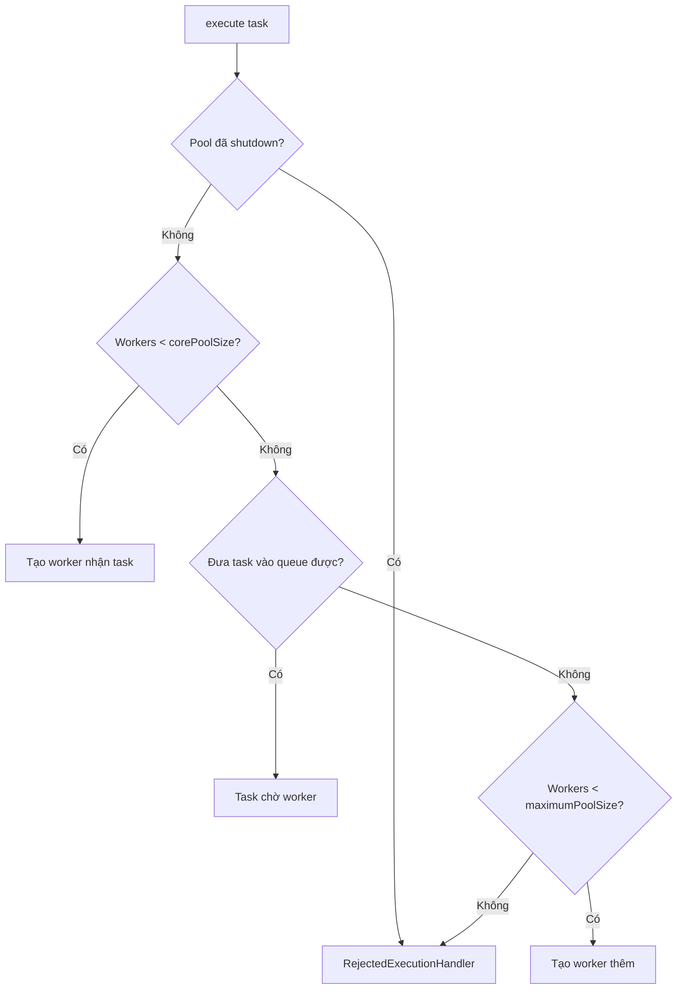

<a id="back-to-top"></a>

# Hiệu năng

## Menu
- [Latency, throughput, utilization và độ ổn định](#performance-001)
- [Amdahl&#39;s law và giới hạn speedup](#performance-002)
- [Đo tác động của thread count và context switching](#performance-003)
- [CPU saturation so với I/O wait](#performance-004)
- [Lock contention, starvation và fairness trade-off](#performance-005)
- [Queue length, rejection và hiệu ứng quá tải](#performance-006)
- [Little&#39;s Law để liên hệ lượng tác vụ, thời gian chờ và throughput](#performance-007)
- [False sharing và cache-line contention](#performance-008)
- [LongAdder so với AtomicLong dưới contention](#performance-009)
- [Benchmark đáng tin cậy với JMH (công cụ ngoài JDK)](#performance-010)
- [Warming up JVM, JIT và tránh microbenchmark sai](#performance-011)
- [Giới hạn tài nguyên và backpressure để bảo vệ hệ thống](#performance-012)
- [ThreadLocalRandom.current(): tránh tranh chấp, khả năng tái lập và giới hạn bảo mật](#performance-013)

## <a id="performance-001">Latency, throughput, utilization và độ ổn định</a>

<details>
<summary>Xem chi tiết</summary>

# Latency, throughput, utilization và độ ổn định trong Java concurrency

## 1. Bốn góc nhìn khác nhau về hiệu năng

Một chương trình Java chạy đồng thời có thể xử lý nhiều việc, nhưng “nhiều thread” không đồng nghĩa với “nhanh hơn”. Cần phân biệt bốn đại lượng để biết hệ thống đang phản hồi nhanh, xử lý được bao nhiêu công việc, sử dụng tài nguyên ra sao và có giữ được chất lượng theo thời gian hay không.

| Đại lượng | Câu hỏi cần trả lời | Cách đo thường gặp | Rủi ro khi chỉ nhìn một chỉ số |
| --- | --- | --- | --- |
| **Latency (độ trễ)** | Một công việc mất bao lâu từ khi được tiếp nhận đến khi hoàn tất? | ms/request; p50, p95, p99 | Trung bình thấp nhưng một số yêu cầu chờ rất lâu |
| **Throughput (thông lượng)** | Trong một khoảng thời gian, hoàn tất bao nhiêu công việc? | requests/s, tasks/s, MB/s | Số yêu cầu bắt đầu cao nhưng số hoàn tất thấp hoặc lỗi nhiều |
| **Utilization (mức sử dụng)** | Bao nhiêu phần năng lực tài nguyên đang bận? | CPU %, thời gian thread bận, mức đầy pool/queue | 100% không nhất thiết hiệu quả; tài nguyên ít bận cũng có thể đang nghẽn nơi khác |
| **Stability (độ ổn định)** | Chất lượng có được duy trì khi tải kéo dài, dao động hoặc tăng đột biến? | Biến động latency/throughput, lỗi, backlog, thời gian phục hồi | Kết quả tốt trong vài giây nhưng suy giảm sau vài phút |

Các đại lượng phải được đo **trên cùng ranh giới công việc và cùng cửa sổ thời gian**. Ví dụ, throughput của cả ứng dụng không nên so trực tiếp với latency của chỉ một bước truy xuất dữ liệu. Với concurrency, cần xét cả yêu cầu bị từ chối, hết hạn, hủy và thất bại; chỉ đếm yêu cầu thành công sẽ bỏ sót tình trạng quá tải.

## 2. Latency: thời gian hoàn tất một công việc

Với một công việc được gửi vào `ExecutorService`, có thể tách:

`latency tổng = thời gian đợi trong hàng đợi + thời gian chờ được lập lịch + thời gian thực thi + thời gian đợi I/O/khóa + phần xử lý sau cùng`.

Đây là cách phân rã theo ý nghĩa; các pha có thể lồng nhau và không được cộng trùng. Điểm bắt đầu phải rõ ràng: từ thời điểm người dùng gửi yêu cầu, từ lúc ứng dụng nhận yêu cầu, hay từ lúc gọi `executor.execute()`? Nếu chỉ bấm đồng hồ khi `Runnable.run()` bắt đầu, ta **bỏ qua queue wait** và dễ đánh giá hệ thống tốt hơn thực tế.

- **Service time**: thời gian thực sự phục vụ một tác vụ sau khi bắt đầu chạy; có thể bao gồm thời gian chờ I/O nếu định nghĩa ở cấp tác vụ.
- **Queueing time**: thời gian từ lúc nhận/gửi đến khi bắt đầu xử lý; thường tăng rất nhanh gần ngưỡng bão hòa.
- **Response time**: thời gian đầu-cuối tại ranh giới hệ thống đã chọn, thường là thứ người dùng quan tâm.
- **Tail latency**: các yêu cầu chậm ở đuôi phân phối, đặc biệt p95/p99, dễ bị ảnh hưởng bởi tranh chấp khóa, GC, scheduler, tải tăng đột ngột và lời gọi ngoại vi chậm.

Ví dụ 100 yêu cầu có 95 yêu cầu xong trong 20 ms và 5 yêu cầu mất 1.000 ms: phần lớn người dùng cảm nhận rất nhanh, nhưng trung bình là 69 ms; p99 gần 1.000 ms. Một giá trị trung bình duy nhất không diễn tả trải nghiệm ở đuôi. p50 là trung vị; p95/p99 là ngưỡng mà khoảng 95%/99% mẫu không vượt quá theo phương pháp ước lượng đã chọn. Với mẫu nhỏ, percentile có độ nhiễu lớn; cần ghi kích thước mẫu, cửa sổ thời gian và thuật toán thống kê.

Độ trễ cũng có hai nghĩa cần phân biệt: **latency của yêu cầu đã hoàn tất** và **thời gian chờ của yêu cầu vẫn đang tồn đọng**. Nếu chỉ thống kê yêu cầu đã hoàn tất, các yêu cầu treo hoặc timeout có thể bị che giấu. Khi phát tải với công cụ benchmark, tránh *coordinated omission*: công cụ gửi yêu cầu tiếp theo chỉ sau khi yêu cầu trước xong sẽ tự giảm tốc lúc hệ thống chậm, khiến các khoảng trễ do nghẽn bị bỏ qua. Muốn khảo sát tải đến cố định, cần bộ phát tải có lịch gửi độc lập, ghi cả các lần trễ lịch, từ chối và timeout.

## 3. Throughput: số công việc hoàn tất trên một đơn vị thời gian

Công thức cơ bản:

`throughput = số công việc hoàn tất / thời gian quan sát`.

Ví dụ hoàn tất 6.000 tác vụ trong 60 giây tương ứng 100 tasks/s. Phải xác định rõ **hoàn tất** gồm những gì: thành công; lỗi; bị từ chối; hay tất cả các kết quả kết thúc. Thông thường cần theo dõi riêng:

- **Arrival rate (λ)**: số công việc đến mỗi giây.
- **Admission rate**: số công việc được nhận vào xử lý; có thể thấp hơn arrival rate vì giới hạn tải.
- **Completion rate**: số công việc kết thúc mỗi giây, phân tách thành công/lỗi.
- **Backlog**: công việc đã nhận nhưng chưa hoàn tất; bao gồm hàng đợi và đang chạy.

Khi arrival rate liên tục vượt completion rate, backlog tăng. Hàng đợi chưa đầy không chứng minh hệ thống khỏe: nó có thể đang tích lũy và làm latency ngày càng cao. Nếu công việc bị loại bỏ, completion rate của phần được nhận có thể trông tốt trong khi tỷ lệ phục vụ yêu cầu tổng thể lại xấu. Luôn báo cáo cả throughput thành công, tỷ lệ từ chối và tỷ lệ lỗi.

Tăng concurrency giúp throughput khi có thời gian chờ hoặc CPU còn nhàn rỗi. Khi CPU đã bão hòa, tăng thread thường chỉ gây thêm context switch, tranh chấp bộ nhớ/khóa và thời gian xếp hàng. Với tác vụ I/O, số công việc đồng thời có thể lớn hơn số lõi CPU, nhưng giới hạn thực tế thường nằm ở kết nối, bộ nhớ, dịch vụ đích hoặc khả năng chịu tải của tài nguyên chung.

## 4. Utilization: bận đến mức nào, và bận ở đâu?

Có thể hình dung utilization của một tài nguyên là:

`utilization ≈ thời gian tài nguyên bận / tổng thời gian tài nguyên có thể phục vụ`.

Định nghĩa này chỉ có ý nghĩa khi nêu rõ **tài nguyên**: CPU, worker trong thread pool, kết nối, ổ đĩa, hay một lock độc quyền. Những thước đo không được đánh đồng:

| Quan sát | Diễn giải có thể đúng | Cần kiểm tra thêm |
| --- | --- | --- |
| CPU gần 100% | Tác vụ tính toán đã chạm giới hạn CPU | CPU quota/cgroup, GC, profiling, context switching |
| CPU thấp nhưng latency cao | Thread đang BLOCKED/WAITING, đợi I/O, lock hoặc queue | Thread dump, JFR, thời gian queue/lock/I/O |
| `activeCount == maximumPoolSize` | Worker của pool đang bận tại thời điểm lấy mẫu | Pool có chờ I/O không, queue có tăng không, task duration |
| Queue còn dài | Khả năng phục vụ không theo kịp trong giai đoạn đó | Arrival/completion rate, tuổi tác vụ cũ nhất |
| CPU thấp mà throughput thấp | Có thể bị nghẽn tài nguyên ngoài CPU | Giới hạn connection, đồng bộ hóa, rate limit |

Ví dụ một thread giữ lock và thực thi chậm có thể khiến 100 thread khác chờ: CPU không nhất thiết cao nhưng latency rất xấu. Ngược lại, chương trình tính toán độc lập tận dụng tốt các lõi thường có CPU cao và throughput tốt; CPU cao **không tự nó là lỗi**. Trong container, cần tính theo CPU quota được cấp, thay vì mặc định số lõi vật lý của host. Phần trăm CPU trên host và phần trăm trong container có thể khác mẫu số.

`ThreadPoolExecutor.getActiveCount()`, `getQueue().size()` và `getCompletedTaskCount()` hữu ích để quan sát xu hướng, nhưng là giá trị xấp xỉ/ảnh chụp trạng thái, không tạo thành phép đo nguyên tử nhất quán. Dùng chúng làm metric giám sát thay vì tiêu chí chính xác tuyệt đối cho logic nghiệp vụ.

## 5. Quan hệ giữa latency, throughput, concurrency và tải

**Little's Law** mô tả một hệ thống ổn định dài hạn:

`L = λ × W`

Trong đó `L` là **số công việc trung bình đang ở trong hệ thống**, `λ` là **throughput dài hạn của hệ thống ổn định** (công việc/giây), `W` là **thời gian trung bình một công việc ở trong hệ thống** (giây). Cần dùng cùng ranh giới cho cả ba. Ví dụ throughput ổn định 200 requests/s và response time trung bình 0,1 s thì trung bình khoảng 20 yêu cầu *in-flight*, gồm cả đang chờ và đang chạy. Không suy ra rằng phải có đúng 20 platform thread hay rằng tăng thread lên 20 sẽ đạt 200 requests/s.

Một xấp xỉ sơ bộ cho `m` worker độc lập, mỗi worker có thời gian phục vụ trung bình `S`, là:

`ρ ≈ λ × S / m`.

Chẳng hạn 4 worker, mỗi công việc cần trung bình 20 ms thời gian chiếm worker, với tải đến 150 tasks/s thì `ρ ≈ 150 × 0,02 / 4 = 0,75`. Đây **chỉ là ước lượng tải** trong mô hình giản lược: thời gian chờ lock/I/O, độ phân tán, burst, công việc khác kích thước và độ lệch giữa worker có thể làm kết quả thực tế khác xa.

Khi `ρ` tiến gần 1, độ trễ hàng đợi thường tăng phi tuyến, nhất là khi thời gian phục vụ biến thiên. Một hệ thống có thể đạt throughput cực đại ở mức tải cao nhưng không đáp ứng mục tiêu p99. Vì vậy “capacity” dùng cho sản phẩm nên là **throughput bền vững thỏa đồng thời giới hạn độ trễ và lỗi**, không chỉ giá trị tasks/s cao nhất trong một phép thử ngắn.

Cần phân biệt các thí nghiệm:

1. **Fixed concurrency / closed-loop**: N client luôn có công việc mới khi công việc cũ hoàn tất; khi server chậm, tốc độ phát tải tự giảm.
2. **Fixed arrival rate / open-loop**: cố gửi theo lịch 100, 200, 300 requests/s; phơi bày queue, timeout và sự quá tải rõ hơn.
3. **Burst test**: cho tải đột biến ngắn rồi quay lại bình thường; đo đỉnh hàng đợi và thời gian phục hồi.
4. **Soak test**: duy trì tải đủ lâu để quan sát heap, GC, thread, connection, tài nguyên rò rỉ và suy giảm theo thời gian.

Không lấy kết quả từ các kiểu thử khác nhau rồi coi là cùng một đặc tính hiệu năng.

## 6. Đo lường trong Java cho đúng

Đo **khoảng thời gian** bằng `System.nanoTime()`; không dùng `System.currentTimeMillis()` cho phép đo ngắn vì đồng hồ thực có thể bị điều chỉnh và độ phân giải không ổn định. `nanoTime()` là đồng hồ đơn điệu thích hợp để tính hiệu giữa hai lần gọi trong cùng JVM, không phải timestamp để lưu hay so sánh giữa các máy.

Khi thu thập metric, đánh dấu tối thiểu các thời điểm: **accepted**, **started**, **finished**. Từ đó tính queue wait = started − accepted và end-to-end latency = finished − accepted. Ghi thêm trạng thái kết thúc (success/error/rejected/timeout/canceled), số đang chạy, độ sâu queue và thời gian chờ lâu nhất. Với công việc nhiều pha, đo riêng đoạn chờ I/O, đoạn giữ lock hoặc đoạn chặn trên primitive đồng bộ khi cần.

Đối với các phiên kiểm thử có vài triệu yêu cầu, đừng tự giữ từng duration trong một `List` vô hạn. Có thể dùng histogram giới hạn bộ nhớ hoặc một thư viện đo metric phù hợp; cần công bố cách lấy mẫu/ước lượng percentile. Ghép percentile từ nhiều nhóm bằng trung bình số học là **sai**: phải gộp phân phối/histogram với cách tính tương thích hoặc tính lại từ mẫu.

### Ví dụ Java 17: executor hữu hạn và đo thời gian chờ

Chương trình sau minh họa tách thời gian đợi khỏi thời gian từ lúc gửi tới lúc hoàn tất. Nó dùng `ThreadPoolExecutor` có 2 platform worker và queue giới hạn 4 phần tử. Khi đầy, `CallerRunsPolicy` cho thread gửi chạy tác vụ, tạo áp lực ngược lên nguồn phát tải. Thời gian `sleep` chỉ mô phỏng việc chờ; đây **không phải benchmark chuẩn hay phép đo capacity sản xuất**.

~~~java
import java.util.Locale;
import java.util.concurrent.ArrayBlockingQueue;
import java.util.concurrent.ConcurrentLinkedQueue;
import java.util.concurrent.ThreadPoolExecutor;
import java.util.concurrent.TimeUnit;
import java.util.concurrent.atomic.LongAdder;

public class PerformanceDemo {
    public static void main(String[] args) throws InterruptedException {
        int taskCount = 20;
        LongAdder completed = new LongAdder();
        ConcurrentLinkedQueue<Long> queueWaitNanos =
                new ConcurrentLinkedQueue<>();
        ConcurrentLinkedQueue<Long> totalNanos =
                new ConcurrentLinkedQueue<>();

        ThreadPoolExecutor pool = new ThreadPoolExecutor(
                2, 2, 0L, TimeUnit.MILLISECONDS,
                new ArrayBlockingQueue<>(4),
                new ThreadPoolExecutor.CallerRunsPolicy());

        long testStarted = System.nanoTime();

        for (int i = 0; i < taskCount; i++) {
            long acceptedAt = System.nanoTime();
            pool.execute(() -> {
                long startedAt = System.nanoTime();
                queueWaitNanos.add(startedAt - acceptedAt);

                try {
                    Thread.sleep(30); // Mô phỏng tác vụ chờ I/O.
                } catch (InterruptedException e) {
                    Thread.currentThread().interrupt();
                } finally {
                    totalNanos.add(System.nanoTime() - acceptedAt);
                    completed.increment();
                }
            });
        }

        pool.shutdown();
        if (!pool.awaitTermination(10, TimeUnit.SECONDS)) {
            pool.shutdownNow();
            throw new IllegalStateException("Executor timeout");
        }

        long elapsedNanos = System.nanoTime() - testStarted;
        System.out.println("Completed: " + completed.sum());
        System.out.printf(Locale.ROOT,
                "Observed throughput: %.1f tasks/s%n",
                completed.sum() / (elapsedNanos / 1_000_000_000.0));
        System.out.printf(Locale.ROOT,
                "Average queue wait: %.1f ms%n",
                averageMillis(queueWaitNanos));
        System.out.printf(Locale.ROOT,
                "Average submitted-to-finished: %.1f ms%n",
                averageMillis(totalNanos));
    }

    private static double averageMillis(ConcurrentLinkedQueue<Long> samples) {
        return samples.stream()
                .mapToLong(Long::longValue)
                .average()
                .orElse(0.0) / 1_000_000.0;
    }
}
~~~

Lưu thành `PerformanceDemo.java` và chạy:

~~~bash
javac PerformanceDemo.java
java PerformanceDemo
~~~

Dòng đầu của stdout luôn là `Completed: 20` khi chương trình kết thúc bình thường. Ba số đo tiếp theo **không cố định**, vì phụ thuộc scheduler, trạng thái CPU và máy chạy. Trong ví dụ này, `CallerRunsPolicy` có thể chạy tác vụ ngay trên thread `main`; vì thế throughput được quan sát là của toàn bộ phép thử (kể cả main), không phải chỉ hai worker. Cách này cũng làm tốc độ gửi bị chậm lại khi bão hòa, nên không dùng phép thử này để kết luận ứng dụng chịu được một arrival rate cố định.

Nếu tác vụ có thể thất bại, thay `completed` bằng bộ đếm phân loại kết quả; `finally` ở ví dụ chỉ có nghĩa “đường chạy đã kết thúc”, không khẳng định tác vụ thành công. Nếu công việc bị ngắt, phải xác định chính sách hủy và đếm riêng việc hủy. Nếu gọi `execute()` trong khi pool đã `shutdown()`, `CallerRunsPolicy` không đảm bảo chạy tác vụ đó; thiết kế gửi phải có lifecycle rõ ràng.

### Đọc percentile thay vì chỉ average

Giả sử đã thu được một tập `latenciesNanos` không rỗng từ cùng một cửa sổ quan sát, ví dụ mẫu tải. Một cách ước lượng percentile đơn giản là *nearest rank*:

~~~java
import java.util.List;

public class PercentileExample {
    static long percentile(List<Long> latenciesNanos, double p) {
        if (latenciesNanos.isEmpty() || p <= 0 || p > 1) {
            throw new IllegalArgumentException("Invalid samples or p");
        }
        List<Long> sorted = latenciesNanos.stream().sorted().toList();
        int index = (int) Math.ceil(p * sorted.size()) - 1;
        return sorted.get(index);
    }

    public static void main(String[] args) {
        List<Long> ms = List.of(10L, 12L, 15L, 20L, 100L);
        System.out.println("p95 = " + percentile(ms, 0.95) + " ms");
    }
}
~~~

Lưu là `PercentileExample.java`; `javac PercentileExample.java` rồi `java PercentileExample` cho output `p95 = 100 ms`. Ví dụ truyền millisecond cho hàm có tên `latenciesNanos` để minh họa thứ tự thống kê; hàm **trả về cùng đơn vị mà input sử dụng**. Trong hệ thống thực, thống nhất nanos ở tầng đo rồi đổi sang ms khi hiển thị. Nearest-rank chỉ là một quy ước; so sánh hai hệ thống phải dùng phương pháp percentile nhất quán.

## 7. Cách cấu hình concurrency ảnh hưởng cả bốn chỉ số

### 7.1. CPU-bound

Tác vụ như mã hóa, xử lý ảnh hoặc tính toán thuần thường bị giới hạn bởi số lõi khả dụng và hiệu quả cache. Nếu có `P` lõi CPU thực sự được cấp, thử mức song song gần `P` là điểm xuất phát hợp lý, sau đó đo throughput và p99. Thêm hàng trăm platform thread vào tính toán CPU-bound thường không tăng năng lực tính toán; có thể làm tệ hơn vì chuyển ngữ cảnh, tranh chấp cache, allocation và GC. Đừng biến quy tắc gần `P` thành giá trị bất biến: môi trường còn có tiến trình khác, GC và cgroup quota.

### 7.2. I/O-bound

Tác vụ chờ mạng, đĩa hoặc kết quả từ tài nguyên khác có thể hưởng lợi từ concurrency cao hơn số lõi. Nếu dùng pool platform thread, thread bị chặn trong `blocking I/O` vẫn chiếm một worker. Pool quá nhỏ tạo hàng đợi; pool quá lớn dùng nhiều bộ nhớ, connection và tạo áp lực lên hệ thống đích. Cần giới hạn số công việc đang truy cập dịch vụ chậm bằng **bounded queue, semaphore, connection limit, timeout** phù hợp, rồi đo.

Từ Java 21, **virtual thread** phù hợp với nhiều tác vụ blocking I/O: giúp duy trì nhiều tác vụ chờ mà không cần platform thread tương ứng cho mỗi tác vụ. Nó **không tăng số lõi CPU**, không tự sửa database nghẽn và không thay thế cơ chế giới hạn concurrency. Một executor “một virtual thread mỗi task” không áp đặt giới hạn số yêu cầu đang hoạt động; nếu tài nguyên đích chỉ chịu được 50 thao tác đồng thời, hãy đặt giới hạn 50 bằng semaphore hoặc cơ chế tương đương ở ranh giới đó. Với mã dùng `synchronized`, native calls hoặc thư viện blocking đặc biệt, đánh giá tình trạng pinning/carrier và hỗ trợ thư viện trên phiên bản JDK đang chạy bằng JFR và profile thực tế.

### 7.3. Locks, contention và shared state

Lock bảo vệ tính đúng đắn, nhưng làm giảm khả năng chạy song song của đoạn critical section. Tăng worker trong khi nhiều worker cùng tranh một khóa có thể khiến throughput đứng yên và tail latency tăng. Nên:

- Giữ đoạn khóa ngắn; tránh gọi I/O hoặc tác vụ chậm trong khi giữ lock.
- Phân chia trạng thái độc lập khi hợp lý; dùng cấu trúc concurrent đúng hợp đồng như `ConcurrentHashMap`, `LongAdder` cho thống kê tần suất cao.
- Không thay đồng bộ hóa bằng truy cập dữ liệu racy chỉ để benchmark đẹp; correctness luôn là điều kiện tiên quyết.
- Quan sát contention thực tế trước khi tối ưu. `LongAdder.sum()` không phải snapshot nguyên tử tuyệt đối khi có cập nhật đồng thời; phù hợp số liệu giám sát, không phù hợp thay thế một bộ đếm nhất quán bắt buộc.

### 7.4. Backpressure và queue

Queue **không tạo ra năng lực phục vụ mới**; nó chỉ giữ công việc chờ. Queue không giới hạn có thể giảm số lần từ chối ngắn hạn nhưng tạo latency lớn, bộ nhớ tăng và OutOfMemoryError khi quá tải kéo dài. Queue giới hạn buộc phải định nghĩa cách ứng xử khi đầy:

| Chiến lược | Cơ chế | Đánh đổi |
| --- | --- | --- |
| `AbortPolicy` | Ném `RejectedExecutionException` khi không nhận được việc | Lỗi hiển lộ; caller phải xử lý |
| `CallerRunsPolicy` | Thread gọi `execute` tự xử lý khi pool hoạt động | Backpressure hữu ích; có thể làm chậm cả caller |
| `DiscardPolicy` | Bỏ việc mới mà không báo qua exception | Nguy cơ mất công việc âm thầm |
| `DiscardOldestPolicy` | Loại phần tử đầu queue rồi thử nhận việc mới | Có thể bỏ mất việc cũ; phải hiểu thứ tự/giá trị nghiệp vụ |

Chọn policy theo bảo đảm cần thiết: có thể mất việc không, có cần giữ thứ tự, có cần trả lỗi rõ ràng, retry ở đâu. Timeout, cancellation và overload rejection cũng phải đi vào metric. Khi caller có deadline, việc chờ quá deadline rồi vẫn xử lý tiếp có thể lãng phí tài nguyên và làm hàng đợi khó hồi phục.

## 8. Stability: hiệu năng bền vững khi thời gian và tải thay đổi

Một hệ thống ổn định không phải là hệ thống có latency bằng hệt nhau mọi lúc; đó là hệ thống có khả năng đạt ngưỡng dịch vụ đã chọn, không tích lũy backlog vô hạn và phục hồi sau biến động trong điều kiện được thiết kế. Ví dụ định nghĩa tiêu chí kiểm thử:

- Dưới **150 yêu cầu/giây** trong **15 phút**, p95 ≤ 100 ms, p99 ≤ 300 ms, lỗi + từ chối ≤ 0,5%; tất cả các ngưỡng là **giả định minh họa**, không phải SLO mặc định cho mọi ứng dụng.
- Với burst **300 yêu cầu/giây trong 10 giây**, quan sát queue peak và yêu cầu backlog trở về mức nền trong một khoảng thời gian chấp nhận được.
- Khi duy trì tải lâu, kiểm tra memory/heap, allocation rate, GC pause, thread count, file descriptor/connection và throughput có trôi theo thời gian không.

Những tín hiệu mất ổn định điển hình: p99 tăng dần trong khi throughput không tăng; queue luôn cao; thời gian GC dài hơn; số thread/connection liên tục tăng; retry dồn tải lên hệ thống vừa gặp lỗi; tỷ lệ timeout tăng nhưng log throughput thành công vẫn tương đối đẹp. Tính bền vững đòi hỏi **giới hạn tải, giới hạn queue, deadline, chính sách retry có kiểm soát và quan sát tài nguyên**. Retry đồng loạt ngay sau thất bại có thể tạo retry storm và làm tải thực còn cao hơn tải gốc.

Độ ổn định còn liên quan tới tính đúng đắn: race condition, deadlock, livelock hoặc starvation có thể làm latency vô hạn hay khiến một nhóm công việc không được phục vụ dù CPU còn hoạt động. Không đánh giá một tối ưu concurrency là thành công nếu nó làm sai kết quả, mất tác vụ hoặc phá bảo đảm thứ tự.

## 9. Quy trình thực nghiệm để tìm điểm cân bằng

**Bước 1 — Chốt ranh giới và mục tiêu.** Chọn công việc cụ thể (một request, một task, một batch), định nghĩa success/failure, timeout, measurement start/end và SLO thử nghiệm. Ví dụ: p99 < 200 ms, throughput thành công ≥ 120 tasks/s, lỗi ≤ 0,1% trong 10 phút. Các số này chỉ để minh họa cách lập mục tiêu.

**Bước 2 — Tạo baseline có thể lặp lại.** Ghi JDK version, CPU/quota, RAM, collector, kích thước heap, số worker, queue capacity, kích thước và phân phối công việc, tài nguyên I/O, trạng thái warm-up/JIT và máy phát tải. Tách warm-up khỏi cửa sổ đo; chạy đủ lâu và lặp lại nhiều lần trước khi kết luận. Tránh để máy sinh tải tự bão hòa.

**Bước 3 — Tăng tải theo bậc có kiểm soát.** Thử nhiều arrival rate, không chỉ một lần “đẩy tới chết”. Mỗi bậc theo dõi completion/s, p50/p95/p99, error/reject/timeout, in-flight, queue depth/age, CPU, GC, thread states và trạng thái dịch vụ đích. Nếu còn queue sau bậc trước, chờ hệ thống về nền hoặc thiết lập lại điều kiện thí nghiệm.

**Bước 4 — Xác định giới hạn thực tế.** Tìm mức tải cao nhất mà tất cả ngưỡng đều đạt một cách bền vững. Chú ý “điểm gãy”: throughput đi ngang, p99 tăng vọt, queue tăng hoặc tỷ lệ lỗi tăng. Quan sát queue và tài nguyên giúp phân biệt nghẽn CPU, lock, I/O và giới hạn pool.

**Bước 5 — Đổi một biến mỗi lượt.** Ví dụ pool size 4 → 8, queue 100 → 200 hoặc chuyển một phần công việc I/O sang virtual threads. Giữ workload, định nghĩa metric và thời gian thử tương đương; kiểm tra cả tốc độ, độ trễ, tính đúng đắn và tài nguyên. Có thể tối ưu throughput bằng cách chấp nhận thêm latency, nhưng phải là đánh đổi được đo và phù hợp SLO.

**Bước 6 — Soak/burst/recovery.** Kiểm tra lâu dài, lúc vượt tải và sau khi tải giảm. Cải thiện p50 trong 30 giây nhưng gây heap tăng dần sau 30 phút không được xem là tối ưu thành công.

### Công cụ Java hữu ích

- **JDK Flight Recorder (JFR)**: xem CPU sample, allocation, GC, thread scheduling/park, monitor contention, I/O và các event liên quan; đối chiếu cùng khoảng thời gian p99 tăng.
- **Java Mission Control (JMC)**: đọc và phân tích file JFR, tìm điểm nóng và thời gian chờ.
- **`jcmd <PID> Thread.print` / thread dump**: xem trạng thái thread tại thời điểm cụ thể, tìm lock contention hoặc deadlock. Một dump duy nhất chưa đủ kết luận xu hướng; có thể lấy vài snapshot cách nhau.
- **JMH**: benchmark vi mô cho đoạn Java thuần, có warm-up/fork và cơ chế giảm sai lệch do JIT; không dùng một vòng lặp `nanoTime()` đơn giản để kết luận hiệu năng của một thuật toán nhỏ. Kết quả JMH cũng không tự nói lên response time đầu-cuối hoặc capacity dưới tải thật.
- **CPU/heap/GC profiler và số liệu hệ điều hành**: nhận diện throttling, allocation, GC, context switching và giới hạn ngoài JVM.

## 10. Một số tình huống chẩn đoán thực tế

| Hiện tượng | Giả thuyết cần kiểm chứng | Hướng kiểm tra/điều chỉnh |
| --- | --- | --- |
| Throughput không tăng khi tăng thread, CPU sát giới hạn | CPU-bound, overhead scheduling | CPU profile; thử mức song song sát CPU quota |
| p99 tăng, CPU thấp, nhiều `BLOCKED` | Lock contention | JFR monitor event, thread dump; rút ngắn critical section |
| Queue tăng liên tục, worker bận | Arrival rate vượt tốc độ phục vụ | Tách service time/queue time; giới hạn đầu vào và rà bottleneck |
| p50 ổn, p99 xấu đột ngột | GC, pause, I/O tail, lock, burst | So timestamp p99 với JFR/GC/event upstream |
| Error giảm khi queue tăng nhưng latency vọt | Chuyển overload thành chờ đợi | Queue bounded, timeout, rejection rõ ràng, theo dõi queue age |
| CPU thấp, nhiều thread đợi I/O, heap tăng | Blocked I/O và concurrency không giới hạn | Giới hạn in-flight/connection; thử virtual threads nếu phù hợp |
| Benchmark rất nhanh, production chậm | Workload hoặc ranh giới đo khác | Reproduce payload, arrival pattern, dependency, warm-up, GC |
| Chạy lâu throughput giảm dần | Rò rỉ tài nguyên, accumulation, retry | Soak test và theo dõi heap, connection, queue, GC |

Đừng kết luận chỉ từ một tín hiệu. Ví dụ CPU thấp có thể do lock, nhưng cũng có thể do tải đến thấp; phải ghép **arrival rate + completion rate + queue wait + tài nguyên** mới xác định được nguyên nhân.

## 11. Những lỗi phổ biến cần tránh

1. **Tăng số thread bằng cảm giác:** throughput có thể đã bão hòa; hãy đo cùng p99, CPU, queue và tỷ lệ lỗi trước/sau.
2. **Chỉ báo average latency:** các yêu cầu đuôi chậm bị che; thêm p95/p99, timeout và thời gian chờ của request chưa hoàn tất.
3. **Dùng queue vô hạn để “không từ chối”:** backlog và memory có thể tăng đến khi sụp đổ.
4. **Lấy tốc độ gửi làm throughput:** phải đo số việc *kết thúc* trên cùng cửa sổ thời gian và phân loại kết quả.
5. **Chỉ đo thời gian trong `run()`:** bỏ qua thời gian queue và admission, đánh giá thiếu response time.
6. **Hiểu nhầm virtual thread là CPU song song vô hạn:** virtual thread giúp quản lý tác vụ blocking, không nhân số lõi hay capacity dịch vụ đích.
7. **So sánh benchmark ở môi trường khác:** CPU quota, JIT, warm-up, GC, payload và dependencies có thể lấn át thay đổi code.
8. **Bỏ qua coordinated omission và request chưa hoàn tất:** latency báo cáo có thể đẹp giả lúc hệ thống nghẽn.
9. **Tối ưu mà phá correctness:** data race, deadlock, mất task hoặc cancel sai là thất bại, dù một phép thử ngắn cho throughput cao.
10. **Đo đạc gây nhiễu:** ghi log từng task hoặc lưu vô hạn mọi sample có thể làm chính phép thử chậm; dùng sampling/histogram có kiểm soát.

## 12. Câu hỏi tự kiểm tra

- Một pool có 8 worker, tất cả bận nhưng CPU chỉ 20%. Có thể kết luận thiếu CPU không? **Không**: cần biết worker đang chờ I/O, lock hay scheduler và quan sát queue.
- Throughput giữ nguyên 100 tasks/s nhưng p99 từ 80 ms lên 2 s khi tăng tải. Đây có phải capacity tốt hơn? **Không**: hệ thống có thể đã bão hòa; backlog và tail latency đang xấu đi.
- Có thể dùng `L = λW` để yêu cầu tạo đúng `L` Java thread không? **Không**: `L` là số công việc trong hệ thống, có thể đang queue hoặc chờ I/O, và định luật đòi hỏi điều kiện ổn định.
- Nếu tăng queue size làm giảm rejection, hệ thống chắc chắn tốt hơn? **Không**: có thể đổi lỗi từ chối thành latency/timeout hoặc tăng bộ nhớ; phải đánh giá toàn bộ SLO.
- Vì sao đo p99 trong 10 giây chưa đủ? **Vì** mẫu ít, trạng thái JIT/GC và biến động tải có thể làm kết quả thiếu đại diện; cần lặp, kéo dài và ghi điều kiện đo.

**Nguyên tắc áp dụng:** thiết kế concurrency để đạt **throughput bền vững với latency và tỷ lệ lỗi chấp nhận được**, trong giới hạn tài nguyên rõ ràng; quan sát đúng bottleneck, có backpressure, và xác nhận stability bằng tải kéo dài.

</details>

- [Quay lại đầu trang](#back-to-top)

---

## <a id="performance-002">Amdahl&#39;s law và giới hạn speedup</a>

<details>
<summary>Xem chi tiết</summary>

# Amdahl's Law và giới hạn tăng tốc khi chạy song song trong Java

## 1. Tại sao thêm thread không có nghĩa chương trình nhanh gấp bấy nhiêu lần?

Một chương trình Java có thể gồm các đoạn độc lập chạy đồng thời, nhưng cũng có những bước **buộc phải tuần tự**: chuẩn bị dữ liệu chung, chờ kết quả cần thiết của bước trước, ghép kết quả, thao tác trên tài nguyên có khóa, hoặc xử lý chỉ có một nơi thực hiện. Phần tuần tự không biến mất khi ta tăng số worker.

**Amdahl's law (định luật Amdahl)** cho biết giới hạn tăng tốc lý tưởng của **cùng một lượng công việc cố định** khi chỉ một phần của công việc được chạy song song. Đây là công cụ để ước lượng lợi ích tối đa của việc tăng mức song song và quyết định nên tối ưu phần nào trước.

Ví dụ một tác vụ mất 100 ms trên một worker, gồm:
- 20 ms bắt buộc tuần tự;
- 80 ms có thể chia đều hoàn hảo cho nhiều worker.

Với 4 worker, thời gian lý tưởng mới là `20 + 80 / 4 = 40 ms`, tức nhanh **2,5 lần** chứ không phải 4 lần. Ngay cả khi có vô hạn worker, phần 20 ms vẫn tồn tại: giới hạn lý tưởng chỉ **5 lần**.

## 2. Công thức, ký hiệu và cách suy ra

Đặt:

| Ký hiệu | Ý nghĩa |
|---|---|
| `T(1)` | Thời gian chạy ban đầu với một đơn vị xử lý, cho một workload cố định. |
| `p` | **Tỷ phần thời gian của baseline** thuộc công việc có thể tăng tốc bằng chạy song song, `0 ≤ p ≤ 1`. |
| `1 - p` | Tỷ phần thời gian bắt buộc tuần tự. |
| `N` | Số đơn vị xử lý song song hiệu dụng trong mô hình lý tưởng, `N ≥ 1`. |
| `S(N)` | Speedup: `T(1) / T(N)`. |

Nếu phần tuần tự mất `(1 - p) × T(1)`, còn phần có thể song song mất `p × T(1) / N` ở điều kiện lý tưởng, thì:

```text
T(N) = T(1) × [(1 - p) + p / N]

S(N) = T(1) / T(N)
     = 1 / [(1 - p) + p / N]
```

Khi `N` rất lớn, `p / N` tiến gần 0:

```text
S(max) = 1 / (1 - p)      nếu p < 1
```

Với `p = 1`, mô hình không còn phần tuần tự, nên `S(N) = N`; mô hình lý tưởng này không tính chi phí đồng bộ, khởi tạo thread, lập lịch, truyền dữ liệu hay tranh chấp tài nguyên.

**Quan trọng:** `p` là tỷ lệ **thời gian thực thi baseline** có thể tăng tốc, không phải tỷ lệ số dòng code, số method có thể gọi đồng thời, số thread hiện có, hay phần trăm CPU hiển thị trong Task Manager. Một method ngắn nhưng chạy hàng triệu lần có thể chiếm phần lớn thời gian; ngược lại một method dài nhưng hiếm gọi có thể đóng góp rất ít.

### Ví dụ tính tay

Giả sử `p = 0,90`, tức 90% thời gian có khả năng song song và 10% là phần tuần tự.

| N (worker hiệu dụng) | Công thức mẫu | Speedup lý tưởng | Hiệu suất trên mỗi worker `E = S/N` |
|---:|---|---:|---:|
| 1 | `1 / (0,10 + 0,90)` | 1,000× | 100,0% |
| 2 | `1 / (0,10 + 0,90/2)` | 1,818× | 90,9% |
| 4 | `1 / (0,10 + 0,90/4)` | 3,077× | 76,9% |
| 8 | `1 / (0,10 + 0,90/8)` | 4,706× | 58,8% |
| 16 | `1 / (0,10 + 0,90/16)` | 6,400× | 40,0% |
| ∞ (giới hạn) | `1 / 0,10` | 10,000× | Không áp dụng |

Nếu `T(1) = 100 s`, thì với 8 worker thời gian lý tưởng là `100 × (0,10 + 0,90/8) = 21,25 s`, tương ứng `100 / 21,25 ≈ 4,706×`. Thêm worker vẫn cải thiện được, nhưng **lợi ích biên nhỏ dần** vì phần 10 s tuần tự không giảm.

## 3. Speedup, efficiency và throughput khác nhau

**Speedup** của một công việc cố định:

```text
speedup = thời gian xử lý bằng 1 worker / thời gian xử lý bằng N worker
```

**Parallel efficiency** là `S(N)/N`, thể hiện mức khai thác tương đối so với tăng tốc tuyến tính lý tưởng `S(N)=N`. Ví dụ `S(8)=4,706` thì hiệu suất bằng `4,706/8≈58,8%`; không có nghĩa CPU của mỗi core đang bận đúng 58,8%.

**Throughput** là số công việc hoàn tất mỗi giây. Nếu chương trình xử lý nhiều request độc lập cùng lúc, tăng số worker có thể tăng throughput ngay cả khi **latency của một request cụ thể gần như không đổi**. Amdahl's law theo công thức trên nói về thời gian một **workload cố định**, không tự động dự đoán throughput, thời gian chờ hàng đợi, hoặc độ trễ đuôi `p95/p99`.

Để sử dụng công thức đúng, cần thống nhất “một công việc” là gì: một batch cố định, một phép tính cố định hay một lần xử lý dữ liệu cố định. Không được đem thời gian xử lý 10.000 bản ghi trên một thread so với 100.000 bản ghi trên nhiều thread rồi gọi tỷ số đó là speedup theo Amdahl.

## 4. Ví dụ Java 17: tính toán giới hạn lý tưởng

Lưu thành tệp `AmdahlCalculator.java`:

```java
import java.util.Locale;

public class AmdahlCalculator {
    static double speedup(double parallelFraction, int workers) {
        if (parallelFraction < 0 || parallelFraction > 1 || workers < 1) {
            throw new IllegalArgumentException("p must be 0..1 and N >= 1");
        }
        return 1.0 / ((1.0 - parallelFraction)
                + parallelFraction / workers);
    }

    public static void main(String[] args) {
        double p = 0.90;

        for (int n : new int[] { 1, 2, 4, 8, 16 }) {
            double s = speedup(p, n);
            System.out.printf(Locale.ROOT,
                    "N=%2d speedup=%.3f efficiency=%.3f%n",
                    n, s, s / n);
        }

        System.out.printf(Locale.ROOT,
                "Gioi han ly tuong: %.1fx%n", 1.0 / (1.0 - p));
    }
}
```

Biên dịch và chạy với JDK 17 trở lên:

```bash
javac AmdahlCalculator.java
java AmdahlCalculator
```

Stdout chính xác:

```text
N= 1 speedup=1.000 efficiency=1.000
N= 2 speedup=1.818 efficiency=0.909
N= 4 speedup=3.077 efficiency=0.769
N= 8 speedup=4.706 efficiency=0.588
N=16 speedup=6.400 efficiency=0.400
Gioi han ly tuong: 10.0x
```

`Locale.ROOT` làm dấu thập phân trong output ổn định (`.`), không phụ thuộc locale của hệ điều hành. Trong mô hình, `N` là số worker có thể thực sự tính song song; **`newFixedThreadPool(16)` không bảo đảm 16 core vật lý** hay tăng tốc tương ứng.

Nếu `p=0,80`, trần lý tưởng chỉ `1/(1-0,80)=5×`. Nếu `p=0,95`, trần tăng lên `20×`, nhưng với 8 worker tốc độ lý tưởng vẫn chỉ `1/(0,05+0,95/8)≈5,926×`. Như vậy cải thiện phần tuần tự hoặc tăng tỷ phần có thể song song đôi khi có ích hơn bổ sung worker.

## 5. Công thức lý tưởng và thời gian thực tế

Ở chương trình thực, thời gian gần đúng có thể viết:

```text
T(N) ≈ Tserial + Tparallel / N + Toverhead(N)
```

`Toverhead(N)` không nhất thiết là hằng số và đôi khi tăng khi số worker tăng:

- **Tạo và quản lý thread:** khởi tạo, chuyển ngữ cảnh, lập lịch và đánh thức task có chi phí.
- **Phân chia/ghép kết quả:** tạo task, đưa vào queue, chờ `Future`, `join()`, merge hoặc reduce dữ liệu.
- **Đồng bộ hóa:** `synchronized`, `Lock`, contention ở counter/queue, tranh chấp critical section.
- **Bộ nhớ và cache:** giới hạn băng thông RAM, cache coherence, false sharing, cache miss; nhiều core không tạo thêm băng thông vô hạn.
- **Giới hạn phần cứng:** số core vật lý, SMT/hyper-threading, các process khác, chế độ tiết kiệm điện và thermal throttling.
- **GC và allocation:** cấp phát nhiều đối tượng trung gian hoặc tăng live set có thể gây áp lực GC.
- **Phụ thuộc dữ liệu:** một task phải chờ kết quả của task khác; không phải cứ tách nhiều task là chúng đồng thời hữu ích.

Một tình huống thực tế: phép tính hoàn thành trong 100 ms với một worker, phần song song lý tưởng là 90%. Với 8 worker, Amdahl dự đoán 21,25 ms. Nếu scheduling, lock và merge cộng thêm 8 ms, thời gian có thể là `29,25 ms`, speedup chỉ `100 / 29,25 ≈ 3,419×`. Đó là lý do không nên xem con số lý tưởng như lời hứa hiệu năng.

Amdahl's law **không phải một định luật cấm mọi speedup vượt con số dự đoán** khi chương trình thực thay đổi thuật toán, dùng cache tốt hơn hoặc thực hiện workload khác; những tình huống đó đã thay đổi giả định của mô hình ban đầu. Nếu số đo vượt dự đoán, cần kiểm tra giả định và phương pháp đo thay vì kết luận Java “vi phạm” Amdahl.

## 6. Ví dụ Java 17: chia một lượng công việc cố định cho ExecutorService

Đoạn dưới minh họa cách chia **cùng một phép tính CPU-bound** thành các khoảng không trùng nhau. Nó xác nhận kết quả đúng trước khi bàn đến nhanh hay chậm, vì tăng tốc bằng cách bỏ sót phần tử là không hợp lệ.

Lưu thành `FixedWorkDemo.java`:

```java
import java.util.ArrayList;
import java.util.List;
import java.util.concurrent.ExecutorService;
import java.util.concurrent.Executors;
import java.util.concurrent.Future;
import java.util.concurrent.TimeUnit;

public class FixedWorkDemo {
    private static long calculate(int fromInclusive, int toExclusive) {
        long sum = 0;
        for (int i = fromInclusive; i < toExclusive; i++) {
            long value = i % 997L;
            sum += (value * value + 7L * value) % 1009L;
        }
        return sum;
    }

    public static void main(String[] args) throws Exception {
        final int items = 8_000_000;
        final int workers = Math.min(4,
                Math.max(1, Runtime.getRuntime().availableProcessors()));

        long sequential = calculate(0, items);
        ExecutorService executor = Executors.newFixedThreadPool(workers);

        try {
            List<Future<Long>> results = new ArrayList<>();

            for (int part = 0; part < workers; part++) {
                int from = (int) ((long) part * items / workers);
                int to = (int) ((long) (part + 1) * items / workers);
                results.add(executor.submit(() -> calculate(from, to)));
            }

            long parallel = 0;
            for (Future<Long> result : results) {
                parallel += result.get();
            }

            System.out.println("Ket qua bang nhau: " + (sequential == parallel));
            System.out.println("So worker hop le: "
                    + (workers >= 1 && workers <= 4));
        } finally {
            executor.shutdown();
            if (!executor.awaitTermination(1, TimeUnit.MINUTES)) {
                executor.shutdownNow();
            }
        }
    }
}
```

Chạy:

```bash
javac FixedWorkDemo.java
java FixedWorkDemo
```

Stdout (không phụ thuộc số CPU được báo bởi JVM):

```text
Ket qua bang nhau: true
So worker hop le: true
```

Giải thích:
1. `calculate(0, items)` là baseline tuần tự, dùng cùng thuật toán tính với mỗi task.
2. Chia `[0, items)` thành `workers` khoảng liên tiếp, không giao nhau và bao phủ toàn bộ dữ liệu; ép trung gian sang `long` để tránh tràn khi nhân chỉ số chia.
3. `submit` trả về `Future<Long>`; `get()` đợi task hoàn tất rồi cộng kết quả, tạo một đoạn ghép kết quả tuần tự.
4. Thread pool được `shutdown()` sau khi sử dụng; Java 17 không yêu cầu và cũng không dùng `try-with-resources` cho `ExecutorService`.

Ví dụ này **minh họa phân chia công việc đúng**; nó không tự chứng minh có speedup. Với số lượng phần tử nhỏ, chi phí task và lịch chạy có thể lớn hơn phần thời gian tiết kiệm được.

### Đo speedup thực nghiệm đúng phạm vi

Có thể đo thời gian bằng `System.nanoTime()` trước/sau đoạn tuần tự và trước/sau đoạn song song, rồi tính `speedupObserved = elapsedSequential / elapsedParallel`. Nhưng chỉ đo một lần, chạy baseline trước rồi mới chạy parallel, hay đo cả thời gian tạo pool chỉ ở một bên sẽ dễ đưa ra kết luận sai.

Để benchmark công bằng hơn:
- Dùng **cùng dữ liệu, thuật toán, kết quả đầu ra** và tài nguyên tương đương; quyết định rõ có tính startup/pool creation vào phép đo hay không.
- Warm up để JIT compilation và class loading giảm tác động; đo nhiều lần qua nhiều fork, quan sát phân phối chứ không tin một lần ngẫu nhiên.
- Ngăn dead-code elimination và constant folding; đảm bảo kết quả thực sự được sử dụng/kiểm tra.
- Kiểm soát CPU frequency, số core được phân bổ, tải nền, heap và GC; ghi rõ phiên bản JDK/JVM.
- Benchmark vi mô Java nên cân nhắc **JMH (Java Microbenchmark Harness)** thay vì tự viết một vòng lặp đo thời gian dễ sai. Với cả pipeline, đo end-to-end ở mức workload thực, kể cả phần tuần tự và chờ.

Không thể suy ra `p` chỉ bằng cách đếm số task hoặc thread. Có thể dùng profiler, JFR (Java Flight Recorder), thread dump và CPU profiling để tìm nơi mất thời gian, rồi đo lại sau khi thay đổi. Các số đo tổng hợp có thể dùng để kiểm tra sự phù hợp của mô hình, nhưng `p` thu được chỉ là ước lượng phụ thuộc workload và môi trường.

## 7. Dùng Amdahl để ra quyết định kỹ thuật

### Trường hợp A: tăng worker khi phần tuần tự vẫn lớn

`T(1)=100 ms`, trong đó 30 ms bắt buộc tuần tự. Với `p=0,70`:

```text
N=2  -> T=30+70/2   = 65,00 ms -> S≈1,538x
N=4  -> T=30+70/4   = 47,50 ms -> S≈2,105x
N=8  -> T=30+70/8   = 38,75 ms -> S≈2,581x
N=∞  -> T tiến về 30 ms          -> trần S≈3,333x
```

Nếu mục tiêu là nhanh ít nhất 4 lần với cùng công việc, chỉ tăng số worker **không thể đạt mục tiêu trong mô hình**. Cần giảm phần tuần tự, thay thuật toán, hoặc thay điều kiện bài toán.

### Trường hợp B: tối ưu phần tuần tự trước

Giả sử thời gian baseline 100 ms gồm 20 ms serial và 80 ms parallelizable. Với 8 worker: `T(8)=20+80/8=30 ms` (3,333×). Nếu tối ưu bước serial từ 20 ms xuống 5 ms mà giữ phần parallel 80 ms, tổng thời gian với 8 worker còn `5+80/8=15 ms`. So với baseline **ban đầu** 100 ms, đây là 6,667×. Nhưng sau khi thay đổi code, phần trăm `p` so với baseline mới đã đổi; không được tiếp tục thay `p=0,80` vào mọi phép tính như thể không có gì thay đổi.

### Trường hợp C: tăng N nhưng contention cũng tăng

Giả sử với 4 worker, `T=40 ms`, nhưng 8 worker làm lock/contention và merge tăng 20 ms. Dù phần chia lý tưởng giảm, `T(8)` thực tế có thể **lớn hơn 40 ms**. Cần tìm lock nóng, giảm chia sẻ mutable state, giảm số task quá nhỏ, dùng cấu trúc dữ liệu thích hợp hoặc giảm số worker. Tăng N khi workload đã bão hòa băng thông nhớ thường không giúp ích.

### Trường hợp D: workload I/O-bound

Các tác vụ chờ network/disk có thể hưởng lợi từ concurrency do **che giấu thời gian chờ**, tăng số request đồng thời hoặc throughput. Nhưng tốc độ xử lý một request còn phụ thuộc dịch vụ bên ngoài và giới hạn connection. Không được dùng `N` trong công thức như số lượng thread tùy ý rồi kết luận một request sẽ nhanh theo tỷ lệ ấy. Muốn áp dụng mô hình Amdahl phải xác định phần thực sự có thể overlap hoặc chạy song song, cùng workload và tài nguyên.

## 8. Phân biệt Amdahl với mở rộng khối lượng công việc

Amdahl's law ở đây giả định **fixed-size workload / strong scaling**: tăng tài nguyên, giữ nguyên bài toán. **Weak scaling** lại tăng lượng việc theo tài nguyên, ví dụ mỗi core vẫn xử lý một partition cố định. Khi workload thay đổi, cách đánh giá khác và có thể dùng cách nhìn kiểu Gustafson để hỏi “trong cùng thời gian, xử lý được bài toán lớn hơn bao nhiêu?”.

Vì thế cần nêu rõ mục tiêu trước khi nói “scale tốt”:
- Giảm latency hoàn thành **một batch cố định**? Hãy đo strong-scaling speedup và so với Amdahl.
- Tăng throughput cho **nhiều tác vụ độc lập**? Hãy đo task/s, độ trễ, queue length và mức bão hòa tài nguyên.
- Xử lý dataset lớn hơn trong **cùng khoảng thời gian**? Hãy đo weak scaling, không đưa trực tiếp thời gian của hai dataset khác nhau vào `S(N)=T(1)/T(N)` của Amdahl.

## 9. Lỗi hiểu và áp dụng thường gặp

| Hiểu sai | Điều cần làm |
|---|---|
| “Có 8 thread thì tối đa phải nhanh gấp 8.” | Xác định `p`, core thực, overhead và tranh chấp; 8× chỉ là trường hợp lý tưởng đặc biệt. |
| “90% code song song được nên p=0,90.” | Đo **thời gian**, không đếm dòng code. |
| “N là số thread tạo ra.” | Trong mô hình `N` là khả năng xử lý song song hiệu dụng, không vượt qua giới hạn phần cứng và workload. |
| “Amdahl dự đoán đúng thời gian chạy trên mọi máy.” | Đây là giới hạn/ước lượng lý tưởng với giả định cố định; cần đo overhead và tải thực. |
| “CPU-bound càng nhiều task càng tốt.” | Task quá nhỏ làm overhead lớn; chọn kích thước task đủ lớn và đo. |
| “Speedup 4× nghĩa là throughput mọi request cũng 4×.” | Latency của workload cố định, throughput và concurrency là các metric khác nhau. |
| “Sau khi tối ưu thuật toán vẫn dùng p cũ.” | Mỗi lần thay đổi cấu trúc hoặc workload cần đo lại baseline và tỷ phần thời gian. |

## 10. Bài tập tự kiểm tra

**Bài 1.** Một phép tính có `p=0,75`. Nếu có 4 worker hiệu dụng, speedup lý tưởng là bao nhiêu? Trần khi N rất lớn?

```text
S(4) = 1 / (0,25 + 0,75/4)
     = 1 / 0,4375
     ≈ 2,286x

S(max) = 1 / 0,25 = 4x
```

**Bài 2.** Một batch chạy tuần tự 200 ms, gồm 40 ms serial và 160 ms parallelizable. Với 8 worker và overhead 10 ms, thời gian và speedup thực tế mô hình hóa là bao nhiêu?

```text
T(8) = 40 + 160/8 + 10 = 70 ms
Speedup = 200/70 ≈ 2,857x
```

Nếu bỏ overhead, kết quả lý tưởng chỉ `200/60≈3,333×`; không thể giả định 8×.

**Bài 3.** Khi thêm worker từ 4 lên 16, throughput tăng nhưng latency mỗi request không thay đổi. Có mâu thuẫn Amdahl không? **Không**. Có thể hệ thống đang phục vụ nhiều request độc lập cùng lúc; hãy phân biệt throughput toàn hệ thống với thời gian chạy của một request đơn lẻ.

**Bài 4.** Một chương trình đo được 16 worker chậm hơn 8 worker. Có nên tạo thêm 32 thread? **Chưa có cơ sở**. Trước hết profile CPU, lock, queue, cache/memory và GC; kiểm tra liệu task có quá nhỏ hoặc vượt số core hiệu dụng hay không.

## 11. Tổng kết thực hành

Amdahl's law trả lời câu hỏi: **với một lượng việc không đổi và tỷ lệ thời gian không thể song song còn tồn tại, tăng số worker có thể nhanh hơn đến đâu trong điều kiện lý tưởng?**

```text
Speedup lý tưởng: S(N) = 1 / [(1 - p) + p/N]
Trần với p < 1: S(max) = 1 / (1 - p)
Hiệu suất:       E(N) = S(N) / N
```

Khi tối ưu Java concurrency, hãy xác định workload, đo baseline, tìm phần tuần tự/critical path, chọn mức song song phù hợp với core và chi phí đồng bộ, rồi benchmark đầu-cuối. **Giảm phần serial và overhead thường quan trọng ngang hoặc hơn việc thêm thread.**

### Tài liệu tham khảo

- [Java SE 17 — `ExecutorService`](https://docs.oracle.com/en/java/javase/17/docs/api/java.base/java/util/concurrent/ExecutorService.html): vòng đời executor và chờ hoàn tất.
- [Java SE 17 — `Future`](https://docs.oracle.com/en/java/javase/17/docs/api/java.base/java/util/concurrent/Future.html): nhận và chờ kết quả tác vụ.
- [Java SE 17 — `System.nanoTime()`](https://docs.oracle.com/en/java/javase/17/docs/api/java.base/java/lang/System.html#nanoTime()): đồng hồ đo khoảng thời gian.
- [OpenJDK — JMH](https://openjdk.org/projects/code-tools/jmh/): công cụ benchmark vi mô cho JVM.


</details>

- [Quay lại đầu trang](#back-to-top)

---

## <a id="performance-003">Đo tác động của thread count và context switching</a>

<details>
<summary>Xem chi tiết</summary>

# Đo tác động của thread count và context switching trong Java

## 1. Mục tiêu và câu trả lời chính

**Thread count** là số thread hiện có hoặc được dùng để xử lý công việc; **context switching** là quá trình hệ điều hành ngừng thực thi một thread và tiếp tục thực thi thread khác trên CPU. Khi tăng số thread, ứng dụng có thể tận dụng thêm CPU hoặc che thời gian chờ I/O. Nhưng sau một ngưỡng, lợi ích giảm dần hoặc trở thành chi phí do tranh chấp CPU, đồng bộ, bộ nhớ, scheduler và các lần chuyển ngữ cảnh.

Không thể kết luận “nhiều thread hơn luôn nhanh hơn” hoặc “context switch nhiều nên ứng dụng chậm” chỉ từ một con số. Để đánh giá **tác động**, phải thay đổi thread count có kiểm soát, đo throughput/latency và quan sát thêm CPU, context switch, contention, GC, đặc tính công việc.

Bài này tập trung vào **Java concurrency ở mức JDK/JVM và hệ điều hành**, đặc biệt platform threads và ExecutorService. Không cần API hoặc cơ chế riêng của Spring.

Sau bài học, bạn có thể:

1. Giải thích lúc nào tăng thread count giúp CPU-bound và I/O-bound workload.
2. Thiết kế thí nghiệm thay đổi số thread mà giữ khối lượng công việc cố định.
3. Đo thời gian, throughput, CPU utilization và context switches bằng công cụ thích hợp.
4. Phân biệt OS context switch với số lần block/wait và các trạng thái thread của JVM.
5. Chọn kích thước thread pool dựa trên dữ liệu, phát hiện oversubscription và contention.

## 2. Cơ chế: vì sao số thread ảnh hưởng hiệu năng?

### 2.1. Thread count, concurrency và parallelism

- **Concurrency**: nhiều tác vụ có tiến trình chồng lấp về thời gian; có thể luân phiên trên một CPU.
- **Parallelism**: nhiều tác vụ thực thi **đồng thời thực sự** trên nhiều logical processors.
- **Platform thread** trong Java 17 đi với thread của hệ điều hành; hệ điều hành quyết định khi nào thread được chạy, bị tạm dừng và chuyển CPU.
- **Logical processors** bao gồm các CPU mà tiến trình được phép sử dụng; con số này có thể khác số lõi vật lý do SMT, affinity hoặc CPU quota trong container.

Ví dụ máy có quyền sử dụng bốn logical processors:

~~~text
4 CPU-bound threads:
CPU 1: [T1--------]
CPU 2: [T2--------]
CPU 3: [T3--------]
CPU 4: [T4--------]

8 CPU-bound threads:
CPU 1: [T1---][T5---][T1---] ...
CPU 2: [T2---][T6---][T2---] ...
CPU 3: [T3---][T7---][T3---] ...
CPU 4: [T4---][T8---][T4---] ...
~~~

Sơ đồ chỉ minh họa việc chia thời gian CPU. Scheduler thực tế có ưu tiên, hàng đợi runqueue, migration, interrupt và các biến động khác.

Nếu tất cả thread liên tục làm phép tính, tăng số thread từ 1 lên gần số logical processors có thể giảm **wall-clock time** của batch độc lập. Vượt quá mức đó thường không tăng khả năng tính toán; đôi khi còn làm chậm vì thread phải chia CPU, mất locality và tăng tranh chấp.

Nếu nhiều thread đang **chờ** đĩa, mạng, timer hoặc khóa, CPU có thể chạy thread khác trong lúc chờ. Vì thế một I/O-bound workload đôi khi cần nhiều thread hơn số core. Nhưng số kết nối, pool tài nguyên, thời gian chờ, memory footprint và giới hạn phía dịch vụ ngoài vẫn là ràng buộc quan trọng.

### 2.2. Context switch là gì?

**Context switch** (chuyển ngữ cảnh thread) xảy ra khi CPU chuyển từ một thread đang chạy sang thread khác. Hệ điều hành lưu/khôi phục trạng thái cần thiết (như registers, instruction pointer, stack/scheduling state), cập nhật scheduler và tiếp tục thực thi thread được chọn. Chi phí có thể gồm:

- Thời gian thực hiện lập lịch và chuyển trạng thái kernel.
- Mất cache/TLB locality hoặc phải làm nóng lại dữ liệu và instruction cache; mức độ phụ thuộc vào cặp thread, CPU và kiến trúc.
- CPU migration giữa các core làm thay đổi locality và tương tác với cache hierarchy.
- Tranh chấp đồng bộ và cache coherence có thể tăng khi có thêm thread cùng truy cập shared state.

Không phải mỗi context switch đều làm mất toàn bộ cache, cũng không có một **chi phí cố định bằng microsecond** áp dụng cho mọi máy.

Có hai nguyên nhân thường được hệ điều hành thống kê:

- **Voluntary context switch**: thread nhường CPU vì chờ tài nguyên/sự kiện, chẳng hạn chờ mutex, điều kiện hoặc I/O.
- **Involuntary context switch**: thread đang có thể chạy nhưng bị hệ điều hành ngừng thực thi, chẳng hạn hết time slice hoặc CPU bị ưu tiên cho thread khác.

Context switches tăng không tự động là lỗi. Một hệ thống I/O hiệu quả có thể tự nguyện ngủ/chờ rất nhiều; vấn đề xuất hiện khi mức chuyển ngữ cảnh hoặc tranh chấp làm giảm **kết quả hữu ích**.

### 2.3. Các trạng thái Java không phải bộ đếm OS context switch

Thread.State trong JVM gồm NEW, RUNNABLE, BLOCKED, WAITING, TIMED_WAITING, TERMINATED.

- **RUNNABLE** theo Java có thể chỉ là thread sẵn sàng chạy hoặc đang chạy native/JVM code; nó **không chứng minh** thread đang chiếm CPU.
- **BLOCKED** phản ánh chờ vào Java monitor (synchronized), không mô tả mọi trường hợp chờ.
- **WAITING/TIMED_WAITING** có thể do Object.wait(), LockSupport.park(), Thread.join() hoặc Thread.sleep(); không thể biến tổng số trạng thái này thành số OS context switches.
- ThreadMXBean cung cấp thread count, peak thread count, CPU time, blocked/waited statistics khi tính năng khả dụng. Nó **không** cung cấp bộ đếm tổng OS context switches chuẩn cho mọi JVM/OS.
- Thread dump cho biết một thời điểm; một dump thấy nhiều WAITING không đủ để kết luận có scheduler thrashing.

Vì vậy phải phối hợp **JVM telemetry** và **OS counters** khi phân tích context switching.

## 3. Cần đo những chỉ số nào?

| Chỉ số | Ý nghĩa | Cách hiểu |
|---|---|---|
| Wall-clock time | Thời gian từ bắt đầu đến hoàn thành công việc | Với batch giữ nguyên tổng việc, **càng thấp càng tốt** |
| Throughput | Item hoặc tác vụ hoàn thành/giây | Hữu ích với workload chạy liên tục; phải giữ cùng khối lượng tính toán mỗi item |
| Latency (p50/p95/p99) | Thời gian mỗi yêu cầu hoàn thành | Cần tính cả thời gian xếp hàng; throughput tăng có thể đi kèm tail latency xấu đi |
| CPU utilization / CPU time | CPU tiêu tốn khi xử lý | Phân biệt thiếu CPU, CPU bị chia quá nhiều, hoặc đang chờ |
| Số live / active / peak threads | Áp lực tài nguyên và mức song song | Không đồng nghĩa mọi thread đang chạy; nên đo cả kích thước pool, active tasks |
| Context switches/s | Hoạt động scheduler trên OS | Xét cùng throughput và CPU time; per-thread/per-process chính xác hơn số hệ thống |
| Voluntary / involuntary switches | Thread chủ động chờ so với bị preempt | Có thể gợi ý nhiều blocking hoặc oversubscription, không chứng minh nguyên nhân duy nhất |
| CPU migrations, runqueue / scheduling delay | Thread đổi core và thời gian chờ CPU | Hữu ích khi CPU bận cao hoặc latency tăng |
| Lock contention, monitor blocked time | Phần thời gian chờ đồng bộ | Nhiều thread cùng tranh khóa có thể giảm scaling |
| GC pauses, heap và allocation | Chi phí JVM khác ảnh hưởng latency | Tránh quy mọi đột biến vào context switch |

Đừng đo riêng “task/s” mà bỏ qua latency, hoặc lấy **thread count hiện tại** thay cho số thread đang làm việc. Khi báo cáo, nêu cụ thể CPU cores được phép, loại máy/JDK, Java flags, số thread, loại tải, thời lượng, số mẫu đo, median và độ phân tán.

## 4. Thí nghiệm Java 17+: cố định công việc, thay đổi số thread

Mục tiêu: dùng cùng một tập tác vụ và cùng một ExecutorService dạng fixed pool, chỉ thay đổi tham số số worker giữa các lần chạy. Hai loại tải đơn giản:

- **CPU**: mỗi task tính toán vòng lặp phụ thuộc dữ liệu và trả kết quả để JVM không dễ loại bỏ toàn bộ phép tính. Tổng số task × iterations **giữ nguyên** giữa các lần so sánh.
- **WAIT**: mỗi task Thread.sleep() một khoảng cố định để mô phỏng **thời gian chờ có thể overlap**. Đây chỉ là mô hình chờ, **không** đại diện cho hiệu năng network/database thật.

File **ThreadCountBenchmark.java**:

~~~java
import java.util.ArrayList;
import java.util.Arrays;
import java.util.List;
import java.util.Locale;
import java.util.concurrent.ExecutorService;
import java.util.concurrent.Executors;
import java.util.concurrent.Future;
import java.util.concurrent.TimeUnit;

public final class ThreadCountBenchmark {
    enum Mode { CPU, WAIT }

    private static volatile long sink;

    private static long doWork(Mode mode, int work)
            throws InterruptedException {
        if (mode == Mode.WAIT) {
            Thread.sleep(work); // milliseconds; simulates waiting only
            return 1L;
        }

        long value = 0x9E3779B97F4A7C15L;
        for (int i = 0; i < work; i++) {
            value ^= value << 13;
            value ^= value >>> 7;
            value ^= value << 17;
        }
        return value;
    }

    private static long runBatch(
            ExecutorService pool, Mode mode, int tasks, int work
    ) throws Exception {
        List<Future<Long>> futures = new ArrayList<>(tasks);
        for (int i = 0; i < tasks; i++) {
            futures.add(pool.submit(() -> doWork(mode, work)));
        }

        long checksum = 0;
        for (Future<Long> future : futures) {
            checksum += future.get();
        }
        return checksum;
    }

    public static void main(String[] args) throws Exception {
        if (args.length != 4) {
            throw new IllegalArgumentException(
                    "Usage: java ThreadCountBenchmark "
                  + "cpu|wait threads tasks iterationsOrWaitMs");
        }

        Mode mode = switch (args[0].toLowerCase(Locale.ROOT)) {
            case "cpu" -> Mode.CPU;
            case "wait" -> Mode.WAIT;
            default -> throw new IllegalArgumentException("Mode: cpu|wait");
        };
        int threads = Integer.parseInt(args[1]);
        int tasks = Integer.parseInt(args[2]);
        int work = Integer.parseInt(args[3]);
        if (threads < 1 || tasks < 1 || work < 1) {
            throw new IllegalArgumentException(
                    "threads, tasks and work must be positive");
        }

        ExecutorService pool = Executors.newFixedThreadPool(threads);
        try {
            // Warm up the pool and JVM. This is not a full JMH warmup.
            int warmupTasks = Math.min(tasks, threads * 2);
            for (int i = 0; i < 3; i++) {
                sink = runBatch(pool, mode, warmupTasks, work);
            }

            long[] samples = new long[5];
            for (int i = 0; i < samples.length; i++) {
                long start = System.nanoTime();
                sink = runBatch(pool, mode, tasks, work);
                samples[i] = System.nanoTime() - start;
            }

            Arrays.sort(samples);
            double seconds = samples[2] / 1_000_000_000.0;
            System.out.printf(Locale.US,
                    "mode=%s threads=%d tasks=%d work=%d "
                  + "median_ms=%.1f tasks_per_sec=%.1f checksum=%d%n",
                    mode.name().toLowerCase(Locale.ROOT), threads,
                    tasks, work, seconds * 1_000.0, tasks / seconds, sink);
        } finally {
            pool.shutdown();
            if (!pool.awaitTermination(10, TimeUnit.SECONDS)) {
                pool.shutdownNow();
            }
        }
    }
}
~~~

Biên dịch:

~~~bash
javac ThreadCountBenchmark.java
~~~

Ví dụ chạy từ một terminal:

~~~bash
java ThreadCountBenchmark cpu 1 160 2000000
java ThreadCountBenchmark cpu 2 160 2000000
java ThreadCountBenchmark cpu 4 160 2000000
java ThreadCountBenchmark cpu 8 160 2000000
java ThreadCountBenchmark cpu 16 160 2000000

java ThreadCountBenchmark wait 1 160 20
java ThreadCountBenchmark wait 2 160 20
java ThreadCountBenchmark wait 4 160 20
java ThreadCountBenchmark wait 8 160 20
java ThreadCountBenchmark wait 16 160 20
~~~

Tham số tương ứng: **mode**, **số thread**, **số task**, **số lần lặp/tác vụ khi CPU** hoặc **milli-giây ngủ/tác vụ khi WAIT**. Mỗi lần chạy cùng mode giữ nguyên tasks và work; không so sánh trực tiếp task/s của CPU với task/s của WAIT vì đơn vị công việc khác nhau.

Output của chương trình gồm mode, threads, tasks, work, **median_ms**, **tasks_per_sec**, checksum. Thời gian/throughput phụ thuộc máy, scheduler và trạng thái JVM nên **không có stdout số đo cố định đáng tin để chép sẵn**. Checksum giúp buộc giá trị kết quả được quan sát và phát hiện khác biệt bất thường, nhưng không thay thế kiểm thử logic.

**Giải thích phép đo:**

1. ExecutorService tạo số worker cố định; task được gửi bằng submit(), lấy kết quả bằng Future.get(). Cả thời gian enqueue và chờ hoàn tất batch đều được tính.
2. Ba batch nhỏ làm nóng pool/JIT; năm batch đo dùng System.nanoTime(), lấy median để giảm ảnh hưởng của một mẫu nhiễu.
3. Với CPU, workload là phép tính độc lập; nếu có đủ CPU logic, nhóm ít thread có thể tăng tốc khi tăng thread count. Khi CPU đã bão hòa, tăng tiếp thường không giúp.
4. Với WAIT, các khoảng sleep có thể chồng nhau, nên tăng thread count thường giảm tổng wall time đáng kể khi pool còn nhỏ. Đây là minh họa **che thời gian chờ**, không chứng minh tăng thread luôn tốt cho I/O thực.
5. Thí nghiệm này là **benchmark minh họa**, còn chịu ảnh hưởng của startup, GC, OS scheduling, kích thước task, thread pool và JIT. Muốn công bố số liệu microbenchmark đáng tin cần dùng JMH và môi trường đo kiểm soát.

**Lưu ý về code:** Thread.sleep() có độ chính xác và granularity theo OS; kết quả WAIT không phải bội số toán học chính xác. Tạo pool ngoài vòng đo giúp giảm bias thread creation; nhưng mỗi tiến trình chạy vẫn có JVM startup và warmup riêng. CPU benchmark dùng các phép toán số nguyên lặp lại nên không mô phỏng cache contention, database, file I/O hoặc tải nghiệp vụ đầy đủ.

## 5. Quy trình so sánh có thể tái lập

### 5.1. Điều kiện thí nghiệm

Trước khi chạy, ghi lại:

- Java version (**java -version**) và JDK distribution; số logical processors JVM thấy qua Runtime.getRuntime().availableProcessors() (đây là con số chịu ảnh hưởng của cấu hình runtime/container).
- CPU model, số core/logical processors CPU được cấp, affinity/quota, loại máy vật lý hay VM/container.
- Heap/GC flags; máy có đang chạy tác vụ nặng khác hay không; nguồn điện/power profile và nhiệt độ khi có thể.
- Thread pool, số task, kích thước công việc, số lượt warmup/measure, chính sách lỗi.
- Với tải thật: thời gian chờ dịch vụ ngoài, số kết nối được phép, batch size, buffer/queue capacity và tốc độ đầu vào.

Giữ **tổng công việc và nguồn dữ liệu** như nhau khi thay đổi thread count. Nếu đo workload nhận yêu cầu liên tục, phải giữ **offered load** cố định và quan sát cả hàng đợi; chỉ so successful responses/s có thể che drop/reject.

### 5.2. Dãy thread count và cách chạy

Bắt đầu với **1, 2, 4, 8, 16** hoặc dãy quanh số CPU logic thực tế. Khi thấy throughput chững lại hoặc giảm, tinh chỉnh quanh điểm gãy (ví dụ 3, 4, 5, 6). Đừng mặc định một con số là tối ưu cho tất cả các chế độ.

Nên chạy mỗi cấu hình trong nhiều process invocation và đổi thứ tự các cấu hình giữa các lượt. Giữ nguyên JDK, JVM flags và dữ liệu; ghi median, p95/p99 nếu workload có requests độc lập, variance và số mẫu. Nếu công việc quá nhỏ, thời gian tạo Future/queue/scheduler chiếm tỷ lệ lớn: tăng độ dài mỗi task hoặc chuyển sang benchmark đại diện hơn.

Trong benchmark code trên, mỗi mẫu batch phải hoàn thành trước mẫu tiếp theo; code không cố tái tạo request arrival rate thực. Để đánh giá dịch vụ live, dùng workload generator độc lập, đo latency **từ lúc request đi vào hệ thống** (bao gồm queueing) và các lỗi/timeouts.

### 5.3. Tính speedup và efficiency

Với batch có **cùng tổng khối lượng công việc**:

~~~text
Speedup(p) = T(1) / T(p)
Efficiency(p) = Speedup(p) / p

T(p): wall-clock time khi dùng p thread
~~~

Ví dụ **minh họa toán học**, nếu T(1)=8 giây và T(4)=2,5 giây, speedup=3,2 và efficiency=0,8 (80%). Đây là ví dụ cách tính, không phải kết quả đo của chương trình trên.

Theo **Amdahl's law**, nếu tỷ lệ phần việc bắt buộc tuần tự là s và phần còn lại song song hóa được hoàn hảo:

~~~text
Speedup_ideal(p) = 1 / (s + (1 - s) / p)
~~~

Trong thực tế, đồng bộ, queue, bộ nhớ, cache và scheduling còn khiến speedup thấp hơn mô hình lý tưởng. Nếu một cấu hình có throughput cao hơn nhưng p99 latency tăng mạnh, nó có thể không đạt mục tiêu vận hành.

## 6. Đo context switching ở hệ điều hành

**Cần đo context switch thực qua OS**. Hầu hết giá trị JVM như Thread.State, thread dump hoặc blocked count là thông tin bổ trợ, không phải bộ đếm này.

### 6.1. Linux: pidstat hoặc perf

Nếu đã có gói sysstat, chạy tiến trình Java đủ lâu để lấy mẫu rồi quan sát (trong bash):

~~~bash
java ThreadCountBenchmark cpu 16 1000 2000000 &
pid=$!
pidstat -w -t -p "$pid" 1
wait "$pid"
~~~

**pidstat -w -t** hiển thị context switches tự nguyện và không tự nguyện mỗi giây theo process/thread khi OS và phiên bản công cụ hỗ trợ. Cần kết thúc pidstat sau khi tiến trình hoàn tất; nó có thể kết thúc khi PID không còn tồn tại hoặc cần ngắt thủ công. Nếu benchmark kết thúc quá nhanh, tăng tasks để quá trình tồn tại đủ nhiều interval; đừng làm thay đổi tasks giữa các thread count mà bạn đang so sánh.

Tùy quyền perf_event, có thể thu tổng các hardware/software counters cho một lệnh:

~~~bash
perf stat -e context-switches,cpu-migrations,task-clock \
  -- java ThreadCountBenchmark cpu 16 1000 2000000
~~~

**Context-switches** và **cpu-migrations** là số đếm; **task-clock** đo tổng thời gian CPU của các task được quan sát. Phân biệt chúng với elapsed time của cả tiến trình. Lặp lại từng cấu hình với cùng lệnh và điều kiện; overhead của công cụ và quyền OS có thể khác nhau. Trên một số máy perf bị giới hạn bởi perf_event_paranoid hoặc quyền hệ thống; không nên thay đổi bảo mật máy chỉ để chạy ví dụ.

Trên Linux, /proc/PID/task/TID/status cũng có các bộ đếm voluntary_ctxt_switches và nonvoluntary_ctxt_switches tùy kernel. Để đo biến thiên, cần lấy hai mẫu trong khi thread còn sống; **không cộng tùy tiện thread ID đã kết thúc** hoặc so snapshot khác nhau mà không xét vòng đời thread.

### 6.2. Windows: Performance Monitor

Dùng **Performance Monitor (perfmon)**, thêm các counters:

- **Thread → Context Switches/sec**, lọc các instance liên quan tiến trình java đang đo.
- **Process → Thread Count**, **Process → % Processor Time** và các chỉ số CPU/memory phù hợp.
- Theo dõi thêm Processor Information → % Processor Utility hoặc các counters khả dụng trên hệ thống để quan sát mức tải CPU.

Tên counters/instance có thể được dịch hoặc khác theo phiên bản Windows. Nhiều Java processes cùng chạy sẽ khiến nhận diện bằng tên "java" mơ hồ; xác định đúng **PID** và instance của tiến trình. Không lấy tổng counters của mọi thread hệ thống rồi gán cho một chương trình Java.

Có thể dùng **jps -l** hoặc Task Manager Details để tìm PID Java; đối chiếu thời điểm tiến trình chạy. Để đếm context switches theo thread trên Windows, dữ liệu ở Performance Monitor/WPA thường có ích hơn chỉ xem Task Manager thông thường.

### 6.3. JVM: JFR, jcmd, jstack, ThreadMXBean

Java Flight Recorder hỗ trợ nhìn thấy hoạt động JVM, contention, blocking và execution samples; **JFR không phải bộ đếm context switches OS một cách mặc định**.

Chạy benchmark với JFR được bật từ lúc khởi động:

~~~bash
java -XX:StartFlightRecording=filename=threads.jfr,settings=profile,dumponexit=true \
  ThreadCountBenchmark cpu 16 1000 2000000
jfr summary threads.jfr
jfr print --events jdk.ThreadPark,jdk.JavaMonitorEnter threads.jfr
~~~

Lệnh trên dùng cú pháp nối dòng của bash; trên Windows PowerShell, nhập lệnh **java** trên một dòng. Profile configuration và thresholds quyết định event nào được ghi; file không có JavaMonitorEnter không chứng minh tuyệt đối ứng dụng chưa từng tranh monitor. JFR có thể làm tăng overhead nhỏ, vì vậy khi đo định lượng so sánh phải dùng cùng cấu hình JFR hoặc đo riêng không profiling.

Các công cụ khác:

- **jcmd**: tìm PID và thu thread dumps/JFR khi tiến trình đang chạy; ví dụ jcmd PID Thread.print (PID thay bằng ID thực tế).
- **jstack PID**: snapshot các stack và trạng thái thread; hữu ích nhận diện WAITING, BLOCKED, vị trí lock hoặc stack nóng.
- **ThreadMXBean** qua java.lang.management.ManagementFactory: thống kê live/peak count, thời gian CPU thread khi được hỗ trợ/bật, blocked/waited counts; không phải OS context switches.
- **JFR CPU samples**: cho biết code được sample trong các thread, hỗ trợ xác định hotspot; riêng samples không cho biết bao nhiêu lần scheduler đã chuyển từ thread này sang thread khác.

Để quy nguyên nhân, nên so sánh hai dãy thời gian: (1) throughput/latency/CPU, (2) context-switches/s và contention. Một con số đơn lẻ, đặc biệt thu trong thời gian rất ngắn, dễ dẫn đến kết luận sai.

## 7. Diễn giải ba kiểu kết quả điển hình

### Trường hợp A: CPU-bound tăng tốc rồi chững

Giả sử trên máy có bốn logical processors được cấp, throughput tăng rõ từ 1→2→4 thread nhưng gần như không tăng ở 8→16 thread, CPU đã bận. Cách diễn giải hợp lý:

- Bốn worker có thể gần tận dụng năng lực tính toán đang được cấp.
- Tám hoặc mười sáu worker có thể cần chia time slice; throughput không tăng vì không có thêm CPU.
- Nếu context switches/s và CPU migrations tăng trong khi throughput ngang hoặc giảm, đây là bằng chứng **phù hợp với** oversubscription, nhưng cần kiểm tra thêm cache, lock contention và GC trước khi quy nguyên nhân hoàn toàn cho context switching.

Hành động: cân nhắc giới hạn fixed pool quanh vùng throughput tốt nhất và xác minh tail latency. Đừng chọn threads bằng số lõi vật lý một cách máy móc: SMT, quota, CPU affinity và workload thực có thể làm điểm tối ưu khác.

### Trường hợp B: WAIT workload tăng tốc với nhiều threads

Với nhiều task sleep 20ms, thêm worker cho phép các khoảng chờ chồng nhau. Dù context switches/s tăng, wall time vẫn có thể giảm rõ rệt. Đây là trường hợp **context switches tăng nhưng không đồng nghĩa hiệu năng xấu**.

Tuy nhiên trong I/O thực, số kết nối tới DB, response time, lock, memory, timeout và rate limit có thể bị bão hòa. Đừng suy từ mô hình sleep rằng 1000 platform threads luôn hơn 100. Đo success/error rate, latency, queue depth, CPU và giới hạn tài nguyên của downstream.

### Trường hợp C: Nhiều thread nhưng throughput giảm mạnh

Nếu tăng 8→32 thread làm CPU bận, switch/s tăng, latency xấu đi mà throughput giảm, có thể do:

- **Oversubscription**: quá nhiều runnable workers cạnh tranh CPU.
- **Lock contention**: synchronized/Lock biến critical section thành điểm tuần tự.
- **Memory bandwidth/cache contention**: nhiều thread đọc/ghi vùng dữ liệu chung, tăng misses hoặc cache-line bouncing.
- **Excessive allocation/GC**: mỗi task tạo nhiều object, làm GC chen vào giữa tiến trình.
- **Queueing/oversized pool**: số active requests vượt khả năng DB hoặc thiết bị, làm tăng retry/timeouts.

Một dấu hiệu chưa đủ để chọn nguyên nhân. Kiểm tra CPU time, blocked stacks, ThreadPark/JavaMonitorEnter, profile hotspot, GC logs và counters OS tương ứng.

## 8. Một thí nghiệm bổ sung: phát hiện contention

Khi benchmark CPU có kết quả bất thường, hãy so sánh **cùng tổng việc** theo hai dạng:

**Dạng A — dữ liệu độc lập**: mỗi task tính toán trên biến cục bộ rồi trả một kết quả. Không khóa shared mutable state trong vòng nóng.

**Dạng B — tranh chấp shared state**: nhiều task cập nhật cùng biến dưới synchronized hoặc cùng một Lock. Khi critical section chiếm phần lớn thời gian, nhiều thread có thể xếp hàng chờ và mất khả năng parallelism.

Mẫu đoạn code chỉ minh họa critical section, dùng như một phép thử **riêng**:

~~~java
private static final Object lock = new Object();
private static long sharedSum;

static void addWithLock(long value) {
    synchronized (lock) {
        sharedSum += value;
    }
}
~~~

Đây không phải toàn bộ chương trình benchmark. Nếu đưa synchronized vào mỗi vòng lặp, bạn đã **thay workload**: tăng số thao tác khóa và memory contention, vì vậy không thể tuyên bố slowdown hoàn toàn do OS context switches. So sánh lock acquisitions, lock hold time và JFR monitor events song song với context switches.

Một trường hợp khác là **false sharing**: các thread sửa những biến logic độc lập nhưng nằm cùng cache line, khiến cache coherence traffic tăng. Tình huống đó có thể làm scaling kém **ngay cả khi số context switches không đặc biệt cao**. Phân tích CPU/profile/cache metrics trước khi quy lỗi cho scheduler.

## 9. Chọn thread count thực tế

### CPU-bound pool

Điểm xuất phát hợp lý là số logical processors JVM được cấp:

~~~java
int cpuCount = Runtime.getRuntime().availableProcessors();
ExecutorService pool = Executors.newFixedThreadPool(cpuCount);
~~~

Đo quanh ngưỡng này thay vì coi nó là chân lý cố định. Nếu còn các CPU-heavy threads ngoài pool (GC, ứng dụng khác, dịch vụ chung), có thể cần ít worker hơn. Nếu bị giới hạn memory bandwidth hoặc critical section, tăng thread có thể dừng hiệu quả trước khi CPU cores được dùng hết.

### Blocking workload và ước lượng ban đầu

Một quy tắc **xấp xỉ để chọn điểm thử nghiệm** nếu tasks độc lập, cùng kiểu, CPU work và wait xen kẽ:

~~~text
Số threads thử ban đầu ≈ CPU được cấp × (1 + W/C)

W: thời gian task chờ (không dùng CPU)
C: thời gian task thực sự dùng CPU
~~~

Ví dụ W/C=3 và có 4 logical processors được cấp thì ước lượng khoảng 16 threads; vẫn phải đo thực nghiệm. Công thức này **không** thay thế giới hạn kết nối, queue capacity, downstream saturation, memory hoặc mức chồng lấp wait thực tế. Khi W/C không ổn định, chọn dãy thread count bằng load test sẽ đáng tin hơn.

### Queue hữu hạn và chính sách quá tải

Tăng thread count không sửa được bài toán producer đưa vào nhanh hơn service capacity. Với ThreadPoolExecutor, hãy cân nhắc:

- Pool size theo workload và CPU chứ không tăng vô hạn.
- Queue capacity có giới hạn để tránh tích lũy task không được phục vụ.
- Rejection/backpressure policy rõ ràng và metric cho rejected tasks.
- Kiểm soát thời gian chờ, timeout và cancellation để task chết không giữ tài nguyên mãi.
- Đo **queue wait time** và **execution time** riêng vì thời gian đợi hàng đợi thường làm p99 xấu đi trước khi CPU bị bão hòa.

**Lưu ý với Executors.newFixedThreadPool:** factory này dùng hàng đợi công việc về cơ bản không giới hạn. Ví dụ benchmark gửi batch hữu hạn nên phù hợp mục đích học; đối với đầu vào liên tục cần xem lại ThreadPoolExecutor cùng bounded queue và rejection policy thay vì áp dụng nguyên mẫu trong production.

### Virtual threads Java 21+

Java 21 có **virtual threads**, giúp chạy nhiều công việc chờ/block theo cách sử dụng ít platform threads hơn trong nhiều trường hợp. Chúng **không làm tăng số core** và không biến CPU-bound computation thành nhanh hơn chỉ nhờ mở rất nhiều virtual threads. Cũng cần xét pinning, carrier threads và giới hạn downstream khi đo. Benchmark ở mục 4 dùng **fixed platform-thread pool theo Java 17**, nên không dùng kết quả của nó để kết luận trực tiếp về virtual threads.

## 10. Các lỗi đo lường phổ biến và cách tránh

1. **Chỉ chạy một lần.** JVM warmup, JIT, GC, scheduler, thermal throttling và tác vụ nền khiến số liệu thay đổi. Hãy warmup và lặp nhiều lần; dùng median cùng độ phân tán.
2. **Vừa tăng threads vừa tăng tổng task.** Khi workload không cố định, throughput tăng có thể chỉ do tải tăng. So sánh cùng input hoặc cùng offered load.
3. **Lấy wall time thay CPU time.** Blocking task có thể có elapsed time lớn nhưng CPU time thấp. Đo cả hai; với platform threads, total CPU time còn có thể vượt wall time khi chạy song song trên nhiều core.
4. **Coi trạng thái RUNNABLE là đang chiếm CPU.** Thread có thể đang ở runqueue chờ lịch hoặc đang thực thi trong phần native. Dùng CPU counters/samples để phân biệt.
5. **Coi mỗi park()/sleep() tương đương đúng một switch.** Điều này không được bảo đảm; OS scheduling, timeout và chuyển trạng thái có thể phức tạp hơn.
6. **Dùng context-switches/s làm KPI duy nhất.** Một chương trình nhiều I/O wait có thể switch nhiều nhưng throughput tốt. Đánh giá số switch trên một **đơn vị công việc đã hoàn thành**, kết hợp latency, CPU và error rate.
7. **Không định nghĩa đơn vị task.** Một task tính 100 vòng lặp khác hoàn toàn task tính 2 triệu vòng; chia task quá nhỏ làm executor overhead thống trị.
8. **Không đo queue depth và p99.** Throughput nhìn ổn nhưng request đợi lâu trong queue dẫn đến timeout. Xem cả queue wait, latency và rejection.
9. **Chạy các dãy cấu hình trong điều kiện khác nhau.** VM bị chia CPU, laptop chuyển power mode, JDK flags khác hoặc dữ liệu cache khác sẽ làm kết luận thiếu tin cậy.
10. **Nhầm context switch với chuyển từ Java code sang native code hoặc JVM safepoint.** Đó là các cơ chế khác nhau; số đo OS không bằng số lời gọi native, số safepoint hoặc số lần garbage collection.

## 11. Checklist phân tích kết quả

Khi thread count tăng, hãy tự hỏi:

1. Throughput tăng, plateau hay giảm? Batch total work có giữ nguyên không?
2. Median và p95/p99 latency thay đổi thế nào, có tính cả queue wait không?
3. CPU có bão hòa số logical processors **được phép sử dụng** không?
4. Voluntary/involuntary switches, migrations và scheduler wait tăng theo hướng nào? **Số switch trên task hoàn thành** thay đổi ra sao?
5. Threads tăng có dẫn tới monitor/lock contention, IO wait, GC hoặc cache bottleneck không?
6. Kích thước pool/queue, số active workers và downstream capacity có hợp lý không?
7. Điểm tốt nhất có được tái lập qua nhiều lần đo và môi trường gần production không?

Ghi bảng kết quả theo cấu trúc:

| Threads | Median wall time | Tasks/s | CPU utilization | Voluntary switches/s | Involuntary switches/s | p99 latency (nếu đo request) | Nhận xét |
|---|---|---|---|---|---|---|---|
| 1, 2, 4, 8, ... | Từ benchmark | Từ benchmark | Từ OS | Từ OS | Từ OS | Từ load test | Dựa trên bằng chứng |

Bảng là **mẫu cấu trúc ghi nhận**, không phải kết quả giả lập; chỉ điền giá trị thật sau khi chạy và bảo đảm các công cụ thu trong khoảng thời gian so sánh được.

## 12. Kết luận và câu hỏi tự kiểm tra

**Tăng thread count** giúp khi nó mở thêm khả năng xử lý song song trên CPU còn trống hoặc giúp chồng lấp thời gian chờ. Khi vượt công suất CPU/IO/lock/memory thực tế, thêm thread có thể tăng scheduling, context switching, queue wait và giảm tốc độ xử lý hữu ích.

**Context switching** là một nguồn chi phí tiềm tàng, không phải nguyên nhân mặc định. Muốn chứng minh tác động, phải so sánh nhiều cấu hình trên **cùng workload**, ghi throughput/latency/CPU và dùng counters hệ điều hành để đo switch thực, sau đó kiểm tra contention/JVM nếu scaling kém.

Tự kiểm tra:

- CPU-bound workload có 8 threads trên quota 2 CPUs mà throughput không hơn 2 threads; có nên tăng 16? **Không có cơ sở chỉ từ thread count.** Hãy kiểm tra CPU saturation, switch rate, queueing, lock và workload.
- Vì sao 16 sleeping tasks có thể hoàn thành nhanh hơn 1 worker mà CPU utilization vẫn thấp? **Các khoảng chờ có thể overlap**; đây là concurrency khi chờ, không nhất thiết là parallel CPU execution.
- ThreadMXBean.getThreadCount() có cho OS context switch count không? **Không.** Dùng công cụ OS như pidstat/perf/Performance Monitor.
- Context switches/s tăng 3 lần nhưng tasks/s tăng 5 lần có chắc xấu? **Không.** Cần xem latency, CPU, error rate và switch/task; raw switches/s riêng lẻ không đủ kết luận.
- Khi đo ứng dụng thật, vì sao cần p99 latency và queue depth? **Vì throughput tốt có thể che đợi lâu và quá tải trước điểm xử lý**.

**Tài liệu tham khảo (JDK):** [Thread](https://docs.oracle.com/en/java/javase/21/docs/api/java.base/java/lang/Thread.html), [Thread.State](https://docs.oracle.com/en/java/javase/21/docs/api/java.base/java/lang/Thread.State.html), [ThreadPoolExecutor](https://docs.oracle.com/en/java/javase/21/docs/api/java.base/java/util/concurrent/ThreadPoolExecutor.html), [ThreadMXBean](https://docs.oracle.com/en/java/javase/21/docs/api/java.management/java/lang/management/ThreadMXBean.html), [JFR](https://docs.oracle.com/en/java/javase/21/jfapi/).


</details>

- [Quay lại đầu trang](#back-to-top)

---

## <a id="performance-004">CPU saturation so với I/O wait</a>

<details>
<summary>Xem chi tiết</summary>

# CPU saturation so với I/O wait trong Java Concurrency

## 1. Vì sao phải phân biệt?

Khi chương trình Java xử lý chậm, tăng số thread thường là phản xạ đầu tiên. Nhưng một ứng dụng có thể chậm vì **CPU không còn đủ thời gian thực thi**, vì **thread đang chờ dữ liệu hoặc tài nguyên I/O**, hoặc vì **lock, queue, GC, scheduler và giới hạn hệ thống**. Những tình huống này có triệu chứng gần giống nhau nhưng hướng xử lý khác nhau.

Bài học tập trung vào Java Concurrency và cách đối chiếu **JVM + hệ điều hành + số liệu của workload**, không sử dụng cơ chế concurrency riêng của Spring.

Sau bài này, bạn có thể:
- Phân biệt CPU utilization, CPU saturation, wall-clock time, thread CPU time và I/O wait.
- Hiểu chính xác ý nghĩa `%wa` trên Linux và lý do nó không đo mọi kiểu thread “đang chờ I/O”.
- Đọc kết hợp `vmstat`, `mpstat`, `pidstat`, `iostat`, thread dump và Java Flight Recorder (JFR).
- Chọn chiến lược executor, giới hạn concurrency và cách tối ưu khác nhau cho workload CPU-bound và I/O-bound.
- Phân biệt hiện tượng chờ I/O với contention, thread pool starvation, GC, CPU throttling và thời gian nằm trong hàng đợi.

## 2. Các đại lượng không được đánh đồng

### 2.1. CPU utilization: CPU bận bao nhiêu?

**CPU utilization** mô tả tỷ lệ thời gian CPU làm việc trong cửa sổ quan sát. Nó là thước đo **mức sử dụng**, chưa tự nói rằng CPU đang quá tải. Một CPU chạy 95% nhưng tất cả request vẫn đạt latency mục tiêu có thể đang làm việc hữu ích. Ngược lại, hệ thống 16 logical CPU có tổng mức dùng 7% nhưng một thread xử lý tuần tự đã ghim chặt **một core** gần 100%, khiến một request cụ thể không thể nhanh hơn nhờ thêm thread.

Khi xem phần trăm CPU, phải hỏi:
- Đó là **một logical CPU**, **tổng máy**, **process Java**, hay **từng OS thread**?
- Công cụ báo 100% cho **một core** hay cho **toàn bộ máy**? Ví dụ `top` trên Linux thường có thể hiển thị process đa luồng vượt 100% tùy chế độ quy đổi.
- JVM chạy trong container có CPU quota/cpuset/affinity khác với số CPU vật lý của host không?
- CPU busy dành cho mã ứng dụng, GC, kernel, mã native hay một tiến trình khác?

### 2.2. CPU saturation: nhu cầu CPU vượt năng lực phục vụ

**CPU saturation** là tình trạng lượng công việc sẵn sàng chạy cần nhiều CPU hơn khả năng cấp phát trong khoảng thời gian liên quan. Một số task phải chờ được scheduler cấp thời gian CPU; queue/CPU pressure tăng. Dấu hiệu thường gặp:

1. CPU hữu dụng gần mức trần trên nhiều core liên quan hoặc đụng CPU quota.
2. Số thread/process runnable lớn và kéo dài so với năng lực CPU khả dụng; run queue hoặc CPU pressure cao.
3. Tăng thêm task/thread làm throughput tăng rất ít hoặc đứng yên, trong khi latency và thời gian đợi scheduler tăng.
4. Nhiều thread Java đang thực hiện tính toán, vòng lặp, parsing, mã hóa, nén hoặc GC tiêu thụ CPU.

**CPU busy cao không đủ để kết luận saturation**; cần bằng chứng về nhu cầu đang chờ. **CPU busy tổng thể thấp không đủ để bác bỏ saturation** của một core, cpuset, quota container hoặc một hot thread.

### 2.3. Wall-clock time và thread CPU time

- **Wall time:** thời gian thực từ lúc bắt đầu đến khi kết thúc, gồm thời gian chạy, bị scheduler tạm ngưng, chờ khóa, sleep, chờ I/O, GC pause và các khoảng đợi khác.
- **Thread CPU time:** thời gian một OS/platform thread thực sự được CPU thực thi trong user/kernel mode, khi môi trường hỗ trợ số liệu đó. Trong Java có `ThreadMXBean.getCurrentThreadCpuTime()`.
- **Wall − CPU** *không thể* được gán hết cho I/O. Chênh lệch này còn gồm queue, monitor/lock, park, sleep, preemption, GC pause và scheduling.

Với một platform thread đo trong một khoảng, tỷ số `CPU time / wall time` gần 1 cho thấy phần lớn thời gian thread được chạy trên CPU; gần 0 cho thấy thread không dùng CPU nhiều trong khoảng đo. Đây là **dấu hiệu định hướng**, không phải bộ phân loại chính xác nguyên nhân đợi. Khi nhiều worker cùng chạy trên nhiều core, tổng CPU time của chúng có thể lớn hơn wall time của toàn batch.

### 2.4. Linux I/O wait: `%wa` đo gì?

Trên Linux, `wa` trong `vmstat` hay `%iowait` trong `mpstat`/`top` là cách hệ điều hành hạch toán phần **thời gian CPU idle trong khi có tác vụ I/O đang chờ** theo định nghĩa kernel/counter. Nó thường hữu ích khi điều tra **block/storage I/O**.

Nó **không phải**:
- “Phần trăm thời gian Java thread chờ I/O”.
- “Phần trăm request bị trễ vì mạng”.
- “Phần trăm disk đang bận”.
- Bộ đếm trực tiếp thời gian từng thread Java đang đợi socket, connection pool hay database.

`%wa` có thể gần **0% dù hàng nghìn thread đang chờ network**: CPU không nhất thiết idle theo điều kiện hạch toán iowait, và nhiều tình trạng chờ socket không được biểu diễn bằng chỉ số này. Nó cũng có thể thấp khi disk đang rất chậm nhưng CPU khác vẫn bận. Trên hệ nhiều core, hot task ở core khác, thời điểm lấy mẫu, hoạt động kernel và cách hạch toán khiến việc suy ra “ứng dụng không chờ I/O” từ `wa=0` là sai. Ngược lại, `%wa` cao là tín hiệu cần điều tra storage, không tự chứng minh disk là nguyên nhân cuối cùng.

**Quy tắc:** Muốn khẳng định một request Java đang đợi **điều gì**, cần đối chiếu latency/counter của hoạt động đó (file/socket/DB) với JVM traces, không chỉ nhìn `%wa`.

## 3. Mô hình phân loại bottleneck

| Tình huống | Hiện tượng nổi bật | Chỉ số cần ghép | Hướng xử lý |
|---|---|---|---|
| CPU-bound gần saturation | Core/quota đầy, runnable tăng, latency tăng khi tăng concurrency | CPU per-core/process/thread, run queue, CPU pressure, JFR CPU samples | Giảm CPU/task, tối ưu thuật toán, giới hạn worker, tăng CPU khi cần |
| Block/storage I/O chậm | File read/write/fsync có latency lớn, queue disk tăng; `wa` có thể cao | `iostat` latency/queue, JFR file events, filesystem metrics | Giảm I/O, batching, cache đúng, cải thiện storage |
| Network/remote I/O chậm | Socket read/connect hoặc backend response lâu; CPU Java có thể thấp | JFR socket events, timeout, network và backend metrics | Giới hạn in-flight, timeout, connection pool phù hợp, tối ưu backend |
| Lock contention | Nhiều thread đợi cùng monitor/lock, CPU có thể thấp | JFR monitor/park events, thread dump, lock profiling | Giảm shared mutable state, hạ phạm vi khóa, thay kiến trúc phối hợp |
| Thread pool starvation / queue dài | Task đợi trong queue, worker bận/chặn; tổng CPU có thể thấp | Active workers, queue length, task submit-to-start latency | Tách pool CPU/I/O, bounded queue, backpressure, tránh blocking join |
| GC / allocation pressure | CPU bị GC chiếm, pause tăng, throughput không tăng | JFR allocation/GC, heap/GC logs, process CPU | Giảm phân bổ, xem heap và GC theo chứng cứ |
| Container throttling | CPU ở mức quota, request chậm dù host còn core rảnh | cgroup CPU throttling, quota, CPU pressure | Điều chỉnh quota, giảm tải, giới hạn concurrency |

**Saturation là quan hệ giữa nhu cầu và công suất**, còn “CPU-bound/I/O-bound” mô tả **công việc mất thời gian chủ yếu vào đâu**. Có thể đồng thời tồn tại CPU saturation và I/O bottleneck ở các giai đoạn khác nhau của một pipeline.

## 4. Các trạng thái thread Java không tương đương trạng thái CPU/I/O

`Thread.State` có: `NEW`, `RUNNABLE`, `BLOCKED`, `WAITING`, `TIMED_WAITING`, `TERMINATED`.

- `RUNNABLE`: thread đang thực thi trong JVM **hoặc có thể đang thực thi/wait trong native code**; riêng trạng thái này **không chứng minh đang chiếm CPU**. Một thread đang ở native socket read vẫn có thể được trình bày là `RUNNABLE` trong thread dump của platform thread, tùy JDK/implementation.
- `BLOCKED`: thread chờ giành **intrinsic monitor** (`synchronized`). Nó không có nghĩa là Linux process ở trạng thái D hoặc đang đợi block-device I/O.
- `WAITING`/`TIMED_WAITING`: có thể đến từ `Object.wait()`, `LockSupport.park()`, condition, `Future.get()`, `Thread.sleep()` và các dạng phối hợp khác. Chúng **không mặc nhiên là I/O wait**.
- Với **virtual threads (Java 21+)**, thao tác blocking được hỗ trợ thường có thể khiến virtual thread unmount/park trong khi carrier phục vụ việc khác; số virtual thread chờ cao không tương đương số OS thread chờ tương ứng.

Do đó, thread dump cần **stack trace** và **mẫu qua thời gian**. Một ảnh chụp duy nhất ở `RUNNABLE` hoặc `WAITING` không đủ để kết luận phần lớn latency phát sinh từ đâu. Dùng JFR + hệ điều hành + metrics ứng dụng để tăng độ tin cậy.

## 5. Ví dụ runnable Java 17+: thấy rõ wall time khác CPU time

Ví dụ dưới đây thực hiện một phép tính thuần CPU, sau đó `sleep` để mô phỏng một khoảng chờ. **Sleep chỉ minh họa thời gian không dùng CPU; nó không tạo block-device I/O và không phải phép thử Linux `%iowait`.**

Lưu toàn bộ vào `CpuTimeVsWallTimeDemo.java`:

```java
import java.lang.management.ManagementFactory;
import java.lang.management.ThreadMXBean;
import java.util.Locale;

public class CpuTimeVsWallTimeDemo {
    private static volatile long observed;

    @FunctionalInterface
    interface CheckedTask {
        void run() throws Exception;
    }

    private static void measure(
            String label, CheckedTask task, ThreadMXBean bean) throws Exception {
        long cpuStart = bean.getCurrentThreadCpuTime();
        long wallStart = System.nanoTime();

        task.run();

        long wallNanos = System.nanoTime() - wallStart;
        long cpuNanos = bean.getCurrentThreadCpuTime() - cpuStart;
        double wallMillis = wallNanos / 1_000_000.0;
        double cpuMillis = cpuNanos / 1_000_000.0;
        double ratio = 100.0 * cpuNanos / wallNanos;

        System.out.printf(
            Locale.ROOT,
            "%s: wall=%.1f ms, cpu=%.1f ms, CPU/wall=%.1f%%%n",
            label, wallMillis, cpuMillis, ratio
        );
    }

    public static void main(String[] args) throws Exception {
        ThreadMXBean bean = ManagementFactory.getThreadMXBean();

        if (!bean.isCurrentThreadCpuTimeSupported()) {
            System.out.println("Thread CPU time không được hỗ trợ.");
            return;
        }
        if (!bean.isThreadCpuTimeEnabled()) {
            try {
                bean.setThreadCpuTimeEnabled(true);
            } catch (SecurityException | UnsupportedOperationException ex) {
                System.out.println("Không thể bật đo thread CPU time.");
                return;
            }
        }

        measure("Tính toán", () -> {
            long sum = 0;
            for (long i = 0; i < 40_000_000L; i++) {
                sum += (i * 31) ^ (i >>> 3);
            }
            observed = sum;
        }, bean);

        measure("Chờ giả lập", () -> Thread.sleep(400), bean);
        System.out.println("Đã hoàn thành hai pha đo.");
    }
}
```

Chạy bằng JDK 17+:

```bash
javac CpuTimeVsWallTimeDemo.java
java CpuTimeVsWallTimeDemo
```

Định dạng đầu ra (các giá trị thời gian và tỷ số **phụ thuộc máy, JIT, scheduling** nên không có số cố định):

```text
Tính toán: wall=<số> ms, cpu=<số> ms, CPU/wall=<số>%
Chờ giả lập: wall=<số> ms, cpu=<số> ms, CPU/wall=<số>%
Đã hoàn thành hai pha đo.
```

Trong pha tính toán, thread thường tiêu tốn phần lớn wall time vào CPU. Trong pha sleep, wall time xấp xỉ hoặc lớn hơn 400 ms còn CPU time thường rất nhỏ. Nếu thread bị preempt hoặc container bị throttling, pha CPU cũng có thể có `CPU/wall` thấp dù code chỉ tính toán. `ThreadMXBean` là công cụ quan sát, **không** tạo ra chỉ số `iowait`; thời gian CPU chỉ là một phần bằng chứng.

Trong benchmark thật, không dùng ví dụ này để so tốc độ giữa các JDK/máy: JIT warmup, độ tối ưu vòng lặp, tần số CPU và việc biên dịch lại code ảnh hưởng đáng kể. Dùng JMH cho microbenchmark tính toán khi thích hợp.

## 6. Đọc đúng số liệu Linux: từ máy tới tiến trình Java

Các lệnh dưới đây dành cho **Linux**; nhiều lệnh trong gói `sysstat` (`mpstat`, `pidstat`, `iostat`) có thể phải cài thêm. Lấy nhiều mẫu trong khoảng xảy ra sự cố, không kết luận từ một snapshot.

### 6.1. CPU per-core và run queue

```bash
vmstat 1
mpstat -P ALL 1
```

Cách đọc:
- `vmstat r`: số task ở trạng thái runnable (đang chạy hoặc đợi CPU). Nếu `r` liên tục cao tương quan với số CPU khả dụng và latency tăng, nghi ngờ CPU pressure; nhưng cần xét cpuset/quota và từng core.
- `vmstat b`: số task đang ở trạng thái uninterruptible sleep, thường gắn với một số hoạt động kernel/I/O; không được nhầm với Java `Thread.State.BLOCKED`.
- `us`, `sy`, `id`, `wa`: tỷ lệ CPU user, system, idle, iowait. Đừng cộng `wa` vào CPU “bận thực thi mã Java”.
- `mpstat -P ALL`: xem core nào đạt trần và core nào còn rảnh. Tổng trung bình thấp có thể giấu một core nóng.

Với `vmstat`, mẫu đầu thường là tổng trung bình từ lúc boot; hãy quan sát các mẫu tiếp theo. Cần cân nhắc môi trường ảo hóa, hypervisor steal time (`st`) và CPU quota.

### 6.2. Process và OS thread Java

```bash
pidstat -u -t -p <PID> 1
top -H -p <PID>
```

Thay `<PID>` bằng PID thực khi chạy. Cả process lẫn OS thread có thể được quan sát theo CPU. Nếu chỉ vài thread bận, xem stack ứng với chúng bằng:

```bash
jcmd <PID> Thread.print -l
```

Trong một số môi trường HotSpot/Linux, thread dump của platform thread hiển thị `nid=0x...` (native thread ID dạng hex). Có thể đối chiếu với TID hệ điều hành bằng chuyển đổi thập phân ↔ hex. Hãy lấy mẫu gần nhau về thời gian và nhớ rằng virtual threads không ánh xạ 1:1 với OS threads. Stack có thể thay đổi trong khoảng thu thập, vì vậy không khẳng định một thread “luôn” tiêu CPU chỉ từ một dump.

Ví dụ phân tích hợp lý: `pidstat` cho thấy cùng một OS thread liên tục ăn gần một core và JFR CPU samples tập trung vào `parseRecord()`. Khi ấy bottleneck nhiều khả năng là tính toán/parsing; cần đo và tối ưu phần nóng đó trước khi tăng worker.

### 6.3. Storage I/O

```bash
iostat -xz 1
pidstat -d -p <PID> 1
```

Quan sát đồng thời:
- `r/s`, `w/s`, lượng dữ liệu đọc/ghi: khối lượng I/O.
- `r_await`, `w_await` hoặc `await` (tùy phiên bản): thời gian trung bình yêu cầu I/O được xử lý, có thể bao gồm xếp hàng.
- `aqu-sz`/độ sâu hàng đợi và xu hướng latency: bằng chứng tắc nghẽn tài nguyên storage.
- `%util`: chỉ số bận của block device; **không** tự áp ngưỡng “100% = bão hòa” cho mọi SSD/NVMe đa hàng đợi.
- `pidstat -d`: lượng I/O process tạo ra; cần cẩn trọng với page cache, delayed write và I/O do tiến trình khác.

Chỉ số block device cao phải **khớp thời điểm** với latency file/DB hoặc JFR file read/write trước khi quy nguyên nhân. Một lệnh `read()` đọc từ page cache có thể hoàn thành nhanh, dù ứng dụng vẫn xử lý nhiều byte.

### 6.4. Network I/O

Khi thread Java đang chờ HTTP/DB/socket qua mạng, thu thập:
- **Client:** request latency, connect latency, read latency, timeout count, retries, số kết nối được thuê/đang chờ pool, số request in-flight.
- **Server/backend:** thời gian xử lý, queue, giới hạn connection, throttling/rate limit.
- **Hệ điều hành/mạng:** RTT, retransmission, packet drops, socket queues và DNS/TLS khi liên quan.
- **JFR:** `jdk.SocketRead`, `jdk.SocketWrite` hoặc các sự kiện tương ứng được bật trong cấu hình ghi.

Network wait **không nhất thiết làm `%wa` tăng**. Nhiều request chờ response dài nhưng CPU dùng thấp là điều bình thường; vẫn cần phân biệt “network chậm” với “backend đang xử lý chậm” và “connection pool đã hết”.

## 7. Dùng Java Flight Recorder để nối CPU và chờ I/O

JFR có sẵn trong JDK hiện đại và cung cấp CPU samples, GC events, monitor/park events và một số I/O events mà không phải tự thêm thư viện ứng dụng. Với JDK 17+, ví dụ bắt đầu ghi khoảng 60 giây:

```bash
jcmd <PID> JFR.start name=cpu-io settings=profile duration=60s filename=cpu-io.jfr
jfr summary cpu-io.jfr
```

Lệnh thứ hai chạy sau khi bản ghi đã hoàn tất và tệp xuất hiện. Đường dẫn `filename` và quyền ghi phụ thuộc môi trường của JVM. Có thể mở tệp bằng JDK Mission Control (JMC) để quan sát timeline và stack CPU samples.

Cần đối chiếu các nhóm sự kiện sau (tính khả dụng và việc bật event phụ thuộc JDK/JFR settings, threshold và sampling):
- **CPU/load/sampling:** `jdk.CPULoad`, `jdk.ThreadCPULoad`, `jdk.ExecutionSample` và native method sampling khi được thu thập. Tìm hot methods và phase tiêu CPU.
- **File/network I/O:** `jdk.FileRead`, `jdk.FileWrite`, `jdk.SocketRead`, `jdk.SocketWrite`. Xem duration, kích thước và stack nếu sự kiện được ghi.
- **Contended synchronization:** `jdk.JavaMonitorEnter`, `jdk.ThreadPark`. Xem thời gian đợi và code liên quan, không gán chúng thành storage I/O.
- **GC/heap:** các sự kiện GC pause, heap và allocation để tách hoạt động của bộ thu gom khỏi CPU ứng dụng.

Sự kiện dưới threshold hoặc chưa bật có thể **không xuất hiện**. “Không thấy SocketRead” không có nghĩa là không có hoạt động network. Kết hợp dấu vết JFR với metric client/backend và OS trong **cùng cửa sổ thời gian**.

### Cách đọc một timeline

Ví dụ một khoảng tăng latency 10 giây:
1. CPU per-core tăng tới trần; JFR execution samples dồn vào một phương thức xử lý dữ liệu; `r` tăng. Ưu tiên giả thuyết CPU saturation.
2. CPU thấp, mỗi request ngưng ở socket read 2 giây, backend cũng báo p95 2 giây; `wa` thấp. Ưu tiên điều tra remote latency.
3. CPU thấp, nhiều task đợi `CompletableFuture.join` hoặc condition trong worker pool; queue pool tăng. Ưu tiên điều tra mô hình phụ thuộc và starvation.
4. CPU host còn rảnh nhưng JVM process liên tục bị cgroup CPU throttling. Ưu tiên kiểm tra quota trước khi tăng số thread.

Đây là ví dụ về **cách tổng hợp chứng cứ**, không phải luật kết luận một chỉ số đơn lẻ.

## 8. Cùng một ứng dụng, ba kiểu “chờ” khác nhau

Giả sử pipeline Java gồm `read file → parse JSON → call API → aggregate`.

**Bước đọc file:** nếu phải lấy dữ liệu từ storage chậm, latency và block I/O có thể tăng. Nhưng dữ liệu đã ở page cache thì đọc file có thể nhanh mà vẫn hiện nhiều byte đọc ở tầng ứng dụng.

**Bước parse JSON:** phần lớn là CPU work. Nếu tăng worker vượt số core hữu dụng, throughput có thể đi ngang và latency tăng do cạnh tranh CPU, allocation và GC.

**Bước gọi API:** phần lớn wall time có thể là chờ response từ dịch vụ khác; CPU thấp và `wa` thấp không mâu thuẫn với latency cao. Bổ sung thread có thể tăng khả năng xử lý các request chờ đồng thời, nhưng không giải quyết dịch vụ đích đang bị quá tải và còn có thể đẩy nó vào quá tải nặng hơn.

Ngoài ra, một worker chờ lấy connection từ pool không đồng nghĩa đang chờ network socket thực tế; nó đang chờ **tài nguyên cục bộ có số lượng hữu hạn**. Mỗi dạng chờ cần metric đúng nguồn.

## 9. Chọn mức concurrency theo bottleneck

### 9.1. CPU-bound: giới hạn worker gần năng lực CPU thực tế

Với code thuần tính toán:
- Dùng executor hữu hạn, ví dụ `Executors.newFixedThreadPool(n)`, và thử `n` gần số CPU hữu dụng như một **điểm bắt đầu đo**, không xem đó là công thức tuyệt đối.
- Kiểm tra `Runtime.getRuntime().availableProcessors()` trên JDK đang chạy; với container phải xác minh CPU quota/cpuset và JDK có nhận đúng giới hạn đó không.
- Ưu tiên giảm thuật toán O(n²), cache hợp lý, giảm allocation/GC, tăng tính cục bộ bộ nhớ hoặc chia dữ liệu độc lập.
- Tránh để worker CPU chờ blocking I/O/lock lâu; nếu có nhiều phase khác nhau, cân nhắc tách executor để ngăn I/O chiếm hết worker CPU.
- Tăng số thread vượt khả năng core thường chỉ tăng contention và context switching, không tạo thêm CPU.

**Lưu ý:** CPU-bound không đương nhiên có thể chia vô hạn. Phần tuần tự, phụ thuộc kết quả, chia/gộp dữ liệu và memory bandwidth đều đặt giới hạn cho speedup (định luật Amdahl).

### 9.2. I/O-bound: giới hạn “in flight” bằng tài nguyên, không chỉ số core

Tác vụ dành phần lớn wall time để chờ có thể hưởng lợi từ nhiều thao tác chồng nhau. Ước lượng định hướng khi hệ thống ổn định theo Little's Law:

`L ≈ λ × W`

Trong đó `L` là số công việc đang ở trong hệ thống (in-flight), `λ` là throughput hoàn thành/giây và `W` là thời gian trung bình một công việc ở trong hệ thống (giây). Ví dụ mục tiêu **100 request/giây** với thời gian tồn tại trung bình **0,2 giây** gợi ý khoảng **20 request in-flight** ở trạng thái ổn định. Đây **không phải** lời khuyên tạo ngay 20 thread: cần tính cả phân phối latency, các tầng queue, client/backend limit, connection pool, memory và deadline.

Có thể dùng:
- Executor/queue hữu hạn và giới hạn bằng `Semaphore` cho tài nguyên hiếm (connection, API quota, file descriptor).
- Bất đồng bộ thực sự hoặc nonblocking I/O khi có lợi, nhưng không tự động suy rằng callback nghĩa là không có CPU work.
- **Virtual threads (Java 21+)** cho nhiều thao tác blocking I/O, với các API hỗ trợ. Virtual threads giúp giảm chi phí quản lý thread khi chờ; chúng **không** tạo thêm core, connection, bandwidth hay DB capacity. Vẫn đặt giới hạn concurrency theo downstream.
- Timeout, cancellation, bounded retries và backpressure để hàng đợi không tăng vô hạn.

**Không dùng queue dài như bằng chứng hệ thống xử lý tốt:** queue hấp thụ tải nhưng tăng thời gian end-to-end và nguy cơ hết bộ nhớ.

### 9.3. Workload hỗn hợp

Nếu vừa CPU-bound vừa I/O-bound, một pool chung có thể gặp trường hợp mọi worker bị chiếm bởi network blocking và task tính toán không được chạy. Tách phase, hạn chế số task chờ, hoặc dùng mô hình phối hợp tương ứng với phụ thuộc và chi phí mỗi phase. Tránh sinh một thread cho mỗi item không giới hạn khi tải đột biến.

Với `CompletableFuture`, lựa chọn executor của `supplyAsync`/`thenApplyAsync` có ý nghĩa lớn: việc chạy stage tính toán trên executor đang nghẽn I/O có thể làm tăng tail latency. Việc gọi `join()` trên worker trong một pool quá nhỏ có thể gây starvation/deadlock phụ thuộc; nên biểu diễn nhánh phụ thuộc bằng các stage kết hợp thay vì chặn worker chờ một task cùng pool.

## 10. Phân biệt hiện tượng dễ chẩn đoán nhầm

### 10.1. CPU cao nhưng throughput thấp

Không mặc nhiên nghĩa là cần nhiều thread. Có thể do:
- Nhiều lần retry hoặc spin loop làm việc vô ích.
- GC hoặc allocation churn chiếm CPU.
- Lock contention có spin; CAS liên tục thất bại.
- Quá nhiều worker và context switch.
- Tính toán thừa, serialization/parse lặp, hot code đơn luồng.

Kiểm tra JFR CPU samples, GC, CPU per-thread và throughput trước khi quyết định.

### 10.2. CPU thấp nhưng latency cao

Nghi ngờ chờ network, storage, connection pool, semaphore, monitor/condition, queue hoặc một stage tuần tự. Đo `submit → task start`, `task start → task end`, `remote request → remote response` riêng biệt. Một task có thể “chậm” 5 giây dù code của nó chỉ chạy 20 ms vì nằm trong hàng đợi 4,98 giây.

### 10.3. Linux load average cao nhưng CPU thấp

Load average trên Linux bao gồm những task runnable và một số task ở trạng thái uninterruptible sleep. Vì vậy nó không đơn thuần là “CPU utilization”. Quan sát `vmstat r/b`, `wa`, stack và disk metrics. Chỉ số load cao kèm nhiều task ở trạng thái D có thể chỉ ra một vấn đề I/O/kernel; không tự kết luận CPU saturation.

### 10.4. CPU host thấp nhưng Java bị nghẽn CPU

Trong container, CPU quota có thể làm process bị throttled dù host còn rảnh. Trên Linux cgroup v2 có thể xem `cpu.max` và `cpu.stat` trong cgroup thích hợp; `nr_throttled`/`throttled_usec` tăng liên quan tới CPU quota. Đặt số worker dựa vào **CPU được cấp** và hiệu năng thực tế, không theo tổng core của host.

### 10.5. Virtual threads chờ nhiều có phải I/O wait cao?

Không. Số lượng virtual thread lớn đang parked trong I/O có thể là hành vi bình thường. Kiểm tra latency, tình trạng carrier, CPU thực và downstream limits. Khi cần, xem JFR pinning events trên JDK hỗ trợ và phân tích đoạn blocking không hợp tác với cơ chế virtual thread; đừng quy mọi `WAITING` thành disk I/O.

## 11. Quy trình chẩn đoán thực hành có thể lặp lại

**Bước 1 — Đặt câu hỏi theo triệu chứng.** Chậm ở throughput, p95/p99 latency, thời gian startup hay một batch? Chỉ ra thời điểm, tải (requests/giây), concurrency thực tế và baseline khi bình thường.

**Bước 2 — Kiểm tra CPU/quota và runnable.** Đo per-core CPU, process/thread CPU, run queue hoặc CPU pressure. Nếu container, kiểm tra quota/throttling. Tìm xem ứng dụng thực sự thiếu CPU hay chỉ có một hot thread.

**Bước 3 — Chia thời gian request/task thành các pha.** Ít nhất đo queue wait, CPU/compute, file/network call, lock wait và giai đoạn tổng hợp. Đừng chỉ đo tổng thời gian end-to-end.

**Bước 4 — Đối chiếu JVM với OS.** Thu thập JFR và một vài thread dump trong thời gian xảy ra sự cố; đồng thời quan sát `vmstat`, `mpstat`, `pidstat`, `iostat` và metrics network/backend nếu liên quan. Dùng cùng trục thời gian.

**Bước 5 — Đặt giả thuyết có thể kiểm chứng.** Ví dụ:
- “Tăng worker từ 8 lên 16 không tăng throughput vì 8 core CPU đã bão hòa.”
- “CPU thấp vì 80% wall time request nằm ở socket read đến backend B.”
- “Queue task dài do 8 worker đang blocking ở một Future khác cùng pool.”

**Bước 6 — Chỉ thay đổi một biến có chủ đích.** Giảm số worker, giới hạn in-flight, cache/batch I/O, sửa thuật toán, thay kích thước connection pool hoặc tối ưu backend phù hợp giả thuyết. Đo lại throughput, p95/p99, error rate, CPU, queue, I/O latency. Quan sát cả ảnh hưởng lên downstream.

**Bước 7 — Kiểm tra dưới tải thật.** Môi trường dev với `Thread.sleep` không thay thế hệ thống thật. Thử steady load lẫn burst; theo dõi backpressure, memory, timeout và việc phục hồi sau lỗi.

## 12. Hai ví dụ chẩn đoán cụ thể

### Trường hợp A: xử lý 1 triệu bản ghi trên máy 4 CPU hữu dụng

Pool tăng từ 4 lên 32 thread, throughput từ 20.000 lên 20.500 bản ghi/giây nhưng p95 tăng 2 lần. Quan sát CPU gần trần, nhiều runnable task và JFR cho thấy phần lớn samples thuộc parsing/hashing.

Diễn giải: có bằng chứng nghiêng về **CPU saturation**. Hướng thử: giảm worker gần năng lực CPU, profile hot path, giảm allocation và chia batch tốt hơn. Chạy 32 worker không tạo ra 32 core. Con số chỉ là **tình huống giả định** để tập cách lập luận.

### Trường hợp B: gọi service từ Java với p95 khoảng 2 giây

CPU JVM thấp; request chờ remote socket read; `%wa` Linux gần 0; backend báo tăng thời gian xếp hàng. Dù tăng số task đồng thời, service đích chỉ xử lý một lượng nhất định và error rate bắt đầu tăng.

Diễn giải: đây là **remote wait/downstream bottleneck**, không có bằng chứng CPU Java bão hòa và cũng không cần `%wa` cao. Hướng thử: kiểm soát in-flight và timeout, kiểm tra remote queue, tối ưu hoặc scale backend. Thêm virtual threads chỉ làm rẻ việc chờ về phía Java, không tăng công suất backend.

## 13. Sai lầm phổ biến và cách sửa

| Sai lầm | Vì sao sai | Cách làm đúng |
|---|---|---|
| “`%wa=0` ⇒ không chờ I/O” | `wa` không phải đồng hồ chờ socket/DB của Java | Đo JFR socket/file + latency client/backend |
| “Mọi `RUNNABLE` đều đang ăn CPU” | Trạng thái JVM không tương đương OS CPU time | Kết hợp per-thread CPU, JFR CPU samples và stack |
| “Mọi `WAITING` đều là disk I/O” | Có thể đang chờ monitor/condition/Future/sleep | Đọc stack, monitor/park events và mô hình phụ thuộc |
| “CPU 90% ⇒ chắc chắn saturation” | Không có bằng chứng queue/pressure hoặc SLA suy giảm | Đối chiếu runnable, pressure, throughput và latency |
| “CPU tổng thấp ⇒ không bị nghẽn CPU” | Có thể hot một core, quota hoặc affinity | Quan sát per-core và cgroup quota/throttling |
| “I/O-bound ⇒ tăng thread vô hạn” | Connection, backend, queue, heap đều có trần | Bounded concurrency, backpressure và deadline |
| “`sleep(500)` mô phỏng Linux I/O wait” | Sleep không tạo disk I/O | Dùng sleep để dạy wall/CPU; dùng disk workload + `iostat` để đo I/O |
| “`%util` disk gần 100 là chắc chắn bão hòa” | SSD/NVMe có nhiều hàng đợi, cách hạch toán khác nhau | Đánh giá latency, queue depth, throughput và giới hạn thiết bị |
| “Một thread dump đủ chỉ ra nguyên nhân” | Là ảnh chụp tại một thời điểm | Lấy mẫu theo thời gian và đối chiếu JFR/OS |
| “Tăng pool là sửa được latency” | Nếu bottleneck là CPU quota hoặc backend, tăng pool có thể làm xấu hơn | Chứng minh bottleneck rồi mới tối ưu |

## 14. Bài tập tự kiểm tra

**Bài 1.** Một Java service chạy trên máy 8 logical CPU. Tổng CPU khoảng 15%, nhưng một thread dùng gần 100% một core và các request qua một đoạn code tuần tự tăng latency. Có thể kết luận “CPU còn rảnh nên tăng thread” không? Hãy giải thích giới hạn của hot path và cách tìm nó trong JFR.

**Bài 2.** Bạn thấy `vmstat` báo `wa=1%`, `r` thấp, CPU process 10% và p95 của HTTP call 3 giây. Hãy liệt kê ít nhất ba loại số liệu cần xem trước khi kết luận do network/backend hoặc connection pool.

**Bài 3.** `iostat` cho thấy storage `await` tăng mạnh đồng thời JFR ghi các `FileRead` lâu. `%wa` cũng tăng. Giả thuyết ban đầu là gì? Bạn sẽ đo thêm gì để phân biệt storage chậm với page cache miss hoặc thiết bị bị một process khác gây tải?

**Bài 4.** Worker pool 4 thread, cả bốn task gọi `Future.get()` để đợi các task khác vừa submit **vào cùng pool**. CPU thấp, queue tăng. Đây có phải I/O wait không? Hãy sửa thiết kế bằng cách loại bỏ blocking dependency trong worker hoặc sắp xếp executor/phụ thuộc hợp lý.

**Đáp án định hướng:** (1) Một hot path tuần tự có thể bão hòa một core dù CPU tổng thấp; cần per-thread CPU và CPU samples. (2) Client timeout/connection-pool wait, JFR socket events và backend latency/queue, kèm network RTT/retransmissions khi cần. (3) Nghi ngờ storage I/O; đối chiếu file timing, I/O per-process, cache behavior, device latency/queue và tải từ tiến trình khác. (4) Đây là starvation do phụ thuộc task trong cùng pool; `Future.get()` bị chặn không chứng minh I/O và cần tổ chức lại graph/task.

## 15. Ghi nhớ để ra quyết định

- **CPU saturation:** nhu cầu công việc runnable vượt khả năng CPU; đọc utilization **cùng** run queue/pressure, per-core, quota và tác động throughput/latency.
- **I/O wait (`%wa` Linux):** chỉ số hạch toán CPU idle trong một số điều kiện I/O, đặc biệt hữu ích cho điều tra block storage; **không** đo mọi khoảng Java thread chờ network/DB.
- **Wall time ≠ CPU time:** phần chênh gồm nhiều loại chờ; xác định nguyên nhân bằng stack, JFR events, OS và metrics tài nguyên cụ thể.
- **Tối ưu đúng điểm nghẽn:** workload CPU-bound ưu tiên giảm CPU work và giới hạn worker; workload I/O-bound ưu tiên latency, giới hạn in-flight, tài nguyên backend, timeout và backpressure; workload hỗn hợp cần phân tách phase và đo thực tế.

Sự khác biệt quan trọng nhất trong vận hành Java concurrency là **CPU không đủ năng lực để chạy task** so với **task đang chờ một tài nguyên hoặc điều kiện khác**. Chỉ khi chỉ số, stack và thời gian thực cùng chỉ về một nguyên nhân, lựa chọn tăng thread, giảm thread hay tối ưu I/O mới có cơ sở.


</details>

- [Quay lại đầu trang](#back-to-top)

---

## <a id="performance-005">Lock contention, starvation và fairness trade-off</a>

<details>
<summary>Xem chi tiết</summary>

# Lock contention, starvation và fairness trade-off trong Java

## 1. Bối cảnh và mục tiêu

Một chương trình dùng nhiều thread không tự động chạy nhanh hơn. Nếu nhiều thread thường xuyên tranh cùng một lock, phần lớn thời gian có thể bị tiêu tốn để chờ, chuyển ngữ cảnh hoặc đánh thức thread thay vì làm công việc hữu ích. Đó là **lock contention**. Trong một số cách lập lịch hoặc chính sách cấp lock, có thread phải chờ rất lâu dù các thread khác vẫn liên tục tiến lên: đó là **starvation**. Đổi từ lock không công bằng (*nonfair*) sang lock công bằng (*fair*) có thể cải thiện khả năng được phục vụ theo thứ tự, nhưng thường phải đánh đổi hiệu năng.

Bài này tập trung vào **Java concurrency nói chung**: `synchronized`, `ReentrantLock`, `ReentrantReadWriteLock` và các kỹ thuật đo/giảm cạnh tranh; không phụ thuộc framework.

Sau bài học, bạn có thể:

- Nhận diện lock contention trong code và trong số liệu runtime.
- Phân biệt contention, starvation, deadlock, livelock và hiện tượng chậm do CPU hoặc I/O.
- Giải thích khác biệt giữa khóa fair và nonfair, cùng giới hạn của từng chính sách.
- Dùng `ReentrantLock(true)` đúng cách, nhận biết ngoại lệ với `tryLock()`.
- Chọn biện pháp tối ưu dựa trên throughput, tail latency, khả năng tiến triển và tính đúng đắn.

## 2. Lock contention diễn ra thế nào?

**Critical section** là đoạn code chỉ một thread (hoặc số thread được phép) truy cập tại một thời điểm để bảo vệ trạng thái chung. Khóa càng bao quanh nhiều thao tác, thời gian giữ khóa (*hold time*) càng dài. Khi nhiều thread cần cùng một lock, chúng phải phối hợp quyền vào vùng bảo vệ.

```text
Thread A: [lấy lock] [đọc/sửa state........] [nhả lock]
Thread B:     [muốn lock] [----- chờ -----] [lấy] [sửa] [nhả]
Thread C:          [muốn lock] [----------- chờ ----------] ...
```

Chờ có thể biểu hiện dưới dạng:

- Thread chờ monitor của `synchronized` thường có trạng thái `BLOCKED` trong thread dump.
- Thread chờ `ReentrantLock` thường được park thông qua cơ chế đồng bộ của `java.util.concurrent.locks`; snapshot có thể thấy `WAITING` hoặc `TIMED_WAITING`, không nhất thiết `BLOCKED`.
- Một số lần lấy lock không phải chờ vì khóa đang rảnh; một số lần có tranh chấp ngắn chỉ gây chi phí điều phối nhỏ.
- Có thể tồn tại vòng lặp retry trong thuật toán không khóa (*lock-free*), nhưng đó là dạng cạnh tranh khác; không nên gọi mọi retry là lock contention.

Các yếu tố làm contention tăng:

1. **Tần suất lấy lock cao:** nhiều thao tác nhỏ đều phải vào cùng critical section.
2. **Thời gian giữ lock dài:** xử lý nặng, I/O, log đồng bộ, chờ mạng, sleep hoặc gọi callback khi vẫn giữ lock.
3. **Nhiều thread cùng chạm một state:** một global counter, một map hoặc một hàng đợi chia sẻ.
4. **Độ lệch tải:** một key nóng hoặc một nhóm tác vụ liên tục giữ lock trong khi nhóm khác chờ.
5. **Tổ hợp nhiều lock:** thread giữ khóa A rồi chờ B khiến A bị chiếm lâu hơn, có thể tạo chuỗi chờ.

Contended lock tạo một điểm **tuần tự hóa**: tăng thread không làm critical section chạy song song. Nếu phần code bắt buộc tuần tự chiếm tỷ lệ lớn, tốc độ tổng không thể tăng tuyến tính theo số lõi. Việc tạo thêm thread còn có thể làm chậm hệ thống.

## 3. Contention, starvation, deadlock và livelock

| Hiện tượng | Dấu hiệu chính | Hệ thống còn tiến triển? | Cách tiếp cận |
| --- | --- | --- | --- |
| **Contention** | Nhiều thread phải chờ cùng lock; lock queue hoặc thời gian blocked/park tăng. | Thường có; các thread vẫn lần lượt hoàn thành. | Giảm thời gian giữ khóa, tần suất khóa, state chia sẻ và đo lại. |
| **Starvation** | Một thread hoặc một nhóm không được cấp cơ hội chạy/lấy lock trong thời gian rất dài. | Có thể: thread khác vẫn hoàn thành. | Xem chính sách fairness, mức ưu tiên, nguồn tải liên tục và thiết kế scheduler/queue. |
| **Deadlock** | Chu kỳ phụ thuộc tài nguyên: A giữ L1 chờ L2, B giữ L2 chờ L1. | Các thread trong chu kỳ không tiến triển nếu không có can thiệp. | Quy định thứ tự lấy lock, giảm nested locks, timeout và phân tích thread dump. |
| **Livelock** | Thread liên tục phản ứng/thử lại nhưng vẫn không hoàn thành công việc có ích. | Có hành động nhưng không hoàn tất. | Backoff, giới hạn retry, giảm đối xứng và điều phối tiến trình. |

**Starvation không đồng nghĩa với “chờ lâu một lần”.** Một lần chờ lâu có thể do critical section tốn thời gian, GC pause, CPU thiếu, I/O hoặc hệ điều hành lập lịch. Muốn kết luận starvation phải nhìn **mẫu lặp lại và chênh lệch quyền tiến triển**: có thread liên tục được phục vụ trong khi thread khác kéo dài hoặc không có cơ hội.

Ví dụ điển hình: T1 đang đợi một `ReentrantLock` nonfair. Mỗi khi lock được nhả, thread mới vừa chạy có thể giành được lock trước T1. Việc này lặp lại đủ lâu sẽ làm T1 bị đói tài nguyên. Đây là **rủi ro**, không có nghĩa nonfair lock luôn gây starvation.

Starvation cũng có thể đến từ thread priority, executor thiếu worker, task chiếm pool hoặc hệ điều hành không cấp CPU; dùng fair lock chỉ xử lý **một phần** bài toán.

## 4. Fairness của Java lock có nghĩa gì?

### `synchronized` và monitor

`synchronized` bảo đảm mutual exclusion và những quan hệ *happens-before* khi unlock/lock cùng monitor. Đặc tả Java **không bảo đảm** thread vào monitor theo FIFO. Không nên coi thread nào chờ lâu nhất sẽ luôn được chọn tiếp.

```java
private final Object monitor = new Object();

void update() {
    synchronized (monitor) {
        // Chỉ đoạn thật sự bảo vệ state chung.
    }
}
```

Ưu điểm của `synchronized` là ngắn gọn, dễ đọc, tự nhả monitor khi ra khỏi khối kể cả khi có ngoại lệ. Không có tham số fair/nonfair và không có API `tryLock` hay timed lock acquisition tương đương `ReentrantLock`.

### `ReentrantLock` nonfair (mặc định)

`new ReentrantLock()` tương đương lock với chính sách không công bằng; khi đang tranh chấp, một thread mới đến có thể **barging**: lấy lock trước thread chờ lâu hơn. Điều này có thể giảm chi phí chuyển giao trực tiếp giữa những thread đang chờ và tăng throughput trong một số workload, nhưng không cam kết thứ tự phục vụ hay giới hạn thời gian chờ của một thread cụ thể.

### `ReentrantLock(true)` fair

`new ReentrantLock(true)` sử dụng chính sách ưu tiên thread đã chờ lâu hơn **khi có tranh chấp**, áp dụng cho các phương thức lấy lock chịu chính sách fairness. Đây là chính sách tương đối FIFO tại hàng đợi lock, không phải lời hứa mỗi thread sẽ được CPU lập lịch công bằng hoặc có thời gian chờ tối đa cố định.

```java
import java.util.concurrent.locks.ReentrantLock;

ReentrantLock lock = new ReentrantLock(true);

lock.lock();
try {
    // Truy cập state dùng chung.
} finally {
    lock.unlock();
}
```

Đoạn trên chỉ minh họa cách dùng trong một class/method; nó **không phải chương trình Java độc lập**.

**Ngoại lệ dễ bỏ sót:** `tryLock()` **không tham số** có thể lấy ngay lock đang rảnh **bất kể** lock được cấu hình fair hay nonfair; nó có thể chen trước các thread đang chờ. Khi cần tuân thủ chính sách fair cho một thử lấy lock có timeout, dùng `tryLock(timeout, TimeUnit)`, kể cả `tryLock(0, TimeUnit.SECONDS)` nếu muốn thử tức thì nhưng vẫn tôn trọng fairness. Việc dùng `lockInterruptibly()` cũng cho phép phản ứng với interrupt khi chờ khóa.

```java
import java.util.concurrent.TimeUnit;
import java.util.concurrent.locks.ReentrantLock;

// Biến lock đã được khởi tạo ở nơi sở hữu:
boolean acquired = lock.tryLock(100, TimeUnit.MILLISECONDS);
if (acquired) {
    try {
        // Xử lý ngắn, không chặn I/O khi có thể tránh.
    } finally {
        lock.unlock();
    }
} else {
    // Không lấy được lock trong thời hạn; retry/backoff/fail theo yêu cầu.
}
```

Lời gọi `tryLock(timeout, unit)` có thể ném `InterruptedException`, vì vậy đoạn minh họa phải nằm trong method khai báo `throws InterruptedException` hoặc xử lý ngoại lệ. Mọi lần lấy lock thành công phải ghép với `unlock()` trong `finally`.

## 5. Fairness đánh đổi điều gì?

Một cách nhìn thực tế là tách các tiêu chí, vì **“công bằng hơn” không nhất thiết “nhanh hơn”**.

| Tiêu chí | Nonfair lock | Fair lock |
| --- | --- | --- |
| Thứ tự cấp lock | Cho phép barging, không ưu tiên nghiêm ngặt theo thời gian đợi. | Ưu tiên thread chờ lâu hơn khi tranh chấp, với các API tuân thủ fairness. |
| Throughput | Có thể cao hơn khi giữ lock ngắn và tranh chấp lớn. | Thường thấp hơn dưới contention do việc điều phối/đánh thức và chuyển quyền. |
| Độ biến thiên thời gian chờ | Một số thread có thể bị lấn át lặp lại, tail latency cao. | Có thể giảm chênh lệch thời gian chờ lấy lock giữa các thread. |
| Starvation | Không có bảo đảm tránh starvation. | Giảm rủi ro starvation do barging; không giải quyết starvation do CPU scheduler hoặc tác vụ bên ngoài. |
| Khi ít tranh chấp | Khác biệt có thể nhỏ. | Khác biệt có thể nhỏ; cần đo trên workload thật. |
| Bảo đảm thời gian chờ tối đa | Không có. | Vẫn **không** có giới hạn thời gian chờ tuyệt đối. |

Fair lock có thể khiến nhiều thread phải chuyển quyền theo thứ tự chờ thay vì cho thread vừa đang chạy chiếm lock ngay. Việc đó làm tăng chi phí đánh thức/chuyển ngữ cảnh và giảm cache locality trong một số tình huống. Tuy nhiên, cả kết quả throughput lẫn tail latency đều phụ thuộc số thread, độ dài critical section, CPU, lịch chạy, tần suất GC và workload; không có tỉ lệ nhanh/chậm cố định.

**Đừng chọn fairness như một tham số “để cho an toàn” mà không có yêu cầu.** Xác định trước vấn đề cần sửa: thông lượng không đạt, một nhóm request bị đói, deadline khó đáp ứng, hay số lượng thread blocked tăng? Khi tính đúng đắn đã đảm bảo, so sánh cả throughput và phân phối thời gian chờ, đặc biệt p95/p99, thay vì chỉ nhìn average.

Cũng không nên đánh đồng fairness cấp lock với công bằng về **business priority**: ví dụ đơn hàng ưu tiên cần một hàng đợi điều phối có chính sách ưu tiên riêng, không thể diễn đạt chỉ bằng `ReentrantLock(true)`.

## 6. Chương trình Java 17+: cùng một công việc với fair và nonfair lock

Ví dụ sau tạo bốn worker cùng tăng một counter. Chúng bắt đầu gần nhau nhờ `CountDownLatch`, mỗi lần tăng phải chiếm cùng lock. Chạy lần lượt với `ReentrantLock(false)` và `ReentrantLock(true)` để quan sát rằng **cả hai đều bảo đảm giá trị counter**, còn thứ tự và tốc độ thực tế có thể khác nhau. Chúng ta cố ý **không in timing cố định** vì scheduling không xác định và ví dụ nhỏ không phải benchmark.

Tạo file **`LockContentionDemo.java`**:

```java
import java.util.ArrayList;
import java.util.List;
import java.util.concurrent.CountDownLatch;
import java.util.concurrent.ExecutorService;
import java.util.concurrent.Executors;
import java.util.concurrent.Future;
import java.util.concurrent.TimeUnit;
import java.util.concurrent.locks.ReentrantLock;

public class LockContentionDemo {
    private static final int WORKERS = 4;
    private static final int UPDATES_PER_WORKER = 4_000;

    private static final class Counter {
        private final ReentrantLock lock;
        private long count;

        Counter(boolean fair) {
            this.lock = new ReentrantLock(fair);
        }

        void increment() {
            lock.lock();
            try {
                count++;
            } finally {
                lock.unlock();
            }
        }

        long valueAfterWorkersFinish() {
            return count;
        }
    }

    private static long runCase(boolean fair) throws Exception {
        Counter counter = new Counter(fair);
        ExecutorService pool = Executors.newFixedThreadPool(WORKERS);
        CountDownLatch ready = new CountDownLatch(WORKERS);
        CountDownLatch start = new CountDownLatch(1);
        List<Future<?>> futures = new ArrayList<>();

        try {
            for (int worker = 0; worker < WORKERS; worker++) {
                futures.add(pool.submit(() -> {
                    ready.countDown();
                    start.await();

                    for (int i = 0; i < UPDATES_PER_WORKER; i++) {
                        counter.increment();
                    }
                    return null;
                }));
            }

            if (!ready.await(30, TimeUnit.SECONDS)) {
                throw new IllegalStateException("Workers chưa sẵn sàng");
            }

            start.countDown();

            for (Future<?> future : futures) {
                future.get(); // Chờ worker xong và nhận lỗi nếu task thất bại.
            }

            return counter.valueAfterWorkersFinish();
        } finally {
            start.countDown(); // Tránh kẹt worker nếu nhánh trước phát lỗi.
            pool.shutdown();
            if (!pool.awaitTermination(30, TimeUnit.SECONDS)) {
                pool.shutdownNow();
            }
        }
    }

    public static void main(String[] args) throws Exception {
        System.out.println("nonfair: " + runCase(false));
        System.out.println("fair: " + runCase(true));
    }
}
```

Biên dịch và chạy:

```bash
javac LockContentionDemo.java
java LockContentionDemo
```

Output khi hai lượt hoàn tất bình thường:

```text
nonfair: 16000
fair: 16000
```

**Vì sao output có thể xác định?** Mỗi worker thực hiện đúng `4_000` lần tăng, tổng `4 × 4_000 = 16_000`, và `Future.get()` chỉ trả về sau khi tác vụ kết thúc. Các thao tác trước khi task hoàn tất được nhìn thấy sau `Future.get()`; không có race khi main đọc count. `ReentrantLock` bảo vệ thao tác `count++` khỏi lost update.

**Vì sao output không chứng minh hiệu năng?** Chương trình không đo thời gian, và số lượt cập nhật quá nhỏ để đưa ra kết luận ổn định. Trong workload khác, hai chính sách có thể gần bằng nhau; fair lock thường chịu thêm overhead khi contention tăng. Để benchmark cho ra quyết định, dùng JMH với warmup, nhiều lần đo, fork JVM, nhiều mức thread và xử lý nhiễu GC/JIT; đo kèm phân phối latency và mức contention thực tế.

**Nhìn kỹ việc dọn tài nguyên:** `pool.shutdown()` và `awaitTermination(...)` được gọi trong `finally`; `shutdownNow()` chỉ cố gắng interrupt những task còn chạy. Với ví dụ này, các task phản ứng được với interrupt khi đang chờ `CountDownLatch`. Trong code tổng quát, cần thêm chính sách chờ/khôi phục interrupt và quản lý task bị hủy.

## 7. Giảm contention thường hiệu quả hơn chỉ đổi sang fair lock

Trước khi chọn fairness, hãy tìm phần thời gian giữ lock có thể bỏ hoặc giảm.

### 7.1. Rút ngắn critical section

**Không phù hợp:** giữ lock trong cả thao tác I/O hay tính toán không cần bảo vệ.

```java
synchronized (monitor) {
    // Lấy state cần thiết...
    // Gọi HTTP, đọc file, ghi log chậm hoặc tính toán dài.
    // Cập nhật state...
}
```

**Tốt hơn khi logic cho phép:** chụp giá trị cần dùng trong critical section, xử lý độc lập bên ngoài, rồi cập nhật kết quả dưới lock ngắn. Phải kiểm tra lại điều kiện khi ghi kết quả nếu state có thể thay đổi trong lúc tính toán.

```java
long snapshot;
synchronized (monitor) {
    snapshot = sharedValue;
}

long result = expensivePureComputation(snapshot);

synchronized (monitor) {
    // Chỉ áp dụng result nếu điều kiện/version vẫn hợp lệ.
    // Nếu không, retry hoặc xử lý conflict theo quy tắc nghiệp vụ.
}
```

Đây là mã minh họa nằm trong class/method có các biến và hàm tương ứng. Không thể tách mọi atomic transaction thành hai vùng khóa mà vẫn giữ đúng semantics; cần kiểm chứng invariant và tính nhất quán.

### 7.2. Giảm chia sẻ state

- **Thread confinement:** mỗi worker xử lý state riêng, chỉ tổng hợp sau khi hoàn tất.
- **Partition/sharding:** chia dữ liệu theo key hoặc nhóm độc lập, tránh một global lock.
- **Immutable snapshot:** đọc bản bất biến và cập nhật bằng cơ chế phù hợp để giảm khóa đọc.
- **`LongAdder`:** hữu ích cho bộ đếm được cập nhật cạnh tranh mạnh, khi không cần một snapshot tuyến tính hóa chính xác cùng các state khác. `sum()` trong khi có cập nhật đồng thời không phải snapshot nguyên tử.
- **`ConcurrentHashMap`:** thay một map được khóa toàn cục khi nhu cầu chủ yếu là thao tác concurrent theo key. Không tự động làm atomic cho chuỗi nhiều bước ngoài API cung cấp.

Dùng `AtomicInteger`/`AtomicLong` có thể bỏ lock cho một cập nhật đơn lẻ, nhưng với nhiều biến cần giữ invariant chung, chuyển sang atomics rời rạc có thể làm sai logic.

### 7.3. Đổi phạm vi lock hoặc kiểu đồng bộ

- `ReentrantReadWriteLock`: cho phép nhiều reader cùng giữ read lock, writer độc quyền. Có thể tăng throughput khi tỷ lệ read cao và critical section đủ lớn; nếu write nhiều hoặc read rất ngắn, overhead có thể làm chậm hơn.
- `StampedLock`: hỗ trợ optimistic read với `validate(stamp)`, nhưng API phức tạp, không reentrant và không bảo đảm công bằng; không nên chọn chỉ để “chống starvation”.
- `Semaphore`: giới hạn số thao tác đồng thời. `Semaphore(true)` có chính sách FIFO cho những phương thức lấy permit chịu fairness, nhưng `tryAcquire()` không timeout vẫn có thể barging.
- `BlockingQueue` hoặc mô hình worker sở hữu state: đưa cập nhật qua một hàng đợi để một nơi xử lý tuần tự, khi phù hợp với yêu cầu thứ tự và độ trễ.

Đổi primitive phải dựa trên semantics của dữ liệu. Nếu cần một transaction bảo vệ nhiều field, thay `ReentrantLock` bằng `ConcurrentHashMap` không tự động bảo vệ transaction đó.

## 8. Phát hiện contention và starvation trong JVM

### 8.1. Dấu hiệu cần quan sát

- Throughput đứng yên hoặc giảm khi số worker tăng.
- p95/p99 latency tăng, nhiều thread chờ khóa hoặc đợi executor.
- CPU có thể chưa dùng hết mà request vẫn chậm vì thread đợi nhau; ngược lại CPU cao cũng không chứng minh contention.
- Một nhóm thread có số lần hoàn thành quá thấp so với nhóm khác trong cùng điều kiện tải.
- Một monitor hoặc stack frame xuất hiện liên tục tại điểm chờ trong nhiều thread dump.

### 8.2. Thread dump

Có thể dùng `jcmd <pid> Thread.print -l` để xem trạng thái và stack các thread (thay `<pid>` bằng PID thật). Ví dụ một thread đang đợi monitor:

```text
"worker-7" ... java.lang.Thread.State: BLOCKED (on object monitor)
    at example.Inventory.update(Inventory.java:42)
    - waiting to lock <...> (a java.lang.Object)
```

Đoạn thread dump trên chỉ minh họa; tên thread và địa chỉ monitor trong JVM thật sẽ khác. Hãy tìm nhiều thread cùng chờ ở một lock và thread đang giữ lock đó. Với `ReentrantLock`, thread dump có thể cho thấy `LockSupport.park` và `AbstractQueuedSynchronizer` thay cho trạng thái `BLOCKED`.

Thread dump là **ảnh chụp thời điểm**. Một ảnh có thread đang đợi không đủ chứng minh starvation; cần nhiều mẫu theo thời gian hoặc telemetry dài hơn.

### 8.3. Java Flight Recorder (JFR)

JFR hữu ích để thu sự kiện liên quan khóa và lập lịch với chi phí hợp lý. Trên JDK hỗ trợ, có thể bật recording trong quá trình chạy bằng một lệnh như:

```bash
jcmd <pid> JFR.start name=locks settings=profile duration=60s filename=locks.jfr
```

Mở file `locks.jfr` bằng Java Mission Control hoặc công cụ đọc JFR tương thích. Các event đáng xem gồm:

- `jdk.JavaMonitorEnter`: chờ vào monitor do `synchronized`.
- `jdk.JavaMonitorWait`: chờ qua `Object.wait()` (khác với tranh chấp để *vào* monitor).
- `jdk.ThreadPark`: thời gian park có thể liên quan `ReentrantLock`, `Condition`, queue hoặc nhiều cơ chế chờ khác; cần xem stack trace để xác định nguồn.

Khả năng hiển thị, ngưỡng sự kiện và overhead phụ thuộc cấu hình JFR; không coi một event đơn lẻ là chứng cứ starvation. Thử nghiệm trên môi trường phù hợp trước khi bật profile trong production.

### 8.4. Metrics từ API

`ReentrantLock.getQueueLength()` ước tính số thread đang chờ lấy lock; đây là **ước lượng tức thời**, không phải số chính xác hay cam kết ổn định cho logic điều phối. `ReentrantLock.hasQueuedThreads()` cũng chỉ phản ánh trạng thái quan sát tại thời điểm gọi. Không viết thuật toán đúng/sai dựa trên giá trị ước lượng này.

`ThreadMXBean` hỗ trợ truy vấn trạng thái thread và, khi được JVM hỗ trợ/bật, thời gian blocked/waited. Các số liệu này không thay thế hoàn toàn event chuyên biệt hay profiler. Với một service nhiều loại chờ, hãy kết hợp traces, histogram latency, số task hoàn thành và số lượng thread ở từng trạng thái.

## 9. Khi nào nên bật fair lock?

Xem xét `ReentrantLock(true)` khi:

1. Có bằng chứng lặp lại rằng một số thread thường xuyên bị barging trong hàng chờ lock và tiến triển không chấp nhận được.
2. Yêu cầu đảm bảo tương đối về thứ tự tiếp cận tài nguyên quan trọng hơn tối đa hóa tổng throughput.
3. Đã đo và chấp nhận tác động đến throughput/latency trong tải mục tiêu.
4. Các đoạn code sử dụng lock tuân thủ policy; không lẫn với `tryLock()` không timeout một cách vô ý.

**Không nên bật fairness chỉ vì thấy nhiều thread đang chờ.** Nếu một lock giữ quá lâu, chuyển thành fair vẫn để mọi thread phải tuần tự hóa trên critical section đó. Đầu tiên đo lock hold time, giảm công việc dưới lock và giảm mức chia sẻ.

Đối với tác vụ có deadline, timed acquisition cho phép phản hồi thất bại có kiểm soát:

```java
if (!lock.tryLock(200, TimeUnit.MILLISECONDS)) {
    throw new IllegalStateException("Không lấy được lock trong hạn");
}
try {
    updateSharedState();
} finally {
    lock.unlock();
}
```

Mã trên cần biến `lock`, hàm `updateSharedState()` và xử lý/khai báo `InterruptedException` trong method bao ngoài. Timeout không tự làm yêu cầu thành công; nó tạo ra **đường xử lý khi không lấy được lock**. Nếu bị interrupt, ưu tiên để ngoại lệ truyền lên hoặc khôi phục interrupt status khi bắt ngoại lệ và không ném lại.

## 10. Benchmark và cách đánh giá công bằng đúng cách

Một thí nghiệm có ích cần quan sát cả **lợi ích và giá phải trả**:

| Chỉ số | Vì sao đo? |
| --- | --- |
| Throughput (operations/s) | Fairness có làm giảm tổng khối lượng công việc hoàn tất không? |
| Average và p50/p95/p99 acquisition latency | Ai phải chờ lâu; tail latency có tăng hoặc giảm? |
| Số operation hoàn thành theo từng worker | Phát hiện mất cân bằng và thread tiến triển quá chậm. |
| Phân phối hold time | Giải thích tắc nghẽn do critical section dài. |
| Số thread chờ, JFR lock event | Xác nhận bottleneck thực sự ở khóa nào. |
| CPU, GC, scheduler/park activity | Phân biệt lock contention với nguyên nhân khác. |

Giữ nguyên logic và kích thước critical section giữa hai phép thử; thay đổi duy nhất chính sách fair/nonfair khi cần đánh giá riêng fairness. Kiểm tra nhiều mức tải: ít thread hơn lõi, xấp xỉ số lõi và vượt số lõi. Dùng JMH để hạn chế sai lệch do warmup, dead-code elimination và JIT. Với benchmark chia sẻ tài nguyên, JMH có cấu hình state/threads phù hợp; đừng lấy một lần chạy `System.nanoTime()` làm bằng chứng quyết định.

Trong ứng dụng thật, đánh giá theo SLA: đôi khi giảm starvation quan trọng hơn throughput; đôi khi một lựa chọn giúp tăng throughput nhưng làm p99 tệ hơn lại không đáp ứng yêu cầu dịch vụ.

## 11. Lỗi phổ biến và cách sửa

1. **Cho rằng fair lock bảo đảm không starvation ở toàn hệ thống.** Nó chỉ tác động chính sách cấp lock; thread scheduling, priority, executor và những lock khác vẫn có thể khiến task bị đói.
2. **Cho rằng fair = FIFO tuyệt đối cho mọi lần gọi.** `tryLock()` không tham số của `ReentrantLock` fair vẫn có thể barging.
3. **Bật fairness để chữa critical section giữ lock quá lâu.** Chưa xử lý nguyên nhân; hãy đo và thu hẹp vùng khóa.
4. **Bỏ `unlock()` khi gặp exception.** Luôn dùng `try/finally`. Việc quên unlock có thể làm mọi thread khác chờ vô hạn.
5. **Đặt I/O, callback không kiểm soát hoặc `Thread.sleep` bên trong lock.** Giữ lock lâu, tăng tail latency và rủi ro deadlock/reentrancy.
6. **Nhầm thread `BLOCKED` với mọi kiểu chờ đồng bộ.** `ReentrantLock` thường park thread; xem stack và JFR thay vì chỉ lọc trạng thái `BLOCKED`.
7. **Kết luận từ một thread dump hoặc benchmark đơn lẻ.** Contention thay đổi theo tải; thu nhiều mẫu, dùng profiler và so sánh thống kê.
8. **Thay lock bằng atomics mà quên invariant nhiều biến.** Có thể nhanh hơn nhưng sai dữ liệu; tính đúng đắn luôn đứng trước tối ưu.
9. **Dùng busy-spin `while (!lock.tryLock()) { }` vô hạn.** Lãng phí CPU, gây áp lực cạnh tranh và làm các thread khác khó chạy; sử dụng blocking lock, timeout hoặc backoff thích hợp.
10. **Lẫn lộn starvation với deadlock.** Starvation có thể chỉ ảnh hưởng một thread trong khi hệ thống vẫn tiến triển; deadlock là chu kỳ chờ không thể tự phá.
11. **Tăng thread vô hạn khi throughput giảm.** Nếu lock là điểm nghẽn tuần tự, thêm thread thường tăng chờ và chuyển ngữ cảnh.
12. **Tắt toàn bộ cơ chế bảo vệ để lấy hiệu năng.** Race condition và dữ liệu sai khó phát hiện hơn vài microsecond tiết kiệm được.

## 12. Checklist quyết định và bài tập

Khi gặp latency cao nghi do lock, hãy lần lượt tự hỏi:

1. Lock nào bị tranh chấp? Có dấu vết từ thread dump/JFR hay chỉ là giả định?
2. Bao nhiêu phần trăm thời gian nằm trong critical section và chờ lock?
3. Có thể chuyển I/O/tính toán/callback ra ngoài lock không?
4. Có thể chia state, batch cập nhật hoặc dùng một primitive phù hợp hơn không?
5. Nếu vẫn cần một lock chung, yêu cầu của hệ thống là throughput cao nhất hay tiến triển tương đối công bằng?
6. Có đoạn code dùng `tryLock()` không timeout làm phá giả định fairness?
7. Thử nghiệm fair/nonfair ở tải thật cho kết quả throughput, p95/p99 và tiến triển từng worker như thế nào?
8. Chương trình có đường timeout, interrupt và cleanup để tránh giữ lock ngoài ý muốn không?

**Bài tập thực hành:** mở rộng `LockContentionDemo`: mỗi worker đo tổng thời gian chờ từ trước `lock.lock()` đến ngay sau khi lấy lock, đếm số lần tiến triển, rồi chạy với số thread khác nhau. Không in phép đo từ mỗi vòng lặp (I/O sẽ làm sai kết quả); tổng hợp sau khi tất cả worker kết thúc. So sánh fair/nonfair trên nhiều lần chạy và diễn giải cả throughput lẫn sự chênh lệch giữa các worker. Đừng xem thứ tự in ra ở một lần chạy là bảo đảm API.

## 13. Ghi nhớ

- **Contention:** nhiều thread cạnh tranh cùng lock, gây chờ và giới hạn song song.
- **Starvation:** một thread ít hoặc không được tiến triển dù các thread khác vẫn làm việc.
- **Fairness:** chính sách giảm khả năng thread chờ lâu bị chen ngang; `ReentrantLock(true)` ưu tiên người chờ lâu khi tranh chấp nhưng không bảo đảm lịch chạy CPU hay thời gian chờ tối đa.
- **Trade-off:** fairness có thể cải thiện phân phối cơ hội lấy lock, nhưng tăng chi phí chuyển giao và giảm throughput.
- **Ưu tiên thực tế:** kiểm chứng tính đúng đắn → đo contention → giảm vùng khóa/chia sẻ state → cân nhắc fair lock khi có yêu cầu tiến triển và số liệu ủng hộ.

**Tài liệu Java API:**

- [`ReentrantLock` — Java 21](https://docs.oracle.com/en/java/javase/21/docs/api/java.base/java/util/concurrent/locks/ReentrantLock.html)
- [`ReentrantReadWriteLock` — Java 21](https://docs.oracle.com/en/java/javase/21/docs/api/java.base/java/util/concurrent/locks/ReentrantReadWriteLock.html)
- [`StampedLock` — Java 21](https://docs.oracle.com/en/java/javase/21/docs/api/java.base/java/util/concurrent/locks/StampedLock.html)
- [`ThreadMXBean` — Java 21](https://docs.oracle.com/en/java/javase/21/docs/api/java.management/java/lang/management/ThreadMXBean.html)
- [`Semaphore` — Java 21](https://docs.oracle.com/en/java/javase/21/docs/api/java.base/java/util/concurrent/Semaphore.html)

</details>

- [Quay lại đầu trang](#back-to-top)

---

## <a id="performance-006">Queue length, rejection và hiệu ứng quá tải</a>

<details>
<summary>Xem chi tiết</summary>

# Queue length, rejection và hiệu ứng quá tải trong Java Concurrency

> Phạm vi: Java SE, trọng tâm `ThreadPoolExecutor`, `BlockingQueue` và `RejectedExecutionHandler`. Ví dụ dùng Java 17+. Không sử dụng cơ chế hay cấu hình của Spring.

## 1. Vì sao hàng đợi quyết định hiệu năng?

Một `Executor` giúp tách luồng **tạo công việc** (producer) khỏi luồng **thực thi** (worker). Khi công việc đến nhanh hơn khả năng xử lý, phần chênh lệch phải được chờ, từ chối hoặc xử lý theo một chính sách khác. Hàng đợi chỉ hấp thụ **đợt tăng tải tạm thời**; bản thân nó không tạo thêm năng lực xử lý.

Ba con số cần phân biệt:

- **Queue length (`Q`)**: số tác vụ đang **chờ** trong hàng đợi, chưa được worker lấy ra.
- **Active threads (`A`)**: số worker đang thực thi tác vụ (số liệu lấy từ executor là giá trị gần đúng).
- **Queue capacity (`C`)**: số tác vụ tối đa được chứa **trong hàng đợi**, không tính tác vụ đang chạy. Với queue không giới hạn thực tế, không có ngưỡng `C` nhỏ, rõ ràng để bảo vệ bộ nhớ.

Ví dụ pool có 4 worker đang bận và queue chứa 20 tác vụ: số tác vụ **đang chạy** là 4, số **đang chờ** là 20, tổng công việc chưa hoàn tất trong pool xấp xỉ 24 (chưa tính công việc đang ở producer và các trạng thái chuyển tiếp). Nói “queue length bằng 24” là đếm sai.

Nếu một tác vụ đến chậm vì **đợi trước khi chạy**, tăng queue có thể khiến thời gian phản hồi cuối cùng **tệ hơn** dù tỷ lệ bị từ chối giảm. Vì thế phải quan sát đồng thời hàng đợi, độ trễ, tốc độ hoàn thành và số lần từ chối.

## 2. `ThreadPoolExecutor.execute()` nhận tác vụ thế nào?

Đối với một `ThreadPoolExecutor` đang hoạt động bình thường, trình tự lựa chọn khi có `execute(task)` về cơ bản là:

1. Nếu số worker hiện có **nhỏ hơn `corePoolSize`**, ưu tiên tạo worker để xử lý task, kể cả khi worker khác có thể đang nhàn rỗi.
2. Nếu đã đạt ít nhất `corePoolSize`, thử **đưa task vào `workQueue`**.
3. Nếu **không đưa được vào queue**, thử tạo worker thêm, tối đa đến `maximumPoolSize`.
4. Nếu không thể nhận task nữa (hoặc pool đang shutdown), gọi `RejectedExecutionHandler`.

Đây là mô tả chính sách, không phải một chuỗi kiểm tra rồi sửa trạng thái tách rời. Trong implementation, `ThreadPoolExecutor` còn **kiểm tra lại trạng thái** sau khi đưa task vào queue nhằm xử lý race với `shutdown` và worker count. Vì vậy, không được lấy một snapshot `getQueue().size()` rồi suy luận chắc chắn rằng lần gọi `execute()` kế tiếp sẽ thành công.



### 2.1. Ví dụ cách cấu hình ảnh hưởng `maximumPoolSize`

```java
ThreadPoolExecutor pool = new ThreadPoolExecutor(
        2,                          // corePoolSize
        8,                          // maximumPoolSize
        30, TimeUnit.SECONDS,
        new ArrayBlockingQueue<>(100),
        new ThreadPoolExecutor.AbortPolicy()
);
```

Đoạn trên chỉ minh họa cấu hình; cần `import java.util.concurrent.*;` và đóng pool sau sử dụng. Trong một đợt tải:

- Đầu tiên pool có thể tạo đến 2 worker.
- Sau đó task được ưu tiên xếp hàng cho đến khi queue không nhận thêm.
- Chỉ khi việc xếp hàng thất bại, pool mới có thể mở rộng đến 8 worker.
- Khi cả các worker tối đa và queue đều không nhận thêm, `AbortPolicy` từ chối task.

Do đó, tăng `maximumPoolSize` từ 8 lên 16 **chưa chắc** tăng số thread thực tế khi queue luôn nhận task. Với **queue không giới hạn**, `maximumPoolSize` thường không có tác dụng mở rộng trong điều kiện thông thường, bởi bước xếp hàng gần như luôn thành công.

### 2.2. Chọn queue theo đặc tính tải

| Queue | Cơ chế | Ảnh hưởng đến hiệu năng/quá tải |
| --- | --- | --- |
| `ArrayBlockingQueue<>(C)` | Queue FIFO, capacity cố định | Chặn tăng backlog quá mức; khi đầy có thể mở thêm thread rồi reject |
| `LinkedBlockingQueue<>(C)` | FIFO với capacity cấu hình | Có giới hạn rõ ràng; mức phân bổ bộ nhớ và đặc tính contention khác array queue |
| `new LinkedBlockingQueue<>()` | Capacity mặc định `Integer.MAX_VALUE` | Gần như không giới hạn về mặt vận hành; dễ tích backlog rất lớn và áp lực heap |
| `SynchronousQueue<>()` | Không chứa phần tử chờ; handoff trực tiếp | Queue length luôn 0; task cần gặp worker sẵn sàng hoặc có khả năng tạo worker, nếu không sẽ reject |
| `PriorityBlockingQueue<>()` | Xử lý theo thứ tự ưu tiên; mặc định không giới hạn thực tế | Không kiểm soát backlog bằng một capacity nhỏ; “oldest” không đồng nghĩa task cũ nhất |

Các factory như `Executors.newFixedThreadPool(n)` sử dụng queue không giới hạn thực tế. Chúng thuận tiện khi lượng công việc đã bị chặn ở nguồn, nhưng không mặc định là giải pháp chống overload cho một dịch vụ nhận task liên tục. Ngược lại, `Executors.newCachedThreadPool()` có thể tạo số thread rất lớn khi tải dồn; queue length thấp không đồng nghĩa tiêu thụ tài nguyên thấp.

## 3. “Queue length tăng” báo hiệu điều gì?

Gọi:

- `λ` (lambda): tốc độ task được **chấp nhận** vào executor, đơn vị task/giây.
- `μ` (mu): tốc độ task được **hoàn tất** trong cùng khoảng thời gian.
- `ΔQ`: mức thay đổi backlog chờ, nếu số worker đang chạy tương đối ổn định.

Khi `λ > μ` kéo dài, công việc tồn tăng. Nếu pool có thể mở rộng worker, `μ` có thể tăng; nếu đã chạm giới hạn thực thi, queue sẽ dần đầy. Khi queue có giới hạn, sau đó xuất hiện **rejection**; khi queue rất lớn, ứng dụng có thể tiếp tục chấp nhận công việc nhưng phải trả bằng độ trễ và bộ nhớ.

Ví dụ minh họa gần đúng: một pool đã đạt năng lực ổn định **200 task/s**, còn producer liên tục đưa đến **250 task/s**. Backlog tăng khoảng **50 task/s** khi chưa bị từ chối. Một queue trống chứa tối đa 100 task có thể lấp đầy khoảng **2 giây** trong điều kiện giản lược này. Ngoài thực tế, kích thước task, lịch thực thi, burst, tốc độ service thay đổi và độ trễ thống kê khiến con số khác đi.

**Đừng đánh đồng tốc độ nhận task đầu vào với tốc độ chấp nhận task.** Khi executor bắt đầu reject, `λ_accepted` không thể suy ra chỉ từ `λ_offered`. Muốn giải thích số lượng thất bại, phải đo cả số task gửi đến, nhận vào, hoàn tất và từ chối trong cùng cửa sổ thời gian.

### 3.1. Mối liên hệ với thời gian chờ

Ở hệ thống đủ ổn định, định luật Little cho riêng phần queue:

```text
Lq ≈ λthroughput × Wq
```

Trong đó:

- `Lq`: số task **chờ trung bình**.
- `λthroughput`: throughput trung bình thực sự đi qua hệ thống/queue, tính bằng task/giây.
- `Wq`: thời gian **chờ trong queue trung bình**, tính bằng giây.

Ví dụ `λthroughput = 200 task/s` và `Wq = 0,1 s` thì `Lq ≈ 20` task. Đây là quan hệ thống kê trong hệ thống ổn định, **không** phải lời hứa task nào cũng chờ 100 ms khi queue có 20 phần tử. Không áp dụng máy móc công thức ổn định khi backlog đang tăng vô hạn, khi task bị drop hoặc khi lượng đến thay đổi dữ dội.

Một thiết kế thực dụng xác định trước **độ trễ queue chấp nhận được**, phân tích throughput, chọn capacity khởi đầu và kiểm nghiệm với tải thực tế. Việc tăng capacity chỉ để “rejection về 0” có thể làm task cũ hết giá trị trước khi được chạy.

## 4. Rejection xảy ra ở đâu?

`ThreadPoolExecutor` từ chối task trong hai nhóm tình huống chính:

1. **Saturation:** pool không thể bổ sung worker và queue không thể nhận thêm task.
2. **Shutdown:** executor không còn chấp nhận công việc mới; task có thể bị reject **dù queue trống**.

Phần tử bị từ chối được đưa tới `RejectedExecutionHandler.rejectedExecution(Runnable, ThreadPoolExecutor)`. Không có quy tắc rằng mọi handler đều ném `RejectedExecutionException`: handler quyết định **ném lỗi, chạy task ở caller, hoặc bỏ task**.

### 4.1. Bốn chính sách có sẵn

| Chính sách | Khi pool đầy và đang chạy | Khi shutdown | Điểm cần chú ý |
| --- | --- | --- | --- |
| `AbortPolicy` (mặc định) | Ném `RejectedExecutionException` | Ném `RejectedExecutionException` | Có tín hiệu lỗi rõ ràng để caller quyết định giảm tải/retry |
| `CallerRunsPolicy` | Chạy task **ngay trên thread gọi `execute`** | Bỏ task | Làm producer chậm lại nếu submit đồng bộ; có thể chặn thread nhạy cảm |
| `DiscardPolicy` | Im lặng bỏ task | Im lặng bỏ task | Dễ mất công việc không được ghi nhận |
| `DiscardOldestPolicy` | Bỏ phần tử ở đầu queue rồi thử `execute` lại | Bỏ task mới | Có thể làm thất lạc công việc cũ; với queue ưu tiên, phần tử đầu là phần tử có ưu tiên cao |

**Ưu tiên `AbortPolicy` hoặc policy tùy biến có báo lỗi rõ** khi kết quả của mỗi task quan trọng. `CallerRunsPolicy` hữu ích khi thread producer có thể dành thời gian thực thi task và cần feedback giảm tốc, nhưng không phù hợp nếu thread gọi đang giữ lock, giữ tài nguyên khan hiếm, là event loop hay có deadline ngắn. `DiscardPolicy` chỉ thích hợp nếu mất task là quyết định nghiệp vụ có chủ đích, đồng thời có telemetry rõ ràng.

Với `DiscardOldestPolicy`, task bị lấy khỏi queue không tự nhận một exception/callback thất bại. Đặc biệt, khi dùng `submit()`, các task thường được bao trong `FutureTask`. Nếu bị bỏ lặng lẽ, một `Future` có thể **không bao giờ hoàn tất**, khiến `get()` chờ vô hạn. Vấn đề tương tự áp dụng cho `DiscardPolicy`. Nếu bắt buộc drop, phải chủ động giải quyết trạng thái hoàn tất/hủy cho caller.

### 4.2. “Caller runs” không phải worker tăng thêm

Khi `CallerRunsPolicy` được kích hoạt, phần công việc thứ ba có thể chạy tại **thread gửi task**, vượt ra ngoài cấu hình worker của pool. Điều này làm `execute` chậm lại, tạo phản hồi giảm tốc, đồng thời có thể đẩy độ trễ sang caller. Số liệu `getActiveCount()` của pool không bao gồm công việc đang được chạy tại caller theo chính sách này.

Không kết luận “không rejection = không overload”: `CallerRunsPolicy` có thể làm ứng dụng ngưng xử lý đầu vào trong khi pool đã đầy; `DiscardPolicy` có thể làm mất task mà không tăng bộ đếm exception.

## 5. Ví dụ chạy được: một worker, queue một chỗ, task thứ ba

Ví dụ cố ý giữ worker đang xử lý task đầu tiên, khiến task thứ hai chắc chắn nằm trong queue. Sau đó submit task thứ ba khi cả worker và queue đều bận. Chương trình so sánh `AbortPolicy` và `CallerRunsPolicy` mà không dựa vào `Thread.sleep()`.

Lưu vào **`QueueOverloadDemo.java`**:

```java
import java.util.concurrent.ArrayBlockingQueue;
import java.util.concurrent.CountDownLatch;
import java.util.concurrent.RejectedExecutionException;
import java.util.concurrent.RejectedExecutionHandler;
import java.util.concurrent.ThreadPoolExecutor;
import java.util.concurrent.TimeUnit;
import java.util.concurrent.atomic.AtomicBoolean;
import java.util.concurrent.atomic.AtomicInteger;

public class QueueOverloadDemo {
    record Result(int queued, boolean rejected, boolean callerRan, int completed) {}

    static Result trial(RejectedExecutionHandler policy)
            throws InterruptedException {
        CountDownLatch firstStarted = new CountDownLatch(1);
        CountDownLatch releaseFirst = new CountDownLatch(1);
        AtomicInteger completed = new AtomicInteger();
        AtomicBoolean callerRan = new AtomicBoolean(false);
        Thread submittingThread = Thread.currentThread();

        ThreadPoolExecutor executor = new ThreadPoolExecutor(
                1, 1, 0L, TimeUnit.MILLISECONDS,
                new ArrayBlockingQueue<>(1), policy);

        boolean rejected = false;
        int queued = -1;
        try {
            executor.execute(() -> {
                firstStarted.countDown();
                try {
                    releaseFirst.await();
                    completed.incrementAndGet();
                } catch (InterruptedException ex) {
                    Thread.currentThread().interrupt();
                }
            });

            if (!firstStarted.await(10, TimeUnit.SECONDS)) {
                throw new IllegalStateException("Worker did not start");
            }

            executor.execute(completed::incrementAndGet);
            queued = executor.getQueue().size(); // 1: worker đầu tiên đang bị giữ

            try {
                executor.execute(() -> {
                    callerRan.set(Thread.currentThread() == submittingThread);
                    completed.incrementAndGet();
                });
            } catch (RejectedExecutionException ex) {
                rejected = true;
            }
        } finally {
            releaseFirst.countDown();
            executor.shutdown();
        }

        if (!executor.awaitTermination(10, TimeUnit.SECONDS)) {
            executor.shutdownNow();
            throw new IllegalStateException("Worker did not terminate");
        }

        return new Result(queued, rejected, callerRan.get(), completed.get());
    }

    static void print(String name, Result r) {
        System.out.printf("%s: queued=%d, rejected=%s, callerRan=%s, completed=%d%n",
                name, r.queued(), r.rejected(), r.callerRan(), r.completed());
    }

    public static void main(String[] args) throws InterruptedException {
        print("AbortPolicy", trial(new ThreadPoolExecutor.AbortPolicy()));
        print("CallerRunsPolicy", trial(new ThreadPoolExecutor.CallerRunsPolicy()));
    }
}
```

Chạy với JDK 17+:

```bash
javac QueueOverloadDemo.java
java QueueOverloadDemo
```

Stdout kỳ vọng:

```text
AbortPolicy: queued=1, rejected=true, callerRan=false, completed=2
CallerRunsPolicy: queued=1, rejected=false, callerRan=true, completed=3
```

**Vì sao kết quả có tính quyết định?**

- `firstStarted.await()` bảo đảm worker đã vào task thứ nhất; `releaseFirst` giữ worker ở đó đến khi gửi xong task thứ ba.
- Pool có đúng **1 worker tối đa** và `ArrayBlockingQueue<>(1)` có đúng **1 vị trí chờ**. Khi submit task thứ hai, nó chắc chắn xếp hàng; `queued = 1` được đọc trước khi mở khóa worker.
- Task thứ ba gặp queue đầy. `AbortPolicy` ném exception và task thứ ba không được chạy, nên `completed = 2`.
- Với `CallerRunsPolicy`, task thứ ba chạy đồng bộ trong thread `main` đang gọi `execute`, nên `callerRan = true` và cuối cùng `completed = 3`.
- `AtomicInteger` và `AtomicBoolean` bảo vệ dữ liệu ghi bởi nhiều thread. `awaitTermination` chờ worker hoàn tất trước khi in, tránh kiểm tra kết quả quá sớm. `finally` giải phóng worker và bắt đầu shutdown kể cả khi có lỗi.

Chương trình là minh họa có kiểm soát; trong ứng dụng thật không nên giữ worker bằng `CountDownLatch` để điều tiết throughput. Latch ở đây chỉ giúp kiểm tra rõ tình huống queue đầy.

## 6. Hiệu ứng quá tải: vì sao queue dài gây ra nhiều lỗi hơn?

Một chuỗi khuếch đại phổ biến:

```text
Tải đến > năng lực xử lý
    ↓
Queue length tăng, queue wait tăng
    ↓
Task bắt đầu quá muộn, caller timeout hoặc kết quả hết giá trị
    ↓
Caller retry → thêm công việc trùng lặp
    ↓
CPU / memory / I/O contention tăng
    ↓
Throughput hữu ích có thể giảm, queue tiếp tục đầy
    ↓
Rejection, timeout và lỗi dây chuyền nhiều hơn
```

Một số chi tiết quan trọng:

- **Queueing làm ẩn saturation:** ứng dụng tiếp tục nhận task nhưng thời gian chờ tăng dần. “Accepted” chưa có nghĩa task hoàn thành đúng hạn.
- **Retry storm:** client thấy timeout rồi gửi lại khi tác vụ cũ vẫn đang chạy hoặc đang xếp hàng. Hệ thống có thể làm hai lần cùng một việc.
- **Memory pressure:** mỗi `Runnable` có thể giữ closure, tham chiếu đến payload, buffer hoặc ngữ cảnh. Nhiều task chờ có thể giữ các đối tượng lớn sống lâu và làm GC hoạt động nhiều hơn.
- **Thread contention:** tăng `maximumPoolSize` có thể giúp đến một ngưỡng, nhưng quá nhiều worker có thể cạnh tranh CPU, heap lock, connection và tài nguyên I/O, làm hiệu năng xấu đi.
- **Head-of-line blocking:** tác vụ chậm đứng trước tác vụ ngắn trong FIFO khiến tác vụ sau chờ lâu. Queue riêng cho loại việc khác nhau có thể giúp cách ly.
- **Cascading failure:** một pool dùng chung cho các tác vụ có độ ưu tiên khác nhau có thể bị chiếm hoàn toàn, khiến những công việc thiết yếu cũng bị ảnh hưởng.

Không có một giá trị capacity hay pool size đúng cho mọi tải. Các yếu tố quyết định gồm phân bố thời gian task (không chỉ trung bình), burst, blocking ratio, năng lực CPU/I/O, RAM, deadline và chính sách khi quá tải.

## 7. Thiết kế overload control có chủ đích

### 7.1. Giới hạn cả số chạy lẫn số chờ

Một pool bounded thường có ba bộ phận phối hợp:

1. Số worker giới hạn theo khả năng tiêu thụ tài nguyên.
2. Queue có capacity rõ ràng, đủ hấp thụ burst hợp lý.
3. Rejection policy xác định phản hồi cho producer khi pool không còn nhận việc.

Đây là dạng **load shedding**: từ chối sớm một số task để bảo vệ độ trễ và khả năng hoàn tất của những task đã được nhận. Nếu nghiệp vụ không được mất task, cần cơ chế lưu trữ bền vững, xử lý lại hoặc kiến trúc xếp hàng đáng tin cậy; `ThreadPoolExecutor` và queue trong RAM **không** tự cung cấp persistence.

### 7.2. Không chặn một cách mù quáng khi queue đầy

Một handler tự viết như “cứ gọi `executor.getQueue().put(task)` để chờ đến khi có chỗ” có thể gây deadlock hoặc treo thời hạn nếu caller đang giữ lock mà worker cần, caller chính là thread điều khiển vòng đời, hoặc pool đang shutdown. Một blocking policy an toàn cần xem xét timeout, interrupt, shutdown, lock ordering và cơ chế báo thất bại; API mặc định không biến việc chờ vô hạn thành backpressure end-to-end tự động.

Nếu dùng `Semaphore` ở **đầu vào**, có thể giới hạn số việc outstanding trước khi submit: lấy permit có timeout, nộp task, nhả permit khi task thực sự xong hoặc bị từ chối; cẩn thận nhả permit **đúng một lần** và xử lý trường hợp task bị hủy/chưa bao giờ chạy. Semaphore bảo vệ ngân sách công việc tổng thể, queue giữ task chờ, còn rejection handler là đường xử lý khi ngân sách/pool hết chỗ.

### 7.3. Khi task đã vô ích, bỏ sớm có kiểm soát

Nếu task có deadline, cần kiểm tra thời gian còn lại trước khi chạy hoặc trước bước I/O đắt tiền. Khi đã quá hạn, ghi nhận kết quả timeout/cancel và giải phóng tài nguyên. Không dùng `Thread.interrupt()` như bảo đảm mọi phép I/O sẽ dừng ngay; hành vi phụ thuộc tác vụ và API đang sử dụng.

Với job độc lập và quan trọng, có thể cần retry hữu hạn kèm exponential backoff và jitter, idempotency key hoặc cơ chế chống thực hiện trùng. Retry phải có **ngân sách**; retry ngay lập tức sau một rejection do saturation thường làm quá tải nặng hơn.

## 8. Quan sát hiệu năng: đừng chỉ nhìn `getQueue().size()`

| Quan sát | API / cách đo | Nó trả lời điều gì? |
| --- | --- | --- |
| Queue length hiện tại | `executor.getQueue().size()` | Có bao nhiêu task đang chờ ở lúc lấy mẫu? |
| Worker đang chạy | `executor.getActiveCount()` | Pool đang bận đến mức nào? |
| Số worker hiện tại và cực đại từng có | `getPoolSize()`, `getLargestPoolSize()` | Pool đã mở rộng thế nào? |
| Số task đã hoàn tất | `getCompletedTaskCount()` | Xu hướng xử lý được bao nhiêu task? |
| Số task đã được lên lịch | `getTaskCount()` | Xu hướng số task được lập lịch cho thực thi? |
| Rejection count | Bộ đếm tại handler hoặc nơi bắt `RejectedExecutionException` | Có bao nhiêu task bị pool không nhận theo policy đang dùng? |
| Queue wait | Ghi `System.nanoTime()` khi submit và khi task bắt đầu | Task phải chờ bao lâu? |
| Execution time / total latency | Đo lúc bắt đầu và kết thúc, cộng với queue wait | Bận vì đợi hay vì chạy lâu? |
| Timeout, cancellation, drop | Instrument các đường nghiệp vụ | Công việc bị mất hoặc vô ích bao nhiêu? |

Các phương thức thống kê của `ThreadPoolExecutor` dùng cho **monitoring gần đúng**, không phải điều kiện điều khiển phải nguyên tử. `getQueue().size()` thay đổi ngay sau khi đọc; `getTaskCount()`, `getCompletedTaskCount()` và `getActiveCount()` có thể không tạo thành một snapshot nhất quán giữa các phép đo. Thu thập theo chu kỳ, phân tích xu hướng và percentiles (p50, p95, p99) của thời gian chờ/thực thi.

Một handler đếm rejection rõ ràng có thể viết như sau (đoạn minh họa, chưa bao gồm chương trình `main`):

```java
AtomicLong rejectedCount = new AtomicLong();

RejectedExecutionHandler countingAbort = (task, executor) -> {
    rejectedCount.incrementAndGet();
    throw new RejectedExecutionException("Executor saturated or shut down");
};
```

Cần `import java.util.concurrent.RejectedExecutionException;`, `import java.util.concurrent.RejectedExecutionHandler;` và `import java.util.concurrent.atomic.AtomicLong;`. Bộ đếm ở handler đếm **mọi lần rejection**, gồm cả do shutdown. Nếu cần tách lý do, có thể quan sát `executor.isShutdown()` ở thời điểm gọi handler, nhưng đây vẫn là snapshot có thể đua với thay đổi trạng thái, không phải phân loại race-free tuyệt đối.

Nếu ứng dụng gọi `submit()`, exception rejection được ném trong lúc submit với `AbortPolicy`. Nếu task đã được nhận nhưng *bản thân công việc* ném exception, lỗi ấy có thể nằm trong `Future` và lộ ra khi gọi `get()` dưới dạng `ExecutionException` (với `submit`). **Rejection trước khi chạy** và **failure trong task** là hai loại metric khác nhau.

## 9. Các sai lầm phổ biến

**Sai lầm 1: “Queue càng dài thì càng ít lỗi.”** Queue dài chỉ trì hoãn việc xử lý overload. Với công việc có deadline, giảm rejection bằng cách tăng queue có thể làm tăng timeout và backlog cũ.

**Sai lầm 2: “Đã đặt max threads = 100 nên sẽ có 100 workers khi tải cao.”** Với cơ chế queue-first sau `corePoolSize`, pool thường xếp task vào queue trước khi mở rộng đến maximum. Với queue rất lớn, có thể chưa bao giờ tăng worker như mong đợi.

**Sai lầm 3: “Queue size = 0 chứng tỏ không quá tải.”** `SynchronousQueue` luôn không giữ task chờ; pool vẫn có thể bão hòa và từ chối hàng loạt. Với `CallerRunsPolicy`, task có thể đang chạy ở caller ngoài thống kê active worker.

**Sai lầm 4: “`execute()` không ném lỗi là task chắc chắn chạy.”** `DiscardPolicy` và một số handler khác có thể bỏ task và trả về bình thường. Hợp đồng chấp nhận thực sự phụ thuộc rejection policy.

**Sai lầm 5: “Dùng `if (queue.size() < capacity) execute(task)` sẽ tránh reject.”** Giữa check và submit, nhiều thread khác có thể lấp queue, worker count và shutdown thay đổi. Hãy xử lý kết quả của chính lời gọi `execute()`.

**Sai lầm 6: “Tăng thread luôn giảm queue.”** Tác vụ CPU-bound có thể bị context switching/contended lock khi thread quá nhiều; tác vụ I/O-bound lại bị giới hạn bởi connection pool/downstream. Tối ưu phải dựa trên hồ sơ tải và điểm nghẽn thực.

**Sai lầm 7: “Retry ngay khi reject sẽ sớm thành công.”** Khi pool đã bão hòa, retry đồng loạt tạo thêm input pressure. Chỉ retry hữu hạn, có backoff/jitter, tôn trọng deadline và yêu cầu idempotency.

**Sai lầm 8: “Shutdown là drain xong queue.”** `shutdown()` ngừng nhận task mới và cho task đã nhận hoàn thành, nhưng **không chờ**; cần `awaitTermination()`. `shutdownNow()` cố ngừng các tác vụ đang chạy và trả về danh sách task chưa bắt đầu, nhưng không đảm bảo mọi task đang chạy sẽ dừng.

## 10. Cách chọn cấu hình ban đầu và kiểm thử

Trước khi tăng capacity, hãy đo tải thực tế, kích thước task, service time, deadline và tài nguyên giới hạn. Một quy trình thực hành:

1. **Xác định mục tiêu:** throughput hữu ích, độ trễ tổng p95/p99, queue wait budget, tỷ lệ timeout và tỷ lệ reject chấp nhận được.
2. **Chọn worker count:** đo CPU utilization/IO wait/lock contention, không ấn định theo số lõi một cách máy móc.
3. **Chọn queue bounded:** ưu tiên kích thước đủ cho burst ngắn, nhưng không khiến task phải chờ qua deadline; ước lượng bằng `Lq ≈ throughput × Wq` rồi kiểm nghiệm.
4. **Chọn rejection policy:** có đường phản hồi rõ ràng, ghi nhận được task thất bại; nếu dùng caller-runs, đo cả latency của producer.
5. **Load test:** tăng dần đến saturation và giữ tải cao đủ lâu để thấy queue/timeout/GC; thêm burst và slow-task scenario.
6. **Đo cùng thời gian:** offered, accepted, completed, rejected, queue length, queue wait, execution latency, memory/GC, CPU và downstream saturation.
7. **Kiểm tra phục hồi:** khi tải giảm, backlog có giảm nhanh, task đã quá hạn có được loại đúng, hệ thống có thoát overload mà không cần restart?

Một test tốt phải minh chứng **kết quả nghiệp vụ**: task nào được chấp nhận, task nào bị từ chối, task nào kết thúc, và liệu caller có được thông báo. Test chỉ assert `getQueue().size()` tại thời điểm ngẫu nhiên thường không đủ tin cậy; dùng latch/phối hợp chủ động như ví dụ để dựng tình huống xác định.

## 11. Tổng kết kiến thức

- `queue length` đo công việc **đang chờ**, không bao gồm toàn bộ active workers.
- `ThreadPoolExecutor` ưu tiên **core worker → queue → worker đến maximum → rejection**; loại queue quyết định lúc nào pool mở rộng.
- Một queue bounded biến backlog vô hạn thành **ngưỡng quá tải hữu hình**, nhưng phải phối hợp chính sách từ chối và phản hồi cho caller.
- `AbortPolicy` báo lỗi rõ; `CallerRunsPolicy` làm chậm producer; hai chính sách discard có thể làm mất việc âm thầm.
- Queue dài làm tăng queue wait, giữ bộ nhớ và có thể kích hoạt timeout/retry storm; **tối ưu theo công việc hoàn tất đúng hạn**, không theo queue length riêng lẻ.

Tài liệu Java SE chính thức:
- [ThreadPoolExecutor — Java SE 21](https://docs.oracle.com/en/java/javase/21/docs/api/java.base/java/util/concurrent/ThreadPoolExecutor.html)
- [ThreadPoolExecutor.CallerRunsPolicy — Java SE 21](https://docs.oracle.com/en/java/javase/21/docs/api/java.base/java/util/concurrent/ThreadPoolExecutor.CallerRunsPolicy.html)
- [ThreadPoolExecutor.DiscardPolicy — Java SE 21](https://docs.oracle.com/en/java/javase/21/docs/api/java.base/java/util/concurrent/ThreadPoolExecutor.DiscardPolicy.html)
- [ThreadPoolExecutor.DiscardOldestPolicy — Java SE 21](https://docs.oracle.com/en/java/javase/21/docs/api/java.base/java/util/concurrent/ThreadPoolExecutor.DiscardOldestPolicy.html)
- [Executors — Java SE 21](https://docs.oracle.com/en/java/javase/21/docs/api/java.base/java/util/concurrent/Executors.html)


</details>

- [Quay lại đầu trang](#back-to-top)

---

## <a id="performance-007">Little&#39;s Law để liên hệ lượng tác vụ, thời gian chờ và throughput</a>

<details>
<summary>Xem chi tiết</summary>

# Little's Law: liên hệ lượng tác vụ, thời gian chờ và throughput trong Java concurrency

Khi phân tích hiệu năng của một chương trình Java xử lý nhiều công việc đồng thời, ta thường quan sát ba số: số task đang ở trong hệ thống, số task hoàn thành mỗi giây và thời gian mỗi task phải chờ/xử lý. **Little's Law** là quy luật định lượng nối ba số đo đó. Nó hữu ích với thread pool, hàng đợi, semaphore, pipeline bất đồng bộ và hệ thống có backpressure trong **Java concurrency nói chung**.

## 1. Công thức L = λW

Trong trạng thái vận hành ổn định, với cùng một ranh giới đo và cùng loại phần tử:

\[
\boxed{L=\lambda W}
\]

| Ký hiệu | Ý nghĩa | Đơn vị và ví dụ |
| --- | --- | --- |
| **L** | Số task trung bình có mặt trong ranh giới đo, thường gọi là *work in progress* hoặc *in-flight* | task, ví dụ 24 |
| **λ** (lambda) | Tốc độ task đã được chấp nhận và rời hệ thống về dài hạn; khi ổn định là throughput | task/giây, ví dụ 120/s |
| **W** | Thời gian trung bình một task lưu lại trong chính ranh giới đó | giây, ví dụ 0,2 s |

Ví dụ: hệ thống hoàn tất trung bình 120 task/giây, mỗi task ở trong hệ thống trung bình 200 ms:

\[
L=120\ \mathrm{task/s}\times 0{,}2\ \mathrm{s}=24\ \mathrm{task}
\]

Tức là trung bình tại một thời điểm có **24 task đang chờ hoặc chạy**, nếu ranh giới đo là toàn bộ giai đoạn từ được nhận vào đến hoàn tất.

Từ cùng công thức:

\[
W=\frac{L}{\lambda},\qquad \lambda=\frac{L}{W}
\]

Các biến phải dùng **đơn vị nhất quán**: 200 ms = 0,2 s; 2 phút = 120 s. Nếu λ tính theo task/giây nhưng W vẫn để ms, kết quả bị sai 1.000 lần.

**L không phải số thread, W không chỉ là CPU time, λ không mặc nhiên là số request gửi tới.** Chúng phụ thuộc vào cách xác định hệ thống đang đo. Định luật diễn tả quan hệ của các giá trị trung bình, không phải cách tự động làm throughput tăng lên bằng việc mở thêm worker.

## 2. Đặt ranh giới đúng trong một executor

Giả sử một task đi qua một hàng đợi trước khi được worker chạy:

~~~text
                         một ranh giới đo
            ┌─────────────────────────────────────┐
admit ------>| QUEUED ---------> RUNNING           |-----> leave
            | Wq (đang chờ)    Ws (đang thực thi)   |
            └─────────────────────────────────────┘
               Lq task            Ls task

                 W = Wq + Ws
                 L = Lq + Ls
~~~

Với một luồng task ổn định và hai giai đoạn nối tiếp không chồng lấn:

\[
L_q=\lambda W_q,\qquad L_s=\lambda W_s
\]

\[
L=L_q+L_s=\lambda(W_q+W_s)=\lambda W
\]

- **Wq** là độ trễ chờ từ admission/enqueue đến khi worker bắt đầu chạy.
- **Ws** là thời gian chạy trên worker, có thể bao gồm chờ khóa hoặc I/O; không nhất thiết bằng CPU time.
- **W** là tổng response/residence time ở trong executor.
- **Lq** là lượng task trung bình trong queue, còn **Ls** là lượng task trung bình đang chiếm worker.
- **L** gồm cả queued và running, không chỉ một trong hai.

Nếu task được chạy ngay, Wq có thể bằng hoặc gần 0. Nếu ứng dụng chuyển task sang executor thứ hai, ranh giới của executor thứ nhất chấm dứt khi task rời nó; muốn đo end-to-end phải bao gồm cả hai stage và giai đoạn chờ giữa chúng.

Khi task bị hủy, timeout hoặc bị reject, phải định nghĩa xem nó có được chấp nhận hay không, khi nào rời hệ thống và outcome nào được tính. Không thể lấy latency của **request hoàn chỉnh** rồi nhân throughput của **subtask** trong một pipeline fork/join; các đơn vị quan sát đã khác nhau.

## 3. Vì sao công thức đúng: diện tích task-thời gian

Gọi N(t) là số task đang có mặt tại thời điểm t. Diện tích phía dưới đồ thị N(t) biểu diễn tổng số **task-giây** được tích lũy:

\[
A=\int_0^T N(t)\,dt
\]

Nếu đầu cửa sổ chưa có task và cuối cửa sổ mọi task đều đã rời đi, mỗi task i đóng góp một khoảng Wᵢ giây, nên:

\[
A=\sum_{i=1}^{n}W_i
\]

Số task trung bình theo thời gian là \(L=A/T\). Throughput trên cửa sổ đầy đủ này là \(\lambda=n/T\). Thời gian lưu lại trung bình là \(W=(\sum_i W_i)/n\). Ghép lại:

\[
L=\frac{\sum_i W_i}{T}=\frac{n}{T}\times\frac{\sum_i W_i}{n}=\lambda W
\]

Đây là trực giác bảo toàn số lượng và thời gian; không cần từng task phải xử lý nhanh như nhau hoặc thời gian xử lý có phân phối xác suất đặc biệt.

**Cẩn thận với cửa sổ cắt ngang task:** nếu bắt đầu đo khi đã có task đang chờ hoặc kết thúc đo khi còn backlog, phải tính phần hiện diện nằm trong cửa sổ của những task chưa hoàn tất. Lấy mean latency chỉ của task đã hoàn thành trong một cửa sổ ngắn có thể gây **completion bias**: task chậm vẫn nằm trong queue nên bị bỏ khỏi mẫu.

## 4. Điều kiện steady state và ý nghĩa của throughput

Để dùng các số đo dài hạn như Little's Law trong vận hành, hệ thống phải tương đối **ổn định**:

- Tốc độ task được chấp nhận vào ranh giới xấp xỉ tốc độ rời đi trong dài hạn.
- Backlog không tăng vô hạn.
- Các mức trung bình của throughput, response time và occupancy có ý nghĩa trong khoảng quan sát đủ dài.
- Đo tại cùng một ranh giới, cùng một tập task và cùng pha workload.

Ví dụ producer đưa đến 150 task/s, executor bền vững chỉ xử lý 120 task/s và vẫn chấp nhận toàn bộ: hàng đợi tăng khoảng **30 task mỗi giây**. Sau 20 giây, backlog có thể tăng khoảng 600 task. Trong tình huống backlog tăng mãi, **không có giá trị L ổn định dài hạn**, nên không thể dùng một phép tính Little's Law steady state để suy ra buffer đủ dùng mãi.

Phân biệt ba tốc độ:

| Metric | Nội dung |
| --- | --- |
| **Offered load** | Số lần gọi gửi task vào cửa hệ thống, kể cả bị reject |
| **Admitted rate** | Số task thực sự được hệ thống chấp nhận |
| **Departure rate** | Số task rời ranh giới: hoàn tất, lỗi hoặc hủy theo hợp đồng đo |

Trong trạng thái ổn định và một quần thể task được theo dõi nhất quán, admitted rate cân bằng departure rate về dài hạn. Nếu có reject, offered load có thể lớn hơn admitted rate. Nếu chỉ đếm successful completion nhưng W/L lại bao gồm task lỗi và hủy, công thức sẽ lệch bởi cách định nghĩa khác nhau.

Đối với một batch hữu hạn được quan sát đầy đủ từ lúc rỗng đến khi drain xong, phép bảo toàn ở mục 3 vẫn hữu ích, kể cả khi arrival rate thay đổi trong batch. **Không nhầm phép tính theo batch đầy đủ với việc hệ thống đã chứng minh throughput ổn định để capacity planning.**

## 5. Ví dụ: số tác vụ nhiều hơn nhưng throughput không cao hơn

Giả sử một pool có throughput đều **120 task/s** và thời gian mỗi task chiếm worker trung bình **150 ms**. So sánh hai kịch bản:

| Chỉ số | A: ít chờ | B: nhiều chờ |
| --- | ---: | ---: |
| Throughput λ | 120 task/s | 120 task/s |
| Queue wait Wq | 50 ms | 350 ms |
| Worker time Ws | 150 ms | 150 ms |
| Tổng W | 200 ms | 500 ms |
| Lq = λWq | 6 task | 42 task |
| Ls = λWs | 18 task | 18 task |
| L = λW | 24 task | 60 task |

B có trung bình **60 task trong hệ thống** so với 24 của A, nhưng **không xử lý thêm được task/giây nào**. Khác biệt nằm ở 36 task chờ thêm trong queue. Nếu worker hoặc downstream đang bão hòa, tăng queue capacity chỉ cho phép lưu nhiều việc hơn, đồng thời đẩy latency lên cao.

Tương tự, nếu X = 100 task/s không đổi và W tăng từ 0,2 s lên 1 s, L tương ứng tăng từ 20 lên 100 task. Đây là dấu hiệu cần kiểm tra backlog, contention, downstream, GC và lock wait, không thể mặc định tăng số worker là giải pháp.

## 6. Java 17: chương trình tính toán độc lập

Đặt toàn bộ mã sau trong **LittleLawCalculator.java**:

~~~java
import java.util.Locale;

public class LittleLawCalculator {
    static void show(String label, double throughputPerSecond,
                     double queueMillis, double serviceMillis) {
        double totalMillis = queueMillis + serviceMillis;
        double queueCount = throughputPerSecond * queueMillis / 1000.0;
        double runningCount = throughputPerSecond * serviceMillis / 1000.0;
        double totalCount = throughputPerSecond * totalMillis / 1000.0;

        System.out.printf(Locale.ROOT,
                "%s: X=%.0f task/s, W=%.0f ms, L=%.1f task (Lq=%.1f, Ls=%.1f)%n",
                label, throughputPerSecond, totalMillis,
                totalCount, queueCount, runningCount);
    }

    public static void main(String[] args) {
        show("A", 120, 50, 150);
        show("B", 120, 350, 150);

        double targetUtilization = 0.75;
        int estimatedWorkers = (int) Math.ceil(
                120 * (150.0 / 1000.0) / targetUtilization);
        System.out.println("Workers estimated at 75%: " + estimatedWorkers);
    }
}
~~~

Chạy:

~~~bash
javac LittleLawCalculator.java
java LittleLawCalculator
~~~

Stdout **xác định**:

~~~text
A: X=120 task/s, W=200 ms, L=24.0 task (Lq=6.0, Ls=18.0)
B: X=120 task/s, W=500 ms, L=60.0 task (Lq=42.0, Ls=18.0)
Workers estimated at 75%: 24
~~~

Các số trên là đầu vào giả định để tính theo công thức, không phải dữ liệu Java runtime đo được. Cần benchmark riêng để khẳng định một workload thực sự có thể duy trì X và W tương ứng.

## 7. Từ L = λW đến dự trù số worker

Giá trị **Ls = λWs** cho biết có bao nhiêu task trung bình đang thực hiện. Nếu mỗi task chiếm trọn một worker trong toàn bộ Ws, mức hoạt động trung bình của pool c worker xấp xỉ:

\[
\rho\approx\frac{\lambda W_s}{c}
\]

Với λ = 120/s, Ws = 0,15 s, ta có Ls = 18. Pool 18 worker tương đương sử dụng trung bình gần 100% khả năng phục vụ theo mô hình đơn giản. Nếu chọn mức sử dụng mục tiêu 75%:

\[
c\gtrsim\left\lceil\frac{18}{0{,}75}\right\rceil=24
\]

**24 chỉ là ước lượng khởi đầu**, cần đo với workload thật. Sizing phải xét:

- **CPU-bound:** throughput tối đa chịu giới hạn của số core thực và CPU time mỗi task. Nếu mỗi task tốn 150 ms CPU, 120 task/s đòi khoảng **18 core-giây CPU mỗi giây**; tăng số Java thread không biến máy 8 core thành 18 core.
- **I/O-bound:** task giữ worker nhưng thường chờ socket/DB; tăng concurrency có thể che latency I/O nếu còn connection, memory và downstream capacity, nhưng quá nhiều task có thể khiến hệ thống khác bão hòa.
- **Blocking/lock contention:** Ws tăng khi tranh chấp khóa hoặc connection, làm Ls tăng mà throughput có thể đứng yên.
- **Asynchronous stages:** một logical request có thể không giữ một thread suốt W; do đó XW là số request in-flight, không tự động là số platform thread phải tạo.
- **Virtual threads (ở Java phiên bản hỗ trợ):** giảm chi phí thread khi chờ I/O trong nhiều trường hợp, nhưng không bỏ qua giới hạn cơ sở dữ liệu, memory hoặc phép cân bằng L = λW.

Không dùng giá trị L trung bình làm **queue capacity**. Capacity cần tính thêm burst, đuôi latency, mức RAM chấp nhận được, timeout, backpressure và chính sách reject/drop. Số trung bình 6 task trong queue không bảo đảm queue 6 chỗ sẽ không bao giờ đầy.

## 8. Đo trong ThreadPoolExecutor: metric nào tương ứng với L, W, λ?

| Metric cần đo | Cách lấy trong Java | Hạn chế |
| --- | --- | --- |
| Queue hiện tại | ThreadPoolExecutor.getQueue().size() | Snapshot của queue biến động, không phải trung bình theo thời gian |
| Worker đang làm việc | ThreadPoolExecutor.getActiveCount() | API công bố đây là **ước lượng** |
| Task đã hoàn tất | ThreadPoolExecutor.getCompletedTaskCount() | Ước lượng; không tự phân biệt nghiệp vụ thành công hay lỗi |
| Queue wait | startRunNanos − admittedNanos | Đo bằng System.nanoTime() |
| Service wall time | finishedNanos − startRunNanos | Bao gồm cả thời gian blocking |
| Total response/residence time | finishedNanos − admittedNanos | Phải đo cùng ranh giới với queue và running |
| Throughput X | Số task rời ranh giới / số giây | Trừ/đếm riêng rejected, xác định rõ lỗi và hủy |
| L quan sát | Trung bình theo thời gian của queued + running | Có thể lấy mẫu đều theo thời gian hoặc tích phân bằng counter trên mỗi transition |

**System.nanoTime()** dùng để đo elapsed time trong cùng JVM, tránh sai lệch do chỉnh đồng hồ hệ thống. Đừng dùng System.currentTimeMillis() để đo chính xác thời lượng ngắn.

Nếu dùng CompletableFuture hay ForkJoinPool, cần hiểu một request nghiệp vụ có thể sinh ra nhiều Runnable, stage và continuation. Xác định metric theo request hoặc theo từng subtask một cách nhất quán; tuyệt đối không dùng số lượng subtask trong queue để thế chỗ số request đang in-flight khi W đo trên request.

Với sampling, muốn ước lượng L theo thời gian thì nên sample định kỳ hoặc đo thời gian mỗi mức occupancy tồn tại. Một snapshot đúng vào đỉnh burst không phải time-average. Đặc biệt, các hàm getActiveCount/getCompletedTaskCount của ThreadPoolExecutor chỉ cung cấp thông tin giám sát xấp xỉ, không phải một phép snapshot nguyên tử của toàn hệ thống.

## 9. Java 17: một phép đo với queue giới hạn và rejection

Ví dụ sau tạo pool có 4 worker, queue tối đa 32 task, dùng **AbortPolicy** để từ chối khi đầy. Chương trình thử gửi 240 tác vụ, mỗi tác vụ giả lập 15 ms xử lý và được gắn timestamp. Kết quả sẽ biến động theo lịch chạy của máy, vì đây là thí nghiệm concurrency thật.

Lưu **LittleLawExecutorProbe.java**:

~~~java
import java.util.Locale;
import java.util.concurrent.ArrayBlockingQueue;
import java.util.concurrent.RejectedExecutionException;
import java.util.concurrent.ThreadPoolExecutor;
import java.util.concurrent.TimeUnit;
import java.util.concurrent.atomic.AtomicInteger;
import java.util.concurrent.atomic.LongAdder;

public class LittleLawExecutorProbe {
    public static void main(String[] args) throws InterruptedException {
        ThreadPoolExecutor executor = new ThreadPoolExecutor(
                4, 4, 0L, TimeUnit.MILLISECONDS,
                new ArrayBlockingQueue<>(32),
                new ThreadPoolExecutor.AbortPolicy());

        LongAdder completed = new LongAdder();
        LongAdder rejected = new LongAdder();
        LongAdder queueWaitNanos = new LongAdder();
        LongAdder runNanos = new LongAdder();
        LongAdder residenceNanos = new LongAdder();
        AtomicInteger sampledPeakQueue = new AtomicInteger();

        long windowStart = System.nanoTime();
        try {
            for (int i = 0; i < 240; i++) {
                long submittedAt = System.nanoTime();
                try {
                    executor.execute(() -> {
                        long startedAt = System.nanoTime();
                        try {
                            TimeUnit.MILLISECONDS.sleep(15);
                        } catch (InterruptedException e) {
                            Thread.currentThread().interrupt();
                        } finally {
                            long finishedAt = System.nanoTime();
                            queueWaitNanos.add(startedAt - submittedAt);
                            runNanos.add(finishedAt - startedAt);
                            residenceNanos.add(finishedAt - submittedAt);
                            completed.increment();
                        }
                    });
                    sampledPeakQueue.accumulateAndGet(
                            executor.getQueue().size(), Math::max);
                } catch (RejectedExecutionException e) {
                    rejected.increment();
                }
            }
        } finally {
            executor.shutdown();
        }

        if (!executor.awaitTermination(20, TimeUnit.SECONDS)) {
            throw new IllegalStateException("Executor did not terminate");
        }

        double seconds = (System.nanoTime() - windowStart) / 1e9;
        long n = completed.sum();
        double throughput = n / seconds;
        double meanQueueMs = queueWaitNanos.sum() / (double) n / 1e6;
        double meanRunMs = runNanos.sum() / (double) n / 1e6;
        double meanResidenceSec = residenceNanos.sum() / (double) n / 1e9;
        double inferredMeanInFlight = throughput * meanResidenceSec;

        System.out.printf(Locale.ROOT,
                "completed=%d, rejected=%d, peakQueueSample=%d%n",
                n, rejected.sum(), sampledPeakQueue.get());
        System.out.printf(Locale.ROOT,
                "X=%.1f task/s, Wq=%.1f ms, Ws=%.1f ms, " +
                "W=%.1f ms, L=X*W=%.1f task%n",
                throughput, meanQueueMs, meanRunMs,
                meanResidenceSec * 1000, inferredMeanInFlight);
    }
}
~~~

Chạy:

~~~bash
javac LittleLawExecutorProbe.java
java LittleLawExecutorProbe
~~~

Chương trình in **hai dòng số liệu**, có mẫu định dạng như sau:

~~~text
completed=<n>, rejected=<n>, peakQueueSample=<n>
X=<x> task/s, Wq=<ms> ms, Ws=<ms> ms, W=<ms> ms, L=X*W=<l> task
~~~

Các ký hiệu trong ngoặc nhọn ở mẫu trên là vị trí dành cho giá trị chạy thực tế, **không phải stdout cố định**. Đừng khẳng định số rejected hay peakQueue luôn giống nhau: worker có thể kịp nhận thêm task ngay trong vòng lặp gửi.

Giải thích cách đọc:

1. **completed** đếm các task đã được pool xử lý xong; **rejected** đếm lần gửi bị từ chối, không đưa vào trung bình W.
2. **Wq** tính từ ngay trước thao tác execute đến khi callback bắt đầu. Khoảng này gồm thời gian chờ nhận việc và một phần overhead gọi API. **Ws** tính từ callback bắt đầu đến khi hoàn tất. **W** là tổng.
3. **X** tính trên cả cửa sổ từ trước batch đến khi tất cả task được nhận đã kết thúc, gồm pha xử lý backlog. Nó là throughput **của batch**, chưa phải chứng cứ về tốc độ steady state dài hạn.
4. **L = XW** là số tác vụ trung bình theo thời gian trong **chính cửa sổ batch đầy đủ**, dựa trên số task được nhận và đã hoàn tất. Đây không phải **peakQueueSample**: giá trị đỉnh chỉ đo queue tại các thời điểm lấy mẫu, còn L gồm queued + running và là trung bình.
5. Nếu cần metric sản xuất chính xác hơn, thêm metric admission/rejection/cancellation theo định nghĩa nghiệp vụ, histogram queue wait và response time, và lấy mẫu time-weighted occupancy trong giai đoạn tải ổn định.

Với benchmark thật, phải warm-up JVM, đo theo từng cửa sổ có tải ổn định, kiểm tra CPU/GC/downstream, percentiles và hàng đợi, thay vì kết luận từ một burst 240 task duy nhất.

## 10. Kiểm tra tính nhất quán của metrics

Giả sử trong một giai đoạn ổn định quan sát:

- Throughput X = **250 task/s**.
- Mean W = **80 ms = 0,08 s**.
- Time-average queued task = **9**.
- Time-average running task = **11**.

Theo Little's Law:

\[
L_{\mathrm{expected}}=250\times0{,}08=20\ \mathrm{task}
\]

Metric occupancy cũng cho **9 + 11 = 20**, một phép kiểm tra hợp lý. Nếu metric lại báo L = 50, cần kiểm tra:

1. W có đo từ admission hay chỉ từ lúc worker bắt đầu chạy?
2. L có đếm cả task trong một queue khác hoặc nhiều subtask của cùng request?
3. X có vô tình chỉ đếm thành công còn W/L bao gồm task lỗi và hủy?
4. Các metric có được tính trên cùng khoảng thời gian và cùng quần thể không?
5. Hệ thống đang startup, chịu burst, shutdown hay backlog tăng liên tục?
6. Phần lớn task chậm có còn nằm trong queue, làm mẫu độ trễ của completed task bị lệch không?

Mục đích phép so sánh này là tìm lỗi định nghĩa hoặc đo lường, không phải buộc hệ thống phải đạt một cấu hình cụ thể.

## 11. Những tình huống thực tế cần diễn giải cẩn thận

### CPU đã bão hòa

Khi CPU chạy hết năng lực, thêm worker có thể làm tăng context switch và lock contention. Nếu X giữ nguyên nhưng W tăng, L tăng theo. Dữ liệu đó giúp chẩn đoán backlog, nhưng không có nghĩa tăng số thread một lần nữa sẽ cải thiện throughput.

### Producer phát nhanh hơn consumer

Offered 180 task/s, throughput chỉ 130 task/s, không reject và luôn nhận vào: backlog tăng xấp xỉ **50 task mỗi giây**, không thể có trạng thái ổn định lâu dài. Cần giảm tốc nguồn, dùng bounded queue và admission control, tạo backpressure hoặc tăng công suất xử lý thật. Với dữ liệu cho phép mất có thể cân nhắc drop/coalesce có kiểm soát; với dữ liệu phải giữ đủ cần thiết kế cơ chế bền vững và retry phù hợp.

### Pipeline nhiều stage

Stage A có X = 200 task/s và W = 20 ms nên LA = 4 task; stage B có cùng X và W = 80 ms nên LB = 16 task. Nếu mỗi task đi qua A rồi B đúng một lần, không overlap và không tạo thêm task, tổng L ≈ 20, tổng W = 100 ms. Nhưng nếu mỗi request ở A sinh ra ba subtask ở B, throughput theo **subtask** của B có thể là 600/s; không thể dùng λ=200/s trên L của B.

### Công việc có nhiều nhóm độ trễ

Nếu có task ngắn và dài, dùng mean W **có trọng số theo tần suất task**. Không lấy trung bình đơn giản của mean hai nhóm có lưu lượng rất khác nhau. Với nhóm i, có thể phân tích riêng Li = λi Wi rồi cộng Li nếu các nhóm không bị đếm trùng.

### Tail latency

Little's Law dùng **mean W**, không phải median, p95, p99. Hai ứng dụng có cùng throughput và mean latency có thể có tail latency rất khác. Không thay p99 vào công thức rồi gọi kết quả là “p99 số task đồng thời”. Muốn đạt SLO cần thêm histogram latency, burst analysis, mô hình hàng đợi và phép thử tải.

## 12. Checklist khi áp dụng Little's Law vào dự án Java

1. **Định nghĩa một ranh giới**: queue, toàn executor hay end-to-end; xác định start/end thật của task.
2. **Chọn đơn vị công việc nhất quán**: request, job, event hay subtask; nêu cách xử lý lỗi, timeout, cancellation và rejection.
3. **Thu thập X, W, L cùng kỳ**: throughput theo thời gian, mean residence time trên task phù hợp và time-average in-flight.
4. **Đo thêm Wq và Ws**: biết thời gian nằm trong queue hay đang chiếm worker. Kiểm tra quan hệ Lq + Ls ≈ X(Wq + Ws).
5. **Kiểm tra sự ổn định**: backlog trend, input rate so với completion, rejected/dropped, worker utilization, CPU/GC và tài nguyên downstream.
6. **Không nhầm mean với peak**: queue capacity, SLA và p95/p99 cần dữ liệu phân phối, burst và chính sách quá tải.
7. **Thay đổi cấu hình có kiểm chứng**: giới hạn in-flight, bounded queue, thread pool, timeout, backpressure, phân tách workload; luôn đo lại throughput và latency sau thay đổi.
8. **Không loại bỏ task chưa hoàn thành khỏi bài toán đo**: bảo toàn ranh giới thời gian để tránh completion bias.

## Tài liệu tham khảo

- [Little's Law — National Academies](https://www.nationalacademies.org/read/1867/chapter/22): quan hệ giữa số task trung bình, throughput và thời gian lưu lại trong trạng thái ổn định.
- [ThreadPoolExecutor — Java SE 21 API](https://docs.oracle.com/en/java/javase/21/docs/api/java.base/java/util/concurrent/ThreadPoolExecutor.html): queue, worker, thống kê xấp xỉ, saturation và rejection.
- [System.nanoTime — Java SE 21 API](https://docs.oracle.com/en/java/javase/21/docs/api/java.base/java/lang/System.html#nanoTime()): đo khoảng thời gian trong cùng JVM.
- [ArrayBlockingQueue — Java SE 21 API](https://docs.oracle.com/en/java/javase/21/docs/api/java.base/java/util/concurrent/ArrayBlockingQueue.html): hàng đợi có dung lượng giới hạn.

**Ghi nhớ:** Khi đo nhất quán và hệ thống vận hành ổn định, **số task trung bình đang hiện diện = throughput × thời gian ở trong hệ thống**. Little's Law giúp phân biệt queue buildup, đo in-flight và kiểm tra tính nhất quán của metrics; nó không tự nâng công suất CPU hay quyết định mọi cấu hình thread pool.

</details>

- [Quay lại đầu trang](#back-to-top)

---

## <a id="performance-008">False sharing và cache-line contention</a>

<details>
<summary>Xem chi tiết</summary>

# False sharing và cache-line contention trong Java concurrency

## 1. Bài toán: hai thread không dùng chung biến nhưng vẫn cản nhau

Giả sử hai thread thực hiện công việc độc lập: thread A liên tục cập nhật bộ đếm A, thread B liên tục cập nhật bộ đếm B. Hai bộ đếm **khác vị trí lưu trữ** và mỗi bộ đếm chỉ có một thread ghi, nên nhìn từ logic chương trình, chúng không cần tranh nhau một lock. Vậy tại sao chương trình vẫn có thể chạy chậm khi hai thread chạy đồng thời trên hai CPU core?

Một nguyên nhân là **false sharing**: hai biến độc lập nằm trên **cùng một cache line**, trong khi ít nhất một thread liên tục ghi vào phần dữ liệu của mình. Giao thức nhất quán cache (cache coherence) quản lý quyền sở hữu ở mức *cache line*, chứ không ở mức từng biến Java. Vì vậy các core có thể phải liên tục chuyển quyền ghi đối với cùng một line, mặc dù không hề sửa cùng một biến.

Đây là vấn đề **hiệu năng** của việc đặt dữ liệu trong bộ nhớ và truy cập đồng thời; không đồng nghĩa với *data race* hoặc lỗi Java Memory Model (JMM).

**Mục tiêu bài học:** hiểu cơ chế cache line, phân biệt false sharing với true sharing, nhận diện các mẫu truy cập dễ gặp trong Java, đo đạc có kiểm soát và chọn giải pháp tương xứng với chi phí.

## 2. Cache line là gì?

CPU thường không tải riêng lẻ mỗi biến `long` 8 byte từ bộ nhớ chính vào cache; nó trao đổi dữ liệu theo những khối bộ nhớ liên tiếp gọi là **cache line**. Nhiều hệ thống x86-64 hiện đại dùng line **64 byte**, nhưng kích thước và chi tiết giao thức phụ thuộc kiến trúc CPU. **Không có cam kết trong ngôn ngữ Java rằng mọi máy đều dùng cache line 64 byte.**

Ví dụ minh họa một cache line 64 byte (sơ đồ logic, không phải bảo đảm bố trí đối tượng JVM):

```text
                  CACHE LINE (64 byte, minh họa)
byte offset       0       8      16      24      32       ...    63
                  +-------+-------+-------+-------+---------------+
Thread A ghi ---> |   A   |   B   | dữ liệu khác trong cùng line   |
                  +-------+-------+-------+-------+---------------+
                          ^
                          |
                      Thread B ghi

A và B là hai long độc lập (mỗi long thường chiếm 8 byte).
```

Một mô hình đơn giản của hiện tượng trên máy nhiều core:

1. Core 0 lấy line chứa A và B ở trạng thái cho phép ghi, rồi cập nhật A.
2. Core 1 muốn ghi B. Do B nằm trên **cùng line**, core 1 phải giành trạng thái/quyền sở hữu thích hợp của line đó theo giao thức nhất quán cache.
3. Core 0 tiếp tục ghi A, nên lại cần quyền ghi của line. Quyền sở hữu line có thể chuyển qua lại giữa các core; lưu lượng coherence và thời gian chờ tăng.
4. Càng nhiều lần cập nhật xen kẽ, chi phí chuyển line càng lớn so với phép cộng đơn giản ở mức logic.

Các giao thức như MESI/MOESI là mô hình hữu ích để hình dung, nhưng không nên khẳng định mọi CPU hoặc mọi lần ghi luôn thực hiện cùng một chuỗi thông điệp. Đó cũng không nhất thiết là việc copy về DRAM sau mỗi lần cập nhật: chuyển dữ liệu/quyền sở hữu có thể diễn ra giữa các cache trong hệ phân cấp bộ nhớ.

**Vấn đề nằm ở hạt độ nhất quán của cache:** hardware không biết rằng A và B là hai trường dữ liệu độc lập về mặt nghiệp vụ. Nó phải bảo vệ tính nhất quán của toàn bộ line.

## 3. Phân biệt true sharing, false sharing và contention do lock

| Tình huống | Hai thread cùng truy cập gì? | Điều gì tranh chấp? | Hướng xử lý thường gặp |
| --- | --- | --- | --- |
| **True sharing** | Cùng bộ đếm/địa chỉ; ít nhất một thread ghi | Giá trị chung và quyền ghi line chứa giá trị | Giảm tần suất cập nhật, phân mảnh/striping, gom kết quả |
| **False sharing** | Hai bộ đếm/địa chỉ khác nhau, nhưng cùng cache line | Quyền sở hữu **line**, dù không dùng chung giá trị | Tách vị trí nóng ra các line khác nhau; gom cập nhật cục bộ |
| **Lock contention** | Cùng monitor/`Lock` hoặc vùng critical section | Cơ chế đồng bộ/đợi lock; đôi khi kèm tác động cache | Thu ngắn vùng lock, giảm số thread cạnh tranh, đổi thiết kế đồng bộ |
| **Read-only sharing** | Nhiều core chỉ đọc dữ liệu không đổi | Thường không có luồng ghi liên tục làm line ping-pong | Có thể hoàn toàn bình thường; tránh tối ưu vô ích |

Ba nguyên nhân hiệu năng có thể **đồng thời tồn tại**. Ví dụ hai lock khác nhau đặt cạnh nhau có thể tạo false sharing ở metadata, trong khi các thread lại còn cạnh tranh thật sự trên một lock khác.

False sharing chỉ có ý nghĩa khi có mẫu **ghi lặp lại** đủ lớn để chi phí coherence đáng kể. Hai biến đứng cạnh nhau nhưng chỉ đọc, hoặc mỗi biến chỉ ghi một lần, không tự động gây vấn đề thực tế.

## 4. Ví dụ Java 17+: cập nhật AtomicLongArray ở chỉ số gần và xa

`AtomicLongArray` cung cấp các phép đọc/ghi nguyên tử cho từng phần tử; mỗi lần `getAndIncrement(index)` thực hiện một cập nhật nguyên tử tại **chỉ số riêng**. Ta có thể tạo hai thread, mỗi thread sở hữu một chỉ số, nên không có tranh chấp logic trên cùng bộ đếm.

Hai cấu hình để quan sát:

- **near:** hai thread ghi vào các chỉ số `0` và `1`, thường là hai `long` ở sát nhau trong vùng lưu trữ mảng.
- **far:** hai thread ghi vào `0` và `32`; khoảng cách theo phần tử là 256 byte, xa hơn nhiều so với cache line 64 byte điển hình.

**Điều kiện quan trọng:** JVM và phần cứng không cam kết địa chỉ/alignment hay cache line size cho ví dụ, nên đây là một **thí nghiệm minh họa** chứ không phải một benchmark có thể chứng minh false sharing trên mọi máy. Bản thân atomic increment cũng có chi phí; khác biệt thời gian không được tự động quy hết cho false sharing.

Tạo tệp `FalseSharingDemo.java`:

```java
import java.util.concurrent.CountDownLatch;
import java.util.concurrent.atomic.AtomicLongArray;

public final class FalseSharingDemo {
    private static final int ITERATIONS = 2_000_000;

    private record Measurement(long elapsedNanos, long left, long right) {}

    private static Thread worker(
            AtomicLongArray counters,
            int index,
            CountDownLatch ready,
            CountDownLatch start) {
        return new Thread(() -> {
            ready.countDown();
            try {
                start.await();
            } catch (InterruptedException e) {
                Thread.currentThread().interrupt();
                return;
            }
            for (int i = 0; i < ITERATIONS; i++) {
                counters.getAndIncrement(index);
            }
        }, "counter-" + index);
    }

    private static Measurement runCase(int leftIndex, int rightIndex)
            throws InterruptedException {
        AtomicLongArray counters = new AtomicLongArray(64);
        CountDownLatch ready = new CountDownLatch(2);
        CountDownLatch start = new CountDownLatch(1);

        Thread leftThread = worker(counters, leftIndex, ready, start);
        Thread rightThread = worker(counters, rightIndex, ready, start);
        leftThread.start();
        rightThread.start();

        // Bắt đầu đo khi cả hai thread đều đã sẵn sàng.
        ready.await();
        long begin = System.nanoTime();
        start.countDown();

        leftThread.join();
        rightThread.join();
        long elapsed = System.nanoTime() - begin;

        long left = counters.get(leftIndex);
        long right = counters.get(rightIndex);
        if (left != ITERATIONS || right != ITERATIONS) {
            throw new AssertionError("Counter value is incorrect");
        }
        return new Measurement(elapsed, left, right);
    }

    public static void main(String[] args) throws InterruptedException {
        Measurement near = runCase(0, 1);
        Measurement far = runCase(0, 32);

        System.out.println("near counts: " + near.left() + " / " + near.right());
        System.out.println("far counts: " + far.left() + " / " + far.right());
        System.out.printf("near: %.3f ms; far: %.3f ms%n",
                near.elapsedNanos() / 1_000_000.0,
                far.elapsedNanos() / 1_000_000.0);
    }
}
```

Biên dịch và chạy bằng JDK 17 trở lên:

```bash
javac FalseSharingDemo.java
java FalseSharingDemo
```

Hai dòng đầu của stdout khi chạy bình thường sẽ là:

```text
near counts: 2000000 / 2000000
far counts: 2000000 / 2000000
```

Dòng cuối in `near: <thời gian> ms; far: <thời gian> ms`; **giá trị thay đổi theo lần chạy/máy**, vì vậy không có con số stdout cố định cho dòng này. Nếu thấy `near` chậm hơn `far`, đây là dấu hiệu phù hợp với giả thuyết false sharing, **chưa phải bằng chứng kết luận**. Có lần hai trường hợp bằng nhau hoặc đảo chiều do JIT, scheduler, số core, trạng thái CPU, nhiễu hệ thống và cách bố trí mảng.

Tại sao dùng `CountDownLatch` và `join()`?

- `ready` giúp cả hai thread sẵn sàng trước khi thả `start`, giảm chênh lệch thời điểm khởi chạy; vẫn không loại bỏ toàn bộ nhiễu.
- `join()` đợi hai thread kết thúc trước khi đọc bộ đếm. Cả tính nguyên tử của `AtomicLongArray` và quan hệ *happens-before* của thread termination/`join` giúp kiểm tra kết quả đúng.
- Mỗi index được **chỉ một thread cập nhật**. Kết quả đúng ở cả hai case; khác biệt nếu có là chi phí thực thi, không phải dữ liệu mất cập nhật.
- Mỗi lần `getAndIncrement` dùng primitive nguyên tử nên overhead có thể khác workload dùng write bình thường. Không dùng tỷ số hai lần chạy của demo để khẳng định mức tăng tốc cụ thể cho sản phẩm.

## 5. Cơ chế chính xác hơn: độ gần của dữ liệu và mẫu truy cập

### Vị trí dữ liệu quan trọng hơn tên biến

Hai field cùng khai báo trong một class **không bảo đảm** nằm cạnh nhau theo đúng thứ tự source code. JVM có thể bố trí lại field, thêm header, alignment và padding; kiểu đối tượng, chế độ VM và các tối ưu khác cũng tác động. Tương tự, hai object Java được tạo liên tiếp **không có cam kết** nằm ở hai cache line khác nhau (hoặc chung một line).

Trong ví dụ mảng, các phần tử kiểu nguyên thủy của cùng mảng được lưu theo vùng liên tiếp về mặt layout điển hình. Vì vậy dùng các chỉ số gần/xa có ý nghĩa thực nghiệm hơn giả định rằng hai object được `new` lần lượt sẽ cách nhau đúng 64 byte. Tuy vậy, **đừng biến giả định layout/64 byte thành quy tắc Java portable**.

### Tần suất đọc/ghi quyết định cường độ

Một line có thể được nhiều core cache ở trạng thái shared khi chúng chỉ đọc. Khi core ghi, nó cần trạng thái cho phép ghi và các bản sao khác phải được xử lý theo coherence protocol. False sharing đặc biệt tốn kém với **các cập nhật ghi liên tục, luân phiên trên nhiều core**. Nếu một thread ghi xong rồi thread khác mới ghi, hoặc hai thread được xếp trên cùng core và không chạy thực sự đồng thời, hiệu ứng có thể ít nổi bật hơn.

### Java Memory Model và cache coherence không phải một thứ

JMM xác định các quy tắc visibility, ordering và *happens-before* mà chương trình Java được phép dựa vào. Cache coherence là cơ chế hardware bên dưới để giữ nhất quán giữa các cache. JMM **không hứa rằng hai biến logic độc lập được bố trí trên hai line riêng**.

- `volatile` và atomic operations có bảo đảm visibility/ordering theo hợp đồng Java, nhưng không tránh false sharing nếu hai vị trí độc lập đặt chung line.
- `synchronized` và `Lock` giải quyết điều kiện đồng bộ logic; thêm lock không giải quyết gốc false sharing, đôi khi còn tăng contention.
- `long[]` với hai thread chỉ ghi **hai index khác nhau** cũng có thể gặp vấn đề hardware tương tự mà không nhất thiết có data race trên cùng phần tử. Dùng `AtomicLongArray` trong demo để các thao tác update thực sự diễn ra dưới primitive atomic, dễ quan sát hiệu ứng hơn; **không phải** vì mọi mảng nguyên thủy đều cần atomic.

## 6. Những mẫu Java hay gặp

### 6.1. Một mảng counter theo worker

Ví dụ một hệ thống dành `counters[workerId]` cho từng worker. Logic tránh true sharing, nhưng các counter nằm sát nhau. Nếu mỗi worker tăng counter hàng triệu lần mỗi giây trên những core khác nhau, line chứa nhiều counter có thể ping-pong. Đây là ví dụ false sharing điển hình của bố trí dữ liệu sát nhau.

### 6.2. Nhiều biến volatile trạng thái đặt gần nhau

Hai thread có thể liên tục cập nhật `volatile long sequenceA` và `volatile long sequenceB` độc lập. Nếu layout đặt các field trên cùng line, chúng có thể tranh quyền ghi. Nhưng chỉ nhìn source code không đủ để chứng minh chúng chia sẻ line: cần khảo sát layout và đo ở workload thực tế.

### 6.3. Queue/ring buffer có sequence cursor

Trong các cấu trúc hiệu năng cao, thread producer và consumer có thể cập nhật các chỉ số riêng, chẳng hạn publish/consume sequence. Hai cursor ghi thường xuyên và nằm chung line có thể gây cache-line contention, dù mỗi phía có trách nhiệm riêng. Cần đo cùng với chi phí synchronization bắt buộc để bảo đảm publish/consume đúng thứ tự; **không được xóa volatile/atomic chỉ để giảm coherence traffic nếu điều đó phá visibility**.

### 6.4. Trộn dữ liệu nóng và lạnh

Một field trạng thái thường xuyên ghi nằm cùng line với dữ liệu mà thread khác thường xuyên đọc có thể khiến reader phải nạp lại line hoặc mất hiệu quả cache. Đây là vấn đề bố trí dữ liệu và invalidation. Không phải trường hợp nào cũng là mẫu hai writer đối xứng, nhưng cùng nguyên lý coherence ở hạt độ line.

## 7. Giảm false sharing: chọn giải pháp theo workload

### A. Giảm số lần ghi vào dữ liệu chia sẻ

Nếu nghiệp vụ cho phép, mỗi thread có thể cộng số đếm vào biến cục bộ trong một batch, rồi định kỳ flush tổng vào vị trí chia sẻ. Ví dụ thay vì mỗi sự kiện gọi `counter.incrementAndGet()`, có thể cộng 100 hoặc 1.000 sự kiện vào biến cục bộ và publish phần tổng sau. Giảm số write/atomic operation thường có tác dụng lớn hơn việc chỉ căn padding.

Nhưng batch làm thay đổi độ mới của metric, rủi ro mất số đếm chưa flush khi crash và semantics của thời điểm quan sát. Phải nêu rõ hợp đồng đúng đắn trước khi áp dụng.

### B. Phân bố dữ liệu nóng sang line khác nhau

Với bộ đếm theo worker dạng mảng, có thể dùng stride đủ lớn theo kiến trúc đã đo, ví dụ chỉ số `workerId * 16` với `long[]` (16 phần tử = 128 byte). Điều này **thường** tránh hai giá trị nóng cùng line 64 byte, nhưng tốn bộ nhớ và không tạo cam kết portable về kích thước line/alignment. Với `AtomicLongArray`, tăng khoảng cách index cũng tương tự ví dụ `far`.

Nếu dùng stride, hãy bọc mapping trong một abstraction nhỏ thay vì để phép nhân rải khắp code. Kiểm tra tràn index, chi phí cấp phát và cache footprint. Đặc biệt, không được để hai thread ghi cùng một index vì tính toán sai chỉ số.

### C. Dùng dữ liệu cục bộ rồi tổng hợp

Nếu từng thread sở hữu một counter, tốt nhất có thể là giữ counter cục bộ và tổng hợp tại ranh giới xử lý hoặc bằng cơ chế snapshot/merge phù hợp. Có thể dùng thread-local trong thread pool truyền thống, nhưng cần xét vòng đời thread, reset và cleanup để không giữ state ngoài mong muốn. Không mặc định một `ThreadLocal` là chiến lược tổng hợp tổng toàn cục có thể đọc tức thì.

### D. LongAdder cho một bộ đếm thực sự bị nhiều thread cùng tăng

Nếu **nhiều thread cùng cập nhật một counter logic**, `LongAdder` trong `java.util.concurrent.atomic` là lựa chọn đáng xem xét. Nó phân tán cập nhật vào các cell nội bộ khi có contention, sau đó `sum()` tổng hợp; điều này thường giảm true sharing trên một atomic duy nhất.

Tuy nhiên:

- `LongAdder` giải quyết một pattern **true sharing**; không phải thuốc chữa mọi false sharing giữa các biến độc lập.
- `sum()` không phải snapshot nguyên tử đối với cập nhật đồng thời. Không dùng `sum()` thay trực tiếp một phép đọc có tính tuyến tính hóa nếu nghiệp vụ bắt buộc snapshot nhất quán tức thời.
- Có thêm chi phí bộ nhớ và tổng hợp; kiểm chứng với workload thật.

### E. Padding hoặc `@Contended` ở lớp triển khai thích hợp

Một số thư viện hiệu năng cao chủ động tách field nóng bằng padding. Nhưng việc khai báo nhiều `long p1, p2, ...` **không bảo đảm** JVM giữ đúng thứ tự, kích thước hay khoảng cách như tưởng tượng; JIT và cấu trúc object có thể thay đổi kết quả. Việc tách các object bằng `new` riêng cũng **không bảo đảm** tách cache line.

HotSpot/JDK còn có annotation nội bộ `jdk.internal.vm.annotation.Contended` để đề nghị JVM padding field/class. Đây **không phải Java SE public API**: mã ứng dụng thường cần `--add-exports java.base/jdk.internal.vm.annotation=ALL-UNNAMED` khi biên dịch/chạy trong classpath và cấu hình HotSpot như `-XX:-RestrictContended` để annotation của mã người dùng có hiệu lực. Các cờ và hành vi có thể thay đổi theo JVM/JDK. Không áp dụng mù quáng trong thư viện portable; hãy xác minh đúng phiên bản JVM, layout và kết quả benchmark. Annotation này không biến từng phần tử `AtomicLongArray` thành field được padding riêng.

### F. Thay đổi cấu trúc công việc

Đôi khi thiết kế tốt hơn là gom quyền ghi một nhóm dữ liệu vào một thread/partition, gửi sự kiện qua queue rồi tổng hợp. Cách này có thể tránh nhiều core luân phiên ghi cùng vùng dữ liệu, đổi lấy chi phí queue, độ trễ truyền và cách xử lý backpressure. Quyết định phụ thuộc số thread, tần suất cập nhật, SLA và semantics cần thiết.

## 8. Đo đúng: một benchmark đơn lẻ không đủ

False sharing dễ bị nhầm với chi phí atomic, cache miss thông thường, migration giữa core hoặc scheduler. Một kết quả `near` chậm hơn `far` trong một lần chạy chỉ là **giả thuyết cần kiểm tra**.

Một quy trình đo có cơ sở:

1. **Giữ nguyên thuật toán và khối lượng công việc**, chỉ thay đổi khoảng cách/bố trí bộ đếm. Nếu đồng thời đổi lock, kiểu dữ liệu hoặc số phép atomic, không thể quy nguyên nhân riêng cho false sharing.
2. **Đảm bảo có ít nhất hai thread cập nhật thực sự**, lý tưởng chạy trên các core riêng khi muốn xem coherence giữa core; kiểm tra số core vật lý, thread scheduling, affinity nếu môi trường cho phép.
3. **Warm up JVM/JIT**, chạy nhiều vòng, nhiều JVM fork, đo median/phân phối thay vì chỉ một kết quả. Đảo thứ tự case, vì case chạy trước/sau có thể chịu hiệu ứng nhiệt độ, frequency scaling và cache.
4. **Quan sát cả throughput và latency**, tránh chỉ đọc một số nanosecond. Khi so sánh production, phải gắn với tải và tỷ lệ thread thực tế.
5. **Kiểm soát nhiễu:** GC, cấp phát, CPU scaling, background processes, NUMA, giới hạn CPU của container, tối ưu dead-code elimination, memory bandwidth và các phụ thuộc dữ liệu khác.
6. **Kiểm chứng layout** trên JDK/CPU thật khi giả thuyết dựa vào offset; kết hợp hardware performance counters/profiling khi được hỗ trợ. Một thread dump đơn thuần thường không nói được line nào đang bị tranh.
7. **Đánh giá trade-off:** padding làm tăng RAM/cache footprint; tối ưu một số counter có thể làm chậm chỗ khác hoặc không cải thiện throughput cuối cùng.

### Java Microbenchmark Harness (JMH)

JMH phù hợp hơn vòng lặp `System.nanoTime()` tự viết vì hỗ trợ warmup, đo lặp, fork và tiêu thụ kết quả. Ví dụ phác thảo dưới đây **cần dự án đã cài dependency JMH và annotation processor**; nó không phải file Java độc lập để chạy bằng mỗi lệnh `javac`:

```java
import java.util.concurrent.atomic.AtomicLongArray;
import org.openjdk.jmh.annotations.*;

@State(Scope.Group)
public class CounterLayoutBenchmark {
    private final AtomicLongArray values = new AtomicLongArray(64);

    @Benchmark
    @Group("adjacent")
    @GroupThreads(1)
    public long adjacentLeft() {
        return values.incrementAndGet(0);
    }

    @Benchmark
    @Group("adjacent")
    @GroupThreads(1)
    public long adjacentRight() {
        return values.incrementAndGet(1);
    }

    @Benchmark
    @Group("separated")
    @GroupThreads(1)
    public long separatedLeft() {
        return values.incrementAndGet(0);
    }

    @Benchmark
    @Group("separated")
    @GroupThreads(1)
    public long separatedRight() {
        return values.incrementAndGet(32);
    }
}
```

Với `@Group` và `@GroupThreads(1)`, mỗi case có hai phương thức được gọi bởi hai benchmark thread; `@State(Scope.Group)` cho phép các thread trong group dùng chung một đối tượng state của group. Cần cấu hình số thread/core, forks, warmup và iterations nhất quán; kiểm tra nhóm `adjacent` so với `separated` trong nhiều lần đo. Kết quả vẫn phụ thuộc cache-line layout thực tế và overhead atomic. Nếu dùng `Mode.Throughput`, hiểu rõ đơn vị kết quả và cách JMH tính operations cho group trước khi đưa ra kết luận.

Các công cụ khảo sát layout đối tượng như JOL có thể hỗ trợ xem field offsets theo JVM. Hardware profiler (tùy CPU/OS) có thể cung cấp thông tin coherence/cache-to-cache transfer hoặc HITM; tuy nhiên việc suy ra false sharing từ một bộ đếm phần cứng duy nhất dễ sai. Kết hợp **layout + access pattern + cải thiện khi tách dữ liệu + phép đo lặp** mới tạo bằng chứng thuyết phục.

## 9. Các hiểu lầm và lỗi tối ưu phổ biến

**“Mỗi thread một biến nên chắc chắn không có contention.”** Không đúng. Không cùng biến chỉ loại một phần contention ở mức logic; hai biến vẫn có thể cùng cache line.

**“Dùng `volatile`/atomic thì không có false sharing.”** Các primitive đó bảo đảm thao tác và visibility theo mô hình Java; chúng không tự tách địa chỉ lưu trữ. Trên workload ghi dày đặc, atomic read-modify-write còn làm chi phí line ownership dễ quan sát.

**“Cứ đặt các field trong các object khác nhau là xong.”** Không có bảo đảm object cách nhau một cache line. Phải kiểm chứng layout/đường truy cập thực tế.

**“Cứ thêm padding 64 byte là portable.”** Cache line size, object header, alignment, field layout và padding rules không phải hợp đồng cố định của Java SE. Padding cũng tăng footprint và có thể làm giảm cache locality với workload đọc tuần tự.

**“Tách các field nóng luôn nhanh hơn.”** Không hẳn. Nếu dữ liệu thường được một thread đọc cùng nhau và ít ghi, đặt gần nhau giúp tận dụng spatial locality. Tách line có thể tăng cache misses và tiêu thụ bộ nhớ.

**“Cache-line contention giống tranh lock.”** Không. Thread có thể đang `RUNNABLE`, không đợi monitor Java, nhưng phần lớn chu kỳ CPU bị tiêu tốn bởi memory/coherence stalls. Đừng tìm mỗi `BLOCKED` thread rồi kết luận không có false sharing.

**“Bài benchmark near/far một lần đã chứng minh nguyên nhân.”** Không. Cần đối chiếu thuật toán, layout, CPU topology, lịch chạy và hiệu ứng JIT. Chỉ thay đổi nhiều yếu tố cùng lúc làm kết luận không có giá trị.

**“LongAdder là tối ưu mặc định cho mọi field.”** Không. Nó hướng đến counter chung được tăng nhiều lần, dùng thêm bộ nhớ và `sum()` có semantics khác đọc snapshot nguyên tử.

## 10. Checklist khi review Java concurrency có cập nhật nóng

- Có **từ hai thread ghi** các vị trí khác nhau nhưng gần nhau trong bộ nhớ, với tần suất lớn không? Cùng cache line là khả năng cần kiểm chứng.
- Đây là **true sharing, false sharing, lock contention hay cache miss/GC**? Thu thập chứng cứ trước khi đổi code.
- Mẫu truy cập là **write-heavy** hay **read-mostly**? Có thể đổi sang local aggregation hoặc batch được không?
- Kết quả có phụ thuộc **JVM object layout, cache line size, CPU topology** không? Ghi rõ giả định môi trường.
- Việc dùng stride, padding hoặc đổi kiểu counter có giữ nguyên **visibility, atomicity, ordering và semantics** hiện có không?
- Có benchmark warmup/fork nhiều lần và theo dõi workload thật không? Mức cải thiện có lớn hơn chi phí thêm bộ nhớ/độ phức tạp không?

## 11. Bài tập suy luận

**Tình huống A.** Thread A tăng `array[0]`, thread B tăng `array[1]` một triệu lần, mỗi thread dùng index riêng; trên một hệ 64-byte cache line các phần tử tình cờ chung line. Có data race logic trên cùng phần tử không? Vì sao vẫn chậm?

**Trả lời:** không có hai thread cùng ghi vào một phần tử, nên không có tranh chấp logic trên cùng bộ đếm; tuy nhiên cả hai cùng cần quyền ghi line chứa hai phần tử, khiến ownership có thể đổi qua lại giữa core. Đây là false sharing nếu nó gây suy giảm hiệu năng.

**Tình huống B.** Hai thread cùng `AtomicLong.incrementAndGet()` một đối tượng duy nhất. Có nên gọi đó là false sharing?

**Trả lời:** đó là **true sharing** vì cả hai thực sự cập nhật cùng một biến. Có thể xem xét `LongAdder` nếu chỉ cần phép cộng với semantics `sum()` phù hợp.

**Tình huống C.** Một nhóm field chỉ đọc sau khi khởi tạo, nằm chung line. Có cần padding riêng cho từng field?

**Trả lời:** thường không; các core có thể chia sẻ các bản sao đọc mà không có luồng write ping-pong. Padding có thể khiến locality tệ hơn.

**Tình huống D.** Tách hai counter ra xa làm microbenchmark nhanh hơn 30%, nhưng throughput toàn hệ thống không đổi. Có nên áp dụng ngay?

**Trả lời:** chưa đủ cơ sở. Counter có thể không nằm trên critical path, hoặc bottleneck chính ở nơi khác; đổi layout còn có chi phí bộ nhớ. Cần dựa vào profile và workload đại diện để quyết định.

**Kết luận kỹ thuật:** tối ưu false sharing bắt đầu từ việc nhận ra **cache coherence diễn ra theo line**, rồi chứng minh rằng mẫu ghi đồng thời vào các vị trí độc lập đang tạo tranh chấp line đáng kể. Chỉ tách/padding dữ liệu sau khi đã giữ nguyên tính đúng đắn và đo được lợi ích trên môi trường phù hợp.

</details>

- [Quay lại đầu trang](#back-to-top)

---

## <a id="performance-009">LongAdder so với AtomicLong dưới contention</a>

<details>
<summary>Xem chi tiết</summary>

# LongAdder so với AtomicLong dưới contention trong Java

## 1. Vấn đề: nhiều thread cùng cập nhật một bộ đếm

Giả sử nhiều thread cùng ghi nhận số request đã xử lý, số task hoàn tất hoặc số sự kiện phát sinh. Phép **counter++** trên biến **long** thông thường không phải thao tác read–modify–write nguyên tử: các thread có thể cùng đọc một giá trị cũ, cùng tăng lên rồi ghi đè kết quả của nhau. Dùng **volatile long** giúp về khả năng nhìn thấy giá trị và một số ràng buộc thứ tự bộ nhớ, nhưng **không** biến **counter++** thành phép tăng nguyên tử.

Trong package **java.util.concurrent.atomic**, hai lựa chọn quen thuộc là:

- **AtomicLong**: một giá trị **long** duy nhất được cập nhật bằng các thao tác nguyên tử, chẳng hạn **incrementAndGet()**, **getAndIncrement()**, **getAndAdd(delta)** hoặc **compareAndSet(expected, update)**.
- **LongAdder**: một bộ cộng dồn tối ưu cho nhiều cập nhật đồng thời. Nó có thể phân tán các lần cộng lên nhiều ô nội bộ rồi cộng chúng lại khi gọi **sum()**.

**Contention** (tranh chấp) xuất hiện khi nhiều thread cùng cập nhật một tài nguyên chia sẻ. Với một địa chỉ nhớ bị cập nhật liên tục, các core CPU phải phối hợp quyền sở hữu cache line và thực hiện các phép read–modify–write nguyên tử. Vì thế, khi số thread và tần suất ghi tăng, một bộ đếm duy nhất có thể thành nút thắt.

Tuy nhiên, tối ưu hiệu năng chỉ có ý nghĩa khi vẫn giữ đúng **semantics** mà ứng dụng cần. Hai lớp có điểm đánh đổi rất quan trọng: **AtomicLong phù hợp khi cần giá trị chính xác và thao tác quyết định nguyên tử; LongAdder phù hợp khi chủ yếu cộng rất nhiều và thỉnh thoảng đọc thống kê.**

## 2. AtomicLong: một giá trị nguyên tử

**AtomicLong** (có từ Java 5) giữ một giá trị **long**. Các phương thức thường dùng:

| Phương thức | Ý nghĩa |
|---|---|
| **get()** | Đọc giá trị hiện tại bằng semantics đọc volatile. |
| **set(value)** | Gán giá trị bằng semantics ghi volatile. |
| **incrementAndGet()** | Cộng 1 nguyên tử rồi trả về giá trị **sau** khi tăng. |
| **getAndIncrement()** | Cộng 1 nguyên tử và trả về giá trị **trước** khi tăng. |
| **addAndGet(delta)** | Cộng delta nguyên tử, trả về kết quả mới. |
| **getAndAdd(delta)** | Cộng delta nguyên tử, trả về kết quả cũ. |
| **compareAndSet(expected, update)** | Chỉ đổi nếu giá trị hiện tại bằng expected; trả về thành công/thất bại. |
| **getAndSet(newValue)** | Hoán đổi nguyên tử, trả về giá trị trước đó. |
| **updateAndGet(function)** | Cập nhật nguyên tử bằng hàm; hàm có thể bị chạy lại khi tranh chấp. |

Mỗi thao tác cập nhật nguyên tử có thể xem như xảy ra tại một điểm xác định đối với giá trị đó: các thread quan sát được một thứ tự hợp lệ của những lần tăng và hoán đổi trên cùng **AtomicLong**. Do đó, **getAndIncrement()** thích hợp để cấp các số thứ tự khác nhau cho các thread.

Ví dụ, khi **sequence** bắt đầu ở 100, hai lời gọi liên tiếp **getAndIncrement()** trả về 100 và 101; không thread khác nào có thể lấy trùng một số từ cùng chuỗi cập nhật đó (trừ khi số **long** tràn hoặc code chủ động đưa giá trị quay lại). Một **LongAdder** không có API nguyên tử trả về số thứ tự của *riêng lần cộng vừa xảy ra*.

### 2.1. Khi cập nhật AtomicLong xảy ra contention

~~~text
                 AtomicLong (một vị trí logic)
Thread A  ---- increment ----\
Thread B  ---- increment -----+--> cùng một vùng nhớ bị ghi thường xuyên
Thread C  ---- increment ----/
~~~

CPU phải đồng bộ các phép ghi đến cùng một vị trí. Trên hệ thống nhiều core, việc chuyển quyền sở hữu cache line và các lần tranh chấp của thao tác nguyên tử có thể làm throughput giảm khi số writer lớn. Việc Java/JVM sử dụng lệnh read–modify–write hay vòng thử lại CAS ở một đường code cụ thể tùy implementation và nền tảng; **không nên khẳng định mọi increment đều chạy một vòng CAS viết tay**.

Trong nhiều bài toán, chi phí này hoàn toàn chấp nhận được: số thread ít, tần suất cập nhật thấp, hoặc mỗi lần cập nhật còn làm tác vụ I/O nặng hơn rất nhiều. **AtomicLong** cũng có footprint nhỏ và thao tác **get()** đơn giản.

### 2.2. AtomicLong không biến nhiều bước thành một transaction

~~~java
// Sai khi cần bảo đảm chỉ cấp chỗ nếu count < limit:
if (active.get() < limit) {
    active.incrementAndGet();
}
~~~

Giữa **get()** và **incrementAndGet()**, thread khác có thể vượt giới hạn. Cần một phép quyết định và cập nhật gắn với cùng một thao tác đồng bộ, ví dụ vòng **compareAndSet**:

~~~java
static boolean tryAcquire(java.util.concurrent.atomic.AtomicLong active,
                          long limit) {
    while (true) {
        long current = active.get();
        if (current >= limit) return false;
        if (active.compareAndSet(current, current + 1)) return true;
    }
}
~~~

Đây là **phương thức minh họa**, không phải tệp Java độc lập. Nó chỉ cho phép tăng khi giá trị quan sát được còn dưới limit, nếu **tất cả** đường sửa biến active tuân theo cùng chính sách. Với ví dụ này, giả định limit không vượt phạm vi số nguyên **long** hợp lệ và **current + 1** không tràn. Trong ứng dụng cần đồng bộ nhiều tài nguyên hoặc quản lý permit phức tạp, cân nhắc abstraction đồng bộ chuyên dụng.

**LongAdder không phù hợp cho trường hợp này**: đọc **sum()** rồi tăng không tạo thành một quyết định nguyên tử.

## 3. LongAdder: trải tải ghi thành các ô nội bộ

**LongAdder** (Java 8+) là lớp cộng dồn **long**, hỗ trợ:

- **increment()**: tương đương **add(1)**.
- **decrement()**: tương đương **add(-1)**.
- **add(delta)**: cộng một lượng bất kỳ.
- **sum()**: đọc tổng bằng cách cộng những biến thành phần nội bộ.
- **longValue()**: tương đương **sum()**.
- **reset()** và **sumThenReset()**: thao tác đặt lại dùng trong những thời điểm không còn cập nhật đồng thời.

Khác với AtomicLong, **increment()** và **add(delta)** trả về **void**. Điều này phản ánh thiết kế: LongAdder không cố cung cấp “giá trị duy nhất ngay sau lần tăng” cho từng writer. Khi các thread tranh chấp, bộ cộng có thể mở rộng tập biến nội bộ để phân tán các lần ghi.

~~~text
AtomicLong:
  Thread A --\
  Thread B ---+----> [ single long ]
  Thread C --/

LongAdder (sơ đồ khái niệm):
  Thread A ------> [ base / cell 0 ] --\
  Thread B ------> [ cell 1        ] ---+--> sum(): cộng tổng
  Thread C ------> [ cell 2        ] --/
~~~

Đây là **mô hình giải thích**, không phải cam kết rằng mỗi thread được gắn cố định với đúng một cell. JDK dùng thuật toán chia tải nội bộ (striping) và có thể điều chỉnh số cell theo mức tranh chấp. Số cell thực tế, cách chọn cell, bố trí tránh false sharing, và giới hạn mở rộng là chi tiết implementation.

### 3.1. Vì sao LongAdder thường tăng throughput khi nhiều writer?

Khi thay một điểm nóng ghi bằng nhiều điểm ghi, các core ít cạnh tranh lên cùng một cache line hơn. Các phép cập nhật vẫn thread-safe, nhưng có thể diễn ra trên những cell khác nhau. Mức giảm tranh chấp này giúp throughput của **increment()/add()** thường cao hơn **AtomicLong** dưới contention lớn.

Đổi lại:

1. **Nhiều bộ nhớ hơn**: có thể giữ nhiều cell, metadata và khoảng đệm giúp giảm tranh chấp cache.
2. **Đọc tổng đắt hơn**: **sum()** phải đọc và cộng nhiều giá trị thay vì đọc một biến.
3. **Không có snapshot nguyên tử**: khi **sum()** đang duyệt các cell, các thread khác vẫn có thể cộng vào một hoặc nhiều cell đó.
4. **Không có compare-and-set cho tổng**: không thể dùng sum làm điểm đồng bộ để cấp ID, kiểm soát ngưỡng chính xác hoặc điều khiển state machine.

Javadoc khuyến nghị LongAdder cho việc thu thập **statistics** khi nhiều thread cập nhật chung một tổng; với contention thấp, đặc tính hiệu năng của hai lớp thường tương tự nhau, còn LongAdder cần nhiều bộ nhớ hơn.

### 3.2. sum() “không atomic” có nghĩa gì?

Giả sử tổng được giữ trong hai cell:

~~~text
Trước khi đọc: cell A = 5, cell B = 7
Thread reader đọc A = 5
Thread writer cộng thêm 1 vào B
Thread reader đọc B = 8
Reader trả về 13
~~~

Đây chỉ là **một interleaving minh họa**: reader có thể lấy giá trị ở những thời điểm khác nhau. Không có hợp đồng rằng một lần gọi **sum()** là snapshot đồng thời của mọi cell tại cùng một thời điểm, hoặc nó bao gồm tất cả update diễn ra trong lúc đang tính tổng.

Phân biệt ba điều:

- Mỗi lần **add(1)** thành công đều đóng góp vào bộ cộng; đây không phải một phép tăng dữ liệu thông thường bị race rồi mất update.
- Nếu đã **dừng toàn bộ writer và đợi chúng kết thúc**, **sum()** trả về tổng chính xác của các cập nhật đã hoàn thành (với điều kiện không tràn kiểu **long**, không gọi reset, và không có thread khác cập nhật).
- Nếu writer còn chạy, **sum()** là phép quan sát cho thống kê, **không** có tính chất snapshot tuyến tính (linearizable) mà một giá trị đọc từ **AtomicLong.get()** có đối với chính biến nguyên tử đó.

Điều đó khiến LongAdder phù hợp để hiển thị số lượng request đã xử lý trên dashboard hoặc ghi telemetry theo chu kỳ, trong đó snapshot có thể chậm hơn một chút. Nó **không phù hợp** để xác nhận một điều kiện kiểu “chỉ còn một permit” hay tạo một số thứ tự duy nhất.

## 4. Bảng so sánh để chọn công cụ

| Tiêu chí | AtomicLong | LongAdder |
|---|---|---|
| Cấu trúc logic | Một giá trị long nguyên tử. | Nhiều biến thành phần cộng thành tổng. |
| Ghi | Nhiều writer tranh chấp một điểm ghi. | Có thể chia tải ghi trên nhiều cell. |
| Read API | **get()** đọc một giá trị nguyên tử. | **sum()** cộng nhiều biến, không có snapshot nguyên tử. |
| Giá trị trả về sau increment | Có, qua **incrementAndGet()** hoặc **getAndIncrement()**. | Không, **increment()** trả về void. |
| Compare-and-set | Có, **compareAndSet()**. | Không có CAS cho toàn bộ tổng. |
| Throughput ghi khi tranh chấp cao | Có thể giảm vì điểm nóng chung. | Thường tốt hơn với nhiều writer cập nhật liên tục. |
| Mức tranh chấp thấp | Thường đủ nhanh, chi phí gọn. | Thường tương tự; không mặc định nhanh hơn. |
| Chi phí bộ nhớ | Thường thấp hơn. | Có thể tăng đáng kể theo số cell. |
| Chi phí đọc | Một phép get đơn giản. | Tổng hợp các cell; tốn công hơn khi nhiều cell. |
| Reset / lấy rồi reset | **getAndSet(0)** là phép hoán đổi nguyên tử trên một biến. | **sumThenReset()** không là phép hoán đổi nguyên tử của toàn tổng nếu đồng thời có writer. |
| Dùng phù hợp | Sequence, state, quota/limit, gauge cần đọc nhất quán. | Counter thống kê, tổng số event, tần suất truy cập theo key. |

**Không có kết luận “LongAdder luôn nhanh hơn”.** Hiệu năng phụ thuộc vào core, số writer, tần suất đọc **sum()**, pattern cập nhật, cache topology, JDK, chế độ chạy và phần việc còn lại trong mỗi request.

## 5. Ví dụ Java 17+: nhiều thread cùng tăng cả hai bộ đếm

Ví dụ sau nhằm chứng minh **đếm đúng sau khi các worker kết thúc**, không nhằm đo tốc độ. Chúng ta khởi động nhiều thread gần nhau bằng latch, để từng thread tăng hai counter cùng số lần.

Tạo file **CounterComparison.java**:

~~~java
import java.util.concurrent.CountDownLatch;
import java.util.concurrent.atomic.AtomicLong;
import java.util.concurrent.atomic.LongAdder;

public final class CounterComparison {
    public static void main(String[] args) throws InterruptedException {
        final int threads = 4;
        final int updatesPerThread = 10_000;

        AtomicLong atomic = new AtomicLong();
        LongAdder adder = new LongAdder();

        CountDownLatch ready = new CountDownLatch(threads);
        CountDownLatch start = new CountDownLatch(1);
        CountDownLatch done = new CountDownLatch(threads);

        for (int i = 0; i < threads; i++) {
            Thread worker = new Thread(() -> {
                ready.countDown();
                try {
                    start.await();
                    for (int n = 0; n < updatesPerThread; n++) {
                        atomic.incrementAndGet();
                        adder.increment();
                    }
                } catch (InterruptedException ex) {
                    Thread.currentThread().interrupt();
                } finally {
                    done.countDown();
                }
            });
            worker.start();
        }

        ready.await();
        start.countDown();
        done.await();

        long expected = (long) threads * updatesPerThread;
        System.out.println("expected=" + expected);
        System.out.println("atomic=" + atomic.get());
        System.out.println("adder=" + adder.sum());

        AtomicLong sequence = new AtomicLong(100);
        System.out.println("tickets=" + sequence.getAndIncrement()
                           + "," + sequence.getAndIncrement());
    }
}
~~~

Biên dịch và chạy:

~~~bash
javac --release 17 -encoding UTF-8 CounterComparison.java
java CounterComparison
~~~

Kết quả của một lần chạy bình thường, không có interrupt:

~~~text
expected=40000
atomic=40000
adder=40000
tickets=100,101
~~~

**Giải thích:**

1. **ready** bảo đảm bốn thread đã tới điểm chuẩn bị; **start** cho phép tất cả bắt đầu vòng lặp gần nhau.
2. Mỗi thread gọi **atomic.incrementAndGet()** và **adder.increment()** đúng 10.000 lần. Có 40.000 lượt cộng ở mỗi counter.
3. **done.await()** bảo đảm mọi thread đã kết thúc. Khi main đọc **adder.sum()**, không còn cập nhật đồng thời, nên tổng là chính xác. Việc đợi hoàn thành cũng tạo quan hệ đồng bộ cần thiết cho việc đọc kết quả cuối.
4. **tickets=100,101** cho thấy **getAndIncrement()** vừa tăng vừa trả về giá trị trước tăng, điều mà **LongAdder** không thể cung cấp bằng một lời gọi tương đương.

Đừng kết luận tốc độ từ chương trình này: cả hai phép cập nhật được thực hiện trong **cùng một loop**; nếu đo một con số thời gian chung sẽ không tách được overhead của từng counter. Ngoài ra, số iteration nhỏ và chi phí tạo thread có thể lấn át tín hiệu thực cần đo.

## 6. Ví dụ ứng dụng: tần suất sự kiện theo key

Một pattern chính thức của JDK là kết hợp **ConcurrentHashMap<String, LongAdder>** với **computeIfAbsent()** để đếm tần suất theo từng loại sự kiện. Mỗi key sở hữu một bộ cộng riêng và nhiều thread có thể cùng gọi hàm ghi nhận.

Tạo file **EventFrequency.java**:

~~~java
import java.util.concurrent.ConcurrentHashMap;
import java.util.concurrent.atomic.LongAdder;

public final class EventFrequency {
    private static final ConcurrentHashMap<String, LongAdder> COUNTS =
            new ConcurrentHashMap<>();

    private static void record(String event) {
        COUNTS.computeIfAbsent(event, ignored -> new LongAdder())
              .increment();
    }

    public static void main(String[] args) {
        record("ok");
        record("error");
        record("ok");

        System.out.println("ok=" + COUNTS.get("ok").sum());
        System.out.println("error=" + COUNTS.get("error").sum());
    }
}
~~~

Biên dịch và chạy:

~~~bash
javac --release 17 -encoding UTF-8 EventFrequency.java
java EventFrequency
~~~

Kết quả:

~~~text
ok=2
error=1
~~~

**computeIfAbsent()** khởi tạo counter cho key chưa tồn tại theo cơ chế thread-safe của **ConcurrentHashMap**; nhiều lời gọi **record("ok")** sau đó được cộng an toàn vào cùng LongAdder. **Ví dụ trên chạy tuần tự** để có output cố định; cùng một phương thức **record** dùng được từ nhiều thread. Để lấy tổng chính xác cuối bài kiểm thử đa luồng, cần đợi tất cả writer xong rồi mới **sum()**.

Các lưu ý triển khai:

- **Không** dùng **LongAdder** làm khóa dựa trên nội dung counter; lớp này không định nghĩa phép so sánh giá trị như một key bất biến.
- Khi key đến từ dữ liệu có thể có số lượng vô hạn (chẳng hạn ID không giới hạn), map có thể tăng bộ nhớ mãi; cần xác định giới hạn nhãn, vòng đời và cách xóa key.
- Nếu phải đồng bộ thao tác xóa/thay bộ đếm với writer, cần một chính sách vòng đời có chủ đích. Việc **remove(key)** khi thread khác còn giữ tham chiếu tới LongAdder cũ có thể khiến số lần cộng không còn nằm trong counter mới của map.
- Với **chỉ số thống kê**, đọc **sum()** trong lúc cập nhật thường đủ. Với logic tài chính, cấp quyền hoặc giới hạn chính xác, cần cơ chế có semantics mạnh hơn.

## 7. Thử nghiệm contention cho đúng

Những phép benchmark nhỏ tự viết kiểu “for 1 triệu vòng rồi lấy nanoTime” rất dễ dẫn đến kết luận sai. JVM có JIT compilation, tiered compilation, warm-up, các tối ưu dead-code và nhiều nhiễu từ scheduler/GC/turbo boost/cache. Muốn so hiệu năng, nên dùng **JMH (Java Microbenchmark Harness)** cho phép benchmark có warm-up, đo nhiều lượt và đặt các phép cập nhật trong tình huống thực có contention. JMH là công cụ benchmark riêng, không phải API bắt buộc của **java.util.concurrent**.

### 7.1. Những biến cần kiểm soát

1. **Threads**: đo 1, 2, 4, 8, … writer phù hợp với số core thật; tránh suy diễn từ một cấu hình duy nhất.
2. **Mô hình chia sẻ**: tất cả thread cập nhật **cùng một** counter để đo contention; nếu mỗi thread dùng counter riêng thì bài toán đã khác.
3. **Read frequency**: đo trường hợp hiếm **sum()** (ví dụ cuối mỗi khoảng) và trường hợp vừa ghi vừa đọc **sum()** thường xuyên. LongAdder có thể đánh đổi tốc độ cập nhật lấy chi phí tổng hợp.
4. **Throughput và latency**: xem updates/second, thời gian mỗi operation nếu phù hợp, phân phối theo nhiều lần thử; đồng thời theo dõi mức CPU và GC.
5. **Memory**: xem footprint khi nhiều LongAdder sinh thêm cell, đặc biệt khi có nhiều key hoặc nhiều instance.
6. **JVM/hardware**: ghi lại JDK, số core, CPU, cấu hình heap, môi trường container/VM và các tải nền.
7. **Định nghĩa phép đo**: không cộng chi phí tạo thread, khởi tạo executor hoặc dựng counter vào phép đo update nếu mục tiêu là so cost của **increment**.

### 7.2. Điều gì thường xảy ra?

| Môi trường | Kỳ vọng hợp lý (không phải số liệu cố định) |
|---|---|
| Một thread hoặc ghi hiếm | AtomicLong có thể ngang hoặc tốt hơn vì ít chi phí cấu trúc. |
| Nhiều writer cập nhật cùng counter rất thường xuyên | LongAdder thường tăng throughput nhờ giảm điểm nóng ghi. |
| Cập nhật hiếm nhưng đọc tổng liên tục | Lợi thế của LongAdder có thể biến mất do chi phí **sum()**. |
| Hàng trăm nghìn key, mỗi key ít update | LongAdder có thể tốn bộ nhớ hơn so với dùng AtomicLong. |
| Cần phát số thứ tự độc nhất sau mỗi update | Chọn AtomicLong vì yêu cầu correctness, không phải vì benchmark. |

Không đưa ra hệ số “nhanh hơn 2x/10x” nếu chưa có kết quả benchmark thực trên workload mục tiêu.

## 8. reset, sumThenReset và ranh giới của số liệu

**AtomicLong.getAndSet(0)** là một phép hoán đổi nguyên tử trên cùng giá trị. Nếu các thread chỉ tăng counter bằng thao tác nguyên tử, lần tăng sẽ nằm trước hoặc sau điểm hoán đổi theo thứ tự hợp lệ. Vì vậy, việc lấy số lượng một khoảng rồi reset có semantics rõ đối với **một** biến AtomicLong.

Ngược lại, **LongAdder.reset()** và **sumThenReset()** hoạt động trên các biến thành phần. Javadoc nhấn mạnh những thao tác này **vốn có race** khi có thread đang cộng; **sumThenReset()** không bảo đảm trả về tổng cuối cùng đúng ranh giới thời gian khi các update diễn ra đồng thời. Chỉ nên dùng khi đã đưa writers vào trạng thái không còn cập nhật (quiescent point) hoặc chấp nhận được độ lệch theo đặc tính triển khai.

Ví dụ một pattern đo số request từng khoảng:

~~~java
// Minh họa cách dùng khi cập nhật đã được tạm dừng:
// LongAdder requests = ...;
// stopAndJoinAllWriters();
// long count = requests.sumThenReset();
// startNextEpoch();
~~~

Phần trên **chỉ là pseudocode**, không phải chương trình Java độc lập: **stopAndJoinAllWriters()** và **startNextEpoch()** đại diện cho cơ chế vòng đời của ứng dụng. Nếu cứ gọi **sumThenReset()** theo timer trong lúc hàng chục worker còn gọi **increment()**, không được tự coi dữ liệu mỗi khoảng là phép chốt nguyên tử chính xác tuyệt đối.

Nếu dashboard chỉ muốn thống kê lũy kế, thường đơn giản hơn khi **không reset** và tính hiệu giữa hai lần lấy mẫu:

~~~text
t0: total = 1_000
t1: total = 1_120
ước lượng số sự kiện của khoảng = 120
~~~

Cách lấy hiệu trên **sum()** vẫn dựa vào những snapshot không nguyên tử khi writer đang chạy; nó phù hợp với telemetry chấp nhận sai lệch thời điểm, không phải sổ cái có yêu cầu chính xác tuyệt đối. Nếu có phép decrement hoặc thay counter, chênh lệch còn có thể âm. Để đo mỗi epoch chặt chẽ, cần rào đồng bộ/chuyển epoch rõ ràng hoặc bộ đếm có semantics phù hợp.

## 9. Trường hợp thực tế nào cần lớp nào?

### 9.1. Bộ đếm phục vụ quan sát hệ thống

Ví dụ đếm request thành công, lỗi, event được tiêu thụ, số byte xử lý từ nhiều writer. Chỉ cần tổng cho báo cáo/monitoring theo chu kỳ.

**Ưu tiên LongAdder** nếu nhiều writer tranh chấp; tổng đọc đồng thời có thể là thống kê gần thời điểm đó. Với tần suất cập nhật thấp, AtomicLong vẫn là lựa chọn đơn giản và hợp lý.

### 9.2. Bộ cấp số thứ tự hoặc sequence

Ví dụ sinh ID tăng dần ở phạm vi một JVM, sequence ghi log hoặc số ticket nội bộ. Mỗi lần gọi cần nhận một giá trị riêng với thứ tự cập nhật rõ ràng.

**Dùng AtomicLong.getAndIncrement()** hoặc **incrementAndGet()**. Lưu ý phạm vi: sequence trong bộ nhớ một JVM không tự tạo ID duy nhất xuyên nhiều JVM, không bền qua restart, và có thể tràn **long** sau thời gian rất dài.

### 9.3. Giới hạn số tác vụ đang chạy

Ví dụ không cho hơn 20 task đồng thời. Bài toán này cần kiểm tra và cấp quyền đồng bộ, không chỉ theo dõi số lần gọi.

**Không chọn LongAdder.sum() rồi increment() để chặn ngưỡng.** Có thể dùng CAS với AtomicLong hoặc cấu trúc đồng bộ như **Semaphore**, tùy mô hình. Nếu dùng AtomicLong, phải thiết kế cả đường giảm permit khi hoàn tất/thất bại, cũng như xử lý exception, để không rò rỉ permit.

### 9.4. Current active requests hoặc một gauge

Một chỉ số gauge có **increment()** khi bắt đầu và **decrement()** khi kết thúc. LongAdder dùng được nếu chỉ hiển thị số request active trên dashboard và chấp nhận việc **sum()** đang chạy không là snapshot chặt. Nếu cần logic “không được âm”, “không vượt capacity” hoặc quyết định giao dịch dựa trên giá trị quan sát, cần atomic check-and-update hoặc lock/permit.

### 9.5. Rất nhiều counter ít được truy cập

Nếu mỗi user/key có counter riêng nhưng phần lớn key chỉ nhận ít update, LongAdder có thể không đem lại lợi ích và gây overhead đối tượng/bộ nhớ, đặc biệt khi có contention dẫn tới mở rộng cell. Thử **AtomicLong** trước, sau đó benchmark trên workload thật khi cần tối ưu.

## 10. Những nhầm lẫn thường gặp

1. **“LongAdder nhanh hơn trong mọi tình huống.”** Sai. Nó chủ yếu phát huy tác dụng khi nhiều writer thực sự tranh chấp cùng tổng; read-heavy hoặc low-contention có thể không lợi.
2. **“LongAdder.sum() tương đương AtomicLong.get().”** Sai về semantics. **sum()** không trả về snapshot nguyên tử khi có update đồng thời.
3. **“LongAdder làm mất các lần increment.”** Không phải vậy. Các **add()** hoàn thành được cộng vào trạng thái; điểm yếu là **thời điểm quan sát tổng**, đặc biệt khi có concurrent updates hoặc reset.
4. **“Một thread được ghim cố định với một cell.”** Không có đảm bảo như vậy trong API; striping là chi tiết implementation có thể thay đổi.
5. **“LongAdder sẽ có thể cấp ID bằng cách increment rồi sum.”** Không bảo đảm: giữa hai thao tác có thể có nhiều writer khác cập nhật và **sum()** không có snapshot nguyên tử.
6. **“volatile long++ đã đủ.”** Sai: volatile không biến chuỗi read–modify–write thành một thao tác nguyên tử.
7. **“AtomicLong luôn không bao giờ chậm khi có nhiều thread vì lock-free.”** Các primitive nguyên tử vẫn có chi phí cache coherence và contention. Lock-free cũng không đồng nghĩa throughput tuyến tính.
8. **“reset hoặc sumThenReset có thể gọi tự do trong lúc writers đang chạy.”** Sai nếu yêu cầu số đếm mỗi chu kỳ chính xác.
9. **“Chạy một vòng for rồi đo nanoTime là đủ kết luận.”** Sai: JIT, độ ấm JVM, số thread, benchmark harness và tần suất đọc ảnh hưởng mạnh tới số liệu.
10. **“AtomicLong khiến mọi phép kiểm tra kèm cập nhật đều an toàn.”** Sai: chỉ những thao tác nguyên tử riêng lẻ và thuật toán được xây đúng quanh chúng có bảo đảm mong muốn.

## 11. Checklist khi ra quyết định

- **Có cần giá trị trả về cho mỗi lần tăng hoặc CAS theo ngưỡng không?** Nếu có, chọn **AtomicLong**.
- **Có cần tổng chính xác tại một thời điểm khi writer vẫn chạy không?** **AtomicLong.get()** có semantics của một giá trị nguyên tử; **LongAdder.sum()** không có snapshot tương đương.
- **Có nhiều writer liên tục cùng cập nhật một counter không?** Nếu có, cân nhắc **LongAdder** và đo bằng workload mục tiêu.
- **Đọc tổng thường xuyên tới mức nào?** Nếu read-heavy, tính cả chi phí **sum()**.
- **Có nhiều counter theo key không?** Đo footprint và kiểm soát số lượng key.
- **Có reset theo khoảng không?** Kiểm tra yêu cầu chính xác của thời điểm reset và chính sách dừng writer.
- **Đã kiểm thử cùng kiểu tải và số core thật chưa?** Không chọn chỉ dựa trên benchmark vô căn cứ.

**Nguyên tắc nhớ:** **AtomicLong** ưu tiên thao tác nguyên tử trên **một giá trị**; **LongAdder** đánh đổi tính nhất quán tức thời khi đọc tổng và tài nguyên bổ sung để tối ưu throughput **cộng dồn khi contention cao**. Chọn dựa trên semantics trước, rồi mới đo hiệu năng.

## 12. Tài liệu chính thức

- [LongAdder — Java SE 17](https://docs.oracle.com/en/java/javase/17/docs/api/java.base/java/util/concurrent/atomic/LongAdder.html)
- [AtomicLong — Java SE 17](https://docs.oracle.com/en/java/javase/17/docs/api/java.base/java/util/concurrent/atomic/AtomicLong.html)
- [ConcurrentHashMap — Java SE 17](https://docs.oracle.com/en/java/javase/17/docs/api/java.base/java/util/concurrent/ConcurrentHashMap.html)
- [CountDownLatch — Java SE 17](https://docs.oracle.com/en/java/javase/17/docs/api/java.base/java/util/concurrent/CountDownLatch.html)


</details>

- [Quay lại đầu trang](#back-to-top)

---

## <a id="performance-010">Benchmark đáng tin cậy với JMH (công cụ ngoài JDK)</a>

<details>
<summary>Xem chi tiết</summary>

# Benchmark đáng tin cậy với JMH trong Java concurrency

Khi tối ưu mã đồng thời, câu hỏi cần trả lời không chỉ là “đoạn code nào chạy nhanh hơn?” mà còn là **nhanh hơn trong điều kiện tải nào, trên phần cứng/JDK nào, với mức tranh chấp tài nguyên nào, và chênh lệch có lặp lại được không?** Java có JIT compiler, garbage collector, nhiều lớp cache, CPU scheduling, memory model và các primitive đồng bộ. Vì vậy, `System.nanoTime()` quanh một vài lời gọi rất dễ tạo kết luận sai.

**JMH (Java Microbenchmark Harness)** là công cụ của dự án OpenJDK dùng để xây dựng, chạy và phân tích benchmark cho JVM. **JMH không nằm trong thư viện chuẩn của JDK**: cần dependency, trình sinh mã benchmark (annotation processor) và cấu hình build phù hợp. JMH xử lý warmup, measurement iteration, fork JVM, worker thread và nhiều bẫy đo lường; tuy nhiên nó **không tự bảo đảm** thiết kế workload đúng với hệ thống thực.

Phạm vi bài này là **Java concurrency nói chung**: cách dùng JMH để đo `AtomicLong`, `LongAdder`, mức tranh chấp, nhóm reader/writer, cách hiểu điểm số và kiểm soát độ tin cậy. Các benchmark chỉ là chứng cứ cho workload đã đo, không thay cho kiểm thử tính đúng đắn hay benchmark end-to-end.

## 1. Vì sao đo thủ công thường sai?

Ví dụ sau **không đủ** để kết luận một primitive đồng thời “nhanh hơn”:

```java
long start = System.nanoTime();
for (int i = 0; i < 1_000_000; i++) {
    counter.incrementAndGet();
}
long elapsed = System.nanoTime() - start;
System.out.println(elapsed);
```

Đoạn này là **minh họa về cách đo thiếu kiểm soát**, không phải chương trình hoàn chỉnh. Nó thiếu các yếu tố quan trọng:

- **JIT warmup / tiered compilation:** những lần gọi đầu chịu chi phí khởi tạo, interpret, profiling, compile và deoptimization. Một lần đo có thể trộn nhiều giai đoạn JVM.
- **Dead-code elimination và constant folding:** JIT có thể loại phép tính không quan sát được, thay hằng số hoặc tối ưu cả vòng lặp; kết quả có thể là thời gian của “không có công việc”.
- **Loop optimization:** tự đặt vòng lặp bên trong phép đo có thể bị unroll, vectorize hoặc có cấu trúc điều khiển khác với một invocation; cần phân biệt thao tác tính trên mỗi JMH operation.
- **Timer granularity/overhead:** phép đo quá nhỏ dễ bị nhiễu bởi chi phí đọc đồng hồ và lịch chạy.
- **GC, safepoint và OS scheduling:** luồng có thể bị dừng do thu gom rác, chuyển ngữ cảnh, tiến trình nền, điều tiết nhiệt/điện hoặc chạy trên core khác.
- **Thiếu fork:** các phép thử trong cùng một JVM có thể ảnh hưởng nhau qua code cache, profiling, trạng thái class hay static data.
- **Sai mô hình contention:** benchmark một thread không thể suy ra hiệu năng của 32 thread cùng ghi một biến; ngược lại “32 thread” cũng không đồng nghĩa với 32 lõi CPU.
- **Sai workload:** so sánh thao tác có tác dụng/độ chính xác khác nhau, dùng dữ liệu chỉ nằm trong cache, bỏ qua mức allocation hoặc đọc/ghi thực tế đều dẫn tới kết luận khó dùng.

`System.nanoTime()` là đồng hồ đơn điệu tương đối phù hợp để đo khoảng thời gian, nhưng **chỉ thay timer không giải quyết** những sai lệch còn lại. JMH là điểm bắt đầu tốt; người làm benchmark vẫn phải kiểm soát giả thuyết và dữ liệu.

## 2. Những khái niệm cốt lõi của JMH

| Khái niệm / annotation | Vai trò | Lưu ý khi đo concurrency |
| --- | --- | --- |
| `@Benchmark` | Đánh dấu phương thức được harness đo | Một invocation phải đại diện cho thao tác được định nghĩa rõ |
| `@State(Scope.Thread)` | Mỗi worker thread dùng state riêng | Phù hợp đo trường hợp không chia sẻ/tranh chấp |
| `@State(Scope.Benchmark)` | Các worker của một benchmark chia sẻ state | Phù hợp đo nhiều thread truy cập cùng đối tượng |
| `@State(Scope.Group)` | Chia sẻ state trong một group | Dùng với workload reader/writer bất đối xứng |
| `@Threads(n)` hoặc `-t n` | Số worker của benchmark | Thay số thread để tìm điểm bão hòa; không suy diễn thành số core |
| `@Group` + `@GroupThreads` | Các phương thức khác nhau cùng hoạt động trong group | Kiểm tra tương tác nhiều loại thao tác |
| `@Warmup` | Chạy trước khi thu kết quả chính | Cho JIT và trạng thái đạt giai đoạn tương đối ổn định |
| `@Measurement` | Thời gian/số vòng đo | Nhiều iteration giúp quan sát dao động |
| `@Fork` | Chạy trên JVM con riêng | Giảm ảnh hưởng trạng thái giữa các lần chạy |
| `@Param` | Thử các giá trị input có kiểm soát | Không hard-code một kích thước dữ liệu |
| `@Setup`, `@TearDown` | Chuẩn bị và dọn state theo cấp | Phân biệt mã chuẩn bị với mã thực sự được đo |
| `Blackhole` / trả về kết quả | Làm kết quả tính toán có thể quan sát | Giảm nguy cơ JIT loại công việc vô ích |

**Scope quyết định ý nghĩa benchmark:** một `AtomicLong` riêng cho mỗi thread gần như không có tranh chấp; một `AtomicLong` chung cho tất cả thread có tranh chấp cập nhật. Nếu yêu cầu là so sánh hai trường hợp, đó phải là hai cấu hình state tường minh.

**JMH operation** là đơn vị công việc harness dùng để tính điểm. Nếu một `@Benchmark` thực hiện cả lô 100 increment, thông số `ops/s` mặc định là số *lần gọi benchmark method* mỗi giây, không tự động thành 100 lần increment/giây. Có thể dùng `@OperationsPerInvocation` khi phù hợp, nhưng phải mô tả đúng mô hình và tránh đếm hai lần.

## 3. Chọn mode và đọc đơn vị đo

| Benchmark mode | Ý nghĩa | Câu hỏi phù hợp |
| --- | --- | --- |
| `Mode.Throughput` | Số operations hoàn thành / đơn vị thời gian; cao hơn thường tốt hơn | Bao nhiêu cập nhật counter/giây? |
| `Mode.AverageTime` | Thời gian trung bình / operation; thấp hơn thường tốt hơn | Một phép khóa hoặc thao tác riêng mất bao lâu trung bình? |
| `Mode.SampleTime` | Lấy mẫu thời gian để xem phân phối, percentile của thao tác được đo | Có tail lớn ở mức invocation không? |
| `Mode.SingleShotTime` | Đo một lần thực hiện; phù hợp thao tác khởi động hoặc thời gian quá ngắn/dài cần đánh giá riêng | Startup/initialization tốn bao lâu? |

Ví dụ trong `Mode.Throughput`, `Score = 7_500_000 ops/s` nghĩa là trung bình đo được khoảng 7,5 triệu **JMH operation/giây** trong workload và cấu hình đó, **không** có nghĩa dịch vụ thật xử lý được 7,5 triệu request/giây. Con số trên chỉ là ví dụ đọc đơn vị, không phải kết quả đo từ máy.

JMH thường báo `Benchmark`, `Mode`, `Cnt`, `Score`, `Error` và `Units`. `Error` đi kèm cách JMH tổng hợp các mẫu/iteration; không nên xem đây là bảo chứng rằng môi trường đã sạch hoặc workload đúng. Chênh lệch nhỏ hơn dao động đo được cần thêm bằng chứng, nhiều fork và đánh giá phân phối, không chọn một lần chạy đẹp nhất.

Trong benchmark nhiều thread, thời gian của một thao tác dưới contention còn phụ thuộc lịch chạy và số thao tác mà các thread khác thực hiện. `AverageTime` và `SampleTime` ở đây chỉ đo ranh giới `@Benchmark`, không tự động là latency end-to-end của một HTTP request, database transaction hay toàn ứng dụng.

## 4. Tạo dự án JMH độc lập có thể chạy

Cần JDK 17+ và Maven. Cách đơn giản, được dự án JMH khuyến nghị là tạo **module Maven riêng bằng archetype**, không nhúng lời gọi stopwatch vào mã production. Ví dụ ghim bản JMH **1.37** (bản phát hành được công bố trong kho Maven Central khi biên soạn):

```bash
mvn archetype:generate -DinteractiveMode=false -DarchetypeGroupId=org.openjdk.jmh -DarchetypeArtifactId=jmh-java-benchmark-archetype -DarchetypeVersion=1.37 -DgroupId=org.example -DartifactId=jmh-concurrency -Dversion=1.0-SNAPSHOT
cd jmh-concurrency
```

Archetype tạo cấu hình POM cùng đường biên dịch code generation cần thiết. Với JMH, **chỉ thêm `jmh-core` như một thư viện Java thông thường là chưa đủ**; trình xử lý annotation phải sinh các lớp harness. Nếu tự cấu hình Maven/Gradle, cần đảm bảo `jmh-core` và `jmh-generator-annprocess` tương ứng phiên bản, cấu hình processor, đầu ra executable benchmark và dependency được đóng gói đúng.

Cấu trúc phần quan trọng sau khi tạo:

```text
jmh-concurrency/
├── pom.xml
└── src/
    └── main/
        └── java/
            └── org/
                └── example/
                    └── CounterBenchmark.java
```

Đặt lớp `CounterBenchmark` dưới package `org.example` như mã ở phần sau. Archetype cũng có thể tạo mẫu `MyBenchmark.java`; việc chạy với bộ lọc `CounterBenchmark` giúp chỉ đo bài này.

Tại thư mục gốc module:

```bash
mvn clean verify
java -jar target/benchmarks.jar -l
```

`-l` liệt kê benchmark được generator phát hiện. Nếu danh sách không có phương thức bạn mới viết, cần kiểm tra package/class, annotation processor, file đặt đúng nguồn và build success. Sau đó chạy bằng `java -jar target/benchmarks.jar`; xem `-h` để biết đầy đủ tùy chọn CLI có trong JMH đang cài.

Tài liệu chính thức:

- [OpenJDK JMH – dự án, cách tạo archetype và chạy CLI](https://github.com/openjdk/jmh)
- [JMH Samples – các ví dụ nguồn về scope, group, blackhole và bẫy đo](https://github.com/openjdk/jmh/tree/master/jmh-samples/src/main/java/org/openjdk/jmh/samples)
- [JMH Core 1.37 API](https://javadoc.io/doc/org.openjdk.jmh/jmh-core/1.37)

## 5. Ví dụ chạy được: AtomicLong và LongAdder dưới contention

Hai primitive đều hỗ trợ đếm đồng thời nhưng **không có cùng hợp đồng đọc kết quả**: `AtomicLong.get()` cho phép lấy giá trị nguyên tử với semantics mạnh; `LongAdder.sum()` là phép tổng hợp, không phải snapshot nguyên tử khi còn concurrent updates. Benchmark sau **chỉ đo thao tác tăng bộ đếm**, không chứng minh hai loại hoán đổi được trong mọi API.

Tạo file `src/main/java/org/example/CounterBenchmark.java`:

```java
package org.example;

import java.util.concurrent.TimeUnit;
import java.util.concurrent.atomic.AtomicLong;
import java.util.concurrent.atomic.LongAdder;

import org.openjdk.jmh.annotations.Benchmark;
import org.openjdk.jmh.annotations.BenchmarkMode;
import org.openjdk.jmh.annotations.Fork;
import org.openjdk.jmh.annotations.Measurement;
import org.openjdk.jmh.annotations.Mode;
import org.openjdk.jmh.annotations.OutputTimeUnit;
import org.openjdk.jmh.annotations.Scope;
import org.openjdk.jmh.annotations.State;
import org.openjdk.jmh.annotations.Warmup;

@State(Scope.Benchmark)
@BenchmarkMode(Mode.Throughput)
@OutputTimeUnit(TimeUnit.SECONDS)
@Warmup(iterations = 3, time = 1, timeUnit = TimeUnit.SECONDS)
@Measurement(iterations = 5, time = 1, timeUnit = TimeUnit.SECONDS)
@Fork(2)
public class CounterBenchmark {
    private final AtomicLong atomic = new AtomicLong();
    private final LongAdder adder = new LongAdder();

    @Benchmark
    public void atomicIncrement() {
        atomic.incrementAndGet();
    }

    @Benchmark
    public void adderIncrement() {
        adder.increment();
    }
}
```

Giải thích thiết kế:

- `@State(Scope.Benchmark)` làm **mọi worker của từng benchmark chia sẻ cùng counter instance**, qua đó đo contention khi `-t` lớn hơn 1. Các benchmark method được JMH điều phối như các workload riêng, không phải hai bộ đếm cùng chịu tải đồng thời.
- Hai phương thức cùng thực hiện **một cập nhật trên đối tượng chia sẻ** mỗi invocation. Không thêm vòng lặp lớn vào trong benchmark và không cấp phát counter mới ở mỗi invocation.
- Trạng thái đếm thay đổi là side effect thực, quan sát được từ nhiều thread, nên khác một phép tính thuần có thể bị xóa; vẫn cần kiểm tra giả thuyết benchmark không bị JIT tối ưu làm sai.
- `@Warmup` và `@Measurement` xác định thời lượng của từng vòng; `@Fork(2)` yêu cầu hai JVM fork để cải thiện bằng chứng độc lập. Chúng là **giá trị minh họa bắt đầu**, nên điều chỉnh khi độ ổn định chưa đủ.

Biên dịch và chạy hai điều kiện **tách biệt**:

```bash
mvn clean verify
java -jar target/benchmarks.jar CounterBenchmark -t 1
java -jar target/benchmarks.jar CounterBenchmark -t 4
```

`-t 1` đo khi không có nhiều worker tranh cùng counter; `-t 4` đo bốn worker cùng đụng state chia sẻ. Kết quả số **phụ thuộc CPU, JDK, cài đặt JVM, tải máy và cả workload**; không có stdout điểm số cố định để chép lại. Khi đọc báo cáo, kiểm tra tên đầy đủ gồm `atomicIncrement` / `adderIncrement`, số thread, `Mode=thrpt`, đơn vị `ops/s` và biến động giữa fork/iteration.

Nếu `LongAdder` dẫn đầu khi nhiều thread ghi, kết luận hợp lệ chỉ là “trong workload **write-only increment** được định nghĩa ở đây, trên máy và cấu hình thử nghiệm này, throughput cao hơn.” Nó **không** chứng minh `LongAdder` luôn nhanh hơn với tần suất `sum()` cao, giới hạn bộ nhớ chặt hoặc yêu cầu snapshot nhất quán.

Có thể chạy thêm số thread `1, 2, 4, 8, ...` (giới hạn theo máy, quan sát số logical/physical cores) và vẽ đường throughput theo thread. Điểm bắt đầu bão hòa có thể khác nhau giữa máy ít core, CPU đa socket và phiên bản JDK. Không so sánh hai primitive khi một bài được chạy với số thread hoặc JVM flags khác bài còn lại.

## 6. Ví dụ chạy được: nhóm đọc/ghi bất đối xứng với @Group

Một benchmark chỉ có writers không mô phỏng hệ thống có nhiều reader và ít writer. JMH có `@Group` để đặt các phương thức benchmark khác nhau trong **cùng nhóm hoạt động đồng thời**, và `@GroupThreads` để chọn số worker của mỗi loại.

Tạo thêm file `src/main/java/org/example/ReadWriteGroupBenchmark.java`:

```java
package org.example;

import java.util.concurrent.TimeUnit;
import java.util.concurrent.atomic.AtomicLong;

import org.openjdk.jmh.annotations.Benchmark;
import org.openjdk.jmh.annotations.BenchmarkMode;
import org.openjdk.jmh.annotations.Fork;
import org.openjdk.jmh.annotations.Group;
import org.openjdk.jmh.annotations.GroupThreads;
import org.openjdk.jmh.annotations.Measurement;
import org.openjdk.jmh.annotations.Mode;
import org.openjdk.jmh.annotations.OutputTimeUnit;
import org.openjdk.jmh.annotations.Scope;
import org.openjdk.jmh.annotations.State;
import org.openjdk.jmh.annotations.Warmup;

@BenchmarkMode(Mode.Throughput)
@OutputTimeUnit(TimeUnit.SECONDS)
@Warmup(iterations = 3, time = 1, timeUnit = TimeUnit.SECONDS)
@Measurement(iterations = 5, time = 1, timeUnit = TimeUnit.SECONDS)
@Fork(2)
public class ReadWriteGroupBenchmark {

    @State(Scope.Group)
    public static class Counter {
        final AtomicLong value = new AtomicLong();
    }

    @Benchmark
    @Group("readWrite")
    @GroupThreads(3)
    public long read(Counter state) {
        return state.value.get();
    }

    @Benchmark
    @Group("readWrite")
    @GroupThreads(1)
    public long write(Counter state) {
        return state.value.incrementAndGet();
    }
}
```

Chạy:

```bash
mvn clean verify
java -jar target/benchmarks.jar ReadWriteGroupBenchmark -t 4
```

Một group có **3 worker chỉ đọc và 1 worker ghi**, cùng `Counter` thuộc `Scope.Group`. `-t 4` tạo một group đầy đủ. Nếu tăng thread lên bội số của 4, JMH có thể tạo nhiều group độc lập và các group không nhất thiết tranh cùng một `Counter`; để đo **một điểm dữ liệu chia sẻ với nhiều readers/writers**, phải thiết kế state/scope phù hợp.

Báo cáo group có kết quả tổng hợp và các dòng phụ theo phương thức. Tỉ lệ **3 reader threads : 1 writer thread không có nghĩa** số thao tác đọc : ghi sẽ bằng 3:1, vì tốc độ mỗi loại khác nhau. Một thao tác read thường ít chi phí hơn update. Benchmark này minh họa đọc/ghi trên **atomic counter**, không đại diện tự động cho `ReentrantReadWriteLock`, database workload hoặc chuỗi xử lý ứng dụng.

## 7. Thiết kế workload để so sánh có ý nghĩa

Trước khi viết `@Benchmark`, hãy ghi ra giả thuyết bằng lời:

> “Khi N thread cùng tăng một counter chia sẻ, thông lượng increment của LongAdder cao hơn AtomicLong với điều kiện người dùng không cần đọc snapshot chính xác khi đang có writers.”

Từ giả thuyết đó cần nêu **điều giữ cố định**, **biến độc lập** và **biến quan sát**. Với ví dụ ở trên: giữ máy/JDK/JVM flags, warmup, duration, fork và phương pháp gọi; biến số thread và primitive; quan sát throughput, phương sai, allocation, CPU và GC. Đặt baseline thật sự liên quan: nếu production có 99% reads, benchmark write-only không phải cơ sở chọn primitive.

**State/thread sharing:** đo cả `Scope.Thread` (không share) và `Scope.Benchmark` (share) khi muốn tách chi phí bản thân thao tác khỏi chi phí contention. Đừng vô tình để mỗi worker tạo đối tượng của riêng mình rồi kết luận shared concurrent primitive “không tranh chấp”.

**Kích cỡ dữ liệu:** dùng `@Param` cho array size, số entry, tỷ lệ hit/miss, công việc trong critical section hoặc số striping; kiểm tra rằng input của các variant tương đương. Có thể khởi tạo dữ liệu ở `@Setup(Level.Trial)` nếu muốn chỉ đo operation, nhưng nếu production luôn tạo dữ liệu trong request thì cần benchmark cấp cao hơn có tính cả chi phí ấy.

Ví dụ **trích đoạn để ghép vào một lớp benchmark có chú giải JMH phù hợp**, không phải tệp Java độc lập:

```java
@State(Scope.Thread)
public static class Input {
    @Param({"64", "4096"})
    public int size;

    public int[] values;

    @Setup(Level.Trial)
    public void setup() {
        values = new int[size];
        for (int i = 0; i < size; i++) {
            values[i] = i;
        }
    }
}

@Benchmark
public long sum(Input input) {
    long result = 0;
    for (int value : input.values) {
        result += value;
    }
    return result;
}
```

Hãy import `State`, `Scope`, `Param`, `Setup`, `Level` và `Benchmark` khi ghép đoạn trên. Trả về `result` giúp harness quan sát đầu ra thay vì để vòng lặp chỉ có tính toán vô dụng. Tuy nhiên dữ liệu khởi tạo cố định có thể tạo lợi thế cache/JIT không giống production; nếu đầu vào ngoài đời thay đổi, cần mô hình hóa biến thiên đó.

**Trạng thái trước mỗi lần đo:** `@Setup(Level.Trial)` chạy theo trial, `@Setup(Level.Iteration)` theo iteration và `@Setup(Level.Invocation)` theo invocation; tương tự có `@TearDown`. Không đặt khởi tạo nặng ở cấp invocation nếu mục đích là đo đúng một thao tác nhỏ. Ngược lại, benchmark cấu trúc có dữ liệu tích lũy không giới hạn có thể thay đổi về độ khó qua thời gian; cần reset có kiểm soát hoặc đo cả quá trình tích lũy theo chủ đích.

**Tính tương đương:** thao tác có cùng tên như “insert”, “increment” hoặc “lock” chưa chắc giống về semantics. `LongAdder.sum()` không cung cấp snapshot nguyên tử như một `AtomicLong.get()` đang có cập nhật đồng thời. Thứ tự fairness, memory visibility, thuật toán fallback, tác động lên GC và độ chính xác dữ liệu đều có thể là khác biệt sản phẩm, không chỉ chênh lệch `ops/s`.

## 8. Blackhole, dead-code elimination và escape analysis

Nếu một method tính toán số học rồi bỏ kết quả, JIT có thể loại hết vì không quan sát được:

```java
@Benchmark
public void broken() {
    double x = Math.sqrt(123.456);
    // x is unused; this can be optimized away.
}
```

Đây là **trích đoạn minh họa không độc lập**, không có import/class wrapper. Để tính toán có ý nghĩa, có thể **trả về kết quả** từ method benchmark hoặc nhận `org.openjdk.jmh.infra.Blackhole` để `consume(...)` kết quả:

```java
@Benchmark
public void consumeResult(Blackhole blackhole) {
    double x = Math.sqrt(123.456);
    blackhole.consume(x);
}
```

Cần import `@Benchmark` và `Blackhole` trong lớp JMH của mình. Trả về giá trị cũng thường là giải pháp đơn giản; `Blackhole` hữu ích khi muốn tiêu thụ nhiều giá trị hoặc dữ liệu phức tạp.

**Đừng lạm dụng Blackhole:** phép tiêu thụ là một phần có overhead; trong phép đo cực nhỏ, overhead có thể tương đối lớn. Không dùng Blackhole để “cứu” một benchmark đang không làm công việc giống production. JMH giúp chống loại bỏ phép tính, nhưng vẫn phải xét constant folding, dead stores, escape analysis, scalar replacement và compiler intrinsics; khi nghi ngờ, đổi input, kiểm tra disassembly/JIT profile nếu công cụ sẵn có và benchmark workload lớn hơn.

**Không đặt phép thử vào một vòng lặp tự chế quá dài** chỉ để có số đo “đẹp”. JMH đã lo việc lặp invocation và thời gian đo. Nếu mỗi operation bắt buộc là một batch, định nghĩa rõ batch size và số operations tương ứng.

## 9. Đo đồng thời: contention, false sharing, scheduling và blocking

**Contention:** throughput có thể tăng khi có 2–4 thread rồi giảm ở 16–32 thread do giao tiếp cache coherence, CAS retries, lock contention hay bão hòa memory bandwidth. Kiểm tra từng mức thread, phân biệt CPU hữu ích với thời gian blocked/waiting. “Nhiều thread hơn” chỉ tăng cơ hội làm việc song song khi thực sự còn tài nguyên và thuật toán cho phép.

**False sharing:** hai biến logic độc lập nhưng nằm gần nhau trên cùng cache line có thể tạo cache-line ping-pong giữa core. Một benchmark với `@State(Scope.Benchmark)` chứa nhiều trường cập nhật bởi thread khác nhau có thể đo chi phí false sharing ngoài ý định. Kiểm tra layout, ownership per-thread, memory padding và phương án dữ liệu trước khi kết luận thuật toán kém. Không dùng kết quả microbenchmark để khẳng định chính xác cache-line size trên mọi CPU/JVM.

**Thread pinning, affinity và CPU topology:** OS có thể di chuyển luồng giữa các core, SMT siblings chia sẻ tài nguyên, CPU đa socket có đường truy cập bộ nhớ khác nhau. Khi cần so sánh khoa học, ghi lại số physical/logical cores, topology, power governor và cơ chế cố định CPU affinity nếu môi trường hỗ trợ. Không mặc định chạy trên laptop đang cắm/sạc ở hai lần đo là điều kiện giống nhau.

**Blocking khác CPU-bound:** tăng `@Threads` trên một phép increment CPU-bound không tương đương đo một tác vụ phải đợi I/O hoặc đợi `LockSupport.park`. Một benchmark throughput cho executor, lock hay queue cần mô hình hóa producer/consumer, tỷ lệ enqueue/dequeue, batch, thời gian giữ lock, thread count và khả năng tiến triển khi blocking. Benchmark dùng virtual thread (nếu chạy trên JDK hỗ trợ) vẫn phải xác định scheduler, điểm blocking và tài nguyên downstream; không thể suy ra từ kết quả platform-thread microbenchmark.

**Thời gian dừng JVM:** GC/safepoint, class loading hoặc JVM compilation có thể tạo outlier; warmup giúp nhưng không xóa hết. Nếu method cấp phát, xem profile allocation và GC pressure. Một variant nhanh hơn về CPU nhưng phát sinh nhiều allocation hoặc tăng tail latency thực tế có thể không phải lựa chọn tốt.

**Đúng chức năng trước khi đo:** JMH không phát hiện linearizability bug, deadlock, race hay memory visibility vi phạm. Unit test, stress test và công cụ như JCStress (cũng nằm ngoài JDK) kiểm thử tính đúng đắn đồng thời; JMH trả lời câu hỏi **hiệu năng**, không thay các phép kiểm chứng ấy.

## 10. Quy trình thực nghiệm có thể tái lập

### Bước 1: Phát biểu giả thuyết và thước đo

Viết rõ workload, phần mềm, số thread, loại state, data size, read/write ratio, thao tác đo và ý nghĩa thắng/thua. Chọn primary metric trước khi xem kết quả, chẳng hạn throughput của một increment đã được chấp nhận. Nếu metric không phản ánh mục tiêu hệ thống, thay thiết kế thử nghiệm.

### Bước 2: Cố định điều kiện và build sạch

Ghi JDK vendor/version, JMH version, hệ điều hành, CPU, core/SMT, RAM, JVM flags, GC, heap size và commit của mã benchmark + mã được đo. Không nên chạy đo trong IDE khi muốn số liệu có thể đối chiếu: môi trường và build/JMH annotation-processing có thể khác CLI. Đảm bảo cùng cách build, cùng binary/config cho các variant.

Chạy benchmark trên máy ít tác vụ nền, giữ nguồn điện và thermal ổn định. Với CI chạy trên máy chia sẻ, điểm số phù hợp làm tín hiệu tham khảo và phát hiện regression lớn, không chắc đáng tin để so các chênh lệch vài phần trăm.

### Bước 3: Chạy thử, sau đó chạy đầy đủ

Trước tiên dùng phép chạy ngắn để xác nhận command, nguồn có đúng JMH benchmark, state và kết quả không bất thường. Sau đó chạy warmup/measurement/fork đủ dài; có thể tăng fork và duration nếu mỗi iteration dao động mạnh.

Ví dụ chạy cấu hình 4 threads, 2 fork, 3 warmup iteration, 5 measurement iteration; mỗi iteration 1 giây:

```bash
java -jar target/benchmarks.jar CounterBenchmark -t 4 -f 2 -wi 3 -i 5 -w 1s -r 1s -bm thrpt -tu s
```

Ý nghĩa các cờ:

| Cờ | Ý nghĩa |
| --- | --- |
| `-t 4` | Số worker thread JMH |
| `-f 2` | Hai fork JVM riêng |
| `-wi 3` | Ba warmup iteration |
| `-i 5` | Năm measurement iteration |
| `-w 1s` | Thời lượng mỗi warmup iteration |
| `-r 1s` | Thời lượng mỗi measurement iteration |
| `-bm thrpt` | Throughput mode |
| `-tu s` | Đơn vị thời gian giây |
| `-rf json`, `-rff file.json` | Ghi kết quả dưới dạng JSON ra tệp được chỉ định |

Cần lưu artifact máy và cấu hình đã dùng cùng mỗi file JSON:

```bash
java -jar target/benchmarks.jar CounterBenchmark -t 4 -f 2 -wi 3 -i 5 -w 1s -r 1s -bm thrpt -tu s -rf json -rff counter-t4.json
```

Không có **stdout benchmark cố định**: kết quả thực tế thay đổi theo máy, môi trường và lần chạy. Lấy `Score` và `Error` từ chính run, không gán số tưởng tượng cho từng primitive.

### Bước 4: Thay đúng một biến, quan sát cả đường cong

Dùng cùng JVM flags và cấu hình benchmark, lần lượt chạy `-t 1`, `-t 2`, `-t 4`, `-t 8` rồi mở rộng nếu phần cứng và mục tiêu cần. Chạy lại toàn bộ cặp so sánh khi đổi JDK hoặc CPU; không ghép số đo của hai máy khác nhau vào một tỷ lệ speedup đơn giản.

Trong từng cấu hình, thử lặp lại ở nhiều thời điểm/đợt nếu môi trường nhiễu, và ghi độ phân tán. Đừng chỉ giữ fork có kết quả thuận ý. Xem thêm CPU utilization, GC, allocation, lock contention và nhiệt độ nếu kết quả đảo chiều hoặc dao động lớn.

### Bước 5: Giải thích kết quả theo phạm vi

Một kết luận tốt có dạng:

> “Với bốn JMH worker cùng cập nhật một counter chung, trên JDK X, CPU Y, cùng warmup/fork/duration, thuật toán A có throughput cao hơn B trong bài thử increment-only; cần xác nhận với tỷ lệ reads/writes thực tế và yêu cầu consistency trước khi thay mã production.”

Chỉ khẳng định ý nghĩa thống kê sau khi xem sai số, phân phối và số lần chạy đủ; một khoảng `Error` nhỏ không khắc phục được **systematic bias**. Nếu chênh lệch gần mức nhiễu, kết luận hợp lý có thể là “chưa có bằng chứng rõ ràng” và ưu tiên giải pháp đơn giản/đúng hợp đồng.

## 11. Profiling và khả năng giải thích kết quả

JMH hỗ trợ profiler tích hợp hoặc plugin tùy môi trường. Có thể kiểm tra các profiler sẵn có:

```bash
java -jar target/benchmarks.jar -lprof
```

Ví dụ profiler `gc` cung cấp một số thông tin như cấp phát/GC khi phiên bản và JVM hỗ trợ:

```bash
java -jar target/benchmarks.jar CounterBenchmark -t 4 -prof gc
```

Không mặc định mọi profiler (hardware counters, perf, assembly) có sẵn: thường cần OS/tool hỗ trợ, quyền truy cập perf counters hoặc JVM flags bổ sung. Profiler cũng có overhead; không đánh đồng điểm số có profiler với baseline không profiler mà không xét tác động.

Khi một benchmark lock hoặc queue có throughput bất ngờ, kiểm tra:

- CPU ở mức cao vì đang làm việc thật hay vì spinning/CAS contention?
- Blocked time và parking có phản ánh lock contention?
- Allocation rate/GC khác nhau bao nhiêu?
- Cache/false sharing, data locality hoặc branch prediction có đổi theo input?
- Throughput đã chạm bottleneck memory bandwidth, CPU scheduling hay synchronization?

Tốt nhất đo theo hai tầng: **JMH microbenchmark** để cô lập cơ chế và **application/load benchmark** để kiểm tra tài nguyên, latency, p95/p99 và throughput trong luồng thực tế. Một “chiến thắng” vài nano giây ở primitive có thể bị chi phí I/O hoặc serialization che hoàn toàn ở hệ thống thật.

## 12. Các lỗi thường gặp và cách tránh

| Sai lầm | Hậu quả | Cách khắc phục |
| --- | --- | --- |
| Chạy một lần, không warmup/fork | Trộn startup, JIT và nhiễu JVM | Warmup, nhiều iteration, nhiều fork và lưu raw results |
| Kết quả không được dùng | JIT loại phép tính hoặc biến mã thành hằng | Trả về kết quả/`Blackhole`, kiểm chứng side effect |
| Tạo đối tượng trong method vô ý | Đang đo allocation thay vì operation | `@Setup` chuẩn bị state nếu đúng với giả thuyết |
| Reset state sai | Giữ dữ liệu cũ gây drift hoặc reset phá workload | Định nghĩa rõ lifecycle và logic reset |
| Dùng `Scope.Thread` khi muốn shared contention | Bỏ lỡ chi phí đồng bộ giữa thread | `Scope.Benchmark` hoặc `Scope.Group` |
| Dùng `Scope.Benchmark` khi muốn per-thread | Tạo contention giả | `Scope.Thread` |
| So hai primitive khác hợp đồng | “Nhanh hơn” nhưng tính đúng đắn khác | So semantics, visibility, atomicity và workload |
| Đọc throughput như latency | Suy ra sai khả năng phục vụ người dùng | Chọn mode, unit và ranh giới đo phù hợp |
| Dùng 32 thread trên máy nhỏ và gọi đó là scale tuyến tính | Bị ảnh hưởng oversubscription/scheduling | Thử nhiều mức thread và ghi CPU topology |
| Đặt vòng lặp lớn bên trong `@Benchmark` vô cớ | Đếm sai operations, optimizer thay đổi semantics | Một thao tác/invocation hoặc khai báo batch minh bạch |
| Thử trên IDE/máy đang quá tải rồi so điểm | Không tái lập, nhiễu cao | Dùng build và CLI ổn định, lưu environment |
| Tối ưu từ số đo nhỏ, không có workload thực | Regression ở latency, memory hay correctness | Theo dõi end-to-end và thực hiện test chức năng |
| Cho rằng JMH thay test race | Benchmark chạy nhanh dù sai kết quả | Unit/stress/JCStress cho correctness |

## 13. Bài thực hành đề xuất

1. Chạy `CounterBenchmark` ở `-t 1` và `-t 4`, ghi lại hai primitive và đơn vị của chúng. Nếu thứ hạng thay đổi, giải thích theo mức tranh chấp và đặc điểm `LongAdder`.
2. Chạy `-t 2`, `-t 8` trên cùng máy nếu tài nguyên phù hợp. Vẽ throughput theo số thread cho mỗi primitive; chỉ ra chỗ tăng chậm hoặc giảm.
3. Chạy `ReadWriteGroupBenchmark` với group 3 read + 1 write. Đối chiếu throughput phụ của reader và writer; giải thích vì sao số lượng thao tác đọc/ghi không bằng tỷ lệ thread.
4. Thử tăng `-f` và `-r` khi kết quả bất ổn; so phương sai giữa hai cấu hình và ghi chi phí thời gian thực nghiệm.
5. Thêm một trường hợp đọc thường xuyên từ `LongAdder.sum()` và kiểm tra **đúng ngữ nghĩa cần thiết** trước khi so hiệu năng với `AtomicLong.get()`.
6. Viết báo cáo một đoạn có JDK/JMH version, phần cứng, cấu hình, Score/Error/Units và giới hạn suy diễn. Không báo cáo “X nhanh hơn Y mọi nơi” chỉ từ một tổ hợp.

## 14. Checklist trước khi tin một kết quả JMH

- [ ] Giả thuyết, thao tác đo và đơn vị `op` đã được định nghĩa rõ.
- [ ] Mọi phương án có **tính đúng đắn và semantics được chấp nhận** cho bài toán.
- [ ] State scope, thread count, group composition đúng mức chia sẻ tài nguyên muốn mô phỏng.
- [ ] Đã xem xét DCE, constant folding, escape analysis, allocation và benchmark loop.
- [ ] Warmup, measurement, forks và duration đủ để kết quả lặp lại; không lựa chọn run tốt nhất.
- [ ] JDK, JMH, JVM flags, CPU, OS và binary mã nguồn đã được ghi nhận.
- [ ] Điểm số được đọc đúng `Mode`/`Units` và có phân tích variation.
- [ ] Kết luận ghi chính xác phạm vi workload; thay đổi production được xác nhận qua profiling và load test.

**Nguyên tắc cốt lõi:** JMH giúp phép đo Java concurrency có cấu trúc và lặp lại được, nhưng chất lượng kết luận phụ thuộc vào việc chọn **workload đúng, scope đúng, số worker đúng, đối chứng đúng và môi trường đo đủ ổn định**. Số liệu chỉ đáng tin khi người khác có thể chạy lại cùng mã/cấu hình, kiểm tra sai số và hiểu rõ phép đo đang đại diện cho điều gì.

</details>

- [Quay lại đầu trang](#back-to-top)

---

## <a id="performance-011">Warming up JVM, JIT và tránh microbenchmark sai</a>

<details>
<summary>Xem chi tiết</summary>

# Warming up JVM, JIT và tránh microbenchmark sai

## 1. Vì sao một phép đo Java concurrency có thể sai ngay từ đầu?

Cùng một đoạn Java, thời gian thực thi lúc ứng dụng vừa khởi động có thể khác đáng kể lúc hệ thống đã hoạt động một thời gian. Nếu chỉ lấy thời gian một vòng lặp bằng `System.nanoTime()`, ta rất dễ kết luận nhầm rằng phiên bản mã A nhanh hơn B, một API concurrent nhanh hơn API khác, hoặc số thread càng lớn thì càng tốt.

**Warm-up** là quá trình chạy trước một workload để những hoạt động khởi tạo và tối ưu hóa có cơ hội diễn ra trước khi đo trạng thái mong muốn. **JIT (Just-In-Time compilation)** là một trong nhiều nguyên nhân khiến hiệu năng thay đổi theo thời gian: JVM có thể bắt đầu bằng giải thích bytecode, thu thập hồ sơ thực thi rồi biên dịch những đoạn nóng thành mã máy tối ưu.

Tuy nhiên, warm-up **không phải phép thuật làm số đo đúng**. Nó không loại bỏ sai lệch do optimizer xóa mã, CPU đổi xung nhịp, GC, lịch chạy thread, tranh chấp tài nguyên, dữ liệu không đại diện hoặc dùng benchmark sai công cụ. Với bài toán concurrency, chi phí điều phối và tranh chấp giữa các thread càng khiến kết quả dễ nhiễu.

Bài này tập trung vào **Java SE / JVM nói chung** và đo hiệu năng concurrent code, không nói về các abstraction framework ứng dụng.

### Phân biệt ba câu hỏi hiệu năng

| Câu hỏi | Đo thứ gì? | Warm-up thích hợp? |
| --- | --- | --- |
| Startup/cold path | Từ lúc process bắt đầu đến khi sẵn sàng phục vụ; request hoặc tác vụ đầu tiên | Không được loại bỏ cold-start; đó chính là đối tượng đo |
| Steady-state throughput | Số công việc hoàn thành mỗi giây khi hệ thống đã vận hành | Thường cần warm-up đủ, quan sát điểm ổn định |
| Steady-state latency | Thời gian hoàn thành một thao tác/request khi hệ thống đã hoạt động | Cần warm-up phù hợp; phân biệt latency từng thao tác với overhead của harness |

Nếu nhiệm vụ thực tế cần tối ưu thời gian khởi động, warm-up rồi bỏ tất cả lượt đầu sẽ **che giấu** chi phí cần quan tâm. Ngược lại, nếu muốn so sánh throughput lúc ổn định, trộn khởi động với chạy nóng sẽ làm lệch kết quả.

## 2. Điều gì diễn ra khi Java code nóng dần?

Các chi tiết sau mô tả **HotSpot JVM** thường gặp ở OpenJDK, không phải ràng buộc bắt buộc của mọi Java Virtual Machine.

### 2.1 Class loading, initialization và khởi tạo hệ sinh thái

Ở những lần đầu sử dụng một class, JVM có thể phải nạp, liên kết, khởi tạo class, thực hiện static initializer, thiết lập các cấu trúc liên quan và tạo các đối tượng/phương thức cần thiết. Chương trình cũng có thể chưa tạo xong worker thread, executor, bộ đệm, kết nối hay các cấu trúc dữ liệu.

Vì thế, một lần gọi có thể gánh chi phí setup chỉ phát sinh một lần hoặc thỉnh thoảng mới xuất hiện. Cần quyết định rõ chi phí setup ấy có nằm trong phạm vi đo hay không. Chẳng hạn, đo chi phí **khởi tạo ExecutorService** là bài toán khác với đo chi phí **thực thi task trên executor đã có**.

### 2.2 Interpreter, profiling, tiered compilation

Một đường đi điển hình trong HotSpot có thể là:

```text
Bytecode
   |
   v
Interpreter (quan sát cách code chạy)
   |
   +----> C1 compiler: biên dịch nhanh, có thể thu thập profiling
   |
   +----> C2 compiler: tối ưu sâu hơn cho đoạn nóng
   |
   v
Machine code đang được dùng trong JVM
```

Đây là sơ đồ khái niệm, **không phải thứ tự cứng** mà mọi method luôn phải đi qua đầy đủ. HotSpot thường bật *tiered compilation*, lựa chọn cấp biên dịch theo số lượt gọi, số lượt lặp, hồ sơ nhánh, loại đối tượng và nhiều yếu tố khác. JVM có thể biên dịch một đoạn đang chạy lâu bằng **OSR (On-Stack Replacement)**, không cần đợi method kết thúc rồi mới áp dụng mã đã biên dịch.

Những tối ưu có thể xảy ra:

- **Inlining:** thay lời gọi method bằng thân method khi hợp lý, mở đường cho tối ưu tiếp theo.
- **Constant folding/propagation:** tính trước biểu thức có giá trị biết chắc.
- **Dead-code elimination:** bỏ phép tính không ảnh hưởng kết quả quan sát được.
- **Loop optimizations:** tối ưu vòng lặp, loại phép tính thừa, thay đổi cách chạy.
- **Escape analysis và scalar replacement:** với điều kiện phù hợp, bỏ một số allocation hoặc tách object thành những giá trị vô hướng.
- **Speculative optimization:** dựa trên kiểu đối tượng/hành vi đã quan sát; nếu giả định không còn đúng, JVM có thể **deoptimize**, quay lại đường thực thi khác và biên dịch lại.

Do đó, "đã chạy 1.000 lần" **không chứng minh JIT đã tối ưu xong**. Một method ít được gọi, work khác dữ liệu, thread khác hoặc profile thay đổi có thể vẫn cần biên dịch/deoptimize.

### 2.3 Warm-up không chỉ là JIT

Sau một thời gian chạy, nhiều yếu tố ngoài JIT cũng đổi trạng thái:

- CPU data/instruction cache và branch predictor đã "học" workload.
- Heap, allocation path, TLAB, GC generation/cycle có trạng thái khác.
- Thread và thread pool đã khởi tạo; một số thread đã vượt qua chi phí lần đầu.
- JDK/libraries có cache lazy, cấu trúc nội bộ, resource initialization.
- CPU tự đổi tần số, turbo/thermal state theo tải và nhiệt.
- OS scheduling thay đổi theo các process khác và mức bận CPU.

**Hệ quả:** thấy các vòng sau nhanh hơn vòng đầu **không đủ bằng chứng** rằng riêng JIT tạo ra toàn bộ khác biệt. Nên dùng công cụ quan sát và nhiều lần chạy có kiểm soát để giải thích nguyên nhân.

## 3. Ví dụ quan sát warm-up với Java 17+

Đây là **thí nghiệm minh họa**, không phải benchmark đáng tin để công bố tỷ lệ tăng tốc. Chương trình tính một hàm có đầu vào thay đổi, lưu kết quả vào `volatile` để tạo điểm quan sát rồi in thời gian mỗi vòng.

Lưu thành `WarmupObservation.java`:

```java
public class WarmupObservation {
    private static volatile long visibleResult;

    static long work(int seed) {
        long x = seed;
        for (int i = 0; i < 1000; i++) {
            x = x * 1664525L + 1013904223L;
        }
        return x;
    }

    public static void main(String[] args) {
        for (int round = 1; round <= 5; round++) {
            long start = System.nanoTime();
            long sum = 0;
            for (int i = 0; i < 20_000; i++) {
                sum ^= work(i + round);
            }
            visibleResult = sum;
            long elapsed = System.nanoTime() - start;
            System.out.println(
                    "round=" + round
                    + ", result=" + visibleResult
                    + ", elapsedNs=" + elapsed);
        }
    }
}
```

Biên dịch và chạy:

```shell
javac --release 17 WarmupObservation.java
java WarmupObservation
```

Một lần chạy sẽ in **năm dòng**, mỗi dòng có `round=...`, `result=...` và `elapsedNs=...`. `result` được tính bằng phép toán Java xác định; **`elapsedNs` luôn phụ thuộc máy và lần chạy**, vì vậy không cung cấp "output thời gian chuẩn". Mã trên đã được biên dịch theo `--release 17` và chạy thành công bằng JDK 24.

### Đọc đúng kết quả

1. Những vòng đầu **có thể** chậm hơn vì JIT, nạp class và nhiều hiệu ứng khởi tạo, nhưng không bảo đảm độ trễ giảm đều qua từng vòng.
2. `volatile visibleResult` tạo điểm quan sát sau mỗi vòng; nó không thay thế thiết kế benchmark đúng. Chi phí ghi volatile vẫn nằm trong vùng timing.
3. `System.nanoTime()` là đồng hồ dùng đo **khoảng thời gian trôi qua**, không phải CPU time của một thread và không tự loại bỏ scheduling, GC, JIT hay OS noise.
4. Vòng `round` bao gồm cả code của harness, lời gọi method và thao tác cộng/XOR. Không thể xem `elapsedNs / 20_000` là thời gian nguyên chất của `work` khi chưa biết optimizer đã biến đổi code ra sao.
5. Việc chạy thí nghiệm vài lần và nhìn thấy những con số khác nhau là **lý do để dùng một harness chuyên dụng**, không phải bằng chứng rằng JIT bị lỗi.

Để thử quan sát biên dịch HotSpot khi chạy ví dụ:

```shell
java -XX:+PrintCompilation WarmupObservation
```

JVM có thể in nhiều dòng biên dịch cho cả thư viện JDK. Output thay đổi theo phiên bản HotSpot, trạng thái CPU và lần chạy; các dòng in không phải thang điểm hiệu năng. Trên những JDK hỗ trợ, có thể bật log GC trong một phép đo chẩn đoán riêng bằng `-Xlog:gc`; phần log cũng gây thêm overhead nên không mặc định đem so trực tiếp với lượt không logging.

## 4. Vì sao microbenchmark bằng nanoTime thường sai?

**Microbenchmark** đo một thao tác nhỏ (nanosecond, microsecond hoặc millisecond). Thao tác càng ngắn, lỗi thiết kế càng dễ áp đảo tín hiệu thực.

### 4.1 Dead-code elimination

```java
long start = System.nanoTime();
long sum = 0;
for (int i = 0; i < 1000; i++) {
    sum += i;
}
long elapsed = System.nanoTime() - start;
System.out.println(elapsed);
```

Đoạn trên là **minh họa anti-pattern**. Biến `sum` không được dùng, nên compiler có thể bỏ toàn bộ phần tính toán hoặc biến đổi vòng lặp. Bạn tưởng đo 1.000 phép cộng nhưng có thể chỉ đo clock calls và phần vỏ khác.

**Sửa nguyên tắc:** bảo đảm kết quả của phép tính thực sự được quan sát. Trong JMH, một benchmark có thể **return kết quả**, hoặc dùng `Blackhole.consume(...)` khi phải tiêu thụ nhiều kết quả. Nhưng chỉ "in kết quả ra console" bên trong phép đo lại làm I/O áp đảo thao tác cần đo.

### 4.2 Constant folding và đầu vào không đại diện

```java
// Anti-pattern khi đo một phép tính cực nhỏ:
int value = 40 + 2;
```

Compiler có thể biết ngay kết quả 42. Kể cả khi thay bằng lời gọi hàm, sau inlining JIT vẫn có thể nhận diện các input bất biến và tối ưu mạnh hơn so với workload thực tế.

**Sửa nguyên tắc:** dùng tập input đại diện được chuẩn bị trước, có biến thiên thích hợp, đặt trạng thái ở `@State` của JMH và tiêu thụ kết quả. Nhưng không nên tạo random input hoặc đọc file ngay trong vùng timing nếu đó không phải phần công việc muốn đo.

### 4.3 Thao tác quá ngắn, đo vài lần, chia sai đơn vị

```java
long t0 = System.nanoTime();
int x = 2 * 3;
long ns = System.nanoTime() - t0;
```

Đoạn trên không thể tách chi phí phép nhân khỏi độ phân giải hữu hiệu/overhead của đồng hồ và compiler. Đơn vị nanosecond không có nghĩa là đồng hồ đo chính xác mọi nanosecond.

Tăng số vòng lặp thủ công đôi khi giúp giảm overhead tương đối, nhưng tạo thêm nguy cơ JIT tối ưu **cả vòng lặp** theo cách không giống một lời gọi độc lập. Harness cần điều khiển số phép lặp và đảm bảo observable result.

### 4.4 Chỉ warm-up một cấu hình, rồi đo cấu hình khác

Nếu luôn đo A trước rồi B sau trong cùng JVM, B có thể được lợi vì cache, JIT hoặc trạng thái CPU đã nóng hơn. Ngược lại B có thể bị ảnh hưởng bởi heap/GC hoặc nhiệt độ. Không được kết luận B nhanh hơn chỉ vì được chạy sau.

**Sửa nguyên tắc:** nhiều **fork JVM độc lập**, nhiều lần đo và so sánh phân phối kết quả. Giữ cùng JDK, flags, hardware, heap, input, chế độ power và môi trường tải. Đổi thứ tự đánh giá giữa các lần thử/chuỗi thử nếu so sánh hệ thống có nhiều nhiễu.

### 4.5 Đếm thời gian tạo dữ liệu và setup nhầm vào thao tác chính

```java
// Không phù hợp nếu mục tiêu chỉ là chi phí tìm kiếm:
long t0 = System.nanoTime();
var data = new java.util.ArrayList<Integer>();
for (int i = 0; i < 100_000; i++) data.add(i);
boolean found = data.contains(99_999);
long elapsed = System.nanoTime() - t0;
```

Phép đo gồm cả allocation, boxing, xây list và tìm kiếm. **Nếu mục tiêu là cả quy trình**, cách đo đó có thể hợp lệ; **nếu mục tiêu chỉ là `contains`**, hãy chuẩn bị dữ liệu trước vùng đo.

### 4.6 Nhầm throughput, latency và speedup

- **Throughput:** `ops/s` lớn hơn thường là tốt hơn, nếu mỗi operation có cùng nghĩa.
- **Average time:** `ns/op`, `µs/op` nhỏ hơn thường là tốt hơn, nếu benchmark mode và đơn vị tương thích.
- **Latency tail (p95/p99):** cần thiết khi yêu cầu về độ trễ; average không tự mô tả phần đuôi phân phối.
- **Speedup:** chỉ có ý nghĩa khi workload, điều kiện máy, kích thước dữ liệu và mục tiêu đo tương đương; với concurrency, so sánh tổng ops/s ở 1 và 4 thread còn phụ thuộc số core, contention và mức bão hòa.

Không lấy trung bình "tỷ lệ tăng tốc" của những lượt không tương thích, cũng không báo hiệu năng với độ chính xác chữ số thập phân vượt dữ liệu và độ biến thiên thực.

## 5. Sử dụng JMH để đo microbenchmark đúng cách hơn

**JMH (Java Microbenchmark Harness)** do OpenJDK phát triển giúp điều phối warm-up, measurement, fork JVM, kết quả trả về/Blackhole, các mode throughput và thời gian, cùng cấu hình số thread. JMH **giảm nhiều lỗi phổ biến**, nhưng không thay thế việc thiết kế workload và diễn giải đúng.

### 5.1 Tạo dự án benchmark độc lập

Cần JDK và Maven có thể truy cập dependency từ Maven Central. Trong **thư mục trống không nằm trong một Maven project khác**, chạy:

```shell
mvn archetype:generate -DinteractiveMode=false -DarchetypeGroupId=org.openjdk.jmh -DarchetypeArtifactId=jmh-java-benchmark-archetype -DgroupId=org.example -DartifactId=jvm-bench -Dversion=1.0-SNAPSHOT
```

Lệnh trên dùng archetype của OpenJDK JMH để tạo cấu hình Maven gồm các bước **annotation processing** cần thiết. Chỉ thêm dependency `jmh-core` mà không chạy generator chưa đủ để có bộ benchmark JMH hoạt động đúng.

### 5.2 Benchmark JIT với input thay đổi và output quan sát được

Đặt file `jvm-bench/src/main/java/org/example/JitWarmupBenchmark.java`:

```java
package org.example;

import java.util.concurrent.TimeUnit;
import org.openjdk.jmh.annotations.Benchmark;
import org.openjdk.jmh.annotations.BenchmarkMode;
import org.openjdk.jmh.annotations.Fork;
import org.openjdk.jmh.annotations.Measurement;
import org.openjdk.jmh.annotations.Mode;
import org.openjdk.jmh.annotations.OutputTimeUnit;
import org.openjdk.jmh.annotations.Scope;
import org.openjdk.jmh.annotations.State;
import org.openjdk.jmh.annotations.Warmup;

@State(Scope.Thread)
@BenchmarkMode(Mode.AverageTime)
@OutputTimeUnit(TimeUnit.NANOSECONDS)
@Warmup(iterations = 5, time = 1)
@Measurement(iterations = 5, time = 1)
@Fork(2)
public class JitWarmupBenchmark {
    private long input = 1;

    @Benchmark
    public long mix() {
        long x = input++;
        for (int i = 0; i < 100; i++) {
            x = x * 1664525L + 1013904223L;
        }
        return x;
    }
}
```

Lệnh build và chạy:

```shell
cd jvm-bench
mvn clean verify
java -jar target/benchmarks.jar JitWarmupBenchmark
```

Giải thích từng phần:

- `@Benchmark` đánh dấu phương thức cần đo. Nó chạy trong harness sinh tự động.
- `@State(Scope.Thread)` tạo state riêng cho từng benchmark thread. `input++` thay đổi giữa các lần gọi, giảm nguy cơ đo nhầm một phép tính hằng. Đây vẫn là **một phần của thao tác đo**, vì vậy phải hiểu nó khi kết luận về `mix`.
- `return x` khiến kết quả được JMH tiêu thụ bằng cơ chế phù hợp, hạn chế việc phép tính bị loại bỏ vì không có kết quả quan sát được. Với nhiều output, JMH còn hỗ trợ `Blackhole.consume`.
- `@Warmup(iterations = 5, time = 1)`: năm vòng warm-up, mỗi vòng khoảng một giây. Kết quả những vòng đó không được đưa vào điểm số đo cuối.
- `@Measurement(iterations = 5, time = 1)`: năm vòng đo sau warm-up trong mỗi fork.
- `@Fork(2)`: chạy ở hai JVM con độc lập để giảm phụ thuộc vào trạng thái một process JVM duy nhất.
- `Mode.AverageTime` và `TimeUnit.NANOSECONDS`: kết quả báo thời gian trung bình trên operation theo `ns/op`.

**Không có giá trị ns/op cố định** để so với máy của bạn: JMH phải chạy thực tế trên môi trường đích và kết quả phụ thuộc CPU, JVM và nhiễu. Các tham số warm-up/fork trên là điểm xuất phát cho thí nghiệm, **không phải bảo đảm** workload đã ổn định. Hãy đọc tiến trình từng iteration, tăng warm-up hoặc đổi cách đo nếu còn xu hướng hoặc phương sai lớn.

### 5.3 JMH có Blackhole để làm gì?

Giả sử benchmark tính hai kết quả:

```java
@Benchmark
public void twoResults(Blackhole blackhole) {
    blackhole.consume(calculate(inputA));
    blackhole.consume(calculate(inputB));
}
```

Đây là **đoạn minh họa bên trong lớp JMH**, không phải Java file độc lập: cần import `org.openjdk.jmh.infra.Blackhole`, hai input và hàm `calculate`. `Blackhole` giúp làm kết quả có thể quan sát được mà không dùng console I/O. Nếu phép tính chỉ trả về **một kết quả**, thường chỉ cần `return` giá trị từ method `@Benchmark`; không nhất thiết phải thêm Blackhole cho mọi method.

Tuy nhiên, Blackhole cũng **không thể tự sửa** việc setup sai, chỉ đo cùng một input vô nghĩa hay benchmark thiếu tương đồng với thực tế.

## 6. JMH khi đo concurrency: thread count và state quyết định kết luận

Khi một phép tính chạy trên nhiều thread, cần phân biệt **năng lực CPU**, **chi phí đồng bộ**, **contention** và **tổng throughput**. Hai điểm cốt lõi của JMH:

- `@Threads(n)` hoặc tùy chọn CLI `-t n` điều khiển số benchmark worker threads.
- `@State(Scope.Thread)` cho mỗi thread có state riêng; `@State(Scope.Benchmark)` tạo state chung cho nhiều worker của cùng benchmark, phù hợp khi cần đo **tranh chấp thực sự**.

Ví dụ sau đo throughput của một `AtomicLong` **được chia sẻ** giữa các benchmark threads:

Tạo thêm `jvm-bench/src/main/java/org/example/SharedCounterBenchmark.java`:

```java
package org.example;

import java.util.concurrent.TimeUnit;
import java.util.concurrent.atomic.AtomicLong;
import org.openjdk.jmh.annotations.Benchmark;
import org.openjdk.jmh.annotations.BenchmarkMode;
import org.openjdk.jmh.annotations.Fork;
import org.openjdk.jmh.annotations.Measurement;
import org.openjdk.jmh.annotations.Mode;
import org.openjdk.jmh.annotations.OutputTimeUnit;
import org.openjdk.jmh.annotations.Scope;
import org.openjdk.jmh.annotations.State;
import org.openjdk.jmh.annotations.Warmup;

@State(Scope.Benchmark)
@BenchmarkMode(Mode.Throughput)
@OutputTimeUnit(TimeUnit.SECONDS)
@Warmup(iterations = 5, time = 1)
@Measurement(iterations = 5, time = 1)
@Fork(2)
public class SharedCounterBenchmark {
    private final AtomicLong counter = new AtomicLong();

    @Benchmark
    public long incrementShared() {
        return counter.incrementAndGet();
    }
}
```

Build lại khi thêm file, rồi đo hai cấu hình riêng:

```shell
mvn clean verify
java -jar target/benchmarks.jar SharedCounterBenchmark -t 1
java -jar target/benchmarks.jar SharedCounterBenchmark -t 4
```

Vì `@State(Scope.Benchmark)`, các worker thực hiện `incrementShared` trên **cùng một AtomicLong** trong mỗi lần chạy. Với nhiều thread, thao tác atomic có thể tranh chấp cùng cache line. Kết quả `ops/s` là **tổng throughput** của workload được định nghĩa, không phải throughput trên từng thread.

Không mặc định rằng `-t 4` sẽ tăng gấp bốn; máy có thể thiếu core, bottleneck tại CAS/cache coherence, xung nhịp thay đổi hoặc bị OS scheduling. Nếu đổi `Scope.Benchmark` thành `Scope.Thread` thì bạn đang đo bài toán **mỗi thread có counter riêng**, khác hẳn bài toán tranh chấp. Không được đem hai số đó so như cùng một workload.

### Những bẫy đặc thù concurrency

1. **Đo mỗi một worker rồi kết luận cho nhiều worker:** không tái hiện contention, lock convoy hoặc cache-line bouncing.
2. **Tạo thread trong mỗi invocation dù chỉ muốn đo thao tác đồng bộ:** kết quả trở thành thời gian tạo thread/submit/đồng bộ cả quy trình.
3. **Đo thời gian `executor.submit` nhưng không chờ task hoàn tất:** chỉ đo enqueue/dispatch, không đo công việc.
4. **Dùng `Thread.sleep` để "đợi tác vụ xong":** dễ chờ thiếu hoặc thừa; muốn đo end-to-end phải dùng `Future.get`, `CountDownLatch`, `Phaser` hay cơ chế hoàn thành đáng tin.
5. **Đọc shared counter không an toàn:** code có data race có thể sai cả kết quả lẫn ý nghĩa đo; phải dùng đồng bộ/atomic phù hợp hợp đồng.
6. **Trộn logging, println hoặc I/O ngoài ý muốn vào critical section:** kết quả bị chi phối bởi thiết bị, bộ đệm và lock phụ.
7. **Đo `synchronized` không có tranh chấp rồi suy rộng thành ứng dụng nhiều thread:** đường uncontended và đường contended khác về hành vi.
8. **Dùng quá nhiều worker so với số core và coi đó là cải thiện của thuật toán:** cần giải thích workload là CPU-bound hay blocking/I/O-bound.

Với pipeline producer/consumer, queue và backpressure, **JMH microbenchmark chỉ trả lời một phần**. Đo thêm throughput end-to-end, độ sâu queue, số task đang chờ, p95/p99 latency, allocation/GC, CPU utilization và tỷ lệ lỗi ở load test đại diện.

## 7. Thiết kế thí nghiệm đo đạc có kiểm soát

Một quy trình thực dụng cho Java concurrency:

1. **Viết rõ giả thuyết:** ví dụ "thay synchronized counter bằng AtomicLong làm tăng throughput ở bốn thread" hoặc "warm pool giảm latency task đầu". Không bắt đầu từ việc chạy timer rồi mới suy đoán mình đã đo gì.
2. **Chọn metric tương ứng:** throughput, average time, tail latency, CPU time, allocation rate, GC pause hoặc startup. Không đánh đồng giữa chúng.
3. **Giữ đúng workload:** dữ liệu đầu vào, tỷ lệ đọc/ghi, phân phối task duration, mức contention, số producer/consumer, kích thước queue và giới hạn tốc độ phải gần tình huống thật.
4. **Thiết kế setup rõ ràng:** khởi tạo dữ liệu và tài nguyên ngoài vùng đo nếu không phải mục tiêu; để trong vùng đo nếu đúng là thứ cần đánh giá.
5. **Phân biệt cold và warm:** nếu tối ưu cold-start, đo từ process mới; nếu tối ưu steady-state, warm-up nhưng kiểm tra hiện tượng ổn định. Ghi lại cấu hình HotSpot và JDK.
6. **Chạy đủ fork và iteration:** dùng JMH cho thao tác nhỏ, xem số đo giữa các fork/iteration và điều chỉnh thời lượng; tránh tin một lượt "đẹp".
7. **Kiểm tra kết quả chức năng:** output phải đúng, các task thực sự hoàn tất và không bị optimizer xóa công việc hoặc tác vụ âm thầm thất bại.
8. **Giảm nhiễu môi trường:** ổn định CPU governor/power plan khi có thể, hạn chế background jobs, ghi hardware/core/OS/JDK/flags/heap, tránh so điểm từ máy khác cấu hình.
9. **Kiểm tra nguyên nhân bằng profiler/telemetry:** nếu nghi JIT, xem compilation; nếu nghi GC, xem GC log/JFR; nếu nghi contention, xem thread dump/JFR/lock events. Instrumentation cũng có overhead: đo chẩn đoán riêng khi cần.
10. **Báo cáo cùng bất định:** mô tả số fork, warm-up, measurement, threads, error/độ phân tán, dữ liệu và phiên bản. Lặp lại trước khi quyết định tối ưu.

### Bảng nhận định theo mẫu số liệu

| Quan sát | Kết luận được? | Việc cần kiểm tra |
| --- | --- | --- |
| Vòng đầu chậm hơn các vòng sau | Có thay đổi trạng thái runtime | Compilation, class initialization, cache, GC, CPU state |
| B nhanh hơn A một lần | Chưa đủ | Nhiều fork, variance, thứ tự chạy, cấu hình |
| Throughput tăng khi từ 1 lên 4 thread | Có thể scale trên workload đo đó | Core, contention, CPU, tổng ops/s và correctness |
| Latency trung bình tốt nhưng p99 xấu | Có tail latency đáng chú ý | Pauses, scheduling, contention, queue, GC |
| JMH score rất nhanh nhưng app không cải thiện | Benchmark thiếu tính đại diện | Dữ liệu thực, call path, I/O, lock, allocation và end-to-end |

## 8. Công cụ chẩn đoán và cách đọc số liệu

**JMH:** lựa chọn tốt để so sánh *microbenchmark* sau khi xác định đúng method/operation. Hỗ trợ fork, warm-up, measurement và thread count; nó không tự chứng minh việc benchmark đã đại diện cho service thực tế.

**JFR (Java Flight Recorder):** dùng khi cần quan sát allocation, GC, CPU, lock contention và nhiều sự kiện runtime trong ứng dụng gần thực tế. Ví dụ trên JDK hỗ trợ:

```shell
java -XX:StartFlightRecording=filename=recording.jfr,duration=60s -jar your-app.jar
```

Đây là **mẫu lệnh**, yêu cầu thay `your-app.jar` bằng JAR thực tế. Chạy có JFR sẽ phát sinh overhead nhất định; nên phân biệt profiling run và benchmark run.

**HotSpot compilation log:** `-XX:+PrintCompilation` giúp thấy phương thức nào được biên dịch, nhưng số dòng log không phải score. Để khảo sát chuyên sâu, có thể nghiên cứu JITWatch và công cụ của JVM đang dùng.

**GC log:** `-Xlog:gc` giúp xác định GC có đang xảy ra trong khoảng đo không. Không nên quy mọi "spike" cho GC nếu không có bằng chứng.

**Thread dump/CPU profiler:** giúp tìm BLOCKED, WAITING, lock ownership, contention, hot path và oversubscription. Với workload CPU-bound và synchronized/atomic, profiler và phép đo ở nhiều mức thread có thể có ý nghĩa hơn vài nanosecond riêng lẻ.

Một benchmark tốt cần **diễn giải được vì sao con số đổi**, chứ không chỉ chọn ra con số nhỏ nhất.

## 9. Những ngộ nhận cần loại bỏ

| Ngộ nhận | Cách hiểu đúng |
| --- | --- |
| "Chạy 100 lần là JVM chắc chắn nóng" | Ngưỡng JIT, profile, class loading và GC phụ thuộc workload và phiên bản HotSpot |
| "Lần đo cuối luôn đáng tin nhất" | CPU throttling, GC, OS noise hoặc deoptimization có thể xảy ra bất kỳ lúc nào |
| "`nanoTime` đo chính xác thời gian một lệnh" | Nó đo elapsed time; overhead và optimizer có thể lớn hơn thao tác |
| "Đưa kết quả ra `volatile` là benchmark chuẩn" | Observable result cần thiết, nhưng không giải quyết hết tối ưu và nhiễu |
| "JMH luôn bảo đảm microbenchmark đúng" | JMH cung cấp harness; workload và thiết kế vẫn là trách nhiệm người đo |
| "Warm-up càng dài càng chính xác" | Warm-up phải đáp ứng trạng thái muốn đo, nhưng có chi phí và không loại mọi loại noise |
| "Nhiều thread nhất là nhanh nhất" | Scaling bị giới hạn bởi core, contention, memory bandwidth và scheduling |
| "Có `@Fork(2)` thì không cần nhìn variance" | Fork giảm phụ thuộc trạng thái process, vẫn phải đọc phân tán và sai số |
| "JIT luôn làm code nhanh hơn" | JIT thường tối ưu nhưng cũng tiêu thụ CPU/memory để biên dịch, có thể deoptimize |
| "Số `ns/op` thấp đồng nghĩa latency production thấp" | Production còn có mạng, queueing, GC, locks, downstream và dữ liệu khác |

## 10. Tự kiểm tra kiến thức

**Q1. Warm-up là gì?** Là chạy workload trước vùng đo nhằm đưa runtime tới trạng thái liên quan mục tiêu đo. Không nên bỏ giai đoạn startup nếu startup chính là đối tượng nghiên cứu.

**Q2. Chạy nhiều lần có bảo đảm HotSpot đạt trạng thái ổn định?** Không. Phải quan sát kết quả iteration, môi trường và khi cần cả compilation/GC.

**Q3. Vì sao có thể đo "0 ns" cho vòng lặp?** Compiler có thể loại phép tính không quan sát được, hằng hóa hoặc tối ưu vòng lặp; đồng hồ/timer overhead cũng làm phép đo đơn lẻ vô nghĩa.

**Q4. `@State(Scope.Thread)` và `@State(Scope.Benchmark)` khác nhau gì?** Một bên có state riêng cho mỗi worker, bên kia cho các workers chia sẻ state; sự khác nhau làm thay đổi cơ chế contention.

**Q5. `@Warmup` có được tính vào JMH score cuối không?** Không; nó chạy trước các iteration đo. Tuy vậy JIT/deoptimization và GC vẫn có thể xảy ra trong measurement.

**Q6. `@Fork` giải quyết vấn đề gì?** Chạy thêm JVM độc lập để giảm việc dùng chung trạng thái đã được tối ưu/khởi tạo của một JVM; không tạo môi trường phần cứng tuyệt đối giống nhau.

**Q7. Vì sao đo thời gian `submit()` chưa đo xong một task?** `submit` thường chỉ nhận/gửi task và trả `Future`, task có thể còn ở hàng đợi hoặc đang chạy. Cần đo cả đến khi hoàn tất nếu mục tiêu là end-to-end latency.

**Q8. Khi nào dùng JMH và khi nào cần load test?** JMH phù hợp thao tác nhỏ, chi phí API/hàm hoặc mẫu contention có kiểm soát; load test phù hợp end-to-end latency/throughput/queue/backpressure trên workload thực.

## 11. Checklist trước khi tin số đo

- [ ] Mục tiêu đo được định nghĩa: cold-start, steady-state, throughput hay latency.
- [ ] Java/JDK/HotSpot flags, CPU, core, OS, heap và workload được ghi lại.
- [ ] Output của thao tác được quan sát, không bị loại mã hoặc thay đổi semantics.
- [ ] Setup, dữ liệu, allocation và I/O đặt đúng chỗ theo mục tiêu.
- [ ] Warm-up đủ và kiểm tra tính ổn định; không coi số vòng cố định là chân lý.
- [ ] Có nhiều iteration/fork và đánh giá variance, không chọn kết quả thuận lợi nhất.
- [ ] Concurrency đo đúng shared state, số threads, độ contention và task completion.
- [ ] Kết luận tách khỏi ảnh hưởng JIT, GC, cache, CPU, scheduling khi chưa có bằng chứng.
- [ ] So sánh A/B trên workloads và môi trường tương đương.
- [ ] Khi đưa vào production, kiểm tra lại bằng profile và load test end-to-end.

### Nguồn tham khảo chính thức

- [OpenJDK JMH — README, cách tạo dự án và chạy benchmark](https://github.com/openjdk/jmh)
- [OpenJDK JMH Samples — ví dụ tránh dead-code elimination bằng return/Blackhole](https://github.com/openjdk/jmh/blob/master/jmh-samples/src/main/java/org/openjdk/jmh/samples/JMHSample_09_Blackholes.java)
- [JDK 21 `java` launcher — `-XX:+PrintCompilation` và tiered compilation](https://docs.oracle.com/en/java/javase/21/docs/specs/man/java.html)
- [JDK 21 Java Flight Recorder API và hướng dẫn](https://docs.oracle.com/en/java/javase/21/jfapi/)

</details>

- [Quay lại đầu trang](#back-to-top)

---

## <a id="performance-012">Giới hạn tài nguyên và backpressure để bảo vệ hệ thống</a>

<details>
<summary>Xem chi tiết</summary>

# Giới hạn tài nguyên và backpressure để bảo vệ hệ thống

Trong hệ thống Java chạy đồng thời, thêm thread hoặc tiếp nhận thêm task không làm thông lượng tăng vô hạn. CPU có số lõi hữu hạn, heap không thể chứa queue tăng mãi, database chỉ có một lượng connection nhất định, còn API bên ngoài có quota và độ trễ. Khi số việc đến vượt khả năng xử lý trong một khoảng đủ lâu, backlog tăng, response chậm, timeout và retry tạo ra tải mới. **Giới hạn tài nguyên** giữ số công việc đang chiếm tài nguyên trong mức an toàn; **backpressure** truyền tín hiệu bên nhận không theo kịp trở lại bên phát để điều chỉnh nhịp gửi.

Bài này nói về concurrency trong **Java nói chung**, gồm `Executor`, `BlockingQueue`, `Semaphore`, điều khiển tốc độ và `java.util.concurrent.Flow`. Cơ chế tích hợp chuyên biệt với Spring thuộc một chương khác.

## 1. Mô hình tải: producer, queue, worker, downstream

```text
Producer(s) -- admission / demand --> [ bounded queue ] --> Worker(s)
     ^                                                   |
     |<-- accepted / back off / rejected / completed ----|
                                                         v
                                               CPU / DB / API / disk
```

- **Producer** là nơi phát sinh việc: HTTP handler, scheduler, listener, batch importer hoặc thread gọi `execute()`.
- **Queue** đệm burst ngắn và giữ task chưa chạy; queue không tự tăng công suất xử lý.
- **Worker/consumer** thực hiện việc. Số worker không nhất thiết bằng số tác vụ có thể chạy an toàn trên downstream.
- **Admission control** quyết định nhận ngay, chờ có giới hạn, từ chối hoặc hạ cấp khi hệ thống đầy.
- **Backpressure** cho producer biết khả năng nhận tiếp của downstream. Khi có giao thức điều khiển demand, bên nhận tự chỉ định lượng dữ liệu muốn nhận.

Một queue hữu hạn có từ chối task giúp hạn chế backlog nhưng **chưa phải một giao thức backpressure trọn vẹn** nếu producer phớt lờ tín hiệu rồi phát lại vô hạn. Ngược lại, queue có thể được giới hạn và task bị reject nhanh mà không cần producer có khả năng tạm dừng: điều quan trọng là hợp đồng quá tải minh bạch.

## 2. Phân biệt throughput, concurrency, queue depth và rate

| Khái niệm | Câu hỏi | Chỉ số |
|---|---|---|
| Arrival rate | Mỗi giây có bao nhiêu task mới? | `incoming/s` |
| Throughput | Mỗi giây hoàn tất bao nhiêu task? | `completed/s` |
| In-flight concurrency | Có bao nhiêu task đang chạy/giữ tài nguyên? | Active requests, active threads, permits |
| Backlog | Có bao nhiêu task đã nhận nhưng chưa xử lý? | Queue size |
| Queue wait | Task mất bao lâu trước khi được worker lấy? | p50/p95/p99 thời gian chờ |
| Service time | Bản thân việc thực thi lâu bao nhiêu? | p50/p95/p99 xử lý |
| End-to-end latency | Từ lúc yêu cầu tới lúc có kết quả mất bao lâu? | Queue + service + network |
| Rejection/drop | Bao nhiêu việc không được nhận hoặc bị bỏ? | Rejected/s, dropped/s |

Nếu arrival rate 120 task/giây nhưng downstream xử lý tối đa 100 task/giây, backlog tăng xấp xỉ 20 task mỗi giây khi trạng thái này kéo dài. Queue lớn chỉ kéo dài thời gian trước khi đầy và tăng tail latency.

Trong hệ thống ổn định, định luật Little: `L = λ × W`, với `L` là số công việc trung bình đang ở trong hệ thống, `λ` là **tốc độ hoàn tất thực tế**, và `W` là thời gian trung bình một công việc tồn tại trong hệ thống. Ví dụ throughput 80 request/giây, thời gian end-to-end trung bình 0,25 giây, thì có khoảng `80 × 0,25 = 20` request trong hệ thống. Phải đo cùng phạm vi: nếu `L` chỉ đếm task chạy thì `W` phải là thời gian thực thi, không phải cả lúc chờ queue. Đừng lấy arrival rate đang vượt throughput để suy ra trạng thái ổn định giả.

**Queue nên được chọn theo giới hạn thời gian chờ và bộ nhớ**, không chỉ theo số phần tử. Một queue 1.000 phần tử không hữu ích nếu tác vụ ở cuối phải đợi 30 giây trong khi client chỉ chờ 2 giây. Mỗi task cũng có thể giữ một object graph lớn, nên 1.000 `Runnable` không tương đương một lượng RAM cố định.

## 3. Executor với queue hữu hạn

`Executors.newFixedThreadPool(n)` giới hạn số worker, nhưng queue nội bộ (`LinkedBlockingQueue`) không giới hạn sức chứa bằng tham số constructor của factory, nên số task chờ có thể tăng đến khi hết bộ nhớ. `Executors.newCachedThreadPool()` có thể tăng số thread theo tải, không nên xem là một giới hạn tài nguyên. Khi cần kiểm soát cả worker và backlog, tạo `ThreadPoolExecutor` với queue hữu hạn và chính sách từ chối rõ ràng.

Hành vi đáng nhớ của `ThreadPoolExecutor`: trước hết tạo worker đến `corePoolSize`; khi đã đủ core threads, ưu tiên đưa việc vào queue; **khi queue không nhận thêm**, mới mở rộng worker đến `maximumPoolSize`; sau đó reject nếu vẫn hết chỗ. Do vậy nếu muốn tránh latency queue tăng trước khi scale thread, phải cân nhắc thiết kế kích thước queue và core/max; không mặc định max threads sẽ được dùng ngay.

### Ví dụ Java 17 hoàn chỉnh: từ chối task khi đầy

Tạo file `BoundedExecutorDemo.java`:

```java
import java.util.concurrent.ArrayBlockingQueue;
import java.util.concurrent.CountDownLatch;
import java.util.concurrent.ExecutionException;
import java.util.concurrent.Future;
import java.util.concurrent.RejectedExecutionException;
import java.util.concurrent.ThreadPoolExecutor;
import java.util.concurrent.TimeUnit;

public class BoundedExecutorDemo {
    public static void main(String[] args)
            throws InterruptedException, ExecutionException {
        ThreadPoolExecutor pool = new ThreadPoolExecutor(
                1, 1, 0L, TimeUnit.MILLISECONDS,
                new ArrayBlockingQueue<>(1),
                new ThreadPoolExecutor.AbortPolicy());

        CountDownLatch started = new CountDownLatch(1);
        CountDownLatch release = new CountDownLatch(1);

        try {
            Future<?> first = pool.submit(() -> {
                started.countDown();
                try {
                    release.await();
                } catch (InterruptedException e) {
                    Thread.currentThread().interrupt();
                }
            });

            started.await(); // Worker duy nhất đang chạy task thứ nhất.
            Future<?> second = pool.submit(() -> { }); // Queue đầy: 1/1.

            try {
                pool.submit(() -> { }); // Không còn worker/queue trống.
                System.out.println("Không mong đợi: nhận task thứ ba");
            } catch (RejectedExecutionException e) {
                System.out.println("Task thứ ba bị từ chối");
            }

            release.countDown();
            first.get();
            second.get();
            System.out.println("Hai task được hoàn thành");
        } finally {
            release.countDown();
            pool.shutdown();
            if (!pool.awaitTermination(5, TimeUnit.SECONDS)) {
                pool.shutdownNow();
            }
        }
    }
}
```

Chạy từ thư mục chứa file:

```bash
javac BoundedExecutorDemo.java
java BoundedExecutorDemo
```

Đầu ra xác định:

```text
Task thứ ba bị từ chối
Hai task được hoàn thành
```

`CountDownLatch` đồng bộ điểm task thứ nhất đã chiếm worker, nên task thứ hai nằm trong hàng đợi và task thứ ba chắc chắn chạm giới hạn. Với `AbortPolicy`, `RejectedExecutionException` xuất hiện tại **`submit()`**, không phải khi gọi `Future.get()`. Dù task thứ ba không được nhận, hai task đầu vẫn hoàn tất. Cách demo dùng `awaitTermination` và `shutdownNow` để kết thúc tài nguyên; trong ứng dụng thực tế cần thiết kế shutdown theo hợp đồng việc chưa hoàn thành, thay vì hủy bỏ tùy tiện.

### Chính sách từ chối khi đầy

| Chính sách | Hành vi | Lưu ý |
|---|---|---|
| `AbortPolicy` | Ném `RejectedExecutionException` | Caller có thể phản hồi quá tải hoặc retry có giới hạn |
| `CallerRunsPolicy` | Caller thực thi task khi pool còn hoạt động | Tạo giảm tốc tự nhiên nhưng có thể khóa thread gọi; khi executor shutdown có thể bỏ task |
| `DiscardPolicy` | Bỏ task mà không báo lỗi | Chỉ dùng khi có thể mất task; `Future` của task bị bỏ có thể không hoàn tất |
| `DiscardOldestPolicy` | Bỏ task ở đầu queue rồi thử đưa task mới | Có thể phá thứ tự, mất việc cũ hoặc gây starvation |
| Handler do ứng dụng viết | Có thể chờ timeout, trả lỗi hay chuyển sang durable queue | Cần tránh deadlock, blocking trên event loop và race với shutdown |

Không chọn `DiscardPolicy` cho tác vụ cần bảo toàn (đơn hàng, thanh toán, cập nhật dữ liệu quan trọng). `CallerRunsPolicy` cũng không bảo đảm mọi task sẽ được xử lý sau khi shutdown. Nếu một worker của pool lại nộp việc vào chính pool đầy và **chờ** slot để nộp task con, có thể deadlock vì mọi worker đều bận chờ một queue chẳng ai tiêu thụ.

## 4. Semaphore: giới hạn đúng loại tài nguyên khan hiếm

Thread pool kiểm soát số thread trong pool, nhưng một ứng dụng có thể có nhiều executor, callback bất đồng bộ hoặc virtual threads. Nếu điều cần bảo vệ là **8 request đồng thời tới một API**, hãy dùng `Semaphore` gần nơi gọi API.

Ví dụ class Java có thể biên dịch, không có `main`:

```java
import java.util.concurrent.Semaphore;
import java.util.concurrent.TimeUnit;

final class ApiGate {
    private final Semaphore permits = new Semaphore(8, true);

    String call() throws InterruptedException {
        if (!permits.tryAcquire(200, TimeUnit.MILLISECONDS)) {
            throw new IllegalStateException("Downstream đang quá tải");
        }
        try {
            return callApi();
        } finally {
            permits.release();
        }
    }

    private String callApi() {
        return "OK"; // Minh họa: thay bằng API thực tế.
    }
}
```

`tryAcquire(timeout)` khiến caller chỉ chờ tối đa thời gian cho phép; nếu không lấy được permit thì từ chối. `finally` giải phóng permit cả khi `callApi()` ném lỗi. **Không bao giờ release khi acquire thất bại**, và không thực hiện lời gọi tốn tài nguyên trước khi acquire. Nếu `tryAcquire` bị interrupt, `InterruptedException` lan ra; nhánh này không giữ permit. Fairness `true` giảm hiện tượng chờ quá lâu trong nhiều trường hợp nhưng có chi phí hiệu năng, không bảo đảm thứ tự tuyệt đối ở mọi điểm.

Permit trong `Semaphore` chỉ có tác dụng **trong một JVM**. Nếu có 5 instance và mỗi instance cho 8 kết nối, hệ thống có thể phát tới 40 kết nối đồng thời. Muốn bảo vệ quota toàn cụm cần giới hạn phối hợp (tại gateway, dịch vụ dùng chung, distributed limiter hoặc phân quota có kiểm chứng).

**Virtual threads Java 21+** làm cho việc chờ I/O rẻ hơn về số platform threads nhưng không tạo thêm CPU, database connections, socket quota hay năng lực API bên ngoài. Chúng vẫn cần semaphore, admission limit, deadline và quản lý backlog.

## 5. Rate limit và concurrency limit giải quyết hai vấn đề khác nhau

`Semaphore(8)` cho tối đa 8 tác vụ **đang diễn ra**; một API quota 100 request/giây lại giới hạn số **request được bắt đầu theo thời gian**. Nếu request chỉ mất 1 ms, 8 permit vẫn có thể thông qua hàng nghìn request/giây; nếu mỗi request mất 10 giây, rate 100/s vẫn có thể dẫn tới quá nhiều request đồng thời.

Các kỹ thuật thường dùng:

- **Token bucket:** nhận token với tốc độ trung bình `r`, tối đa `burstCapacity`. Mỗi request tiêu token. Cho phép burst hữu hạn, chặn tốc độ dài hạn.
- **Leaky bucket:** phát request ở nhịp ổn định, có giới hạn bộ đệm/chờ.
- **Fixed-window hoặc sliding-window counter:** giới hạn số lần gọi trong cửa sổ; fixed-window có thể cho burst tại ranh giới hai cửa sổ.
- **Concurrency limiter:** dùng semaphore, worker cap hoặc adaptive in-flight cap; bảo vệ tài nguyên đang bị giữ bởi request chậm.

Hệ thống thường cần kết hợp **rate limit + concurrency limit + bounded queue**. Rate limiter cục bộ trên mỗi JVM không phải quota toàn cụm. Khi tự viết token bucket, nên dùng đồng hồ monotonic để tính elapsed time thay vì phụ thuộc wall clock có thể chỉnh, và kiểm soát overflow, phép làm tròn token.

## 6. Backpressure qua `java.util.concurrent.Flow`

Java 9+ có `Flow.Publisher`, `Flow.Subscriber`, `Flow.Subscription` và `Flow.Processor`. Subscriber xác định nhu cầu bằng `subscription.request(n)`; publisher tuân thủ hợp đồng chỉ gửi `onNext` theo demand dương còn lại, sau khi đã phát sinh subscription. Đây là cơ chế kiểm soát theo tín hiệu có cấu trúc.

```text
Publisher ---- onSubscribe(subscription) --> Subscriber
Publisher <----------- request(1) --------- Subscriber
Publisher ---------------- onNext(item) ---> Subscriber
Publisher <----------- request(1) --------- Subscriber
                  ...
Publisher ------------ onComplete() ------- Subscriber
         hoặc onError(error)
```

Class `OneAtATimeSubscriber.java` dưới đây có thể biên dịch độc lập nhưng không có `main`. Nó chỉ request thêm sau khi `process` đồng bộ kết thúc:

```java
import java.util.concurrent.Flow;

final class OneAtATimeSubscriber<T> implements Flow.Subscriber<T> {
    private Flow.Subscription subscription;

    @Override
    public void onSubscribe(Flow.Subscription s) {
        this.subscription = s;
        s.request(1);
    }

    @Override
    public void onNext(T item) {
        try {
            process(item);
            subscription.request(1);
        } catch (RuntimeException error) {
            subscription.cancel();
            onError(error);
        }
    }

    private void process(T item) {
        System.out.println(item); // Xử lý đồng bộ.
    }

    @Override
    public void onError(Throwable error) {
        System.err.println("Lỗi: " + error.getMessage());
    }

    @Override
    public void onComplete() {
        System.out.println("Hoàn thành");
    }
}
```

`request(1)` **không** bảo đảm nguồn dữ liệu thực tế tự dừng sản xuất. Publisher có thể có buffer, nguồn I/O không thể tạm dừng hoặc nhiều subscriber với tốc độ khác nhau. Khi `process` chỉ đẩy việc sang một executor bất đồng bộ rồi trả về ngay, việc request tiếp lúc `onNext` kết thúc có thể cho in-flight tăng mạnh; phải trả demand khi **xử lý thực sự xong** và thường cần semaphore hoặc bộ đếm in-flight tương ứng.

`SubmissionPublisher` cung cấp API thuận tiện, nhưng `submit` có thể block khi không có buffer, còn `offer` có biến thể xử lý thiếu capacity và chính sách drop. Nó **không phải** durable queue; producer vẫn phải quyết định xử lý dữ liệu thừa. Không được suy ra memory toàn hệ thống đã bounded chỉ vì subscriber dùng `request(1)`.

## 7. Deadline, timeout, cancellation và retry

Một request có thể tiêu nhiều chặng: queue wait, semaphore wait, database, HTTP rồi serialize response. Nếu deadline end-to-end là 800 ms và đã chờ queue 500 ms, cho phép downstream gọi thêm 2 giây là vô lý. Giữ **remaining budget** qua từng chặng, bỏ công việc không còn kịp đáp ứng; với đo khoảng thời gian trong JVM, dùng nguồn thời gian monotonic như `System.nanoTime()`.

`Future.cancel(true)` yêu cầu ngắt thread, **không bảo đảm** tác vụ dừng hoặc rollback side effect. Tác vụ blocking nên phản hồi `InterruptedException` và kết thúc hợp lý; nếu bắt lỗi rồi không ném tiếp, thường nên đặt lại `Thread.currentThread().interrupt()`. Với API ngoài, timeout không cho biết chắc đối tác đã thực thi hay chưa.

Retry không giới hạn có thể tạo **retry storm**, nhất là khi nhiều tầng mỗi tầng tự retry. Dùng exponential backoff có jitter, giới hạn tổng thời gian/số lần retry, giữ idempotency key ổn định và tôn trọng tín hiệu overload. Việc đã từ chối vì quá tải không nhất thiết nên được retry ngay. Chỉ trả chỉ dẫn retry khi downstream có cơ hội phục hồi; với API ngoài cần kiểm tra trạng thái và idempotency để tránh side effect nhân đôi.

## 8. Bulkhead, fairness và chính sách hạ cấp

Nếu batch import dùng chung queue với request tương tác, batch kéo dài có thể làm request người dùng timeout. **Bulkhead** tạo hạn mức riêng cho các nhóm việc hoặc cho từng downstream: một pool cho CPU-bound, một permit budget cho API chậm, một queue cho job nền. Cần có **giới hạn chung** để nhiều pool độc lập không cùng tiêu cạn RAM/CPU.

Trong ứng dụng nhiều tenant, một tenant có thể chiếm hết permit. Xem xét per-tenant quota, global cap, ưu tiên theo lớp dịch vụ hoặc weighted fair scheduling. Priority không miễn phí: tác vụ ưu tiên thấp có thể bị starvation. `PriorityBlockingQueue` trong Java không có bound dung lượng theo constructor mặc định; muốn ưu tiên mà vẫn hạn chế backlog cần admission riêng.

Khi quá tải, chọn hợp đồng rõ:

| Tính chất công việc | Lựa chọn |
|---|---|
| Request tương tác có deadline ngắn | Từ chối sớm, thông báo overload, hướng dẫn retry có giới hạn |
| Job không thể mất | Ghi vào durable queue và xử lý idempotent; cũng phải giới hạn tốc độ đưa vào |
| Metric/cập nhật cache có thể tính lại | Drop/coalesce theo chính sách công bố và đếm số lần mất |
| Tác vụ đồng nhất theo key, chỉ cần kết quả mới nhất | Gộp yêu cầu theo key khi nghiệp vụ thực sự cho phép |
| Downstream bị suy giảm tạm thời | Hạn chế concurrency, hạ cấp chức năng không thiết yếu, giữ core path |

Thứ tự và tính nhất quán cũng quan trọng: queue FIFO không bảo đảm kết quả hoàn thành đúng thứ tự khi có nhiều worker. Khi giao dịch phải tuần tự theo một khóa nghiệp vụ, phân vùng theo key hoặc bảo vệ bằng transaction/version thay vì hy vọng queue tự đảm bảo.

## 9. Sizing dựa trên phép đo, không dùng con số cứng

Với CPU-bound ít blocking, số worker ban đầu thường quanh số lõi CPU sẵn có rồi benchmark thực tế; tăng thread quá nhiều có thể làm tăng context switching. Với I/O-bound, số task đồng thời có thể cao hơn số lõi, nhưng giới hạn bằng connection quota, memory, timeout và latency. Công thức kinh nghiệm `threads ≈ cores × (1 + waitTime / computeTime)` có thể làm mốc ước lượng cho một workload ổn định; không thay cho profiling.

Ví dụ hệ thống xử lý tối đa 100 task/giây, burst kéo dài 3 giây với tốc độ đến 120 task/giây: backlog phát sinh xấp xỉ `(120 - 100) × 3 = 60` task. Trong queue FIFO, 60 task chờ tốc độ xử lý 100/s mất khoảng 0,6 giây để xả hoàn toàn nếu không có yêu cầu mới và service rate giữ ổn định. Nếu thời gian chờ tối đa cho phép là 100 ms, **không** nên chọn queue 60 chỉ vì RAM chứa nổi; phải hạ tải hoặc tăng công suất.

Một cách thiết kế có hệ thống:

1. Xác định tài nguyên khan hiếm: CPU, heap, DB, API quota, file descriptor, network bandwidth.
2. Đo throughput bền vững, service latency, p95/p99, mức tối đa connection/permit; tránh lấy peak ngắn làm năng lực bền vững.
3. Đặt giới hạn in-flight gần tài nguyên thật và queue capacity theo **queue wait budget**.
4. Chọn chính sách khi đầy: chờ có hạn, reject, drop được phép, coalesce hay durable handoff.
5. Mang deadline qua từng chặng và kiểm soát retry để không khuếch đại tải.
6. Thử tải ổn định, burst, downstream chậm, timeout và shutdown; chỉnh theo số đo.

Đừng đo mỗi latency của những request được nhận mà quên request đã bị từ chối; phải quan sát end-to-end outcome.

## 10. Quan sát và kiểm thử cơ chế bảo vệ

| Tình huống thử | Kết quả kỳ vọng |
|---|---|
| Nhận task trong capacity | Hoàn tất, backlog nằm trong giới hạn |
| Burst vượt worker + queue | Có rejection hoặc backpressure đúng chính sách, không tăng RAM vô hạn |
| Downstream chậm 10 lần | Số request đồng thời không vượt permit, thời gian chờ có giới hạn |
| Producer bỏ qua overload | Rejection được ghi nhận; retry storm không làm toàn hệ thống sụp |
| Worker ném exception/interrupt | Permit được release, counter/in-flight không bị kẹt |
| Một tenant gửi quá nhiều | Hạn mức toàn hệ thống và fairness giữ tài nguyên cho lớp việc khác |
| Executor shutdown lúc queue có việc | Accepted/completed/rejected được phân biệt, không âm thầm mất việc quan trọng |
| Task bị cancel sau khi tạo side effect | Không giả định có rollback; retry dùng idempotency |
| Worker tự submit task con vào pool đầy | Không deadlock do chờ chính queue đang đầy |
| Nhiều JVM dùng chung quota bên ngoài | Tổng tải không vượt hạn mức đã cam kết |

Theo dõi `arrival/s`, `completed/s`, `rejected/s`, `dropped/s`, `activeWorkers`, `queueDepth`, `queueWait`, `permitWait`, `serviceLatency`, `endToEndLatency`, GC, CPU, heap và số connection đang dùng. `ThreadPoolExecutor.getActiveCount()` hay `getQueue().size()` là snapshot quan sát, có thể thay đổi tức thì; không coi là bản ghi transaction chính xác. Gắn metric ở cửa admission và lúc hoàn tất để suy ra tỷ lệ được nhận/từ chối đáng tin.

Tải kiểm thử nên bao gồm burst, chạy dài (soak), downstream fault, timeout và cancellation đồng thời. Nếu queue depth tăng trong khi completion rate dẹt, hệ thống đã vượt capacity; nếu p99 latency tăng mà CPU thấp, có thể bottleneck ở khóa, queue, DB hoặc API ngoài thay vì thiếu thread.

## 11. Sai lầm điển hình

- **Chỉ giới hạn thread:** bỏ qua queue có thể phát triển vô hạn.
- **Tăng queue để “không bao giờ reject”:** che quá tải, làm tăng memory và tail latency.
- **Tăng virtual threads để sửa mọi bottleneck:** downstream quota và connection limit không tự thay đổi.
- **Dùng semaphore JVM-local cho quota toàn cụm:** số instance nhân lên số permit.
- **Dùng rate limit thay cho concurrency limit:** request chậm vẫn tích tụ.
- **Xem `Flow.request(1)` như giới hạn mọi buffer:** upstream hoặc xử lý async có thể giữ nhiều công việc khác.
- **Chờ vô hạn vì cho rằng đó là backpressure:** producer bị chặn có thể chiếm hết thread và làm hệ thống deadlock.
- **Chọn `DiscardPolicy` cho tác vụ quan trọng:** làm mất dữ liệu mà caller không được thông báo.
- **Retry ngay khi quá tải:** gia tăng tải đúng lúc downstream yếu nhất.
- **Coi timeout/cancel là bằng chứng task chưa có tác dụng:** side effect có thể đã xảy ra.
- **Chỉ nhìn throughput trung bình:** bỏ qua tail latency, rejection, fairness và SLA.

Nguyên tắc áp dụng: giới hạn ngay tại tài nguyên cần bảo vệ; đặt queue theo latency budget; truyền tín hiệu quá tải đủ sớm để producer phản ứng; giữ trạng thái task rõ ràng và dùng timeout, cancellation, retry, idempotency đúng ngữ cảnh. **Mục tiêu không phải nhận tất cả task, mà giữ hệ thống vận hành có thể dự đoán khi tải vượt khả năng phục vụ.**


</details>

- [Quay lại đầu trang](#back-to-top)

---

## <a id="performance-013">ThreadLocalRandom.current(): tránh tranh chấp, khả năng tái lập và giới hạn bảo mật</a>

<details>
<summary>Xem chi tiết</summary>

# ThreadLocalRandom.current(): tránh tranh chấp, khả năng tái lập và giới hạn bảo mật

## 1. Bài toán trong chương trình đồng thời

Nhiều tác vụ Java chạy song song cần số giả ngẫu nhiên để phân bổ bucket, tạo dữ liệu mô phỏng, lấy mẫu hoặc chọn thời gian jitter khi retry. Một cách viết quen thuộc là tạo `java.util.Random` dùng chung rồi để các luồng cùng gọi `nextInt()`. Cách đó **đúng về an toàn luồng**, nhưng các lời gọi phải cập nhật cùng trạng thái sinh số. Trong đoạn mã chạy với số luồng lớn và gọi PRNG rất thường xuyên, sự phối hợp này có thể trở thành điểm tranh chấp.

`java.util.concurrent.ThreadLocalRandom` phục vụ tình huống nhiều luồng cần tạo số giả ngẫu nhiên mục đích chung:

~~~java
int bucket = java.util.concurrent.ThreadLocalRandom.current().nextInt(10);
~~~

Điểm cốt lõi của bài học gồm ba yêu cầu **khác nhau**:

- **Giảm contention:** tránh dùng chung trạng thái phát số giữa nhiều thread khi công việc gọi PRNG thường xuyên.
- **Tái lập:** nếu muốn lặp lại chính xác một phép mô phỏng hay ca kiểm thử, cần seed và cách gán generator ổn định cho từng task.
- **Bảo mật:** nếu giá trị phải khó đoán đối với kẻ tấn công, cần CSPRNG; `ThreadLocalRandom` không có cam kết bảo mật mật mã.

Bài tập trung vào **Java concurrency thuộc JDK**, không sử dụng framework.

## 2. Shared Random và trạng thái riêng theo luồng

### Tại sao `Random` dùng chung có thể tạo contention?

Đoạn minh họa (không phải chương trình chạy độc lập):

~~~java
import java.util.Random;

final class SharedRandomSource {
    static final Random RANDOM = new Random();

    static int bucket() {
        return RANDOM.nextInt(100);
    }
}
~~~

`Random` cho phép nhiều luồng dùng cùng đối tượng mà không phá vỡ trạng thái. Trên các triển khai JDK quen thuộc, việc cập nhật seed nội bộ của một `Random` chung dùng thao tác atomic/CAS; nhiều luồng cùng cập nhật có thể phải thử lại do cạnh tranh. **Thread-safe không đồng nghĩa không tranh chấp.** Tuy nhiên, nếu tần suất sinh số rất thấp hoặc phần lớn thời gian dành cho I/O, đây có thể không phải nút thắt đáng kể.

`ThreadLocalRandom.current()` dùng trạng thái PRNG gắn với **luồng hiện tại**, giúp tránh việc các luồng cùng đụng vào *một* trạng thái phát số. Mô hình tư duy:

~~~text
Một Random chung                     ThreadLocalRandom
Producer A ──┐                        Worker A ──> trạng thái RNG A
Producer B ──┼──> trạng thái RNG X    Worker B ──> trạng thái RNG B
Producer C ──┘                        Worker C ──> trạng thái RNG C
       có thể tranh chấp              không tranh chấp seed chung đó
~~~

Không có nghĩa mọi lần gọi tự lấy entropy mới từ hệ điều hành. Đây vẫn là **pseudorandom**: đầu ra được tính từ trạng thái nội bộ. Hai thread vẫn có thể sinh cùng một số; phát số không tự bảo đảm tính duy nhất của ID, không đồng bộ dữ liệu ứng dụng và không ngăn race condition ở nơi khác.

### Dùng `current()` ở đúng nơi

Viết `ThreadLocalRandom.current().nextInt(...)` tại **luồng đang cần số**. Trong một task chạy trên thread pool, gọi `current()` bên trong phần việc đó. Nếu gọi nhiều lần trên cùng luồng, giữ tham chiếu cục bộ `ThreadLocalRandom random = ThreadLocalRandom.current();` cũng được.

Trong executor, một worker thread có thể xử lý nhiều task liên tiếp. Trạng thái PRNG được gắn với **thread**, không phải task/request. Việc task nào chạy trên worker nào phụ thuộc scheduler. Vì thế, cùng một tập task chạy hai lần chưa chắc nhận cùng dãy số.

Không khởi tạo bằng `new ThreadLocalRandom()` và không xem object `ThreadLocalRandom` như một generator độc lập có seed riêng để chuyển từ thread này sang thread khác. Cách dùng điển hình và rõ nhất là `current()` trên luồng đang thực thi.

## 3. API và quy tắc khoảng giá trị

| API | Giá trị trả về và điều kiện |
| --- | --- |
| `ThreadLocalRandom.current().nextInt()` | Một `int` trong toàn miền số nguyên có dấu, bao gồm giá trị âm. |
| `nextInt(bound)` | Số nguyên từ `0` đến `bound - 1`; `bound > 0`. |
| `nextInt(origin, bound)` | Số nguyên trong `[origin, bound)`; bắt buộc `origin < bound`. |
| `nextLong(origin, bound)` | Số `long` trong khoảng nửa mở `[origin, bound)`. |
| `nextDouble(origin, bound)` | Số `double` từ origin (bao gồm) đến bound (không bao gồm), với giới hạn hợp lệ. |
| `nextBoolean()` | Giá trị boolean giả ngẫu nhiên. |

Ví dụ chọn mặt xúc xắc từ **1 đến 6**, có cả hai đầu: `nextInt(1, 7)`. Chọn jitter từ **50 đến 150 ms**: `nextLong(50, 151)`. Đối số không hợp lệ như `nextInt(0)` hoặc `nextInt(7, 7)` ném `IllegalArgumentException`.

Không tự tính `Math.abs(nextInt()) % n` thay cho bound API. `Math.abs(Integer.MIN_VALUE)` vẫn là số âm do tràn kiểu `int`; phép chia dư còn có thể tạo phân phối lệch nếu số đầu vào không chia đều cho `n`. Dùng thẳng `nextInt(n)` hoặc `nextInt(origin, bound)`.

Các API tạo stream như `ints(...)`, `longs(...)` hữu ích, nhưng không suy ra rằng thứ tự cấp số trong **parallel stream** sẽ ổn định qua mọi lịch chạy. Muốn tái lập, cần quản lý generator và lịch sử lời gọi ở mức task.

## 4. Ví dụ Java 17: nhiều worker, không tranh chấp Random chung

Chương trình dưới đây tạo 4 callable, mỗi callable gọi `ThreadLocalRandom.current()` trên chính worker đang chạy, sinh 1.000 giá trị trong `[10, 20)` rồi kiểm tra bound. Chúng ta **không** in ra các giá trị ngẫu nhiên vì các giá trị đó thay đổi giữa các lần chạy; chỉ kiểm tra một bất biến có kết quả xác định.

Lưu **ThreadLocalRandomDemo.java**:

~~~java
import java.util.ArrayList;
import java.util.List;
import java.util.concurrent.Callable;
import java.util.concurrent.ExecutorService;
import java.util.concurrent.Executors;
import java.util.concurrent.Future;
import java.util.concurrent.ThreadLocalRandom;
import java.util.concurrent.TimeUnit;

public class ThreadLocalRandomDemo {
    public static void main(String[] args) throws Exception {
        int workerCount = 4;
        int drawsPerWorker = 1_000;
        ExecutorService pool = Executors.newFixedThreadPool(workerCount);

        try {
            List<Callable<Integer>> jobs = new ArrayList<>();

            for (int i = 0; i < workerCount; i++) {
                jobs.add(() -> {
                    ThreadLocalRandom rng = ThreadLocalRandom.current();
                    int outOfRange = 0;

                    for (int n = 0; n < drawsPerWorker; n++) {
                        int value = rng.nextInt(10, 20);
                        if (value < 10 || value >= 20) {
                            outOfRange++;
                        }
                    }
                    return outOfRange;
                });
            }

            List<Future<Integer>> futures = pool.invokeAll(jobs);
            int outOfRange = 0;

            for (Future<Integer> future : futures) {
                outOfRange += future.get();
            }

            System.out.printf(
                    "tasks=%d, draws=%d, outOfRange=%d%n",
                    workerCount,
                    workerCount * drawsPerWorker,
                    outOfRange);
        } finally {
            pool.shutdownNow();
            pool.awaitTermination(5, TimeUnit.SECONDS);
        }
    }
}
~~~

Biên dịch/chạy trên JDK 17 trở lên:

~~~bash
javac ThreadLocalRandomDemo.java
java ThreadLocalRandomDemo
~~~

Stdout kỳ vọng:

~~~text
tasks=4, draws=4000, outOfRange=0
~~~

Tất cả 4.000 giá trị đều do `nextInt(10, 20)` sinh ra nên không có giá trị ngoài khoảng. Mỗi callable chỉ thay đổi biến cục bộ của nó, không tạo shared mutable counter. `Future.get()` đợi tác vụ hoàn thành và cho biết lỗi của callable nếu có; submit hoặc invokeAll xong không có nghĩa mọi phần xử lý nghiệp vụ tự động an toàn.

Bài thử này cho thấy **sử dụng đúng API và bound**, không phải một chứng minh thống kê rằng phân phối hoàn hảo hoặc rằng kết quả không thể dự đoán. Khi muốn chứng minh cải thiện hiệu năng, cần benchmark chuyên biệt với tải thực.

## 5. Tại sao không thể dùng `ThreadLocalRandom` để tái lập dãy số?

`ThreadLocalRandom` kế thừa một số phương thức từ `Random`, nhưng **`setSeed(long)` không được hỗ trợ**. Gọi `ThreadLocalRandom.current().setSeed(42L)` ném `UnsupportedOperationException`. Không có cách dùng thông thường được hỗ trợ để yêu cầu tất cả worker bắt đầu từ một seed người dùng xác định.

Ngay cả khi một generator đơn lẻ cho ra dãy dự đoán được theo seed, nếu nhiều task cùng lấy số từ nó, task nào nhận giá trị thứ 1, thứ 2, thứ 3 vẫn có thể thay đổi theo lịch thực thi. Trong thread pool, trạng thái `ThreadLocalRandom` thuộc worker thread và tiến triển cả qua các task trước đó; chỉ cố định số task hoặc số worker cũng chưa đủ để xác định **mapping task → dãy số**.

Để tái lập có ý nghĩa, phải cố định:

1. Seed ban đầu và thuật toán PRNG.
2. Dữ liệu đầu vào cùng trình tự thao tác phát số của **mỗi task**.
3. Quy tắc ánh xạ task ID ổn định sang generator hoặc seed.
4. Thứ tự kết hợp kết quả nếu phép tính phụ thuộc thứ tự, chẳng hạn cộng số thực song song.

`java.util.SplittableRandom` có constructor nhận seed và thích hợp cho mô phỏng/kiểm thử số giả ngẫu nhiên mục đích chung. Nó **không thread-safe**. Vì thế, tốt nhất cấp **một instance riêng cho từng task** và không dùng chung instance khi các task đồng thời lấy số.

## 6. Ví dụ Java 17: tái lập bất kể thứ tự worker

Mỗi task có ID từ 0 đến 7. Hàm `simulate(taskId)` tạo một `SplittableRandom` mới bằng seed `20261028L + taskId`, sinh 1.000 lần xúc xắc rồi tính tổng. Main thực hiện cùng task theo hai cách: tuần tự và song song. Nếu ánh xạ ID/seed và trình tự gọi cố định thì tổng từng task giống nhau dù executor xếp lịch khác.

Lưu **ReproducibleTasks.java**:

~~~java
import java.util.ArrayList;
import java.util.List;
import java.util.SplittableRandom;
import java.util.concurrent.Callable;
import java.util.concurrent.ExecutorService;
import java.util.concurrent.Executors;
import java.util.concurrent.Future;
import java.util.concurrent.TimeUnit;

public class ReproducibleTasks {
    private static int simulate(int taskId) {
        SplittableRandom rng = new SplittableRandom(20261028L + taskId);
        int total = 0;

        for (int n = 0; n < 1_000; n++) {
            total += rng.nextInt(1, 7);
        }
        return total;
    }

    public static void main(String[] args) throws Exception {
        int taskCount = 8;
        int[] sequential = new int[taskCount];

        for (int id = 0; id < taskCount; id++) {
            sequential[id] = simulate(id);
        }

        ExecutorService pool = Executors.newFixedThreadPool(4);
        try {
            List<Callable<Integer>> jobs = new ArrayList<>();
            for (int id = 0; id < taskCount; id++) {
                final int taskId = id;
                jobs.add(() -> simulate(taskId));
            }

            List<Future<Integer>> futures = pool.invokeAll(jobs);
            boolean reproducible = true;

            for (int id = 0; id < taskCount; id++) {
                if (futures.get(id).get() != sequential[id]) {
                    reproducible = false;
                }
            }

            System.out.printf(
                    "tasks=%d, reproducible=%b%n",
                    taskCount, reproducible);
        } finally {
            pool.shutdownNow();
            pool.awaitTermination(5, TimeUnit.SECONDS);
        }
    }
}
~~~

~~~bash
javac ReproducibleTasks.java
java ReproducibleTasks
~~~

Stdout:

~~~text
tasks=8, reproducible=true
~~~

`simulate(3)` tạo một RNG mới với cùng seed, rồi gọi `nextInt(1, 7)` đúng 1.000 lần theo một thứ tự duy nhất. Nó không chia sẻ instance với `simulate(7)`. `invokeAll` trả danh sách `Future` cùng thứ tự danh sách task, nên có thể so sánh theo ID mà không cần biết worker nào kết thúc trước.

**Đừng hiểu quá rộng về tính tái lập:**

- Công thức `baseSeed + taskId` ở đây đơn giản để minh họa. Ứng dụng lớn cần quy ước sinh seed/ID tránh tái sử dụng không mong muốn và có thể dùng hàm trộn seed thích hợp.
- `SplittableRandom.split()` tạo generator mới cho nhánh tính toán. Muốn tái lập, thứ tự split và cây phân chia phải xác định; không để nhiều thread cùng gọi `split()` trên một instance.
- Nếu các task dùng trạng thái mutable chung, chia sẻ số thực cộng dồn theo thứ tự khác nhau hoặc đọc đồng hồ/thời gian thực, seed cố định **không** đảm bảo kết quả nghiệp vụ cố định.
- Với mục tiêu tái lập qua nhiều môi trường hay thời gian dài, ghi lại seed, thuật toán/phiên bản generator, JDK, ID task và input. Không mặc định mọi thuật toán ở các thư viện hoặc phiên bản JVM luôn sinh một chuỗi byte giống nhau mãi mãi.
- Generator có seed phục vụ test **không** được dùng để tạo bí mật chỉ vì test muốn assert giá trị cố định.

Java 17 có họ giao diện `java.util.random.RandomGenerator`. Đây là giao diện thống nhất nhiều generator; tên giao diện không chứng minh mọi implementation đáp ứng yêu cầu mật mã.

## 7. Giới hạn bảo mật: pseudo-random khác cryptographically secure

`ThreadLocalRandom` được thiết kế cho số giả ngẫu nhiên **mục đích chung và hiệu quả khi đa luồng**. Nó **không phải CSPRNG** và không cung cấp đảm bảo đủ khó dự đoán nếu kẻ tấn công quan sát một phần đầu ra hoặc suy đoán trạng thái.

Tuyệt đối không dùng `ThreadLocalRandom` tạo:
- Token đăng nhập, token khôi phục mật khẩu, mã phiên, API key hoặc giá trị đại diện cho quyền truy cập.
- Khóa bí mật, mật khẩu ngẫu nhiên, mã khôi phục hoặc vật liệu mật mã.
- IV/nonce cần tuân thủ tiêu chuẩn bảo mật của thuật toán, hay tên/đường dẫn bí mật mà hệ thống dựa vào khả năng khó đoán để bảo vệ.

Dùng nhiều chữ số không sửa được yếu điểm dự đoán. Một chuỗi 64 ký tự được tạo bằng PRNG không an toàn **không tự động** có 64 ký tự entropy an toàn mật mã.

Trong Java, `java.security.SecureRandom` là nguồn cung cấp số ngẫu nhiên thích hợp cho trường hợp mật mã, thông qua provider được cấu hình của JDK. Nó có tính chất bảo mật phù hợp hơn, nhưng chi phí khởi tạo, lấy entropy và thông lượng phụ thuộc môi trường/provider, không được xem là luôn nhanh như `ThreadLocalRandom`.

### Ví dụ Java 17: 32 byte token từ `SecureRandom`

Lưu **SecureTokenDemo.java**:

~~~java
import java.security.SecureRandom;
import java.util.HexFormat;

public class SecureTokenDemo {
    public static void main(String[] args) {
        SecureRandom secure = new SecureRandom();
        byte[] token = new byte[32];
        secure.nextBytes(token);

        String tokenHex = HexFormat.of().formatHex(token);

        // Chỉ in độ dài, không in giá trị bí mật.
        System.out.printf(
                "bytes=%d, hexChars=%d%n",
                token.length, tokenHex.length());
    }
}
~~~

~~~bash
javac SecureTokenDemo.java
java SecureTokenDemo
~~~

Stdout:

~~~text
bytes=32, hexChars=64
~~~

Nội dung 32 byte thay đổi khi chạy; chỉ độ dài có kết quả cố định. `HexFormat` chuyển mỗi byte thành hai ký tự hex, nên 32 byte tương ứng 64 ký tự. Mã hóa hex/Base64 chỉ đổi **cách biểu diễn**, không tự tạo thêm entropy. Khi xây ứng dụng, bí mật cần được bảo vệ cả lúc lưu, truyền và xác minh; không in ra log.

Lưu ý:
- `new SecureRandom()` thường đủ cho nhu cầu ứng dụng; `SecureRandom.getInstanceStrong()` không phải lựa chọn bắt buộc trong mọi trường hợp và có thể chờ entropy lâu tùy provider.
- Không cố định seed công khai cho token sản xuất. `SecureRandom.setSeed(...)` có semantics phụ thuộc provider và không phải hợp đồng để tái hiện một dãy test.
- `SecureRandom` hỗ trợ sử dụng đồng thời, nhưng provider có thể có đồng bộ nội bộ và chi phí khác nhau; nếu tốc độ quan trọng, benchmark chính xác provider và môi trường sử dụng.
- Khi thiết kế token URL-safe có thể dùng Base64 URL encoder với byte[] từ `SecureRandom`; mọi thuộc tính bảo mật vẫn bắt nguồn từ CSPRNG, không phải encoder.

**Quy tắc:** dữ liệu cần “trông ngẫu nhiên” cho chia tải khác dữ liệu cần “khó đoán trước” để bảo vệ tài khoản. Chọn nguồn theo yêu cầu nghiệp vụ, không theo tốc độ duy nhất.

## 8. Bảng chọn API phù hợp

| Công cụ Java | Bài toán phù hợp | Seed có thể kiểm soát? | An toàn mật mã? | Lưu ý đa luồng |
| --- | --- | --- | --- | --- |
| `Random` | Số giả ngẫu nhiên thông dụng; mô phỏng đơn giản | Có (`new Random(seed)`) | Không | Thread-safe khi dùng chung, nhưng có thể contention. |
| `ThreadLocalRandom.current()` | Nhiều worker cần số thường xuyên và không yêu cầu dãy cố định | Không qua `setSeed` | Không | State phát số gắn với luồng. |
| `SplittableRandom` | Mô phỏng, chia nhánh, test tái lập theo seed/task ID | Có | Không | Không thread-safe; mỗi task/worker một instance. |
| `SecureRandom` | Bí mật, token, vật liệu mật mã theo quy tắc an toàn | Không nên xem seed cố định là hợp đồng test | Có, theo provider/thuật toán | Dùng được đồng thời, chi phí tùy provider. |

Một instance `Random` **riêng** cho từng worker cũng có thể loại bỏ tranh chấp của shared `Random`, nên không thể nói “ThreadLocalRandom nhanh hơn mọi cách dùng Random”. `SplittableRandom` thường hữu ích khi tạo các nhánh độc lập có seed hoặc split rõ ràng; không thay cho CSPRNG.

Nếu mục tiêu là **ID không trùng**, không suy từ PRNG sang tính duy nhất. Cần thiết kế cách cấp ID, kiểm tra trùng hoặc chọn loại ID có xác suất trùng phù hợp với hệ thống; tính khó đoán và tính duy nhất là hai thuộc tính khác nhau.

## 9. Đo hiệu năng đúng cách

Tình huống thường có lợi cho `ThreadLocalRandom`: nhiều luồng liên tục lấy số, trong khi phần xử lý mỗi lần rất ngắn. Một `Random` dùng chung buộc các luồng cùng cập nhật trạng thái. Nhưng không tự kết luận rằng `ThreadLocalRandom` “nhanh hơn N lần”: điều đó thay đổi theo JDK, CPU, mức song song, warmup, loại bound và workload.

Thí nghiệm nên so sánh ít nhất:
1. **Một** `Random` dùng chung cho mọi worker.
2. `ThreadLocalRandom.current()` tại mỗi worker.
3. **Một** `Random` riêng cho từng worker.
4. **Một** `SplittableRandom` riêng cho từng worker/task, nếu bài toán cho phép.

Dùng **JMH** để benchmark JVM với warmup, nhiều fork, chế độ đo throughput hoặc latency và số thread khác nhau. Phải **tiêu thụ đầu ra** để JIT không tối ưu bỏ phép tính. Cần đo CPU/GC và thời gian toàn tác vụ, vì lợi ích microbenchmark có thể biến mất khi phần lớn thời gian bị chiếm bởi I/O hoặc xử lý nghiệp vụ.

Không benchmark bằng một vòng `System.nanoTime()` đơn lẻ rồi coi kết quả là chân lý. JIT compilation, dead-code elimination, cache, GC và scheduling tạo nhiễu. Không cần đưa mọi mục tiêu về throughput: nếu ứng dụng đòi hỏi kết quả phát lại được hoặc phải bảo mật, PRNG nhanh nhất không nhất thiết là lựa chọn đúng.

### ThreadLocalRandom không giải quyết các nút thắt khác

Nó không sửa lock cạnh tranh trên dữ liệu nghiệp vụ, không tăng tốc database, không ngăn deadlock, không bảo đảm fairness và không cung cấp tính đồng bộ cho bất kỳ map/list dùng chung nào. Đo contention ở thành phần nào thì tối ưu thành phần đó.

## 10. Tình huống thực tế: retry jitter

Khi một dịch vụ vừa phục hồi, hàng trăm worker retry đúng cùng một mốc thời gian có thể tiếp tục gây quá tải. Jitter không bảo mật giúp giãn các lần thử:

~~~java
long jitterMillis = java.util.concurrent.ThreadLocalRandom.current()
        .nextLong(50, 151); // 50 đến 150 ms, tính cả 150
~~~

Đây là **đoạn mã minh họa**, không phải chương trình hoàn chỉnh. Retry thực tế cần giới hạn số lần, deadline tổng, backoff, kiểm soát cancel/interrupt và xử lý riêng các thao tác không idempotent. Nếu dùng `Thread.sleep(jitterMillis)`, luồng thực thi bị chiếm trong khi chờ; cân nhắc scheduler nếu có nhiều tác vụ trễ. Jitter chỉ giảm đồng loạt, không bảo đảm thành công hoặc loại bỏ quá tải.

Muốn test được thời gian retry thì **truyền vào nguồn ngẫu nhiên có thể thay thế** hoặc truyền giá trị jitter kiểm thử cố định. Không gọi `setSeed` trên `ThreadLocalRandom`.

## 11. Kiểm thử và các lỗi phổ biến

**Kiểm thử bound:** với `nextInt(5, 12)` hãy assert mọi giá trị đều thuộc `[5, 12)`; đừng assert một dãy cụ thể. **Kiểm thử tái lập:** dùng cùng seed, thuật toán, task ID và trình tự gọi. **Kiểm thử concurrency:** thử các mức thread khác nhau, dùng `CountDownLatch` để phối hợp khi cần, dùng `Future.get(timeout, unit)` để test không treo mãi; không dựa vào `Thread.sleep` để giả định lịch chạy đã đạt một trạng thái race. **Kiểm thử CSPRNG:** kiểm tra format/độ dài và chính sách bảo mật; đừng assert giá trị token cố định.

| Sai lầm | Hậu quả | Cách khắc phục |
| --- | --- | --- |
| Gọi `ThreadLocalRandom.current().setSeed(42L)` | Ném `UnsupportedOperationException`. | Dùng `Random(seed)` hoặc `SplittableRandom(seed)` cho tái lập. |
| Coi thread pool có lịch thực thi cố định | Mỗi task có thể nhận dãy khác. | Gán seed/generator riêng theo task ID ổn định. |
| Chia sẻ `SplittableRandom` giữa các thread | Không thread-safe. | Mỗi task một instance hoặc phân nhánh trước khi chạy. |
| Dùng `ThreadLocalRandom` tạo token đăng nhập | Không bảo đảm chống đoán trong mật mã. | `SecureRandom`. |
| Dùng `Math.abs(nextInt()) % n` | Tràn giá trị và có thể lệch phân phối. | `nextInt(n)`. |
| Coi số ngẫu nhiên là unique | Có thể trùng. | Thiết kế ID và kiểm tra trùng phù hợp. |
| Đo một lần trên vòng lặp rất ngắn | JVM warmup/scheduler/JIT làm lệch. | JMH và benchmark nhiều thread. |
| Assert thứ tự log của các worker | Scheduler không đảm bảo thứ tự. | So sánh kết quả theo task ID hoặc invariant. |
| Thay generator mà bỏ qua contention ở nơi khác | Không cải thiện ứng dụng. | Profile end-to-end trước và sau. |

### Câu hỏi tự kiểm tra

**1.** Có 32 thread chọn ngẫu nhiên bucket để chia tải, không cần tái lập và không phải bí mật. Chọn gì?

**Trả lời:** `ThreadLocalRandom.current().nextInt(bucketCount)` với `bucketCount > 0`; đo nếu đường xử lý rất nóng.

**2.** Test có 16 task, cần kết quả như nhau khi chạy trên pool 2 hoặc 8 worker. Chọn gì?

**Trả lời:** Mỗi task có ID/seed ổn định và một `SplittableRandom` riêng, giữ cùng trình tự lời gọi; kiểm tra kết quả theo ID.

**3.** Sinh token bằng 32 lần `ThreadLocalRandom.current().nextInt(256)` có bảo mật vì được 32 byte không?

**Trả lời:** Không. Độ dài không chứng minh khả năng chống dự đoán. Dùng `SecureRandom.nextBytes(byte[32])` và bảo vệ token.

**4.** Vì sao `Random` dùng chung thread-safe nhưng vẫn có thể chậm?

**Trả lời:** Đúng về cập nhật trạng thái không có nghĩa chi phí phối hợp bằng không; nhiều luồng cạnh tranh một trạng thái, còn ThreadLocalRandom tránh điểm chia sẻ này.

## 12. Checklist áp dụng

1. Xác định **có yêu cầu bảo mật mật mã** không: nếu có, chọn `SecureRandom` và quy tắc mật mã phù hợp.
2. Nếu chỉ giả ngẫu nhiên mục đích chung, xác định **có cần tái lập** không: nếu có, dùng generator có seed cố định và mapping task ID rõ ràng.
3. Nếu nhiều thread cần sinh số nhanh, không cần dãy tái lập: dùng `ThreadLocalRandom.current()` trong luồng thực thi.
4. Kiểm tra bound dạng nửa mở, không tự dùng `abs % n` và không suy rằng kết quả random luôn unique.
5. Đo performance dưới workload thật; đừng dùng tốc độ làm lý do bỏ yêu cầu tái lập hoặc bảo mật.

`ThreadLocalRandom.current()` giải quyết một vấn đề cụ thể: giảm contention khi **nhiều luồng cùng cần số giả ngẫu nhiên**. Nó không có hợp đồng seed để tái lập chính xác và không có cam kết chống dự đoán cho dữ liệu bí mật. Muốn tái lập, gán generator/seed theo task; muốn an toàn mật mã, dùng `SecureRandom`.

</details>

- [Quay lại đầu trang](#back-to-top)
