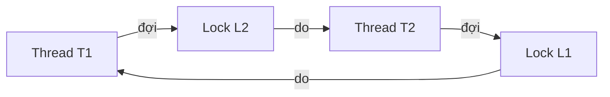

<a id="back-to-top"></a>

# Kiểm thử &amp; Chẩn đoán

## Menu
- [Test tính đúng đắn khi nhiều tác vụ cùng truy cập state](#testing-and-diagnostics-001)
- [Tái hiện race condition với latch/barrier](#testing-and-diagnostics-002)
- [Không dùng Thread.sleep() thay cho điều kiện đồng bộ trong test](#testing-and-diagnostics-003)
- [Test timeout, interruption và cancellation](#testing-and-diagnostics-004)
- [Test shutdown khi task đang chờ hoặc đang chạy](#testing-and-diagnostics-005)
- [Kiểm tra invariant và lỗi mất dữ liệu](#testing-and-diagnostics-006)
- [Kiểm tra contention/stress với jcstress (công cụ ngoài JDK)](#testing-and-diagnostics-007)
- [Thread dump và nhận diện RUNNABLE/BLOCKED/WAITING](#testing-and-diagnostics-008)
- [jcmd Thread.print, jstack và ThreadMXBean](#testing-and-diagnostics-009)
- [Phân tích deadlock với ThreadMXBean](#testing-and-diagnostics-010)
- [Java Flight Recorder cho thread park, lock và allocation](#testing-and-diagnostics-011)
- [Đọc stack trace khi future và async stage lỗi](#testing-and-diagnostics-012)
- [Log có thread name, task ID và correlation ID](#testing-and-diagnostics-013)
- [Xác định nguyên nhân trước khi tinh chỉnh pool/lock](#testing-and-diagnostics-014)

## <a id="testing-and-diagnostics-001">Test tính đúng đắn khi nhiều tác vụ cùng truy cập state</a>

<details>
<summary>Xem chi tiết</summary>

# Test tính đúng đắn khi nhiều tác vụ cùng truy cập state — Java Concurrency

## 1. Vì sao kiểm thử đồng thời khó?

Trong Java, nhiều thread có thể truy cập cùng một **shared mutable state**. Khi các thao tác đọc và ghi đan xen theo lịch thực thi khác nhau, code tưởng đúng trên một thread có thể bị mất cập nhật, quan sát trạng thái dở dang hoặc chờ nhau mãi. Lỗi có thể biến mất khi bật debugger, thêm logging hoặc chạy lại test.

Một lần test pass chỉ cho thấy lịch thực thi đã gặp chưa phát hiện vấn đề; **không chứng minh** implementation luôn đúng với mọi interleaving. Test có giá trị phải diễn đạt chính xác hợp đồng, chủ động tạo cạnh tranh, thu đủ kết quả của mọi task và kiểm tra các thuộc tính không được phép vi phạm.

Bài này thuộc phạm vi **Java concurrency nói chung** (`java.lang` và `java.util.concurrent`, Java Memory Model, thread/executor, synchronization), không triển khai tính năng hoặc cấu hình riêng của Spring.

Sau bài, bạn sẽ biết:

- Xác định tính đúng đắn bằng **invariant**, precondition/postcondition, safety và liveness.
- Nhận biết lost update, check-then-act, visibility, ordering và trạng thái nhiều biến không nhất quán.
- Phối hợp thread bằng `CountDownLatch`/`CyclicBarrier`, dùng `Future.get()` để nhận lỗi và biết khi nào assert.
- Tạo ví dụ Java 17+ tái hiện chắc chắn lost update và so sánh với `AtomicInteger`.
- Viết test JUnit 5 cho nhiều worker cùng sửa một state và tránh các lỗi trong chính test harness.
- Dùng stress test, lịch sử thao tác và công cụ concurrency chuyên biệt để mở rộng phạm vi kiểm tra.

## 2. Định nghĩa tính đúng đắn trước khi tạo thread

### Safety — không xuất hiện kết quả trái hợp đồng

Ví dụ: nếu 8 worker cùng tăng một counter 2.000 lần, kết quả **sau khi cả 8 hoàn thành** phải là `16_000`. Nếu kết quả nhỏ hơn, một hoặc nhiều lần cập nhật có thể bị mất.

Với 1 vé còn lại và hai yêu cầu đặt vé đồng thời, hợp đồng có thể cho phép A hoặc B thắng; điều **không được phép** là cả hai cùng thành công hoặc số vé âm. Test phải chấp nhận mọi thứ tự hợp lệ thay vì áp đặt bên nào thắng.

Với nhiều biến, test cần bất biến chung: khi chuyển số lượng từ `available` sang `reserved`, tổng `available + reserved` phải giữ bằng số ban đầu. Chỉ assert một trường không đủ để chứng minh trạng thái tổng thể nhất quán.

### Liveness — tác vụ vẫn có thể tiến triển

Chương trình có thể không ghi dữ liệu sai nhưng gặp deadlock, livelock, starvation hoặc chờ tài nguyên mãi mãi. Test phải có deadline khi chờ worker, lưu thông tin chẩn đoán và dọn tài nguyên. Timeout **không tự chứng minh deadlock**: máy CI chậm, GC, tài nguyên hệ thống cạn hoặc I/O chậm cũng có thể gây timeout.

### Atomicity, visibility, ordering

- **Atomicity:** một thao tác nghiệp vụ phải có hiệu lực như một đơn vị khi hợp đồng yêu cầu. `counter++` gồm đọc–cộng–ghi; không atomic dưới nhiều writer.
- **Visibility:** một thread cần nhìn thấy cập nhật của thread khác tại thời điểm hợp đồng yêu cầu. Chỉ viết vào biến thường mà không có đồng bộ phù hợp có thể dẫn đến quan sát lỗi.
- **Ordering:** nếu “ghi dữ liệu xong rồi công bố cờ ready”, phải có quan hệ happens-before cho reader; `Thread.sleep()` không thiết lập quan hệ đó.

**Data race** là các truy cập xung đột tới cùng biến thông thường, có ít nhất một ghi, nhưng không được sắp xếp bằng happens-before. **Race condition** rộng hơn: kết quả sai phụ thuộc thứ tự thao tác, kể cả khi từng thao tác `get`/`put` là thread-safe nhưng chuỗi gồm nhiều thao tác không atomic.

## 3. Thiết kế oracle của test

**Oracle** là điều kiện rõ ràng xác định test pass/fail, độc lập với việc task được scheduler cho chạy trước. Ghi trạng thái khởi tạo, thao tác được phép, trạng thái cuối, invariant trong lúc chạy và thời hạn hoàn tất.

| Kịch bản | Oracle đúng đắn | Lưu ý |
| --- | --- | --- |
| N worker tăng shared counter | Sau khi tất cả xong, giá trị bằng `N × số lần tăng` | Không assert khi worker còn chạy |
| Hai yêu cầu lấy tài nguyên cuối | Tối đa một thành công; số lượng không âm | Không áp đặt task A phải thắng |
| Chuyển tiền/tồn kho giữa hai ô | Tổng nguồn + đích được bảo toàn | Snapshot phải nhất quán |
| Cache tạo một key | Không nhân bản side effect trái hợp đồng | `get` rồi `put` là thao tác ghép |
| Writer công bố cấu hình | Reader chỉ thấy cấu hình đã khởi tạo hợp lệ | Cần safe publication |
| Nhiều task giữ lock | Hoàn tất trong giới hạn thời gian đặt trước | Timeout cần thread dump để chẩn đoán |

Phân biệt **assert trạng thái cuối** với **assert trạng thái trong lúc thực thi**. Đọc hai `AtomicInteger` liên tiếp không tự tạo snapshot atomic của cặp. Nếu hợp đồng đòi mọi snapshot nhất quán, cần synchronized snapshot, immutable object được publish atomic hoặc cơ chế tương ứng.

## 4. Điều phối lịch thực thi bằng đồng bộ, không bằng sleep

Một mẫu kiểm thử contention có kiểm soát:

1. Tạo executor có số worker **đủ** cho số task cùng đứng ở cổng start.
2. Mỗi worker gọi `ready.countDown()` rồi `start.await()`.
3. Thread kiểm thử chờ `ready.await(timeout)` để xác nhận mọi worker đã sẵn sàng.
4. Mở cổng bằng `start.countDown()` cho các thao tác cùng được phép bắt đầu.
5. Chờ **tất cả** `Future.get(timeout)`. Nếu task ném exception, `get` ném `ExecutionException` và test phải fail.
6. Khi các worker đã hoàn tất, kiểm tra oracle; mở cổng và đóng executor trong `finally` kể cả đường lỗi.

`CountDownLatch` là cổng một lần. `CyclicBarrier` thuận tiện khi các worker phải gặp nhau ở nhiều vòng cùng số participant, nhưng có thể broken khi có timeout/interrupt. `Phaser` cho phép quản lý các pha và số participant linh hoạt hơn. Lựa chọn theo mục tiêu test, không dùng thêm cơ chế chỉ để tăng độ phức tạp.

**Bẫy deadlock trong test:** nếu tạo 8 task cùng chờ cổng và chỉ có executor 2 worker, hai task đầu chiếm worker đứng đợi, sáu task còn lại không được chạy để báo ready. Thread điều phối cũng chờ đủ ready nên không ai mở cổng. Dùng pool ít nhất 8 worker cho mẫu này, có timeout và cleanup, hoặc thiết kế cách phối hợp khác.

**Cùng mở cổng không có nghĩa chạy tại cùng một nano giây.** Mẫu này tăng contention và kiểm soát thời điểm được phép chạy; scheduling vẫn do JVM/OS quyết định. Muốn ép một lịch read–modify–write cụ thể, đặt điểm đồng bộ **giữa các bước** của thao tác trong môi trường test.

## 5. Ví dụ Java 17+: tái hiện lost update theo lịch xác định

Chương trình sau cố ý chia increment của counter thường thành “đọc trước, ghi sau”. Hai worker buộc phải **đọc xong trước khi worker nào ghi**, nên cả hai cùng đọc `0` và cùng ghi `1`. Sau đó so sánh với `AtomicInteger.incrementAndGet()`, vốn là phép tăng atomic.

Tạo tệp **`SharedStateCorrectnessDemo.java`** với toàn bộ mã sau:

```java
import java.util.concurrent.Callable;
import java.util.concurrent.CountDownLatch;
import java.util.concurrent.ExecutorService;
import java.util.concurrent.Executors;
import java.util.concurrent.Future;
import java.util.concurrent.TimeUnit;
import java.util.concurrent.atomic.AtomicInteger;

public class SharedStateCorrectnessDemo {
    private static final class UnsafeCounter {
        int value;

        void incrementInTwoPhases(
                CountDownLatch bothRead,
                CountDownLatch allowWrite) throws InterruptedException {
            int previous = value;
            bothRead.countDown();
            if (!allowWrite.await(3, TimeUnit.SECONDS)) {
                throw new IllegalStateException("Timed out before write");
            }
            value = previous + 1;
        }
    }

    public static void main(String[] args) throws Exception {
        ExecutorService executor = Executors.newFixedThreadPool(2);
        try {
            int unsafe = runUnsafe(executor);
            if (unsafe != 1) {
                throw new AssertionError("Unexpected demo result");
            }
            System.out.println("unsafe: actual=1, required=2 (lost update)");

            int safe = runAtomic(executor);
            if (safe != 2) {
                throw new AssertionError("Atomic update was lost");
            }
            System.out.println("atomic: actual=2, required=2 (correct)");
        } finally {
            executor.shutdownNow();
            executor.awaitTermination(3, TimeUnit.SECONDS);
        }
    }

    private static int runUnsafe(ExecutorService executor) throws Exception {
        UnsafeCounter counter = new UnsafeCounter();
        CountDownLatch bothRead = new CountDownLatch(2);
        CountDownLatch allowWrite = new CountDownLatch(1);

        Callable<Void> task = () -> {
            counter.incrementInTwoPhases(bothRead, allowWrite);
            return null;
        };
        Future<Void> first = executor.submit(task);
        Future<Void> second = executor.submit(task);

        try {
            check(bothRead.await(3, TimeUnit.SECONDS),
                    "Both workers must read before writing");
            allowWrite.countDown();
            first.get(3, TimeUnit.SECONDS);
            second.get(3, TimeUnit.SECONDS);
            return counter.value;
        } finally {
            allowWrite.countDown();
        }
    }

    private static int runAtomic(ExecutorService executor) throws Exception {
        AtomicInteger counter = new AtomicInteger();
        CountDownLatch ready = new CountDownLatch(2);
        CountDownLatch start = new CountDownLatch(1);

        Callable<Void> task = () -> {
            ready.countDown();
            if (!start.await(3, TimeUnit.SECONDS)) {
                throw new IllegalStateException("Start gate timeout");
            }
            counter.incrementAndGet();
            return null;
        };
        Future<Void> first = executor.submit(task);
        Future<Void> second = executor.submit(task);

        try {
            check(ready.await(3, TimeUnit.SECONDS),
                    "Both workers must reach the start gate");
            start.countDown();
            first.get(3, TimeUnit.SECONDS);
            second.get(3, TimeUnit.SECONDS);
            return counter.get();
        } finally {
            start.countDown();
        }
    }

    private static void check(boolean ok, String message) {
        if (!ok) {
            throw new AssertionError(message);
        }
    }
}
```

Biên dịch/chạy trên JDK 17 trở lên:

```bash
javac SharedStateCorrectnessDemo.java
java SharedStateCorrectnessDemo
```

Kết quả khi chương trình chạy thành công:

```text
unsafe: actual=1, required=2 (lost update)
atomic: actual=2, required=2 (correct)
```

**Giải thích chính xác kết quả:**

- Cả hai task dùng **cùng instance** `UnsafeCounter`. Mỗi task đọc `value` vào `previous` trước khi gọi `bothRead.countDown()`. Main chỉ cho ghi khi cả hai đã báo đọc, nên cả hai đã lưu `previous = 0`. Các phép gán sau đó đều là `value = 1`. Kết quả 1 là lỗi lost update.
- `runAtomic` cũng có hai task được mở cổng cùng đợt, nhưng `incrementAndGet()` cung cấp read–modify–write atomic. Sau cả hai future, kết quả là 2.
- Chương trình minh họa **cố ý kiểm tra rằng lỗi đã được tạo ra**; trong một regression test cho code thực, oracle phải là 2 và implementation trả 1 **phải fail**.
- `Future.get(timeout)` chờ hoàn tất và truyền lỗi task về main; không có đoạn code nào đoán worker đã xong chỉ vì một khoảng `sleep` đã trôi qua.
- Các `finally` mở latch để tránh để worker kẹt nếu main gặp lỗi. `shutdownNow()` yêu cầu interrupt best-effort, không bảo đảm mọi tác vụ tùy ý dừng ngay lập tức.

Mẫu này cố ý chèn điểm đồng bộ vào thuật toán lỗi để tạo phản ví dụ. Khi kiểm thử code nghiệp vụ thực, không nên sửa hành vi production chỉ để “chữa” race; dùng test hook hoặc một seam thích hợp khi cần quan sát lịch thực thi.

## 6. Ví dụ JUnit 5: kiểm tra không mất increment khi cạnh tranh

Đây là một **test class dùng JUnit Jupiter 5**, dành cho dự án đã khai báo JUnit Jupiter và cấu hình test runner. Nó minh họa mẫu test có thể tái sử dụng để thay đối tượng counter bằng implementation đang phát triển. Không chạy tệp này bằng `java` trực tiếp khi thiếu dependency/test runner.

```java
import static org.junit.jupiter.api.Assertions.assertEquals;
import static org.junit.jupiter.api.Assertions.assertTrue;

import java.util.ArrayList;
import java.util.List;
import java.util.concurrent.CountDownLatch;
import java.util.concurrent.ExecutorService;
import java.util.concurrent.Executors;
import java.util.concurrent.Future;
import java.util.concurrent.TimeUnit;
import java.util.concurrent.atomic.AtomicInteger;
import org.junit.jupiter.api.Test;

class ConcurrentCounterTest {
    @Test
    void allConcurrentIncrementsArePreserved() throws Exception {
        int workers = 8;
        int iterationsPerWorker = 2_000;
        AtomicInteger counter = new AtomicInteger();

        ExecutorService executor = Executors.newFixedThreadPool(workers);
        CountDownLatch ready = new CountDownLatch(workers);
        CountDownLatch start = new CountDownLatch(1);
        List<Future<?>> futures = new ArrayList<>();

        try {
            for (int i = 0; i < workers; i++) {
                futures.add(executor.submit(() -> {
                    ready.countDown();
                    if (!start.await(5, TimeUnit.SECONDS)) {
                        throw new IllegalStateException("Start timeout");
                    }
                    for (int j = 0; j < iterationsPerWorker; j++) {
                        counter.incrementAndGet();
                    }
                    return null;
                }));
            }

            assertTrue(ready.await(5, TimeUnit.SECONDS),
                    "Some workers did not reach start gate");
            start.countDown();
            for (Future<?> future : futures) {
                future.get(10, TimeUnit.SECONDS);
            }
            assertEquals(workers * iterationsPerWorker, counter.get());
        } finally {
            start.countDown();
            executor.shutdownNow();
            executor.awaitTermination(5, TimeUnit.SECONDS);
        }
    }
}
```

**Kiểm tra gì?** Có 8 worker cùng sửa một state; mọi worker đã “ready” trước khi mở cổng; tất cả future được quan sát; chỉ sau khi hoàn tất mới assert `8 × 2_000 = 16_000`. Nếu task ném exception, `Future.get()` khiến test fail thay vì âm thầm bỏ qua. `finally` giải phóng cổng và dọn executor.

`AtomicInteger` vốn đã có cam kết atomic của JDK; trong ứng dụng, thay nó bằng **đúng lớp/hàm cần test**, giữ cùng oracle và dùng một shared instance. Các timeout 5 và 10 giây ở đây là giá trị minh họa; cần chọn theo môi trường CI và hạn mức tiến độ hợp lý. Nếu gọi `shutdownNow()` khi một task chưa dừng, phải bảo đảm test harness không cho background worker còn sống sửa state mà test tiếp theo dùng chung.

## 7. Invariant trên nhiều field: atomic từng phần chưa đủ

Giả sử hệ thống có `available = 100` và `reserved = 0`. Mỗi lệnh đặt chỗ chuyển 30 từ available sang reserved. Nếu hợp đồng yêu cầu snapshot luôn hợp lệ, bất biến là:

- `available >= 0`.
- `reserved >= 0`.
- `available + reserved == 100`.

Hai biến `AtomicInteger` với hai lời gọi `addAndGet` riêng biệt vẫn có thể cho reader thấy tổng tạm thời là 70 hoặc 130 giữa hai bước cập nhật. Nếu snapshot đồng thời phải nhất quán, cập nhật và snapshot phải được phối hợp như **một giao dịch logic**.

Ví dụ mã thành phần, không phải chương trình có `main()`:

```java
final class ReservationBook {
    private int available = 100;
    private int reserved = 0;

    synchronized boolean reserve(int amount) {
        if (amount <= 0 || amount > available) {
            return false;
        }
        available -= amount;
        reserved += amount;
        return true;
    }

    synchronized Snapshot snapshot() {
        return new Snapshot(available, reserved);
    }

    record Snapshot(int available, int reserved) {}
}
```

Nếu hai thread cùng đặt 80, phải đúng **một yêu cầu thành công**; sau khi hoàn tất, snapshot phải là `(20, 80)`. Để test invariant trong lúc các writer đang chạy, dùng một reader liên tục lấy `snapshot()`, assert bất biến trên từng snapshot, và cho reader dừng bằng một cờ/đồng bộ đúng khi tất cả writer xong. Không đọc riêng `available`/`reserved` bằng các getter không đồng bộ rồi kết luận class không nhất quán.

Với `ConcurrentHashMap`, `get` và `put` an toàn riêng lẻ nhưng chuỗi `if (map.get(key) == null) map.put(key, value)` vẫn có cửa sổ check-then-act: hai thread có thể cùng coi key chưa tồn tại và cùng thực hiện side effect tạo value. Có thể cần `putIfAbsent` hoặc `computeIfAbsent`, nhưng semantics của side effect bên ngoài map (ví dụ ghi thanh toán) còn cần thiết kế idempotency/điều phối riêng. Thread-safe collection **không tự làm nguyên tử thao tác nghiệp vụ gồm nhiều lệnh**.

## 8. Happens-before và Java Memory Model trong test

Các quan hệ bộ nhớ cần hiểu:

- Thứ tự chương trình trong một thread là một nguồn happens-before.
- Một lần unlock monitor happens-before lần lock tiếp theo **cùng monitor**.
- Một lần ghi `volatile` happens-before lần đọc `volatile` tương ứng tiếp theo; các primitive atomic có memory semantics được đặc tả.
- Hành động trước `Thread.start()` happens-before hành động trong thread mới; hành động trong thread kết thúc happens-before thread khác phát hiện kết thúc qua `join()` thành công.
- Với executor, những hành động trước `submit` happens-before hành động của task; hành động của task happens-before hành động sau `Future.get()` thành công.
- Với latch, hành động trước `countDown()` happens-before hành động sau khi `await()` tương ứng trở về thành công.

Vì `Future.get()` tạo đồng bộ với task đã hoàn tất, main có thể quan sát trạng thái do các task ghi **sau tất cả future**. Nhưng điều đó không hàn gắn race giữa các task: nếu cả hai cùng đọc cũ rồi ghi chồng, giá trị cuối vẫn có thể sai.

Đặc biệt, `volatile int counter; counter++` vẫn không atomic: visibility tốt hơn nhưng read–modify–write vẫn có thể mất cập nhật. Với nhiều writer, dùng `AtomicInteger.incrementAndGet()`, lock thích hợp hoặc phân quyền sở hữu state để không cần share mutable data.

Khi test safe publication, reader không được dựa vào việc “đợi thêm 100 ms” để chắc chắn thấy giá trị. Nếu writer publish một object nhưng thiếu synchronization, test không thể mong JVM luôn lộ bug trong mọi lần chạy. Cần đúng cơ chế publication (`volatile`, final-field semantics dùng đúng cách, monitor, queue hoặc synchronizer) trước khi dựa vào kết quả test.

## 9. Testing ordering và linearizability

Không phải mọi state concurrent đều cần một thứ tự kết quả cố định. Nếu hai yêu cầu cùng lấy vé cuối, lịch A thắng/B thua và lịch B thắng/A thua đều hợp lệ. Nhưng lịch **cả hai thắng** là vi phạm.

**Linearizability** có nghĩa mỗi thao tác quan sát như có hiệu lực tại một thời điểm duy nhất nằm giữa lúc gọi và lúc trả, đồng thời giữ thứ tự thực của các thao tác không chồng lấp. Muốn test một API phức tạp:

1. Ghi history có operation id, input, thời điểm gọi và kết thúc, output/exception.
2. Có một mô hình tuần tự chính xác cho state và các phép chuyển.
3. Tìm một lịch tuần tự khớp history và giữ quan hệ thứ tự của các lời gọi không chồng lấp.
4. Nếu không tồn tại lịch hợp lệ, history là phản ví dụ; nếu tồn tại, chỉ có **history đó pass**, chưa chứng minh mọi history tương lai.

Timestamp log chỉ cung cấp quan sát; ghi log trong/ngoài lock có thể thay timing và không nhất thiết là thời điểm thao tác có hiệu lực. Với bài toán đơn giản, assert invariant cuối; với API state machine phức tạp, cân nhắc checker/model-based test chuyên dụng.

## 10. Stress testing, randomized testing và jcstress

Lịch do latch ép chứng minh một kịch bản; lỗi khác có thể đòi lịch hiếm hoặc reorder do tối ưu JVM/hardware. Các tầng test bổ sung:

| Phương pháp | Điểm mạnh | Giới hạn |
| --- | --- | --- |
| Test controlled interleaving | Tái hiện lỗi cụ thể ổn định, dễ debug | Chỉ kiểm tra lịch đã điều phối |
| Contention test hàng nghìn thao tác | Phát hiện lost update, invariant hỏng dưới tranh chấp | Có thể pass tình cờ |
| Stress/randomized test, nhiều lần với seed | Bao phủ nhiều lịch, giúp tìm phản ví dụ | Không chứng minh tuyệt đối |
| Model-based/linearizability checking | So history với hợp đồng tuần tự | Phụ thuộc model và độ đầy đủ history |
| OpenJDK **jcstress** | Mô tả actor/outcome để thử các tình huống Java Memory Model khó | Cần harness, hiểu allowed/forbidden outcomes và môi trường |
| Load/soak test | Tìm tắc nghẽn, rò tài nguyên, liveness dưới tải | Throughput tốt không chứng minh safety |

Không dùng `Thread.yield()` hay `Thread.sleep()` như bảo đảm tạo ra interleaving. Chúng chỉ ảnh hưởng scheduling; việc một bug không tái hiện sau khi thêm sleep không phải đã sửa đúng.

Với randomized test, ghi lại **seed, số worker, số iteration, JVM/OS, cấu hình CPU, thời gian, input và lịch sử thao tác**. Khi tìm được lỗi, cố tạo một test ngắn có latch/barrier ép đúng lịch đó để chống regression. Mỗi vòng thử nên tạo state mới hoặc reset hoàn toàn; không để thread, task hay cache của vòng trước nhiễu vào vòng sau.

## 11. Diagnosing failure và timeout

Khi test fail, thông tin hữu ích gồm: trạng thái ban đầu, bất biến bị vi phạm, số thao tác thành công/thất bại, exception của từng future, state lúc kết thúc, seed và điểm đồng bộ đã đi qua.

Khi bị treo, thu thread dump để thấy thread ở `BLOCKED`, `WAITING` hay `TIMED_WAITING`, monitor/lock đang giữ và tài nguyên đang chờ. `ThreadMXBean.findDeadlockedThreads()` có thể phát hiện các deadlock của monitor và một số ownable synchronizer; nó không phát hiện mọi dạng chờ logic, ví dụ chờ latch do test không mở cổng. Phân biệt deadlock thật với thiếu worker trong executor, GC lâu, I/O treo và quá tải CPU.

Đừng lạm dụng print/log trong vòng lặp tranh chấp: logging làm thay đổi timing và bản thân nó có lock/I/O. Thay vào đó, lưu sự kiện có id thao tác vào buffer có giới hạn, hoặc chỉ bật instrument chọn lọc khi cần. Kiểm tra exception được truyền từ worker trước khi đọc kết quả.

## 12. Những sai lầm phổ biến trong concurrency test

- **Assert quá sớm:** `submit` chỉ xếp lịch, không chờ hoàn tất; luôn chờ kết thúc hợp đồng rồi mới assert state cuối.
- **Bỏ qua `Future.get()`:** exception worker bị giữ trong future, dễ tạo test xanh giả.
- **Dùng `sleep` để chờ:** timing nhạy máy và scheduler, dễ flaky; dùng synchronization + deadline.
- **Pool nhỏ hơn số task cùng chờ barrier:** test deadlock vì các task còn trong queue chưa thể báo ready.
- **Không mở latch trong `finally`:** test thất bại khiến worker treo, ảnh hưởng test sau.
- **Test với các instance riêng:** mỗi task sửa state khác nhau nên không có contention thật.
- **Chỉ kiểm tra counter:** bỏ qua invariant liên trường, unique side effect hoặc yêu cầu ordering.
- **Đọc snapshot không đồng bộ:** coi trạng thái trung gian hợp lệ là bug, hoặc ngược lại bỏ sót trạng thái không hợp lệ.
- **Dùng `volatile` như phép tăng atomic:** visibility không đồng nghĩa atomicity.
- **Chạy stress 10.000 lần rồi tuyên bố chắc chắn đúng:** chưa thử mọi lịch hợp lệ.
- **Không cleanup:** executor còn sống, callback hoặc thread vẫn có thể sửa shared state sau khi test kết thúc.

## 13. Quy trình áp dụng thực tế

1. Viết rõ state khởi tạo, thao tác đồng thời, invariant, những kết quả cuối được phép và deadline tiến độ.
2. Chỉ ra điểm có thể đan xen: read–modify–write, check-then-act, publish, lock, snapshot nhiều biến.
3. Viết một test nhỏ điều phối lịch nguy hiểm bằng latch/barrier và assert **hợp đồng**.
4. Đảm bảo mọi worker dùng chung state, có đủ worker, được mở cổng và được chờ qua future.
5. Sửa code bằng atomics, lock, concurrent collection hoặc loại bỏ shared mutable state; không chữa lỗi bằng delay.
6. Thêm contention/stress test, kiểm tra exception, cancellation, timeout, shutdown và những interleaving khó.
7. Khi gặp lỗi, lưu phản ví dụ với seed/history và đưa vào regression test có thể tái hiện.

**Ý chính:** kiểm thử concurrency phải nhắm vào **tính đúng đắn dưới mọi lịch thực thi hợp lệ**, chứ không chỉ “chạy song song mà không ném exception”. Bất biến tạo oracle; đồng bộ kiểm thử tạo lịch cạnh tranh có kiểm soát; future/timeout cung cấp quan sát hoàn tất; stress và công cụ chuyên biệt giúp tìm lịch mà unit test chưa chạm tới.


</details>

- [Quay lại đầu trang](#back-to-top)

---

## <a id="testing-and-diagnostics-002">Tái hiện race condition với latch/barrier</a>

<details>
<summary>Xem chi tiết</summary>

# Tái hiện race condition với latch/barrier trong Java

## 1. Vì sao race condition khó tái hiện?

Một **race condition** xảy ra khi kết quả đúng của chương trình phụ thuộc vào thứ tự hoặc thời điểm các luồng thực hiện những bước có liên quan. Khi chạy bình thường, lỗi có thể xuất hiện rất hiếm: scheduler chạy một luồng xong rồi mới chuyển sang luồng khác, máy phát triển ít tải, hoặc việc đặt breakpoint/log vô tình thay đổi thứ tự thực thi. Một bài kiểm thử chỉ “chạy thật nhiều thread rồi hy vọng lỗi xuất hiện” thường không thể xác nhận chắc chắn cả trường hợp có lỗi lẫn trường hợp đã sửa.

Ví dụ hai thread cùng tăng một biến:

~~~java
int old = counter.value; // đọc
int next = old + 1;       // tính
counter.value = next;     // ghi
~~~

Phép tăng là chuỗi **read → modify → write**; nó không tự động là một thao tác nguyên tử. Nếu cả hai cùng đọc 0, rồi lần lượt ghi 1, kết quả là 1 dù đã có hai yêu cầu tăng. Đây là **lost update**.

Ta có thể dùng các công cụ đồng bộ trong java.util.concurrent để **ép một lịch thực thi cụ thể**: cho cả hai worker đọc cùng giá trị trước khi cho phép bất kỳ worker nào ghi. Từ đó, lỗi có thể được tái hiện một cách có kiểm soát, dễ chẩn đoán và kiểm tra lại sau khi sửa.

Bài học tập trung vào **Java concurrency nói chung**: CountDownLatch, CyclicBarrier, ExecutorService, Future, AtomicInteger, ConcurrentHashMap và nguyên tắc happens-before trong Java Memory Model. Không sử dụng cơ chế kiểm thử hay cấu hình concurrency đặc thù của Spring.

## 2. Phân biệt race condition, data race và tính nguyên tử

Ba khái niệm liên quan nhưng không hoàn toàn giống nhau:

| Khái niệm | Ý nghĩa | Ví dụ |
| --- | --- | --- |
| Race condition | Tính đúng đắn phụ thuộc vào thứ tự các hành động; thứ tự không được kiểm soát theo hợp đồng | Hai yêu cầu đều thấy một chỗ trống và cùng giữ chỗ |
| Data race (theo Java Memory Model) | Hai truy cập xung đột vào cùng biến, ít nhất một là ghi, không có quan hệ happens-before thích hợp giữa chúng | Hai thread ghi vào trường int thông thường mà không đồng bộ |
| Thao tác không nguyên tử | Một thao tác nghiệp vụ gồm nhiều bước có thể bị thread khác xen vào | get → cộng 1 → put trên ConcurrentHashMap |

Có **race condition ngay cả khi các phương thức riêng lẻ đều thread-safe**. Ví dụ get và put của ConcurrentHashMap được thiết kế cho truy cập đồng thời, nhưng chuỗi get → tính → put không được gộp thành một hành động nguyên tử. Hai thread vẫn có thể đọc cùng giá trị cũ và ghi đè kết quả của nhau.

Một trường int được khai báo volatile giúp cung cấp quy tắc visibility và ordering của volatile, nhưng **volatile không biến phép tăng gồm nhiều bước thành atomic**. Muốn bảo toàn phép tăng, dùng AtomicInteger.incrementAndGet(), synchronized bảo vệ toàn bộ read-modify-write, hoặc cơ chế cập nhật nguyên tử phù hợp.

Một bài tái hiện tốt phải chỉ ra **giả định về thứ tự** và **trạng thái sau khi thực thi**, không chỉ nêu rằng đã chạy hai thread.

## 3. Vai trò khác nhau của CountDownLatch và CyclicBarrier

### CountDownLatch: cổng một chiều

CountDownLatch có bộ đếm ban đầu. Mỗi countDown() giảm bộ đếm; await() đợi đến khi bộ đếm về 0. Nó thích hợp cho hai kiểu phối hợp:

- **Ready gate**: hai worker báo rằng đã khởi động; main đợi cả hai sẵn sàng.
- **Start gate**: main mở một cổng chung để cả hai worker bắt đầu đoạn cần kiểm thử.

Ví dụ:

~~~java
CountDownLatch ready = new CountDownLatch(2);
CountDownLatch start = new CountDownLatch(1);

// Trong mỗi worker:
ready.countDown();
if (!start.await(5, TimeUnit.SECONDS)) {
    throw new TimeoutException("Start gate timed out");
}

// Trong main, sau khi submit cả hai worker:
if (!ready.await(5, TimeUnit.SECONDS)) {
    throw new TimeoutException("Workers did not become ready");
}
start.countDown();
~~~

Đây là **đoạn tích hợp** cần main/worker, các import và biến tương ứng; không phải chương trình Java độc lập. Hai worker được phát lệnh gần nhau, nhưng start gate **không bảo đảm chúng thực sự đọc biến cùng lúc**. Hệ điều hành vẫn có thể chạy worker thứ nhất đến hết trước khi worker thứ hai vào vùng lỗi. Vì vậy chỉ dùng start latch chưa đủ để tái hiện lost update chắc chắn.

CountDownLatch là **one-shot**: khi về 0, nó không đặt lại bộ đếm. Mỗi kịch bản/round nên có latch mới nếu cần lập lại quy trình.

### CyclicBarrier: điểm gặp nhau của nhiều thread

CyclicBarrier với parties = 2 buộc hai worker cùng đi tới await() trước khi cả hai được đi tiếp. Đặt barrier **sau bước đọc nhưng trước bước ghi** để giữ hai giá trị snapshot cũ lại:

~~~text
Worker A: read 0 ──┐
                   ├─ bothRead.await() ──> write 1
Worker B: read 0 ──┘                     ──> write 1
                                      Kết quả cuối: 1
~~~

Khác với latch, barrier có thể dùng lại qua nhiều thế hệ (generation) khi đủ số parties đến. Tuy nhiên, nếu một bên timeout, bị interrupt hoặc barrier action thất bại, barrier có thể rơi vào trạng thái **broken** và các bên khác nhận BrokenBarrierException. Trong bài kiểm thử, nên kết thúc round và tạo barrier mới thay vì reset tùy tiện khi worker cũ có thể vẫn đang chạy.

**Chọn công cụ theo mục tiêu:** latch cho điều kiện “đã sẵn sàng / được phép bắt đầu”; barrier cho điều kiện “tất cả đã hoàn thành pha đọc rồi mới chuyển sang pha ghi”.

## 4. Thí nghiệm Java 17+: buộc lost update xuất hiện

Chương trình đầy đủ dưới đây thực hiện ba phép đếm trên **cùng hai worker**:

1. Trường int thông thường, read-modify-write không đồng bộ.
2. ConcurrentHashMap với chuỗi get rồi put: thao tác đơn lẻ thread-safe nhưng toàn chuỗi không nguyên tử.
3. AtomicInteger.incrementAndGet(): mỗi lần tăng là một thao tác nguyên tử.

Cả hai worker lấy snapshot trước barrier; main chỉ công bố kết quả sau khi cả hai Future hoàn thành. Nếu không có timeout hay lỗi môi trường, kết quả sẽ lặp lại ổn định.

**Tệp RaceReplayDemo.java**

~~~java
import java.util.concurrent.Callable;
import java.util.concurrent.ConcurrentHashMap;
import java.util.concurrent.CountDownLatch;
import java.util.concurrent.CyclicBarrier;
import java.util.concurrent.ExecutorService;
import java.util.concurrent.Executors;
import java.util.concurrent.Future;
import java.util.concurrent.TimeUnit;
import java.util.concurrent.TimeoutException;
import java.util.concurrent.atomic.AtomicInteger;

public final class RaceReplayDemo {

    private static final class Counter {
        int value;
    }

    public static void main(String[] args) throws Exception {
        Counter unsafeCounter = new Counter();
        ConcurrentHashMap<String, Integer> map = new ConcurrentHashMap<>();
        AtomicInteger atomicCounter = new AtomicInteger();

        CountDownLatch ready = new CountDownLatch(2);
        CountDownLatch start = new CountDownLatch(1);
        CyclicBarrier bothRead = new CyclicBarrier(2);

        ExecutorService pool = Executors.newFixedThreadPool(2);

        Callable<Void> worker = () -> {
            ready.countDown();

            if (!start.await(5, TimeUnit.SECONDS)) {
                throw new TimeoutException("Start gate timed out");
            }

            // Pha 1: hai worker cùng chụp giá trị cũ.
            int oldInt = unsafeCounter.value;
            int oldMap = map.getOrDefault("hits", 0);

            // Pha 2: không worker nào được ghi trước
            // khi cả hai đã đọc xong.
            bothRead.await(5, TimeUnit.SECONDS);

            // Pha 3: hai bản cập nhật sai cùng ghi giá trị 1.
            unsafeCounter.value = oldInt + 1;
            map.put("hits", oldMap + 1);

            // Phép tăng nguyên tử không làm mất bản cập nhật.
            atomicCounter.incrementAndGet();
            return null;
        };

        Future<Void> first = pool.submit(worker);
        Future<Void> second = pool.submit(worker);

        try {
            if (!ready.await(5, TimeUnit.SECONDS)) {
                throw new TimeoutException("Workers did not become ready");
            }

            start.countDown();
            first.get(5, TimeUnit.SECONDS);
            second.get(5, TimeUnit.SECONDS);

            System.out.println("Yeu cau tang: 2");
            System.out.println("int khong dong bo: " + unsafeCounter.value);
            System.out.println("ConcurrentHashMap get/put: "
                    + map.get("hits"));
            System.out.println("AtomicInteger: " + atomicCounter.get());

            if (unsafeCounter.value != 1
                    || !Integer.valueOf(1).equals(map.get("hits"))
                    || atomicCounter.get() != 2) {
                throw new AssertionError("Unexpected interleaving");
            }
        } finally {
            // Mở cổng nếu main thất bại trước khi phát tín hiệu.
            start.countDown();
            first.cancel(true);
            second.cancel(true);
            pool.shutdownNow();
        }
    }
}
~~~

Biên dịch và chạy bằng Java 17 trở lên:

~~~bash
javac RaceReplayDemo.java
java RaceReplayDemo
~~~

Stdout khi hai worker hoàn thành bình thường:

~~~text
Yeu cau tang: 2
int khong dong bo: 1
ConcurrentHashMap get/put: 1
AtomicInteger: 2
~~~

**Vì sao kết quả này có thể tái hiện?**

- ready bảo đảm cả hai Callable đã chạy đến điểm sẵn sàng trước khi main mở start.
- Sau khi start mở, mỗi worker lấy oldInt = 0 và oldMap = 0. Chúng chưa thể đi tới phép ghi vì còn đợi ở bothRead.
- CyclicBarrier chỉ giải phóng khi cả hai worker đã đọc xong. Do đó cả hai đều mang giá trị cũ 0 vào pha ghi, bất kể worker nào được scheduler chạy trước sau barrier.
- Cả hai ghi 1 vào int và map: tác vụ tăng thứ hai bị mất. AtomicInteger thực hiện hai lần tăng nguyên tử nên kết quả bằng 2.
- first.get và second.get hoàn thành bình thường cung cấp quan hệ đồng bộ để main quan sát kết quả của worker. Không đọc kết quả trước khi công việc hoàn tất.

Kết quả 1 được **ép bằng lịch thực thi của thí nghiệm**; nó không có nghĩa hai thread luôn tạo lost update trong mọi lịch thực thi sản xuất. Nếu bỏ barrier, một thread có thể đọc sau khi thread kia đã ghi và kết quả đôi khi trở thành 2. Vì vậy chạy được một lần với kết quả 2 không chứng minh mã ban đầu an toàn.

Bài kiểm thử chủ động lắp đặt điểm đồng bộ trong **harness** để tái hiện một lịch sai. Không nên chèn barrier nhân tạo vào đường xử lý nghiệp vụ chỉ nhằm “sửa” race; cách sửa đúng phải làm nguyên tử thao tác cần bảo vệ.

## 5. Vì sao dùng CountDownLatch một mình chưa đủ?

Xem phiên bản chỉ có start gate:

~~~text
Main:     submit(A), submit(B) -> chờ ready(2) -> start.countDown()
Worker A:                                 đọc 0 -> ghi 1
Worker B:                                             đọc 1 -> ghi 2
~~~

Lịch trên hoàn toàn hợp lệ dù cả hai worker cùng đợi một start gate. Nếu bài kiểm thử viết:

~~~java
start.countDown();
first.get();
second.get();
assertEquals(1, counter.value);
~~~

thì assertion có thể thất bại vì ra 2, **không phải vì lỗi đã được sửa**, mà vì test không điều khiển được interleaving. Đây là mã minh họa có biến và assertion của harness kiểm thử (không phải tệp Java độc lập). Một test “đôi lúc đỏ, đôi lúc xanh” khó dùng làm bằng chứng hồi quy.

Cách điều khiển chính xác hơn là đặt một cổng **ngay giữa hai thao tác xung đột**: đọc xong → chờ bên còn lại cũng đọc xong → cho phép ghi. Khi đó điều kiện gây lost update không còn phụ thuộc vào may rủi.

Tuy nhiên, barrier cũng tạo quan hệ happens-before ở chính ranh giới await. Nó có thể làm thay đổi lỗi timing hoặc che một lỗi visibility khác. Chỉ dùng lịch được dàn dựng để chứng minh **lịch cụ thể này có lỗi**; không coi một lịch duy nhất là kiểm định toàn bộ Java Memory Model hay toàn bộ những race có thể xuất hiện.

## 6. Sửa lỗi ở đúng mức nguyên tử

### Trường đếm đơn giản: AtomicInteger

~~~java
AtomicInteger counter = new AtomicInteger();
counter.incrementAndGet();
~~~

Nếu hai thread gọi incrementAndGet, kết quả cuối là 2 sau khi cả hai hoàn thành, không cần tự bọc thêm synchronized. AtomicInteger phù hợp cho một biến độc lập với phép cập nhật nguyên tử đơn giản. Việc đọc nhiều biến hoặc duy trì invariant giữa các đối tượng cần cơ chế phối hợp khác.

### Cập nhật trường trong đối tượng: synchronized cả cụm thao tác

~~~java
synchronized (counter) {
    counter.value = counter.value + 1;
}
~~~

Đây là đoạn tích hợp vào chương trình có đối tượng counter. Mọi truy cập liên quan đến invariant phải tuân thủ **cùng một khóa** hoặc cách đồng bộ tương đương; khóa chỉ ở phép đọc hoặc chỉ ở phép ghi là chưa đủ. Nếu hai worker cần barrier trong test, đặt barrier **trước** khối synchronized; không để worker thứ nhất giữ monitor rồi đợi worker thứ hai cũng vào cùng monitor, vì như vậy có thể tự tạo deadlock.

### Map đồng thời: merge/compute nguyên tử cho khóa

~~~java
ConcurrentHashMap<String, Integer> counts =
        new ConcurrentHashMap<>();

counts.merge("hits", 1, Integer::sum);
~~~

merge thực hiện phép kết hợp cho khóa theo cơ chế cập nhật nguyên tử của ConcurrentHashMap, tránh cặp get → put tách rời. Hàm remapping nên ngắn, không có side effect bên ngoài, và không nên chặn lâu. Nếu logic không thể biểu diễn thành một phép cập nhật per-key, phải thiết kế khóa/giao thức cho invariant lớn hơn.

**Đối chiếu sau sửa:** Dùng lại mục tiêu lịch “hai thread cùng đến pha cập nhật” nhưng **không đọc trước rồi ghi sau** nữa. Với AtomicInteger hoặc merge, mỗi worker gọi trọn phép cập nhật nguyên tử; sau khi Future hoàn thành, assert giá trị 2. Không thể giữ nguyên thiết kế sai gồm snapshot trước barrier rồi thay riêng lệnh put bằng một lệnh ghi đè khác và kỳ vọng tự hết race.

## 7. Kiểm thử điều kiện ghép (check-then-act), không chỉ phép tăng

Nhiều race condition có dạng kiểm tra một điều kiện rồi hành động dựa trên kết quả:

~~~java
if (!map.containsKey(key)) {
    map.put(key, createValue());
}
~~~

Mỗi phương thức map có thể thread-safe, nhưng **toàn bộ kiểm tra rồi đặt** vẫn không nguyên tử. Hai thread có thể cùng thấy key chưa tồn tại, cùng chạy createValue(), sau đó một kết quả ghi đè kết quả kia.

Có thể tái hiện bằng một barrier đặt **sau containsKey nhưng trước put**, để cả hai chắc chắn quan sát key chưa có. Sau đó kiểm tra createValue() đã chạy hai lần hay chưa, số side effect có bị nhân đôi và giá trị cuối là gì. Bản sửa có thể dùng putIfAbsent hoặc computeIfAbsent tùy hợp đồng; nhớ rằng createValue() có thể có side effect, nên việc tính giá trị trước putIfAbsent vẫn có thể chạy nhiều lần. Với computeIfAbsent của ConcurrentHashMap, mapping function phải tránh tác dụng phụ không an toàn và không được đệ quy cập nhật cùng map theo cách vi phạm hợp đồng API.

Race về invariant còn gặp ở nhiều nơi: kiểm tra số dư rồi trừ tiền, kiểm tra queue rỗng rồi remove, kiểm tra trạng thái rồi phát event, kiểm tra số vé còn lại rồi đặt chỗ. Những bài toán này đòi hỏi thiết kế **điểm tuyến tính hóa** (linearization point) cho nghiệp vụ, không chỉ thêm nhiều thread trong test.

## 8. Các điều kiện để một test đồng thời đáng tin

### Kiểm soát đúng số worker và thời điểm

Khi CyclicBarrier có parties = 2, cần **ít nhất hai luồng thực sự có khả năng chạy** đến await. Nếu dùng Executors.newSingleThreadExecutor với hai task, task thứ nhất đứng chờ barrier còn task thứ hai chưa được chạy: test sẽ kẹt hoặc timeout. Nếu có main cũng gọi await, số parties phải tính cả main.

Không gọi Future.get() của worker đầu tiên **trước khi phát start.countDown()** nếu worker đang chờ start. Hãy submit cả hai → chờ ready → mở start → chờ kết quả.

Tốt nhất, hãy dùng chính xác hai worker như ví dụ và hạn chế bước không liên quan giữa các cổng để giữ dấu vết dễ đọc.

### Đặt timeout cho mọi điểm chờ

Dùng await(timeout, unit), barrier.await(timeout, unit) và Future.get(timeout, unit) để lỗi kiểm thử không treo vô hạn khi một worker:

- Chết trước khi gọi ready.countDown hoặc trước khi đến barrier.
- Ném exception trong pha đọc.
- Bị interrupt, không thể tới đủ parties.
- Không được executor cấp thread hoặc môi trường chạy bị quá tải.

CountDownLatch.await(timeout, unit) trả **false** nếu quá thời gian. CyclicBarrier.await(timeout, unit) có thể ném TimeoutException; các bên liên quan có thể nhận BrokenBarrierException. Future.get(timeout, unit) có thể ném TimeoutException, còn lỗi trong Callable được bọc bằng ExecutionException. Không đánh đồng các trường hợp này thành “race reproduced”.

Những timeout 5 giây trong chương trình là **cơ chế bảo vệ test**. Chúng không định nghĩa một cam kết về độ trễ sản xuất. Trên CI rất chậm có thể cần timeout cấu hình phù hợp; nếu timeout xảy ra, kết quả đúng là test thất bại do điều kiện thực thi không đạt, không được suy luận ra lỗi lost update.

### Luôn giải phóng worker và tài nguyên

Bao quanh phần khởi chạy và chờ bằng try/finally; khi test thất bại, mở các start gate còn đóng, cancel futures và shutdown executor có chủ đích. cancel(true) yêu cầu interrupt nhưng không bảo đảm mọi công việc dừng ngay, nhất là thao tác I/O không hợp tác. Một harness dùng chung executor cần chỉ hủy **các task của test** và để chủ sở hữu quản lý shutdown.

Không dùng Thread.sleep(...) như cơ chế chứng minh thứ tự thực thi: sleep chỉ yêu cầu tối thiểu chờ tương đối, không đảm bảo hai thread gặp nhau ở điểm mong muốn. Thread.yield cũng chỉ là gợi ý scheduler, không tạo barrier hoặc happens-before theo yêu cầu.

### Đảm bảo lỗi trong worker được báo về main

Một test dễ sai nếu chỉ dùng execute(Runnable) rồi main đọc kết quả quá sớm. Submit Callable/Runnable thành Future và gọi get() để:

- Đợi các tác vụ hoàn thành.
- Thấy exception mà worker ném.
- Có điểm đồng bộ giúp main đọc kết quả sau khi worker hoàn tất.

Nếu dùng CountDownLatch done thay cho Future, hãy đặt countDown trong finally của mỗi worker để thất bại không làm main kẹt; **nhưng vẫn cần lưu và báo lỗi worker** để tránh test báo xanh giả. Chỉ đợi done mà không kiểm tra lỗi không đủ.

## 9. Happens-before: test quan sát đúng và không tự che lỗi

Java Memory Model quy định một số quan hệ đồng bộ quan trọng:

- Hành động trước CountDownLatch.countDown() happens-before hành động sau khi một await tương ứng trở về thành công do bộ đếm về 0.
- Với CyclicBarrier, những hành động trước await() happens-before các hành động sau khi những worker khác đi qua await() trong cùng lần gặp barrier.
- Hành động của task trước khi hoàn thành happens-before hành động sau Future.get() thành công cho task đó.
- Một lần unlock monitor happens-before lần lock tiếp theo trên cùng monitor; các thao tác atomic có quy tắc đồng bộ tương ứng.

Đó là lý do main trong ví dụ đọc counter **sau hai Future.get()**, thay vì đọc giữa lúc worker đang chạy. Barrier làm hai bước đọc hoàn tất trước các bước ghi, nhưng **không biến hai phép ghi int sau barrier thành một giao dịch read-modify-write nguyên tử**. Trong chương trình dàn dựng này, hai worker đều ghi giá trị 1, nên kết quả cuối là 1 dù thứ tự ghi ra sao.

Chú ý kỹ: nếu bạn bọc toàn bộ đoạn đọc → barrier → ghi trong synchronized(counter), thread thứ nhất giữ monitor và đứng chờ thread thứ hai, còn thread thứ hai không thể vào monitor để tới barrier. Kịch bản sẽ deadlock/timeout do chính cấu trúc test. Khi kiểm tra **bản sửa**, điều chỉnh vị trí các cổng để các worker gặp nhau **trước khi thực hiện thao tác nguyên tử được bảo vệ**.

Đừng đặt log đồng bộ hoặc callback có side effect vào giữa hai bước cần tạo race mà không xét ảnh hưởng của chúng. Các tác vụ ghi log, mock trả kết quả chặn, debugger breakpoint và profiler có thể thêm đồng bộ, thay đổi timing và khiến lỗi biến mất.

## 10. Viết test tái hiện và test hồi quy như hai hợp đồng

Nên phân biệt:

1. **Reproduction test**: Có chủ đích chạy thuật toán lỗi theo một interleaving cụ thể. Expected result là lost update = 1 nhằm xác nhận harness thực sự ép được lỗi. Ví dụ chạy trực tiếp ở mục 4 thuộc loại này.
2. **Regression test của thuật toán đã sửa**: Ép các worker đi tới ranh giới cập nhật, rồi gọi phép cập nhật nguyên tử/có khóa. Expected result = 2. Đây là bài kiểm tra dùng để bảo vệ bản sửa.
3. **Stress test**: Lặp lại nhiều tác vụ và nhiều lịch thực thi để tìm thêm lỗi chưa biết. Hữu ích bổ sung nhưng không thay thế lịch tái hiện xác định.

Không để bài test của bản sửa tiếp tục **assert lost update = 1**; đó là kết quả lỗi cần loại bỏ. Tách rõ phiên bản lỗi và phiên bản đúng, hoặc dùng tham số kịch bản có tên mang ý nghĩa. Với một lỗi timing đã quan sát ở sản xuất, ghi chính xác: shared state ban đầu, hai bước xung đột, cổng cần chèn và invariant bị vi phạm.

Trong bộ test tự động, kiểm tra cả **đầu ra nghiệp vụ** lẫn **điều kiện điều phối đã thực sự đạt**: đủ worker vào cổng, không timeout hoặc exception, futures hoàn tất và đúng số thao tác dự kiến. Nếu không đạt một trong các điều kiện đó, test phải thất bại rõ ràng, không được coi là “race không xuất hiện”.

## 11. Một số kỹ thuật mở rộng và giới hạn

### Latch, barrier và phaser

| Công cụ | Dùng tốt khi | Lưu ý |
| --- | --- | --- |
| CountDownLatch | Chờ N worker sẵn sàng hoặc mở một start gate | Một lần; không reset |
| CyclicBarrier | N worker phải cùng qua một ranh giới pha | Parties cố định; có thể broken; có thể tái sử dụng |
| Phaser | Nhiều pha, số bên tham gia có thể đăng ký/rút | Cần quản lý registration/termination cẩn thận |
| Semaphore | Giới hạn số task vào một vùng tài nguyên | Không tự tạo điểm gặp nhau “tất cả cùng tới” |
| Future | Đợi task hoàn tất và lan truyền exception | Không ép lịch read/write ở giữa task |

Phaser có thể hữu ích cho kịch bản nhiều round với số worker thay đổi, nhưng với lost update hai worker đơn giản, CyclicBarrier rõ ràng hơn. Đừng thêm độ phức tạp chỉ để có nhiều primitive trong một test.

### Race không thể chứng minh hết chỉ bằng một lịch

Dàn dựng một interleaving chỉ cho thấy chương trình sai **trên interleaving đó**. Nó không liệt kê tất cả đường thực thi có thể xảy ra; chương trình vượt qua một test đồng thời không phải bằng chứng hình thức là không còn data race. Với thuật toán lock-free hoặc vấn đề memory ordering phức tạp, kết hợp code review theo Java Memory Model với công cụ chuyên dụng như JCStress và các stress test có kiểm soát.

Với test kết hợp I/O thật, network hoặc hệ điều hành, có thể không chèn barrier vào đúng giữa các thao tác nội bộ. Hãy thiết kế điểm quan sát/injection phù hợp ở lớp có quyền kiểm soát, tránh ngụy tạo bảo đảm “deterministic” cho phần mà test không điều khiển được.

### Diagnostic khi test timeout

Khi test kẹt, cần phân biệt:

- **Deadlock**: các luồng đợi khóa/điều kiện tạo vòng chờ, không thể tiến.
- **Barrier thiếu party**: worker được submit nhưng chưa chạy do pool quá nhỏ, đã lỗi trước await, hoặc rẽ nhánh bỏ qua await.
- **Livelock/starvation**: luồng vẫn hoạt động hoặc bị thiếu lịch chạy, nhưng công việc không tiến.
- **Race**: lịch thực thi dẫn đến trạng thái sai dù các thread có thể hoàn thành.

Dùng thread dump (ví dụ jcmd hoặc jstack khi JDK và tiến trình hỗ trợ), tên thread, stack trace, số parties đang đợi và log ở các điểm cổng để xác định lý do. Chẩn đoán timeout là việc khác với chứng minh lost update; một test kẹt ở barrier tự nó không chứng minh có race trong thuật toán nghiệp vụ.

## 12. Quy trình áp dụng khi tìm race condition thực tế

**Bước 1 — Nêu invariant.** Ví dụ “sau đúng hai lần tăng thành công, số đếm phải tăng 2”; hoặc “một key chỉ được tạo một lần”. Không bắt đầu bằng lệnh sleep hay vòng lặp vô hạn.

**Bước 2 — Tách thao tác dễ bị chen ngang.** Vẽ read → check/compute → write; tìm vị trí hai thread có thể cùng quan sát trạng thái cũ.

**Bước 3 — Đặt cổng ở ranh giới quan trọng.** Dùng ready latch để chắc hai worker đã chạy; start latch để phát lệnh; barrier để ép cả hai qua pha đọc trước pha ghi. Tránh đặt cổng khi đang giữ một khóa khiến bên kia không thể tới.

**Bước 4 — Giới hạn và quan sát.** Mỗi await/get có timeout; mỗi worker được submit vào executor đủ thread; kiểm tra exception và đợi cả hai hoàn thành trước assertion.

**Bước 5 — Tái hiện kết quả sai.** Với ví dụ lost update, assert kết quả 1 trong harness cố tình lỗi và ghi nhận rằng có hai yêu cầu tăng. Nếu không ra 1, kiểm tra lại phép điều phối, không kết luận mã an toàn.

**Bước 6 — Sửa cơ chế đồng bộ.** Chọn AtomicInteger, synchronized, lock, hoặc cập nhật nguyên tử trên map ở đúng mức invariant; bỏ cách ghép read-modify-write rời rạc.

**Bước 7 — Chạy test hồi quy.** Ép hai worker tới ranh giới cập nhật, xác minh kết quả 2 và không có exception/timeout. Sau đó bổ sung stress test và những lịch khác theo mức độ rủi ro của thuật toán.

## 13. Những lỗi phổ biến cần tránh

| Lỗi trong bài kiểm thử | Tác hại | Cách xử lý |
| --- | --- | --- |
| Dùng Thread.sleep để “canh” race | Phụ thuộc scheduler, máy, tải CI | Latch/barrier ở đúng pha |
| Chỉ có start latch | Hai worker có thể chạy lần lượt | Thêm điểm gặp sau read nếu cần ép stale snapshot |
| Barrier parties = 2 nhưng pool chỉ có 1 thread | Worker đầu chờ worker chưa được lập lịch | Pool đủ worker và timeout |
| Gọi get trước countDown | Main tự đợi công việc đang đợi main | Phát cổng rồi mới đợi futures |
| Không đặt timeout ở await/get | Test có thể treo vô hạn | Dùng timeout hữu hạn, báo rõ nguồn lỗi |
| Đợi latch done nhưng nuốt exception worker | Test báo xanh dù worker thất bại | Future.get hoặc kênh truyền lỗi tương đương |
| Đặt barrier bên trong khóa mà thread còn lại cần | Tự tạo deadlock | Gặp barrier ngoài vùng khóa |
| Đọc shared state trước khi các Future xong | Assertion nhìn trạng thái trung gian | Chờ hoàn thành rồi kiểm tra |
| Coi volatile là phép tăng atomic | Vẫn có lost update | AtomicInteger hoặc đồng bộ cả phép tăng |
| Coi ConcurrentHashMap get+put là atomic | Hai thread ghi đè kết quả | merge/compute/putIfAbsent đúng hợp đồng |
| Test bug vẫn assert ra 1 sau khi sửa | Bản sửa đúng bị coi là thất bại | Đổi oracle của regression test thành 2 |
| Một lịch test xanh rồi kết luận hết race | Bỏ sót nhiều lịch khác | Review thiết kế, test nhiều kịch bản, stress/JCStress khi cần |

## 14. Kết luận kỹ thuật

CountDownLatch giúp thiết lập **điều kiện bắt đầu có kiểm soát**; CyclicBarrier giúp khóa hai worker tại **một ranh giới pha**; Future.get cho phép **chờ, nhận lỗi và quan sát kết quả sau khi hoàn thành**. Kết hợp chúng, ta có thể buộc hai thread cùng đọc giá trị cũ rồi ghi đè nhau, từ đó tái hiện lost update một cách lặp lại được.

Thành công của bài kiểm thử nằm ở việc **chỉ rõ một interleaving gây sai invariant**, chứ không phụ thuộc xác suất scheduler. Sau khi sửa, hãy kiểm tra invariant bằng một oracle đúng và đưa phép cập nhật về một thao tác nguyên tử hoặc vùng đồng bộ thích hợp. Một thí nghiệm xác định là bằng chứng có lỗi ở lịch được dàn dựng; để đánh giá tính đúng đắn tổng thể vẫn cần lý luận về happens-before, tính nguyên tử và những lịch thực thi khác.


</details>

- [Quay lại đầu trang](#back-to-top)

---

## <a id="testing-and-diagnostics-003">Không dùng Thread.sleep() thay cho điều kiện đồng bộ trong test</a>

<details>
<summary>Xem chi tiết</summary>

# Không dùng `Thread.sleep()` thay cho điều kiện đồng bộ trong test Java concurrency

## 1. Nguyên tắc: chờ sự kiện, không chờ một khoảng thời gian tùy ý

Một bài test concurrency thường phải trả lời các câu hỏi: worker đã bắt đầu chưa, đã đến điểm chờ chưa, hai thread đã cùng đọc trạng thái cũ chưa, công việc đã kết thúc hay chưa, và dữ liệu đã được chuyển giao đúng chưa. `Thread.sleep(100)` **không trả lời được câu hỏi nào trong số đó**. Nó chỉ tạm ngừng thread gọi trong khoảng thời gian được yêu cầu, tùy scheduler và hệ điều hành; khi thread chạy tiếp, worker có thể chưa được chạy, đang bị chặn, đã lỗi hoặc đã hoàn tất.

**Quy tắc thiết kế:** mô tả chính xác sự kiện cần quan sát bằng một primitive đồng bộ, chờ sự kiện ấy với timeout hữu hạn, kiểm tra kết quả, và dọn thread/executor trong `finally` nếu test thất bại.

Ví dụ cách dễ gây flaky:

~~~java
// Mảnh mã minh họa: state đã được khai báo ở nơi khác.
Thread worker = new Thread(() -> state.set(42));
worker.start();
Thread.sleep(100);                 // Không chứng minh worker đã xong.
if (state.get() != 42) {
    throw new AssertionError("Wrong value");
}
~~~

Dù máy mạnh và test pass liên tục, kết quả đó không chứng minh đã có giao thức đồng bộ đúng. Máy CI bận, giới hạn CPU, tranh chấp lock, GC hoặc thay đổi scheduler có thể khiến 100 ms trở nên quá ngắn. Tăng thành 1.000 ms chỉ làm test chậm hơn và thay đổi xác suất fail; không sửa nguyên nhân.

Nếu thật sự cần biết một `Thread` đã kết thúc, cách phù hợp là `join`:

~~~java
worker.start();
worker.join(2_000);
if (worker.isAlive()) {
    worker.interrupt();
    throw new AssertionError("Worker did not finish");
}
// Các hành động của worker đã kết thúc happen-before đoạn này.
~~~

Đây cũng là **mảnh minh họa**, với `worker` được tạo trước khi chạy. `join(2_000)` có thể trả về do hết hạn; cần kiểm tra `isAlive()`. `join` không tự chuyển exception trong worker về thread test; với tác vụ gửi vào executor, `Future.get()` thường thuận tiện hơn vì chuyển cả kết quả lẫn thất bại.

## 2. Bốn lý do khiến test dựa trên sleep thiếu tin cậy

**1. Không đồng bộ với lịch chạy:** lời gọi `start()` hoặc `executor.submit()` chỉ tạo/gửi công việc; chưa chứng minh thread đã bắt đầu chạy, đã vào critical section hoặc đã kết thúc. Khoảng sleep cố định không tạo ra quan hệ nguyên nhân giữa test và worker.

**2. Flakiness và lãng phí:** sleep ngắn tạo false failure trên máy chậm; sleep dài khiến test suite kéo dài không cần thiết. Nếu 500 test tuần tự ngủ 200 ms, có ít nhất khoảng 100 giây chờ, kể cả khi mọi task hoàn thành sau 1 ms.

**3. Không tạo quan hệ *happens-before*:** thời gian trôi qua không thay thế các quy tắc visibility và ordering của Java Memory Model. Một thread có thể cần `volatile`, lock, latch, queue hoặc completion signal theo đúng hợp đồng để thấy cập nhật từ thread khác. Dùng `volatile` cũng không khiến thao tác kép `counter++` trở thành nguyên tử.

**4. Có thể che bug và exception:** sleep làm thay đổi interleaving giữa các thread nên tình cờ làm race biến mất. Exception ném trong một thread riêng không mặc nhiên làm assertion trên thread test fail. `Future.get()` có thể chuyển lỗi qua `ExecutionException`; `Thread.sleep()` không có khả năng đó.

Cần phân biệt **flaky test** với bug concurrency thực sự: test dùng sleep có thể báo lỗi khi code đúng, hoặc pass khi code có lỗi. Cách sửa là tăng khả năng điều khiển và quan sát các sự kiện, không chỉ chạy lại test nhiều lần.

## 3. Chọn primitive đúng với điều kiện muốn chờ

| Điều kiện trong bài test | Cơ chế Java phù hợp | Điều phải lưu ý |
| --- | --- | --- |
| Một `Thread` đã kết thúc | `Thread.join(timeout)` | Kiểm tra `isAlive()` khi dùng timeout; exception cần chuyển riêng |
| Một tác vụ executor đã hoàn tất, lấy kết quả/lỗi | `Future.get(timeout, unit)` | Timeout không tự hủy task; cần cleanup |
| Worker đã tới checkpoint A | `CountDownLatch(1)`, `countDown()/await(timeout)` | Đặt `countDown` ở chính checkpoint A |
| Worker phải tạm dừng tại A đến khi test cho phép | Một `CountDownLatch` thứ hai làm “release gate” | Worker thực sự chờ gate; test kiểm soát thứ tự |
| N worker cùng tới mốc rồi mới tiếp tục | `CyclicBarrier` hoặc `Phaser` | Số bên tham gia phải được scheduling; xử lý timeout/interrupt |
| Producer chuyển item cho consumer | `BlockingQueue` + `poll(timeout)` | Chờ item thực tế, thay vì ngủ rồi đọc queue |
| Một trạng thái được bảo vệ bởi monitor/lock đổi giá trị | `wait/notifyAll`, `Condition.await/signalAll` | Luôn kiểm tra predicate trong vòng `while` |
| Tất cả tác vụ của một batch hoàn tất | `Future`, `invokeAll` hoặc latch đếm N | Định nghĩa timeout tổng, giữ exception và cancellation |

`CountDownLatch` là sự kiện một chiều, không reset. `CyclicBarrier` tái sử dụng được sau mỗi vòng thành công; `Phaser` hữu ích nếu có nhiều pha hoặc số bên tham gia thay đổi. Không thêm primitive phức tạp khi `Future.get` hoặc `join` đã mô tả chính xác điều muốn kiểm tra.

## 4. Ví dụ Java 17+: chờ worker đến cổng rồi mới giải phóng

Mục tiêu test là chứng minh **worker không cập nhật `state` trước khi cổng được mở** và **cập nhật thành 42 sau khi cổng mở**. Một latch báo rằng worker đã tới điểm kiểm tra; latch thứ hai giữ worker tại đó. Không có `sleep`.

Lưu chương trình độc lập thành `LatchTest.java`:

~~~java
import java.util.concurrent.CountDownLatch;
import java.util.concurrent.ExecutorService;
import java.util.concurrent.Executors;
import java.util.concurrent.Future;
import java.util.concurrent.TimeUnit;
import java.util.concurrent.atomic.AtomicInteger;

public class LatchTest {
    public static void main(String[] args) throws Exception {
        ExecutorService executor = Executors.newSingleThreadExecutor();
        CountDownLatch reachedGate = new CountDownLatch(1);
        CountDownLatch releaseGate = new CountDownLatch(1);
        AtomicInteger state = new AtomicInteger(0);

        Future<?> task = executor.submit(() -> {
            reachedGate.countDown();
            try {
                releaseGate.await();
                state.set(42);
            } catch (InterruptedException e) {
                Thread.currentThread().interrupt();
                throw new IllegalStateException("Worker interrupted", e);
            }
        });

        try {
            check(reachedGate.await(2, TimeUnit.SECONDS),
                    "Worker did not reach the gate");
            check(!task.isDone(), "Worker finished while gate was closed");
            check(state.get() == 0, "State changed too early");

            releaseGate.countDown();
            task.get(2, TimeUnit.SECONDS);

            check(state.get() == 42, "State was not updated");
            System.out.println("PASS: update occurs after release");
        } finally {
            releaseGate.countDown();
            task.cancel(true);
            executor.shutdownNow();
            check(executor.awaitTermination(2, TimeUnit.SECONDS),
                    "Executor did not terminate");
        }
    }

    private static void check(boolean condition, String message) {
        if (!condition) {
            throw new AssertionError(message);
        }
    }
}
~~~

Biên dịch và chạy:

~~~bash
javac LatchTest.java
java LatchTest
~~~

Stdout khi pass:

~~~text
PASS: update occurs after release
~~~

**Vì sao phép thử có ý nghĩa?**

1. Worker gọi `reachedGate.countDown()` đúng khi đến checkpoint. Test chờ `reachedGate.await(...)` trả `true`, thay vì đoán rằng một khoảng thời gian đã đủ để worker chạy.
2. Worker chặn tại `releaseGate.await()`. Khi test chưa mở cổng, worker chưa thể thực hiện `state.set(42)`. Vì test đã biết worker tới checkpoint, `state == 0` và `!task.isDone()` là kiểm tra trạng thái có cơ sở.
3. Test mở cổng bằng `releaseGate.countDown()`, sau đó `task.get(timeout)` chờ tác vụ kết thúc hoặc truyền exception.
4. Test mới kiểm tra giá trị 42. `finally` luôn giải phóng gate, cố hủy tác vụ còn chạy và dọn executor để test fail cũng không bỏ lại worker bị kẹt.

`CountDownLatch` có bảo đảm memory consistency: các hành động trước `countDown()` *happen-before* các hành động sau `await()` trả về khi latch về 0. Các hành động trong asynchronous computation cũng *happen-before* các hành động sau `Future.get()` thành công. Cơ chế này có ý nghĩa khác với việc đơn thuần để đồng hồ chạy qua N mili giây.

Timeout **2 giây** chỉ là ngưỡng bảo vệ minh họa, không phải độ dài cần ngủ. Khi task hoàn tất trong 1 ms, test tiếp tục ngay. Nếu CI quá tải, một timeout quá nhỏ vẫn có thể khiến test fail vì scheduling; hãy chọn ngân sách chờ phù hợp, giữ thông báo lỗi rõ ràng, nhưng đừng biến timeout thành “sleep thay tên”.

## 5. Ví dụ Java 17+: điều khiển interleaving để tái hiện lost update

Trong concurrency, chạy hai thread “cùng lúc” không bảo đảm chúng thực sự cùng đi qua vùng code muốn kiểm tra. Dùng `CyclicBarrier` đặt **ngay sau đọc, trước ghi** có thể buộc cả hai bên đọc trạng thái cũ trước khi ai được phép ghi. Điều này giúp tái hiện race theo chủ đích.

Lưu `InterleavingTest.java`:

~~~java
import java.util.concurrent.Callable;
import java.util.concurrent.CyclicBarrier;
import java.util.concurrent.ExecutorService;
import java.util.concurrent.Executors;
import java.util.concurrent.Future;
import java.util.concurrent.TimeUnit;
import java.util.concurrent.atomic.AtomicInteger;

public class InterleavingTest {
    public static void main(String[] args) throws Exception {
        ExecutorService executor = Executors.newFixedThreadPool(2);
        CyclicBarrier barrier = new CyclicBarrier(2);
        AtomicInteger counter = new AtomicInteger();

        try {
            Callable<Void> unsafe = () -> {
                int before = counter.get();
                barrier.await();           // Hai bên đều đã đọc 0.
                counter.set(before + 1);   // Hai bên đều ghi 1.
                return null;
            };

            runBoth(executor, unsafe);
            check(counter.get() == 1, "Expected lost update");
            System.out.println("Compound get/set: " + counter.get());

            counter.set(0);
            Callable<Void> safe = () -> {
                barrier.await();           // Barrier tái sử dụng.
                counter.incrementAndGet(); // Read-modify-write nguyên tử.
                return null;
            };

            runBoth(executor, safe);
            check(counter.get() == 2, "Expected two atomic increments");
            System.out.println("Atomic increment: " + counter.get());
        } finally {
            executor.shutdownNow();
            check(executor.awaitTermination(2, TimeUnit.SECONDS),
                    "Executor did not terminate");
        }
    }

    private static void runBoth(ExecutorService executor,
                                Callable<Void> action) throws Exception {
        Future<Void> first = executor.submit(action);
        Future<Void> second = executor.submit(action);

        try {
            first.get(2, TimeUnit.SECONDS);
            second.get(2, TimeUnit.SECONDS);
        } finally {
            first.cancel(true);
            second.cancel(true);
        }
    }

    private static void check(boolean condition, String message) {
        if (!condition) {
            throw new AssertionError(message);
        }
    }
}
~~~

Biên dịch/chạy:

~~~bash
javac InterleavingTest.java
java InterleavingTest
~~~

Stdout khi hoàn tất bình thường:

~~~text
Compound get/set: 1
Atomic increment: 2
~~~

Dùng `AtomicInteger` không làm **hai lệnh tách rời** `get()` rồi `set()` trở thành một cập nhật nguyên tử. Ở vòng đầu, barrier buộc cả hai worker lấy giá trị 0 trước khi ghi; vì vậy kết quả cuối cùng là 1 bất kể thứ tự ghi. Đây là cách **cố ý tái hiện lỗi lost update** để học và kiểm chứng. Ở vòng thứ hai, `incrementAndGet()` tự nó là phép tăng nguyên tử nên kết quả đúng là 2.

Barrier phải có đủ hai bên tham gia, và executor cũng có đủ hai worker đang chạy. Nếu dùng pool chỉ có một worker mà yêu cầu hai task cùng tới barrier, test có thể tự deadlock. Khi một worker bị ngắt, lỗi hoặc không tới barrier, `Future.get(timeout)` thất bại có kiểm soát và `cancel(true)` cố giải phóng worker; có thể bổ sung `barrier.await(timeout, unit)` để giới hạn chờ ngay trong worker. Khi cần phủ nhiều interleaving hơn, dùng thêm test stress hoặc công cụ kiểm thử concurrency thích hợp: một barrier chỉ kiểm soát thứ tự tại các checkpoint đã đặt.

## 6. Chờ điều kiện thực tế trong producer/consumer và monitor

Với producer/consumer, điều kiện thường là **item đã sẵn sàng**, không phải “đã qua 50 ms”. `BlockingQueue` vừa chuyển dữ liệu vừa cung cấp cơ chế đồng bộ:

~~~java
// Mảnh mã minh họa: queue là BlockingQueue<String>.
queue.put("ready"); // Producer đưa dữ liệu vào queue.

// Ở thread consumer/test:
String item = queue.poll(2, TimeUnit.SECONDS);
if (!"ready".equals(item)) {
    throw new AssertionError("Missing or wrong item");
}
~~~

`poll(timeout)` trả `null` nếu hết hạn mà chưa có item. Khi lấy được item, test biết điều kiện chuyển giao đã xảy ra, có bảo đảm memory consistency của concurrent collection. Đừng sleep rồi kiểm tra `queue.peek()` như thể đó là chứng minh producer đã hoàn tất.

Khi production code dùng `synchronized` và `wait/notifyAll`, hãy kiểm tra predicate trong `while`:

~~~java
// Mảnh mã; ready và monitor thuộc về cùng giao thức đồng bộ.
synchronized (monitor) {
    while (!ready) {
        monitor.wait();
    }
    // ready đúng dưới monitor ở thời điểm này.
}
~~~

`wait()` có thể thức giấc giả (*spurious wakeup*), hoặc một thread khác có thể thay đổi trạng thái trước khi thread hiện tại giành lại lock. Bởi vậy không dùng một lần `if (!ready) monitor.wait()`. Code production/test cần có đường thoát và deadline nếu trạng thái có thể không bao giờ đạt; với timeout tổng, dùng `System.nanoTime()` tính thời gian còn lại trong vòng lặp. Kiểm tra predicate và chờ phải tuân thủ cùng lock để không gặp *lost notification*.

Các tín hiệu latch cũng phải đặt đúng nghĩa. `countDown()` báo “đã bắt đầu” **không bảo đảm đã hoàn tất**. Nếu muốn latch là “finished”, đặt đếm xuống sau công việc cần kiểm tra, thường trong `finally` khi quy ước là “đã kết thúc dù thành công hay thất bại”; lưu lỗi riêng qua `Future`.

## 7. Cách hiểu đúng về timeout, deadline, interrupt và lỗi từ worker

- `Future.get(timeout, unit)` trả kết quả khi hoàn tất; nếu worker ném exception, test nhận `ExecutionException`; nếu quá hạn, nhận `TimeoutException`. **Timeout không tự hủy task**.
- `CountDownLatch.await(timeout, unit)` trả `true/false`: phải kiểm tra giá trị trả về. Gọi `await()` không thời hạn có thể khiến toàn bộ test suite treo khi code lỗi.
- `Thread.join(timeout)` hết hạn không ném `TimeoutException`: kiểm tra `thread.isAlive()`.
- `Future.cancel(true)` gửi yêu cầu ngắt task đang chạy; không đảm bảo task đã dừng nếu nó bỏ qua interrupt. `shutdownNow()` cũng chỉ cố ngắt các worker và xử lý công việc còn trong queue; sau đó dùng `awaitTermination(timeout)` để kiểm tra.
- Worker bắt `InterruptedException` nên khôi phục cờ ngắt bằng `Thread.currentThread().interrupt()` hoặc truyền/hợp thức hóa cancellation đúng theo hợp đồng; không nuốt ngắt và tiếp tục vòng chờ vô hạn.
- Nếu kiểm tra **nhiều** futures, truyền timeout 2 giây độc lập cho mỗi `get` có thể làm tổng thời gian chờ lớn hơn 2 giây nhiều lần. Muốn giới hạn cả batch, dùng một deadline tính từ `System.nanoTime()` và truyền **thời gian còn lại** cho từng `get`, hoặc dùng `ExecutorService.invokeAll(tasks, timeout, unit)` rồi kiểm tra từng Future để phát hiện lỗi/hủy.

Đối với test cần đo **thời gian trôi qua**, `System.nanoTime()` thích hợp hơn `System.currentTimeMillis()` vì đồng hồ thực có thể bị điều chỉnh. Không dùng `nanoTime()` làm timestamp liên máy; chỉ lấy hiệu giữa các lần đọc trong cùng JVM. Timeout là công cụ an toàn để giới hạn chờ, **không phải bằng chứng rằng sự kiện đã xảy ra**.

Đặc biệt, exception trên thread riêng có thể không làm JUnit/test chính fail nếu chỉ `new Thread(...).start()` rồi bỏ qua. Thu exception bằng `Future.get`, hoặc có cơ chế chuyển lỗi về thread test; đừng chỉ log exception.

## 8. Phân biệt “đã xảy ra” và “chưa thể xảy ra”

Chờ một sự kiện **đã xảy ra** khá trực tiếp: `Future.get` hoàn tất hoặc `latch.await(timeout)` trả `true` với tín hiệu đã đặt đúng điểm.

Khẳng định “một sự kiện **chưa xảy ra**” khó hơn. Chỉ nhìn thấy nó chưa xảy ra sau 100 ms không chứng minh nó sẽ không xảy ra sau đó. Muốn kiểm tra một thuộc tính phủ định, hãy tạo điều kiện nhân quả: trong `LatchTest`, test biết worker đã tới checkpoint và còn bị chặn ở `releaseGate` nên việc cập nhật chưa thể chạy. Khi mở gate và `Future.get` trả, test mới khẳng định tác vụ đã xong. Cần kiểm tra chính **giao thức** thay vì xem một ảnh chụp ngẫu nhiên của scheduler.

Có ngoại lệ chính đáng: đặc tả yêu cầu “không gửi sự kiện trong 200 ms”, “debounce đủ 200 ms” hoặc “timeout phải xảy ra sau deadline”. **Thời gian là chính hành vi đang được kiểm thử**. Khi có thể, trừu tượng hóa `Clock`/scheduler và dùng thời gian điều khiển được; khi phải đo thời gian thật, định nghĩa ngưỡng, sai số và deadline rõ ràng. Đây là một test về timing; không dùng sleep để thay thế một tín hiệu completion.

## 9. Mẫu quy trình viết test concurrency ít flaky

1. **Phát biểu thuộc tính:** thay “đợi chút để worker chạy” bằng “worker đã vào checkpoint A”, “đã tiêu thụ đúng item”, “đã xong task”, hoặc “cả hai đã đọc trước khi ghi”.
2. **Chọn tín hiệu:** `Future` khi cần kết quả/lỗi, latch cho checkpoint, barrier cho cuộc đua có kiểm soát, queue cho trao đổi dữ liệu. Chỉ thêm hook test khi nó có ranh giới rõ; không làm thay đổi hành vi nghiệp vụ.
3. **Đảm bảo thực sự có cạnh tranh:** hai task không thể đi qua barrier cùng lúc nếu executor chỉ chạy một worker. Đừng suy luận rằng `start()` hai lần đồng nghĩa chạy đồng thời.
4. **Chờ bằng timeout hữu hạn:** kiểm tra boolean từ latch; để `Future.get` truyền lỗi; phân biệt timeout, assertion sai và exception worker. Dùng một deadline tổng nếu test gồm nhiều lần chờ.
5. **Assert sau mốc đồng bộ chính xác:** nếu latch báo “started”, đừng dùng nó như bằng chứng “completed”. Chỉ kiểm tra dữ liệu sau khi có bảo đảm visibility phù hợp.
6. **Giải phóng và đóng tài nguyên trong `finally`:** mở gate, cancel nếu còn chạy, shutdown executor, await termination. Tránh để test lỗi làm các test sau tiếp tục bị ảnh hưởng.
7. **Chạy lặp và quan sát lỗi có ý nghĩa:** deterministic interleaving test kiểm tra một tình huống được chỉ định; thêm stress test cho nhiều interleaving khác. Test 10.000 lần với sleep không chứng minh chương trình không có race.

Đối với lỗi hiếm, ghi lại checkpoint nào không đạt, task nào timeout, nguyên nhân exception và trạng thái executor/lock khi cần. Test thất bại có thông tin (“worker did not reach gate”) dễ chẩn đoán hơn lỗi chung chung (“expected true”).

## 10. Những lỗi phổ biến khi chuyển từ sleep sang đồng bộ

| Lỗi | Hậu quả | Cách xử lý |
| --- | --- | --- |
| `await()` không timeout | Test treo vô hạn khi bug | Dùng bounded wait và cleanup |
| Latch phát tín hiệu quá sớm | Tưởng đã xong dù task còn chạy | Tín hiệu tại checkpoint thực sự; `Future.get` khi cần hoàn tất |
| Latch không countDown trên nhánh lỗi | Worker/test chờ mãi | `finally` nếu latch mang nghĩa “finished” |
| `Future.get(timeout)` fail mà task không được hủy | Thread rò sang test kế tiếp | `cancel`, mở gate và dừng executor |
| Dùng `if` với `wait` | Wakeup giả hoặc predicate đổi giá trị | `while` dưới cùng monitor |
| `volatile int count` rồi `count++` | Vẫn có lost update | Atomic increment hoặc lock |
| Bắt exception trong worker rồi chỉ `printStackTrace` | Test pass giả | Propagate exception qua `Future` |
| Barrier có nhiều bên hơn số worker chạy được | Deadlock trong test | Bảo đảm pool đủ worker; đặt timeout |
| Kiểm tra `isDone` ngay sau `submit` | Scheduler quyết định test pass/fail | Dùng latch checkpoint hoặc `get` |
| Đo “đã xong” bằng kích thước queue | Queue rỗng nhưng task còn chạy | Chờ completion signal/Future |
| Chọn timeout cực nhỏ ở CI tải lớn | False failure do scheduling | Ngưỡng đủ rộng nhưng hữu hạn; báo lỗi rõ |

## 11. Câu hỏi tự kiểm tra

**1. `Thread.sleep(500)` sau `start()` bảo đảm worker đã xong chưa?** Chưa. `join` hoặc `Future.get` chờ kết thúc phù hợp hơn.

**2. `CountDownLatch.await(...)` trả `true` có nghĩa worker đã hoàn thành không?** Chỉ khi `countDown()` được đặt **sau** phần việc cần chứng minh. Latch “started” chỉ xác nhận đã bắt đầu.

**3. `Future.get(2, SECONDS)` hết hạn có hủy tác vụ không?** Không. Test phải cleanup theo chính sách cancellation/lifecycle.

**4. Vì sao cần cả “reached gate” lẫn “release gate”?** Gate thứ nhất xác nhận worker đã tới chỗ cần kiểm tra; gate thứ hai cho phép test chủ động giữ/giải phóng worker.

**5. Dùng `AtomicInteger` có bảo đảm `get() + set()` là một phép tăng nguyên tử không?** Không. Dùng `incrementAndGet()`, `compareAndSet` loop hoặc lock đúng hợp đồng.

**6. Một test latch luôn pass chứng minh không còn data race nào không?** Không. Nó chứng minh thuộc tính ở các checkpoint và lịch chạy đã điều khiển; kiểm tra thiết kế memory model và các interleaving khác vẫn cần thiết.

**7. Khi nào có thể kiểm tra delay thật?** Khi delay chính là đặc tả cần thử. Ưu tiên clock/scheduler điều khiển được, hoặc dùng deadline/biên sai số rõ ràng nếu phải đo đồng hồ thật.

**Điều cần ghi nhớ:** `Thread.sleep()` là thao tác chờ thời gian, không phải điều kiện đồng bộ. Một concurrency test tốt nói rõ ai phát tín hiệu, điều kiện nào đã được xác nhận, dữ liệu nào được bảo đảm nhìn thấy, giới hạn chờ là bao nhiêu và cách giải phóng worker khi lỗi.

</details>

- [Quay lại đầu trang](#back-to-top)

---

## <a id="testing-and-diagnostics-004">Test timeout, interruption và cancellation</a>

<details>
<summary>Xem chi tiết</summary>

# Test timeout, interruption và cancellation trong Java Concurrency

## 1. Mục tiêu và ranh giới bài học

Một chương trình có thể chờ kết quả quá lâu, bị yêu cầu hủy, hoặc nhận tín hiệu ngắt từ một thread khác. Các tình huống này **khác nhau về ý nghĩa và hợp đồng API**, dù cùng biểu hiện rằng người gọi không nhận được kết quả như mong đợi.

Sau bài này, bạn có thể:

- Phân biệt **timeout** (hết thời gian chờ), **interruption** (tín hiệu ngắt thread), **cancellation** (yêu cầu hủy task) với thành công và thất bại của task.
- Viết test Java kiểm soát được thứ tự sự kiện bằng `CountDownLatch`, không phụ thuộc `Thread.sleep` để đoán scheduler.
- Test được `Future.get(timeout)`, `Future.cancel(false/true)`, `Thread.interrupt()` và `CompletableFuture.cancel(true)`.
- Xác minh riêng **trạng thái Future** và **việc worker thực sự kết thúc**, kể cả cleanup sau khi test thất bại.
- Thiết kế deadline, xử lý đúng `InterruptedException`, kiểm tra executor termination và hạn chế test flaky.

Phạm vi là **Java chuẩn (Java 17+)**, không bàn cơ chế chạy task và transaction đặc thù của Spring.

## 2. Timeout, interruption và cancellation khác nhau thế nào?

**Timeout**: bên chờ đã tiêu hết ngân sách thời gian mà chưa có kết quả. Ví dụ `future.get(100, TimeUnit.MILLISECONDS)` ném `TimeoutException` khi chưa hoàn thành. Điều này **chỉ kết thúc lần chờ**, không tự dừng computation.

**Interruption**: `Thread.interrupt()` gửi tín hiệu cho một thread. Tín hiệu được thể hiện bằng cờ interrupt hoặc bằng `InterruptedException` từ các lời gọi chờ có hỗ trợ interrupt. Đây là giao thức **hợp tác**: thread phải dừng/cleanup hoặc truyền tín hiệu theo policy của nó. Không có bảo đảm mọi mã CPU/I/O lập tức thoát.

**Cancellation**: yêu cầu ngừng một công việc hoặc đánh dấu kết quả là không cần nữa. Một `Future` có thể chuyển sang trạng thái cancelled trước khi worker giải phóng tài nguyên; `cancel(true)` cố interrupt worker, còn `cancel(false)` không yêu cầu interrupt.

| API | Hành vi có thể quan sát | Có dừng công việc đang chạy? |
|---|---|---|
| `Future.get(timeout, unit)` | Ném `TimeoutException` nếu hết thời gian chờ | Không |
| `CountDownLatch.await(timeout, unit)` | Trả `false` nếu chưa nhận đủ tín hiệu; cũng có thể ném `InterruptedException` | Không |
| `Thread.join(timeoutMillis)` | Trả về sau khi thread kết thúc hoặc hết hạn; cần kiểm tra `isAlive()` | Không |
| `Thread.interrupt()` | Đặt cờ ngắt, một số thao tác blocking ném `InterruptedException` | Best effort, phụ thuộc task |
| `Future.cancel(false)` | Có thể đánh dấu Future cancelled | Không interrupt worker |
| `Future.cancel(true)` | Có thể đánh dấu cancelled và cố interrupt worker | Best effort, phụ thuộc task |
| `CompletableFuture.cancel(true)` | Hoàn tất future với cancellation | `mayInterruptIfRunning` không interrupt computation |
| `CompletableFuture.orTimeout(...)` | Complete exceptionally với `TimeoutException` khi hết hạn | Không bảo đảm dừng task nguồn |
| `CompletableFuture.completeOnTimeout(...)` | Complete với kết quả fallback nếu quá hạn | Không bảo đảm dừng task nguồn |
| `ExecutorService.shutdownNow()` | Cố interrupt task đang chạy, trả về task chờ chưa khởi chạy | Không bảo đảm mọi task đã thoát |

Vì thế, mỗi test nên trả lời hai câu riêng: **người gọi nhận outcome gì** và **worker đang ở trạng thái nào**.

`TimeoutException` do một phép chờ có deadline không giống `CancellationException` khi lấy kết quả Future đã hủy. `ExecutionException` từ `Future.get` bọc lỗi của task; `InterruptedException` thông báo thread **đang đợi** nhận interruption.

### Hai cuộc đời của cùng một tác vụ

Giả sử worker chạy lời gọi I/O chậm, còn thread gọi chạy:

```java
try {
    return future.get(200, TimeUnit.MILLISECONDS);
} catch (TimeoutException ex) {
    // Caller hết thời gian chờ.
    // Callable có thể vẫn đang chạy trên worker.
    throw ex;
}
```

Đây là đoạn minh họa trong phương thức có `future` phù hợp, kiểu trả về thích hợp và khai báo/handle các checked exception cần thiết; không phải một chương trình độc lập.

Sau khi caller ném `TimeoutException`, worker vẫn có thể hoàn tất một thay đổi bên ngoài. Do đó timeout không đồng nghĩa rollback hay hủy side effect. Nếu cần yêu cầu ngừng, caller phải thiết kế policy `cancel(true)`, resource timeout, hoặc một cơ chế hủy do API nền hỗ trợ.

## 3. Cách viết test concurrency có thể tái hiện

**Không dùng thời gian ngủ để chứng minh thứ tự.** Mã `Thread.sleep(50)` trong test chỉ trì hoãn thread gọi; nó không bảo đảm worker đã bắt đầu, đã lấy lock hay đã tới nhánh cần test. Máy CI, GC và scheduler có thể thay đổi thứ tự.

Dùng các mốc đồng bộ:

1. Worker gọi `started.countDown()` ngay trước đoạn được kiểm tra.
2. Test gọi `started.await(3, SECONDS)` để biết worker đã tới mốc đó; sử dụng thời hạn nhằm bảo vệ test khỏi treo.
3. Worker đợi `release.await()` để không chạy vượt khỏi điểm test muốn quan sát.
4. Test phát tín hiệu cancel/interrupt hoặc cố lấy kết quả với timeout.
5. Worker gọi `finished.countDown()` trong `finally`; test đợi mốc này để xác minh công việc đã rời phần thực thi.
6. Cleanup trong `finally` luôn mở latch và shutdown executor; sau đó kiểm tra executor termination.

`CountDownLatch` là đồng bộ một lần. Nếu cần chạy nhiều vòng với nhiều participant, `CyclicBarrier` hoặc `Phaser` có thể phù hợp hơn. Với test một task, latch thường đủ rõ ràng.

Một test tốt dùng timeout **làm van an toàn**, chứ không assert “phải chạy trong đúng 10 ms”. Khi cần xác minh rằng một phép chờ bị timeout, hãy giữ task tại một latch đang đóng và chờ với timeout đủ rõ. Điều kiện bị khóa là yếu tố tạo ra kết quả, còn timeout ngắn chỉ là hạn chờ của phép quan sát.

## 4. Chương trình test Java 17 chạy được

Ví dụ này gồm năm tình huống dùng đúng Java chuẩn: timeout không hủy task, hủy task trong hàng đợi, hủy task đang chạy với interrupt, interrupt trực tiếp, và cancellation của `CompletableFuture`.

Tạo tệp **`LifecycleTests.java`**:

```java
import java.util.concurrent.*;
import java.util.concurrent.atomic.AtomicBoolean;

public class LifecycleTests {
    public static void main(String[] args) throws Exception {
        testTimeoutDoesNotCancel();
        testQueuedCancellation();
        testRunningCancellation();
        testDirectInterruption();
        testCompletableFutureCancellation();
        System.out.println("ALL TESTS PASSED");
    }

    static void check(boolean ok, String message) {
        if (!ok) throw new AssertionError(message);
    }

    static void await(CountDownLatch latch, String stage)
            throws InterruptedException {
        check(latch.await(3, TimeUnit.SECONDS), "Wait timed out: " + stage);
    }

    static void stop(ExecutorService executor) throws InterruptedException {
        executor.shutdownNow();
        check(executor.awaitTermination(3, TimeUnit.SECONDS),
                "Executor failed to terminate");
    }

    static void testTimeoutDoesNotCancel() throws Exception {
        ExecutorService executor = Executors.newSingleThreadExecutor();
        CountDownLatch started = new CountDownLatch(1);
        CountDownLatch release = new CountDownLatch(1);
        try {
            Future<String> task = executor.submit(() -> {
                started.countDown();
                release.await();
                return "done";
            });
            await(started, "timeout worker started");

            boolean timeout = false;
            try {
                task.get(100, TimeUnit.MILLISECONDS);
            } catch (TimeoutException expected) {
                timeout = true;
            }
            check(timeout, "Expected get timeout");
            check(!task.isDone(), "Timed get must not finish task");

            release.countDown();
            check("done".equals(task.get(3, TimeUnit.SECONDS)),
                    "Worker should complete after release");
            System.out.println("PASS timeout");
        } finally {
            release.countDown();
            stop(executor);
        }
    }

    static void testQueuedCancellation() throws Exception {
        ExecutorService executor = Executors.newSingleThreadExecutor();
        CountDownLatch firstStarted = new CountDownLatch(1);
        CountDownLatch release = new CountDownLatch(1);
        AtomicBoolean secondRan = new AtomicBoolean(false);
        try {
            Future<?> first = executor.submit(() -> {
                firstStarted.countDown();
                release.await();
                return null;
            });
            await(firstStarted, "first task started");

            Future<?> second = executor.submit(() -> {
                secondRan.set(true);
                return null;
            });
            check(second.cancel(false), "Cannot cancel queued task");
            check(second.isCancelled(), "Task not marked cancelled");

            release.countDown();
            first.get(3, TimeUnit.SECONDS);
            try {
                second.get();
                throw new AssertionError("Expected CancellationException");
            } catch (CancellationException expected) {
                // No result is available from cancelled task.
            }
            check(!secondRan.get(), "Cancelled queued task ran");
            System.out.println("PASS queued cancellation");
        } finally {
            release.countDown();
            stop(executor);
        }
    }

    static void testRunningCancellation() throws Exception {
        ExecutorService executor = Executors.newSingleThreadExecutor();
        CountDownLatch started = new CountDownLatch(1);
        CountDownLatch interrupted = new CountDownLatch(1);
        CountDownLatch finished = new CountDownLatch(1);
        try {
            Future<?> task = executor.submit(() -> {
                started.countDown();
                try {
                    Thread.sleep(TimeUnit.MINUTES.toMillis(10));
                } catch (InterruptedException ex) {
                    interrupted.countDown();
                    Thread.currentThread().interrupt();
                } finally {
                    finished.countDown();
                }
            });
            await(started, "running task started");
            check(task.cancel(true), "Cancellation failed");
            check(task.isCancelled(), "Task not marked cancelled");

            // isCancelled() alone does not prove worker has stopped.
            await(interrupted, "worker received interrupt");
            await(finished, "worker finally finished");
            try {
                task.get();
                throw new AssertionError("Expected CancellationException");
            } catch (CancellationException expected) {
                // Future result has been cancelled.
            }
            System.out.println("PASS running cancellation");
        } finally {
            stop(executor);
        }
    }

    static void testDirectInterruption() throws Exception {
        CountDownLatch started = new CountDownLatch(1);
        CountDownLatch handled = new CountDownLatch(1);
        AtomicBoolean restored = new AtomicBoolean(false);
        Thread worker = new Thread(() -> {
            started.countDown();
            try {
                Thread.sleep(TimeUnit.MINUTES.toMillis(10));
            } catch (InterruptedException expected) {
                Thread.currentThread().interrupt();
                restored.set(Thread.currentThread().isInterrupted());
            } finally {
                handled.countDown();
            }
        }, "interrupt-test");
        worker.start();
        try {
            await(started, "thread started");
            worker.interrupt();
            await(handled, "thread handled interrupt");
            worker.join(3_000);
            check(!worker.isAlive(), "Interrupted thread still alive");
            check(restored.get(), "Interrupted flag not restored");
            System.out.println("PASS direct interruption");
        } finally {
            worker.interrupt();
            worker.join(3_000);
        }
    }

    static void testCompletableFutureCancellation() throws Exception {
        ExecutorService executor = Executors.newSingleThreadExecutor();
        CountDownLatch started = new CountDownLatch(1);
        CountDownLatch release = new CountDownLatch(1);
        CountDownLatch finished = new CountDownLatch(1);
        AtomicBoolean interrupted = new AtomicBoolean(false);
        try {
            CompletableFuture<String> task =
                    CompletableFuture.supplyAsync(() -> {
                        started.countDown();
                        try {
                            release.await();
                            return "done";
                        } catch (InterruptedException ex) {
                            interrupted.set(true);
                            Thread.currentThread().interrupt();
                            return "interrupted";
                        } finally {
                            finished.countDown();
                        }
                    }, executor);
            await(started, "CompletableFuture worker started");
            check(task.cancel(true), "CompletableFuture cancel failed");
            check(task.isCancelled(), "Future not marked cancelled");
            check(finished.getCount() == 1,
                    "Underlying work unexpectedly finished");

            release.countDown();
            await(finished, "underlying work finished");
            check(!interrupted.get(),
                    "CompletableFuture cancel should not interrupt worker");
            try {
                task.join();
                throw new AssertionError("Expected CancellationException");
            } catch (CancellationException expected) {
                // Cancellation is visible to future consumers.
            }
            System.out.println("PASS CompletableFuture cancellation");
        } finally {
            release.countDown();
            stop(executor);
        }
    }
}
```

Biên dịch và chạy:

```bash
javac LifecycleTests.java
java LifecycleTests
```

Kết quả kỳ vọng:

```text
PASS timeout
PASS queued cancellation
PASS running cancellation
PASS direct interruption
PASS CompletableFuture cancellation
ALL TESTS PASSED
```

### Giải thích từng test

**Timeout:** worker chỉ có thể trả `"done"` sau khi `release` được mở. Khi test gọi `get(100, MILLISECONDS)`, task vẫn bị giữ tại latch; ta xác minh `TimeoutException` và `!isDone()`, rồi mở latch và lấy kết quả thành công. Đây là bằng chứng trực tiếp rằng **timeout của lời gọi chờ không hủy task**.

**Cancel trước khi chạy:** single-thread executor đang chạy blocker; task thứ hai nằm trong queue. `cancel(false)` đánh dấu task chưa chạy là cancelled. Sau khi thả blocker, test xác minh lambda thứ hai không được thực thi. Lưu ý `cancel(false)` trên một task **đang chạy** có thể vẫn thay đổi trạng thái Future tùy implementation nhưng không yêu cầu interrupt worker.

**Cancel task đang chạy:** test chờ `started`, rồi gọi `cancel(true)`. Worker ở `Thread.sleep` có thể nhận `InterruptedException` ngay cả khi interrupt đến trước lúc gọi `sleep`. Ngoài `task.isCancelled()`, test còn đợi `interrupted` và `finished`; điều này xác minh worker đã đi qua code xử lý interrupt và `finally`.

**Interrupt trực tiếp:** `worker.interrupt()` là tín hiệu trên thread, không yêu cầu một Future. Khi `Thread.sleep` ném `InterruptedException`, cờ interrupt bị xóa; worker chủ động đặt lại cờ bằng `Thread.currentThread().interrupt()`. Test ghi nhận điều đó trong `AtomicBoolean` và kiểm tra worker đã kết thúc.

**CompletableFuture:** ở Java 17, `CompletableFuture.cancel(true)` có tham số giống `Future` nhưng tham số `mayInterruptIfRunning` **không được dùng để ngắt computation**. Test giữ work ở `release.await()` trong executor riêng, cancel future, sau đó tự mở latch. Task tiếp tục và kết thúc; kết quả future vẫn là cancelled.

Lưu ý: những chờ có giới hạn 3 giây là *safety timeout*. Nếu máy CI quá tải, test có thể fail do deadline bảo vệ; tăng timeout hợp lý theo môi trường nhưng không thay latch bằng sleep. Bộ test xác minh các interleaving được điều khiển cụ thể, không phải chứng minh thuật toán chính xác trong mọi lịch thực thi.

## 5. Xử lý interruption đúng hợp đồng

### Đọc và khôi phục cờ interrupt

- `thread.isInterrupted()` đọc cờ mà **không xóa**.
- `Thread.interrupted()` (static) đọc **và xóa** cờ interrupt của **thread hiện tại**, dù gọi qua cú pháp đối tượng.
- Khi một số blocking API như `Thread.sleep`, `Object.wait`, `CountDownLatch.await`, `BlockingQueue.take`, `Future.get` ném `InterruptedException`, cờ đã được xóa theo hợp đồng của API.
- Nếu phương thức cho phép `throws InterruptedException`, thường truyền tiếp ngoại lệ. Nếu bắt ở tầng ngoài không thể truyền, thường khôi phục cờ và kết thúc/đi theo nhánh hủy phù hợp; đừng nuốt tín hiệu rồi chạy tiếp như chưa có gì xảy ra.

Ví dụ một callable có điểm kiểm tra interruption (đoạn minh họa cần `import java.util.concurrent.Callable;`):

```java
Callable<Long> work = () -> {
    long processed = 0;
    try {
        while (!Thread.currentThread().isInterrupted()) {
            Thread.sleep(100); // Thay bằng thao tác interruptible thực tế.
            processed++;
        }
    } catch (InterruptedException ex) {
        Thread.currentThread().interrupt();
        // Dừng vòng lặp; xử lý kết quả dở dang theo policy của ứng dụng.
    }
    return processed;
};
```

Đoạn này minh họa giao thức hủy, **không phải** worker nghiệp vụ hoàn chỉnh. Một tác vụ trả kết quả dở dang sau interrupt chỉ đúng khi API chấp nhận partial result; nếu không, nên truyền lỗi hoặc biểu diễn trạng thái canceled rõ ràng.

### Task tính toán CPU-bound

`cancel(true)` không tự sinh `InterruptedException` từ phép tính số học. Task tính toán kéo dài cần kiểm tra cờ định kỳ:

```java
// Đoạn minh họa trong một phương thức throws InterruptedException.
for (long i = 0; i < totalSteps; i++) {
    if (Thread.currentThread().isInterrupted()) {
        throw new InterruptedException("Requested to stop");
    }
    // Tính một bước; totalSteps phải được định nghĩa ở phạm vi ngoài.
}
```

Không nhất thiết kiểm tra trong mọi vòng lặp nếu quá tốn chi phí; nhưng khoảng kiểm tra phải đủ thường xuyên so với mục tiêu cancellation latency. Các API block tùy loại có thể phản hồi interruption khác nhau; kiểm tra tài liệu API/driver đang dùng thay vì mặc định mọi I/O đều interruptible.

Đừng dùng `Thread.stop()` để “hủy cưỡng bức”: API này không an toàn và đã deprecated, có thể phá vỡ invariant của dữ liệu dùng chung.

### Chờ lock có interrupt được hay không?

Khi một thread chờ vào `synchronized` monitor, `interrupt()` không lập tức giúp nó thoát khỏi việc chờ lấy monitor. Với `ReentrantLock.lockInterruptibly()` hoặc `tryLock(timeout, unit)`, thread có thể nhận `InterruptedException` hay timeout khi chờ lock. Cần test đúng primitive mà production thực sự dùng.

## 6. Viết timeout ở nơi có deadline, không chỉ chỗ gọi get

Khi người gọi hết thời gian và task không còn hữu ích, có thể yêu cầu hủy:

```java
// Đoạn minh họa của một phương thức có khai báo checked exceptions phù hợp.
Future<Result> future = executor.submit(() -> doWork());
try {
    return future.get(2, TimeUnit.SECONDS);
} catch (TimeoutException timeout) {
    future.cancel(true); // Best effort; worker có thể chưa dừng.
    throw timeout;
}
```

`Result`, `executor` và `doWork` chỉ là tên minh họa, không phải chương trình độc lập. Nếu caller bị `InterruptedException`, phải quyết định có yêu cầu hủy task hay không rồi truyền tiếp tín hiệu, thay vì tự động bỏ qua interruption. Với side effect không thể đảo ngược, cần xác định outcome thật của task trước khi retry.

Một **deadline chung** tránh trường hợp request gọi ba bước, mỗi bước lại được cấp toàn bộ 2 giây (khi đó tổng có thể lên đến 6 giây). Dùng đồng hồ đơn điệu để đo elapsed:

```java
// Đoạn minh họa trong phương thức throws TimeoutException.
long startNanos = System.nanoTime();
long budgetNanos = TimeUnit.SECONDS.toNanos(2);

// Sau một bước tốn thời gian:
long remaining = budgetNanos - (System.nanoTime() - startNanos);
if (remaining <= 0) {
    throw new TimeoutException("Overall deadline exceeded");
}
// Cấp remaining cho bước chờ tiếp theo hỗ trợ timeout.
```

`System.nanoTime()` dành cho đo khoảng thời gian, không phải biểu diễn ngày giờ. Phép trừ thích hợp với các khoảng nhỏ hơn giới hạn biểu diễn `long`; cần kiểm soát overflow khi nhận các duration tùy ý.

### Những timeout có semantics riêng

- `Thread.join(millis)` hết hạn thì có thể trả về trong khi thread vẫn sống. Test phải kiểm tra `isAlive()` và có đường cleanup.
- `CountDownLatch.await(timeout, unit)` trả `false` nếu chưa đủ signal; không tự ngắt task phía khác.
- `Lock.tryLock(timeout, unit)` có thể trả `false` do không lấy được lock hoặc ném `InterruptedException`; đây là hai ca khác nhau.
- `CompletableFuture.orTimeout` hoàn tất exceptional future khi hết hạn; `completeOnTimeout` đặt kết quả fallback. Cả hai đều không bảo đảm worker thực tế dừng.
- `ExecutorService.awaitTermination(timeout, unit)` trả `false` khi executor chưa kết thúc; không tự gọi `shutdownNow()` thêm lần nữa.
- Timeout của HTTP, socket, JDBC hoặc filesystem tùy API; một timeout của phép chờ ở Java không tự tạo transaction rollback hay close resource của lời gọi bên dưới.

## 7. Ma trận các tình huống cần kiểm thử

| Tình huống | Cách dựng trạng thái trước trigger | Assertion quan trọng |
|---|---|---|
| Timeout khi chờ result | Worker giữ ở `release.await()` | `TimeoutException`, `!future.isDone()`, vẫn hoàn thành sau release |
| Cancel queued task | Single-thread executor bị task đầu chiếm | Task sau không chạy, `isCancelled()`, `get()` ném `CancellationException` |
| Cancel running task | Worker báo `started` trước khi chờ interruptible | `cancel(true)`, `InterruptedException`, `finally` hoàn tất |
| Direct interrupt | Thread đã vào vùng chờ | Worker xử lý interruption, khôi phục/truyền tiếp tín hiệu, kết thúc |
| Cancel non-cooperative CPU work | Task không kiểm tra cờ | Không giả định `cancel(true)` dừng được task; đánh giá cần bổ sung điểm cancel |
| CompletableFuture cancel | Computation bị giữ bởi latch trong executor riêng | Future cancelled nhưng computation không bị cancel interrupt |
| Failure khác cancellation | Callable cố ý ném lỗi | `Future.get()` ném `ExecutionException`; task khác không tự bị cancel |
| Timeout tranh chấp với interrupt | Hai tín hiệu có thể xảy ra gần nhau | Chấp nhận outcomes theo API, không suy ra thứ tự chưa được đồng bộ |
| Cleanup sau assertion fail | Latch chưa được mở khi test ném lỗi | `finally` luôn release, shutdown, xác nhận termination có hạn |
| Executor không dừng | Worker không phản hồi cancel hoặc chờ sai API | `awaitTermination` trả false; ghi rõ worker còn sống |
| Deadline tổng | Nhiều thao tác chờ kế tiếp | Tất cả bước dùng **ngân sách thời gian còn lại**, không reset timeout mỗi bước |

### Cạnh tranh giữa các tín hiệu

Khi `cancel`, `interrupt` và timeout xảy ra gần nhau, scheduler có thể khiến thread quan sát các sự kiện theo thứ tự khác nhau. Test **một nhánh cụ thể** phải điều khiển thứ tự bằng latch/barrier. Test **race thật** nên kiểm tra tập outcome được phép và invariant cuối cùng; không assert lịch chạy duy nhất nếu không có quan hệ happens-before xác định.

## 8. Áp dụng trong JUnit 5 khi dự án có framework

Dùng JUnit Jupiter, có thể đổi các phép `check` thành `assertTrue`, `assertFalse`, `assertThrows`, `assertEquals`. Ví dụ sau là **method minh họa**, cần import JUnit 5 và `java.util.concurrent` cùng các annotation trong test class:

```java
@Test
void timedGetDoesNotCancelRunningTask() throws Exception {
    ExecutorService pool = Executors.newSingleThreadExecutor();
    CountDownLatch started = new CountDownLatch(1);
    CountDownLatch release = new CountDownLatch(1);
    try {
        Future<String> future = pool.submit(() -> {
            started.countDown();
            release.await();
            return "ok";
        });
        assertTrue(started.await(3, TimeUnit.SECONDS));
        assertThrows(TimeoutException.class,
                () -> future.get(100, TimeUnit.MILLISECONDS));
        assertFalse(future.isDone());

        release.countDown();
        assertEquals("ok", future.get(3, TimeUnit.SECONDS));
    } finally {
        release.countDown();
        pool.shutdownNow();
        assertTrue(pool.awaitTermination(3, TimeUnit.SECONDS));
    }
}
```

Phân biệt hai assertion thời gian của JUnit:

- `assertTimeout(Duration, executable)` chạy executable rồi đánh giá thời lượng, không dùng để dừng tác vụ khi quá hạn.
- `assertTimeoutPreemptively(Duration, executable)` chạy executable trên một thread khác và thử ngắt thread khi timeout; không bảo đảm công việc không hợp tác sẽ dừng. Thread-local context và tác vụ side effect cũng có thể tiếp tục không như dự định.

Với test concurrency, kiểm tra **outcome + tín hiệu + cleanup** thường cho chẩn đoán hữu ích hơn chỉ bao một đoạn bằng assert-timeout. Timeout ở cấp framework test runner cũng khác timeout của method đang test.

## 9. Chẩn đoán test treo và test flaky

**Nếu chỉ timeout ở CI:** xem test đang chờ mốc `started`, mốc `finished`, hay kết quả `Future.get`; log tên mốc và nới ngân sách an toàn theo CI. Đừng dùng `Thread.sleep` để “sửa” lỗi thứ tự.

**Nếu `isCancelled` true nhưng tiến trình chưa thoát:** task có thể chưa nhận interrupt, không chặn tại API interruptible, hoặc nuốt `InterruptedException`. Dùng latch trong `finally` để kiểm chứng. `Future.isDone()` cũng có thể true do exception trước khi mọi tài nguyên ứng dụng đóng xong.

**Nếu JVM không thoát sau test:** còn non-daemon thread của executor, latch chưa release, task vẫn chờ lock/I/O, hoặc `shutdown()` mà không có interrupt với task bị chặn. Dọn dẹp đúng thứ tự: release mọi latch test kiểm soát, `shutdownNow()` nếu policy cho phép, `awaitTermination` có hạn, kiểm tra false như một thất bại cụ thể.

**Nếu kết quả thay đổi theo lịch chạy:** xem test có đang giả định `submit` đồng nghĩa “task đã chạy”, `cancel` đồng nghĩa “worker đã kết thúc”, hoặc dùng thứ tự dòng log làm chứng cứ. Thêm mốc đồng bộ và kiểm tra invariant cuối.

**Nếu lỗi có vẻ là timeout nhưng thực ra là interrupt:** `InterruptedException` nói thread test đang chờ bị ngắt; kiểm tra ai gọi `interrupt`, và đừng vô tình xóa cờ bằng `Thread.interrupted()` ở một helper.

Có thể dùng thread dump/JDK diagnostics để xác định thread đang WAITING/BLOCKED/RUNNABLE và stack tương ứng. Quan sát trạng thái thread chỉ là một snapshot; cần đối chiếu với lock, queue và điểm đồng bộ của bài test.

## 10. Những lỗi thường gặp và checklist review

1. **Timeout = cancel?** Sai. `get(timeout)` không tự cancel task; sau timeout có thể cân nhắc `cancel(true)` theo ý nghĩa nghiệp vụ.
2. **`cancel(true)` luôn giết worker?** Sai. Interrupt là hợp tác, có API không nhận interrupt hoặc code phớt lờ cờ ngắt.
3. **`cancel(false)` luôn thất bại nếu task chạy?** Không nên mặc định. Tùy `Future` implementation, task có thể được đánh dấu canceled nhưng vẫn chạy; API không yêu cầu interrupt trong trường hợp này.
4. **`CompletableFuture.cancel(true)` giống `FutureTask.cancel(true)`?** Sai. Với `CompletableFuture`, tham số có tác dụng khác: nó không interrupt computation.
5. **Nuốt `InterruptedException` là ổn?** Sai. Nếu caller cần biết công việc bị ngắt, phải truyền tín hiệu/khôi phục cờ và thoát theo contract.
6. **`Thread.interrupted()` chỉ đọc cờ?** Sai. Nó xóa cờ của thread hiện tại; `isInterrupted()` mới là phép đọc không xóa.
7. **`Thread.sleep` giúp test xác định thứ tự?** Sai. Dùng `CountDownLatch` hoặc primitive đồng bộ phù hợp.
8. **`isDone()` chứng minh worker đã cleanup?** Sai. Một `Future` bị cancel có thể đã done về mặt state khi worker còn chạy.
9. **`shutdown()` chắc chắn dừng mọi task?** Sai. Nó không tự interrupt task đã chạy; dùng `awaitTermination` và policy cleanup phù hợp.
10. **Retry sau timeout luôn an toàn?** Sai. Công việc nền có thể đã tạo side effect trước khi caller mất kết quả; thiết kế idempotency/đối soát nếu cần.

Khi review một bài test, hãy xác định rõ: actor nào phát tín hiệu, worker chắc chắn đã tới mốc nào, kỳ vọng nào thuộc hợp đồng API, outcome nào được phép nếu xảy ra race, và mọi worker có được kết thúc sau cả nhánh pass lẫn fail không.

## Kết luận

**Timeout giới hạn thời gian chờ; interruption yêu cầu thread hợp tác; cancellation đánh dấu/hủy kết quả và có thể gửi interruption tùy API.** Test tốt xác minh riêng outcome của caller, phản ứng của worker và việc giải phóng tài nguyên. Dùng latches để tạo thứ tự có kiểm soát, phép chờ hữu hạn để bảo vệ test suite, và kiểm tra trạng thái thực thay vì dựa vào `sleep` hay `isDone()` đơn lẻ.

</details>

- [Quay lại đầu trang](#back-to-top)

---

## <a id="testing-and-diagnostics-005">Test shutdown khi task đang chờ hoặc đang chạy</a>

<details>
<summary>Xem chi tiết</summary>

# Kiểm thử shutdown khi task đang chờ hoặc đang chạy trong Java concurrency

## 1. Mục tiêu và tình huống cần chứng minh

Khi một ứng dụng Java sử dụng `ExecutorService`, thao tác dừng executor có thể xảy ra đúng lúc một task **đang chạy**, **đang chờ tài nguyên** hoặc **đã xếp hàng nhưng chưa bắt đầu**. Một test chỉ gọi `shutdown()` rồi kiểm tra `isShutdown()` không chứng minh được các task được xử lý đúng.

Bài này tập trung vào **kiểm thử hành vi shutdown của Java SE concurrency**, không dựa vào vòng đời của framework. Sau bài học, bạn sẽ biết cách:

1. Tạo trạng thái “một task đang chạy và một task nằm trong hàng đợi” một cách xác định.
2. Phân biệt shutdown có trật tự (`shutdown()`) và yêu cầu dừng gấp (`shutdownNow()`).
3. Kiểm tra task đã được nhận có hoàn tất hay bị hủy/ngắt, task mới có bị từ chối, và executor có thật sự kết thúc.
4. Viết test không phụ thuộc may rủi của `Thread.sleep()`, có timeout và luôn giải phóng thread sau test.

**Thuật ngữ cần phân biệt:** “task đang chờ” có thể là (a) task **chưa được chạy**, nằm trong work queue, hoặc (b) task **đã chạy nhưng đang block**, chẳng hạn tại `CountDownLatch.await()`, `BlockingQueue.take()` hay một lời gọi I/O. Hai trường hợp cho kết quả khác nhau khi `shutdownNow()` được gọi; test cần chỉ rõ trạng thái nào đang kiểm chứng.

## 2. Hợp đồng vòng đời của `ExecutorService`

| Lệnh / trạng thái | Ý nghĩa cần kiểm thử |
|---|---|
| `shutdown()` | Ngừng nhận task mới. Task đã nhận trước đó, bao gồm task đang chạy và đang xếp hàng, được phép tiếp tục đến khi hoàn tất. Lệnh **không đợi** mọi task kết thúc. |
| `shutdownNow()` | Cố gắng ngừng task đang chạy (thường bằng `Thread.interrupt()`), dừng xử lý task đang chờ và trả về danh sách `Runnable` chưa bắt đầu thực thi. Đây là **best effort**. |
| `isShutdown()` | Cho biết executor đã được yêu cầu shutdown; **không đồng nghĩa** mọi worker đã dừng. |
| `isTerminated()` | `true` khi toàn bộ task đã kết thúc **sau** khi executor được shutdown. |
| `awaitTermination(timeout, unit)` | Chờ tối đa khoảng thời gian cho phép: trả `true` nếu executor đã kết thúc, `false` nếu hết hạn; có thể ném `InterruptedException`. |
| `submit(...)` sau shutdown | Thông thường bị từ chối với `RejectedExecutionException`; chính sách `RejectedExecutionHandler` của implementation có thể ảnh hưởng cách báo từ chối. |

Lưu ý quan trọng:

- `shutdown()` **không chủ động interrupt** các task đang chạy. Nó cũng không tự động cancel mọi `Future` đã được nộp.
- `shutdownNow()` là **yêu cầu cố gắng dừng**. Một task không phản hồi interrupt có thể tiếp tục chạy, khiến `awaitTermination` hết hạn. Danh sách trả về chỉ đại diện các task **chưa bắt đầu**, không phải các task đã dừng thành công.
- `Future.cancel(true)` nhằm hủy **một** task và có thể gửi interrupt tới worker đang chạy task đó; `shutdownNow()` là thao tác ở cấp **executor**. Chúng không đồng nghĩa.
- `ExecutorService` trong Java 17 phải được đóng rõ ràng bằng `shutdown`/`shutdownNow`; không viết `try-with-resources` cho một biến kiểu `ExecutorService` với mục tiêu chạy trên JDK 17.
- `isTerminated() == false` ngay sau `shutdown()` thường là điều bình thường. Chỉ kết luận shutdown đã hoàn tất sau khi có bằng chứng trạng thái và tín hiệu hoàn thành tương ứng.

## 3. Thiết kế test trước khi viết code

Dùng **`Executors.newSingleThreadExecutor()`** để dễ kiểm soát: chỉ một worker. Cho task A báo tín hiệu “đã bắt đầu”, rồi chờ ở một `CountDownLatch` chưa mở. Khi task A còn giữ worker, task B được `submit` chắc chắn chưa thể bắt đầu.

```text
Executor (1 worker)
          |
          +--> Task A: bắt đầu -> CountDownLatch.await() -> đang block
          |
          +--> Work queue: [ Task B ] -> chưa chạy

Test thread:
  1. Nộp A; đợi A thông báo đã bắt đầu.
  2. Nộp B khi A vẫn bị chặn.
  3. Gọi shutdown() HOẶC shutdownNow().
  4. Kiểm tra trạng thái, thứ tự xử lý và cleanup.
```

`CountDownLatch` là **điểm đồng bộ xác định**, tránh viết “sleep 100 ms và hy vọng task A đã vào đúng chỗ”. Dù vậy, tất cả lệnh chờ trong test đều nên có timeout để lỗi đồng bộ làm test **thất bại hữu hạn**, không làm cả test suite treo.

Bảng mong đợi:

| Trạng thái tại thời điểm shutdown | Với `shutdown()` | Với `shutdownNow()` |
|---|---|---|
| A đã chạy, đang block tại `await()` | A tiếp tục chờ; sau khi latch mở, A có thể hoàn tất bình thường. | Executor cố gắng interrupt A; nếu A đang chờ interruptible, `await()` ném `InterruptedException`. |
| B nằm trong queue, chưa chạy | B vẫn được thực hiện sau A nếu A hoàn tất. | B thường xuất hiện trong danh sách các task chưa bắt đầu do `shutdownNow()` trả về; B không được chạy bởi executor nữa. |
| Task C được nộp **sau** shutdown | Không được chấp nhận theo chính sách từ chối thông thường. | Không được chấp nhận theo chính sách từ chối thông thường. |
| `awaitTermination` khi A còn chờ | Trả `false` khi hết timeout. | Có thể trả `false` nếu A chưa phản hồi interrupt hoặc chưa kết thúc; trả `true` khi tất cả worker đã dừng. |

Mọi assertion phải dựa trên sự kiện quan sát được: `Future.get(timeout)`, giá trị cờ, latch, số task chưa chạy, `isShutdown()`, `isTerminated()` và kết quả `awaitTermination`.

## 4. Chương trình test đầy đủ, chạy trực tiếp bằng Java 17

Ví dụ dưới đây có **hai test độc lập** trong cùng một lớp Java:

- `testGracefulShutdown()`: A đang block và B đang chờ; `shutdown()` vẫn cho cả A và B hoàn tất, nhưng từ chối task mới.
- `testImmediateShutdown()`: A đang block ở thao tác có thể bị interrupt và B đang chờ; `shutdownNow()` yêu cầu ngắt A, thu hồi task B chưa bắt đầu, rồi test tự hủy `Future` của B để người chờ `Future.get()` không phải đợi vô hạn.

Tệp **`ShutdownLifecycleTest.java`**:

```java
import java.util.List;
import java.util.concurrent.CountDownLatch;
import java.util.concurrent.ExecutorService;
import java.util.concurrent.Executors;
import java.util.concurrent.Future;
import java.util.concurrent.RejectedExecutionException;
import java.util.concurrent.TimeUnit;
import java.util.concurrent.atomic.AtomicBoolean;

public class ShutdownLifecycleTest {
    private static void check(boolean condition, String message) {
        if (!condition) {
            throw new AssertionError(message);
        }
    }

    private static void testGracefulShutdown() throws Exception {
        ExecutorService executor = Executors.newSingleThreadExecutor();
        CountDownLatch started = new CountDownLatch(1);
        CountDownLatch release = new CountDownLatch(1);

        try {
            Future<String> active = executor.submit(() -> {
                started.countDown();
                release.await(); // Task A đang chạy nhưng chờ latch
                return "ACTIVE_DONE";
            });

            check(started.await(2, TimeUnit.SECONDS),
                    "A did not start");

            // Một worker đang bận với A: B chỉ nằm trong queue.
            Future<String> queued = executor.submit(
                    () -> "QUEUED_DONE");

            executor.shutdown();
            check(executor.isShutdown(), "Not shutdown");
            check(!executor.isTerminated(),
                    "Terminated while A is blocked");

            // Task A chưa được release: executor chưa thể kết thúc.
            check(!executor.awaitTermination(100, TimeUnit.MILLISECONDS),
                    "Unexpected termination");

            boolean rejected = false;
            try {
                executor.submit(() -> "NEW_TASK");
            } catch (RejectedExecutionException expected) {
                rejected = true;
            }
            check(rejected, "Submission was not rejected");

            // Cho A hoàn tất, sau đó worker tiếp tục xử lý B.
            release.countDown();
            check("ACTIVE_DONE".equals(
                    active.get(2, TimeUnit.SECONDS)),
                    "A did not finish");
            check("QUEUED_DONE".equals(
                    queued.get(2, TimeUnit.SECONDS)),
                    "B did not finish");

            check(executor.awaitTermination(2, TimeUnit.SECONDS),
                    "Executor did not terminate");
            check(executor.isTerminated(),
                    "isTerminated() is false");
            System.out.println("graceful: PASS");
        } finally {
            release.countDown(); // Không để A mắc kẹt nếu assertion lỗi.
            executor.shutdownNow();
            executor.awaitTermination(2, TimeUnit.SECONDS);
        }
    }

    private static void testImmediateShutdown() throws Exception {
        ExecutorService executor = Executors.newSingleThreadExecutor();
        CountDownLatch started = new CountDownLatch(1);
        CountDownLatch release = new CountDownLatch(1);
        AtomicBoolean queuedRan = new AtomicBoolean(false);

        try {
            Future<String> active = executor.submit(() -> {
                started.countDown();
                try {
                    release.await(); // Có thể bị interrupt.
                    return "RELEASED";
                } catch (InterruptedException interrupted) {
                    Thread.currentThread().interrupt();
                    return "INTERRUPTED";
                }
            });

            check(started.await(2, TimeUnit.SECONDS),
                    "A did not start");

            Future<?> queued = executor.submit(
                    () -> queuedRan.set(true));

            // Với một worker vẫn giữ A, B chưa thể bắt đầu.
            List<Runnable> neverStarted = executor.shutdownNow();

            check(executor.isShutdown(), "Not shutdown");
            check(neverStarted.size() == 1,
                    "Expected exactly one queued task");

            // Các task được submit thường được bao bởi FutureTask.
            // shutdownNow() trả task chưa chạy nhưng không bắt buộc
            // đánh dấu Future của chúng là cancelled.
            for (Runnable task : neverStarted) {
                if (task instanceof Future<?> future) {
                    future.cancel(false);
                }
            }

            check("INTERRUPTED".equals(
                    active.get(2, TimeUnit.SECONDS)),
                    "A did not react to interrupt");
            check(queued.isCancelled(), "B future not cancelled");
            check(!queuedRan.get(), "B unexpectedly ran");

            check(executor.awaitTermination(2, TimeUnit.SECONDS),
                    "Executor did not terminate");
            check(executor.isTerminated(),
                    "isTerminated() is false");
            System.out.println("immediate: PASS");
        } finally {
            release.countDown();
            executor.shutdownNow();
            executor.awaitTermination(2, TimeUnit.SECONDS);
        }
    }

    public static void main(String[] args) throws Exception {
        testGracefulShutdown();
        testImmediateShutdown();
    }
}
```

Chạy trên JDK 17 trở lên:

```bash
javac ShutdownLifecycleTest.java
java ShutdownLifecycleTest
```

Stdout kỳ vọng khi hai test đều thành công:

```text
graceful: PASS
immediate: PASS
```

Nếu assertion thất bại, chương trình ném `AssertionError`; nếu một mốc đồng bộ/hoàn tất không đến trong thời gian cho phép, test thất bại qua `check(...)` hoặc `Future.get(timeout)` với `TimeoutException`. Các giá trị 2 giây/100 ms là **giới hạn dành cho môi trường test**, không phải bảo đảm về tốc độ của JVM; khi chạy trên CI rất tải, có thể cần điều chỉnh timeout tổng thể nhưng không thay chúng bằng `sleep` đoán trạng thái.

### Vì sao đây là test có tính xác định?

1. `started.await(...)` xác nhận A đã vào thân task trước khi nộp B.
2. Worker chỉ có một, còn A không thể thoát khỏi `release.await()` trừ khi được release hoặc bị interrupt. B vì thế không có cơ hội bắt đầu trước lệnh shutdown.
3. Với shutdown có trật tự, test chủ động giữ A chưa hoàn tất để kiểm tra `awaitTermination(...)` trả `false`; rồi giải phóng A và chờ cả hai `Future` trả kết quả.
4. Với shutdown gấp, test kiểm tra **phản hồi interrupt của A** và **B chưa chạy**, thay vì giả định `shutdownNow()` phải giết mọi thread ngay lập tức.
5. `finally` luôn mở latch và yêu cầu dừng executor, giảm nguy cơ test thất bại để lại non-daemon worker sống mãi.

Ví dụ sử dụng executor một thread có hàng đợi mặc định không giới hạn vì mục tiêu là **kiểm thử shutdown**, không đo throughput hay thiết kế pool production. Nếu thay bằng `ThreadPoolExecutor` có `RejectedExecutionHandler` tùy biến, kết quả submit bị từ chối có thể được biểu diễn khác; test phải khớp chính sách thực của executor.

## 5. Phân tích từng assertion: không nhầm trạng thái yêu cầu với trạng thái hoàn tất

### `isShutdown()` chỉ chứng minh đã có yêu cầu dừng

Ngay khi `shutdown()` trả về, `isShutdown()` là `true`, nhưng A vẫn block và B còn chờ. Điều cần kiểm chứng bổ sung là B thật sự chạy sau A và cuối cùng `isTerminated()` là `true`.

Một test như sau là **thiếu**:

```java
executor.shutdown();
assert executor.isShutdown();
```

Đây chỉ là mảnh minh họa, không phải chương trình đầy đủ. Ngay cả khi bật Java assertions bằng `-ea`, nó không chứng minh cleanup hay task completion; muốn kiểm tra lifecycle cần `Future.get(timeout)` hoặc `awaitTermination(...)`.

### `shutdownNow()` và `Future` của task chưa chạy

Trong ví dụ dùng `submit`, executor có thể lưu các `FutureTask` trong hàng đợi. `shutdownNow()` trả danh sách các `Runnable` **chưa bắt đầu**, nhưng không đồng nghĩa tất cả `Future` tương ứng đã chuyển sang `isCancelled() == true`. Nếu bên ngoài vẫn giữ `Future`, hãy xác định chính sách đối với task bị rút khỏi queue: hủy các `Future` chưa chạy, đánh dấu trạng thái thất bại ở hệ thống nghiệp vụ, hoặc chuyển giao cho nơi thực thi khác (nếu thiết kế cho phép). Ví dụ trên chủ động `cancel(false)` để trạng thái `queued` hữu hạn.

**Không được lấy `neverStarted.size()` để khẳng định đã ngắt thành công bao nhiêu task đang chạy.** Nó chỉ đếm task chưa bắt đầu tại thời điểm lấy khỏi queue. Task A phản hồi interrupt được kiểm riêng qua kết quả `active.get(...)`.

### `InterruptedException` là tín hiệu hợp tác

Java interrupt **không ép buộc** thread chấm dứt. Với các thao tác chờ có thể interrupt như `CountDownLatch.await()`, thread đang chờ sẽ nhận `InterruptedException`. Với vòng lặp tính CPU, code thường cần tự kiểm tra trạng thái interrupt:

```java
// Mảnh minh họa nằm bên trong một task, không phải lớp đầy đủ.
while (!Thread.currentThread().isInterrupted()) {
    processOneUnit();
}
// Ra khỏi vòng lặp và dọn tài nguyên.
```

Nếu task bắt `InterruptedException` rồi lờ đi, tiếp tục chờ vô hạn, `shutdownNow()` có thể không làm executor kết thúc được. Khi muốn propagating interrupt mà phương thức không khai báo `throws InterruptedException`, thường gọi `Thread.currentThread().interrupt()` rồi thoát có kiểm soát. Không biến `Thread.stop()` thành giải pháp shutdown: phương thức này đã bị loại bỏ khỏi thực hành an toàn vì có thể phá hủy bất biến của đối tượng.

## 6. Kiểm thử khi task đang chờ khóa, I/O hoặc kết quả task khác

`CountDownLatch` là công cụ đồng bộ test lý tưởng, nhưng task production có thể chờ trên nhiều primitive khác nhau:

| Task đang chờ ở đâu? | Phản ứng có thể có với interrupt | Cách kiểm thử |
|---|---|---|
| `CountDownLatch.await()`, `Thread.sleep()`, `BlockingQueue.take()` | Ném `InterruptedException` khi bị interrupt (theo hợp đồng API). | Dùng latch đảm bảo đã vào nhánh chờ; assert task ghi nhận interrupt và kết thúc. |
| `ReentrantLock.lockInterruptibly()` | Có thể bị interrupt trong lúc chờ lock. | Giữ lock ở test thread, cho worker báo đã sẵn sàng rồi chờ lock; interrupt và assert đường thoát. |
| `synchronized` đang đợi monitor | `Thread.interrupt()` không khiến việc đợi vào monitor tự ném `InterruptedException`. | Test phải **thả monitor** để worker có thể tiếp tục; không giả định shutdownNow kết thúc được ngay. |
| Tính toán CPU trong vòng lặp dài | Không tự động ném exception do interrupt. | Cho task kiểm tra `isInterrupted()` hoặc cơ chế hủy được thiết kế rõ. |
| I/O blocking | Phản ứng phụ thuộc loại API, channel và cơ chế I/O đang dùng. | Thiết kế tài nguyên có timeout/close thích hợp; test dựa trên API cụ thể, không giả định mọi I/O đều được interrupt như latch. |
| `Future.get()` | Có thể ném `InterruptedException` nếu thread gọi đang chờ bị interrupt. | Tránh dependency cycle giữa các task; cần timeout hoặc cơ chế đồng bộ rõ. |

**Test khác nhau cho từng primitive.** Ví dụ `Lock.lockInterruptibly()` và `synchronized` không thể bị coi như nhau, dù cả hai có thể biểu hiện là thread đang ở trạng thái chờ.

### Trường hợp task phớt lờ interrupt

Nếu muốn kiểm chứng rằng shutdown có timeout khi task không hợp tác, có thể tạo task thử nghiệm chỉ kết thúc khi latch được mở, đồng thời **ghi nhận nhưng bỏ qua interrupt**. Test cần:

1. Đảm bảo task thực sự đã bắt đầu trước khi shutdown.
2. Gọi `shutdownNow()` và chứng minh `awaitTermination(shortTimeout)` trả `false`.
3. **Bắt buộc mở latch trong `finally`** để task thoát, rồi `awaitTermination` lần nữa.

Đây là loại negative test phải có cleanup rõ ràng: nếu thiếu tín hiệu giải phóng cuối cùng, một thread không daemon có thể giữ JVM chạy mãi sau khi test đã báo lỗi.

## 7. Kiểm thử race condition và trạng thái biên

Test shutdown thường không chỉ chạy một happy path. Những tình huống sau rất đáng kiểm tra riêng trong một suite đầy đủ:

### 7.1. Nộp task cạnh thời điểm shutdown

Khi một thread gọi `submit` đồng thời với thread khác gọi `shutdown`, không thể chỉ dựa vào hai lệnh “gần nhau” để khẳng định một task chắc chắn được nhận hoặc bị từ chối. Test nên phối hợp bằng barrier/latch để xác định rõ hai lịch xảy ra:

- **Nộp xong trước shutdown:** task được nhận và `shutdown()` không tự bỏ task đó.
- **Shutdown hoàn tất trước khi submit:** task mới bị từ chối theo chính sách executor thông thường.
- **Race thật sự:** kết quả chấp nhận hoặc từ chối có thể tùy thứ tự thực thi; assert **các bất biến hợp lệ** (không chạy hai lần, không mất kết quả đã được nhận, không chạy task mới sau khi shutdown đã có hiệu lực) thay vì ép một lịch ngẫu nhiên.

### 7.2. Gọi shutdown nhiều lần

`shutdown()` và `shutdownNow()` được thiết kế cho vòng đời chấm dứt executor, nên test có thể gọi lặp để xác nhận không có task mới được chấp nhận và không phát sinh tác vụ ngoài ý muốn. Gọi `shutdown()` sau `shutdownNow()` không “mở lại” executor. Không có API restart một `ExecutorService` đã shutdown.

### 7.3. Task ném exception

Một task được `submit` có thể kết thúc bằng exception. `Future.get()` khi đó ném `ExecutionException` bao bọc lỗi. Điều này không đồng nghĩa executor chưa thể terminate; test nên tách bạch **task thất bại** và **executor đã shutdown hoàn toàn**. Không chỉ assert `isTerminated()` rồi bỏ qua kết quả `Future`.

### 7.4. Hủy bằng `Future.cancel(true)`

Với một task đang block ở điểm có thể interrupt, `cancel(true)` có thể khiến `Future.isCancelled()` thành `true` và `Future.get()` ném `CancellationException`. Tuy nhiên, trạng thái canceled của `Future` **không phải bằng chứng worker đã lập tức dừng** nếu code task không hợp tác. Muốn chứng minh cleanup phải kiểm tra tín hiệu từ task và thời điểm executor terminate.

### 7.5. Task kẹt vì deadlock

Nếu A đang giữ lock và chờ kết quả B, còn B cần chính lock A giữ, shutdown không tháo deadlock. Một executor một worker cũng dễ tự khóa nếu task A chờ `Future` của task B được nộp vào cùng pool. Trước khi đổ lỗi cho shutdown, kiểm tra dependency cycle, stack trace và thread dump. Test có timeout giúp phát hiện biểu hiện kẹt; nó không tự xác định nguyên nhân.

## 8. Thực hành tổ chức test trong dự án Java

Một test tốt nên tách **arrange → act → assert → cleanup**:

```text
Arrange
    tạo executor cô lập cho từng test
    tạo latch báo task đã bắt đầu
    giữ task A ở một điểm chờ xác định
    nộp task B và xác lập B chưa bắt đầu

Act
    gọi shutdown() hoặc shutdownNow()

Assert
    xác nhận isShutdown()
    kiểm tra kết quả Future, task bị từ chối,
    interrupt/cancel/queue behavior
    xác nhận awaitTermination(...) và isTerminated()

Cleanup (finally)
    mở mọi latch còn khóa
    yêu cầu shutdownNow() nếu cần
    awaitTermination(timeout) và báo lỗi cleanup nếu không dừng
```

Khi chuyển sang JUnit, có thể tách hai phương thức trên thành các test method độc lập, dùng assertion của JUnit và fixture cleanup ở `@AfterEach`. Chương trình đầy đủ ở mục 4 **không phụ thuộc JUnit hay thư viện bên ngoài**, nên có thể chạy ngay bằng JDK 17.

### Kiểm tra timeout một cách có trách nhiệm

- **Timeout ngắn để quan sát**: ví dụ `awaitTermination(100, MILLISECONDS)` khi biết A chắc chắn đang chờ latch chưa mở.
- **Timeout đủ rộng để chờ sự kiện hợp lệ**: ví dụ `Future.get(2, SECONDS)`, `started.await(2, SECONDS)`. Con số cụ thể phụ thuộc môi trường và tải máy.
- **Không dùng delay để tạo thứ tự**: `Thread.sleep(100)` không bảo đảm B đã vào queue hay A đã đến đoạn chờ.
- **Không làm test phụ thuộc vào thứ tự hai task không có quan hệ đồng bộ**: thứ tự có thể thay đổi với nhiều worker.
- **Không bỏ qua `InterruptedException` ở test thread**: nếu test thread bị interrupt trong lúc chờ, cần xử lý như một test failure hoặc truyền tiếp exception; trong logic cleanup phức tạp có thể cần khôi phục interrupt flag theo chính sách của framework.

Một nguyên tắc đặc biệt quan trọng là phân biệt **timeout của test** với **timeout của hệ thống production**. Test được thiết kế để kết thúc hữu hạn và dễ phát hiện lỗi; production cần deadline và chiến lược graceful shutdown phù hợp mức độ an toàn dữ liệu.

## 9. Quy trình shutdown thực tế và điều cần xác minh

Một mẫu thường gặp khi đóng executor trong chương trình Java:

```java
// Mảnh minh họa trong phương thức có khai báo throws InterruptedException.
executor.shutdown();
if (!executor.awaitTermination(30, TimeUnit.SECONDS)) {
    executor.shutdownNow();
    if (!executor.awaitTermination(30, TimeUnit.SECONDS)) {
        System.err.println("Executor still running");
    }
}
```

Đoạn này **không phải lớp Java chạy độc lập**. Nó thể hiện trình tự: ngừng nhận việc mới → đợi việc đã nhận → yêu cầu ngắt nếu quá deadline → đợi thêm và báo nếu vẫn chưa kết thúc. `shutdownNow()` không thay thế cơ chế quản lý timeout/hủy của từng công việc, và cách xử lý task còn tồn đọng phải theo yêu cầu dữ liệu của ứng dụng.

Trong code có chính sách phục hồi khi test thread bị interrupt, thường cần:

```java
// Mảnh minh họa với executor đã được khai báo.
try {
    executor.shutdown();
    if (!executor.awaitTermination(30, TimeUnit.SECONDS)) {
        executor.shutdownNow();
    }
} catch (InterruptedException e) {
    executor.shutdownNow();
    Thread.currentThread().interrupt();
}
```

Việc khôi phục interrupt flag thông báo cho lớp gọi rằng thread hiện tại đã nhận yêu cầu interrupt. Không bắt `InterruptedException` rồi tiếp tục như chưa có chuyện gì xảy ra.

Ở production, nếu có task đang ghi dữ liệu, đang giữ giao dịch hoặc có nguồn I/O, cần xác định **công việc nào được phép hủy**, **công việc nào phải hoàn tất**, cách đóng tài nguyên và cách xử lý request đang chờ. Các chính sách đó độc lập với việc chỉ gọi đúng hai method shutdown.

## 10. Những lỗi test dễ đánh lừa

| Cách test sai | Vì sao sai | Thay bằng |
|---|---|---|
| Gọi `shutdown()`; assert `isShutdown()`; coi như xong. | Executor có thể còn A đang chạy và B đang chờ. | Chờ `Future` và `awaitTermination`, kiểm tra task trước/sau shutdown. |
| Dùng `Thread.sleep(50)` để “đảm bảo A bắt đầu”. | Phụ thuộc scheduler, máy CI và timing. | `CountDownLatch` báo chính xác mốc đã bắt đầu. |
| Dùng pool 4 thread nhưng chỉ nộp A, B rồi bảo B đang queued. | B có thể chạy trên worker thứ hai. | Pool 1 worker hoặc bảo đảm mọi worker đều bận trước khi nộp B. |
| Khẳng định `shutdownNow()` đã dừng mọi task. | Interrupt chỉ là yêu cầu; task có thể không hợp tác. | Xác nhận hành vi task, kết quả `Future`, deadline và `isTerminated()`. |
| Gọi `Future.get()` không timeout trong test. | Một lỗi deadlock khiến test suite kẹt vô hạn. | Dùng `get(timeout, unit)` và cleanup ở `finally`. |
| Không hủy `Future` bị rút khỏi queue sau `shutdownNow()`. | Người giữ `Future` có thể chờ mãi một task không còn được chạy. | Xác định và hủy/hoàn trả trạng thái của task chưa bắt đầu. |
| Quên release latch khi assertion thất bại. | Thread không daemon có thể sống vô hạn. | Release ở `finally`, yêu cầu shutdown và kiểm tra termination. |
| Chỉ kiểm tra task B không in log. | Không in log chưa chứng minh task không chạy. | Dùng `AtomicBoolean`, `Future` và danh sách neverStarted; tạo quan hệ đồng bộ. |
| Dùng kết quả của test đo hiệu năng để kết luận shutdown đúng. | Benchmark không chứng minh thứ tự và lifecycle. | Test lifecycle có assertion cụ thể; benchmark là bài toán khác. |

## 11. Bài tập áp dụng

**Bài 1 — graceful shutdown:** Nếu task A giữ worker tại `CountDownLatch.await()`, task B đã submit, và gọi `shutdown()`, điều gì xảy ra với task B? **Đáp án:** B vẫn nằm trong hàng chờ hợp lệ. Khi A được giải phóng và hoàn tất, worker có thể thực hiện B; sau tất cả task được nhận đã hoàn tất, executor mới terminate.

**Bài 2 — immediate shutdown:** Nếu A bị block ở `BlockingQueue.take()` và có code bắt `InterruptedException` rồi thoát, `shutdownNow()` có bảo đảm executor terminate *ngay tại thời điểm method trả về* không? **Không.** Nó yêu cầu ngắt nhưng worker vẫn cần thời gian phản hồi và cleanup. Cần kiểm tra `awaitTermination`.

**Bài 3 — queued Future:** Một task do `submit()` tạo ra vẫn nằm trong queue lúc `shutdownNow()` rút ra. Tại sao `Future.get()` có thể tiếp tục đợi? Vì việc rút task khỏi queue **không tự động bảo đảm** `Future` đã hoàn thành/cancel. Nếu chính code quản lý lifecycle, hãy chủ động xử lý `Future` chưa chạy.

**Bài 4 — robustness:** Nếu thay `newSingleThreadExecutor()` bằng `newFixedThreadPool(3)`, cần làm gì để chắc chắn B ở queue khi shutdown? **Đáp án:** giữ đủ 3 worker bận trên các latch trước khi nộp B, hoặc sử dụng một executor tùy chỉnh cho phép kiểm chứng trạng thái hàng đợi. Không dựa vào `sleep`.

**Bài 5 — phản hồi interrupt:** Vì sao test không nên kỳ vọng `shutdownNow()` giết một task đang chờ `synchronized` monitor ngay? Vì việc chờ vào intrinsic monitor **không interruptible theo cách `CountDownLatch.await()` hay `lockInterruptibly()` hoạt động**. Muốn kết thúc task, cần làm rõ cơ chế giải phóng tài nguyên và điều kiện thoát.

## 12. Checklist khi review test shutdown

- Test tạo được trạng thái **đang chạy**, **đang block** và **đang queued** mà không dựa vào lịch chạy ngẫu nhiên.
- Assertions phân biệt `shutdown()` với `shutdownNow()`, cả hành vi task **đã nhận** và task **nộp mới**.
- Có bằng chứng về interrupt hoặc cancellation, thay vì chỉ xem `isShutdown()`.
- Tất cả thao tác chờ có timeout, và `finally` đảm bảo mở tín hiệu chờ, dọn executor.
- `Future` của task không được chạy sau `shutdownNow()` có chính sách rõ ràng.
- Test độc lập, không chia sẻ executor mutable giữa các test, không để lại thread.
- Test chạy trên JDK mà dự án hỗ trợ, ví dụ Java 17+, với đầu ra và điều kiện thất bại có thể quan sát.

**Kết luận:** Shutdown test đúng phải kiểm chứng *vòng đời thực* của task trước và sau khi đóng executor: task đã được nhận có được hoàn tất, task đang chờ có phản hồi interrupt đúng, task chưa bắt đầu có bị giữ lại, task mới có bị từ chối và pool có thật sự terminate không. `CountDownLatch`, `Future.get(timeout)`, `awaitTermination` và cleanup trong `finally` giúp biến những race khó đoán thành test kiểm soát được.

### Tham khảo Java SE 17

- [`ExecutorService`: shutdown, shutdownNow, awaitTermination](https://docs.oracle.com/en/java/javase/17/docs/api/java.base/java/util/concurrent/ExecutorService.html)
- [`ThreadPoolExecutor`: quản lý task và trạng thái worker](https://docs.oracle.com/en/java/javase/17/docs/api/java.base/java/util/concurrent/ThreadPoolExecutor.html)
- [`CountDownLatch`: đồng bộ hóa thời điểm bắt đầu/giải phóng](https://docs.oracle.com/en/java/javase/17/docs/api/java.base/java/util/concurrent/CountDownLatch.html)
- [`Future`: chờ, cancel, trạng thái kết quả](https://docs.oracle.com/en/java/javase/17/docs/api/java.base/java/util/concurrent/Future.html)
- [`Thread.interrupt()` và interrupted status](https://docs.oracle.com/en/java/javase/17/docs/api/java.base/java/lang/Thread.html)


</details>

- [Quay lại đầu trang](#back-to-top)

---

## <a id="testing-and-diagnostics-006">Kiểm tra invariant và lỗi mất dữ liệu</a>

<details>
<summary>Xem chi tiết</summary>

# Kiểm tra invariant và lỗi mất dữ liệu trong Java concurrency

## 1. Tại sao cần kiểm tra invariant?

Một chương trình chạy đa luồng có thể không ném exception, không deadlock, vẫn trả kết quả sai: một lần cập nhật biến mất, cùng bản ghi được xử lý hai lần, số lượng phần tử giữa các bước pipeline không khớp, hoặc trạng thái chia sẻ vi phạm quy tắc nghiệp vụ. Lỗi thường chỉ xuất hiện khi nhiều thread xen kẽ vào những thời điểm khó tái hiện.

**Invariant** là điều kiện phải đúng ở các điểm kiểm chứng được xác định rõ. Trong concurrency, điều kiện đó có thể là thuộc tính của **trạng thái** (số dư tổng không đổi), **kết quả** (không mất ID nào), **lịch sử thao tác** (mỗi thao tác thành công có hiệu lực đúng một lần) hoặc **vòng đời** (mọi tác vụ được nhận đều kết thúc, hủy hoặc được ghi nhận là chưa hoàn tất).

Ví dụ:

- Bộ đếm: sau `N` lần tăng thành công, kết quả phải là `initial + N`.
- Chuyển tiền nội bộ: khi chuyển `x` từ A sang B thành công, `A + B` phải được bảo toàn và không số dư nào âm nếu quy tắc không cho phép.
- Pipeline dữ liệu: sau khi tất cả producer/consumer đã dừng, mỗi ID được chấp nhận phải có đúng một kết quả xử lý hoặc một trạng thái loại bỏ có chủ đích, có thể kiểm tra.
- Hàng đợi tác vụ: tác vụ đã được xác nhận nhận vào không được biến mất giữa nhận, xử lý, retry và ghi kết quả.
- Cache hoặc collection concurrent: cấu trúc không bị hỏng và các cập nhật phải tuân theo semantics đã chọn, kể cả khi có tranh chấp.

**Mục tiêu bài học:** xây dựng oracle độc lập với mã cần kiểm thử, gây ra những interleaving khó bằng công cụ đồng bộ, kiểm tra dữ liệu mất/trùng, tránh phép đo sai do snapshot không nhất quán, và biết giới hạn của stress test.

Bài học chỉ sử dụng các API Java 17+ nói chung (`java.util.concurrent`, `AtomicInteger`, lock, queue và test harness). Không phụ thuộc framework.

## 2. Phân loại invariant trước khi viết test

| Loại | Ví dụ điều kiện | Thời điểm kiểm chứng |
| --- | --- | --- |
| Bảo toàn số lượng | `accepted = processed + pending + inFlight + rejectedAfterAccept` | Ở checkpoint nhất quán; các trạng thái phải loại trừ nhau. |
| Bảo toàn giá trị | `balanceA + balanceB = initialTotal` | Bên trong khóa bảo vệ snapshot hoặc khi mọi chuyển tiền đã dừng. |
| Không âm/không vượt giới hạn | `stock >= 0`, `activeTasks <= capacity` | Sau mỗi thao tác nguyên tử hoặc từ snapshot nhất quán. |
| Không mất ID | Mọi ID đầu vào đã nhận đều hiện diện ở tập kết quả hoặc có trạng thái thất bại được ghi nhận. | Sau khi các worker hoàn tất và queue đã drain. |
| Không trùng hiệu ứng | Một ID chỉ được ghi kết quả một lần theo semantics yêu cầu. | Dùng tập ID và bộ đếm lần xuất hiện, hoặc quan sát hệ thống đích. |
| Thứ tự | Các phần tử của một nguồn đến đúng thứ tự nếu contract yêu cầu FIFO theo nguồn. | So lịch sử theo từng key/partition; không áp đặt total order khi API không cam kết. |
| Liveness / progress | Mọi tác vụ hợp lệ cuối cùng hoàn tất trong điều kiện giả định đã nêu. | Có deadline/timeout, số lượng task còn chạy và chính sách hủy. |

Không nên áp một invariant toàn cục vào **mọi thời điểm giữa các lệnh** nếu thao tác chỉ bảo đảm đúng ở ranh giới transaction. Ví dụ chuyển tiền qua hai field cần một lock chung để người đọc thấy snapshot nguyên tử; đọc từng field không đồng bộ có thể nhìn một nửa giao dịch rồi kết luận sai.

### Định nghĩa thế nào là "mất dữ liệu"

Cần chốt chính xác phạm vi của `accepted`:

- **Chưa được nhận:** producer thử `offer` vào queue đầy và nhận `false`; việc từ chối là có thể hợp lệ nếu hợp đồng cho phép và caller biết. Không được lặng lẽ ghi nhận là đã nhận.
- **Đã được nhận nhưng chưa xử lý:** item đang ở queue hoặc ở worker; chưa thể kết luận mất.
- **Đã được xử lý nhưng chưa commit:** kết quả trong bộ nhớ chưa chắc đã bền vững. Nếu ứng dụng restart, có thể phải retry.
- **Đã commit nhưng chưa acknowledge:** retry có thể khiến hiệu ứng bị lặp; đây là vấn đề duplicate bên cạnh data loss.
- **Bị loại bỏ có chủ đích:** phải có lý do, counter hoặc dead-letter record; nếu hợp đồng cho phép thì không tính là mất không giải thích.

Trong một pipeline chỉ chạy trong RAM, test có thể chứng minh các item không mất **trong quá trình chạy được quan sát**. Nó **không** chứng minh tính bền vững sau mất điện, process crash hoặc việc ghi xuống hệ thống ngoài. Các bảo đảm đó đòi hỏi giao thức lưu trữ/commit riêng.

## 3. Nguyên nhân thường gặp: read–modify–write không nguyên tử

Xét:

```java
int current = counter;
counter = current + 1;
```

Hai câu lệnh thực hiện thao tác đọc, tính, ghi. Nếu hai thread cùng đọc `7` trước khi bất kỳ thread nào ghi, cả hai có thể ghi `8`: đã có hai lần tăng được yêu cầu nhưng chỉ tăng thực tế một đơn vị. Đó là **lost update**.

```text
                  Thread A                  Thread B
state = 7
                  read -> 7
                                            read -> 7
                  compute 8
                                            compute 8
                  write 8
                                            write 8
state = 8         (mong đợi 9; đã mất một cập nhật)
```

Biến `volatile` giải quyết một số yêu cầu visibility và ordering, nhưng **không biến `counter++` thành thao tác nguyên tử**. Một số thao tác atomic và lock bảo đảm read–modify–write không bị xen vào nhau; cần chọn theo invariant phải bảo vệ.

Các cách đúng cho counter độc lập:

- `AtomicInteger.incrementAndGet()` hoặc `AtomicLong.incrementAndGet()`: một bước read–modify–write nguyên tử.
- `synchronized` / `ReentrantLock` bao quanh toàn bộ read–modify–write.
- `LongAdder`: phù hợp counter thống kê có contention cao; `sum()` trong lúc còn cập nhật không phải một snapshot nguyên tử. Không dùng thay atomic cho thuật toán đòi hỏi kết quả tăng tuần tự chính xác ở mọi thời điểm.

## 4. Ví dụ Java 17+ tạo lost update có kiểm soát

Một stress test gọi nhiều thread cùng chạy `counter++` có thể vô tình cho kết quả đúng ở vài lần chạy. Để minh họa **chắc chắn** hiện tượng lost update, ví dụ sau dùng `CyclicBarrier` ép bốn thread cùng đọc giá trị cũ trước khi bất kỳ thread nào ghi. Sau mỗi vòng, tất cả cùng ghi `old + 1`. Nhánh an toàn dùng `AtomicInteger.incrementAndGet()`.

Tạo file **`LostUpdateInvariantDemo.java`**:

```java
import java.util.ArrayList;
import java.util.List;
import java.util.concurrent.CyclicBarrier;
import java.util.concurrent.ExecutorService;
import java.util.concurrent.Executors;
import java.util.concurrent.Future;
import java.util.concurrent.TimeUnit;
import java.util.concurrent.atomic.AtomicInteger;

public class LostUpdateInvariantDemo {
    private static final int THREADS = 4;
    private static final int ROUNDS = 20;

    private static final class UnsafeCounter {
        volatile int value;
    }

    private static int forcedLostUpdates() throws Exception {
        UnsafeCounter counter = new UnsafeCounter();
        CyclicBarrier allRead = new CyclicBarrier(THREADS);
        CyclicBarrier allWrote = new CyclicBarrier(THREADS);
        ExecutorService pool = Executors.newFixedThreadPool(THREADS);
        List<Future<?>> tasks = new ArrayList<>();

        try {
            for (int t = 0; t < THREADS; t++) {
                tasks.add(pool.submit(() -> {
                    for (int i = 0; i < ROUNDS; i++) {
                        int old = counter.value;  // Bốn thread cùng đọc.
                        allRead.await();          // Chờ tất cả đã đọc.
                        counter.value = old + 1;  // Bốn thread cùng ghi.
                        allWrote.await();         // Chờ hết vòng mới đọc tiếp.
                    }
                    return null;
                }));
            }

            for (Future<?> task : tasks) {
                task.get(10, TimeUnit.SECONDS);
            }
            return counter.value;
        } finally {
            pool.shutdownNow(); // Đề phòng một worker lỗi hoặc bị treo.
            pool.awaitTermination(5, TimeUnit.SECONDS);
        }
    }

    private static int atomicUpdates() throws Exception {
        AtomicInteger counter = new AtomicInteger();
        ExecutorService pool = Executors.newFixedThreadPool(THREADS);
        List<Future<?>> tasks = new ArrayList<>();

        try {
            for (int t = 0; t < THREADS; t++) {
                tasks.add(pool.submit(() -> {
                    for (int i = 0; i < ROUNDS; i++) {
                        counter.incrementAndGet();
                    }
                    return null;
                }));
            }

            for (Future<?> task : tasks) {
                task.get(10, TimeUnit.SECONDS);
            }
            return counter.get();
        } finally {
            pool.shutdownNow();
            pool.awaitTermination(5, TimeUnit.SECONDS);
        }
    }

    public static void main(String[] args) throws Exception {
        int expected = THREADS * ROUNDS;
        int unsafe = forcedLostUpdates();
        int safe = atomicUpdates();

        System.out.println("expected=" + expected);
        System.out.println("unsafe=" + unsafe);
        System.out.println("atomic=" + safe);
        System.out.println("unsafeInvariant=" + (unsafe == expected));
        System.out.println("atomicInvariant=" + (safe == expected));
    }
}
```

Lệnh chạy:

```bash
javac LostUpdateInvariantDemo.java
java LostUpdateInvariantDemo
```

Output khi hai phần hoàn thành trong thời hạn:

```text
expected=80
unsafe=20
atomic=80
unsafeInvariant=false
atomicInvariant=true
```

**Vì sao `unsafe` luôn bằng 20 trong ví dụ này?** Mỗi vòng, `allRead.await()` không cho thread ghi trước khi tất cả đã đọc giá trị trước vòng. Vì các thread đều ghi cùng một giá trị `old + 1` và `allWrote.await()` đóng vòng, kết quả tăng đúng một đơn vị mỗi vòng thay vì bốn. Đây là **test cố tình tạo interleaving xấu**, không phải tần suất race tự nhiên trong ứng dụng thực.

**Vì sao `atomic` bằng 80?** Có đúng `4 × 20` lần `incrementAndGet()`; mỗi lời gọi thực hiện tăng nguyên tử, và `Future.get(...)` chờ toàn bộ tác vụ hoàn thành. `Future.get` cũng cung cấp quan hệ happens-before giữa hành động trong task và code sau khi `get` thành công.

Một timeout hoặc exception làm bài chạy thất bại; không được diễn giải trường hợp đó là output như trên. `shutdownNow()` chỉ yêu cầu interrupt; task phải hợp tác để dừng. Ví dụ dùng hai barrier đều hỗ trợ interrupt.

## 5. Kiểm tra mất/trùng dữ liệu bằng định danh ổn định

Tăng counter đến đúng số lượng chưa đủ: một item có thể bị xử lý hai lần trong khi item khác biến mất, tổng số vẫn bằng kỳ vọng. Để bắt lỗi đó, mỗi input cần **ID duy nhất** hoặc khóa nghiệp vụ ổn định; kiểm tra ba thuộc tính độc lập:

1. **Coverage:** tất cả ID được chấp nhận có mặt trong tập kết quả hợp lệ.
2. **Multiplicity:** mỗi ID có số lần xử lý/commit đúng theo contract (thường là một lần).
3. **Count:** tổng kết quả, tổng ID distinct và số lượng accepted thống nhất sau khi hệ thống ổn định.

Ví dụ: input là `{1,2,3,4}`, output là `{1,2,2,4}`. `input.size == output.size == 4` nhưng ID `3` đã mất và `2` bị trùng. Chỉ kiểm đếm tổng số sẽ bỏ sót lỗi.

Nên dùng một oracle khác với đường code kiểm thử: producer ghi lại ID thành công ngay khi hợp đồng xác nhận nhận dữ liệu; phía output ghi kết quả thực sự sau khi commit. Nếu dùng chung một counter sai cho cả “expected” lẫn “actual”, test có thể cho kết quả đẹp nhưng vô nghĩa.

## 6. Ví dụ Java 17+: kiểm tra hàng đợi producer–consumer không mất bản ghi

Ví dụ này dùng `ArrayBlockingQueue` có giới hạn dung lượng để tạo backpressure. Ba producer gửi tổng cộng 1.500 ID khác nhau; hai consumer lấy và ghi lại ID. Test đợi **producer kết thúc trước**, sau đó mới gửi mỗi consumer một marker dừng để các item còn tồn trong queue được xử lý. Sau khi consumer hoàn tất, test đo missing, duplicate và số bản ghi được nhận/xử lý.

Tạo file **`PipelineInvariantDemo.java`**:

```java
import java.util.ArrayList;
import java.util.List;
import java.util.Set;
import java.util.concurrent.ArrayBlockingQueue;
import java.util.concurrent.BlockingQueue;
import java.util.concurrent.ConcurrentHashMap;
import java.util.concurrent.ExecutorService;
import java.util.concurrent.Executors;
import java.util.concurrent.Future;
import java.util.concurrent.TimeUnit;
import java.util.concurrent.atomic.AtomicInteger;

public class PipelineInvariantDemo {
    private static final int PRODUCERS = 3;
    private static final int CONSUMERS = 2;
    private static final int PER_PRODUCER = 500;
    private static final int TOTAL = PRODUCERS * PER_PRODUCER;

    private record Message(int id, boolean stop) { }

    public static void main(String[] args) throws Exception {
        BlockingQueue<Message> queue = new ArrayBlockingQueue<>(64);
        Set<Integer> seen = ConcurrentHashMap.newKeySet();
        AtomicInteger accepted = new AtomicInteger();
        AtomicInteger processed = new AtomicInteger();
        AtomicInteger duplicates = new AtomicInteger();
        ExecutorService pool =
                Executors.newFixedThreadPool(PRODUCERS + CONSUMERS);
        List<Future<?>> consumers = new ArrayList<>();
        List<Future<?>> producers = new ArrayList<>();

        try {
            for (int c = 0; c < CONSUMERS; c++) {
                consumers.add(pool.submit(() -> {
                    while (true) {
                        Message message = queue.take();
                        if (message.stop()) {
                            return null;
                        }
                        if (!seen.add(message.id())) {
                            duplicates.incrementAndGet();
                        }
                        processed.incrementAndGet();
                    }
                }));
            }

            for (int p = 0; p < PRODUCERS; p++) {
                final int producerId = p;
                producers.add(pool.submit(() -> {
                    for (int i = 0; i < PER_PRODUCER; i++) {
                        int id = producerId * PER_PRODUCER + i;
                        queue.put(new Message(id, false));
                        accepted.incrementAndGet();
                    }
                    return null;
                }));
            }

            // Chỉ tiếp tục sau khi tất cả producer hoàn thành.
            for (Future<?> f : producers) {
                f.get(10, TimeUnit.SECONDS);
            }

            // Marker FIFO đứng sau toàn bộ item đã được đặt vào queue.
            for (int c = 0; c < CONSUMERS; c++) {
                if (!queue.offer(new Message(-1, true),
                                 5, TimeUnit.SECONDS)) {
                    throw new IllegalStateException("Không gửi được marker");
                }
            }

            for (Future<?> f : consumers) {
                f.get(10, TimeUnit.SECONDS);
            }

            int missing = 0;
            for (int id = 0; id < TOTAL; id++) {
                if (!seen.contains(id)) {
                    missing++;
                }
            }

            boolean ok = accepted.get() == TOTAL
                    && processed.get() == TOTAL
                    && seen.size() == TOTAL
                    && duplicates.get() == 0
                    && missing == 0;

            System.out.println("accepted=" + accepted.get());
            System.out.println("processed=" + processed.get());
            System.out.println("distinct=" + seen.size());
            System.out.println("duplicates=" + duplicates.get());
            System.out.println("missing=" + missing);
            System.out.println("INVARIANTS_OK=" + ok);

            if (!ok) {
                throw new AssertionError("Pipeline vi phạm invariant");
            }
        } finally {
            pool.shutdownNow();
            pool.awaitTermination(5, TimeUnit.SECONDS);
        }
    }
}
```

Chạy:

```bash
javac PipelineInvariantDemo.java
java PipelineInvariantDemo
```

Output khi toàn bộ tác vụ hoàn tất bình thường:

```text
accepted=1500
processed=1500
distinct=1500
duplicates=0
missing=0
INVARIANTS_OK=true
```

**Tại sao test có thể kết luận ở cuối?**

- Mỗi producer sở hữu một khoảng ID không chồng lấn; `put` thành công rồi mới tăng `accepted`. `ArrayBlockingQueue.put` chờ khi queue đầy, thay vì lặng lẽ bỏ item.
- Sau `Future.get(...)` của tất cả producer, không còn producer nào thêm bản ghi; chỉ lúc đó test gửi đúng hai marker.
- Queue có thứ tự FIFO ở mức các item thực sự được đưa vào. Mỗi consumer dừng khi gặp một marker; do marker được thêm sau toàn bộ bản ghi nên không còn item dữ liệu nào nằm phía sau marker. Hai consumer vẫn có thể hoàn tất xử lý ở những thời điểm khác nhau.
- `seen.add(id)` dùng tập concurrent để phát hiện ID đã từng xuất hiện; `duplicates` ghi lại việc xử lý lặp. `processed` tính số lần xử lý, còn `seen.size()` tính số ID khác nhau.
- Test chỉ đọc các số cuối **sau khi cả hai consumer đã dừng**, tránh so sánh các counter không được chụp tại cùng thời điểm khi hệ thống vẫn hoạt động.
- `Future.get` có timeout để không chờ mãi nếu producer/consumer lỗi hoặc thiếu tín hiệu dừng. Khối `finally` yêu cầu dừng executor do chính chương trình tạo.

**Giới hạn:** chương trình chứng minh một pipeline Java trong bộ nhớ với đường chạy này. `processed.incrementAndGet()` chỉ là phép đo trong RAM, chưa chứng minh ghi dữ liệu bền vững sang cơ sở dữ liệu hay hệ thống khác. `ConcurrentHashMap.newKeySet()` lưu toàn bộ ID, phù hợp kiểm thử giới hạn, có thể không phù hợp telemetry production rất lớn.

## 7. Tạo test có khả năng bắt lỗi thay vì phụ thuộc may rủi

### 7.1. Dùng công cụ đồng bộ tạo điểm giao tranh

- `CountDownLatch`: đưa nhiều thread đến một vạch xuất phát, chờ một thao tác hoàn tất.
- `CyclicBarrier` / `Phaser`: ép các thread chạm các pha cụ thể để tái hiện xen kẽ bất lợi.
- `Semaphore`: giới hạn số thread được vào pha nhạy cảm.
- `Future.get(timeout, unit)` và `ExecutorService.awaitTermination`: giới hạn thời gian chờ và truyền lỗi từ worker về test.
- `AtomicBoolean` / `AtomicInteger`: ghi nhận event hoặc trạng thái test một cách an toàn.

Đặt đồng bộ theo **sự kiện có ý nghĩa**, như “cả hai thread đã đọc version cũ” hay “consumer đã nhận item nhưng chưa commit”. Một `Thread.sleep(100)` thường chỉ làm tăng khả năng tình cờ có race, không bảo đảm xen kẽ mong muốn và dễ gây flaky test trên CI.

### 7.2. Giữ một negative control

Một test chống lost update nên có ít nhất:

- Nhánh triển khai sai có thể bị test bắt (`unsafeInvariant=false` trong ví dụ).
- Nhánh sửa đúng trả kết quả đạt kỳ vọng.
- Assert hiển thị **expected** được tính từ dữ liệu đầu vào, không dựa vào biến đang được kiểm tra.

Nếu test cũng PASS khi cố ý thay `AtomicInteger.incrementAndGet()` bằng `value++` không đồng bộ, có thể test thiếu contention hoặc oracle không đủ mạnh.

### 7.3. Chạy stress và đổi điều kiện tải

Sau test có barrier, thử nhiều vòng chạy với số thread, queue capacity, kích thước batch, tác vụ CPU/I/O, loại executor và thời điểm hủy khác nhau. Có thể sử dụng seed cố định khi ngẫu nhiên hóa input để tái hiện cùng dữ liệu; tuy nhiên seed cố định **không bảo đảm cùng thread schedule**.

Stress testing có thể **phát hiện** lỗi khi thất bại, nhưng nghìn lượt PASS không chứng minh không còn mọi interleaving sai. Với các thuật toán lock-free, atomic hoặc memory ordering phức tạp, có thể tham khảo **JCStress** (harness thử nghiệm hành vi concurrent/JMM). Với throughput/latency, **JMH** phục vụ benchmark hiệu năng, không phải bằng chứng tính đúng đắn.

## 8. Invariant nhiều biến và snapshot nhất quán

Giả sử `balanceA=100`, `balanceB=100`. Một transfer 30 đơn vị yêu cầu:

```text
Trước: A=100, B=100, total=200
Sau:   A= 70, B=130, total=200
```

Nếu cập nhật A rồi B mà không có cơ chế bảo vệ toàn giao dịch, thread khác có thể đọc giữa hai câu lệnh và nhìn tổng tạm thời chỉ là 170. Dùng `volatile` riêng trên hai field hoặc `AtomicLong` riêng cho từng field vẫn **không** làm cặp giá trị thành một snapshot nguyên tử.

Mẫu bảo vệ trạng thái gắn với nhau (đoạn code minh họa trong một class Java):

```java
private final Object balanceLock = new Object();
private long balanceA = 100;
private long balanceB = 100;

public boolean transferAToB(long amount) {
    if (amount < 0) {
        throw new IllegalArgumentException("amount âm");
    }
    synchronized (balanceLock) {
        if (balanceA < amount) {
            return false;
        }
        balanceA -= amount;
        balanceB += amount;
        return true;
    }
}

public long totalSnapshot() {
    synchronized (balanceLock) {
        return balanceA + balanceB;
    }
}
```

Ở đây cả cập nhật lẫn snapshot đi qua **cùng** monitor. Test có thể gọi `totalSnapshot()` sau mỗi transfer (hoặc đồng thời từ thread khác) và kiểm tra tổng bằng 200, bởi không nhìn được trạng thái chuyển tiền nửa chừng. Với bất kỳ quy tắc invariant khác như “không âm” hoặc “giữ đúng hạn mức”, logic phải kiểm tra **trong cùng ranh giới đồng bộ hóa**.

Tuy nhiên, invariant `A + B = 200` **chưa đủ**: code có thể ghi nhầm A/B nhưng vẫn giữ tổng. Cần kiểm thêm số transfer thành công, biến động từng tài khoản, thông báo lỗi và lịch sử kết quả. Đó là lý do một hệ thống tốt cần **nhiều invariant bổ sung**, mỗi invariant bảo vệ một thuộc tính độc lập.

Khi thao tác trải trên database, dịch vụ mạng hoặc nhiều tiến trình, monitor trong một JVM không thể tạo atomic transaction xuyên hệ thống. Khi đó cần cơ chế commit và nhất quán thích hợp ở lớp lưu trữ/giao tiếp; kiểm thử Java ở mức thread chỉ là một phần.

## 9. Happens-before, visibility và phép quan sát của test

Có hai nguy cơ khác nhau:

1. **Cập nhật không nguyên tử:** `counter++` có thể mất update dù biến là `volatile`.
2. **Đọc không thấy giá trị mới:** một thread không được bảo đảm thấy trạng thái do thread khác ghi nếu thiếu quan hệ happens-before phù hợp.

Những quan hệ thường giúp thiết kế test đúng:

- Giải phóng monitor rồi thread khác lấy **cùng monitor** tạo quan hệ happens-before.
- Ghi `volatile` rồi đọc biến volatile đó phù hợp theo quy tắc JMM; nhưng volatile không bảo vệ transaction gồm nhiều field.
- Một lần gọi `AtomicInteger.incrementAndGet` cung cấp atomic update và ngữ nghĩa bộ nhớ của các thao tác atomic tương ứng.
- Các hành động trong task xảy ra trước `Future.get` trả về thành công theo contract của `java.util.concurrent`.
- Những hành động trước `CountDownLatch.countDown` xảy ra trước những hành động sau khi thread khác `await` thành công trên latch đó.
- `Thread.join` sau khi thread hoàn thành cũng thiết lập visibility tương ứng.

Kết luận thực hành: hãy **đợi task hoàn tất bằng công cụ đồng bộ** trước khi so final state. Nếu chỉ kiểm sau `Thread.sleep`, một phép so có thể đọc lúc xử lý đang dở, hoặc không có quan hệ memory visibility rõ ràng.

### Snapshot đang chạy có thể sai dù từng counter là atomic

Giả sử producer làm:

```java
queue.put(item);
accepted.incrementAndGet();
```

Một thread giám sát chụp `queue.size()`, `accepted.get()` và `processed.get()` riêng rẽ trong lúc các thread khác vẫn làm việc. Các phép đọc không tạo thành một giao dịch nguyên tử, nên phương trình cộng trừ có thể lệch tạm thời.

Giải pháp: dừng/đóng băng tại checkpoint rồi chụp các giá trị; hoặc thiết kế một snapshot/version protocol đúng; hoặc chỉ áp dụng invariant theo **khoảng thời gian với độ lệch đã được định nghĩa**. `size()` của nhiều collection concurrent là số liệu quan sát, không phải giao dịch với những counter ở object khác.

## 10. Lỗi mất dữ liệu ở queue và pipeline

Một số lỗi phổ biến:

| Lỗi | Cơ chế | Cách kiểm tra hoặc sửa |
| --- | --- | --- |
| Bỏ qua kết quả `offer` | Queue đầy, `offer` trả `false` nhưng caller tưởng item đã được nhận. | Kiểm `boolean`, ghi rõ reject/drop hoặc dùng `put`/timed `offer` theo contract. |
| Dừng consumer quá sớm | Marker dừng được gửi trước khi producer hoàn tất. | Chờ producer kết thúc, gửi marker theo số consumer, chờ consumer kết thúc. |
| Hai consumer cùng xử lý ID do retry | Side effect hoàn tất nhưng ACK mất; item phát lại. | Deduplicate theo ID và kiểm side effect/commit thực sự, không chỉ count. |
| Bỏ dữ liệu ở exception path | Consumer lấy item rồi exception trước commit; item không quay lại queue. | Ghi trạng thái failure/retry/dead-letter và đưa vào invariant bảo toàn. |
| Dùng cấu trúc không thread-safe | `HashMap`/`ArrayList` bị sửa đồng thời không đồng bộ. | Chọn lock hoặc collection concurrent, và kiểm atomicity của chuỗi thao tác. |
| `check-then-act` race | `if (!map.containsKey(k)) map.put(k,v)` không thành một bước nguyên tử. | `putIfAbsent`, `compute` hoặc lock theo yêu cầu. |
| Shutdown không drain | Executor bị đóng khi queue còn task chưa xử lý. | Có giao thức nhận/ngừng nhận mới, drain, chờ, và kiểm task chưa hoàn tất. |
| Coi timeout là thành công | Worker treo; test chỉ hết thời gian rồi so counter một phần. | Propagate timeout thành lỗi test; hủy/cleanup worker và thu diagnostic. |
| Tính expected từ chính output | Cùng bug ảnh hưởng oracle và kết quả, test PASS giả. | Sinh expected từ input/contract hoặc reference implementation độc lập. |

**Không mất** và **không trùng** là hai mục tiêu riêng. Retry giúp giảm mất dữ liệu khi có lỗi tạm thời, nhưng có thể tăng xử lý lặp. “Exactly once” đối với một side effect bên ngoài thường đòi hỏi kết hợp ID ổn định, transaction/deduplication và giao thức commit/ack phù hợp. Một `ConcurrentHashMap` trong RAM không đủ bảo đảm khi process crash.

## 11. Kiểm tra thứ tự và tính tuyến tính hóa

Khi API hứa thao tác nguyên tử, ta quan tâm **linearizability**: mỗi thao tác hoàn tất dường như có một thời điểm hiệu lực duy nhất nằm giữa lúc gọi và lúc trả về, phù hợp thứ tự thời gian thực của những thao tác không chồng lấn.

Không phải invariant về giá trị cuối có thể chứng minh linearizability. Ví dụ hai thread thực hiện `getAndIncrement`: counter cuối cùng bằng 2 chưa chứng minh mỗi thread đã nhận giá trị trả về khác nhau và đúng lịch sử.

Cách kiểm thử tăng độ tin cậy:

1. Ghi mỗi thao tác với ID, thời điểm bắt đầu, kết thúc, input, output và lỗi.
2. Dùng clock hoặc thứ tự sự kiện đã đồng bộ để xác định quan hệ trước–sau đáng tin; đừng dựa vào việc `println` xen kẽ như một specification.
3. So lịch sử nhỏ với mô hình tuần tự đặc tả, có xét các thao tác chồng lấn có thể đổi thứ tự.
4. Kết hợp invariant về kết quả cuối với invariant về **giá trị trả về** và history. Việc tổng hợp final state không đủ.

Đối với queue FIFO concurrent, hai producer gọi `put` chồng lấn không có thứ tự toàn cục đơn giản từ thứ tự dòng lệnh ở hai thread. Chỉ kiểm những guarantee mà API thật sự đưa ra: ví dụ queue đưa ra theo thứ tự item đã được thêm thành công, trong khi thứ tự giữa các lời gọi producer đang chạy đồng thời cần nhìn vào linearization/order thực tế.

## 12. Kiểm tra đúng các đường kết thúc bất thường

Một bài test pipeline chỉ chạy “happy path” không kiểm được data loss khi có lỗi. Cần bổ sung các tình huống có **kết quả mong đợi rõ ràng**:

- Queue đầy: item bị reject hay chờ? Có bị đánh dấu nhầm accepted không?
- Consumer ném exception sau khi lấy item, trước khi ghi kết quả: item được retry hoặc đưa vào failed bucket? Có mất âm thầm không?
- Timeout/interrupt khi producer đang `put`: chỉ tăng accepted nếu `put` thực sự thành công; xử lý ngoại lệ rõ ràng.
- Retry sau lỗi ACK: một ID có tạo hai side effect không?
- Đóng executor khi còn việc: còn bao nhiêu queued/running; task nào bị hủy; có log trạng thái unresolved không?
- Nhiều consumer: có thể cùng xử lý một ID hay không? Test phải kiểm cả multiplicity.
- Lỗi chậm hiếm gặp: chạy stress nhiều lần, log seed/input/thread dump khi thất bại.
- Restart/process crash: cần test tích hợp phù hợp và trạng thái lưu trữ bền; kiểm thử in-memory không thể thay thế.

Có thể dùng **fault injection**: một hook test cố tình dừng ngay sau “đã lấy item”, trước “commit”, hoặc ngay sau commit, trước ACK. Điều này làm lỗi có thể tái hiện và kiểm được chính sách retry/dedup đúng contract.

## 13. Công cụ hỗ trợ chẩn đoán

**Thread dump và `jcmd`** hỗ trợ tìm thread stuck, deadlock, monitor, thread park hoặc block I/O:

```bash
jcmd <pid> Thread.print -l
```

`<pid>` là PID JVM thực tế. Thread dump chỉ phản ánh thời điểm lấy mẫu. Nhiều thread `WAITING` có thể đang chờ công việc hợp lệ; cần đọc stack và trạng thái hệ thống.

**Java Flight Recorder (JFR)** cho phép phân tích sự kiện lock, park, allocation, thread scheduling, GC. Nó giúp tìm lý do hiệu năng hoặc treo; nó **không tự chứng minh** data integrity, vì vẫn cần oracle và kiểm tra ID/state.

**JCStress** phù hợp để thử một số hành vi đồng thời cấp thấp, memory ordering và các kết quả cho phép/bị cấm theo Java Memory Model; **JMH** phù hợp đo benchmark. Không nên dùng throughput cao thay cho một test invariant.

**Metrics, logs, traces** hỗ trợ quan sát production:

- Đếm accepted/rejected/processed/failed/retried bằng các điểm cập nhật định nghĩa rõ.
- Có histogram thời gian chờ queue, thời gian xử lý, deadline, số task in-flight.
- Gắn correlation ID cho mỗi item để điều tra khi số lượng mất cân đối.
- Chỉ phân tích invariant sau khi xác định checkpoint nhất quán hoặc cách gộp số liệu đã có tính đến độ trễ telemetry.

## 14. Những sai lầm khiến test bỏ sót lỗi

1. **Chỉ kiểm tổng count:** output thiếu một ID nhưng trùng ID khác vẫn PASS.
2. **Tin rằng `volatile` giải quyết `counter++`:** visibility khác atomicity.
3. **Đọc hai biến synchronized khác lock hoặc đọc riêng lẻ:** tạo snapshot không nhất quán và false positive.
4. **Dùng `Thread.sleep` để bảo đảm interleaving:** scheduler không có cam kết theo mili-giây bạn chọn.
5. **Không thu lỗi từ task:** `ExecutorService.submit` giữ exception trong `Future`; không `get` thì test có thể coi là thành công dù worker đã lỗi.
6. **Không timeout khi chờ:** test deadlock có thể treo CI mãi.
7. **Đo performance thay correctness:** benchmark chạy nhanh với data race vẫn là sai.
8. **Dùng collection không thread-safe làm oracle:** bộ đếm/Set kiểm thử có thể tự bị race khiến kết luận không đáng tin.
9. **Gửi shutdown marker trước khi producer kết thúc:** consumer có thể thoát khi vẫn còn dữ liệu mới.
10. **Không kiểm contract của drop/retry:** một lần reject hợp lệ bị coi là loss hoặc một lần loss âm thầm bị ghi nhầm vào reject.
11. **Dùng một lần PASS làm bằng chứng không có race:** stress có thể bỏ qua interleaving xấu.
12. **Giới hạn bài toán ở RAM khi hệ thống cần durability:** phải kiểm đúng ranh giới commit và ACK của nguồn/đích.

## 15. Checklist xây test invariant hoàn chỉnh

Trước khi viết code test, hãy trả lời:

1. **Nguồn sự thật:** tập input accepted, expected state hoặc reference model được xây từ đâu?
2. **Ranh giới:** thao tác được coi là accepted, committed, failed, rejected, acknowledged ở thời điểm nào?
3. **Invariant:** có điều kiện số lượng, giá trị, ID distinct, multiplicity, order, liveness nào phải luôn đúng?
4. **Checkpoint:** test kiểm lúc hệ thống đã quiescent hay dùng snapshot nhất quán khi đang chạy?
5. **Race cần ép:** điểm xen kẽ nào có thể gây lỗi? Có thể tạo bằng latch/barrier/phaser không?
6. **Đường lỗi:** queue full, exception, timeout, retry, interrupt, cancel và shutdown đã được thử chưa?
7. **Dữ liệu chứng cứ:** nếu fail, test có ghi input/ID, kỳ vọng, output, stack trace và metadata tái hiện không?
8. **Kết thúc:** tất cả Future đã được `get`/cancel và executor do test sở hữu đã shutdown chưa?
9. **Kiểm chứng bản sửa:** test đỏ với cách triển khai sai có chủ ý và xanh với bản sửa đúng không?
10. **Giới hạn kết luận:** test chứng minh tính đúng trong một JVM, trên lịch chạy cụ thể hay còn bao gồm crash/restart/remote commit?

### Bài tập thực hành

1. Bỏ `allRead` khỏi `LostUpdateInvariantDemo` và chạy nhiều lần. Giải thích vì sao kết quả unsafe có thể thay đổi hoặc đôi khi đúng: bug vẫn tồn tại dù test may mắn PASS.
2. Sửa `PipelineInvariantDemo`: trong một producer, dùng `queue.offer(...)` không kiểm kết quả khi queue đầy, rồi kiểm oracle nhận vào/được giao. Xác định đúng thời điểm một item bị reject. Sau đó sửa bằng kiểm `boolean` hoặc dùng `put`.
3. Tạo một consumer xử lý trùng ID có chủ đích và một consumer bỏ qua một ID; kiểm tổng count sẽ không đủ, nhưng tập distinct và missing/duplicates phải bắt được.
4. Viết test chuyển tiền giữa hai tài khoản; kiểm `totalSnapshot()` dưới một lock bảo vệ cả hai field, rồi thử bỏ đồng bộ để tái hiện kết quả sai. Kiểm thêm trường hợp số dư âm và transfer thất bại.

## 16. Tổng kết

Trong Java concurrency, **kiểm tra invariant** biến một lỗi “thỉnh thoảng sai” thành câu hỏi có thể chứng minh bằng dữ liệu: có bao nhiêu thao tác được chấp nhận, trạng thái cuối có thỏa điều kiện, ID nào mất, ID nào trùng và việc quan sát được thực hiện tại checkpoint nào.

Muốn bắt lỗi mất cập nhật, hãy cố ý tạo interleaving có ý nghĩa bằng `CyclicBarrier` hoặc `CountDownLatch` và so với oracle độc lập. Muốn bắt mất dữ liệu trong pipeline, hãy kiểm **tập ID, số lần xuất hiện và số lượng** sau khi chờ mọi worker kết thúc. Khi cần độ tin cậy sâu hơn, bổ sung fault injection, stress/JCStress và kiểm tra đường commit/retry ở tầng lưu trữ thực sự.

### Tham khảo Java API

- [`java.util.concurrent` — Java 21](https://docs.oracle.com/en/java/javase/21/docs/api/java.base/java/util/concurrent/package-summary.html)
- [`CyclicBarrier`](https://docs.oracle.com/en/java/javase/21/docs/api/java.base/java/util/concurrent/CyclicBarrier.html)
- [`CountDownLatch`](https://docs.oracle.com/en/java/javase/21/docs/api/java.base/java/util/concurrent/CountDownLatch.html)
- [`ArrayBlockingQueue`](https://docs.oracle.com/en/java/javase/21/docs/api/java.base/java/util/concurrent/ArrayBlockingQueue.html)
- [`AtomicInteger`](https://docs.oracle.com/en/java/javase/21/docs/api/java.base/java/util/concurrent/atomic/AtomicInteger.html)
- [`Future`](https://docs.oracle.com/en/java/javase/21/docs/api/java.base/java/util/concurrent/Future.html)

</details>

- [Quay lại đầu trang](#back-to-top)

---

## <a id="testing-and-diagnostics-007">Kiểm tra contention/stress với jcstress (công cụ ngoài JDK)</a>

<details>
<summary>Xem chi tiết</summary>

# Kiểm tra contention và concurrency stress với jcstress (công cụ ngoài JDK)

## 1. Vì sao cần jcstress?

Code Java nhiều thread có thể chạy đúng hàng nghìn lần rồi sai một lần vì lịch chạy hiếm gặp, mất cập nhật, visibility, race hoặc vi phạm thứ tự của Java Memory Model (JMM). Test đơn luồng, JUnit thông thường hoặc thử gọi Thread.sleep() thường không chủ động thăm dò đủ nhiều tương tác thời gian giữa các thread.

**Java Concurrency Stress (jcstress)** là bộ công cụ thực nghiệm thuộc dự án OpenJDK Code Tools. Nó tạo nhiều lần chạy song song của các **actor**, thu thập các trạng thái kết quả, đối chiếu chúng với những **outcome đã phân loại** rồi báo cáo những trường hợp chấp nhận được, đáng chú ý hoặc bị cấm. jcstress đặc biệt hữu ích để nghiên cứu hành vi JVM/JMM và kiểm tra các cấu trúc dữ liệu/thuật toán concurrency ở quy mô nhỏ.

**Điểm quan trọng:** jcstress là **công cụ ngoài JDK**. Muốn sử dụng cần tải dependency/build harness tương thích (ví dụ qua Maven archetype), chứ Java 17/21 không cung cấp lệnh jcstress hoặc các annotation đó sẵn.

Phạm vi bài này là concurrency Java nói chung, dùng JDK và jcstress. Các thành phần phụ thuộc framework nằm ngoài phạm vi.

### Sau bài này bạn có thể

1. Phân biệt **race condition**, **data race**, **contention**, **stress test**, **JCStress outcome** và **benchmark hiệu năng**.
2. Tự tạo dự án jcstress độc lập với Maven, viết một test có hai actor và arbiter, biên dịch và chạy.
3. Giải thích vì sao phép tăng x++ có thể mất cập nhật và cách thay bằng AtomicInteger.
4. Dùng test “message passing” để so sánh trường thường với volatile theo happens-before của JMM.
5. Biết cách kiểm tra một biểu hiện contention mà không nhầm số lần xuất hiện outcome với latency/throughput.
6. Diễn giải báo cáo ACCEPTABLE, ACCEPTABLE_INTERESTING, FORBIDDEN và giới hạn kiểm chứng xác suất.

## 2. Những vấn đề jcstress tìm kiếm

### 2.1. Race condition và data race

- **Race condition**: kết quả phụ thuộc vào thứ tự hoặc thời điểm thực thi của các tác vụ đồng thời. Không phải race condition nào cũng là lỗi; có những thứ tự được thiết kế hợp lệ.
- **Data race** theo cách mô tả JMM: các hành động đọc/ghi xung đột trên cùng biến mà không được sắp theo happens-before; không có đồng bộ thích hợp để thiết lập quan hệ đó. Một race có thể dẫn đến các kết quả khó dự đoán nhưng Java vẫn có các quy tắc JMM; không được suy rằng “mọi thứ đều có thể xảy ra”.
- **Atomicity**: một hành động hoặc chuỗi hành động được quan sát như một đơn vị không thể bị xen giữa theo contract. Thao tác x++ gồm đọc, cộng và ghi; biến int có đọc/ghi đơn lẻ nguyên tử ở mức tương ứng nhưng x++ không nguyên tử.
- **Visibility**: một thread có thấy dữ liệu mà thread khác ghi không. “Code chạy theo thứ tự dòng” ở mỗi thread không đủ đảm bảo thread khác quan sát các write theo cùng thứ tự nếu thiếu happens-before.
- **Ordering**: compiler, JIT và CPU có thể thực hiện tối ưu/đổi thứ tự các hành động trong giới hạn JMM. Cần chứng minh theo quan hệ happens-before thay vì dựa vào cảm giác “dòng này trước dòng kia”.

**Ví dụ:** hai thread cùng tăng biến int từ 0 lên 1 lần. Nếu cả hai đọc giá trị 0 rồi ghi 1, kết quả cuối bằng 1 thay vì 2. Đó là lost update.

### 2.2. Contention không đồng nghĩa với data race

**Contention** là nhiều thread cùng cạnh tranh một tài nguyên: monitor/lock, semaphore, atomic variable, cùng cache line, queue, CPU, hoặc memory bandwidth. Có contention ngay cả khi code đúng và không có data race.

- synchronized đúng về mutual exclusion nhưng nhiều thread có thể chờ một lock, dẫn tới tail latency tăng.
- AtomicInteger tránh lost update nhưng cập nhật dồn vào cùng một biến vẫn có thể tạo cache coherence contention.
- Giảm contention bằng sharding, local accumulation hoặc LongAdder có thể nâng throughput, nhưng không tự chứng minh mọi contract nghiệp vụ.

**jcstress đánh giá tính đúng đắn quan sát được của kết quả concurrent.** Công cụ này có thể gây contention trong quá trình các actor chạy để thăm dò interleavings, nhưng **không phải** trình đo latency/throughput hoặc bộ phân tích thời gian chờ monitor. Muốn định lượng contention, dùng JMH, JFR, ThreadMXBean hoặc profiler/counters hệ điều hành trong một thí nghiệm riêng.

### 2.3. Vì sao vòng for chạy triệu lần chưa đủ?

Một vòng lặp tự viết như sau thường gây hiểu nhầm:

~~~java
for (int i = 0; i < 1_000_000; i++) {
    new Thread(() -> shared++).start();
}
~~~

Nó không chờ toàn bộ threads, tạo chi phí hàng triệu thread và không tự phân loại kết quả hợp lệ. Ngay cả sửa bằng join(), chương trình vẫn chỉ khảo sát một cách rất kém kiểm soát lịch chạy và không tránh những tối ưu JIT có thể làm che hành vi.

jcstress tổ chức **rendezvous, nhiều state instances, nhiều lần thử, nhiều cấu hình JVM/CPU tùy chế độ**, thu thập frequency và đặt outcome vào contract rõ ràng. Harness không “điều khiển được mọi lịch chạy” và không chứng minh kết quả hiếm sẽ xuất hiện trong khoảng thời gian hữu hạn.

## 3. Mô hình thực thi của jcstress

Một phép thử cơ bản có:

- **@JCStressTest** đặt trên class test để harness nhận diện.
- **@State** mô tả đối tượng trạng thái mà các actor cùng đọc/ghi. Trong ví dụ đơn giản có thể đánh dấu class test bằng cả @JCStressTest lẫn @State.
- **@Actor** đặt trên các method chạy cạnh tranh. Trình tự hoàn thành giữa các actor **không được giả định**.
- **@Arbiter** tùy chọn, đọc trạng thái sau khi tất cả actor hoàn tất đối với state đó; thích hợp cho kiểm tra kết quả cuối cùng mà không tạo thêm race với actor.
- **@Outcome(id, expect, desc)** mô tả kết quả kỳ vọng và cách xếp loại, dựa trên chuỗi biểu diễn của result.
- **I_Result / II_Result / ...** là những result holder có sẵn; chữ I biểu thị int, II_Result có hai trường r1/r2 kiểu int. Result object được harness quản lý, không tự tạo bằng new trong actor.

Dòng đời khái niệm:

~~~text
jcstress harness
  -> tạo đối tượng @State mới cho một lượt thử
  -> cho actor1 và actor2 cùng chạy với lịch không xác định
  -> (nếu có) gọi @Arbiter khi cả hai actor đã kết thúc
  -> lấy result, chuyển thành outcome ID
  -> tăng frequency của outcome tương ứng
  -> lặp lại với nhiều state/lượt/đợt
  -> phân loại kết quả và sinh báo cáo
~~~

Trạng thái instance/constructor ban đầu được tạo cho lượt thử trước khi các actor được điều phối; actor không được tự chia sẻ biến static giữa nhiều lượt trừ khi bạn thật sự có ý định thử global state. Các phép thử tốt giữ state nhỏ, độc lập và tối thiểu hóa tác động phụ như I/O.

### 3.1. Ba mức outcome quan trọng

| Expect | Nghĩa | Hành động khi kết quả xuất hiện |
|---|---|---|
| ACCEPTABLE | Kết quả **được phép** theo contract | Không coi là lỗi dù xuất hiện với tần suất khác nhau |
| ACCEPTABLE_INTERESTING | Kết quả hợp lệ nhưng đáng quan sát/điều tra | Báo cáo đánh dấu nổi bật, giúp minh họa hiện tượng hiếm |
| FORBIDDEN | Kết quả **không được phép** theo contract mà test đã khai báo | Coi là tín hiệu bất thường; kiểm tra test, kỳ vọng, harness, JVM, hardware và chạy lại |

**ACCEPTABLE không có nghĩa bắt buộc phải xuất hiện.** Một outcome hợp lệ có thể không quan sát được. **FORBIDDEN** chỉ đáng tin khi oracle đúng: nếu xếp nhầm outcome hợp lệ vào FORBIDDEN thì báo cáo sẽ là false positive.

Outcome ID cần khớp định dạng thực tế của Result class. Với I_Result, ID thông thường là "1" hoặc "2"; với II_Result, dạng "0, 1". Không suy diễn ID từ số lần actor chạy hoặc thứ tự thread.

## 4. Cài đặt jcstress: dự án Maven chuyên biệt

OpenJDK khuyến nghị tạo **module/dự án jcstress riêng** vì harness cần annotation processing, đóng gói test list và một executable JAR. Chỉ thêm jcstress-core vào một module Java bình thường chưa chắc tạo được JAR chạy đúng.

Yêu cầu thực tế:

- Java Development Kit (nên dùng **JDK 17+** cho ví dụ), lệnh java và javac hoạt động.
- Maven trên máy, truy cập Maven Central để tải artifacts nếu chưa được cache.
- Hệ điều hành cho phép khởi chạy nhiều JVM/threads và đủ CPU/memory để chạy stress.

Kiểm tra môi trường:

~~~bash
java -version
javac -version
mvn -version
~~~

Tạo dự án với Maven archetype được hướng dẫn trong README chính thức của OpenJDK (lệnh một dòng chạy trong shell thông thường):

~~~bash
mvn archetype:generate -DinteractiveMode=false -DarchetypeGroupId=org.openjdk.jcstress -DarchetypeArtifactId=jcstress-java-test-archetype -DgroupId=org.sample -DartifactId=jcstress-lab -Dversion=1.0
~~~

Ở đây -Dversion=1.0 là phiên bản dự án tạo ra; Maven resolve phiên bản archetype theo repository. Nếu hệ thống yêu cầu chọn phiên bản, chọn bản jcstress archetype phát hành tương thích và ghi phiên bản vào tài liệu nhóm để build có thể tái lập.

~~~bash
cd jcstress-lab
mvn clean verify
java -jar target/jcstress.jar -h
~~~

**mvn clean verify** biên dịch và đóng gói, còn **java -jar target/jcstress.jar** mới chạy stress test. Việc xây dựng artifact không đồng nghĩa đã chạy toàn bộ stress workload.

Cấu trúc quan trọng, tên cụ thể có thể thay đổi theo archetype:

~~~text
jcstress-lab/
  pom.xml
  src/main/java/org/sample/
    LostUpdateTest.java
    AtomicIncrementTest.java
    PlainPublicationTest.java
    VolatilePublicationTest.java
  target/jcstress.jar      (sau khi mvn clean verify)
~~~

Nếu archetype đã sinh test mẫu, có thể giữ lại và thêm các class bên dưới. Đừng ghi đè các file mẫu mà chưa kiểm tra. **Mỗi public class Java nằm trong file trùng tên**, package được đặt đúng đường dẫn.

### 4.1. Chạy một test và chọn cường độ

~~~bash
mvn clean verify
java -jar target/jcstress.jar -t '.*LostUpdateTest' -m quick
~~~

Trên Windows PowerShell có thể dùng dấu nháy đơn tương tự. Tham số -t lọc test theo tên; đặt pattern khớp class muốn chạy để tránh chạy toàn bộ thư viện. Tham số -m chọn preset cường độ/thời lượng; quick phù hợp feedback nhanh nhưng **ít sample hơn**, dễ bỏ lỡ một outcome hiếm.

Tham khảo lựa chọn thực tế của bản đang dùng bằng:

~~~bash
java -jar target/jcstress.jar -h
~~~

Không tự đoán số fork, threads, stress time hoặc Java flags từ một bản khác; options có thể đổi theo phiên bản. Khi chạy CI nhanh có thể dùng -m quick; khi đang điều tra race hiếm cần tăng thời gian/số lượt, chạy trên thêm CPU/JDK và kiểm soát tài nguyên.

## 5. Ví dụ 1: tái hiện lost update bằng hai actor

File **src/main/java/org/sample/LostUpdateTest.java**:

~~~java
package org.sample;

import org.openjdk.jcstress.annotations.Actor;
import org.openjdk.jcstress.annotations.Arbiter;
import org.openjdk.jcstress.annotations.Expect;
import org.openjdk.jcstress.annotations.JCStressTest;
import org.openjdk.jcstress.annotations.Outcome;
import org.openjdk.jcstress.annotations.State;
import org.openjdk.jcstress.infra.results.I_Result;

@JCStressTest
@State
@Outcome(id = "1", expect = Expect.ACCEPTABLE_INTERESTING,
        desc = "Lost update: both actors read 0 then write 1.")
@Outcome(id = "2", expect = Expect.ACCEPTABLE,
        desc = "Both increments contributed to the final value.")
public class LostUpdateTest {
    private int counter;

    @Actor
    public void actor1() {
        counter++;
    }

    @Actor
    public void actor2() {
        counter++;
    }

    @Arbiter
    public void arbiter(I_Result result) {
        result.r1 = counter;
    }
}
~~~

**Vì sao kết quả là 1 hoặc 2?** Mỗi actor thực hiện một phép tăng không nguyên tử trên cùng biến counter mặc định 0. Nếu cả hai cùng đọc 0 trước khi ghi, mỗi actor đều ghi 1, phép tăng bị mất. Nếu một phép tăng hoàn tất trước khi phép khác đọc thì kết quả 2.

Lịch tương tác minh họa:

~~~text
counter ban đầu = 0

actor1                 actor2
  read 0
                         read 0
  compute 1
                         compute 1
  write 1
                         write 1

@Arbiter đọc counter = 1
~~~

Không khẳng định harness **chắc chắn** quan sát được 1 trong mọi lần chạy. Nếu chỉ thấy 2, test vẫn chưa chứng minh phép ++ nguyên tử. Outcome 1 **hợp lệ theo hành vi chương trình đang có data race** nhưng là hiện tượng đáng cảnh báo nếu yêu cầu nghiệp vụ là “không mất cập nhật”.

### 5.1. Kiểm tra cách sửa bằng AtomicInteger

File **src/main/java/org/sample/AtomicIncrementTest.java**:

~~~java
package org.sample;

import java.util.concurrent.atomic.AtomicInteger;
import org.openjdk.jcstress.annotations.Actor;
import org.openjdk.jcstress.annotations.Arbiter;
import org.openjdk.jcstress.annotations.Expect;
import org.openjdk.jcstress.annotations.JCStressTest;
import org.openjdk.jcstress.annotations.Outcome;
import org.openjdk.jcstress.annotations.State;
import org.openjdk.jcstress.infra.results.I_Result;

@JCStressTest
@State
@Outcome(id = "2", expect = Expect.ACCEPTABLE,
        desc = "Both atomic increments are counted.")
@Outcome(expect = Expect.FORBIDDEN,
        desc = "No other final result is allowed.")
public class AtomicIncrementTest {
    private final AtomicInteger counter = new AtomicInteger();

    @Actor
    public void actor1() {
        counter.incrementAndGet();
    }

    @Actor
    public void actor2() {
        counter.incrementAndGet();
    }

    @Arbiter
    public void arbiter(I_Result result) {
        result.r1 = counter.get();
    }
}
~~~

Ở đây hai lần **incrementAndGet()** trên cùng AtomicInteger có hiệu ứng cập nhật nguyên tử; sau khi hai actor đã xong, arbiter phải thấy 2. Outcome thứ hai không có id cụ thể là quy tắc mặc định cho mọi kết quả không được liệt kê: **FORBIDDEN**.

Giải pháp khác là dùng chung synchronized/Lock bao quanh thao tác tăng. Với đúng hai lượt tăng, AtomicInteger là cách dễ thấy tính atomic và đơn giản trong bài học. **Không dùng volatile int counter rồi counter++** để “sửa”: volatile giúp visibility/order theo JMM cho các truy cập volatile nhưng không biến toán tử read-modify-write ++ thành một thao tác nguyên tử.

### 5.2. Chạy và diễn giải

~~~bash
mvn clean verify
java -jar target/jcstress.jar -t '.*LostUpdateTest' -m quick
java -jar target/jcstress.jar -t '.*AtomicIncrementTest' -m quick
~~~

Output tóm tắt của harness thường gồm outcome, số lần quan sát/frequency, expectation và mô tả. **Không có stdout cố định**: tần suất kết quả phụ thuộc CPU/JIT/JVM/scheduling, thời lượng và mode. Hãy mở báo cáo HTML do jcstress sinh (thường dưới thư mục results/ trong working directory, đường dẫn cụ thể được in khi chạy).

Kết quả mong đợi về **tính đúng đắn của contract**:

| Test | Outcome | Phân loại | Ý nghĩa |
|---|---|---|---|
| LostUpdateTest | 1 | ACCEPTABLE_INTERESTING | Có thể mất một update |
| LostUpdateTest | 2 | ACCEPTABLE | Không mất update trong lượt đó |
| AtomicIncrementTest | 2 | ACCEPTABLE | Đúng contract khi hai actor đều hoàn tất |
| AtomicIncrementTest | khác 2 | FORBIDDEN | Vi phạm contract hoặc có lỗi trong test/môi trường |

Không biến số lượng outcome 1 thành “x% người dùng thực gặp lỗi”: stress harness cố tăng cơ hội phát hiện các interleaving, không mô phỏng phân phối workload sản xuất.

## 6. Ví dụ 2: kiểm tra visibility và message passing

Ví dụ sau xem xét publication qua hai biến:

- Writer gán data = 42 rồi gán ready = true.
- Reader đọc ready; nếu true thì đọc data, nếu false thì ghi -1 vào result.
- Dấu hiệu đáng chú ý là reader thấy **ready = true nhưng data = 0**, chứng tỏ không có đảm bảo hiển thị write data trước cho thread khác.

### 6.1. Phiên bản thiếu đồng bộ: plain fields

File **src/main/java/org/sample/PlainPublicationTest.java**:

~~~java
package org.sample;

import org.openjdk.jcstress.annotations.Actor;
import org.openjdk.jcstress.annotations.Expect;
import org.openjdk.jcstress.annotations.JCStressTest;
import org.openjdk.jcstress.annotations.Outcome;
import org.openjdk.jcstress.annotations.State;
import org.openjdk.jcstress.infra.results.I_Result;

@JCStressTest
@State
@Outcome(id = "-1", expect = Expect.ACCEPTABLE,
        desc = "Reader checked ready before seeing publication.")
@Outcome(id = "42", expect = Expect.ACCEPTABLE,
        desc = "Reader saw data after publication.")
@Outcome(id = "0", expect = Expect.ACCEPTABLE_INTERESTING,
        desc = "Flag looked ready, payload was not visible.")
public class PlainPublicationTest {
    int data;
    boolean ready;

    @Actor
    public void writer() {
        data = 42;
        ready = true;
    }

    @Actor
    public void reader(I_Result result) {
        result.r1 = ready ? data : -1;
    }
}
~~~

Vì data và ready là các trường thông thường, chương trình **không thiết lập happens-before** từ writer tới reader. Outcome 0 được JMM cho phép về visibility/order dù trong source writer viết data trước ready. **Khả năng được phép** không có nghĩa mọi máy đều quan sát được outcome 0. Nếu không thấy 0 sau các lượt chạy, vẫn chưa sửa được data race.

Nếu reader thấy ready false (bất kể writer đang ở đâu), kết quả -1 là được phép. Nếu thấy flag và payload đúng, kết quả 42 cũng được phép.

### 6.2. Phiên bản dùng volatile: đảm bảo publication

File **src/main/java/org/sample/VolatilePublicationTest.java**:

~~~java
package org.sample;

import org.openjdk.jcstress.annotations.Actor;
import org.openjdk.jcstress.annotations.Expect;
import org.openjdk.jcstress.annotations.JCStressTest;
import org.openjdk.jcstress.annotations.Outcome;
import org.openjdk.jcstress.annotations.State;
import org.openjdk.jcstress.infra.results.I_Result;

@JCStressTest
@State
@Outcome(id = "-1", expect = Expect.ACCEPTABLE,
        desc = "Reader runs before it observes the ready flag.")
@Outcome(id = "42", expect = Expect.ACCEPTABLE,
        desc = "Volatile flag publishes preceding data write.")
@Outcome(expect = Expect.FORBIDDEN,
        desc = "Other outcomes violate the expected publication contract.")
public class VolatilePublicationTest {
    int data;
    volatile boolean ready;

    @Actor
    public void writer() {
        data = 42;
        ready = true;
    }

    @Actor
    public void reader(I_Result result) {
        result.r1 = ready ? data : -1;
    }
}
~~~

**Vì sao khi ready true, data phải bằng 42?** Write vào volatile ready có quan hệ **synchronizes-with** với read volatile ready thấy publication đó. Theo tính bắc cầu happens-before, write thường data = 42 nằm trước volatile write cũng phải được quan sát đúng bởi reader khi nó đã thấy ready true. Trong case này reader đọc ready một lần rồi mới đọc data; không có actor thứ ba đổi data.

Nếu reader chưa nhìn thấy ready true, kết quả -1 vẫn hợp lệ. **Không cần đặt volatile cho data** trong ví dụ message passing này, miễn là toàn bộ giao thức publish/read tuân thủ cùng điều kiện và không có write khác sau publication gây race mới.

### 6.3. Chạy thử

~~~bash
mvn clean verify
java -jar target/jcstress.jar -t '.*PlainPublicationTest' -m quick
java -jar target/jcstress.jar -t '.*VolatilePublicationTest' -m quick
~~~

| Outcome | PlainPublicationTest | VolatilePublicationTest |
|---|---|---|
| -1 | ACCEPTABLE | ACCEPTABLE |
| 42 | ACCEPTABLE | ACCEPTABLE |
| 0 | ACCEPTABLE_INTERESTING | FORBIDDEN |
| kết quả bất thường khác | Cần rà soát oracle | FORBIDDEN |

Bảng nêu **phân loại logic**, không phải tần suất đo. Nếu một outcome FORBIDDEN xuất hiện, cần tái lập và kiểm tra cả cách viết test/annotation/result trước khi quy lỗi cho JVM hoặc hardware.

## 7. Thiết kế stress test cho một vấn đề contention thực tế

### 7.1. Nên bắt đầu từ invariant, không phải số thread

Ví dụ bài toán: một số dư bị cộng và trừ đồng thời. Hãy định nghĩa rõ invariant trước:

- Tất cả operation hoàn tất trước khi arbiter đọc thì tổng cuối phải bằng giá trị kỳ vọng.
- Nếu contract cho phép thử/cập nhật thất bại, cần phân biệt thành công và từ chối.
- Nếu cần linearizability, kiểm tra từng operation/return value so với một thứ tự tuần tự hợp lệ, chứ chỉ kiểm tra tổng cuối **chưa đủ**.
- Nếu đối tượng là collection, cần xét cả uniqueness, visibility, ordering, null/missing entries hoặc trạng thái không nhất quán, tùy API contract.
- Nếu concurrency primitive có thể timeout/cancel, cần đưa các đường đó vào state/outcome.

Sau đó rút gọn còn **ít actor, ít trường, ít logic**. Bài học quan trọng nhất là có một **oracle đúng**: mô tả chính xác outcome nào được JMM/API cho phép, outcome nào không. Nếu oracle quá mạnh, bạn sẽ báo lỗi giả; nếu quá yếu, test sẽ bỏ qua bug.

### 7.2. Khai thác contention có kiểm soát

Ví dụ một resource được bảo vệ bằng synchronized:

~~~java
private final Object lock = new Object();
private int balance;

void deposit() {
    synchronized (lock) {
        balance++;
    }
}

void withdraw() {
    synchronized (lock) {
        balance--;
    }
}
~~~

Đây là đoạn code minh họa **chưa phải một class jcstress độc lập**. Nếu test tạo hai actor gọi deposit()/withdraw(), arbiter đọc balance sau khi hai actor kết thúc thì final phải là 0 từ state khởi tạo 0. Nhưng để kiểm tra contention **về hiệu năng**, phải đo lock hold/wait, throughput và latency ở workload khác; jcstress chỉ có thể xác nhận atomicity/invariant của phiên bản rút gọn.

Tăng actor count hoặc vòng lặp trong actor không luôn làm test hay hơn. Vòng lặp dài có thể khiến một actor chiếm quá lâu, giảm độ đa dạng interleavings và phóng đại tác động của test harness. Nên bắt đầu từ litmus nhỏ, chỉ thêm actors/operations khi có invariant cụ thể cần quan sát.

### 7.3. Những trạng thái cần thử

- **Lost update**: phép read-modify-write không đồng bộ.
- **Visibility/publication**: reader thấy flag nhưng không thấy payload đúng.
- **Check-then-act**: hai actor cùng kiểm tra điều kiện rồi cùng sửa state trái contract.
- **Unsafe lazy initialization**: một actor publish object khi constructor/state chưa được đồng bộ đúng.
- **Collection concurrency**: add/remove/get đan xen gây trùng/mất item, vi phạm size/invariant.
- **ABA hoặc CAS loop**: thuật toán lock-free xử lý trạng thái đổi từ A→B→A.
- **Lock ordering**: deadlock, livelock hoặc starve; lưu ý test có thể không kết thúc nên cần timeout và kiểm tra thread dump/log.

Không tự xếp mọi race condition vào FORBIDDEN. Thí dụ chương trình cố ý chọn “first winner” có thể chấp nhận nhiều kết quả nhưng yêu cầu nhất quán về mặt contract.

## 8. Đọc báo cáo jcstress đúng cách

Một lần chạy thường cho từng test:

1. Tên test, các JVM configurations/forks và mức độ stress.
2. Danh sách outcome thu được cùng số mẫu (samples), tần suất và xếp loại.
3. Mô tả outcome từ @Outcome(desc = "...").
4. Các cảnh báo về failure, không nhận diện được test, cấu hình JVM không chạy được hoặc test gặp exception.
5. Báo cáo HTML để xem đầy đủ các kết quả, thuận tiện hơn chỉ nhìn vài dòng console.

**Không nên tự chế số liệu.** Ví dụ mô hình báo cáo sau chỉ biểu diễn cách đọc nhãn, không phải stdout/đo đạc thật:

~~~text
Test: LostUpdateTest
Outcome 1  -> ACCEPTABLE_INTERESTING (lost update)
Outcome 2  -> ACCEPTABLE             (both increments observed)
Observed frequencies: [chỉ lấy từ lần chạy thực tế]
~~~

Nếu thấy cả 1 và 2, ví dụ lost update đã được minh họa. Nếu chỉ thấy 2, **chưa chứng minh** code thread-safe. Nếu thấy FORBIDDEN, các bước xử lý gồm tái hiện, giữ log/HTML, xác minh contract và loại bỏ các vấn đề như state shared ngoài chủ ý, annotation sai, initialization không hợp lệ, kết quả ghi đồng thời sai cách.

### 8.1. Sự vắng mặt của một outcome nói lên gì?

Stress testing là lấy mẫu execution có hướng dẫn nhưng vẫn chịu tính ngẫu nhiên/cấu hình. Không quan sát được một kết quả **không phải chứng minh nó bất khả thi**. Trong thực nghiệm, tăng thời gian/forks/CPU variety nâng khả năng tìm một lỗi hiếm, song không thể khảo sát toàn bộ số lịch chạy và trạng thái JMM.

Một lỗi chỉ xảy ra dưới mức tối ưu JIT hoặc kiến trúc CPU khác có thể bị bỏ lỡ trong môi trường hiện tại. Vì vậy kết hợp jcstress với **lập luận happens-before**, contract API, review code và các thử nghiệm khác.

### 8.2. Vì sao số lượng FORBIDDEN cần xác minh?

Một output FORBIDDEN chỉ thực sự có ý nghĩa sau khi xác nhận **oracle kỳ vọng** chính xác. Trường hợp hay nhầm:

- Khai báo một thứ tự actor cố định trong khi không có ordering.
- Giả định volatile bảo đảm tính nguyên tử cho x++.
- Giả định synchronized trên hai object khác nhau bảo vệ cùng một state.
- Arbiter truy cập mutable static state không thuộc vòng đời một lượt test.
- Các actor thực hiện thao tác I/O/timeout và kết quả bị ảnh hưởng bởi ngoại lệ ngoài ý định.
- Test đọc nhiều trường không có đồng bộ và suy luận theo snapshot nguyên tử dù không có contract đó.

Hãy tối giản tái hiện trước; phân biệt bug trong code được kiểm, bug trong test, bug công cụ và bug JVM/hardware.

## 9. So sánh jcstress với JUnit, JMH và các công cụ JVM

| Công cụ | Vấn đề chính | Có thể suy ra điều gì? | Giới hạn |
|---|---|---|---|
| JUnit | Test chức năng, contract với input thông thường | Kết quả một số scenario xác định | Thread interleaving hiếm thường bị bỏ lỡ |
| jcstress | Concurrent correctness, outcomes theo JMM/API | Đã quan sát outcome hợp lệ/hiếm/bị cấm trong điều kiện thử | Không chứng minh tuyệt đối khi không thấy bug, không thay benchmark |
| JMH | Microbenchmark throughput/latency với harness chuyên dụng | So sánh performance của workload được benchmark | Chạy nhanh không chứng minh thread-safe |
| JFR | JVM event recording/profile contention/allocations/CPU | Dấu vết, hotspot, các wait/monitor events khi được ghi | Không tự phân loại JMM outcomes |
| jstack/jcmd Thread.print | Snapshot thread state/stack | Chỗ chờ, deadlock, call stack ở thời điểm lấy mẫu | Không bao phủ mọi interleaving |
| ThreadMXBean | Thread/CPU time/blocked/waited counters nếu JVM hỗ trợ | Gợi ý contention và thời gian chờ | Không phải oracle cho race hoặc linearizability |

### Case: AtomicInteger đúng nhưng vẫn chậm

Nếu AtomicIncrementTest chỉ trả outcome 2, code tránh lost update. Dù vậy 100 thread cùng cập nhật **một AtomicInteger** có thể gây contention tại cùng cache line; mức CPU/cache giao tiếp có thể làm throughput kém so với chia shard.

Câu hỏi “có đúng không?” dùng jcstress và lập luận API; câu hỏi “có nhanh không?” dùng benchmark và profiling. **Không dùng histogram frequencies của jcstress để suy ra throughput/latency production.**

### Case: synchronized chặn race nhưng gây lock contention

Một lock chung bảo vệ đúng invariant có thể là lựa chọn tốt dù throughput giảm; tối ưu đòi hỏi trade-off đúng đắn và hiệu năng. Để biết vùng nào tranh khóa, kết hợp JFR JavaMonitorEnter/ThreadPark và load test thích hợp. Không tháo synchronized chỉ vì thread dump có BLOCKED.

## 10. Quy trình làm việc đáng tin cậy

### Bước A — viết contract và lý do từng outcome

Tạo bảng ngắn trước khi viết code:

| Outcome | Giải thích theo JMM hoặc API | Có được phép? |
|---|---|---|
| Cả hai increment được ghi nhận | Hai actor hoàn tất và atomic update hoạt động | Có |
| Mất một increment trong bản ++ thường | Read-modify-write có thể đan xen | Có theo chương trình racy, nhưng có thể là bug nghiệp vụ |
| Mất một increment trong bản AtomicInteger | Contradicts atomic operation contract | Không |

Nếu không thể giải thích từng outcome, chưa nên dán nhãn FORBIDDEN.

### Bước B — rút nhỏ test, cô lập shared state

Hạn chế mỗi actor vài thao tác, không thêm logging, sleep, network, database, synchronized hoặc println vào race test khi những thứ đó không thuộc hành vi cần kiểm. Logging và sleep có thể thêm ordering hoặc làm thay đổi timing, khiến lỗi biến mất.

Không dùng random seed/time-dependent global trong actor nếu chưa kiểm soát. Tránh kết quả phụ thuộc vào việc hai actor lặp mãi hoặc các thread phụ còn tồn tại sau state kết thúc.

### Bước C — chạy mức nhanh rồi mở rộng có chủ đích

~~~bash
mvn clean verify
java -jar target/jcstress.jar -t '.*PublicationTest' -m quick
~~~

Khi cần thêm độ tin cậy, xem trợ giúp của harness để chọn mode dài hơn, điều chỉnh số forks, CPU affinity, JVM options và thời gian. Chạy đa dạng JDK/CPU khi có thể. Lưu thông tin môi trường và log cho mỗi lần chạy; sự khác biệt kết quả trên hai máy không tự động là lỗi của máy nào.

### Bước D — xử lý bất thường

1. Kiểm tra test đúng package, tên filter đúng, class được annotation processor đưa vào JAR hay chưa.
2. Đọc HTML report, ghi lại test, outcome, count, JVM, mode, options, machine.
3. Lập luận lại happens-before và ordering; ghi cả lịch tương tác được cho là gây kết quả.
4. Rút gọn code; thay hệ thống thật bằng một class state nhỏ với hai actor.
5. Chạy lại dưới nhiều điều kiện. Nếu còn FORBIDDEN, kiểm tra library/JVM/hardware có liên quan sau khi loại lỗi oracle/test.
6. Chỉ kết luận “bug được tái hiện” khi kết quả thực tế và contract đã được xác minh.

### Bước E — đưa stress test vào CI

Có thể chạy nhóm test nhỏ với preset quick như **smoke signal** trong CI, đồng thời dành lịch chạy dài hơn (nightly/periodic) cho race hiếm. Một lần CI xanh là bằng chứng “không thấy outcome bị cấm trong mẫu đã thử”, **không phải bằng chứng tuyệt đối về thread safety**.

Đối với test có khả năng treo do deadlock/livelock, đặt timeout job và thu thread dumps sau khi timeout; cân đối resources vì jcstress có thể chạy nhiều forks trong thời gian dài.

## 11. Câu hỏi thường gặp và lỗi phổ biến

**Tôi có thể chạy jcstress chỉ với java/javac không?** Không đủ; annotations, harness và bước tạo test registry đến từ jcstress artifacts/build. Dùng Maven archetype hoặc build tích hợp tương đương.

**Có cần dùng Spring hay một framework async không?** Không. Các ví dụ này chỉ dùng Java/JDK concurrency, plus công cụ jcstress bên ngoài JDK.

**Vì sao test được đánh dấu @JCStressTest nhưng không xuất hiện trong -t?** Kiểm tra đường dẫn package/class, module Maven, annotation processor, build log và filter. JAR jcstress cần chứa danh sách test đã được processor sinh, không chỉ .class files.

**Nếu một test luôn trả về outcome hợp lệ, có thể kết luận thread-safe?** Chỉ kết luận chưa thấy vi phạm trong các executions đã thử. Kết luận thread-safe phải dựa thêm vào contract, JMM, thuật toán và phạm vi tất cả operations.

**Tôi muốn tạo race bằng Thread.sleep(1) có được không?** Sleep có thể dùng trong ứng dụng thật, nhưng thêm vào litmus dễ thay đổi interleaving/scheduling, không cho bảo đảm. Ưu tiên cấu trúc hai actor nhỏ, để harness tạo đa dạng execution.

**Tôi có cần phân biệt ACCEPTABLE với ACCEPTABLE_INTERESTING?** Cả hai đều là kết quả được phép theo oracle, nhưng loại thứ hai được tô nổi để phân tích. Không tự biến ACCEPTABLE_INTERESTING thành lỗi harness.

**Tôi có thể kiểm tra throughput tăng dưới contention bằng jcstress?** Đây không phải mục đích chính; hãy dùng JMH hoặc load test. jcstress giúp xác minh việc thay lock bằng cơ chế tối ưu có còn đúng contract không.

**Nếu @Arbiter thấy final state đúng, mọi operation trước đó có linearizable?** Không. Final state đúng có thể che intermediate state/return values sai. Muốn kiểm tra linearizability cần thiết kế result ghi lại đủ history hoặc các điều kiện tương ứng.

**Volatile có sửa lost update không?** Không. Volatile giúp visibility/ordering; increment gồm nhiều bước. Dùng atomic update hoặc synchronization phù hợp.

**Chương trình có race, nhưng jcstress không thấy “0” trong PlainPublicationTest?** Điều này hoàn toàn có thể. Test nhạy với JIT/hardware/mode và một số allowed outcomes rất hiếm. Không thấy không có nghĩa plain fields đã an toàn.

## 12. Bài tập luyện tập có hướng dẫn

### Bài 1 — x++ thường và AtomicInteger

Chạy hai test mục 5 trên cùng máy và thêm một máy/JDK khác nếu có. Ghi:

~~~text
JDK / CPU / OS:
jcstress version / mode:
LostUpdateTest: observed outcomes:
AtomicIncrementTest: observed outcomes:
Có FORBIDDEN outcome?:
Diễn giải theo tính nguyên tử của update:
~~~

Kết luận phải tách biệt: “đã quan sát lost update” nếu thấy outcome 1; “chưa quan sát” nếu chưa thấy. Không dự đoán trước frequency.

### Bài 2 — message passing

Chạy PlainPublicationTest và VolatilePublicationTest. Vẽ happens-before graph:

~~~text
Writer: data=42 -> ready=true (volatile write)
                         |
                         | synchronizes-with
                         v
Reader:                  ready (volatile read) -> data read
~~~

Giải thích tại sao việc reader thấy ready true trong phiên bản volatile đòi hỏi payload 42, trong khi bản plain thiếu đồng bộ không có kết luận tương tự.

### Bài 3 — bài toán check-then-act

Hãy thiết kế class state chứa biến boolean acquired và method tryAcquire không đồng bộ:

~~~java
boolean acquired;

boolean tryAcquire() {
    if (!acquired) {
        acquired = true;
        return true;
    }
    return false;
}
~~~

Đây chỉ là **mảnh code minh họa**. Hai actor cùng gọi method và mỗi actor ghi kết quả boolean vào một field riêng của result holder. Bạn có chấp nhận outcome “cả hai đều true” không? Nếu contract là “chỉ một người giành quyền”, **không**. Hãy thay check-then-act bằng AtomicBoolean.compareAndSet(false, true), rồi xác định lại các outcome hợp lệ trước khi chạy.

### Bài 4 — phân biệt correctness và contention

Giả định bạn viết một bộ đếm dùng synchronized và một bộ đếm dùng AtomicInteger, cả hai đều qua jcstress. Điều đó **chưa** trả lời bộ nào nhanh hơn. Thiết kế tiếp một phép JMH với nhiều thread, công việc giữ nguyên, kết quả được quan sát, so sánh throughput cùng phân phối latency/CPU nếu thích hợp. Viết rõ điều kiện test trước khi kết luận.

## 13. Ghi nhớ

- **jcstress** là harness kiểm tra concurrency correctness theo các trạng thái kết quả, không có sẵn trong JDK.
- **@Actor** mô phỏng các hoạt động cạnh tranh; **@Arbiter** quan sát trạng thái sau actor; **@Outcome** là oracle được người viết test khai báo.
- **ACCEPTABLE_INTERESTING** được phép nhưng đáng phân tích; **FORBIDDEN** cần rà soát nghiêm túc cả code và oracle.
- **Không thấy bug trong một lần stress** không chứng minh không có bug.
- **Contention** có thể tồn tại trong code hoàn toàn đúng. jcstress xác minh contract, JMH/JFR và các công cụ đo khác giúp phân tích chi phí contention.
- Khi có vấn đề với Java Memory Model, hãy lập luận bằng **happens-before/atomicity/ordering**, không chỉ dựa vào tần suất observed outcomes.

**Nguồn chính thức để tra cứu và đối chiếu:** [OpenJDK jcstress project](https://openjdk.org/projects/code-tools/jcstress/), [OpenJDK jcstress GitHub README](https://github.com/openjdk/jcstress/blob/master/README.md), [jcstress samples](https://github.com/openjdk/jcstress/tree/master/jcstress-samples), [Java Language Specification §17 Threads and Locks](https://docs.oracle.com/javase/specs/jls/se17/html/jls-17.html), [java.util.concurrent.atomic](https://docs.oracle.com/en/java/javase/17/docs/api/java.base/java/util/concurrent/atomic/package-summary.html).


</details>

- [Quay lại đầu trang](#back-to-top)

---

## <a id="testing-and-diagnostics-008">Thread dump và nhận diện RUNNABLE/BLOCKED/WAITING</a>

<details>
<summary>Xem chi tiết</summary>

# Thread dump và nhận diện RUNNABLE/BLOCKED/WAITING trong Java Concurrency

## 1. Mục tiêu và bối cảnh

Thread dump là ảnh chụp trạng thái và call stack của các thread tại một thời điểm. Khi chương trình Java bị treo, phản hồi chậm, CPU bất thường, xuất hiện deadlock hoặc một executor không xử lý tiếp task, thread dump giúp trả lời: **thread nào đang làm gì, nó đang chờ điều kiện nào, và những thread nào đang cản trở nhau?**

Trong Java, ba trạng thái hay bị hiểu nhầm nhất là:

- **RUNNABLE:** thread đang chạy trong JVM hoặc có thể sẵn sàng chạy; chưa đủ để khẳng định nó đang tiêu CPU.
- **BLOCKED:** thread đang chờ giành một **intrinsic monitor** để vào đoạn `synchronized`.
- **WAITING:** thread đang chờ không có thời hạn xác định theo cơ chế Java, như `Object.wait()`, `Thread.join()`, `LockSupport.park()`, hoặc nhiều trường hợp `Future.get()`/latch.

Bài này thuộc **Java Concurrency nói chung**: dùng Java SE, JVM và công cụ JDK; không phụ thuộc vào framework concurrency cụ thể. Mục tiêu không chỉ đọc nhãn trạng thái mà còn **đối chiếu stack, khóa, thời gian chờ và nhiều lần chụp** để kết luận có căn cứ.

Sau bài học, bạn có thể:
1. Thu thập thread dump đúng PID với công cụ JDK và nhận diện giới hạn của snapshot.
2. Đọc tên thread, `tid`/`nid`, trạng thái Java, stack frame, monitor đang giữ/chờ và ownable synchronizer.
3. Phân biệt RUNNABLE tính toán, RUNNABLE đang ở native I/O, BLOCKED vì monitor, WAITING vì coordination và TIMED_WAITING vì timeout/sleep.
4. Nhận diện dấu hiệu deadlock, lock contention, thread pool starvation và task chờ không được đánh thức.
5. Đối chiếu thread dump với CPU per-thread, JFR và metric ứng dụng; tránh kết luận sai từ một dòng `java.lang.Thread.State`.

## 2. Thread dump chứa những gì?

Một thread dump thông thường hiển thị nhiều thread của JVM (bao gồm các thread ứng dụng, pool và thread nội bộ), cùng một số trường sau, tùy bản JDK và cách lấy dump:

- **Tên thread**, ví dụ `"worker-3"` hoặc `"http-client-io"`; tên do ứng dụng/thu viện đặt, có thể không duy nhất.
- **Định danh Java/JVM**, ví dụ `#27`, `tid=...`. Không nhầm Java thread ID, địa chỉ nội bộ `tid`, và native OS thread ID.
- **`nid=0x...`** trên một số định dạng HotSpot, là native thread ID thường biểu diễn ở dạng hex; giúp đối chiếu với CPU per-thread của hệ điều hành.
- **`java.lang.Thread.State: ...`**: trạng thái Java ở thời điểm chụp.
- **Call stack**: chuỗi phương thức từ vị trí đang thực thi/chờ trở về caller; thường là phần giải thích quan trọng nhất.
- **Monitor/synchronizer**: ví dụ `- waiting to lock <...>`, `- locked <...>`, `- parking to wait for <...>`, và phần `Locked ownable synchronizers` khi công cụ hỗ trợ.

Ví dụ minh họa rút gọn (các địa chỉ, ID, dòng nguồn là giả định; không phải đầu ra cố định trên mọi JDK):

```text
"demo-blocked" #22 prio=5 tid=0x... nid=0x...
   java.lang.Thread.State: BLOCKED (on object monitor)
    at example.TaskCoordinator.enter(TaskCoordinator.java:42)
    - waiting to lock <0x0000000000000100> (a java.lang.Object)

"demo-owner" #21 prio=5 tid=0x... nid=0x...
   java.lang.Thread.State: WAITING (parking)
    at jdk.internal.misc.Unsafe.park(Native Method)
    at java.util.concurrent.locks.LockSupport.park(LockSupport.java:...)
    at example.TaskCoordinator.hold(TaskCoordinator.java:28)
    - locked <0x0000000000000100> (a java.lang.Object)
```

Điểm quan trọng: thread `demo-owner` **đang WAITING nhưng vẫn giữ monitor** `<0x...0100>`. Thread `demo-blocked` bị cản khi muốn vào cùng monitor. Vì thế **WAITING không có nghĩa là thread đã nhả mọi khóa**; chỉ có `Object.wait()` nhả monitor của chính đối tượng mà nó wait, còn việc đợi latch/park ở trong đoạn `synchronized` có thể giữ monitor đó.

Thread dump không tự cho biết:
- Thread đã ở trạng thái này bao lâu (nếu không có mẫu trước/sau hoặc metric riêng).
- Một thread RUNNABLE đang dùng bao nhiêu phần trăm CPU.
- Một socket call đang đợi mạng, backend, connection pool hay timeout từ thời điểm nào.
- Vì sao có deadlock hoặc logic lost-signal nếu chỉ nhìn một snapshot mà không xem thứ tự sự kiện.

**Phân biệt công cụ:** thread dump là ảnh chụp thread/stack; heap dump là snapshot đối tượng trong bộ nhớ; CPU profile/JFR là quan sát theo thời gian. Chúng trả lời các câu hỏi khác nhau.

## 3. Thu thập dump đúng cách

### 3.1. Xác định đúng JVM/PID

Với JDK đầy đủ:

```bash
jcmd -l
```

Danh sách thường gồm PID và thông tin main class/JAR (tính sẵn có tùy quyền và JVM). Dùng PID **thực của tiến trình đang có vấn đề**, không suy từ tên thread. Trong container, phải xét PID namespace và nơi chạy lệnh: PID nhìn thấy bên trong container có thể khác PID trên host.

### 3.2. Chụp stack và thông tin monitor

```bash
jcmd <PID> Thread.print -l > dump-01.txt
```

Thay `<PID>` bằng PID số. `Thread.print` là lệnh chụp stack của JVM HotSpot; `-l` yêu cầu thêm thông tin về `java.util.concurrent` ownable synchronizers khi được hỗ trợ. Đây là lựa chọn tốt cho **platform threads** trên HotSpot, đặc biệt khi điều tra `synchronized` và `ReentrantLock`.

Có thể dùng `jstack -l <PID>` khi JDK/công cụ phù hợp, nhưng nên ưu tiên `jcmd` nếu nó có sẵn. Trên Windows, vẫn có thể chạy `jcmd` trong terminal; ký hiệu `>` chuyển đầu ra vào tệp. Lệnh chẩn đoán phụ thuộc phiên bản/nhà cung cấp JDK, quyền attach và trạng thái JVM; không xem lỗi attach là bằng chứng ứng dụng không có thread.

Nếu JVM không thể attach do quyền, cấu hình attach, container hoặc tiến trình gần như không phản hồi, phải tìm phương thức lấy dump tương thích với môi trường vận hành. Không cố áp dụng tùy tiện một lệnh cho mọi JVM.

### 3.3. Lấy nhiều snapshot thay vì một lần

Ví dụ trên Linux/macOS, thu 3 snapshot cách nhau 3 giây:

```bash
jcmd <PID> Thread.print -l > dump-01.txt
sleep 3
jcmd <PID> Thread.print -l > dump-02.txt
sleep 3
jcmd <PID> Thread.print -l > dump-03.txt
```

Trên Windows/PowerShell có thể chạy lại lệnh với tên file mới sau mỗi khoảng cách thời gian. Thực tế chọn khoảng lấy mẫu theo latency cần điều tra: request 200 ms cần cách đo khác job đứng hàng phút.

So sánh **cùng thread** qua các lần chụp:
- Stack không đổi ở monitor enter, cùng lock ID, owner không tiến triển → có khả năng contention kéo dài.
- Stack ở `Future.get()` hoặc latch chờ mãi, task được chờ không chạy → điều tra dependency/pool.
- Stack RUNNABLE thay đổi theo thuật toán và CPU per-thread cao → có bằng chứng đang làm công việc CPU.
- Thread nhàn rỗi đang `park()` trong executor, queue rỗng → thường là trạng thái bình thường.

Lưu thời điểm, phiên bản JDK, PID, tải và số request trong cùng cửa sổ để không nhầm tiến trình hoặc giai đoạn chạy.

## 4. Hiểu chuẩn sáu trạng thái `java.lang.Thread.State`

Đây là **trạng thái Java**, không phải bản sao 1:1 của trạng thái scheduler Linux/Windows.

| Trạng thái | Ý nghĩa | Ví dụ | Điều KHÔNG được suy ra |
|---|---|---|---|
| `NEW` | Đã tạo đối tượng `Thread`, chưa gọi `start()` | `new Thread(task)` | Không phải đã có OS thread đang chạy |
| `RUNNABLE` | Đang thực thi trong JVM hoặc sẵn sàng thực thi theo mô hình Java | Tính toán, vòng lặp, JNI/native I/O | Không chắc đang chiếm CPU |
| `BLOCKED` | Đang đợi lấy intrinsic monitor | Chờ vào `synchronized(lock)` | Không phải mọi loại block/I/O |
| `WAITING` | Chờ vô thời hạn cho hành động của thread/điều kiện khác | `join()`, `Object.wait()`, `CountDownLatch.await()`, `park()` | Không chắc ứng dụng bị treo |
| `TIMED_WAITING` | Chờ có hạn hoặc sleep | `sleep(1000)`, `wait(1000)`, `join(1000)`, timed `park` | Không chắc request đã timeout |
| `TERMINATED` | Thread đã kết thúc `run()` | Worker hoàn thành | Thread có thể không còn xuất hiện trong dump |

Những điểm cần nhớ:

**`RUNNABLE` không đồng nhất với “CPU busy”.** Một platform thread đang ở native socket read có thể hiển thị RUNNABLE dù phần lớn thời gian đang đợi I/O. Ngược lại thread tính toán liên tục thường RUNNABLE, nhưng phải xem CPU time hoặc profiler để xác minh.

**`BLOCKED` có nghĩa hẹp:** trong `Thread.State`, đó là đợi lấy monitor nội tại của một object (hoặc vào lại monitor sau `Object.wait`). Chờ một `ReentrantLock` thường dùng `AbstractQueuedSynchronizer`/park và xuất hiện như WAITING hoặc TIMED_WAITING, dù về mặt đời thường ta gọi nó là “blocked on a lock”.

**`WAITING` là điều kiện phối hợp, không tự là lỗi.** Thread pool worker có thể đứng WAITING trong queue lúc hết việc. Một `CountDownLatch.await()` có thể là đúng khi còn task chưa xong hoặc là lỗi nếu không có nhánh nào từng gọi `countDown()`.

**`TIMED_WAITING` không bảo đảm hệ thống sẽ tiếp tục ngay khi timeout.** Một đoạn sleep có thể kết thúc muộn hơn dự kiến do scheduler; timed wait có thể được đánh thức sớm hoặc lại phải kiểm tra điều kiện. Trong code dùng condition, thường phải chờ trong vòng lặp kiểm tra predicate.

## 5. RUNNABLE: tính toán, spin hay đang trong native I/O?

Nhìn thấy rất nhiều RUNNABLE thường khiến người đọc kết luận “CPU quá tải”. Đó chỉ là giả thuyết.

### 5.1. CPU-bound hợp lý

Một task làm việc số học, parse dữ liệu, mã hóa, nén, tạo cấu trúc dữ liệu hoặc sắp xếp có thể luôn RUNNABLE trong khi chạy. Nếu CPU per-thread tăng và các mẫu JFR/`async-profiler` tập trung vào những phương thức này, đó là dấu hiệu code đang dùng CPU thật.

Ví dụ stack rút gọn:

```text
"compute-worker" ...
   java.lang.Thread.State: RUNNABLE
    at example.Transform.hashPayload(Transform.java:91)
    at example.Transform.process(Transform.java:43)
```

Cần hỏi thêm: CPU thực trên từng core có đạt trần không? Workload có đủ độc lập không? Số worker có vượt CPU hữu dụng hay làm tăng contention/GC?

### 5.2. Busy-spin hoặc vòng lặp không tiến triển

Ví dụ sai về thiết kế (đoạn minh họa, không phải chương trình đầy đủ):

```java
while (!ready) {
    // Lặp rỗng; nếu ready không có cơ chế visibility đúng,
    // worker còn có thể không bao giờ quan sát được cập nhật.
}
```

Một thread có thể tiêu một core trong lúc không tạo tiến triển. Nếu giao tiếp giữa thread dùng cờ, cần quy tắc visibility thích hợp (`volatile`, synchronization, atomic, primitive phối hợp). Có thể dùng `Thread.onSpinWait()` trong spin có chủ đích rất ngắn, nhưng nó **không** thay thế visibility, timeout hay một cơ chế block hiệu quả. Với thời gian chờ không đoán trước, `LockSupport`, latch, condition hoặc blocking queue thường phù hợp hơn.

### 5.3. RUNNABLE trong socket/file/native

Một thread đang ở stack có `SocketDispatcher.read`, `FileDispatcherImpl.read`, mã native hoặc JNI có thể được JVM hiển thị RUNNABLE. Có thể thread đã chuyển sang native I/O và không tiêu CPU đáng kể. Đối chiếu CPU per-thread, thời gian socket/file operation, JFR và đo backend.

**Tránh suy luận “RUNNABLE = lỗi CPU” chỉ vì số lượng nhiều.** Tên thread và vị trí stack quyết định giả thuyết kiểm tra tiếp.

## 6. BLOCKED: ai đang chờ monitor, ai đang giữ?

Trong Java, `synchronized` dùng monitor của object. Thread B muốn vào vùng `synchronized(lock)` khi A đã giữ monitor sẽ ở `BLOCKED`. Đoạn code minh họa:

```java
synchronized (sharedLock) {
    performWork();
}
```

Nếu `performWork()` kéo dài, làm I/O, sleep hoặc chờ latch trong khi vẫn giữ khóa, những thread cần `sharedLock` sẽ không vào được.

Dấu vết thường gặp:

```text
"worker-B" ...
   java.lang.Thread.State: BLOCKED (on object monitor)
    at example.SharedStore.update(SharedStore.java:34)
    - waiting to lock <0x0000000000001234> (a java.lang.Object)

"worker-A" ...
   java.lang.Thread.State: TIMED_WAITING (sleeping)
    at java.lang.Thread.sleep(Native Method)
    at example.SharedStore.update(SharedStore.java:30)
    - locked <0x0000000000001234> (a java.lang.Object)
```

**Cách đọc:** Cùng ID `<0x...1234>` nối người chờ B với chủ sở hữu A. Nhưng A là TIMED_WAITING, không phải BLOCKED. Vì vậy khi nghiên cứu contention, phải tìm **owner**, không chỉ đếm số thread BLOCKED.

Phân biệt ba vấn đề:
- **Contention bình thường:** nhiều task cùng truy cập vùng bảo vệ rất ngắn; có BLOCKED thoáng qua nhưng throughput vẫn tốt.
- **Lock convoy/bottleneck:** rất nhiều thread chờ cùng monitor, owner giữ quá lâu hoặc thường xuyên lặp lại; tail latency và throughput bị ảnh hưởng.
- **Deadlock:** có chu trình chờ, ví dụ A giữ L1 đợi L2, B giữ L2 đợi L1; cả hai không tiến triển nếu không có cơ chế giải phóng.

Cách sửa thường không phải “tăng thread”: giảm công việc trong vùng khóa, không gọi I/O hoặc blocking wait khi giữ monitor (trừ khi đã chứng minh an toàn), hạn chế shared mutable state, dùng data partitioning hoặc cấu trúc concurrent phù hợp. Không đổi `synchronized` thành một loại lock khác chỉ để biến nhãn BLOCKED thành WAITING.

## 7. WAITING: đang đợi điều kiện nào?

`WAITING` mô tả một thread chưa thể tiến lên cho tới khi có tác nhân khác thay đổi điều kiện hoặc đánh thức nó.

### 7.1. `Object.wait()`

```java
synchronized (guard) {
    while (!conditionMet()) {
        guard.wait();
    }
}
```

Đây là **mẫu minh họa**; `guard` và `conditionMet()` phải có implementation, không phải chương trình Java độc lập. `wait()` được gọi khi thread giữ monitor của `guard`, sau đó **giải phóng monitor đó** trong lúc chờ. Khi được đánh thức, thread phải giành lại monitor rồi kiểm tra điều kiện lần nữa.

Vòng `while` cần thiết vì có thể bị spurious wakeup, notify không đồng nghĩa predicate đã đúng, hoặc thread khác đã lấy tài nguyên trước. Phải sửa predicate và gọi `notifyAll()`/`notify()` dưới cùng kỷ luật synchronization để tránh lost notification.

### 7.2. `LockSupport.park()`, `Condition.await()`, latch, Future

Nhiều API trong `java.util.concurrent` xây dựng trên cơ chế park:
- `CountDownLatch.await()`: đợi bộ đếm về 0.
- `Semaphore.acquire()`: đợi permit.
- `Future.get()`: đợi task có kết quả; trạng thái cụ thể phụ thuộc implementation.
- `Condition.await()`: chờ condition, thường nhả lock gắn với condition theo hợp đồng API.
- `Thread.join()`: đợi thread khác kết thúc.
- `BlockingQueue.take()`: đợi có item.

Có thể thấy stack như:

```text
"batch-result-waiter" ...
   java.lang.Thread.State: WAITING (parking)
    at jdk.internal.misc.Unsafe.park(Native Method)
    at java.util.concurrent.locks.LockSupport.park(LockSupport.java:...)
    at java.util.concurrent.CountDownLatch.await(CountDownLatch.java:...)
    at example.BatchJob.awaitChildren(BatchJob.java:...)
```

Cần hỏi: **ai có trách nhiệm hoàn tất điều kiện?** Task nào phải gọi `countDown()`? Future nào đang chờ? Thread tạo kết quả có được executor cấp worker không? Có đường exception khiến lời gọi `countDown` không diễn ra? Một WAITING dài là bình thường nếu toàn bộ hệ thống đang idle; bất thường nếu một request có deadline 1 giây mà task đợi 5 phút.

### 7.3. WAITING nhưng vẫn nắm một lock khác

`Object.wait()` chỉ nhả monitor của object dùng để wait; nó **không** nhả mọi monitor khác thread đang giữ. `CountDownLatch.await()` và `LockSupport.park()` không tự nhả một monitor `synchronized` bên ngoài. Điều này có thể biến một WAITING tưởng vô hại thành điểm chặn hàng chục BLOCKED threads.

## 8. Ví dụ Java 17 có thể chạy: tạo đủ RUNNABLE, BLOCKED, WAITING và TIMED_WAITING

Đoạn chương trình này cố tình tạo các trạng thái trong **cửa sổ khoảng 20 giây** để bạn chụp thread dump. Các thread có tên rõ ràng:

- `demo-cpu`: chạy vòng lặp tính toán, thường RUNNABLE và dùng CPU.
- `demo-monitor-owner`: giữ `MONITOR`, đồng thời đợi latch nên thường WAITING.
- `demo-monitor-contender`: muốn lấy `MONITOR`, nên BLOCKED khi owner còn giữ.
- `demo-latch-waiter`: đợi latch độc lập, WAITING.
- `demo-sleeper`: ngủ có hạn, TIMED_WAITING.

Lưu toàn bộ thành **`ThreadStateDumpDemo.java`**:

```java
import java.util.concurrent.CountDownLatch;

public class ThreadStateDumpDemo {
    private static final Object MONITOR = new Object();
    private static final CountDownLatch OWNER_READY = new CountDownLatch(1);
    private static final CountDownLatch RELEASE = new CountDownLatch(1);
    private static volatile boolean runCpu = true;
    private static volatile long sink;

    private static Thread start(String name, Runnable task) {
        Thread thread = new Thread(task, name);
        thread.start();
        return thread;
    }

    private static void awaitRelease() {
        try {
            RELEASE.await();
        } catch (InterruptedException ex) {
            Thread.currentThread().interrupt();
        }
    }

    public static void main(String[] args) throws InterruptedException {
        Thread owner = start("demo-monitor-owner", () -> {
            synchronized (MONITOR) {
                OWNER_READY.countDown();
                awaitRelease();
            }
        });

        OWNER_READY.await();

        Thread contender = start("demo-monitor-contender", () -> {
            synchronized (MONITOR) {
                System.out.println("Contender acquired monitor.");
            }
        });

        Thread waiter = start("demo-latch-waiter",
                              ThreadStateDumpDemo::awaitRelease);

        Thread sleeper = start("demo-sleeper", () -> {
            try {
                Thread.sleep(25_000);
            } catch (InterruptedException ex) {
                Thread.currentThread().interrupt();
            }
        });

        Thread cpu = start("demo-cpu", () -> {
            long counter = 0;
            while (runCpu) {
                counter++;
            }
            sink = counter;
        });

        System.out.println("PID: " + ProcessHandle.current().pid());
        System.out.println("Capture a dump within 20 seconds.");

        try {
            Thread.sleep(20_000);
        } finally {
            RELEASE.countDown();
            runCpu = false;
        }

        owner.join();
        contender.join();
        waiter.join();
        sleeper.join();
        cpu.join();
        System.out.println("Demo complete.");
    }
}
```

Biên dịch và chạy (JDK 17+):

```bash
javac ThreadStateDumpDemo.java
java ThreadStateDumpDemo
```

Trong 20 giây đầu, dùng **terminal thứ hai**:

```bash
jcmd <PID> Thread.print -l > thread-state-demo.txt
```

Dùng PID mà chương trình vừa in. Dữ liệu dạng sau là đầu ra console dự kiến, nhưng **giá trị PID thay đổi mỗi lần chạy**; thời điểm dòng `Contender acquired monitor.` xuất hiện có thể trễ theo scheduling:

```text
PID: <PID thực tế>
Capture a dump within 20 seconds.
Contender acquired monitor.
Demo complete.
```

Vì `MONITOR` được owner giữ trước khi contender bắt đầu, lúc chưa nhả latch contender thường ở BLOCKED. Owner có thể đang WAITING dù vẫn giữ monitor. Điều này chứng minh rằng **trạng thái thread và việc sở hữu monitor là hai thông tin riêng biệt**.

Những điều cần cân nhắc khi kiểm chứng:
- Dump lấy ngay lúc khởi động hoặc sau khi hết 20 giây có thể cho kết quả khác; đây là concurrency snapshot, không phải output bất biến.
- Thread `demo-cpu` cố ý tiêu CPU; nó phục vụ quan sát trong môi trường thử nghiệm. Không đưa vòng lặp này vào chương trình sản xuất.
- `demo-sleeper` ngủ 25 giây và có thể tiếp tục TIMED_WAITING khi latch đã được mở; trạng thái cụ thể phụ thuộc thời điểm dump.
- Nếu JVM bị dừng trước thời điểm quan sát, PID sẽ không còn tồn tại. Chạy lại demo rồi chụp trong cửa sổ ghi trên console.
- Nếu muốn chứng minh `RUNNABLE` thật sự dùng CPU, phải đo CPU time của OS thread hoặc dùng profiler; tên và trạng thái trong dump chỉ là một phần bằng chứng.

## 9. Từ dump tới quan hệ lock owner → waiter

Đối với `synchronized`:
1. Tìm mọi dòng `java.lang.Thread.State: BLOCKED`.
2. Đọc **stack frame đầu tiên thuộc code ứng dụng** để xác định nơi muốn lấy monitor.
3. Ghi ID tại `- waiting to lock <...>`.
4. Tìm cùng ID trong dump tại `- locked <...>` hoặc dữ liệu ownership nếu công cụ cung cấp.
5. Xem owner đang làm gì và nó đã ở cùng chỗ trong bao nhiêu lần chụp.
6. Vẽ chuỗi phụ thuộc: `thread B → lock L → thread A → điều kiện/thread khác`.

Ví dụ:

```text
T1 --waits for--> monitor M1 --owned by--> T2
T2 --waits for--> monitor M2 --owned by--> T3
T3 --waits for--> network response
```

Đây là một **chuỗi tắc nghẽn**, nhưng chưa chắc là deadlock: T3 có thể hoàn tất network response rồi cho T2/T1 tiến lên. Nếu chuỗi quay lại chính T1 mà không có nhánh giải phóng, đó là một chu trình có khả năng deadlock.

Với `ReentrantLock`, `ReentrantReadWriteLock` hoặc synchronizer dựa trên `AbstractQueuedSynchronizer`, nhìn `Locked ownable synchronizers` và thông tin sở hữu nếu có. Các tình huống condition, semaphore, latch không nhất thiết có lock owner đơn giản; phải lần theo logic cấp permit, hoàn tất future hoặc phát tín hiệu.

Đừng suy owner từ việc hai thread cùng có phương thức tên giống nhau, vì nhiều object khác nhau có thể dùng cùng một lớp code. Lock identity và stack context quan trọng hơn tên phương thức.

## 10. Deadlock, contention và starvation khác nhau

### 10.1. Deadlock: vòng chờ không thể tự tháo

Ví dụ T1 lấy L1 trước rồi muốn L2; T2 lấy L2 trước rồi muốn L1:



Trong thread dump, có thể nhận diện vòng `waiting to lock` ↔ `locked`. Trên HotSpot, lệnh `Thread.print` hoặc công cụ liên quan có thể đưa ra phần phát hiện deadlock Java-level; **không** nên dựa duy nhất vào việc có/không có thông báo đó, vì hỗ trợ và phạm vi phát hiện tùy JDK, loại lock và dữ liệu có thể quan sát.

Java có `ThreadMXBean.findDeadlockedThreads()` để tìm một số deadlock liên quan object monitor hoặc ownable synchronizer (trong môi trường hỗ trợ). Nó không thay thế kiểm tra deadlock trên native code, tài nguyên ngoài tiến trình hoặc chu trình chờ nghiệp vụ qua network.

Giải pháp kiến trúc: quy định **thứ tự lấy lock nhất quán**, tránh giữ lock khi gọi bên ngoài, giảm vùng critical section, dùng `tryLock`/timeout khi phù hợp và bảo đảm nhả lock trong `finally`.

### 10.2. Contention: lock vẫn tiến triển nhưng làm chậm toàn hệ thống

Nhiều thread có thể thường xuyên BLOCKED ở cùng monitor mà không deadlock. Owner giữ ngắn, lần lượt ai cũng vào được, nhưng throughput bị giới hạn bởi đoạn tuần tự. Theo dõi thời gian chờ lock qua JFR (`jdk.JavaMonitorEnter`) hoặc profiler, xem p95/p99 và số lượng thread chờ.

Nếu tăng worker từ 8 lên 64 làm số BLOCKED tăng nhưng throughput không đổi, khả năng cao bạn đã tăng mức tranh chấp chứ không tạo thêm song song hữu ích.

### 10.3. Thread pool starvation: task cần chạy nhưng không có worker rảnh

Giả sử executor có 2 worker. Task A và B đã chiếm cả hai; mỗi task lại submit A1/B1 vào **cùng executor** rồi gọi `Future.get()` đợi kết quả. A1/B1 nằm trong queue, không có worker nào rảnh để chạy, nên A/B WAITING mãi dù CPU có thể gần 0%.

Đây là một **dependency deadlock/starvation ở tầng task/executor**, có thể không tạo chu trình Java monitor để công cụ phát hiện deadlock truyền thống báo lỗi.

Dấu hiệu:
- Các worker đang WAITING/park trong `Future.get`, `CompletableFuture.join` hoặc latch.
- Queue task chưa thực thi; số worker đang hoạt động chạm giới hạn.
- Không có thread nào tiêu CPU đáng kể và không có thread nào hoàn tất điều kiện chờ.

Hướng sửa: biểu diễn quan hệ phụ thuộc bằng composition (`CompletableFuture`), tránh blocking wait trên cùng pool hữu hạn, xác định executor thích hợp cho các stage và dùng bounded queue/backpressure. Đừng chỉ tăng pool “cho đủ” mà bỏ qua cấu trúc phụ thuộc không an toàn.

## 11. Đọc WAITING của executor: bình thường hay bất thường?

Ví dụ những stack **thường bình thường khi hệ thống idle**:

```text
ThreadPoolExecutor.getTask(...)
LinkedBlockingQueue.take(...)
LockSupport.park(...)
```

Worker đang đợi task mới. Trong ứng dụng được thiết kế để chờ yêu cầu, trạng thái WAITING kéo dài có thể hoàn toàn đúng.

Các câu hỏi phân biệt:
- Executor queue có task tồn đọng không?
- Số task submitted/completed và thời gian submit-to-start thay đổi ra sao?
- `worker` đang chờ **queue có task** hay đang chờ **Future của task khác**?
- Có request thực sự đang kẹt hay tất cả tác vụ đã hoàn thành?
- Có lỗi khiến task sản xuất tín hiệu bị hủy/exception không?

**Không khởi động hoặc đánh thức thread vô cớ chỉ vì dump có WAITING.** Một thư viện HTTP client, timer, thread GC và executor có thể có nhiều worker ở WAITING/TIMED_WAITING trong trạng thái vận hành bình thường.

## 12. Đối chiếu với CPU và JVM recording

Thread dump hữu ích khi có quan hệ sở hữu và stack chờ, nhưng phải phối hợp dữ liệu theo thời gian:

### 12.1. Trên Linux: OS thread nào thực sự tiêu CPU?

```bash
top -H -p <PID>
pidstat -t -u -p <PID> 1
```

`top -H` và `pidstat -t` giúp quan sát CPU theo OS thread. Trong một số dump HotSpot/Linux, `nid` dạng hex tương ứng với native TID mà hệ điều hành hiển thị dạng thập phân. Chuyển đổi cơ số rồi so sánh gần thời điểm dump; PID/TID có thể thay đổi khi thread sinh/hủy, nên không dùng kết quả cũ sau khi ứng dụng restart.

Ví dụ chuyển số thập phân 12345 thành hex bằng Java/JS/shell khi cần; không suy `nid` từ Java `Thread.getId()` vì chúng là khái niệm khác nhau.

Nếu thread RUNNABLE liên tục nhưng per-thread CPU gần 0, ưu tiên tìm native I/O wait, scheduling delay hoặc tài nguyên khác trước khi kết luận đó là busy loop. Nếu CPU gần một core và JFR execution samples lặp ở hàm tính toán, giả thuyết CPU hotspot mạnh hơn.

### 12.2. JFR: sự kiện và sampling theo thời gian

Ví dụ bắt đầu một bản ghi JFR trên JVM có JDK hỗ trợ:

```bash
jcmd <PID> JFR.start name=thread-analysis settings=profile duration=60s filename=threads.jfr
```

Sau khi recording hoàn thành, mở `threads.jfr` bằng JDK Mission Control hoặc dùng công cụ `jfr` phù hợp. Điều kiện chạy và quyền ghi tệp phải đúng trên JVM đích. Đọc:
- `jdk.ExecutionSample`, CPU/thread load: phương thức tiêu CPU.
- `jdk.JavaMonitorEnter`: tranh chấp monitor có thời lượng đủ để được ghi.
- `jdk.ThreadPark`: các lần park và bối cảnh chờ.
- `jdk.SocketRead`, `jdk.FileRead`: độ trễ I/O khi sự kiện được bật/đạt threshold.
- Các sự kiện GC/heap nếu nghi ngờ pause hoặc allocation pressure.

**Không thấy event không chứng minh hoạt động không xảy ra.** Sampling, threshold và cấu hình recording có thể bỏ qua những hoạt động ngắn. JFR là nguồn bổ sung, không phải thay thế mô hình sở hữu lock và nguyên nhân từ mã nguồn.

### 12.3. ThreadMXBean cho thông tin có cấu trúc

`java.lang.management.ThreadMXBean` cho phép truy vấn `ThreadInfo`, lock đang chờ, lock owner và phát hiện một số Java-level deadlock. Ví dụ sau là **đoạn minh họa bên trong chương trình có quản lý quyền truy cập JMX**:

```java
ThreadMXBean bean = ManagementFactory.getThreadMXBean();
ThreadInfo[] infos = bean.dumpAllThreads(true, true);
for (ThreadInfo info : infos) {
    System.out.println(
        info.getThreadName() + " " + info.getThreadState()
        + " lock=" + info.getLockName()
        + " owner=" + info.getLockOwnerName()
    );
}
```

Đoạn trên cần `import java.lang.management.*;` và vị trí gọi trong một class/method phù hợp; không phải chương trình standalone. Khả năng đọc monitor/synchronizer và hỗ trợ liên quan phụ thuộc JVM. Tác vụ giám sát nên dùng có chủ đích vì dump toàn bộ thread thường có chi phí không nhỏ.

## 13. Virtual threads (Java 21+) và giới hạn của thread dump truyền thống

Java 21 giới thiệu virtual threads như tính năng ổn định. Một virtual thread có thể park/unmount khi gặp thao tác blocking được hỗ trợ, trong khi carrier platform thread được sử dụng cho công việc khác. Vì vậy:
- Không thể lấy số virtual thread WAITING rồi kết luận có cùng số OS thread bị block.
- Một carrier đang RUNNABLE không chứng minh một virtual thread cụ thể đang tiêu CPU.
- Công cụ/thread dump kiểu platform-thread truyền thống có thể không hiển thị đầy đủ mọi virtual thread hoặc quan hệ của chúng.
- Với môi trường dùng virtual threads, hãy dùng **cơ chế virtual-thread dump/recording được JDK cụ thể hỗ trợ** và JFR phù hợp; kiểm tra cú pháp lệnh qua `jcmd <PID> help` thay vì áp dụng cùng một lựa chọn cho mọi JDK.
- Một đoạn blocking không giải phóng carrier (pinning ở các điều kiện của JDK liên quan) có thể làm giảm khả năng mở rộng; kiểm tra triệu chứng qua JFR và giới hạn carrier, thay vì quy nó thành deadlock chỉ từ tên trạng thái.

Mẫu `ThreadStateDumpDemo` ở trên dùng **platform threads** để việc quan sát monitor và RUNNABLE/BLOCKED/WAITING đơn giản, có thể chạy trên JDK 17.

## 14. Quy trình chẩn đoán theo triệu chứng

### Tình huống A — CPU 100%, throughput giảm

1. Lấy CPU theo OS thread và 3 thread dumps gần nhau.
2. Tìm thread RUNNABLE có TID/NID trùng thread tiêu CPU; xem stack theo thời gian.
3. Nếu nhiều mẫu dồn vào vòng lặp tính toán, hot method hoặc retry-spin, dùng profiler/JFR để xác nhận.
4. Kiểm tra số CPU/quota container, allocation và GC; tăng worker có thể khiến contention tệ hơn.
5. Thay đổi code/tài nguyên theo kết quả đo, đo lại throughput và latency.

**Không kết luận từ một RUNNABLE duy nhất**: nó có thể đang chạy đúng phần việc hoặc đang ở native call.

### Tình huống B — CPU thấp, request không trả kết quả

1. Xác định thread xử lý request/task theo tên hoặc correlation metadata (nếu có).
2. Nếu `BLOCKED`: tìm lock ID, owner, điều owner đang làm; đối chiếu nhiều dump.
3. Nếu `WAITING`: xác định Future/latch/condition/queue; tìm producer hoặc task nào phải hoàn tất.
4. Nếu ở native socket/file I/O: đối chiếu latency client/server, timeout, connection pool và JFR I/O.
5. Nếu các worker đang chờ nhau trên pool nhỏ: rà dependency graph và queue.
6. Theo dõi deadline, error/retry và điểm giải phóng tài nguyên.

**CPU thấp không chứng minh “không có sự cố”**: một hệ thống đứng vì deadlock thường rất ít dùng CPU.

### Tình huống C — nhiều BLOCKED trên cùng monitor

1. Gom theo lock identity `<0x...>`, không chỉ theo tên phương thức.
2. Tìm owner ở mỗi snapshot; nó có làm I/O/chờ latch khi giữ lock không?
3. Xem số lượng contender và thời gian `JavaMonitorEnter`; phân biệt một đợt contention ngắn với bottleneck kéo dài.
4. Xác định có chu trình lock-order không; nếu không có chu trình, vẫn có thể là bottleneck nghiêm trọng.
5. Giảm critical section, tách trạng thái hoặc thay cách tổ chức tác vụ.

### Tình huống D — worker WAITING hàng loạt

Đầu tiên xem queue, active tasks, completed tasks và trạng thái toàn hệ thống. Một executor idle hợp lệ và một executor kẹt vì `Future.get()` có thể đều có WAITING; **stack và số task chờ là dấu phân biệt**.

## 15. Những lỗi diễn giải thường gặp

| Nhận định sai | Vì sao không chính xác | Cách kiểm tra đúng |
|---|---|---|
| “RUNNABLE chắc chắn dùng CPU” | RUNNABLE có thể ở native/blocking I/O; scheduler chưa chắc đang cấp CPU | CPU per-thread và JFR execution samples |
| “BLOCKED là chờ disk/network” | Java BLOCKED chỉ chờ intrinsic monitor | Stack, `waiting to lock`, owner |
| “WAITING là deadlock” | Worker idle hoặc task chờ điều kiện đúng cũng WAITING | Kiểm tra producer, queue, deadline, tiến triển |
| “TIMED_WAITING luôn vô hại” | Có thể sleep giữ monitor hoặc timeout quá dài | Xem `locked` và vị trí stack |
| “Owner không thể WAITING” | Thread có thể park/latch trong `synchronized` mà vẫn giữ monitor | Đối chiếu `- locked` với waiter `- waiting to lock` |
| “ReentrantLock chờ thì phải BLOCKED” | AQS/park thường xuất hiện WAITING/TIMED_WAITING | Stack AQS và ownable synchronizers |
| “Một snapshot chứng minh deadlock” | Contention tạm thời có thể trông như treo | Chụp nhiều lần, tìm chu trình chờ |
| “Không có deadlock report nghĩa là không kẹt” | Starvation/task-level/native/external waits có thể không được phát hiện | Queue, dependency graph, JFR, OS |
| “Số WAITING lớn nghĩa là pool thiếu thread” | Nhiều worker chỉ đang chờ việc bình thường | Active/queued/completed metrics |
| “Thread dump là CPU profiler” | Dump không đo CPU/wall time theo thời gian | JFR/profiler + OS thread CPU |
| “`tid`, `nid`, Java ID là một” | Các lớp định danh khác nhau | Kiểm tra output format và đối chiếu OS TID |
| “Tăng pool giải quyết mọi WAITING” | Có thể làm nặng thêm contention hoặc queue | Xác định điều kiện chờ và giới hạn tài nguyên |

## 16. Checklist điều tra trong môi trường thật

Trước khi kết luận, tự xác nhận:

1. **Đúng tiến trình và thời điểm:** PID, JDK, container namespace, thời gian chụp, số lượng request và triệu chứng.
2. **Nhiều lần chụp:** dump có đủ mẫu để thấy tiến triển hoặc điểm đứng yên, không chỉ một snapshot.
3. **Thread đúng vai trò:** tên và stack xác nhận đó là worker xử lý việc liên quan, không phải thread nền idle.
4. **Lock/condition rõ ràng:** nếu BLOCKED thì biết lock owner; nếu WAITING thì biết ai phải phát tín hiệu hoặc hoàn thành task.
5. **CPU/I/O có bằng chứng:** OS per-thread CPU, JFR, latency socket/file hoặc metrics backend/queue đủ để kiểm chứng giả thuyết.
6. **Không nhầm cấp độ:** Java `Thread.State.BLOCKED` khác Linux D-state; iowait CPU khác waiting của Java thread; Java thread ID khác OS TID.
7. **Đã kiểm tra phạm vi tác động:** latency, throughput, timeout, queue, quota, GC, resource caps và downstream.
8. **Thay đổi được kiểm chứng:** có baseline trước/sau dưới cùng loại tải, tránh tối ưu bằng suy đoán.

Các dump có thể chứa tên thread, đường dẫn, stack hoặc thông tin môi trường nội bộ. Thu thập đủ để điều tra nhưng giới hạn quyền đọc và lược bỏ dữ liệu nhạy cảm khi chia sẻ ra ngoài. Tạo dump cũng có overhead; tránh chụp liên tục với tần suất cao trên JVM tải lớn nếu chưa đánh giá tác động.

## 17. Bài tập thực hành và cách tự kiểm tra

**Bài 1 — Nêu trạng thái thật từ stack.** Một thread có `java.lang.Thread.State: BLOCKED` và `- waiting to lock <0xABC>`. Thread khác ở `WAITING (parking)` nhưng có `- locked <0xABC>`. Thread nào cản thread nào? Có thể kết luận deadlock ngay không?

Gợi ý: thread BLOCKED đợi monitor mà WAITING thread đang giữ. Đây là lock contention; chưa đủ xác nhận deadlock nếu chưa biết WAITING thread đang đợi ai và có chu trình không.

**Bài 2 — Nhận diện idle hay starvation.** Hai ảnh chụp đều cho thấy 8 worker ở WAITING. Trường hợp A: task queue rỗng, submitted bằng completed. Trường hợp B: queue có 200 task, cả 8 worker trong `Future.get()`. Trường hợp nào đáng điều tra và vì sao?

Gợi ý: A là trạng thái idle có thể bình thường; B nghi ngờ dependency/pool starvation dù CPU thấp.

**Bài 3 — RUNNABLE nhưng CPU gần 0.** Thread của client có stack ở native socket read, Java state RUNNABLE, per-thread CPU gần 0 và backend latency tăng. Phân loại nguyên nhân ban đầu như thế nào?

Gợi ý: có bằng chứng nghiêng về network/backend wait, không mặc định CPU saturation. Cần thêm JFR socket event, timeout và metrics downstream.

**Bài 4 — Chạy chương trình mẫu.** Biên dịch `ThreadStateDumpDemo.java`, lấy hai dump khi chưa hết 20 giây; tìm `demo-monitor-owner`, `demo-monitor-contender`, `demo-latch-waiter`, `demo-cpu`, `demo-sleeper`. Ghi mỗi thread: trạng thái, stack, lock sở hữu/chờ, và thông tin nào vẫn chưa đủ để kết luận.

Gợi ý: nhìn thấy owner WAITING trong lúc contender BLOCKED là mục tiêu chính. Thực tế snapshot phụ thuộc timing; chạy lại nếu lỡ cửa sổ quan sát.

**Bài 5 — Xử lý rủi ro thiết kế.** Một task gọi `remoteCall()` trong `synchronized(shared)`. Nhiều thread BLOCKED, CPU thấp và p99 tăng. Nêu hai hướng sửa và tác động cần xác minh.

Gợi ý: giảm/loại bỏ I/O dưới monitor, chuyển sang local immutable state hay lock nhỏ hơn; phải bảo toàn invariant và đo contention, throughput, latency sau sửa.

## 18. Tổng kết kỹ thuật

Thread dump là bằng chứng mạnh khi bạn đọc nó như một **đồ thị công việc và phụ thuộc**:

- **RUNNABLE →** tìm tác vụ đang thực hiện; đối chiếu CPU và native I/O, tránh mặc định CPU bão hòa.
- **BLOCKED →** tìm intrinsic monitor, owner và lý do owner giữ lock.
- **WAITING/TIMED_WAITING →** tìm điều kiện chờ, producer, deadline và trách nhiệm phát tín hiệu; nhận diện idle bình thường hay starvation.
- **Nhiều dump + CPU/JFR/metrics →** chứng minh việc không tiến triển, thời gian chờ và phạm vi bottleneck trước khi thay đổi executor/lock.

**Trạng thái là đầu mối, không phải kết luận.** Chẩn đoán đáng tin cậy phải nối được *thread nào → chờ điều gì → ai/điều kiện nào cho phép tiếp tục → vì sao nó chưa xảy ra*, rồi kiểm chứng bằng quan sát qua thời gian.


</details>

- [Quay lại đầu trang](#back-to-top)

---

## <a id="testing-and-diagnostics-009">jcmd Thread.print, jstack và ThreadMXBean</a>

<details>
<summary>Xem chi tiết</summary>

# jcmd Thread.print, jstack và ThreadMXBean: chẩn đoán luồng trong Java

> Phạm vi: Java SE/JDK 17+, tập trung quan sát concurrency trong JVM bằng thread dump và API `java.lang.management`. Các lệnh và mẫu đầu ra được kiểm chứng với OpenJDK 21. Nội dung chỉ nói về concurrency Java nói chung; không sử dụng Spring.

## 1. Mục tiêu của bài học

Khi ứng dụng Java chậm, treo hoặc sử dụng CPU bất thường, câu hỏi cần trả lời không chỉ là “có bao nhiêu thread?” mà còn là:

- Thread nào đang thực thi mã, chờ lock, chờ tín hiệu, ngủ hoặc đợi I/O?
- Có hai hoặc nhiều thread giữ khóa của nhau dẫn đến **deadlock** không?
- Có **lock contention** khiến throughput suy giảm dù không deadlock?
- Vị trí chờ nào lặp lại nhiều lần trong các bản chụp thời gian khác nhau?
- Làm thế nào thu thập bằng chứng mà không cần sửa mã hoặc khởi động lại ứng dụng?

Ba công cụ giải quyết các nhu cầu khác nhau:

| Công cụ | Cách dùng | Phù hợp nhất |
| --- | --- | --- |
| **`jcmd <pid> Thread.print`** | Công cụ JDK gửi diagnostic command vào JVM đang chạy | Lấy thread dump từ bên ngoài; tùy chọn thông tin lock và mở rộng |
| **`jstack -l <pid>`** | Công cụ JDK lấy stack trace và thông tin khóa | Thu thập dump nhanh hoặc so sánh với `jcmd` |
| **`ThreadMXBean`** | API Java `ManagementFactory.getThreadMXBean()` | Lấy thông tin trong mã, tự động phát hiện deadlock, lấy thread count/CPU/contended time nếu JVM hỗ trợ |

**Thread dump là một ảnh chụp tại thời điểm lấy mẫu**, không phải lịch sử đầy đủ. Không kết luận root cause chỉ từ một thread ở trạng thái `WAITING` hay `BLOCKED`: cần kết hợp stack, chủ sở hữu khóa, tiến triển qua nhiều mẫu, thời gian thực thi, tải hệ thống và log.

## 2. Bắt đầu từ PID và môi trường JDK

Các công cụ này nằm trong bản phân phối **JDK**. Mở terminal có `java`, `jcmd` và `jstack` trên `PATH`, hoặc gọi trực tiếp từ thư mục `bin` của JDK.

```bash
java -version
jcmd -l
```

`jcmd -l` thường in PID và main class/JAR của các JVM có thể phát hiện. Sau khi xác định đúng quy trình:

```bash
jcmd <pid> VM.version
jcmd <pid> help
jcmd <pid> help Thread.print
```

Trong các lệnh mẫu, **thay `<pid>` bằng PID thực**, chẳng hạn `jcmd 12345 Thread.print`. `<pid>` là ký hiệu minh họa, không gõ nguyên các dấu ngoặc nhọn vào shell.

Lưu ý vận hành:

1. Chạy công cụ trên **cùng máy hoặc cùng môi trường PID** với JVM. Với container, PID trong container và PID trên host có thể khác; `jcmd -l` từ host không phải lúc nào liệt kê JVM trong container. Có thể cần vào đúng container hoặc namespace để chẩn đoán.
2. Việc attach chịu ràng buộc quyền truy cập hệ điều hành. `jcmd` thông thường yêu cầu cùng effective user/group với tiến trình Java đích; môi trường bảo mật có thể hạn chế attach.
3. Dùng JDK phù hợp, lý tưởng cùng bản Java hoặc bản tương thích với JVM đang chạy; các diagnostic command và flag có thể khác giữa phiên bản hoặc JVM vendor.
4. `jcmd -l` không tìm thấy ứng dụng **không chứng minh** ứng dụng đã dừng. Xác minh PID qua công cụ quản lý tiến trình của hệ điều hành; kiểm tra container, quyền và cấu hình attach.
5. Thread dump có thể chứa tên thread, class/method và đường đi nghiệp vụ. Lưu log/dump trong vị trí được bảo vệ; cân nhắc giảm thiểu dữ liệu nhạy cảm khi chia sẻ.

## 3. `jcmd Thread.print`: lấy ảnh chụp thread

Cú pháp thực hành với HotSpot/OpenJDK 21:

```bash
jcmd <pid> Thread.print
jcmd <pid> Thread.print -l
jcmd <pid> Thread.print -e
jcmd <pid> Thread.print -l -e
```

Các option của diagnostic command:

- **`-l`**: bổ sung thông tin các khóa thuộc `java.util.concurrent` (ownable synchronizers), hữu ích với `ReentrantLock` và một số cơ chế lock khác.
- **`-e`**: in thông tin mở rộng về thread nếu implementation hỗ trợ.
- **`help Thread.print`**: hỏi JVM mục tiêu xem chính xác những option nào khả dụng.

Ví dụ lưu bản chụp qua redirection:

```bash
jcmd 12345 Thread.print -l -e > thread-dump-1.txt
```

`12345` chỉ là PID minh họa. File tạo ở thư mục làm việc của shell, không phải mặc định trong thư mục JVM. Trên máy cần giữ cả output lỗi, hãy xem thông báo terminal và exit code; nếu thất bại do attach hoặc quyền, file có thể không chứa dump hợp lệ.

`Thread.print` có chi phí chẩn đoán phụ thuộc số lượng thread và lượng metadata thu thập; tài liệu JDK xếp tác động của nó ở mức **Medium**, thay đổi theo số thread. Tránh gọi liên tục với tần suất quá cao trên JVM có số thread rất lớn, đặc biệt khi đang bão hòa tài nguyên.

### 3.1. Một thread dump thể hiện gì?

Một mục thread dump có dạng minh họa đã rút gọn:

```text
"worker-A" #31 ... java.lang.Thread.State: BLOCKED (on object monitor)
    at example.Worker.process(Worker.java:42)
    - waiting to lock <0x00000007ab...> (a java.lang.Object)
    at example.Worker.run(Worker.java:18)

"worker-B" #32 ... java.lang.Thread.State: TIMED_WAITING (parking)
    at jdk.internal.misc.Unsafe.park(Native Method)
    at java.util.concurrent.locks.LockSupport.parkNanos(...)
```

Đây là **minh họa định dạng**, không phải stdout từ chương trình ở phần 7; tên, địa chỉ khóa, `nid`, số dòng và cách JVM trình bày có thể khác.

Các thành phần cần đọc:

- **Tên thread**: do JVM/framework hoặc ứng dụng đặt; đặt tên có ý nghĩa giúp chẩn đoán nhanh.
- **Thread state**: trạng thái Java tại thời điểm lấy mẫu, không phải phần trăm CPU hay độ nghiêm trọng.
- **Stack frames**: phương thức hiện tại và chuỗi lời gọi; tìm điểm bắt đầu mã ứng dụng và lời gọi đang chờ.
- **`waiting to lock` / `parking to wait for`**: đối tượng/lock mà thread đang đợi.
- **`locked` / `Locked ownable synchronizers`**: khóa thread đang giữ, nếu dump và JVM cung cấp.
- **Thông tin `nid`**: native thread ID thường hiển thị dưới dạng hex trên HotSpot; hữu ích khi đối chiếu thread CPU ở công cụ hệ điều hành. **Không nhầm** `nid` với Java thread ID hoặc PID của cả tiến trình.

Không khẳng định một thread `RUNNABLE` đang sử dụng CPU mạnh. Tùy API native và implementation, `RUNNABLE` cũng có thể quan sát khi thread đang ở thao tác I/O hoặc lời gọi hệ thống.

### 3.2. Thu thập nhiều snapshot để xem tiến triển

Nếu một request dường như treo, lấy 2–3 dump cách nhau vài giây (khoảng cách tùy tải và thời gian xử lý dự kiến). So sánh **cùng thread hoặc cùng nhóm worker**:

- Stack và chủ sở hữu khóa có giữ nguyên không?
- Thread có luôn chờ cùng một monitor/lock?
- Lượng thread chờ tăng lên trong khi thread phục vụ công việc thực tế ít đi?
- Có deadlock được dump liệt kê hoặc vòng chờ khóa nhìn thấy qua owner IDs?
- Thread có chuyển động qua các frame trong các lần lấy mẫu?

Ba dump giống nhau là dấu hiệu cần điều tra, **chưa tự chứng minh deadlock**: một thread chờ trên queue khi chưa có việc có thể hoàn toàn bình thường.

## 4. `jstack`: công cụ stack dump độc lập

Với JDK 21:

```bash
jstack <pid>
jstack -l <pid>
jstack -l 12345 > jstack-1.txt
```

`-l` bật phần **long listing** để in thêm thông tin lock; hữu ích khi cần liên hệ thread với `java.util.concurrent.locks`. `jstack` thường đưa ra thông tin deadlock nếu phát hiện vòng khóa phù hợp.

Tài liệu JDK 21 đánh dấu lệnh `jstack` là **experimental/unsupported**; trong vận hành nên ưu tiên `jcmd Thread.print` khi có thể vì đó là đường diagnostic command được tài liệu chính thức mô tả và hỗ trợ rộng hơn trên HotSpot. Chỉ dùng option có trong `jstack -help` của phiên bản đã cài: không giả định option cũ như `-F` hoặc `-m` còn khả dụng ở mọi JDK.

### 4.1. So sánh `jcmd` và `jstack`

| Khía cạnh | `jcmd Thread.print` | `jstack` |
| --- | --- | --- |
| Mục tiêu | Diagnostic command vào một JVM đang chạy | Lấy Java stack của tiến trình JVM |
| Cờ lock trên JDK 21 | `-l`; thêm `-e` để có thông tin mở rộng | `-l` |
| Tính mở rộng | `jcmd` có nhiều diagnostic command khác | Tập trung vào thread stack |
| Phiên bản/cú pháp | Kiểm tra `jcmd <pid> help Thread.print` | Kiểm tra `jstack -help` |
| Khi cần script | Có thể redirect output text và parse cẩn thận | Cũng redirect được, nhưng format không phải stable machine API |

Đừng xây parser production dựa vào số cột hoặc regex duy nhất của một dump: format, native ID, header, lock footer và thông tin virtual thread có thể đổi theo phiên bản JDK.

## 5. `ThreadMXBean`: lấy bằng chứng ngay trong chương trình

Java SE cung cấp interface `java.lang.management.ThreadMXBean` trong module **`java.management`**. Truy cập singleton quản lý thread của JVM:

```java
import java.lang.management.ManagementFactory;
import java.lang.management.ThreadMXBean;

ThreadMXBean bean = ManagementFactory.getThreadMXBean();
```

Đây là đoạn mã đặt **bên trong** class/phương thức Java phù hợp, không phải một chương trình có `main` độc lập. `ThreadMXBean` cho phép lấy thông tin các **platform threads** và các trạng thái quản lý tương ứng.

### 5.1. Các API cần biết

| API | Ý nghĩa | Giới hạn cần nhớ |
| --- | --- | --- |
| `getThreadCount()` | Số platform thread đang sống | Snapshot tức thời; không bao gồm virtual threads trên JDK 21 |
| `getPeakThreadCount()` | Đỉnh số platform threads kể từ khi khởi động/reset | Không phản ánh đỉnh lịch sử trước reset |
| `getTotalStartedThreadCount()` | Tổng platform thread đã được bắt đầu | Giá trị tích lũy, không phải số thread hiện tại |
| `getAllThreadIds()` | Java IDs của các platform thread còn sống | Thread có thể kết thúc trước khi lấy `ThreadInfo` |
| `getThreadInfo(ids, depth)` | Trạng thái, lock owner, stack tối đa `depth` frame | Một phần tử có thể là `null` nếu thread đã hết |
| `dumpAllThreads(monitors, synchronizers)` | Snapshot stack và khóa của platform threads | Kiểm tra hỗ trợ monitor/synchronizer; có chi phí |
| `findMonitorDeadlockedThreads()` | Tìm chu kỳ deadlock do **object monitors** (`synchronized`) | Không phát hiện riêng deadlock của `ReentrantLock` |
| `findDeadlockedThreads()` | Tìm chu kỳ deadlock qua monitors **và ownable synchronizers** | JVM phải hỗ trợ synchronizer monitoring |
| `getThreadCpuTime(id)` | CPU nanoseconds tích lũy cho platform thread | Cần capability bật; có thể trả `-1` |
| `isThreadContentionMonitoringSupported()` | JVM có hỗ trợ đo blocked/waited time? | Hỗ trợ không có nghĩa đã bật |

API `findMonitorDeadlockedThreads()` **chỉ** phát hiện chu kỳ monitor. `findDeadlockedThreads()` có phạm vi rộng hơn, nhưng không phát hiện được mọi dạng ứng dụng “treo”: chờ network, cờ không bao giờ được đặt, chờ future, starvation hoặc phụ thuộc logic không được mô hình bằng ownership của monitor/ownable synchronizer.

### 5.2. Ví dụ lấy snapshot an toàn

Đoạn sau là logic minh họa **bên trong một phương thức Java**:

```java
ThreadMXBean bean = ManagementFactory.getThreadMXBean();
boolean monitors = bean.isObjectMonitorUsageSupported();
boolean synchronizers = bean.isSynchronizerUsageSupported();

ThreadInfo[] threads = bean.dumpAllThreads(monitors, synchronizers);
for (ThreadInfo info : threads) {
    if (info == null) continue;
    System.out.printf("%s [%s] owner=%s%n",
            info.getThreadName(),
            info.getThreadState(),
            info.getLockOwnerName());
}
```

Cần import `java.lang.management.ThreadInfo` và `ThreadMXBean`. Chỉ bật thu thập lock metadata khi JVM thông báo hỗ trợ để tránh `UnsupportedOperationException`. Các giá trị được in phụ thuộc tiến trình thực nên **không có stdout cố định** cho đoạn này.

### 5.3. Lấy CPU time và contention time

```java
if (bean.isThreadCpuTimeSupported() && !bean.isThreadCpuTimeEnabled()) {
    bean.setThreadCpuTimeEnabled(true);
}
long cpuNanos = bean.isThreadCpuTimeSupported()
        ? bean.getThreadCpuTime(threadId) : -1L;
```

Đoạn trên chỉ minh họa trong ngữ cảnh có `bean` và `threadId`, không phải chương trình độc lập. Việc bật CPU time có thể tốn tài nguyên và trong môi trường hạn chế có thể bị từ chối; cần xử lý lỗi/cấu hình cho phù hợp. `-1` có thể nghĩa là đo bị vô hiệu hóa, thread đã kết thúc/không hợp lệ hoặc không được hỗ trợ cho loại thread. CPU time đo *thời gian sử dụng CPU*, không đo thời gian wall-clock. Muốn biết mức tăng CPU, lấy hai mẫu của **cùng thread ID** và so sánh chênh lệch khi cả hai mẫu hợp lệ.

Để phân tích blocked/waited time bằng `ThreadInfo`, kiểm tra `isThreadContentionMonitoringSupported()`, và chỉ khi cần mới bật `setThreadContentionMonitoringEnabled(true)`. Tính năng thường tắt mặc định và có overhead. `getBlockedTime()` / `getWaitedTime()` có thể trả `-1` khi monitoring chưa bật; số lần `getBlockedCount()` và `getWaitedCount()` cần được hiểu đúng theo định nghĩa Java API, không suy ra “tổng thời gian chờ” từ số lần đợi.

## 6. Phân tích thread state, lock owner và tình huống thực tế

### 6.1. Phân biệt trạng thái

| `Thread.State` | Ý nghĩa tại thời điểm lấy mẫu | Diễn giải cần cẩn thận |
| --- | --- | --- |
| `NEW` | Chưa được `start()` | Không nằm trong danh sách **live threads** phổ biến của dump |
| `RUNNABLE` | Có thể đang chạy hoặc sẵn sàng chạy trong JVM | Không khẳng định thread đang tiêu thụ 100% CPU |
| `BLOCKED` | Đang chờ vào **intrinsic monitor** của `synchronized` | Tìm `waiting to lock`, lock owner, stack và thời gian chờ |
| `WAITING` | Đợi không có timeout; ví dụ `Object.wait()`, `Thread.join()`, `LockSupport.park()` | Thread pool nhàn rỗi ở queue có thể chờ rất lâu và vẫn bình thường |
| `TIMED_WAITING` | Đợi có giới hạn thời gian; ví dụ `sleep()`, `wait(timeout)`, timed park | Không tự động là lỗi; có thể là backoff/timer định kỳ |
| `TERMINATED` | Đã hoàn tất | Thường không có trong dump các thread sống |

**`BLOCKED`** ở Java state chỉ liên quan chờ intrinsic monitor; một `ReentrantLock.lock()` có thể hiện trạng thái `WAITING` hoặc `TIMED_WAITING` thông qua `LockSupport.park` khi bị contention. Vì vậy, không tìm mỗi từ “BLOCKED” rồi kết luận không có tranh chấp lock.

### 6.2. Deadlock khác contention và starvation

- **Deadlock:** một chu kỳ chờ khóa, chẳng hạn A giữ khóa 1 chờ khóa 2, B giữ khóa 2 chờ khóa 1. Không luồng nào tiến được nếu không có hành động giải phóng/hủy khác; với `synchronized` trong ví dụ dưới, không có timeout tự động.
- **Contention:** nhiều luồng muốn cùng tài nguyên nhưng owner vẫn làm việc và thỉnh thoảng nhả khóa. Có thể chậm nghiêm trọng song **không phải deadlock**.
- **Starvation:** tác vụ không được lên lịch/cấp tài nguyên đủ, có thể do pool cạn worker, ưu tiên hoặc công việc chiếm mãi tài nguyên. `findDeadlockedThreads()` trả `null` vẫn có thể xảy ra starvation.
- **Blocking I/O:** thread chờ socket/file hoặc downstream. Stack có thể ở API I/O; kiểm tra độ trễ downstream và timeout thay vì mặc định đổ lỗi cho monitor.
- **Livelock:** nhiều thread tiếp tục thay đổi trạng thái và sử dụng CPU nhưng không tiến tới kết quả. Dump tại một thời điểm có thể không chỉ rõ vấn đề; cần nhiều mẫu và chỉ số tiến độ nghiệp vụ.

### 6.3. Cách đọc lock owner

Với `ThreadInfo`:

- `getLockName()` chỉ đối tượng khóa đang chờ, nếu có.
- `getLockOwnerName()` / `getLockOwnerId()` mô tả thread đang giữ khóa, khi thông tin này xác định được.
- `getLockedMonitors()` là tập object monitors thread đang giữ (khi yêu cầu & được JVM hỗ trợ).
- `getLockedSynchronizers()` là tập ownable synchronizers thread đang giữ (khi yêu cầu & được hỗ trợ).

Tìm một **chuỗi sở hữu**: A đợi khóa do B giữ; B lại đợi khóa do C giữ; C đợi khóa do A giữ. Nếu có vòng, kiểm tra bằng `findDeadlockedThreads()` hoặc phần deadlock footer của dump. Tên thread chỉ là nhãn, **Java thread ID** giúp phân biệt các thread trùng tên; native ID và Java ID không có cùng hệ quy chiếu.

## 7. Bài thực hành Java 17+: tự dựng deadlock, kiểm tra bằng cả ba công cụ

Chương trình dưới đây tạo **hai platform daemon threads** cố tình giữ hai monitor theo thứ tự đối nghịch. Hai `CountDownLatch`? Không cần: một latch `BOTH_LOCKED` bảo đảm cả hai thread đã giữ khóa thứ nhất trước khi cố lấy khóa thứ hai. `ThreadMXBean` tìm được chu kỳ deadlock; chương trình tạm dừng ở `System.in.read()` để người học chạy `jcmd` và `jstack` trong terminal khác.

> Deadlock ở đây **cố ý tạo ra trong phòng thí nghiệm**. Không sao chép thứ tự khóa đối nghịch vào mã ứng dụng thật. Thread đặt daemon để JVM có thể thoát khi người học nhấn Enter.

Lưu vào tệp **`ThreadDumpLab.java`**:

```java
import java.lang.management.ManagementFactory;
import java.lang.management.ThreadInfo;
import java.lang.management.ThreadMXBean;
import java.util.Arrays;
import java.util.Comparator;
import java.util.concurrent.CountDownLatch;

public class ThreadDumpLab {
    private static final Object LEFT = new Object();
    private static final Object RIGHT = new Object();
    private static final CountDownLatch BOTH_LOCKED = new CountDownLatch(2);

    private static void awaitPeer() {
        BOTH_LOCKED.countDown();
        try {
            BOTH_LOCKED.await();
        } catch (InterruptedException e) {
            Thread.currentThread().interrupt();
        }
    }

    private static Thread newWorker(String name, Object first, Object second) {
        Thread worker = new Thread(() -> {
            synchronized (first) {
                awaitPeer();
                synchronized (second) {
                    // Không tới được đây khi cả hai giữ khóa ngược chiều.
                }
            }
        }, name);
        worker.setDaemon(true);
        return worker;
    }

    public static void main(String[] args) throws Exception {
        Thread left = newWorker("demo-left-first", LEFT, RIGHT);
        Thread right = newWorker("demo-right-first", RIGHT, LEFT);
        left.start();
        right.start();

        ThreadMXBean bean = ManagementFactory.getThreadMXBean();
        long[] ids = null;
        for (int attempt = 0; attempt < 100; attempt++) {
            ids = bean.findMonitorDeadlockedThreads();
            if (ids != null) break;
            Thread.sleep(50);
        }
        if (ids == null) throw new IllegalStateException("No deadlock detected");

        ThreadInfo[] infos = bean.getThreadInfo(ids, 10);
        Arrays.sort(infos, Comparator.comparing(ThreadInfo::getThreadName));
        System.out.println("deadlock found: " + infos.length);
        for (ThreadInfo info : infos) {
            System.out.println(info.getThreadName() + ": "
                    + info.getThreadState() + ", waits for " + info.getLockOwnerName());
        }
        System.out.println("Press Enter to exit...");
        System.in.read();
    }
}
```

Biên dịch và chạy (terminal A):

```bash
javac ThreadDumpLab.java
java ThreadDumpLab
```

Stdout trên OpenJDK 21 (đã biên dịch và chạy):

```text
deadlock found: 2
demo-left-first: BLOCKED, waits for demo-right-first
demo-right-first: BLOCKED, waits for demo-left-first
Press Enter to exit...
```

Chương trình đang **chờ Enter**. Mở terminal B để tìm PID và lấy dump:

```bash
jcmd -l
jcmd <pid> Thread.print -l -e > jcmd-threads.txt
jstack -l <pid> > jstack-threads.txt
```

Thay PID của `ThreadDumpLab` vào `<pid>`. Tìm các chuỗi `demo-left-first`, `demo-right-first`, `BLOCKED` và phần báo **Java-level deadlock** ở cuối dump. Trên OpenJDK 21, tôi đã xác minh cả hai lệnh trả exit code 0 và tìm thấy tên của cả hai thread cùng báo cáo `Found one Java-level deadlock`. Địa chỉ khóa/ID/stack line thay đổi theo mỗi lần chạy nên không trình bày chúng như stdout bất biến.

**Diễn giải từng bước:**

1. `left` vào `synchronized(LEFT)`, `right` vào `synchronized(RIGHT)`.
2. Mỗi thread giảm `BOTH_LOCKED` và đợi đến khi **cả hai** đã có khóa đầu tiên; đây là lý do ví dụ không dựa vào `Thread.sleep()` để “hy vọng xảy ra deadlock”.
3. Sau khi latch về 0, `left` cố lấy `RIGHT` mà `right` đang giữ; `right` cố lấy `LEFT` mà `left` đang giữ.
4. Hai thread đều `BLOCKED`. `findMonitorDeadlockedThreads()` trả về Java IDs của chu kỳ monitor; `getThreadInfo(ids, 10)` đưa trạng thái và lock owner của các thread đó.
5. Mảng `ThreadInfo` được sắp xếp theo tên trước khi in để stdout ổn định; PID/native IDs vẫn thay đổi.
6. Hai thread là daemon nên việc nhấn Enter khiến `main` thoát và JVM có thể kết thúc dù chúng vẫn deadlock. Điều này **không phải sửa deadlock**: chỉ là kết thúc quy trình thí nghiệm.

Mặc dù `findMonitorDeadlockedThreads` lặp tối đa khoảng 5 giây, thời gian vòng lặp không phải hạn mức chờ thực thi tất cả trường hợp. Trong máy rất tải hoặc JVM không hỗ trợ attach/monitoring theo kỳ vọng, cần kiểm tra lỗi thay vì giả định kết quả giống ví dụ.

### 7.1. Phân tích khác biệt giữa API và dump

- **`ThreadMXBean`** cho phép chương trình đọc Java thread IDs và trả lời câu hỏi deadlock một cách máy đọc được.
- **`jcmd`** cho phép người vận hành quan sát khi ứng dụng không có sẵn code thu thập. Nó in stack của các thread JVM quan sát được; đừng nhầm ID native với `ThreadInfo.getThreadId()`.
- **`jstack`** là lựa chọn bổ sung để kiểm tra chéo; ở JDK 21 nó cũng báo deadlock của ví dụ.
- Cả ba cùng phản ánh **JVM hiện tại**, không mô tả thread đã chết hay toàn bộ lịch sử. Với outage chỉ xảy ra thoáng qua, cần nhiều mẫu hoặc một cơ chế ghi dữ liệu theo thời gian.

## 8. Quy trình xử lý sự cố thường gặp

### 8.1. Ứng dụng treo, không trả kết quả

1. Xác minh **đúng JVM** (PID, main class, uptime, phiên bản và container).
2. Lấy `jcmd <pid> Thread.print -l -e` và lưu kèm timestamp; nếu cần lặp lại thành vài snapshot cách nhau khoảng thời gian phù hợp.
3. Tìm deadlock footer, các thread `BLOCKED` và owner chain. Nếu không có deadlock, kiểm tra `WAITING`, `TIMED_WAITING`, pool queue và các điểm chờ `Future.get`, `CountDownLatch.await`, `Object.wait`, `LockSupport.park`.
4. Đối chiếu với log, deadline, counters hoặc request IDs của ứng dụng. Việc nhiều thread đều đợi trên một queue trống thường bình thường; việc executor có toàn bộ worker đợi `Future.get()` từ công việc khác gửi **vào chính pool đó** có thể là starvation.
5. Điều chỉnh nguyên nhân: thứ tự chiếm lock, giảm thời gian giữ khóa, tách pool tác vụ phụ thuộc, thêm timeout/hủy hợp lệ hoặc giảm số worker cạnh tranh tài nguyên.

### 8.2. CPU cao

Một thread dump riêng lẻ không xếp hạng lượng CPU. Dùng công cụ hệ điều hành xác định native thread tiêu thụ CPU, đổi TID sang định dạng phù hợp với `nid` của HotSpot khi cần đối chiếu; hoặc bật/đọc `ThreadMXBean.getThreadCpuTime(id)` khi JVM hỗ trợ và theo dõi **delta** qua nhiều mẫu. Tìm vòng lặp/busy spin trong stack và đo thêm CPU profiler/JFR khi phù hợp.

Không nhầm một thread `RUNNABLE` với một CPU core đang sử dụng 100%, cũng không coi `Thread.State.BLOCKED` là “CPU cao”. Đây là thông tin về trạng thái synchronization ở một thời điểm.

### 8.3. Throughput giảm hoặc thread pool cạn kiệt

Nếu nhiều thread giữ nguyên stack tại các đoạn chờ queue/future/lock, xem:

- Có một tài nguyên bị tranh chấp khiến hàng loạt worker chờ?
- Có một pool vừa gửi việc vào **chính nó** vừa đợi kết quả từ task chưa được chạy?
- Có I/O chậm hoặc giới hạn downstream làm worker bận chờ?
- Có quá nhiều thread và context switching, hay số worker quá ít so với đặc tính công việc?

Kết hợp dump với **active worker**, queue length, rejection count, task completion rate và queue wait. Thread dump giúp nhìn *đang chờ ở đâu*; metrics giúp biết *mức độ ảnh hưởng và diễn biến theo thời gian*.

## 9. Giới hạn và lưu ý khi chạy trên Java hiện đại

### 9.1. Virtual threads trên Java 21

`ThreadMXBean` chuẩn của Java SE 21 giám sát **platform threads**, **không** cung cấp danh sách/trạng thái đầy đủ của virtual threads. Vì thế:

- `getThreadCount()` không đếm tổng virtual threads.
- `getAllThreadIds()`, `getThreadInfo(...)`, `dumpAllThreads(...)` không cung cấp điều tra toàn bộ virtual threads.
- Hai phương thức `find...DeadlockedThreads()` không tìm chu kỳ chứa virtual threads trong Java 21.

Tương tự, **không giả định** bản `jcmd Thread.print`/`jstack` của mọi JDK sẽ hiển thị mọi virtual thread đang tồn tại. Kiểm tra phiên bản JDK và khả năng hỗ trợ virtual-thread diagnostics; khi sự cố liên quan virtual threads, có thể cần JFR, thread dump format/công cụ chuyên dụng được JVM đang sử dụng hỗ trợ. Đừng kết luận “không có virtual thread nào chờ” chỉ vì chúng không xuất hiện trong một kiểu dump.

### 9.2. Overhead, snapshot và dữ liệu nhạy cảm

- Lấy toàn bộ stack và lock metadata có chi phí, tăng theo số thread; thu thập có điều độ.
- Kết quả thread IDs và stack là **snapshot**: thread có thể kết thúc giữa lúc lấy ID và lúc hỏi thông tin, khiến phần tử `ThreadInfo` thành `null`.
- Bật contention monitoring hoặc CPU time monitoring khi cần thiết, đánh giá chi phí trong môi trường chạy thực.
- Dump có thể phơi bày tên worker, package và cấu trúc luồng nghiệp vụ. Áp dụng kiểm soát truy cập, retention và xử lý dữ liệu phù hợp.
- Công cụ attach có thể không dùng được vì container, quyền hoặc JVM flag; lỗi attach không chứng minh có deadlock hay không deadlock.

### 9.3. Không biến API chẩn đoán thành cơ chế đồng bộ

Không dùng `getThreadState()`, `getThreadCount()`, `getThreadInfo()` hay thống kê `blockedTime` để quyết định phân quyền lock, tiến trình nghiệp vụ hoặc xem task “đã hoàn thành” hay chưa. Đây là dữ liệu monitoring, có race và overhead. Logic đồng bộ phải dựa trên cơ chế thích hợp như `synchronized`, `Lock`, `CountDownLatch`, `CompletableFuture`, `volatile` hoặc primitive đồng bộ khác.

## 10. Sai lầm phổ biến và cách sửa

| Sai lầm | Vì sao sai? | Cách sửa |
| --- | --- | --- |
| Coi mọi `WAITING` là treo | Idle worker thường đợi queue/condition | Đọc frame, owner và tiến trình nghiệp vụ |
| Chỉ tìm `BLOCKED` để phát hiện mọi lock contention | `ReentrantLock` có thể chờ qua `park` | Kết hợp lock metadata, `-l` và stack |
| Coi `findDeadlockedThreads() == null` nghĩa là không có sự cố | Nó chỉ tìm một số chu kỳ khóa | Kiểm tra starvation, livelock, I/O và virtual threads |
| Dùng một dump để kết luận CPU hotspot | Dump không đo CPU tích lũy | So sánh CPU delta, dùng profiler/JFR |
| So sánh Java thread ID trực tiếp với `nid` | Đây là hai ID khác hệ quy chiếu | Đổi đúng native TID; xác minh bản JVM |
| Cho rằng `getThreadInfo` luôn non-null | Thread có thể chết giữa hai lần đọc | Kiểm tra `null` |
| Bật contention metrics lâu dài mà không đo overhead | Tracking có chi phí | Chỉ bật theo mục tiêu quan sát cụ thể |
| Ghi đè file dump khi lấy nhiều mẫu | Mất bằng chứng theo thời gian | Ghi tách file có timestamp và bối cảnh |
| Giả định `jcmd -l` thấy JVM trong container khác | PID namespace có thể khác | Xác minh PID trong đúng namespace |
| Giả định toàn bộ virtual threads xuất hiện trong ThreadMXBean trên JDK 21 | API chuẩn chỉ hỗ trợ platform threads | Dùng công cụ hỗ trợ virtual thread diagnostics cho phiên bản JVM |

## 11. Kiểm tra việc học

Thực hành lần lượt:

1. Tạo và chạy `ThreadDumpLab.java`. Giải thích vì sao chỉ có một `CountDownLatch` đã đủ làm deadlock xảy ra nhất quán.
2. Dùng `jcmd -l` xác định đúng PID, lưu một dump với `Thread.print -l -e` và một dump `jstack -l`. Tìm tên hai thread và phần deadlock footer.
3. Thay tên hai thread trong mã rồi chạy lại. Kết quả tên thread thay đổi; giải thích vì sao Java IDs, native IDs và lock addresses vẫn không nên được coi là dữ liệu cố định.
4. Sửa cả hai worker để lấy monitor theo **cùng một thứ tự**, sau đó bỏ đoạn giữ chương trình để chẩn đoán. Xác nhận không còn chu kỳ deadlock và giải thích tại sao việc áp dụng thứ tự khóa thống nhất ngăn vòng chờ.
5. Tự viết một hàm dùng `ThreadMXBean` kiểm tra khả năng hỗ trợ synchronizer usage và in thông tin owner của thread được chọn. Xử lý trường hợp thread đã kết thúc giữa hai lần lấy mẫu.
6. Giải thích vì sao `getThreadCount()` trên JDK 21 không thể dùng để đếm virtual threads, và vì sao một dump không đủ chứng minh không xảy ra starvation.

## 12. Ghi nhớ

- **`jcmd Thread.print`** là đường lấy thread dump từ ngoài JVM và có các flag `-l`, `-e` trên JDK 21.
- **`jstack -l`** cung cấp stack và thông tin khóa; kiểm tra hỗ trợ theo phiên bản JDK.
- **`ThreadMXBean`** cung cấp API trong chương trình để truy vấn platform threads, CPU/contended time theo capability và hai dạng kiểm tra deadlock.
- **Deadlock** là chu kỳ chờ, **contention** là tranh chấp có thể còn tiến triển, **starvation** là không được cấp tài nguyên đủ; không thể đánh đồng bằng tên một trạng thái thread.
- Kết luận dựa trên **nhiều snapshot + lock ownership + metrics + tiến độ nghiệp vụ**; không phụ thuộc duy nhất vào một stack frame.

Tài liệu tham khảo chính thức:

- [The jcmd Command — JDK 21](https://docs.oracle.com/en/java/javase/21/docs/specs/man/jcmd.html)
- [The jstack Command — JDK 21](https://docs.oracle.com/en/java/javase/21/docs/specs/man/jstack.html)
- [ThreadMXBean — Java SE 21](https://docs.oracle.com/en/java/javase/21/docs/api/java.management/java/lang/management/ThreadMXBean.html)
- [ThreadInfo — Java SE 21](https://docs.oracle.com/en/java/javase/21/docs/api/java.management/java/lang/management/ThreadInfo.html)
- [Diagnostic Tools — Java SE 21 Troubleshooting Guide](https://docs.oracle.com/en/java/javase/21/troubleshoot/diagnostic-tools.html)


</details>

- [Quay lại đầu trang](#back-to-top)

---

## <a id="testing-and-diagnostics-010">Phân tích deadlock với ThreadMXBean</a>

<details>
<summary>Xem chi tiết</summary>

# Phân tích deadlock với ThreadMXBean trong Java

## 1. Mục tiêu

**Deadlock** là tình huống một nhóm thread bị kẹt vì mỗi thread đang đợi tài nguyên mà thread khác trong nhóm nắm giữ, tạo thành **chu trình chờ** không thể tự giải quyết bằng cách chờ lâu hơn. Với Java, một lỗi deadlock thường không gây exception ngay: chương trình có thể vẫn chạy, nhưng một số request hoặc công việc không bao giờ hoàn tất.

Java cung cấp **ThreadMXBean** trong module chuẩn **java.management**, có thể kiểm tra các thread, lấy stack trace và phát hiện một số dạng deadlock ngay trong JVM. Bài học này tập trung vào:

1. Hiểu chu trình chờ lock và phân biệt deadlock với các tình trạng thread chậm khác.
2. Sử dụng **ManagementFactory.getThreadMXBean()**, **findMonitorDeadlockedThreads()**, **findDeadlockedThreads()** và **getThreadInfo(...)**.
3. Đọc **ThreadInfo** để xác định **thread nào đang giữ lock**, **thread nào chờ lock** và **đoạn code nào liên quan**.
4. Thực hành tạo deadlock có kiểm soát trong Java 17+, chẩn đoán và sửa bằng quy tắc thứ tự lấy lock.
5. Nhận biết giới hạn phát hiện, chi phí vận hành và những bước xử lý phù hợp khi xảy ra sự cố thật.

Phạm vi là concurrency của **Java/JDK**, không phụ thuộc framework.

## 2. Deadlock hình thành như thế nào?

Xét hai monitor Java là **lockA** và **lockB**:

~~~text
Thread T1                            Thread T2
-----------                          -----------
synchronized(lockA)                  synchronized(lockB)
  đang giữ lockA                        đang giữ lockB
  muốn lấy lockB                        muốn lấy lockA
  => BLOCKED                            => BLOCKED

        T1 --đợi lockB--> T2
        T2 --đợi lockA--> T1
~~~

**T1** không thể lấy **lockB** vì **T2** đang giữ; **T2** không thể lấy **lockA** vì **T1** đang giữ. Mỗi thread phải thoát khỏi vùng synchronized mới nhả lock, nhưng chính chúng lại không thể đi tiếp. Đó là chu trình chờ.

Bốn điều kiện kinh điển khiến deadlock có thể xảy ra đồng thời:

- **Mutual exclusion:** tài nguyên chỉ có thể do một chủ thể nắm giữ tại một thời điểm.
- **Hold and wait:** thread giữ một tài nguyên trong khi chờ tài nguyên khác.
- **No preemption:** tài nguyên không tự bị lấy lại một cách an toàn từ chủ sở hữu.
- **Circular wait:** tồn tại vòng chờ giữa các chủ sở hữu tài nguyên.

Chỉ cần phá một điều kiện thích hợp bằng thiết kế là có thể tránh loại deadlock đó. Cách thường dùng với nhiều lock là **áp đặt một thứ tự lấy lock thống nhất**.

### 2.1. Deadlock không đồng nghĩa mọi WAITING/BLOCKED

| Hiện tượng | Dấu hiệu thường gặp | Có tự động là deadlock? |
|---|---|---|
| **BLOCKED** | Thread chờ vào monitor của **synchronized** do thread khác giữ. | Không; có thể chỉ chờ ngắn hạn. |
| **WAITING** | Thread đang chờ không giới hạn tại **Object.wait()**, **Thread.join()**, **LockSupport.park()** hoặc cơ chế khác. | Không; có thể đang chờ điều kiện bình thường. |
| **TIMED_WAITING** | Thread chờ có thời hạn, ví dụ **sleep()**, timed wait hoặc timed park. | Không; thường còn đường timeout. |
| **Starvation** | Một thread liên tục không được cấp tài nguyên hoặc thời gian xử lý cần thiết. | Không nhất thiết có chu trình sở hữu lock. |
| **Livelock** | Các thread vẫn hoạt động/đổi trạng thái nhưng không tạo được tiến triển. | Không nhất thiết bị kẹt ở lock. |
| **Deadlock** | Có vòng chờ mà các thread trong vòng không thể tiến lên. | Có, trong phạm vi loại lock được chẩn đoán. |

Vì vậy, **đừng kết luận deadlock chỉ từ một thread dump có nhiều dòng BLOCKED**. Cần dựng được quan hệ **thread → lock đang đợi → thread đang sở hữu** và xác định chu trình.

## 3. ThreadMXBean là gì?

**ThreadMXBean** là giao diện quản lý thread của JVM nằm trong **java.lang.management**. Một JVM cung cấp một MXBean đại diện cho thông tin quản lý thread của nó.

~~~java
import java.lang.management.ManagementFactory;
import java.lang.management.ThreadMXBean;

// Đoạn mã minh họa, đặt bên trong một phương thức:
ThreadMXBean bean = ManagementFactory.getThreadMXBean();
~~~

Đây là **API JDK**, không yêu cầu thư viện bên ngoài. Nó phục vụ giám sát và chẩn đoán, không phải primitive để tự động giải phóng lock. **ThreadMXBean** cho biết các thread đang làm gì; sau khi xác định nguyên nhân, **lập trình viên phải sửa thứ tự lock hoặc thiết kế đồng bộ**.

### 3.1. Các API quan trọng

| API | Tác dụng | Lưu ý |
|---|---|---|
| **findMonitorDeadlockedThreads()** | Tìm nhóm thread nằm trong chu trình chờ **object monitor** của Java (**synchronized**). | Không bao gồm vòng chờ chỉ qua ownable synchronizer. |
| **findDeadlockedThreads()** | Tìm chu trình chờ **object monitor hoặc ownable synchronizer**. | Có thể báo **UnsupportedOperationException** nếu JVM không hỗ trợ thông tin ownable synchronizer. |
| **isSynchronizerUsageSupported()** | Kiểm tra JVM có hỗ trợ theo dõi **ownable synchronizer** hay không. | Dùng trước khi yêu cầu chi tiết tương ứng. |
| **isObjectMonitorUsageSupported()** | Kiểm tra hỗ trợ lấy thông tin monitor do thread đang giữ. | Có ích khi gọi overload của **getThreadInfo** yêu cầu locked monitors. |
| **getThreadInfo(ids, maxDepth)** | Lấy **ThreadInfo** và stack trace tới độ sâu được chỉ định. | Không tự điền danh sách mọi monitor/synchronizer mà thread giữ. |
| **getThreadInfo(ids, lockedMonitors, lockedSynchronizers)** | Lấy thông tin chi tiết gồm stack trace và, nếu yêu cầu/hỗ trợ, danh sách lock đang giữ. | Chọn các cờ theo khả năng JVM. |
| **dumpAllThreads(...)** | Thu thập thông tin các thread JVM mà API hỗ trợ, kể cả thread không nằm trong nhóm deadlock. | Đọc nhiều dữ liệu hơn và có thể tốn chi phí. |

Hai phương thức **find...DeadlockedThreads()** trả về mảng **long[]** chứa ID các thread tham gia deadlock, hoặc **null** khi không tìm thấy. **null không chứng minh ứng dụng chắc chắn không có vấn đề concurrency**, vì API chỉ phát hiện những chu trình thuộc các loại lock được hỗ trợ, tại thời điểm chụp trạng thái.

**Object monitor** là lock gắn với vùng **synchronized**. **Ownable synchronizer** là các bộ đồng bộ có quan hệ một thread sở hữu độc quyền, chẳng hạn cơ chế lock thuộc **AbstractOwnableSynchronizer** và **ReentrantLock**. Không phải mọi kiểu chờ trong ứng dụng đều thuộc hai nhóm đó.

### 3.2. Chọn phương thức phát hiện đúng

~~~java
// Đoạn mã minh họa đặt trong một phương thức:
ThreadMXBean bean = ManagementFactory.getThreadMXBean();

long[] deadlockedIds;
if (bean.isSynchronizerUsageSupported()) {
    deadlockedIds = bean.findDeadlockedThreads();
} else {
    deadlockedIds = bean.findMonitorDeadlockedThreads();
}

if (deadlockedIds == null) {
    System.out.println("Chưa phát hiện chu trình deadlock được hỗ trợ");
}
~~~

Nếu cần tìm cả các trường hợp dùng **ReentrantLock**, ưu tiên **findDeadlockedThreads()**. Nếu JVM không hỗ trợ thông tin ownable synchronizer, phương án dự phòng **findMonitorDeadlockedThreads()** có **phạm vi hẹp hơn**, không được diễn giải thành kết quả phủ mọi loại lock.

Trong thực tế, API tìm deadlock nhằm **troubleshooting**, không phải điều kiện kiểm soát luồng công việc cứ gọi sau mỗi thao tác cập nhật. Không dùng nó thay cho các cơ chế synchronized, lock, timeout hoặc protocol tránh deadlock.

## 4. Ví dụ chạy được: tạo deadlock rồi dùng ThreadMXBean phát hiện

Ví dụ cố tình tạo vòng chờ giữa hai **synchronized** monitor, sau đó yêu cầu **ThreadMXBean** tìm chu trình và lấy thông tin người sở hữu lock. Nó sử dụng **CountDownLatch** để bảo đảm cả hai worker đã nắm monitor đầu tiên trước khi cố lấy monitor thứ hai.

**Cảnh báo thực hành:** Đây là demo **cố tình tạo deadlock**. Hai worker được đặt **daemon** để JVM có thể kết thúc sau khi main in báo cáo; tuyệt đối không sao chép mô hình lấy lock đối nghịch này vào code xử lý request.

Tạo file **DeadlockAnalysis.java**:

~~~java
import java.lang.management.ManagementFactory;
import java.lang.management.ThreadInfo;
import java.lang.management.ThreadMXBean;
import java.util.Arrays;
import java.util.Comparator;
import java.util.concurrent.CountDownLatch;

public final class DeadlockAnalysis {
    private static Runnable takeBoth(Object first, Object second,
                                     CountDownLatch bothHoldingOne) {
        return () -> {
            synchronized (first) {
                bothHoldingOne.countDown();
                try {
                    bothHoldingOne.await();
                } catch (InterruptedException e) {
                    Thread.currentThread().interrupt();
                    return;
                }
                synchronized (second) {
                    System.out.println("unreachable");
                }
            }
        };
    }

    public static void main(String[] args) throws InterruptedException {
        Object left = new Object();
        Object right = new Object();
        CountDownLatch ready = new CountDownLatch(2);

        Thread a = new Thread(takeBoth(left, right, ready), "A-then-B");
        Thread b = new Thread(takeBoth(right, left, ready), "B-then-A");

        a.setDaemon(true);
        b.setDaemon(true);
        a.start();
        b.start();

        ThreadMXBean mxBean = ManagementFactory.getThreadMXBean();
        long[] ids = null;

        // Chờ tối đa khoảng 2 giây để deadlock hình thành.
        for (int attempt = 0; attempt < 100 && ids == null; attempt++) {
            ids = mxBean.findMonitorDeadlockedThreads();
            if (ids == null) Thread.sleep(20);
        }

        if (ids == null) {
            System.out.println("No deadlock observed within timeout");
            return;
        }

        ThreadInfo[] info = mxBean.getThreadInfo(ids, 16);
        Arrays.sort(info, Comparator.comparing(ThreadInfo::getThreadName));

        System.out.println("Deadlocked threads: " + info.length);
        for (ThreadInfo t : info) {
            System.out.println(t.getThreadName() + ": " + t.getThreadState()
                    + "; waits for " + t.getLockOwnerName());
        }
    }
}
~~~

Biên dịch và chạy với JDK 17 trở lên:

~~~bash
javac --release 17 -encoding UTF-8 DeadlockAnalysis.java
java DeadlockAnalysis
~~~

Khi JVM hỗ trợ theo dõi monitor và phát hiện trong thời hạn, output kỳ vọng:

~~~text
Deadlocked threads: 2
A-then-B: BLOCKED; waits for B-then-A
B-then-A: BLOCKED; waits for A-then-B
~~~

Nếu môi trường quá bận, quá khác biệt hoặc không phát hiện kịp, demo có thể in **No deadlock observed within timeout** thay vì in báo cáo. Đây là cách tránh cho **main** phải chờ vô hạn, không phải bằng chứng chắc chắn không có deadlock.

### 4.1. Phân tích diễn biến

1. **A-then-B** vào vùng **synchronized(left)**. **B-then-A** vào **synchronized(right)**.
2. Mỗi thread giảm latch **ready** rồi gọi **ready.await()** trong lúc vẫn giữ monitor đầu tiên. Khi cả hai đã tới đây, latch mở.
3. Thread A tìm **right** nhưng thread B giữ **right**; thread B tìm **left** nhưng A giữ **left**.
4. Cả hai bị **BLOCKED** tại câu lệnh **synchronized(second)**.
5. **findMonitorDeadlockedThreads()** thấy vòng chờ monitor. **getThreadInfo(ids, 16)** lấy trạng thái, tên và chủ sở hữu lock; sắp xếp theo tên giúp thứ tự output dễ đọc.
6. **setDaemon(true)** chỉ giúp quá trình demo kết thúc khi main xong. Nó **không giải phóng deadlock** hay sửa code sai. Trong ứng dụng thật, thread nắm lock bị deadlock vẫn là sự cố nghiêm trọng.

Ví dụ dùng **CountDownLatch** để tạo deadlock có thể lặp lại; chỉ thêm **Thread.sleep(...)** ngẫu nhiên vào hai worker sẽ khiến việc tái hiện không ổn định. Với một test tự động, cần timeout để tránh cả bộ test bị treo.

### 4.2. Quan sát trực quan chu trình

~~~text
       đang giữ LEFT                         đang giữ RIGHT
      +-------------+                        +-------------+
      | A-then-B    | ---- muốn RIGHT ---->  | B-then-A    |
      | BLOCKED     | <---- muốn LEFT -----  | BLOCKED     |
      +-------------+                        +-------------+

   A-then-B.getLockOwnerName() = "B-then-A"
   B-then-A.getLockOwnerName() = "A-then-B"
~~~

Tên thread chỉ là nhãn phục vụ chẩn đoán; **thread ID** mới là định danh dùng trong dữ liệu MXBean. Trong hệ thống thật, có thể có hàng chục thread, nhiều monitor và những chu trình dài hơn hai node.

## 5. Đọc ThreadInfo để tìm nguyên nhân gốc

Sau khi phát hiện ID, đừng dừng ở câu “có hai thread deadlock”. Cần xác định **điểm code chờ lock**, **lock đang chờ**, **ai đang giữ lock**, và **điểm code đã giữ lock trước đó**.

Các thông tin cốt lõi của **java.lang.management.ThreadInfo**:

| Method | Ý nghĩa khi điều tra |
|---|---|
| **getThreadId()**, **getThreadName()** | Định danh thread trong bản chụp trạng thái. |
| **getThreadState()** | **BLOCKED** thường biểu thị đợi object monitor; với ownable synchronizer có thể thấy **WAITING** khi parked. |
| **getLockInfo()**, **getLockName()** | Đối tượng lock mà thread đang chờ. Tên có thể chứa tên class và identity hash, **không** phải nhãn nghiệp vụ. |
| **getLockOwnerId()**, **getLockOwnerName()** | Thread sở hữu lock đang chờ, nếu xác định được; trường hợp không có owner có thể nhận **-1/null**. |
| **getStackTrace()** | Vị trí method và stack frame tại thời điểm lấy dữ liệu. |
| **getLockedMonitors()** | Monitor mà thread đang giữ **khi đã yêu cầu thu thập danh sách này**. |
| **getLockedSynchronizers()** | Ownable synchronizer đang giữ **khi đã yêu cầu thu thập danh sách này**. |

### 5.1. Lấy báo cáo chi tiết của đúng nhóm deadlock

Đây là **đoạn mã minh họa đặt trong phương thức**, với biến **bean** là một **ThreadMXBean** lấy từ **ManagementFactory**, và **ids** là mảng ID đã tìm được:

~~~java
boolean withMonitors = bean.isObjectMonitorUsageSupported();
boolean withSynchronizers = bean.isSynchronizerUsageSupported();
ThreadInfo[] details =
        bean.getThreadInfo(ids, withMonitors, withSynchronizers);

for (ThreadInfo t : details) {
    if (t == null) continue; // Thread có thể kết thúc giữa hai lần đọc.

    System.out.printf("Thread=%s id=%d state=%s%n",
            t.getThreadName(), t.getThreadId(), t.getThreadState());
    System.out.printf("Waiting for=%s owned by=%s (id=%d)%n",
            t.getLockInfo(), t.getLockOwnerName(), t.getLockOwnerId());

    for (StackTraceElement frame : t.getStackTrace()) {
        System.out.println("    at " + frame);
    }
    for (java.lang.management.MonitorInfo monitor : t.getLockedMonitors()) {
        System.out.println("    holds monitor " + monitor);
    }
    for (java.lang.management.LockInfo lock : t.getLockedSynchronizers()) {
        System.out.println("    holds synchronizer " + lock);
    }
}
~~~

**Lưu ý quan trọng:**

- Cờ **withMonitors** và **withSynchronizers** được lấy từ capability của JVM trước khi yêu cầu thông tin, tránh gọi overload không được hỗ trợ.
- **getThreadInfo(ids, 16)** lấy tối đa 16 stack frame mỗi thread, nhưng **không phải yêu cầu đầy đủ danh sách monitor/ownable synchronizer đang giữ**. Muốn xem danh sách này, gọi overload có các cờ tương ứng như trên.
- Thông tin là **bản chụp**. Giữa lúc tìm ID và đọc chi tiết, thread có thể kết thúc; khi đó phần tử tương ứng trong **ThreadInfo[]** có thể là **null**.
- Đừng chỉ ghi lại **getThreadState()**. Cần kết hợp **getLockInfo()**, **getLockOwnerId()** và **getStackTrace()** mới dựng được vòng chờ.
- Các stack frame cho biết **đường thực thi của thread tại lúc chụp**, không tự chứng minh dòng code nào lần đầu tạo ra lock hoặc nguyên nhân thiết kế. **getLockedMonitors()** có thể giúp chỉ ra frame đã giữ monitor, nhưng cần xem code và thứ tự lock để kết luận.

### 5.2. Trình tự điều tra một vụ deadlock

1. **Xác định triệu chứng:** request/task nào đứng lâu, thread pool có hết worker không, deadline nào bị vượt?
2. **Chụp trạng thái:** tìm deadlock và thu ThreadInfo/stack trace, ưu tiên lưu vào hệ thống chẩn đoán hiện có.
3. **Dựng đồ thị chờ:** với từng thread bị kẹt, ghi lock đang chờ và thread owner. Đi theo owner liên tiếp để tìm chu trình.
4. **Đọc từng stack:** xác định câu lệnh đang cố lấy lock thứ hai và đoạn code trước đó lấy lock thứ nhất.
5. **Tìm thứ tự đối nghịch:** ví dụ đường code 1 lấy **lockA → lockB**, đường code 2 lấy **lockB → lockA**.
6. **Sửa cấu trúc đồng bộ:** thống nhất thứ tự lock, giảm phạm vi khóa, bỏ lồng lock không cần thiết hoặc dùng giải pháp có timeout phù hợp.
7. **Tái hiện và kiểm thử hồi quy:** tạo nhiều interleaving, thêm timeout cho test để test thất bại có kiểm soát, theo dõi khả năng hoàn tất sau sửa.

## 6. Phân biệt synchronized và ReentrantLock khi phát hiện

### 6.1. Deadlock monitor với synchronized

Khi hai thread giữ và chờ lẫn nhau trên monitor của **synchronized**, trạng thái thường là **BLOCKED**. Cả **findMonitorDeadlockedThreads()** lẫn **findDeadlockedThreads()** có thể tìm thấy chu trình này nếu JVM hỗ trợ phương thức tương ứng.

### 6.2. Deadlock qua ownable synchronizer

Với **java.util.concurrent.locks.ReentrantLock**, thread không tranh chấp một monitor tại câu lệnh **synchronized**. Nó có thể đợi trên cơ chế **AbstractQueuedSynchronizer/LockSupport**, thường quan sát ở **WAITING** hoặc **TIMED_WAITING** tùy cách chờ.

Hai đường code lấy ReentrantLock theo thứ tự ngược nhau cũng có thể hình thành chu trình sở hữu lock:

~~~text
T1 nắm lockA (ReentrantLock) → gọi lockB.lock(), phải đợi T2
T2 nắm lockB (ReentrantLock) → gọi lockA.lock(), phải đợi T1
~~~

**findMonitorDeadlockedThreads()** không bao phủ một chu trình chỉ có ownable synchronizer. **findDeadlockedThreads()** có thể phát hiện dạng này **khi JVM hỗ trợ theo dõi ownable synchronizer**. Kiểm tra **isSynchronizerUsageSupported()** trước khi sử dụng.

**tryLock(timeout, unit)** có thể hỗ trợ thoát khỏi chờ vô hạn, nhưng cần xử lý khi hết hạn, nhả những lock đã lấy trong **finally** và quyết định retry/backoff phù hợp. Thay **lock()** bằng **tryLock()** mà không có quy tắc và dọn dẹp đúng có thể tạo lỗi khác.

### 6.3. Giới hạn cần nhớ

ThreadMXBean **không phải công cụ chứng minh toàn bộ chương trình không bị deadlock**. Chẳng hạn:

- Thread đợi **Future.get()**, **join()**, **CountDownLatch.await()**, **Condition.await()**, I/O hoặc một RPC có thể kẹt lâu vì logic chờ, nhưng không nhất thiết tạo chu trình lock owner mà các phương thức **find...DeadlockedThreads()** phát hiện.
- Việc đợi một dịch vụ bên ngoài hoặc deadlock trải qua **nhiều JVM/process** không thể suy ra chỉ từ một ThreadMXBean của một JVM.
- Native lock, protocol chờ tùy biến và các cách thực thi khác có thể không hiện dưới dạng monitor/ownable synchronizer được hỗ trợ.
- Với các phiên bản Java có **virtual thread**, cần kiểm tra giới hạn theo phiên bản: các phương thức deadlock detection của ThreadMXBean được mô tả cho **platform threads**; không được mặc định coi kết quả đó là báo cáo bao phủ mọi virtual thread.

Giữ ranh giới rõ: **“Không tìm thấy deadlock qua MXBean”** là kết quả của một phép kiểm tra cụ thể, **không** đồng nghĩa “không có deadlock, starvation hoặc hang”.

## 7. Chẩn đoán khi ứng dụng đang chạy

### 7.1. Bằng code JDK trong tiến trình

Ứng dụng có thể có lệnh chẩn đoán nội bộ được gọi khi cần, ví dụ trong một endpoint vận hành được bảo vệ hoặc lúc thu thập thông tin lỗi. Một đoạn cơ bản:

~~~java
// Ví dụ đoạn mã đặt bên trong phương thức chẩn đoán:
ThreadMXBean bean = ManagementFactory.getThreadMXBean();

long[] ids = bean.isSynchronizerUsageSupported()
        ? bean.findDeadlockedThreads()
        : bean.findMonitorDeadlockedThreads();

if (ids != null) {
    ThreadInfo[] infos = bean.getThreadInfo(
            ids,
            bean.isObjectMonitorUsageSupported(),
            bean.isSynchronizerUsageSupported()
    );
    for (ThreadInfo info : infos) {
        if (info != null) {
            System.err.println(info);
        }
    }
}
~~~

Để điều tra triệt để, lưu cả **ID**, **tên thread**, **thread state**, **lock owner** và **stack frames** như mục 5. Một số phương thức **toString()** có thể giới hạn số stack frame in ra; khi cần toàn bộ, duyệt **getStackTrace()** thay vì chỉ in **ThreadInfo.toString()**.

**Không gọi deadlock detection theo từng request**: việc quét thread/lock có chi phí và hướng tới troubleshooting. Nếu đưa vào giám sát định kỳ, lựa chọn tần suất thích hợp, đo overhead và có cơ chế tắt khi cần.

### 7.2. Dùng công cụ đi kèm JDK từ bên ngoài

Khi đã biết PID của JVM và có quyền truy cập tiến trình phù hợp, có thể thu thread dump bằng công cụ JDK (các lệnh sau là ví dụ terminal, thay PID bằng tiến trình thực):

~~~bash
jcmd <PID> Thread.print -l
~~~

Trong một số môi trường có thể dùng:

~~~bash
jstack -l <PID>
~~~

**-l** yêu cầu thêm thông tin lock mà công cụ hỗ trợ. Hãy đọc phần **Java-level deadlock** nếu công cụ tạo phần phân tích deadlock, đồng thời tự kiểm tra các stack/owner relation. Lệnh và đầu ra có thể khác theo bản JDK/JVM và môi trường; cần JDK tools thích hợp và quyền attach.

Một thread dump hữu ích thường có những phần tương tự sau, chỉ là **sơ đồ minh họa**, không phải output nguyên văn ổn định:

~~~text
"A-then-B" ... BLOCKED
  waiting to lock RIGHT, owned by B-then-A
  locked LEFT

"B-then-A" ... BLOCKED
  waiting to lock LEFT, owned by A-then-B
  locked RIGHT
~~~

Nếu cần so tình huống thay đổi theo thời gian, chụp nhiều lần cách nhau hợp lý. Một dump duy nhất có thể cho thấy thread **BLOCKED** trong một khoảnh khắc hoàn toàn bình thường; nhiều dump và quan hệ lock owner giúp phân biệt chờ ngắn hạn với treo dai dẳng.

### 7.3. JMX và bảo mật vận hành

Vì **ThreadMXBean** là MXBean, môi trường có thể truy cập qua **JMX/MBeanServer** theo cấu hình và quyền thích hợp. Trong ứng dụng thực tế, hãy hạn chế ai có thể kích hoạt thread dump hoặc lấy stack trace: tên method, tham số/chi tiết triển khai và đường dẫn có thể lộ thông tin nội bộ. Chỉ mở giao diện chẩn đoán ở phạm vi cần thiết.

Các phương thức này chủ yếu thu thập dữ liệu; chúng **không dừng thread** và **không tự sửa deadlock**.

## 8. Cách sửa: thống nhất thứ tự lấy lock

Trong ví dụ deadlock, một worker lấy **left → right** còn worker kia lấy **right → left**. Nếu cả hai luôn lấy theo thứ tự **left → right**, chu trình chờ trên hai monitor không thể hình thành từ đúng hai lời gọi đó.

Tạo file **OrderedLocks.java**:

~~~java
import java.util.concurrent.atomic.AtomicInteger;

public final class OrderedLocks {
    public static void main(String[] args) throws InterruptedException {
        Object first = new Object();
        Object second = new Object();
        AtomicInteger finished = new AtomicInteger();

        Runnable job = () -> {
            synchronized (first) {
                synchronized (second) {
                    finished.incrementAndGet();
                }
            }
        };

        Thread a = new Thread(job, "A");
        Thread b = new Thread(job, "B");
        a.start();
        b.start();

        a.join();
        b.join();
        System.out.println("finished=" + finished.get());
    }
}
~~~

Chạy với Java 17+:

~~~bash
javac --release 17 -encoding UTF-8 OrderedLocks.java
java OrderedLocks
~~~

Output:

~~~text
finished=2
~~~

Giải thích: các thread có thể đợi **first** vì chỉ một thread giữ monitor tại một thời điểm, nhưng không có thread nào giữ **second** trong khi cố lấy **first**. Do đó, không tồn tại cặp thứ tự ngược gây chu trình như demo trước. **AtomicInteger** ở đây chỉ giúp đếm kết quả đã xử lý; phép cộng nằm trong vùng đồng bộ đã được bảo vệ.

**Trong code thực tế**, khi có nhiều object lock, phải xây quy tắc thứ tự **ổn định và nhất quán giữa mọi đường code**. Nếu sắp thứ tự theo một khóa so sánh, phải xử lý cả trường hợp hai khóa có giá trị so sánh bằng nhau; không tự xem **identityHashCode()** là khóa thứ tự tuyệt đối không bao giờ trùng.

Các cách giảm nguy cơ khác:

- **Giảm vùng giữ lock:** không giữ monitor khi thực hiện I/O, gọi callback ngoài hệ thống, truy vấn remote hoặc phép tính quá dài nếu không thực sự cần.
- **Tránh lồng nhiều lock:** tổ chức lại dữ liệu hoặc chuyển sang một điểm đồng bộ đơn giản hơn khi có thể.
- **Dùng timeout có kiểm soát:** với lock hỗ trợ **tryLock**, xử lý nhánh thất bại và nhả mọi lock trong **finally**.
- **Chọn cấu trúc thread-safe thích hợp:** ví dụ collection/concurrent abstraction của JDK có thể giảm số lock tự quản; vẫn phải xem tính nguyên tử của các thao tác kết hợp.
- **Không cố chữa deadlock bằng thêm sleep:** delay chỉ thay đổi interleaving, không loại bỏ vòng chờ có thể xảy ra.
- **Không dùng Thread.stop():** đây là cơ chế nguy hiểm vì có thể bỏ dở thao tác đang giữ invariant; cách đúng là sửa thiết kế lock và quản lý vòng đời.

## 9. Kiểm thử và chẩn đoán có tính lặp lại

### 9.1. Tạo interleaving có chủ đích

Dùng **CountDownLatch**, **CyclicBarrier** hoặc điều phối tương tự để ép các thread đi tới đúng mốc cạnh tranh. Với demo ở mục 4, latch bảo đảm cả hai thread giữ lock đầu tiên trước khi tìm lock thứ hai, vì vậy không lệ thuộc vào lịch CPU một cách ngẫu nhiên.

### 9.2. Ràng buộc thời gian kiểm thử

Một bài test sinh deadlock cố tình phải có **timeout**. Nếu chương trình gọi **join()** không giới hạn trên những thread đã deadlock, toàn bộ bài test có thể treo. Khi tái hiện một deadlock monitor, **interrupt()** thường **không tự giải phóng** việc thread đang chờ vào **synchronized**; không dùng interrupt như phép khôi phục đáng tin cho deadlock loại này.

Trong ví dụ, hai worker **daemon** giúp demo kết thúc sau khi main in xong. Đặt daemon chỉ thích hợp để biểu diễn hiện tượng trong bài học; với ứng dụng thật, thread daemon bị kẹt vẫn có thể gây mất công việc hoặc mất tính đúng đắn.

### 9.3. Những điều cần kiểm chứng sau khi sửa

- Không còn chu trình **lockA → lockB → lockA** trong mọi đường thực thi liên quan.
- Hai hoặc nhiều thread có thể hoàn tất công việc dưới stress test có timeout.
- Khi tải cao, thread **BLOCKED** trong khoảng thời gian hợp lý vẫn có thể bình thường; xem thêm throughput và độ trễ để phát hiện bottleneck.
- Kịch bản lỗi/interrupt/cancel không giữ lock lâu hơn cần thiết.
- Các thread pool, latch hoặc future phụ thuộc vào những worker liên quan vẫn có đường hoàn tất hoặc hủy rõ ràng.
- Nếu deadlock đã xảy ra trong production, đối chiếu stack trace với code ở phiên bản **đang chạy** (build/release thực tế), không chỉ bản code hiện tại trên nhánh phát triển.

## 10. Các lỗi thường gặp khi sử dụng ThreadMXBean

1. **Thấy nhiều BLOCKED rồi gọi đó là deadlock.** Cần chứng minh chu trình sở hữu lock; BLOCKED riêng lẻ có thể là tranh chấp bình thường.
2. **Chỉ gọi findMonitorDeadlockedThreads() để tìm deadlock ReentrantLock.** Hàm này chỉ tìm object monitor; dùng **findDeadlockedThreads()** khi ownable synchronizer được hỗ trợ.
3. **Nhận null rồi khẳng định chương trình không thể deadlock.** Kết quả null chỉ cho biết không tìm thấy deadlock thuộc phạm vi công cụ tại thời điểm lấy mẫu.
4. **Chỉ in tên thread và state, không lấy owner và stack.** Thiếu thông tin cần thiết để truy nguyên hai đường lấy lock đối nghịch.
5. **Đọc getLockedMonitors() sau khi chỉ gọi getThreadInfo(ids, depth).** Muốn danh sách lock đang giữ, phải yêu cầu overload có các cờ phù hợp.
6. **Coi mọi WAITING là deadlock.** WAITING có thể là chờ signal, worker queue hoặc timer; phải xem primitive và owner relation.
7. **Nhầm monitor với ownable synchronizer.** **synchronized** và **ReentrantLock** có thể biểu diễn trạng thái chờ khác nhau và cần cách quét phù hợp.
8. **Ném exception hoặc interrupt để mong synchronized tự nhả lock đang bị chờ.** Thread đang **BLOCKED** trên monitor không được cứu một cách tổng quát bằng interrupt.
9. **Giả định phát hiện deadlock đồng nghĩa tự khôi phục.** ThreadMXBean chỉ cung cấp chẩn đoán; cần sửa cấu trúc code hoặc quy trình khởi động lại có đánh giá tác động.
10. **Quét mọi thread liên tục mà không đo chi phí.** Thu thập stack và lock state có overhead; chỉ sử dụng khi cần và theo tần suất được kiểm soát.
11. **Bỏ qua những dạng chờ ngoài lock owner graph.** Future, latch, I/O, native code, hệ thống phân tán hay virtual thread ở những phiên bản Java khác có thể cần công cụ/phương pháp bổ sung.
12. **Viết test deadlock không có timeout.** Một bài test có thể treo vĩnh viễn dù lỗi đã được tái hiện thành công.

## 11. Checklist điều tra sự cố

- **Triệu chứng:** thread pool đứng im, request treo, CPU vẫn thấp hay thread block tăng?
- **Phạm vi:** ứng dụng dùng **synchronized**, **ReentrantLock** hoặc primitive chờ khác?
- **Khả năng JVM:** kiểm tra **isSynchronizerUsageSupported()** và **isObjectMonitorUsageSupported()** trước khi lấy locked synchronizers/monitors.
- **Kết quả phát hiện:** **findDeadlockedThreads()** hoặc phương án monitor-only cho ID nào? Có trả null không?
- **Tính đúng của dữ liệu:** đọc cùng nhóm ID từ **getThreadInfo(...)**; xử lý trường hợp thread đã kết thúc hoặc snapshot thay đổi.
- **Chu trình:** ghi cụ thể **thread A chờ lock do B giữ**, **B chờ lock do A giữ**, và các phần của chu trình dài hơn nếu có.
- **Stack trace:** có thông tin method/file/line cho nơi xin lock và các monitor/synchronizer đang giữ không?
- **Cách sửa:** có áp dụng một thứ tự lock thống nhất, giảm lồng khóa hoặc cơ chế timeout và nhả tài nguyên đúng chưa?
- **Xác minh:** có test mô phỏng interleaving với timeout và chạy stress đủ mức không?
- **Vận hành:** có lưu thread dump/bản chụp hợp lệ, kiểm soát quyền truy cập và hạn chế overhead chẩn đoán không?

**Kết luận:** **ThreadMXBean** giúp biến triệu chứng “thread không tiến lên” thành dữ liệu cụ thể gồm **thread, lock đang đợi, owner, stack trace** và, khi hỗ trợ, chu trình deadlock. Để sửa tận gốc, phải truy lại **thứ tự lấy lock** và thiết kế đồng bộ; công cụ chẩn đoán không thay thế cho điều đó.

## 12. Tài liệu JDK chính thức

- [ThreadMXBean — Java SE 17](https://docs.oracle.com/en/java/javase/17/docs/api/java.management/java/lang/management/ThreadMXBean.html)
- [ThreadInfo — Java SE 17](https://docs.oracle.com/en/java/javase/17/docs/api/java.management/java/lang/management/ThreadInfo.html)
- [ManagementFactory — Java SE 17](https://docs.oracle.com/en/java/javase/17/docs/api/java.management/java/lang/management/ManagementFactory.html)
- [ReentrantLock — Java SE 17](https://docs.oracle.com/en/java/javase/17/docs/api/java.base/java/util/concurrent/locks/ReentrantLock.html)
- [CountDownLatch — Java SE 17](https://docs.oracle.com/en/java/javase/17/docs/api/java.base/java/util/concurrent/CountDownLatch.html)


</details>

- [Quay lại đầu trang](#back-to-top)

---

## <a id="testing-and-diagnostics-011">Java Flight Recorder cho thread park, lock và allocation</a>

<details>
<summary>Xem chi tiết</summary>

# Java Flight Recorder cho thread park, lock và allocation

## 1. Vì sao dùng JFR khi chẩn đoán Java concurrency?

Một chương trình nhiều thread có thể chậm dù CPU không đạt 100%: thread đang đợi lock, đợi tín hiệu, bị đánh thức quá nhiều, cấp phát đối tượng dày đặc làm tăng GC, hoặc bị nghẽn ở một đoạn `synchronized`. **Java Flight Recorder (JFR)** ghi lại các sự kiện trong JVM theo thời gian, giúp liên hệ *thread nào*, *đã xảy ra sự kiện gì*, *khi nào*, *mất bao lâu* và *stack trace nào có liên quan*.

JFR tích hợp trong JDK hiện đại, bao gồm Java 17+. Nó có thể ghi dữ liệu khi ứng dụng đang chạy, tạo tệp `.jfr` để phân tích bằng công cụ dòng lệnh `jfr` hoặc Java Mission Control (JMC). JFR phù hợp với chẩn đoán thực tế do chi phí thường thấp khi dùng cấu hình hợp lý, nhưng **không có cấu hình nào bảo đảm overhead bằng 0**. Sự kiện có stack trace, ngưỡng rất thấp hoặc theo dõi cấp phát chi tiết vẫn có thể tốn tài nguyên.

Phạm vi bài này là Java/JVM concurrency nói chung, không phụ thuộc framework ứng dụng.

Sau bài học, bạn cần biết:

1. Phân biệt **park**, **tranh chấp Java monitor**, **`Object.wait()`** và **allocation** bằng đúng loại JFR event.
2. Tạo recording trên Java 17+, đọc timeline, duration và stack trace mà không suy diễn quá mức.
3. Dùng JFR để khoanh vùng nguyên nhân contention và áp lực cấp phát, sau đó xác nhận bằng đo đạc/bằng chứng khác.
4. Điều chỉnh phạm vi ghi dữ liệu để tránh làm sai lệch workload hoặc thu quá nhiều sự kiện.

## 2. JFR lưu những gì? Sự kiện, thời gian và stack trace

JFR hoạt động theo mô hình **event**. Tùy từng loại event, bản ghi có thể gồm thời điểm bắt đầu, duration, tên/ID thread, class/đối tượng liên quan, thông tin thống kê và stack trace. Không phải sự kiện nào cũng có đầy đủ tất cả trường.

Có hai kiểu cần phân biệt:

- **Duration event:** mô tả một hoạt động kéo dài một khoảng thời gian, chẳng hạn `jdk.ThreadPark` hoặc `jdk.JavaMonitorEnter` khi bị tranh chấp. Sự kiện chỉ được ghi nếu đã bật và đáp ứng threshold/cấu hình tương ứng. Một duration dài có nghĩa thread đã trải qua khoảng thời gian đó; **không đồng nghĩa thread đang tiêu thụ CPU trong suốt khoảng đó**.
- **Sample/statistics event:** lấy mẫu hoặc thống kê theo thời điểm/chu kỳ, chẳng hạn `jdk.ObjectAllocationSample` hoặc `jdk.ThreadAllocationStatistics`. Dữ liệu này **không phải danh sách đầy đủ từng allocation** hay số liệu tức thời của mọi phép ghi bộ nhớ.

Một recording hữu ích phải có **khoảng thời gian đúng lúc sự cố xảy ra**. Nếu bắt đầu quá muộn, hết hạn quá sớm hoặc threshold cao hơn độ dài sự kiện, JFR có thể không ghi được dấu hiệu mong muốn. Ngược lại, vắng event không tự động chứng minh không có contention.

### Những công cụ thường dùng

| Công cụ | Vai trò |
| --- | --- |
| `jcmd <pid> JFR.start ...` | Bắt đầu recording cho JVM đang chạy, nếu có quyền attach |
| `jcmd <pid> JFR.check` | Kiểm tra các recording của JVM đích |
| `jcmd <pid> JFR.dump ...` | Ghi snapshot recording ra tệp `.jfr` |
| `jfr summary file.jfr` | Xem các loại event, số lượng và thông tin recording |
| `jfr print --events ... file.jfr` | In event cụ thể, gồm thời gian/thread/stack khi có |
| Java Mission Control | Phân tích timeline, các thread, lock/park và phân bổ cấp phát theo giao diện |

**Lưu ý phiên bản:** cú pháp và giao diện tính năng có thể phát triển giữa các bản JDK. Ví dụ `jfr view` có ở những JDK mới hơn, không nên mặc định có trong Java 17; các lệnh `jfr summary` và `jfr print` là lựa chọn phù hợp với Java 17.

## 3. Chọn đúng event cho park, lock và allocation

| Event JFR | Quan sát gì? | Kết luận có thể rút ra | Điều không được kết luận ngay |
| --- | --- | --- | --- |
| `jdk.ThreadPark` | Thread bị park qua cơ chế `LockSupport` và các synchronizer có dùng park | Thread đã chờ/đỗ, tìm call path đang chờ | Park luôn là lock contention hoặc deadlock |
| `jdk.JavaMonitorEnter` | **Contended** entry vào Java monitor của `synchronized` | Thread chờ vào monitor; tìm nơi giữ và nơi chờ monitor | Mọi lần vào `synchronized` đều phát event |
| `jdk.JavaMonitorWait` | Lời gọi `Object.wait()` trên monitor | Thread đợi notification/timeout, đã nhả monitor tương ứng khi wait | Đây là thời gian chờ để *vào* `synchronized` |
| `jdk.ObjectAllocationSample` | Mẫu allocation trên Java heap, với loại object/stack khi khả dụng | Những call path có khả năng gây nhiều allocation | Đã đếm chính xác từng object hoặc byte cấp phát |
| `jdk.ThreadAllocationStatistics` | Thống kê byte do thread cấp phát ở các mốc thu thập | Thread nào có lượng allocation tích lũy tăng mạnh | Từng allocation cụ thể hoặc toàn bộ nguyên nhân GC |
| `jdk.ObjectAllocationInNewTLAB`, `jdk.ObjectAllocationOutsideTLAB` | Các sự kiện liên quan cấp phát TLAB/ngoài TLAB khi được bật | Trợ giúp khảo sát đường cấp phát sâu hơn | Mặc nhiên là bộ đếm toàn bộ object ở chi phí thấp |

**Tên event là tên kỹ thuật JFR trên HotSpot/JDK tương ứng; luôn kiểm tra danh sách event thực tế của JVM đang dùng.** Event còn phụ thuộc việc được hỗ trợ và cấu hình có bật hay không.

### 3.1. `jdk.ThreadPark`: thời gian thread đỗ/chờ

`LockSupport.park()` hoặc `parkNanos()` có thể làm thread ngừng chạy cho tới lúc được `unpark`, bị interrupt, timeout (với dạng có thời hạn) hoặc trở về do *spurious wakeup*. Các cấu trúc `java.util.concurrent` như một số đường chờ của `ReentrantLock`, `Semaphore`, `CountDownLatch` và `BlockingQueue` có thể dùng cơ chế park bên dưới.

Sự kiện `jdk.ThreadPark` giúp thấy thời gian chờ, thread và stack liên quan. Stack có thể bắt đầu ở `LockSupport.park`, đi qua AQS (`AbstractQueuedSynchronizer`) và tới mã ứng dụng gọi `await()`/`take()`/`lock()`.

**Diễn giải theo ngữ cảnh:**

- Worker của thread pool đang rảnh, chờ việc, park hàng giây có thể là **hành vi bình thường**.
- Producer/consumer chờ queue rỗng hoặc đầy có thể phản ánh backpressure hay mất cân bằng thông lượng.
- Một request thread park lâu tại `ReentrantLock.lock()` có thể là dấu hiệu chờ lock; cần liên hệ ai đang giữ lock và thời điểm xảy ra.
- `Thread.sleep()` thường được quan sát qua **`jdk.ThreadSleep`**, không phải mặc nhiên `jdk.ThreadPark`.

Trạng thái `WAITING`/`TIMED_WAITING` trong thread dump cũng không đủ để gọi đó là lỗi: phải xác định **lý do chờ** và nó có nằm trên đường phục vụ request hay không.

### 3.2. `jdk.JavaMonitorEnter`: chờ vào `synchronized`

Một thread bước vào `synchronized (monitor)` cần sở hữu monitor. Khi monitor đang bị thread khác nắm giữ và việc vào monitor bị tranh chấp, JFR có thể ghi `jdk.JavaMonitorEnter` nếu event được bật và thời gian chờ vượt ngưỡng.

Dữ liệu có thể cho biết **event thread** (thread bị chặn), **monitor class**, duration, stack của nơi xin monitor, và thông tin **previous owner** khi JVM cung cấp. Nhưng stack của thread đang chờ **không tự nó nói được chính xác đoạn code nào trong thread giữ monitor đã làm chậm**. Có thể cần thêm thread dump/sự kiện cùng thời điểm để xác định critical section dài, I/O hoặc gọi callback dưới monitor.

Đây là **chờ để *vào* monitor**. Một đoạn `synchronized` chạy lâu nhưng không có thread khác tranh chấp có thể không tạo `jdk.JavaMonitorEnter` đáng chú ý. Muốn đo **hold time** của monitor, cần thêm instrumentation/benchmark hoặc profile path liên quan; không được xem duration của enter event như tổng thời gian monitor bị giữ.

### 3.3. `jdk.JavaMonitorWait`: `Object.wait()` không phải enter contention

Khi thread gọi `Object.wait()` trong lúc sở hữu monitor, nó nhả **monitor đó** và chờ notify/notifyAll, timeout hoặc interrupt. Trước khi `wait()` trả về bình thường hoặc do interrupt, thread phải lấy lại monitor tương ứng. Event `jdk.JavaMonitorWait` liên quan thời gian chờ trong thao tác này; nó **không đồng nghĩa** với việc thread luôn bị chặn khi cố vào một block `synchronized`.

Ví dụ consumer đang chờ điều kiện qua `wait()` có thể đợi hợp lệ. Cần kiểm tra vòng lặp điều kiện (`while (!condition) wait()`), thread làm `notify`/thay đổi condition, timeout, interruption và nguy cơ lost notification do thiết kế sai.

**Phân biệt quan trọng:** `Condition.await()` của `ReentrantLock` không phải `Object.wait()`; nhiều implementation dùng `LockSupport` và biểu hiện ở sự kiện park. Đừng gán mọi `WAITING` cho `jdk.JavaMonitorWait`.

### 3.4. Allocation: nơi tạo object và ảnh hưởng tới concurrency

Allocation rất nhanh trên nhiều đường chạy của HotSpot, nhưng tốc độ tạo object quá cao có thể làm tăng lưu lượng bộ nhớ, chi phí GC, contention ở allocator hoặc cache pressure. Những thread xử lý request có thể bị gián đoạn đáng kể do GC hoặc workload thu gom, dù chúng không tranh nhau monitor Java.

- **`jdk.ObjectAllocationSample`:** dùng để tìm loại object và call path đáng chú ý. Đây là sampling; số event phụ thuộc thuật toán lấy mẫu, cấu hình và workload. Không được đọc mỗi mẫu như "một object duy nhất trong hệ thống".
- **`jdk.ThreadAllocationStatistics`:** số byte cấp phát tích lũy theo thread tại các lần thu thập; lấy chênh lệch giữa các mẫu thích hợp để ước lượng tốc độ cấp phát, có tính đến thread lifecycle và khoảng thời gian. Không dùng một mốc đơn để suy ra tốc độ.
- **TLAB events:** thread-local allocation buffer (TLAB) giảm phần lớn tranh chấp trên đường cấp phát nhanh. Các sự kiện in-new-TLAB/outside-TLAB có thể giúp xem hành vi cấp phát ở mức sâu hơn, nhưng phải đánh giá overhead, sampling/cấu hình và không được dùng chúng như tổng kiểm kê object đầy đủ nếu chưa xác minh semantics.
- **GC events:** `jdk.GarbageCollection`, `jdk.GCPhasePause` và các event GC khác (tùy collector/JDK) bổ sung thời gian pause, số đợt GC; correlation theo timeline có ý nghĩa hơn kết luận "allocation = lock contention".

Không phải object trong source Java đều được cấp phát trên heap thật: JIT escape analysis/scalar replacement có thể loại bỏ một số allocation. Các sample chỉ phản ánh hoạt động runtime đã xảy ra trong recording, không phải đếm lệnh `new` trong source.

## 4. Thực hành có thể chạy trên Java 17+: chủ động tạo ba tín hiệu

Ví dụ dưới đây tạo **một recording JFR ngay trong JVM** bằng API `jdk.jfr`, rồi tạo các tình huống:

1. Một thread park khoảng 150 ms bằng `LockSupport.parkNanos`.
2. Một thread giữ Java monitor trong khi thread khác cố vào monitor đó.
3. Một thread thực hiện `Object.wait(120)`.
4. Main thread tạo nhiều mảng `byte[]` để có workload allocation quan sát được.

Ta bật event với ngưỡng nhỏ cho bài thực hành. Trong production, ngưỡng cần chọn cẩn thận để kiểm soát overhead và tập trung vào đuôi latency quan trọng.

**Tệp: `JfrThreadDiagnosticsDemo.java`**

```java
import jdk.jfr.Configuration;
import jdk.jfr.Recording;

import java.nio.file.Path;
import java.time.Duration;
import java.util.concurrent.CountDownLatch;
import java.util.concurrent.TimeUnit;
import java.util.concurrent.locks.LockSupport;

public final class JfrThreadDiagnosticsDemo {
    private static final Object MONITOR = new Object();
    private static final Object WAIT_MONITOR = new Object();

    // Giữ tham chiếu đi ra khỏi vòng lặp để JIT khó loại bỏ các cấp phát.
    private static volatile byte[] retained;

    private static void sleepInsideMonitor() {
        synchronized (MONITOR) {
            try {
                Thread.sleep(300);
            } catch (InterruptedException e) {
                Thread.currentThread().interrupt();
            }
        }
    }

    public static void main(String[] args) throws Exception {
        Path output = Path.of("thread-lock-allocation.jfr");

        try (Recording recording =
                new Recording(Configuration.getConfiguration("profile"))) {
            recording.setName("thread-lock-allocation");
            recording.enable("jdk.ThreadPark")
                    .withThreshold(Duration.ofMillis(1));
            recording.enable("jdk.JavaMonitorEnter")
                    .withThreshold(Duration.ofMillis(1));
            recording.enable("jdk.JavaMonitorWait")
                    .withThreshold(Duration.ofMillis(1));
            recording.enable("jdk.ObjectAllocationSample");
            recording.enable("jdk.ThreadAllocationStatistics")
                    .withPeriod(Duration.ofMillis(100));

            recording.start();

            Thread parker = new Thread(() ->
                    LockSupport.parkNanos(TimeUnit.MILLISECONDS.toNanos(150)),
                    "park-demo");

            CountDownLatch holderEntered = new CountDownLatch(1);
            Thread holder = new Thread(() -> {
                synchronized (MONITOR) {
                    holderEntered.countDown();
                    try {
                        Thread.sleep(300);
                    } catch (InterruptedException e) {
                        Thread.currentThread().interrupt();
                    }
                }
            }, "monitor-holder");

            Thread contender = new Thread(() -> {
                try {
                    holderEntered.await();
                } catch (InterruptedException e) {
                    Thread.currentThread().interrupt();
                    return;
                }
                synchronized (MONITOR) {
                    // Chỉ vào được sau khi holder nhả monitor.
                }
            }, "monitor-contender");

            Thread waiter = new Thread(() -> {
                synchronized (WAIT_MONITOR) {
                    try {
                        WAIT_MONITOR.wait(120);
                    } catch (InterruptedException e) {
                        Thread.currentThread().interrupt();
                    }
                }
            }, "object-wait-demo");

            parker.start();
            holder.start();
            contender.start();
            waiter.start();

            parker.join();
            holder.join();
            contender.join();
            waiter.join();

            for (int i = 0; i < 20_000; i++) {
                retained = new byte[4096];
            }

            recording.stop();
            recording.dump(output);
        }

        System.out.println("Saved: thread-lock-allocation.jfr");
    }
}
```

Lệnh biên dịch và chạy:

```bash
javac JfrThreadDiagnosticsDemo.java
java JfrThreadDiagnosticsDemo
```

Stdout từ chương trình (khi chạy thành công trong thư mục có quyền ghi):

```text
Saved: thread-lock-allocation.jfr
```

Tệp `thread-lock-allocation.jfr` được tạo cùng thư mục làm việc hiện hành, trừ khi bạn thay đổi đường dẫn `output`. Những con số duration/số lượng event trong recording **không cố định** do scheduling, JIT, sampling và ngưỡng. Chẳng hạn, nếu contender không được scheduler chạy trước khi holder nhả monitor, recording có thể không có sự kiện tranh monitor đúng như dự định; hãy chạy lại hoặc bổ sung đồng bộ thử nghiệm khi cần chứng minh một tình huống hiếm.

**Giải thích cơ chế của từng đoạn:**

- `parker` có call stack dẫn tới `LockSupport.parkNanos`, tương ứng `jdk.ThreadPark` nếu sự kiện đáp ứng threshold.
- `holder` giữ `MONITOR` trong khi `contender` đợi; đây là **contended entry** tương ứng `jdk.JavaMonitorEnter`. Việc `Thread.sleep` của holder không nhả monitor; vì vậy có thể tăng thời gian chờ của contender.
- `waiter` sử dụng `Object.wait(timeout)` và nhả `WAIT_MONITOR` trong khi đợi; đây là ví dụ `jdk.JavaMonitorWait`, không phải contention của `contender`.
- `retained` là một volatile reference được ghi mỗi vòng; mục đích là khiến mảng escape khỏi phép tính đơn giản, tránh benchmark chỉ đo mã đã bị JIT loại bỏ. Allocation sampling **không cam kết** mỗi lần tạo mảng đều có event.
- `recording.enable(...).withThreshold(...)` đặt threshold riêng cho các duration event; `ThreadAllocationStatistics` dùng period để thu thống kê. Với thiết lập học tập 1 ms, số event có thể lớn hơn thiết lập mặc định.
- `try (Recording ...)` bảo đảm đóng recording sau khi dump. Kết quả stdout chỉ in sau khi các thread hoàn tất và file dump thành công.

Bài thực hành không cố mô phỏng đầy đủ deadlock hoặc GC production. Trong một chương trình thật, không nên cố ý giữ monitor qua `Thread.sleep`; đoạn này tồn tại chỉ để tạo tín hiệu contention rõ ràng.

### Đọc kết quả bằng CLI

Trước tiên xem recording có những loại event nào:

```bash
jfr summary thread-lock-allocation.jfr
```

Sau đó lọc các event liên quan tới chờ thread/monitor:

```bash
jfr print --stack-depth 24 --events jdk.ThreadPark,jdk.JavaMonitorEnter,jdk.JavaMonitorWait thread-lock-allocation.jfr
```

Và phân tích nhóm cấp phát:

```bash
jfr print --stack-depth 24 --events jdk.ObjectAllocationSample,jdk.ThreadAllocationStatistics thread-lock-allocation.jfr
```

Đây là các lệnh có thể chạy bằng tiện ích `jfr` từ JDK 17+. Output thực tế phụ thuộc JDK/OS, mức sampling, thread scheduling và thời điểm ghi nên **không có một stdout JFR cố định cần chép lại**. Nếu cần xử lý máy móc, `jfr print --json --events ...` trả dạng JSON theo khả năng của phiên bản `jfr`; tránh kết luận từ một trường không chắc chắn có trên mọi JDK.

Nếu không thấy event mong đợi, hãy kiểm tra lần lượt:

1. Recording có đúng khoảng thời gian thao tác không?
2. Event có được JVM hỗ trợ và bật chưa? Threshold/period có lọc mất sự kiện ngắn không?
3. Đã tạo đúng tình huống chưa, ví dụ contention thật sự thay vì chỉ vào `synchronized` khi lock đang rảnh?
4. Có đang đọc đúng file dump, đúng JVM/PID và đúng tên thread không?
5. Đối với allocation sample, workload đã đủ lớn để được lấy mẫu chưa, JIT có loại bỏ allocation không?

## 5. Ghi JFR cho JVM đã chạy: cách dùng `jcmd`

Trong ứng dụng thật, thường không sửa source chỉ để tạo recording. Nếu có quyền truy cập vào process JVM và JDK tools, tìm PID:

```bash
jcmd -l
```

Bắt đầu một recording có thời lượng hữu hạn (ví dụ 60 giây) với profile settings:

```bash
jcmd <pid> JFR.start name=triage settings=profile duration=60s filename=triage.jfr
```

Kiểm tra trạng thái:

```bash
jcmd <pid> JFR.check
```

Có thể chủ động dump dữ liệu khi đang ghi:

```bash
jcmd <pid> JFR.dump name=triage filename=triage-now.jfr
```

Đọc file kết quả:

```bash
jfr summary triage-now.jfr
jfr print --events jdk.ThreadPark,jdk.JavaMonitorEnter,jdk.ObjectAllocationSample triage-now.jfr
```

Trong các lệnh trên, **`<pid>` là placeholder** cần thay bằng PID thực tế. Đường dẫn file có thể được JVM đích diễn giải theo working directory/quyền của process; nếu chẩn đoán một dịch vụ từ xa/container, hãy xác minh file thực sự được lưu ở đâu và có quyền truy cập. Khi dùng `duration`, recording sẽ tự kết thúc theo cấu hình; chỉ sử dụng `JFR.dump` sau khi file xuất hiện và có dữ liệu đúng khoảng cần phân tích.

`settings=profile` thường cho nhiều chi tiết hơn `settings=default`, đổi lại overhead có thể cao hơn. Không nên để ghi chi tiết vô hạn chỉ vì muốn tìm một event hiếm. Với trường hợp có yêu cầu đặc biệt, hãy dùng tệp cấu hình JFR `.jfc` đã kiểm chứng cho JVM đang chạy (tùy chọn event, threshold, stack trace, sampling/period) và đánh giá overhead trước khi áp dụng dài hạn.

### Dùng Java Mission Control

Mở file `.jfr` trong Java Mission Control, rồi:

1. Chọn đúng khoảng timeline trùng lúc latency tăng hoặc sự cố xuất hiện.
2. Tìm phần thread activity, Java monitor blocking, socket/file I/O, allocation và GC phù hợp với giao diện phiên bản JMC đang dùng.
3. Xác định thread/stack lặp lại tại thời điểm chờ lâu; lọc theo tên thread, duration, monitor class và method của ứng dụng.
4. Liên hệ với biểu đồ CPU/GC/throughput/latency, thay vì chỉ sắp xếp event theo duration rồi quy mọi chờ lâu là lỗi.
5. Đối chiếu trước/sau thay đổi với cùng workload và setting recording.

Tên trang/nhãn giao diện của JMC thay đổi theo phiên bản, nhưng nguyên tắc **timeline + thread + stack + event type** không đổi.

## 6. Quy trình điều tra: từ triệu chứng đến nguyên nhân

Giả sử một ứng dụng Java nhiều thread có request latency tăng. Một quy trình đủ thận trọng:

### Bước 1 — Xác định triệu chứng và cửa sổ thời gian

Ghi lại thời điểm latency cao, throughput, lượng request, CPU, heap/GC, số thread sống và các bất thường khác. Recording phải bao trùm cửa sổ đó; một bản ghi lúc hệ thống rảnh không chứng minh điều gì về lúc tải cao.

### Bước 2 — Tìm loại chờ tương ứng

- Nhiều `jdk.JavaMonitorEnter` duration dài, cùng monitor class và stack: có thể có **monitor contention**; xem critical section, thread owner, I/O hoặc callback dưới `synchronized`.
- Nhiều `jdk.ThreadPark` tại `ReentrantLock.lock` hoặc `Condition.await`: xem đường chờ của synchronizer, queue, điều kiện đánh thức, fairness và dữ liệu tải.
- Nhiều park ở worker idle queue lúc tải thấp: thường là **chờ công việc hợp lệ**; không nên tối ưu loại bỏ.
- `jdk.JavaMonitorWait` dài: kiểm tra điều kiện chờ, notify, timeouts và hợp đồng producer–consumer.
- Allocation/sample tăng mạnh rồi GC pause/tần suất GC tăng: có thể là vấn đề **allocation pressure** tác động đến latency, không đồng nghĩa tất cả thread bị block vì lock.

### Bước 3 — Xem stack và chủ thể liên quan

Tìm frame ứng dụng **gọi tới** API chờ, không dừng ở `Unsafe.park`/`LockSupport.park` hoặc nội bộ AQS. Nếu `JavaMonitorEnter` cung cấp previousOwner, dùng nó như manh mối, rồi so timeline, thread dump và code critical section. Dữ liệu JFR có thể bị sampling, threshold, JVM version và ngữ cảnh làm thiếu chi tiết; **không dựng chuỗi nhân quả chỉ từ một event**.

Ví dụ:

```text
request-thread-17
  -> OrderCoordinator.process()
  -> ReentrantLock.lock()
  -> LockSupport.park()                 [jdk.ThreadPark]

worker-thread-4
  -> CacheRefresher.refresh()
  -> synchronized (sharedMonitor)      [giữ monitor]

request-thread-22
  -> synchronized (sharedMonitor)      [jdk.JavaMonitorEnter]
```

Sơ đồ trên là **tình huống minh họa**, không phải output thực tế từ JFR. Hai đường chờ đầu tiên không tự chứng minh cùng một lock hay có deadlock. Chỉ khi xác định được object/lock, holder/waiter và vòng phụ thuộc mới có thể kết luận chính xác.

### Bước 4 — Xác nhận bằng phép đo độc lập

- Đối với monitor: đo critical section duration, giảm công việc không cần thiết trong lock, xem contention còn giảm không.
- Đối với park: kiểm tra nguồn dữ liệu mà thread đang chờ, contention thật trên `ReentrantLock`, queue size, signal rate hoặc vấn đề backpressure.
- Đối với allocation: dùng allocation profile theo loại object/stack, giảm allocation trong hot path, đo thêm GC/throughput; tránh chỉ dựa vào việc số sample giảm do JIT hay profile khác.
- Khi nghi deadlock, lấy thread dump/`jcmd <pid> Thread.print` để đối chiếu; một số vòng chờ liên quan tài nguyên bên ngoài hoặc giao thức tùy biến có thể không hiện thành deadlock monitor đơn giản.

### Bước 5 — Kiểm chứng sau thay đổi

Ghi cùng setting JFR, cùng tải và cửa sổ quan sát; so thời gian chờ phân phối theo thread/method, số event vượt threshold, số byte cấp phát theo khoảng thời gian, GC pause và **latency/throughput của hệ thống**. Giảm số event không có nghĩa đã tối ưu thành công nếu threshold, thời gian chạy hoặc workload thay đổi.

## 7. Hiểu đúng threshold, sampling và overhead

### Threshold của duration event

Một sự kiện có thể chỉ được ghi nếu duration đủ lớn. Ví dụ threshold 20 ms (một cấu hình có thể gặp, không phải mặc định bất biến) sẽ lọc bỏ các lần chờ 2 ms, dù hàng triệu lần chờ ngắn này có thể ảnh hưởng tổng throughput. Khi cần điều tra chúng, có thể hạ threshold trong một đợt ghi ngắn, nhưng phải quan sát overhead và tổng số event.

Ngược lại, threshold nhỏ trên production quá bận có thể sinh lượng dữ liệu lớn, làm nhiễu benchmark và tăng I/O/CPU/memory overhead. Hãy chọn ngưỡng theo câu hỏi đang điều tra: tail latency, tổng thời gian đợi, hay hotspot cụ thể.

### Sampling của allocation

`jdk.ObjectAllocationSample` là **mẫu**, không phải tất cả `new`. Không lấy `count(events)` làm tổng object; nếu event có thông tin weight/ước lượng, đọc đúng semantics của phiên bản JFR, không cộng thiếu kiểm chứng. Chênh lệch giữa hai bản ghi có thể đến từ JIT warmup, sampling và throughput. Muốn ước lượng bytes/thread, xem `jdk.ThreadAllocationStatistics` với khoảng thời gian hợp lý và liên hệ GC/runtime counters.

### Stack trace và khung thời gian

Một số sự kiện có thể tắt stack trace để giảm overhead; nếu không có frame ứng dụng, hãy kiểm tra setting thay vì nghĩ JVM không biết nguồn event. Thread name có thể được đổi hoặc tái sử dụng theo vòng đời; dùng thời điểm và thông tin thread định danh đi kèm khi đối chiếu. Một event park 5 giây không có nghĩa CPU bận 5 giây; một method xuất hiện nhiều stack sample cũng không chứng minh nó giữ lock trong toàn bộ thời gian.

### Recording profile

JFR là công cụ chẩn đoán có chi phí thấp tương đối khi cấu hình phù hợp. **Chi phí chính xác phụ thuộc recording settings, tần suất event, loại stack trace, JVM, workload và phần cứng.** Hãy cân bằng độ chi tiết với độ nhiễu; tránh dùng profile rất nặng trong thí nghiệm cần so vài phần trăm hiệu năng mà không đo overhead của profiler.

## 8. Những lỗi diễn giải phổ biến

**Lỗi 1: “Có nhiều ThreadPark, chắc chắn hệ thống đang deadlock.”**

Sai. Thread pool idle, blocking queue, latch, điều kiện chờ, rate limiter đều có thể park hợp lệ. Deadlock đòi hỏi bằng chứng một chu kỳ phụ thuộc không thể tiến triển, không chỉ một duration dài.

**Lỗi 2: “Không có JavaMonitorEnter thì không có lock contention.”**

Sai. Có thể event tắt, threshold cao, JFR không ghi đúng cửa sổ, hoặc contention thuộc `ReentrantLock`/synchronizer không phải Java monitor. Phải chọn cả park và monitor events phù hợp.

**Lỗi 3: “Duration JavaMonitorEnter bằng thời gian một thread giữ monitor.”**

Sai. Nó mô tả việc **thread đang vào bị chặn**. Thời gian monitor được giữ có thể chồng với duration đó nhưng không tương đương, nhất là khi nhiều waiter tranh nhau, có scheduling delay hoặc nhiều lần giữ/nhả.

**Lỗi 4: “JavaMonitorWait chính là LockSupport.park.”**

Sai. `Object.wait()` thuộc monitor API; `LockSupport` là primitive park. Các synchronizer xây trên AQS có thể dùng park nhưng không nhất thiết gọi `Object.wait()`.

**Lỗi 5: “Có 200 allocation sample nghĩa là chỉ tạo 200 object.”**

Sai. JFR lấy mẫu, và sampling rate/configuration tác động số event. Nhiều allocation không có event riêng; JIT còn có thể loại bỏ allocation trên heap.

**Lỗi 6: “Thấy allocation nhiều thì phải đổi sang object pool ngay.”**

Không đủ cơ sở. Object pool tăng độ phức tạp vòng đời, nguy cơ contention/giữ bộ nhớ và có thể làm GC khó tối ưu hơn. Phải xác nhận allocation nằm trên đường nóng và thay đổi đó thực sự cải thiện latency/throughput.

**Lỗi 7: “JFR phải luôn có cùng số event mỗi lần chạy demo.”**

Sai. JIT, scheduling, GC, thời gian recording, ngưỡng và sample khiến count không tất định. Điều cố định của demo là logic tạo tình huống và lệnh ghi file khi chạy thành công.

**Lỗi 8: “Thread bị WAITING thì không thể là bottleneck.”**

Không hẳn. Thread chờ có thể bình thường hoặc đang nằm trên critical path; điều quan trọng là chờ **cái gì**, **ai có thể làm nó tiếp tục**, và ảnh hưởng tới SLA. Thread state là điểm bắt đầu, còn JFR cung cấp bối cảnh và timeline để điều tra sâu.

## 9. Checklist thực hành

Trước khi ghi:

- Xác định JVM/PID/JDK đúng; bảo đảm có quyền và đủ không gian lưu file `.jfr`.
- Chọn recording window trùng lỗi hoặc tái hiện được workload.
- Chọn event: `ThreadPark` cho park/AQS, `JavaMonitorEnter` cho `synchronized` bị tranh, `JavaMonitorWait` cho `Object.wait`, allocation sample/statistics cho cấp phát.
- Kiểm tra ngưỡng, period, stack trace và sampling để vừa đủ giải đáp câu hỏi.

Khi phân tích:

- Xem thread, stack, start time, duration và event class; đọc **đúng semantics** của từng loại event.
- Liên hệ với CPU, GC, queue, throughput, latency và code đang giữ/tìm lock.
- Xác minh nguyên nhân bằng thread dump, profiler, instrumentation hoặc benchmark phù hợp.
- Phân biệt sự chờ **hợp lệ** của idle worker với chờ **trên critical path** của request.

Sau khi tối ưu:

- Chạy lại cùng workload/cấu hình ghi, so phân phối latency, contention, allocation rate, GC và throughput.
- Bảo đảm không phá tính đúng đắn của đồng bộ: không bỏ `synchronized`/`volatile`/`Lock` chỉ vì muốn giảm event.
- Giữ thời lượng recording và dữ liệu chẩn đoán ở phạm vi cần thiết; file JFR có thể chứa method, thread name, stack, class và metadata vận hành cần được quản lý phù hợp.

## 10. Câu hỏi ôn tập

**1. Một worker thread có event `jdk.ThreadPark` kéo dài 8 giây tại đường chờ task của thread pool. Có phải lỗi concurrency?**

Chưa đủ kết luận. Nếu pool đang rảnh, đó có thể là hành vi bình thường. Kiểm tra workload và xem thread có nằm trên đường phục vụ request đang trễ không.

**2. Thread A giữ `synchronized(lock)` để gọi hàm chậm; B bị chặn khi vào cùng monitor. Event nào trực tiếp cho biết B phải chờ monitor?**

`jdk.JavaMonitorEnter` của B khi contended entry vượt threshold. Để tìm vì sao A giữ lâu, xem code A và dữ liệu timeline/thread dump khác; duration event của B không trực tiếp bằng hold time của A.

**3. Thread C gọi `lock.wait(500)` trong block `synchronized(lock)`. Đây là `JavaMonitorEnter` hay `JavaMonitorWait`?**

Là kiểu `jdk.JavaMonitorWait` nếu event được bật và đạt threshold. `Object.wait` nhả monitor tương ứng trong thời gian wait; đây khác với chờ **đi vào** block synchronized.

**4. JFR ghi 100 `jdk.ObjectAllocationSample` cho `byte[]`. Có thể nói chương trình chỉ tạo 100 mảng không?**

Không. Đây là sampling; cần xem semantics/weight, thống kê allocated bytes và GC, đo cùng workload để đánh giá áp lực cấp phát.

**5. Vì sao một bản ghi không có `jdk.JavaMonitorEnter` vẫn có thể chứa bottleneck do `ReentrantLock`?**

`ReentrantLock` không phải monitor `synchronized`; đường chờ có thể dùng AQS và `LockSupport.park`, vì vậy hãy xem `jdk.ThreadPark` và call stack tương ứng.

**Ghi nhớ:** JFR là **bằng chứng theo thời gian** về những hoạt động JVM thực sự ghi nhận. Hãy kết hợp đúng event, stack, ngữ cảnh workload, threshold và phép đo đối chứng; việc nhìn thấy park, monitor wait hoặc allocation chỉ là khởi đầu của quá trình tìm nguyên nhân.

</details>

- [Quay lại đầu trang](#back-to-top)

---

## <a id="testing-and-diagnostics-012">Đọc stack trace khi future và async stage lỗi</a>

<details>
<summary>Xem chi tiết</summary>

# Đọc stack trace khi Future và async stage lỗi trong Java

Lỗi bất đồng bộ khó chẩn đoán vì **nơi phát sinh lỗi**, **nơi chuyển lỗi thành trạng thái của future** và **nơi người gọi nhìn thấy lỗi** có thể nằm trên những thread và thời điểm khác nhau. Với `CompletableFuture`, một exception ở `thenApply` có thể được lưu trong future; đến lúc gọi `join()` hoặc `get()` ở thread khác, người gọi mới nhận được exception bao ngoài. Nếu chỉ đọc vài dòng đầu của stack trace, rất dễ sửa nhầm vị trí.

Bài học này tập trung vào **Java concurrency nói chung**: cách đọc nguyên nhân gốc, hiểu ranh giới từng asynchronous stage, phân biệt wrapper do Java tạo với lỗi ứng dụng, bổ sung ngữ cảnh chẩn đoán, và xử lý cancellation/timeout/multiple failures. Các ví dụ dùng API JDK 17+, không cần framework bên ngoài.

## 1. Ba vị trí cần phân biệt khi đọc lỗi

Xét chuỗi công việc:

```text
request thread                   worker thread / executor
      |                                   |
      | supplyAsync(fetch) --------------> fetch()
      |                                   |
      |                             thenApply(parse)
      |                                   | 
      |                                   X throws IllegalArgumentException
      |                                   |
      |                         stage hoàn tất exceptional
      |                                   |
      | join() / get() <------------------+
      |    |
      |    X throws wrapper to caller
```

Có ba nơi khác nhau:

1. **Throw site (nơi gây lỗi):** frame code nghiệp vụ đầu tiên ném `IllegalArgumentException`, `IOException` hoặc loại lỗi cụ thể. Đây thường là điểm sửa trực tiếp.
2. **Completion site (nơi future chuyển trạng thái):** mã JDK, executor hoặc callback ghi kết quả thất bại vào stage. Stack có thể chứa `CompletableFuture$UniApply.tryFire`, `AsyncSupply.run`, `ForkJoinTask.doExec`, `ThreadPoolExecutor.runWorker`. Các frame này cho thấy cách tác vụ được chạy và chuyển trạng thái, nhưng không tự nói lỗi nghiệp vụ nằm ở đó.
3. **Observation site (nơi nhận lỗi):** thread gọi `join()`/`get()`, hoặc callback downstream nhận `Throwable`. Nó có thể tạo/thấy wrapper `CompletionException` hoặc `ExecutionException` sau khi thao tác gốc đã hoàn tất từ lâu.

**Một exception có thể chứa nhiều stack:** wrapper được tạo ở một điểm; cause bên trong được tạo ở điểm khác. Trace của wrapper vì vậy có thể bắt đầu tại `CompletableFuture.reportJoin` hoặc frame JDK tương tự, còn trace của **cause** bắt đầu từ phương thức ứng dụng làm hỏng tác vụ. Tùy đường đi và phiên bản JDK, line number/frame nội bộ thay đổi; hãy đọc **loại exception, chuỗi cause và tên phương thức ứng dụng**, không dựa cứng vào số dòng JDK.

## 2. Các API Future bộc lộ lỗi khác nhau như thế nào?

| Thao tác | Khi thành công | Khi future thất bại | Khi bị hủy | Khi chờ |
| --- | --- | --- | --- | --- |
| `Future.get()` | Trả kết quả | Ném checked `ExecutionException`, nguyên nhân ở `getCause()` | Ném `CancellationException` | Chờ đến khi xong; có thể ném `InterruptedException` |
| `Future.get(timeout, unit)` | Trả kết quả | Ném `ExecutionException` | Ném `CancellationException` | Có thể ném `TimeoutException` nếu chưa xong đúng hạn |
| `CompletableFuture.join()` | Trả kết quả | Thường ném unchecked `CompletionException`, nguyên nhân ở `getCause()` | Có thể ném trực tiếp `CancellationException` khi future bị cancel | Chờ không có tham số timeout |
| `CompletableFuture.getNow(default)` | Trả kết quả đã có, hoặc giá trị default nếu chưa xong | Khi đã thất bại, có thể ném `CompletionException` | Ném `CancellationException` nếu đã hủy | Không chờ |
| `CompletableFuture.whenComplete(...)` | Chuyển tiếp kết quả gốc khi observer thành công | Observer nhận `Throwable`; stage trả về vẫn exceptional nếu nguồn exceptional | Observer nhận trạng thái thất bại/hủy tùy nguồn | Không tự chặn chờ |
| `CompletableFuture.handle(...)` | Callback nhận `(value, null)` | Callback nhận `(null, throwable)` và có thể tạo kết quả thay thế | Callback cũng có thể nhìn thấy cancellation | Không tự chặn chờ |
| `CompletableFuture.exceptionally(...)` | Bỏ qua callback nếu thành công | Callback nhận lỗi, có thể phục hồi hoặc ném lỗi khác | Có thể được gọi với cancellation như một completion exceptional | Không tự chặn chờ |

**`get()` và `join()` không trả về exception như giá trị:** chúng ném lỗi khi future exceptional. `get()` dùng checked exception và hỗ trợ interruptible waiting; `join()` thuận tiện hơn khi compose code không muốn khai báo checked exception. Tất cả callback `handle`/`whenComplete`/`exceptionally` có thể chạy đồng bộ trên thread hoàn thành stage hoặc thread đăng ký callback nếu stage đã xong; thêm hậu tố `Async` để yêu cầu asynchronous execution.

`CompletionException` và `ExecutionException` là **vỏ mang nguyên nhân thất bại**, không nhất thiết là bug ở JDK. `CancellationException` chỉ ra future đã bị cancel; `TimeoutException` của `get(timeout, ...)` thường cho biết thread gọi **hết thời gian chờ**, không khẳng định công việc nền dừng hay future thất bại.

Các lỗi khác cần nhận diện: `RejectedExecutionException` có thể đến từ executor không nhận nhiệm vụ; `InterruptedException` báo thread chờ bị interrupt; lỗi do task ném (`IllegalStateException`, `NullPointerException`, `IOException` được bọc vào exception phù hợp) giữ ngữ nghĩa riêng trong cause chain.

## 3. Cách đọc một stack trace có nhiều "Caused by"

Ví dụ **minh họa**, đã lược bỏ frame và số dòng tùy JVM:

```text
java.util.concurrent.CompletionException: java.lang.IllegalArgumentException: invalid payload
    at java.base/java.util.concurrent.CompletableFuture.encodeThrowable(...)
    at java.base/java.util.concurrent.CompletableFuture$UniApply.tryFire(...)
    ...
Caused by: java.lang.IllegalArgumentException: invalid payload
    at example.Parser.decode(...)
    at example.Pipeline.lambda$parse$0(...)
    at java.base/java.util.concurrent.CompletableFuture$UniApply.tryFire(...)
    ...
```

Đọc từ **loại lỗi ngoài cùng**, đi xuống từng `Caused by:`, rồi tìm **frame ứng dụng đầu tiên** trong phần cause thích hợp:

- `CompletionException`: signal cho người gọi rằng stage hoàn tất exceptional.
- `IllegalArgumentException: invalid payload`: lỗi cụ thể, chứa message có ích.
- `example.Parser.decode`: vị trí nghiệp vụ xảy ra lỗi.
- `UniApply.tryFire`: JDK thực thi một dependent stage dạng apply. Frame này giúp biết đường thực thi, nhưng không phải nơi tạo dữ liệu sai.

**Không mặc định "cause cuối cùng" luôn đủ để hiểu lỗi.** Nếu ứng dụng bọc `InvalidOrderException("orderId=...")` quanh `SQLException`, wrapper nghiệp vụ chứa context quan trọng. Cần đọc **toàn bộ causal chain** và thông điệp của từng tầng; chỉ tìm root cause để xác định nguồn hỏng, rồi trở lại các tầng bên ngoài để hiểu request, stage, retry và tài nguyên.

Ngoài `Caused by`, Java có **suppressed exceptions** (hiển thị bằng `Suppressed:`), thường đến từ xử lý đóng tài nguyên trong `try-with-resources` hoặc khi code gọi `addSuppressed`. Chúng khác cause: lỗi đóng tài nguyên được giữ kèm lỗi chính, không thay thế lỗi chính. Khi trace rút gọn, nhiều công cụ logging loại bớt frame trùng bằng dấu `... N more`; đây là cách hiển thị, không có nghĩa mọi frame đã biến mất.

Một stack trace của một thread **không tự tái tạo toàn bộ lịch sử async** qua các thread khác. Khi callback được chạy trong executor mới, các frame gọi ban đầu có thể không xuất hiện trong exception được ném ở worker. Cần kết hợp stage name, request ID, dữ liệu đầu vào đã an toàn, và các sự kiện hoàn thành để dựng lại đường đi.

## 4. Ví dụ Java 17 chạy độc lập: nhìn rõ join(), get() và origin

Ví dụ bên dưới dùng executor một worker, cố ý ném exception trong stage parse. Code **không in toàn bộ stack trace** để stdout vẫn xác định được giữa các máy; thay vào đó in loại wrapper, cause, message và frame ứng dụng đầu tiên. Có thể bật `printStackTrace` khi cần xem trace đầy đủ.

Lưu thành `FutureFailureDemo.java`:

```java
import java.util.concurrent.CompletableFuture;
import java.util.concurrent.CompletionException;
import java.util.concurrent.ExecutionException;
import java.util.concurrent.ExecutorService;
import java.util.concurrent.Executors;

public class FutureFailureDemo {
    static Integer parse(String payload) {
        throw new IllegalArgumentException("invalid payload");
    }

    static Throwable unwrapAsyncWrapper(Throwable failure) {
        Throwable current = failure;
        while ((current instanceof CompletionException
                || current instanceof ExecutionException)
                && current.getCause() != null) {
            current = current.getCause();
        }
        return current;
    }

    public static void main(String[] args) {
        ExecutorService executor = Executors.newSingleThreadExecutor(
                task -> new Thread(task, "parse-worker"));
        try {
            CompletableFuture<Integer> stage =
                    CompletableFuture.supplyAsync(() -> "bad", executor)
                            .thenApplyAsync(FutureFailureDemo::parse, executor);

            try {
                stage.join();
            } catch (CompletionException failure) {
                Throwable cause = unwrapAsyncWrapper(failure);
                StackTraceElement origin = cause.getStackTrace()[0];
                System.out.println("join=" + failure.getClass().getSimpleName());
                System.out.println("cause=" + cause.getClass().getSimpleName());
                System.out.println("message=" + cause.getMessage());
                System.out.println("origin=" + origin.getClassName()
                        + "." + origin.getMethodName());
            }

            try {
                stage.get();
            } catch (ExecutionException failure) {
                Throwable cause = unwrapAsyncWrapper(failure);
                System.out.println("get=" + failure.getClass().getSimpleName());
                System.out.println("getCause=" + cause.getClass().getSimpleName());
            } catch (InterruptedException interrupted) {
                Thread.currentThread().interrupt();
                throw new IllegalStateException("interrupted while waiting", interrupted);
            }
        } finally {
            executor.shutdown();
        }
    }
}
```

Biên dịch/chạy với JDK 17 trở lên:

```bash
javac FutureFailureDemo.java
java FutureFailureDemo
```

Stdout xác định:

```text
join=CompletionException
cause=IllegalArgumentException
message=invalid payload
origin=FutureFailureDemo.parse
get=ExecutionException
getCause=IllegalArgumentException
```

Dòng `origin` chỉ tới phương thức **ném lỗi thật**, khác với nơi gọi `join()`. Trong thực tế để xem tất cả frame, thay dòng in ngắn bằng:

```java
failure.printStackTrace(System.err);
```

Đoạn trên **chỉ là dòng chèn vào block catch**, không phải chương trình Java độc lập. Stack đầy đủ sẽ hiển thị cả wrapper, `Caused by`, worker/executor frames và line numbers phụ thuộc nguồn/JDK. Không nên viết test so sánh nguyên văn toàn bộ stack trace; hãy assert loại, cause chain, message và stage context quan trọng.

**Tại sao dùng `thenApplyAsync(..., executor)`?** Lời gọi này yêu cầu parse diễn ra qua executor đã chọn, nhờ vậy mô phỏng ranh giới bất đồng bộ rõ ràng. Nếu dùng `thenApply`, dependent action có thể được thực thi bởi thread hoàn thành parent stage hoặc bởi thread đang đăng ký action khi parent đã hoàn tất. Không thể suy ra từ tên `thenApply` rằng callback luôn được chạy trên thread tạo pipeline.

## 5. Vị trí lỗi trong một chuỗi stage

`CompletableFuture` biểu diễn một **đồ thị phụ thuộc**. Mỗi stage có thể thành công hoặc hoàn tất exceptional. Một stage thất bại thường làm các dependent stage bình thường không chạy body:

```java
CompletableFuture<String> result =
        CompletableFuture.supplyAsync(() -> readPayload(), executor)
                .thenApply(payload -> decode(payload))
                .thenApply(value -> enrich(value))
                .thenApply(value -> render(value));
```

Đây là **mẫu minh họa**, cần có `executor` và các hàm tương ứng. Nếu `decode` ném lỗi, các action `enrich` và `render` của đường thành công không chạy; future cuối hoàn tất exceptional. Khi chỉ có stack trace ở cuối, không nên kết luận `render` lỗi: phải dò cause và biết stage nào thực sự đã chạy.

Phân biệt một số operator:

| Operator | Khi upstream thành công | Khi upstream exceptional |
| --- | --- | --- |
| `thenApply(fn)` | Chạy `fn` và chuyển kết quả | `fn` không được chạy; lỗi chuyển xuống dependent stage |
| `thenCompose(fn)` | Chạy `fn` trả future rồi “flatten” future đó | `fn` không được chạy; lỗi chuyển tiếp; nếu inner future lỗi, stage mới cũng lỗi |
| `thenAccept(action)` | Chạy action với kết quả | Bỏ qua action, lỗi chuyển tiếp |
| `thenRun(action)` | Chạy action không nhận kết quả | Bỏ qua action, lỗi chuyển tiếp |
| `whenComplete(observer)` | Quan sát kết quả, thường giữ nguyên outcome | Quan sát lỗi, thường giữ nguyên outcome; observer ném lỗi có ngữ nghĩa riêng |
| `handle(handler)` | Cho phép map giá trị sang kết quả mới | Cho phép recovery/transform; nếu handler trả fallback, downstream không còn thấy lỗi cũ |
| `exceptionally(handler)` | Không chạy handler | Chạy trên completion exceptional, có thể fallback hoặc ném lỗi tiếp |

**`thenCompose` khác `thenApply` với hàm trả future:** `thenApply` có thể tạo `CompletableFuture<CompletableFuture<T>>`, làm dễ quên quan sát inner future; `thenCompose` giúp flatten, làm exception của inner future hiển thị trên stage cuối. Khi callback trả future nhưng pipeline chỉ đợi outer future, có thể bỏ sót lỗi inner.

Lỗi phát sinh ở `whenComplete` cũng cần đọc cẩn thận. Nếu upstream thành công mà observer ném exception, stage do `whenComplete` trả về sẽ thất bại với exception của observer. Nếu upstream đã thất bại và observer lại ném exception, stage mới thường giữ nguyên lỗi upstream theo hợp đồng API; không thể dùng `whenComplete` để khôi phục một kết quả thay thế. Dùng `handle` hoặc `exceptionally` khi muốn **chủ động thay outcome**.

## 6. Bổ sung breadcrumbs để biết stage và request nào lỗi

Vì call stack của worker không chứa đầy đủ đường gọi ở request thread, log nên có:

- **Correlation/request ID** để nối sự kiện trước và sau asynchronous boundary.
- **Stage name** rõ nghĩa: `fetch`, `decode`, `validate`, `persist`...
- **Operation context** không nhạy cảm: loại tác vụ, key nghiệp vụ đã giảm độ chi tiết, attempt number, deadline, executor hoặc pool name.
- **Thread name** như thông tin phụ; thread có thể được tái sử dụng cho nhiều request.
- **Throwable object thật** để logger in causal chain, thay vì chỉ `failure.getMessage()`.

Ví dụ **mẫu minh họa**, đặt trong lớp có biến `logger` và `requestId`, không phải tệp chạy độc lập:

```java
CompletableFuture<Result> observed = source.whenComplete((value, failure) -> {
    if (failure != null) {
        logger.log(
                java.util.logging.Level.SEVERE,
                "requestId=" + requestId + ", stage=decode",
                failure);
    }
});
```

`source` phải là `CompletableFuture<Result>`. Dùng callback observer ngắn, không block và không ném exception khi logging. Nếu callback ném lỗi, pipeline do `whenComplete` trả về có thể đổi trạng thái và làm khó chẩn đoán hơn. Đặt logging **ở ranh giới thích hợp**, tránh log cùng một exception tại mọi stage rồi tạo hàng chục bản lặp.

Nếu cần bọc lỗi với ngữ cảnh nghiệp vụ, **giữ cause**:

```java
static Item decodePayload(String payload, String requestId) {
    try {
        return decode(payload);
    } catch (IllegalArgumentException failure) {
        throw new DecodeStageException(
                "stage=decode, requestId=" + requestId,
                failure);
    }
}
```

Đây là đoạn minh họa; `Item`, `decode` và `DecodeStageException` là kiểu/hàm ứng dụng. `DecodeStageException` phải có constructor nhận `String` và `Throwable` và chuyển cause tới `super(message, cause)`. Nhờ vậy trace sẽ có cả ngữ cảnh stage lẫn nguyên nhân kỹ thuật. Nếu thay bằng `throw new RuntimeException(failure.getMessage());`, trace và exception type/cause gốc bị mất.

Không biến mọi lỗi thành `"unknown error"` hoặc bắt `Throwable` rồi trả fallback khi chưa có chính sách recovery. Đặc biệt `Error` như `OutOfMemoryError` thường cần được phép lan truyền qua cơ chế xử lý lỗi nghiêm trọng thích hợp; không coi nó như lỗi dữ liệu bình thường.

## 7. Unwrap exception: làm đúng và không xóa mất ngữ cảnh

Một tiện ích diagnostic có thể bỏ lớp wrapper chuẩn của async:

```java
static Throwable unwrapCompletion(Throwable failure) {
    Throwable current = failure;
    while ((current instanceof java.util.concurrent.CompletionException
            || current instanceof java.util.concurrent.ExecutionException)
            && current.getCause() != null) {
        current = current.getCause();
    }
    return current;
}
```

Đây là **mẫu có thể đặt vào một class Java**, không phải tệp runnable độc lập. Chỉ unwrap **wrapper đã biết**, không tự động đi tới cause sâu nhất của mọi exception nghiệp vụ; nếu không sẽ mất thông tin `DecodeStageException`, `RetryExhaustedException` hay `RequestContextException` nằm trên đường đi.

Lưu ý `CompletionException` có thể do code ứng dụng cố ý ném để thể hiện lỗi bất đồng bộ. Nó không phải lúc nào cũng được JDK tạo ở cùng một vị trí. Một `ExecutionException` có thể bao bọc `CompletionException` hoặc ngoại lệ gốc tùy đường chuyển tiếp; vì vậy vòng lặp unwrap hai loại có ích cho báo cáo nguyên nhân. **Sau khi unwrap để phân loại**, vẫn nên log exception gốc nhận được nếu cần giữ đầy đủ chuỗi causal chain.

**Không biến phân loại lỗi thành logic nghiệp vụ chỉ dựa vào message:** text của exception có thể đổi theo JDK, thư viện hoặc localization. Dùng type, error code/application contract và metadata riêng khi cần hành vi retry hay báo lỗi.

## 8. Nhiều Future thất bại: allOf không tự tạo danh sách đầy đủ

`CompletableFuture.allOf(a, b, ...)` tạo future hoàn tất khi mọi thành phần hoàn tất; nếu có ít nhất một thành phần exceptional, future tổng cũng exceptional. **Nó không cung cấp sẵn danh sách tất cả nguyên nhân lỗi**. Chỉ gọi `allOf(...).join()` và đọc một cause có thể bỏ sót lỗi của những tác vụ còn lại.

Ví dụ Java 17 chạy độc lập, lưu thành `FanInFailureDemo.java`:

```java
import java.util.List;
import java.util.concurrent.CompletableFuture;
import java.util.concurrent.CompletionException;

public class FanInFailureDemo {
    public static void main(String[] args) {
        CompletableFuture<String> first =
                CompletableFuture.failedFuture(
                        new IllegalStateException("task A failed"));
        CompletableFuture<String> second =
                CompletableFuture.failedFuture(
                        new IllegalArgumentException("task B failed"));

        CompletableFuture<Void> all = CompletableFuture.allOf(first, second);
        System.out.println("allFailed=" + all.isCompletedExceptionally());

        List<CompletableFuture<String>> tasks = List.of(first, second);
        for (int index = 0; index < tasks.size(); index++) {
            try {
                tasks.get(index).join();
            } catch (CompletionException failure) {
                Throwable cause = failure.getCause();
                System.out.println("task" + (index + 1) + "=" + cause.getMessage());
            }
        }
    }
}
```

Chạy:

```bash
javac FanInFailureDemo.java
java FanInFailureDemo
```

Stdout:

```text
allFailed=true
task1=task A failed
task2=task B failed
```

Ví dụ cố ý dùng hai failed futures đã hoàn tất để kết quả cố định. Trong hệ thống thật, mỗi task có thể bị lỗi, bị hủy, thành công hoặc còn pending; muốn thống kê từng task thì lưu reference đến từng future và quan sát chúng **sau khi trạng thái cần thiết đã sẵn sàng**. Đừng chọn cause của `allOf` làm “lỗi duy nhất” rồi bỏ qua các task còn lại. `anyOf` thì hoàn tất khi **một** future hoàn tất trước, nên lại càng không có nghĩa toàn bộ nhóm đã xong.

Với pipeline fan-out/fan-in thực tế, cân nhắc gán ID riêng cho từng nhánh, log hoặc lưu `Result<T>` thể hiện success/failure, rồi tổng hợp các lỗi theo thứ tự rõ ràng. Nếu muốn ném một exception tổng hợp với nhiều lỗi, có thể chọn một lỗi chính và `addSuppressed` các lỗi phụ, nhưng phải quyết định chính sách rõ và tránh lưu dữ liệu nhạy cảm trong exception message.

## 9. Timeout, cancellation và interrupted waiting dễ bị hiểu sai

### 9.1. `get(timeout, unit)` chỉ giới hạn thời gian đợi

`future.get(100, TimeUnit.MILLISECONDS)` có thể ném `TimeoutException` vì caller không nhận được kết quả trong 100 ms. **Future gốc chưa chắc đã hoàn tất**, và tác vụ executor có thể vẫn đang chạy. Nếu task kết thúc sau đó với lỗi khác, cần cơ chế quan sát completion riêng, nếu không sẽ bỏ mất exception thật.

`CompletableFuture.orTimeout(duration, unit)` (JDK 9+) là hành vi khác: nó làm **chính CompletableFuture đó** hoàn tất exceptional với `TimeoutException` khi hết hạn nếu trước đó chưa complete. `completeOnTimeout(value, ...)` thay bằng giá trị mặc định. Cả hai đều không hứa chấm dứt I/O hoặc interrupt tác vụ nguồn thực tế chỉ vì future đã có kết quả timeout. Khi cần hủy công việc thật, phải thiết kế cancellation/deadline đến tác vụ và tài nguyên phía dưới.

### 9.2. Cancellation không đồng nghĩa worker đã dừng

`future.cancel(true)` làm future chuyển trạng thái canceled nếu thành công. Riêng `CompletableFuture`, tham số `mayInterruptIfRunning` **không kiểm soát interrupt** của công việc thực thi như một `FutureTask` có thể làm. Không suy từ `CancellationException` rằng thread hoặc network call đã dừng. Dependent stages có thể hoàn tất exceptional bằng wrapper mang cancellation cause.

Nếu callback của future bị cancel thực hiện cleanup, phải làm idempotent; cancellation, timeout và normal completion có thể cạnh tranh. Đừng phát permit, đóng connection hoặc báo thành công hai lần do nhiều handler đua nhau.

### 9.3. Xử lý interruption đúng

`Future.get()` có thể ném `InterruptedException` khi thread đang chờ bị interrupt. Khi không thể xử lý ở tầng hiện tại, thường cần **đặt lại cờ interrupt** rồi truyền tín hiệu lên tầng gọi:

```java
try {
    return future.get();
} catch (InterruptedException interrupted) {
    Thread.currentThread().interrupt();
    throw new IllegalStateException("wait interrupted", interrupted);
} catch (ExecutionException failed) {
    throw new IllegalStateException("operation failed", failed.getCause());
}
```

Đoạn này là **mẫu minh họa bên trong một phương thức có `future` phù hợp**, không phải tệp runnable độc lập. Trong môi trường dùng checked exception hoặc có policy cancellation riêng, có thể khai báo và ném `InterruptedException` để caller xử lý. Đừng nuốt interrupt rồi thử chờ vô hạn.

**`join()` không có phiên bản timed wait:** nếu cần deadline rõ và chính xác của thread đang chờ, dùng `get(timeout, ...)` hoặc thiết kế completion timeout và cancellation phù hợp. Timeout/chờ là một chiều của hệ thống; latency, queue wait, retry và deadline end-to-end cần được theo dõi nhất quán.

## 10. ThreadLocal, logging context và ranh giới async

Một số hệ thống đặt `requestId` vào `ThreadLocal`, rồi mong callback ở thread khác tự đọc được giá trị ấy. Nhưng `ThreadLocal` là trạng thái gắn với **thread hiện tại**, và executor thường tái sử dụng thread cho nhiều request. `thenApplyAsync` hay `supplyAsync` chuyển công việc sang thread khác, nên context không được chuyển tự động; `InheritableThreadLocal` cũng không đáng tin để truyền context qua thread pool có sẵn.

Cách đơn giản nhất là **truyền context như dữ liệu bất biến**:

```java
record RequestContext(String requestId) {}

static CompletableFuture<String> runPipeline(
        RequestContext context,
        java.util.concurrent.Executor executor) {

    return CompletableFuture.supplyAsync(() -> "payload", executor)
            .thenApply(payload -> decode(payload, context.requestId()));
}
```

Đây là **trích đoạn minh họa** trong class Java 17+, cần định nghĩa `decode`. `context` được capture rõ ràng trong callback; không phụ thuộc worker đã được thread pool dùng cho request trước đó. Nếu ứng dụng dùng hệ thống trace/MDC, cần cơ chế **capture/restore/clear** context có chủ đích ở boundary executor và bảo đảm cleanup trong `finally` để tránh rò context sang tác vụ sau.

Thread name có thể giúp nhận biết worker pool (`ForkJoinPool.commonPool-worker-*` hoặc thread tùy chỉnh), nhưng tên không phải unique request ID. Với `CompletableFuture.*Async` không truyền executor, chính sách thực thi mặc định thường sử dụng `ForkJoinPool.commonPool()` (với ngoại lệ về common pool parallelism trong đặc tả). Khi điều tra tính tái lập và độ nghẽn, **truyền executor tường minh** giúp biết hệ thống đang chạy ở đâu và dễ kiểm soát capacity.

## 11. Những mẫu lỗi phổ biến khi gắn callback quan sát

### 11.1. Dùng `exceptionally` để log nhưng vô tình nuốt lỗi

```java
CompletableFuture<String> recovered = source.exceptionally(failure -> {
    log(failure);
    return "OK";
});
```

Đoạn code **minh họa**, cần có `source` và `log`. Nếu upstream lỗi, future `recovered` sẽ thành công với `"OK"`. Downstream không còn nhận exceptional completion. Đó là recovery thực sự, chỉ nên làm khi fallback là hành vi đúng theo hợp đồng, ví dụ dữ liệu optional có giá trị mặc định an toàn. Nếu mục đích chỉ quan sát, dùng `whenComplete` và để outcome lan truyền.

### 11.2. Chỉ log message

```java
System.err.println(failure.getMessage());
```

Đoạn này mất loại exception, stack, cause và suppressed exceptions. Với logging có hỗ trợ `Throwable`, chuyển cả đối tượng lỗi:

```java
logger.log(java.util.logging.Level.SEVERE, "stage=parse failed", failure);
```

Hai đoạn là **minh họa không độc lập**, lần lượt cần `failure` hoặc `logger`. Hệ thống sản xuất cần kiểm soát dữ liệu nhạy cảm trong log và tránh spam ở mọi stage.

### 11.3. Quên chờ hoặc quan sát future

`CompletableFuture.runAsync(() -> doWork());` trả future ngay. Nếu caller bỏ reference và không có một terminal observer hoặc owner quản lý lifecycle, lỗi trong task có thể nằm trong trạng thái future mà không được báo cáo rõ ràng trong luồng gọi ban đầu. Đừng suy “không thấy stack trace trên console” nghĩa là tác vụ đã thành công. Thiết kế rõ nơi join/handle/whenComplete và trách nhiệm báo cáo lỗi.

### 11.4. Gắn observer nhưng không hiểu future mới

Các phương thức `thenApply`, `whenComplete`, `handle`, `exceptionally` đều trả về **future khác**. Một callback có thể tạo thêm failure; nếu chỉ quan sát future gốc mà bỏ mất future mới, lỗi callback lại không được theo dõi. Cần xác định **terminal future** mà caller chờ và các stage quan trọng phải được quan sát.

### 11.5. Block hoặc retry ngay trong callback

Dùng `join()` bên trong stage cùng executor nhỏ để chờ việc khác chạy trên chính executor ấy có nguy cơ starvation hoặc deadlock. Retry nóng trong `exceptionally` có thể tạo retry storm. Ưu tiên nonblocking composition (`thenCompose`), giới hạn retry/backoff, deadline và có ownership rõ cho tác vụ nền.

## 12. Quy trình điều tra một lỗi async trong thực tế

Giả sử cảnh báo nhận được: `CompletionException` từ `CompletableFuture.join()` nhưng không rõ stage nào lỗi. Làm theo thứ tự:

1. **Đảm bảo có full throwable:** thu trace gồm `Caused by` và `Suppressed`, loại bỏ việc chỉ log message. Giữ log/correlation ID của cùng công việc.
2. **Phân biệt observation và throw site:** nhận diện `join()`/`get()` ở caller, mở các `Caused by` và tìm frame ứng dụng đầu tiên ở từng tầng.
3. **Xác định stage:** tra lại chuỗi `supplyAsync → thenApply → thenCompose → whenComplete...`; xem stage nào được chạy và stage nào bị bỏ qua vì upstream exceptional.
4. **Kiểm tra thread/executor:** stage thường, stage `Async`, custom executor, tình trạng shutdown/rejection, queue saturation và worker starvation. Chú ý callback có thể chạy trên thread đăng ký nếu parent đã hoàn tất.
5. **Kiểm tra loại failure:** lỗi dữ liệu, lỗi downstream, cancellation, timeout hay interruption. Tách lỗi thật trong task khỏi timeout chỉ xảy ra ở caller.
6. **Đọc các nhánh song song:** với `allOf`, quan sát từng child future; không coi cause duy nhất của aggregate là toàn bộ bức tranh.
7. **Xác nhận chính sách xử lý:** `handle`/`exceptionally` có biến lỗi thành fallback? `whenComplete` có observer ném lỗi mới? Có nơi bỏ terminal future mà không log?
8. **Tái hiện có kiểm soát:** dùng executor xác định, `CompletableFuture.completedFuture` hoặc `failedFuture`, điều khiển completion bằng tay, và assert exception types/cause chain thay vì timing tùy hứng.

Khi báo cáo nguyên nhân gốc, dùng câu cụ thể như: “Stage `decode` của request ID X chạy trên executor Y, ném `IllegalArgumentException` do payload không hợp lệ; future cuối báo `CompletionException` tại `join()` trong caller.” Cách trình bày này phân biệt nguyên nhân, đường lan truyền và nơi phát hiện.

## 13. Kiểm thử các đường lỗi mà không phụ thuộc timing

Một unit test tốt cho pipeline bất đồng bộ phải khống chế được kết quả và không cần `Thread.sleep()`. Ví dụ JDK 17 với một `CompletableFuture` chủ động complete exceptionally:

```java
import java.util.concurrent.CompletableFuture;
import java.util.concurrent.CompletionException;

public class FailurePropagationTestDemo {
    public static void main(String[] args) {
        CompletableFuture<String> upstream = new CompletableFuture<>();
        CompletableFuture<Integer> downstream = upstream.thenApply(String::length);

        upstream.completeExceptionally(
                new IllegalStateException("upstream failed"));

        try {
            downstream.join();
            throw new AssertionError("Expected exceptional completion");
        } catch (CompletionException expected) {
            Throwable cause = expected.getCause();
            if (!(cause instanceof IllegalStateException)
                    || !"upstream failed".equals(cause.getMessage())) {
                throw new AssertionError("Unexpected cause", expected);
            }
            System.out.println("failure propagated");
        }
    }
}
```

Chạy:

```bash
javac FailurePropagationTestDemo.java
java FailurePropagationTestDemo
```

Stdout:

```text
failure propagated
```

Ở đây `String::length` không chạy vì upstream đã hoàn tất exceptional. Kiểm thử có thể tiến thêm bằng biến đếm `AtomicInteger` trong callback để assert `0` invocation. Dùng `CompletableFuture.failedFuture(cause)` (Java 9+) khi không cần kiểm soát thời điểm completion; dùng `new CompletableFuture<>()` khi cần mô phỏng race giữa các nhánh.

Những trường hợp nên có test riêng:

- **Failure at source:** `supplyAsync`/`runAsync` ném lỗi; dependent success-only stage không chạy và terminal future exceptional.
- **Failure at intermediate stage:** callback `thenApply` ném exception; `join` có `CompletionException` và nguyên nhân gốc được bảo toàn.
- **Recovery:** `exceptionally`/`handle` trả fallback chỉ khi đã quyết định hợp đồng; không còn exception ở terminal future.
- **Observer:** `whenComplete` log nhưng không nuốt exception; callback logging không ném lỗi.
- **Failure in inner future:** dùng `thenCompose`, kiểm tra exceptional completion được propagate đúng.
- **Multiple failures:** `allOf` báo tổng thất bại; từng child có lý do riêng.
- **Cancellation/timeout:** cancel không bị diễn giải thành task đã ngừng; các deadline được kiểm thử với đồng hồ/scheduler điều khiển được khi cần.
- **Interrupted wait:** thread gọi `get()` nhận `InterruptedException` và policy preserve/propagate interrupt được tuân thủ.

Đừng dùng assert nguyên văn stack trace hoặc giả định dòng `CompletableFuture.java:XXXX` luôn cố định. Khi cần kiểm tra nơi phát sinh, assert cause type, message/context và một số frame ứng dụng ổn định; để integration/stress test xác nhận các điều kiện scheduling thực tế.

## 14. Bảng nhận diện nhanh

| Triệu chứng | Cách đọc/kiểm tra |
| --- | --- |
| Trace bắt đầu ở `CompletableFuture.join` hoặc `reportJoin` | Đây thường là **observer**; mở `Caused by` để tìm nơi lỗi được tạo |
| `ExecutionException` xuất hiện ở `get()` | Lấy `getCause()` và đọc causal chain |
| Exception chỉ xuất hiện trong callback `whenComplete` | Xác định đó là lỗi upstream được observer nhìn thấy hay chính observer đã ném lỗi |
| `CompletionException` lồng nhau | Unwrap chỉ wrapper chuẩn; vẫn giữ và log full trace |
| Không có frame gọi `supplyAsync` trong cause | Thread hop làm mất stack call chain trực tiếp; bổ sung correlation/stage breadcrumbs |
| `allOf` trả một nguyên nhân nhưng nhiều task lỗi | Kiểm tra từng child future sau completion |
| Người gọi nhận `TimeoutException` | Xác định timeout do `get(timeout)` hay `orTimeout`; xem tác vụ nền còn chạy không |
| `CancellationException` | Phân biệt trạng thái canceled của future với việc worker/IO thật đã dừng |
| Không thấy log khi async task lỗi | Future có được quan sát/ghi nhận terminal outcome chưa? |
| Đã dùng `exceptionally` nhưng downstream báo thành công | Có thể handler trả fallback và chủ động khôi phục |
| Lỗi xảy ra ngẫu nhiên khi pool tải cao | Kiểm tra scheduler, queue, rejection, starvation, shared state và races; không đoán chỉ từ trace |

**Điều cần nhớ:** Stack trace trong Java async là bằng chứng theo **chuỗi exception/cause và ranh giới stage**, không phải một call stack tuyến tính của cả request. Muốn chẩn đoán đúng, xác định exception gốc, giữ nguyên causal chain, gắn stage/correlation ID, hiểu `join()`/`get()`/callback và phân biệt lỗi thật với timeout hoặc cancellation.

</details>

- [Quay lại đầu trang](#back-to-top)

---

## <a id="testing-and-diagnostics-013">Log có thread name, task ID và correlation ID</a>

<details>
<summary>Xem chi tiết</summary>

# Log có thread name, task ID và correlation ID trong Java concurrency

Khi nhiều tác vụ chạy đồng thời, các dòng log của chúng đan xen: cùng một thread có thể xử lý nhiều task nối tiếp, một task có thể chuyển qua nhiều thread, và một yêu cầu có thể tạo ra nhiều task con. Nếu log chỉ chứa thông điệp như `started` hoặc `timeout`, ta khó biết dòng nào thuộc tác vụ nào, do request nào khởi phát và sự cố xảy ra ở worker nào.

Ba trường thông tin bổ sung giúp chẩn đoán:

- **Thread name:** cho biết thread đã **thực sự phát ra sự kiện log**; hữu ích để quan sát worker pool, deadlock, starvation và hành vi lập lịch.
- **Task ID:** cho biết đơn vị công việc đang được thực hiện. Tùy hợp đồng, có thể là ID công việc logic ổn định khi retry hoặc ID lần thực thi; nên phân biệt rõ hai loại.
- **Correlation ID:** nối các log cùng một yêu cầu/luồng nghiệp vụ xuyên qua nhiều phương thức, task và dịch vụ. Nhiều task ID có thể cùng một correlation ID.

Bài này tập trung vào **Java concurrency nói chung**: thread, `ExecutorService`, `CompletableFuture`, `ThreadLocal`, Java Util Logging và cách chuyển ngữ cảnh giữa các tác vụ. Không phụ thuộc vào cơ chế cấu hình log, interceptor hay context propagation riêng của Spring.

## 1. Tại sao một trường log không đủ?

Giả sử một yêu cầu nhập dữ liệu tạo hai task xử lý hai nhóm bản ghi. Ví dụ log thiếu ngữ cảnh:

```text
Started
Started
Timeout
Completed
```

Không thể chắc chắn task nào timeout, liệu `Completed` là kết quả của task nào, hay cùng một worker đã chạy lại công việc hay chưa.

Khi có đủ ba trường:

```text
level=INFO thread=import-worker-1 taskId=batch-84-part-1 correlationId=req-84 event=started
level=INFO thread=import-worker-2 taskId=batch-84-part-2 correlationId=req-84 event=started
level=WARN thread=import-worker-2 taskId=batch-84-part-2 correlationId=req-84 event=timeout
level=INFO thread=import-worker-1 taskId=batch-84-part-1 correlationId=req-84 event=completed
```

Ta thấy task `batch-84-part-2` gặp lỗi, nhưng cả hai task đều thuộc `req-84`. Thread name làm rõ worker xử lý thời điểm đó. **Đừng suy ra task luôn gắn với một thread**: async pipeline có thể đổi thread giữa các bước, và pool tái sử dụng thread cho nhiều task khác nhau.

### Quy ước trường nên nhất quán

| Trường | Nguồn gốc | Vòng đời | Vai trò |
|---|---|---|---|
| `thread.name` | `Thread.currentThread().getName()` | Theo thread; có thể đổi tên | Chẩn đoán worker đang phát log |
| `task.id` | Khi tạo đơn vị công việc | Theo task logic | Lọc toàn bộ bước xử lý của task |
| `task.attempt` hoặc `execution.id` | Khi bắt đầu một lần thử | Theo lần thực thi/retry | Phân biệt chạy lại, takeover, retry |
| `correlation.id` | Ranh giới request/job, hoặc nhận từ upstream sau xác thực | Theo chuỗi xử lý liên quan | Gom log của nhiều task/thread/dịch vụ |
| `parent.task.id` (tùy chọn) | Task cha | Theo quan hệ cha–con | Dựng quan hệ fan-out/fan-in |
| `event`, `level`, `time`, `duration` | Điểm phát log | Theo sự kiện | Hiểu kết quả và diễn biến |

Thông thường một `correlation.id` giữ nguyên khi một request tạo nhiều task. `task.id` của từng task con riêng biệt; nếu cần theo dõi nhiều lần thử, lưu thêm `attempt` thay vì tạo ID task mới mà không giữ liên kết với task logic. Nếu task nền không thuộc HTTP request nào, tạo correlation ID tại đầu workflow/job.

## 2. Đặt tên thread để biết tài nguyên nào đang làm việc

Java cho phép đặt tên khi tạo thread, qua `ThreadFactory`, hoặc thay đổi bằng `Thread.setName()`. Với executor, ưu tiên đặt tên **lúc tạo worker**:

```java
import java.util.concurrent.ThreadFactory;
import java.util.concurrent.atomic.AtomicInteger;

final class NamedThreads {
    private static final AtomicInteger NEXT = new AtomicInteger();

    static ThreadFactory factory(String prefix) {
        return job -> new Thread(job, prefix + "-" + NEXT.incrementAndGet());
    }
}
```

Đây là class minh họa, không có `main`. Có thể đưa factory vào `Executors.newFixedThreadPool(4, NamedThreads.factory("import-worker"))`. Khi đó tên như `import-worker-1` giúp quan sát thread dump và log. Không dùng thread name làm khóa nghiệp vụ: tên không được Java đảm bảo duy nhất toàn JVM hay qua restart; hai instance có thể cùng tên worker. Nếu muốn phân biệt nhiều instance, thêm `service.instance`, `host`, `process.id` hoặc nhãn triển khai vào log.

Trong các ứng dụng có virtual thread (Java 21+), số lượng thread có thể rất lớn và có thể không được đặt tên theo ứng dụng. Thread name vẫn là thông tin bổ trợ hữu ích, nhưng không thay thế `task.id`. Phân tích deadlock, task stall hoặc downstream bottleneck cần kết hợp logs với thread dump, JFR và metric, không chỉ tên thread.

## 3. Ví dụ Java 17 đầy đủ: log đồng nhất và truyền context qua executor

Đây là chương trình độc lập dùng **`java.util.logging` của JDK** và một `ThreadLocal` giữ ngữ cảnh cho thread đang chạy. Một `record` bất biến biểu diễn correlation ID và task ID. Khi nộp task, mã chụp snapshot context, đặt nó vào worker trước khi chạy và **khôi phục context cũ trong `finally`** để tránh rò rỉ sang task tiếp theo.

Tạo tệp `ContextLoggingDemo.java`:

```java
import java.util.concurrent.ExecutorService;
import java.util.concurrent.Executors;
import java.util.concurrent.Future;
import java.util.concurrent.TimeUnit;
import java.util.logging.ConsoleHandler;
import java.util.logging.Formatter;
import java.util.logging.Level;
import java.util.logging.LogRecord;
import java.util.logging.Logger;

public class ContextLoggingDemo {
    record Context(String correlationId, String taskId) {}

    private static final ThreadLocal<Context> CURRENT = new ThreadLocal<>();
    private static final Logger LOG = Logger.getLogger("demo.concurrent");

    static {
        LOG.setUseParentHandlers(false);
        LOG.setLevel(Level.INFO);

        ConsoleHandler handler = new ConsoleHandler();
        handler.setLevel(Level.INFO);
        handler.setFormatter(new Formatter() {
            @Override
            public String format(LogRecord record) {
                Context context = CURRENT.get();
                String taskId = context == null ? "-" : context.taskId();
                String correlationId =
                        context == null ? "-" : context.correlationId();

                return "level=" + record.getLevel().getName()
                        + " thread=" + Thread.currentThread().getName()
                        + " taskId=" + taskId
                        + " correlationId=" + correlationId
                        + " event=" + record.getMessage()
                        + System.lineSeparator();
            }
        });
        LOG.addHandler(handler);
    }

    static Runnable withContext(Context captured, Runnable action) {
        return () -> {
            Context previous = CURRENT.get();
            try {
                if (captured == null) {
                    CURRENT.remove();
                } else {
                    CURRENT.set(captured);
                }
                action.run();
            } finally {
                if (previous == null) {
                    CURRENT.remove();
                } else {
                    CURRENT.set(previous);
                }
            }
        };
    }

    public static void main(String[] args) throws Exception {
        ExecutorService pool = Executors.newSingleThreadExecutor(job -> {
            Thread worker = new Thread(job);
            worker.setName("worker-1");
            return worker;
        });

        try {
            CURRENT.set(new Context("req-42", "task-A"));
            Future<?> first = pool.submit(
                    withContext(CURRENT.get(), () -> LOG.info("started")));
            first.get();

            CURRENT.set(new Context("req-42", "task-B"));
            Future<?> second = pool.submit(
                    withContext(CURRENT.get(), () -> LOG.info("completed")));
            second.get();

            CURRENT.remove();
            Future<?> background = pool.submit(
                    withContext(CURRENT.get(), () -> LOG.info("background")));
            background.get();
        } finally {
            CURRENT.remove();
            pool.shutdown();
            if (!pool.awaitTermination(5, TimeUnit.SECONDS)) {
                pool.shutdownNow();
            }
        }
    }
}
```

Chạy bằng JDK 17 trở lên:

```bash
javac ContextLoggingDemo.java
java ContextLoggingDemo
```

Đầu ra ba dòng (mặc định `ConsoleHandler` ghi vào **stderr**, không có timestamp do formatter tự định nghĩa):

```text
level=INFO thread=worker-1 taskId=task-A correlationId=req-42 event=started
level=INFO thread=worker-1 taskId=task-B correlationId=req-42 event=completed
level=INFO thread=worker-1 taskId=- correlationId=- event=background
```

Lệnh `get()` khiến ba task hoàn thành theo thứ tự hiển thị, nên đầu ra không phụ thuộc vào thời gian lập lịch giữa các worker. Một thread `worker-1` được tái sử dụng cho cả ba task, nhưng context là `task-A`, rồi `task-B`, rồi rỗng. Kết quả chứng minh **thread name không phải task ID** và cho thấy cleanup hoạt động.

Trong ví dụ, `Formatter.format()` của `ConsoleHandler` được gọi đồng bộ khi phát log, nên đọc `ThreadLocal` đúng worker. **Production logging có thể định dạng/ghi ở thread khác nếu dùng asynchronous appender**. Khi đó context phải được gắn vào **log event lúc tạo sự kiện**, chẳng hạn thông qua structured fields/MDC của thư viện logging, thay vì chỉ đọc `ThreadLocal` trong một formatter chạy trễ. Không sao chép nguyên ví dụ formatter này vào pipeline ghi log bất đồng bộ mà chưa kiểm tra thời điểm chụp context.

### Vì sao dùng `try/finally` và lưu `previous`?

Worker thread có thể sống lâu và xử lý hàng nghìn job. Nếu chỉ gọi `CURRENT.set(context)` rồi quên `remove()`, task B có thể nhìn thấy ID của task A. Ngoài việc làm sai chẩn đoán, đây còn là nguy cơ lẫn dữ liệu giữa người dùng/tenant. Nếu task gọi một wrapper con lồng bên trong, chỉ `remove()` sẽ đánh mất context cha: mẫu **lưu context trước rồi khôi phục chính xác** an toàn hơn trong cả trường hợp lồng nhau.

Bảo đảm cleanup ngay cả khi `action.run()` ném exception. Không dùng `ThreadLocal` làm nơi chứa dữ liệu nghiệp vụ cần tồn tại qua restart; nó chỉ gắn metadata vào luồng thực thi hiện tại. `ThreadLocal` không tự truyền sang các thread của executor. `InheritableThreadLocal` cũng không giải quyết được context propagation cho thread pool có sẵn, bởi worker thường được tạo một lần và phục vụ nhiều request khác nhau.

## 4. Truyền ngữ cảnh qua ranh giới bất đồng bộ

**Quy tắc:** tạo context tại ranh giới công việc, chụp snapshot khi submit, khôi phục ở thread chạy, cleanup sau khi xong. Đừng dựa vào ngẫu nhiên thread thực thi vẫn là thread cũ.

| Ranh giới | Hành động cần thiết |
|---|---|
| Gọi phương thức đồng bộ trên cùng thread | `ThreadLocal` hiện tại có thể truy cập, nhưng phải quản lý scope |
| `Executor.execute/submit` | Chụp context lúc submit, wrap `Runnable`/`Callable` |
| `CompletableFuture.supplyAsync/thenApplyAsync` | Chụp context và wrap **mỗi async stage** tương ứng |
| `CompletableFuture.thenApply` không có `Async` | Stage có thể chạy trên thread hoàn tất stage trước hoặc thread gọi; không mặc định thread context nào |
| `ScheduledExecutorService` | Rõ ràng chọn context của job tại lúc schedule/lúc trigger; không giữ nhầm request context quá lâu |
| Message queue / process boundary | Serialize ID vào metadata/header của message, sau đó xác thực/kiểm tra đầu vào và tái dựng context |
| Virtual thread | Truyền context theo scope task; không dựa vào quan hệ carrier thread |

Ví dụ đoạn mã minh họa cho `CompletableFuture` với helper `withContext` dạng `Runnable` ở trên không đủ cho lambda trả giá trị. Với `Supplier<T>`, tạo wrapper **cùng ý tưởng** nhưng trả kết quả và dùng `try/finally`:

```java
import java.util.function.Supplier;

static <T> Supplier<T> contextualSupplier(Context captured, Supplier<T> action) {
    return () -> {
        Context previous = CURRENT.get();
        try {
            if (captured == null) CURRENT.remove();
            else CURRENT.set(captured);
            return action.get();
        } finally {
            if (previous == null) CURRENT.remove();
            else CURRENT.set(previous);
        }
    };
}
```

Đây là **đoạn phương thức minh họa** đặt trong class có `Context` và `CURRENT` như ví dụ trước, không phải file chạy độc lập. Khi dùng `CompletableFuture.supplyAsync(contextualSupplier(captured, supplier), executor)`, giá trị `captured` phải lấy tại ranh giới submit thích hợp. Sau một `thenApplyAsync` mới, lại truyền context cho stage mới; không giả định `ThreadLocal` tự theo `CompletableFuture`.

Nếu đã dùng thư viện có MDC (Mapped Diagnostic Context), có thể dùng `MDC.put`, `MDC.getCopyOfContextMap`, `MDC.setContextMap`, `MDC.clear` **theo API thực tế của thư viện và adapter đang dùng**. MDC thường gắn với thread, không phải tính năng mặc định của `java.util.logging`; nó vẫn cần capture/restore khi đổi thread. Context propagation phù hợp còn cần đảm bảo classloader/thread-local lifecycle trong executor dài hạn. Không lẫn MDC với distributed tracing hoàn chỉnh.

## 5. Đặt ID đúng ranh giới và đúng ý nghĩa

Một quy tắc khả dụng:

1. **Tại điểm vào:** nhận correlation ID hợp lệ từ upstream tin cậy hoặc tạo ID mới. Tránh tin mù quáng chuỗi do client cấp; giới hạn độ dài, bộ ký tự và xác thực ranh giới truy cập. Nếu có tiêu chuẩn trace context, dùng định dạng/thỏa thuận tương thích.
2. **Khi tạo task:** cấp `task.id` và giữ quan hệ với `correlation.id`. Với fan-out, mỗi child task có task ID riêng; đặt thêm parent task ID nếu cần.
3. **Khi retry:** giữ `task.id` logic nếu đó là cùng một nghiệp vụ; gắn `attempt` hoặc `execution.id` mới để phân biệt lần thử. Không dùng correlation ID làm idempotency key trừ khi hợp đồng thật sự định nghĩa chúng đồng nhất.
4. **Khi ghi log:** luôn truyền ID vào log event, kể cả thông điệp exception, timeout, cancel, retry, queue wait và result.
5. **Khi kết thúc:** restore/clear context theo đúng scope. Nếu task tạo task con chạy sau khi task cha kết thúc, child phải nhận snapshot riêng trước khi cha cleanup.

Ví dụ một pipeline:

```text
request (correlation=req-42)
   |
   +-- task-A (taskId=task-A, attempt=1) --> worker-1
   |
   +-- task-B (taskId=task-B, attempt=1) --> worker-2
   |       |
   |       +-- retry task-B (attempt=2) --> worker-3
   |
   +-- completion event (correlation=req-42)
```

Các log đều có `req-42`; khi filter `task-B`, có thể thấy hai lần thử. Nếu chỉ dùng thread name, các lần thử bị tách rời và dễ nhầm một worker với một nghiệp vụ.

### Correlation ID, trace ID và span ID

Correlation ID là một chuỗi nhận diện yêu cầu/luồng nghiệp vụ do hệ thống định nghĩa. Trong **distributed tracing**, `trace_id` liên kết trace và `span_id` nhận diện một span; trace/span có quy tắc về độ dài, propagation và parent khác với task ID. Có thể hiển thị `trace_id` cùng `correlation.id` trong log nếu ứng dụng có tracer, nhưng đừng khẳng định chúng luôn đồng nghĩa. Một workflow kéo dài có thể mang correlation ID qua nhiều trace; một trace có thể gồm nhiều thread và task.

**Không nối log bằng thread ID hay timestamp đơn thuần**: thread được dùng lại, clock giữa máy có thể lệch, nhiều event trùng mili-giây. ID và quan hệ nhân quả cần được truyền tường minh.

## 6. Ghi log cho những thời điểm mang giá trị chẩn đoán

Đặt log có chủ ý tại điểm chuyển trạng thái, không spam log mọi bước nội bộ:

| Điểm phát log | Trường bổ sung hữu ích |
|---|---|
| `submitted` | `task.id`, `correlation.id`, queue name, accepted/rejected |
| `started` | thread name, attempt, queue wait duration |
| `waiting_for_lock` / `waiting_for_permit` | resource name, wait budget |
| `retry_scheduled` | retry reason, attempt, delay, remaining deadline |
| `cancel_requested` | caller/timeout reason; đừng ghi `cancelled` khi chưa chắc task dừng |
| `failed` | exception type, code, latency, **stack trace** nếu cần |
| `completed` | duration, outcome, phần kết quả an toàn để log |
| `shutdown` | pool name, task count, chờ hoàn tất và số reject |

Phải đo **queue wait** và **execution time** riêng. Nếu chỉ log `started` mà không log `submitted`, độ trễ queue thường bị bỏ sót. Dùng đồng hồ monotonic như `System.nanoTime()` cho khoảng thời gian, còn timestamp chuẩn UTC hoặc offset rõ ràng cho log dùng để đối chiếu giữa máy. Không giả định timestamp giữa máy cho thứ tự nhân quả tuyệt đối.

Với lỗi Java, phát log exception bằng API logger phù hợp, ví dụ `LOG.log(Level.WARNING, "task failed", ex)` của `java.util.logging`, giúp giữ stack trace khi formatter hỗ trợ. Không nên chỉ `LOG.warning(ex.getMessage())` rồi mất type và stack. Ví dụ formatter tối giản ở trên chỉ hiện `record.getMessage()`; formatter production phải thêm stack trace hoặc sử dụng encoder chuẩn để không bỏ mất `LogRecord.getThrown()`.

## 7. Structured logging: dễ tìm kiếm và không làm hỏng dữ liệu

Log dạng `key=value` như demo dễ đọc, nhưng nếu ID/event có dấu cách, dấu bằng, ký tự xuống dòng hoặc ký tự điều khiển, parser đơn giản sẽ đọc sai hoặc bị **log injection**. Trong production, ưu tiên encoder có cấu trúc (ví dụ JSON được escape đúng), không tự nối chuỗi từ dữ liệu không tin cậy. Một record nên giữ các trường tách biệt, chẳng hạn:

```json
{
  "timestamp": "2026-01-15T10:20:30.123Z",
  "level": "WARN",
  "service": "importer",
  "thread.name": "import-worker-2",
  "task.id": "batch-84-part-2",
  "task.attempt": 1,
  "correlation.id": "req-84",
  "event": "downstream_timeout",
  "duration_ms": 2200
}
```

Đây là **minh họa cấu trúc**, không phải log thực đã ghi bởi chương trình phía trên. Mỗi log nên có event name nhất quán (`task_submitted`, `task_started`, `task_failed`, `task_completed`) và level phản ánh mức độ: `INFO` cho mốc quan trọng, `DEBUG` cho chi tiết chẩn đoán, `WARN` cho tình huống phục hồi được nhưng đáng theo dõi, `ERROR` hoặc `SEVERE` theo quy ước framework cho lỗi thật sự.

Vấn đề **cardinality**: correlation ID và task ID có số lượng giá trị rất lớn. Chúng phù hợp làm field để tìm kiếm log, nhưng thường **không** phù hợp làm label metric Prometheus hay dimension tổng hợp luôn giữ trong bộ nhớ. Dùng nhãn ít biến thể cho metric (`pool`, `operation`, `status`), giữ ID riêng trong log/tracing.

Không đưa password, token truy cập, cookie, dữ liệu cá nhân nhạy cảm hoặc payload nguyên bản vào log. Với ID do người dùng cung cấp, cần validate/truncate và escape. Đảm bảo phạm vi truy cập log không khiến người thuộc tenant này xem được dữ liệu tenant khác. Nếu có sampling, ưu tiên giữ error/slow path cùng metadata đủ nối chuỗi; log sampling có thể làm vắng một phần hành trình và cần nêu rõ cho người điều tra.

## 8. Phân biệt context propagation và tình trạng cạnh tranh dữ liệu

`ThreadLocal` giúp mỗi worker có **giá trị context riêng**, chứ không làm cho mọi thao tác đồng thời trở nên thread-safe. Nếu nhiều task cùng sửa một object `HashMap` hoặc cùng tăng counter không nguyên tử, log ID đầy đủ không sửa được race. Thread dump cho thấy thread nào chờ lock; log correlation giúp liên hệ với task; cùng lúc vẫn cần đúng synchronization, atomic types hoặc cấu trúc dữ liệu concurrent.

Tương tự, context có thể bị rò nếu:

- Quên cleanup trong `finally` khi action ném exception.
- Set context trên worker nhưng reset trên **thread gọi**, không phải worker.
- Copy đối tượng context **mutable** qua thread rồi sửa từ nhiều nơi.
- Dùng `InheritableThreadLocal` với pool và tưởng rằng nó theo từng lần submit.
- Tạo callback bất đồng bộ mà quên wrap một stage, làm log có `task.id=-`.
- Dùng `CompletableFuture` mặc định chạy trong `ForkJoinPool.commonPool()` nhưng vẫn giả định context request theo sang.
- Dùng formatter/appender bất đồng bộ đọc thread-local **sau khi** worker đã cleanup.
- Dùng tên thread làm khóa duy nhất cho nghiệp vụ; tên giống nhau qua instance/restart.

Nên dùng context bất biến (ví dụ `record` Java 17) và chỉ truyền metadata cần thiết. Nếu có nesting, phải khôi phục context cũ; nếu không có context cha, phải `remove()` thay vì để placeholder tồn tại mãi trong `ThreadLocal`.

## 9. Kiểm thử tính đúng đắn của logging đồng thời

Log có giá trị khi **đủ, đúng ngữ cảnh và không bị lẫn** trong tình huống thật:

| Ca kiểm thử | Điều cần thấy |
|---|---|
| Hai task chạy trên cùng worker lần lượt | Hai `task.id` khác nhau, thread name giống nhau |
| Một request fan-out thành nhiều task | Correlation ID như nhau, task ID khác nhau |
| Task chuyển thread qua `thenApplyAsync` | Context vẫn đúng khi được wrap, tên thread phản ánh nơi chạy thật |
| Task ném exception | `finally` cleanup, task kế tiếp không lấy ID cũ |
| Task bị cancel/timeout | Log mô tả trạng thái chính xác, không nhầm yêu cầu hủy với hoàn tất |
| Task retry nhiều lần | Cùng logical task ID, `attempt` phân biệt các lần thử |
| Tác vụ nền không có request | Context được khởi tạo hợp lệ hoặc field thiếu được biểu diễn có chủ ý |
| Bất kỳ client gửi ID dài hoặc xuống dòng | Encoder escape/giới hạn, không tạo dòng log giả |
| Async appender ghi trên thread riêng | Log event đã chụp đúng ID khi phát sinh |
| Nhiều JVM có worker cùng tên | Instance ID giúp phân biệt nơi chạy |

Một kiểm thử quan trọng là dùng **single-thread executor** nộp lần lượt task A có context, task B với context khác, task C không có context, rồi đọc log: task C không được chứa ID của task A hoặc B. Kiểm thử thêm case exception giữa chừng để đảm bảo `finally` luôn chạy.

Khi có log đầy đủ, có thể dựng một truy vấn chẩn đoán theo thứ tự: lọc `correlation.id` để xem toàn workflow; chọn `task.id` lỗi; chia theo `attempt`; kiểm tra `submitted/started/failed/completed`; sau đó đối chiếu `thread.name`, pool name, queue wait, lock wait, JFR/thread dump hoặc metric để tìm nút nghẽn. Với nhiều máy, ưu tiên quan hệ causal ID hơn thứ tự timestamp tuyệt đối.

## 10. Checklist thực hành

Trước khi triển khai logging cho hệ thống concurrent Java, hãy kiểm tra:

1. Có định nghĩa rõ **correlation ID**, **logical task ID**, **execution/attempt ID** và phạm vi duy nhất của chúng.
2. Thread factory đặt tên worker dễ nhận diện; log còn có service/instance để tránh nhầm nhiều JVM.
3. Khi submit async task, đã capture context ở đúng thời điểm và restore/clear trong **thread thực thi** với `try/finally`.
4. Mọi continuation async được bọc theo ngữ cảnh phù hợp; không dựa vào `InheritableThreadLocal` cho executor.
5. Logger/encoder gắn context **lúc tạo log event**, đặc biệt nếu appender bất đồng bộ.
6. Log các mốc submit/start/retry/cancel/error/complete với duration và outcome trung thực.
7. Log được escape, kiểm soát dữ liệu nhạy cảm, size, retention, sampling và quyền truy cập.
8. Metric có nhãn cardinality thấp; ID dùng cho log/tracing.
9. Có bài kiểm thử task lỗi, retry, worker reuse, context rỗng và chuyển thread.
10. Khi chẩn đoán concurrency, kết hợp log với thread dump/JFR, metric và dữ liệu queue thay vì kết luận chỉ từ tên thread.

**Nguyên tắc then chốt:** thread name trả lời *điều gì đang chạy ở đâu*, task ID trả lời *đơn vị công việc nào*, correlation ID trả lời *những sự kiện nào thuộc cùng một hành trình*. Trong concurrency, việc **truyền và dọn ngữ cảnh qua ranh giới bất đồng bộ** quan trọng không kém việc thêm ba trường vào mẫu log.


</details>

- [Quay lại đầu trang](#back-to-top)

---

## <a id="testing-and-diagnostics-014">Xác định nguyên nhân trước khi tinh chỉnh pool/lock</a>

<details>
<summary>Xem chi tiết</summary>

# Xác định nguyên nhân trước khi tinh chỉnh pool/lock

## 1. Vì sao phải chẩn đoán trước khi thay cấu hình?

Khi ứng dụng Java có nhiều thread chạy chậm, request timeout hoặc task chờ lâu, những thay đổi thường được đề xuất là **tăng số thread trong pool**, **tăng queue**, **đổi loại lock** hoặc **thay synchronized bằng cấu trúc concurrent**. Những thay đổi đó chỉ có ích nếu chúng tác động đúng nút thắt. Nếu vấn đề thật nằm ở cơ sở dữ liệu, network I/O, CPU đã bão hòa, deadlock hoặc khối lượng công việc không giới hạn, điều chỉnh pool/lock có thể làm throughput giảm, độ trễ tăng và lỗi khó truy vết hơn.

Nguyên tắc của bài này là:

> **Triệu chứng → bằng chứng → giả thuyết → kiểm chứng → thay đổi nhỏ → đo lại.**

Ví dụ: queue của executor tăng không chứng minh rằng pool "quá nhỏ"; có thể task bị chặn ở downstream. Thread ở trạng thái `WAITING` không tự chứng minh deadlock; nó có thể đang đợi việc hợp lệ từ queue. CPU cao cũng không tự chứng minh thiếu thread; nó có thể là dấu hiệu **đã có quá nhiều thread cùng tranh CPU**.

Phạm vi là **Java SE concurrency** (platform threads, `ExecutorService`, `ThreadPoolExecutor`, `synchronized`, `ReentrantLock`, `java.util.concurrent`, JVM diagnostics). Các nguyên tắc có thể áp dụng khi dùng framework, nhưng chẩn đoán và ví dụ ở đây không phụ thuộc Spring.

### Các dạng triệu chứng thường bị nhầm

| Triệu chứng | Giả thuyết cần kiểm tra | Bằng chứng quan trọng |
| --- | --- | --- |
| Task nằm trong queue lâu | Pool không đủ năng lực xử lý, downstream chậm, burst vượt capacity | Queue depth + queue wait time + task execution time + active workers |
| Throughput không tăng dù tăng threads | CPU bão hòa, lock contention, memory pressure, I/O giới hạn | CPU utilization, thread stack, JFR, throughput theo số threads |
| Nhiều thread `BLOCKED` | Tranh chấp intrinsic monitor (`synchronized`) | Stack trace, monitor owner, JFR monitor blocked events |
| Nhiều thread `WAITING` | Đợi queue, latch, condition, park, future, hoặc lock | Stack và đối tượng đang chờ, thời gian chờ, trạng thái tác vụ |
| Request treo vĩnh viễn | Deadlock, starvation, external dependency không trả lời | Nhiều thread dump theo thời gian, deadlock detection, timeout metrics |
| Pool báo `RejectedExecutionException` | Pool + queue hết sức chứa hoặc executor shutdown | Rejection count, queue depth, active workers, lifecycle |
| Latency p99 tăng nhưng average ít đổi | Pause, lock convoy, GC, scheduler, bursty queue | Latency distribution, JFR, GC, queue wait |
| CPU thấp, latency cao | Đợi I/O, lock, pool starvation, nguồn dữ liệu chậm | Thread dump và timing từng stage; không chỉ CPU tổng |
| Tăng queue khiến ít lỗi hơn nhưng chậm hơn | Queue che dấu overload, tăng thời gian chờ | Queue wait, p95/p99, age of oldest task, memory |

**Đầu tiên phải xác định mục tiêu:** cải thiện throughput (công việc/giây), latency end-to-end, giảm tail latency, giới hạn tài nguyên hay tăng khả năng chịu burst. Một tối ưu có thể cải thiện một chỉ số nhưng làm chỉ số khác xấu đi.

## 2. Mô hình hóa đường đi của một công việc

Một công việc được gửi vào executor thường có hành trình:

```text
Producer / caller
       |
       | submit/execute
       v
[Executor queue] ---- queue wait ----> [Worker thread]
                                            |
                                            +--> CPU computation
                                            +--> lock/condition
                                            +--> file/network/database I/O
                                            +--> wait for another future/task
                                            |
                                            v
                                       task complete
                                            |
                                            v
                                        result/ack
```

Thời gian end-to-end có thể phân tích thành:

```text
end-to-end latency ≈ queue wait + execution duration + response/coordination overhead
execution duration = useful work + waiting/blocking + scheduling overhead
```

Đây là phân rã *quan sát*, không phải công thức chính xác cho mọi pipeline: nếu có nhiều queue, retries hoặc xử lý song song, phải đo từng stage và chú ý các đoạn có thể chồng lấn.

Đừng gộp **thời gian queue** và **thời gian xử lý** thành một con số rồi kết luận `ThreadPoolExecutor` thiếu workers. Nếu `queue wait` lớn trong khi workers đang blocked ở socket hay lock, nguyên nhân gốc có thể ở bên ngoài pool.

Để điều tra, ghi tối thiểu: timestamp submit, timestamp bắt đầu task, timestamp kết thúc, trạng thái hoàn tất/lỗi/hủy và loại workload. Nếu có `Future`, phân biệt thời gian chờ ở caller khi `get()` với thời gian task chạy; `get()` chờ dài không chứng minh task đã chạy dài.

## 3. Thu thập baseline trước khi chỉnh

### 3.1 Những metric cần đo đồng thời

| Nhóm | Metric gợi ý | Mục đích |
| --- | --- | --- |
| Demand | submissions/s, burst size, số caller đồng thời | Biết nguồn gửi có vượt năng lực hay không |
| Completion | completed tasks/s, fail/cancel/reject count | Thấy lượng việc thực sự hoàn thành |
| Queue | depth, thời gian chờ, thời gian tồn đọng lâu nhất | Xác định backlog và latency do hàng đợi |
| Pool | current/core/max threads, active threads, pool utilization | Biết executor có bao nhiêu workers |
| Task | execution time, blocking time, timeout, exception | Phân biệt task chậm với queue chậm |
| CPU | process CPU, available cores, run queue, context switch | Nhận diện CPU saturation/oversubscription |
| Memory | heap occupancy, allocation rate, GC pauses | Xác định GC/memory pressure |
| Lock | blocked time, lock owner, contended monitor/synchronizer | Nhận diện tranh chấp và thứ tự lock |
| External | latency, timeout, concurrency và error rate của dependency | Không đổ lỗi cho pool nếu downstream là nút thắt |

Metric cần cùng **time window** và cùng workload. Một ảnh chụp queue tại một thời điểm có thể bỏ lỡ burst ngắn; throughput tăng nhưng p99 xấu đi là tín hiệu quan trọng.

### 3.2 Những chỉ số ThreadPoolExecutor chỉ là ảnh chụp/xấp xỉ

`ThreadPoolExecutor` có các API chẩn đoán:

```java
int poolSize = pool.getPoolSize();
int active = pool.getActiveCount();
int queued = pool.getQueue().size();
long submittedApprox = pool.getTaskCount();
long completedApprox = pool.getCompletedTaskCount();
```

Đây là **đoạn phương thức minh họa** dùng biến `pool` kiểu `ThreadPoolExecutor`, chưa phải chương trình độc lập. `getActiveCount()`, `getTaskCount()`, `getCompletedTaskCount()` cung cấp giá trị **ước lượng** vì pool và tasks có thể thay đổi trong lúc đọc. `getQueue().size()` chỉ là ảnh chụp queue tại thời điểm gọi; không được coi nhiều giá trị lấy liên tiếp là transaction nhất quán.

Đừng xem `getTaskCount() - getCompletedTaskCount()` là số pending chính xác theo mọi lúc, và đừng dựa vào `getQueue().size()` để trực tiếp điều khiển race-sensitive logic. Các số này hữu ích để vẽ xu hướng, đặt ngưỡng và hỗ trợ chẩn đoán.

### 3.3 Gắn tracing vào task đúng cách

Nếu cần phân biệt queue wait và execution time:

```java
long enqueuedAt = System.nanoTime();
executor.execute(() -> {
    long startedAt = System.nanoTime();
    try {
        runBusinessTask();
    } finally {
        long endedAt = System.nanoTime();
        recordQueueWait(startedAt - enqueuedAt);
        recordExecution(endedAt - startedAt);
    }
});
```

Đây là **mã minh họa**, giả định `executor`, `runBusinessTask`, `recordQueueWait`, `recordExecution` đã được cung cấp. `System.nanoTime()` phù hợp đo khoảng thời gian trôi qua trong cùng JVM; giá trị tuyệt đối không dùng làm giờ lịch. Với cancellation hoặc rejection, cần ghi nhận nhánh đó riêng, vì tác vụ bị từ chối sẽ không chạy vào lambda.

Việc thêm telemetry cũng có chi phí; tránh `println` trên mỗi thao tác nóng và dùng sampling/aggregation phù hợp.

## 4. Thí nghiệm Java 17+ độc lập: phân biệt queue đầy và worker đang bận

Đoạn sau cố ý tạo một worker đang chờ latch, hai task trong hàng đợi và một task bị từ chối. Nó cho thấy các tín hiệu cần quan sát **trước khi tăng pool size**. Đây là thí nghiệm có điều kiện điều khiển rõ ràng, không phải benchmark hiệu năng.

Tạo file `PoolDiagnosisDemo.java`:

```java
import java.util.concurrent.ArrayBlockingQueue;
import java.util.concurrent.CountDownLatch;
import java.util.concurrent.RejectedExecutionException;
import java.util.concurrent.ThreadPoolExecutor;
import java.util.concurrent.TimeUnit;

public class PoolDiagnosisDemo {
    public static void main(String[] args) throws InterruptedException {
        CountDownLatch running = new CountDownLatch(1);
        CountDownLatch release = new CountDownLatch(1);
        ThreadPoolExecutor pool = new ThreadPoolExecutor(
                1, 1, 0, TimeUnit.MILLISECONDS,
                new ArrayBlockingQueue<>(2),
                new ThreadPoolExecutor.AbortPolicy());

        try {
            pool.execute(() -> {
                running.countDown();
                try {
                    release.await();
                } catch (InterruptedException e) {
                    Thread.currentThread().interrupt();
                }
            });
            running.await();

            pool.execute(() -> {});
            pool.execute(() -> {});

            System.out.println("queued=" + pool.getQueue().size());
            try {
                pool.execute(() -> {});
                System.out.println("rejected=false");
            } catch (RejectedExecutionException e) {
                System.out.println("rejected=true");
            }
        } finally {
            release.countDown();
            pool.shutdown();
        }

        if (!pool.awaitTermination(5, TimeUnit.SECONDS)) {
            throw new IllegalStateException("Pool did not terminate");
        }
        System.out.println("completed=" + pool.getCompletedTaskCount());
    }
}
```

Biên dịch và chạy:

```shell
javac --release 17 PoolDiagnosisDemo.java
java PoolDiagnosisDemo
```

Output bình thường của thử nghiệm đã kiểm tra bằng JDK:

```text
queued=2
rejected=true
completed=3
```

**Giải thích:**

1. Pool có đúng **1 worker tối đa**, queue có capacity **2** và policy `AbortPolicy`.
2. Task đầu tiên đếm `running` để main biết worker đã bắt đầu; sau đó worker chờ `release`. `running.await()` loại bỏ race giữa lúc submit và lúc kiểm tra queue.
3. Hai task rỗng tiếp theo chỉ được xếp vào queue, tạo `queued=2`. Vì worker duy nhất chưa thoát khỏi latch, queue vẫn đầy lúc kiểm tra.
4. Task thứ tư không thể được thực thi ngay và queue không còn chỗ, nên `execute()` ném `RejectedExecutionException`: in `rejected=true`.
5. Trong `finally`, main mở latch, yêu cầu shutdown và đợi kết thúc. Worker chạy xong task đầu và hai task đã được queue, nên `completed=3`; task bị từ chối **không** được tính hoàn tất.
6. Thí nghiệm không khẳng định "tăng pool là đúng": nó **cố ý chặn worker**. Với workload thật, phải biết worker bị chặn vì I/O, lock, điều kiện nghiệp vụ hay công việc CPU nặng.

Chương trình dùng các primitive của Java SE, không dùng framework hoặc dependency ngoài JDK. `getCompletedTaskCount()` trong môi trường concurrent có tính ước lượng, nhưng ở ví dụ sau `awaitTermination` thành công, toàn bộ ba task đã xong nên kết quả là 3. Nếu máy bị kẹt/timeout thì chương trình ném lỗi, không âm thầm trình bày kết quả đã hoàn tất.

### Rút ra một phép kiểm tra nguyên nhân

Giả sử hệ thống thực báo "queue luôn đầy". Trước khi tăng `maximumPoolSize`, cần hỏi:

- Worker đang **RUNNABLE dùng CPU**, đang chờ I/O, đang `BLOCKED` trên monitor, hay đợi `Future.get()` của task khác?
- Task duration và queue wait đang tăng cùng lúc hay chỉ có queue wait tăng?
- Submit rate có vượt completion rate trong một khoảng đủ dài không?
- Policy rejection làm gì: ném lỗi, chạy ở caller, drop hoặc cơ chế tùy biến?
- Queue là bounded hay unbounded? Với queue unbounded phổ biến, `maximumPoolSize` lớn có thể **không được dùng để tạo thêm workers** khi core threads đã hoạt động và task được queue.

Trả lời được các câu trên rồi mới chọn pool sizing, backpressure, giới hạn nguồn gửi hoặc sửa phần gây chặn.

## 5. Hiểu đúng hành vi ThreadPoolExecutor trước khi "tăng max"

`ThreadPoolExecutor` nhận các tham số chính: `corePoolSize`, `maximumPoolSize`, `keepAliveTime`, `BlockingQueue<Runnable>` và `RejectedExecutionHandler`. Cơ chế nhận task thông thường:

1. Nếu số workers ít hơn `corePoolSize`, executor ưu tiên tạo worker mới để chạy task.
2. Khi đã đủ core workers, nó thử đưa task vào queue.
3. Nếu queue không nhận được và số workers còn dưới `maximumPoolSize`, nó thử tạo worker bổ sung.
4. Nếu không thể nhận task hoặc executor không còn nhận việc, nó áp dụng rejection policy.

Chi tiết có đồng bộ/race/lifecycle trong implementation; trình tự trên là mô hình hành vi để hiểu cấu hình, không phải lời hứa mọi snapshot luôn khớp từng bước.

| Queue | Hệ quả | Khi cần chú ý |
| --- | --- | --- |
| `LinkedBlockingQueue` gần như không giới hạn | Task dễ tích tụ; `maximumPoolSize` thường không phát huy khi task cứ vào queue | Rủi ro tăng memory và queue latency khi overload kéo dài |
| `ArrayBlockingQueue` có giới hạn | Chặn tăng backlog vô hạn, có thể kích hoạt mở rộng workers tới max hoặc rejection | Phải chọn capacity dựa trên latency/memory và burst |
| `SynchronousQueue` | Không lưu task trong queue, trực tiếp handoff cho worker | Dễ tạo workers theo demand đến max; cần giới hạn hợp lý |
| Queue tự triển khai | Phụ thuộc semantics cụ thể | Xác minh blocking, capacity, fairness và contract |

**`Executors.newFixedThreadPool(n)`** theo mặc định dùng queue không giới hạn; nếu producer nhanh hơn consumers lâu dài, số queued tasks có thể tăng cao. **`Executors.newCachedThreadPool()`** có khả năng tăng số workers theo nhu cầu và tiềm ẩn tạo quá nhiều platform threads nếu thiếu giới hạn workload. Việc chọn factory tiện lợi không miễn trách nhiệm xác định giới hạn tài nguyên.

### Chọn kích thước pool từ bản chất công việc

- **CPU-bound:** khi worker dành phần lớn thời gian làm tính toán, nhiều workers hơn số logical CPUs thường không tăng throughput, có thể tăng context switch và contention. Đây là heuristic để bắt đầu đo, không phải công thức tuyệt đối.
- **Blocking I/O:** workers phải chờ I/O đáng kể, nên số workers có thể nhiều hơn số CPU. Tuy vậy downstream connection pool, tài nguyên hệ điều hành, memory và giới hạn remote service có thể trở thành nút thắt trước.
- **Mixed workload:** tách loại task khi cần, hoặc ít nhất đo tỷ lệ CPU/wait và queue của từng nhóm. Một nhóm task chậm có thể gây head-of-line blocking cho task nhanh.
- **Burst workload:** định nghĩa mức burst, tối đa queue wait chấp nhận được và cơ chế từ chối/điều tiết đầu vào. Tăng queue rất lớn có thể giảm số rejection nhưng lại gây timeout hàng loạt sau đó.

Không chọn `poolSize = 2 * CPU` hoặc `poolSize = 100` chỉ từ một công thức thuộc lòng. Hãy đo throughput và p95/p99 latency theo nhiều mức concurrency trong điều kiện kiểm soát.

## 6. Phân biệt các trạng thái thread từ thread dump

Thread dump là **ảnh chụp tại một thời điểm**. Trong Java platform threads, các trạng thái phổ biến:

| State | Ý nghĩa theo `Thread.State` | Không được suy ra |
| --- | --- | --- |
| `NEW` | Chưa start | Pool có lỗi |
| `RUNNABLE` | Đang chạy trong JVM hoặc sẵn sàng chạy; có thể ở native code | Chắc chắn đang dùng CPU 100% |
| `BLOCKED` | Chờ vào monitor của `synchronized` | Chắc chắn deadlock |
| `WAITING` | Chờ vô hạn vì `Object.wait`, `Thread.join`, `LockSupport.park`... | Chắc chắn bị lỗi |
| `TIMED_WAITING` | Chờ có thời hạn như `sleep`, timed `wait`, timed `join`, timed `park` | Chắc chắn task bị treo |
| `TERMINATED` | Thread đã kết thúc | Tự động cho biết kết quả của mọi task |

`ReentrantLock` sử dụng `AbstractQueuedSynchronizer` và cơ chế park; thread chờ lock có thể ở `WAITING`/`TIMED_WAITING`, khác thread chờ intrinsic monitor thường ở `BLOCKED`. Vì vậy chỉ đếm `BLOCKED` sẽ **bỏ sót lock contention** dạng khác.

Khi đọc stack trace, tìm **frame ứng dụng đầu tiên** gần lời gọi blocking và kiểm tra:

- Thread đang chờ lock nào, lock owner là thread nào?
- Nếu chờ `Future.get()`, task được chờ chạy ở pool nào? Có phải đang đợi chính pool đã hết workers?
- Nếu stack ở `SocketInputStream`/network I/O, thời gian chờ downstream và timeout bao nhiêu?
- Nếu nằm ở `BlockingQueue.take()`, đó có thể là **idle worker bình thường**.
- Có nhiều thread cùng kẹt tại cùng call site qua nhiều dump liên tiếp không?

### Khi nào cần nhiều thread dump?

Một dump đơn lẻ cho biết "thread đang ở đâu" nhưng không chứng minh thread đã ở đó bao lâu. Lấy **vài snapshot cách nhau một khoảng phù hợp với latency mong đợi**, so stack theo thread và liên hệ với metrics lúc đó. Không lấy dump liên tục với tần suất quá cao vì việc quan sát cũng có overhead.

**Ví dụ đọc kết quả:**

```text
worker-1 WAITING at LinkedBlockingQueue.take()
worker-2 WAITING at LinkedBlockingQueue.take()
```

Có thể là pool đang rảnh và không có task. Ngược lại:

```text
worker-1 WAITING at FutureTask.get()
worker-2 WAITING at FutureTask.get()
```

Nếu cả hai worker cùng chờ tasks mới được submit vào **chính pool hai workers đó**, đây là dấu hiệu của **thread starvation deadlock**: không worker nào rảnh để chạy task con. Stack riêng lẻ chưa đủ, cần xác minh mối quan hệ task cha–con và queue.

## 7. Chẩn đoán lock contention và deadlock

### 7.1 Lock contention

**Contention** xảy ra khi nhiều threads tranh cùng một lock và ít nhất một thread phải chờ. Nó không nhất thiết là lỗi; lock bảo vệ invariant là cần thiết. Vấn đề là thời gian giữ lock, tần suất lấy lock hoặc số thread tranh chấp khiến throughput/latency không đáp ứng yêu cầu.

Dấu hiệu:

- Nhiều threads cùng chờ một monitor/`ReentrantLock`.
- JFR cho thấy sự kiện monitor enter chậm hoặc thời gian chờ đáng kể.
- CPU tổng thấp nhưng throughput thấp vì phần lớn threads bị chặn.
- p99 tăng vào giờ cao điểm khi contention vượt ngưỡng.

**Phân tích critical section:** phần nào thật sự phải ở trong lock? Có blocking I/O, `Thread.sleep`, callback không kiểm soát, database call, logging đồng bộ hoặc nested lock bên trong không? Việc giữ lock trong khi gọi code ngoài quyền kiểm soát làm tăng thời gian giữ lock và nguy cơ deadlock.

Ưu tiên giảm công việc trong critical section nếu correctness cho phép, hoặc giảm shared mutable state. Chỉ đổi sang `ReadWriteLock`, `StampedLock`, atomics hoặc cấu trúc concurrent nếu workload thực sự phù hợp và đã kiểm tra semantics. Các abstraction đó không tự luôn nhanh hơn `synchronized`.

### 7.2 Deadlock thực sự

Deadlock là một nhóm threads/tác vụ **chờ lẫn nhau theo chu trình** và không thể tiến triển trong điều kiện hiện tại. Ví dụ hai monitors:

```text
Thread A: holds lockA -> waits for lockB
Thread B: holds lockB -> waits for lockA

A ----waiting----> B
^                   |
|------waiting------|
```

Các hướng xử lý đúng bản chất:

- Áp dụng một **thứ tự lấy nhiều lock nhất quán** trên mọi đường đi.
- Giảm nested locks và thời gian giữ lock.
- Với `ReentrantLock`, cân nhắc `tryLock(timeout)` và thiết kế nhánh fail/retry **có giới hạn**, kiểm tra được; timeout không tự sửa mọi loại deadlock.
- Tránh giữ lock khi chờ `Future.get()` hoặc callback có thể cần lock đó.
- Sửa các vòng phụ thuộc giữa tasks/executors, không chỉ tăng workers.

**Phân biệt với starvation:** một nhóm task có thể không chạy được vì workers đang chờ những task khác cùng pool mà không có *chu trình sở hữu monitor*. `ThreadMXBean.findDeadlockedThreads()` không bảo đảm tìm được mọi kiểu starvation hoặc wait-for-resource cycle.

### 7.3 ThreadMXBean trong Java SE

`java.lang.management.ManagementFactory.getThreadMXBean()` cung cấp API đọc thông tin về platform threads. Hai phương thức quan trọng:

```java
ThreadMXBean mx = ManagementFactory.getThreadMXBean();
long[] deadlocked = mx.findDeadlockedThreads();
ThreadInfo[] infos = mx.dumpAllThreads(true, true);
```

Đây là **đoạn minh họa**, cần `import java.lang.management.ManagementFactory;`, `ThreadMXBean`, `ThreadInfo` và kiểm tra feature support. `findDeadlockedThreads()` có thể trả `null` nếu không phát hiện chu trình deadlock với monitors/ownable synchronizers được hỗ trợ. Nếu implementation không hỗ trợ chức năng nhất định, API có thể ném `UnsupportedOperationException`; kiểm tra `isSynchronizerUsageSupported()` và `isObjectMonitorUsageSupported()` trước khi yêu cầu thông tin tương ứng.

Có thể dùng `isThreadContentionMonitoringSupported()` và `setThreadContentionMonitoringEnabled(true)` để quan sát contention time khi JVM hỗ trợ. Monitoring contention thường **tắt mặc định** và có overhead; dùng theo nhu cầu, không tự bật toàn thời gian chỉ để thu một con số.

**Giới hạn quan trọng:** `ThreadMXBean` truyền thống tập trung vào **platform threads**; không hỗ trợ theo dõi và quản lý virtual threads qua cùng các phép liệt kê/detection này. Trên Java 21+ nếu ứng dụng dùng virtual threads, cần công cụ JFR/dump phù hợp môi trường và không suy ra rằng "không có thread trong MXBean" là không có công việc đang chạy.

## 8. Bộ công cụ chẩn đoán JVM

### 8.1 jcmd và thread dump

Trên JDK hỗ trợ, thực hiện trên cùng máy/đúng quyền truy cập process Java:

```shell
jcmd -l
jcmd <pid> help
jcmd <pid> Thread.print -l
```

`<pid>` là PID thực cần thay, không gõ nguyên ký hiệu ngoặc nhọn. `jcmd -l` liệt kê các Java processes có thể thấy; `Thread.print -l` in stack và các lock của `java.util.concurrent` khi được hỗ trợ. Thực tế tên command hoặc option có thể khác theo JDK/vendor; dùng `jcmd <pid> help` để xác nhận.

**Điểm quan trọng khi đọc dump:** phân biệt thread đang `RUNNABLE` với CPU sử dụng thực, `WAITING` vì idle queue với `WAITING` do `Future.get()`, và `BLOCKED` vì monitor với `WAITING` ở ownable synchronizer. Đối chiếu nhiều dump và metrics cùng thời gian.

### 8.2 JFR: ghi lại diễn tiến thay vì chỉ một snapshot

Java Flight Recorder (JFR) hỗ trợ quan sát runtime events với overhead được thiết kế tương đối thấp. Ví dụ thu bản ghi 60 giây từ Java process đang chạy:

```shell
jcmd <pid> JFR.start name=pool_diagnosis settings=profile duration=60s filename=pool-diagnosis.jfr
```

`settings=profile` cung cấp profile event sâu hơn `default`, có thể tăng overhead; cấu hình và quyền truy cập cần phù hợp môi trường. Có thể mở bản ghi bằng JDK Mission Control hoặc đọc với công cụ `jfr` của JDK phù hợp. Kết quả cần phân tích theo **time range** trùng lúc queue/latency tăng. Một bản ghi lúc hệ thống nhàn rỗi không giải thích sự cố lúc tải cao.

Các tín hiệu có ích: execution samples, CPU load, allocations, garbage collection, Java monitor blocked/park events và thời gian thread hoạt động. Không phải mọi sự kiện đều được bật ở mọi configuration; kiểm tra JFR template trước khi kết luận từ sự vắng mặt của một event.

### 8.3 GC và CPU profiling

Với HotSpot, có thể kích hoạt GC logging khi cần chẩn đoán, ví dụ:

```shell
java -Xlog:gc -jar app.jar
```

Đây là lệnh minh họa yêu cầu file `app.jar` có thật; khởi chạy mới với logging, không phải lệnh gắn log vào process hiện có. So khớp GC pause với latency spikes theo timestamp, không suy ra "GC là thủ phạm" từ việc chỉ thấy có GC.

CPU profiler giúp phân biệt busy computation và thời gian chờ, nhưng profiler có overhead. Với lock contention, lấy cả stack/lock owners/JFR thay vì chỉ nhìn một flame graph CPU.

### 8.4 Cần quan sát cả phụ thuộc ngoài JVM

Nếu worker chờ network, file I/O hay database, thông tin trong JVM chỉ là **một nửa câu chuyện**. Đối chiếu connection pool saturation, throughput downstream, retry storms, timeout, rate limit và hàng đợi phía dependency. Nếu downstream giới hạn 20 kết nối, nâng Java pool lên 200 workers có thể tạo thêm 180 threads chờ và làm tail latency tệ hơn.

## 9. Quy trình suy luận từ triệu chứng tới sửa lỗi

Một quy trình phù hợp với điều tra thực tế:

### Bước 1 — Định nghĩa sự cố bằng số

Ghi rõ thời điểm, workload, phiên bản JDK, số workers, queue capacity, rejection policy, CPU, p50/p95/p99 latency và tỷ lệ lỗi. Ví dụ: "p99 tăng từ mức thông thường lên 2 giây khi submissions tăng 3 lần và queue wait tăng tương ứng" có ích hơn "Java bị chậm".

### Bước 2 — Tách queue wait khỏi execution time

Nếu queue wait tăng còn task execution ổn định, vấn đề có thể là **thiếu năng lực xử lý so với tốc độ nhận việc**. Nếu execution time tăng trong khi số active workers đều bận, hãy xem workers đang làm gì. Nếu cả hai tăng, backlog có thể là *hậu quả* của task duration tăng.

### Bước 3 — Kiểm tra loại công việc

Phân biệt CPU-bound, blocking I/O, lock-bound, memory/GC-bound, mixed hoặc dependency-bound. Sử dụng thread dumps và JFR để tìm hot path và nơi chờ. Không tự quy mọi `WAITING` về deadlock.

### Bước 4 — Xác minh một giả thuyết có thể bác bỏ

Ví dụ:

- Giả thuyết **A**: worker quá ít cho các task I/O. Kiểm chứng: workers chờ I/O phần lớn thời gian, CPU còn dư, downstream có capacity, tăng workers có cải thiện completion throughput và p99 không?
- Giả thuyết **B**: lock giữ quá lâu. Kiểm chứng: nhiều threads đợi cùng monitor, owner giữ lock qua I/O, rút ngắn critical section làm giảm blocked time?
- Giả thuyết **C**: CPU đã bão hòa. Kiểm chứng: CPU gần ngưỡng core thực, thêm workers làm context switches tăng nhưng throughput không tăng?
- Giả thuyết **D**: các task đang chờ tasks con trên chính pool. Kiểm chứng: stack `Future.get()`, task con bị queue, không còn worker khả dụng; đổi dependency/scheduling thay vì chỉ thêm threads?

### Bước 5 — Thay đổi có giới hạn và đo lại

Ưu tiên sửa nguyên nhân đã xác minh: hạn chế fan-out, giảm blocking I/O trong lock, thay cấu trúc đợi lẫn nhau, thêm timeout, điều tiết producer, cache/giảm work, chọn pool size/queue capacity hợp lý. Thay đổi **một biến đáng kể mỗi lần** trong môi trường có tải đại diện.

So sánh trước/sau theo cùng loại dữ liệu và cách đo; kiểm tra correctness, throughput, p95/p99, CPU, memory/GC, backlog, rejection và khả năng phục hồi khi tải giảm.

### Bước 6 — Chuẩn bị rollback và chính sách overload

Một pool ổn ở tải thường vẫn có thể sụp khi burst. Thiết kế rõ: bounded queue, tín hiệu overload, backpressure/rate limit, rejection behavior, cancellation, timeout và resource cleanup. Không đổi mặc định sang `CallerRunsPolicy` mà chưa kiểm tra tác động: policy này khiến **caller chạy task khi pool bão hòa** (khi executor chưa shutdown), làm chậm caller và có thể thay đổi latency, điều khiển luồng hoặc gây blocking ngoài dự kiến.

## 10. Tình huống điển hình: pool starvation do task chờ task

Giả sử có fixed pool 2 workers. Hai task cha đã chiếm cả 2 workers; mỗi task cha submit một task con vào chính pool rồi đồng bộ chờ `Future.get()`. Hai task con nằm trong queue nhưng **không có worker trống**.

```text
fixed pool: 2 workers

worker-1: parent-A --> submit child-A --> Future.get() -- waits
worker-2: parent-B --> submit child-B --> Future.get() -- waits

queue: [child-A, child-B]      no free worker
```

**Triệu chứng:** CPU thấp, queue vẫn có task, mọi worker `WAITING`, request treo. Đây không nhất thiết là deadlock vì thứ tự monitor; `findDeadlockedThreads()` có thể không báo gì.

**Sửa đúng bản chất:** không đồng bộ đợi task con trên cùng executor giới hạn workers; thiết kế lại dependency, chuyển sang composition bất đồng bộ không block, phân tách pool hợp lý hoặc cho caller thực hiện công việc con nếu đảm bảo semantics. Tăng `maximumPoolSize` có thể không tác dụng với unbounded queue; tăng fixed worker count chỉ trì hoãn tái xuất hiện nếu fan-out cũng tăng.

Để kiểm chứng, đo số task cha đang blocking, task con trong queue và stack tại `Future.get()`. Sau sửa, xác minh throughput, correctness và khả năng kết thúc dưới tải cao.

## 11. Tình huống điển hình: tranh lock vs tăng thread

Giả sử có 16 worker đều gọi một method cập nhật shared map dưới `synchronized`. Mỗi lần giữ monitor 20 ms vì method còn ghi log hoặc gọi I/O. Dù tăng lên 64 workers, critical section về cơ bản vẫn chỉ cho một thread vào mỗi lần.

**Dấu hiệu:** nhiều threads `BLOCKED` trên cùng monitor, owner giữ lock trong phương thức chậm; throughput gần giới hạn do lock và blocked time tăng khi số workers tăng.

**Giải pháp có cơ sở:**

1. Di chuyển I/O, logging và phần tính toán độc lập ra ngoài critical section nếu vẫn giữ tính đúng đắn.
2. Thay coarse-grained lock bằng cấu trúc concurrent hoặc phân vùng state khi access pattern phù hợp.
3. Giảm fan-out để tránh tạo công việc tranh cùng lock vô ích.
4. Đo lại contention, throughput và correctness ở nhiều mức threads.

Không thay `synchronized` bằng `ReentrantLock` chỉ vì tên class trông tối ưu hơn. Cả hai vẫn có thể bảo vệ critical section dài, và đo contention mới cho biết lựa chọn có hữu ích không.

## 12. Ma trận quyết định trước khi tinh chỉnh

| Bằng chứng đã kiểm chứng | Hướng can thiệp thường hợp lý | Rủi ro cần đo |
| --- | --- | --- |
| CPU sát giới hạn, workers `RUNNABLE` làm tính toán | Giảm work/thuật toán, giảm oversubscription, giới hạn parallelism | Context switch, GC, throughput khi giảm threads |
| CPU thấp, workers chờ I/O, downstream còn capacity | Timeout, xử lý async hoặc tăng concurrency có giới hạn | Downstream saturation, connection pool, tail latency |
| Queue wait cao, execution thấp, active workers bận thực sự | Xem pool size phù hợp workload, admission control | Memory, rejection, p99, rate of completion |
| Queue tăng cùng downstream latency | Giải quyết dependency, giới hạn đầu vào và retries | Retry storm, cascading timeout |
| Nhiều threads chờ cùng monitor lâu | Giảm critical section/lock contention | Correctness, race, visibility |
| `Future.get()` từ task trên chính fixed pool | Bỏ blocking dependency hoặc thiết kế lại scheduling | Task ordering, cancellation, error propagation |
| Deadlock confirmed bằng chu trình lock | Sửa thứ tự lock, nested lock, acquisition protocol | Correctness, livelock, timeout semantics |
| GC pauses trùng với spikes và allocation cao | Giảm allocation bất hợp lý, xử lý heap/GC theo bằng chứng | Throughput, heap pressure, latency |
| Rejection do overload thật | Bounded queue, backpressure và chính sách fail rõ ràng | Caller impact, dropped work, retries |
| Metric chưa đầy đủ hoặc chỉ một snapshot | Tăng quan sát có kiểm soát | Overhead của instrumentation |

## 13. Những sai lầm thường gặp

- **Tăng threads khi CPU đã bão hòa:** tạo thêm scheduling overhead và cache misses, chưa chắc tăng work hoàn thành.
- **Tăng queue vô hạn để "hết lỗi":** chỉ chuyển overload thành độ trễ và memory pressure; nhiều task có thể hết hạn trước khi được chạy.
- **Chỉ quan sát `pool.getActiveCount()` mà không xem stacks:** active cao không nói worker đang làm CPU hay bị blocked.
- **Coi mọi `WAITING` là deadlock:** workers rảnh đợi queue là trạng thái bình thường.
- **Coi không có `BLOCKED` là không có lock contention:** `ReentrantLock` có thể dùng park và hiện `WAITING`.
- **Dùng `Thread.sleep` để "sửa race" trong diagnostic code:** sleep không chứng minh worker đã đến bước xác định; dùng latch/phaser/condition có tín hiệu rõ ràng.
- **Đọc một thread dump rồi sửa ngay:** trạng thái thread là snapshot, cần tương quan nhiều snapshot và metrics.
- **Đo chỉ average latency:** có thể bỏ lỡ phần đuôi p99, nơi queueing và contention thể hiện rõ.
- **Không xét rejection/cancellation:** throughput chỉ tính công việc hoàn tất không phản ánh các task đã mất/từ chối.
- **Không đóng executor:** thread pool còn sống làm ứng dụng khó dừng; cần `shutdown()` và, khi phù hợp, `awaitTermination()`/đường hủy.
- **Nhìn thấy thêm task hoàn tất nhưng bỏ qua correctness:** race, lost updates hoặc skip task không phải tối ưu.

## 14. Câu hỏi tự kiểm tra

**Q1. Queue dài có chứng minh pool size quá nhỏ?** Không. Phải xem completion rate, task execution duration và nguyên nhân workers đang bận/chờ.

**Q2. Thread state `RUNNABLE` có đồng nghĩa thread đang tiêu thụ CPU?** Không. Đây là state JVM bao gồm có thể đang đợi CPU hoặc ở native code; phải đo CPU time và trạng thái OS phù hợp.

**Q3. Thread state `WAITING` có đồng nghĩa deadlock?** Không. Có thể chờ queue, condition, latch, join hoặc future một cách hợp lệ. Cần stack, dependency và thời gian chờ.

**Q4. `findDeadlockedThreads()` trả `null` có chứng minh không có starvation?** Không. API chỉ phát hiện một số chu trình monitor/ownable synchronizer của platform threads, không tìm mọi tình huống wait-for-task.

**Q5. Vì sao tăng `maximumPoolSize` với unbounded queue có thể vô ích?** Khi core workers đã có và queue luôn nhận task, executor thường không cần tạo thêm workers tới maximum.

**Q6. Vì sao phải đo queue wait riêng task execution time?** Vì bottleneck có thể nằm trước khi task chạy hoặc trong task; hai vấn đề có cách xử lý khác nhau.

**Q7. Nên thay `synchronized` bằng `ReentrantLock` ngay khi thấy contention?** Không. Xem critical section, thời gian giữ lock, semantics và đo lại trước khi chọn cấu trúc thay thế.

**Q8. Một phép thử pool tăng từ 8 lên 16 workers làm throughput tăng 10%, có đủ để chốt?** Chưa. Cần xem variance, p95/p99, CPU, memory, error/rejection, downstream và workload đại diện ở tải thực.

## 15. Checklist chẩn đoán trước quyết định

- [ ] Xác định chính xác workload, khung thời gian và chỉ số gặp vấn đề.
- [ ] Có đồng thời submit rate, completion rate, rejection, queue depth, queue wait và execution time.
- [ ] Có CPU, memory/GC và số threads so với số core.
- [ ] Có thread dumps/JFR cùng thời điểm phát sinh triệu chứng, phân biệt trạng thái chờ hợp lệ với bất thường.
- [ ] Đã kiểm tra task có chờ `Future` của task khác trong cùng executor hay không.
- [ ] Đã xác nhận contention owner, thời gian giữ lock và call site trước khi đổi lock.
- [ ] Đã xác nhận downstream capacity, timeout và retries trước khi tăng parallelism.
- [ ] Đã xác định queue bounded/unbounded và rejection policy.
- [ ] Giả thuyết sửa lỗi có tiêu chí xác nhận và tiêu chí bác bỏ.
- [ ] Thay đổi nhỏ, có rollback, đo lại throughput, latency tail, error và correctness.

### Tài liệu Java SE / OpenJDK

- [`ThreadPoolExecutor` — Queueing, rejection và monitoring methods](https://docs.oracle.com/en/java/javase/21/docs/api/java.base/java/util/concurrent/ThreadPoolExecutor.html)
- [`Thread.State` — định nghĩa các trạng thái thread](https://docs.oracle.com/en/java/javase/21/docs/api/java.base/java/lang/Thread.State.html)
- [`ThreadMXBean` — CPU, contention monitoring và deadlock detection](https://docs.oracle.com/en/java/javase/21/docs/api/java.management/java/lang/management/ThreadMXBean.html)
- [`jcmd` — thread dump và JFR diagnostic commands](https://docs.oracle.com/en/java/javase/21/docs/specs/man/jcmd.html)
- [JDK Mission Control và JFR](https://openjdk.org/projects/jmc/)

</details>

- [Quay lại đầu trang](#back-to-top)
