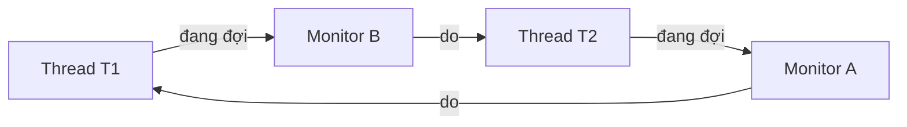
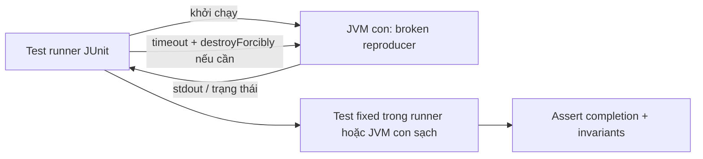

<a id="back-to-top"></a>

# Bài tập thực tế

## Menu
- [Xây counter bị race và lần lượt sửa bằng lock, atomic](#practical-exercises-001)
- [Xây bounded producer–consumer bằng BlockingQueue](#practical-exercises-002)
- [Xây executor có bounded queue và rejection policy](#practical-exercises-003)
- [Chạy nhiều Callable, lấy kết quả theo thứ tự hoàn tất](#practical-exercises-004)
- [Tính tổng mảng bằng Fork/Join và so benchmark](#practical-exercises-005)
- [Gọi nhiều I/O giả lập bằng CompletableFuture với timeout](#practical-exercises-006)
- [So sánh platform threads và virtual threads cho tác vụ I/O](#practical-exercises-007)
- [Triển khai Semaphore giới hạn tài nguyên đồng thời](#practical-exercises-008)
- [Viết test tái hiện deadlock rồi sửa lock ordering](#practical-exercises-009)
- [Đọc thread dump và tìm vị trí chặn luồng](#practical-exercises-010)
- [Thiết kế shutdown có hủy, timeout và đóng tài nguyên](#practical-exercises-011)
- [Tổng kết checklist: thread safety, cancellation, observability](#practical-exercises-012)

## <a id="practical-exercises-001">Xây counter bị race và lần lượt sửa bằng lock, atomic</a>

<details>
<summary>Xem chi tiết</summary>

# Bài tập thực tế: Xây counter bị race và lần lượt sửa bằng lock, atomic

## 1. Mục tiêu và kết quả cần đạt

Bài tập đặt ra một bộ đếm dùng chung trong chương trình Java: nhiều thread cùng gọi **increment()**, mỗi lời gọi phải làm tổng tăng đúng một đơn vị. Ta sẽ chủ động xây phiên bản sai với phép **value++**, tái hiện mất lượt tăng (*lost update*), rồi sửa lần lượt bằng **ReentrantLock** và **AtomicInteger**. Cuối cùng chạy các thread thật trên ExecutorService và tự kiểm tra giá trị mong đợi.

Sau bài này, bạn cần tự giải thích và kiểm chứng được:

1. Vì sao increment trên trường **int** thông thường không an toàn khi nhiều thread cùng ghi.
2. Vì sao tăng số thread hoặc chèn Thread.sleep không phải cách chứng minh race chắc chắn.
3. Khóa phải bảo vệ **trọn chuỗi đọc → tính → ghi**, không chỉ một phần.
4. AtomicInteger cung cấp thao tác tăng nguyên tử; khi nào nó phù hợp hơn lock.
5. Cách tạo test có **kết quả rõ ràng**, timeout và kiểm tra exception của worker.
6. Cách chọn giữa lock và atomic khi dữ liệu gồm một bộ đếm hay nhiều trạng thái phải thay đổi cùng nhau.

Đây là bài thực hành concurrency trong **Java nói chung**, dùng các API thuộc JDK 17+. Không cần Spring hoặc framework kiểm thử.

## 2. Thiết kế Counter và điều kiện đúng

Giả sử có 4 worker, mỗi worker thực hiện 25.000 lần tăng. Nếu ban đầu counter = 0 và không có lời gọi thất bại, kết quả phải là:

~~~text
4 worker × 25.000 lần/worker = 100.000 lần tăng
Expected final counter = 100000
~~~

Ta định nghĩa hợp đồng nhỏ:

~~~java
interface Counter {
    void increment();
    int value();
}
~~~

Đây là đoạn mã tích hợp vào chương trình đầy đủ ở mục 4. **Invariant** cần giữ: khi tất cả increment đã hoàn thành bình thường, giá trị đọc được bằng tổng số increment đã thực hiện. Nếu một counter bị race, giá trị có thể nhỏ hơn tổng số lượt do hai thread ghi đè kết quả của nhau.

Về mặt thời gian, một lần **value++** tương đương về ý nghĩa với việc:

~~~java
int old = value;
int next = old + 1;
value = next;
~~~

Ba dòng minh họa một thao tác có nhiều giai đoạn; không khẳng định JVM bắt buộc biên dịch phép ++ thành đúng ba instruction. Các bước đọc/tính/ghi có thể xen kẽ với thread khác.

### Lịch thực thi gây lost update

| Thời điểm | Worker A | Worker B | Giá trị chung |
| --- | --- | --- | ---: |
| 0 | — | — | 0 |
| 1 | Đọc 0 | — | 0 |
| 2 | — | Đọc 0 | 0 |
| 3 | Tính 0 + 1 | — | 0 |
| 4 | — | Tính 0 + 1 | 0 |
| 5 | Ghi 1 | — | 1 |
| 6 | — | Ghi 1 | 1 |

Hai lần tăng đã được yêu cầu nhưng kết quả chỉ là 1. Nếu A chạy hết trước khi B đọc, kết quả có thể là 2. **Việc đôi khi nhận đúng kết quả không chứng minh mã an toàn**.

Lỗi ở đây gồm vấn đề **tính nguyên tử** và việc truy cập trường chia sẻ thiếu đồng bộ. Đánh dấu **volatile** có thể cải thiện visibility, nhưng không biến chuỗi read-modify-write thành một phép tăng nguyên tử; hai thread vẫn có thể cùng đọc 0 và cùng ghi 1.

## 3. Ba phiên bản cần xây

### Phiên bản 1 — UnsafeCounter

~~~java
private int value;

public void increment() {
    value++; // read-modify-write không nguyên tử
}

public int value() {
    return value;
}
~~~

Đây là phần thân của một class, chưa phải chương trình độc lập. Tất cả thread dùng **cùng một instance** của counter. Nếu mỗi thread tự tạo counter riêng thì sẽ không có tranh chấp và test không kiểm tra được lỗi chia sẻ dữ liệu.

### Phiên bản 2 — LockCounter

~~~java
private final ReentrantLock lock = new ReentrantLock();
private int value;

public void increment() {
    lock.lock();
    try {
        value++;
    } finally {
        lock.unlock();
    }
}

public int value() {
    lock.lock();
    try {
        return value;
    } finally {
        lock.unlock();
    }
}
~~~

Một thread giữ lock thì thread khác không thể đồng thời bước vào vùng increment được bảo vệ bằng **cùng khóa**. Phần đọc trong value() cũng dùng khóa đó để bảo đảm nhất quán khi đọc lúc còn writer.

**finally** là bắt buộc trong mẫu sử dụng lock thủ công: nếu thân khối ném exception, lock vẫn được thả. Không để return, exception hoặc một nhánh điều kiện làm bỏ qua unlock.

### Phiên bản 3 — AtomicCounter

~~~java
private final AtomicInteger value = new AtomicInteger();

public void increment() {
    value.incrementAndGet();
}

public int value() {
    return value.get();
}
~~~

AtomicInteger.incrementAndGet cung cấp phép cập nhật nguyên tử trên **một biến**, nên không mất lượt tăng. Java thực thi cơ chế cập nhật nguyên tử thích hợp trên JVM/nền tảng; không cần tự viết vòng compare-and-set cho bài toán cộng một.

Ba đoạn trên được ghép thành ba class hoàn chỉnh trong ví dụ tiếp theo. Không kết hợp hai loại đồng bộ chỉ để sửa một biến đếm đơn lẻ khi không có yêu cầu thêm.

## 4. Chương trình Java 17 hoàn chỉnh, chạy được

Chương trình tạo hai loại thí nghiệm:

- **Thí nghiệm tái hiện có kiểm soát**: hai worker cùng đọc giá trị cũ trước khi ghi để chắc chắn tạo lost update. Đây là cách trực quan hóa lỗi của read-modify-write; điểm đồng bộ là dụng cụ của bài test, không phải code sản xuất.
- **Thí nghiệm tải đồng thời**: 4 worker, mỗi worker thực sự gọi increment() 25.000 lần trên counter dùng lock và counter atomic. Sau khi mọi Future hoàn thành, kết quả phải là 100.000.

**Tạo tệp CounterExercise.java:**

~~~java
import java.util.ArrayList;
import java.util.List;
import java.util.concurrent.Callable;
import java.util.concurrent.CountDownLatch;
import java.util.concurrent.CyclicBarrier;
import java.util.concurrent.ExecutorService;
import java.util.concurrent.Executors;
import java.util.concurrent.Future;
import java.util.concurrent.TimeUnit;
import java.util.concurrent.TimeoutException;
import java.util.concurrent.atomic.AtomicInteger;
import java.util.concurrent.locks.ReentrantLock;

public final class CounterExercise {

    private static final int WORKERS = 4;
    private static final int INCREMENTS_PER_WORKER = 25_000;

    interface Counter {
        void increment();
        int value();
    }

    static final class UnsafeCounter implements Counter {
        private int value;

        @Override
        public void increment() {
            value++;
        }

        @Override
        public int value() {
            return value;
        }

        // Chỉ được harness dùng để ép lịch read rồi write gây lost update.
        int snapshot() {
            return value;
        }

        void store(int updated) {
            value = updated;
        }
    }

    static final class LockCounter implements Counter {
        private final ReentrantLock lock = new ReentrantLock();
        private int value;

        @Override
        public void increment() {
            lock.lock();
            try {
                value++;
            } finally {
                lock.unlock();
            }
        }

        @Override
        public int value() {
            lock.lock();
            try {
                return value;
            } finally {
                lock.unlock();
            }
        }
    }

    static final class AtomicCounter implements Counter {
        private final AtomicInteger value = new AtomicInteger();

        @Override
        public void increment() {
            value.incrementAndGet();
        }

        @Override
        public int value() {
            return value.get();
        }
    }

    static int forceLostUpdate() throws Exception {
        UnsafeCounter counter = new UnsafeCounter();
        CyclicBarrier bothRead = new CyclicBarrier(2);
        ExecutorService pool = Executors.newFixedThreadPool(2);
        Future<Void> first = null;
        Future<Void> second = null;

        try {
            Callable<Void> unsafeReadModifyWrite = () -> {
                int seen = counter.snapshot();

                // Mỗi worker phải đọc xong trước khi một worker ghi.
                bothRead.await(5, TimeUnit.SECONDS);

                counter.store(seen + 1);
                return null;
            };

            first = pool.submit(unsafeReadModifyWrite);
            second = pool.submit(unsafeReadModifyWrite);

            first.get(10, TimeUnit.SECONDS);
            second.get(10, TimeUnit.SECONDS);
            return counter.value();
        } finally {
            if (first != null) first.cancel(true);
            if (second != null) second.cancel(true);
            pool.shutdownNow();
        }
    }

    static int runConcurrentLoad(Counter counter) throws Exception {
        ExecutorService pool = Executors.newFixedThreadPool(WORKERS);
        CountDownLatch ready = new CountDownLatch(WORKERS);
        CountDownLatch start = new CountDownLatch(1);
        List<Future<Void>> futures = new ArrayList<>();

        try {
            for (int i = 0; i < WORKERS; i++) {
                Future<Void> future = pool.submit(() -> {
                    ready.countDown();

                    if (!start.await(5, TimeUnit.SECONDS)) {
                        throw new TimeoutException("Start gate timed out");
                    }

                    for (int j = 0; j < INCREMENTS_PER_WORKER; j++) {
                        if (Thread.currentThread().isInterrupted()) {
                            throw new InterruptedException("Worker cancelled");
                        }
                        counter.increment();
                    }
                    return null;
                });
                futures.add(future);
            }

            if (!ready.await(5, TimeUnit.SECONDS)) {
                throw new TimeoutException("Workers were not ready");
            }

            start.countDown();

            // Lấy exception của worker, đồng thời chờ tất cả hoàn thành.
            for (Future<Void> future : futures) {
                future.get(10, TimeUnit.SECONDS);
            }
            return counter.value();
        } finally {
            start.countDown(); // Giải phóng worker nếu main lỗi sớm.
            for (Future<Void> future : futures) {
                future.cancel(true);
            }
            pool.shutdownNow();
        }
    }

    public static void main(String[] args) throws Exception {
        int expected = WORKERS * INCREMENTS_PER_WORKER;

        int lostUpdate = forceLostUpdate();
        int locked = runConcurrentLoad(new LockCounter());
        int atomic = runConcurrentLoad(new AtomicCounter());

        System.out.println("Forced lost update: " + lostUpdate + " / 2");
        System.out.println("ReentrantLock: " + locked + " / " + expected);
        System.out.println("AtomicInteger: " + atomic + " / " + expected);

        if (lostUpdate != 1 || locked != expected || atomic != expected) {
            throw new AssertionError("Counter invariant failed");
        }
    }
}
~~~

Dùng JDK 17 hoặc mới hơn:

~~~bash
javac CounterExercise.java
java CounterExercise
~~~

**Stdout khi chương trình chạy thành công:**

~~~text
Forced lost update: 1 / 2
ReentrantLock: 100000 / 100000
AtomicInteger: 100000 / 100000
~~~

Nếu môi trường quá chậm hoặc worker lỗi, chương trình có thể ném exception thay vì in ba dòng trên. Các timeout 5 và 10 giây là **hạn bảo vệ bài thực hành**, không phải cam kết hiệu năng cho ứng dụng thực tế.

### Vì sao kết quả có thể kiểm chứng?

**forceLostUpdate():** Mỗi worker đọc giá trị ban đầu 0. Barrier bắt buộc cả hai hoàn tất việc đọc mới được ghi. Do đó cả hai store(1), kết quả cuối luôn là 1 khi barrier kết thúc bình thường. Việc truy cập này cố tình không đồng bộ để phơi bày lost update; phương thức snapshot()/store() chỉ phục vụ harness. Trong code sản xuất sai, cùng vấn đề nằm bên trong phép value++.

**runConcurrentLoad():** Mỗi worker báo ready, sau đó đợi cổng start. Main chỉ mở cổng khi cả bốn worker đã tới điểm sẵn sàng; điều này giúp tăng cơ hội cạnh tranh, nhưng **không bảo đảm** phát hiện race nếu truyền UnsafeCounter vào bài tải. Test mẫu dành cho hai bản sửa, kết quả luôn đúng theo hợp đồng của lock/atomic nếu các worker hoàn thành bình thường.

**Future.get():** Main đợi từng worker hoàn thành và nhận exception của worker qua ExecutionException. Khi tất cả Future.get() thành công, các hành động trong task happens-before phần xử lý tiếp theo của main, nên phép đọc giá trị sau đó có điểm đồng bộ thích hợp.

**Kiểm tra invariant:** Main xác nhận lostUpdate = 1 cho **phiên bản sai được dàn dựng**, và locked = atomic = 100.000 cho **hai bản sửa**. Đây là hai loại oracle khác nhau; không được mang expected = 1 sang test của bản sửa.

## 5. Tự làm từ phiên bản sai đến hai bản sửa

Nếu muốn thực hành theo từng commit hoặc từng lần sửa, hãy làm theo trình tự sau mà vẫn dùng cùng bài toán Counter.

### Bước A — Tạo lỗi thật với value++

Bắt đầu bằng UnsafeCounter. Viết các worker cùng giữ một tham chiếu tới nó. Mỗi worker gọi increment() trong vòng lặp; sau khi hoàn thành, đọc counter.value().

Nếu muốn chạy phiên bản tải trên counter lỗi, thêm tạm thời đoạn sau vào main:

~~~java
int observedUnsafe = runConcurrentLoad(new UnsafeCounter());
System.out.println("Unsafe stress: " + observedUnsafe + " / " + expected);
~~~

Đây là **đoạn thay đổi main**, không phải tệp độc lập. Giá trị observedUnsafe **không được dự đoán chính xác**: có thể nhỏ hơn 100.000, nhưng đôi khi vẫn bằng 100.000. Không dùng assert observedUnsafe != expected để chứng minh lỗi, vì một lần không xuất hiện lỗi sẽ khiến test sai mục đích. Dùng forceLostUpdate() để chứng minh một lịch gây mất cập nhật.

Thử tăng số worker hoặc số vòng và quan sát mức độ biến động, nhưng không rút ra kết luận “không còn race” từ bất kỳ lần chạy thành công riêng lẻ nào.

### Bước B — Thay bằng lock

Tạo LockCounter, giữ nguyên giao diện Counter. Đặt lock.lock() trước khi đọc/tăng/ghi; unlock trong finally. Đặt phép đọc value() dưới **cùng lock**. Chạy lại runConcurrentLoad và kiểm tra đúng 100.000.

Có thể tự viết phiên bản synchronized tương đương:

~~~java
static final class SynchronizedCounter implements Counter {
    private int value;

    @Override
    public synchronized void increment() {
        value++;
    }

    @Override
    public synchronized int value() {
        return value;
    }
}
~~~

Đây là một class tích hợp trong CounterExercise.java, dùng chung interface Counter ở ví dụ chính. Bản synchronized chọn monitor của instance làm khóa. Không cần dùng ReentrantLock chỉ vì tên “lock”; chọn công cụ dựa trên nhu cầu kiểm soát acquisition, Condition, tryLock hay timeout.

### Bước C — Thay bằng atomic

Tạo AtomicCounter, dùng incrementAndGet() và get() trên **một AtomicInteger dùng chung**. Không sao chép giá trị int ra biến chia sẻ mới rồi tự tăng; chính phép cập nhật phải được thực hiện trên đối tượng atomic.

Chạy lại runConcurrentLoad, assert 100.000. Bỏ code khóa thủ công nếu bài toán chỉ còn một counter nguyên tử.

### Bước D — Bảo vệ cả test và tài nguyên

Đặt timeout cho các điểm chờ, bảo đảm exception trong worker được truyền ra main, và dùng finally để đóng executor. Nếu test timeout:

- Xác minh pool có đủ thread cho các bên đang chờ CyclicBarrier; hai party với pool một thread sẽ không thể cùng qua barrier.
- Xác minh số lần countDown và thời điểm mở start.
- Xác minh worker không ném lỗi trước khi đến barrier hoặc vòng lặp.
- Không coi timeout ở barrier hay Future.get là bằng chứng của lost update.

Sửa harness khi điều kiện thử không được thỏa, sau đó mới đánh giá bất biến nghiệp vụ.

## 6. Vì sao lock sửa được lỗi?

Với LockCounter, phép tăng được bảo vệ như một **critical section**:

~~~text
Thread A: lock → read 0 → compute 1 → write 1 → unlock
Thread B:                                        lock → read 1 → compute 2 → write 2 → unlock
~~~

Trong khi A giữ lock, B không thể thực hiện đoạn increment dùng cùng lock. B chỉ đọc sau khi A đã thả khóa. ReentrantLock thiết lập quan hệ đồng bộ tương ứng giữa unlock và lock tiếp theo; việc khóa cả value() còn giúp reader quan sát trạng thái đúng theo cùng giao thức đồng bộ.

Những lỗi thường gặp:

1. Dùng **hai đối tượng lock riêng** cho hai worker: không bảo vệ shared counter.
2. Khóa chỉ ở thao tác đọc rồi mở khóa trước thao tác ghi: hai worker vẫn có thể cùng chụp giá trị cũ.
3. Chỉ khóa increment nhưng một đường ghi khác trực tiếp sửa value: invariant vẫn có thể hỏng.
4. Quên unlock trong finally: lỗi giữa critical section có thể giữ khóa khiến worker khác kẹt.
5. Giữ khóa khi làm I/O chặn lâu: tăng cạnh tranh, latency và nguy cơ deadlock.
6. Thử thay lock bằng volatile: visibility không giải quyết được tính nguyên tử của value++.

**ReentrantLock là reentrant**: cùng thread đang giữ lock có thể lấy lại lock đó, nhưng phải unlock tương ứng số lần đã lấy. Tính năng này không thay thế việc thiết kế ranh giới critical section rõ ràng.

Nếu dùng lock.lockInterruptibly() hoặc tryLock(timeout, unit), có thể phản ứng tốt hơn khi bị hủy hoặc quá hạn trong lúc chờ khóa. Tuy nhiên, bài counter cơ bản chỉ cần lock(), try và finally.

## 7. Vì sao AtomicInteger sửa được lỗi?

AtomicInteger là bộ chứa giá trị int có các thao tác đọc/ghi và cập nhật với ngữ nghĩa đồng bộ được định nghĩa. incrementAndGet() là một **lần tăng nguyên tử**, không cho hai worker cùng “commit” một giá trị mới dựa trên cùng snapshot cũ như value++ không đồng bộ.

AtomicInteger hỗ trợ những thao tác hữu ích:

| API | Ý nghĩa |
| --- | --- |
| get() | Đọc giá trị hiện tại theo ngữ nghĩa atomic |
| set(v) | Đặt giá trị mới |
| incrementAndGet() | Tăng 1 và trả về giá trị mới |
| getAndIncrement() | Trả về giá trị cũ, sau đó tăng 1 |
| addAndGet(delta) | Cộng delta và trả về giá trị mới |
| compareAndSet(expect, update) | Chỉ cập nhật khi giá trị hiện tại bằng expect; trả boolean |

Khi bài toán có điều kiện cập nhật dựa trên giá trị cũ, dùng một thao tác nguyên tử thích hợp hoặc vòng compare-and-set. Ví dụ chỉ tăng nếu chưa đạt giới hạn, viết bằng updateAndGet:

~~~java
AtomicInteger quota = new AtomicInteger(3);
int remaining = quota.updateAndGet(
        current -> current > 0 ? current - 1 : current);
~~~

Đoạn trên cần import java.util.concurrent.atomic.AtomicInteger. Nó chỉ biểu diễn một **state transition nguyên tử của một biến**, không tự bảo đảm hành động nghiệp vụ bên ngoài diễn ra đúng một lần.

Quan trọng: Hàm cập nhật truyền vào updateAndGet có thể được gọi lại do cạnh tranh. Không đặt thao tác ghi database, gửi email, tăng biến ngoài hoặc side effect không thể lặp lại trong hàm lambda cập nhật. Với nhiều điều kiện, nhiều thuộc tính hay side effect phải đồng bộ cùng lúc, lock hoặc một mô hình trạng thái/giao dịch phù hợp có thể rõ ràng hơn.

AtomicInteger cũng có **giới hạn kiểu int**: nếu cộng vượt Integer.MAX_VALUE, giá trị sẽ tràn theo arithmetic của int. Chọn AtomicLong hoặc kiểm tra overflow khi miền giá trị yêu cầu. Tính nguyên tử không làm cho giá trị vô hạn.

## 8. Lock và AtomicInteger: chọn cái nào?

| Tiêu chí | ReentrantLock | AtomicInteger |
| --- | --- | --- |
| Phạm vi bảo vệ | Một vùng mã, có thể gồm nhiều biến | Một giá trị int và thao tác cập nhật nguyên tử trên nó |
| Cách dùng | lock → try → finally unlock | incrementAndGet/get/addAndGet/CAS |
| Khi tăng 1 | An toàn nếu mọi truy cập tuân thủ cùng lock | An toàn trực tiếp qua incrementAndGet |
| Khi có invariant nhiều trường | Thường thuận tiện vì có thể bảo vệ cả cụm | Một AtomicInteger riêng lẻ thường không đủ |
| Khả năng chờ | Có thể block khi chờ lock; có tryLock, interruptible acquire | Không giữ khóa do ứng dụng quản lý cho mỗi increment |
| Lỗi dễ gặp | Quên unlock, sai lock, deadlock, critical section dài | Ghép hai lệnh atomic rồi tưởng cả cặp là nguyên tử |
| Cần thử hiệu năng? | Có, với workload thật và mức contention thực | Có, không mặc định luôn nhanh hơn ở mọi tình huống |

Ví dụ trạng thái có **balance** và **transactionCount** phải cùng được cập nhật, dùng hai AtomicInteger riêng biệt chỉ cho mỗi biến tính nguyên tử; reader vẫn có thể thấy balance đã đổi nhưng count chưa đổi. Nếu cần invariant liên trường, bảo vệ cả cặp bằng một lock hoặc đại diện bất biến bằng một state object cập nhật nguyên tử (ví dụ AtomicReference tới state immutable) khi phù hợp.

Nếu nhu cầu chỉ là thống kê có số lần cập nhật rất cao và phép đọc tổng không cần một snapshot tuyến tính hóa với các cập nhật đang diễn ra, LongAdder có thể giảm contention trong một số tải. Tuy nhiên sum() của LongAdder **không phải snapshot nguyên tử** khi các luồng vẫn đang cập nhật; không thay thế AtomicInteger cho sequence number hoặc điều kiện ngưỡng cần đọc/ghi chính xác.

## 9. Kết nối kết quả thử với Java Memory Model

Một số quan hệ happens-before quan trọng:

- Các hành động trước unlock trên cùng một khóa happens-before các hành động sau lần lock tương ứng của thread tiếp theo.
- Các phương thức AtomicInteger có ngữ nghĩa memory consistency theo API atomic của Java.
- Hành động trước khi gọi ExecutorService.submit xảy ra trước hành động của task theo hợp đồng memory consistency của ExecutorService.
- Hành động trong task happens-before hành động sau khi lấy kết quả của nó bằng Future.get() thành công.
- countDown() của CountDownLatch xảy ra trước những hành động sau await() trở về thành công nhờ bộ đếm về 0.

Nhờ Future.get() thành công cho cả bốn worker, main có thể kiểm tra kết quả sau khi công việc đã hoàn tất. Nhưng Future.get **không làm cho những lần increment không đồng bộ bên trong worker trở thành nguyên tử**: nó chỉ thiết lập điểm hoàn tất/quan sát, không sửa cuộc đua giữa các worker trong quá trình chạy.

Tương tự, CountDownLatch ở đầu bài tải chỉ giúp worker bắt đầu gần nhau; nó không bảo vệ shared value. CyclicBarrier trong forceLostUpdate **được đặt giữa read và write** để chủ động khóa một interleaving gây sai, không phải lời khuyên đặt barrier vào logic increment thực tế.

Không dùng synchronized trên một object bất kỳ rồi mong toàn bộ trường chia sẻ tự an toàn. Các thread phải đồng thuận về **cùng giao thức đồng bộ** tại đúng dữ liệu và đúng phạm vi thao tác.

## 10. Thiết kế phép kiểm thử đúng thay vì nhìn output may rủi

Có ba tầng kiểm tra hữu ích:

**Tầng 1 — Reproduction có lịch dàn dựng.** forceLostUpdate bắt cả hai worker đọc cùng snapshot trước khi ghi. Với hai yêu cầu tăng, expected là 1 trong **demo cố tình sai**, để thấy một lịch làm hỏng invariant. Không dùng expected = 1 làm oracle cho counter đã sửa.

**Tầng 2 — Kiểm tra chức năng của bản sửa.** runConcurrentLoad trên LockCounter và AtomicCounter, sau khi mọi worker thành công, kết quả phải bằng WORKERS × INCREMENTS_PER_WORKER. Khi kết quả khác expected hoặc có exception, test phải thất bại.

**Tầng 3 — Stress test bổ sung.** Thay đổi số thread, số lượt tăng, môi trường chạy, nhiều lần lặp, tranh chấp trên cùng counter và tình huống hủy/timeout. Stress test có thể phát hiện thêm lỗi, nhưng việc vượt qua nhiều lượt stress **không chứng minh hết mọi race có thể xảy ra**.

Nếu chạy JUnit ở dự án Java hiện có, assertion có thể nằm trong test thay cho if/throw AssertionError trong main. Ví dụ main của bài này vẫn độc lập với thư viện test để người học có thể chạy trực tiếp với JDK 17. Điều quan trọng là kiểm tra invariant và lỗi worker, không phụ thuộc vào tên framework.

### Những trường hợp cần chủ động thử thêm

- **0 increment:** Giá trị phải giữ nguyên, không phát sinh side effect.
- **1 worker:** UnsafeCounter có thể cho kết quả đúng vì không có thread khác tranh chấp; không chứng minh thread-safety.
- **N worker:** Hai bản sửa cho kết quả đúng bằng N × số lần tăng khi không bị tràn int và mọi task hoàn thành.
- **Worker ném exception:** Future.get phải báo lỗi; không được mặc nhiên khẳng định toàn bộ số lượt đã chạy.
- **Timeout/interrupt:** Test phải dừng có kiểm soát và không kẹt vô hạn ở latch/barrier.
- **Cập nhật cùng lúc với đọc:** LockCounter.value() tuân thủ cùng khóa; AtomicCounter.value() đọc atomically. Đọc counter trong khi các worker đang chạy có thể cho giá trị trung gian hợp lệ, không buộc phải bằng tổng cuối.

## 11. Lỗi phổ biến khi thực hiện bài tập

| Sai lầm | Hệ quả | Cách sửa |
| --- | --- | --- |
| Mỗi thread tạo một Counter riêng | Không còn shared state cần kiểm tra | Tất cả worker nhận cùng instance |
| Dùng value++ trên int hoặc volatile int | Lost update trong read-modify-write | Lock cả cụm hoặc dùng atomic increment |
| Khóa riêng từng thread | Không phối hợp được giữa worker | Dùng cùng object lock của shared counter |
| Đọc dưới lock, ghi ngoài lock | Đường cập nhật không còn được bảo vệ | Mọi truy cập liên quan tuân thủ cùng lock |
| Quên unlock trong finally | Có thể giữ lock vĩnh viễn khi lỗi | try/finally |
| Dùng sleep để “chờ hai thread đụng nhau” | Lịch chạy không được bảo đảm | Điểm phối hợp có kiểm soát cho reproduction |
| Cho barrier 2 parties nhưng pool 1 worker | Worker bị kẹt chờ party còn lại | Pool đủ worker và timeout |
| Không chờ Future.get | Main đọc khi worker còn tăng | Đợi toàn bộ Future hoàn thành |
| Worker lỗi nhưng test vẫn PASS | Kết quả được đo trên số thao tác thiếu | Lấy exception của Future và fail test |
| Test unsafe ngẫu nhiên có đúng kết quả rồi kết luận hết race | False negative | Reproduction cưỡng bức lịch sai + review |
| Ghép nhiều thao tác atomic rồi coi cả chuỗi atomic | Invariant nhiều bước vẫn hỏng | Mở rộng vùng khóa hoặc cập nhật một state nguyên tử |
| Đặt side effect vào lambda updateAndGet | Lambda có thể được gọi lại | Dùng hàm cập nhật thuần |
| So sánh hiệu năng trong một lần chạy ngắn | JIT, warm-up, scheduler làm méo kết quả | Benchmark chuẩn với workload đại diện |

## 12. Bài tập mở rộng và câu hỏi tự kiểm tra

**Bài 1 — Tự viết SynchronizedCounter.** Dùng synchronized bảo vệ increment() và value(); truyền class đó vào runConcurrentLoad. Giải thích vì sao kết quả đúng, khóa monitor là đối tượng nào, và tại sao hai instance khác nhau không khóa lẫn nhau.

**Bài 2 — Thêm điều kiện giới hạn.** Counter không được vượt 10.000. So sánh mẫu sai if (counter.value() < 10_000) counter.increment() với bản dùng một lock cho cả check-and-increment. Nêu lý do vì sao tách hai lời gọi thread-safe chưa đủ để bảo toàn invariant.

**Bài 3 — Viết compare-and-set.** Dùng AtomicInteger để tăng chỉ khi chưa đạt giới hạn, theo vòng lặp: đọc current → nếu đạt ngưỡng thì trả false → thử compareAndSet(current, current + 1) → retry khi CAS thất bại. Phân biệt retry do contention với retry của nghiệp vụ bên ngoài.

**Bài 4 — Đo và giải thích contention.** So sánh lock, atomic và LongAdder khi số worker tăng, nhưng thiết lập benchmark đúng cách. Không suy ra kết luận từ chỉ một lần chạy javac/java; cần warm-up, workload phù hợp, đo đủ lần và công cụ benchmark như JMH khi cần đánh giá nghiêm túc.

**Bài 5 — Kiểm tra hủy tác vụ.** Cho worker cố tình đợi một cổng không bao giờ mở; xác minh timeout khiến bài test thất bại rõ ràng, futures bị cancel, executor được shutdown và không báo rằng đã tìm thấy lost update chỉ vì thiếu worker.

Tự trả lời trước khi hoàn tất:

1. Nếu dùng volatile int thay cho int, tại sao vẫn có thể mất increment?
2. Vì sao Future.get() đảm bảo main đọc sau khi worker hoàn thành nhưng không sửa race trong worker?
3. Khi một bất biến phụ thuộc cả count và balance, hai AtomicInteger riêng lẻ đã đủ chưa?
4. Có thể gọi lock.unlock() ở cuối try mà không có finally không?
5. Vì sao kết quả UnsafeCounter bằng expected ở một lần chạy stress chưa chứng minh an toàn?

## 13. Checklist hoàn thành

- [ ] Có một Counter dùng chung được nhiều worker gọi increment.
- [ ] Giải thích được read-modify-write của phép value++ và một interleaving gây lost update.
- [ ] Tái hiện được forced lost update = 1 sau **hai** lần tăng bằng harness.
- [ ] Viết được LockCounter giữ **cùng lock** cho increment và value, dùng finally.
- [ ] Viết được AtomicCounter với incrementAndGet và get.
- [ ] Chạy thành công CounterExercise.java bằng javac và java 17+; hai bản sửa cho 100.000/100.000.
- [ ] Worker exception, timeout và shutdown được xử lý; không đánh giá thành công khi test chưa hoàn tất.
- [ ] Phân biệt được phép tăng một biến với invariant nhiều biến; chọn lock/atomic theo đúng phạm vi nghiệp vụ.

**Kết quả học tập:** Cách sửa race condition không nằm ở việc tăng thời gian chờ hay làm các worker “ít đụng nhau” hơn. Hãy chỉ rõ shared state và invariant, biến chuỗi cập nhật thành một đơn vị nguyên tử bằng **lock** hoặc **AtomicInteger** phù hợp, rồi kiểm tra bằng một lịch tái hiện lỗi và một phép đo hồi quy có điều kiện hoàn tất rõ ràng.


</details>

- [Quay lại đầu trang](#back-to-top)

---

## <a id="practical-exercises-002">Xây bounded producer–consumer bằng BlockingQueue</a>

<details>
<summary>Xem chi tiết</summary>

# Bài tập thực tế: Xây bounded producer–consumer bằng BlockingQueue trong Java

## 1. Đề bài và kết quả cần đạt

Xây một pipeline đa luồng trong **Java concurrency** gồm producer tạo công việc, consumer xử lý công việc và một hàng đợi **có giới hạn dung lượng** (bounded queue) ở giữa. Khi producer phát nhanh hơn consumer, hệ thống phải gây **backpressure** hoặc phản hồi tình trạng quá tải, thay vì giữ số lượng Work vô hạn trong heap.

Bài tập chỉ dùng Java standard library: **java.util.concurrent.BlockingQueue**, **ArrayBlockingQueue**, **ExecutorService**, **Future**, các kiểu đồng bộ và atomic. Nội dung độc lập với Spring hoặc framework.

Yêu cầu cụ thể:

1. Dùng **2 producer**, mỗi producer tạo 6 Work có ID riêng; tổng cộng **12 Work**.
2. Dùng **2 consumer** xử lý Work trên các thread riêng.
3. Dùng một **ArrayBlockingQueue capacity = 3** làm kênh chung.
4. Khi hàng đợi đầy, producer phải đợi bằng **put**; không tạo backlog riêng không giới hạn.
5. Chỉ phát tín hiệu dừng sau khi **tất cả producer** đã enqueue xong.
6. Mỗi consumer nhận một tín hiệu dừng riêng (**poison pill**) để thoát vòng lặp.
7. In một kết quả tổng kết **ổn định**, xác nhận số Work đã enqueue, đã xử lý và số ID duy nhất đều bằng 12.
8. Hợp tác với interruption và chuyển lỗi worker về thread main.

Sau bài này, bạn cần giải thích được vì sao queue bounded không đồng nghĩa toàn pipeline bounded, khác biệt **put/offer/take/poll**, cách tránh mất công việc trong khi shutdown và cách kiểm chứng overload.

## 2. Sơ đồ kiến trúc và các bất biến

~~~text
    producer-0 ──┐
                  │       ArrayBlockingQueue<Work>
                  ├─ put ─► [ 1 ] [ 2 ] [ 3 ] ─ take ─► consumer-0
    producer-1 ──┘                 capacity = 3  └ take ─► consumer-1

     buffer đầy: put phải chờ consumer take giải phóng slot
~~~

**Bất biến trong một phiên chạy hoàn tất bình thường:**

- Không có Work thường nào được thêm ngoài 12 Work dự kiến.
- Một Work chỉ được lấy khỏi queue một lần bởi một consumer, bởi thao tác **take** là nguyên tử đối với queue.
- Mỗi consumer chỉ được đánh dấu processed **sau khi xử lý xong**.
- Đến lúc các Future của consumer đều kết thúc, toàn bộ 12 ID được ghi nhận, và queue rỗng.
- Một poison pill không được tính là Work nghiệp vụ hay làm tăng bộ đếm processed.

Bài này không cam kết xử lý exactly-once khi JVM crash hoặc có side effect ngoài tiến trình. BlockingQueue là kênh **trong bộ nhớ**; muốn khôi phục khi crash cần cơ chế bền vững và idempotency ngoài phạm vi bài thực hành cơ bản.

### FIFO không có nghĩa hai consumer hoàn thành theo đúng thứ tự

ArrayBlockingQueue bảo toàn thứ tự nhận vào FIFO của các phần tử trong queue, nhưng sau khi hai consumer đã lấy hai phần tử khác nhau, thứ tự **kết thúc xử lý** còn phụ thuộc scheduler và thời gian làm việc. Vì vậy kết quả cuối chỉ nên in các bộ đếm và xác minh ID duy nhất, không in một chuỗi thứ tự xử lý được cho là cố định.

## 3. Hiểu API BlockingQueue

| Thao tác | Khi queue đầy/rỗng | Khi dùng |
| --- | --- | --- |
| **put(e)** | Đợi đến khi có chỗ; có thể bị interrupt | Muốn backpressure và không chủ động bỏ công việc |
| **offer(e)** | Trả false ngay nếu không có chỗ | Producer không được chờ |
| **offer(e, timeout, unit)** | Chờ tối đa timeout rồi trả false nếu vẫn không có chỗ | Producer có deadline |
| **add(e)** | Có thể ném IllegalStateException khi đầy | Muốn báo lỗi tức thì |
| **take()** | Đợi đến khi có phần tử; có thể bị interrupt | Consumer sống lâu |
| **poll()** | Trả null ngay khi rỗng | Thăm dò không blocking |
| **poll(timeout, unit)** | Đợi tối đa timeout, trả null khi hết hạn | Consumer cần kiểm tra điều kiện dừng định kỳ |
| **peek()** | Trả đầu queue mà không lấy ra hoặc null nếu rỗng | Quan sát tức thời, không dùng như giao thức claim Work |

**BlockingQueue không chấp nhận null** làm phần tử. Vì vậy không được dùng **put(null)** để báo kết thúc.

**ArrayBlockingQueue<>(3)** có kích thước mảng cố định 3 slot. **LinkedBlockingQueue<>(3)** cũng là bounded, nhưng **LinkedBlockingQueue<>()** không truyền capacity có giới hạn mặc định cực lớn (Integer.MAX_VALUE); đừng coi nó là một bounded queue vận hành an toàn. **SynchronousQueue** không chứa phần tử trong buffer và cần rendezvous giữa bên gửi và bên nhận; không phải mô hình capacity 3. **PriorityBlockingQueue** có cơ chế ưu tiên và không cung cấp giới hạn fixed-capacity tương tự.

## 4. Lời giải hoàn chỉnh: hai producer, hai consumer, capacity ba

Tạo file **BoundedProducerConsumer.java** với toàn bộ code sau. Chương trình chạy trực tiếp trên Java 17+.

~~~java
import java.util.ArrayList;
import java.util.List;
import java.util.Set;
import java.util.concurrent.ArrayBlockingQueue;
import java.util.concurrent.BlockingQueue;
import java.util.concurrent.ConcurrentHashMap;
import java.util.concurrent.ExecutorService;
import java.util.concurrent.Executors;
import java.util.concurrent.Future;
import java.util.concurrent.TimeUnit;
import java.util.concurrent.atomic.AtomicInteger;

public final class BoundedProducerConsumer {
    private static final int CAPACITY = 3;
    private static final int PRODUCERS = 2;
    private static final int CONSUMERS = 2;
    private static final int ITEMS_PER_PRODUCER = 6;

    private record Work(int id, boolean stop) {}

    private static final Work STOP = new Work(-1, true);

    public static void main(String[] args) throws Exception {
        BlockingQueue<Work> queue = new ArrayBlockingQueue<>(CAPACITY);
        ExecutorService producers = Executors.newFixedThreadPool(PRODUCERS);
        ExecutorService consumers = Executors.newFixedThreadPool(CONSUMERS);

        AtomicInteger produced = new AtomicInteger();
        AtomicInteger processed = new AtomicInteger();
        Set<Integer> uniqueIds = ConcurrentHashMap.newKeySet();

        List<Future<?>> producerTasks = new ArrayList<>();
        List<Future<?>> consumerTasks = new ArrayList<>();

        try {
            // Khởi động consumer trước để có thread nhận dữ liệu.
            for (int c = 0; c < CONSUMERS; c++) {
                consumerTasks.add(consumers.submit(() -> {
                    try {
                        while (true) {
                            Work work = queue.take();
                            if (work.stop()) {
                                return;
                            }

                            // Giả lập xử lý; thực tế có thể là tính toán/I/O.
                            TimeUnit.MILLISECONDS.sleep(15);
                            if (!uniqueIds.add(work.id())) {
                                throw new IllegalStateException(
                                        "Duplicate ID: " + work.id());
                            }
                            processed.incrementAndGet();
                        }
                    } catch (InterruptedException e) {
                        Thread.currentThread().interrupt();
                        throw new IllegalStateException(
                                "Consumer interrupted", e);
                    }
                }));
            }

            for (int p = 0; p < PRODUCERS; p++) {
                final int producerId = p;
                producerTasks.add(producers.submit(() -> {
                    try {
                        for (int i = 0; i < ITEMS_PER_PRODUCER; i++) {
                            int id = producerId * ITEMS_PER_PRODUCER + i;
                            queue.put(new Work(id, false));
                            produced.incrementAndGet();
                        }
                    } catch (InterruptedException e) {
                        Thread.currentThread().interrupt();
                        throw new IllegalStateException(
                                "Producer interrupted", e);
                    }
                }));
            }

            // Không được báo STOP khi producer còn đang enqueue.
            for (Future<?> future : producerTasks) {
                future.get(30, TimeUnit.SECONDS);
            }

            // Mỗi consumer cần nhận đúng một STOP.
            for (int i = 0; i < CONSUMERS; i++) {
                if (!queue.offer(STOP, 5, TimeUnit.SECONDS)) {
                    throw new IllegalStateException("Cannot enqueue STOP");
                }
            }

            // Future.get() đưa exception của worker về main.
            for (Future<?> future : consumerTasks) {
                future.get(30, TimeUnit.SECONDS);
            }

            int expected = PRODUCERS * ITEMS_PER_PRODUCER;
            if (produced.get() != expected
                    || processed.get() != expected
                    || uniqueIds.size() != expected
                    || !queue.isEmpty()) {
                throw new IllegalStateException("Lost or duplicate work");
            }

            System.out.println("produced=" + produced.get());
            System.out.println("processed=" + processed.get());
            System.out.println("uniqueIds=" + uniqueIds.size());
            System.out.println("queueCapacity=" + CAPACITY);
            System.out.println("queueEmpty=" + queue.isEmpty());
        } finally {
            // Hợp tác với interruption khi xảy ra lỗi/timeout.
            producers.shutdownNow();
            consumers.shutdownNow();
        }
    }
}
~~~

**Biên dịch và chạy:**

~~~bash
javac BoundedProducerConsumer.java
java BoundedProducerConsumer
~~~

**Stdout chính xác khi chương trình hoàn tất thành công:**

~~~text
produced=12
processed=12
uniqueIds=12
queueCapacity=3
queueEmpty=true
~~~

Lịch thực thi có thể khác nhau giữa các lần chạy nhưng tổng kết này vẫn xác định vì chỉ in sau khi đợi tất cả Future hoàn tất. Nếu consumer hoặc producer lỗi/timeout, chương trình ném exception và không in thành công giả.

### Giải thích theo luồng thực thi

**Bước 1: tạo một queue với giới hạn rõ ràng.** Queue tối đa chứa 3 Work cùng lúc. Nếu đã đầy, **queue.put(work)** block thread producer cho đến khi một consumer gọi take thành công. Producer không tạo tiếp các Work khác trong khi đang chờ put, nên không tự dựng hàng đợi vô hạn ở phía gửi.

**Bước 2: consumer là worker sống lâu.** Mỗi consumer chạy vòng lặp take, xử lý một Work, rồi mới take tiếp. Mỗi consumer có tối đa một Work đã lấy ra nhưng còn đang xử lý trong ví dụ này. Khi gặp Work có stop=true, consumer thoát.

**Bước 3: ID không trùng nhau.** Producer 0 tạo ID 0..5; producer 1 tạo ID 6..11. Hash set đồng thời của ConcurrentHashMap cho phép hai consumer xác nhận các ID được xử lý duy nhất mà không có data race.

**Bước 4: counter có ý nghĩa cụ thể.** produced tăng sau khi put thành công, nên đây là số Work đã đi vào queue. processed tăng sau sleep mô phỏng xử lý và thao tác ghi nhận ID thành công. Khi chương trình vẫn chạy, produced có thể lớn hơn processed; đó là trạng thái hợp lệ khi queue có backlog.

**Bước 5: đóng nguồn trước khi dừng đích.** Main đợi toàn bộ producer Future.get thành công. Chỉ lúc đó mới enqueue STOP. Trong FIFO, các Work thường đã được enqueue trước STOP; không Work thường nào chưa được consumer take lại bị bỏ qua bởi STOP. Nhưng vì Work đã take có thể còn đang xử lý, phải tiếp tục đợi toàn bộ consumer Future.

**Bước 6: mỗi consumer một STOP.** Với 2 consumer, nếu chỉ gửi 1 STOP, consumer còn lại có thể tiếp tục chờ take vô hạn. Gửi STOP quá sớm có thể khiến consumer rời pipeline khi producer còn đang cố enqueue Work mới.

**Bước 7: lỗi được đưa về main.** ExecutorService.submit trả về Future; Future.get có thể báo ExecutionException hoặc TimeoutException. Khi lỗi xảy ra, finally gọi shutdownNow để cố interrupt worker đang chờ put/take/sleep. Điều này không thay thế quy trình khôi phục nghiệp vụ, nhưng giúp ví dụ không âm thầm mất lỗi.

**Lưu ý về queue nội bộ của ExecutorService:** Executors.newFixedThreadPool có hàng đợi task nội bộ không giới hạn theo mặc định. Chương trình này chỉ submit đúng **4 runnable worker sống lâu**, nên không phát sinh backlog Runnable tăng theo số Work. Nếu thay mỗi Work bằng một lệnh executor.submit riêng thì bounded BlockingQueue ở bên cạnh không còn giới hạn toàn bộ pipeline.

## 5. Thí nghiệm thứ hai: chứng minh khi queue đầy

Để quan sát ngay sự khác biệt giữa **offer** và thao tác chờ có timeout, tạo **FullQueueBehavior.java**:

~~~java
import java.util.concurrent.ArrayBlockingQueue;
import java.util.concurrent.BlockingQueue;
import java.util.concurrent.TimeUnit;

public final class FullQueueBehavior {
    public static void main(String[] args) throws InterruptedException {
        BlockingQueue<String> queue = new ArrayBlockingQueue<>(1);

        queue.put("first");
        System.out.println("offer=" + queue.offer("second"));
        System.out.println("timedOffer=" +
                queue.offer("second", 50, TimeUnit.MILLISECONDS));

        System.out.println("take=" + queue.take());
        System.out.println("offerAfterTake=" + queue.offer("second"));
        System.out.println("takeAgain=" + queue.take());
    }
}
~~~

Chạy:

~~~bash
javac FullQueueBehavior.java
java FullQueueBehavior
~~~

**Stdout chính xác:**

~~~text
offer=false
timedOffer=false
take=first
offerAfterTake=true
takeAgain=second
~~~

Khi capacity=1 và queue đã chứa "first", offer ngay lập tức trả false, còn offer có timeout đợi tối đa 50 ms rồi trả false vì không có consumer. Sau khi take lấy "first", queue rỗng và offer lần tiếp theo trả true.

**Không thử thay offer("second") bằng put("second") trong cùng main thread trước khi take.** Chương trình sẽ đợi vì queue đầy và không có thread khác giải phóng slot. Nếu muốn chứng minh put block, tạo một thread producer riêng và cho consumer take sau khi queue đầy; sử dụng timeout để thử nghiệm không treo vô hạn.

## 6. Bounded queue tạo backpressure nhưng không giới hạn mọi bộ nhớ

Với capacity 3 trong lời giải:

- Tối đa **3 Work đang đợi trong queue**.
- Tối đa **2 Work được 2 consumer lấy ra để xử lý**.
- Tối đa **2 Work đang được 2 producer giữ tạm thời khi chờ put**.
- Ngoài ra có các object cho task, thread, Future, log và dữ liệu nghiệp vụ.

Giới hạn queue bằng 3 **không có nghĩa chỉ có 3 Work trên toàn heap**. Nếu producer xây sẵn List hàng triệu Work rồi mới lần lượt put, bộ nhớ vẫn tăng trước khi đưa vào queue. Nếu consumer sau take lại đưa công việc sang một executor có queue không giới hạn, backpressure đã bị phá vỡ ở ranh giới thứ hai.

Quan hệ hiệu năng: giả sử hai consumer, mỗi người xử lý được trung bình 20 Work/s, công suất xử lý lý tưởng gần **40 Work/s** nếu không vướng contention. Nếu producer muốn tạo 100 Work/s liên tục, queue sẽ nhanh chóng đầy và put bắt đầu chặn. Bounded queue làm producer chậm lại; nó **không tự nâng throughput consumer** từ 40 lên 100.

**Capacity nhỏ** tiết kiệm bộ nhớ và giảm backlog tối đa nhưng producer dễ phải đợi khi có burst. **Capacity lớn** hấp thụ burst tốt hơn nhưng tăng thời gian Work nằm chờ. Chọn capacity cần dựa vào burst, memory, yêu cầu latency và chính sách quá tải, không chỉ chọn theo throughput trung bình.

Nếu dùng **Little's Law** trong trạng thái ổn định: L = λ × W, với L là số Work trung bình in-flight trong cùng ranh giới, λ là throughput và W là mean residence time. Phép tính giúp kiểm tra backlog; **không dùng mean L để kết luận queue capacity đủ cho mọi burst**.

## 7. Điều gì xảy ra nếu phải từ chối Work?

Lời giải chọn **put** để bảo toàn mọi Work trong phiên chạy bình thường. Nếu producer không được chờ mãi, thay bằng **offer(timeout)** và định nghĩa rõ chính sách khi false:

~~~java
// Đoạn minh họa, cần queue và work được khai báo trong phương thức gọi.
boolean accepted = queue.offer(work, 100, TimeUnit.MILLISECONDS);
if (!accepted) {
    // Ghi metric rejected; thông báo quá tải hoặc retry có giới hạn.
}
~~~

Đoạn trên là minh họa API, không phải chương trình độc lập. Nếu dùng kiểu này trong bài tập, **đừng tăng produced khi offer trả false**. Khi mọi producer và consumer hoàn tất không lỗi, bất biến phù hợp sẽ là:

~~~text
attempted = accepted + rejected
accepted  = processed
~~~

Trường hợp **false** thể hiện Work chưa được nhận vào queue; đừng bỏ qua kết quả rồi tuyên bố xử lý thành công.

| Chính sách | API | Hệ quả |
| --- | --- | --- |
| Chờ chỗ | put | Backpressure; caller có thể block đến khi có consumer |
| Từ chối ngay | offer | Caller phải xử lý false |
| Chờ trong deadline | offer(timeout) | Sau timeout có thể phản hồi lỗi/quá tải |
| Poll có hạn | poll(timeout) | Consumer có thể kiểm tra cờ dừng định kỳ |
| Bỏ bớt Work theo nghiệp vụ | Logic riêng | Phải xác định chính xác Work nào được phép mất và báo metric |

BlockingQueue **không mặc định drop-oldest**. Không được tùy tiện gọi poll để xóa phần tử cũ rồi offer phần tử mới khi yêu cầu nghiệp vụ phải xử lý đầy đủ, đặc biệt khi producer/consumer cùng chạy và có STOP marker.

## 8. Kết thúc an toàn và quản lý gián đoạn

### Vì sao không dùng queue.isEmpty() để quyết định dừng?

**queue.isEmpty()** chỉ là snapshot. Queue rỗng không chứng minh producer đã kết thúc; ngay sau đó producer có thể put thêm. Một consumer cũng có thể đang xử lý Work đã lấy khỏi queue. Vì vậy lifecycle phải được quy định tách khỏi trạng thái empty tức thời.

Giao thức của bài này:

1. Start consumers.
2. Start producers.
3. Wait all producer Future.
4. Enqueue chính xác một STOP cho mỗi consumer.
5. Wait all consumer Future.
6. Xác nhận processed, uniqueIds, queueEmpty.
7. Shutdown executor.

**Không dùng null** vì BlockingQueue không nhận null. Nếu cần ngữ nghĩa kết thúc khác như đóng từng producer hoặc báo lỗi cuối luồng, phải thiết kế message protocol phù hợp hơn là chỉ dựa vào số phần tử.

### InterruptedException và shutdownNow

Các lời gọi **put**, **take**, **offer(timeout)** và **sleep** đều có thể phản ứng với interrupt. Trong worker, bắt InterruptedException, khôi phục cờ bằng **Thread.currentThread().interrupt()** rồi thoát/truyền lỗi. Nuốt exception và quay lại vòng lặp vô hạn có thể khiến shutdown không hoạt động.

**shutdownNow()** chỉ cố gắng dừng task bằng interrupt; không bảo đảm thread lập tức kết thúc nếu code đang chạy không hợp tác với interruption. Với hệ thống sản xuất, nên thiết kế signal dừng, deadline, xử lý task đang dở và chờ termination có giới hạn.

### Consumer lỗi khi producer đang put

Nếu một consumer chết do lỗi nghiệp vụ và các consumer còn lại cũng không xử lý kịp, producer có thể bị chặn. Coordinator nếu cố enqueue STOP bằng put cũng có thể bị chặn. Ví dụ dùng Future.get và offer(STOP, timeout) giúp tránh một số trường hợp treo, nhưng **không phát hiện ngay tất cả lỗi consumer khi producer còn đang chạy**. Ứng dụng thực tế nên giám sát lỗi consumer sớm, hủy pipeline và xác định rõ xử lý Work đã được lấy khỏi queue nhưng chưa hoàn tất.

### Thực sự exactly-once?

Queue chỉ đưa một object từ buffer tới một consumer bằng take, không lưu trạng thái bền vững của side effect. Nếu consumer ghi DB thành công rồi crash trước khi ghi nhận completed, retry có thể làm trùng kết quả. Nếu crash sau take và trước khi xử lý, Work có thể mất. Nên nói chính xác: bài tập kiểm tra **mỗi ID xử lý một lần khi chương trình kết thúc bình thường không lỗi**, không chứng minh exactly-once sau failure.

## 9. Hướng dẫn kiểm thử nâng cao

Hãy chạy bài tập theo những kịch bản sau. Khi cố ý tạo lỗi/treo, dùng timeout hoặc interrupt để kết thúc.

| Thay đổi | Kỳ vọng đúng | Cần quan sát |
| --- | --- | --- |
| CAPACITY=1 | Tổng kết vẫn 12/12/12 | Producer có thể đợi nhiều hơn, queue không quá capacity |
| CAPACITY=100 | Tổng kết vẫn không đổi | Queue có thể hấp thụ burst lớn hơn |
| Consumer sleep=200 ms | Tổng kết vẫn không đổi nếu chưa timeout | Tổng thời gian chạy tăng; put chờ nhiều hơn |
| CONSUMERS=3 | Cần gửi đúng 3 STOP | Mọi worker đều thoát, không kẹt take |
| Chỉ gửi 1 STOP cho 2 consumer | Một worker có thể kẹt | Cần phát hiện timeout và sửa protocol |
| Chuyển put sang offer(timeout) | Có thể có rejected | attempted=accepted+rejected và accepted=processed |
| Consumer ném lỗi cho ID cụ thể | Future.get phải báo lỗi hoặc timeout | Không in kết quả thành công |
| Producer bị interrupt khi put | Worker truyền lỗi ra Future | Không cộng số accepted cho Work chưa enqueue |

Tự bổ sung các phép đo:

- Lấy **System.nanoTime()** trước/sau put để tính thời gian producer bị chặn.
- Đo thời gian Work đợi từ lúc enqueue đến lúc take, nhưng phải đánh dấu chính xác thời điểm accepted; timestamp đặt trước put đã bao gồm cả thời gian chờ admission.
- Đo service time từ đầu xử lý đến khi xử lý xong.
- Đo throughput = processed / thời gian đo, không gộp rejected với completed.
- Lấy mẫu queue.size() đều theo thời gian; snapshot đơn lẻ không phải mean hoặc peak chính xác.
- Theo dõi p95/p99 latency, CPU/GC, thread states và các downstream bottleneck.

Thực hiện nhiều lần vì thread scheduling, JVM warm-up và sleep timing làm số đo thay đổi. Không đánh giá cấu hình dựa vào một lần chạy duy nhất.

## 10. Những lỗi thường gặp

**Dùng queue mặc định không bounded.** LinkedBlockingQueue không truyền capacity có thể giữ rất nhiều Work. Hãy truyền capacity rõ ràng hoặc dùng ArrayBlockingQueue.

**Tạo queue bounded nhưng đặt một List hoặc executor queue không giới hạn bên ngoài.** Giới hạn phải tồn tại ở mọi ranh giới bất đồng bộ, nếu không memory vẫn tăng.

**Dùng produced để đếm Work vừa tạo trước put.** Khi put đang block hoặc bị interrupt, con số không còn đại diện cho Work accepted. Đếm sau khi put thành công hoặc ghi rõ loại metric khác.

**Chỉ nhìn queue.isEmpty() để thoát.** Producer có thể đang hoạt động và producer có thể gửi tiếp. Đóng nguồn rồi phát tín hiệu dừng rõ ràng.

**Gửi thiếu STOP marker.** Một số consumer sẽ chờ take vô hạn; gửi đúng số consumer.

**Gửi STOP quá sớm.** Consumer có thể rời đi trong khi Work thường vẫn đang được tạo.

**Dùng null làm poison pill.** Queue từ chối null; dùng đối tượng marker riêng.

**Nuốt InterruptedException hoặc bỏ qua Future.get.** Worker có thể lỗi âm thầm hoặc không dừng khi shutdown.

**Coi FIFO là thứ tự hoàn thành toàn cục.** Hai consumer có thể kết thúc Work lệch thứ tự; nếu nghiệp vụ cần thứ tự tuyệt đối, dùng một consumer hoặc thiết kế partition/reorder theo key.

**Coi queue capacity là bảo đảm không mất dữ liệu khi crash.** Queue trong bộ nhớ không bền vững; cần cơ chế persist/ack/retry/idempotency nếu nghiệp vụ yêu cầu.

**Dùng nhiều consumer hơn rồi mặc định throughput tăng.** Khóa, CPU, DB connections và I/O downstream có thể là giới hạn thực; phải benchmark.

## 11. Checklist tự đánh giá bài tập

- [ ] Queue có capacity hữu hạn và dương, không có hàng đợi phụ tăng vô hạn theo input.
- [ ] Producer chọn put hoặc kiểm tra kết quả offer, phân biệt attempted và accepted.
- [ ] Consumer xử lý Work trước khi ghi completed.
- [ ] ID không trùng và tập ID dùng cấu trúc thread-safe.
- [ ] Producer hoàn thành rồi mới phát STOP.
- [ ] Một STOP cho mỗi consumer và chờ tất cả Future.
- [ ] Khi worker lỗi/timeout, main không báo thành công giả.
- [ ] Có đường interrupt/shutdown để không treo vô hạn.
- [ ] Chạy được Java 17+ và stdout đúng trong trạng thái thành công.
- [ ] Giải thích được khi nào bounded queue thực sự tạo backpressure và khi nào hệ thống vẫn có nguy cơ hết bộ nhớ.

## Tài liệu chuẩn

- [BlockingQueue — Java SE 21 API](https://docs.oracle.com/en/java/javase/21/docs/api/java.base/java/util/concurrent/BlockingQueue.html): các hình thức add, offer, put, remove, poll, take và memory consistency.
- [ArrayBlockingQueue — Java SE 21 API](https://docs.oracle.com/en/java/javase/21/docs/api/java.base/java/util/concurrent/ArrayBlockingQueue.html): bounded FIFO và fairness.
- [ExecutorService — Java SE 21 API](https://docs.oracle.com/en/java/javase/21/docs/api/java.base/java/util/concurrent/ExecutorService.html): Future và lifecycle.
- [ThreadPoolExecutor — Java SE 21 API](https://docs.oracle.com/en/java/javase/21/docs/api/java.base/java/util/concurrent/ThreadPoolExecutor.html): giới hạn worker/queue và cơ chế rejection.
- [Thread — Java SE 21 API](https://docs.oracle.com/en/java/javase/21/docs/api/java.base/java/lang/Thread.html): interrupt.

**Tổng kết:** Bounded producer–consumer phải có queue giới hạn, cơ chế chờ hoặc từ chối rõ ràng khi đầy, giao thức kết thúc đủ cho mọi consumer và kiểm tra công việc đã hoàn tất. BlockingQueue xử lý đồng bộ liên thread, nhưng người thiết kế vẫn chịu trách nhiệm về giới hạn bộ nhớ toàn pipeline, lỗi worker và chính sách quá tải.

</details>

- [Quay lại đầu trang](#back-to-top)

---

## <a id="practical-exercises-003">Xây executor có bounded queue và rejection policy</a>

<details>
<summary>Xem chi tiết</summary>

# Xây executor có bounded queue và rejection policy trong Java

## 1. Bài toán thực tế: tránh hàng đợi tăng vô hạn

Giả sử một tiến trình Java nhận nhiều yêu cầu xử lý tệp. Mỗi yêu cầu mất khoảng 200 ms CPU. Nếu cứ nhận yêu cầu và đưa vào hàng đợi không giới hạn, khi tốc độ nhận lớn hơn tốc độ xử lý trong thời gian dài, số công việc chờ sẽ tăng: thời gian đợi lâu, giữ nhiều đối tượng trong heap, áp lực GC và cuối cùng có thể cạn tài nguyên.

Một `ThreadPoolExecutor` có **bounded queue** (hàng đợi giới hạn sức chứa) giúp thể hiện rõ khả năng tiếp nhận công việc:

- Tối đa bao nhiêu worker thực sự xử lý cùng lúc?
- Tối đa bao nhiêu task đã được chấp nhận nhưng chưa bắt đầu?
- Khi tất cả worker bận và queue đầy, phải **từ chối**, **đẩy công việc sang chính thread gọi**, hay thực hiện chính sách riêng?
- Khi đóng executor, những task đang chạy, đang chờ và các task nộp mới sẽ ra sao?

Mục tiêu thực hành là xây một executor bằng **Java SE 17+**, tạo tình huống quá tải có thể lặp lại, kiểm chứng chính sách từ chối, hiểu cách chọn giới hạn và dọn tài nguyên. Đây là kiến thức về Java concurrency nói chung; không cần container hay framework.

## 2. Kiến trúc và đường đi của một task

Có thể tạo `ThreadPoolExecutor` bằng constructor:

```java
// Minh họa cấu hình, không phải chương trình độc lập.
ThreadPoolExecutor executor = new ThreadPoolExecutor(
        2,                         // corePoolSize
        4,                         // maximumPoolSize
        30L, TimeUnit.SECONDS,     // keepAliveTime
        new ArrayBlockingQueue<>(8), // workQueue: tối đa 8 task chờ
        new ThreadPoolExecutor.AbortPolicy());
```

Ý nghĩa từng thành phần:

| Thành phần | Ý nghĩa và ràng buộc |
|---|---|
| `corePoolSize` | Mục tiêu số worker cơ bản; khi có task, pool thường tạo worker mới cho đến ngưỡng core (trừ cấu hình đặc biệt). |
| `maximumPoolSize` | Giới hạn số worker đồng thời mà executor tạo ra; phải `>= corePoolSize`. |
| `keepAliveTime` | Thời gian worker **vượt quá core** được phép rảnh trước khi thoát (mặc định core worker không timeout nếu chưa bật `allowCoreThreadTimeOut(true)`). |
| `workQueue` | Nơi giữ task **đã nhận nhưng chưa bắt đầu**; `ArrayBlockingQueue<>(capacity)` có sức chứa cố định. |
| `ThreadFactory` | Tùy chọn để tạo worker, đặt tên, cấu hình thread và hỗ trợ chẩn đoán. |
| `RejectedExecutionHandler` | Chính sách khi không tiếp nhận được task (do bão hòa tài nguyên hoặc executor đã shutdown). |

Với `ThreadPoolExecutor` đang chạy, trình tự tiếp nhận nhiệm vụ về cơ bản là:

1. Nếu số worker hiện có **nhỏ hơn `corePoolSize`**, thử tạo worker mới để chạy task.
2. Nếu đã có đủ core worker, **thử đưa task vào queue**.
3. Nếu queue không nhận được (ví dụ đầy), thử tạo thêm worker **đến `maximumPoolSize`**.
4. Nếu không thể thêm worker và queue cũng không nhận được, gọi `RejectedExecutionHandler`.

```text
execute(task)
    |
    +-- workers < corePoolSize ? -- yes --> tạo worker + chạy
    |                                   |
    no                                  v
    |
    +-- queue.offer(task) được ? -- yes --> chấp nhận vào queue
    |                               
    no
    |
    +-- workers < maximumPoolSize ? -- yes --> tạo worker bổ sung
    |
    no
    |
    +-- rejectedExecution(task, executor)
```

Sơ đồ là mô hình hành vi; implementation còn xử lý trạng thái shutdown và các race giữa việc enqueue, worker creation và đóng pool. Đặc biệt, **queue được thử trước khi tăng số worker vượt core**: không nên giả định cấu hình `core=2, max=8` sẽ lập tức có 8 thread khi có 8 task.

Ví dụ `core=2`, `max=4`, queue capacity 3, các task đều chặn worker:

| Số task được nộp | Phân bố lý tưởng khi tất cả task trước còn bận |
|---:|---|
| 1–2 | Tạo tối đa 2 core worker chạy task. |
| 3–5 | Hai worker vẫn bận, 3 task nằm trong queue. |
| 6–7 | Queue đầy; tạo thêm tối đa 2 worker, tổng 4 worker. |
| 8 trở đi | Pool đạt 4 worker, queue chứa 3: bắt đầu rejection. |

Bảng giả sử không có task nào hoàn tất trước khi task tiếp theo được nộp và không có shutdown hoặc thread-factory failure.

## 3. Bounded queue giải quyết điều gì, và không giải quyết điều gì?

`new ArrayBlockingQueue<Runnable>(k)` giới hạn **k task đang chờ trong queue**. Nó không tự giới hạn số yêu cầu đến từ bên ngoài, số object nằm trong từng task, số thread ở hệ thống khác hay lượng bộ nhớ do các kết quả đang xử lý giữ.

Nếu một pool có `maximumPoolSize=4`, queue capacity 8 và mọi worker đang bận, số task đã nhận chưa hoàn thành tại một thời điểm có thể xấp xỉ **4 đang chạy + 8 đang đợi = 12** (ngoài những task đã hoàn thành nhưng kết quả chưa được thu hồi ở nơi khác). Đây là giới hạn *admission* của executor theo giả định đơn giản, không phải một cam kết sử dụng bộ nhớ cố định.

Lựa chọn queue phổ biến:

| Queue | Đặc điểm cần biết |
|---|---|
| `ArrayBlockingQueue<>(capacity)` | Giới hạn cứng; mảng có số slot cố định; thứ tự FIFO; có thể chọn fairness cho thao tác queue nhưng điều đó không tạo cam kết FIFO hoàn chỉnh cho mọi thread/task trong hệ thống. |
| `LinkedBlockingQueue<>(capacity)` | Cũng có thể giới hạn nếu truyền capacity cụ thể; tạo node khi enqueue. Constructor không truyền capacity dùng giới hạn `Integer.MAX_VALUE`, về thực tế có thể tăng quá lớn. |
| `SynchronousQueue<>()` | Không lưu task chờ; chuyển giao trực tiếp giữa producer và worker; khi không có worker sẵn sàng, có thể cần tạo worker tới max hoặc reject. |
| `PriorityBlockingQueue<>()` | Về bản chất không có giới hạn số phần tử hữu dụng bằng constructor capacity; không dùng như bounded queue chỉ vì có tham số initial capacity. |

Khi dùng `Executors.newFixedThreadPool(n)`, queue nội bộ mặc định là `LinkedBlockingQueue` không giới hạn thực tế theo lượng công việc bình thường. Nếu yêu cầu là **bounded queue có rejection rõ ràng**, hãy tạo `ThreadPoolExecutor` trực tiếp.

## 4. Rejection policy: quyết định lúc bão hòa

Các handler mặc định của `ThreadPoolExecutor`:

| Policy | Khi executor đang hoạt động và đã bão hòa | Mối nguy / cách dùng |
|---|---|---|
| `AbortPolicy` | Ném `RejectedExecutionException` cho thread đang nộp task. | Phù hợp khi caller có thể trả thông báo quá tải, retry có giới hạn hoặc chuyển sang cơ chế khác. |
| `CallerRunsPolicy` | Chính thread gọi `execute` chạy task **đồng bộ** nếu executor chưa shutdown. | Tạo sức ép ngược lên caller, nhưng có thể làm caller bị chậm, giữ lock, hoặc thay đổi nơi thread-local/context được sử dụng. Nếu executor đã shutdown, policy này bỏ task mà không chạy. |
| `DiscardPolicy` | Bỏ task mà không báo lỗi. | Có thể làm mất công việc âm thầm; với `submit`, `Future` trả ra có thể mãi không hoàn thành. |
| `DiscardOldestPolicy` | Thử loại task **đầu queue**, rồi thử `execute` lại khi executor chưa shutdown. | Có thể bỏ công việc cũ chưa thực hiện; với `submit`, `Future` cũ có thể kẹt. Không dùng khi yêu cầu thứ tự/không mất dữ liệu hoặc cấu hình queue/policy tạo retry bất tận. |

Policy chỉ là một phần hợp đồng ứng dụng: phải quyết định rõ caller làm gì khi không nhận task, có retry hay không, tránh retry liên tục khiến hệ thống vốn quá tải càng nặng. Không có policy nào tự bảo đảm “không mất việc” nếu process chết hoặc task có side effect không idempotent.

### Khi nào nên chọn?

- **Cần báo quá tải tường minh:** thường bắt đầu với `AbortPolicy`, ghi nhận rejection và xử lý ở biên gọi.
- **Caller chấp nhận xử lý tại chỗ để tự giảm tốc độ nộp:** cân nhắc `CallerRunsPolicy`, nhưng chỉ khi thread gọi được phép thực thi loại task ấy, có timeout phù hợp và không gây deadlock.
- **Dữ liệu có thể mất theo chính sách được công bố:** cân nhắc drop với metric rõ ràng; chính sách bỏ im lặng không thích hợp cho công việc quan trọng.
- **Cần hành vi nghiệp vụ riêng:** cài `RejectedExecutionHandler` kiểm tra trạng thái executor và ném exception có thông tin, hoặc route sang nơi xử lý khác đã được thiết kế/kiểm thử.

## 5. Ví dụ đầy đủ Java 17: ép queue đầy và xác nhận rejection

Chương trình sau có hai bài test thực hành. Ta cố ý giữ worker bằng `CountDownLatch` để xác định được thời điểm pool đầy, không dựa vào `Thread.sleep()` hoặc tốc độ máy.

**Tệp:** `BoundedExecutorExercise.java`

```java
import java.util.concurrent.ArrayBlockingQueue;
import java.util.concurrent.CountDownLatch;
import java.util.concurrent.Executors;
import java.util.concurrent.Future;
import java.util.concurrent.RejectedExecutionException;
import java.util.concurrent.ThreadPoolExecutor;
import java.util.concurrent.TimeUnit;
import java.util.concurrent.atomic.AtomicBoolean;

public class BoundedExecutorExercise {
    private static void check(boolean condition, String message) {
        if (!condition) {
            throw new AssertionError(message);
        }
    }

    private static void abortPolicyExample() throws Exception {
        // 2 worker, 2 chỗ chờ, không mở rộng quá 2 worker.
        ThreadPoolExecutor pool = new ThreadPoolExecutor(
                2, 2, 0L, TimeUnit.MILLISECONDS,
                new ArrayBlockingQueue<>(2),
                new ThreadPoolExecutor.AbortPolicy());

        CountDownLatch started = new CountDownLatch(2);
        CountDownLatch release = new CountDownLatch(1);

        try {
            Future<String> a = pool.submit(() -> {
                started.countDown();
                release.await();
                return "A";
            });
            Future<String> b = pool.submit(() -> {
                started.countDown();
                release.await();
                return "B";
            });

            // Chỉ nộp tiếp khi cả hai worker đã vào task.
            check(started.await(5, TimeUnit.SECONDS),
                    "Workers did not start");

            Future<String> c = pool.submit(() -> "C");
            Future<String> d = pool.submit(() -> "D");

            // A/B đang giữ cả 2 worker; C/D phải ở trong queue.
            check(pool.getQueue().size() == 2,
                    "Expected two queued tasks");

            boolean rejected = false;
            try {
                pool.submit(() -> "E"); // Thứ 5: hết sức chứa.
            } catch (RejectedExecutionException expected) {
                rejected = true;
            }
            check(rejected, "Expected rejection");

            System.out.println("abort: queued=2");
            System.out.println("abort: rejected=true");

            release.countDown();
            String result = a.get(5, TimeUnit.SECONDS)
                    + b.get(5, TimeUnit.SECONDS)
                    + c.get(5, TimeUnit.SECONDS)
                    + d.get(5, TimeUnit.SECONDS);
            check("ABCD".equals(result), "Missing accepted task");
            System.out.println("abort: results=" + result);

            pool.shutdown();
            check(pool.awaitTermination(5, TimeUnit.SECONDS),
                    "Executor did not terminate");
            System.out.println("abort: terminated=true");
        } finally {
            release.countDown(); // Giải phóng worker nếu assertion lỗi.
            pool.shutdownNow();
            pool.awaitTermination(5, TimeUnit.SECONDS);
        }
    }

    private static void callerRunsExample() throws Exception {
        ThreadPoolExecutor pool = new ThreadPoolExecutor(
                1, 1, 0L, TimeUnit.MILLISECONDS,
                new ArrayBlockingQueue<>(1),
                new ThreadPoolExecutor.CallerRunsPolicy());

        CountDownLatch started = new CountDownLatch(1);
        CountDownLatch release = new CountDownLatch(1);
        Thread caller = Thread.currentThread();
        AtomicBoolean executedByCaller = new AtomicBoolean(false);

        try {
            pool.execute(() -> {
                started.countDown();
                try {
                    release.await();
                } catch (InterruptedException e) {
                    Thread.currentThread().interrupt();
                }
            });
            check(started.await(5, TimeUnit.SECONDS),
                    "Worker did not start");

            // Worker bận; task thứ hai chiếm slot queue.
            pool.execute(() -> { });
            check(pool.getQueue().size() == 1,
                    "Expected one queued task");

            // Task thứ ba: pool và queue đều đầy, chạy tại caller.
            pool.execute(() -> executedByCaller.set(
                    Thread.currentThread() == caller));
            check(executedByCaller.get(), "Caller did not run task");
            System.out.println("caller-runs: on-caller=true");

            release.countDown();
            pool.shutdown();
            check(pool.awaitTermination(5, TimeUnit.SECONDS),
                    "Executor did not terminate");
            System.out.println("caller-runs: terminated=true");
        } finally {
            release.countDown();
            pool.shutdownNow();
            pool.awaitTermination(5, TimeUnit.SECONDS);
        }
    }

    public static void main(String[] args) throws Exception {
        abortPolicyExample();
        callerRunsExample();
    }
}
```

Biên dịch và chạy:

```bash
javac BoundedExecutorExercise.java
java BoundedExecutorExercise
```

**Stdout chính xác nếu mọi assertion thành công:**

```text
abort: queued=2
abort: rejected=true
abort: results=ABCD
abort: terminated=true
caller-runs: on-caller=true
caller-runs: terminated=true
```

Hai worker có thể hoàn thành A hoặc B theo thứ tự nào cũng được. Đầu ra vẫn xác định vì phép cộng chuỗi gọi `get()` theo thứ tự A, B, C, D; không có `println()` cạnh tranh trong các task. Việc `CallerRunsPolicy` chạy task thứ ba trên thread chính được kiểm chứng bằng so sánh trực tiếp `Thread.currentThread()` với `caller`, chứ không chỉ nhìn tên thread.

**Điều kiện của test:** `started.await` xác nhận worker đã vào task; `release` vẫn đóng khiến worker không thể nhận task queue. Do đó kết quả rejection và caller-runs ổn định trên máy có tốc độ khác nhau. Timeout 5 giây là hàng rào để test thất bại hữu hạn nếu môi trường không tạo được worker; không phải thời gian quy định trong hợp đồng executor.

## 6. Giải thích sâu kết quả của chương trình

### 6.1. Tại sao task thứ năm bị từ chối?

Ở `abortPolicyExample()`:
1. A và B bắt đầu chạy, cùng chờ một latch.
2. C, D đã được chấp nhận nhưng nằm trong `ArrayBlockingQueue` có capacity 2.
3. `maximumPoolSize = 2`: pool không thể thêm worker thứ ba.
4. E không thể vào queue; `AbortPolicy` ném `RejectedExecutionException` **ngay trên thread nộp**.
5. Sau `release.countDown()`, các worker hoàn tất A/B và tiếp tục lấy C/D từ queue. Bốn `Future` đều hoàn thành bình thường.

**Rejection không đồng nghĩa executor đã shutdown.** Ở bước 4, pool vẫn hoạt động: nó từ chối vì quá tải. Nếu queue trống ra sau đó, các task nộp tiếp có thể lại được chấp nhận. Phân biệt `pool.isShutdown()` với quá tải ở một thời điểm.

### 6.2. Vì sao `CallerRunsPolicy` là backpressure thô?

Ở `callerRunsExample()`:
1. Worker duy nhất đang block.
2. Queue một slot đã đầy.
3. Caller nộp task thứ ba và **phải tự thực hiện** nó trước khi `execute` trả về.

Trong chương trình production, nếu task thứ ba mất 300 ms thì thread nộp task cũng mất gần chừng ấy thời gian thay vì tiếp tục đẩy task vào pool. Điều này có thể làm chậm producer, gọi là một dạng **feedback/backpressure**. Nhưng vì task thực thi trên caller, nó cũng có thể gây deadlock nếu caller đang giữ lock cần thiết, gây latency bất ngờ ở thread nhạy cảm, hoặc tạo sai lệch về thread-local/context.

**Ràng buộc quan trọng:** Java không cam kết `CallerRunsPolicy` giúp áp đặt hạn mức tốc độ chính xác. Nó chỉ là cơ chế fallback theo điều kiện bão hòa; nếu pool đã shutdown, policy này không chạy task và cũng không ném lỗi mặc định.

### 6.3. `execute()` và `submit()` có hệ quả khác khi drop

`execute(Runnable)` không trả `Future`. `submit(...)` bọc task trong một future để người gọi truy vấn trạng thái và kết quả. Với `AbortPolicy`, cả hai đường nộp đều nhận `RejectedExecutionException` ngay khi bị từ chối.

Với `DiscardPolicy`, `submit` có thể trả lại một `Future` chưa bao giờ được chạy và không hoàn thành; `future.get()` không timeout có thể chờ mãi. Với `DiscardOldestPolicy`, task cũ bị loại khỏi queue cũng có thể có `Future` còn pending. Bởi vậy policy bỏ task cần một chiến lược báo lỗi/hủy cho những bên đã được cấp `Future`.

Khi tự viết `RejectedExecutionHandler`, đừng vô tình “nuốt” rejection rồi trả về như thành công nếu caller phụ thuộc `Future` hoặc cần biết task đã được nhận.

## 7. Tự định nghĩa rejection handler để quan sát quá tải

Một `RejectedExecutionHandler` nhận cả task bị từ chối và executor hiện tại. Mẫu sau **là đoạn cấu hình minh họa**, đặt trong code đã khai báo các import phù hợp:

```java
AtomicLong rejectedCount = new AtomicLong();

RejectedExecutionHandler handler = (task, executor) -> {
    rejectedCount.incrementAndGet();

    // Phân biệt đóng pool với pool đang chạy nhưng bão hòa.
    String reason = executor.isShutdown()
            ? "executor is shutdown"
            : "executor queue and workers are saturated";

    throw new RejectedExecutionException(reason);
};
```

Các import cần có: `java.util.concurrent.RejectedExecutionHandler`, `java.util.concurrent.RejectedExecutionException`, `java.util.concurrent.atomic.AtomicLong`. Thay `new ThreadPoolExecutor.AbortPolicy()` bằng `handler` trong constructor.

Vì handler chạy trên luồng gọi `execute` và trong đường xử lý rejection, hãy giữ nó nhanh, không tạo công việc nặng, không thực hiện retry không giới hạn và không gọi `execute` đệ quy trở lại chính pool đang bão hòa. Metric `rejectedCount` là số lần phát sinh rejection, không nhất thiết bằng số yêu cầu nghiệp vụ thất bại nếu một yêu cầu thử nộp nhiều lần.

Có thể xuất thêm metric:
- `getActiveCount()`: ước lượng số thread đang thực thi task.
- `getPoolSize()` và `getLargestPoolSize()`: số worker hiện tại/mốc cao nhất.
- `getQueue().size()` và `getQueue().remainingCapacity()`: snapshot hàng chờ.
- `getCompletedTaskCount()` và `getTaskCount()`: giá trị thống kê xấp xỉ, không dùng làm kiểm chứng tuyệt đối dưới cập nhật đồng thời.

Đây là snapshot vận hành, **không phải cơ chế đồng bộ**. Ví dụ một test viết `while (pool.getActiveCount() != 2) { }` có thể vừa tốn CPU vừa có race. Dùng `CountDownLatch` để điều khiển trạng thái; dùng metric để quan sát.

## 8. Thiết kế giới hạn queue và thread dựa trên thực tế

Không có một bộ số `core/max/capacity` tối ưu cho mọi ứng dụng. Phải đo tốc độ đến, thời gian phục vụ, kích thước mỗi task, mức sử dụng CPU/I/O và mục tiêu latency. Cách tư duy:

1. **Xác định workload:** task CPU-bound, I/O-bound hay hỗn hợp? Đầu vào có dồn đợt không? Task dài bao lâu ở các percentile?
2. **Đặt giới hạn worker:** tác vụ CPU-bound thường bị giới hạn bởi số core và contention; tác vụ chờ I/O có thể hưởng lợi từ nhiều thread hơn nhưng vẫn bị giới hạn bởi tài nguyên bên ngoài. `availableProcessors()` chỉ là tham chiếu, không phải công thức bắt buộc.
3. **Đặt queue có giới hạn:** capacity 50 không có nghĩa thời gian chờ tối đa 50 ms. Nếu một worker xử lý 5 task/s, 50 task xếp hàng có thể tạo thời gian chờ lớn; cần đo hàng đợi và latency thực.
4. **Chọn rejection policy:** overload phải được phản ánh đến caller hoặc có chính sách bỏ/retry nhất quán. Nếu caller làm việc không được phép block, tránh dùng `CallerRunsPolicy` tùy tiện.
5. **Cấp deadline:** task đã được chấp nhận vẫn có thể chờ lâu; xử lý `Future.get(timeout)`, timeout của I/O và cancellation phù hợp. Timeout của `Future.get` không tự hủy task.
6. **Kiểm thử tải:** xác minh giới hạn số worker, queue, tỷ lệ rejection, thời gian chờ, độ trễ và tài nguyên khi đầu vào vượt năng lực xử lý.

### Một ước lượng năng lực đơn giản

Giả sử mỗi task mất trung bình 100 ms CPU hoàn toàn và có 4 core thật sự rảnh cho ứng dụng. Ở mô hình lý tưởng, 4 worker có thể xử lý khoảng `4 / 0,1 = 40 task/s`. Nếu producer liên tục nộp 100 task/s thì backlog tăng khoảng 60 task/s cho tới khi queue đầy và hệ thống từ chối hoặc chậm lại.

Con số 40 task/s chỉ là **ước lượng điều kiện lý tưởng**, không phải benchmark. Runtime thực có overhead, GC, chênh lệch task length và nhiều nguồn tranh chấp. Tăng queue từ 100 lên 10.000 không tạo năng lực xử lý mới; nó chủ yếu tăng số task được chấp nhận và thời gian chờ.

**Little's law**, `L = λ × W` (với hệ thống ổn định và cách đo nhất quán), giúp liên hệ số công việc trung bình `L`, tốc độ hoàn thành trung bình `λ` và thời gian lưu hệ thống trung bình `W`. Nó không tự chỉ ra “capacity đúng” trong tình huống overload không ổn định; cần dữ liệu đo, phân phối thời gian xử lý và giới hạn latency theo yêu cầu.

## 9. Vòng đời: nộp task, overload và shutdown

Một executor bounded vẫn cần được đóng đúng cách. `shutdown()` ngừng nhận task mới nhưng cho task đã được nhận (đang chạy và đang trong queue) có cơ hội hoàn tất. `shutdownNow()` cố gắng interrupt task đang chạy và trả về những task chưa bắt đầu; nó không đảm bảo mọi task dừng tức thì.

Mẫu dừng có deadline (đoạn minh họa nằm trong method phù hợp, với `pool` đã được khai báo):

```java
pool.shutdown();
try {
    if (!pool.awaitTermination(10, TimeUnit.SECONDS)) {
        java.util.List<Runnable> neverStarted = pool.shutdownNow();
        // Ứng dụng cần quyết định xử lý/cancel task chưa bắt đầu.
        if (!pool.awaitTermination(10, TimeUnit.SECONDS)) {
            System.err.println("Some tasks did not stop");
        }
    }
} catch (InterruptedException e) {
    pool.shutdownNow();
    Thread.currentThread().interrupt();
}
```

**Chú ý:** `shutdownNow()` có thể trả về các `FutureTask` do `submit` tạo; lấy task ra khỏi queue **không tự động đảm bảo** `Future` của task đó bị cancel. Nếu vẫn có người gọi chờ `Future.get()`, chính sách hủy/thông báo kết quả phải được xử lý rõ ràng.

`try/finally` trong ví dụ runnable đã chủ động giải phóng latch và gọi `shutdownNow()` để tránh giữ worker sống sau khi assertion lỗi. Với test nặng hơn, cần kiểm tra kết quả `awaitTermination` trong cleanup và báo failure nếu không dừng; không để test suite treo mãi vì thread không daemon.

## 10. Bộ kiểm thử nên có cho bài thực hành

| Ca kiểm thử | Dàn dựng xác định | Kỳ vọng |
|---|---|---|
| Pool còn chỗ | Chạy ít task hơn capacity. | Được nhận, chạy đúng một lần, `Future` có kết quả. |
| Đúng sát giới hạn | Giữ mọi worker bằng latch, điền đủ queue. | Tất cả task trước ngưỡng vẫn được nhận. |
| Quá tải với `AbortPolicy` | Tiếp tục nộp khi worker và queue đã đầy. | `RejectedExecutionException`; task bị từ chối không chạy. |
| Quá tải với `CallerRunsPolicy` | Giữ pool bão hòa, nộp từ thread test. | Task fallback chạy trên **caller** trước khi `execute` trả về. |
| Từ chối sau shutdown | `shutdown()`, rồi nộp task mới dưới `AbortPolicy`. | Task mới không được nhận; exception được quan sát. |
| Task được nhận trước shutdown | Nộp task, gọi `shutdown()`, chờ hoàn tất. | Task trước shutdown vẫn có thể chạy và cho kết quả. |
| Task đang chạy khi `shutdownNow()` | Block task ở primitive interruptible. | Task phản hồi interrupt theo code; pool chỉ terminate sau khi worker thoát. |
| Task nằm trong queue khi `shutdownNow()` | Dùng một worker block, nộp task chờ. | Task chưa bắt đầu được trả về; kiểm tra chính sách `Future` của caller. |
| Caller có context riêng | Dùng `ThreadLocal` trong task fallback. | Kiểm tra hệ quả chạy task trên caller; không phụ thuộc giả định rằng task luôn ở worker. |
| Tải lâu | Giữ producer nhanh hơn consumer một khoảng có kiểm soát. | Queue không vượt capacity, có số rejection/độ trễ quan sát được, không tăng backlog vô hạn trong executor. |

Các test về thứ tự và bão hòa nên dùng latch/barrier và `Future.get(timeout, unit)`, không dùng `Thread.sleep()` để “mong task đang chạy”. Các test tải có biến thiên hiệu năng phải được tách khỏi unit test xác định.

## 11. Sai lầm phổ biến

| Sai lầm | Hệ quả | Cách sửa |
|---|---|---|
| `Executors.newFixedThreadPool(8)` rồi nghĩ queue bounded. | Queue mặc định có thể lớn tới mức không kiểm soát trong thực tế. | Dùng `ThreadPoolExecutor` với `ArrayBlockingQueue<>(n)` hoặc queue có capacity rõ. |
| Chỉ đặt `maximumPoolSize=16` nhưng dùng queue gần như vô hạn. | Queue liên tục nhận task, pool thường không mở rộng quá core. | Hiểu thứ tự worker → queue → thêm worker → rejection. |
| Tăng queue capacity để chữa quá tải kéo dài. | Latency tăng, vẫn thiếu năng lực xử lý. | Đo throughput, giảm chi phí task, điều tiết producer hoặc reject rõ. |
| Dùng `CallerRunsPolicy` ở thread không được phép block. | Thread gọi bị chiếm; có thể gây latency/deadlock. | Dùng handler thông báo overload hoặc kiến trúc điều tiết khác. |
| Dùng `DiscardPolicy` cùng `submit` rồi `Future.get()` vô hạn. | Future có thể không bao giờ hoàn tất. | Ưu tiên rejection tường minh; nếu drop, phải có trạng thái hủy/thông báo. |
| Retry ngay trong handler bằng cách nộp lại cùng pool. | Có thể lặp vô hạn hoặc khuếch đại quá tải. | Retry hữu hạn có backoff/điều kiện, thường quản lý bên ngoài handler. |
| Tin `getActiveCount()` là tín hiệu đồng bộ test. | Giá trị snapshot có race. | Dùng latch cho các mốc test; metric chỉ để quan sát. |
| Gọi `shutdown()` rồi mặc định task hoàn tất. | Shutdown không đợi. | `Future.get(timeout)` và `awaitTermination`. |
| Dùng queue bounded nhưng mỗi task giữ mảng rất lớn. | Vẫn có thể tốn quá nhiều RAM. | Kiểm soát kích thước payload, bộ nhớ trên mỗi task, cả dữ liệu đang chạy. |

## 12. Bài tập mở rộng

**Bài 1 — Thay đổi core và max.** Sửa ví dụ đầu thành `corePoolSize=1`, `maximumPoolSize=3`, queue capacity 2. Giữ task đang chạy bằng latch; nộp đủ công việc sao cho queue lấp đầy và worker mở rộng đến 3. Dự đoán chính xác task thứ mấy bị reject. Hãy nhớ: task thứ hai và thứ ba có thể vào queue trước khi pool mở rộng.

**Bài 2 — Handler có metric.** Dùng `AtomicLong` đếm rejection rồi ném `RejectedExecutionException`. Viết assertion rằng mỗi lần submit vượt sức chứa làm tăng bộ đếm một đơn vị; vẫn kiểm chứng task đã nhận hoàn tất.

**Bài 3 — Thay `AbortPolicy` bằng `CallerRunsPolicy`.** Giữ worker blocked rồi nộp task thứ ba từ test thread. Đoạn `execute` sẽ chỉ trả về sau khi task fallback chạy; nếu task fallback chặn ở latch mà test thread phải mở, có thể tự gây deadlock. Giải thích vì sao cần thiết kế để caller có thể hoàn thành task đó.

**Bài 4 — Rejection khi shutdown.** Sau `pool.shutdown()`, nộp task mới dưới `AbortPolicy` và xác nhận `RejectedExecutionException`. Thử lại với `CallerRunsPolicy` để quan sát rằng fallback không chạy khi pool đã shutdown; thảo luận vì sao cần chính sách báo lỗi cho caller.

**Bài 5 — Kiểm soát deadline.** Cho task mất thời gian dài hơn timeout của người gọi. Dùng `Future.get(timeout, unit)`; khi có `TimeoutException`, quyết định có `cancel(true)` hay không. Kiểm chứng task thực sự phản hồi interrupt; **timeout của `get` không tự dừng task**.

## 13. Checklist hoàn thành bài thực hành

- Có `ThreadPoolExecutor` với `corePoolSize`, `maximumPoolSize`, bounded `BlockingQueue` và `RejectedExecutionHandler` được chọn có chủ đích.
- Hiểu thứ tự xử lý khi core đã đủ, queue chưa đầy, queue đầy và max workers đã đạt.
- Có test xác định **task đang chạy** và **task xếp hàng**, chứng minh đúng ngưỡng rejection.
- Không bỏ qua mất task âm thầm; `Future` của các task bị loại có chính sách rõ ràng.
- Có bằng chứng cho `CallerRunsPolicy` chạy trong thread gọi và hiểu tác động latency/reentrancy.
- Có timeout cho các thao tác chờ, `shutdown()`/`shutdownNow()` và cleanup trong `finally`.
- Có số liệu vận hành phù hợp: pool size, queue depth, rejection rate, latency, throughput.
- Đã benchmark bằng workload thực; cấu hình queue/thread không chỉ dựa trên số CPU hay cảm giác.

**Kết luận:** Bounded queue biến giới hạn tiếp nhận công việc thành một phần rõ ràng của thiết kế `ThreadPoolExecutor`. Khi pool và queue đầy, rejection policy quyết định overload được thể hiện ra bên ngoài thế nào. Một executor vận hành an toàn cần **giới hạn worker + giới hạn queue + chính sách quá tải tường minh + cleanup đúng + test xác định**. Tăng số thread hay độ dài queue không tự tạo thêm khả năng xử lý.

### Tài liệu Java SE 17

- [`ThreadPoolExecutor` và quy tắc xếp hàng/rejection](https://docs.oracle.com/en/java/javase/17/docs/api/java.base/java/util/concurrent/ThreadPoolExecutor.html)
- [`RejectedExecutionHandler`](https://docs.oracle.com/en/java/javase/17/docs/api/java.base/java/util/concurrent/RejectedExecutionHandler.html)
- [`ArrayBlockingQueue`](https://docs.oracle.com/en/java/javase/17/docs/api/java.base/java/util/concurrent/ArrayBlockingQueue.html)
- [`ExecutorService`, `shutdown()`, `shutdownNow()`](https://docs.oracle.com/en/java/javase/17/docs/api/java.base/java/util/concurrent/ExecutorService.html)
- [`Future`](https://docs.oracle.com/en/java/javase/17/docs/api/java.base/java/util/concurrent/Future.html)


</details>

- [Quay lại đầu trang](#back-to-top)

---

## <a id="practical-exercises-004">Chạy nhiều Callable, lấy kết quả theo thứ tự hoàn tất</a>

<details>
<summary>Xem chi tiết</summary>

# Chạy nhiều Callable, lấy kết quả theo thứ tự hoàn tất

## 1. Bài tập thực tế và kết quả mong đợi

Bạn cần chạy nhiều tác vụ độc lập trong Java, mỗi tác vụ trả về một giá trị qua `Callable<T>`. Thời gian hoàn tất của các tác vụ khác nhau: có tác vụ chậm do I/O, có tác vụ xử lý rất nhanh. Yêu cầu là **nhận và xử lý kết quả ngay khi từng tác vụ hoàn tất**, không bị kẹt đợi tác vụ được gửi trước nhưng chạy lâu hơn.

Sau bài, bạn có thể:

- Phân biệt **thứ tự gửi tác vụ**, **thứ tự bắt đầu**, **thứ tự hoàn tất** và **thứ tự tiêu thụ kết quả**.
- Giải thích tại sao lặp `Future.get()` theo danh sách submit không đáp ứng yêu cầu hoàn tất trước, trả kết quả trước.
- Sử dụng `ExecutorCompletionService<T>`, `submit()`, `take()` / `poll(timeout)` và `Future.get()` để lấy kết quả theo thứ tự hoàn tất.
- Xử lý tác vụ lỗi, timeout, cancellation, số lượng task, backpressure và shutdown mà không làm mất kết quả hay treo thread chờ.
- Viết chương trình Java 17+ chạy độc lập, có output được kiểm soát và kiểm thử được.

**Phạm vi:** Java concurrency nói chung (`java.util.concurrent`). Không sử dụng Spring hoặc cơ chế concurrency riêng của framework.

## 2. Đề bài

Giả sử ứng dụng cần tổng hợp ba phép tính độc lập:

| Tác vụ | Input giả định | Kết quả | Đặc điểm |
| --- | --- | --- | --- |
| A | Xử lý tập dữ liệu A | `A` | Hoàn tất muộn |
| B | Xử lý tập dữ liệu B | `B` | Hoàn tất sớm nhất |
| C | Xử lý tập dữ liệu C | `C` | Hoàn tất sau B, trước A |

Ứng dụng submit theo thứ tự **A → B → C**, nhưng muốn đọc kết quả theo thứ tự **B → C → A** khi đó là thứ tự thực tế hoàn tất.

Các tiêu chí nghiệm thu:

1. Dùng ít nhất ba `Callable<String>` trên một `ExecutorService`.
2. In/tiêu thụ mỗi kết quả **ngay khi completion queue trả về**, không chờ A chỉ vì A được submit trước.
3. Thu đúng ba kết quả (hoặc xử lý rõ trường hợp thất bại) mà không bỏ qua lỗi task.
4. Mỗi lần chờ có giới hạn thời gian hoặc có chiến lược deadline tổng; khi kết thúc phải giải phóng executor.
5. Có test hoặc demo kiểm chứng thứ tự hoàn tất **mà không dựa vào `Thread.sleep()` để cam kết lịch chạy**.

Đây là vấn đề về **thời điểm thu kết quả**, không phải cam kết B sẽ luôn nhanh hơn A trên mọi máy. Trong phần demo, `CountDownLatch` được dùng để tạo đúng thứ tự B → C → A một cách xác định, giúp kiểm tra API.

## 3. Vì sao cách dùng List<Future> dễ làm chậm kết quả?

Cách thường gặp:

```java
List<Future<String>> futures = new ArrayList<>();
futures.add(executor.submit(taskA));
futures.add(executor.submit(taskB));
futures.add(executor.submit(taskC));

for (Future<String> future : futures) {
    System.out.println(future.get());
}
```

Đây là **đoạn minh họa**, cần khai báo `executor`, ba callable, import và vòng đời executor nếu dùng trong chương trình thực.

Mỗi `submit` trả về một `Future`, nhưng **`Future.get()` chờ đúng future đó**. Vòng lặp duyệt list A, B, C nên nếu A mất 10 giây, thread tiêu thụ sẽ đợi A trước, dù B và C đã hoàn tất. Điều đó tạo **head-of-line blocking** ở phía lấy kết quả.

`Future.isDone()` có thể dùng để kiểm tra trạng thái từng future nhưng tự quét/polling liên tục dễ làm tăng độ phức tạp, tốn CPU và khó quản lý race giữa các lần quét. `Future.get(timeout)` chỉ áp dụng timeout cho một future cụ thể; nó **không tự đổi thứ tự** lặp trên list.

Cần một cơ chế thông báo “**bất kỳ tác vụ nào vừa hoàn tất**” cho thread tiêu thụ.

## 4. Giải pháp: ExecutorCompletionService

`ExecutorCompletionService<V>` thực hiện `CompletionService<V>`, kết hợp:

- Một **executor** để thực thi các task được submit.
- Một **completion queue** để lưu các `Future<V>` đã hoàn thành và chờ được lấy ra.

Luồng xử lý:

```text
Thread điều phối
   submit A ─┐
   submit B ─┼────> ExecutorService (worker threads)
   submit C ─┘              │
                            ├─ B kết thúc ──> completion queue ─┐
                            ├─ C kết thúc ──> completion queue ─┼─> take()/poll()
                            └─ A kết thúc ──> completion queue ─┘

Thread nhận kết quả:
   Future B → get() → xử lý B
   Future C → get() → xử lý C
   Future A → get() → xử lý A
```

`completion.submit(callable)` nộp task và trả `Future<V>` để có thể giữ lại nếu cần cancel hoặc đối chiếu id. Khi task hoàn tất, future được đưa vào completion queue.

- `completion.take()`: **blocking** cho tới khi có một future đã hoàn tất.
- `completion.poll()`: lấy ngay nếu có, trả `null` khi chưa có.
- `completion.poll(timeout, unit)`: chờ có giới hạn, trả `null` nếu hết thời gian.
- `completedFuture.get()`: nhận giá trị hoặc lỗi của **future đã hoàn tất**, vì thế bình thường không phải chờ tính toán của task đó nữa. Nếu task đã lỗi, `get()` ném `ExecutionException`; nếu đã bị hủy, nó ném `CancellationException`.

**Quan trọng:** “Đã hoàn tất” bao gồm thành công, thất bại và hủy. Completion service trả future theo **thứ tự đưa vào completion queue**, thường tương ứng thứ tự task kết thúc; không hứa một thứ tự ổn định khi nhiều task kết thúc gần như cùng lúc. Test không được assert thứ tự ngẫu nhiên nếu chưa điều phối lịch.

Completion service **không tự tạo worker**, không tăng khả năng xử lý và không tự đặt timeout cho công việc. Bạn sở hữu và phải quản lý `ExecutorService` bên dưới.

## 5. Lời giải Java 17+: thứ tự B, C, A xác định

Ví dụ dưới dùng ba latch mở cổng độc lập: cả A, B, C đã bắt đầu và cùng chờ, sau đó main cho B hoàn tất, lấy kết quả B; tiếp tục cho C hoàn tất, lấy C; cuối cùng cho A hoàn tất, lấy A.

Lưu toàn bộ vào tệp **`CompletionOrderDemo.java`**:

```java
import java.util.concurrent.Callable;
import java.util.concurrent.CompletionService;
import java.util.concurrent.CountDownLatch;
import java.util.concurrent.ExecutorCompletionService;
import java.util.concurrent.ExecutorService;
import java.util.concurrent.Executors;
import java.util.concurrent.Future;
import java.util.concurrent.TimeUnit;
import java.util.concurrent.TimeoutException;

public class CompletionOrderDemo {
    public static void main(String[] args) throws Exception {
        ExecutorService executor = Executors.newFixedThreadPool(3);
        CompletionService<String> completed =
                new ExecutorCompletionService<>(executor);

        CountDownLatch ready = new CountDownLatch(3);
        CountDownLatch allowA = new CountDownLatch(1);
        CountDownLatch allowB = new CountDownLatch(1);
        CountDownLatch allowC = new CountDownLatch(1);

        try {
            // Thứ tự submit: A, B, C.
            completed.submit(task("A", ready, allowA));
            completed.submit(task("B", ready, allowB));
            completed.submit(task("C", ready, allowC));

            if (!ready.await(5, TimeUnit.SECONDS)) {
                throw new TimeoutException("Not all tasks started");
            }

            allowB.countDown();
            System.out.println("completed: " + nextResult(completed));

            allowC.countDown();
            System.out.println("completed: " + nextResult(completed));

            allowA.countDown();
            System.out.println("completed: " + nextResult(completed));
        } finally {
            // Mở mọi cổng kể cả khi main gặp exception.
            allowA.countDown();
            allowB.countDown();
            allowC.countDown();
            executor.shutdownNow();
            executor.awaitTermination(5, TimeUnit.SECONDS);
        }
    }

    private static Callable<String> task(
            String id, CountDownLatch ready, CountDownLatch allowFinish) {
        return () -> {
            ready.countDown();
            if (!allowFinish.await(5, TimeUnit.SECONDS)) {
                throw new TimeoutException("Gate timeout: " + id);
            }
            return id;
        };
    }

    private static String nextResult(
            CompletionService<String> completed) throws Exception {
        Future<String> future = completed.poll(5, TimeUnit.SECONDS);
        if (future == null) {
            throw new TimeoutException("No task completed in time");
        }
        return future.get();
    }
}
```

Biên dịch và chạy với JDK 17 trở lên:

```bash
javac CompletionOrderDemo.java
java CompletionOrderDemo
```

Kết quả khi thực thi bình thường:

```text
completed: B
completed: C
completed: A
```

### Vì sao output này đáng tin?

1. Pool có ba worker, đủ để cả ba task bước qua `ready.countDown()` rồi chờ gate; main đợi đủ ready trước khi mở gate.
2. Khi mở `allowB`, chỉ task B được phép trả kết quả; A và C vẫn bị chặn tại gate của riêng mình. `poll()` lấy B.
3. Main **đợi và in B xong** mới mở `allowC`, nên completion tiếp theo là C; tương tự với A.
4. `Future.get()` trả `String` đã được tính hoặc truyền exception. Không có giả định kiểu “ngủ 100 ms thì task chắc đã xong”.

Vì gate được dùng chỉ để tạo lịch thực thi minh họa, production **không cần** chèn ba latch vào các callable. Khi chạy công việc thật, worker kết thúc tự nhiên khi tính toán hoặc I/O hoàn tất; completion queue tự phản ánh thứ tự chúng hoàn tất. Sẽ không có bảo đảm B, C, A trong những lần chạy chưa được điều phối.

`shutdownNow()` ở `finally` giúp dọn demo và yêu cầu interrupt best-effort; không cam kết chấm dứt lập tức mọi loại I/O. Trong ứng dụng thực, nên dùng `shutdown()` trước, `awaitTermination(timeout)`, rồi `shutdownNow()` nếu cần, đồng thời quản lý deadline và các tác vụ chưa xong.

## 6. Cách triển khai ứng dụng thực: submit N task, thu N completion

Khi không cần điều phối thứ tự cụ thể, mẫu tổng quát là:

```java
ExecutorService executor = /* executor được cấu hình phù hợp */;
CompletionService<Result> completion =
        new ExecutorCompletionService<>(executor);

int submitted = 0;
for (Callable<Result> task : tasks) {
    completion.submit(task);
    submitted++;
}

for (int i = 0; i < submitted; i++) {
    Future<Result> done = completion.take();
    try {
        Result result = done.get();
        handle(result);
    } catch (ExecutionException failure) {
        handleFailure(failure.getCause());
    } catch (CancellationException cancelled) {
        handleCancellation();
    }
}
```

Đây là **mẫu tích hợp**, không phải chương trình Java độc lập: `Result`, `tasks`, `handle(...)`, `handleFailure(...)` và `handleCancellation()` là kiểu/hàm nghiệp vụ phải được định nghĩa; `ExecutionException`, `CancellationException` và các lớp concurrency cần import.

Phân biệt hai bộ đếm:

- `submitted`: số task **đã submit thành công**. Nếu `submit` bị từ chối vì executor đầy, `RejectedExecutionException` có thể ném ngay và task đó **không được tính là đã submit**.
- `received` hoặc biến `i`: số **future hoàn tất đã được lấy ra**, kể cả tương ứng task lỗi hoặc bị cancel. Muốn biết số thành công, dùng bộ đếm riêng.

Nếu mọi task thực thi thành công, vòng lặp nhận đúng một kết quả cho mỗi task. Nếu có lỗi, bạn vẫn cần đọc những completion còn lại hoặc thiết lập chính sách dừng/cancel rõ ràng. Không nên ngắt vòng lặp ngay khi thấy một exception mà bỏ mặc các task khác đang chạy.

Nếu phải giữ mapping từ kết quả về tác vụ đầu vào, trả về đối tượng mang **taskId**:

```java
record TaskResult(String taskId, long value) {}

Callable<TaskResult> task = () -> {
    long value = calculateValue();
    return new TaskResult("task-42", value);
};
```

`calculateValue()` chỉ là placeholder cho hàm nghiệp vụ trong đoạn minh họa. Với thành công, bạn biết id qua `result.taskId()`. Với thất bại, vì không nhận được `TaskResult`, có thể bọc callable để ném exception mang id hoặc lưu mapping từ `Future` trả bởi `submit()` đến id. Không dựa vào vị trí của completion trong queue để suy ra task A/B/C.

## 7. Timeout: không để thread thu kết quả đợi vô hạn

`take()` đợi vô hạn nếu không có future nào đi vào completion queue. Khi production có deadline, dùng `poll(timeout, unit)` và kiểm tra `null`:

```java
Future<Result> done = completion.poll(2, TimeUnit.SECONDS);
if (done == null) {
    // Không có task nào hoàn tất trong khoảng chờ vừa qua.
    // Quyết định hủy, báo timeout, retry có kiểm soát hoặc tiếp tục chờ.
} else {
    Result value = done.get();
}
```

Ví dụ này chờ tối đa hai giây cho **completion tiếp theo**, không giới hạn tổng thời gian của N completion. Nếu mỗi vòng cho phép đợi 2 giây, N vòng có thể mất gần `2 × N` giây chỉ để chờ. Đặt **deadline tổng** khi giao diện hoặc tác vụ có ngân sách thời gian cố định:

```java
long deadline = System.nanoTime() + TimeUnit.SECONDS.toNanos(5);

for (int i = 0; i < submitted; i++) {
    long remaining = deadline - System.nanoTime();
    if (remaining <= 0) {
        throw new TimeoutException("Overall deadline exceeded");
    }
    Future<Result> done =
            completion.poll(remaining, TimeUnit.NANOSECONDS);
    if (done == null) {
        throw new TimeoutException("Overall deadline exceeded");
    }
    consume(done.get());
}
```

Đây là mã ghép vào luồng đã khai báo `submitted`, `completion`, `Result` và `consume`. Cách tính bằng `System.nanoTime()` đo khoảng thời gian trôi qua (không phụ thuộc thay đổi đồng hồ lịch). Đối với deadline cực dài hoặc khi xử lý edge case overflow, cần thiết kế phép tính deadline an toàn; ví dụ 5 giây chỉ nhằm minh họa.

**Lưu ý:** `poll()` timeout chỉ giới hạn **thời gian đợi của thread tiêu thụ**. Nó không tự dừng callable đang chạy; cần timeout riêng cho I/O/backend, hoặc `Future.cancel(true)` nếu task hỗ trợ interruption và chính sách cho phép.

Khi `InterruptedException` được ném từ `poll`/`take`/`get` đang chờ, không nuốt lỗi rồi tiếp tục vô hạn. Nếu tầng của bạn không thể ném tiếp, cân nhắc khôi phục cờ interrupt qua `Thread.currentThread().interrupt()`, cleanup và trả kết quả theo hợp đồng.

## 8. Lỗi, hủy và xử lý completion đúng nghĩa

Một `Future` được đưa vào completion queue khi task **kết thúc**, bao gồm:

| Trạng thái | `future.get()` | Cách xử lý |
| --- | --- | --- |
| Thành công | Trả kết quả | Xử lý dữ liệu ngay |
| Callable ném exception | Ném `ExecutionException` | Đọc `getCause()`, log/ghi failure theo task |
| Future bị hủy | Ném `CancellationException` | Ghi nhận cancel theo hợp đồng |
| Thread lấy kết quả bị interrupt khi chờ | Có thể ném `InterruptedException` ở `take`/`poll`/`get` | Dừng hoặc chuyển tiếp interrupt và cleanup |

Một lần `submit(callable)` có thể bị executor **từ chối ngay** trước khi task được nhận. Trường hợp `RejectedExecutionException` này không tạo một completion cần chờ trong loop N tác vụ. Tăng biến đếm chỉ sau khi submit thành công.

**Không mặc định retry ngay mọi lỗi.** Nếu nhiều backend cùng chậm, retry thiếu backoff, jitter hoặc ngân sách có thể làm executor đầy và tăng tải. Phải xác định lỗi nào retryable, số lần tối đa và deadline tổng. Nếu hệ thống có chính sách fail-fast, cần hủy các future còn lại và kiểm soát tài nguyên đang sử dụng; cancel chỉ là yêu cầu phối hợp, không bảo đảm task I/O dừng ngay.

**Không xem completion queue là result queue vô hạn độc lập với tài nguyên:** worker vẫn dùng CPU, bộ nhớ, socket và thread. Nếu submit một triệu task vào executor `newFixedThreadPool(10)`, queue thực thi mặc định có thể tăng rất lớn dù chỉ có mười task chạy. Hãy giới hạn input/batch hoặc dùng executor có queue bounded và chính sách backpressure.

## 9. Kiểm soát số task đang bay (in-flight)

Mẫu `submit tất cả → đợi tất cả` ổn khi danh sách task nhỏ. Với dữ liệu stream rất lớn hoặc vô hạn, nên giới hạn số task chưa được tiêu thụ kết quả: ví dụ tối đa 20 task cùng được submit nhưng chưa có completion được lấy.

Ý tưởng xử lý theo cửa sổ (sliding window):

1. Submit tối đa `maxInFlight` task đầu tiên.
2. Lấy completion tiếp theo bằng `poll(timeout)`.
3. Xử lý kết quả hoặc lỗi; giảm bộ đếm in-flight.
4. Nếu còn input, submit thêm một task và tăng lại bộ đếm.
5. Lặp cho đến khi hết input **và** in-flight về 0.

Bằng cách đó, cả tốc độ nhận việc và lượng bộ nhớ giữ future đều có giới hạn. Tuy nhiên completion service **không thay thế** giới hạn connection, request concurrency hoặc memory của backend; vẫn cần cấu hình executor và tài nguyên downstream.

Khi cần executor bounded, có thể dùng `ThreadPoolExecutor` với `ArrayBlockingQueue` và `AbortPolicy` để từ chối khi sức chứa cạn. Nếu chọn `CallerRunsPolicy`, một task bị đẩy ra có thể chạy ngay trên thread submit, làm chậm producer và thay đổi đặc tính điều phối; cần biết trước hành vi này.

**Lưu ý API:** nếu khởi tạo `ExecutorCompletionService` với completion queue tự cung cấp, tài liệu JDK giả định queue đó có thể nhận mọi future đã hoàn tất. Dùng queue completion bounded có thể làm việc đưa future hoàn tất vào queue thất bại, gây mất notification. Giới hạn số tác vụ in-flight ở tầng submit/executor thay vì thu nhỏ completion queue một cách thiếu kiểm soát.

## 10. Phân biệt với invokeAll, invokeAny và CompletableFuture

| API | Ý nghĩa | Phù hợp khi |
| --- | --- | --- |
| `ExecutorService.submit` + danh sách `Future` | Nộp riêng từng task, giữ future theo thứ tự bạn lưu | Cần kiểm soát future từng task; nếu loop `get` theo list thì thu theo submit order |
| `ExecutorService.invokeAll` | Chờ tất cả kết thúc (hoặc timeout), trả danh sách future **cùng thứ tự collection đầu vào** | Muốn xử lý cả batch sau khi kết thúc |
| `ExecutorService.invokeAny` | Trả kết quả của **một task hoàn thành thành công**; có thể hủy các task khác | Chỉ cần một đáp án thành công, không cần mọi đáp án |
| `ExecutorCompletionService` | Queue các future đã hoàn tất để người tiêu thụ lấy dần | Cần xử lý mọi completion theo thứ tự đến |
| `CompletableFuture.anyOf` | Future kết thúc theo completion đầu tiên trong nhóm, kể cả exceptional | Chỉ cần biết sự kiện đầu tiên; không tự lặp thu tất cả |
| `CompletableFuture.allOf` | Future đại diện việc cả nhóm hoàn thành; không tự trả danh sách kết quả theo completion order | Chờ cả nhóm, rồi đọc các kết quả |
| `CompletableFuture.whenComplete` / `thenAccept` | Đăng ký callback khi từng stage hoàn tất | Thiết kế theo callback, không cần thread chuyên chờ `take()` |

**`invokeAll()` không giải quyết bài toán này:** nó chỉ trả sau khi các task trong batch đã kết thúc và thứ tự danh sách tương ứng input. `invokeAny()` dừng ở một kết quả thành công; không cung cấp mọi kết quả theo completion order.

Với `CompletableFuture`, callback của mỗi task có thể xử lý kết quả ngay khi stage hoàn tất, nhưng callback mặc định có thể chạy trên thread hoàn tất stage hoặc thread đăng ký tùy trạng thái. Đừng đặt công việc blocking nặng trong callback mà không cân nhắc executor hoặc dùng biến thể `Async` với executor rõ ràng. Muốn giữ thứ tự xử lý callback theo thời gian hoàn tất, cần cơ chế serialization/queue phù hợp; callback chạy song song **không hứa thứ tự log**.

## 11. Kiểm thử bài tập bằng CountDownLatch

Thứ tự hoàn tất của các task thực tế phụ thuộc scheduling và I/O. Test viết kiểu “A ngủ 300 ms, B ngủ 100 ms, C ngủ 200 ms, do đó luôn nhận B–C–A” **không đáng tin** nếu tải máy hoặc JVM scheduling thay đổi.

Dùng các gate từ ví dụ chính để kiểm tra:

- **Thứ tự submit:** A, B, C.
- **Thứ tự cho phép hoàn tất:** B, C, A.
- **Thứ tự tiêu thụ kỳ vọng:** B, C, A.
- **Số phần tử:** đúng 3, không trùng hoặc bỏ sót.
- **Không có exception:** mọi `get()` thành công và chứa đúng task id.

Khi kiểm thử thất bại, có thể thay callable B bằng callable ném `IllegalStateException("B failed")` sau khi gate mở. Khi đó completion tương ứng B vẫn xuất hiện đầu tiên, nhưng `get()` ném `ExecutionException` với cause thích hợp; hệ thống phải xử lý nó thay vì ngầm coi completion nào cũng có kết quả bình thường.

Kiểm thử timeout: đừng mở gate A, gọi `poll(100, MILLISECONDS)` khi không có completion nào khác đang chờ; phải nhận `null`. Sau đó mở gate trong `finally` và dọn executor. Nếu test pool chỉ có hai worker trong khi ba task đều đợi cổng “ready”, test có thể tự deadlock; đảm bảo số worker đủ hoặc thiết kế gate hợp lý.

Một **test production** còn nên kiểm tra ngắt chờ, cancel, submit bị từ chối, task trả `null` hợp lệ, dữ liệu input rỗng, không rò thread và deadline tổng. `Callable<String>` có thể trả `null`; `Future.get()` trả `null` trong trường hợp đó, **không có nghĩa poll không tìm thấy completion**. Chỉ `poll()` trả `null` biểu thị không tìm được future trong thời hạn.

## 12. Bài tập mở rộng có thể tự thực hiện

### Bài A — Thu kết quả và lỗi nhưng tiếp tục

Thay ba task thành một danh sách gồm năm `Callable<Integer>`. Một task ném exception, bốn task trả số. Thu đủ năm **completion**; in các giá trị thành công theo thứ tự nhận được, ghi lại nguyên nhân lỗi và assert:

- `successes == 4`;
- `failures == 1`;
- `successes + failures == submitted`.

Không assert một thứ tự cụ thể trừ khi dùng latch để điều phối.

### Bài B — Đếm tổng deadline

Cho phép tổng thời gian xử lý batch tối đa 3 giây theo `System.nanoTime()`. Tính **thời gian còn lại** trước mỗi `poll`. Khi hết deadline, báo số task đã hoàn tất và hủy các future chưa xong theo chính sách; không gọi `poll(3, SECONDS)` từ đầu ở từng vòng rồi tưởng rằng tổng thời gian tối đa vẫn là 3 giây.

### Bài C — Cửa sổ in-flight

Có 100 request nhưng chỉ muốn tối đa 8 request đang submit và chưa thu xong. Implement sliding window ở mục 9, đo `maxObservedInFlight` và assert `maxObservedInFlight <= 8`. Tất cả 100 kết quả hoặc failure phải được phân loại, kể cả khi executor có giới hạn queue nhỏ. Tách rõ lỗi submit từ chối với lỗi callable thực thi.

### Bài D — Trả kết quả ngay nhưng lưu báo cáo theo input order

Cho mỗi task một `taskId` và một `inputIndex`. Xử lý progress theo completion order nhưng lưu kết quả vào một cấu trúc theo `inputIndex` để cuối cùng tạo báo cáo A, B, C. **Thứ tự tiêu thụ** và **thứ tự trình bày báo cáo** là hai yêu cầu khác nhau, có thể đồng thời đáp ứng.

## 13. Những lỗi thường gặp

- **Duyệt `List<Future>` theo thứ tự submit:** gây head-of-line blocking; dùng completion queue khi cần output theo completion order.
- **Gọi `get()` trước `take()` trên future đầu tiên:** vô tình quay lại lỗi chờ task chậm.
- **Nhầm completion với success:** task lỗi hoặc hủy vẫn là completion; phải xử lý `ExecutionException` và `CancellationException`.
- **Không giới hạn chờ:** `take()` có thể đợi mãi khi task không hoàn tất hoặc notification không tới; đặt deadline khi phù hợp.
- **Đếm cả submit bị từ chối:** sẽ chờ một completion không bao giờ được tạo cho task đó.
- **Submit lượng việc không giới hạn:** queue executor và giữ future có thể gây áp lực bộ nhớ; dùng giới hạn in-flight/backpressure.
- **Dùng `sleep` để chứng minh thứ tự:** test flaky và phụ thuộc môi trường; dùng latch/barrier khi muốn lịch xác định.
- **Cho nhiều task chờ gate hơn số worker:** test tự deadlock.
- **Bỏ quên mapping về task nguồn:** biết kết quả đến trước nhưng không biết nó thuộc input nào; gắn taskId hoặc mapping future.
- **Quên đóng executor:** thread còn sống sau bài test hoặc yêu cầu ứng dụng kết thúc.
- **Dùng completion queue bounded sai cách:** future hoàn tất có thể không được đưa vào queue; giới hạn lượng submit ở upstream.
- **Hiểu nhầm `allOf`/`invokeAll` là completion order:** chúng chờ nhóm task, không stream từng completion.

## 14. Checklist tự đánh giá

1. Tôi đã submit các `Callable` theo thứ tự nào, và kết quả được nhận theo sự kiện nào?
2. Tôi có gọi `poll(timeout)` hoặc `take()` trước khi gọi `get()` trên future đã hoàn tất không?
3. Tôi có thu đúng số completion đã submit thành công và ghi riêng số success/failure/cancel không?
4. Nếu một task không trả về hoặc một task ném lỗi, thread nhận kết quả có thoát và giải phóng tài nguyên không?
5. Tôi có đặt giới hạn số in-flight, xử lý rejection và tài nguyên downstream khi input lớn không?
6. Khi test yêu cầu một thứ tự cố định, tôi đã điều phối bằng cơ chế đồng bộ thay vì đoán từ thời gian sleep chưa?
7. Khi cần báo cáo cuối theo input order, tôi có gắn id/index vào kết quả thay vì mặc định queue đã giữ thứ tự submit không?

**Ghi nhớ:** `ExecutorCompletionService` giải quyết bài toán **nhiều Callable, tiêu thụ từng kết quả theo thứ tự hoàn tất**. Submit order không ràng buộc completion order; `Future.get()` theo danh sách có thể chặn kết quả đã sẵn sàng. Dùng `CompletionService.take()/poll()` để nhận future hoàn tất, sau đó `get()` để lấy giá trị hoặc phát hiện lỗi, kết hợp deadline, cancellation và giới hạn tài nguyên phù hợp.


</details>

- [Quay lại đầu trang](#back-to-top)

---

## <a id="practical-exercises-005">Tính tổng mảng bằng Fork/Join và so benchmark</a>

<details>
<summary>Xem chi tiết</summary>

# Thực hành: Tính tổng mảng bằng Fork/Join và so benchmark trong Java

## 1. Mục tiêu và đề bài

Cho một mảng `int[]` có `N` phần tử, hãy tính tổng bằng hai cách: **vòng lặp tuần tự** và **Fork/Join song song**. Kiểm tra hai kết quả giống nhau, sau đó đo thời gian trên nhiều kích thước mảng, ngưỡng chia task và số worker để xác định **khi nào Fork/Join đáng dùng**.

Bài tập này dùng Java/JDK thuần (Java 17+), không phụ thuộc Spring hay framework khác. Sau khi làm xong, bạn cần giải thích được cơ chế `RecursiveTask<Long>`, `fork()`, `compute()`, `join()`, work-stealing, ngưỡng `threshold`, chi phí scheduling, tính đúng với mảng rỗng và nguy cơ tràn `int`. Quan trọng nhất: biết so benchmark mà không khẳng định “song song luôn nhanh hơn”.

**Yêu cầu đầu ra:** kết quả tổng chính xác, code độc lập biên dịch được, một bảng thời gian đo trên máy thật và phần giải thích dựa trên số liệu. Các con số thời gian trong bài học chỉ là ví dụ cách đọc số liệu, không phải benchmark thực tế.

## 2. Thiết kế thuật toán và bất biến

Phạm vi mỗi task là **đoạn nửa mở** `[from, to)`: gồm `from` và không gồm `to`. Do đó số phần tử của task là `to - from`. Hai nhánh khi tách ở `mid` phải là `[from, mid)` và `[mid, to)`: không bỏ, không đếm trùng phần tử.

- **Bản tuần tự:** khởi tạo `long sum = 0L`, lần lượt cộng tất cả phần tử, trả sum.
- **Task lá:** nếu số phần tử `<= threshold`, dùng vòng lặp trực tiếp cộng một đoạn rồi trả `long`.
- **Task phân nhánh:** lấy `mid = from + (to-from)/2`, tạo hai task. `fork` một nhánh, tính nhánh còn lại trên worker hiện tại, `join` nhánh đã fork rồi cộng hai kết quả.
- **Điều kiện dừng:** yêu cầu `threshold > 0`. Đoạn rỗng `[0,0)` có tổng bằng `0L`.

~~~text
N = 16, threshold = 4

[0,16)
   ├─ [0,8)
   │    ├─ [0,4)    -> tính lá
   │    └─ [4,8)    -> tính lá
   └─ [8,16)
        ├─ [8,12)   -> tính lá
        └─ [12,16)  -> tính lá

S(0,16) = S(0,4) + S(4,8) + S(8,12) + S(12,16)
~~~

**Chứng minh ngắn:** một lá cộng mỗi phần tử của nó đúng một lần. Khi chia, hai đoạn con rời nhau và hợp thành đúng đoạn cha, nên tổng hai nhánh bằng tổng đoạn cha. Đệ quy dừng vì mỗi đoạn đủ lớn được chia thành hai đoạn ngắn hơn và `threshold` dương. Tổng mảng bằng kết quả root task `[0, N)`.

### Vì sao phải dùng `long`?

`int` tràn khi tổng nằm ngoài khoảng `-2_147_483_648` đến `2_147_483_647`. Chẳng hạn `Integer.MAX_VALUE + Integer.MAX_VALUE` đúng về toán học là **4.294.967.294**, ngoài miền `int`. Dùng `long sum` **ngay trong task lá**, rồi trả `RecursiveTask<Long>` để duy trì tổng chính xác. `long` cũng có giới hạn; nếu bài toán có thể vượt miền `long`, dùng `Math.addExact` để phát hiện tràn hoặc `BigInteger` theo yêu cầu nghiệp vụ.

Chỉ được giả định các task đọc mảng ổn định. Nếu một luồng khác sửa `data[i]` trong lúc tính, kết quả không còn là một snapshot nhất quán. Hãy hoàn tất tạo dữ liệu trước khi bắt đầu và không ghi vào mảng cho đến khi các task kết thúc.

## 3. Code Java 17 hoàn chỉnh: `ArraySumForkJoinDemo.java`

Ví dụ sau xây dựng bộ dữ liệu xác định, đối chiếu tổng tuần tự và Fork/Join, kiểm tra ca mảng rỗng/tràn `int`, rồi chạy **phép đo thời gian minh họa**. Không cần thêm dependency.

~~~java
import java.util.Arrays;
import java.util.concurrent.ForkJoinPool;
import java.util.concurrent.RecursiveTask;
import java.util.concurrent.TimeUnit;
import java.util.function.LongSupplier;

public class ArraySumForkJoinDemo {
    private static final int N = 1_000_000;
    private static final int THRESHOLD = 16_384;
    private static final int WARMUP = 5;
    private static final int ROUNDS = 11;
    private static volatile long sink;

    private static long sequentialSum(int[] a) {
        long sum = 0L;
        for (int x : a) {
            sum += x;
        }
        return sum;
    }

    private static final class SumTask extends RecursiveTask<Long> {
        private final int[] a;
        private final int from;
        private final int to;
        private final int threshold;

        private SumTask(int[] a, int from, int to, int threshold) {
            this.a = a;
            this.from = from;
            this.to = to;
            this.threshold = threshold;
        }

        @Override
        protected Long compute() {
            int length = to - from;
            if (length <= threshold) {
                long sum = 0L;
                for (int i = from; i < to; i++) {
                    sum += a[i];
                }
                return sum;
            }

            int mid = from + length / 2;
            SumTask left = new SumTask(a, from, mid, threshold);
            SumTask right = new SumTask(a, mid, to, threshold);

            left.fork();
            long rightSum = right.compute();
            long leftSum = left.join();
            return leftSum + rightSum;
        }
    }

    private static long forkJoinSum(
            ForkJoinPool pool, int[] a, int threshold) {
        if (threshold <= 0) {
            throw new IllegalArgumentException("threshold must be > 0");
        }
        return pool.invoke(new SumTask(a, 0, a.length, threshold));
    }

    private static double medianMillis(
            LongSupplier operation, long expected) {
        for (int i = 0; i < WARMUP; i++) {
            long value = operation.getAsLong();
            if (value != expected) {
                throw new AssertionError("Incorrect warmup result");
            }
            sink = value;
        }

        long[] samples = new long[ROUNDS];
        for (int i = 0; i < ROUNDS; i++) {
            long start = System.nanoTime();
            long value = operation.getAsLong();
            samples[i] = System.nanoTime() - start;
            if (value != expected) {
                throw new AssertionError("Incorrect measured result");
            }
            sink = value;
        }

        Arrays.sort(samples);
        return samples[ROUNDS / 2] / 1_000_000.0;
    }

    public static void main(String[] args) throws InterruptedException {
        int[] data = new int[N];
        for (int i = 0; i < N; i++) {
            data[i] = (i % 1_000) - 500;
        }

        // Một nhóm 1000 số có tổng -500; có 1000 nhóm.
        long expected = -500_000L;
        ForkJoinPool pool = new ForkJoinPool(4);

        try {
            if (sequentialSum(data) != expected
                    || forkJoinSum(pool, data, THRESHOLD) != expected) {
                throw new AssertionError("Sum mismatch");
            }

            int[] largeValues = {
                    Integer.MAX_VALUE, Integer.MAX_VALUE
            };
            long largeSum = 4_294_967_294L;
            if (sequentialSum(largeValues) != largeSum
                    || forkJoinSum(pool, largeValues, 1) != largeSum) {
                throw new AssertionError("Overflow-case mismatch");
            }

            int[] empty = new int[0];
            if (sequentialSum(empty) != 0L
                    || forkJoinSum(pool, empty, 1) != 0L) {
                throw new AssertionError("Empty-array mismatch");
            }

            System.out.printf(
                    "n=%d, expected=%d, workers=%d, threshold=%d%n",
                    data.length, expected,
                    pool.getParallelism(), THRESHOLD);
            System.out.println("correctness=PASS");

            double seqMs = medianMillis(
                    () -> sequentialSum(data), expected);
            double fjMs = medianMillis(
                    () -> forkJoinSum(pool, data, THRESHOLD), expected);

            System.out.printf("sequential medianMs=%.3f%n", seqMs);
            System.out.printf("forkjoin   medianMs=%.3f%n", fjMs);
        } finally {
            pool.shutdown();
            if (!pool.awaitTermination(5, TimeUnit.SECONDS)) {
                pool.shutdownNow();
            }
        }
    }
}
~~~

Lưu đúng tên file `ArraySumForkJoinDemo.java`. Biên dịch và chạy:

~~~bash
javac --release 17 -encoding UTF-8 ArraySumForkJoinDemo.java
java ArraySumForkJoinDemo
~~~

Hai dòng đầu của stdout **xác định** (trên một lần chạy thành công):

~~~text
n=1000000, expected=-500000, workers=4, threshold=16384
correctness=PASS
~~~

Sau đó là hai dòng `sequential medianMs=...` và `forkjoin   medianMs=...`. Không thể xác định trước thời gian của máy khác, vì vậy **không bịa con số cho phần này**. Nếu thay `N`, quy tắc sinh dữ liệu hoặc số worker, cần cập nhật `expected`/thông báo tương ứng.

### Giải thích điểm then chốt trong code

1. **`RecursiveTask<Long>`:** một công việc có kết quả. `RecursiveAction` chỉ phù hợp khi công việc không cần giá trị trả về.
2. **`left.fork()`:** đưa một nhánh vào lịch xử lý của pool; không tạo một OS thread riêng cho từng task. Worker rảnh có thể lấy task qua work-stealing.
3. **`right.compute()`:** làm nhánh còn lại trên worker hiện tại, giảm số tác vụ chỉ được đưa vào hàng đợi.
4. **`left.join()`:** lấy kết quả task đã fork, có thể phải chờ; trong ForkJoinPool cơ chế chờ phối hợp với việc thực thi task khác theo khả năng runtime.
5. **`pool.invoke(root)`:** giao root task vào pool và đợi kết quả (hoặc exception). Không cần tự tạo luồng cho mỗi nhánh.
6. **`threshold=16_384`:** chỉ là điểm khởi đầu cho thí nghiệm, **không phải giá trị tối ưu**.
7. **`volatile sink` và phép so expected:** đảm bảo chương trình có sử dụng kết quả, hạn chế JIT tối ưu bỏ công việc trong ví dụ đo. Đây vẫn chưa phải một benchmark đầy đủ.
8. **`shutdown()` và `awaitTermination()`:** quản lý vòng đời private pool; không để worker sống không cần thiết sau khi main kết thúc.

Đoạn code không cập nhật một biến tổng shared. Mỗi task lá tạo tổng cục bộ, rồi kết hợp sau `join`; do đó không cần `synchronized` hay `AtomicLong` cho phép cộng. Nếu thay bằng một `AtomicLong` dùng chung, các worker có thể phát sinh contention và benchmark một thuật toán khác.

## 4. Work-stealing, độ phức tạp và nguồn overhead

`ForkJoinPool` quản lý worker và các task có thể chia nhỏ. Khi một worker không còn việc, nó có thể lấy công việc sẵn có của worker khác (**work-stealing**). Điều này có ích khi các nhánh có lượng việc khác nhau và có đủ task song song.

| Khái niệm | Điều nên hiểu |
| --- | --- |
| `fork()` | Lên lịch một task có thể chạy song song; **không** cam kết nó chạy tức thì. |
| `compute()` | Thực hiện trên luồng hiện tại; thường tính một nửa tại chỗ. |
| `join()` | Nhận kết quả task con, chờ hoặc phối hợp xử lý theo cơ chế Fork/Join. |
| `invoke()` | Giao task gốc và lấy kết quả cuối cùng. |
| `getParallelism()` | Mức song song cấu hình cho pool, không khẳng định đã dùng đúng số core vật lý. |

Tổng số phép cộng vẫn là **O(N)**; cách chia cân bằng giúp mức sâu cây đệ quy khoảng `O(log(N / threshold))` khi `N > threshold`. Tổng thời gian có thêm chi phí chia vùng, khởi tạo task, lập lịch, `join`, đóng gói `Long`, và truy cập bộ nhớ. Do đó lý thuyết có nhiều worker không đồng nghĩa tăng tốc tuyến tính.

Phép cộng phần tử `int[]` là phép tính rất rẻ. Với mảng đủ lớn, thời gian thường bị giới hạn bởi **băng thông đọc bộ nhớ**, nơi các worker phải chia sẻ tài nguyên cache/bus/memory. Kết quả là 8 worker có thể không nhanh gấp đôi 4 worker. Ngược lại, mảng quá nhỏ có thể chậm rõ rệt vì overhead của Fork/Join lớn hơn chính phép cộng.

**Amdahl’s law** đưa ra một mô hình giới hạn: nếu tỷ lệ tuần tự là `s` và có `p` worker, tốc độ tăng lý thuyết xấp xỉ `1 / (s + (1-s)/p)`, còn chưa tính overhead. Trong bài tổng mảng, giới hạn băng thông và scheduler có thể làm kết quả thấp hơn mô hình này.

### Chi phí threshold

- **Threshold quá lớn:** cây có ít task, không khai thác được các worker; gần như tuần tự nhưng vẫn có chi phí pool.
- **Threshold quá nhỏ:** tạo rất nhiều task, tốn scheduling, fork/join và phân bổ object.
- **Threshold vừa phải:** mỗi lá đủ lớn để phí tạo task nhỏ so với việc duyệt mảng, đồng thời có đủ nhánh độc lập. Giá trị tốt nhất phụ thuộc N, CPU, JVM và workload.

Số lá xấp xỉ `N / threshold` khi cây cân bằng (ước lượng), không phải số worker. Hàng trăm task có thể được xử lý bởi bốn worker, không tạo hàng trăm thread.

## 5. Kiểm chứng tính đúng trước benchmark

Benchmark không có giá trị nếu một bên tính sai. Dùng baseline tuần tự cùng input để đối chiếu trước và trong các lần đo.

| Dữ liệu | Kết quả | Nội dung kiểm tra |
| --- | ---: | --- |
| `[]` | `0L` | Đoạn rỗng, điều kiện dừng. |
| `[7]` | `7L` | Một phần tử. |
| `[-3, 10, -2]` | `5L` | Không giả định toàn số dương. |
| `[Integer.MAX_VALUE, Integer.MAX_VALUE]` | `4_294_967_294L` | Tràn `int`, dùng `long`. |
| Kích thước bằng threshold | Giống tuần tự | Ranh giới task lá. |
| Kích thước bằng threshold + 1 | Giống tuần tự | Bắt đầu chia task. |
| Kích thước lẻ, không là lũy thừa 2 | Giống tuần tự | Không bỏ hoặc đếm trùng cuối mảng. |
| Mảng lớn, nhiều worker | Giống tuần tự | Không có shared mutable total. |

Khi viết test tự động, dùng `Future.get(timeout, unit)` hoặc timeout của test runner để tìm deadlock/livelock; đừng chỉ dùng `Thread.sleep` để đoán rằng một lịch chạy đã diễn ra. Với benchmark, dữ liệu phải chuẩn bị **ngoài vùng được đo**, không vừa sinh mảng vừa cộng rồi kết luận Fork/Join chậm.

**Không chạy benchmark cùng lúc với chương trình tạo tải lớn hoặc benchmark khác.** CPU throttling, JIT, GC và scheduling đều có thể làm sai khác kết quả. Nếu chạy trong container, ghi rõ hạn mức CPU và bộ nhớ.

## 6. So thời gian và đọc speedup

Chương trình `ArraySumForkJoinDemo` cung cấp phép đo học tập: 5 lần warmup, 11 lần đo, lấy median thời gian đơn vị mili giây. `System.nanoTime()` dùng để tính khoảng thời gian trôi qua, không phải đồng hồ ngày tháng.

Để hiểu tốc độ, dùng:

~~~text
speedup = time_sequential / time_forkjoin
efficiency ≈ speedup / số worker
~~~

Ví dụ **chỉ để minh họa cách diễn giải**, không phải kết quả đã đo:

| Cấu hình | Thời gian giả định | Kết luận nếu đo đáng tin |
| --- | ---: | --- |
| Sequential | 2,0 ms | Mốc baseline |
| Fork/Join 4 worker | 1,5 ms | Speedup 2,0/1,5 ≈ 1,33× |
| Fork/Join với threshold quá nhỏ | 3,0 ms | 2,0/3,0 ≈ 0,67×, nghĩa là chậm hơn |

Thời gian trên máy thật có thể hoàn toàn khác. `speedup > 1` cho thấy bản song song nhanh hơn trong điều kiện đo; `speedup < 1` cho thấy chậm hơn. `efficiency` là ước lượng hiệu quả theo mô hình, **không phải** số đo CPU utilization. Không nêu speedup mà bỏ qua độ dao động.

**Hạn chế của harness tự viết:** JIT có thể warm khác nhau, kết quả phụ thuộc thứ tự đo, JVM có thể tối ưu một số đường mã, thời gian tạo/đánh thức worker và tình trạng cache khác nhau, một tiến trình JVM không đủ thể hiện biến động giữa lần chạy. Để đánh giá nghiêm túc, dùng **JMH**.

## 7. Benchmark có warmup/fork bằng JMH

JMH (*Java Microbenchmark Harness*) là công cụ đo microbenchmark Java, hỗ trợ warmup, measurement, fork JVM và tiêu thụ kết quả benchmark. Bài này có thể xây một dự án **Maven riêng** để so tuần tự với Fork/Join trên đúng cùng input.

Cấu trúc:

~~~text
forkjoin-bench/
├── pom.xml
└── src/main/java/example/SumBenchmark.java
~~~

Đây là dự án có dependency JMH, vì vậy **không thể dùng `javac` độc lập chỉ với JDK** như ví dụ đầu tiên. Cần Maven có thể tải dependency.

**`pom.xml`:**

~~~xml
<project xmlns="http://maven.apache.org/POM/4.0.0"
         xmlns:xsi="http://www.w3.org/2001/XMLSchema-instance"
         xsi:schemaLocation="http://maven.apache.org/POM/4.0.0 https://maven.apache.org/xsd/maven-4.0.0.xsd">
    <modelVersion>4.0.0</modelVersion>
    <groupId>example</groupId>
    <artifactId>forkjoin-bench</artifactId>
    <version>1.0.0</version>
    <properties>
        <maven.compiler.release>17</maven.compiler.release>
        <project.build.sourceEncoding>UTF-8</project.build.sourceEncoding>
    </properties>
    <dependencies>
        <dependency>
            <groupId>org.openjdk.jmh</groupId>
            <artifactId>jmh-core</artifactId>
            <version>1.37</version>
        </dependency>
    </dependencies>
    <build>
        <plugins>
            <plugin>
                <groupId>org.apache.maven.plugins</groupId>
                <artifactId>maven-compiler-plugin</artifactId>
                <version>3.13.0</version>
                <configuration>
                    <annotationProcessorPaths>
                        <path>
                            <groupId>org.openjdk.jmh</groupId>
                            <artifactId>jmh-generator-annprocess</artifactId>
                            <version>1.37</version>
                        </path>
                    </annotationProcessorPaths>
                </configuration>
            </plugin>
            <plugin>
                <groupId>org.apache.maven.plugins</groupId>
                <artifactId>maven-shade-plugin</artifactId>
                <version>3.6.0</version>
                <executions>
                    <execution>
                        <phase>package</phase>
                        <goals><goal>shade</goal></goals>
                        <configuration>
                            <transformers>
                                <transformer implementation="org.apache.maven.plugins.shade.resource.ManifestResourceTransformer">
                                    <mainClass>org.openjdk.jmh.Main</mainClass>
                                </transformer>
                            </transformers>
                        </configuration>
                    </execution>
                </executions>
            </plugin>
        </plugins>
    </build>
</project>
~~~

**`src/main/java/example/SumBenchmark.java`:**

~~~java
package example;

import java.util.concurrent.ForkJoinPool;
import java.util.concurrent.RecursiveTask;
import java.util.concurrent.TimeUnit;
import org.openjdk.jmh.annotations.Benchmark;
import org.openjdk.jmh.annotations.BenchmarkMode;
import org.openjdk.jmh.annotations.Fork;
import org.openjdk.jmh.annotations.Measurement;
import org.openjdk.jmh.annotations.Mode;
import org.openjdk.jmh.annotations.OutputTimeUnit;
import org.openjdk.jmh.annotations.Param;
import org.openjdk.jmh.annotations.Scope;
import org.openjdk.jmh.annotations.Setup;
import org.openjdk.jmh.annotations.State;
import org.openjdk.jmh.annotations.TearDown;
import org.openjdk.jmh.annotations.Warmup;

@State(Scope.Benchmark)
@BenchmarkMode(Mode.AverageTime)
@OutputTimeUnit(TimeUnit.MILLISECONDS)
@Warmup(iterations = 3, time = 1)
@Measurement(iterations = 5, time = 1)
@Fork(2)
public class SumBenchmark {
    @Param({"100000", "1000000", "10000000"})
    public int size;

    @Param({"4096", "65536"})
    public int threshold;

    private int[] a;
    private ForkJoinPool pool;

    private static final class Task extends RecursiveTask<Long> {
        final int[] a;
        final int from;
        final int to;
        final int limit;

        Task(int[] a, int from, int to, int limit) {
            this.a = a;
            this.from = from;
            this.to = to;
            this.limit = limit;
        }

        @Override
        protected Long compute() {
            if (to - from <= limit) {
                long sum = 0L;
                for (int i = from; i < to; i++) {
                    sum += a[i];
                }
                return sum;
            }

            int mid = from + (to - from) / 2;
            Task left = new Task(a, from, mid, limit);
            Task right = new Task(a, mid, to, limit);
            left.fork();
            long rightSum = right.compute();
            return left.join() + rightSum;
        }
    }

    private long sequential() {
        long sum = 0L;
        for (int value : a) {
            sum += value;
        }
        return sum;
    }

    private long parallel() {
        return pool.invoke(new Task(a, 0, a.length, threshold));
    }

    @Setup
    public void setup() {
        a = new int[size];
        for (int i = 0; i < size; i++) {
            a[i] = (i % 1_000) - 500;
        }
        pool = new ForkJoinPool(4);
        if (sequential() != parallel()) {
            throw new AssertionError("Incorrect parallel result");
        }
    }

    @TearDown
    public void tearDown() throws InterruptedException {
        pool.shutdown();
        if (!pool.awaitTermination(5, TimeUnit.SECONDS)) {
            pool.shutdownNow();
        }
    }

    @Benchmark
    public long sequentialBenchmark() {
        return sequential();
    }

    @Benchmark
    public long forkJoinBenchmark() {
        return parallel();
    }
}
~~~

Chạy trong thư mục `forkjoin-bench`:

~~~bash
mvn -q -DskipTests package
java -jar target/forkjoin-bench-1.0.0.jar '.*SumBenchmark.*' -t 1
~~~

JMH sinh báo cáo `avgt` với đơn vị `ms/op` (**nhỏ hơn là tốt hơn**). Trong ví dụ này, JMH dùng **1 thread gọi phép đo** vì `-t 1`, nhưng `ForkJoinPool` riêng dùng **4 worker** để tính phép cộng. Thiết kế đó đo **một request tính tổng** của mỗi thuật toán. Muốn đo nhiều request đồng thời, phải thiết kế benchmark workload khác và công bố mức cạnh tranh cụ thể.

`@Setup` chuẩn bị mảng và private pool trước vòng đo, tránh tính cả chi phí tạo input vào từng phép cộng. Hai `@Benchmark` trả `long` để JMH có thể tiêu thụ kết quả, giảm nguy cơ JVM tối ưu xóa công việc. `@Fork(2)` chạy hai JVM fork, warmup/measurement dùng thông số đã khai báo.

**Lưu ý khi đọc kết quả:** threshold là tham số cho Fork/Join, nhưng JMH cũng chạy baseline tuần tự lặp lại theo từng giá trị threshold dù baseline không dùng nó. Khi so, ghép đúng **cùng size** và chỉ dùng một baseline tuần tự tương ứng; không nhân đôi dữ liệu thống kê.

## 8. Ma trận thí nghiệm nên thực hiện

| Tham số | Các mức gợi ý | Ý nghĩa |
| --- | --- | --- |
| `N` | 100.000; 1.000.000; 10.000.000 | Tìm kích thước đủ lớn để có lợi từ chia task. |
| `threshold` | 4.096; 16.384; 65.536 | Đánh đổi số task với khả năng song song. |
| Pool parallelism | 1; 2; 4; 8 nếu máy cho phép | Tìm mức song song có ích trên máy. |
| JVM fork | Ít nhất 2 | Nhận diện chênh lệch giữa lần chạy độc lập. |
| Warmup/measurement | Ví dụ 3/5 iteration, mỗi iteration 1 giây | Giảm ảnh hưởng chạy nguội và nhiễu. |

Mẫu JMH trên đã dùng nhiều `size` và threshold. Muốn thử nhiều số worker, thêm `@Param({"1","2","4","8"}) public int workers;` rồi dùng `new ForkJoinPool(workers)` trong `setup()`; thay đổi này sẽ làm tăng số tổ hợp benchmark cần chạy. Cần ghi cấu hình CPU thực và tránh oversubscription khi chạy trong container có quota.

Trong báo cáo ghi **JDK version, CPU, core/threads, RAM, OS, giới hạn container/VM, JMH version, N, threshold, parallelism, score và error bars**. Kết luận tốc độ từ kết quả thực tế, không lấy một giá trị timing của ví dụ hoặc một lần chạy ngẫu nhiên làm căn cứ.

### Khi nào Fork/Join có thể nhanh, khi nào có thể chậm?

Fork/Join có cơ hội tốt khi đầu vào đủ lớn, lá có lượng tính toán đáng kể, các nhánh độc lập và máy còn tài nguyên xử lý. Nó dễ chậm khi:

- Dữ liệu quá nhỏ: overhead task và pool lớn so với vòng for.
- Threshold quá nhỏ: task quá nhiều, tăng chi phí fork/join/scheduling.
- Threshold quá lớn: không đủ task để worker cùng xử lý.
- Bộ nhớ đã bão hòa: thêm worker không tăng băng thông đọc `int[]`.
- CPU ít core hoặc đang bị hạn chế bởi workload khác.
- Benchmark tính cả phân bổ mảng, tạo pool hoặc GC không đồng đều.

Mỗi kết quả phải giải thích bằng đặc tính workload và điều kiện máy, không chỉ bằng số worker.

## 9. Các lỗi phổ biến cần tránh

| Sai lầm | Hậu quả | Cách sửa |
| --- | --- | --- |
| Dùng `int sum` ở lá | Tràn tổng khi nhiều số lớn. | Cộng vào `long` ngay từ đầu. |
| Chia `[from,mid]` và `[mid,to]` | Đếm trùng vị trí mid. | Dùng hai đoạn `[from,mid)` và `[mid,to)`. |
| Không kiểm tra `threshold > 0` | Có thể đệ quy vô hạn trên đoạn 1 phần tử. | Kiểm tra threshold đầu vào và điều kiện lá. |
| Tạo task cho từng phần tử | Overhead scheduling lớn. | Gom đủ phần tử mỗi lá, tune threshold. |
| Fork cả hai nhánh rồi join ngay | Đưa nhiều task vào lịch không cần thiết. | Fork một nhánh, compute nhánh kia, rồi join. |
| Dùng biến tổng chung với `AtomicLong` hoặc lock | Contention/race, sai mục tiêu divide-and-conquer. | Task trả tổng cục bộ rồi kết hợp. |
| Mảng bị ghi đồng thời khi đang đọc | Kết quả không nhất quán. | Giữ snapshot hoặc dữ liệu read-only đến khi tính xong. |
| Tạo pool mới trong mỗi lần benchmark | Đo cả chi phí tạo worker. | Tạo pool trước vùng đo và tái sử dụng. |
| Dùng common pool có workload khác | Kết quả bị nhiễu. | Private pool hoặc ghi rõ sự chia sẻ. |
| Không kiểm tra tổng trước khi đo | “Nhanh” nhưng có thể sai. | So với baseline, test empty/overflow/odd N. |
| Tạo dữ liệu trong vòng đo | Đo cả setup, không chỉ tính tổng. | Chuẩn bị input trước benchmark. |
| Xem một phép `nanoTime()` là kết luận | JIT/GC/OS gây nhiễu lớn. | Dùng JMH, nhiều iteration/fork và báo sai số. |

## 10. Bài tập mở rộng

**Bài A — Mảng lẻ:** thử `N=1_000_003` và thay giá trị `expected` bằng kết quả `sequentialSum(data)` trước khi so Fork/Join. Vì sao không được giữ `-500_000L` sau khi đổi N? Kiểm chứng các task không bỏ phần tử cuối.

**Bài B — Ngưỡng phân nhánh:** đo `N=100_000` và `N=10_000_000` với threshold 1.024, 4.096, 16.384, 65.536, 262.144. Lập bảng JMH score và độ dao động. Giải thích vì sao tối ưu cho N này chưa chắc tối ưu cho N khác.

**Bài C — Một worker:** chạy `new ForkJoinPool(1)` và so với vòng lặp tuần tự. Phân tích overhead của task/đệ quy khi gần như không có tính song song.

**Bài D — Tổng giá trị lớn:** thử `int[] {Integer.MAX_VALUE, Integer.MAX_VALUE, -1}`. Kết quả đúng là `4_294_967_293L`. Đổi `long sum` thành `int sum` trong một bản sao thử nghiệm để thấy sai số do overflow; khôi phục mã đúng sau test.

**Bài E — So một API có sẵn:** thêm `Arrays.stream(data).asLongStream().parallel().sum()`. Nó thường chạy trên common Fork/Join pool, có cấu hình và mức tranh chấp khác private pool; ghi rõ sự khác biệt khi so, đừng coi mọi phép “parallel” là cùng thuật toán và cùng worker count.

## 11. Checklist nghiệm thu

- [ ] Có vòng lặp tuần tự và `RecursiveTask<Long>` Fork/Join; hai kết quả đúng bằng nhau.
- [ ] Đoạn `[from,to)` không trùng/khuyết; threshold dương; xử lý được mảng rỗng, mảng lẻ và tràn `int`.
- [ ] Các task chỉ đọc mảng, mỗi lá tính tổng cục bộ, không có shared mutable total.
- [ ] Sử dụng `fork()`/`compute()`/`join()` đúng cách và đóng pool khi xong.
- [ ] Dữ liệu được chuẩn bị trước benchmark; kết quả được sử dụng/kiểm tra.
- [ ] Đo nhiều N, threshold và số worker; có warmup, nhiều iteration; ưu tiên JMH nếu cần kết luận hiệu năng.
- [ ] Có ghi cấu hình máy/JDK và sai số; không mặc định Fork/Join luôn nhanh hơn.

**Điểm rút ra:** Fork/Join giúp chia bài toán lớn thành các task có thể chạy song song rồi ghép kết quả, nhưng với tổng mảng, bản tuần tự rất tối ưu và bộ nhớ có thể thành nút thắt. Khả năng đánh giá đúng bài này đến từ **chứng minh tính đúng, đo có kiểm soát và giải thích khi nào Fork/Join thắng hoặc thua**.

</details>

- [Quay lại đầu trang](#back-to-top)

---

## <a id="practical-exercises-006">Gọi nhiều I/O giả lập bằng CompletableFuture với timeout</a>

<details>
<summary>Xem chi tiết</summary>

# Gọi nhiều I/O giả lập bằng CompletableFuture với timeout

## 1. Mục tiêu bài tập

Bạn cần xây dựng một chương trình **Java concurrency thuần Java** thực hiện đồng thời nhiều lời gọi I/O giả lập, giới hạn thời gian chờ và tổng hợp kết quả. Bài tập không phụ thuộc vào Spring hay web framework.

Sau bài này, bạn phải làm được những việc sau:

1. Phân biệt thời gian **thực hiện tuần tự** với thời gian **chạy song song các công việc có thời gian chờ I/O**.
2. Dùng `CompletableFuture.supplyAsync(..., executor)` để gửi các tác vụ độc lập vào một executor do mình quản lý.
3. Ghép kết quả bằng `CompletableFuture.allOf(...)` hoặc `thenCombine(...)` mà không gọi `join()` bên trong từng supplier để vô tình tuần tự hóa.
4. Thiết lập timeout cho từng tác vụ và cho toàn bộ giai đoạn chờ, chọn giữa **fallback** và **lỗi rõ ràng**.
5. Phân biệt **future kết thúc do timeout** với **I/O nền đã dừng**.
6. Phân loại lỗi, bảo đảm cleanup executor và đo độ trễ tổng đúng cách.
7. Hiểu giới hạn của thread pool, số request đồng thời, queue và cách kiểm thử logic bất đồng bộ một cách ít phụ thuộc vào `Thread.sleep()`.

**Tình huống:** một màn hình tổng hợp dữ liệu cần ba kết quả độc lập: thông tin người dùng, giá sản phẩm và gợi ý. Mỗi nguồn dữ liệu được giả lập bằng một hàm chờ rồi trả chuỗi. Nguồn gợi ý chậm cần trả giá trị dự phòng sau timeout, còn hai nguồn quan trọng phải thành công. Đây là ví dụ concurrency trong Java nói chung; khi gọi I/O thật sẽ còn có timeout ở tầng kết nối/socket và giới hạn tài nguyên riêng.

## 2. Hiểu bài toán trước khi viết code

Giả sử thời gian I/O bình thường là:

| Tác vụ | Thời gian giả lập | Vai trò | Chính sách |
| --- | ---: | --- | --- |
| User | 100 ms | Bắt buộc | Nếu lỗi/timeout, toàn bài thất bại |
| Price | 150 ms | Bắt buộc | Nếu lỗi/timeout, toàn bài thất bại |
| Recommendation | 1.500 ms | Có thể thiếu | Sau 300 ms trả fallback |
| Tổng | Không cộng trực tiếp | Ba tác vụ độc lập | Chờ đến khi các kết quả cần thiết sẵn sàng |

Nếu thực hiện **tuần tự** và chờ cả ba kết quả thật, thời gian xấp xỉ `100 + 150 + 1500 = 1750 ms`, chưa kể chi phí scheduling và xử lý. Nếu khởi chạy cả ba công việc cùng lúc trong các worker có khả năng thực thi, rồi chấp nhận fallback sau 300 ms, thời gian để có kết quả của ba future xấp xỉ `max(100, 150, 300) = 300 ms`. Đây là **ước lượng lý tưởng**, không phải bảo đảm cứng: máy quá tải, queue, GC hoặc việc timeout bị lập lịch muộn đều làm số đo thay đổi.

Điều quan trọng là phân biệt ba thời điểm:

- **Tác vụ được gửi:** gọi `supplyAsync` tạo future và yêu cầu executor chạy supplier.
- **Tác vụ hoàn tất ở tầng CompletableFuture:** có giá trị, lỗi hoặc bị hoàn tất đặc biệt bởi timeout.
- **I/O nền thật sự dừng:** thread supplier đã trả về, bị ngắt có hiệu lực hoặc lời gọi I/O đã được hủy ở API gốc.

Ba thời điểm **không nhất thiết trùng nhau**. Ví dụ `completeOnTimeout("fallback", ...)` có thể hoàn tất future bằng fallback khi supplier đang tiếp tục chờ mạng.

### Sơ đồ luồng

~~~mermaid
flowchart TD
    A[Khởi tạo executor] --> B[Gửi User I/O]
    A --> C[Gửi Price I/O]
    A --> D[Gửi Recommendation I/O]
    B --> E[Future User]
    C --> F[Future Price]
    D --> G{Recommendation kịp 300 ms?}
    G -->|Có| H[Giá trị thật]
    G -->|Không| I[Fallback]
    E --> J[allOf]
    F --> J
    H --> J
    I --> J
    J --> K{Các nguồn bắt buộc thành công?}
    K -->|Có| L[Tổng hợp kết quả]
    K -->|Không| M[Báo lỗi và xử lý]
    L --> N[Đóng executor]
    M --> N
~~~

`allOf` chỉ là một future đại diện cho sự hoàn tất của các future đầu vào, **không tự tổng hợp kết quả**. Sau khi `allOf` hoàn tất bình thường, bạn lấy giá trị từ từng future. Nếu một future đầu vào hoàn tất lỗi, `allOf` cũng hoàn tất lỗi. Cần đặt fallback/handler trên tác vụ được phép suy giảm **trước khi đưa vào `allOf`** nếu muốn cả nhóm tiếp tục thành công.

## 3. Lời giải hoàn chỉnh: ba I/O chạy đồng thời, một fallback có timeout

Chương trình sau dùng Java 17+, `CompletableFuture` và một `ExecutorService` có ba worker. `Thread.sleep(...)` xuất hiện **chỉ bên trong hàm giả lập I/O có độ trễ**, không được dùng làm tín hiệu đồng bộ giữa các thread hay làm điều kiện kiểm thử. Với API thật, thay phần ngủ bằng lời gọi HTTP/file/database có timeout và chính sách hủy riêng.

Tạo file **`ParallelIoTimeoutDemo.java`**:

~~~java
import java.util.concurrent.CompletableFuture;
import java.util.concurrent.CompletionException;
import java.util.concurrent.ExecutorService;
import java.util.concurrent.Executors;
import java.util.concurrent.TimeUnit;

public class ParallelIoTimeoutDemo {
    private static String fakeIo(String source, long millis) {
        try {
            Thread.sleep(millis); // Chỉ mô phỏng I/O chậm.
            return source + "-ok";
        } catch (InterruptedException e) {
            Thread.currentThread().interrupt();
            throw new IllegalStateException(source + " interrupted", e);
        }
    }

    private static CompletableFuture<String> callAsync(
            String source, long millis, ExecutorService executor) {
        return CompletableFuture.supplyAsync(
                () -> fakeIo(source, millis), executor);
    }

    public static void main(String[] args) throws InterruptedException {
        ExecutorService ioPool = Executors.newFixedThreadPool(3);
        long started = System.nanoTime();

        try {
            // Cả ba lệnh được gửi trước khi chờ kết quả.
            CompletableFuture<String> user =
                    callAsync("user", 100, ioPool)
                            .orTimeout(5, TimeUnit.SECONDS);

            CompletableFuture<String> price =
                    callAsync("price", 150, ioPool)
                            .orTimeout(5, TimeUnit.SECONDS);

            CompletableFuture<String> recommendation =
                    callAsync("recommendation", 1_500, ioPool)
                            .completeOnTimeout(
                                    "recommendation-fallback",
                                    300, TimeUnit.MILLISECONDS);

            CompletableFuture<Void> all =
                    CompletableFuture.allOf(user, price, recommendation);

            // Chỉ chặn thread main tại ranh giới lấy kết quả.
            all.join();

            System.out.println("User: " + user.join());
            System.out.println("Price: " + price.join());
            System.out.println(
                    "Recommendation: " + recommendation.join());

            double elapsedMs =
                    (System.nanoTime() - started) / 1_000_000.0;
            System.out.printf(java.util.Locale.ROOT,
                    "Elapsed: %.1f ms%n", elapsedMs);
        } catch (CompletionException e) {
            System.err.println("Required I/O failed: " + e.getCause());
            throw e;
        } finally {
            ioPool.shutdownNow();
            if (!ioPool.awaitTermination(5, TimeUnit.SECONDS)) {
                throw new IllegalStateException(
                        "I/O worker pool did not terminate");
            }
        }
    }
}
~~~

Biên dịch/chạy:

~~~bash
javac ParallelIoTimeoutDemo.java
java ParallelIoTimeoutDemo
~~~

**Ví dụ stdout trong điều kiện chạy bình thường:**

~~~text
User: user-ok
Price: price-ok
Recommendation: recommendation-fallback
Elapsed: 309.2 ms
~~~

Ba dòng giá trị được dự kiến như trên khi hai tác vụ bắt buộc hoàn thành trước timeout 5 giây và recommendation chậm hơn ngưỡng 300 ms. **Dòng `Elapsed` là số đo phụ thuộc máy, không phải output cố định**; trên CI cực chậm, thời điểm hoàn tất cũng có thể khác. Nếu xảy ra timeout 5 giây ở nguồn bắt buộc, chương trình báo lỗi thay vì in kết quả thành công.

### Phân tích từng đoạn

**`supplyAsync`** nhận supplier và một executor. Việc gọi nó **không chờ** hàm `fakeIo` trả về; nó tạo một future có thể được hoàn tất sau này. Ba lời gọi `callAsync` diễn ra trước `all.join()`, vì vậy không có chuỗi “xong user mới bắt đầu price”.

**`orTimeout(5, SECONDS)`** trên user/price: nếu future chưa hoàn tất trước deadline, nó được hoàn tất **exceptionally** bằng `TimeoutException`. Đây là chính sách fail-fast ở cấp kết quả cho nguồn bắt buộc; không có fallback tự động. Mốc 5 giây trong bài dùng để tránh treo mãi, không phải giá trị tối ưu cho một dịch vụ thật.

**`completeOnTimeout("recommendation-fallback", 300, MILLISECONDS)`**: nếu future còn chưa hoàn tất khi hết 300 ms, nó được hoàn tất bình thường bằng chuỗi fallback. Nếu recommendation trả kịp, nhận giá trị thật. Do đó nguồn tùy chọn không làm fail toàn bộ kết quả chỉ vì bị chậm.

**`allOf(user, price, recommendation)`** chờ cả ba future đạt trạng thái hoàn tất. Nó không biết về ý nghĩa “bắt buộc” hay “tùy chọn”; ý nghĩa đó đến từ chính sách xử lý từng future. Sau khi `all.join()` trả thành công, các `join()` để đọc kết quả từ ba future đã xong **không còn chờ I/O**.

**`System.nanoTime()`** được dùng đo thời gian trôi qua. Không dùng `System.currentTimeMillis()` cho đo khoảng thời gian ngắn vì wall-clock có thể bị điều chỉnh. Nếu benchmark, phải chạy warm-up, lặp nhiều lần và tách thêm queue wait/worker time; một lần chạy này chỉ để minh họa.

**`finally`** tắt pool để chương trình không giữ worker sống sau khi main kết thúc. `shutdownNow()` cố ngắt các worker còn chạy; `fakeIo` có cơ chế xử lý `InterruptedException`. Với I/O thật, interrupt có thể không hủy ngay một lời gọi blocking, vì vậy việc đóng connection/request và cấu hình timeout tầng I/O vẫn cần được thiết kế.

### Điều rất dễ hiểu sai về timeout

Cả `orTimeout` lẫn `completeOnTimeout` trong Java 9+ **thay đổi trạng thái hoàn tất của chính CompletableFuture đang gọi**, và trả lại cùng future đó. Chúng không tạo ra một tác vụ “có thể tự động bị interrupt” và cũng không bảo đảm supplier `fakeIo` đã dừng. Khi recommendation vượt 300 ms, future đã nhận fallback nhưng supplier có thể còn đang ngủ/chờ; trong ví dụ `shutdownNow()` lúc cuối mới cố ngắt nó.

Một số hệ quả:

- Nếu kết quả thật tới sau khi future đã hoàn tất bởi fallback, kết quả thật **không thay thế được** giá trị hoàn tất trước đó.
- `CompletableFuture.cancel(true)` hoàn tất future theo hướng hủy; tham số `mayInterruptIfRunning` của CompletableFuture **không điều khiển interrupt của công việc nền** theo cách một `FutureTask` thông thường có thể làm. Không dựa vào `cancel(true)` như cơ chế hủy socket/thread.
- Nếu pool rất nhỏ và queue dài, timeout có thể xảy ra **trước cả khi supplier bắt đầu chạy**; do đó cần quan sát backlog và giới hạn công việc nhận vào.
- Timer dùng cho timeout chỉ quyết định trạng thái future; deadline của toàn bộ thao tác ngoại vi phải đi vào client I/O thật nếu muốn tránh tài nguyên bị chiếm lâu.

## 4. `allOf` và `thenCombine`: chọn cách tổng hợp phù hợp

**`allOf`** phù hợp khi có N future, cần biết **toàn bộ** đã hoàn tất rồi lấy riêng từng giá trị:

~~~java
// Mảnh code: userFuture và priceFuture là CompletableFuture<String>.
CompletableFuture<Void> done =
        CompletableFuture.allOf(userFuture, priceFuture);
done.join();
String summary = userFuture.join() + " | " + priceFuture.join();
~~~

**`thenCombine`** phù hợp để kết hợp giá trị từ hai future mà không chặn thread gọi:

~~~java
// Mảnh code: hai future đã được gửi vào executor thích hợp.
CompletableFuture<String> combined =
        userFuture.thenCombine(priceFuture,
                (user, price) -> user + " | " + price);
String summary = combined.join(); // Chặn ở ranh giới cuối.
~~~

Có thể ghép tiếp: `user.thenCombine(price, ...).thenCombine(recommendation, ...)`. Với các future độc lập, mô hình này giữ sự song song vì phép combine chỉ được thực hiện khi cả hai input sẵn sàng.

**Tránh phản mẫu sau:**

~~~java
// Sai về ý tưởng chạy song song: chờ ngay sau khi gửi từng request.
String user = callAsync("user", 100, pool).join();
String price = callAsync("price", 150, pool).join();
String rec = callAsync("recommendation", 1_500, pool).join();
~~~

Dù mỗi tác vụ dùng `supplyAsync`, `join()` ngay sau mỗi lần gửi khiến các yêu cầu được **gửi tuần tự**: price chỉ được gửi sau khi user xong, recommendation chỉ được gửi sau khi price xong. Hãy tạo toàn bộ futures trước, rồi đợi chúng ở cuối.

Cũng tránh gọi `join` trong supplier/callback đang chạy trong **cùng một executor nhỏ** nếu công việc cần chờ lại nằm trong queue của executor đó. Hai worker đều chặn để đợi tác vụ thứ ba chưa được chạy có thể gây starvation hoặc deadlock. Dùng composition bằng `thenCompose`/`thenCombine`, hoặc điều chỉnh thiết kế scheduler để không giữ worker chỉ để chờ một future khác.

## 5. Hai chính sách timeout: fallback hay fail?

| API | Khi hết hạn | Dùng khi nào |
| --- | --- | --- |
| `orTimeout(t, unit)` | Hoàn tất future bằng `TimeoutException` | Nguồn bắt buộc phải báo lỗi nếu quá chậm |
| `completeOnTimeout(value, t, unit)` | Hoàn tất future bằng giá trị fallback | Nguồn tùy chọn có kết quả thay thế hợp lệ |
| `get(t, unit)` | **Thread gọi `get`** ném `TimeoutException` | Giới hạn thời gian một thread sẵn sàng chờ; không tự thay đổi trạng thái future |
| `join()` | Chờ vô hạn, hoặc trả kết quả/ném `CompletionException` | Chỉ nên dùng khi có timeout/lifecycle/deadline rõ bên ngoài |
| `get()` | Chờ vô hạn, ném `ExecutionException` khi tác vụ lỗi | Khi cần phân loại lỗi checked và đã có cơ chế giới hạn chờ |

Đặc biệt: `future.get(200, MILLISECONDS)` hết hạn **không làm future tự hoàn tất thất bại**, nên lần gọi `get` sau vẫn có thể nhận kết quả nếu I/O đến muộn. Ngược lại, `future.orTimeout(200, MILLISECONDS)` thực sự gắn cơ chế hoàn tất exceptionally vào future khi quá hạn.

### Ví dụ độc lập: kiểm tra rõ exception do timeout

Không cần ngủ hay I/O thực: ta tạo một future mà cố ý **không có ai hoàn tất**, sau đó yêu cầu timeout. Đây là cách cô lập và kiểm tra cơ chế timeout thay vì phỏng đoán lịch chạy của worker.

Lưu thành `TimeoutPolicyDemo.java`:

~~~java
import java.util.concurrent.CompletableFuture;
import java.util.concurrent.CompletionException;
import java.util.concurrent.TimeUnit;
import java.util.concurrent.TimeoutException;

public class TimeoutPolicyDemo {
    public static void main(String[] args) {
        CompletableFuture<String> pending = new CompletableFuture<>();
        CompletableFuture<String> timed =
                pending.orTimeout(100, TimeUnit.MILLISECONDS);

        try {
            timed.join();
            throw new AssertionError("Expected timeout");
        } catch (CompletionException e) {
            if (!(e.getCause() instanceof TimeoutException)) {
                throw e;
            }
            System.out.println("Timeout detected");
        }

        CompletableFuture<String> optional = new CompletableFuture<>();
        String fallback = optional
                .completeOnTimeout("cached", 100, TimeUnit.MILLISECONDS)
                .join();
        System.out.println("Fallback: " + fallback);
    }
}
~~~

Biên dịch/chạy:

~~~bash
javac TimeoutPolicyDemo.java
java TimeoutPolicyDemo
~~~

Stdout:

~~~text
Timeout detected
Fallback: cached
~~~

Hai future trong demo không có supplier, do đó không có công việc I/O nền để hủy. `orTimeout` đi qua `CompletionException` khi dùng `join`; `get` thì dùng `ExecutionException` để bao nguyên nhân. Phân biệt **timeout được phát hiện** và **nguồn thật đã dừng** là phần rất quan trọng của thiết kế.

## 6. Per-task timeout và overall deadline không giống nhau

Giả sử mỗi nguồn có timeout 500 ms, nhưng màn hình phải hoàn thành toàn bộ trong 700 ms. Có hai giới hạn khác nhau:

1. **Per-task timeout**: một nguồn riêng lẻ không được chờ quá ngưỡng quy định. Ví dụ recommendation có thể dùng fallback sau 300 ms.
2. **Overall deadline**: tổng thời gian từ khi nhận yêu cầu tới khi trả kết quả không quá một ngân sách chung.

Nếu gửi ba tác vụ **tuần tự** và gọi `get(500 ms)` từng cái, tổng thời gian có thể đến 1.500 ms. Nếu gửi đồng thời, thời gian thường gần max của các task, nhưng vẫn phải tính thời gian khởi tạo, queue, callback và xử lý cuối. Khi cần deadline chính xác về mặt thiết kế, tính **thời gian còn lại từ một deadline chung** thay vì cấp lại ngân sách đầy đủ mỗi khi chờ.

Mảnh minh họa cho một caller đồng bộ có **deadline còn lại**:

~~~java
// Mảnh code: all là CompletableFuture<Void>, budgetNanos tùy SLO.
long deadline = System.nanoTime() + budgetNanos;
long remaining = deadline - System.nanoTime();
if (remaining <= 0L) {
    throw new java.util.concurrent.TimeoutException("Budget exceeded");
}
all.get(remaining, java.util.concurrent.TimeUnit.NANOSECONDS);
~~~

Dùng `System.nanoTime()` để đo hiệu khoảng thời gian; với deadline cực dài, cần xét overflow, nhưng ngân sách tính bằng giây/phút trong test thường không gặp. Nếu có nhiều giai đoạn chờ, tính lại `remaining` trước mỗi lần chờ. Mốc `deadline` này giới hạn **thời gian caller chờ**, không tự động hủy các request đã gửi. Hãy chuyển deadline xuống cơ chế timeout của client I/O thực và chủ động cleanup khi quá hạn.

Một lỗi tinh vi là gắn `allOf(...).orTimeout(totalBudget)` rồi coi như mọi I/O bị hủy. Future tổng chỉ hoàn tất exceptionally; các futures con vẫn có thể chạy. Một lỗi khác là chỉ đặt timeout ở `get` trên thread main nhưng để executor không có chính sách hoàn tất và không có cleanup, khiến worker bị kẹt sau khi test kết thúc.

## 7. Xử lý lỗi khi một trong nhiều I/O thất bại

Khi các tác vụ có mức độ quan trọng khác nhau, cần nêu trước chính sách:

- **Nguồn bắt buộc:** có lỗi thì yêu cầu tổng bị lỗi; không hiển thị kết quả giả như thể dữ liệu thật.
- **Nguồn tùy chọn:** có thể thay bằng fallback, giá trị cache hoặc trạng thái “không có dữ liệu”, nhưng phải nhận diện kết quả suy giảm.
- **Một nguồn lỗi không nên làm mất thông tin lỗi của nguồn khác:** ghi nguồn nào thất bại và lý do; không nuốt mọi exception rồi báo thành công.

Các thao tác xử lý lỗi thường dùng:

| Phương thức | Công dụng | Lưu ý |
| --- | --- | --- |
| `exceptionally(ex -> fallback)` | Khi upstream lỗi, cung cấp fallback cùng kiểu | Bao gồm lỗi timeout/cancellation nếu không phân loại |
| `handle((value, ex) -> ...)` | Xử lý cả kết quả và lỗi, chuyển thành kiểu mới | Được gọi trong cả hai trường hợp |
| `whenComplete((value, ex) -> ...)` | Quan sát/log/metric khi hoàn tất | Thường bảo toàn kết quả hoặc lỗi gốc nếu callback không lỗi |
| `exceptionallyCompose(...)` | Khôi phục bằng một future khác (Java 12+) | Phù hợp khi fallback cũng bất đồng bộ |
| `thenCompose(value -> nextFuture)` | Ghép công việc phụ thuộc dữ liệu trước | Tránh `thenApply` tạo future lồng nhau |

Ví dụ một nguồn **có fallback khi bất kỳ lỗi nào**:

~~~java
// Mảnh code: sourceFuture là CompletableFuture<String>.
CompletableFuture<String> safe =
        sourceFuture.exceptionally(ex -> "unavailable");
~~~

Lưu ý fallback chung có thể vô tình giấu bug lập trình (`NullPointerException`), lỗi quyền truy cập hoặc dữ liệu sai. Trong code thực, phân loại ngoại lệ và chỉ fallback các lỗi đã định nghĩa. Nếu yêu cầu kiểm toán hay correctness quan trọng, thà fail rõ ràng hơn là thay kết quả mà không thông báo.

**Ngoại lệ trong CompletableFuture:** `join()` ném `CompletionException` (unchecked) khi pipeline thất bại; `get()` ném `ExecutionException` (checked). Cần xem `getCause()`/unwrap đúng lớp bao, và giữ interrupt đúng quy tắc khi dùng `get`. `allOf` khi có một hoặc nhiều future lỗi chỉ biểu diễn lỗi tổng; không mặc định cung cấp danh sách tất cả các nguồn lỗi. Muốn một báo cáo đầy đủ, chuẩn hóa từng kết quả thành record có trạng thái/thời lượng/lỗi rồi tổng hợp.

## 8. Giới hạn tài nguyên: chạy song song có chi phí

Ở ví dụ trên, `Executors.newFixedThreadPool(3)` tạo pool ba **platform thread**. Giả lập I/O bằng `Thread.sleep` khiến worker bị chiếm khi đang chờ. Với 3 việc và 3 worker, các task có thể chạy song song. Với 1.000 việc và 3 worker, phần lớn phải vào queue, khiến latency tổng tăng mạnh.

**Đặc biệt:** `Executors.newFixedThreadPool` dùng queue không giới hạn theo thiết kế mặc định; đây là API gọn cho bài tập nhưng **không phải lựa chọn an toàn tự động** cho nguồn tải sản xuất không giới hạn. Ở ứng dụng lớn, cân nhắc `ThreadPoolExecutor` có queue hữu hạn, chính sách rejection/backpressure, timeout ở API ngoại vi và giới hạn số request đồng thời.

Ví dụ cấu hình pool có hàng đợi hữu hạn:

~~~java
// Mảnh code cấu hình thay thế: phải shutdown đúng lifecycle.
java.util.concurrent.ThreadPoolExecutor bounded =
        new java.util.concurrent.ThreadPoolExecutor(
                3, 3,
                0L, java.util.concurrent.TimeUnit.MILLISECONDS,
                new java.util.concurrent.ArrayBlockingQueue<>(12),
                new java.util.concurrent.ThreadPoolExecutor.AbortPolicy());
~~~

`AbortPolicy` từ chối khi full bằng `RejectedExecutionException`. Nếu xảy ra ở `CompletableFuture.supplyAsync` lúc gửi việc, exception có thể được ném ngay tại thao tác submit, trước khi một future được trả về. Caller phải xử lý overload thay vì coi đây là một tương lai chắc chắn hoàn tất. Queue quá dài có thể làm future hết timeout **trong lúc chưa bắt đầu làm I/O**.

Không mặc định dùng `CompletableFuture.supplyAsync(supplier)` không truyền executor trong bài này: overload mặc định thường dùng `ForkJoinPool.commonPool()`, nơi các công việc khác trong JVM cũng có thể chia sẻ tài nguyên. Các tác vụ blocking I/O lâu trên common pool có thể làm chậm những công việc không liên quan. Truyền executor rõ ràng giúp quản lý số worker, giới hạn tài nguyên và cleanup.

Java 21 có **virtual threads**, có thể hữu ích với nhiều lời gọi I/O blocking. Tuy nhiên virtual threads không tăng năng lực backend và không thay thế giới hạn kết nối, deadline hay backpressure. Bài tập này dùng Java 17 để dễ chạy trong nhiều môi trường; khi nâng JDK, có thể thử executor virtual thread cho workload blocking nhưng vẫn phải giới hạn số request tới nguồn bên ngoài và đo hiệu năng.

## 9. Cách kiểm thử không phụ thuộc vào timing giả lập

`Thread.sleep` ở `fakeIo` là **mô hình thời gian chờ I/O** cho bài thực hành, không phải cách đảm bảo test đồng bộ đúng. Với bài kiểm thử logic phối hợp futures, bạn có thể dùng các `CompletableFuture` chưa hoàn tất và chủ động gọi `complete`/`completeExceptionally` để kiểm soát thứ tự.

Ví dụ giả lập kết quả đến trễ **mà không ngủ**:

~~~java
// Mảnh code kiểm thử orchestration.
CompletableFuture<String> user = new CompletableFuture<>();
CompletableFuture<String> price = new CompletableFuture<>();

CompletableFuture<String> combined =
        user.thenCombine(price, (u, p) -> u + "/" + p);

user.complete("alice");
if (combined.isDone()) {
    throw new AssertionError("Must still wait for price");
}

price.complete("120");
if (!"alice/120".equals(combined.join())) {
    throw new AssertionError("Incorrect aggregation");
}
~~~

Kết quả này được quyết định bởi **tín hiệu `complete` rõ ràng**, không phụ thuộc tốc độ scheduler. Tương tự, `completeExceptionally` cho phép kiểm tra nhánh lỗi, và future không bao giờ hoàn tất giúp kiểm tra timeout như `TimeoutPolicyDemo`.

Đối với integration test dùng I/O thật, có thể thêm độ trễ có kiểm soát trong fake server, điều chỉnh transport timeout, dùng `CountDownLatch` để xác nhận công việc đã bắt đầu rồi mới giải phóng. Hãy dùng timeout hữu hạn với các lệnh `get/await` và đóng executor/network client trong `finally`. Tránh assertion kiểu “ngủ 200 ms rồi hy vọng request đã xong” — đó là nguồn gây flaky test.

### Những quan sát nên đo

- Thời gian từ **trước khi gửi nhóm công việc** đến khi tổng hợp xong.
- Thời gian riêng từng nguồn: request được gửi, bắt đầu, hoàn tất; queue wait nếu đáng kể.
- Số task thành công, lỗi, timeout, fallback; không trộn fallback với kết quả thật trong thống kê.
- Số worker đang bận, số tác vụ chờ, số tác vụ đang chạy **sau khi future timeout**.
- Độ trễ p95/p99 và completion rate qua nhiều vòng; một phép đo `Elapsed` không đủ làm benchmark.

## 10. Bài tập mở rộng có tiêu chí chấp nhận

**Bài A — Tự ghép kết quả theo record.** Thay chuỗi riêng lẻ bằng `record Dashboard(String user, String price, String recommendation, boolean degraded)`. Khi recommendation timeout, đặt `degraded = true`; còn khi nhận giá trị thật, đặt false. Không được suy diễn degraded từ chuỗi tên fallback trong code production; nên có kiểu kết quả mô tả rõ trạng thái.

**Bài B — Kiểm tra một nguồn lỗi.** Sửa `fakeIo` để nguồn price ném exception và xác minh chương trình không in bảng kết quả thành công. Đặt handler chỉ cho recommendation và thử thêm lỗi recommendation để thấy fallback; tuyệt đối không nuốt lỗi của nguồn bắt buộc.

**Bài C — Chia timeout riêng và chung.** Cho recommendation timeout sau 300 ms; hai nguồn bắt buộc có per-task timeout phù hợp; thêm overall deadline 1 giây. Kiểm tra trường hợp một future thực hiện quá lâu hoặc queue nghẽn. Đảm bảo khi deadline tổng hết, chương trình báo lỗi và cleanup mọi tài nguyên cần quản lý.

**Bài D — Thử một pool nhỏ.** Giảm executor xuống 1 worker và quan sát cả ba task dù gửi đồng thời cũng sẽ **bị tuần tự hóa tại executor**; recommendation có thể timeout khi còn nằm trong queue. So sánh thời gian, trạng thái thực thi và giải thích tại sao gửi đồng thời chưa đủ khi năng lực worker nhỏ.

**Bài E — Giới hạn tải.** Thay fixed pool bằng bounded `ThreadPoolExecutor`, gửi nhiều lượt nhóm I/O; thử giới hạn queue và xử lý `RejectedExecutionException` một cách có kiểm soát. Không retry vô hạn; báo rõ số request accepted/rejected và thời gian queue.

**Bài F — Viết test deterministic.** Không sleep để đoán future đã xong. Dùng các `CompletableFuture` do test sở hữu để chủ động hoàn tất user/price/recommendation và kiểm tra `allOf`, `thenCombine`, fallback và xử lý lỗi. Với kiểm thử thời gian thực, dùng ngưỡng đủ rộng và cảnh báo nếu CI quá tải.

### Tiêu chí hoàn thành

- Gửi cả ba request trước khi đợi kết quả; không `join` ngay sau từng lần `supplyAsync`.
- Tách nguồn bắt buộc với nguồn tùy chọn; fallback chỉ nơi phù hợp.
- Có timeout hữu hạn, xử lý lỗi và quản lý lifecycle executor.
- Mô tả đúng ý nghĩa timeout: **future có thể hoàn tất trong khi supplier/I/O vẫn đang chạy**.
- Kết quả không phụ thuộc thứ tự callback in log; thứ tự hiển thị được quyết định ở bước tổng hợp.
- Có số đo thời gian thực tế và giải thích được vì sao nó khác tổng thời gian I/O tuần tự.
- Khi mở rộng sang nhiều yêu cầu, có giới hạn tài nguyên và số công việc đồng thời.

## 11. Lỗi phổ biến và cách sửa

| Sai lầm | Hậu quả | Cách sửa |
| --- | --- | --- |
| `supplyAsync(...).join()` ngay sau từng lần gọi | Vô tình thực hiện tuần tự | Tạo toàn bộ futures trước, rồi tổng hợp/chờ cuối |
| Không truyền executor cho blocking I/O | Có thể làm nghẽn common pool | Dùng executor I/O riêng có giới hạn |
| Tin `orTimeout` sẽ ngắt thread đang I/O | Rò tài nguyên khi request nền vẫn chạy | Cấu hình timeout/hủy ở client I/O gốc, cleanup rõ ràng |
| `allOf` bị lỗi vì một nguồn tùy chọn | Mất cả bảng kết quả dù có fallback | Gắn fallback đúng nguồn trước khi gộp |
| `exceptionally` trả giá trị dự phòng cho mọi lỗi | Che giấu bug hoặc dữ liệu sai | Phân loại lỗi, giữ nguyên lỗi nguồn bắt buộc |
| `get(500ms)` từng future rồi coi là tổng deadline 500ms | Chờ tổng vượt ngân sách | Tính `remaining` từ deadline chung |
| Dùng pool một worker cho ba I/O blocking | Các tác vụ bị xếp hàng | Chọn số worker/loại concurrency theo workload, đo queue |
| Queue executor không giới hạn | Tăng backlog, memory, timeout | Bounded queue, rejection/backpressure |
| Chỉ nhìn `Elapsed` một lần | Nhầm kết quả demo với benchmark | Warm-up, đo nhiều vòng, latency/throughput/fallback rate |
| `Thread.sleep` trong test để “chờ hoàn thành” | Flaky hoặc pass giả | `Future.get`, latch, barrier, explicit completion |
| Bỏ qua `shutdown`/interrupt | Thread còn chạy, chương trình khó thoát | `try/finally`, shutdown, chờ termination |
| Coi fallback là kết quả nguồn thật | Metric và quyết định nghiệp vụ sai | Phân biệt trạng thái degraded/cache/timeout |

## 12. Câu hỏi tự kiểm tra

**1. Vì sao `allOf` không cho trực tiếp `List<String>`?** Nó trả `CompletableFuture<Void>` thể hiện thời điểm tất cả future đã hoàn tất; giá trị nằm trên từng future. Muốn một object kết quả, kết hợp các giá trị sau khi mọi future liên quan sẵn sàng hoặc dùng chuỗi `thenCombine`.

**2. `completeOnTimeout` có thể trả fallback khi supplier chưa từng bắt đầu không?** Có. Timeout tính từ khi gắn với future, trong khi supplier có thể còn đợi trong queue executor.

**3. `get(timeout)` khác `orTimeout` thế nào?** `get(timeout)` giới hạn việc **thread gọi đợi** và không tự hoàn tất future; `orTimeout` khiến future hoàn tất exceptionally khi deadline đến, dù thread chờ hay không.

**4. Tại sao `cancel(true)` trên `CompletableFuture` không được xem là bảo đảm ngắt supplier?** Vì trạng thái hủy future và việc kiểm soát thực thi tác vụ nền là hai cơ chế khác nhau; `CompletableFuture` không trực tiếp sở hữu một `FutureTask` để bảo đảm interrupt như một số API executor.

**5. Khi ba I/O độc lập cùng chạy, thời gian tổng luôn bằng max thời gian từng I/O không?** Không. Đây chỉ là xấp xỉ trong điều kiện các tác vụ thực sự được lên lịch đồng thời, pool đủ năng lực, không có queue lớn và overhead thấp. Timeout/fallback có thể làm thời gian lấy *kết quả được chấp nhận* ngắn hơn thời gian I/O thật.

**6. Nếu một nguồn bắt buộc thất bại, nên trả một bảng đã đủ dữ liệu không?** Chỉ nếu nghiệp vụ định nghĩa chế độ suy giảm đó là hợp lệ. Trong bài này user/price là bắt buộc, nên phải báo lỗi và cleanup thay vì cố coi kết quả thiếu là thành công.

**7. Có nên thay tất cả `Thread.sleep` bằng `CompletableFuture` không?** Không. `sleep` có thể được dùng để mô phỏng latency trong bài tập; vấn đề là dùng sleep làm **điều kiện xác nhận đồng bộ** hoặc thiết kế concurrency vô hạn. Với I/O thật, sử dụng client và timeout tương ứng.

**Điểm cốt lõi:** `CompletableFuture` cho phép khởi chạy, phối hợp, chuyển đổi và xử lý kết quả bất đồng bộ. Muốn gọi nhiều I/O hiệu quả, phải **gửi tất cả công việc trước**, **phân biệt timeout với hủy tác vụ nền**, **giới hạn tài nguyên**, và **quy định trước chính sách thất bại/fallback** cho từng nguồn.

</details>

- [Quay lại đầu trang](#back-to-top)

---

## <a id="practical-exercises-007">So sánh platform threads và virtual threads cho tác vụ I/O</a>

<details>
<summary>Xem chi tiết</summary>

# So sánh platform threads và virtual threads cho tác vụ I/O

## 1. Bài toán thực tế và kết quả cần đạt

Giả sử một chương trình Java phải gửi hàng trăm HTTP request tới một dịch vụ khác. Phần lớn thời gian của mỗi request nằm ở việc chờ phản hồi mạng, còn CPU chỉ xử lý một lượng dữ liệu nhỏ. Nên tạo một platform thread cho mỗi request, dùng thread pool cố định, hay dùng virtual thread cho mỗi request?

Bài thực hành so sánh **platform threads** và **virtual threads** bằng cùng một tập công việc I/O. Bạn sẽ chạy một HTTP server giả lập ngay trên máy, gửi các HTTP request đồng bộ bằng `HttpClient.send(...)`, kiểm tra kết quả đúng, đo thời gian của toàn bộ batch và quan sát tác động của giới hạn đồng thời.

**Yêu cầu môi trường:** **JDK 21 trở lên**. Virtual threads được chuẩn hóa trong Java 21 (JEP 444). Các API `Executors.newVirtualThreadPerTaskExecutor()`, `Thread.ofVirtual()` và `Thread.isVirtual()` có thể không tồn tại hoặc chưa ổn định ở JDK 17. Không dùng `--enable-preview` cho virtual threads trên Java 21+.

**Mục tiêu sau khi hoàn thành:**

1. Giải thích platform thread giữ một OS thread trong thời gian sống, trong khi virtual thread có thể nhường carrier khi gặp thao tác blocking I/O được JVM hỗ trợ.
2. Chạy **cùng logic request** dưới ba cơ chế: platform pool giới hạn, virtual thread cho mỗi task, và virtual thread có semaphore giới hạn dịch vụ downstream.
3. Phân biệt **throughput của cả batch**, **latency một request**, số tác vụ đồng thời và khả năng dùng tài nguyên.
4. Đo thời gian nhưng luôn kiểm cả status code, response body, số request thành công/thất bại.
5. Nêu vì sao virtual threads không làm CPU nhanh hơn, không bỏ được giới hạn connection pool, rate limit, file descriptor hoặc capacity của hệ thống đích.
6. Chẩn đoán ảnh hưởng của blocking I/O, pinning theo phiên bản JDK, timeout, interruption, backpressure và shutdown.

Bài này chỉ sử dụng Java SE và module `jdk.httpserver` của JDK, không phụ thuộc framework.

## 2. Khái niệm cốt lõi

### Platform thread

`Thread.ofPlatform()` tạo một Java thread được gắn với OS thread. Khi Java code thực hiện blocking I/O đồng bộ, OS thread đó thường bị giữ lại trong thời gian chờ. Việc tạo quá nhiều platform threads có thể làm tăng chi phí stack, scheduling, memory và số lượng OS threads.

`Executors.newFixedThreadPool(12)` tạo pool có tối đa 12 worker platform threads chạy đồng thời; nếu 120 tác vụ đều chờ I/O, các tác vụ thứ 13 trở đi phải đợi trong hàng đợi executor đến khi có worker rảnh.

### Virtual thread

`Thread.ofVirtual()` tạo virtual thread được JVM quản lý. Khi virtual thread gặp một thao tác blocking I/O có hỗ trợ unmount, JVM có thể tạm tháo virtual thread khỏi platform **carrier thread**, để carrier chạy công việc khác trong khi I/O đang chờ. Sau khi có kết quả I/O, virtual thread sẽ tiếp tục chạy trên carrier thích hợp.

`Executors.newVirtualThreadPerTaskExecutor()` khởi chạy **một virtual thread mới cho mỗi task được submit**; đó không phải một pool virtual threads cố định. Một lượng lớn request chờ mạng có thể cùng tồn tại mà không cần một OS thread riêng cho từng request.

**Không có phép màu:** CPU vẫn thực thi code trên các platform carrier threads. Nếu 1.000 task cùng cần 100% CPU, virtual threads không cung cấp 1.000 lõi CPU. Nếu dịch vụ đích chỉ cho 20 kết nối đồng thời, tạo 10.000 virtual threads cũng không tăng khả năng phục vụ của dịch vụ đó.

| Góc nhìn | Platform thread / fixed pool | Virtual thread / thread-per-task |
| --- | --- | --- |
| Gắn với OS thread | Platform thread giữ OS thread trong thời gian sống. | Virtual thread được JVM mount lên carrier khi chạy; có thể unmount khi chờ hỗ trợ. |
| Chi phí mỗi thread | Thường cao hơn, khó mở rộng đến số lượng rất lớn. | Thường thấp hơn, phù hợp nhiều tác vụ chờ đồng thời. |
| Khi blocking I/O | Một worker trong pool bị chiếm đến khi lời gọi trả về. | Với blocking API hỗ trợ unmount, carrier được dùng cho task khác. |
| Khi CPU-bound | Bị giới hạn bởi lõi CPU, cùng chi phí scheduler. | Vẫn bị giới hạn bởi lõi CPU; không mặc nhiên nhanh hơn. |
| Phong cách code | Dễ viết đồng bộ, nhưng cần quản lý số platform threads. | Có thể giữ code đồng bộ, mỗi tác vụ một thread. |
| Giới hạn downstream | Vẫn phải kiểm soát connection/rate/memory. | Vẫn phải kiểm soát connection/rate/memory; thread rẻ không có nghĩa tác vụ miễn phí. |
| Tooling | Thread dump, JFR, profiler, metrics. | Có thread dump/JFR dành cho virtual threads và các event liên quan. |

Virtual threads chủ yếu giúp **mở rộng số tác vụ đồng thời đang chờ** và tăng throughput dưới workload phù hợp. **Một HTTP request riêng lẻ không tự nhiên có latency thấp hơn** chỉ vì chạy trong virtual thread.

## 3. Thiết kế thí nghiệm để so sánh công bằng

Bài sẽ dùng một HTTP server nội bộ:

- Chỉ lắng nghe `127.0.0.1` trên cổng được hệ điều hành cấp tự động (port `0`), không phụ thuộc Internet.
- Mỗi request đến `/slow` được xử lý bởi server executor **riêng** dùng virtual threads, giả lập công việc chờ bằng `Thread.sleep(100)` rồi trả `HTTP 200` và body `ok`.
- Client gửi `120` HTTP GET request đồng bộ với **một HttpClient dùng chung**, cùng endpoint, timeout và kiểm tra body.
- Chạy ba lượt **theo thứ tự**, đợi tất cả Future của lượt trước kết thúc rồi mới bắt đầu lượt sau.
- Tính tổng kết quả và elapsed time cho cả batch. Time có thể thay đổi giữa lần chạy, máy, OS và JDK.

Ba cấu hình:

1. **`platform-12`:** `Executors.newFixedThreadPool(12)`, 120 task được nạp vào pool; tối đa 12 client tasks chạy đồng thời.
2. **`virtual-unbounded`:** `Executors.newVirtualThreadPerTaskExecutor()`; về phía client không đặt semaphore giới hạn. Với 120 task, có thể có nhiều request chờ cùng lúc, nhưng giới hạn thực tế còn phụ thuộc HttpClient, socket, server và OS.
3. **`virtual-limited-24`:** vẫn mỗi task một virtual thread, nhưng dùng `Semaphore(24)` để tối đa 24 client request đang sử dụng tài nguyên phía đích. Các task khác chờ permit bằng cơ chế đồng bộ.

**Vì sao server dùng executor riêng?** Nếu server cũng chỉ có một platform worker, mọi request có thể bị tuần tự hóa ở phía server và che mất tác động của client scheduling. Ngược lại, nếu server cũng dùng rất nhiều virtual threads, thí nghiệm đang kiểm thử một hệ thống gồm **cả client lẫn server** hỗ trợ số lượng kết nối lớn. Vì vậy các kết quả phải được hiểu là số đo end-to-end của hệ thống cục bộ, không phải một benchmark tuyệt đối của thread.

**Chú ý:** `Thread.sleep` trên server chỉ mô phỏng thời gian chờ có thể điều phối; phần so sánh client sử dụng **I/O HTTP thực qua loopback** bằng `HttpClient.send`. Nếu chỉ so sánh hai thread đang ngủ mà gọi đó là benchmark mạng thực tế, kết luận về socket, TCP, TLS và máy đích sẽ không chính xác.

## 4. Ví dụ chạy được bằng JDK 21+

Lưu toàn bộ mã sau thành **`ThreadIoComparison.java`**. Mã này biên dịch bằng JDK 21+ và chạy độc lập, không cần dependency ngoài JDK.

```java
import com.sun.net.httpserver.HttpServer;

import java.io.IOException;
import java.net.InetSocketAddress;
import java.net.URI;
import java.net.http.HttpClient;
import java.net.http.HttpRequest;
import java.net.http.HttpResponse;
import java.nio.charset.StandardCharsets;
import java.time.Duration;
import java.util.ArrayList;
import java.util.List;
import java.util.concurrent.CountDownLatch;
import java.util.concurrent.ExecutorService;
import java.util.concurrent.Executors;
import java.util.concurrent.Future;
import java.util.concurrent.Semaphore;
import java.util.concurrent.TimeUnit;

public class ThreadIoComparison {
    private static final int REQUESTS = 120;
    private static final int PLATFORM_WORKERS = 12;
    private static final int VIRTUAL_LIMIT = 24;
    private static final int SERVER_DELAY_MS = 100;

    record Measurement(String label, int success, long elapsedMs) {}

    private static Measurement runBatch(
            String label,
            ExecutorService executor,
            HttpClient client,
            URI endpoint,
            int maxInFlight) throws Exception {

        Semaphore permits = new Semaphore(maxInFlight);
        CountDownLatch start = new CountDownLatch(1);
        List<Future<Boolean>> futures = new ArrayList<>();

        for (int i = 0; i < REQUESTS; i++) {
            futures.add(executor.submit(() -> {
                start.await();

                // Giới hạn số lời gọi I/O thực sự đang được thực hiện.
                permits.acquire();
                try {
                    HttpRequest request = HttpRequest.newBuilder(endpoint)
                            .timeout(Duration.ofSeconds(15))
                            .GET()
                            .build();

                    HttpResponse<String> response = client.send(
                            request,
                            HttpResponse.BodyHandlers.ofString());

                    return response.statusCode() == 200
                            && "ok".equals(response.body());
                } finally {
                    permits.release();
                }
            }));
        }

        long begin = System.nanoTime();
        start.countDown();

        int success = 0;
        for (Future<Boolean> future : futures) {
            if (future.get(30, TimeUnit.SECONDS)) {
                success++;
            }
        }

        long elapsedMs =
                TimeUnit.NANOSECONDS.toMillis(System.nanoTime() - begin);

        return new Measurement(label, success, elapsedMs);
    }

    private static void show(Measurement m) {
        System.out.println(
                m.label() + ": success=" + m.success() + "/" + REQUESTS);
    }

    public static void main(String[] args) throws Exception {
        // Port 0: hệ điều hành chọn cổng loopback còn trống.
        HttpServer server = HttpServer.create(
                new InetSocketAddress("127.0.0.1", 0), 0);

        try (ExecutorService serverExecutor =
                     Executors.newVirtualThreadPerTaskExecutor();
             HttpClient client = HttpClient.newBuilder()
                     .connectTimeout(Duration.ofSeconds(5))
                     .build()) {

            server.setExecutor(serverExecutor);
            server.createContext("/slow", exchange -> {
                try {
                    Thread.sleep(SERVER_DELAY_MS);

                    byte[] body = "ok".getBytes(StandardCharsets.UTF_8);
                    exchange.sendResponseHeaders(200, body.length);
                    exchange.getResponseBody().write(body);
                } catch (InterruptedException e) {
                    Thread.currentThread().interrupt();
                } finally {
                    exchange.close();
                }
            });

            server.start();
            URI endpoint = URI.create(
                    "http://127.0.0.1:"
                            + server.getAddress().getPort() + "/slow");

            try {
                Measurement platform;
                try (ExecutorService workers =
                             Executors.newFixedThreadPool(PLATFORM_WORKERS)) {
                    platform = runBatch(
                            "platform-12", workers, client, endpoint,
                            PLATFORM_WORKERS);
                }

                Measurement virtual;
                try (ExecutorService workers =
                             Executors.newVirtualThreadPerTaskExecutor()) {
                    virtual = runBatch(
                            "virtual-unbounded", workers, client, endpoint,
                            REQUESTS);
                }

                Measurement limited;
                try (ExecutorService workers =
                             Executors.newVirtualThreadPerTaskExecutor()) {
                    limited = runBatch(
                            "virtual-limited-24", workers, client, endpoint,
                            VIRTUAL_LIMIT);
                }

                show(platform);
                show(virtual);
                show(limited);

                System.out.println("elapsedMs:");
                System.out.println("  platform-12="
                        + platform.elapsedMs());
                System.out.println("  virtual-unbounded="
                        + virtual.elapsedMs());
                System.out.println("  virtual-limited-24="
                        + limited.elapsedMs());

                if (platform.success() != REQUESTS
                        || virtual.success() != REQUESTS
                        || limited.success() != REQUESTS) {
                    throw new AssertionError(
                            "Có HTTP request thất bại hoặc trả dữ liệu sai");
                }
            } finally {
                server.stop(0);
            }
        }
    }
}
```

Đây là ví dụ dành cho **JDK 21+**, không phải chương trình chạy được trên Java 17. Compile module `jdk.httpserver` rõ ràng:

```bash
javac --add-modules jdk.httpserver ThreadIoComparison.java
java --add-modules jdk.httpserver ThreadIoComparison
```

Nếu môi trường chạy chặn loopback socket hoặc giới hạn số file descriptor, bài tập có thể không khởi động được server hoặc có các request thất bại; khi đó cần giải quyết hạn chế môi trường, không tự kết luận virtual threads chậm/sai.

### Output và cách đọc

**Ba dòng về tính đúng đắn** khi mọi HTTP request thành công sẽ là:

```text
platform-12: success=120/120
virtual-unbounded: success=120/120
virtual-limited-24: success=120/120
```

Sau đó chương trình in thêm:

```text
elapsedMs:
  platform-12=<thời gian đo thực tế>
  virtual-unbounded=<thời gian đo thực tế>
  virtual-limited-24=<thời gian đo thực tế>
```

Các chuỗi trong ngoặc nhọn chỉ là **ký hiệu minh họa** vị trí số đo, không phải stdout cố định. Giá trị thực do chương trình in ra là số nguyên mili-giây và **không thể dự đoán chính xác**. Máy, JDK, client HTTP, số kết nối mở, CPU, scheduling, GC và độ nóng của code đều ảnh hưởng kết quả.

Với workload chờ 100 ms/request và server có đủ capacity, `platform-12` thường phải xử lý nhiều lượt request hơn `virtual-unbounded`. Tuy nhiên không được khẳng định một tỉ lệ tốc độ cụ thể, hay rằng virtual luôn nhanh nhất. Thí nghiệm này còn chịu bottleneck của HTTP server và OS; nó chỉ là một phép đo có kiểm soát để **học cơ chế và đặt giả thuyết**.

### Phân tích từng đoạn

1. **Một server nội bộ:** `HttpServer.create(..., 0)` lấy port được hệ điều hành cấp. Dùng `127.0.0.1` tránh cần kết nối mạng ngoài; `server.stop(0)` đóng server trong `finally`.
2. **Cùng request cho ba phương án:** mọi task đều tạo GET `/slow`, chờ `HttpClient.send`, kiểm `statusCode()==200` và body đúng `ok`.
3. **Cùng lượng công việc:** mỗi lượt submit đúng `120` task; sau cùng phải có đúng `120` thành công. Không dùng số request đã submit thay cho số thực sự thành công.
4. **Platform pool có hàng đợi:** chỉ 12 worker thực hiện task cùng lúc; phần còn lại ở trong queue executor. Mỗi worker thường bị chiếm cho tới khi lời gọi gửi HTTP đồng bộ hoàn thành.
5. **Virtual thread per task:** executor tạo virtual thread mới cho từng task; khi chờ I/O được JVM hỗ trợ, nó có thể nhường carrier. Điều này giảm nhu cầu giữ một OS thread cho từng request.
6. **Semaphore là giới hạn tài nguyên đích:** virtual threads chờ permit trước khi phát HTTP request. Không tạo pool virtual thread cố định để giả lập giới hạn I/O; concurrency limit và loại thread là hai quyết định riêng.
7. **`CountDownLatch` cho cùng điểm xuất phát:** những task đã được executor chạy chờ `start.await()`; task trong queue platform chưa chạy thì chưa tới latch. Sau khi submit hết, main mở latch và bắt đầu đo. Đây là so sánh **mô hình thực tế gồm cả thời gian chờ queue**, không phải đồng bộ tuyệt đối 120 request cùng khởi phát ở ba cấu hình.
8. **`Future.get(timeout)`:** main đợi hoàn tất và truyền exception từ task về main. Nếu task ném exception hoặc hết timeout, batch thất bại thay vì báo thời gian giả đẹp.
9. **Đóng lifecycle:** `ExecutorService` từ Java 21 là `AutoCloseable`; thoát `try` gọi `close()` và chờ các task kết thúc. `HttpClient` cũng cần được đóng khi chương trình không dùng nữa. Ví dụ còn dừng HTTP server trong `finally`.
10. **`System.nanoTime()`:** dùng để đo elapsed, không dùng `currentTimeMillis()` để tính độ trễ vì đồng hồ lịch có thể thay đổi. Số đo tổng được chuyển sang mili-giây.

### Giới hạn quan trọng của ví dụ

`Semaphore(REQUESTS)` ở `virtual-unbounded` không cắt bớt concurrency đối với đúng 120 task, nhưng vẫn là một semaphore; “unbounded” ở đây có nghĩa **không đặt giới hạn nhỏ hơn số task thí nghiệm**, không có nghĩa hệ thống cho phép số request vô hạn.

Timeout `HttpRequest.timeout(15s)` là giới hạn cho một HTTP request; `Future.get(30s)` giới hạn thời gian chờ của mỗi future tính từ lúc gọi `get`. Vì main duyệt future theo thứ tự, toàn batch không có deadline tổng 30 giây chặt chẽ; cần cơ chế deadline chung nếu đưa vào service thật.

Ví dụ không áp dụng warmup/benchmark chuyên sâu và không đo percentile của request. Nên chạy nhiều lần và phân biệt latency từng request với elapsed của batch.

## 5. Đọc kết quả theo throughput và latency

Cùng `N = 120` request, phép tính thông lượng quan sát của batch là:

\[
\text{Throughput (request/s)} =
\frac{N \times 1000}{\text{elapsedMs}}
\]

Chỉ tính từ **số request hoàn thành thành công** nếu có thất bại; tránh dùng `120` cho một batch mà 10 request lỗi.

**Latency** một request là thời gian từ trước lúc client cố gửi request tới lúc đã nhận đủ response, hoặc từ lúc task được submit nếu bạn muốn gồm cả thời gian chờ queue. Hai định nghĩa khác nhau; phải nêu rõ trong báo cáo.

**Batch elapsed** còn bao gồm thời gian xếp lịch, lập kết nối, server thực thi và client thu kết quả. Nếu các request đồng thời thực sự chờ I/O, batch elapsed có thể giảm mạnh dù **mỗi request vẫn đợi khoảng 100 ms phía server**.

| Phát hiện | Diễn giải có thể có | Cần kiểm thêm |
| --- | --- | --- |
| Virtual hoàn tất batch nhanh hơn platform pool nhỏ | Nhiều task đang chờ không cần giữ nhiều platform worker. | Số request đồng thời thực tế, network/server capacity và số lỗi. |
| Virtual-limited chậm hơn virtual-unbounded | Semaphore giới hạn tài nguyên; request phải chờ permit. | Có giảm overload/lỗi/tail latency của server không? |
| Virtual-unbounded chậm hoặc lỗi | Tài nguyên downstream/client/socket có thể quá tải. | Port, connection limits, rate limit, timeout, CPU, server saturation. |
| Ba trường hợp tương tự | Tải thấp hoặc bottleneck khác chi phối, chưa chứng minh hai mô hình tương đương mọi nơi. | Tăng quy mô có kiểm soát; đo thêm nhiều lần, warmup. |
| CPU 100% với cả hai | Công việc có thể CPU-bound hoặc hệ thống quá tải vì HTTP/JVM overhead. | Profile CPU, GC và thời gian chờ thực. |
| Nhiều virtual threads nhưng ít request in-flight | Giới hạn thực tế nằm ở semaphore, kết nối hoặc server. | Metrics pending/active, socket, server queue. |

Không nên báo “virtual threads nhanh hơn X lần” chỉ dựa trên một lần chạy. Nên đo median/p95 theo nhiều lượt, chạy đảo thứ tự các cấu hình để giảm sai lệch warmup/JIT/cache, theo dõi CPU và cảnh báo khi có bất kỳ HTTP failure nào.

## 6. Bài tập mở rộng: đo in-flight và p95 latency

Bài chính đang đo batch elapsed. Để kiểm chứng nơi nghẽn, thêm các biến:

- `AtomicInteger inFlight`: tăng ngay trước `client.send`, giảm ở `finally`.
- `AtomicInteger peakInFlight`: mỗi lần tăng, cập nhật max bằng `peakInFlight.accumulateAndGet(now, Math::max)`.
- Một thời điểm bắt đầu/hoàn thành cho mỗi request bằng `System.nanoTime()`; lưu latency sau khi request trả về hoặc ném lỗi.
- Đếm lỗi riêng theo HTTP status, timeout, connect error và interruption. Không nuốt exception rồi tính request như thành công.

Ví dụ **mã minh họa bên trong phần task** (giả định các field `inFlight` và `peakInFlight` đã khai báo và luồng đo đã thiết lập):

```java
int current = inFlight.incrementAndGet();
peakInFlight.accumulateAndGet(current, Math::max);

long started = System.nanoTime();
try {
    HttpResponse<String> response = client.send(
            request, HttpResponse.BodyHandlers.ofString());
    long latencyNs = System.nanoTime() - started;
    // Ghi latencyNs và kết quả vào bộ thu thập thread-safe.
} finally {
    inFlight.decrementAndGet();
}
```

Đặt bộ đếm **sau khi lấy semaphore** để đo đúng HTTP in-flight, không tính task chỉ đang chờ permit. Trong code chạy thực, response body cần được dùng hoặc đóng phù hợp; mẫu dùng `BodyHandlers.ofString()` đọc toàn bộ body trước khi hoàn tất lời gọi.

Để tính p95/p99 từ nhiều mẫu, lưu chúng vào collection thread-safe hoặc array được ghi ở index riêng biệt cho từng task và chỉ tổng hợp sau `Future.get` của mọi task; sort rồi định nghĩa cách lấy percentile. Không tự tính p95 bằng giá trị `max` hay lấy trung bình.

**Phân tích nâng cao:** nếu các kết quả `success=120/120` nhưng `peakInFlight` thấp bất thường trong cấu hình virtual-unbounded, kiểm xem server, HttpClient hoặc môi trường có giới hạn kết nối. Nếu `peakInFlight` cao nhưng throughput không tăng, server có thể là bottleneck.

## 7. Virtual threads có thay thế backpressure không?

**Không.** Nếu một tác vụ virtual thread rẻ, chương trình vẫn phải giữ request object, response buffer, stack, context, socket hoặc connection cho nó. Tạo hàng triệu request chưa kiểm soát có thể làm quá tải cả client và server.

Phân biệt:

- **Thread scheduling:** chọn loại thread và executor.
- **Concurrency limit:** số request được phép thực thi đồng thời (ví dụ semaphore).
- **Arrival rate:** tốc độ nhận yêu cầu mới; có thể cần rate limiter hoặc queue có capacity.
- **Connection pool:** số kết nối tới service/database.
- **Timeout và cancellation:** cách kết thúc tác vụ không cần thiết hoặc chậm.
- **Backpressure:** cách signal cho producer khi consumer/downstream không còn đủ capacity.

Ví dụ `Semaphore(24)` giới hạn **số request đang vào đoạn được bảo vệ**, nhưng tất cả task vẫn đã được submit và có thể đang chờ permit. Nó **không giới hạn số task pending** hoặc số virtual threads đã tạo. Nếu nguồn yêu cầu phát sinh vô hạn, cần bounded queue, giới hạn admission, rate limiting hoặc từ chối có kiểm soát.

Đối với `Semaphore`, công bằng `new Semaphore(permits, true)` có thể giúp ưu tiên người chờ trước khi tranh permit, nhưng có thể làm giảm throughput. Không cần bật fairness để so sánh bản chất platform/virtual trong bài này.

## 8. Thời điểm virtual threads ít giúp ích

### 8.1. CPU-bound

Nếu task chủ yếu mã hóa, nén, tính hash nặng hoặc nhân ma trận, virtual threads không cung cấp thêm CPU. Sử dụng platform pool có kích thước gần số lõi hoặc mô hình task phù hợp thường dễ kiểm soát contention hơn.

Thử bài tập: thay request HTTP bằng phép tính CPU dài, đo CPU%, thời gian hoàn tất và độ tăng speedup khi thay đổi thread count. Không trộn phép đo CPU vào phép so sánh I/O ban đầu rồi khẳng định do virtual threads.

### 8.2. Thư viện blocking không hợp tác hoặc native call

Một số thao tác native/foreign hoặc cách dùng thư viện có thể giữ carrier lâu, làm giảm khả năng mở rộng virtual threads. Phải đo bằng profiler/JFR trong runtime cụ thể, không phỏng đoán từ tên phương thức.

### 8.3. Pinning phụ thuộc phiên bản JDK

Trên **JDK 21–23**, blocking khi một virtual thread đang ở trong khối `synchronized` có thể **pin** virtual thread vào carrier, khiến carrier không nhường được cho task khác trong khoảng chờ. Trên **JDK 24+**, JEP 491 đã thay đổi việc đồng bộ monitor để các virtual thread đang chờ trong phần `synchronized` có thể nhường carrier, loại bỏ trường hợp pinning do monitor theo cơ chế cũ. Các nguyên nhân pinning còn lại, như native/foreign frames, vẫn cần theo dõi.

Ví dụ minh họa vấn đề dành cho JDK 21–23:

```java
synchronized (sharedLock) {
    // Tránh giữ monitor trong lúc gọi I/O chậm;
    // trên JDK 21–23 còn có thể pin carrier thread.
    blockingHttpCall();
}
```

Đây **không phải chương trình độc lập**. Ngoài chuyện pinning, giữ monitor trong lúc chờ I/O cũng gây contention giữa các thread và có thể tạo deadlock, kể cả ở JDK mới. Vì vậy **đừng** đổi tất cả `synchronized` thành `ReentrantLock` một cách máy móc; trước tiên xác định phiên bản JDK, yêu cầu đúng/sai và điểm giữ lock thực sự gây nghẽn.

Có thể xem JFR events và thread dump phù hợp phiên bản JDK. `jdk.VirtualThreadPinned` là một event hữu ích khi điều kiện pinning được ghi nhận, nhưng ngưỡng/thời gian phát event và nội dung stack tùy JDK/cấu hình. Với JDK 21–23, tùy JVM có thể thử `-Djdk.tracePinnedThreads=full` để tìm những call stack gây pinning.

## 9. ThreadLocal, interruption và tài nguyên

### ThreadLocal

Platform thread pool thường tái sử dụng cùng các worker qua nhiều task, nên một `ThreadLocal` giữ cache/connection theo thread có thể tái sử dụng và cũng có nguy cơ lưu trạng thái nhầm sang task sau nếu quên `remove()`.

Virtual thread per task tạo thread mới cho từng task; `ThreadLocal` theo thread có thể dẫn tới chi phí tạo state/cache lớn nếu mỗi task đều mở tài nguyên riêng. Không dùng ThreadLocal để lén sở hữu connection cho hàng trăm nghìn task nếu không kiểm soát vòng đời. Với các tài nguyên đắt, ưu tiên resource ownership và pool/limiter ở tầng tài nguyên.

### Timeout và interruption

`Future.cancel(true)` chỉ yêu cầu interrupt task. Code dùng `HttpClient.send` có thể phản ứng bằng `InterruptedException`; trong Java, interrupt còn có thể ảnh hưởng giao thức hủy request và kết nối, nhưng không có cam kết rằng tác dụng phụ phía server đã dừng. Nếu có deadline thật, hãy phối hợp timeout ở request, thời hạn tổng và chính sách xử lý HTTP response đến muộn.

Nếu bắt `InterruptedException` mà không ném lại:

```java
try {
    runBlockingOperation();
} catch (InterruptedException e) {
    Thread.currentThread().interrupt();
    // Dừng công việc hoặc trả trạng thái hủy cho caller.
}
```

Đây chỉ là khung minh họa trong một method đã khai báo `runBlockingOperation()`; không phải Java class độc lập. Đừng âm thầm nuốt interrupt rồi tiếp tục gọi I/O vô hạn.

### Đóng executor và service

`Executors.newVirtualThreadPerTaskExecutor()` tạo executor mới, mỗi task một virtual thread. Khi hết phiên xử lý, đóng executor được sở hữu; `close()` theo Java 21 đợi các task hoàn tất. Nếu tác vụ có thể chờ vô hạn, cần timeout/cancellation riêng, không trông chờ `close()` tự cho deadline.

Trong ví dụ có cả `HttpServer` và `HttpClient`. Server dùng executor riêng để tránh trộn nguồn lực client; tài nguyên được đóng tại nơi tạo. Trong hệ thống thật, tránh tạo `HttpClient` mới cho từng request vì có thể làm tăng overhead kết nối; tái sử dụng client phù hợp cho nhiều request.

## 10. Cách tiến hành và chấm kết quả bài tập

Thực hiện ít nhất bốn lượt đo cho mỗi cấu hình, giữ lại số liệu, điều kiện và **mọi lỗi**. Một bảng kết quả nên có cấu trúc:

| Mode | JDK | N requests | Limit in-flight | Success | Median elapsed ms | CPU% | Ghi chú |
| --- | --- | ---: | ---: | ---: | ---: | ---: | --- |
| platform-12 | JDK bạn dùng | 120 | 12 | Ghi thực tế | Ghi thực tế | Ghi thực tế | OS thread pool cố định |
| virtual-unbounded | Cùng JDK | 120 | 120 | Ghi thực tế | Ghi thực tế | Ghi thực tế | Virtual task per thread |
| virtual-limited-24 | Cùng JDK | 120 | 24 | Ghi thực tế | Ghi thực tế | Ghi thực tế | Giới hạn downstream |

Không đưa số liệu thời gian giả vào báo cáo. Khi chạy lần đầu, có thể chịu JIT warmup, DNS/socket setup, cache và lazy initialization. Nếu muốn kết luận hiệu năng, làm thêm warmup, đảo thứ tự các mode giữa các vòng, giữ server capacity ổn định, chạy đủ thời gian và kèm phân phối latency.

**Tiêu chí hoàn thành:**

1. Chạy bằng **JDK 21+** và ghi rõ lệnh `javac`/`java`.
2. Mọi cấu hình trả **120/120** request hợp lệ trong điều kiện bình thường; case thất bại cần được phân tích, không được bỏ qua.
3. Giải thích vì sao platform pool 12 phải xếp task chờ và virtual thread per task không bị giới hạn trực tiếp bởi 12 platform workers.
4. Giải thích vì sao virtual-limited-24 có thể tạo thời gian batch dài hơn virtual-unbounded nhưng bảo vệ dịch vụ phụ thuộc.
5. Chỉ rõ kết luận nào áp dụng cho I/O-bound, kết luận nào không được suy sang CPU-bound.
6. Phân biệt số đo batch elapsed với latency từng request, và biết rằng “virtual thread rẻ” không xóa giới hạn tài nguyên.

## 11. Bài tập nâng cao

**Bài A — Thay đổi tải.** Đổi `REQUESTS` lần lượt thành `24`, `120` và `600`; giữ thời gian server sleep cố định. Quan sát mức tải nào tạo khác biệt giữa các mô hình. Với tải lớn, tăng HTTP request timeout nếu có lý do nhưng tránh so sánh khi một mode thất bại và mode kia thành công mà không ghi rõ.

**Bài B — Dịch vụ có capacity giới hạn.** Tạo semaphore `Semaphore(20)` bên phía HTTP handler để mô phỏng backend chỉ xử lý tối đa 20 request cùng lúc. Các request quá nhiều sẽ xếp hàng. So sánh tác động `virtual-limited-24`, `virtual-unbounded` và giới hạn bằng 20; xem throughput, lỗi và tail latency. Đừng nhầm số thread xử lý HTTP với capacity backend.

**Bài C — Fan-out I/O.** Mỗi logical request cần đồng thời lấy dữ liệu từ ba endpoint độc lập. So sánh một platform pool cố định với virtual threads, chờ tất cả future thành công rồi tổng hợp. Nếu một nhánh timeout, hủy các nhánh còn lại khi thích hợp và bảo đảm không để executor/task chạy vô hạn.

**Bài D — Tác vụ CPU.** Thay lời gọi HTTP bằng thuật toán tính toán lặp có kết quả kiểm chứng được, đo với số worker gần số lõi CPU và virtual executor. Giải thích vì sao kết quả không giống I/O-bound.

**Bài E — Quan sát runtime.** Thu JFR hoặc thread dump trong lúc chương trình đang chạy; phân tích platform worker đang blocking và virtual thread đang parked/unmounted. Nếu chạy trên JDK 21–23, thêm một biến thể cố ý giữ monitor trong lúc chờ để quan sát pinning. Trên JDK 24+, so sánh khác biệt theo JEP 491.

## 12. Các sai lầm thường gặp

1. **Dùng Java 17 rồi tìm API virtual threads:** cần JDK 21+ để dùng ổn định `newVirtualThreadPerTaskExecutor`.
2. **So sánh task khác nhau:** một mode làm nhiều HTTP request hơn, timeout khác hoặc server khác sẽ khiến số đo vô nghĩa.
3. **Cho rằng virtual threads tăng tốc từng HTTP request:** lợi thế chính là mở rộng concurrency của các tác vụ đang chờ, không đổi thời gian mạng hoặc server cho một request.
4. **Dùng pool virtual thread cố định:** virtual threads nên gắn với task; dùng semaphore/admission control để giới hạn downstream thay vì tạo pool virtual worker như platform threads.
5. **Không đóng resource:** để server, executor, HTTP client hoặc task chạy sau test sẽ gây rò rỉ hoặc làm nhiễu lượt đo.
6. **Chỉ đo số task submit:** 120 task đã submit không đồng nghĩa 120 HTTP thành công. Phải kiểm status/body và tất cả Future.
7. **Bỏ qua lỗi/timeout:** số liệu nhanh do task lỗi sớm không phải throughput tốt hơn. Cần báo lỗi và ngừng kết luận khi không tương đồng.
8. **Không warmup hoặc chỉ đo một lần:** JIT/connection setup/GC khiến kết quả thiếu ổn định.
9. **Tạo ồ ạt virtual threads vì “gần như miễn phí”:** socket, buffer, downstream, memory và rate limit vẫn hữu hạn.
10. **Nhầm pinning với locking nói chung:** monitor-related pinning thay đổi từ JDK 24; contention và lock ownership vẫn là vấn đề độc lập.
11. **Bỏ qua tính đúng đắn khi đổi kiến trúc:** virtual threads có cùng nguy cơ race/deadlock nếu truy cập shared state sai.
12. **Lạm dụng ThreadLocal cache:** mỗi virtual task có thread riêng, khó có lợi từ cache gắn theo thread và có thể tăng cấp phát.
13. **Dùng `Thread.sleep` làm kết luận duy nhất về network:** sleep có ích để minh họa waiting, nhưng cần socket I/O và hạ tầng gần thực tế để đánh giá production.
14. **Thiếu bản đồ ownership:** đóng shared executor/client mà thread khác còn dùng có thể gây lỗi; xác định ai tạo và ai đóng.

## 13. Kết luận

**Platform threads** thích hợp khi số lượng tác vụ đồng thời vừa phải hoặc phần lớn công việc CPU-bound; pool cố định giúp giới hạn trực tiếp số OS threads/worker. **Virtual threads** cho phép viết code blocking I/O đồng bộ theo mô hình thread-per-task mà không cần giữ một OS thread riêng cho mỗi request đang chờ; chúng hữu ích khi hệ thống phải phục vụ nhiều task I/O-bound độc lập cùng lúc.

Bài tập chỉ hoàn thành khi bạn vừa đo thời gian, vừa chứng minh **kết quả HTTP đúng**, giải thích cơ chế chờ và nhận diện giới hạn của server/downstream. Việc chọn mô hình cuối cùng phải dựa trên workload và số liệu, thay vì suy từ số lượng thread.

### Tài liệu Java chính thức

- [Oracle Java 21 — Virtual Threads](https://docs.oracle.com/en/java/javase/21/core/virtual-threads.html)
- [JEP 444 — Virtual Threads](https://openjdk.org/jeps/444)
- [Oracle Java 21 — Executors API](https://docs.oracle.com/en/java/javase/21/docs/api/java.base/java/util/concurrent/Executors.html)
- [Oracle Java 21 — HttpClient API](https://docs.oracle.com/en/java/javase/21/docs/api/java.net.http/java/net/http/HttpClient.html)
- [Oracle Java 21 — HttpServer API](https://docs.oracle.com/en/java/javase/21/docs/api/jdk.httpserver/com/sun/net/httpserver/HttpServer.html)
- [JEP 491 — Synchronize Virtual Threads without Pinning (JDK 24)](https://openjdk.org/jeps/491)
- [Oracle Java 24 — Significant Changes](https://docs.oracle.com/en/java/javase/24/migrate/significant-changes-jdk-24.html)

</details>

- [Quay lại đầu trang](#back-to-top)

---

## <a id="practical-exercises-008">Triển khai Semaphore giới hạn tài nguyên đồng thời</a>

<details>
<summary>Xem chi tiết</summary>

# Bài tập thực tế: Triển khai Semaphore giới hạn tài nguyên đồng thời trong Java

## 1. Đề bài và mục tiêu

Một ứng dụng Java có nhiều tác vụ chạy đồng thời, nhưng một tài nguyên khan hiếm chỉ phục vụ tối đa **3 tác vụ cùng lúc**. Tài nguyên có thể là thiết bị, kết nối tới hệ thống ngoài, phiên giao dịch đặc biệt, hoặc một thao tác rất tốn bộ nhớ. Khi 12 yêu cầu đến gần nhau, ứng dụng cần:

1. Cho tối đa 3 tác vụ vào đoạn sử dụng tài nguyên.
2. Các tác vụ còn lại chờ một khoảng thời gian hữu hạn hoặc thất bại có kiểm soát.
3. Bất kể thao tác thành công, ném exception hay bị interrupt sau khi đã vào, quyền truy cập đều được hoàn lại.
4. Kiểm chứng giới hạn bằng biến đếm thread-safe, không suy ra từ thứ tự dòng log.
5. Đo số lượt đang hoạt động, cực đại đồng thời, thời gian chờ và số lần timeout.
6. Phân biệt giới hạn truy cập tài nguyên với giới hạn số tác vụ nằm trong hàng đợi ExecutorService.

Bài thực hành này thuộc **Java Concurrency thuần JDK**, không dùng Spring hay thành phần thuộc chương Spring. Ví dụ dùng Java 17+.

### Tiêu chí nghiệm thu

- Một **Semaphore** được chia sẻ cho mọi tác vụ dùng cùng resource budget.
- Mỗi tác vụ phải lấy permit thành công **trước** khi sử dụng tài nguyên.
- Mỗi permit đã lấy được hoàn trả **đúng một lần** qua finally, kể cả khi có exception.
- Timeout/interrupt lúc chờ không làm phát sinh release giả.
- Trong thử nghiệm nhiều thread: 0 ≤ active ≤ limit và peak ≤ limit.
- Sau khi tất cả tác vụ hoàn thành: active = 0, availablePermits = limit.
- Giải thích được các giới hạn còn lại: queue backlog, downstream timeout, fairness và performance.

## 2. Semaphore là gì?

**java.util.concurrent.Semaphore** giữ một bộ đếm quyền truy cập gọi là **permit**. Với Semaphore(3), ban đầu có 3 permits. Lời gọi acquire() thành công lấy một permit; release() trả một permit.

~~~text
Ban đầu: available = 3

Thread A: acquire -> available = 2 -> dùng tài nguyên
Thread B: acquire -> available = 1 -> dùng tài nguyên
Thread C: acquire -> available = 0 -> dùng tài nguyên
Thread D: acquire -> phải chờ permit

Thread B: release -> một waiter có thể được cấp permit
Thread D: tiếp tục -> dùng tài nguyên
~~~

Semaphore là cơ chế **đếm quyền**, không tự quản lý kết nối, object, transaction hay vòng đời tài nguyên thực tế. Code ứng dụng phải tuân thủ giao thức:

~~~text
Xin permit -> chỉ sau khi được cấp mới vào vùng tài nguyên
           -> dù thoát theo đường nào cũng hoàn lại permit
~~~

Các API chính:

| API | Hành vi | Khi nào dùng |
|---|---|---|
| new Semaphore(N) | N permits, non-fair mặc định | Giới hạn số tác vụ đồng thời, ưu tiên throughput |
| new Semaphore(N, true) | N permits, bật tính công bằng khi cấp permit theo thứ tự ở điểm xếp hàng nội bộ | Muốn tránh một waiter bị chen liên tục |
| acquire() | Chặn đến khi có permit hoặc bị interrupt | Có thể chờ nhưng nên kiểm soát lifecycle |
| tryAcquire() | Thành công ngay hoặc trả false, không chờ | Fail-fast khi hệ thống đang bận |
| tryAcquire(timeout, unit) | Chờ tối đa một khoảng, trả boolean; có thể bị interrupt | Admission có deadline |
| release() | Tăng một permit; có thể đánh thức waiter | Chỉ sau acquire thành công |
| availablePermits() | Số permits có thể lấy ngay lúc quan sát | Telemetry hoặc kiểm tra khi hệ thống đã quiescent |
| getQueueLength() | Ước lượng số thread đang chờ permit | Theo dõi, không làm điều kiện đồng bộ chính |
| acquire(k), release(k) | Xin/trả nhiều permits một lần | Tài nguyên có trọng số |

**Cực kỳ quan trọng:** Semaphore không có ownership kiểu ReentrantLock. Thread chưa từng acquire vẫn có thể gọi release; nếu lập trình sai, availablePermits có thể vượt capacity ban đầu. Vì vậy cặp acquire/release được ứng dụng đảm bảo bằng cấu trúc code và kiểm thử.

### Semaphore và synchronized/Lock khác nhau

- synchronized/ReentrantLock chủ yếu dùng để bảo vệ **tính nhất quán của shared mutable state** trong critical section.
- Semaphore(N) chủ yếu giới hạn **số lượt thực hiện đồng thời** một hoạt động; N có thể lớn hơn 1.
- Semaphore(1) có thể dùng như binary semaphore, nhưng không thay thế mọi đặc tính ownership và reentrancy của ReentrantLock.
- Khi ba task cùng đi qua Semaphore(3), chúng **vẫn chạy cạnh tranh**. Nếu cả ba cùng sửa một HashMap không an toàn, Semaphore(3) không làm HashMap thread-safe.

## 3. Thiết kế lớp limiter có timeout và dọn dẹp

Ta tạo lớp **SemaphoreLimiter** với các thành phần:

- limit: số tác vụ tối đa cùng sử dụng tài nguyên.
- Semaphore: cấp permits chung, cấu hình fair=true trong ví dụ để dễ phân tích lịch chờ.
- execute(Callable, timeout, TimeUnit): chờ permit rồi chạy thao tác; ném TimeoutException nếu hết thời gian chờ.
- AtomicInteger active: số tác vụ đã vào vùng tài nguyên và chưa hoàn thành.
- AtomicInteger peak: giá trị active lớn nhất từng quan sát.

**Thiết kế thứ tự bắt buộc:**

~~~text
tryAcquire(timeout)
    |
    +-- false --------> TimeoutException, không release
    |
    +-- InterruptedException --> truyền lỗi, không release
    |
    +-- true ---------> tăng active
                         |
                         +-- operation.call()
                         |      |
                         |      +-- thành công / exception / interrupt
                         |
                         +-- finally: giảm active
                         +-- finally: release 1 permit
~~~

Timeout ở đây chỉ áp dụng **thời gian đợi permit**, không giới hạn thời gian của operation sau khi đã vào. Timeout của network/database/tác vụ thật cần được xử lý riêng.

## 4. Chương trình Java 17 hoàn chỉnh

Lưu file **SemaphoreLimiterDemo.java**:

~~~java
import java.util.ArrayList;
import java.util.List;
import java.util.Objects;
import java.util.concurrent.Callable;
import java.util.concurrent.ExecutorService;
import java.util.concurrent.Executors;
import java.util.concurrent.Future;
import java.util.concurrent.Semaphore;
import java.util.concurrent.TimeUnit;
import java.util.concurrent.TimeoutException;
import java.util.concurrent.atomic.AtomicInteger;

public class SemaphoreLimiterDemo {
    static final class SemaphoreLimiter {
        private final int limit;
        private final Semaphore permits;
        private final AtomicInteger active = new AtomicInteger();
        private final AtomicInteger peak = new AtomicInteger();

        SemaphoreLimiter(int limit, boolean fair) {
            if (limit <= 0) {
                throw new IllegalArgumentException("limit must be positive");
            }
            this.limit = limit;
            this.permits = new Semaphore(limit, fair);
        }

        <T> T execute(Callable<T> operation, long timeout, TimeUnit unit)
                throws Exception {
            Objects.requireNonNull(operation, "operation");
            Objects.requireNonNull(unit, "unit");
            if (timeout < 0) {
                throw new IllegalArgumentException("negative timeout");
            }

            // No permit is owned when this returns false or is interrupted.
            if (!permits.tryAcquire(timeout, unit)) {
                throw new TimeoutException("No permit available");
            }

            try {
                int current = active.incrementAndGet();
                peak.accumulateAndGet(current, Math::max);
                try {
                    return operation.call();
                } finally {
                    active.decrementAndGet();
                }
            } finally {
                // Exactly one release for each successful acquisition.
                permits.release();
            }
        }

        int limit() { return limit; }
        int active() { return active.get(); }
        int peak() { return peak.get(); }
        int available() { return permits.availablePermits(); }
        int waitingEstimate() { return permits.getQueueLength(); }
    }

    public static void main(String[] args) throws Exception {
        final int limit = 3;
        final int tasks = 12;
        SemaphoreLimiter limiter = new SemaphoreLimiter(limit, true);
        ExecutorService pool = Executors.newFixedThreadPool(8);
        List<Future<Integer>> futures = new ArrayList<>();

        try {
            for (int i = 0; i < tasks; i++) {
                final int id = i;
                futures.add(pool.submit(() ->
                    limiter.execute(() -> {
                        // Simulates holding an external scarce resource.
                        Thread.sleep(60);
                        return id;
                    }, 10, TimeUnit.SECONDS)
                ));
            }

            int sum = 0;
            for (Future<Integer> future : futures) {
                sum += future.get();
            }

            if (sum != 66) {
                throw new AssertionError("Unexpected task results");
            }
            if (limiter.peak() > limit || limiter.active() != 0) {
                throw new AssertionError("Concurrency limit violated");
            }
            if (limiter.available() != limit) {
                throw new AssertionError("Permits were not restored");
            }

            System.out.println("Completed: " + futures.size());
            System.out.println("Result sum: " + sum);
            System.out.println("Peak within limit: " +
                    (limiter.peak() <= limiter.limit()));
            System.out.println("Active after finish: " + limiter.active());
            System.out.println("Permits restored: " + limiter.available());
        } finally {
            pool.shutdownNow();
            pool.awaitTermination(10, TimeUnit.SECONDS);
        }
    }
}
~~~

Chạy tại thư mục chứa file:

~~~bash
javac SemaphoreLimiterDemo.java
java SemaphoreLimiterDemo
~~~

Khi toàn bộ các tác vụ kết thúc bình thường trước thời hạn, stdout:

~~~text
Completed: 12
Result sum: 66
Peak within limit: true
Active after finish: 0
Permits restored: 3
~~~

Con số **peak cụ thể** không in ra vì phụ thuộc lịch chạy, nhưng điều kiện peak ≤ 3 được kiểm tra. Nếu hệ điều hành quá tải hoặc tác vụ bị interrupt khiến không xin được permit trong 10 giây, Future.get() sẽ ném ExecutionException, và không nên coi stdout ở trên là cam kết thời gian chạy cho mọi máy.

### Giải thích cơ chế trong mã

**Semaphore phải được chia sẻ.** Một SemaphoreLimiter được tạo trước vòng for, rồi truyền tới tất cả task. Nếu mỗi task tự tạo Semaphore(3), không tồn tại một giới hạn chung.

**Đặt acquire trước finally.** tryAcquire(timeout, unit) trả false hoặc ném InterruptedException thì chưa lấy permit, không được release. Khi đã trả true, try/finally bao trọn đoạn sử dụng tài nguyên.

**Atomic metrics không thay thế Semaphore.** AtomicInteger đảm bảo biến đếm không bị lost update. Nhưng active.incrementAndGet() không tự giới hạn active; chính Semaphore xác định ai được vào. Metrics phục vụ kiểm tra và quan sát.

**Executor không phải Semaphore.** Fixed thread pool 8 worker có thể cho tới 8 tasks bắt đầu, trong đó tối đa 3 đi qua vùng cần permit, các worker khác có thể chờ. Pool kiểm soát thread hoạt động; Semaphore kiểm soát lượt sử dụng tài nguyên.

**Future.get() cần thiết.** Nó chờ các tác vụ hoàn thành và không im lặng nuốt lỗi từ Callable. Chỉ sau khi tất cả futures trả về thành công, phép so sánh final active=0 và available=3 mới là kiểm tra trạng thái kết thúc có ý nghĩa.

**Thread.sleep(60) chỉ mô phỏng thời gian giữ tài nguyên.** Nó không mô phỏng throughput của database, mạng hoặc phần cứng và không dùng để chứng minh thứ tự scheduling. Giá trị 60ms chỉ tạo một đoạn hoạt động đủ dễ quan sát.

## 5. Kiểm thử timeout bằng kết quả tất định

Để xác minh rằng việc xin permit thất bại không làm hỏng counter, ta chủ động lấy permit duy nhất bằng main thread trước khi gọi timed tryAcquire.

Lưu file **SemaphoreTimeoutDemo.java**:

~~~java
import java.util.concurrent.Semaphore;
import java.util.concurrent.TimeUnit;

public class SemaphoreTimeoutDemo {
    public static void main(String[] args) throws InterruptedException {
        Semaphore semaphore = new Semaphore(1, true);
        semaphore.acquire();
        try {
            boolean acquired =
                    semaphore.tryAcquire(100, TimeUnit.MILLISECONDS);
            System.out.println("Second acquire: " + acquired);
            System.out.println("While held: " +
                    semaphore.availablePermits());
        } finally {
            semaphore.release();
        }
        System.out.println("After release: " +
                semaphore.availablePermits());
    }
}
~~~

Chạy:

~~~bash
javac SemaphoreTimeoutDemo.java
java SemaphoreTimeoutDemo
~~~

Stdout:

~~~text
Second acquire: false
While held: 0
After release: 1
~~~

Vì main giữ permit xuyên suốt lời gọi timed tryAcquire, không thread nào có thể cấp permit thứ hai. Hàm trả false sau khoảng chờ được yêu cầu, rồi finally trả **permit đầu tiên**. Đây là kiểm tra logic độc lập với thời điểm in log.

### Mẫu sai: release cả khi xin permit thất bại

~~~java
boolean acquired = semaphore.tryAcquire();
try {
    if (acquired) {
        useResource();
    }
} finally {
    semaphore.release();  // BUG if acquired == false
}
~~~

Đây là đoạn lỗi minh họa, không biên dịch độc lập do useResource chưa được định nghĩa. Nếu acquired=false, finally vẫn tăng permits. Semaphore không có phép kiểm owner nên nhiều lần over-release có thể làm số task được phép vượt capacity. Cách đúng là chỉ vào try/finally sau acquire thành công, hoặc release có điều kiện trên cờ acquired được gán chính xác.

## 6. Kiểm thử nhánh exception: vẫn phải trả permit

Thêm method sau vào bên trong class **SemaphoreLimiterDemo** để tự luyện tập. Method này cần chạy **khi không có task khác đang dùng cùng limiter**, để so sánh trước/sau có ý nghĩa.

~~~java
static void testException(SemaphoreLimiter limiter) throws Exception {
    int before = limiter.available();

    try {
        limiter.execute(() -> {
            throw new IllegalStateException("simulated failure");
        }, 1, TimeUnit.SECONDS);
        throw new AssertionError("Exception was expected");
    } catch (IllegalStateException expected) {
        // Expected failure inside the protected operation.
    }

    if (limiter.available() != before || limiter.active() != 0) {
        throw new AssertionError("Permit leak after failure");
    }
}
~~~

Trường hợp này không cần một chương trình standalone mới; hãy gọi testException(limiter) trong main sau khi đã chờ tất cả futures. Exception từ operation.call() không làm bỏ qua hai finally trong execute(), vì vậy active giảm về 0 và permit được hoàn lại.

**Chú ý:** release permit không tự động đóng connection, rollback transaction hoặc giải phóng thiết bị. Nếu tài nguyên thật cần cleanup, operation nên dùng try-with-resources hoặc finally riêng cho resource, sau đó limiter mới trả quyền vào.

### InterruptedException và cancellation

- Khi chờ acquire() hoặc tryAcquire(timeout, unit), thread có thể bị interrupt; API ném InterruptedException. Khi đó không được gọi release vì chưa được cấp permit.
- Khi **đã lấy permit**, operation có thể bị interrupt (ví dụ Thread.sleep hoặc I/O hỗ trợ interruption). Dù exception được truyền lên, finally vẫn trả permit.
- Nếu một tầng bắt InterruptedException nhưng không truyền tiếp, thường cần phục hồi cờ interrupt bằng Thread.currentThread().interrupt() trước khi kết thúc hoặc xử lý hủy theo contract.
- Future.cancel(true) là yêu cầu interrupt, không bảo đảm công việc bên dưới lập tức dừng. I/O blocking hoặc code không hợp tác có thể tiếp tục giữ permit.
- Timed tryAcquire giới hạn **thời gian đợi để vào**, không giới hạn **thời gian chiếm tài nguyên**. Cần deadline riêng cho I/O hoặc tác vụ thật.

Ví dụ mẫu xử lý interruption ở tầng gọi:

~~~java
try {
    limiter.execute(operation, 500, TimeUnit.MILLISECONDS);
} catch (InterruptedException e) {
    Thread.currentThread().interrupt();
    // Stop or return according to the caller's cancellation contract.
}
~~~

Đây là đoạn minh họa tích hợp, chưa độc lập vì limiter và operation phải được khai báo theo context ứng dụng.

## 7. Fairness: có bảo đảm FIFO tuyệt đối không?

~~~java
Semaphore fair = new Semaphore(3, true);
Semaphore nonFair = new Semaphore(3, false);
~~~

- **Non-fair** không đảm bảo thứ tự waiter; task đến sau có thể lấy permit trước người đợi trước, đôi khi tăng throughput.
- **Fair** chọn waiter theo thứ tự đến **điểm xếp hàng nội bộ** của các lời gọi acquire. Nó không đảm bảo thread gọi hàm sớm hơn sẽ hoàn thành sớm hơn, cũng không thay đổi scheduling và thứ tự submit ở executor.
- **Một ngoại lệ quan trọng:** tryAcquire() tức thì có thể lấy permit còn trống dù Semaphore fair và đã có waiters. Nếu muốn tôn trọng fairness trong thử không chờ, tài liệu JDK gợi ý tryAcquire(0, TimeUnit.SECONDS), có thể ném InterruptedException.
- Fairness có thể làm thay đổi overhead, throughput và tail latency. Chọn true/false từ yêu cầu sản phẩm và benchmark thực tế, không chỉ từ trực giác.

Trong demo, fair=true ưu tiên cách cấp quyền dễ lý giải cho yêu cầu chờ tài nguyên. Mọi phép đo thứ tự start/end vẫn có thể khác vì tám worker được scheduler điều phối độc lập.

## 8. Cách chứng minh giới hạn bằng stress test

Biến active chỉ tăng khi đã lấy permit và giảm trước khi trả permit. Vì vậy nếu mọi task đi đúng đường execute(), bất biến cần kiểm tra là:

~~~text
0 <= active <= limit
0 <= peak <= limit

Sau khi tất cả công việc hoàn thành:
active == 0
availablePermits() == limit
~~~

Một kế hoạch kiểm thử hữu ích:

| Tình huống | Cách tạo | Kết quả cần kiểm |
|---|---|---|
| Tải thấp | 2 tasks, limit=3 | Không có timeout; peak ≤ 2 |
| Tải tranh chấp | 12 tasks, 8 workers, limit=3 | peak ≤ 3; cuối cùng active=0 |
| Quá hạn | Giữ hết permit, gọi timed tryAcquire | False hoặc TimeoutException theo lớp wrapper |
| Exception trong operation | Ném RuntimeException sau acquisition | Exception truyền lên, permits được trả |
| Interrupted waiter | Giữ permit, interrupt thread đang chờ | Không tiếp tục thao tác, không release giả |
| Task bị hủy sau khi vào | Interrupt công việc đang giữ permit | Cleanup chạy nếu operation kết thúc/hợp tác |
| Over-release regression | Cố gọi release hai lần trong phiên bản lỗi | Test phải phát hiện permits vượt capacity |
| Nhiều task liên tục | Lặp các batch độc lập | Không tích lũy permit leak theo thời gian |

Khi stress, có thể dùng CountDownLatch làm cổng xuất phát chung để tăng khả năng tranh chấp. Nhưng CountDownLatch **không chứng minh** một lịch chạy cụ thể; scheduler vẫn quyết định thời điểm từng worker được chạy. Hãy ghi mọi exception và dùng biến đếm nguyên tử thay vì suy luận từ thứ tự System.out.println.

Nếu muốn thăm dò các tương tác Java Memory Model tinh vi hơn, jcstress là công cụ khác ngoài JDK. Với bài tập Semaphore này, invariant active ≤ limit cùng các trường hợp timeout/exception/interruption là các bằng chứng gần mục tiêu hơn việc tìm một lịch chạy cụ thể.

## 9. Semaphore không giới hạn tổng backlog

Sơ đồ khi pool có 8 worker, Semaphore 3 permits, 12 task đã submit:

~~~text
12 tasks submitted
       |
       v
ExecutorService: up to 8 worker threads running tasks
       |
       +-- 3 workers acquire permits --> resource usage
       |
       +-- 5 workers may wait for permits
       |
       +-- other submitted tasks remain in executor queue
~~~

Giới hạn 3 chỉ áp dụng **vùng đã acquire permit**. Executors.newFixedThreadPool() dùng hàng đợi công việc về cơ bản không giới hạn; nếu producer submit liên tục nhanh hơn năng lực xử lý, queue có thể lớn dần, làm tăng bộ nhớ và độ trễ, dù Semaphore hoạt động đúng.

Để bảo vệ ứng dụng thực tế, xem xét thêm:

1. ThreadPoolExecutor với **bounded queue** và chính sách RejectedExecutionHandler minh bạch.
2. Rate limit hoặc backpressure tại điểm nhận dữ liệu, trước khi backlog lên quá cao.
3. Thời hạn chờ permit và thời hạn xử lý I/O thật, cùng timeout ở downstream.
4. Metrics executor queue depth, queue wait, rejected tasks và total end-to-end latency.
5. Điều phối tài nguyên sao cho không giữ lock/connection quý hiếm khác trong lúc chờ permit.

### Acquire trong task hay trước khi submit?

**Acquire trong task** như demo: tài nguyên được xin ngay trước thao tác, finally nằm cùng phạm vi; dễ đúng, nhưng có thể khiến worker bị chặn khi chưa thực hiện công việc.

**Acquire trước submit**: tạo áp lực ngược lên producer sớm hơn, nhưng khó quản lý ownership. Nếu submit ném RejectedExecutionException hoặc Future bị hủy **trước khi chạy**, permit đã lấy có thể bị rò nếu chỉ release bên trong task. Muốn cách này, cần một admission wrapper quản lý đầy đủ vòng đời submit/cancel/reject/complete.

Với Java 21 virtual threads, việc chờ Semaphore có thể tốn ít platform threads hơn. Nhưng virtual threads không tạo thêm CPU, không tăng capacity của downstream và không loại bỏ yêu cầu timeout, lifecycle hay giám sát backlog.

## 10. Những lỗi triển khai phổ biến

### Lỗi A — Acquire nằm trong try và release mù

~~~java
try {
    semaphore.acquire();
    useResource();
} finally {
    semaphore.release();
}
~~~

Nếu acquire() ném InterruptedException **trước khi lấy permit**, finally vẫn gọi release và tạo permit dư. Đặt acquire() trước try/finally hoặc duy trì cờ acquired chính xác.

### Lỗi B — Không dùng finally

~~~java
semaphore.acquire();
useResource();
semaphore.release();
~~~

Nếu useResource() ném exception, permit không được trả. Sau nhiều lỗi, các waiter có thể kẹt dù tài nguyên thực đã rảnh. Phải đưa release vào finally.

### Lỗi C — Mỗi task có Semaphore riêng

~~~java
void doTask() throws InterruptedException {
    Semaphore local = new Semaphore(3);
    local.acquire();
    try {
        useResource();
    } finally {
        local.release();
    }
}
~~~

Đây chỉ là đoạn minh họa lỗi. Mỗi task tạo một ngân sách mới nên **không giới hạn chung**. Semaphore phải thuộc về service/resource limiter được chia sẻ.

### Lỗi D — Kiểm tra availablePermits thay cho acquire

~~~java
if (semaphore.availablePermits() > 0) {
    useResource(); // No permit was reserved: a race.
}
~~~

availablePermits() chỉ là snapshot, không phải phép check-and-reserve nguyên tử. Nhiều thread có thể cùng thấy >0. Dùng acquire hoặc tryAcquire.

### Lỗi E — Release thêm trong catch rồi lại release trong finally

~~~java
semaphore.acquire();
try {
    useResource();
} catch (RuntimeException e) {
    semaphore.release(); // Double release path!
    throw e;
} finally {
    semaphore.release();
}
~~~

Mọi permit lấy thành công chỉ được release **một lần**. Không gọi riêng trong catch nếu finally đã làm nhiệm vụ đó.

### Lỗi F — Semaphore(3) làm shared state tự động an toàn

Ba task có thể cùng đi qua vùng protected. Nếu chúng đồng thời ghi một HashMap không thread-safe hoặc cùng sửa balance không đồng bộ, vẫn có data race. Dùng cấu trúc concurrent, atomic update hoặc khóa phù hợp **bên trong vùng**.

### Lỗi G — Chờ permit trong khi giữ một lock mà holder cần

T1 giữ lock X, rồi chờ permit; T2 giữ permit nhưng cần lock X để hoàn tất và release. Đây là chu trình deadlock. Xác định thứ tự lấy các loại tài nguyên và tránh block trong critical section không cần thiết.

### Lỗi H — Giả định timeout acquire là timeout operation

tryAcquire(100ms) chỉ giới hạn việc đợi **để bắt đầu**. Sau đó một lời gọi remote có thể bị treo vài phút, giữ permit và làm mọi waiter khác hết hạn. Thiết kế timeouts/cancellation ở tầng I/O riêng.

### Lỗi I — Coi getQueueLength là số tuyệt đối

getQueueLength() chỉ là ước lượng tức thời và đang thay đổi khi thread acquire/release. Nó hợp lý để quan sát xu hướng, không dùng để khẳng định invariant hoặc tự triển khai admission logic bằng if.

## 11. Chọn số permits phù hợp

Không có một limit đúng cho mọi workload.

- **Resource pool hữu hạn:** nếu chỉ có 3 thiết bị hoặc 3 connections dùng được, limit thường không vượt 3.
- **CPU-bound:** có thể bắt đầu đo quanh số logical processors được cấp. Nhưng Semaphore chỉ một công cụ giới hạn tác vụ, không làm code chạy nhanh hơn.
- **I/O-bound:** task thường chờ nên số task in-flight có thể lớn hơn số cores; tuy vậy downstream cũng có giới hạn kết nối, memory và quota riêng.
- **External API:** số yêu cầu đồng thời khác số yêu cầu/giây. Semaphore không tự áp dụng rate limit theo thời gian; nếu API có quota QPS cần thêm cơ chế rate limiter.

Một ước lượng trong trạng thái ổn định:

~~~text
Average in-flight work ≈ throughput × average time held
~~~

Nếu resource phục vụ 20 calls/giây và một call giữ quyền 0,1 giây trung bình, in-flight trung bình xấp xỉ 2. Nhưng không thể kết luận limit=2 đủ xử lý mọi burst, p99 latency hoặc nhu cầu headroom. Đo thực tế với workload đại diện và giới hạn của hệ thống ngoài.

Các metric cần theo dõi:

| Metric | Câu hỏi nó trả lời |
|---|---|
| active, peak | Có bao nhiêu task thực đang dùng resource, cực đại ra sao? |
| available permits | Sức chứa còn rảnh tại một thời điểm là bao nhiêu? |
| waiting estimate | Có nhiều worker đang chờ Semaphore không? |
| acquire wait duration | Yêu cầu mất bao lâu để vào? |
| acquire timeout count | Bao nhiêu lần không xin được quyền trong deadline? |
| hold duration | Một task giữ permit bao lâu? |
| operation error rate | Công việc được phép vào nhưng thất bại với tần suất nào? |
| executor queue length | Backlog đã tích tụ trước khi task tới Semaphore? |
| end-to-end p95/p99 | Người dùng có phải đợi lâu dù throughput vẫn cao? |

Quan sát thời gian chờ permit và thời gian giữ permit riêng để xác định vấn đề ở admission hay downstream. Đừng tăng limit chỉ để làm giảm waiting nếu resource thực không đủ sức phục vụ.

## 12. Bài tập mở rộng

**Bài A — Đổi limit và đo thời gian.** Chạy chương trình với limit lần lượt 1, 2, 3, 5, giữ nguyên 12 tasks và work. Ghi thời gian batch, peak và timeout. Giải thích vì sao sleep demo thường chồng lấp được thời gian chờ nhưng database thật có thể quá tải nếu tăng connections.

**Bài B — Fail-fast.** Thay timed tryAcquire bằng tryAcquire() không đợi. Khi hết permit, từ chối ngay. So sánh độ trễ và số lần reject với cách đợi tới 10 giây. Lưu ý tryAcquire() tức thì không tôn trọng fairness như các lời gọi timed acquire.

**Bài C — Failure injection.** Cho một nửa task ném IllegalStateException sau khi vào vùng. Chờ tất cả futures, chấp nhận và ghi nhận ExecutionException dự kiến, sau đó xác nhận active=0 và availablePermits=limit.

**Bài D — Interrupt waiter.** Một thread chính giữ toàn bộ permit, thread khác thử acquire(). Interrupt waiter và xác nhận nó không dùng tài nguyên hay release. Cuối cùng main release đúng số permit nó giữ. Có thể dùng CountDownLatch để đồng bộ điểm bắt đầu, nhưng tránh giả định một sleep đủ bảo đảm trạng thái WAITING.

**Bài E — ResourceLease tự đóng.** Thiết kế Lease implements AutoCloseable để có thể viết try-with-resources. Lease nên idempotent: close() hai lần vẫn chỉ release một permit, ví dụ bảo vệ bằng AtomicBoolean. Định nghĩa rõ trách nhiệm khi chuyển lease giữa threads.

**Bài F — Hàng đợi hữu hạn.** Thay fixed thread pool bằng ThreadPoolExecutor có ArrayBlockingQueue và chính sách reject. So sánh với phiên bản cũ khi producer submit nhanh hơn consumer; kiểm tra queue depth, rejection và memory để thấy khác biệt giữa semaphore và backpressure ở cổng vào.

## 13. Checklist hoàn thành

- [ ] Có đúng một Semaphore chia sẻ theo resource budget.
- [ ] Validate limit > 0, timeout không âm và tham số không null.
- [ ] Mọi operation phải acquire thành công trước khi dùng tài nguyên.
- [ ] Release đúng một lần theo finally, kể cả exception/interruption.
- [ ] Timed-out/rejected acquisition không gây over-release.
- [ ] active ≤ limit được kiểm tra trong thử nghiệm nhiều task.
- [ ] Sau khi mọi futures hoàn tất, active=0 và permits trở về limit.
- [ ] Không dùng availablePermits hay log order làm công cụ đồng bộ.
- [ ] Không nhầm fairness với thứ tự hoàn thành task.
- [ ] Có chính sách cho executor queue, timeout downstream và cancellation.
- [ ] Đo throughput, latency, thời gian chờ permit và thời gian giữ resource.
- [ ] Không dùng Semaphore thay thế việc đồng bộ dữ liệu chia sẻ không an toàn.

## 14. Tổng kết

**Semaphore(N)** giới hạn tối đa N tác vụ **đã xin permit và chưa trả** đi vào vùng tài nguyên, khi mọi task tuân thủ đúng hợp đồng acquire/release. Mẫu cốt lõi:

~~~java
semaphore.acquire();
try {
    useResource();
} finally {
    semaphore.release();
}
~~~

Nếu cần timeout, thay acquire() bằng tryAcquire(timeout, unit) và **chỉ** vào try/finally khi trả true. Đối với ứng dụng có tải lớn, kết hợp Semaphore với bounded queue, admission policy và timeouts của tài nguyên thật.

Tham khảo JDK chính thức: [Semaphore (Java 21)](https://docs.oracle.com/en/java/javase/21/docs/api/java.base/java/util/concurrent/Semaphore.html), [ThreadPoolExecutor](https://docs.oracle.com/en/java/javase/21/docs/api/java.base/java/util/concurrent/ThreadPoolExecutor.html), [AtomicInteger](https://docs.oracle.com/en/java/javase/21/docs/api/java.base/java/util/concurrent/atomic/AtomicInteger.html), [TimeUnit](https://docs.oracle.com/en/java/javase/21/docs/api/java.base/java/util/concurrent/TimeUnit.html).


</details>

- [Quay lại đầu trang](#back-to-top)

---

## <a id="practical-exercises-009">Viết test tái hiện deadlock rồi sửa lock ordering</a>

<details>
<summary>Xem chi tiết</summary>

# Viết test tái hiện deadlock rồi sửa lock ordering trong Java

## 1. Bài toán thực tế và tiêu chí hoàn thành

Giả sử ứng dụng Java chuyển số dư giữa hai tài khoản trong bộ nhớ. Mỗi tài khoản có một monitor riêng; để chuyển tiền an toàn, thao tác cần giữ đồng thời khóa của tài khoản nguồn và đích. Nếu hai thread thực hiện `A → B` và `B → A` nhưng **lấy khóa theo thứ tự ngược nhau**, có thể xảy ra deadlock: T1 giữ khóa A và đợi B, trong khi T2 giữ khóa B và đợi A. Không thread nào có thể tiếp tục.

Bài thực hành này yêu cầu **viết test thực sự tái hiện được deadlock**, thu thập bằng chứng, sửa bằng một thứ tự khóa nhất quán (lock ordering), rồi viết kiểm thử hồi quy để bảo đảm cả hai chiều chuyển đều hoàn tất và tổng số dư không thay đổi. Phạm vi là **Java Concurrency thuần Java SE**, không dùng Spring hoặc cơ chế riêng của framework.

**Kết quả cần đạt:**
1. Tạo tình huống hai thread sở hữu hai monitor theo thứ tự đảo nhau, chủ động điều khiển lịch chạy bằng `CountDownLatch`.
2. Test nhận diện deadlock bằng `ThreadMXBean.findMonitorDeadlockedThreads()` trong thời hạn rõ ràng, thay vì treo test vô thời hạn.
3. Sửa `transfer` để mọi thread luôn lấy khóa theo **một thứ tự toàn cục**.
4. Test sau sửa chạy nhiều lần từ hai hướng đồng thời, xác nhận hoàn thành trong timeout, không có exception và giữ bất biến số dư.
5. Phân biệt “test tái hiện được deadlock” với “test xác nhận code đúng”: bản lỗi được kiểm tra **có deadlock**, còn bản sửa được kiểm tra **hoàn tất và đúng dữ liệu**.

Ví dụ bên dưới chạy trên **JDK 17+**, sử dụng thư viện tiêu chuẩn và một file Java; không cần JUnit để chạy bài thực hành. Sau phần thực hành có hướng dẫn chuyển thành test CI/JUnit an toàn.

## 2. Deadlock xảy ra khi nào?

Bốn điều kiện thường được nhắc tới trong mô hình deadlock tài nguyên (Coffman) là:

1. **Mutual exclusion:** tài nguyên không thể được hai thread sở hữu đồng thời, ví dụ intrinsic monitor của một object.
2. **Hold and wait:** một thread giữ tài nguyên này trong khi chờ tài nguyên khác.
3. **No preemption:** tài nguyên không thể tự bị thu hồi một cách tùy ý khỏi thread đang giữ; intrinsic monitor không bị thread khác cưỡng chế nhả.
4. **Circular wait:** tồn tại chu trình đợi: `T1 → L2 → T2 → L1 → T1`.

Ví dụ với `synchronized`:

```java
// Thread T1
synchronized (accountA) {
    synchronized (accountB) {
        // chuyển A → B
    }
}

// Thread T2
synchronized (accountB) {
    synchronized (accountA) {
        // chuyển B → A
    }
}
```

Đây là **đoạn minh họa**, chưa phải chương trình độc lập. Không có gì sai về cú pháp `synchronized` ở mỗi thread; lỗi nằm ở **thứ tự lấy nhiều khóa không thống nhất**. Nếu T1 đã giữ A và T2 đã giữ B, cả hai cùng chờ khóa còn lại và không thể tiến lên.



**Không phải mọi `BLOCKED` là deadlock.** Một thread chỉ đợi monitor đang được thread khác giữ trong thời gian ngắn là lock contention. Deadlock đòi hỏi chu trình phụ thuộc không có đường tiến triển theo cơ chế hiện tại. Cũng cần phân biệt với **starvation** (task chờ quá lâu vì không được phục vụ) và **livelock** (thread vẫn hoạt động nhưng không hoàn thành công việc).

## 3. Vì sao test concurrency thường khó tái hiện lỗi?

Nếu chạy hai thao tác chuyển một lần rồi hy vọng scheduler sắp xếp “đúng lúc”, deadlock có thể xảy ra trên máy này nhưng không xuất hiện trên máy khác. Chèn `Thread.sleep()` làm tăng xác suất một interleaving nào đó, nhưng **không tạo ra bảo đảm** về thứ tự chạy; test có thể flaky.

Để kiểm thử một interleaving cụ thể, ta dùng `CountDownLatch(2)` như điểm hẹn:

1. T1 lấy monitor A, giảm latch từ 2 xuống 1.
2. T2 lấy monitor B, giảm latch từ 1 xuống 0.
3. Cả hai chỉ được tiến đến lệnh lấy monitor thứ hai **sau khi** latch bằng 0.
4. T1 thử B, T2 thử A; chu trình chờ xuất hiện.

Latch được sử dụng **chỉ để tái hiện lỗi ở phiên bản broken**. Trong phiên bản đã sửa, không đặt barrier yêu cầu hai thread cùng đi vào giữa vùng đã khóa: nếu cả hai cùng cần một khóa đầu tiên giống nhau, barrier bên trong vùng khóa có thể **tự gây treo giả** vì thread thứ hai không thể tới barrier.

Một kiểm thử đáng tin cậy cần:
- **Lịch chạy có kiểm soát** cho kịch bản lỗi.
- **Timeout** ở thread kiểm thử, không để tiến trình CI chờ mãi.
- **Quan sát deadlock thật** qua MXBean thay vì chỉ đo “chạy quá lâu”.
- **Cô lập trạng thái**: những thread bị deadlock không được giữ các khóa dùng trong test bản sửa.
- **Khẳng định bất biến** sau khi bản sửa chạy xong; chỉ “không treo” là chưa đủ.

## 4. Mã Java 17 hoàn chỉnh: tái hiện, phát hiện, sửa và kiểm tra hồi quy

Lưu toàn bộ chương trình sau vào **`DeadlockLockOrderingTest.java`**. Chỉ có một `public class`; các class và phương thức khác nằm bên trong nó.

```java
import java.lang.management.ManagementFactory;
import java.lang.management.ThreadMXBean;
import java.util.concurrent.CountDownLatch;
import java.util.concurrent.TimeUnit;
import java.util.concurrent.atomic.AtomicReference;

public class DeadlockLockOrderingTest {
    static final class Account {
        final int id;        // ID duy nhất, không thay đổi trong hệ thống.
        long balance;        // Chỉ đọc/ghi khi giữ đúng monitor.

        Account(int id, long balance) {
            if (balance < 0) {
                throw new IllegalArgumentException("Negative balance");
            }
            this.id = id;
            this.balance = balance;
        }
    }

    private static void require(boolean condition, String message) {
        if (!condition) {
            throw new AssertionError(message);
        }
    }

    // Chỉ gọi khi đã giữ cả hai monitor của from và to.
    private static void applyTransfer(Account from, Account to, long amount) {
        if (amount <= 0) {
            throw new IllegalArgumentException("Amount must be positive");
        }
        if (from.balance < amount) {
            throw new IllegalStateException("Insufficient balance");
        }
        from.balance -= amount;
        to.balance += amount;
    }

    // PHIÊN BẢN CÓ LỖI: khóa nguồn trước, đích sau.
    // Barrier cố tình ép hai thread lấy khóa đầu tiên trước khi đi tiếp.
    private static void brokenTransfer(
            Account from,
            Account to,
            long amount,
            CountDownLatch bothFirstLocksHeld) {
        synchronized (from) {
            bothFirstLocksHeld.countDown();
            try {
                bothFirstLocksHeld.await();
            } catch (InterruptedException ex) {
                Thread.currentThread().interrupt();
                return;
            }

            synchronized (to) {
                applyTransfer(from, to, amount);
            }
        }
    }

    // PHIÊN BẢN SỬA: luôn khóa account có ID nhỏ hơn trước.
    private static void orderedTransfer(
            Account from, Account to, long amount) {
        if (from == to) {
            return; // Cùng tài khoản: không phát sinh chuyển tiền.
        }
        if (from.id == to.id) {
            throw new IllegalArgumentException(
                "Different accounts must have unique IDs");
        }

        Account first = from.id < to.id ? from : to;
        Account second = from.id < to.id ? to : from;

        synchronized (first) {
            synchronized (second) {
                applyTransfer(from, to, amount);
            }
        }
    }

    private static Thread daemon(String name, Runnable task) {
        Thread thread = new Thread(task, name);
        // Chỉ dành cho test cố tình tạo deadlock; không muốn giữ JVM sống mãi.
        thread.setDaemon(true);
        return thread;
    }

    private static boolean bothMonitorDeadlocked(
            ThreadMXBean bean, Thread first, Thread second) {
        long[] deadlockedIds = bean.findMonitorDeadlockedThreads();
        if (deadlockedIds == null) {
            return false;
        }

        boolean foundFirst = false;
        boolean foundSecond = false;
        for (long id : deadlockedIds) {
            if (id == first.getId()) {
                foundFirst = true;
            }
            if (id == second.getId()) {
                foundSecond = true;
            }
        }
        return foundFirst && foundSecond;
    }

    private static void testBrokenCodeProducesDeadlock()
            throws InterruptedException {
        Account a = new Account(1, 100_000);
        Account b = new Account(2, 100_000);
        CountDownLatch firstLocksHeld = new CountDownLatch(2);

        Thread t1 = daemon("broken-A-to-B",
            () -> brokenTransfer(a, b, 1, firstLocksHeld));
        Thread t2 = daemon("broken-B-to-A",
            () -> brokenTransfer(b, a, 1, firstLocksHeld));

        t1.start();
        t2.start();

        ThreadMXBean bean = ManagementFactory.getThreadMXBean();
        long deadline = System.nanoTime() + TimeUnit.SECONDS.toNanos(5);
        boolean detected = false;

        while (System.nanoTime() < deadline) {
            if (bothMonitorDeadlocked(bean, t1, t2)) {
                detected = true;
                break;
            }
            Thread.sleep(20);
        }

        require(detected,
            "Expected monitor deadlock was not detected in 5 seconds");
        System.out.println("BROKEN: monitor deadlock detected");
    }

    private static void repeatOrdered(
            Account from,
            Account to,
            CountDownLatch start,
            AtomicReference<Throwable> failure) {
        try {
            start.await();
            for (int i = 0; i < 1_000; i++) {
                orderedTransfer(from, to, 1);
            }
        } catch (InterruptedException ex) {
            Thread.currentThread().interrupt();
            failure.compareAndSet(null, ex);
        } catch (Throwable ex) {
            failure.compareAndSet(null, ex);
        }
    }

    private static void testOrderedCodeCompletes()
            throws InterruptedException {
        // Dùng tài khoản MỚI: bản broken vẫn giữ monitor ở thread daemon.
        Account a = new Account(1, 100_000);
        Account b = new Account(2, 100_000);
        CountDownLatch start = new CountDownLatch(1);
        AtomicReference<Throwable> failure = new AtomicReference<>();

        Thread t1 = daemon("fixed-A-to-B",
            () -> repeatOrdered(a, b, start, failure));
        Thread t2 = daemon("fixed-B-to-A",
            () -> repeatOrdered(b, a, start, failure));

        t1.start();
        t2.start();
        start.countDown();

        t1.join(10_000);
        t2.join(10_000);

        require(!t1.isAlive() && !t2.isAlive(),
            "Ordered transfers did not finish within the timeout");
        if (failure.get() != null) {
            throw new AssertionError("A worker failed", failure.get());
        }

        // join() đã hoàn tất: thread chính có thể kiểm tra kết quả an toàn.
        require(a.balance == 100_000, "Unexpected A balance");
        require(b.balance == 100_000, "Unexpected B balance");
        require(a.balance + b.balance == 200_000,
            "Total balance changed");

        System.out.println("FIXED: completed 2,000 transfers");
        System.out.println(
            "FIXED: A=" + a.balance + ", B=" + b.balance
            + ", total=" + (a.balance + b.balance));
    }

    public static void main(String[] args) throws Exception {
        testBrokenCodeProducesDeadlock();
        testOrderedCodeCompletes();
    }
}
```

### 4.1. Biên dịch và chạy

Dùng terminal đang có JDK 17 hoặc mới hơn:

```bash
javac DeadlockLockOrderingTest.java
java DeadlockLockOrderingTest
```

Trên HotSpot/OpenJDK hỗ trợ phát hiện monitor deadlock, đầu ra mong đợi:

```text
BROKEN: monitor deadlock detected
FIXED: completed 2,000 transfers
FIXED: A=100000, B=100000, total=200000
```

Nếu điều kiện test không đạt, chương trình ném `AssertionError` với lý do. Số dư ban đầu mỗi tài khoản là 100.000; mỗi chiều chuyển 1 đơn vị, 1.000 lần, nên tổng 200.000 và số dư cuối mỗi tài khoản vẫn là 100.000.

**Giới hạn có chủ ý:** Hai thread `broken-...` bị deadlock **thật** và tồn tại tới khi JVM kết thúc. Chúng được đánh dấu daemon để bài thực hành kết thúc; daemon **không phá deadlock và không giải phóng monitor**. Hai tài khoản của bản sửa là object mới, nên không bị các daemon đã chết kẹt giữ khóa. Khi chuyển sang test suite lâu sống, **chạy phần tạo deadlock trong một JVM con riêng** và hủy JVM con sau thời hạn, không để lại thread deadlock trong test runner.

### 4.2. Điều test đã chứng minh

**Test broken:** chỉ pass nếu **cả hai** Java thread đã tạo xuất hiện trong kết quả `findMonitorDeadlockedThreads()`. Việc kiểm tra đích danh `getId()` ngăn nhầm một deadlock không liên quan trong JVM với deadlock của bài tập. Đây là test về **tái hiện và phát hiện lỗi**.

**Test fixed:** hai thread cùng bắt đầu sau một start gate ở ngoài vùng khóa, mỗi thread chuyển 1.000 lần theo hai hướng ngược nhau. Test đợi tối đa 10 giây mỗi thread rồi kiểm tra cả hai kết thúc, không có exception và số dư đúng. Đây là test về **hoàn thành + tính đúng dữ liệu**.

**Tại sao không chỉ kiểm tra không có deadlock?** Một implementation bỏ tất cả thao tác chuyển có thể không deadlock nhưng sai yêu cầu. Vì vậy cần kiểm tra số lần xử lý và giá trị đầu ra; ví dụ trên xác nhận các bất biến, còn việc in “completed 2,000 transfers” dựa trên việc hai worker đi hết vòng lặp mà không ném lỗi. Có thể mở rộng thành bộ đếm giao dịch nếu cần chứng minh chi tiết từng bước.

**Tại sao timeout không đủ?** Task bị chậm do CPU/throttling/GC có thể vượt một timeout quá ngắn mà không deadlock. Test có timeout để CI không treo, trong khi `findMonitorDeadlockedThreads()` mang đến bằng chứng cụ thể về chu trình chờ monitor.

## 5. Đọc chứng cứ deadlock bằng thread dump

Khi chương trình đang chạy phiên bản broken, bạn có thể thêm một lệnh `Thread.sleep` trong main sau khi phát hiện deadlock để có thời gian dùng `jcmd`, hoặc chạy test con có thời gian chờ rõ ràng. Không thêm sleep vào logic điều phối lấy lock để thay thế latch.

Trên HotSpot với JDK đầy đủ:

```bash
jcmd -l
jcmd <PID> Thread.print -l > deadlock-dump.txt
```

Thay `<PID>` bằng PID thực. Dấu hiệu từ hai thread test (địa chỉ monitor, dòng nguồn, `tid`, `nid` sẽ thay đổi):

```text
"broken-A-to-B" ...
   java.lang.Thread.State: BLOCKED (on object monitor)
    at DeadlockLockOrderingTest.brokenTransfer(...)
    - waiting to lock <0x...B> (an Account)
    - locked <0x...A> (an Account)

"broken-B-to-A" ...
   java.lang.Thread.State: BLOCKED (on object monitor)
    at DeadlockLockOrderingTest.brokenTransfer(...)
    - waiting to lock <0x...A> (an Account)
    - locked <0x...B> (an Account)
```

Các dòng trên là **bản rút gọn minh họa**, không phải kết quả copy nguyên vẹn từ một lần chạy. Một thread đang BLOCKED khi muốn vào monitor thứ hai, vẫn giữ monitor thứ nhất. Khi nối các lock ID lại:

```text
T1 giữ A → đợi B
T2 giữ B → đợi A
=> T1 → B → T2 → A → T1 (chu trình)
```

HotSpot có thể in phần “Found one Java-level deadlock” hoặc thông tin deadlock ở cuối dump; cách trình bày phụ thuộc phiên bản JDK. Trong mã kiểm thử ta không parse text dump vì định dạng output có thể khác nhau, mà dùng `ThreadMXBean` để phát hiện monitor deadlock có cấu trúc.

**Lưu ý:** Java `Thread.State.BLOCKED` dùng cho **intrinsic monitor**. Với `ReentrantLock`, nhiều thao tác chờ nằm ở `WAITING`/`TIMED_WAITING` qua `LockSupport.park()`, và có thể cần `findDeadlockedThreads()` cùng hỗ trợ ownable synchronizer của JVM. `findMonitorDeadlockedThreads()` phù hợp trực tiếp cho ví dụ `synchronized` này.

## 6. Vì sao lock ordering sửa được chu trình?

Trong `orderedTransfer`, bất kể chuyển `A → B` hay `B → A`, code đều xác định:

```java
Account first  = from.id < to.id ? from : to;
Account second = from.id < to.id ? to : from;

synchronized (first) {
    synchronized (second) {
        // Cập nhật số dư theo hướng nghiệp vụ from → to.
    }
}
```

Đây là đoạn trích từ chương trình đầy đủ ở mục 4. Với A.id = 1, B.id = 2:
- T1 chuyển A→B: lấy A rồi B.
- T2 chuyển B→A: **vẫn** lấy A rồi B.

Nếu T1 đã giữ A, T2 phải **đợi ngay tại A**; T2 chưa thể giữ B để tạo chu trình. Khi T1 hoàn thành và nhả khóa theo thứ tự ngược lúc ra khỏi nested `synchronized`, T2 có cơ hội thực hiện. Thứ tự cập nhật từ/đến vẫn là `from.balance -= amount`, `to.balance += amount` — thứ tự lock **không** đổi ý nghĩa nghiệp vụ.

Một cách nhìn theo đồ thị: nếu tất cả đường lấy khóa luôn từ **ID nhỏ đến ID lớn**, mọi cạnh “đang giữ lock nhỏ và chờ lock lớn” đi theo chiều tăng. Chu trình sẽ đòi ID tăng mãi rồi quay về ID nhỏ ban đầu, điều không thể xảy ra trong tập hữu hạn các khóa với thứ tự toàn phần nhất quán.

### 6.1. Điều kiện để thứ tự khóa thật sự an toàn

1. **Khóa có thứ tự toàn cục và ổn định:** dùng khóa định danh bất biến, duy nhất hoặc cơ chế tie-break bảo đảm thứ tự toàn phần.
2. **Mọi call site tuân cùng quy tắc:** một code path khác vẫn khóa B trước A có thể tạo deadlock trở lại.
3. **Dùng đúng object monitor:** đối tượng đại diện cho cùng tài nguyên phải được quản lý nhất quán; hai `Account` khác nhau cùng ID không được ngầm coi là một.
4. **Tính toàn vẹn dữ liệu:** mọi thao tác đọc/ghi số dư cần được bảo vệ theo quy tắc sở hữu, không chỉ phương thức chuyển tiền.
5. **Không giữ khóa khi thực hiện I/O/blocking dài:** dù loại bỏ chu trình giữa hai monitor, lock convoy và latency vẫn có thể nghiêm trọng.

Ví dụ chọn `Account.id` bất biến, và ném lỗi khi hai object khác nhau có cùng ID. Nếu dùng `System.identityHashCode()` làm thứ tự, **giá trị hash có thể trùng**; phải định nghĩa tie-break lock thay vì mặc định không bao giờ có collision. Đơn giản nhất trong domain này là ID duy nhất và ổn định.

**Self-transfer:** với `from == to`, ví dụ bỏ qua thay đổi như một thao tác không có hiệu ứng. Với hệ thống thực tế, vẫn phải quyết định kiểm tra amount và định nghĩa sự kiện/audit cho self-transfer. Đây là lựa chọn nghiệp vụ, không phải quy tắc chung của deadlock prevention.

## 7. Tại sao phải bảo toàn invariant, không chỉ tránh treo?

Giả sử invariant là `A.balance + B.balance == constant` khi chỉ có hai tài khoản trong hệ thống và chuyển tiền không sinh/phá tiền. Hai bước riêng:

```java
from.balance -= amount;
to.balance += amount;
```

phải được quan sát như **một giao dịch logic** dưới cùng tập monitor. Nếu code chỉ khóa `from` khi trừ, rồi nhả khóa trước khi cộng vào `to`, thread khác có thể thấy trạng thái trung gian và quyết định sai. Lock ordering cho phép bảo vệ cả hai tài khoản mà không tạo chu trình chờ giữa chúng.

Sau `Thread.join()` hoàn tất, Java Memory Model bảo đảm các action của worker **happen-before** thread gọi `join` thành công trở lại; vì vậy test có thể đọc `balance` sau hai lệnh join hoàn tất. Trong hệ thống chạy liên tục, code đọc số dư đồng thời cũng cần synchronization/visibility theo hợp đồng, không được viện dẫn test `join` để bỏ khóa ở luồng production.

Trong bài test, mỗi tài khoản bắt đầu 100.000 và có 1.000 lần chuyển mỗi chiều với amount 1. Không account nào cạn số dư ở các lịch chạy hợp lệ, vì tài khoản bị rút nhiều nhất 1.000 đơn vị trước khi nhận chiều ngược; vì vậy invariant luôn có thể thỏa. Nếu dữ liệu nghiệp vụ cho phép chuyển vượt số dư, phải xác định lỗi hoặc rollback tại vùng critical section.

### 7.1. Bẫy “total đúng nhưng logic sai”

Nếu cả hai worker bỏ qua mọi lệnh chuyển thì tổng vẫn đúng và số dư cuối vẫn 100.000 mỗi bên. Để kiểm tra mạnh hơn, có thể đếm số transfer thành công trong lock-protected code hoặc kiểm tra log sự kiện giao dịch độc lập. Trong chương trình demo, vòng lặp và việc không có exception xác nhận cả hai worker đã gọi `orderedTransfer` đủ 1.000 lần; nếu refactor code thực, nên thêm assertion về số thao tác thành công.

Tương tự, tổng số dư đúng chưa chứng minh không có số dư âm tạm thời; nghiệp vụ cần kiểm tra tại mỗi lần chuyển trong critical section nếu có invariant không âm.

## 8. Kiểm thử hồi quy nên thiết kế thành những trường hợp nào?

| Trường hợp | Input/lịch chạy | Kỳ vọng |
|---|---|---|
| Reproducer lỗi | A→B và B→A, barrier sau khi mỗi bên lấy monitor đầu tiên | MXBean nhận diện cả hai thread trong monitor deadlock |
| Fix đối chiều | Hai thread chuyển A→B/B→A từ start gate | Cả hai hoàn tất trong hạn, không deadlock, không exception |
| Tải lặp | Mỗi worker chuyển 1.000 lần, amount 1 | Kết quả và tổng số dư đúng, không có lost update |
| Không đủ tiền | `from.balance < amount` | Ném lỗi, không cập nhật từng phần |
| Tài khoản trùng tham chiếu | `from == to` | Theo contract: no-op hoặc lỗi hợp lệ; không deadlock |
| ID trùng trên hai object khác nhau | `from != to`, `from.id == to.id` | Từ chối do không bảo đảm thứ tự định danh |
| Nhiều tài khoản | Ba hoặc nhiều account, các cặp chuyển cạnh tranh | Cùng global order cho mọi khóa, không tạo vòng lock-order |
| Worker lỗi | Exception trong tác vụ | Main/test nắm được lỗi; không bỏ qua exception thread |
| Timeout/đóng tài nguyên | Task không hoàn tất trước deadline | Test fail rõ ràng, JVM con được dừng an toàn |

**Timeout có hai mục đích khác nhau:** trong bản broken, deadline là giới hạn thời gian chờ phát hiện; trong bản fixed, deadline giới hạn thời gian hoàn tất để phát hiện treo hoặc chậm bất thường. Cả hai phải đủ rộng so với môi trường CI. Timeout fail **không tự chứng minh deadlock** nếu không có thêm thread dump/MXBean và thông tin tải.

Không lạm dụng hàng nghìn lần `Thread.sleep` hoặc tạo số thread cực lớn để “test race”: số lượng lớn làm test chậm và vẫn có thể bỏ lỡ interleaving cần kiểm tra. Chủ động điều phối thứ tự ở test broken giúp tái hiện có tính quyết định hơn.

## 9. Chuyển bài thực hành thành test JUnit/CI an toàn

Một test fixture tạo deadlock monitor thật không thể nhờ `Thread.interrupt()` thông thường mà phá được chờ nhập monitor `synchronized`. Daemon hóa giúp demo console thoát nhưng **không phải phương án cách ly tốt cho test runner** vì daemon deadlocked vẫn giữ object/stack và sống đến hết JVM.

Một kiến trúc test CI bền vững:



**Cách triển khai đề xuất:**
1. Đặt reproducer lỗi trong một `main` của tiến trình con hoặc test riêng chạy với cấu hình fork JVM.
2. Main của JVM con khởi chạy hai thread và polling MXBean; nếu phát hiện, in marker máy đọc được như `DEADLOCK_DETECTED` rồi exit với mã định trước (hoặc để runner kiểm tra marker và dừng JVM con).
3. Test cha sử dụng `ProcessBuilder` và `Process.waitFor(timeout, TimeUnit.SECONDS)`; nếu chưa hoàn thành, dùng `destroy()` rồi `destroyForcibly()` khi cần và bảo đảm xử lý stream stdout/stderr để tránh treo vì pipe đầy.
4. Test cha assert marker phát hiện deadlock, mã exit và thông tin diagnostic. **Không coi “JVM con đã timeout” là bằng chứng duy nhất**.
5. Test fixed chạy trong JVM sạch: hai worker khởi động từ barrier bên ngoài lock; `join(timeout)`, assert `!isAlive()`, exception và các invariant.
6. Khi test failure, lưu thread dump/JFR/log cho việc debug thay vì chỉ in `assertTimeout` chung chung.

Nếu dùng JUnit 5, tên test nên phản ánh contract, chẳng hạn `brokenOppositeLockOrder_isDetectedAsDeadlock()` và `orderedTransfers_finishAndPreserveBalances()`. Với bản fixed, dùng assertion API như `assertFalse(thread.isAlive())`, `assertEquals(expected, value)` hoặc `assertAll(...)`, nhưng **không dựa vào `assertTimeoutPreemptively` để cưỡng chế thoát một monitor deadlock**: interruption không phá được nó. Đây là hướng dẫn tích hợp; mã mục 4 là bản standalone, runnable không cần thêm dependency.

**Một lưu ý kỹ thuật:** test broken đang chạy `findMonitorDeadlockedThreads()` theo chu kỳ 20 ms, có overhead nhỏ. Trong production không nên polling MXBean dày như vậy vô thời hạn; dùng chẩn đoán theo sự cố hoặc tần suất đã được đánh giá.

## 10. Những chiến lược khác và khi nào nên chọn

### 10.1. Một khóa bao toàn cục

Đơn giản nhất là `synchronized(globalLock)` cho mọi transfer. Nó tránh vòng chờ nhiều account lock, nhưng cũng **tuần tự hóa mọi giao dịch**, kể cả chuyển giữa những account không liên quan. Có thể phù hợp hệ thống rất nhỏ, nhưng không tận dụng tốt concurrency ở tải lớn.

### 10.2. Global ordering theo khóa tài nguyên

Như ví dụ: chỉ serial hóa các thao tác thực sự dùng chung account. Chuyển A↔B tranh chấp đúng hai monitor; chuyển C↔D có thể chạy song song. Điều kiện quan trọng là thứ tự khóa được mọi đường gọi tuân thủ.

### 10.3. `ReentrantLock.tryLock()` có deadline

Một chiến lược khác là thử lấy khóa thứ hai trong một thời gian rồi nhả khóa thứ nhất khi không thành công. Nó có thể tránh việc chờ vĩnh viễn nếu thiết kế retry/backoff đúng, nhưng dễ sinh **livelock**, starvation và khó xử lý interruption. `tryLock` không tự sửa lỗi nếu code giữ lock rồi tiếp tục chờ vô hạn ở nơi khác.

### 10.4. Không giữ nhiều lock cùng lúc

Có thể thay bằng immutable snapshot, message passing/actor, ownership theo partition hoặc giao thức giao dịch; đổi lại phải xử lý tính nguyên tử và consistency theo domain. Với chuyển tiền, việc bỏ nested locks mà không có cơ chế transaction hoặc coordination tương đương sẽ mở ra race/lost update.

**Kết luận kỹ thuật:** lock ordering là một biện pháp đặc biệt hiệu quả khi nhiều operation phải giữ cùng lúc các khóa của nhiều object có định danh ổn định; nó không thay thế mọi yêu cầu về invariant, fairness, timeout hoặc tối ưu vùng critical section.

## 11. Sai lầm phổ biến khi viết test deadlock

### Sai lầm 1: “Chạy đồng thời vài lần là đủ”

Hai thread có thể tình cờ chạy tuần tự và không bao giờ chạm vào thời điểm tạo vòng chờ. Test pass ngẫu nhiên làm che giấu lỗi. Dùng latch/barrier để kiểm soát interleaving ở **test tái hiện**, và thêm bài test tải lặp cho bản sửa.

### Sai lầm 2: Dùng `Thread.sleep()` để đảm bảo lịch chạy

`sleep` chỉ trì hoãn thread hiện tại, không bảo đảm thread khác đã lấy monitor hoặc tới điểm mong muốn. Cần handshake rõ ràng (`CountDownLatch`, `Phaser`) khi mục tiêu là kiểm soát tương tác giữa thread.

### Sai lầm 3: Đặt barrier bên trong lock ở cả test fixed

Nếu cả hai thread theo đúng lock ordering, thread thứ hai phải chờ lock đầu tiên, nên không tới barrier được. Test tự kẹt vì bộ điều phối, không chứng minh code sửa sai. Chỉ dùng `CountDownLatch(2)` **sau khi lấy hai monitor khác nhau** ở reproducer lỗi; start gate của bản sửa nằm **bên ngoài khóa**.

### Sai lầm 4: Cố gắng interrupt thread đang chờ intrinsic monitor

`Thread.interrupt()` không làm chờ nhập `synchronized` trở nên interruptible. Đừng dùng `Thread.stop()` (đã deprecated, không an toàn) để phá deadlock. Cô lập reproducer trong JVM con và kết thúc tiến trình đó sau khi thu bằng chứng.

### Sai lầm 5: Chỉ assert `!isAlive()`

Thread có thể chết vì exception hoặc dữ liệu bị tính sai. Trong test hãy bắt exception worker, kiểm tra trạng thái hoàn tất, tổng số dư, giá trị từng account và các invariant liên quan.

### Sai lầm 6: Sắp xếp bằng ID không duy nhất

Nếu hai object khác nhau có cùng ID, phép so sánh `<` không tạo thứ tự toàn phần giữa chúng. Ví dụ từ chối trường hợp này; hệ thống thật cần bảo đảm tính duy nhất hoặc tie-break hợp lệ.

### Sai lầm 7: Chỉ sửa một hướng chuyển

T1 đã đổi sang A→B nhưng T2 vẫn lấy B→A thì vòng chờ vẫn tồn tại. **Mọi** code path lấy các khóa liên quan phải tuân một quy tắc thống nhất, kể cả transfer, batch adjustment, reconciliation và kiểm tra tổng nhiều tài khoản.

### Sai lầm 8: Test treo làm mất log

Không được để CI chờ mãi. Cần deadline, thu dump trong cửa sổ đang treo và dùng JVM con để không ảnh hưởng test khác. Khi dùng `ProcessBuilder`, phải tiêu thụ stdout/stderr phù hợp để tránh block do buffer đầy.

## 12. Quy trình tự làm từng bước

Để học chắc nguyên nhân, nên thực hành theo thứ tự:

1. **Chạy code mục 4 nguyên trạng.** Xác nhận hai dòng `BROKEN` và `FIXED`; kiểm tra JDK thực đang dùng với `java -version`.
2. **Bỏ barrier ở brokenTransfer** rồi chạy nhiều lần. Quan sát deadlock có thể không xuất hiện, chứng minh tính khó đoán của lịch chạy.
3. **Giữ barrier, đổi thứ tự lấy monitor ngược cho một nhánh** và đọc lại đồ thị chờ. Hiểu chính xác khóa nào được giữ.
4. **Đọc `orderedTransfer`**: dù `from` và `to` đảo vị trí, thứ tự `first`/`second` vẫn như cũ.
5. **Thêm test số dư bất biến**: thử amount lớn, test insufficient balance, test cùng tài khoản và ID trùng.
6. **Mở rộng thành ba tài khoản**: chạy các chuyển A↔B, B↔C, C↔A, bảo đảm luôn khóa theo ID tăng.
7. **Dùng JFR/thread dump** ở tình huống chờ khóa dài, phân biệt contention với deadlock.
8. **Chuyển sang CI** với process isolation cho reproducer, giữ test fixed có deadline và assert đầy đủ.

### Bài tập mở rộng: ba khóa và invariant nhiều tài khoản

Giả sử một nghiệp vụ cập nhật đồng thời A, B, C. Viết helper nhận một tập tài khoản, kiểm tra ID duy nhất, **sắp xếp theo ID tăng**, lấy các monitor theo thứ tự đó rồi thực hiện cập nhật nguyên tử. Không nên tự tạo nested `synchronized` bằng số lượng bất kỳ một cách khó kiểm soát; có thể thiết kế cấu trúc lock tương ứng hoặc dùng `ReentrantLock` với acquisition tuần tự và `finally` nhả theo thứ tự ngược, miễn là chính sách khóa nhất quán.

Các bất biến cần test:
- Tổng giá trị trước và sau (nếu chỉ chuyển nội bộ) bằng nhau.
- Không có tài khoản âm khi nghiệp vụ cấm âm.
- Mọi worker đều hoàn tất trong deadline.
- Không có exception bị mất hoặc tác vụ bị bỏ qua.
- Kết quả đúng qua nhiều lịch chạy hợp lệ.

Không chỉ dựa vào test để chứng minh hoàn toàn không deadlock trong mọi đường gọi; cần **code review về global lock order**, phân tích bất biến và quan sát khi chạy.

## 13. Checklist khi review một bản sửa deadlock

| Câu hỏi | Dấu hiệu đạt |
|---|---|
| Reproducer xác định được vòng chờ? | Hai thread giữ hai monitor khác nhau, MXBean phát hiện đúng ID |
| Có giới hạn thời gian? | Test không thể treo main/CI vô hạn |
| Test lỗi được cách ly? | JVM con hoặc demo daemon có vòng đời ngắn, không dùng lại object đã bị giữ khóa |
| Thứ tự lấy lock toàn cục? | Mọi đường lấy hai account locks đều sắp theo ID bất biến |
| Có trường hợp ID bằng nhau? | Self-transfer xác định rõ; object khác cùng ID bị từ chối hoặc tie-break |
| Critical section có đúng phạm vi? | Trừ và cộng số dư nằm bên trong cả hai monitor |
| Worker có hoàn tất? | `join`/deadline + kiểm tra trạng thái thread |
| Worker có thất bại? | Exception được đưa về test để assert, không chỉ in stack trace |
| Kết quả đúng? | Bất biến số dư và số thao tác hoàn thành được kiểm tra |
| Chẩn đoán đủ? | Có thread dump/lock IDs và số liệu khi test fail |

## 14. Câu hỏi tự kiểm tra

**Câu 1.** Nếu T1 giữ A, chờ B, còn T2 giữ B nhưng đang `Thread.sleep(500)` rồi sẽ nhả B, có deadlock không?

*Đáp án:* Chưa đủ để kết luận deadlock. T2 vẫn có thể tiến lên sau sleep và nhả B; đây có thể là contention gây chậm. Nếu T2 tiếp tục chờ A khi vẫn giữ B, mới tạo vòng chờ.

**Câu 2.** Nếu mọi transfer đều lấy monitor theo ID tăng, có thể có deadlock giữa hai account monitors đó nữa không?

*Đáp án:* Không có chu trình circular wait **chỉ từ việc lấy các monitor này** khi mọi đường gọi đều tuân quy tắc, ID tạo thứ tự toàn phần ổn định và không có khóa khác phá chính sách. Tuy nhiên vẫn có thể kẹt vì chờ I/O, latch hoặc khóa từ phần khác của hệ thống.

**Câu 3.** Vì sao `findMonitorDeadlockedThreads()` phù hợp với ví dụ `synchronized` nhưng chưa đủ cho mọi chương trình?

*Đáp án:* Nó dò deadlock trên object monitors. Các loại ownable synchronizer như `ReentrantLock` có thể cần `findDeadlockedThreads()`; deadlock logic qua Future, network hoặc tài nguyên ngoài JVM không nhất thiết được API nhận diện.

**Câu 4.** Hai worker fixed kết thúc trong 10 giây, không có exception, tổng số dư đúng. Cần kiểm tra gì nữa?

*Đáp án:* Số dư từng tài khoản, số thao tác được thực hiện, không có trạng thái trung gian vi phạm invariant và các đường gọi khác có tuân cùng thứ tự lock hay không. Một implementation không thực hiện giao dịch vẫn có thể giữ tổng số dư đúng.

**Câu 5.** Vì sao daemon thread không phải cách sửa deadlock?

*Đáp án:* Daemon chỉ ảnh hưởng điều kiện JVM có thể thoát khi các non-daemon thread đã kết thúc. Deadlock, monitor đang giữ và công việc bị mắc kẹt vẫn tồn tại cho tới khi tiến trình dừng.

## 15. Ghi nhớ

Một bài kiểm thử deadlock tốt có **hai pha khác mục đích**: (1) chủ động tái hiện vòng chờ bằng lịch chạy kiểm soát và phát hiện nó có cấu trúc; (2) sửa quy tắc lấy lock, sau đó xác minh task hoàn tất và dữ liệu đúng dưới concurrency. Trong ví dụ này, nguyên nhân là hai chuyển khoản lấy account monitor theo thứ tự nguồn→đích, còn cách sửa là lấy theo **ID tăng bất kể hướng chuyển**.

Điều quan trọng trong Java Concurrency không phải là làm cho test “không treo” bằng cách tăng thread hay kéo dài timeout, mà là **loại bỏ điều kiện circular wait bằng một quy tắc sở hữu khóa nhất quán** rồi chứng minh tính đúng bằng kiểm thử và bất biến nghiệp vụ.


</details>

- [Quay lại đầu trang](#back-to-top)

---

## <a id="practical-exercises-010">Đọc thread dump và tìm vị trí chặn luồng</a>

<details>
<summary>Xem chi tiết</summary>

# Bài tập thực tế: Đọc thread dump và tìm vị trí chặn luồng

## Mục tiêu

Khi một ứng dụng Java còn sống nhưng một yêu cầu hoặc một worker không hoàn thành, **thread dump** cho thấy mỗi thread đang làm gì và call stack nào dẫn nó tới trạng thái hiện tại. Đây là công cụ phân tích của JDK, không phải cơ chế tự khôi phục tiến trình.

Kết thúc bài này, bạn cần thực hiện được quy trình: **tìm đúng JVM → lấy dump → tìm thread bị ảnh hưởng → đọc trạng thái và stack → tìm monitor/điều kiện đang đợi → lần theo chủ sở hữu hoặc bên phát tín hiệu → chỉ ra vị trí code cần kiểm tra → kiểm chứng cách sửa**.

Bài thực hành sử dụng Java 17+ và JDK tools, không sử dụng Spring.

## 1. Hiểu trạng thái và dữ liệu trong thread dump

Thread dump truyền thống có header cho từng thread, trạng thái, stack trace và tùy công cụ/phiên bản có thông tin monitor hoặc synchronizer.

| Trạng thái | Thường có nghĩa gì | Nên làm gì |
|---|---|---|
| **RUNNABLE** | Có khả năng chạy; cũng có thể ở native/I/O call. | Xem stack, CPU và thông tin I/O. |
| **BLOCKED** | Đang chờ lấy **object monitor** của synchronized. | Tìm monitor ID và thread đang giữ nó. |
| **WAITING** | Chờ không timeout ở wait, join, park, latch hoặc future. | Tìm ai phát tín hiệu hoặc hoàn thành tác vụ. |
| **TIMED_WAITING** | Chờ có timeout, ví dụ sleep hoặc timed park. | Kiểm tra deadline và hành vi sau timeout. |
| **NEW** | Thread chưa start. | Kiểm tra lifecycle. |
| **TERMINATED** | Thread đã xong. | Xem lỗi/lifecycle nếu liên quan. |

**BLOCKED không tự chứng minh deadlock.** Nó có thể là contention bình thường: một thread giữ monitor vài millisecond, thread khác tạm thời phải đợi. Tương tự **WAITING không nhất thiết là sự cố**; worker chờ queue rỗng có thể hoàn toàn đúng thiết kế.

Một điều dễ nhầm: **ReentrantLock.lock()** thường chờ thông qua **LockSupport.park()** nên có thể xuất hiện ở trạng thái **WAITING** thay vì **BLOCKED**. Phải đọc stack để nhận diện primitive chờ.

### Ví dụ dump rút gọn (minh họa, không phải output nguyên văn cố định)

~~~text
"worker-B" ... java.lang.Thread.State: BLOCKED (on object monitor)
    at sample.Cache.refresh(Cache.java:81)
    - waiting to lock <0xABC> (a java.lang.Object)

"worker-A" ... java.lang.Thread.State: WAITING (parking)
    at java.util.concurrent.CountDownLatch.await(...)
    at sample.Cache.hold(Cache.java:57)
    - locked <0xABC> (a java.lang.Object)
~~~

Từ hai đoạn này, **worker-B** không lấy được monitor định danh **0xABC**, trong khi **worker-A** đang giữ monitor đó và chờ latch. Vị trí bị chặn của B là **Cache.java:81**; nguyên nhân sâu hơn có thể nằm ở **Cache.java:57** hoặc ở thread chịu trách nhiệm mở latch. Chưa có đủ bằng chứng tồn tại vòng deadlock.

## 2. Lấy thread dump từ đúng tiến trình

Đầu tiên liệt kê JVM mà công cụ nhìn thấy:

~~~bash
jcmd -l
~~~

Đối chiếu PID với main class, tham số chạy và môi trường. Trong container, PID namespace, quyền attach và image chỉ chứa JRE có thể ảnh hưởng khả năng dùng công cụ.

Chụp dump với Java 17+ trên HotSpot:

~~~bash
jcmd <PID> Thread.print -l
~~~

**<PID>** là placeholder, thay bằng số PID thực. Tùy chọn **-l** yêu cầu in thêm thông tin lock thuộc java.util.concurrent mà công cụ hỗ trợ. Có thể ghi output vào file bằng redirect của terminal. Nếu máy có công cụ **jstack**, cũng có thể dùng:

~~~bash
jstack -l <PID>
~~~

Kiểm tra khả năng của JVM đích bằng:

~~~bash
jcmd <PID> help
~~~

Nếu lỗi không xuất hiện ở thời điểm chụp, dump có thể không chứa trạng thái cần tìm. Với lỗi kéo dài, lấy **2–3 dump** cách nhau theo khoảng phù hợp và đối chiếu cùng thread/stack. Không quét thread liên tục trong từng request vì việc thu dữ liệu có overhead.

### Java 21+ và virtual threads

Khi ứng dụng sử dụng virtual threads, JDK 21+ có lệnh:

~~~bash
jcmd <PID> Thread.dump_to_file -format=text threads.txt
jcmd <PID> Thread.dump_to_file -format=json threads.json
~~~

Dạng dump này hỗ trợ nhiều virtual threads nhưng cấu trúc và chi tiết lock khác **Thread.print -l**, nhất là ở các phiên bản JDK ban đầu. **Không áp dụng lệnh Thread.dump_to_file của Java 21+ cho Java 17** nếu chưa kiểm tra phiên bản/hỗ trợ của JVM mục tiêu.

## 3. Thực hành A: dựng tình huống thread bị chặn

Chúng ta tạo bốn thread:

- **demo-owner** nắm monitor **gate** trong lúc chờ một CountDownLatch.
- **demo-blocked** cố vào synchronized(gate), nên phải chờ demo-owner.
- **demo-waiting** đợi một latch riêng và không tranh chấp gate.
- **demo-sleeping** ngủ có thời hạn.

**Đây là bài thực hành có chủ đích, không phải đoạn code mẫu cho môi trường production.** Main có đường mở các latch, nên đây không phải deadlock bất biến.

Tạo file **DumpExercise.java**:

~~~java
import java.lang.management.ManagementFactory;
import java.lang.management.ThreadInfo;
import java.lang.management.ThreadMXBean;
import java.util.concurrent.CountDownLatch;

public final class DumpExercise {
    static void hold(Object gate, CountDownLatch entered,
                     CountDownLatch release) {
        synchronized (gate) {
            entered.countDown();
            try {
                release.await();
            } catch (InterruptedException ex) {
                Thread.currentThread().interrupt();
            }
        }
    }

    static void enter(Object gate) {
        synchronized (gate) {
            // Chỉ chạy khi đã lấy được monitor.
        }
    }

    static void waitOnLatch(CountDownLatch signal) {
        try {
            signal.await();
        } catch (InterruptedException ex) {
            Thread.currentThread().interrupt();
        }
    }

    public static void main(String[] args) throws Exception {
        Object gate = new Object();
        CountDownLatch entered = new CountDownLatch(1);
        CountDownLatch releaseOwner = new CountDownLatch(1);
        CountDownLatch releaseWaiter = new CountDownLatch(1);

        Thread owner = new Thread(
                () -> hold(gate, entered, releaseOwner), "demo-owner");
        Thread blocked = new Thread(
                () -> enter(gate), "demo-blocked");
        Thread waiting = new Thread(
                () -> waitOnLatch(releaseWaiter), "demo-waiting");
        Thread sleeping = new Thread(() -> {
            try {
                Thread.sleep(30_000);
            } catch (InterruptedException ex) {
                Thread.currentThread().interrupt();
            }
        }, "demo-sleeping");

        owner.start();
        entered.await();
        blocked.start();
        waiting.start();
        sleeping.start();

        ThreadMXBean mx = ManagementFactory.getThreadMXBean();
        long[] ids = {owner.getId(), blocked.getId(),
                      waiting.getId(), sleeping.getId()};

        try {
            ThreadInfo[] snapshot = null;
            boolean ready = false;
            for (int attempt = 0; attempt < 200; attempt++) {
                snapshot = mx.getThreadInfo(ids, 16);
                ready = snapshot[0] != null && snapshot[1] != null
                        && snapshot[2] != null && snapshot[3] != null
                        && snapshot[0].getThreadState() == Thread.State.WAITING
                        && snapshot[1].getThreadState() == Thread.State.BLOCKED
                        && snapshot[2].getThreadState() == Thread.State.WAITING
                        && snapshot[3].getThreadState() ==
                           Thread.State.TIMED_WAITING;
                if (ready) break;
                Thread.sleep(10);
            }

            if (!ready) {
                System.out.println("States not observed before timeout");
                return;
            }

            for (ThreadInfo t : snapshot) {
                String ownerName = t.getLockOwnerName();
                System.out.println(t.getThreadName() + ": "
                        + t.getThreadState() + "; owner="
                        + (ownerName == null ? "-" : ownerName));
            }

            if (args.length == 1 && "--capture".equals(args[0])) {
                System.out.println("Capture now; press Enter to release.");
                System.in.read();
            }
        } finally {
            releaseOwner.countDown();
            releaseWaiter.countDown();
            sleeping.interrupt();
            owner.join();
            blocked.join();
            waiting.join();
            sleeping.join();
        }
    }
}
~~~

Biên dịch/chạy với Java 17+:

~~~bash
javac --release 17 -encoding UTF-8 DumpExercise.java
java DumpExercise
~~~

Kết quả khi quan sát được các trạng thái dự kiến:

~~~text
demo-owner: WAITING; owner=-
demo-blocked: BLOCKED; owner=demo-owner
demo-waiting: WAITING; owner=-
demo-sleeping: TIMED_WAITING; owner=-
~~~

Trong môi trường quá bận hoặc không bắt được trạng thái đúng lúc, chương trình in **States not observed before timeout**. Thay vì dùng Thread.sleep để đoán khi nào worker đã giữ monitor, chương trình dùng latch **entered** để biết owner đã vào vùng synchronized. Khối **finally** mở latch, interrupt sleeper và join các worker khi main tới được khối này.

**Vì sao owner WAITING mà vẫn giữ lock?** **CountDownLatch.await()** không tự giải phóng những monitor synchronized bên ngoài. Vì vậy, khi owner đợi latch, blocked vẫn không lấy được gate. Điều này khác với **Object.wait()**, vốn nhả chính monitor đang wait trên đó theo hợp đồng API.

### Chụp dump từ terminal khác

Terminal thứ nhất:

~~~bash
java DumpExercise --capture
~~~

Khi màn hình in **Capture now; press Enter to release.**, giữ chương trình mở. Terminal thứ hai:

~~~bash
jcmd -l
jcmd <PID> Thread.print -l
~~~

Thay PID đúng của DumpExercise, tìm bốn tên thread. Sau khi chụp, nhấn Enter ở terminal đầu để giải phóng latch và kết thúc. Nếu sleep đã hết sau 30 giây hoặc stdin đóng/EOF, trạng thái có thể đổi trước lúc chụp; chạy lại nếu cần.

## 4. Thực hành B: tìm chính xác điểm bị BLOCKED

### Bước 1: tìm thread nghi vấn

Tìm **demo-blocked** trong text dump. Ví dụ cách hiển thị rút gọn:

~~~text
"demo-blocked" ... java.lang.Thread.State: BLOCKED (on object monitor)
    at DumpExercise.enter(DumpExercise.java:20)
    - waiting to lock <0xABC> (a java.lang.Object)
~~~

**Số dòng 20 và địa chỉ 0xABC ở đây chỉ là ví dụ.** Dòng quan trọng là frame ứng dụng **DumpExercise.enter(...)**, dẫn về đoạn:

~~~java
static void enter(Object gate) {
    synchronized (gate) { // Điểm đang xin monitor.
    }
}
~~~

Đây là **vị trí bị chặn** nhưng không nhất thiết là **nơi gây nguyên nhân**. Nếu xóa synchronized mà không kiểm tra invariant dữ liệu thì có thể tạo race condition.

### Bước 2: tìm monitor và chủ sở hữu

Tìm trong dump một thread có dòng **- locked** cùng định danh monitor. Với ví dụ, thread **demo-owner** giữ monitor gate trong **DumpExercise.hold(...)**. Chỉ dựa vào cùng tên class **java.lang.Object** là chưa đủ, vì nhiều instance Object có thể là các monitor khác nhau.

Trong API Java, **ThreadInfo.getLockOwnerName()** của demo-blocked trả **demo-owner** ở thời điểm quan sát. Sơ đồ phụ thuộc:

~~~text
demo-blocked chờ gate
        |
        v
demo-owner giữ gate
        |
        v
demo-owner chờ releaseOwner latch
        |
        v
main gọi releaseOwner.countDown()
~~~

Bằng chứng này cho thấy owner mới là nơi cần xem sâu. Trong bài tập, main mở latch khi kết thúc; nếu trong code production tín hiệu phải được phát bởi chính thread đang blocked thì có thể xuất hiện vòng phụ thuộc không thể hoàn tất.

### Bước 3: xem thread WAITING không có owner

**demo-waiting** có **owner=-** nhưng vẫn WAITING. Đây là chờ latch, không phải chờ monitor có một owner rõ ràng. Phải tìm phương thức phát **countDown()** chứ không suy ra “không có vấn đề”.

Với **Future.get()**, **CompletableFuture.join()**, **Condition.await()** hoặc I/O cũng vậy: nguồn giúp tiếp tục có thể là task, callback hoặc hệ thống bên ngoài, không nhất thiết là thread giữ một monitor.

## 5. Bảng nhận diện nguồn chờ từ stack

| Dấu hiệu | Ý nghĩa cần kiểm tra |
|---|---|
| **BLOCKED**, **waiting to lock** | Tìm monitor ID, **locked** ở thread khác và stack owner. |
| **Object.wait()** | Tìm predicate của điều kiện chờ và đường **notify/notifyAll**. |
| **CountDownLatch.await()** | Tìm mọi đường **countDown()** và trường hợp thất bại trước signal. |
| **Future.get() / join()** | Tìm task tạo kết quả, executor và các dependency của task. |
| **LockSupport.park()** | Xem frame phía dưới để phân biệt ReentrantLock, queue, semaphore hoặc condition. |
| **Thread.sleep()** | Kiểm tra thời gian ngủ, timeout, retry và deadline. |
| **RUNNABLE** ở socket/file read | Có thể đang trong native I/O; xem I/O timeout và peer. |
| **RUNNABLE** lặp ở code tính toán | Đối chiếu CPU, nhiều bản dump và điều kiện thoát vòng lặp. |

Đọc stack **từ phần cơ chế JDK tới frame ứng dụng gần nhất**. Frame **Unsafe.park** chỉ nói thread đang park, còn frame ứng dụng hoặc primitive ở phía dưới mới cho biết lý do nghiệp vụ.

## 6. Tự động lấy ThreadInfo từ ThreadMXBean

**ThreadMXBean** có thể trả thông tin thread ngay trong JVM. Trong method đã có **mx** và **ids** như bài thực hành A, đoạn sau in chi tiết hơn:

~~~java
ThreadInfo[] details = mx.getThreadInfo(ids, 32);
for (ThreadInfo t : details) {
    if (t == null) continue;
    System.out.printf("thread=%s id=%d state=%s%n",
            t.getThreadName(), t.getThreadId(), t.getThreadState());
    System.out.printf("waiting=%s owner=%s (%d)%n",
            t.getLockInfo(), t.getLockOwnerName(), t.getLockOwnerId());
    for (StackTraceElement frame : t.getStackTrace()) {
        System.out.println("    at " + frame);
    }
}
~~~

Đây là **snippet**, không phải chương trình độc lập. **getThreadInfo(ids, 32)** lấy tối đa 32 stack frames; thread đã kết thúc có thể cho phần tử **null**. Nếu muốn lấy danh sách lock mà thread đang giữ, cần overload có tham số tương ứng và kiểm tra khả năng JVM:

~~~java
boolean monitorSupport = mx.isObjectMonitorUsageSupported();
boolean synchronizerSupport = mx.isSynchronizerUsageSupported();
ThreadInfo[] richer = mx.getThreadInfo(
        ids, monitorSupport, synchronizerSupport);
~~~

Sau đó đọc **getLockedMonitors()** và **getLockedSynchronizers()**. Không giả định **getThreadInfo(ids, maxDepth)** mặc định đã trả tất cả danh sách này.

### Tìm deadlock

~~~java
// Đoạn minh họa đặt trong một method:
ThreadMXBean mx = ManagementFactory.getThreadMXBean();
long[] deadlocked = mx.isSynchronizerUsageSupported()
        ? mx.findDeadlockedThreads()
        : mx.findMonitorDeadlockedThreads();
if (deadlocked != null) {
    System.out.println("Deadlocked: " + deadlocked.length);
}
~~~

**findMonitorDeadlockedThreads()** tìm vòng chờ object monitor của synchronized; **findDeadlockedThreads()** có thể gồm cả ownable synchronizer như ReentrantLock nếu JVM hỗ trợ. Nếu không phát hiện được, điều đó **không chứng minh** ứng dụng không có hang do latch, future, I/O hoặc deadlock logic khác.

## 7. Phân biệt contention, deadlock, starvation

**Contention:** thread A giữ monitor trong thời gian ngắn; thread B bị BLOCKED nhưng sau đó tiếp tục. Thread dump chụp đúng thời điểm tranh chấp có thể trông đáng ngại, nhưng nếu throughput/latency phù hợp thì chưa chắc là sự cố.

**Deadlock:** thread A giữ LOCK-1 và chờ LOCK-2 do B giữ; B giữ LOCK-2 và chờ LOCK-1 do A giữ:

~~~text
A -> đợi B -> đợi A
~~~

Có vòng phụ thuộc trên cùng những lock. Cần khớp lock identity và stack của các thread để kết luận. Cách sửa phổ biến là thống nhất thứ tự lấy lock hoặc bỏ vùng lồng lock không cần thiết.

**Starvation:** worker A chờ future của task B, nhưng B nằm trong queue của một executor mà tất cả worker đang bận chờ. Có thể không tồn tại vòng sở hữu monitor để JVM báo deadlock. Cần xem task queue, số worker, dependency và thiết kế blocking wait.

**Livelock:** nhiều thread vẫn chạy/đổi trạng thái nhưng không tạo tiến triển. Một dump đơn lẻ thường không đủ; cần thêm quan sát theo thời gian.

## 8. Quy trình điều tra từ lỗi thật tới sửa code

1. **Ghi symptom:** request/job nào đứng, thời gian chờ, PID, JDK version và build đang chạy.
2. **Chụp dump đúng lúc:** khi triệu chứng còn xảy ra, bằng công cụ phù hợp platform/virtual threads.
3. **Tìm thread liên quan:** từ tên, stack method, log correlation hoặc task ID nếu có.
4. **Xác định frame ứng dụng:** tìm nơi gọi synchronized, await, join, lock, I/O read hoặc code CPU loop.
5. **Truy tài nguyên chờ:** nếu BLOCKED tìm monitor ID; nếu WAITING tìm điều kiện latch/future/queue.
6. **Truy owner hoặc nguồn signal:** thread nào đang giữ lock, task nào sẽ complete future, ai countDown?
7. **Lập đồ thị phụ thuộc:** có vòng chờ hay chỉ một đường chờ kéo dài?
8. **Đối chiếu thêm bằng chứng:** nhiều dumps, log, CPU theo thread, queue depth, throughput.
9. **Sửa nguyên nhân gốc:** giảm thời gian giữ lock, lock order nhất quán, tránh chờ blocking khi đang giữ tài nguyên cần thiết.
10. **Kiểm chứng:** test có timeout, ép interleaving bằng latch, thử dưới contention và kiểm tra tính đúng đắn của dữ liệu.

### Ví dụ: không giữ monitor khi đợi kết quả không cần thiết

Mẫu nguy hiểm (snippet giả định các biến đã khai báo):

~~~java
synchronized (sharedLock) {
    Result value = future.join();
    updateSharedState(value);
}
~~~

Nếu task hoàn thành future cần sharedLock, vòng phụ thuộc có thể phát sinh. Nếu invariant cho phép, đợi bên ngoài rồi chỉ bảo vệ phần cập nhật:

~~~java
Result value = future.join();
synchronized (sharedLock) {
    updateSharedState(value);
}
~~~

**Hai đoạn là snippet, không phải file runnable độc lập.** Phải đánh giá lại invariant: state có thể thay đổi giữa lúc đợi và lúc lấy lock. Không đơn giản xóa synchronized để làm thread bớt BLOCKED mà gây race condition mới.

Với ReentrantLock, nhả khóa bằng finally khi đã lấy được:

~~~java
lock.lock();
try {
    doProtectedWork();
} finally {
    lock.unlock();
}
~~~

**tryLock(timeout, unit)** có thể tránh chờ vô hạn nhưng phải xử lý failure và cleanup đúng.

## 9. Câu hỏi thực hành và đáp án

### Tình huống A

~~~text
"job-B" BLOCKED
    at app.Service.save(Service.java:80)
    - waiting to lock <0x123>

"job-A" WAITING
    at java.util.concurrent.CompletableFuture.join(...)
    at app.Service.flush(Service.java:54)
    - locked <0x123>
~~~

**Đáp án:** B bị chặn ở **save:80**; A giữ monitor trong khi chờ future ở **flush:54**. Cần tìm task hoàn thành future và xem nó có phụ thuộc B hoặc monitor này không. Chưa đủ chứng cứ kết luận deadlock.

### Tình huống B

~~~text
"consumer" WAITING
    at java.util.concurrent.locks.LockSupport.park(...)
    at java.util.concurrent.ArrayBlockingQueue.take(...)
    at app.Consumer.run(Consumer.java:31)
~~~

**Đáp án:** có thể chỉ là queue rỗng và consumer chờ hợp lệ. Nếu hệ thống báo đã gửi dữ liệu, kiểm tra đúng queue, đường put/offer, producer và vòng đời.

### Tình huống C

~~~text
"task-A" BLOCKED, waiting to lock <LOCK-B>, locked <LOCK-A>
"task-B" BLOCKED, waiting to lock <LOCK-A>, locked <LOCK-B>
~~~

**Đáp án:** A chờ B và B chờ A trên hai lock, là dấu hiệu rõ của deadlock nếu lock IDs tương ứng chính xác trong một bản dump. Tìm hai thứ tự khóa đối nghịch trong mã nguồn và thống nhất thứ tự.

## 10. Sai lầm phổ biến

1. **BLOCKED nghĩa là deadlock.** Sai: cần chứng minh chu trình, nhiều trường hợp chỉ là contention.
2. **WAITING luôn là bug.** Sai: queue rỗng hoặc chờ một sự kiện hợp lệ có thể bình thường.
3. **Chỉ xem thread bị ảnh hưởng.** Bỏ qua lock owner hoặc nguồn signal dễ sửa nhầm.
4. **Nhầm cùng class với cùng lock object.** Phải đối chiếu monitor identity.
5. **RUNNABLE luôn dùng CPU.** Sai: trạng thái này có thể xuất hiện với native I/O.
6. **Chỉ đọc Unsafe.park.** Cần truy caller/primitive và frame ứng dụng.
7. **Owner là null nghĩa không có điều kiện chờ.** Sai với latch, future và nhiều wait.
8. **Không tìm thấy deadlock qua MXBean nên ứng dụng khỏe.** Sai vì phạm vi phát hiện giới hạn.
9. **So dump với source khác build.** Tên method/line number có thể khác.
10. **Một dump duy nhất đủ chứng minh tình trạng kéo dài.** Cần so thời gian và telemetry.
11. **Sửa bằng thêm sleep hoặc thread.** Có thể che triệu chứng mà không bỏ dependency sai.
12. **Quên timeout và cleanup cho test.** Test concurrency có thể làm cả CI đứng vô hạn.
13. **Chụp dump liên tục dưới tải hoặc chia sẻ thiếu kiểm soát.** Có overhead và có thể lộ thông tin nội bộ.
14. **Dùng công cụ không đúng JDK hoặc thread loại khác.** Kiểm tra help và khả năng virtual thread.

## 11. Checklist điều tra

- [ ] Đúng PID, instance, JDK, build.
- [ ] Dump chụp lúc symptom tồn tại.
- [ ] Xác định thread và frame ứng dụng bị chặn.
- [ ] Nếu BLOCKED: tìm monitor ID và thread đang giữ.
- [ ] Nếu WAITING: tìm latch, future, queue, condition hoặc I/O.
- [ ] Truy owner/nguồn signal đến nguyên nhân gốc.
- [ ] Xác định có vòng deadlock hay chỉ chờ hợp lệ/contention.
- [ ] So thêm dump, log và metric.
- [ ] Sửa code đồng thời giữ đúng invariant.
- [ ] Kiểm thử có timeout và cleanup.

**Cách đọc nhớ nhanh:** **thread → state → stack → lock/điều kiện chờ → owner hoặc producer của tín hiệu → nguyên nhân → kiểm thử sửa lỗi**.

## 12. Tài liệu JDK

- [Thread.State (Java 17)](https://docs.oracle.com/en/java/javase/17/docs/api/java.base/java/lang/Thread.State.html)
- [ThreadMXBean (Java 17)](https://docs.oracle.com/en/java/javase/17/docs/api/java.management/java/lang/management/ThreadMXBean.html)
- [ThreadInfo (Java 17)](https://docs.oracle.com/en/java/javase/17/docs/api/java.management/java/lang/management/ThreadInfo.html)
- [CountDownLatch (Java 17)](https://docs.oracle.com/en/java/javase/17/docs/api/java.base/java/util/concurrent/CountDownLatch.html)
- [jcmd (Java 21)](https://docs.oracle.com/en/java/javase/21/docs/specs/man/jcmd.html)
- [Virtual Threads (Java 21)](https://docs.oracle.com/en/java/javase/21/core/virtual-threads.html)
- [Troubleshoot Process Hangs and Loops](https://docs.oracle.com/en/java/javase/24/troubleshoot/troubleshoot-process-hangs-and-loops.html)


</details>

- [Quay lại đầu trang](#back-to-top)

---

## <a id="practical-exercises-011">Thiết kế shutdown có hủy, timeout và đóng tài nguyên</a>

<details>
<summary>Xem chi tiết</summary>

# Thiết kế shutdown có hủy, timeout và đóng tài nguyên

Một ứng dụng Java thường có nhiều tác vụ đang chạy cùng lúc: đọc file, truy vấn database, gọi API, xử lý message, tính toán nền và ghi kết quả. Khi cần tắt ứng dụng, chỉ gọi `System.exit()` hoặc `ExecutorService.shutdown()` rồi bỏ mặc các worker có thể dẫn đến mất tác vụ, ghi dữ liệu dở dang, giữ socket/file handle và tiến trình không thoát được. Ngược lại, đóng tài nguyên trước khi worker ngừng dùng nó có thể gây `IOException`, lỗi giao dịch hoặc dữ liệu bị ghi thiếu.

Bài thực hành này yêu cầu thiết kế **một quy trình shutdown có trạng thái rõ ràng**, hỗ trợ:

- Ngừng nhận task mới ngay khi bắt đầu shutdown.
- Cho task đang chạy và đang đợi cơ hội hoàn tất trong **grace period** có giới hạn.
- Khi hết thời gian, yêu cầu hủy task bằng interruption và xử lý task chưa bắt đầu.
- Có **force period** giới hạn riêng để chờ worker phản hồi việc hủy.
- Chỉ đóng tài nguyên được dùng chung **sau khi worker thực sự đã dừng**; nếu không dừng được, báo trạng thái chưa an toàn và để cơ chế điều phối cao hơn xử lý.
- Không biến `cancel(true)`, `shutdownNow()` hay timeout thành lời hứa sai rằng side effect đã được rollback.

Phạm vi là concurrency Java nói chung, dùng API JDK 17; không dựa vào lifecycle hook hoặc cấu hình chuyên biệt của Spring.

## 1. Mô hình và mục tiêu của bài tập

Giả sử dịch vụ xử lý các job nhập dữ liệu. Mỗi job có thể đợi I/O và sử dụng một tài nguyên chung như file writer hoặc connection. Khi có yêu cầu dừng, một bộ điều phối shutdown phải đảm bảo không còn task mới lọt vào executor trong lúc đóng hệ thống.

```text
        RUNNING
     nhận / chạy task
           |
           | nhận tín hiệu dừng
           v
       QUIESCING
     chặn task mới
     executor.shutdown()
           |
           | còn grace time?
           +---------------------------+
           |                           |
     mọi task kết thúc          grace timeout
           |                           |
           v                           v
     TERMINATED                   CANCELLING
                              shutdownNow(), cancel
                                       |
                                chờ force time
                                 /           \
                              dừng          vẫn chạy
                               |               |
                               v               v
                         TERMINATED        NOT_TERMINATED
                               |               |
                               v               v
                         close resources   báo lỗi, không
                         theo thứ tự       đóng tài nguyên
                               |           còn bị worker dùng
                               v
                             CLOSED
```

Ở đây `RUNNING`, `QUIESCING`, `CANCELLING`, `TERMINATED`, `CLOSED` là trạng thái **thiết kế của ứng dụng**, không phải tên state của `ExecutorService`. Executor có `isShutdown()`, `isTerminated()`, nhưng không tự quản lý mọi tài nguyên nghiệp vụ.

**Tiêu chí hoàn thành bài tập:** task mới bị từ chối sau điểm đóng admission; tác vụ hợp tác được ngắt; task còn trong queue không chạy sau escalation; shutdown không chờ vô hạn; tài nguyên được đóng đúng thứ tự; có kết quả phân biệt dừng êm, dừng sau escalation và không dừng được.

## 2. Hiểu đúng các API shutdown và cancellation

| API | Điều đảm bảo / ý nghĩa | Không đảm bảo |
|---|---|---|
| `ExecutorService.shutdown()` | Chuyển executor sang trạng thái không nhận việc mới; thực hiện các task đã nộp trước đó | Không đợi task xong; không ngắt task đang chạy |
| `awaitTermination(timeout, unit)` | Đợi tối đa khoảng cho phép; trả `true` nếu executor đã terminated | `false` không tự hủy task; timeout không dọn tài nguyên |
| `shutdownNow()` | Cố dừng task đang chạy qua `Thread.interrupt()`; ngừng xử lý task đang chờ và trả danh sách task chưa bắt đầu | Không bắt buộc task đang chạy phải dừng; không tự gọi `Future.cancel` cho mọi task trả về |
| `Future.cancel(false)` | Cố hủy task chưa bắt đầu, không yêu cầu interrupt task đang chạy | Không dừng chắc chắn task đã chạy |
| `Future.cancel(true)` | Yêu cầu interrupt thread đang chạy nếu có thể | Không hoàn tác I/O/side effect; task có thể phớt lờ interrupt |
| `Future.get(timeout, unit)` | Giới hạn thời gian **caller đợi kết quả Future** | Không tự giới hạn thời gian CPU/I/O của worker hay tự hủy |
| `AutoCloseable.close()` | Đóng tài nguyên theo hợp đồng của từng lớp | Không tự đảm bảo mọi worker đã ngừng sử dụng tài nguyên |

`shutdown()` là **graceful shutdown** của executor: chờ hoàn thành những gì đã chấp nhận. `shutdownNow()` là **best-effort cancellation**: Java gửi interrupt, nhưng thread chỉ dừng khi tác vụ phản hồi hoặc thao tác blocking bị đánh thức. Một loop bận không kiểm tra cờ interrupted vẫn tiếp tục chạy. Có driver I/O không hỗ trợ interrupt; lúc đó thường cần timeout cụ thể, đóng kênh phù hợp hoặc cơ chế hủy của thư viện đang dùng.

`shutdownNow()` trả các `Runnable` chưa bắt đầu; nếu nộp bằng `submit()`, chúng thường là `RunnableFuture` nên có thể `cancel(false)` để người chờ `Future.get()` không bị treo. Nếu nộp qua `execute()` với `Runnable` thuần, ứng dụng phải có cách riêng để báo trạng thái bị loại. Không giả định các task bị trả về đã hoàn thành.

**Interruption là giao thức hợp tác:** khi một đoạn mã bắt `InterruptedException`, nên kết thúc sớm hoặc ném tiếp. Nếu thật sự phải bắt mà không ném tiếp, đặt lại `Thread.currentThread().interrupt()` để lớp trên vẫn biết tín hiệu hủy. Không nuốt interruption rồi tiếp tục vòng lặp vô hạn.

## 3. Trước khi viết code: thiết kế quyền sở hữu tài nguyên

Một sơ đồ tài nguyên đơn giản:

```text
Shutdown owner
  |
  +-- admission gate (không nhận task mới)
  |
  +-- executor workers
  |       |
  |       +-- sử dụng shared writer / client / connection
  |
  +-- resource owner (đóng sau khi workers dừng)
```

Tài nguyên nào do component tạo thì component đó phải chịu trách nhiệm đóng, hoặc chuyển quyền sở hữu một cách rõ ràng. Nếu mỗi task tự mở một `InputStream` độc lập, dùng `try-with-resources` trong task để đóng đúng scope. Nếu nhiều task cùng dùng chung writer/client, component sở hữu nên chỉ đóng sau khi mọi task đã ngừng dùng.

Khi shutdown nhiều thành phần, thường phải **đóng theo thứ tự phụ thuộc đảo chiều khởi tạo**: dừng nơi sinh công việc trước; cho consumer hoàn tất; flush/commit bản ghi đang chờ theo hợp đồng; sau đó mới đóng writer, client, pool connection và tài nguyên bên dưới. Với logging, giữ logger hoạt động đủ lâu để ghi sự kiện shutdown cuối cùng.

Không nên lấy `finally { resource.close(); }` ở thread quản lý shutdown làm mặc định nếu có thể vẫn còn worker chạy. `finally` hữu ích để giải phóng các tài nguyên chỉ được caller sở hữu, nhưng tài nguyên dùng chung cần **xác nhận không còn người dùng** hoặc có giao thức đóng độc lập an toàn.

## 4. Ví dụ Java 17 hoàn chỉnh: graceful timeout, forced cancellation, resource close

Ví dụ có một executor một worker, một job dài chờ `CountDownLatch`, một job khác đang chờ trong queue và một tài nguyên giả lập dùng chung. Khi bắt đầu shutdown, job đầu không tự hoàn thành trong thời gian grace, nên dịch vụ chuyển sang `shutdownNow()`. Worker hợp tác với interruption; job trong queue bị hủy; khi executor terminated, tài nguyên được đóng. Tên file phải là **`ShutdownPractice.java`**.

```java
import java.time.Duration;
import java.util.List;
import java.util.concurrent.CountDownLatch;
import java.util.concurrent.ExecutorService;
import java.util.concurrent.Executors;
import java.util.concurrent.Future;
import java.util.concurrent.RejectedExecutionException;
import java.util.concurrent.TimeUnit;
import java.util.concurrent.atomic.AtomicBoolean;

public class ShutdownPractice {
    static final class Resource implements AutoCloseable {
        private final AtomicBoolean closed = new AtomicBoolean();

        void checkOpen() {
            if (closed.get()) throw new IllegalStateException("Resource closed");
        }

        boolean isClosed() { return closed.get(); }

        @Override public void close() { closed.set(true); }
    }

    record ShutdownResult(boolean graceful, boolean terminated,
                          int cancelledQueued) {}

    static final class Service {
        private final Object admissionLock = new Object();
        private final Resource resource = new Resource();
        private final ExecutorService workers =
                Executors.newSingleThreadExecutor(r -> new Thread(r, "job-worker"));
        private boolean accepting = true;

        Future<?> submit(Runnable action) {
            synchronized (admissionLock) {
                if (!accepting) throw new RejectedExecutionException("Stopping");
                return workers.submit(() -> {
                    resource.checkOpen();
                    action.run();
                });
            }
        }

        ShutdownResult stop(Duration grace, Duration force)
                throws InterruptedException {
            synchronized (admissionLock) {
                accepting = false;
                workers.shutdown();
            }
            boolean graceful = false;
            int cancelled = 0;
            try {
                graceful = workers.awaitTermination(
                        grace.toNanos(), TimeUnit.NANOSECONDS);
                if (!graceful) {
                    List<Runnable> notStarted = workers.shutdownNow();
                    for (Runnable task : notStarted) {
                        if (task instanceof Future<?> future) {
                            future.cancel(false);
                        }
                        cancelled++;
                    }
                    if (!workers.awaitTermination(
                            force.toNanos(), TimeUnit.NANOSECONDS)) {
                        return new ShutdownResult(false, false, cancelled);
                    }
                }
                resource.close(); // Chỉ đóng sau khi tất cả worker đã dừng.
                return new ShutdownResult(graceful, true, cancelled);
            } catch (InterruptedException e) {
                workers.shutdownNow();
                Thread.currentThread().interrupt();
                throw e;
            }
        }

        boolean resourceClosed() { return resource.isClosed(); }
    }

    public static void main(String[] args) throws InterruptedException {
        Service service = new Service();
        CountDownLatch started = new CountDownLatch(1);
        AtomicBoolean workerInterrupted = new AtomicBoolean();

        service.submit(() -> {
            started.countDown();
            try {
                new CountDownLatch(1).await(); // Mô phỏng tác vụ dài.
            } catch (InterruptedException e) {
                workerInterrupted.set(true);
                Thread.currentThread().interrupt();
            }
        });
        Future<?> queued = service.submit(() -> {
            throw new AssertionError("Queued task must not run");
        });
        if (!started.await(2, TimeUnit.SECONDS)) {
            throw new IllegalStateException("Worker did not start");
        }

        ShutdownResult result = service.stop(
                Duration.ofMillis(100), Duration.ofSeconds(2));
        System.out.println("Graceful: " + result.graceful());
        System.out.println("Terminated: " + result.terminated());
        System.out.println("Queued cancelled: " + queued.isCancelled());
        System.out.println("Worker interrupted: " + workerInterrupted.get());
        System.out.println("Resource closed: " + service.resourceClosed());
        try {
            service.submit(() -> {});
        } catch (RejectedExecutionException e) {
            System.out.println("New task rejected: true");
        }
    }
}
```

Lệnh biên dịch/chạy:

```bash
javac -encoding UTF-8 ShutdownPractice.java
java ShutdownPractice
```

Đầu ra trên đường thực thi bình thường:

```text
Graceful: false
Terminated: true
Queued cancelled: true
Worker interrupted: true
Resource closed: true
New task rejected: true
```

Ví dụ này đã thiết kế các điểm đồng bộ để kết quả có thể kiểm chứng: `started.await()` buộc worker đang thực hiện job chờ vô hạn; queue có job thứ hai; grace hết vì worker chưa hoàn tất; `shutdownNow()` yêu cầu interrupt job đang chạy và trả job chưa chạy; `Future` của job chưa chạy được hủy; `awaitTermination()` xác nhận executor dừng rồi mới đóng `Resource`. Tài nguyên trong ví dụ là **mô phỏng qua `AtomicBoolean`**, không phải file writer hay database connection thật.

Trong code này `Service.stop()` được gọi một lần từ một thread quản lý. Nếu production cho phép nhiều người gọi stop đồng thời, cần thiết kế state/idempotency của shutdown, bảo đảm chỉ một owner điều phối escalation và đóng tài nguyên một lần. `Resource.close()` trong ví dụ đặt flag, còn tài nguyên thật có thể ném `IOException`; cần lưu/báo lỗi đóng theo hợp đồng.

### Vì sao `admissionLock` quan trọng?

Nếu `submit()` chỉ kiểm tra `accepting` bên ngoài khóa, có race:

```text
Thread A: thấy accepting=true
Thread B: set accepting=false; executor.shutdown()
Thread A: executor.submit(...) -> RejectedExecutionException
```

Trong bài thực hành, `submit()` và đoạn `accepting=false; workers.shutdown()` giữ cùng một monitor. Nhờ vậy quyết định nhận việc và bước chuyển sang dừng có một ranh giới đồng bộ rõ. Người gọi vẫn cần nhận diện `RejectedExecutionException` theo hợp đồng, nhất là nếu executor bị shutdown bởi một owner khác hoặc có wrapper bổ sung.

**Không khóa `admissionLock` trong lúc `awaitTermination()`**: chờ dài dưới khóa có thể khiến các đường đi khác cần khóa bị chặn, hoặc deadlock nếu worker cần khóa đó để hoàn tất. Ví dụ chỉ dùng khóa để đổi trạng thái và nộp việc, rồi đợi bên ngoài khóa.

### Tại sao chỉ đóng tài nguyên khi `terminated=true`?

Khi `awaitTermination(force)` trả `false`, có thể vẫn còn worker chạy và còn giữ tham chiếu tới writer/socket/connection. Đóng resource ngay có thể tạo race với ghi dữ liệu, phá transaction hoặc ném lỗi khó hiểu. Demo cố ý trả `ShutdownResult(false, false, ...)` và **không đóng resource** khi worker chưa ngừng. Đây là tín hiệu để tầng quản lý nâng mức xử lý: log sự cố, thu thập stack/thread dump, áp timeout I/O ở layer thực, phối hợp với supervisor hoặc buộc dừng tiến trình theo chính sách vận hành.

Cơ chế này không bảo đảm tất cả trạng thái được flush hay commit thành công: phải xác định rõ với từng job khi nào output có thể coi là bền vững, khi nào cần retry và idempotency để tránh xử lý lặp.

## 5. Task chạy lâu phải hợp tác với cancellation

Một task CPU-bound không blocking phải kiểm tra tín hiệu interruption theo chu kỳ và dừng ở điểm an toàn:

```java
// Đoạn logic minh họa nằm trong Runnable/Callable, không phải file độc lập.
while (hasMoreWork()) {
    if (Thread.currentThread().isInterrupted()) {
        persistCheckpointIfSafe();
        return;
    }
    processNextChunk();
}
```

Các hàm `hasMoreWork()`, `persistCheckpointIfSafe()`, `processNextChunk()` là placeholder biểu diễn nghiệp vụ, không phải API Java chuẩn. Với blocking API có thể ngắt, ví dụ `BlockingQueue.take()`, `CountDownLatch.await()`, `Thread.sleep()`, `InterruptedException` cho phép thoát. Một pattern phù hợp:

```java
try {
    workBlocking();
} catch (InterruptedException e) {
    Thread.currentThread().interrupt();
    return;
} finally {
    releaseTaskOwnedResources();
}
```

Đoạn trên là pseudocode Java có phương thức nghiệp vụ giả định. Nếu tác vụ nhận `InterruptedException` rồi chỉ log và tiếp tục `while(true)`, escalation không có hiệu quả. Không được gọi `Thread.stop()` để ép worker dừng: API này không an toàn, có thể bỏ lock và phá invariant của object.

Cancellation cũng có **ranh giới nghiệp vụ**: một ghi file dở dang cần temp file + rename nguyên tử (nếu filesystem hỗ trợ), hoặc checkpoint/cleanup; một giao dịch database cần rollback/commit đúng chỗ; lời gọi đối tác có thể đã tạo side effect trước khi timeout nên phải có idempotency key và đối soát. Interrupt không thể hoàn tác một khoản thanh toán đã commit.

## 6. Timeout: phân biệt ba lớp

Trong shutdown có ít nhất ba loại timeout:

1. **Grace timeout:** bao lâu cho phép các task đã nhận chạy xong mà không chủ động ngắt.
2. **Force timeout:** bao lâu chờ sau khi gửi yêu cầu cancel/interruption.
3. **Timeout của từng tác vụ/từng I/O:** giới hạn thời gian gọi socket, HTTP, lock hoặc chờ queue ngay cả trước khi có shutdown.

Thời gian grace và force không thay thế timeout I/O. Một task bị kẹt trong thư viện không hỗ trợ interrupt có thể khiến `awaitTermination` tiếp tục trả false. `Future.get(2, SECONDS)` cũng chỉ giới hạn thời gian thread **gọi get** đợi kết quả; worker vẫn có thể chạy sau khi caller hết thời gian. Nếu muốn hủy phải gọi `cancel(true)` và có task hợp tác.

Cân nhắc **deadline tổng** cho shutdown thay vì mỗi bước tự cấp thêm toàn bộ thời gian không giới hạn. Ví dụ ngân sách dừng là 10 giây: 6 giây graceful, 4 giây forced, trừ thời gian đã tiêu; nếu còn nhiều tài nguyên cần đóng, dự trù ngân sách cho flush/close và báo cáo. Đo elapsed time bằng `System.nanoTime()` hoặc API monotonic thích hợp, không dùng `System.currentTimeMillis()` để đo timeout chính xác vì wall clock có thể bị điều chỉnh.

Một điểm tinh tế: `Duration.toNanos()` có thể ném `ArithmeticException` khi duration quá lớn; duration âm cũng không có ý nghĩa cho shutdown. Production nên validate tham số `Duration` ngay từ đầu (không âm, không overflow, hạn mức hợp lý) và chọn precision phù hợp với API.

## 7. Tình huống quan trọng: task vẫn không chịu dừng

Nếu worker bỏ qua interrupt:

```java
// Mã minh họa một tác vụ lỗi; không nên chạy trong demo chính.
while (true) {
    doNonInterruptibleWork();
}
```

Ngay cả `shutdownNow()` cũng chỉ gửi interrupt. `awaitTermination(force)` có thể trả `false`; Java không có cơ chế an toàn để giết riêng một thread đang giữ monitor và dùng shared memory. Trong trường hợp này:

- Đưa trạng thái `NOT_TERMINATED` ra ngoài với số worker/pool còn hoạt động.
- Hạn chế nhận thêm yêu cầu, giữ nguyên tài nguyên còn bị worker dùng để tránh close race.
- Dùng timeout/hủy riêng của downstream nếu API hỗ trợ.
- Thu thập thread dump, stuck-task ID, thread name và elapsed time.
- Nếu quy trình không thể phục hồi, supervisor của tiến trình có thể cần dừng process với deadline và sau đó khởi động lại an toàn.

Không hứa chắc dữ liệu đã được flush khi `close()` chưa hoàn tất hoặc worker vẫn hoạt động. Nếu có task chưa bắt đầu được trả về từ `shutdownNow()`, phân loại task nào có thể bỏ, task nào phải đưa lại vào hàng đợi bền vững. Không tự nộp lại mù quáng: tác vụ bị ngắt có thể đã tạo side effect; retry phải idempotent.

### Nếu chính thread điều phối shutdown bị interrupt

Trong ví dụ, khi `awaitTermination()` ném `InterruptedException`, code gọi `shutdownNow()`, khôi phục interrupt flag và ném tiếp; tài nguyên dùng chung chưa được đóng vì chưa chứng minh worker terminated. Cách này cố tránh close race nhưng **chưa triển khai đầy đủ cơ chế xử lý từng queued Future trong nhánh interrupt**. Một hệ thống production cần supervisor chịu trách nhiệm tiếp quản quá trình đóng, hủy/báo trạng thái cho queued tasks và tiếp tục theo dõi đến khi worker thực sự dừng hoặc tiến trình được dừng bằng chính sách vận hành.

Nếu mục tiêu API không được ném `InterruptedException`, cần quyết định rõ có bỏ qua interruption trong giai đoạn đóng cuối hay không; phải giữ ngân sách thời gian và khôi phục cờ interrupt sau đó. Không nuốt ngoại lệ rồi tuyên bố shutdown hoàn tất.

## 8. Đóng các tài nguyên thật theo đúng thứ tự

| Loại tài nguyên | Ai đóng? | Điều kiện/điểm cần lưu ý |
|---|---|---|
| `ExecutorService` | Owner của executor | `shutdown` → bounded `awaitTermination` → có thể `shutdownNow` |
| `InputStream`, `OutputStream`, `Reader`, `Writer` riêng từng task | Chính task | `try-with-resources`; không chờ manager đóng |
| File writer dùng chung | Owner sau khi worker dừng | Xem xét flush, lỗi close, tính nhất quán khi ghi nhiều thread |
| HTTP client hoặc socket dùng chung | Owner theo lifecycle client | Kiểm tra timeout và close semantics của client cụ thể |
| JDBC `Connection` trong task | Code sở hữu connection | `try-with-resources`; rollback/commit có ý thức |
| Database connection pool | Owner cấp dịch vụ | Ngừng nhận request, đợi in-flight, mới đóng pool |
| `ScheduledExecutorService` | Owner scheduler | Ngừng sinh job mới, xem chính sách hủy periodic/delayed tasks |
| Queue/message consumer | Owner consumer | Stop receiving trước; ack và retry theo delivery semantics |
| Buffer/cache có flush | Owner dữ liệu | Cần thời gian flush riêng và cách xác nhận dữ liệu đã bền vững |

Không phải mọi tài nguyên đều thread-safe khi `close()` cạnh tranh với `use()`. Đọc hợp đồng tài nguyên cụ thể. Một số client cho phép `close()` ngắt kết nối đang chờ, số khác không. Bài này ưu tiên thứ tự **stop producer → drain workers → escalate nếu cần → close downstream** cho tài nguyên có dùng chung.

Với các resource đóng được bằng `AutoCloseable`, dùng `try-with-resources` khi vòng đời lexical phù hợp. Khi shutdown nhiều tài nguyên độc lập, nếu đóng tài nguyên đầu tiên ném exception thì vẫn cần thử đóng những tài nguyên còn lại và gộp/báo lỗi, thay vì bỏ lại mọi connection khác. `try-with-resources` tự quản lý suppressed exceptions theo phạm vi resource khai báo.

## 9. Bài tập mở rộng: thiết kế shutdown ở nhiều thành phần

Giả sử ứng dụng có:

```text
Scheduler -> Producer -> Queue -> Workers -> Database / OutputWriter
                    \-> MetricsExporter
```

Hãy lập thiết kế shutdown với yêu cầu:

1. Khi nhận shutdown signal, scheduler không tạo thêm batch; producer ngừng nhận task.
2. Queue có admission đóng rõ ràng; job đã accepted được xử lý hoặc có trạng thái chưa xử lý để retry an toàn.
3. Workers có `gracePeriod`, được yêu cầu cancel khi hết hạn; mỗi task dùng timeout I/O và interruption.
4. Job cần bền vững có idempotency/receipt để có thể replay sau restart mà không nhân đôi side effect.
5. Chỉ đóng database pool/writer sau khi không còn worker dùng; metrics/logging giữ đủ lâu để ghi kết quả shutdown.
6. Nếu có worker không phản hồi interrupt, ghi nhận trạng thái `NOT_TERMINATED` và để supervisor xử lý theo deadline.
7. Có kiểm thử chứng minh thứ tự đóng, không chỉ dựa trên log nhìn có vẻ hợp lý.

Thiết kế API nên công khai kết quả dạng `ShutdownReport`, ví dụ `graceful`, `terminated`, `cancelledQueued`, `timedOut`, `resourceCloseFailures` và thời gian thực tế. Đặt tên field sao cho `cancelledQueued` chỉ đếm **đã yêu cầu hủy/đã chuyển trạng thái Future** đúng nghĩa; đừng dùng con số đó để kết luận side effect chưa từng xảy ra đối với task đã chạy.

**Bài mở rộng A:** thêm timeout per-job và một trạng thái `CANCEL_REQUESTED` khác với `CANCELLED`. Nếu task đã ghi vào database nhưng bị interrupt trước khi ack, chỉ định cách retry không tạo bản ghi trùng.

**Bài mở rộng B:** thay `Resource` giả lập bằng `BufferedWriter` ghi vào file tạm, mỗi task tự tạo một dòng đã định dạng. Dùng khóa hoặc chiến lược ghi thread-safe phù hợp, và kiểm chứng `close()` không xảy ra trước khi worker cuối cùng kết thúc. Không ghi chung writer từ nhiều thread nếu API không bảo đảm thread safety.

**Bài mở rộng C:** cho nhiều caller cùng gọi stop; thiết kế `AtomicReference<State>` hoặc lock để chỉ một tiến trình shutdown thực hiện escalation/close, những caller khác chờ cùng kết quả. Cần tránh deadlock giữa `submit`, `stop` và worker callback.

## 10. Bộ kiểm thử chấp nhận (acceptance tests)

| Kịch bản | Hành vi đúng |
|---|---|
| Không có task, gọi stop | Executor terminated, tài nguyên đóng |
| Mọi task hoàn tất trong grace | Không cần `shutdownNow`; `graceful=true` |
| Có task đang chờ interruptible | Grace hết, interruption làm worker dừng; resource đóng sau termination |
| Task ở queue chưa bắt đầu | Sau `shutdownNow`, không chạy; Future/receipt thể hiện trạng thái hủy |
| Submit cạnh tranh với stop | Chỉ nhận trước điểm admission đóng; sau đó nhận rejection rõ ràng |
| Worker ném RuntimeException | Không giữ tài nguyên task; shutdown vẫn thực hiện và lỗi được báo |
| Worker phớt lờ interrupt | Force timeout, `terminated=false`; không tuyên bố resource đã đóng an toàn |
| Thread điều phối shutdown bị interrupt | Không coi là completed; có supervisor tiếp tục cleanup |
| Close resource ném exception | Lỗi close được báo, không làm mất thông tin task chưa kết thúc |
| Hai lần stop cạnh tranh | Một quá trình đóng, không double-close/hủy không nhất quán |
| Tác vụ có side effect rồi timeout | Retry có idempotency/reconciliation; cancellation không được hiểu là rollback |
| Có nhiều executor và scheduler | Dừng đúng thứ tự phụ thuộc, không sinh task mới vào executor đã đóng |

Để kiểm thử không phụ thuộc lịch chạy thread, dùng `CountDownLatch`, `CyclicBarrier` hoặc đồng bộ có kiểm soát để tạo tình huống cần kiểm tra. Tránh `Thread.sleep()` tùy ý làm cách duy nhất để “đợi chắc task đã chạy”. Dùng timeout trên tất cả `await()` quan trọng trong test để tránh treo toàn bộ CI.

Theo dõi khi shutdown thực tế: số task accepted, completed, cancelled, queued, active, số task còn chạy lúc timeout; thời gian graceful và forced; tài nguyên đóng thành công hay lỗi; ID job chưa xử lý. Số lượng `Future` đã cancel không tự chứng minh side effect đã rollback; phải kết hợp trạng thái nghiệp vụ và transaction.

## 11. Lỗi thiết kế thường gặp

- **Gọi `shutdown()` rồi cho rằng executor đã dừng:** `shutdown()` chỉ từ chối task mới, không đợi kết thúc.
- **Đợi vô hạn:** một tác vụ kẹt I/O khiến tiến trình không thể dừng theo deadline.
- **Gọi `shutdownNow()` rồi đóng writer ngay:** interrupt chỉ là yêu cầu hợp tác; worker có thể vẫn ghi.
- **Bỏ qua các `Runnable` trả về từ `shutdownNow()`:** job chưa chạy không có kết quả/hợp đồng rõ, `Future.get()` có thể treo.
- **Đóng resource trong `finally` của shutdown owner bất chấp `isTerminated()`:** race với worker chưa dừng.
- **Nuốt `InterruptedException`:** bỏ tín hiệu hủy, khiến escalation không hiệu quả.
- **Chỉ đặt timeout ở `Future.get()`:** thread đợi được giải phóng nhưng worker và I/O vẫn có thể chạy mãi.
- **Không chặn admission trước khi drain:** producer tiếp tục tạo task trong lúc consumer tắt.
- **Dùng `Thread.stop()`:** có thể phá invariant dữ liệu và lock.
- **Không phân biệt cancelled với rolled back:** task đã thực hiện side effect có thể được retry và nhân đôi.
- **Đóng tài nguyên theo thứ tự ngẫu nhiên:** dependency còn đang sử dụng đã bị đóng trước.
- **Không xử lý shutdown đồng thời:** nhiều caller gọi stop có thể lặp close hoặc báo trạng thái mâu thuẫn.

## 12. Kết luận và checklist triển khai

Khi thiết kế shutdown Java an toàn, trả lời đủ các câu hỏi:

1. Ai sở hữu quyền nhận task, ai sở hữu executor và ai sở hữu từng tài nguyên?
2. Điểm nào bảo đảm task mới không thể lọt vào sau khi bắt đầu dừng?
3. Grace timeout và force timeout là bao nhiêu, căn cứ theo workload và SLA nào?
4. Task có hợp tác interruption không; tất cả blocking I/O có timeout phù hợp không?
5. Task nằm trong queue được hủy/báo lỗi như thế nào; có cần bền vững qua restart không?
6. Trạng thái nào xác nhận worker đã dừng trước khi resource close?
7. Khi worker không dừng, ai tiếp quản escalation và đảm bảo tiến trình không treo?
8. Shutdown report có phân biệt graceful, forced, timed out, cancelled và close failure không?
9. Có kiểm thử interleaving và fault injection cho race, exception, cancellation và resource close không?

**Điểm mấu chốt:** shutdown là một **giao thức phối hợp nhiều giai đoạn**, không phải một lệnh đơn lẻ. Chặn công việc mới, cho việc cũ cơ hội hoàn tất, yêu cầu hủy khi hết thời gian, xác minh termination và chỉ sau đó đóng tài nguyên. Khi giới hạn timeout không đủ để dừng một worker, hãy báo đúng trạng thái chưa hoàn tất và dùng chiến lược phục hồi ngoài thread, thay vì đóng tài nguyên sớm hoặc tuyên bố đã dừng an toàn.


</details>

- [Quay lại đầu trang](#back-to-top)

---

## <a id="practical-exercises-012">Tổng kết checklist: thread safety, cancellation, observability</a>

<details>
<summary>Xem chi tiết</summary>

# Tổng kết checklist: thread safety, cancellation, observability

> Phạm vi: concurrency trong **Java SE 17+**. Đây là checklist thực hành để thiết kế, rà soát, kiểm thử và vận hành mã chạy đồng thời bằng `Thread`, `ExecutorService`, `Future`, `Lock`, các lớp `java.util.concurrent` và API giám sát JVM. Các khái niệm áp dụng cho Java nói chung, không phụ thuộc vào Spring.

## 1. Mục tiêu: một tác vụ đồng thời được coi là “đúng” khi nào?

Một chương trình có thể cho ra đáp án đúng trong vài lần chạy nhưng vẫn sai về concurrency: kết quả có thể hỏng khi nhiều thread cùng truy cập, tác vụ bị hủy nhưng không dừng, hoặc sự cố xuất hiện mà không có thông tin để truy vết.

Ba trụ cột cần được kiểm tra **cùng lúc**:

| Trụ cột | Câu hỏi phải trả lời | Bằng chứng chấp nhận |
| --- | --- | --- |
| **Thread safety** | Có data race, lost update, đọc trạng thái chưa công bố an toàn hoặc bất biến bị vi phạm không? | Sơ đồ ownership của trạng thái; cơ chế happens-before; test bất biến dưới cạnh tranh |
| **Cancellation** | Ai có quyền hủy, hủy được truyền qua những lớp nào, công việc có ngừng và giải phóng tài nguyên không? | Chính sách interrupt/deadline; test cancel trước, trong và sau khi chạy; tín hiệu hoàn tất cleanup |
| **Observability** | Khi chậm/treo/lỗi có thể biết task đang ở đâu, chờ bao lâu, bị hủy vì sao và worker còn sống không? | Metrics, logs, thread dumps/JFR theo tình huống, có correlation và không lộ dữ liệu nhạy cảm |

**Không đủ** nếu chỉ nói “dùng `AtomicInteger`”, “gọi `future.cancel(true)`” hay “đã có log”. Phải xác minh **toàn bộ vòng đời**: tạo công việc → chấp nhận → xếp hàng → bắt đầu → chạy → hoàn tất/thất bại/hủy → cleanup → ngừng worker/executor.

## 2. Checklist thread safety: xác định trạng thái, người sở hữu và visibility

### 2.1. Nhận diện shared mutable state

- [ ] Liệt kê tất cả dữ liệu có thể được **nhiều thread đọc/ghi**: field, cache, collection, counter, connection/session, hàng đợi, flags.
- [ ] Phân biệt **thread-confined** (chỉ một thread sở hữu), **immutable** (bất biến sau khởi tạo) và **shared mutable**.
- [ ] Mỗi dữ liệu shared mutable đều có chính sách bảo vệ rõ: lock, atomic, concurrent collection, message passing hoặc ownership chuyển giao.
- [ ] Không đưa object mới tạo tới thread khác trước khi object được xây dựng xong và **safe publication** hoàn tất.
- [ ] Mỗi compound action như “kiểm tra rồi cập nhật”, “đọc rồi tăng”, “lấy tiền nếu đủ số dư” được bảo vệ **nguyên khối**, không chỉ từng bước riêng lẻ.
- [ ] Các phương thức gọi callback bên ngoài không chạy dưới lock quá rộng nếu callback có thể chặn hoặc gọi ngược (reentrant).
- [ ] Đã xác định thứ tự lấy nhiều lock để tránh vòng chờ; không giữ lock trong lúc gọi I/O chậm nếu tránh được.

**Ví dụ lỗi lost update:**

```java
// Hai thread cùng thực thi có thể làm mất cập nhật.
private int completed;
void markDone() {
    completed++; // đọc → cộng → ghi, không nguyên tử
}
```

Nếu yêu cầu chỉ là một số đếm độc lập:

```java
private final AtomicInteger completed = new AtomicInteger();
void markDone() {
    completed.incrementAndGet();
}
```

Hai đoạn trên là **mã minh họa bên trong class**, không phải chương trình độc lập. Cần import `java.util.concurrent.atomic.AtomicInteger`. Khi cần cập nhật **nhiều field phải nhất quán với nhau**, không mặc định thay mỗi field bằng một atomic là đủ.

### 2.2. `volatile`, atomic và lock dùng để làm gì?

| Công cụ | Dùng cho | Không tự giải quyết |
| --- | --- | --- |
| `volatile` | Cờ trạng thái, publication/visibility cho một biến; quan hệ happens-before giữa volatile write và read phù hợp | `count++` hoặc bất biến đa trường |
| `AtomicInteger`, `AtomicReference` | CAS, get/set, phép cập nhật nguyên tử trên một biến | Transaction giữa nhiều atomic |
| `synchronized` / `ReentrantLock` | Bảo vệ đoạn tới hạn và invariant nhiều bước | Hiệu năng khi giữ khóa lâu; deadlock nếu thứ tự khóa sai |
| `ConcurrentHashMap` | Truy cập map đồng thời và những thao tác nguyên tử do API cung cấp | Quy trình nhiều bước bên ngoài map mà không có phối hợp |
| `BlockingQueue` | Truyền dữ liệu thread-safe theo producer–consumer và điều khiển số phần tử chờ | Deadline, giới hạn tổng công việc, xử lý lỗi nghiệp vụ |
| `CountDownLatch`, `Semaphore` | Phối hợp vòng đời/số lượng công việc | Thay thế khóa cho mọi bất biến ứng dụng |
| Immutable object | Chia sẻ trạng thái không thể sửa | Safe publication của các object có thể thay đổi được lồng bên trong |

**Happens-before** là quy tắc về thứ tự và visibility của Java Memory Model. Ví dụ: mở khóa monitor happens-before lần khóa tiếp theo của cùng monitor; ghi vào biến `volatile` happens-before lần đọc tiếp theo của biến đó; hành động trước `CountDownLatch.countDown()` được thấy bởi thread vượt qua `await()` tương ứng. Lệnh `Thread.sleep()` **không tạo quan hệ happens-before** chỉ vì đã đợi đủ lâu.

### 2.3. Phân tích ownership ở ranh giới async

Một trường hợp dễ bỏ qua: method chạy trên thread caller tạo object rồi truyền vào `executor.submit(...)`. Theo memory-consistency contract của `ExecutorService`, các hành động trước khi submit happens-before hành động trong task; và hành động của task happens-before code sau `Future.get()` trả kết quả tương ứng. Điều này **không** khiến collection do caller tiếp tục sửa song song tự nhiên an toàn.

Ví dụ anti-pattern:

```java
List<String> shared = new ArrayList<>();
executor.submit(() -> shared.add("worker"));
shared.add("caller"); // có thể chạy đồng thời, ArrayList không thread-safe
```

Đây là đoạn minh họa, cần import `java.util.ArrayList` và `java.util.List` cùng biến `executor` đang hoạt động. Cách sửa tùy yêu cầu: chỉ một thread sở hữu collection, trả về kết quả qua `Future`, dùng concurrent collection phù hợp hoặc bảo vệ **mọi** lần truy cập bằng cùng lock.

## 3. Checklist cancellation: hợp đồng hủy rõ ràng và có giới hạn thời gian

### 3.1. Tách yêu cầu hủy khỏi xác nhận tác vụ đã dừng

- [ ] Định nghĩa ai có thể yêu cầu cancel: caller, supervisor, timeout, shutdown hoặc quy tắc nghiệp vụ.
- [ ] Phân biệt “**đã yêu cầu hủy**”, “**Future được đánh dấu cancelled**” và “**code tác vụ thực sự đã dừng và cleanup xong**”.
- [ ] Nếu cần dừng task đang chạy, dùng `Future.cancel(true)` khi phù hợp, nhưng xem interrupt là **yêu cầu hợp tác**, không phải lệnh kill cưỡng bức.
- [ ] Các vòng lặp dài có điểm kiểm tra cờ hủy / interrupt và các blocking call có đường thoát.
- [ ] Khi bắt `InterruptedException`, thường **thoát hoặc truyền tiếp**; nếu không truyền lại, khôi phục cờ bằng `Thread.currentThread().interrupt()`.
- [ ] Không `catch(Exception)` rồi tiếp tục chạy vô hạn, vô tình nuốt `InterruptedException`.
- [ ] Các resource được giải phóng trong `finally` hoặc `try-with-resources`, kể cả khi exception/cancel xảy ra.
- [ ] Timeout cho *việc chờ kết quả* không tự động hủy công việc đang chạy: có hành động riêng cho task còn sống.
- [ ] Không hứa cancel dừng ngay mọi API I/O: phụ thuộc khả năng interrupt của API và driver cụ thể.
- [ ] Sau shutdown, có chính sách chờ một khoảng hữu hạn, ghi nhận task còn tồn và phương án xử lý an toàn.

**Hợp đồng của `Future`:**

- `cancel(false)` cố hủy task nhưng không yêu cầu interrupt task đang thực thi.
- `cancel(true)` cố hủy task và yêu cầu interrupt thread đang thực thi **nếu đã biết thread**; task có thể bỏ qua interrupt hoặc làm cleanup lâu.
- `isCancelled()` cho biết trạng thái cancellation của `Future`; `isDone()` trả `true` khi kết thúc bình thường, lỗi hoặc bị hủy.
- `get()` trên `Future` đã hủy ném `CancellationException`.
- `get(timeout, unit)` quá hạn ném `TimeoutException`, **không tự động gọi `cancel()`**.
- `cancel(true)` trả về `true` không đủ chứng minh cleanup đã hoàn tất. Cần cơ chế completion/termination cụ thể nếu điều này là yêu cầu của ứng dụng.

### 3.2. Chính sách khi interrupt

Với tác vụ ngủ hoặc chờ `BlockingQueue.take()`, `CountDownLatch.await()`, `Thread.sleep()`, interrupt thường kích hoạt `InterruptedException`. Ngoại lệ này thông thường **xóa interrupt status** trước khi bị bắt. Nếu task không thể `throws InterruptedException`, bắt rồi khôi phục flag và thoát là lựa chọn hợp lý:

```java
try {
    queue.take();
} catch (InterruptedException e) {
    Thread.currentThread().interrupt();
    return;
}
```

Đoạn trên là minh họa bên trong một method, với `queue` là `BlockingQueue` hợp lệ. Cần phân biệt trường hợp hủy với trường hợp ứng dụng muốn retry: không retry vô hạn sau interrupt, vì có thể làm task không bao giờ dừng. Với API không hỗ trợ interrupt, thiết kế thêm deadline, close socket/channel nếu được hỗ trợ hoặc cờ hủy có vòng kiểm tra hợp lý.

### 3.3. Dừng executor đúng vòng đời

`ExecutorService.shutdown()` ngừng nhận task mới và cho những task đã nhận tiếp tục xử lý; **không chờ tự động**. `shutdownNow()` cố interrupt các task đang chạy và trả lại danh sách task chưa bắt đầu, nhưng không bảo đảm tất cả task chấm dứt. `awaitTermination(timeout, unit)` có giới hạn thời gian đợi. Với công việc quan trọng, cần quyết định xử lý task chưa bắt đầu: đánh dấu thất bại, lưu lại bền vững, hay báo cho caller, tùy nghiệp vụ.

Bảo đảm cleanup theo một thứ tự dễ hiểu:

```text
Yêu cầu hủy / shutdown
   ↓
Ngừng nhận task mới
   ↓
Truyền interrupt/deadline tới task thích hợp
   ↓
Task thoát vòng lặp, chạy finally, nhả resource
   ↓
Quan sát task đã dừng + executor đã terminate
   ↓
Báo kết quả/cập nhật trạng thái cuối
```

Chính sách không giống nhau cho **graceful shutdown** (ưu tiên hoàn tất việc đã nhận) và **forced cancellation** (ưu tiên dừng càng sớm càng tốt). Chọn rõ trước khi đưa vào vận hành.

## 4. Checklist observability: biết hệ thống đang làm gì

### 4.1. Log có ngữ cảnh

- [ ] Log ít nhất các sự kiện có ý nghĩa: submit/accepted, started, completed, failed, cancel requested, cancel observed, timeout, rejected.
- [ ] Mỗi task quan trọng có **task ID / correlation ID** ổn định từ lúc tạo đến khi kết thúc.
- [ ] Log chỉ rõ **trạng thái** và **lý do** (ví dụ timeout, shutdown, upstream error), thay vì chỉ in `Exception.toString()`.
- [ ] Lỗi có stack trace đúng thời điểm; không bỏ im lặng lỗi khi chạy bất đồng bộ.
- [ ] Đặt tên thread/pool có ý nghĩa; tránh phụ thuộc tên thread làm định danh duy nhất của một task.
- [ ] Không ghi payload nhạy cảm, khóa bí mật hoặc dữ liệu cá nhân vào log và thread name.
- [ ] Giới hạn số log per-item trong tải cao, tránh log trở thành nguyên nhân bão hòa I/O.

Với `ExecutorService.submit()`, ngoại lệ của `Callable`/`Runnable` được giữ trong `Future`; nếu không gọi `get()` hoặc không có đường quan sát thất bại, lỗi có thể bị **bỏ sót** trong monitoring. `execute()` và `submit()` có hành vi truyền lỗi khác nhau, cần chọn đường thu thập phù hợp.

### 4.2. Metrics bắt buộc để phân biệt tắc nghẽn

| Nhóm | Metric | Dùng để trả lời |
| --- | --- | --- |
| Vòng đời | submitted / accepted / started / completed / failed / cancelled / rejected | Công việc bị mất hoặc dừng ở giai đoạn nào? |
| Thời gian | queue wait, execution time, total latency, timeout rate | Chậm do xếp hàng hay do chạy? |
| Pool | active threads, pool size, queue size, completed task count | Worker có bão hòa không? |
| Cạnh tranh | contention/blocked time, deadlock observations | Thread có chờ nhau vì lock? |
| Tài nguyên | CPU, heap, GC, connection/FD usage | Giới hạn phần cứng/runtime hay nghiệp vụ? |

Số đếm phải có **định nghĩa không chồng lấn**. Ví dụ `submitted` đếm yêu cầu gửi đến executor; `accepted` chỉ các task được executor nhận; `rejected` là bị pool từ chối. Một task đã accepted vẫn có thể bị cancelled trước khi chạy. Không suy luận `completed = submitted - rejected - cancelled` nếu chưa định nghĩa rõ thời điểm hoàn tất, retry, chạy ở caller và task bị bỏ bằng discard policy.

Dùng `System.nanoTime()` để đo **duration** bằng cách lấy chênh lệch hai lần đọc, không dùng giá trị tuyệt đối như timestamp hay cộng duration với epoch. Đo p50/p95/p99 thay vì chỉ trung bình; saturation có thể làm tail latency tăng mạnh dù throughput trung bình còn tương đối tốt.

Các getter như `ThreadPoolExecutor.getActiveCount()`, `getQueue().size()` và `getCompletedTaskCount()` là ảnh chụp **gần đúng**, không phải dữ liệu nguyên tử của cùng một thời điểm. Dùng theo xu hướng, không làm điều kiện nghiệp vụ kiểu “nếu queue size còn 1 thì chắc chắn submit sẽ nhận”.

### 4.3. Khi nào lấy thread dump và JFR?

- **Thread dump:** chậm/treo, nhiều thread `BLOCKED`, nghi ngờ deadlock, worker chờ `Future.get()` hoặc task đợi queue. Dùng `jcmd <pid> Thread.print -l -e`; có thể dùng `jstack -l <pid>` trên JDK hỗ trợ.
- **`ThreadMXBean`:** lấy trạng thái platform threads và một số số liệu CPU/blocked time; kiểm tra `isThreadCpuTimeSupported()`, `isThreadContentionMonitoringSupported()` trước khi bật tính năng có overhead.
- **Java Flight Recorder (JFR):** xem xu hướng và các sự kiện theo thời gian để điều tra contention, CPU, allocation hoặc các điểm dừng phù hợp; chọn cấu hình ghi và thời lượng theo chi phí vận hành.
- **Heap/GC metrics:** khi queue kéo dài làm giữ nhiều `Runnable` hoặc object closure, kiểm tra áp lực heap và GC, không chỉ tăng kích thước pool.

Một dump là **snapshot**: `WAITING` có thể chỉ là worker nhàn rỗi, `RUNNABLE` chưa chắc đang sử dụng CPU, `BLOCKED` phản ánh chờ intrinsic monitor chứ không bao trùm toàn bộ contention của `ReentrantLock`. Lấy nhiều mẫu trong khoảng phù hợp và đối chiếu với progress metrics.

**Java 21 và virtual threads:** `ThreadMXBean` chuẩn quản lý platform threads, không liệt kê toàn bộ virtual threads. Vì vậy `getThreadCount()` và `findDeadlockedThreads()` không đủ để chẩn đoán tổng số hoặc các chu kỳ có virtual threads. Khi ứng dụng dùng virtual threads, kiểm tra công cụ dump/JFR tương thích với **phiên bản JDK thực tế**. Ví dụ runnable ở bài này sử dụng Java 17 và platform thread thông thường.

## 5. Ví dụ runnable: hủy an toàn và kiểm chứng cleanup

Bài thực hành sau dùng **một worker**, hai tín hiệu chờ và bộ đếm atomic. Task báo đã bắt đầu, sau đó đợi một latch không được mở. Caller yêu cầu `Future.cancel(true)`. Task nhận interrupt, thực hiện cleanup, cập nhật metrics, rồi kết thúc. Ta chờ `finished` trước khi xác nhận dọn dẹp để tránh kết luận sớm chỉ từ `Future.isDone()`.

Lưu thành **`CancellationObservationDemo.java`**:

```java
import java.util.concurrent.CountDownLatch;
import java.util.concurrent.ExecutorService;
import java.util.concurrent.Executors;
import java.util.concurrent.Future;
import java.util.concurrent.TimeUnit;
import java.util.concurrent.atomic.AtomicBoolean;
import java.util.concurrent.atomic.AtomicInteger;

public class CancellationObservationDemo {
    static final class BlockingJob implements Runnable {
        final CountDownLatch started = new CountDownLatch(1);
        final CountDownLatch waitForRelease = new CountDownLatch(1);
        final CountDownLatch finished = new CountDownLatch(1);
        final AtomicBoolean interruptObserved = new AtomicBoolean();
        final AtomicInteger cleanupCount = new AtomicInteger();

        @Override
        public void run() {
            try {
                started.countDown();
                waitForRelease.await();
            } catch (InterruptedException e) {
                interruptObserved.set(true);
                Thread.currentThread().interrupt();
            } finally {
                cleanupCount.incrementAndGet();
                finished.countDown();
            }
        }
    }

    public static void main(String[] args) throws InterruptedException {
        ExecutorService executor = Executors.newSingleThreadExecutor(
                r -> new Thread(r, "review-worker"));
        BlockingJob job = new BlockingJob();
        try {
            Future<?> result = executor.submit(job);
            if (!job.started.await(5, TimeUnit.SECONDS)) {
                throw new IllegalStateException("Job did not start");
            }

            boolean cancellationAccepted = result.cancel(true);
            if (!job.finished.await(5, TimeUnit.SECONDS)) {
                throw new IllegalStateException("Job did not clean up");
            }

            System.out.println("cancellationAccepted=" + cancellationAccepted);
            System.out.println("futureCancelled=" + result.isCancelled());
            System.out.println("interruptObserved=" + job.interruptObserved.get());
            System.out.println("cleanupCount=" + job.cleanupCount.get());
        } finally {
            executor.shutdownNow();
            if (!executor.awaitTermination(5, TimeUnit.SECONDS)) {
                throw new IllegalStateException("Executor did not terminate");
            }
        }
    }
}
```

Chạy trên JDK 17+:

```bash
javac CancellationObservationDemo.java
java CancellationObservationDemo
```

Stdout (được kiểm tra với OpenJDK 24, sử dụng chỉ API có trong Java 17):

```text
cancellationAccepted=true
futureCancelled=true
interruptObserved=true
cleanupCount=1
```

### 5.1. Vì sao ví dụ tránh race trong phép kiểm tra?

1. `started.countDown()` báo worker đã bắt đầu. `started.await()` ở caller bảo đảm task đã vào `run()` trước khi caller thử cancel.
2. `waitForRelease.await()` không bao giờ được mở bình thường. Dù interrupt đến ngay trước hoặc trong lời gọi `await()`, task đều có đường thoát qua `InterruptedException`.
3. `cancel(true)` cố interrupt worker. Nếu task còn hoạt động, cờ được nhận trong `catch`; nhánh `finally` chạy và giảm `finished`.
4. Caller đợi `finished.await()` thành công rồi mới đọc `interruptObserved` và `cleanupCount`. Đây là bằng chứng cleanup đã chạy **trong ví dụ**, không suy luận từ `Future.isDone()`.
5. `AtomicBoolean` và `AtomicInteger` biểu diễn metric an toàn khi truy cập khác thread; latch còn tạo quan hệ happens-before qua `countDown`/`await`.
6. `finally` ở `main` thực hiện `shutdownNow()` và đợi kết thúc executor để ngăn rò rỉ worker khi kiểm thử thất bại.

Trong ứng dụng thật, `waitForRelease` là tài nguyên/thao tác chờ có điều kiện hữu hạn; latch đóng vĩnh viễn chỉ dùng để tạo tình huống kiểm thử chắc chắn. Nếu `await()` timeout, chương trình ném lỗi rõ thay vì ghi kết quả như đã thành công. Khi nhiều task cùng chạy, cần quản lý quyền sở hữu cancellation, tránh một caller hủy nhầm task của người khác.

### 5.2. Những gì ví dụ **không** chứng minh

- `Future.cancel(true)` không bảo đảm mọi tác vụ nhận interrupt: task có thể chạy I/O không interruptible hoặc tự nuốt interrupt.
- `cleanupCount=1` không chứng minh resource ngoài ứng dụng đã đóng; phải kiểm tra close/commit/rollback cụ thể.
- Bộ đếm atomic trên từng field không tạo snapshot nhất quán cho hàng chục metrics. Dùng immutable snapshot dưới lock khi cần invariant nhiều trường.
- `newSingleThreadExecutor` dùng queue không giới hạn thực tế: chỉ phù hợp demo nhỏ đã kiểm soát số công việc. Ứng dụng nhận tải liên tục nên cân nhắc queue bounded, admission control và rejection policy có phản hồi.
- Chương trình không tự cung cấp distributed tracing hay log aggregation; đó là trách nhiệm của môi trường vận hành.

## 6. Checklist kiểm thử: từ invariant đến cancellation race

| Tình huống | Cách dựng có kiểm soát | Điều cần assert |
| --- | --- | --- |
| Lost update | Nhiều task cùng tăng counter, chờ `CountDownLatch` start gate | Tổng cuối đúng với số phép tăng |
| Compound invariant | Nhiều thread chuyển giá trị giữa hai field | Tổng bảo toàn và không có trạng thái trung gian sai khi snapshot |
| Safe publication | Task được submit sau khi cấu hình object hoàn chỉnh | Không đọc cấu hình cũ/chưa khởi tạo |
| Cancel trước khi chạy | Giữ worker bận, submit task mới rồi cancel `Future` của task chờ | Task không thực thi body, trạng thái cancelled |
| Cancel trong lúc chờ | Task đang `BlockingQueue.take()`/`await()`, gọi `cancel(true)` | Task ghi nhận interrupt, cleanup và dừng |
| Cancel sau khi hoàn thành | `Future.get()` thành công, sau đó gọi `cancel(true)` | `cancel` không biến task hoàn thành thành cancelled |
| Timeout nhưng không cancel | `get(timeout)` trên task chờ | `TimeoutException`; task vẫn có thể chạy |
| Exception trong task | `Callable` ném exception, caller gọi `get()` | `ExecutionException` chứa nguyên nhân |
| Shutdown | Đóng executor khi đang có task | Không nhận task mới; các task đang chạy có vòng đời và deadline rõ |
| Saturation | Worker bận và queue bounded đầy | Rejection được xử lý/đếm; không mất task âm thầm |
| Observability | Tạo task ID, cố tình lỗi/hủy | Log/metric khớp đường đi, không lộ dữ liệu nhạy cảm |

### 6.1. Làm test concurrency đáng tin cậy

Dùng `CountDownLatch`, `CyclicBarrier`, `Phaser` hoặc các primitive phù hợp để sắp xếp đúng điểm tranh chấp. `Thread.sleep(100)` chỉ tạo độ trễ, **không bảo đảm** hai thread đang chạm cùng dữ liệu. Thêm timeout hữu hạn cho tất cả thao tác đợi trong test; nếu quá hạn, báo thất bại và dọn executor trong `finally`.

Các test phải kiểm tra **invariant và hậu quả thực tế**; chạy 1.000 vòng không thể chứng minh một chương trình không có data race. Test stress có ích để tìm race, nhưng không thay thế lập luận về JMM, ownership, safe publication và tính nguyên tử.

Một chiến lược hiệu quả là thiết kế phần tính toán thuần (pure computation) độc lập khỏi việc lập lịch, sau đó chỉ kiểm thử đồng thời ở ranh giới shared state/cancellation. Tránh làm test phụ thuộc tên thread, số thứ tự scheduling hoặc thứ tự log không có quan hệ happens-before.

### 6.2. Kiểm thử failure path cũng cần observability

Nếu task ném exception khi cleanup, chính sách ứng dụng phải quyết định lỗi cuối nào được trả cho caller và lỗi bổ sung được ghi ở đâu. Không nuốt ngoại lệ chỉ để test kết thúc “xanh”. Khi task bị hủy, phân biệt **cancel requested** và **cleanup completed** ở metric; nếu chỉ nhìn `Future.isCancelled()`, bạn có thể đánh giá sai thời gian tài nguyên còn bị chiếm.

Với `CompletionService` hoặc `CompletableFuture`, xác minh completion handlers có đường xử lý cả kết quả, exception và cancellation. Trong callback async, tránh thực hiện tác vụ chặn kéo dài trên executor dùng chung nếu có thể dẫn đến starvation.

## 7. Checklist review thiết kế trước khi merge

### 7.1. Thread safety — câu hỏi bắt buộc

- [ ] Tôi biết thread nào tạo, đọc, sửa và hủy từng trạng thái.
- [ ] Không có `ArrayList`, `HashMap` hay field mutable được nhiều thread cập nhật không bảo vệ.
- [ ] Các đường xuất bản object, `Future.get()` và synchronization đều có happens-before cụ thể.
- [ ] Mọi invariant nhiều bước được bảo vệ bằng một cơ chế nhất quán.
- [ ] Không giữ lock trong I/O chậm hoặc callback không kiểm soát; thứ tự lấy lock rõ ràng.
- [ ] Không suy luận “thread-safe” chỉ từ việc chạy qua một lần test.

### 7.2. Cancellation — câu hỏi bắt buộc

- [ ] Chủ sở hữu và quyền hủy task/pool được xác định.
- [ ] Có phân biệt timeout, exception, shutdown và explicit cancel.
- [ ] Task hợp tác với interrupt/deadline; lỗi interrupt không bị nuốt.
- [ ] Resource được dọn dù task thành công, thất bại hoặc bị hủy.
- [ ] Caller có thể nhận kết quả cuối cùng hoặc lý do thất bại phù hợp.
- [ ] Nếu yêu cầu xác nhận task đã dừng, có completion signal riêng; không chỉ dựa `Future.isDone()`.
- [ ] Executor được shutdown và await termination với deadline phù hợp.

### 7.3. Observability — câu hỏi bắt buộc

- [ ] Có định danh task, tên pool/thread có ích và log trạng thái đầu/cuối.
- [ ] Có số đếm accepted/completed/failed/cancelled/rejected với định nghĩa rõ.
- [ ] Đo queue wait, execution time, timeout và tail latency khi có tải.
- [ ] Có đường chụp thread dump/JFR và xem lock contention khi có sự cố.
- [ ] Có kiểm soát overhead của metrics/logging và dữ liệu nhạy cảm.
- [ ] Dashboard/alert phân biệt backlog tạm thời và saturation kéo dài.

**Điều kiện chấp nhận:** một reviewer khác có thể mô tả được *trạng thái nào được chia sẻ, hủy bằng cơ chế nào, sau khi hủy phải quan sát tín hiệu gì, và thu thập bằng chứng nào khi hệ thống không tiến triển* mà không cần đoán từ tên phương thức.

## 8. Tình huống áp dụng: worker xử lý công việc từ queue

Giả sử một service Java nhận sự kiện từ producer, đưa vào `ThreadPoolExecutor`, worker cập nhật trạng thái và gọi hệ thống bên ngoài. Ba trụ cột liên hệ trực tiếp:

| Hiện tượng | Thread safety | Cancellation | Observability |
| --- | --- | --- | --- |
| Producer gửi sự kiện trùng | Trạng thái xử lý/idempotency an toàn dưới cạnh tranh | Hủy bản sao không còn giá trị theo chính sách | Đếm duplicate và kết quả bỏ qua |
| Worker giữ lock lúc gọi I/O | Có thể làm thread khác chờ khóa | Interrupt có thể không dừng I/O ngay | Thread dump, blocked time, dependency latency |
| Queue tăng liên tục | Queue đúng cấu trúc nhưng không tạo throughput | Deadline làm task cũ không còn giá trị | Queue wait p95/p99, active count, rejected |
| Caller timeout rồi retry | Có thể xử lý trùng hai lần | Cần quyết định hủy task gốc hay tiếp tục | Correlation ID, timeout, retry count |
| Shutdown đang chạy | Trạng thái closing phải công bố an toàn | Ngừng nhận việc và xử lý task còn sống | Outstanding, cleanup completed, termination |

Một phương án vận hành ban đầu hợp lý gồm queue **bounded**, phản hồi rejection rõ, timeout cho external I/O, trạng thái cancel/shutdown có ownership, và metrics theo từng giai đoạn. Cấu hình thread/queue cụ thể phải qua thử tải; tăng kích thước queue đơn thuần có thể khiến task hoàn tất quá hạn và tăng bộ nhớ bị giữ.

## 9. Những lỗi hay bị bỏ sót trong checklist

**1. “Dùng concurrent collection là mọi quy trình đều an toàn.”** Một `ConcurrentHashMap` bảo vệ các thao tác API riêng lẻ; việc “kiểm tra không tồn tại → gọi I/O → ghi vào map” vẫn có thể chạy lặp. Cần `computeIfAbsent`, lock, single flight, hoặc thiết kế giao dịch/idempotency theo yêu cầu.

**2. “`volatile` làm tăng biến nguyên tử.”** `volatile int count` không biến `count++` thành atomic; dùng `AtomicInteger.incrementAndGet()` hoặc khóa.

**3. “`cancel(true)` có nghĩa task đã thoát.”** Nó yêu cầu hủy và có thể interrupt. `Future` có thể chuyển trạng thái cancelled trước khi `finally` của task kết thúc; muốn chứng minh cleanup cần chờ riêng.

**4. “Timeout của `get` hủy luôn task.”** Không. Caller phải quyết định có gọi `cancel` và cách xử lý task vẫn chạy.

**5. “Bắt mọi `Exception` rồi tiếp tục là chống lỗi.”** Có thể nuốt `InterruptedException`, khiến shutdown treo; catch phải có chính sách retry/exit rõ ràng.

**6. “`shutdownNow()` giết hết thread.”** Nó chỉ nỗ lực interrupt. Nếu task bỏ qua interrupt, không có bảo đảm dừng ngay; cần deadline/resource contract.

**7. “Metrics đã có counter completed là đủ.”** Counter không thấy task đang xếp hàng, timeout, rejected hoặc bị hủy trước khi chạy. Cần quan sát các giai đoạn vòng đời.

**8. “Một thread dump có nhiều `WAITING` là deadlock.”** Thread pool nhàn rỗi có thể chờ queue hoàn toàn bình thường. Deadlock cần phân tích lock ownership/vòng chờ và các mẫu liên tiếp.

**9. “Queue size bằng không tức không overload.”** `SynchronousQueue` không lưu phần tử, nhưng pool vẫn có thể bão hòa và reject nhiều task. Theo dõi thêm active, completion, rejection và caller latency.

**10. “`ThreadMXBean` thấy mọi thread ở mọi JDK.”** Java 21 không giám sát virtual threads qua API chuẩn này; kiểm tra bản JVM và công cụ chẩn đoán hiện có.

## 10. Mini review cuối bài

Hãy tự trả lời trước khi coi tính năng concurrency sẵn sàng:

1. Nếu hai worker cùng thay đổi đối tượng, **cơ chế nào bảo vệ invariant** và bằng chứng happens-before nằm ở đâu?
2. Nếu request timeout nhưng task vẫn đang làm I/O, **ai yêu cầu hủy**, task biết bằng cách nào và khi nào resource được giải phóng?
3. Nếu `Future.isCancelled()` đã `true`, có đủ dữ kiện kết luận `finally` đã chạy chưa?
4. Nếu pool có 8 worker đang bận và 500 task đang chờ, **số nào** dùng để nói về queue length, số nào là active work và lúc nào reject?
5. Nếu hôm nay p99 latency tăng mà throughput giảm, cần **metrics và dump nào** để biết nguyên nhân là queue wait, contention, GC hay downstream?
6. Nếu dùng virtual threads trên JDK 21, tại sao `ThreadMXBean.getThreadCount()` không phải tổng số thread của ứng dụng?
7. Nếu reviewer chỉ có một test ngủ 100 ms rồi assert kết quả, làm sao đổi thành test có đồng bộ điều kiện và timeout rõ?

Một thiết kế đáng tin phải trả lời được cả ba nhóm: **an toàn trạng thái**, **kết thúc tác vụ có kiểm soát** và **bằng chứng quan sát được khi sai**.

## 11. Tài liệu Java chính thức

- [Java Language Specification §17 — Threads and Locks](https://docs.oracle.com/javase/specs/jls/se21/html/jls-17.html)
- [ExecutorService — Java SE 21](https://docs.oracle.com/en/java/javase/21/docs/api/java.base/java/util/concurrent/ExecutorService.html)
- [Future — Java SE 21](https://docs.oracle.com/en/java/javase/21/docs/api/java.base/java/util/concurrent/Future.html)
- [ThreadPoolExecutor — Java SE 21](https://docs.oracle.com/en/java/javase/21/docs/api/java.base/java/util/concurrent/ThreadPoolExecutor.html)
- [CountDownLatch — Java SE 21](https://docs.oracle.com/en/java/javase/21/docs/api/java.base/java/util/concurrent/CountDownLatch.html)
- [ThreadMXBean — Java SE 21](https://docs.oracle.com/en/java/javase/21/docs/api/java.management/java/lang/management/ThreadMXBean.html)
- [jcmd — JDK 21](https://docs.oracle.com/en/java/javase/21/docs/specs/man/jcmd.html)


</details>

- [Quay lại đầu trang](#back-to-top)
