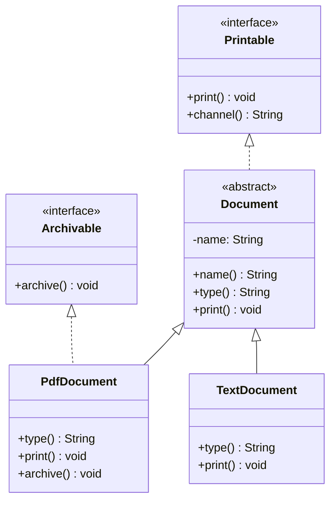

<a id="back-to-top"></a>

# Đa hình

## Menu
- [Khai báo biến, tham số và kiểu trả về bằng kiểu trừu tượng](#polymorphism-001)
- [Liên kết động khi gọi phương thức instance](#polymorphism-002)
- [Phương thức được phép gọi theo kiểu khai báo](#polymorphism-003)
- [Chọn overload lúc biên dịch và chọn override lúc chạy](#polymorphism-004)
- [Upcast và downcast giữa lớp, lớp trừu tượng và interface](#polymorphism-005)
- [instanceof, pattern matching và kiểm tra trước khi ép kiểu](#polymorphism-006)
- [ClassCastException và giới hạn ép kiểu không hợp lệ](#polymorphism-007)
- [Đối tượng null và lời gọi qua tham chiếu interface](#polymorphism-008)
- [Vì sao truy cập field và phương thức static không đa hình](#polymorphism-009)

## <a id="polymorphism-001">Khai báo biến, tham số và kiểu trả về bằng kiểu trừu tượng</a>

<details>
<summary>Xem chi tiết</summary>

# Khai báo biến, tham số và kiểu trả về bằng kiểu trừu tượng trong Java

Một nguyên tắc quan trọng của **đa hình (polymorphism)** là: mã sử dụng đối tượng có thể làm việc qua một **kiểu trừu tượng** thay vì phải biết chính xác class triển khai. Trong Java, kiểu trừu tượng ở bài này chủ yếu là **interface** hoặc **abstract class**. Ta có thể khai báo biến, tham số phương thức, field và kiểu trả về bằng những kiểu đó, dù bản thân chúng không thể được khởi tạo trực tiếp theo cách thông thường.

Ví dụ ngắn:

```java
interface Notifier {
    void send(String message);
}

class EmailNotifier implements Notifier {
    @Override
    public void send(String message) {
        System.out.println("Email: " + message);
    }
}
```

Với hai khai báo trên, ta có thể viết:

```java
Notifier notifier = new EmailNotifier();
notifier.send("Hello");
```

Hai đoạn trên là ví dụ cú pháp; đoạn thứ hai phải đặt bên trong một phương thức hoặc khối khởi tạo, chưa phải chương trình độc lập. Ý nghĩa là:

- **`Notifier`** là *kiểu khai báo* (declared/static type) của biến `notifier`.
- **`EmailNotifier`** là *class thực tế* của đối tượng được tạo bởi `new`.
- Class `EmailNotifier` thực hiện hợp đồng `Notifier` nên tham chiếu kiểu `Notifier` có thể trỏ tới đối tượng đó.
- Trình biên dịch kiểm tra lời gọi `notifier.send(...)` theo những phương thức mà `Notifier` công bố. Khi chạy, implementation thích hợp của `EmailNotifier` được thực thi.

Mục tiêu không phải “ẩn mọi class”, mà là cho phần mã *sử dụng* phụ thuộc vào hợp đồng ổn định, trong khi phần tạo đối tượng được quyền chọn một implementation phù hợp.

## 1. Phân biệt kiểu khai báo với kiểu thực tế

Xét đoạn mã minh họa:

```java
Notifier channel = new EmailNotifier();
```

| Thành phần | Ý nghĩa |
| --- | --- |
| `Notifier` | Kiểu khai báo của biến; quyết định API có thể gọi trực tiếp lúc biên dịch. |
| `channel` | Biến tham chiếu; có thể được gán `null` hoặc tham chiếu đối tượng tương thích. |
| `new EmailNotifier()` | Tạo một đối tượng thuộc class cụ thể `EmailNotifier`. |
| Kiểu runtime của đối tượng | `EmailNotifier`, kể cả khi biến lưu nó có kiểu `Notifier`. |
| `channel.send("Hi")` | Hợp lệ vì `send` được công bố trong `Notifier`; implementation được chọn theo đối tượng runtime. |

Phép gán từ subtype sang supertype (`EmailNotifier` → `Notifier`) là **upcasting**. Java thường thực hiện tự động, không cần ép kiểu tường minh. Quan hệ này cũng áp dụng với abstract superclass:

```java
abstract class Animal {
    abstract String sound();
}

final class Dog extends Animal {
    @Override
    String sound() {
        return "woof";
    }
}

// Hợp lệ khi đặt trong một phương thức:
Animal pet = new Dog();
```

Một interface có thể có nhiều class thực hiện; abstract class cũng có thể có nhiều concrete subclass. Đa hình phát huy tác dụng khi cùng một lời gọi trên kiểu cha được đáp ứng bởi các đối tượng con khác nhau.

**Không nhầm:** kiểu khai báo không làm thay đổi bản chất đối tượng. Gán một `EmailNotifier` cho biến `Notifier` không biến đối tượng thành “đối tượng interface”, và cũng không tạo bản sao hoặc làm mất phương thức của đối tượng. Chỉ có **những thao tác được cho phép qua biến** phụ thuộc vào kiểu khai báo.

## 2. Dùng kiểu trừu tượng để khai báo biến và field

Thay vì viết:

```java
EmailNotifier notifier = new EmailNotifier();
```

ta có thể viết:

```java
Notifier notifier = new EmailNotifier();
```

Cách thứ hai hữu ích khi phần mã phía sau chỉ cần `send`: implementation có thể chuyển sang `SmsNotifier`, `PushNotifier` hoặc một class khác thực hiện `Notifier`. Compiler vẫn bảo đảm rằng đối tượng được gán phù hợp với hợp đồng.

Một field cũng có thể khai báo theo interface:

```java
final class NotificationService {
    private final Notifier notifier;

    NotificationService(Notifier notifier) {
        this.notifier = java.util.Objects.requireNonNull(notifier);
    }

    void notifyUser(String message) {
        notifier.send(message);
    }
}
```

Đây là đoạn class minh họa; để chạy cần các khai báo `Notifier` và một implementation như trong chương trình hoàn chỉnh ở mục 5.

- `private final Notifier notifier` cho biết service **phụ thuộc vào khả năng gửi thông báo**, không gắn với `EmailNotifier` cụ thể.
- Constructor nhận một tham chiếu `Notifier` từ bên ngoài (**constructor injection**).
- `final` ở field nghĩa là tham chiếu không được gán lại sau khi khởi tạo hợp lệ; **không** có nghĩa đối tượng được tham chiếu là bất biến.
- Kiểm tra `null` tại ranh giới giúp tránh lỗi khi service gọi `notifier.send(...)` sau này.

Dùng kiểu trừu tượng cho field giúp mã dễ thay đổi implementation, nhưng không bảo đảm thiết kế tốt nếu interface có quá nhiều phương thức không liên quan hoặc caller vẫn thường xuyên ép kiểu về class cụ thể.

## 3. Dùng kiểu trừu tượng làm tham số phương thức

Chữ ký:

```java
static void deliver(Notifier notifier, String message) {
    notifier.send(message);
}
```

cho phép truyền **bất kỳ đối tượng nào có kiểu tương thích với `Notifier`**, không bắt người gọi cung cấp chính xác `EmailNotifier`.

Ví dụ cách gọi (trong cùng phạm vi đã khai báo `Notifier`, `EmailNotifier` và `SmsNotifier`):

```java
deliver(new EmailNotifier(), "Đơn hàng đã tạo");
deliver(new SmsNotifier(), "Đơn hàng đã tạo");
```

Hai đoạn này là minh họa chữ ký và lời gọi, không phải tệp chạy độc lập. Lợi ích:

1. **Tách người gọi khỏi implementation:** phương thức `deliver` chỉ thực hiện một thao tác trên hợp đồng `Notifier`.
2. **Thêm class mới ít ảnh hưởng:** class mới `implements Notifier` có thể được truyền vào mà không sửa tham số phương thức.
3. **Dễ kiểm thử hành vi:** có thể truyền fake/stub implementation để ghi nhận lời gọi, miễn đáp ứng hợp đồng.
4. **Tránh lặp code:** không cần tạo phiên bản `deliver(EmailNotifier)` và `deliver(SmsNotifier)` chỉ để gọi cùng một phương thức.

**Giới hạn của hợp đồng:** bên trong `deliver`, compiler chỉ bảo đảm các thành viên của `Notifier` và các superinterface liên quan. Phương thức chỉ tồn tại trên `EmailNotifier` không tự nhiên gọi được qua tham số `Notifier`.

Nếu hàm thực sự cần tính năng riêng của email, hãy xem có cần một interface giàu ý nghĩa hơn (chẳng hạn `EmailSender`) hoặc dùng loại tham số cụ thể; không nên khai báo interface rộng rồi luôn ép kiểu về implementation bên trong.

## 4. Dùng kiểu trừu tượng làm kiểu trả về

Một phương thức có thể cam kết trả về **`Notifier`** dù bên trong chọn một class cụ thể:

```java
static Notifier chooseNotifier(boolean useEmail) {
    if (useEmail) {
        return new EmailNotifier();
    }
    return new SmsNotifier();
}
```

Khi gọi `Notifier result = chooseNotifier(true);`, người gọi chỉ cần biết đối tượng nhận được hỗ trợ `send`. Phần chọn kênh vẫn được đóng gói ở nơi tạo đối tượng.

Những điểm cần nhớ:

- `return new EmailNotifier();` hợp lệ nếu `EmailNotifier implements Notifier`.
- `return new SmsNotifier();` cũng hợp lệ nếu `SmsNotifier implements Notifier`.
- Nếu phương thức khai báo trả về `Notifier` nhưng trả về đối tượng không tương thích, chương trình không biên dịch.
- `return null;` có thể hợp lệ về cú pháp đối với kiểu tham chiếu nhưng dễ gây `NullPointerException` cho caller; cần ghi rõ hợp đồng nếu chọn cách này.
- Không có đối tượng interface tự sinh ra từ câu lệnh `return`; **đối tượng vẫn cần được tạo** thông qua class cụ thể, factory hoặc nguồn dữ liệu khác.

Kiểu trả về interface cũng xuất hiện phổ biến trong các API của Java Collections, như một phương thức trả `List<String>` thay vì bắt caller phụ thuộc vào `ArrayList<String>`. `List` là interface; `ArrayList` là implementation. Khi trả về collection, cần quyết định thêm về mutability và ownership; **kiểu `List` tự nó không cam kết danh sách được phép sửa**.

### Kiểu trả về hiệp biến (covariant return)

Khi override phương thức trong Java, implementation có thể trả về subtype phù hợp của kiểu trả về ở hợp đồng cha.

```java
interface Factory {
    Notifier create();
}

final class EmailFactory implements Factory {
    @Override
    public EmailNotifier create() {
        return new EmailNotifier();
    }
}
```

Đoạn này minh họa cú pháp; giả định đã có `Notifier` và `EmailNotifier` như trên. `EmailNotifier` là subtype của `Notifier`, nên kiểu trả về ở phương thức override hợp lệ. Khi gọi qua biến `Factory factory`, biểu thức `factory.create()` vẫn có **kiểu tĩnh `Notifier`**, dù implementation trả một `EmailNotifier`.

Không được tùy tiện thay đổi kiểu tham số khi override: ví dụ `send(Object)` không override `send(String)`. Cần phân biệt **overriding** (cùng hợp đồng, đa hình runtime) với **overloading** (nhiều chữ ký khác nhau, chọn theo kiểu ở compile time).

## 5. Chương trình Java 17+ hoàn chỉnh: biến, tham số và kiểu trả về

Lưu toàn bộ mã sau vào tệp **`Main.java`**:

```java
import java.util.Objects;

interface Notifier {
    String channel();
    void send(String recipient, String message);
}

final class EmailNotifier implements Notifier {
    @Override
    public String channel() {
        return "Email";
    }

    @Override
    public void send(String recipient, String message) {
        System.out.println("Email to " + recipient + ": " + message);
    }
}

final class SmsNotifier implements Notifier {
    @Override
    public String channel() {
        return "SMS";
    }

    @Override
    public void send(String recipient, String message) {
        System.out.println("SMS to " + recipient + ": " + message);
    }
}

final class NotificationService {
    private final Notifier notifier;

    NotificationService(Notifier notifier) {
        this.notifier = Objects.requireNonNull(notifier);
    }

    void notifyUser(String recipient) {
        notifier.send(recipient, "Ready");
    }
}

public class Main {
    static void deliver(Notifier notifier, String recipient) {
        notifier.send(recipient, "Updated");
    }

    static Notifier chooseNotifier(String channel) {
        return switch (channel) {
            case "email" -> new EmailNotifier();
            case "sms" -> new SmsNotifier();
            default -> throw new IllegalArgumentException("Unknown channel");
        };
    }

    public static void main(String[] args) {
        Notifier primary = new EmailNotifier();
        Notifier secondary = new SmsNotifier();

        System.out.println(primary.channel());
        deliver(primary, "Lan");

        NotificationService service = new NotificationService(secondary);
        service.notifyUser("Minh");

        Notifier chosen = chooseNotifier("sms");
        System.out.println(chosen.channel());
        deliver(chosen, "An");
    }
}
```

Chạy với JDK 17 trở lên trong thư mục chứa `Main.java`:

```bash
javac Main.java
java Main
```

**Kết quả chuẩn:**

```text
Email
Email to Lan: Updated
SMS to Minh: Ready
SMS
SMS to An: Updated
```

Đọc chương trình theo ba vị trí khai báo kiểu trừu tượng:

| Vị trí | Mã | Vai trò |
| --- | --- | --- |
| Biến | `Notifier primary = new EmailNotifier();` | Giữ đối tượng class cụ thể thông qua interface. |
| Field | `private final Notifier notifier;` | Service không cần biết kênh cụ thể. |
| Tham số | `deliver(Notifier notifier, ...)` | Một phương thức nhận nhiều implementation. |
| Tham số constructor | `NotificationService(Notifier notifier)` | Cung cấp dependency khi tạo service. |
| Kiểu trả về | `static Notifier chooseNotifier(...)` | Cho phép chọn implementation ở runtime. |

Lệnh `javac Main.java` biên dịch các class/interface top-level trong cùng tệp; `java Main` chạy điểm vào `Main.main`. Trong `chooseNotifier`, `switch` là **switch expression** được Java 17 hỗ trợ. Cả hai nhánh `new EmailNotifier()` và `new SmsNotifier()` đều phù hợp với kiểu trả về `Notifier`.

Nếu bổ sung class `PushNotifier implements Notifier`, chữ ký `deliver` và `NotificationService` không phải thay đổi. Phần lựa chọn bên trong factory có thể cần bổ sung case mới theo yêu cầu nghiệp vụ; đó là trách nhiệm của nơi quyết định tạo đối tượng.

## 6. Ranh giới giữa kiểu trừu tượng và cơ chế đa hình

Khi `Notifier notifier = new EmailNotifier();`, compiler cho phép `notifier.send(...)` vì `send` thuộc hợp đồng `Notifier`; lúc chạy, implementation của `EmailNotifier` thực thi. Đây là lý do biến, field, tham số và kiểu trả về có thể dùng abstraction ổn định thay vì phụ thuộc vào một class triển khai.

Các quyết định khác có quy tắc riêng: overload được chọn theo kiểu tĩnh; field và phương thức `static` không dispatch theo đối tượng runtime; gọi instance method qua `null` ném `NullPointerException`. Xem các bài **Liên kết động khi gọi phương thức instance**, **Chọn overload lúc biên dịch và chọn override lúc chạy**, **Đối tượng null và lời gọi qua tham chiếu interface**, và **Vì sao truy cập field và phương thức static không đa hình** để học từng cơ chế.

## 7. Abstract class cũng dùng được cho biến, tham số và kiểu trả về

Một abstract class cung cấp một kiểu cha có thể bao gồm **trạng thái, constructor, phương thức concrete và abstract**. Ta vẫn dùng nó làm kiểu khai báo, nhưng phải tạo đối tượng từ **concrete subclass**.

Tệp độc lập **`ShapeDemo.java`**:

```java
import java.util.Locale;

abstract class Shape {
    abstract double area();

    String label() {
        return "Shape";
    }
}

final class Square extends Shape {
    private final double side;

    Square(double side) {
        this.side = side;
    }

    @Override
    double area() {
        return side * side;
    }

    @Override
    String label() {
        return "Square";
    }
}

final class Circle extends Shape {
    private final double radius;

    Circle(double radius) {
        this.radius = radius;
    }

    @Override
    double area() {
        return Math.PI * radius * radius;
    }

    @Override
    String label() {
        return "Circle";
    }
}

public class ShapeDemo {
    static Shape choose(boolean square) {
        return square ? new Square(2.0) : new Circle(1.0);
    }

    static void printShape(Shape shape) {
        System.out.printf(Locale.ROOT, "%s: %.2f%n",
                shape.label(), shape.area());
    }

    public static void main(String[] args) {
        Shape first = choose(true);
        Shape second = choose(false);
        printShape(first);
        printShape(second);
    }
}
```

```bash
javac ShapeDemo.java
java ShapeDemo
```

```text
Square: 4.00
Circle: 3.14
```

Ở đây `Shape` xuất hiện làm **kiểu biến**, **tham số** (`printShape`) và **kiểu trả về** (`choose`). Hai class con cung cấp implementation cho `area()` và override `label()`. Phương thức `printShape` làm việc bằng API của `Shape`, nên không phải viết hai phiên bản riêng cho hình vuông và hình tròn.

Phân biệt lựa chọn abstract class và interface:

| Nhu cầu | Interface | Abstract class |
| --- | --- | --- |
| Khai báo biến/tham số/trả về đa hình | Có | Có |
| Dùng `new` trực tiếp trên chính kiểu trừu tượng | Không | Không |
| Một class cùng lúc mang nhiều kiểu này | Có thể `implements` nhiều interface | Chỉ `extends` một class trực tiếp |
| Chia sẻ instance state và constructor | Không có instance field hoặc constructor | Có thể có |
| Chia sẻ hành vi mặc định | `default` method khi hợp lệ | Concrete instance methods |
| Thường phù hợp | Hợp đồng khả năng, API linh hoạt | Cùng một họ kiểu cần chung cơ chế/trạng thái kế thừa |

Không có quy tắc “cứ là abstract class thì kém interface”. Chọn loại thích hợp dựa trên hợp đồng và đặc điểm kế thừa thực sự của bài toán.

## 8. Upcasting, downcasting và `instanceof`

Gán `EmailNotifier` vào `Notifier` là upcast, thường ngầm định; tham chiếu vẫn trỏ đến cùng đối tượng. Khi cần hành vi chỉ có ở class cụ thể, downcast phải tương thích với kiểu runtime và có thể ném `ClassCastException` nếu sai. `instanceof` (pattern matching từ Java 16) cho phép kiểm tra trước khi dùng subtype; với `null`, phép thử trả `false`. Cast không tạo hoặc chuyển đổi đối tượng.

Các bài **Upcast và downcast giữa lớp, lớp trừu tượng và interface**, **instanceof, pattern matching và kiểm tra trước khi ép kiểu**, và **ClassCastException và giới hạn ép kiểu không hợp lệ** trình bày chi tiết các trường hợp này.

## 9. Kiểu trừu tượng trong collection và generics

Java thường khuyến khích sử dụng interface làm kiểu khai báo collection:

```java
import java.util.ArrayList;
import java.util.List;

List<String> names = new ArrayList<>();
names.add("Lan");
names.add("Minh");
```

`List` là interface, `ArrayList` là class triển khai. Caller làm việc qua các phương thức được khai báo bởi `List`; có thể thay implementation trong điều kiện hợp đồng và yêu cầu ứng dụng cho phép.

Cũng có thể khai báo một collection chứa các đối tượng có nhiều implementation:

```java
List<Notifier> channels = new ArrayList<>();
channels.add(new EmailNotifier());
channels.add(new SmsNotifier());

for (Notifier channel : channels) {
    System.out.println(channel.channel());
}
```

Các ví dụ trên là những đoạn lệnh minh họa, phải đặt trong phạm vi phù hợp và có các class `Notifier`, `EmailNotifier`, `SmsNotifier` đã khai báo; chưa phải chương trình chạy độc lập.

**Lưu ý quan trọng về generic invariance:** dù `EmailNotifier` là subtype của `Notifier`, **`List<EmailNotifier>` không phải subtype của `List<Notifier>`**. Nếu một phương thức chỉ đọc và gọi API của notifier, có thể cân nhắc tham số:

```java
static void showChannels(List<? extends Notifier> channels) {
    for (Notifier item : channels) {
        System.out.println(item.channel());
    }
}
```

`List<? extends Notifier>` chấp nhận danh sách của `Notifier` hoặc các subtype tương thích. Tuy nhiên, không thể thêm tùy ý một `new SmsNotifier()` vào danh sách đó vì kiểu phần tử cụ thể không được bảo đảm. Đây là cách generic bảo toàn type safety; **đa hình của phần tử không tự động biến các loại `List<T>` thành quan hệ subtype tương ứng**.

## 10. Lợi ích thiết kế và điều kiện để đa hình thực sự hữu ích

Khi chỉ phụ thuộc vào interface, ta có thể:

- **Thay implementation tại nơi khởi tạo:** cùng một service nhận kênh email hoặc SMS.
- **Truyền nhiều đối tượng khác nhau vào một API:** hàm `deliver(Notifier, ...)` không cần biết subtype.
- **Trả về một hợp đồng thống nhất:** factory trả `Notifier` dù nhánh lựa chọn tạo class nào.
- **Kiểm thử dễ hơn:** cung cấp một fake implementation ghi nhận tham số thay vì gửi thông báo thật.
- **Giới hạn điều mà caller biết:** các API đặc thù của class cụ thể không bị đưa thành dependency ngầm.

Nhưng **kiểu trừu tượng vẫn là một hợp đồng thực sự**. Hai class chỉ cùng chữ ký phương thức không tự trở thành subtype của một interface nếu không có quan hệ kiểu thích hợp (trừ các cơ chế khác theo quy tắc ngôn ngữ). Bản thân interface cũng không bảo đảm các implementation có cùng ý nghĩa nghiệp vụ. Ví dụ, nếu `send` hứa “gửi một lần”, một implementation gửi lặp nhiều lần có thể phá kỳ vọng dù vẫn biên dịch. Thiết kế đa hình cần sự tương thích cả về **kiểu** lẫn **hành vi** (nguyên tắc thay thế).

Không phải lúc nào cũng khai báo mọi biến bằng supertype cao nhất như `Object`. Nếu dùng `Object`, compiler không biết đến `send`; muốn gọi lại phải kiểm tra và ép kiểu. Hãy chọn **kiểu trừu tượng nhỏ nhất nhưng đầy đủ những thao tác caller thực sự cần**, đồng thời giữ hợp đồng rõ ràng.

## 11. Những lỗi thường gặp

| Lỗi hoặc ngộ nhận | Vì sao sai / cách sửa |
| --- | --- |
| `Notifier n = new Notifier();` | Không thể khởi tạo trực tiếp interface; dùng `new EmailNotifier()` hoặc implementation khác. |
| `Shape s = new Shape();` | Abstract class không thể khởi tạo trực tiếp; dùng concrete subclass. |
| `Notifier n = new EmailNotifier(); n.onlyEmailFeature();` | `onlyEmailFeature` không có trong kiểu khai báo `Notifier`; chỉ gọi API hợp đồng hoặc dùng kiểu hẹp hơn khi thực sự cần. |
| `EmailNotifier n = chooseNotifier("email");` | Hàm khai báo kiểu trả về `Notifier`, không thể tự động gán vào biến subclass; dùng `Notifier n` hoặc kiểm tra kiểu trước khi cast. |
| Cho rằng biến kiểu interface luôn chứa cùng một implementation | Biến có thể lần lượt trỏ đến nhiều subtype; kiểu runtime của từng đối tượng vẫn cố định. |
| Cho rằng `implements` mặc nhiên cung cấp mọi method | Concrete class phải đáp ứng abstract methods còn thiếu; default method chỉ cung cấp implementation khi hợp lệ. |
| Viết nhiều overload nhận từng implementation chỉ để gọi cùng hợp đồng | Có thể gom thành một phương thức nhận interface phù hợp. |
| Ép kiểu xuống class triển khai mà không kiểm tra | Có thể ném `ClassCastException`; dùng `instanceof` khi cần hoặc thiết kế lại API. |
| Gán `List<EmailNotifier>` cho `List<Notifier>` | Generics invariant; cân nhắc `List<? extends Notifier>` nếu chỉ cần đọc. |
| Cho rằng kiểu `List` bảo đảm đối tượng được phép thêm/xóa | Hợp đồng và implementation có thể không hỗ trợ sửa; cần ghi rõ yêu cầu mutability. |

## 12. Tự kiểm tra kiến thức

**1. `Notifier n = new EmailNotifier();` có tạo đối tượng thuộc kiểu `Notifier` hay `EmailNotifier`?**  
Tạo một đối tượng `EmailNotifier`. `Notifier` là kiểu khai báo của tham chiếu và hợp đồng mà caller nhìn thấy.

**2. Nếu `deliver(Notifier notifier)` chỉ gọi `notifier.send(...)`, truyền `SmsNotifier` có hợp lệ không?**  
Có, miễn `SmsNotifier implements Notifier` và đáp ứng các phương thức bắt buộc. Đó là đa hình qua tham số.

**3. Phương thức khai báo `Notifier create()` có thể trả đối tượng `new EmailNotifier()` không?**  
Có, vì `EmailNotifier` là subtype của `Notifier`. Caller nhận kiểu tĩnh `Notifier` khi gọi qua chữ ký đó.

**4. Vì sao `new Shape()` không hợp lệ nhưng `Shape x = new Square(2.0);` hợp lệ?**  
`Shape` là abstract class nên không khởi tạo trực tiếp; `Square` là concrete subclass và có thể được gán cho tham chiếu `Shape`.

**5. Có thể gọi phương thức chỉ nằm trong `EmailNotifier` qua biến khai báo kiểu `Notifier` không?**  
Không gọi trực tiếp. Compiler chỉ cho truy cập những thành viên thuộc API của `Notifier`. Có thể kiểm tra và downcast, nhưng nên cân nhắc lại thiết kế nếu thao tác đó xuất hiện thường xuyên.

**6. `List<EmailNotifier>` có gán trực tiếp cho `List<Notifier>` được không?**  
Không. Generics của Java invariant. Nếu chỉ cần đọc các đối tượng dưới góc nhìn `Notifier`, một tham số `List<? extends Notifier>` có thể phù hợp.

**7. Khi thay `EmailNotifier` bằng `SmsNotifier` trong service, có cần sửa chữ ký constructor `NotificationService(Notifier notifier)` không?**  
Không. Cả hai class đều thực hiện cùng hợp đồng `Notifier`. Phần khởi tạo chọn implementation, còn service gọi API chung.

Hãy nhớ ba mẫu cốt lõi: **biến `Notifier n`**, **tham số `void send(Notifier n)`**, **kiểu trả về `Notifier create()`**. Mỗi mẫu cho phép làm việc bằng một hợp đồng trừu tượng, trong khi đối tượng runtime được cung cấp bởi class cụ thể tương thích; đây là nền tảng sử dụng đa hình một cách có kiểm soát trong Java.

</details>

- [Quay lại đầu trang](#back-to-top)

---

## <a id="polymorphism-002">Liên kết động khi gọi phương thức instance</a>

<details>
<summary>Xem chi tiết</summary>

# Liên kết động khi gọi phương thức instance trong Java

**Liên kết động** (*dynamic binding*, hay *dynamic method dispatch*) là cơ chế Java lựa chọn phiên bản thực thi của một **phương thức instance có thể ghi đè** dựa trên **kiểu thực tế của đối tượng nhận lời gọi ở runtime**, sau khi lời gọi đã được kiểm tra hợp lệ và xác định chữ ký ở compile time. Đây là nền tảng của **đa hình runtime**: mã dùng kiểu cha hoặc interface vẫn có thể chạy hành vi khác nhau theo từng đối tượng cụ thể.

Điều cần nắm vững là Java kết hợp **hai thời điểm quyết định**:

1. **Khi biên dịch:** xác định lời gọi hợp lệ theo kiểu biểu thức, chọn chữ ký qua các quy tắc overload, kiểm tra quyền truy cập, kiểu tham số và kiểu trả về.
2. **Khi chạy:** với lời gọi instance được dispatch động, chọn implementation ghi đè phù hợp với **class thực tế** của đối tượng nhận.

Vì thế, kiểu tham chiếu quyết định **có thể gọi phương thức nào**, còn kiểu đối tượng runtime quyết định **thân của phương thức được override nào được chạy**.

## 1. Ví dụ mở đầu: một kiểu tham chiếu, nhiều hành vi

Lưu ví dụ độc lập trong file `DynamicDispatchDemo.java`:

```java
abstract class Animal {
    abstract String sound();

    String describe() {
        return "Animal says: " + sound();
    }
}

class Dog extends Animal {
    @Override
    String sound() {
        return "woof";
    }
}

class Cat extends Animal {
    @Override
    String sound() {
        return "meow";
    }
}

public class DynamicDispatchDemo {
    public static void main(String[] args) {
        Animal first = new Dog();
        Animal second = new Cat();

        System.out.println(first.sound());
        System.out.println(second.sound());
        System.out.println(first.describe());
        System.out.println(second.describe());
    }
}
```

Biên dịch/chạy với JDK 17 trở lên:

```bash
javac DynamicDispatchDemo.java
java DynamicDispatchDemo
```

Đầu ra chính xác:

```text
woof
meow
Animal says: woof
Animal says: meow
```

**Giải thích từng bước:**

- `first` và `second` có cùng **kiểu khai báo** `Animal`; compiler thấy `Animal` có `sound()` và `describe()` nên chấp nhận lời gọi.
- `new Dog()` tạo một đối tượng có class runtime là `Dog`; `first.sound()` thực thi `Dog.sound()`.
- `new Cat()` tạo một đối tượng có class runtime là `Cat`; `second.sound()` thực thi `Cat.sound()`.
- `describe()` chỉ được định nghĩa trong `Animal`, nên cả hai lời gọi `describe()` đều dùng thân `Animal.describe()`. Tuy nhiên, khi thân này gọi `sound()` (tương đương `this.sound()`), lời gọi đó **vẫn được dispatch động**. Kết quả phụ thuộc vào đối tượng `Dog` hoặc `Cat`, ngay cả khi mã `describe()` nằm ở superclass.

Đây chính là điểm mạnh của đa hình: phương thức ở lớp cha có thể gọi một “điểm mở rộng” trong lớp con mà không phải dùng `if (object instanceof Dog)` hay `switch` theo từng loại đối tượng.

## 2. Compiler làm gì, JVM làm gì?

Xét biểu thức:

```java
Animal animal = new Dog();
String text = animal.sound();
```

Về mặt ngữ nghĩa:

| Giai đoạn | Dữ kiện được dùng | Quyết định |
| --- | --- | --- |
| **Compile time** | Kiểu biểu thức `animal` là `Animal`; phương thức có thể truy cập; kiểu và số lượng đối số | `sound()` là một lời gọi hợp lệ; kiểu kết quả là `String`. |
| **Runtime** | Giá trị thực của `animal` đang trỏ đến đối tượng `Dog` | Với lời gọi virtual, implementation được chọn là `Dog.sound()`. |

Không thể diễn giải rằng compiler luôn chốt `Animal.sound()` làm thân chạy cuối cùng: nếu như vậy Java không có đa hình ghi đè (*runtime polymorphism*).

Các bước trực giác để hiểu dispatch động:

```text
Biểu thức tham chiếu x.method(arguments)
                 │
                 ▼
Compiler kiểm tra kiểu, overload, quyền truy cập
                 │
                 ▼
Khi chạy: đánh giá receiver và arguments
                 │
                 ▼
Receiver là null? ── có ──► NullPointerException
                 │ không
                 ▼
Tra implementation instance phù hợp với class runtime
                 │
                 ▼
Thực thi implementation được chọn
```

Sơ đồ là mô hình **ngữ nghĩa** dành cho lập trình viên, không mô tả cứng thuật toán nội bộ của mọi JVM. JVM có thể tối ưu bằng devirtualization, inlining, caching và biên dịch JIT, nhưng hành vi quan sát được vẫn phải đúng theo ngữ nghĩa Java.

**Lưu ý về thời điểm đánh giá:** với một biểu thức gọi method, Java thực hiện các bước đánh giá receiver/đối số theo quy tắc của ngôn ngữ; ví dụ lệnh gọi qua receiver `null` vẫn có thể đánh giá biểu thức đối số trước khi ném `NullPointerException`. Sơ đồ trên chỉ tóm lược kiểm tra runtime, không thay thế đặc tả về thứ tự đánh giá.

## 3. Overriding tạo khả năng dispatch động

**Override** xảy ra khi subclass cung cấp một instance method hợp lệ thay thế instance method được kế thừa hoặc thực hiện hợp đồng của interface. Với một lời gọi virtual, runtime chọn phương thức override cuối cùng phù hợp với đối tượng.

```java
class Vehicle {
    String move() {
        return "moving";
    }
}

class Bicycle extends Vehicle {
    @Override
    String move() {
        return "pedaling";
    }
}

class ElectricBicycle extends Bicycle {
    @Override
    String move() {
        return "assisted pedaling";
    }
}
```

Với:

```java
Vehicle a = new Vehicle();
Vehicle b = new Bicycle();
Vehicle c = new ElectricBicycle();
```

Ba biểu thức `a.move()`, `b.move()`, `c.move()` lần lượt trả `"moving"`, `"pedaling"`, `"assisted pedaling"`. Các lời gọi đều hợp lệ qua `Vehicle`, nhưng implementation chạy lần lượt nằm trong `Vehicle`, `Bicycle` và `ElectricBicycle`.

Các điều kiện override cần nhớ:

- Method phải có chữ ký phù hợp; không thể “override” bằng cách đổi danh sách tham số rồi giữ tên cũ.
- Quyền truy cập của method override không được hẹp hơn method gốc. Ví dụ method gốc `public` thì bản override cũng phải `public`.
- Kiểu trả về phải phù hợp (có thể dùng **covariant return type** với các kiểu tham chiếu hợp lệ).
- Quy tắc về checked exceptions phải được tôn trọng; bản override không được mở rộng tập checked exceptions trái hợp đồng.
- Method `final` không thể bị override.
- `@Override` không tạo dispatch động, nhưng yêu cầu compiler kiểm tra đúng quan hệ override và giúp bắt lỗi đánh máy/chữ ký.

Việc subclass **không override** cũng hoàn toàn hợp lệ nếu đã có method concrete được kế thừa: JVM sẽ chọn implementation kế thừa gần nhất phù hợp.

## 4. Đa hình qua interface: gọi đúng implementation

Không cần quan hệ “lớp con của một superclass” mới có dispatch động. Đối tượng có thể implement cùng interface với nhiều class không có chung superclass cụ thể ngoài `Object`.

Tạo file `NotificationDemo.java`:

```java
interface Notifier {
    void notifyUser(String message);
}

class EmailNotifier implements Notifier {
    @Override
    public void notifyUser(String message) {
        System.out.println("EMAIL: " + message);
    }
}

class SmsNotifier implements Notifier {
    @Override
    public void notifyUser(String message) {
        System.out.println("SMS: " + message);
    }
}

class NotificationService {
    void dispatch(Notifier notifier, String message) {
        notifier.notifyUser(message);
    }
}

public class NotificationDemo {
    public static void main(String[] args) {
        NotificationService service = new NotificationService();

        service.dispatch(new EmailNotifier(), "Hello");
        service.dispatch(new SmsNotifier(), "Hello");
    }
}
```

Chạy:

```bash
javac NotificationDemo.java
java NotificationDemo
```

Kết quả:

```text
EMAIL: Hello
SMS: Hello
```

`NotificationService` chỉ biết hợp đồng `Notifier`; lời gọi `notifier.notifyUser(message)` chuyển đến implementation dựa trên class runtime (`EmailNotifier` hoặc `SmsNotifier`). Đây là lý do ứng dụng có thể dùng dependency injection, test double, mock hoặc plugin mà mã sử dụng interface không phải viết lại mỗi khi có class thực thi mới.

Các phương thức `default` của interface cũng có quy tắc chọn implementation và override tương ứng. Một class có thể override method `default`; nếu class không override, method default hợp lệ được thừa hưởng sẽ chạy. Nếu có nhiều default method xung đột không giải quyết được, **compiler sẽ báo lỗi**, không để JVM chọn ngẫu nhiên lúc chạy.

## 5. Overloading là quyết định khác với dynamic dispatch

**Overloading**: các method cùng tên nhưng **khác danh sách tham số**. Compiler chọn method áp dụng phù hợp dựa trên **kiểu của biểu thức đối số ở compile time**. Sau khi chọn chữ ký, nếu implementation của chữ ký đó là virtual thì runtime mới chọn phiên bản override tương ứng.

Tạo file `OverloadVsOverrideDemo.java`:

```java
class Creature { }

class Puppy extends Creature { }

class Presenter {
    String show(Creature value) {
        return "Presenter: Creature";
    }

    String show(Puppy value) {
        return "Presenter: Puppy";
    }
}

class SpecialPresenter extends Presenter {
    @Override
    String show(Creature value) {
        return "Special: Creature";
    }

    @Override
    String show(Puppy value) {
        return "Special: Puppy";
    }
}

public class OverloadVsOverrideDemo {
    public static void main(String[] args) {
        Creature creature = new Puppy();
        Puppy puppy = new Puppy();
        Presenter presenter = new SpecialPresenter();

        System.out.println(presenter.show(creature));
        System.out.println(presenter.show(puppy));
        System.out.println(presenter.show((Creature) puppy));
    }
}
```

Chạy:

```bash
javac OverloadVsOverrideDemo.java
java OverloadVsOverrideDemo
```

Kết quả chính xác:

```text
Special: Creature
Special: Puppy
Special: Creature
```

Phân tích:

1. `creature` có kiểu **biên dịch** `Creature` dù đang trỏ đến `new Puppy()`. Compiler chọn overload `show(Creature)`; runtime chọn bản override `SpecialPresenter.show(Creature)`.
2. `puppy` có kiểu biên dịch `Puppy`. Compiler chọn overload `show(Puppy)`; runtime chọn `SpecialPresenter.show(Puppy)`.
3. Ép kiểu `(Creature) puppy` khiến compiler xét biểu thức đối số theo kiểu `Creature`, do đó chọn overload `show(Creature)`. Cast không biến đối tượng `Puppy` thành một đối tượng `Creature` mới.

**Quy tắc nhớ:** *Overload chọn chữ ký theo kiểu tại compile time; override chọn thân thực thi theo class runtime*. Java không “chọn overload lại” chỉ vì đối tượng của đối số thực tế thuộc subclass.

## 6. Các trường hợp không dispatch động theo nghĩa override thông thường

Không phải bất kỳ thứ gì gọi bằng cú pháp dấu chấm `.` đều được chọn implementation theo kiểu runtime.

| Trường hợp | Có override/dispatch động như instance method thông thường? | Điểm cần nhớ |
| --- | --- | --- |
| Instance method không `static`, không `private`, có thể override | **Có**, khi có bản override thích hợp | Quyết định implementation dựa trên class runtime của receiver. |
| `static` method | **Không**; method có thể bị *hide* | Chọn theo kiểu/định danh được phân giải lúc biên dịch. |
| `private` method | **Không bị override** | Method chỉ thuộc khai báo cho phép truy cập; method trùng tên ở subclass là một method riêng. |
| `final` instance method | **Không thể override** | Không có bản override khác để runtime lựa chọn, dù cú pháp vẫn có thể là instance call. |
| `super.method()` | **Không** dispatch đến override của class hiện tại theo receiver runtime | Truy cập implementation của superclass theo quy tắc `super`. |
| Constructor (`new`, `super(...)`, `this(...)`) | **Không** được override | Constructor thiết lập đối tượng; vẫn có thể **gọi virtual method trong constructor**, xem mục 8. |
| Field có cùng tên ở superclass/subclass | **Không**; field bị *hide*, không override | Field được chọn theo kiểu biểu thức/khai báo. |
| Overloaded method khác chữ ký | Overload chọn **chữ ký tĩnh**; implementation có thể **động** | Hai quá trình diễn ra ở hai giai đoạn khác nhau. |

### 6.1. Field hiding và static hiding thuộc bài học riêng

Truy cập `ref.field` dựa vào kiểu tĩnh của biểu thức; lời gọi `ref.staticMethod()` cũng được phân giải theo kiểu/tên lớp, không theo class runtime. Hai cơ chế này là **field hiding** và **method hiding**, khác với override của instance method. Bảng trên đủ để phân biệt trong bài liên kết động; ví dụ chi tiết và các quy tắc riêng của interface nằm trong bài **Vì sao truy cập field và phương thức static không đa hình**.

### 6.2. Gọi `super` và gọi `this`

File `SuperCallDemo.java`:

```java
class Base {
    String greet() {
        return "base";
    }
}

class Extended extends Base {
    @Override
    String greet() {
        return "extended";
    }

    String compare() {
        return super.greet() + " / " + this.greet();
    }
}

public class SuperCallDemo {
    public static void main(String[] args) {
        Base x = new Extended();
        System.out.println(x.greet());
        System.out.println(((Extended) x).compare());
    }
}
```

Chạy:

```bash
javac SuperCallDemo.java
java SuperCallDemo
```

Kết quả:

```text
extended
base / extended
```

`super.greet()` được liên kết theo superclass, giúp subclass tận dụng hành vi gốc. Trong khi đó, `this.greet()` là lời gọi virtual trên đối tượng hiện tại. Nếu class con của `Extended` override `greet()` lần nữa, `this.greet()` vẫn có thể chuyển đến phiên bản mới đó.

## 7. Đổi kiểu tham chiếu không đổi class runtime của object

`Animal a = new Dog(); Animal b = (Animal) a;` tạo hai tham chiếu tới cùng đối tượng `Dog`. Cả `a.sound()` và `b.sound()` vẫn dispatch đến `Dog.sound()`. Upcast/cast chỉ đổi kiểu nhìn thấy ở compile time, không đổi class runtime; các quan hệ cast và cách kiểm tra subtype được trình bày trong bài **Upcast và downcast giữa lớp, lớp trừu tượng và interface**.

## 8. Bẫy quan trọng: gọi overridable method từ constructor

Java vẫn dùng virtual dispatch trong lúc chạy constructor. Khi constructor của superclass gọi một method có thể override, nó có thể chạy method của subclass **trước khi phần khởi tạo subclass hoàn tất**. Điều này dễ dẫn đến `null` hoặc trạng thái chưa sẵn sàng.

File `ConstructorDispatchDemo.java`:

```java
class Parent {
    Parent() {
        System.out.println("Parent sees: " + value());
    }

    String value() {
        return "parent";
    }
}

class Child extends Parent {
    private String name = "ready";

    @Override
    String value() {
        return name;
    }
}

public class ConstructorDispatchDemo {
    public static void main(String[] args) {
        new Child();
    }
}
```

Chạy:

```bash
javac ConstructorDispatchDemo.java
java ConstructorDispatchDemo
```

Kết quả:

```text
Parent sees: null
```

**Tại sao là `null`?** Đối tượng mới ngay từ đầu có class runtime là `Child`. Khi `Parent()` đang chạy, `value()` được dispatch đến `Child.value()`; tại thời điểm đó field `Child.name` mới có giá trị mặc định `null`, vì initializer `= "ready"` của subclass chưa được thực thi. Sau khi superclass hoàn tất mới đến phần khởi tạo của subclass.

**Thực hành:** tránh gọi method có thể override trong constructor, field initializer hoặc logic khởi tạo có yêu cầu trạng thái subclass đã sẵn sàng. Thay vào đó, khởi tạo bằng constructor/private/final helper phù hợp, hoặc gọi phần hành vi đa hình sau khi object được tạo hoàn chỉnh.

## 9. Dispatch động và `null`

Lời gọi instance method cần receiver khác `null`; nếu receiver là `null`, runtime ném `NullPointerException` và không chạy thân phương thức. `instanceof` với `null` trả `false`, còn phương thức `static` không cần receiver instance. Bài **Đối tượng null và lời gọi qua tham chiếu interface** giải thích hợp đồng null, default method, method reference và thứ tự đánh giá đối số.

## 10. JVM thực hiện lời gọi thế nào?

Ở mức bytecode, Java có nhiều lệnh gọi phục vụ những kiểu liên kết khác nhau:

| Lệnh bytecode | Nhóm tình huống điển hình | Quan hệ với dispatch |
| --- | --- | --- |
| `invokevirtual` | Gọi instance method trên class trong phần lớn trường hợp virtual | Chọn implementation phù hợp theo kiểu runtime, có xét các quy tắc chọn/phân giải liên quan. |
| `invokeinterface` | Gọi instance method thông qua interface | Chọn implementation của đối tượng runtime thỏa hợp đồng interface. |
| `invokespecial` | Gọi constructor, `private` method và các lời gọi `super` thích hợp | Có ngữ nghĩa đặc biệt, không dispatch virtual theo cách thông thường. |
| `invokestatic` | Gọi static method | Không có receiver instance để chọn override. |
| `invokedynamic` | Cơ chế call site có bootstrap, ví dụ trong một số triển khai lambda/string concatenation | Là một cơ chế liên kết khác; **không đồng nghĩa** với “dynamic method dispatch” của `animal.sound()`. |

Có thể tự quan sát bytecode do `javac` tạo ra. Với file `DynamicDispatchDemo.java` ở mục 1:

```bash
javac DynamicDispatchDemo.java
javap -c DynamicDispatchDemo
```

Trong output `javap`, tìm các lời gọi `Animal.sound` / `Animal.describe` và opcode tương ứng. Số thứ tự dòng bytecode, constant-pool index và chi tiết tối ưu có thể khác theo compiler/JDK, nên không gán một bản `javap` duy nhất làm output cố định. Lời gọi `notifyUser` qua biến interface trong ví dụ ở mục 4 là trường hợp tiêu biểu dùng `invokeinterface`.

Một cách hình dung phổ biến về triển khai JVM là tìm method qua bảng thông tin kiểu (vtable/itable) hoặc thông tin tương đương. **Đây là chi tiết triển khai, không phải cam kết rằng mọi JVM bắt buộc dùng cấu trúc bảng cụ thể.**

JIT có thể nhận thấy tại một call site chỉ xuất hiện một kiểu receiver rồi inline thẳng implementation đó, kèm điều kiện bảo vệ hoặc cơ chế vô hiệu hóa tối ưu khi giả định thay đổi. Điều này giúp giải thích vì sao **đa hình không đồng nghĩa mỗi lời gọi chắc chắn phải tra bảng chậm**. Nên đo hiệu năng bằng profiler/benchmark đáng tin thay vì tự tối ưu khỏi interface hoặc override khi chưa có số liệu.

## 11. Quy tắc đặc biệt và các hiểu nhầm nâng cao

### 11.1. `private` và `final` khác nhau

- Method `private` không được kế thừa để override. Method cùng tên/chữ ký trong subclass thường là một khai báo khác.
- Method `final` là method có thể có tính kế thừa bình thường nhưng **không thể bị override**, giúp bảo vệ hành vi ổn định.
- Một lời gọi instance `final` vẫn thao tác trên receiver; thiếu receiver hợp lệ vẫn có thể gây `NullPointerException`. Không đồng nhất “không override” với “static”.

### 11.2. Method của superclass gọi method override của subclass

Ví dụ `Animal.describe()` gọi `sound()` ở mục 1 chứng minh rằng **nguồn mã của method gọi đang nằm ở class nào không quyết định implementation của virtual call**. Receiver `this` vẫn là đối tượng thực tế. Nếu subclass muốn dùng logic cha, nó có thể gọi `super.sound()` khi method cha concrete và được phép truy cập.

### 11.3. Covariant return type và bridge method

Khi subclass override method với kiểu trả về tham chiếu chuyên biệt hơn (ví dụ method cha trả `Animal`, method con trả `Dog`), compiler có thể phát sinh **bridge method** để bảo toàn các quy tắc dispatch và binary compatibility trong một số tình huống, đặc biệt với generics/erasure. Bridge method là chi tiết trình biên dịch nhằm giữ ngữ nghĩa override nhất quán; bạn vẫn gọi method theo contract, không cần tự viết bridge.

### 11.4. Truy cập package-private ảnh hưởng đến override

Một method package-private ở superclass **không được kế thừa như method có thể override** bởi subclass nằm ở package khác. Method cùng tên/chữ ký trong subclass package khác không đương nhiên là override của method đó. Dùng `@Override` để compiler chỉ rõ khi quan hệ override thực sự hợp lệ.

### 11.5. `Object` và interface

Mọi class thông thường đều kế thừa từ `Object`. Những method instance có thể override như `toString()`, `equals(Object)`, `hashCode()` vẫn tuân theo dispatch động. Do đó `Object value = "hello"; System.out.println(value.toString());` sẽ chạy phiên bản thích hợp cho `String`, không nhất thiết implementation gốc của `Object`.

Một interface có thể được dùng làm kiểu tham chiếu cho class implementation. Các method `public` của `Object` cũng có vai trò trong khả năng gọi trên biểu thức kiểu interface theo quy tắc đặc tả Java; nhưng không nên coi mọi member mới của implementation đều tự có trên kiểu interface.

## 12. Thiết kế với dispatch động

Một mô hình đơn giản:

```text
                       Shape
                         │ area()
               ┌─────────┴─────────┐
               │                   │
             Circle             Rectangle
             area()               area()
               ▲                   ▲
               └──── Shape ref ────┘
                      s.area()
       Tùy object runtime, chọn override phù hợp
```

Một hàm nhận `Shape` không cần biết có bao nhiêu loại hình, miễn mỗi loại cung cấp `area()`. Bạn có thể bổ sung implementation mới mà không viết lại logic gọi trên `Shape`.

Các điểm hữu ích khi dùng:

1. **Thiết kế interface/abstract class quanh hành vi ổn định**, để client phụ thuộc contract thay cho class cụ thể.
2. **Giữ logic thay đổi trong implementation**; sử dụng một lời gọi virtual thay vì tập hợp `if/else` kiểm tra từng loại object khi thực sự có hành vi đa hình.
3. **Tránh gọi overridable method khi object chưa hoàn tất khởi tạo**, đặc biệt trong superclass constructor.
4. **Không lạm dụng override** để làm hành vi khó dự đoán: phương thức override phải tôn trọng các điều kiện và bất biến của contract; không bất ngờ thu hẹp hành vi được hứa.
5. **Ưu tiên đọc được và kiểm thử được**. Một interface có nhiều implementation đủ rõ ràng giúp thay thế dependency và lập unit test; bổ sung interface chỉ vì “sợ” concrete class đôi khi làm cấu trúc phức tạp hơn mà không có lợi ích.

## 13. Lỗi thường gặp và cách nhận diện

| Nhầm lẫn | Giải thích chính xác |
| --- | --- |
| “Kiểu biến là `Parent` nên luôn gọi `Parent.method()`” | Với virtual method bị override, runtime chọn implementation của đối tượng thật, ví dụ `Child.method()`. |
| “Java chọn overload theo class runtime của đối số” | Compiler chọn overload theo kiểu biểu thức/chữ ký tại compile time; rồi có thể dispatch động implementation của chữ ký đó. |
| “`static` method cũng override như instance method” | `static` method bị hide, không override; gọi bằng tên class cho rõ ràng. |
| “Field ở subclass được truy cập động qua biến superclass” | Field bị hide; truy cập field theo kiểu tham chiếu/khai báo, không theo override. |
| “`super.method()` vẫn gọi override cuối cùng ở subclass” | `super` yêu cầu lời gọi đặc biệt vào đường superclass phù hợp. |
| “Thêm `@Override` mới kích hoạt đa hình” | `@Override` là kiểm tra biên dịch, không phải công tắc runtime. |
| “Đối tượng bị đổi thành superclass khi upcast” | Upcast chỉ đổi kiểu nhìn thấy ở compile time; class runtime của object giữ nguyên. |
| “Method override không thể chạy khi superclass constructor chưa kết thúc” | Virtual call trong constructor có thể dispatch đến subclass, gây truy cập trạng thái chưa khởi tạo. |
| “Mọi instance method đều override được” | `private` và `final` có quy tắc khác; constructor và static method không override. |
| “Dispatch động luôn chậm vì phải tra bảng” | JVM có nhiều tối ưu JIT; chỉ đánh giá chi phí trên benchmark/profiler thực tế. |

## 14. Tự kiểm tra

**Câu 1.** Cho `Parent p = new Child();` và `Child` đã override `public void run()` của `Parent`. `p.run()` gọi thân nào?

**Đáp án:** `Child.run()`, vì kiểu runtime của object là `Child`; compiler chỉ cần xác minh `run()` có thể gọi qua `Parent`.

**Câu 2.** `Parent` có `static String kind()`; `Child` có static method cùng chữ ký. Với `Parent p = new Child(); p.kind()`, method của lớp nào được gọi?

**Đáp án:** `Parent.kind()`; static method không được dispatch theo object runtime. Nên viết `Parent.kind()` trực tiếp.

**Câu 3.** Có hai overload `send(Parent)`, `send(Child)`. Biến đối số khai báo `Parent x = new Child();`. Nếu gọi `send(x)`, compiler chọn chữ ký nào?

**Đáp án:** `send(Parent)` nếu không có overload khác phù hợp hơn với kiểu tĩnh `Parent`. Sau đó, nếu bản `send(Parent)` là instance method bị override trên receiver, runtime vẫn có thể chọn implementation override.

**Câu 4.** Phương thức `Parent.execute()` gọi `this.validate()`. Nếu `Child` override `validate()`, receiver thực tế là `Child`, method `validate()` nào được gọi?

**Đáp án:** Bản `Child.validate()` (nếu đó là virtual method được override hợp lệ). Vị trí mã nguồn của `execute()` ở `Parent` không khóa dispatch vào `Parent.validate()`.

**Câu 5.** Vì sao `new Child()` có thể khiến method override của `Child` chạy khi constructor `Parent()` đang thực thi?

**Đáp án:** Đối tượng được tạo có class runtime là `Child` ngay từ đầu; lời gọi instance virtual từ `Parent()` dùng class runtime để chọn override, ngay cả khi field initializer và constructor của `Child` chưa thực hiện xong.

**Kết luận kiến thức:** Liên kết động trong Java là sự lựa chọn **implementation của instance method có thể override theo receiver runtime**. Việc xác định lời gọi hợp lệ và overload diễn ra trước ở compile time. Phân biệt rõ hai bước này, đồng thời nhận biết ngoại lệ `static`, `private`, `final`, `super`, constructor và field, sẽ giúp dự đoán chính xác hành vi đa hình trong code thực tế.

</details>

- [Quay lại đầu trang](#back-to-top)

---

## <a id="polymorphism-003">Phương thức được phép gọi theo kiểu khai báo</a>

<details>
<summary>Xem chi tiết</summary>

# Phương thức được phép gọi theo kiểu khai báo trong Java

## 1. Quy tắc cốt lõi của đa hình

Trong Java, một biến tham chiếu luôn có **kiểu khai báo** (declared type, còn gọi là static type hoặc compile-time type), và tại thời điểm chạy biến đó có thể trỏ đến một đối tượng thuộc **kiểu thực tế** (runtime class) là một lớp con hoặc lớp triển khai tương thích.

Ví dụ:

```java
Animal animal = new Dog();
```

- `Animal` là **kiểu khai báo** của biểu thức tham chiếu `animal`.
- `Dog` là **lớp thực tế** của đối tượng được tạo bởi `new Dog()`.
- Khi viết `animal.someMethod()`, **compiler trước hết kiểm tra phương thức có thể được gọi thông qua kiểu `Animal` hay không**, bao gồm tên, danh sách tham số, phạm vi truy cập và ngữ cảnh gọi.
- Sau khi lời gọi hợp lệ, nếu đây là **instance method có thể override**, JVM sẽ chọn bản triển khai chạy theo kiểu đối tượng thực tế (`Dog`), theo quy tắc dynamic dispatch.

Vì thế cần tách hai câu hỏi:

1. **Được phép viết lời gọi nào?** Quyết định chủ yếu tại thời điểm biên dịch dựa trên **kiểu khai báo của biểu thức nhận lời gọi**.
2. **Lời gọi đó thực thi thân phương thức nào?** Với instance method được override, quyết định lúc chạy dựa trên **đối tượng thực tế**.

Một đối tượng `Dog` không mất đi các hành vi riêng chỉ vì được gán vào biến `Animal`. Tuy nhiên, compiler chỉ cho gọi các hành vi mà `Animal` công bố và có thể truy cập trong ngữ cảnh hiện tại, trừ khi dùng cơ chế thu hẹp kiểu hợp lệ.

## 2. Ví dụ hoàn chỉnh: có thể gọi gì qua biến kiểu cha?

Tạo một tệp `Main.java` sau (Java 17+):

```java
abstract class Animal {
    public void eat() {
        System.out.println("Animal eats");
    }

    public abstract void speak();

    public String description() {
        return "Animal";
    }
}

final class Dog extends Animal {
    @Override
    public void speak() {
        System.out.println("Woof");
    }

    @Override
    public String description() {
        return "Dog";
    }

    public void fetch() {
        System.out.println("Fetching");
    }
}

public class Main {
    public static void main(String[] args) {
        Animal animal = new Dog();

        animal.eat();
        animal.speak();
        System.out.println(animal.description());

        Dog dog = (Dog) animal;
        dog.fetch();
    }
}
```

Biên dịch và chạy từ thư mục chứa `Main.java`:

```bash
javac Main.java
java Main
```

Kết quả:

```text
Animal eats
Woof
Dog
Fetching
```

Phân tích từng lời gọi:

| Biểu thức | Hợp lệ khi biên dịch? | Cơ chế / kết quả |
| --- | --- | --- |
| `animal.eat()` | Có | `Animal` khai báo `eat()`; `Dog` không override nên chạy `Animal.eat()` |
| `animal.speak()` | Có | `Animal` khai báo `speak()`; JVM chạy `Dog.speak()` |
| `animal.description()` | Có | `Animal` khai báo phương thức; JVM chạy bản override `Dog.description()` |
| `animal.fetch()` | **Không** | `Animal` không khai báo/kế thừa phương thức `fetch()` |
| `((Dog) animal).fetch()` | Có | Sau phép cast hợp lệ, biểu thức có kiểu compile-time `Dog` và có thể gọi `fetch()` |

Dòng `animal.fetch()` cố ý **không xuất hiện trong chương trình chạy được**: nếu thêm dòng đó, trình biên dịch báo không tìm thấy phương thức `fetch()` trên kiểu `Animal`. Việc đối tượng thực tế là `Dog` không làm compiler bỏ qua kiểm tra kiểu khai báo.

Ở chiều ngược lại, lời gọi `animal.speak()` vẫn hợp lệ dù `Animal.speak()` là phương thức `abstract`: compiler cần biết hợp đồng tồn tại; lớp cụ thể `Dog` cung cấp thân phương thức sẽ chạy.

## 3. Kiểu khai báo quyết định tập phương thức nhìn thấy

### 3.1. Kiểu cha chỉ bộc lộ hợp đồng của kiểu cha

Giả sử:

```java
Animal animal = new Dog();
```

Qua `animal`, mã có thể gọi những instance method hợp lệ, có thể truy cập thuộc `Animal` và các superclass của nó; nếu `Animal` triển khai interface, những phương thức phù hợp từ hợp đồng interface cũng được xét theo quy tắc ngôn ngữ. Compiler **không tự suy đoán** toàn bộ API riêng của `Dog` chỉ từ đối tượng ở vế phải.

Tương tự:

```java
Object object = new Dog();
```

Lúc này kiểu khai báo là `Object`. `object.toString()` hoặc `object.getClass()` hợp lệ vì `Object` có những phương thức đó; nhưng `object.speak()` không hợp lệ vì `Object` không khai báo `speak()`.

Đối tượng thực tế vẫn là `Dog`. Gọi phương thức `toString()` qua biến `Object` vẫn có thể chạy bản `toString()` được lớp con override, nếu lớp con có override hợp lệ.

### 3.2. Với interface, compiler nhìn hợp đồng interface

Ví dụ độc lập đặt vào `Main.java`:

```java
interface Payable {
    void pay(int amount);

    default String currency() {
        return "VND";
    }
}

final class CardPayment implements Payable {
    @Override
    public void pay(int amount) {
        System.out.println("Paid " + amount);
    }

    public void verifyCard() {
        System.out.println("Card verified");
    }
}

public class Main {
    public static void main(String[] args) {
        Payable payment = new CardPayment();
        payment.pay(120);
        System.out.println(payment.currency());

        if (payment instanceof CardPayment card) {
            card.verifyCard();
        }
    }
}
```

Lệnh `javac Main.java` và `java Main` cho kết quả:

```text
Paid 120
VND
Card verified
```

- `payment.pay(120)` hợp lệ vì `Payable` khai báo phương thức `pay(int)`. Phần thân chạy là của `CardPayment`.
- `payment.currency()` hợp lệ vì `Payable` có `default` method. Nếu lớp triển khai override hợp lệ thì JVM có thể chọn bản override.
- `payment.verifyCard()` **không hợp lệ** theo kiểu khai báo `Payable`. Muốn gọi hành vi riêng phải kiểm tra và thu hẹp kiểu sang `CardPayment` như ví dụ.

Một lớp có thể implements nhiều interface, nhưng khi biến được khai báo bằng **một** interface, compiler chỉ biết những gì có thể truy cập qua kiểu interface đó (kể cả các superinterface), cộng những phương thức của `Object` được Java cho phép gọi trong ngữ cảnh tương ứng.

### 3.3. Phạm vi truy cập vẫn áp dụng

Việc phương thức tồn tại trong lớp hoặc interface chưa đủ. Compiler còn kiểm tra `public`, `protected`, package-private, `private` và ngữ cảnh truy cập. Ví dụ mã nằm ở package khác không thể gọi một phương thức package-private chỉ vì biến có kiểu của lớp chứa phương thức.

Một biến kiểu cha không thể gọi phương thức `private` của lớp cha từ bên ngoài; subclass cũng không thể override phương thức `private` của superclass vì phương thức đó không được kế thừa theo nghĩa override.

**Quy tắc thực hành:** Hãy nhìn vào **khai báo kiểu của biểu thức phía trước dấu chấm**, API của kiểu đó và quyền truy cập hiện tại trước khi kết luận một lời gọi hợp lệ.

## 4. Overriding và dynamic dispatch: lời gọi hợp lệ chạy vào đâu?

Nếu kiểu khai báo `Animal` công bố `speak()`, lời gọi `animal.speak()` hợp lệ. Với `Animal animal = new Dog();`, nếu `Dog` override `speak()`, runtime chạy `Dog.speak()`. Tuy nhiên, đối tượng runtime không làm lộ API riêng của `Dog`: `animal.fetch()` vẫn lỗi biên dịch nếu `fetch()` chỉ được khai báo trong `Dog`.

Bài **Liên kết động khi gọi phương thức instance** đi sâu vào điều kiện override, lời gọi `super`, constructor dispatch và hành vi JVM.

## 5. Overloading khác overriding: compiler chọn chữ ký theo kiểu tĩnh

Overload là các phương thức cùng tên nhưng khác danh sách tham số. Compiler chọn chữ ký dựa trên kiểu tĩnh của receiver và đối số; nếu chữ ký instance đã chọn được override, runtime mới chọn phần triển khai cho chữ ký đó.

Ví dụ các khai báo và lời gọi sau là những đoạn minh họa cần đặt trong class/method phù hợp:

```java
static void describe(Animal value) { }
static void describe(Dog value) { }
```

```java
Animal animal = new Dog();
describe(animal); // Chọn describe(Animal) theo kiểu tĩnh.
```

Các trường hợp boxing/unboxing, varargs, `null` mơ hồ và generic erasure được phân tích trong bài **Chọn overload lúc biên dịch và chọn override lúc chạy**.

## 6. Ép kiểu và `instanceof`: mở rộng API nhìn thấy một cách có kiểm soát

Nếu cần hành vi chỉ có ở subtype, hãy thu hẹp kiểu sau khi kiểm tra:

```java
Animal animal = new Dog();
if (animal instanceof Dog dog) {
    dog.fetch();
}
```

`instanceof` không thay đổi kiểu khai báo của biến; pattern matching tạo biến `dog` trong phạm vi được compiler xác định. Cast sai có thể ném `ClassCastException`. Quan hệ cast, phạm vi pattern và các lỗi cast được giải thích trong các bài **Upcast và downcast giữa lớp, lớp trừu tượng và interface**, **instanceof, pattern matching và kiểm tra trước khi ép kiểu**, và **ClassCastException và giới hạn ép kiểu không hợp lệ**.

## 7. `static` method và field không hoạt động như override

| Thành viên | Quy tắc chọn |
| --- | --- |
| Instance method có thể override | Kiểu runtime của receiver chọn implementation sau khi chữ ký được xác định. |
| Field | Kiểu tĩnh của biểu thức xác định field được truy cập. |
| `static` method | Kiểu/tên lớp xác định method; không dispatch theo object. |

Field hiding và static method hiding được trình bày đầy đủ trong bài **Vì sao truy cập field và phương thức static không đa hình**.

## 8. `var`, generic và kiểu biểu thức: đừng chỉ nhìn tên biến

### 8.1. `var` vẫn có kiểu xác định tại lúc biên dịch

`var` (biến cục bộ, từ Java 10) cho compiler tự suy ra kiểu của biểu thức khởi tạo; nó **không** biến Java thành ngôn ngữ tìm phương thức hoàn toàn ở runtime.

```java
var directDog = new Dog();         // Kiểu tĩnh suy ra: Dog
Animal typedAnimal = new Dog();    // Kiểu tĩnh: Animal
var copiedAnimal = typedAnimal;    // Kiểu tĩnh suy ra: Animal

directDog.fetch();                // Hợp lệ.
// typedAnimal.fetch();            // Lỗi biên dịch.
// copiedAnimal.fetch();           // Lỗi biên dịch.
```

Đây là đoạn minh họa cần có `Animal` và `Dog` được khai báo như trong ví dụ mục 2; không phải chương trình độc lập. Đổi tên biến, dùng `var` hay gán từ một tham chiếu khác không tự làm lộ API của subtype.

### 8.2. Generic trả về kiểu mà compiler biết

Nếu có `List<Animal>` thì `animals.get(0)` có kiểu compile-time `Animal`, dù phần tử cụ thể đang là `Dog`:

```java
java.util.List<Animal> animals = java.util.List.of(new Dog());

Animal first = animals.get(0);
first.speak();
// first.fetch(); // Lỗi biên dịch.
```

Đây cũng là đoạn minh họa dùng lại `Animal` và `Dog` ở mục 2. Muốn gọi `fetch()` phải làm rõ subtype bằng phép kiểm tra/cast phù hợp, hoặc thiết kế lại hợp đồng khi đó là chức năng phổ quát.

`List<Dog>` không tự động là subtype của `List<Animal>`: generic Java là invariant với các tham số kiểu như vậy. Ngay cả khi dùng wildcard đọc `List<? extends Animal>`, compiler nhìn phần tử tối đa theo kiểu `Animal`, không tự dựa vào dữ liệu runtime để cho gọi `Dog.fetch()`.

### 8.3. Kiểu biểu thức, không chỉ kiểu biến, mới là chìa khóa

Xét:

```java
((Dog) animal).fetch();
```

Biến `animal` vẫn khai báo là `Animal`, nhưng biểu thức `((Dog) animal)` có kiểu compile-time `Dog`. Do đó compiler cho phép `fetch()`, sau khi cast qua được kiểm tra runtime.

Tương tự, biểu thức trả về từ phương thức có kiểu theo **kiểu trả về khai báo**, không tự theo implementation thực tế. Nếu một factory khai báo `Animal makeAnimal()` rồi trả về `new Dog()`, kết quả của `makeAnimal()` có kiểu tĩnh `Animal` khi xét lời gọi ở nơi sử dụng.

## 9. Trường hợp đặc biệt: `super`, `private` và `final`

- `super.method()` trong subclass là cú pháp gọi phần triển khai của superclass theo quy tắc ngôn ngữ, cho phép bỏ qua bản override của subclass đối với lời gọi đó. Không thể dùng `super` từ mã bên ngoài subclass.
- Phương thức `final` có thể **được gọi** qua tham chiếu kiểu cha nếu hợp lệ theo phạm vi truy cập, nhưng không được override trong subclass. Vì thế runtime không thể chọn một bản override khác của phương thức final.
- Phương thức `private` của superclass không được override bởi subclass. Một phương thức trùng tên được khai báo trong subclass (khi hợp lệ) không biến lời gọi private trong superclass thành lời gọi đa hình.
- Constructor không phải phương thức được kế thừa/override theo mô hình trên. Lệnh `new Dog()` kiểm tra constructor của `Dog`; chuỗi constructor `super(...)` được xử lý riêng.

Các quy tắc này giúp phân biệt **đa hình ở instance method** với các cơ chế tên gọi/khởi tạo khác của Java.

## 10. Những lỗi phổ biến và cách sửa

| Hiện tượng | Nguyên nhân | Cách xử lý |
| --- | --- | --- |
| `cannot find symbol: method fetch()` khi gọi `animal.fetch()` | Kiểu khai báo `Animal` không có phương thức `fetch()` | Dùng hành vi thuộc hợp đồng cha, hoặc kiểm tra subtype rồi gọi `Dog.fetch()` |
| Cast `(Dog) animal` biên dịch nhưng gây `ClassCastException` | Đối tượng thực tế không phải `Dog` | Dùng `instanceof` và xử lý nhánh kiểu khác |
| Overload `describe(Animal)` chạy dù đối tượng là `Dog` | Overload chọn theo kiểu compile-time của tham số | Hiểu rõ chữ ký chọn ở compile-time; dùng override nếu cần hành vi đa hình |
| `Parent p = new Child(); p.label()` gọi static của `Parent` | Static method hiding, không dynamic dispatch | Gọi static qua tên lớp; dùng instance method nếu muốn override |
| `p.name` đọc trường superclass | Field hiding được phân giải theo kiểu tĩnh | Dùng private field và getter/instance method rõ ràng |
| `var x = typedAnimal` vẫn không gọi được `fetch()` | `var` suy ra kiểu `Animal` | Kiểm tra kiểu được suy luận hoặc thay đổi khai báo theo nhu cầu thực |
| `List<Animal>.get(0).fetch()` lỗi biên dịch | `get(0)` được khai báo trả về `Animal` | Đọc theo hợp đồng hoặc thu hẹp subtype sau khi kiểm tra |
| Gọi `private`/package-private ngoài phạm vi được phép | Java kiểm tra phạm vi truy cập ở compile-time | Công khai API phù hợp hoặc thay đổi ngữ cảnh thiết kế, không dựa vào đối tượng runtime |

Thông báo compiler cụ thể có thể thay đổi tùy ngữ cảnh và phiên bản, nhưng bản chất vẫn là **kiểu biểu thức và quy tắc truy cập** quyết định lời gọi có hợp lệ hay không.

## 11. Quy trình tư duy khi đọc một lời gọi phương thức

Khi gặp biểu thức `receiver.method(argument)`:

1. **Xác định kiểu compile-time của `receiver`**: kiểu khai báo của biến, kiểu trả về khai báo của hàm, kiểu suy luận của `var`, hoặc kiểu của biểu thức cast.
2. **Liệt kê các phương thức có tên `method` mà compiler có thể xét** từ kiểu đó, theo kế thừa/interface, phạm vi truy cập và dạng lời gọi.
3. **Xem tham số và overload resolution** để xác định chữ ký hợp lệ, phù hợp nhất tại lúc biên dịch. Nếu không tìm thấy phương thức áp dụng được hoặc có lời gọi mơ hồ, biên dịch thất bại.
4. **Phân loại phương thức đã chọn**: nếu là instance method có thể override, JVM dispatch theo đối tượng thực tế; nếu là `static`, dùng phân giải compile-time; nếu là `private`/`final`, không có bản override hợp lệ của nó.
5. **Nếu cần phương thức riêng của subtype**, cân nhắc thiết kế lại API hoặc dùng `instanceof`/cast có kiểm tra; nhớ rằng cast không biến đổi đối tượng.

Quy trình này giúp tránh suy luận nhầm rằng chỉ cần đối tượng thực tế có phương thức là mọi biến tham chiếu đều gọi được phương thức đó.

## 12. Tự kiểm tra

**Câu 1.** Giả sử `Animal a = new Dog();`, phương thức `Dog.fetch()` không được khai báo trong `Animal`. Viết `a.fetch()` có hợp lệ không?

**Đáp án:** Không. Compiler kiểm tra trên kiểu `Animal`. Muốn dùng `fetch()` phải có biểu thức kiểu `Dog` thích hợp, ví dụ sau `instanceof`.

**Câu 2.** Với cùng khai báo, nếu `Dog` override `Animal.speak()` thì `a.speak()` chạy thân nào?

**Đáp án:** Compiler chấp nhận vì `Animal.speak()` tồn tại; runtime dispatch đến `Dog.speak()`.

**Câu 3.** Có hai overload `describe(Animal)` và `describe(Dog)`; `Animal a = new Dog(); describe(a);` chọn cái nào?

**Đáp án:** `describe(Animal)`, dựa trên kiểu tĩnh của `a`.

**Câu 4.** `Parent p = new Child();` với cả hai lớp cùng khai báo `static label()`. `p.label()` gọi bản nào?

**Đáp án:** Bản static trên `Parent`. Nên viết rõ `Parent.label()` để tránh hiểu lầm.

**Câu 5.** Dùng `var a = someAnimalReference;` có làm phương thức riêng của subtype trở nên gọi được không?

**Đáp án:** Không. `var` suy ra kiểu compile-time từ biểu thức khởi tạo. Nếu biểu thức có kiểu `Animal`, biến được suy ra cũng là `Animal`.

**Câu 6.** Vì sao `Payable payment = new CardPayment();` có thể gọi `payment.pay(100)` nhưng không gọi `payment.verifyCard()`?

**Đáp án:** `Payable` công bố `pay(int)`, không công bố `verifyCard()`. Đối tượng runtime triển khai hợp đồng, nhưng API thấy được qua biến vẫn phụ thuộc kiểu khai báo.

**Ghi nhớ:** **Kiểu khai báo/kiểu biểu thức quyết định phương thức nào được phép gọi và overload nào được chọn; kiểu đối tượng thực tế quyết định bản override nào của instance method chạy.** Hiểu hai thời điểm này giúp dùng interface, abstract class, inheritance và polymorphism chính xác mà không lạm dụng cast.


</details>

- [Quay lại đầu trang](#back-to-top)

---

## <a id="polymorphism-004">Chọn overload lúc biên dịch và chọn override lúc chạy</a>

<details>
<summary>Xem chi tiết</summary>

# Chọn overload lúc biên dịch và chọn override lúc chạy trong Java

Trong Java, một lời gọi phương thức có thể đi qua **hai quyết định khác nhau**:

1. **Overload resolution (chọn phương thức nạp chồng)**: trình biên dịch chọn **chữ ký phương thức** phù hợp với *kiểu tĩnh* của biểu thức nhận lời gọi, *kiểu tĩnh* của các đối số và các quy tắc chuyển đổi tham số.
2. **Override dispatch (phân phối phương thức ghi đè)**: với phương thức instance cho phép đa hình, JVM chọn **phần triển khai** của chữ ký đã chọn theo *lớp thực tế của đối tượng nhận lời gọi* lúc chạy.

Vì vậy, câu dễ nhớ là **overload chọn ở compile time; override chọn ở runtime**. Tuy nhiên, phải hiểu đúng phạm vi của câu này: runtime không “chọn lại overload” theo lớp thực tế của đối số; nó tìm implementation thích hợp cho chữ ký mà quá trình biên dịch đã quyết định. Phương thức `static`, `private`, constructor và các trường hợp gọi `super` có quy tắc khác với gọi phương thức instance đa hình bình thường.

Bài học này tập trung vào Java Core, đặc biệt là phân biệt **kiểu khai báo** và **kiểu thực tế**, sự phối hợp giữa overload và override trong cùng một biểu thức gọi, cùng các lỗi thường gặp khi dùng kế thừa, interface, `null`, boxing và varargs.

## 1. Phân biệt hai cơ chế

| Tiêu chí | Overload (nạp chồng) | Override (ghi đè) |
| --- | --- | --- |
| Ý tưởng | Nhiều phương thức cùng tên nhưng có danh sách tham số khác nhau | Lớp con/implementation cung cấp hành vi mới cho phương thức instance được kế thừa hoặc khai báo trong interface |
| Phân biệt phương thức | Theo tên và kiểu/số lượng/thứ tự tham số (cùng các quy tắc chữ ký của Java) | Cùng chữ ký phù hợp để override; kiểu trả về phải tương thích |
| Chọn tại đâu? | **Compile time**: kiểm tra tập phương thức khả dụng và chọn lời gọi cụ thể | **Runtime**: tìm implementation phù hợp trên lớp thực tế của receiver |
| Yếu tố quan trọng | Kiểu tĩnh của receiver và argument, cách chuyển đổi, tính đặc hiệu | Lớp runtime của receiver, quan hệ kế thừa và phương thức override |
| Ví dụ | `print(Object)` và `print(String)` | `Animal.speak()` được `Dog` override |
| Hạn chế đáng nhớ | Chỉ đổi return type không tạo overload hợp lệ | `static` là hiding; `private` không được override; không thể override `final` |

Ví dụ overload:

~~~java
void show(Object value) { }
void show(String value) { }
~~~

Ví dụ override:

~~~java
class Base {
    String name() { return "Base"; }
}

class Child extends Base {
    @Override
    String name() { return "Child"; }
}
~~~

Hai khối trên chỉ minh họa cách khai báo trong class, chưa phải hai chương trình chạy độc lập.

**Kiểu tĩnh** là kiểu Java biết lúc biên dịch, ví dụ biến `Animal pet` có kiểu tĩnh `Animal`. **Kiểu runtime** của đối tượng có thể là `Dog` nếu `pet = new Dog()`. Với overload, `pet` được xét như `Animal`; với override, phương thức instance được chọn có thể chạy phần code thuộc `Dog`.

## 2. Chương trình Java 17 hoàn chỉnh: overload và override cùng xuất hiện

Tạo tệp **OverloadOverrideDemo.java** với nội dung sau:

~~~java
public class OverloadOverrideDemo {
    static class Animal { }
    static final class Dog extends Animal { }
    static final class Cat extends Animal { }

    static class Handler {
        String handle(Animal value) {
            return "Handler.handle(Animal)";
        }

        String handle(Dog value) {
            return "Handler.handle(Dog)";
        }

        static String identify(Animal value) {
            return "Handler.identify(Animal)";
        }
    }

    static final class FastHandler extends Handler {
        @Override
        String handle(Animal value) {
            return "FastHandler.handle(Animal)";
        }

        @Override
        String handle(Dog value) {
            return "FastHandler.handle(Dog)";
        }

        // Overload MOI; khong override bat ky phuong thuc nao o Handler.
        String handle(Cat value) {
            return "FastHandler.handle(Cat)";
        }

        // Hiding static method; KHONG phai override.
        static String identify(Animal value) {
            return "FastHandler.identify(Animal)";
        }
    }

    static String choose(long value) {
        return "choose(long)";
    }

    static String choose(Integer value) {
        return "choose(Integer)";
    }

    static String choose(int... values) {
        return "choose(int...)";
    }

    static String print(Object value) {
        return "print(Object)";
    }

    static String print(String value) {
        return "print(String)";
    }

    public static void main(String[] args) {
        Handler handler = new FastHandler();
        Animal animalDog = new Dog();
        Dog dog = new Dog();
        Cat cat = new Cat();

        System.out.println("1: " + handler.handle(animalDog));
        System.out.println("2: " + handler.handle(dog));
        System.out.println("3: " + handler.handle(cat));
        System.out.println("4: "
                + ((FastHandler) handler).handle(cat));

        System.out.println("5: " + choose(7));
        Integer boxed = 7;
        System.out.println("6: " + choose(boxed));
        System.out.println("7: " + choose());

        Object text = "hello";
        System.out.println("8: " + print(text));
        System.out.println("9: " + print("hello"));
        System.out.println("10: " + print(null));

        System.out.println("11: " + Handler.identify(dog));
        System.out.println("12: " + FastHandler.identify(dog));
    }
}
~~~

Lệnh biên dịch và chạy, JDK 17 trở lên:

~~~bash
javac -encoding UTF-8 OverloadOverrideDemo.java
java OverloadOverrideDemo
~~~

Kết quả tiêu chuẩn của chương trình:

~~~text
1: FastHandler.handle(Animal)
2: FastHandler.handle(Dog)
3: FastHandler.handle(Animal)
4: FastHandler.handle(Cat)
5: choose(long)
6: choose(Integer)
7: choose(int...)
8: print(Object)
9: print(String)
10: print(String)
11: Handler.identify(Animal)
12: FastHandler.identify(Animal)
~~~

Không có ngẫu nhiên, thread hoặc IO mạng ở ví dụ này; giá trị trả về được xác định từ các quy tắc Java nên những dòng kết quả trên có thể giải thích từng bước.

### 2.1. Vì sao dòng 1 gọi `FastHandler.handle(Animal)`?

~~~java
Handler handler = new FastHandler();
Animal animalDog = new Dog();
handler.handle(animalDog);
~~~

Ở thời điểm biên dịch:

- Receiver `handler` có kiểu tĩnh `Handler`, nên compiler xét `handle(Animal)` và `handle(Dog)` từ API của `Handler`.
- Biểu thức đối số `animalDog` có kiểu tĩnh `Animal`, dù đối tượng đang tham chiếu là `Dog`.
- `Animal` không tự động chuyển xuống `Dog`, vì thế overload được chọn là **`handle(Animal)`**.

Ở thời điểm chạy:

- Receiver thực tế là đối tượng `FastHandler`.
- `FastHandler` đã override `handle(Animal)`, vì vậy chạy **`FastHandler.handle(Animal)`**.

**Không có bước thứ ba tự nhìn đối tượng `Dog` để đổi sang `handle(Dog)`.** Đây chính là điểm cốt lõi của bài.

### 2.2. Dòng 2, 3 và 4 thay đổi điều gì?

| Lời gọi | Kiểu tĩnh receiver | Kiểu tĩnh đối số | Overload được chọn | Implementation lúc chạy |
| --- | --- | --- | --- | --- |
| `handler.handle(animalDog)` | Handler | Animal | `handle(Animal)` | `FastHandler.handle(Animal)` |
| `handler.handle(dog)` | Handler | Dog | `handle(Dog)` | `FastHandler.handle(Dog)` |
| `handler.handle(cat)` | Handler | Cat | `handle(Animal)` | `FastHandler.handle(Animal)` |
| `((FastHandler) handler).handle(cat)` | FastHandler | Cat | `handle(Cat)` | `FastHandler.handle(Cat)` |

Dòng 3 dễ gây bất ngờ: mặc dù `FastHandler` có `handle(Cat)`, biến receiver được khai báo là `Handler`. Compiler chỉ có thể xét tập method mà kiểu `Handler` cung cấp; `handle(Cat)` không thuộc tập đó, nên `Cat` được truyền lên `handle(Animal)`. Runtime chỉ dispatch override của `handle(Animal)`.

Dòng 4 dùng cast sang `FastHandler`, làm **kiểu tĩnh của biểu thức receiver đổi thành `FastHandler`**. Khi đó overload `handle(Cat)` mới trở nên khả dụng và được chọn. Cast ở đây an toàn vì đối tượng thật là `FastHandler`; với một instance `Handler` không thuộc `FastHandler`, cast như thế có thể gây `ClassCastException`. Đừng biến cast thành cách giải quyết chung cho thiết kế API.

## 3. Thứ tự suy luận một lời gọi phương thức

Có thể đọc lời gọi `receiver.method(argument)` theo quy trình:

~~~text
COMPILE TIME
  |
  +-- Kiểu tĩnh của receiver là gì?
  |
  +-- Tập phương thức có tên phù hợp, có thể truy cập là gì?
  |
  +-- Kiểu tĩnh và số lượng đối số là gì?
  |
  +-- Overload nào áp dụng được theo quy tắc chuyển đổi Java?
  |
  +-- Phương thức nào đặc hiệu nhất? Có mơ hồ không?
  |
  +-- Ghi nhận chữ ký/đích phương thức đã chọn.
  |
RUNTIME (với lời gọi phương thức instance đa hình)
  |
  +-- Đánh giá receiver, argument, kiểm tra null khi cần.
  |
  +-- Receiver thật thuộc class nào?
  |
  +-- Class đó override chữ ký đã chọn bằng method nào?
  |
  +-- Chạy implementation tương ứng.
~~~

Đoạn sơ đồ là tóm tắt phục vụ học tập. Chi tiết chuẩn hóa về tìm kiếm, khả năng truy cập, áp dụng overload và phân phối lời gọi nằm trong **Java Language Specification, mục 15.12 (Method Invocation Expressions)**. Các quy tắc cho `super`, `static`, `private`, interface, generics và method invocation kiểu đặc biệt có những chi tiết riêng; không nên hiểu sơ đồ như một thuật toán bytecode cho mọi kiểu lời gọi.

Một đối tượng runtime chỉ quyết định implementation nếu Java thực hiện dispatch instance có thể override. Với phương thức không thể override hoặc với cách gọi `super`, JVM không tự do tìm một override khác theo cách thông thường.

## 4. Compiler chọn overload dựa trên những điều gì?

Overload là nhiều khai báo cùng tên và khác nhau về **danh sách tham số**. Thứ tự tham số có ý nghĩa:

~~~java
void transfer(String from, int amount) { }
void transfer(int amount, String from) { }
~~~

Hai phương thức trên là hai overload khác nhau. Ngược lại, hai khai báo `String read(int x)` và `int read(int x)` trong cùng class là **không hợp lệ**: chỉ khác return type không đủ tạo overload.

Thêm `throws` khác hoặc đổi tên biến tham số cũng không tạo chữ ký overload mới. Đối với generic, cần chú ý **type erasure**: hai khai báo nhìn khác ở tham số generic đôi khi lại có cùng erasure nên không cùng tồn tại được.

### 4.1. Compiler xét khả năng áp dụng theo nhiều giai đoạn

Đơn giản hóa các giai đoạn Java dùng khi chọn overload:

1. **Strict invocation**: ưu tiên phương thức áp dụng được khi chưa cần boxing/unboxing hoặc lời gọi varargs theo dạng biến số; các chuyển đổi thông thường như widening primitive (`int` → `long`) và widening reference (`String` → `Object`) có thể dùng.
2. **Loose invocation**: nếu giai đoạn đầu không tìm được overload áp dụng, cho phép thêm các chuyển đổi boxing/unboxing và kết hợp được Java chấp nhận.
3. **Variable arity invocation**: nếu vẫn chưa có phương thức áp dụng, xét lời gọi varargs theo độ dài thay đổi.

Sau khi có tập ứng viên ở giai đoạn được chọn, compiler chọn phương thức **đặc hiệu nhất** theo quy tắc Java. Nếu không có lựa chọn duy nhất hợp lệ, nó báo lỗi *ambiguous method call* tại compile time. Không đúng khi nói Java luôn “chọn phương thức cần ít phép chuyển đổi nhất” theo cách đếm số lượng chuyển đổi chung chung; bộ quy tắc có giai đoạn và tiêu chí đặc hiệu riêng.

Đó là lý do ví dụ:

~~~java
choose(7);
~~~

gọi `choose(long)`: literal `7` có kiểu `int`. Chuyển `int` thành `long` bằng **widening primitive** đã áp dụng ngay ở giai đoạn strict. `choose(Integer)` cần boxing nên không được ưu tiên trước phương thức đã hợp lệ ở giai đoạn đầu. `choose(int...)` trong ví dụ là lựa chọn varargs khi không có ứng viên ở các giai đoạn trước; khi gọi `choose()`, các overload một tham số `long` và `Integer` không áp dụng được, nên chỉ còn varargs.

Với:

~~~java
Integer boxed = 7;
choose(boxed);
~~~

`Integer` khớp trực tiếp với `choose(Integer)` ở giai đoạn strict. `choose(long)` cần unboxing và widening, vì vậy dòng 6 gọi `choose(Integer)`.

**Lưu ý về varargs:** một phương thức khai báo `int...` có thể nhận một mảng `int[]` trong lời gọi kiểu fixed arity. Không thể luôn kết luận “hễ có dấu ba chấm thì chỉ được xem xét cuối cùng”. Quy tắc giai đoạn varargs nói về **variable arity invocation**; một method khai báo varargs vẫn có thể áp dụng trong giai đoạn sớm khi đối số đúng kiểu mảng.

### 4.2. Kiểu tĩnh của biến quyết định overload

Trong chương trình chính:

~~~java
Object text = "hello";
print(text);      // print(Object)
print("hello");   // print(String)
print(null);      // print(String)
~~~

Trường hợp đầu: `text` có kiểu tĩnh `Object` nên không thể truyền trực tiếp vào `print(String)`; thực tế tham chiếu tới chuỗi không thay đổi quyết định compile time. Trường hợp thứ hai: literal `"hello"` có kiểu `String`, nên `print(String)` cụ thể hơn `print(Object)`. Trường hợp cuối: literal `null` có thể truyền cho cả `Object` và `String`, nhưng `String` là subtype của `Object`, nên `print(String)` đặc hiệu hơn.

Cần cẩn thận: `null` không có một class runtime giúp “chọn phương thức”; quyết định vẫn được thực hiện lúc biên dịch.

### 4.3. Overload có thể mơ hồ ngay cả khi đều hợp lệ

Ví dụ sau cố ý **không biên dịch** nếu đặt trong cùng một class:

~~~java
static void show(String value) { }
static void show(Integer value) { }

// show(null); // Loi bien dich: ambiguous method call.
~~~

`null` tương thích với cả `String` và `Integer`, nhưng không kiểu nào là subtype của kiểu còn lại, nên không có một overload duy nhất đặc hiệu hơn.

Một trường hợp mơ hồ khác:

~~~java
static void combine(CharSequence value) { }
static void combine(java.io.Serializable value) { }

// combine("hello"); // Loi bien dich: ambiguous method call.
~~~

`String` triển khai cả `CharSequence` và `Serializable`, còn hai kiểu tham số không có quan hệ subtype để ưu tiên một overload duy nhất.

Các đoạn trong mục 4.3 chỉ để phân tích lỗi biên dịch, **không thuộc tệp OverloadOverrideDemo.java**. Nếu thực sự cần chọn một overload, có thể đưa đối số có kiểu tĩnh rõ ràng, ví dụ cast `(String) null` để chọn `show(String)`; đây là kỹ thuật làm rõ yêu cầu, không thay thế cho thiết kế API tránh overload mơ hồ.

## 5. Runtime dispatch chỉ xảy ra với override phù hợp

Lấy một ví dụ đơn giản khác: lớp con không thêm overload, chỉ override cùng chữ ký.

~~~java
class Speaker {
    String speak() {
        return "Speaker";
    }
}

class LoudSpeaker extends Speaker {
    @Override
    String speak() {
        return "LoudSpeaker";
    }
}
~~~

Đặt đoạn code trên cùng ngữ cảnh Java thích hợp rồi gọi:

~~~java
Speaker s = new LoudSpeaker();
System.out.println(s.speak()); // LoudSpeaker
~~~

Ở đây **không có overload** `speak(...)` để so sánh. Trình biên dịch nhận diện `Speaker.speak()` trong kiểu tĩnh `Speaker`. JVM gọi implementation override trong `LoudSpeaker` theo lớp runtime của `s`.

Khi gọi một phương thức override thông qua kiểu interface, nguyên lý vẫn tương tự:

~~~java
interface Reporter {
    String report();
}

class PlainReporter implements Reporter {
    @Override
    public String report() {
        return "plain";
    }
}
~~~

Ví dụ trong một phương thức:

~~~java
Reporter r = new PlainReporter();
System.out.println(r.report()); // plain
~~~

`Reporter` mô tả hợp đồng; lớp runtime `PlainReporter` cung cấp implementation. Khi một class có nhiều implementation kế thừa, Java có quy tắc lựa chọn override và default method để xác định phương thức sẽ chạy. Điều đó không làm cho overload được chọn dựa vào đối tượng runtime của argument.

## 6. `static`, `private`, `final` và `super`: các ngoại lệ cần hiểu

Không phải cứ hai method cùng tên ở cha/con là override.

| Tình huống | Cơ chế thật | Hệ quả |
| --- | --- | --- |
| Lớp con định nghĩa instance method cùng chữ ký hợp lệ như lớp cha | **Override** | Dispatch theo runtime receiver |
| Lớp con định nghĩa `static` cùng chữ ký với `static` của lớp cha | **Method hiding** | Không dispatch động theo runtime receiver |
| `private` method cùng tên/chữ ký xuất hiện ở hai lớp | Hai phương thức riêng biệt | Phương thức private của cha không bị override |
| Method `final` ở cha | Không thể override trong lớp con | Cố override gây lỗi compile time |
| `super.method()` trong lớp con | Gọi implementation của superclass được chỉ định theo ngữ nghĩa `super` | Không dispatch lại về override của chính lớp con |
| Constructor cùng tên class | Overload constructor, không override constructor | Constructor không kế thừa và không tham gia dynamic dispatch như instance method |

Dòng 11 và 12 trong chương trình hoàn chỉnh minh họa **static hiding**:

~~~java
Handler.identify(dog);      // Handler.identify(Animal)
FastHandler.identify(dog);  // FastHandler.identify(Animal)
~~~

Lớp `FastHandler` khai báo lại static `identify(Animal)`; nó **che** phương thức static của lớp cha chứ không override. Nên gọi static method bằng **tên class** như trên. Java cho phép một số dạng truy cập static qua biến instance, nhưng cách viết ấy gây hiểu nhầm rằng static method có runtime dispatch.

Trong thực tế, `private` helper thường dùng để giữ logic nội bộ, còn `final` method dùng khi muốn ngăn lớp con thay đổi hành vi của phương thức. Cả hai cần được lựa chọn theo mục đích thiết kế, chứ không chỉ để né đa hình.

## 7. Overload và override có thể phối hợp nhưng không đổi nhiệm vụ

Giả sử bạn xây một API xử lý dữ liệu:

~~~java
class ParentProcessor {
    String process(Object input) {
        return "Parent object";
    }
}

class ChildProcessor extends ParentProcessor {
    @Override
    String process(Object input) {
        return "Child object";
    }

    String process(String input) {
        return "Child string";
    }
}
~~~

Các biểu thức minh họa:

~~~java
ParentProcessor p = new ChildProcessor();
Object value = "abc";

// p.process(value) -> "Child object"
// p.process("abc") -> "Child object"
// ((ChildProcessor) p).process("abc") -> "Child string"
~~~

Ở cả hai lời gọi thông qua `p`, compiler chỉ thấy `process(Object)` của `ParentProcessor`; runtime tìm bản override `process(Object)` của `ChildProcessor`, kể cả khi đối số là chuỗi. Chỉ khi receiver tĩnh chuyển thành `ChildProcessor` thì overload `process(String)` mới là ứng viên để compiler xem xét.

Đừng thiết kế hệ thống kỳ vọng overload tự động trở thành **dispatch kép** trên cả receiver và đối số. Java thông thường dispatch một lần theo runtime receiver cho chữ ký được chọn; nó không tự so kiểu runtime của mọi argument để tìm overload phù hợp nhất.

Nếu mục tiêu nghiệp vụ là xử lý khác nhau dựa trên **kiểu runtime của argument**, các lựa chọn chủ động bao gồm:

- Gọi overload ở nơi mà kiểu tĩnh cụ thể đã được xác định.
- Dùng một hợp đồng đa hình trên chính đối tượng argument, để đối tượng đó gọi logic phù hợp (ví dụ `animal.accept(visitor)` trong mẫu Visitor khi thật sự cần nhiều phép phân phối).
- Dùng `instanceof` với pattern matching của Java khi các nhánh kiểu là hữu hạn, rõ ràng và phù hợp bối cảnh.

Không nên áp dụng một mẫu thiết kế phức tạp chỉ vì có hai overload; ưu tiên một API rõ ràng và logic dễ kiểm thử.

## 8. Overload với kế thừa, generics và type erasure

Khi có kế thừa và generic, cần nhớ thêm các quy tắc:

**Overload resolution vẫn dựa trên biểu thức ở compile time.** Nếu khai báo `List<Animal>` và đối tượng runtime thực chất được tạo từ `ArrayList<Animal>`, lời gọi vẫn dựa trên các phương thức có thể thấy qua kiểu tĩnh `List<Animal>`.

**Type erasure ảnh hưởng đến chữ ký ở JVM.** Hai phương thức cùng tên khác nhau duy nhất ở tham số generic như:

~~~java
void load(java.util.List<String> values) { }
void load(java.util.List<Integer> values) { }
~~~

không được cùng khai báo trong một class: sau erasure, cả hai đều có tham số `List`, dẫn đến **name clash**. Đây là ví dụ mã cố ý không hợp lệ; không đưa vào file runnable.

**Override với generic vẫn có thể dispatch động.** Compiler có thể tạo *bridge method* để giữ cơ chế override sau erasure và các kiểu trả về covariant. Đây là chi tiết tương thích của compiler/JVM; từ phía lập trình viên, lời gọi hợp lệ vẫn tuân theo quy tắc overload tại compile time và override tại runtime.

Ví dụ bridge method về mặt khái niệm:

~~~java
interface Converter<T> {
    T convert(T value);
}

final class UppercaseConverter implements Converter<String> {
    @Override
    public String convert(String value) {
        return value.toUpperCase(java.util.Locale.ROOT);
    }
}
~~~

Khi dùng `Converter<String> converter = new UppercaseConverter();`, lời gọi `converter.convert("java")` trả `"JAVA"`. Với generics, compiler tạo/cài đặt các cơ chế cần thiết để implementation của `UppercaseConverter` phù hợp phương thức interface sau erasure; người dùng API không cần gọi bridge method bằng tay.

Lưu ý không lẫn **override-equivalent signatures**, các quy tắc subsignature, erasure và overload. Những trường hợp tinh vi nên được đối chiếu với JLS và kiểm thử biên dịch ở phiên bản Java mục tiêu.

## 9. Những lỗi tư duy dẫn đến bug

| Nhầm lẫn | Điều Java thật sự làm | Cách kiểm tra |
| --- | --- | --- |
| “Đối tượng argument là Dog thì tự chọn overload Dog” | Overload xét kiểu **tĩnh** của biểu thức argument | Viết ra kiểu khai báo của từng biến và danh sách overload khả dụng |
| “Receiver là FastHandler nên mọi overload riêng của FastHandler đều dùng được” | Tập overload được xác định theo kiểu **tĩnh** receiver | Thử thay `Handler h` bằng `FastHandler h`, quan sát sự khác biệt |
| “Override quyết định lại kiểu tham số” | Override chọn implementation cho chữ ký đã xác định | Ghi chữ ký compile time trước rồi mới xác định lớp runtime |
| “`static` cùng tên ở lớp con là override” | Đây là method hiding | Dùng tên class khi gọi static, không kỳ vọng đa hình |
| “Chỉ đổi return type là nạp chồng” | Không tạo chữ ký overload khác | Đối chiếu tên và danh sách tham số |
| “Boxing luôn được ưu tiên hơn widening” | Quy tắc giai đoạn strict có thể chọn primitive widening trước boxing | Kiểm tra method applicability theo giai đoạn |
| “`null` luôn chọn overload có kiểu tham chiếu” | Có thể chọn subtype đặc hiệu hơn hoặc bị ambiguous | So sánh quan hệ subtype giữa các kiểu tham số |
| “Mọi phương thức có varargs đều chỉ được xem ở giai đoạn cuối” | Varargs method cũng có thể áp dụng ở dạng fixed arity khi nhận mảng thích hợp | Phân biệt kiểu tham số `T[]` với mở rộng varargs |
| “Đã có override thì gọi qua `super` vẫn chạy override của lớp con” | `super.method()` có semantics gọi bản được chọn từ superclass | Đọc loại invocation và phạm vi từ khóa `super` |

## 10. Phương pháp phân tích mọi lời gọi

Gặp mã khó đọc, hãy điền hai dòng sau trước khi dự đoán output:

~~~text
Bước 1 — COMPILE TIME:
  Kiểu tĩnh receiver: ...
  Kiểu tĩnh argument: ...
  Các overload thấy được: ...
  Overload/chữ ký được chọn: ...

Bước 2 — RUNTIME:
  Lớp thực tế receiver: ...
  Có override hợp lệ cho chữ ký ở bước 1? ...
  Implementation thực thi: ...
~~~

Áp dụng với ví dụ:

~~~java
Handler h = new FastHandler();
Animal a = new Dog();
h.handle(a);
~~~

Ta có:

~~~text
Bước 1 — COMPILE TIME:
  Receiver: Handler
  Argument: Animal
  Overloads: handle(Animal), handle(Dog)
  Chữ ký chọn: handle(Animal)

Bước 2 — RUNTIME:
  Receiver thực tế: FastHandler
  Override: FastHandler.handle(Animal)
  Kết quả: "FastHandler.handle(Animal)"
~~~

Đây là cách kiểm tra đáng tin hơn việc chỉ nhìn biểu thức `new Dog()` và đoán Java sẽ gọi phương thức gần `Dog` nhất.

## 11. Bài tập có đáp án

### Bài 1 — Kiểu khai báo khác kiểu thực tế

Giả sử trong class có hai overload `test(Object)` và `test(String)`:

~~~java
Object x = "ABC";
// test(x) sẽ chọn chữ ký nào?
~~~

**Đáp án:** `test(Object)`, vì `x` có kiểu tĩnh `Object`. Chuỗi thực tế `"ABC"` không làm compiler chọn lại `test(String)`.

### Bài 2 — Override nhưng không có overload mới

~~~java
class A {
    String label(Number x) { return "A"; }
}
class B extends A {
    @Override
    String label(Number x) { return "B"; }
}

A ref = new B();
// ref.label(Integer.valueOf(9)) trả gì?
~~~

**Đáp án:** `"B"`. Compiler chọn `label(Number)`, vì `Integer` có thể được chuyển lên `Number`. Runtime receiver là `B`, nên dùng bản override `B.label(Number)`. Đoạn khai báo `ref` và lời gọi cần đặt trong một phương thức khi dùng làm chương trình đầy đủ.

### Bài 3 — Khi overload không rõ ràng

Có hai overload `test(String)` và `test(Integer)`; gọi `test(null)` có chạy một trong hai method không?

**Đáp án:** không; compiler báo lỗi ambiguous vì không có một overload đặc hiệu hơn overload còn lại. Có thể làm rõ đích bằng `test((String) null)` nếu đó thật sự là ý định của chương trình.

### Bài 4 — Một overload ở lớp con bị “ẩn” bởi kiểu tĩnh receiver

Lấy `Handler`, `FastHandler`, `Cat` của chương trình chính. Tại sao `Handler h = new FastHandler(); h.handle(new Cat());` không gọi `FastHandler.handle(Cat)`?

**Đáp án:** kiểu tĩnh receiver là `Handler`, và `Handler` không khai báo `handle(Cat)`. Compiler chọn `handle(Animal)`, sau đó runtime tìm override `FastHandler.handle(Animal)`. Java không thực hiện overload resolution lần nữa ở runtime.

### Bài 5 — Primitive widening, boxing và varargs

Với `choose(long)`, `choose(Integer)`, `choose(int...)` như chương trình chính, hãy giải thích kết quả `choose(7)`, `choose(Integer.valueOf(7))`, `choose()`.

**Đáp án:** lần lượt chọn `long` (widening primitive áp dụng ở strict phase), `Integer` (exact reference match), `int...` (giai đoạn variable arity cho 0 đối số).

## 12. Ghi nhớ để dùng khi thiết kế API

- **Dùng overload** khi nhiều thao tác có cùng ý nghĩa nhưng nhận các dạng dữ liệu khác nhau. Tránh các cặp overload dễ mơ hồ với `null`, auto-boxing hoặc kiểu cha/con.
- **Dùng override** khi cùng một hợp đồng instance cần hành vi khác theo implementation runtime; khi đó consumer nên làm việc qua kiểu cha/interface phù hợp.
- **Đừng dựa vào runtime argument để chọn overload.** Muốn phân nhánh theo kiểu runtime của argument, cần một thiết kế kiểm soát việc phân phối rõ ràng.
- **Khi debug một lời gọi, xác định chữ ký compile time trước.** Sau đó mới tìm implementation theo runtime receiver. Với static, private hoặc `super`, áp dụng quy tắc riêng thay vì mô hình override động.
- **Đọc thông báo compile error về ambiguous overload, incompatible types, name clash.** Những lỗi này cho biết compiler không tìm được một chữ ký hợp lệ duy nhất từ thông tin kiểu tĩnh.

Điểm mấu chốt: **overload trả lời “ta đang gọi phương thức có danh sách tham số nào?”, còn override trả lời “implementation của phương thức đó trên đối tượng hiện tại là gì?”**. Tách hai câu hỏi này giúp giải thích đúng đa hình Java, kể cả khi kiểu khai báo, kiểu thực tế và các overload ở lớp cha/con khác nhau.

</details>

- [Quay lại đầu trang](#back-to-top)

---

## <a id="polymorphism-005">Upcast và downcast giữa lớp, lớp trừu tượng và interface</a>

<details>
<summary>Xem chi tiết</summary>

# Upcast và downcast giữa lớp, lớp trừu tượng và interface trong Java

Trong Java, một đối tượng có thể được nhìn qua nhiều **kiểu tham chiếu** khác nhau. Ví dụ, đối tượng `PdfDocument` vừa là `PdfDocument`, vừa là một `Document` (lớp trừu tượng cha), vừa đáp ứng hợp đồng `Printable` (interface). Việc chuyển cách nhìn đối tượng qua kiểu khác là nền tảng của **đa hình (polymorphism)**.

- **Upcast**: chuyển một tham chiếu từ kiểu cụ thể sang kiểu tổng quát hơn mà nó là một subtype hợp lệ, chẳng hạn `PdfDocument → Document` hoặc `PdfDocument → Printable`. Trong các trường hợp gán kiểu thông thường, Java cho phép chuyển ngầm định.
- **Downcast**: chuyển từ tham chiếu kiểu tổng quát về một kiểu cụ thể hơn, chẳng hạn `Document → PdfDocument` hoặc `Printable → PdfDocument`. Thường cần cú pháp ép kiểu tường minh, và JVM phải xác minh **đối tượng thực sự** có tương thích với kiểu đích hay không.
- **Cross-cast**: chuyển giữa những kiểu không nằm trực tiếp trên cùng một nhánh kế thừa, nhất là giữa hai interface hoặc interface và class. Cast có thể hợp lệ về cú pháp nhưng vẫn thất bại lúc chạy.

**Điểm cần nhớ trước khi học cú pháp:** cast **không tạo đối tượng mới**, không đổi class thực của đối tượng và không tự bổ sung phương thức. Nó thay đổi **kiểu mà trình biên dịch dùng để kiểm tra biểu thức tham chiếu**; với narrowing reference conversion, JVM có thể phải kiểm tra loại đối tượng tại runtime.

## 1. Hai kiểu phải phân biệt: kiểu tham chiếu và kiểu thực tế

Xét:

```java
Document doc = new PdfDocument("guide");
```

Giả sử `Document` là abstract class và `PdfDocument extends Document`.

- **Kiểu tĩnh (compile-time type)** của biến `doc` là `Document`. Vì thế, chỉ những thành viên có thể truy cập thông qua `Document` mới được phép gọi trực tiếp bằng `doc`.
- **Kiểu runtime của đối tượng** mà `doc` trỏ đến là `PdfDocument`. Khi gọi một **instance method được override**, Java chọn implementation theo loại đối tượng thực tế.
- Biến `doc` không chứa bản sao riêng của phần `Document`; nó vẫn tham chiếu cùng đối tượng `PdfDocument`. Java không “cắt mất” phần subclass khi upcast.

Ví dụ, nếu `Document` có `type()` và `PdfDocument` override nó, `doc.type()` vẫn có thể trả `"PDF"`. Nhưng nếu chỉ `PdfDocument` có `archive()`, gọi thẳng `doc.archive()` sẽ **lỗi biên dịch**: kiểu tĩnh `Document` không khai báo phương thức đó.

Đặt câu hỏi theo thứ tự: **Biến này được khai báo với kiểu gì? Đối tượng được tạo bằng class nào? Phương thức có tồn tại trong kiểu tĩnh không? Đối tượng runtime có thuộc kiểu muốn ép không?**

## 2. Đọc sơ đồ kiểu để xác định hướng cast

Sơ đồ dưới đây dùng ký hiệu UML: tam giác rỗng chỉ về kiểu cha/hợp đồng; đường liền là kế thừa class, đường đứt là hiện thực hóa interface.



Từ sơ đồ có thể suy ra:

- `PdfDocument extends Document` và `TextDocument extends Document`.
- `Document implements Printable`, nên mọi subclass cụ thể của `Document` cũng là `Printable`.
- `PdfDocument implements Archivable`; `TextDocument` trong mô hình này không thực thi `Archivable`.
- `PdfDocument → Document`, `PdfDocument → Printable`, `PdfDocument → Archivable` và `PdfDocument → Object` là các **hướng upcast** hợp lệ.
- `Document → PdfDocument` và `Printable → PdfDocument` là những **hướng downcast** có thể thực hiện khi đối tượng runtime thật sự là `PdfDocument`.
- Biến kiểu `Document` có thể trỏ đến `TextDocument`; vì vậy viết `(PdfDocument) doc` chưa bảo đảm cast thành công.
- Java cho một class extends trực tiếp một class nhưng implements nhiều interface. `PdfDocument` không cần khai báo lại `implements Printable` nếu quan hệ đã được thừa hưởng qua `Document`.

**Lưu ý:** lớp trừu tượng là một class thật trong hệ thống kiểu. Không được `new Document(...)` nếu `Document` là abstract, nhưng hoàn toàn có thể khai báo `Document doc` và gán một đối tượng subclass cụ thể.

## 3. Upcast: chuyển đến kiểu tổng quát hơn

### 3.1. Upcast từ subclass lên superclass hoặc abstract class

```java
PdfDocument pdf = new PdfDocument("guide");
Document doc = pdf;       // upcast ngầm định
Object obj = pdf;         // upcast ngầm định
```

Đường đi `PdfDocument → Document → Object` là quan hệ subtype xác định lúc biên dịch, nên không cần ép kiểu tường minh. Cú pháp `Document doc = (Document) pdf;` cũng được, nhưng cast tường minh ở đây dư thừa.

Kiểu tham chiếu mới ảnh hưởng đến **các thành viên được phép truy cập**, không ảnh hưởng đến loại đối tượng. Nếu đối tượng `PdfDocument` override `print()` từ `Document`, gọi `doc.print()` vẫn chạy bản override.

### 3.2. Upcast từ class lên interface

```java
PdfDocument pdf = new PdfDocument("guide");
Printable printable = pdf;      // class -> interface
Archivable archivable = pdf;    // class -> interface
```

`PdfDocument` đáp ứng `Printable` thông qua superclass và đáp ứng `Archivable` trực tiếp. Có thể gọi `printable.print()` và `archivable.archive()`. Tuy nhiên, `printable.archive()` không hợp lệ nếu `Printable` không khai báo `archive()`.

Interface là **kiểu tham chiếu**, nên có thể dùng làm kiểu tham số, biến, phần tử collection hoặc kiểu trả về:

```java
static void printNow(Printable item) {
    item.print();
}
```

Đoạn trên là một phương thức minh họa dùng cùng hệ kiểu, **không phải chương trình độc lập**. Người gọi có thể truyền bất kỳ đối tượng nào implements `Printable`, không cần kiểm tra xem đó là `PdfDocument` hay class cụ thể nào. Đây là lợi ích thiết kế quan trọng của upcast: code phụ thuộc vào hợp đồng chung.

### 3.3. Upcast theo quan hệ interface extends interface

```java
interface Readable {
    String read();
}

interface SeekableReadable extends Readable {
    void seek(int position);
}
```

Nếu một đối tượng thực thi `SeekableReadable` thì tham chiếu của nó upcast được sang `Readable`:

```java
// Giả sử reader là đối tượng implements SeekableReadable:
Readable basic = reader; // hợp lệ
```

Sau upcast, có thể gọi `basic.read()` nhưng không gọi `basic.seek(10)` trực tiếp; phương thức `seek` chỉ hiện diện qua kiểu `SeekableReadable`. Cũng như class, interface con là subtype của interface cha.

### 3.4. Upcast không có nghĩa “được dùng mọi thứ”

```java
Document doc = new PdfDocument("guide");
doc.print();              // hợp lệ nếu Document khai báo hoặc kế thừa print()
// doc.archive();         // lỗi biên dịch: Document không khai báo archive()
```

Bản thân đối tượng có thể thực thi `archive()`. Nhưng việc kiểm tra tên method tại **compile time** dựa trên kiểu `Document`. Muốn sử dụng API riêng của `PdfDocument`, code phải có một biến kiểu phù hợp, ví dụ sau khi kiểm tra `instanceof`.

## 4. Downcast: chuyển về kiểu cụ thể hơn

### 4.1. Tại sao cần cast tường minh?

```java
Document doc = new PdfDocument("guide");
PdfDocument pdf = (PdfDocument) doc;
```

Đây là trường hợp thành công: biến `doc` khai báo `Document` nhưng đối tượng runtime là `PdfDocument`. Trình biên dịch không thể giả định mọi `Document` đều là `PdfDocument`, nên yêu cầu cast tường minh để thể hiện ý định.

Một ví dụ nguy hiểm:

```java
Document doc = new TextDocument("notes");
PdfDocument pdf = (PdfDocument) doc; // ClassCastException ở runtime
```

Dòng thứ hai **biên dịch được** (vì `PdfDocument` là subclass khả dĩ của `Document`), nhưng JVM kiểm tra kiểu thực tế `TextDocument` và ném `ClassCastException`. Một cast không thể “biến” `TextDocument` thành `PdfDocument`.

### 4.2. Downcast từ interface sang class

```java
Printable item = new PdfDocument("guide");
PdfDocument pdf = (PdfDocument) item; // thành công nếu object là PdfDocument
```

Biến `item` thuộc kiểu `Printable` chỉ bảo đảm hợp đồng `print()`. Để gọi thêm `archive()` qua `PdfDocument`, phải xác minh rằng đối tượng thực sự là loại này. Cũng có thể cast interface sang abstract class khi kiểu thực tương thích:

```java
Document doc = (Document) item; // thành công nếu object là subclass Document
```

Nếu một class khác implements `Printable` nhưng **không** extends `Document`, cast này có thể ném `ClassCastException`. Quan hệ `implements Printable` tự nó **không bảo đảm** quan hệ `extends Document`.

### 4.3. Downcast từ Object

```java
Object value = new PdfDocument("guide");
PdfDocument pdf = (PdfDocument) value;
```

`Object` là supertype của các class Java; do đó biến kiểu `Object` có thể tham chiếu đối tượng subclass bất kỳ. Cast xuống class cụ thể cũng dựa vào kiểu runtime. Sử dụng `Object` tràn lan rồi cast nhiều lần làm mất khả năng kiểm tra kiểu sớm; khi thiết kế API, nên dùng interface hoặc generic type phù hợp.

### 4.4. Không phải cast nào cũng được trình biên dịch chấp nhận

Với **hai class độc lập** không có quan hệ subtype, Java có thể biết ngay không đối tượng nào đồng thời thuộc cả hai class đó, nên từ chối cast khi compile. Ví dụ:

```java
final class Apple {}
final class Chair {}

class Demo {
    void test(Apple apple) {
        // Chair chair = (Chair) apple; // lỗi biên dịch: kiểu không thể chuyển
    }
}
```

Ngược lại, cast giữa các interface không có quan hệ extends vẫn có thể hợp lệ vì một class có thể implements cả hai. Nhưng cast đó chỉ thành công nếu đối tượng runtime thực sự thực thi interface đích. Với một **final class** không implements một interface nào đó, trình biên dịch có thể biết cast trực tiếp từ final class sang interface không liên quan là bất khả thi.

Điều này phân biệt hai loại lỗi:

| Giai đoạn | Nguyên nhân | Ví dụ |
|---|---|---|
| Compile time | Hệ kiểu chứng minh phép cast không hợp lệ, hoặc thiếu cast tường minh khi chuyển hẹp | Gán `Document` cho `PdfDocument` mà không cast; cast giữa hai final class độc lập |
| Runtime | Cast tham chiếu hợp lệ về mặt cú pháp nhưng đối tượng thực không thuộc kiểu đích | `(PdfDocument) new TextDocument(...)` thông qua biến `Document` |

## 5. Kiểm tra subtype trước khi downcast

Khi cần hành vi riêng của subtype, dùng `instanceof` để kiểm tra đối tượng runtime trước khi thu hẹp kiểu. Pattern matching for `instanceof` có từ Java 16 và dùng được trên Java 17:

```java
static void maybeArchive(Document doc) {
    if (doc instanceof PdfDocument pdf) {
        pdf.archive();
    }
}
```

Pattern variable `pdf` chỉ dùng được trong phạm vi mà compiler chứng minh phép thử đã thành công. `null instanceof PdfDocument` là `false`; cast một tham chiếu `null` trả về `null`, còn cast sang kiểu không tương thích có thể ném `ClassCastException`. Bài **instanceof, pattern matching và kiểm tra trước khi ép kiểu** đi sâu vào flow scoping, mảng, generics và pattern; bài **ClassCastException và giới hạn ép kiểu không hợp lệ** phân tích các lỗi cast khi chạy.

## 6. Ví dụ Java 17 hoàn chỉnh: cùng một đối tượng, nhiều kiểu tham chiếu

Tạo file **`Main.java`** với toàn bộ nội dung bên dưới. Không cần package hoặc thư viện bên ngoài.

```java
interface Printable {
    void print();

    default String channel() {
        return "screen";
    }
}

interface Archivable {
    void archive();
}

abstract class Document implements Printable {
    private final String name;

    protected Document(String name) {
        this.name = name;
    }

    public final String name() {
        return name;
    }

    public abstract String type();

    @Override
    public void print() {
        System.out.println("Document: " + name);
    }
}

final class PdfDocument extends Document implements Archivable {
    PdfDocument(String name) {
        super(name);
    }

    @Override
    public String type() {
        return "PDF";
    }

    @Override
    public void print() {
        System.out.println("PDF: " + name());
    }

    @Override
    public void archive() {
        System.out.println("Archived: " + name());
    }
}

final class TextDocument extends Document {
    TextDocument(String name) {
        super(name);
    }

    @Override
    public String type() {
        return "TEXT";
    }

    @Override
    public void print() {
        System.out.println("TEXT: " + name());
    }
}

public class Main {
    public static void main(String[] args) {
        PdfDocument pdf = new PdfDocument("guide");

        // Upcast: không tạo đối tượng mới.
        Document asAbstract = pdf;
        Printable asInterface = pdf;
        Object asObject = pdf;

        System.out.println("Type: " + asAbstract.type());
        asInterface.print();
        System.out.println("Channel: " + asInterface.channel());
        System.out.println("Same object: " + (asAbstract == asInterface));
        System.out.println("Object is PDF: "
                + (asObject instanceof PdfDocument));

        // Kiểm tra rồi mới downcast.
        if (asAbstract instanceof PdfDocument concrete) {
            concrete.archive();
        }

        // Kiểm tra năng lực qua interface khác.
        if (asInterface instanceof Archivable archivable) {
            archivable.archive();
        }

        Document different = new TextDocument("notes");
        System.out.println("Text is PDF: "
                + (different instanceof PdfDocument));

        try {
            PdfDocument wrong = (PdfDocument) different;
            wrong.archive();
        } catch (ClassCastException ex) {
            System.out.println("Failed cast: "
                    + ex.getClass().getSimpleName());
        }

        Document none = null;
        PdfDocument nullPdf = (PdfDocument) none;
        System.out.println("Null is PDF: "
                + (none instanceof PdfDocument));
        System.out.println("Null cast remains null: "
                + (nullPdf == null));
    }
}
```

Dùng **JDK 17+**, trong thư mục chứa file:

```bash
javac Main.java
java Main
```

**Kết quả chuẩn:**

```text
Type: PDF
PDF: guide
Channel: screen
Same object: true
Object is PDF: true
Archived: guide
Archived: guide
Text is PDF: false
Failed cast: ClassCastException
Null is PDF: false
Null cast remains null: true
```

Giải thích theo thứ tự:

1. `PdfDocument pdf` có thể upcast thành `Document` (abstract class), `Printable` (interface) và `Object`. Cả ba biến trỏ tới cùng đối tượng `pdf`; `==` trên hai tham chiếu đó trả `true`.
2. `asAbstract.type()` gọi implementation của `PdfDocument` trả `"PDF"`. `asInterface.print()` gọi method override của `PdfDocument` dù biến có kiểu `Printable`. Đây là **dynamic dispatch**.
3. `asInterface.channel()` gọi default method được khai báo ở interface `Printable` và được kế thừa vì `PdfDocument` không override nó.
4. Kiểm tra `asAbstract instanceof PdfDocument concrete` thành công vì đối tượng thực là `PdfDocument`. Do đó `concrete.archive()` chạy.
5. Kiểm tra `asInterface instanceof Archivable archivable` cũng thành công vì cùng đối tượng implements `Archivable`; không bắt buộc biết tên class để gọi hợp đồng `archive()`.
6. `different` khai báo kiểu `Document` nhưng đang giữ `TextDocument`. Kiểm tra `instanceof PdfDocument` trả `false`. Cast tường minh `(PdfDocument) different` **hợp lệ về cú pháp** nhưng thất bại khi chạy, được bắt bởi `catch (ClassCastException)`.
7. Cast `null` trả `null`, và `instanceof` với tham chiếu `null` trả `false`.

**Lưu ý thực tế:** đoạn `try/catch` cố ý ép sai để minh họa ngoại lệ. Trong code sản phẩm, thường nên kiểm tra kiểu hoặc thiết kế API để không phải đoán và bắt `ClassCastException` trong luồng bình thường.

## 7. Cast giữa hai interface (cross-cast)

Đối tượng có thể đồng thời thực thi nhiều interface, dù hai interface không extends nhau. Ví dụ:

```java
Printable printable = new PdfDocument("manual");
Archivable archivable = (Archivable) printable;
archivable.archive();
```

Đoạn này hợp lệ và thành công vì runtime object là `PdfDocument`, loại thực thi cả `Printable` lẫn `Archivable`. Nhưng nếu `printable` tham chiếu một đối tượng chỉ implements `Printable`, ép sang `Archivable` sẽ ném `ClassCastException`.

Có thể viết theo hướng an toàn:

```java
if (printable instanceof Archivable archivable) {
    archivable.archive();
}
```

Điều kiện biểu thị “đối tượng hiện tại **có khả năng archive**”, hợp lý hơn phụ thuộc vào tên subclass. Java thường hỗ trợ thiết kế này bằng **interface segregation**: mỗi interface biểu diễn năng lực riêng, class có thể chọn thực thi một hoặc nhiều năng lực.

Lưu ý tương tự khi cast giữa interface và abstract class: hai kiểu không nhất thiết có quan hệ extends trực tiếp. Một object cụ thể có thể cùng lúc là instance của abstract superclass và interface khác. Chỉ quan hệ subtype hoặc kiểm tra runtime mới xác nhận được tính hợp lệ.

## 8. Đa hình vẫn hoạt động sau khi cast

Cast chỉ đổi kiểu compile-time của biểu thức; nó không thay đổi class runtime. Vì vậy, nếu `Document document = new PdfDocument("guide");` và `Printable printable = document`, cả `document.print()` lẫn `printable.print()` đều dispatch đến implementation override của `PdfDocument`.

Overload vẫn được chọn theo kiểu tĩnh của biểu thức sau cast; chi tiết nằm trong bài **Chọn overload lúc biên dịch và chọn override lúc chạy**.

## 9. Những lỗi suy luận thường gặp

| Nhầm lẫn | Sự thật |
|---|---|
| “Upcast biến đối tượng thành class cha.” | Đối tượng runtime vẫn là subclass ban đầu; chỉ thay đổi kiểu tham chiếu được dùng. |
| “Abstract class không thể tạo instance, nên không thể làm kiểu biến.” | Không thể `new` trực tiếp abstract class, nhưng biến abstract class có thể tham chiếu instance subclass. |
| “Upcast mất implementation override của subclass.” | Override instance method vẫn dispatch đến implementation theo kiểu runtime. |
| “Có `(PdfDocument) doc` thì JVM sẽ tạo PdfDocument.” | Cast không khởi tạo hay chuyển đổi dữ liệu; chỉ kiểm tra kiểu tham chiếu. |
| “Downcast đã biên dịch thì chắc chắn chạy được.” | Narrowing reference cast có thể ném `ClassCastException` tại runtime. |
| “Đối tượng là `Printable` thì chắc chắn là `Document`.” | Bất kỳ class phù hợp đều có thể implements `Printable`; không bắt buộc extends `Document`. |
| “`instanceof` luôn ném lỗi nếu đối tượng null.” | `null instanceof T` trả `false` với phép kiểm tra kiểu hợp lệ. |
| “Ép kiểu null gây `ClassCastException`.” | Ép tham chiếu null trả null; dereference sau đó mới có thể gây `NullPointerException`. |
| “Method riêng của subclass luôn gọi được qua biến superclass.” | Kiểu tĩnh quyết định tên thành viên có thể gọi; phải dùng tham chiếu kiểu phù hợp. |
| “Cast sửa được vấn đề thiết kế thiếu API.” | Cast không làm xuất hiện chức năng; nên cân nhắc chuyển phương thức chung vào interface phù hợp. |

Hai cách tránh lạm dụng downcast:

1. Nếu nhiều implementation cùng cần một thao tác, khai báo thao tác đó trên **interface hoặc abstract class chung** rồi để từng subclass override. Caller chỉ gọi method qua hợp đồng, không phải hỏi liên tục “có phải Pdf hay không?”.
2. Nếu thao tác chỉ thuộc một nhóm năng lực, định nghĩa **interface năng lực** (như `Archivable`) rồi kiểm tra hoặc nhận interface đó trong tham số. Cách này giảm phụ thuộc vào class cụ thể và tăng khả năng mở rộng.

Downcast vẫn hữu ích tại ranh giới API cũ, Reflection, dữ liệu có kiểu tổng quát hoặc khi logic thật sự đòi một subtype. Hãy giới hạn phạm vi và xác minh kiểu trước.

## 10. Bài tập tự kiểm tra

Giả sử các kiểu `Printable`, `Archivable`, `Document`, `PdfDocument` và `TextDocument` đúng như chương trình `Main.java` ở mục 6.

**Câu 1.** Đoạn nào cần cast tường minh?

```java
PdfDocument pdf = new PdfDocument("a");
Document a = pdf;
Printable b = pdf;
Object c = b;
PdfDocument d = (PdfDocument) a;
```

**Đáp án:** ba phép gán `a`, `b`, `c` là widening reference conversions; `d` phải downcast tường minh từ `Document`.

**Câu 2.** Kết quả của đoạn sau là gì?

```java
Document doc = new PdfDocument("a");
System.out.println(doc.type());
System.out.println(doc instanceof Archivable);
```

**Đáp án:**

```text
PDF
true
```

`type()` là instance method override nên dispatch theo `PdfDocument`; `Archivable` là một interface mà `PdfDocument` implements.

**Câu 3.** Đoạn nào sẽ lỗi khi chạy?

```java
Document doc = new TextDocument("a");
PdfDocument pdf = (PdfDocument) doc;
```

**Đáp án:** dòng thứ hai ném `ClassCastException` khi runtime kiểm tra class thật của đối tượng là `TextDocument`.

**Câu 4.** `Printable printable = new PdfDocument("a");`, muốn archive mà không dựa vào tên class thì làm thế nào?

```java
if (printable instanceof Archivable archive) {
    archive.archive();
}
```

**Đáp án:** kiểm tra năng lực qua `Archivable`. Nếu không implements interface này, nhánh không chạy.

**Câu 5.** `Document empty = null; PdfDocument pdf = (PdfDocument) empty;` có ném ngoại lệ không?

**Đáp án:** Không; `pdf` là `null`. Nếu tiếp tục gọi `pdf.archive()` mới bị `NullPointerException`.

**Câu 6.** Vì sao `Document doc = new PdfDocument("a"); doc.archive();` không biên dịch dù đối tượng là PdfDocument?

**Đáp án:** vì `Document` không khai báo hoặc kế thừa `archive()`; trình biên dịch kiểm tra quyền truy cập method theo kiểu **Document** của biến `doc`. Có thể dùng `instanceof Archivable` hoặc làm việc ngay với `Archivable` nếu API yêu cầu năng lực đó.

## Ghi nhớ

**Upcast** đi từ kiểu cụ thể đến kiểu tổng quát (`subclass → superclass/abstract class`, `class → interface`, `subinterface → superinterface`) và thường ngầm định. **Downcast** đi từ kiểu tổng quát về kiểu hẹp, yêu cầu phép cast tương thích và có thể phải kiểm tra runtime. **Cross-cast** giữa những interface hay kiểu không cùng một nhánh có thể hợp lệ khi đối tượng thực sự mang đủ các kiểu đó. Luôn phân biệt **kiểu tĩnh của tham chiếu** với **class thực của đối tượng**; dùng `instanceof`/pattern matching khi cần narrowing, và ưu tiên thiết kế theo interface để tránh cast không cần thiết.


</details>

- [Quay lại đầu trang](#back-to-top)

---

## <a id="polymorphism-006">instanceof, pattern matching và kiểm tra trước khi ép kiểu</a>

<details>
<summary>Xem chi tiết</summary>

# `instanceof`, pattern matching và kiểm tra trước khi ép kiểu trong Java

## 1. Bối cảnh: đa hình và nhu cầu kiểm tra kiểu

Trong Java, biến tham chiếu có thể mang kiểu cha (lớp hoặc interface), trong khi đối tượng thực tế thuộc một lớp con hoặc một lớp triển khai cụ thể. Đó là một cơ sở của **đa hình**:

~~~java
interface Animal {
    void makeSound();
}

final class Dog implements Animal {
    @Override
    public void makeSound() {
        System.out.println("Gâu");
    }

    public void fetch() {
        System.out.println("Nhặt bóng");
    }
}

// Trong một phương thức đang chạy:
Animal animal = new Dog();
animal.makeSound(); // Hợp lệ: phương thức thuộc hợp đồng Animal.
// animal.fetch();  // Không biên dịch: kiểu tham chiếu Animal không khai báo fetch().
~~~

`animal` có **kiểu tĩnh** `Animal` nhưng đối tượng thực tế là `Dog`. Để gọi `fetch()`, trình biên dịch cần biết biểu thức có kiểu `Dog`; lập trình viên có thể ép kiểu tham chiếu (downcast). Vấn đề là biến kiểu `Animal` cũng có thể tham chiếu đến một lớp triển khai khác, và ép kiểu sai sẽ ném `ClassCastException`.

Từ khóa **`instanceof`** cho phép kiểm tra đối tượng có tương thích với một kiểu tham chiếu tại thời điểm chạy hay không. Từ Java 16, **pattern matching for `instanceof`** là tính năng chính thức: có thể kiểm tra kiểu và khai báo biến đã thu hẹp kiểu trong cùng một biểu thức. Java 17 hỗ trợ ổn định cú pháp này.

Bài này tập trung vào kiểm tra kiểu runtime, cách ép kiểu an toàn, phạm vi biến pattern và các lỗi thường gặp. Những ví dụ có `main` được ghi rõ tên tệp để có thể biên dịch/chạy với Java 17+.

## 2. `instanceof` truyền thống

### 2.1. Cú pháp và ý nghĩa

~~~java
referenceExpression instanceof ReferenceType
~~~

Kết quả là `boolean`:

- `true` khi giá trị tham chiếu **khác `null`** và đối tượng tương thích với kiểu ở bên phải. Tương thích bao gồm chính lớp đó, lớp con của nó, hoặc lớp thực hiện interface được kiểm tra.
- `false` khi giá trị tham chiếu là `null`, hoặc đối tượng không thuộc kiểu cần kiểm tra.
- Trình biên dịch kiểm tra tính hợp lệ của phép thử: không phải mọi cặp kiểu tĩnh đều có khả năng chuyển đổi để kiểm tra. Các kiểu hoàn toàn không liên quan trong một trường hợp cụ thể có thể gây lỗi biên dịch ngay từ đầu.

Ví dụ độc lập:

~~~java
Object a = "Java";
Object b = Integer.valueOf(17);
Object c = null;

System.out.println(a instanceof String);       // true
System.out.println(a instanceof CharSequence); // true
System.out.println(a instanceof Integer);      // false
System.out.println(b instanceof Number);       // true
System.out.println(c instanceof Object);       // false
~~~

Với `a` là đối tượng `String`, phép thử `CharSequence` cũng đúng vì `String` thực hiện interface `CharSequence`. Với `c` bằng `null`, ngay cả `instanceof Object` cũng trả về `false`.

`instanceof` không kiểm tra “tên lớp có bằng nhau tuyệt đối không”. Chẳng hạn, `new java.util.ArrayList<String>() instanceof java.util.List` trả về `true` vì đối tượng thực hiện `List`.

### 2.2. Phép thử và phép ép kiểu là hai bước khác nhau

`instanceof` **chỉ kiểm tra**, không tự biến kiểu tĩnh của biến trong cú pháp cũ:

~~~java
Object value = "Xin chào";

if (value instanceof String) {
    String text = (String) value;
    System.out.println(text.length());
}
~~~

`(String) value` là **ép kiểu tường minh**. Việc kiểm tra trước đảm bảo đối tượng đang được tham chiếu có thể chuyển sang `String` tại nhánh đó. Nếu bỏ bước kiểm tra:

~~~java
Object value = Integer.valueOf(42);
String text = (String) value; // Biên dịch được; runtime ném ClassCastException.
~~~

Với downcast hợp lệ về mặt cú pháp nhưng đối tượng thực không tương thích, lỗi xảy ra **khi chạy**, không phải khi Java biên dịch.

Cần phân biệt thêm:

- **Upcast** từ lớp con lên lớp cha/interface thường là chuyển đổi mở rộng an toàn và không cần `instanceof`: `Animal a = new Dog();`.
- **Downcast** từ kiểu cha/interface về lớp con cần kiểm tra khi kiểu thực tế không được bảo đảm: `Dog d = (Dog) a;`.
- Ép kiểu tham chiếu `(Dog) null` cho kết quả `null`, bản thân phép cast này không ném `ClassCastException`; gọi phương thức trên kết quả `null` mới có thể ném `NullPointerException`.
- Nên kiểm tra và ép kiểu trên **cùng tham chiếu/giá trị đã ổn định**; nếu giữa hai thao tác bạn thay giá trị tham chiếu bằng một đối tượng khác, kết quả kiểm tra trước không còn bảo đảm phép ép kiểu sau.

## 3. Pattern matching for `instanceof` (Java 16+, dùng trên Java 17)

### 3.1. Cú pháp rút gọn

Cú pháp truyền thống:

~~~java
Object data = "Java 17";

if (data instanceof String) {
    String text = (String) data;
    System.out.println(text.toUpperCase());
}
~~~

Cú pháp pattern matching tương đương:

~~~java
Object data = "Java 17";

if (data instanceof String text) {
    System.out.println(text.toUpperCase());
}
~~~

Điểm mới là **`String text`**: `String` là kiểu cần so khớp, `text` là **pattern variable** chỉ được đưa vào phạm vi sử dụng khi phép thử bảo đảm phù hợp. Trong nhánh `if` thành công, `text` đã có kiểu `String`, nên không cần viết `(String) data`.

Pattern này là một **type pattern**, không phải cách tự động chuyển đổi mọi kiểu. Nó không tạo đối tượng mới; `text` tham chiếu chính đối tượng đang được kiểm tra.

**Không được nhầm với `switch` pattern matching**: ở Java 17, pattern matching cho `instanceof` là tính năng chính thức, còn pattern matching cho `switch` vẫn là tính năng preview và có cú pháp/quy tắc khác. Ví dụ bài này không cần bật `--enable-preview`.

### 3.2. Điều kiện kết hợp với `&&` (short-circuit)

Đây là tình huống thường gặp nhất:

~~~java
Object input = "OpenJDK";

if (input instanceof String text && text.length() >= 5) {
    System.out.println("Chuỗi dài: " + text);
}
~~~

Stdout:

~~~text
Chuỗi dài: OpenJDK
~~~

Toán tử `&&` chỉ đánh giá vế phải nếu vế trái là `true`. Vì vậy, khi chương trình chạy `text.length()` thì `text` chắc chắn đã được gán nhờ pattern ở vế trái. Đây là **flow scoping** (phạm vi biến phụ thuộc luồng điều khiển).

Sai:

~~~java
// if (input instanceof String text || text.isBlank()) {
//     // Không biên dịch: vế phải của || có thể chạy khi pattern không khớp.
// }
~~~

Với `||`, vế phải chỉ được xét khi vế trái **sai**, nên không thể bảo đảm `text` đã được gán. Có thể thay bằng hai nhánh riêng hoặc tổ chức lại điều kiện theo ý định. Không phải `||` tự thân bị cấm; lỗi ở đây là **dùng biến pattern ở nhánh không được bảo đảm**.

## 4. Phạm vi biến pattern: điều kiện và luồng thực thi

### 4.1. Trong nhánh `if`

~~~java
static void show(Object candidate) {
    if (candidate instanceof String text) {
        System.out.println(text.trim());
    } else {
        System.out.println("Không phải chuỗi");
    }

    // text không ở trong phạm vi dùng tại đây.
}
~~~

Biến `text` có thể dùng ở phần mà trình biên dịch chứng minh pattern đã khớp. Trong `else` và sau `if` thông thường, kiểm tra có thể đã thất bại nên không được dùng `text`.

### 4.2. Phủ định và early return

Nhờ phân tích luồng, Java có thể cho phép dùng biến pattern **sau** một `if` phủ định nếu nhánh không khớp luôn kết thúc:

~~~java
static void printUppercase(Object candidate) {
    if (!(candidate instanceof String text)) {
        System.out.println("Bỏ qua: không phải chuỗi");
        return;
    }

    System.out.println(text.toUpperCase());
}
~~~

Điểm mấu chốt: khi chương trình đi đến dòng cuối, nhánh pattern không khớp đã `return`, nên `text` chắc chắn tồn tại với kiểu `String`. Nếu nhánh đó không kết thúc luồng phù hợp, không thể suy luận tương tự.

### 4.3. Kết hợp phủ định, điều kiện và các biến khác

~~~java
static boolean hasValidName(Object candidate) {
    return candidate instanceof String name
            && !name.isBlank()
            && name.length() <= 30;
}
~~~

Các phép kiểm tra ở bên phải `&&` chỉ chạy khi pattern đã thành công; `null` trả về `false` ngay tại phép thử đầu tiên. Cách viết này giúp giảm ép kiểu lặp và tránh truy cập kiểu không phù hợp.

### 4.4. Pattern được khai báo ở đâu, không nên khai báo lại khi không cần

Một biến được giới thiệu bằng pattern có phạm vi do Java tính theo những nhánh mà pattern “chắc chắn khớp”. Không nên giả định biến pattern có phạm vi giống biến địa phương khai báo đầu khối. Nếu trình biên dịch báo biến chưa tồn tại hoặc có tên trùng với biến đang trong phạm vi, hãy đặt tên riêng cho pattern hoặc đổi cấu trúc điều kiện.

Ví dụ **cố tình sai**:

~~~java
// Object candidate = "Java";
// if (candidate instanceof String text) {
//     System.out.println(text);
// }
// System.out.println(text); // Lỗi: text không còn trong phạm vi được bảo đảm.
~~~

Một giới hạn riêng của type pattern: với trường hợp kiểu tĩnh đã là subtype của kiểu thử, khai báo pattern có thể bị trình biên dịch từ chối vì phép thử trở nên không cần thiết:

~~~java
// String value = "Java";
// if (value instanceof String text) { // Lỗi biên dịch: expression đã có kiểu String.
//     System.out.println(text);
// }
~~~

Khi biến đã có đúng kiểu, dùng trực tiếp biến đó. Quy tắc này áp dụng cho dạng khai báo **pattern variable**; đừng áp dụng máy móc cho mọi cú pháp `instanceof` truyền thống.

## 5. Ví dụ hoàn chỉnh với abstract class, interface và đa hình

Ví dụ sau dùng một lớp trừu tượng `Device`, hai lớp con `Phone`/`Printer` và interface `Rechargeable` để minh họa:

- Một biến kiểu cha có thể giữ nhiều loại đối tượng cụ thể.
- `instanceof` kiểm tra lớp con **hoặc** interface.
- Biến pattern giúp truy cập phương thức chuyên biệt của kiểu đã khớp.
- `&&` cho phép kiểm tra bổ sung sau khi kiểu đã được xác nhận.
- Kiểm tra `null` là nhánh riêng hữu ích khi muốn thông báo rõ ràng.
- Ép kiểu truyền thống vẫn hợp lệ khi được bảo vệ bởi `instanceof`.

Lưu toàn bộ mã vào tệp **`Main.java`**:

~~~java
interface Rechargeable {
    int batteryPercent();
}

abstract class Device {
    abstract String description();
}

final class Phone extends Device implements Rechargeable {
    private final int battery;

    Phone(int battery) {
        this.battery = battery;
    }

    @Override
    String description() {
        return "Điện thoại";
    }

    @Override
    public int batteryPercent() {
        return battery;
    }
}

final class Printer extends Device {
    private final int ink;

    Printer(int ink) {
        this.ink = ink;
    }

    @Override
    String description() {
        return "Máy in";
    }

    int inkLevel() {
        return ink;
    }
}

public class Main {
    static void printInfo(Device device) {
        if (device == null) {
            System.out.println("Không có thiết bị");
            return;
        }

        System.out.println(device.description());

        if (device instanceof Phone phone
                && phone.batteryPercent() >= 50) {
            System.out.println("Điện thoại đủ pin: "
                    + phone.batteryPercent() + "%");
        }

        if (device instanceof Rechargeable rechargeable) {
            System.out.println("Sạc được: "
                    + rechargeable.batteryPercent() + "%");
        }

        if (device instanceof Printer printer) {
            System.out.println("Mực: " + printer.inkLevel() + "%");
        }
    }

    public static void main(String[] args) {
        Device[] devices = {
                new Phone(70),
                new Printer(30),
                null
        };

        for (Device device : devices) {
            printInfo(device);
        }

        Device candidate = new Phone(70);

        // Cách truyền thống: kiểm tra rồi ép kiểu.
        if (candidate instanceof Phone) {
            Phone phone = (Phone) candidate;
            System.out.println("Ép kiểu truyền thống: "
                    + phone.batteryPercent() + "%");
        }
    }
}
~~~

Chạy trong thư mục chứa `Main.java` với JDK 17 trở lên:

~~~bash
javac Main.java
java Main
~~~

**Stdout chính xác:**

~~~text
Điện thoại
Điện thoại đủ pin: 70%
Sạc được: 70%
Máy in
Mực: 30%
Không có thiết bị
Ép kiểu truyền thống: 70%
~~~

Diễn giải cụ thể:

1. `Device[]` chứa `Phone`, `Printer` và `null`. Kiểu tĩnh của biến lặp `device` là `Device`.
2. `device.description()` là lời gọi đa hình: với `Phone` in “Điện thoại”, với `Printer` in “Máy in”.
3. `device instanceof Phone phone` khớp chỉ đối tượng `Phone` ở đây. `&&` bảo đảm `phone.batteryPercent()` được gọi an toàn; pin 70 đạt điều kiện từ 50 trở lên.
4. `device instanceof Rechargeable rechargeable` khớp `Phone` vì lớp này thực hiện `Rechargeable`, dù biểu thức đang có kiểu tĩnh `Device`.
5. `device instanceof Printer printer` khớp với `Printer` và cho phép gọi `inkLevel()` mà không cần cast tường minh.
6. `null` được xử lý bằng nhánh đầu của `printInfo` và không thực hiện các phép truy cập sau.
7. `candidate instanceof Phone` là cú pháp kiểm tra truyền thống; `(Phone) candidate` là cast sau khi kiểm tra. Với chính đối tượng này, phép cast thành công.

**Lưu ý thiết kế:** nếu toàn bộ client liên tục phải hỏi “đây là Phone hay Printer?” để quyết định hành vi chính của thiết bị, nên cân nhắc đưa hành vi chung vào lớp cha hoặc interface và dùng dispatch đa hình. `instanceof` hữu ích khi cần truy cập **khả năng tùy chọn** (`Rechargeable`), xử lý dữ liệu đầu vào chưa biết kiểu, hoặc tương tác với API không thể sửa.

## 6. Các tình huống đặc biệt khi dùng `instanceof`

### 6.1. `null` luôn không khớp

~~~java
Object object = null;
System.out.println(object instanceof String);
~~~

Kết quả là `false`. Vì vậy, dạng kiểm tra `if (obj instanceof String s)` đã bao gồm việc loại `null` cho nhánh thành công. Chỉ dùng `obj != null` riêng khi muốn xử lý `null` bằng thông báo hoặc nhánh độc lập.

### 6.2. Tính đến lớp con và interface

~~~java
Object value = new java.util.ArrayList<String>();

System.out.println(value instanceof java.util.ArrayList);
System.out.println(value instanceof java.util.List);
System.out.println(value instanceof java.util.Collection);
~~~

Cả ba dòng đều in `true`. `instanceof` không yêu cầu kiểu runtime bằng **đúng** kiểu bên phải; quan hệ kế thừa và thực hiện interface được tính đến. Trái lại, `obj.getClass() == SomeClass.class` so sánh lớp runtime chính xác; `getClass()` còn ném `NullPointerException` nếu `obj` là `null`. Hai cách kiểm tra phục vụ hai mục đích khác nhau.

### 6.3. Kiểu nguyên thủy

`instanceof` kiểm tra **kiểu tham chiếu**, không thể áp dụng trực tiếp lên biểu thức nguyên thủy:

~~~java
// int number = 7;
// boolean ok = number instanceof Integer; // Lỗi biên dịch.
~~~

Muốn kiểm tra kiểu của dữ liệu nhận qua `Object`, giá trị nguyên thủy phải được boxing thành đối tượng. Trong trường hợp đã biết chính xác kiểu nguyên thủy, phép kiểm tra kiểu runtime thường không có ý nghĩa.

### 6.4. Mảng

Mảng là đối tượng tham chiếu. Có thể kiểm tra chúng bằng `instanceof`:

~~~java
Object value = new String[] {"Java", "JVM"};

if (value instanceof String[] words) {
    System.out.println(words.length);
}
~~~

Output: `2`. Dạng pattern cho mảng giới thiệu biến `words` có kiểu `String[]`, nên có thể truy cập `length` hoặc phần tử mảng trong nhánh thành công.

### 6.5. Generic và type erasure

Không thể kiểm tra trực tiếp kiểu tham số cụ thể của một generic collection tại runtime vì **type erasure**:

~~~java
// Object value = java.util.List.of("Java");
// if (value instanceof java.util.List<String> names) { // Lỗi biên dịch.
//     System.out.println(names);
// }
~~~

Có thể kiểm tra kiểu **reifiable** như `List<?>`:

~~~java
Object value = java.util.List.of("Java", "JVM");

if (value instanceof java.util.List<?> items) {
    System.out.println(items.size());
}
~~~

Stdout: `2`. Phép thử cho biết đối tượng là `List`, **không xác nhận tất cả phần tử đều là `String`**. Nếu chương trình cần kiểm tra kiểu phần tử, phải xem xét từng phần tử và xử lý dữ liệu sai kiểu.

### 6.6. Phân biệt lỗi biên dịch với `ClassCastException`

Hai loại lỗi rất khác nhau:

- **Biên dịch từ chối:** phép so khớp/cast vô nghĩa theo quan hệ kiểu tĩnh mà Java có thể xác định; dùng pattern khi kiểu tĩnh đã là subtype của kiểu pattern; hoặc gọi biến pattern ở nhánh không được bảo đảm.
- **Runtime `ClassCastException`:** cú pháp cast được chấp nhận vì có thể tồn tại đối tượng tương thích, nhưng **đối tượng thực** không thuộc kiểu đích. Ví dụ ép một `Object` đang giữ `Integer` thành `String`.
- **Runtime `NullPointerException`:** nếu cast ra `null` rồi gọi phương thức instance trên đó. Bản thân `instanceof` đối với `null` chỉ cho `false`.

Đừng dùng `try/catch (ClassCastException)` như cách thay thế thường xuyên cho kiểm tra kiểu khi luồng chương trình có thể dự đoán trước. Kiểm tra bằng `instanceof` hoặc thiết kế đa hình rõ ràng dễ hiểu hơn trong các trường hợp thông thường.

## 7. Những lỗi và hiểu nhầm hay gặp

| Lỗi/hiểu nhầm | Vì sao chưa đúng | Cách làm đúng |
|---|---|---|
| Ép kiểu con ngay khi chỉ biết biến kiểu cha | Đối tượng thực tế có thể thuộc lớp con khác. | Kiểm tra `instanceof` trước, hoặc dùng phương thức đa hình từ kiểu cha. |
| Nghĩ `instanceof` thay đổi kiểu tĩnh của biến trong toàn phương thức | Phép thử cũ chỉ trả `boolean`; pattern variable có phạm vi theo luồng. | Dùng `if (x instanceof Type t)` và sử dụng `t` ở vùng hợp lệ. |
| Dùng biến pattern sau một `if` không bảo đảm đã khớp | Trình biên dịch không thể khẳng định biến tồn tại. | Dùng trong nhánh thành công hoặc theo nhánh early return đã chứng minh. |
| `if (x instanceof String s \|\| s.isBlank())` | Khi vế trái false, `s` chưa được gán. | Dùng `&&` khi điều kiện bổ sung cần `s`; nếu ý định khác, tách điều kiện. |
| Chỉ so sánh `getClass()` để tìm subtype/interface | `getClass()` xét lớp runtime chính xác, không tự bao hàm subtype. | Dùng `instanceof` nếu muốn chấp nhận lớp con/triển khai. |
| Giả định `null instanceof Object` trả `true` | `null` không phải một đối tượng cụ thể. | Xử lý `null` riêng nếu cần. |
| Viết `obj instanceof List<String> list` | Generic element type không được kiểm tra bằng `instanceof` sau type erasure. | Thử `List<?>`, sau đó kiểm tra phần tử nếu cần. |
| `int n = 3; n instanceof Integer` | Toán hạng trái là giá trị nguyên thủy. | Kiểm tra kiểu tham chiếu khi cần; không thử kiểu primitive theo cách này. |
| Dùng pattern matching của `switch` như tính năng Java 17 tiêu chuẩn | Trong Java 17, pattern `switch` vẫn preview. | Dùng `instanceof Type name` chính thức, không cần preview. |
| Dùng `instanceof` ở mọi nhánh xử lý đối tượng | Làm code phụ thuộc nhiều lớp con cụ thể và khó mở rộng. | Ưu tiên đa hình cho hành vi chung; dùng `instanceof` khi thật sự cần kiểm tra khả năng/kiểu cụ thể. |

## 8. Mẫu sử dụng thường gặp

### 8.1. Dữ liệu đầu vào chỉ có kiểu `Object`

~~~java
static String toDisplayText(Object value) {
    if (value instanceof String text) {
        return text.trim();
    }
    if (value instanceof Number number) {
        return "Số: " + number;
    }
    return value == null ? "(null)" : "(không hỗ trợ)";
}
~~~

Đây là **phương thức minh họa**, chưa phải chương trình độc lập. Chương trình có thể dùng `toDisplayText("  abc  ")` → `"abc"`, `toDisplayText(17)` → `"Số: 17"`, và `toDisplayText(null)` → `"(null)"`. Mỗi nhánh có tên biến pattern rõ ràng.

### 8.2. Kiểm tra khả năng thông qua interface

~~~java
interface CloseableResource {
    void close();
}

static void closeIfSupported(Object value) {
    if (value instanceof CloseableResource resource) {
        resource.close();
    }
}
~~~

Ở đây kiểm tra **khả năng** (`CloseableResource`) thay vì ép đối tượng thành một lớp triển khai cụ thể. Cách này bền vững hơn nếu về sau xuất hiện nhiều kiểu đối tượng cùng thực hiện interface.

### 8.3. Thoát sớm khi đầu vào sai kiểu

~~~java
static int textLengthOrZero(Object value) {
    if (!(value instanceof CharSequence text)) {
        return 0;
    }
    return text.length();
}
~~~

Phần sau `if` chỉ có thể thực thi khi đầu vào đã khớp `CharSequence`. Java cho phép sử dụng `text` ở lệnh `return` cuối. Kiểu `CharSequence` linh hoạt hơn `String` nếu logic chỉ cần `length()`.

## 9. Chọn giải pháp phù hợp

| Tình huống | Hướng xử lý thường phù hợp |
|---|---|
| Chỉ gọi hành vi chung mà lớp cha/interface đã khai báo | Gọi trực tiếp phương thức đa hình; không cần `instanceof`. |
| Cần kiểm tra một lớp con cụ thể trước khi dùng API riêng | `if (x instanceof Subtype sub) { ... }`. |
| Cần kiểm tra một khả năng tùy chọn | Pattern `instanceof SomeInterface capability`. |
| Cần kiểm tra kiểu và thêm điều kiện dựa trên đối tượng | `if (x instanceof Type value && value.isValid())`. |
| Muốn loại trường hợp không khớp ngay từ đầu | `if (!(x instanceof Type value)) return;`. |
| Đang bảo trì mã Java trước Java 16 | `if (x instanceof Type) { Type value = (Type) x; }`. |
| Cần phân biệt `null` với đối tượng không đúng kiểu | Xử lý `null` riêng trước khi kiểm tra pattern. |

### Câu hỏi tự kiểm tra

1. `instanceof` có trả về `true` đối với `null` không? — **Không, luôn `false`.**
2. `Object o = "abc"; if (o instanceof String s)` có cần viết thêm `(String) o` trong nhánh đúng không? — **Không; `s` đã có kiểu `String`.**
3. Vì sao `s.length()` dùng được sau `instanceof String s &&`? — Vì **`&&` chỉ đánh giá vế phải khi pattern đã khớp**.
4. Lớp con của `Animal` có làm `animal instanceof Animal` thành `true` không? — **Có**, nếu `animal` khác `null` và đối tượng thuộc hệ kiểu tương thích.
5. `instanceof List<String>` có kiểm tra toàn bộ generic argument không? — **Không; cú pháp này không hợp lệ trong phép thử như ví dụ**, dùng `List<?>` và kiểm tra phần tử nếu cần.
6. Có nên ép một tham chiếu kiểu cha xuống lớp con chỉ vì trước đó nó đã được khởi tạo từ lớp con hay không? — Chỉ khi **chắc chắn đối tượng được tham chiếu tại thời điểm ép kiểu** có kiểu tương thích; nếu chưa chắc, kiểm tra `instanceof`.

**Ghi nhớ:** `instanceof` trả lời “đối tượng hiện tại có tương thích với kiểu này không?”. Pattern matching `instanceof Type variable` vừa kiểm tra vừa tạo một biến đã thu hẹp kiểu tại những vị trí được bảo đảm bởi luồng điều khiển. Dùng nó để tránh cast lặp và `ClassCastException` khi cần xử lý kiểu cụ thể; dùng **đa hình** khi hành vi đã có trong hợp đồng chung.


</details>

- [Quay lại đầu trang](#back-to-top)

---

## <a id="polymorphism-007">ClassCastException và giới hạn ép kiểu không hợp lệ</a>

<details>
<summary>Xem chi tiết</summary>

# ClassCastException và giới hạn ép kiểu không hợp lệ trong Java

## 1. Ép kiểu tham chiếu không biến đổi đối tượng

Trong Java, **kiểu tĩnh (static type)** của biểu thức được kiểm tra khi biên dịch; **kiểu thực tế (runtime type)** của đối tượng quyết định phép downcast có thành công và phương thức đa hình nào được gọi.

`ClassCastException` là ngoại lệ runtime xảy ra khi một phép ép kiểu tham chiếu được chấp nhận lúc biên dịch nhưng đối tượng thực tế không tương thích với kiểu đích. Ép kiểu chỉ yêu cầu Java kiểm tra hoặc xem một tham chiếu theo kiểu khác; nó không biến đối tượng `Bicycle` thành `Car` và không gọi constructor để chuyển đổi đối tượng.

| Trường hợp | Ví dụ | Kết quả |
| --- | --- | --- |
| Upcasting lên lớp cha/interface | `Vehicle v = new Car();` | Tự động, an toàn theo quan hệ kiểu |
| Downcasting xuống lớp con | `Car c = (Car) v;` | Tường minh; có thể thất bại khi chạy |
| Hai lớp không liên quan | `Car c = (Car) new Bicycle();` | Lỗi biên dịch nếu hai lớp không có quan hệ kiểu hợp lệ |

Một biến kiểu `Vehicle` có thể trỏ đến `Car` hoặc `Bicycle`. Do đó `(Car) vehicle` có thể thành công nếu đối tượng thật là `Car`, nhưng ném `ClassCastException` nếu đối tượng thật là `Bicycle`.

## 2. Compile-time và runtime kiểm tra điều gì?

1. **Compile-time:** Trình biên dịch xét các kiểu tĩnh và quan hệ giữa chúng. Nếu phép chuyển đổi tham chiếu không hợp lệ theo luật Java, mã bị từ chối ngay; chương trình không chạy và không có ngoại lệ runtime.
2. **Runtime:** Với phép downcast mà compiler cho phép, JVM kiểm tra kiểu thực tế của đối tượng. Nếu đối tượng không phải kiểu đích hoặc một lớp con tương thích, phép cast ném `ClassCastException`.

Ví dụ biên dịch được nhưng ném ngoại lệ khi chạy:

~~~java
Vehicle vehicle = new Bicycle("B-2");
Car car = (Car) vehicle;
~~~

`vehicle` có kiểu tĩnh `Vehicle`, nên compiler biết nó có thể tham chiếu một `Car`. Tuy nhiên, đối tượng được tạo thực sự là `Bicycle`; cast không thể thay đổi điều đó.

Đoạn sau bị lỗi biên dịch khi `Car` và `Bicycle` là hai lớp không liên quan:

~~~java
Car car = (Car) new Bicycle("B-2"); // Compile-time error
~~~

Kiểu tĩnh của biểu thức đã là `Bicycle`, nên compiler biết nó không thể là `Car`. Việc gán đối tượng ấy cho biến kiểu chung `Vehicle` không đổi kiểu thực tế; nó chỉ khiến phép cast sau đó có thể qua kiểm tra kiểu tĩnh, rồi vẫn thất bại khi chạy.

## 3. Ví dụ Java 17+: downcast an toàn bằng instanceof

Lưu mã sau vào **CastSafetyDemo.java**:

~~~java
abstract class Vehicle {
    private final String id;

    protected Vehicle(String id) {
        this.id = id;
    }

    public final String id() {
        return id;
    }

    abstract String kind();
}

final class Car extends Vehicle {
    Car(String id) {
        super(id);
    }

    @Override
    String kind() {
        return "Car";
    }

    String honk() {
        return "beep";
    }
}

final class Bicycle extends Vehicle {
    Bicycle(String id) {
        super(id);
    }

    @Override
    String kind() {
        return "Bicycle";
    }
}

public class CastSafetyDemo {
    public static void main(String[] args) {
        Vehicle first = new Car("C-7");
        System.out.println("Kind: " + first.kind());

        if (first instanceof Car car) {
            System.out.println("Car id: " + car.id());
            System.out.println("Sound: " + car.honk());
        }

        Vehicle second = new Bicycle("B-2");
        System.out.println("Kind: " + second.kind());

        try {
            Car wrong = (Car) second;
            System.out.println(wrong.honk());
        } catch (ClassCastException error) {
            System.out.println("Rejected: Bicycle is not a Car");
        }

        Object value = "hello";
        try {
            Integer number = (Integer) value;
            System.out.println(number);
        } catch (ClassCastException error) {
            System.out.println("Rejected: String is not an Integer");
        }

        Object nothing = null;
        Car absent = (Car) nothing;
        System.out.println("Null cast: " + (absent == null));
    }
}
~~~

Biên dịch và chạy bằng JDK 17 trở lên:

~~~bash
javac CastSafetyDemo.java
java CastSafetyDemo
~~~

Đầu ra chính xác:

~~~text
Kind: Car
Car id: C-7
Sound: beep
Kind: Bicycle
Rejected: Bicycle is not a Car
Rejected: String is not an Integer
Null cast: true
~~~

Giải thích:

- `first.kind()` gọi phương thức của `Car` qua đa hình. Không cần downcast để gọi hành vi đã có trong lớp cha.
- `first instanceof Car car` vừa kiểm tra kiểu thực tế vừa tạo biến mẫu `car` trong nhánh đúng. Cú pháp pattern matching cho `instanceof` có từ Java 16, nên dùng được ở Java 17.
- `(Car) second` biên dịch được do kiểu tĩnh là `Vehicle`, nhưng thất bại vì đối tượng thật là `Bicycle`. Dòng gọi `wrong.honk()` không chạy.
- `(Integer) value` thất bại vì đối tượng thực tế là `String`, dù biến có kiểu tĩnh `Object`.
- Ép `null` sang `Car` không gây `ClassCastException`. Kết quả vẫn là `null`; nếu gọi phương thức trên biến đó thì sẽ gây `NullPointerException`.

## 4. Dùng instanceof hoặc đa hình thay cho cast mù

Nếu thật sự cần hành vi riêng của một lớp con, hãy kiểm tra kiểu trước:

~~~java
if (vehicle instanceof Car car) {
    System.out.println(car.honk());
} else {
    System.out.println("Vehicle is not a Car");
}
~~~

Trong Java cũ hơn có thể viết:

~~~java
if (vehicle instanceof Car) {
    Car car = (Car) vehicle;
    System.out.println(car.honk());
}
~~~

`instanceof` trả về `false` khi tham chiếu là `null`. Biến mẫu giúp tránh việc kiểm tra một biến rồi vô tình cast một tham chiếu khác. Không nên dùng `try/catch` như cách dò loại đối tượng thông thường; hãy kiểm tra trước khi sử dụng.

Dù vậy, **không cần downcast nếu hành vi thuộc hợp đồng chung**:

~~~java
Vehicle vehicle = new Car("C-8");
System.out.println(vehicle.kind());
~~~

`kind()` được khai báo trên `Vehicle` nên đa hình xử lý đúng. Chỉ cast khi cần hành vi đặc thù chưa có trên lớp cha/interface. Nếu mã chứa quá nhiều nhánh `instanceof`, cân nhắc chuyển hành vi vào các lớp con hoặc thiết kế lại abstraction.

## 5. Interface, mảng và generic: các trường hợp dễ nhầm

Quy tắc cast cũng áp dụng cho interface. Một phép cast có thể được compiler chấp nhận dựa trên kiểu tĩnh chung, nhưng thất bại vì đối tượng không triển khai interface đích:

~~~java
Object value = "hello";
Runnable task = (Runnable) value; // ClassCastException khi chạy
~~~

`String` không triển khai `Runnable`. Với một kiểu tĩnh cụ thể hơn, compiler có thể từ chối phép cast ngay nếu không tồn tại quan hệ kiểu hợp lệ.

Một số trường hợp cần phân biệt:

- **Primitive cast:** Ép `int` sang `byte` có thể mất dữ liệu nhưng không gây `ClassCastException`. Đây là chuyển đổi số, không phải cast tham chiếu.
- **Mảng:** Mảng Java có covariance. `Object[] values = new String[1]; values[0] = 42;` ném `ArrayStoreException` khi lưu `Integer` vào mảng thực tế là `String[]`; ngoại lệ này khác `ClassCastException`.
- **Generic và type erasure:** Kiểu tham số generic thường không được giữ đầy đủ để kiểm tra ở runtime. Cast sang kiểu generic có thể chỉ kiểm tra kiểu thô, rồi lỗi xảy ra khi lấy phần tử.
- **Unchecked cast:** Compiler có thể cảnh báo rằng nó không thể xác minh kiểu tham số. Cảnh báo không có nghĩa phép cast an toàn.

Ví dụ generic sau là mã minh họa riêng, không nằm trong `CastSafetyDemo`:

~~~java
import java.util.List;

Object value = List.of("text");
@SuppressWarnings("unchecked")
List<Integer> numbers = (List<Integer>) value;
Integer first = numbers.get(0); // ClassCastException khi lấy phần tử
~~~

Phép cast sang `List<Integer>` có thể chỉ kiểm tra rằng đối tượng là `List`. Danh sách thật chứa `String`; khi kết quả `get(0)` được chuyển thành `Integer`, cast mà compiler chèn để đáp ứng kiểu đích sẽ thất bại. Trong mã sản xuất, không dùng `@SuppressWarnings` để che giả định chưa được xác minh; tránh raw type và kiểm tra dữ liệu đầu vào.

## 6. Xử lý ClassCastException có chủ đích

Ưu tiên ngăn cast sai trước khi xảy ra thay vì bắt ngoại lệ để dò kiểu.

- Dùng lớp cha/interface và đa hình nếu hành vi đã thuộc hợp đồng chung.
- Với dữ liệu có kiểu tĩnh quá rộng như `Object`, kiểm tra bằng `instanceof` trước khi gọi hành vi riêng.
- Với API hoặc dữ liệu ngoài hệ thống, xác định rõ các kiểu được phép và từ chối dữ liệu không đáp ứng hợp đồng.
- Chỉ bắt `ClassCastException` khi có lý do nghiệp vụ cụ thể; không nuốt ngoại lệ rồi tiếp tục như thể thao tác thành công.
- Đừng dùng tên lớp hoặc chuỗi hiển thị thay cho kiểm tra kiểu.

Phân biệt **casting** với **conversion**: cast tham chiếu kiểm tra tính tương thích của đối tượng. Chuyển đổi thật sự, chẳng hạn phân tích chuỗi thành số bằng `Integer.parseInt(text)`, dùng API chuyển đổi và có thể ném `NumberFormatException` nếu chuỗi không hợp lệ.

## 7. Checklist và lỗi phổ biến

Trước mỗi phép cast, hãy hỏi:

1. Kiểu tĩnh của biểu thức là gì?
2. Compiler có cho phép phép chuyển đổi không? Nếu không, đó là lỗi biên dịch, không phải ngoại lệ runtime.
3. Kiểu thực tế có thể là kiểu đích không? Nếu chưa chắc, dùng `instanceof` hoặc sửa thiết kế.
4. Có thể gọi phương thức qua lớp cha/interface để bỏ cast không?
5. Với generic/raw type, kiểm tra runtime có thực sự bảo đảm kiểu phần tử không?
6. Khi thất bại, chương trình sẽ từ chối dữ liệu rõ ràng hay âm thầm tiếp tục?

Lỗi thường gặp là nghĩ cast biến đổi đối tượng, giả định mọi tham chiếu lớp cha đều trỏ đến cùng một lớp con, nhầm compile-time error với `ClassCastException`, bỏ qua cảnh báo unchecked cast, hoặc bắt ngoại lệ quá rộng.

**Ghi nhớ:** Upcasting thường tự động và an toàn; downcasting cần căn cứ vào kiểu thực tế. Compiler kiểm tra phép cast theo các kiểu tĩnh, còn JVM kiểm tra đối tượng khi chạy. Dùng đa hình khi có thể và `instanceof` trước khi cần hành vi chuyên biệt.


</details>

- [Quay lại đầu trang](#back-to-top)

---

## <a id="polymorphism-008">Đối tượng null và lời gọi qua tham chiếu interface</a>

<details>
<summary>Xem chi tiết</summary>

# Đối tượng `null` và lời gọi qua tham chiếu interface trong Java

Một biến kiểu interface có thể giữ tham chiếu tới đối tượng của lớp triển khai **hoặc giá trị `null`**. Khi biến chứa đối tượng, Java dùng cơ chế **đa hình** để chọn phần cài đặt phương thức instance phù hợp lúc chạy. Khi biến chứa `null`, không có đối tượng nào để thực hiện phương thức: lời gọi instance method qua tham chiếu đó gây `NullPointerException` (`NPE`).

Bài học làm rõ điều gì được kiểm tra **khi biên dịch**, điều gì xảy ra **khi chạy**, vì sao phương thức `default` cũng không gọi được qua tham chiếu `null`, và cách xử lý null theo hợp đồng API.

## 1. `null` không phải là một đối tượng triển khai interface

Ví dụ:

```java
interface Notifier {
    void send(String message);
}

final class ConsoleNotifier implements Notifier {
    @Override
    public void send(String message) {
        System.out.println("Console: " + message);
    }
}
```

Những khai báo sau đều hợp lệ khi đặt trong một phương thức hoặc phần mã phù hợp:

```java
Notifier active = new ConsoleNotifier();
Notifier absent = null;
Notifier another = active;
```

`active` và `another` giữ tham chiếu tới **cùng một đối tượng** `ConsoleNotifier`. `absent` không trỏ tới bất kỳ đối tượng nào. Kiểu khai báo của cả ba biến đều là `Notifier`, nhưng giá trị thực tế có thể khác nhau.

Cần phân biệt:

- **Interface** là một kiểu tham chiếu định nghĩa hợp đồng. Không thể tạo đối tượng trực tiếp bằng `new Notifier()`.
- **Đối tượng** được tạo bởi lớp cụ thể, ví dụ `new ConsoleNotifier()`, rồi có thể được giữ trong biến kiểu interface.
- **`null`** là giá trị biểu thị không có tham chiếu đến đối tượng; nó không phải một instance của `Notifier`, `ConsoleNotifier` hay `Object`.
- Gán `null` cho biến kiểu interface được phép: `Notifier absent = null;`. Khai báo đó **không tạo** một đối tượng có phương thức rỗng và cũng không tự gọi constructor.
- Bản thân việc khai báo, gán, truyền hoặc trả về `null` thông qua kiểu tham chiếu thường không gây `NullPointerException`. Lỗi xảy ra khi mã thực hiện thao tác cần một đối tượng thật.

Một biến được khai báo là interface **không đảm bảo luôn khác null**. Hệ thống kiểu tham chiếu thông thường của Java 17 cho phép giá trị `null` trừ khi ứng dụng áp dụng hợp đồng hoặc công cụ kiểm tra bổ sung.

## 2. Hai giai đoạn: kiểm tra kiểu lúc biên dịch và dispatch lúc chạy

Xét lời gọi:

```java
Notifier notifier = new ConsoleNotifier();
notifier.send("hello");
```

**Lúc biên dịch**, trình biên dịch biết kiểu khai báo của `notifier` là `Notifier`. Nó xác minh rằng `Notifier` có phương thức instance `send(String)` mà mã hiện tại được quyền gọi.

**Lúc chạy**, Java xem đối tượng thực tế mà biến tham chiếu tới. Vì đối tượng ở đây là `ConsoleNotifier`, JVM thực thi `ConsoleNotifier.send(String)` và in:

```text
Console: hello
```

Thay giá trị đối tượng bằng `null`:

```java
Notifier notifier = null;
notifier.send("hello");
```

Đoạn mã vẫn **biên dịch hợp lệ**: `Notifier` khai báo `send(String)`. Nhưng khi chạy sẽ phát sinh **`NullPointerException`**, bởi không có đối tượng đích để thực hiện phương thức.

Quy tắc quan trọng:

> Kiểu interface quyết định những phương thức có thể **gọi về mặt cú pháp và kiểu**; đối tượng thực tế quyết định phần cài đặt **được thực thi**. Nếu tham chiếu bằng `null`, không có đối tượng để dispatch.

Đừng nhầm `null` với “một lớp không override phương thức”. Khi không có đối tượng, Java không thể chạy phương thức instance của bất kỳ lớp nào. Ngoại lệ được ném tại thao tác gọi, trước khi phần thân phương thức đích bắt đầu.

## 3. Ví dụ Java 17+ chạy được: `null`, `default`, `static`, và đa hình

Tạo tệp **`NullInterfaceDemo.java`**:

```java
interface Notifier {
    String CHANNEL = "message";

    void send(String text);

    default void ping() {
        System.out.println("Notifier ping");
    }

    static String category() {
        return "notification";
    }
}

final class ConsoleNotifier implements Notifier {
    @Override
    public void send(String text) {
        System.out.println("Console: " + text);
    }
}

public class NullInterfaceDemo {
    public static void main(String[] args) {
        Notifier missing = null;

        System.out.println("is null: " + (missing == null));
        System.out.println("instanceof Notifier: "
                + (missing instanceof Notifier));

        // Truy cập thành viên static bằng tên interface.
        System.out.println("channel: " + Notifier.CHANNEL);
        System.out.println("category: " + Notifier.category());

        try {
            missing.send("hello");
        } catch (NullPointerException e) {
            System.out.println("send: NullPointerException");
        }

        try {
            missing.ping();
        } catch (NullPointerException e) {
            System.out.println("ping: NullPointerException");
        }

        Notifier active = new ConsoleNotifier();
        active.send("hello");
        active.ping();
    }
}
```

Biên dịch và chạy:

```bash
javac NullInterfaceDemo.java
java NullInterfaceDemo
```

Kết quả:

```text
is null: true
instanceof Notifier: false
channel: message
category: notification
send: NullPointerException
ping: NullPointerException
Console: hello
Notifier ping
```

Giải thích từng nhóm kết quả:

1. `missing == null` là `true` vì biến không tham chiếu đối tượng nào.
2. `missing instanceof Notifier` là `false`. Toán tử `instanceof` không xem `null` là một thể hiện của bất kỳ kiểu nào.
3. `Notifier.CHANNEL` là trường `public static final` của interface; `Notifier.category()` là phương thức `static` của interface. Cả hai đều được truy cập qua **tên kiểu**, không cần một đối tượng `Notifier`.
4. `missing.send(...)` gây `NullPointerException` dù `send` được khai báo hợp lệ trong interface. Trình biên dịch kiểm tra chữ ký thành công nhưng không tạo ra đối tượng cho `missing`.
5. `missing.ping()` cũng gây `NullPointerException`, mặc dù phương thức `default` có phần thân ngay trong interface. **`default` vẫn là phương thức instance**, cần đối tượng đích.
6. Sau khi `active` giữ `new ConsoleNotifier()`, `active.send(...)` chạy phương thức override của lớp cụ thể; `active.ping()` dùng triển khai `default` được kế thừa từ interface.

Trong mã ứng dụng thông thường, không nên dùng `try/catch (NullPointerException)` để kiểm tra xem tham chiếu có null hay không. `try/catch` ở đây chỉ minh họa **hai lời gọi đều ném lỗi** để chương trình tiếp tục chạy và hiển thị đầy đủ kết quả.

## 4. Lời gọi nào cần đối tượng? Trường và phương thức static khác gì?

Hãy phân biệt các dạng thành viên sau:

| Biểu thức | Có cần một đối tượng không? | Khi biến tham chiếu đang `null` |
| --- | --- | --- |
| `ref.send("x")` (instance method) | Có | `NullPointerException` |
| `ref.ping()` (`default` method) | Có | `NullPointerException` |
| `ref.toString()` (`Object` instance method) | Có | `NullPointerException` |
| `ref == null` | Không | Trả về `true` |
| `ref instanceof Notifier` | Không cần dereference | Trả về `false` |
| `Notifier.CHANNEL` (static field) | Không | Truy cập được qua tên interface |
| `Notifier.category()` (static method) | Không | Gọi được qua tên interface |

`toString()` trong bảng là phương thức instance của `Object` và cũng yêu cầu đối tượng. Một tham chiếu interface khác `null` có thể gọi những phương thức public thích hợp từ `Object` theo quy tắc Java; nhưng một biến `null` không thể thực thi `toString()`.

Đối với **static method được khai báo trong interface**, cách gọi đúng là `Notifier.category()`. Không được nhầm với phương thức `default`; phương thức static của interface không được kế thừa như một instance method để gọi qua biến `Notifier`. Vì vậy ví dụ tập trung vào cú pháp có kiểu tên interface, tránh viết `missing.category()`.

Dù biểu thức `Notifier.CHANNEL` và `Notifier.category()` được gọi khi `missing == null`, chúng **không sử dụng** giá trị của `missing`. Khả năng truy cập static member không làm cho `missing` trở thành đối tượng hợp lệ.

## 5. `null` khi truyền tham số, trả về và gán lại tham chiếu

Interface thường là kiểu tham số hoặc kiểu trả về để tách mã gọi khỏi lớp triển khai:

```java
static void dispatch(Notifier notifier) {
    notifier.send("start");
}
```

Đoạn trên là **một phương thức minh họa**, đặt cùng ngữ cảnh khai báo `Notifier` ở mục 3. `dispatch(new ConsoleNotifier())` hoạt động bình thường, trong khi `dispatch(null)` vẫn qua được bước kiểm tra kiểu ở lời gọi nhưng sẽ gây `NullPointerException` khi `dispatch` cố gọi `notifier.send(...)`.

Điều này áp dụng tương tự cho phương thức trả về interface:

```java
static Notifier findNotifier(boolean enabled) {
    return enabled ? new ConsoleNotifier() : null;
}
```

Trình biên dịch cho phép cả đối tượng `ConsoleNotifier` và `null` trở thành giá trị trả về kiểu `Notifier`. **Người gọi** phải hiểu hợp đồng: phương thức này có thể trả về `null`, hay bảo đảm luôn trả về một triển khai hợp lệ?

Một biến có thể thay đổi giá trị qua thời gian:

```java
Notifier first = new ConsoleNotifier();
Notifier second = first;
first = null;

second.send("still works");
```

Ở đây `first = null` **không hủy đối tượng** đang được `second` tham chiếu. `second.send(...)` vẫn chạy bình thường và in `Console: still works`. `null` là giá trị của **biến tham chiếu**; gán lại một biến không xóa hay làm `null` những tham chiếu khác cùng trỏ tới đối tượng.

## 6. Các cách kiểm tra và xử lý `null` an toàn

Cách thích hợp phụ thuộc vào **hợp đồng nghiệp vụ**. Có hai tình huống rất khác nhau:

### Trường hợp A — không có đối tượng là hợp lệ

Nếu yêu cầu cho phép không có notifier, chỉ gọi khi tồn tại:

```java
static void notifyIfPresent(Notifier notifier) {
    if (notifier != null) {
        notifier.send("ready");
    }
}
```

Nếu đầu vào có thể hợp lệ là `null`, phương thức trên thực hiện chính sách “không có notifier thì bỏ qua”. Đừng mặc định dùng chính sách này cho mọi API; việc bỏ qua âm thầm có thể che giấu lỗi cấu hình hoặc dữ liệu.

Có thể viết theo nhánh thoát sớm:

```java
static void notifyIfPresent(Notifier notifier) {
    if (notifier == null) {
        return;
    }
    notifier.send("ready");
}
```

Về hành vi, hai đoạn trên giống nhau đối với phương thức ví dụ này. Không cần bắt exception để làm một phép kiểm tra `null` đơn giản.

### Trường hợp B — bắt buộc phải có đối tượng

Dùng `Objects.requireNonNull` để kiểm tra đầu vào tại ranh giới API và phát hiện lỗi sớm:

```java
import java.util.Objects;

static void notifyRequired(Notifier notifier) {
    Objects.requireNonNull(notifier, "notifier");
    notifier.send("ready");
}
```

Đây là các dòng minh họa nằm trong class có quyền sử dụng `Notifier` đã khai báo; không phải một tệp Java độc lập. Khi `notifier` là `null`, `Objects.requireNonNull` ném `NullPointerException` với thông điệp `"notifier"`. Khi khác `null`, nó trả về chính tham chiếu và phương thức tiếp tục.

Nếu cần hợp đồng ngoại lệ khác, bạn có thể chủ động ném `IllegalArgumentException` hoặc exception riêng phù hợp. Chọn một quy ước nhất quán và mô tả rõ trong API.

### Trường hợp C — cung cấp hành vi thay thế rõ ràng

Nếu chính sách là “không có nơi nhận thì dùng nơi nhận mặc định”, có thể chọn một triển khai thay thế:

```java
static void notifyWithFallback(Notifier preferred, Notifier fallback) {
    Notifier chosen = preferred != null ? preferred
                                        : java.util.Objects.requireNonNull(fallback);
    chosen.send("ready");
}
```

Cách này vẫn sử dụng đa hình bình thường: `chosen` có kiểu interface và giữ một đối tượng triển khai thực tế. Không cần nhét logic đặc biệt vào lời gọi qua `null`.

Trong những API có nghĩa rõ ràng cho hành vi “không làm gì”, có thể cân nhắc một triển khai **Null Object** (đối tượng thật thực hiện thao tác rỗng). Một Null Object là **instance hợp lệ** của interface; nó khác hoàn toàn với giá trị `null`. Việc thay `null` bằng Null Object chỉ phù hợp nếu bỏ qua thao tác là một chính sách đúng đắn.

## 7. `instanceof` và pattern matching không nhận `null`

Toán tử `instanceof` hữu ích khi cần xác định kiểu thực tế trước một thao tác chuyên biệt:

```java
Notifier value = null;

if (value instanceof ConsoleNotifier console) {
    console.send("ok");
} else {
    System.out.println("Not a ConsoleNotifier instance");
}
```

Đoạn minh họa này dùng **pattern matching for `instanceof`**, có mặt ổn định trong Java 17. Khi `value` là `null`, điều kiện là `false`, biến pattern `console` không được gán để sử dụng trong nhánh `if`, và chương trình in:

```text
Not a ConsoleNotifier instance
```

Với `value = new ConsoleNotifier()`, điều kiện trở thành `true`; `console` tham chiếu tới chính đối tượng đó và gọi `send("ok")`.

Một số biểu thức cần phân biệt:

```java
Notifier value = null;

boolean noReference = (value == null);          // true
boolean hasNotifier = (value instanceof Notifier); // false
Notifier castValue = (Notifier) value;           // vẫn là null
```

Ép kiểu một tham chiếu `null` sang interface là hợp lệ và **không tạo đối tượng**. Vì vậy `castValue.send("x")` vẫn gây `NullPointerException`. Ép kiểu chỉ yêu cầu/kiểm tra cách nhìn kiểu của một giá trị tham chiếu, không cung cấp instance khi giá trị là `null`.

## 8. Một số nhầm lẫn thường gặp với `equals`, `toString` và method reference

### Kiểm tra null bằng cách gọi phương thức trên chính biến

Cách sau không an toàn:

```java
Notifier notifier = null;
// notifier.equals(null);  // Gây NullPointerException khi chạy
// notifier.toString();    // Gây NullPointerException khi chạy
```

Để kiểm tra null, dùng `notifier == null` hoặc `notifier != null`. Nếu mục đích là so sánh hai giá trị có thể null, `java.util.Objects.equals(a, b)` có thể hữu ích, vì phương thức tĩnh này xử lý `null` theo hợp đồng của nó.

Ví dụ:

```java
String a = null;
System.out.println(java.util.Objects.equals(a, null)); // true
System.out.println("ok".equals(a));                    // false
```

Ở dòng thứ hai, receiver là chuỗi literal `"ok"` vốn không null, nên lời gọi an toàn. Đảo lại thành `a.equals("ok")` sẽ gây `NullPointerException`.

### Method reference gắn vào đối tượng và lambda có thể khác thời điểm lỗi

Xét interface có phương thức `send(String)` như mục 3:

```java
Notifier missing = null;

// Biểu thức method reference bị ràng buộc vào receiver null:
// java.util.function.Consumer<String> direct = missing::send;

// Lambda chỉ cố gọi receiver khi được thực thi:
// java.util.function.Consumer<String> delayed = text -> missing.send(text);
```

Dòng `missing::send` ở đây được comment để tránh dừng chương trình: với **bound instance method reference**, biểu thức method reference cần receiver và sẽ gây `NullPointerException` **ngay khi đánh giá biểu thức** nếu receiver là `null`. Với lambda `text -> missing.send(text)`, việc tạo lambda không tự gọi phương thức; lỗi xảy ra **khi lambda được thực thi** (nếu `missing` vẫn là `null` lúc đó).

Hai cách viết trông tương tự nhưng có thời điểm sử dụng receiver khác nhau. Khi phân tích NPE, cần xác định **biểu thức nào** đã cố dùng receiver, không chỉ xem kiểu khai báo interface.

## 9. Thứ tự đánh giá biểu thức: tham số có thể chạy trước khi NPE xuất hiện

Một chi tiết Java đáng chú ý: trong lời gọi phương thức instance, biểu thức receiver được đánh giá, sau đó các biểu thức đối số được đánh giá theo thứ tự trái sang phải. Nếu receiver được đánh giá ra `null`, ngoại lệ thường được phát hiện **sau khi các đối số đã được đánh giá**, ngay trước khi thực hiện lời gọi.

Lưu ví dụ độc lập vào **`ArgumentOrderDemo.java`**:

```java
interface Task {
    void execute(int number);
}

public class ArgumentOrderDemo {
    static int argument() {
        System.out.println("Evaluating argument");
        return 5;
    }

    public static void main(String[] args) {
        Task task = null;

        try {
            task.execute(argument());
        } catch (NullPointerException e) {
            System.out.println("NullPointerException");
        }
    }
}
```

Biên dịch và chạy:

```bash
javac ArgumentOrderDemo.java
java ArgumentOrderDemo
```

Kết quả:

```text
Evaluating argument
NullPointerException
```

`argument()` đã được gọi và in ra thông báo, nhưng **`Task.execute` không được thực hiện**, vì đối tượng đích không tồn tại. Điều này quan trọng nếu biểu thức đối số có hiệu ứng phụ, chẳng hạn ghi log hoặc thay đổi trạng thái.

Không nên dựa vào ngoại lệ như một cơ chế điều khiển luồng để “bảo vệ” tác dụng phụ. Nếu null có thể xuất hiện, hãy kiểm tra hoặc xác thực receiver **trước** khi chuẩn bị các đối số có chi phí hay hiệu ứng phụ đáng kể.

## 10. Khi nào `NullPointerException` xuất hiện và khi nào không?

| Tình huống | Biên dịch | Khi chạy |
| --- | --- | --- |
| `Notifier n = null;` | Hợp lệ | Chỉ gán giá trị, không có NPE |
| `Notifier n = new ConsoleNotifier();` | Hợp lệ | Tạo đối tượng thật |
| `n.send("x")` khi `n` chứa đối tượng | Hợp lệ | Dispatch đến cài đặt phù hợp |
| `n.send("x")` khi `n == null` | Hợp lệ | Ném `NullPointerException` |
| `n.ping()` khi `n == null` | Hợp lệ nếu có `default ping()` | Vẫn ném `NullPointerException` |
| `n == null` | Hợp lệ | Trả về `true` hoặc `false` |
| `n instanceof Notifier` khi `n == null` | Hợp lệ | Trả về `false` |
| `(Notifier) null` | Hợp lệ | Kết quả là `null`, chưa có NPE |
| `new Notifier()` | Không hợp lệ | Không chạy |
| `Notifier.category()` với `category()` static | Hợp lệ | Chạy phương thức static theo tên interface |
| `n.category()` với `category()` static trong interface | Không hợp lệ | Không chạy |

Nếu chương trình ném `NullPointerException` ở `n.send("x")`, điều cần tìm là **vì sao `n` đang là null tại điểm gọi**. Trình biên dịch không đảm bảo đối tượng hợp lệ chỉ vì phương thức có trong interface.

## 11. Thiết kế API nhận hoặc trả về interface để tránh lỗi null

Một interface giúp code giảm phụ thuộc vào lớp triển khai, nhưng bản thân nó không bảo đảm giá trị luôn tồn tại. Nên xác lập hợp đồng cụ thể:

1. **Đầu vào bắt buộc:** xác thực sớm bằng `Objects.requireNonNull`, hướng dẫn nơi gọi truyền đối tượng hợp lệ và kiểm thử trường hợp null để API thất bại rõ ràng.
2. **Đầu vào tùy chọn:** tài liệu hóa ý nghĩa của null, kiểm tra trước khi gọi hoặc cung cấp giá trị dự phòng. Tránh bỏ qua âm thầm nếu thiếu dependency là lỗi cấu hình.
3. **Kết quả có thể không tồn tại:** có thể trả `null` nếu hợp đồng quy định rõ, hoặc cân nhắc `Optional<Notifier>` đối với **giá trị trả về** khi nó giúp diễn tả trạng thái vắng mặt. Tránh tạo `Optional` chỉ để che đi thiết kế chưa rõ ràng.
4. **Không dùng `instanceof` làm kiểm tra null bắt buộc:** `instanceof` trả false với null nhưng còn có ý nghĩa kiểm tra kiểu thực tế; nếu chỉ hỏi có đối tượng không, `!= null` rõ ràng hơn.
5. **Không bắt NPE để thay cho kiểm tra dữ liệu:** NPE có thể bắt nguồn từ **bất kỳ thao tác dereference null nào** bên trong lời gọi phức tạp, nên bắt quá rộng có thể che mất lỗi khác.
6. **Dùng phương thức static qua tên interface:** `Notifier.category()` khác cơ chế với `notifier.send(...)`. Một bên không cần instance, một bên cần.
7. **Ghi rõ trạng thái hợp lệ trong kiểm thử:** ít nhất có ca truyền lớp triển khai hợp lệ, ca truyền null nếu được cho phép, và ca null bị từ chối nếu API yêu cầu tham chiếu bắt buộc.

Một cách thiết kế dễ bảo trì là yêu cầu dependency bắt buộc ngay tại constructor của đối tượng sử dụng nó, thay vì để một field kiểu interface ở trạng thái null rồi chờ khi có lời gọi mới phát hiện lỗi. Ví dụ:

```java
import java.util.Objects;

final class NotificationService {
    private final Notifier notifier;

    NotificationService(Notifier notifier) {
        this.notifier = Objects.requireNonNull(notifier, "notifier");
    }

    void notifyUser() {
        notifier.send("welcome");
    }
}
```

Đoạn code trên cần đặt trong cùng môi trường có khai báo `Notifier` ở mục 3. Nó bảo đảm constructor của `NotificationService` **từ chối null ngay lúc tạo**. Sau khi tạo thành công và nếu field không bị thay đổi bằng cơ chế bên ngoài bất thường, các phương thức của service có thể dùng `notifier` mà không cần kiểm tra null lặp lại.

## 12. Lỗi phổ biến khi làm việc với interface reference

| Lỗi hoặc ngộ nhận | Vì sao sai | Cách sửa |
| --- | --- | --- |
| “Biến kiểu interface có phương thức `send`, nên gọi được kể cả khi null” | Kiểu hợp lệ lúc biên dịch không bảo đảm có đối tượng đích | Kiểm tra hợp đồng và xác thực tham chiếu trước khi gọi |
| “Interface có `default`, Java sẽ tự chạy nó cho null” | `default` vẫn là instance method cần receiver | Chỉ gọi qua đối tượng hợp lệ |
| “`null` là đối tượng của interface” | `null` không phải instance của kiểu nào | Dùng `== null`, không gán cho nó hành vi hay runtime class |
| “Ép `(Notifier) null` sẽ tạo `Notifier`” | Cast không tạo instance | Dùng `new LớpTriểnKhai()` khi cần đối tượng |
| “`instanceof Notifier` sẽ true nếu biến được khai báo `Notifier`” | `instanceof` xét đối tượng tại runtime; null cho false | Kiểm tra bằng giá trị thực tế và mục đích |
| “Bắt NPE là cách chuẩn để phát hiện thiếu notifier” | Có thể che giấu lỗi xuất phát từ vị trí khác | Xác thực `null` trước khi dispatch hoặc theo hợp đồng API |
| “Truy cập `static` của interface cần biến khác null” | Thành viên static thuộc về interface | Dùng cú pháp `TênInterface.thànhViên` |
| “Sau `first = null`, mọi biến từng trỏ đến đối tượng cũng null” | Gán biến chỉ đổi một tham chiếu | Theo dõi từng biến tham chiếu độc lập |
| “Lỗi NPE luôn xảy ra trước khi đánh giá đối số” | Lời gọi instance có thứ tự đánh giá xác định | Kiểm tra receiver trước khi chuẩn bị đối số có hiệu ứng phụ |

## 13. Bài tập tự kiểm tra

**Bài 1 — dự đoán kết quả.** Với `Notifier` của mục 3:

```java
Notifier notifier = null;
System.out.println(notifier == null);
System.out.println(notifier instanceof Notifier);
System.out.println(Notifier.category());
```

Kết quả là gì? Tại sao không có NPE? **Đáp án:** In lần lượt `true`, `false`, `notification`. Không có dòng nào gọi instance method qua `notifier`.

**Bài 2 — giải thích lỗi.**

```java
Notifier notifier = null;
notifier.ping();
```

Đây là lỗi biên dịch hay lỗi lúc chạy? Có thay đổi gì nếu `ping()` là phương thức `default`? **Đáp án:** Mã biên dịch hợp lệ; lúc chạy ném `NullPointerException`. `default` cung cấp phần thân mặc định cho **instance method**, không làm null trở thành receiver hợp lệ.

**Bài 3 — giữ đúng hành vi.** Viết phương thức `sendIfAvailable(Notifier notifier, String text)` theo hợp đồng: nếu `notifier == null`, bỏ qua; nếu khác null, gọi `send(text)` đúng một lần. Sau đó viết `sendRequired(...)` để từ chối null bằng `Objects.requireNonNull`.

Một cách giải:

```java
static void sendIfAvailable(Notifier notifier, String text) {
    if (notifier != null) {
        notifier.send(text);
    }
}

static void sendRequired(Notifier notifier, String text) {
    java.util.Objects.requireNonNull(notifier, "notifier").send(text);
}
```

Hai phương thức này là đoạn để đặt **trong một class** có thể sử dụng `Notifier`. Chọn phiên bản nào dựa trên hợp đồng; không thể chỉ nhìn chữ ký `Notifier` mà suy ra null có hợp lệ hay không.

**Bài 4 — đa hình và thay đổi tham chiếu.** Dự đoán kết quả:

```java
Notifier one = new ConsoleNotifier();
Notifier two = one;
one = null;
two.send("A");
```

**Đáp án:** In `Console: A`. Hai biến từng trỏ tới cùng đối tượng, và chỉ `one` được gán lại `null`. `two` vẫn giữ tham chiếu tới `ConsoleNotifier`.

### Điều cần nhớ

- Biến kiểu interface có thể chứa **đối tượng triển khai hoặc `null`**.
- Kiểu interface cho phép trình biên dịch kiểm tra phương thức; **đa hình** chọn phần cài đặt từ đối tượng thực tế. Với `null`, **không có đối tượng để dispatch**, nên lời gọi instance gây `NullPointerException`.
- Phương thức `default` vẫn cần instance; trường và phương thức `static` của interface dùng qua **tên interface**.
- `null instanceof Interface` luôn cho `false`; ép kiểu `null` không tạo đối tượng.
- Xử lý null theo **hợp đồng API**: bỏ qua có chủ ý, dùng đối tượng dự phòng hoặc từ chối sớm. Không dùng `catch (NullPointerException)` làm phương thức kiểm tra null mặc định.

</details>

- [Quay lại đầu trang](#back-to-top)

---

## <a id="polymorphism-009">Vì sao truy cập field và phương thức static không đa hình</a>

<details>
<summary>Xem chi tiết</summary>

# Vì sao truy cập field và phương thức static không đa hình trong Java

## 1. Mục tiêu và vấn đề cần hiểu

Trong Java, một biến có kiểu khai báo là lớp cha hoàn toàn có thể tham chiếu đối tượng của lớp con:

~~~java
Parent ref = new Child();
~~~

Nhưng kết quả của ba biểu thức sau không nhất thiết cùng thuộc `Child`:

~~~java
ref.name;             // Truy cập field.
ref.describe();       // Gọi instance method có thể override.
ref.version();        // Gọi static method qua biến (hợp lệ nhưng không nên viết).
~~~

Điểm mấu chốt:

- **Field được lựa chọn theo kiểu biểu thức ở thời điểm biên dịch (compile-time type).** Field trong lớp con có thể *che khuất* (hide) field trùng tên của lớp cha, nhưng không thể override field.
- **Phương thức `static` cũng không được override.** Nếu lớp con khai báo phương thức `static` tương ứng, đó là *method hiding*. Phương thức `static` được xác định theo kiểu hoặc tên lớp ở thời điểm biên dịch.
- **Phương thức instance có thể được override** và được chọn theo lớp thực tế của đối tượng tại thời điểm chạy (runtime dispatch), khi lời gọi thỏa các quy tắc của Java.
- **Phương thức `default` của interface** cũng là phương thức instance và có thể tham gia cơ chế override, trong khi **phương thức `static` của interface** thuộc về chính interface.

Mục tiêu không chỉ là thuộc kết quả in ra, mà là hiểu mỗi biểu thức cần **kiểu khai báo**, **lớp thực tế** hay **cả hai** để Java lựa chọn đúng thành viên.

## 2. Đa hình thời điểm chạy áp dụng cho phương thức instance được ghi đè

Đa hình (runtime polymorphism) trong ngữ cảnh kế thừa thường được quan sát khi một lời gọi phương thức instance được chọn dựa trên lớp thực tế của đối tượng.

Ví dụ:

~~~java
abstract class Shape {
    abstract String draw();
}

class Circle extends Shape {
    @Override
    String draw() {
        return "Circle";
    }
}
~~~

Khi viết `Shape shape = new Circle();` rồi gọi `shape.draw()`, trình biên dịch kiểm tra rằng kiểu `Shape` có phương thức `draw()` phù hợp. Khi chương trình chạy, đối tượng thực tế là `Circle`, nên triển khai `Circle.draw()` được chọn.

Như vậy, đối với một lời gọi instance method có override hợp lệ:

1. **Compile time:** Java kiểm tra phương thức có thể gọi theo kiểu tĩnh của biểu thức tham chiếu và chọn chữ ký thích hợp.
2. **Runtime:** Java tìm triển khai instance phù hợp với đối tượng thực tế cho chữ ký đã chọn.
3. **Kết quả:** Thay đổi lớp đối tượng thực tế (trong một hệ phân cấp override) có thể thay đổi hành vi mà không cần đổi kiểu biến ở phía người gọi.

Cơ chế này khác căn bản với truy cập field và lời gọi static method. JVM có thể tối ưu hóa các lời gọi động khi đã chứng minh đích gọi, nhưng **ngữ nghĩa Java** vẫn là đa hình ở mức ngôn ngữ.

## 3. Ví dụ hoàn chỉnh: ba cách truy cập trên cùng một đối tượng

Lưu toàn bộ mã sau vào tệp **`DispatchDemo.java`**:

~~~java
class Parent {
    public String name = "parent-field";

    public static String version() {
        return "parent-static";
    }

    public String describe() {
        return "parent-instance";
    }
}

class Child extends Parent {
    public String name = "child-field";

    public static String version() {
        return "child-static";
    }

    @Override
    public String describe() {
        return "child-instance";
    }
}

public class DispatchDemo {
    public static void main(String[] args) {
        Parent asParent = new Child();
        Child asChild = (Child) asParent;

        System.out.println(asParent.name);
        System.out.println(asChild.name);

        System.out.println(Parent.version());
        System.out.println(Child.version());

        // Để minh họa sự khác nhau: Java cho phép gọi static qua tham chiếu.
        System.out.println(asParent.version());
        System.out.println(asChild.version());

        System.out.println(asParent.describe());
        System.out.println(asChild.describe());

        System.out.println(((Parent) asChild).name);
        System.out.println(((Child) asParent).name);
    }
}
~~~

Biên dịch và chạy bằng JDK 17 hoặc mới hơn:

~~~bash
javac --release 17 DispatchDemo.java
java DispatchDemo
~~~

Kết quả chính xác:

~~~text
parent-field
child-field
parent-static
child-static
parent-static
child-static
child-instance
child-instance
parent-field
child-field
~~~

**Giải thích lần lượt:**

- `asParent.name` → `parent-field`: biến `asParent` có kiểu khai báo `Parent`, nên truy cập `Parent.name`.
- `asChild.name` → `child-field`: biểu thức tham chiếu có kiểu `Child`, nên truy cập `Child.name`.
- `Parent.version()` và `Child.version()` chọn đúng phương thức `static` ở lớp được chỉ tên.
- `asParent.version()` → `parent-static` dù đối tượng thực tế là `Child`. Java cho phép cú pháp này nhưng liên kết lời gọi tới `Parent.version()` theo kiểu tĩnh của biến.
- `asChild.version()` → `child-static` vì kiểu tĩnh của biểu thức là `Child`. Nên viết `Parent.version()` hoặc `Child.version()` trực tiếp cho rõ ý.
- Cả `asParent.describe()` và `asChild.describe()` → `child-instance`: `describe()` là instance method được `Child` override, và cả hai biến cùng trỏ tới một đối tượng `Child`.
- Hai ép kiểu cuối **không tạo đối tượng mới**; chúng chỉ làm thay đổi kiểu tĩnh của biểu thức được dùng cho việc tra cứu field, vì vậy cho kết quả khác nhau.

Ví dụ chứng minh: **đổi kiểu tĩnh của biến hoặc biểu thức có thể đổi field/static được chọn, nhưng không tự đổi lớp thực tế của đối tượng và hành vi instance method override.**

## 4. Field hiding: cùng tên không có nghĩa là cùng một field

Khi `Child` khai báo `name` trùng tên với `Parent.name`, trường mới **che khuất tên** của trường kế thừa trong các ngữ cảnh tra cứu thích hợp. Hai khai báo vẫn là **hai field khác nhau**, không có quan hệ override.

Với field instance, một đối tượng `Child` có thể chứa phần trạng thái do `Parent` định nghĩa *và* phần trạng thái do `Child` định nghĩa. Bởi vậy giá trị hai field có thể khác nhau.

Ví dụ chạy độc lập trong tệp **`HiddenFieldDemo.java`**:

~~~java
class BaseRecord {
    protected String code = "BASE";
}

class DetailedRecord extends BaseRecord {
    protected String code = "CHILD";

    void changeBoth() {
        super.code = "BASE-UPDATED";
        this.code = "CHILD-UPDATED";
    }

    void printFields() {
        System.out.println(super.code);
        System.out.println(this.code);
    }
}

public class HiddenFieldDemo {
    public static void main(String[] args) {
        DetailedRecord record = new DetailedRecord();
        record.changeBoth();
        record.printFields();

        BaseRecord baseView = record;
        System.out.println(baseView.code);
        System.out.println(record.code);
    }
}
~~~

~~~bash
javac --release 17 HiddenFieldDemo.java
java HiddenFieldDemo
~~~

~~~text
BASE-UPDATED
CHILD-UPDATED
BASE-UPDATED
CHILD-UPDATED
~~~

`super.code` truy cập field của `BaseRecord`, còn `this.code` truy cập field của `DetailedRecord`. Biến `baseView` vẫn trỏ đúng đối tượng `record`, nhưng `baseView.code` đọc field của `BaseRecord` vì kiểu tĩnh của `baseView` là `BaseRecord`.

**Phân biệt hai từ thường gặp:**

- *Field hiding*: lớp con khai báo field trùng tên với field được kế thừa. Dù field là instance hay static, truy cập field vẫn không dùng runtime override.
- *Variable shadowing*: biến cục bộ/tham số có thể che tên field trong một phạm vi; chẳng hạn trong constructor có tham số `code` thì cần `this.code = code`. Shadowing theo phạm vi cũng không phải runtime polymorphism.

Để tránh khó hiểu và lỗi bảo trì, không nên thiết kế hai field có cùng tên ở các tầng kế thừa chỉ để biểu diễn “biến thể” của cùng một thuộc tính.

## 5. Vì sao phương thức `static` cũng không dispatch theo object?

Một phương thức `static` thuộc về **lớp/interface nơi nó được khai báo**, chứ không gắn với một instance cụ thể. Vì vậy Java có thể xác định phương thức mục tiêu theo lớp được gọi hoặc kiểu tĩnh của biểu thức, không cần nhìn vào lớp runtime của đối tượng.

~~~java
class Server {
    static String kind() {
        return "server";
    }
}

class WebServer extends Server {
    static String kind() {
        return "web-server";
    }
}
~~~

Hai khai báo `kind()` tạo quan hệ **method hiding**, không tạo quan hệ overriding. Trong một chương trình khác:

~~~java
Server service = new WebServer();
System.out.println(Server.kind());    // server
System.out.println(WebServer.kind()); // web-server
System.out.println(service.kind());   // server; cú pháp nên tránh
~~~

Dòng `service.kind()` không lựa chọn `WebServer.kind()` theo đối tượng `WebServer`. Dạng đúng, dễ đọc và không tạo ấn tượng sai về đa hình là **`Server.kind()`** khi muốn hành vi ở `Server`, hoặc **`WebServer.kind()`** khi muốn hành vi ở `WebServer`.

Ở mức bytecode, lời gọi static thường dùng lệnh `invokestatic`, còn nhiều lời gọi instance có thể đi qua `invokevirtual` hoặc `invokeinterface`. Đó là cách triển khai tương thích với khác biệt ngữ nghĩa: static call không có cơ chế chọn phương thức override theo receiver giống instance call. Không nên đồng nhất mọi hình thức gọi phương thức instance với đa hình: constructor, phương thức `private` và `final` có những quy tắc riêng; điều cốt lõi là liệu một phương thức **được override hợp lệ** hay không.

### Phương thức `static` không được override bằng phương thức instance

Các đoạn sau là **mã cố ý sai, không biên dịch**:

~~~java
class A {
    static void go() {}
}

class B extends A {
    // void go() {}       // Lỗi: instance method không thể override static method.
    // @Override
    // static void go() {} // Lỗi: @Override không áp dụng cho static method.
}
~~~

Tương tự, nếu `A.go()` là instance method thì lớp con không thể khai báo `static void go()` cùng chữ ký để “thay thế” nó. Đối với static hiding hợp lệ, Java vẫn áp dụng các ràng buộc về chữ ký, phạm vi truy cập và kiểu trả về tương thích; static method của lớp cha khai báo `final` thì không thể bị hide bằng cùng chữ ký trong lớp con.

Dùng `@Override` là một phép kiểm tra rất hữu ích: annotation này hợp lệ cho phương thức override, nhưng trình biên dịch sẽ từ chối nếu bạn cố gắn nó vào static method hiding.

## 6. Bảng quyết định: Java dựa vào thông tin nào?

| Biểu thức / khai báo | Cơ chế | Yếu tố quyết định thành viên được chọn |
| --- | --- | --- |
| `parentRef.field` | Field lookup / field hiding | Kiểu tĩnh của `parentRef` và quy tắc tìm tên, kiểm tra truy cập |
| `Child.field` với static field | Static field lookup | Lớp được chỉ tên |
| `parentRef.staticMethod()` | Static method hiding | Kiểu tĩnh của biểu thức; cú pháp qua tham chiếu không nên dùng |
| `Child.staticMethod()` | Gọi static theo tên lớp | Lớp được chỉ tên |
| `parentRef.instanceMethod()` có override | Runtime dispatch sau khi xác định chữ ký | Lớp thực tế của receiver và triển khai override tương ứng |
| `InterfaceName.staticMethod()` | Gọi static interface method | Chính interface khai báo phương thức |
| `parentRef.defaultMethod()` của interface | Instance method / có thể override | Triển khai runtime phù hợp và quy tắc ưu tiên/hợp nhất method |
| `Parent.CONSTANT` của interface hoặc lớp | Truy cập static field | Tên kiểu; không polymorphic |

Một quy tắc thực hành: **Khi cần hành vi thay đổi theo kiểu đối tượng, hãy biểu diễn hành vi bằng instance method của một hợp đồng lớp cha hoặc interface.** Đừng mong field hoặc static method tự đổi mục tiêu dựa trên lớp đối tượng con.

## 7. Khi nhìn qua interface: field, static, default và abstract method khác nhau thế nào?

Với interface, khác biệt còn rõ hơn:

- Mọi **field khai báo trong interface** ngầm định là `public static final`. Không có field instance ở interface.
- **Static method của interface** thuộc về interface; không được kế thừa như một instance method của lớp `implements` hoặc subinterface. Cần gọi bằng **tên interface khai báo nó**.
- **Abstract method của interface** là hợp đồng instance cần được triển khai bởi lớp cụ thể, trừ khi đã có triển khai hợp lệ từ hệ phân cấp.
- **Default method của interface** cũng là instance method. Lớp triển khai có thể override nó; lời gọi qua tham chiếu kiểu interface tham gia runtime dispatch.

Ví dụ đầy đủ trong tệp **`InterfaceDispatchDemo.java`**:

~~~java
interface Processor {
    String CATEGORY = "processor-field";

    static String family() {
        return "interface-static";
    }

    String process();

    default String description() {
        return "default:" + process();
    }
}

final class TextProcessor implements Processor {
    @Override
    public String process() {
        return "text";
    }

    @Override
    public String description() {
        return "custom:" + process();
    }

    // Khai báo static độc lập của lớp; không override static method của interface.
    public static String family() {
        return "class-static";
    }
}

public class InterfaceDispatchDemo {
    public static void main(String[] args) {
        Processor processor = new TextProcessor();

        System.out.println(Processor.CATEGORY);
        System.out.println(Processor.family());
        System.out.println(TextProcessor.family());
        System.out.println(processor.process());
        System.out.println(processor.description());
    }
}
~~~

~~~bash
javac --release 17 InterfaceDispatchDemo.java
java InterfaceDispatchDemo
~~~

~~~text
processor-field
interface-static
class-static
text
custom:text
~~~

**Phân tích:**

1. `Processor.CATEGORY` là field `public static final`, không gắn với đối tượng `TextProcessor`.
2. `Processor.family()` luôn gọi phương thức static của `Processor`.
3. `TextProcessor.family()` gọi phương thức static do chính `TextProcessor` khai báo. Vì static method của interface **không được kế thừa** vào lớp triển khai, hai phương thức này không tạo quan hệ override.
4. `processor.process()` là lời gọi instance method qua kiểu interface, được chuyển đến `TextProcessor.process()`.
5. `processor.description()` cũng là lời gọi instance method; dù `Processor` có sẵn triển khai `default`, lớp `TextProcessor` override nó, vì vậy kết quả là `custom:text`.

Nếu lớp không override `description()`, lời gọi sẽ sử dụng triển khai `default` trong interface (trừ khi có triển khai instance ở lớp cha có ưu tiên hoặc có xung đột cần giải quyết theo quy tắc Java).

**Cú pháp sai cần tránh:**

~~~java
// Processor processor = new TextProcessor();
// processor.family(); // Lỗi biên dịch: static method của Processor không được gọi qua instance.
// TextProcessor không có family() nếu không tự khai báo phương thức này.
// interface ChildProcessor extends Processor {}
// ChildProcessor.family(); // Lỗi: static method trong Processor không được subinterface kế thừa.
~~~

Khác với static method của **lớp**, static method của **interface** được thiết kế để gọi qua tên interface; không lấy cú pháp `processor.family()` làm phép kiểm tra đa hình.

## 8. Phương thức getter có thể đa hình, field mà nó đọc thì không

Đôi khi ta muốn các lớp con thể hiện “giá trị khác nhau” dưới cùng một hợp đồng. Đặt các field trùng tên và truy cập chúng trực tiếp qua biến lớp cha sẽ không đạt mục tiêu. Có thể khai báo **instance method** và override nó.

Tệp **`PolymorphicValueDemo.java`**:

~~~java
abstract class Shipping {
    public abstract int baseFee();

    public final int totalFee(int surcharge) {
        return baseFee() + surcharge;
    }
}

final class StandardShipping extends Shipping {
    @Override
    public int baseFee() {
        return 20;
    }
}

final class ExpressShipping extends Shipping {
    @Override
    public int baseFee() {
        return 50;
    }
}

public class PolymorphicValueDemo {
    public static void main(String[] args) {
        Shipping standard = new StandardShipping();
        Shipping express = new ExpressShipping();

        System.out.println(standard.baseFee());
        System.out.println(express.baseFee());
        System.out.println(standard.totalFee(5));
        System.out.println(express.totalFee(5));
    }
}
~~~

~~~bash
javac --release 17 PolymorphicValueDemo.java
java PolymorphicValueDemo
~~~

~~~text
20
50
25
55
~~~

`Shipping.baseFee()` là phương thức instance trừu tượng, vì vậy mỗi lớp con cung cấp hành vi riêng. `totalFee()` được khai báo `final`: không thể override, nhưng **lời gọi `baseFee()` bên trong nó vẫn là đa hình**, và kết quả tùy theo đối tượng nhận lời gọi `totalFee()`.

Đây là điểm tinh tế: một phương thức không bị override có thể **gọi một phương thức khác được override**, nhờ vậy kết quả tổng thể vẫn phụ thuộc vào lớp đối tượng thực tế. Không cần dùng field hiding để giải quyết yêu cầu này.

## 9. Đừng nhầm overload được chọn lúc biên dịch với override được chọn lúc chạy

Overload được chọn theo kiểu tĩnh của receiver và đối số; sau đó, nếu chữ ký đã chọn là instance method có thể override, runtime mới chọn implementation theo receiver thực tế. Bài **Chọn overload lúc biên dịch và chọn override lúc chạy** trình bày ví dụ kết hợp hai bước cùng các trường hợp boxing, varargs, `null` mơ hồ và generic erasure.

## 10. Các tình huống dễ nhầm

### 10.1. Ép kiểu tham chiếu không đổi đối tượng

~~~java
Parent one = new Child();
Child two = (Child) one;
~~~

Ở ví dụ `DispatchDemo`, hai biến trỏ cùng một instance `Child`. `one.name` và `two.name` khác nhau vì tra cứu field theo kiểu tĩnh; `one.describe()` và `two.describe()` cùng chạy `Child.describe()`. Ép kiểu **không làm mất trạng thái của đối tượng** và cũng không dựng đối tượng lớp cha mới.

### 10.2. `static` và `final` có phải cùng một ý?

Không:

- `static` định nghĩa thành viên thuộc về lớp hoặc interface, thay vì từng instance.
- `final` có nghĩa khác nhau theo vị trí: field không được gán lại sau khởi tạo, method không được override/hide khi quy tắc Java cấm, class không được kế thừa.
- Một field **`static final`** được truy cập theo lớp như các static field khác; bản thân `final` không tạo cơ chế đa hình cho field.
- Một **instance method `final`** không thể bị override bởi lớp con, nhưng không phải vì nó “trở thành static”. Nó vẫn là method trên đối tượng và có thể sử dụng trạng thái instance hoặc gọi các instance method khác.

### 10.3. Field `private` có “override” được không?

Không. Field không được override ở bất cứ mức truy cập nào. Một field `private` trong lớp cha không được thừa kế theo cách có thể truy cập trực tiếp từ lớp con. Lớp con có thể khai báo một field trùng tên riêng của nó; hai field vẫn là hai vị trí lưu trữ khác nhau. Thiết kế tốt thường để field `private` và cung cấp API instance phù hợp nếu cần hành vi đa hình.

### 10.4. Static method có thể đọc state của object không?

Có, nếu truyền vào object như tham số hoặc nhận được tham chiếu object hợp lệ theo cách khác. Nhưng method vẫn được chọn **tĩnh** theo kiểu tại điểm gọi. Ví dụ `Math.max(a, b)` là static method làm việc trên đối số; việc nó tính từ dữ liệu truyền vào không biến nó thành method đa hình của một đối tượng receiver.

### 10.5. Interface constant có đa hình không?

Không. `interface Config { int TIMEOUT = 10; }` khai báo trường `public static final`. Dùng `Config.TIMEOUT` là truy cập field theo tên interface. Với các hằng `int`/`String` được khởi tạo bằng biểu thức hằng, giá trị còn có thể được compiler nhúng vào mã của bên sử dụng. Vì vậy cập nhật hằng compile-time public đôi khi yêu cầu biên dịch lại các client đã biên dịch trước đó. Đây là một hệ quả thực tế khác của field constant, không liên quan runtime polymorphism.

### 10.6. Truy cập static method qua biến `null`

Với static method được khai báo trong class, `ref.staticMethod()` có thể chạy dù `ref` đang là `null`, vì lời gọi không cần receiver instance; tuy nhiên, biểu thức receiver vẫn được đánh giá. Nên gọi bằng `ClassName.staticMethod()` để làm rõ ý định. Static method của interface phải được gọi qua tên interface khai báo nó và không được kế thừa bởi class triển khai/subinterface.

Lời gọi instance method qua `null` gây `NullPointerException`; bài **Đối tượng null và lời gọi qua tham chiếu interface** giải thích các trường hợp này.

## 11. Tự kiểm tra bằng mã

Đọc đoạn dưới đây:

~~~java
class A {
    String label = "A";

    static String source() {
        return "A-static";
    }

    String message() {
        return "A-method";
    }
}

class B extends A {
    String label = "B";

    static String source() {
        return "B-static";
    }

    @Override
    String message() {
        return "B-method";
    }
}
~~~

Giả sử có:

~~~java
A ref = new B();
~~~

Hãy tự trả lời trước khi xem đáp án:

1. Giá trị của `ref.label` là gì?
2. Giá trị của `ref.source()` là gì? Có nên dùng cú pháp gọi static qua biến này không?
3. Giá trị của `ref.message()` là gì?
4. Nếu thay `ref.label` bằng `((B) ref).label`, kết quả có đổi không? Đối tượng có được tạo mới không?
5. Có thể thêm `@Override` phía trên `static String source()` trong `B` không?
6. Nếu `A.message()` được khai báo `final`, `B` có thể override nó không?

**Đáp án:**

1. `"A"` vì truy cập field theo kiểu tĩnh `A`.
2. `"A-static"` vì static method được chọn theo kiểu tĩnh `A`; nên viết `A.source()`.
3. `"B-method"` vì method instance được `B` override và đối tượng thực tế là `B`.
4. Có: kết quả là `"B"` vì biểu thức sau cast có kiểu tĩnh `B`. Không có đối tượng mới nào được tạo bởi phép cast.
5. Không. Static method trong lớp con *hide* static method lớp cha, không override; `@Override` sẽ tạo lỗi biên dịch.
6. Không. Instance method `final` không được override; sẽ có lỗi biên dịch nếu lớp con cố khai báo bản override.

## 12. Hướng dẫn lựa chọn thiết kế

Khi viết thư viện hoặc ứng dụng Java có nhiều lớp triển khai cùng hợp đồng:

- Cần **hành vi riêng cho từng loại object**: dùng abstract instance method, interface instance method hoặc default method thích hợp.
- Cần **dữ liệu riêng cho mỗi object**: lưu ở field instance (thường là `private`), truy cập qua method có API rõ ràng; đừng dùng field trùng tên để mô phỏng override.
- Cần **hàm tiện ích không phụ thuộc receiver**: dùng static method và gọi rõ tên lớp/interface.
- Cần **hằng số dùng chung**: dùng `static final` với kiểu và vị trí khai báo phù hợp, ý thức rằng field không đa hình và tham chiếu `final` chưa chắc chỉ tới object bất biến.
- Khi đọc biểu thức lạ, hãy hỏi: (1) loại thành viên là field/static/instance? (2) kiểu tĩnh của biểu thức là gì? (3) có override hợp lệ không? (4) lớp thực tế của đối tượng là gì? Chỉ sau khi phân loại đúng mới dự đoán output.

## 13. Kết luận kiến thức

**Truy cập field và static method không đa hình vì Java giải quyết chúng dựa trên kiểu hoặc tên lớp tại thời điểm biên dịch.** Field hiding và static method hiding chỉ tạo khai báo trùng tên ở các lớp khác nhau; không có bước tìm lại thành viên theo lớp đối tượng thực tế.

**Runtime polymorphism thuộc về phương thức instance có thể được override**, bao gồm cả phương thức `default` của interface khi được ghi đè hợp lệ. Một biến kiểu lớp cha có thể tham chiếu lớp con và gọi đúng hành vi instance của lớp con; tuy nhiên cùng biến đó vẫn truy cập field và static method theo kiểu khai báo của nó. Khi cần hành vi biến thiên theo lớp, hãy biểu diễn hợp đồng bằng instance method thay vì phụ thuộc vào field hiding hoặc static method hiding.


</details>

- [Quay lại đầu trang](#back-to-top)
