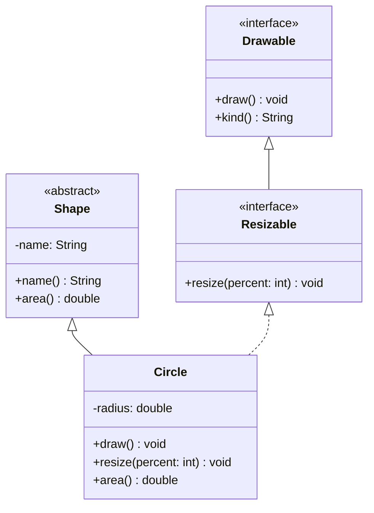
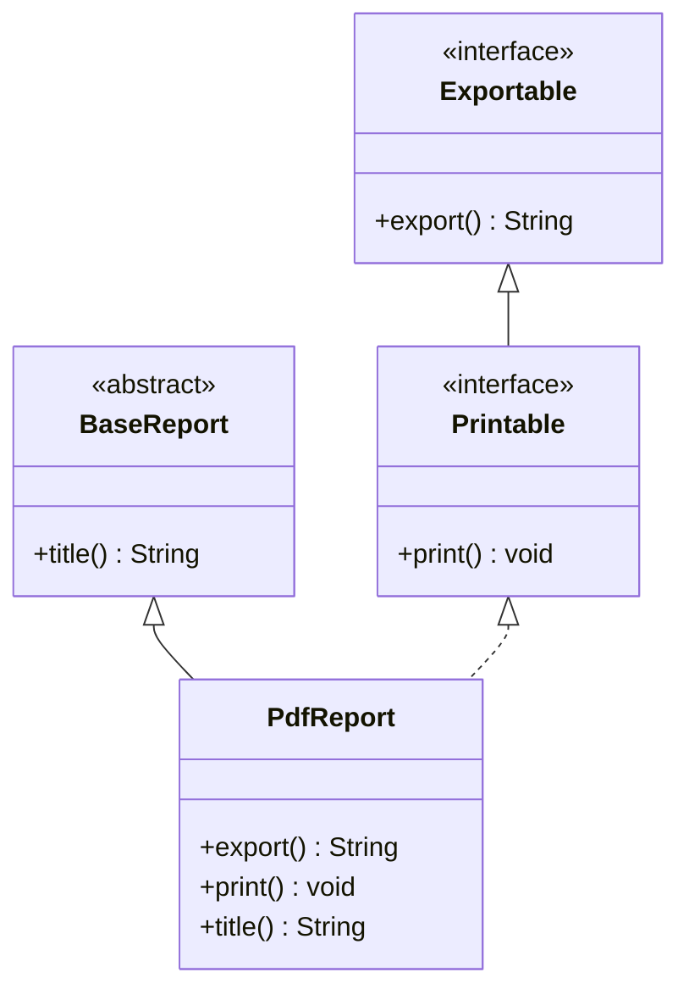

<a id="back-to-top"></a>

# Nền tảng kiểu

## Menu
- [Kiểu tham chiếu và kiểu thực tế của đối tượng](#type-foundations-001)
- [Quan hệ kiểu cha và kiểu con](#type-foundations-002)
- [Kế thừa kiểu, kế thừa mã và kế thừa trạng thái](#type-foundations-003)
- [Đơn kế thừa lớp và đa kế thừa interface](#type-foundations-004)
- [Phân biệt extends và implements](#type-foundations-005)
- [Phạm vi truy cập public, protected, package-private và private](#type-foundations-006)
- [Đọc sơ đồ lớp và quan hệ thực thi hợp đồng](#type-foundations-007)

## <a id="type-foundations-001">Kiểu tham chiếu và kiểu thực tế của đối tượng</a>

<details>
<summary>Xem chi tiết</summary>

# Kiểu tham chiếu và kiểu thực tế của đối tượng trong Java

Khi làm việc với kế thừa, lớp trừu tượng và interface, cần phân biệt **kiểu của biến tham chiếu** với **kiểu thực tế của đối tượng mà biến đang trỏ tới**. Phân biệt này giải thích vì sao cùng một lời gọi phương thức có thể chạy các phần cài đặt khác nhau, vì sao không gọi được mọi phương thức của đối tượng qua một biến, và vì sao ép kiểu xuống đôi khi thất bại.

## 1. Hai khái niệm khác nhau

Xét câu lệnh:

```java
Animal pet = new Dog("Milo");
```

Giả sử `Dog extends Animal`:

- **Kiểu tham chiếu (reference type / kiểu khai báo, compile-time type)** của `pet` là `Animal`. Đây là kiểu mà trình biên dịch dùng để kiểm tra phép gán, khả năng truy cập thành viên, chữ ký phương thức và lựa chọn overload. Kiểu khai báo của biến `pet` không tự đổi thành `Dog`.
- **Kiểu thực tế (runtime class / kiểu động)** của đối tượng được tạo bởi `new Dog(...)` là `Dog`. Đối tượng ấy có phần trạng thái và hành vi do `Dog` định nghĩa hoặc kế thừa. `pet.getClass()` trả về `Dog.class` khi `pet` khác `null`.
- `pet` lưu **giá trị tham chiếu tới đối tượng**. Phép gán từ biến tham chiếu khác chỉ sao chép giá trị tham chiếu; nó không biến đối tượng `Dog` thành một đối tượng `Animal` mới.

Sơ đồ ý tưởng:

```text
Biến pet
  kiểu khai báo: Animal
  giá trị: tham chiếu ──────────> đối tượng được tạo bởi new Dog(...)
                                   lớp thực tế: Dog
                                   phần Animal + phần Dog
```

Có thể nhìn hai khái niệm theo hai câu hỏi:

| Câu hỏi | Yếu tố quyết định |
| --- | --- |
| Mã nguồn `pet.someMethod()` có hợp lệ không? | Kiểu tham chiếu `Animal` và các phương thức mà kiểu đó khai báo hoặc kế thừa |
| Với phương thức instance được override, thân hàm nào chạy? | Lớp thực tế của đối tượng, ở đây là `Dog` |
| Biểu thức truy cập field nào, hoặc phương thức `static` nào được chọn? | Kiểu của biểu thức tại thời điểm biên dịch |
| Overload nào được chọn? | Kiểu tĩnh của các đối số và các overload khả dụng khi biên dịch |
| Ép kiểu xuống `Dog` có chạy thành công không? | Đối tượng thật có tương thích với `Dog` tại runtime không? |

## 2. Upcasting và tính đa hình

Nếu `Dog` là một kiểu con của `Animal`, Java cho phép gán một đối tượng `Dog` cho tham chiếu `Animal`:

```java
Dog dog = new Dog("Milo");
Animal animal = dog;      // Upcasting ngầm định: hợp lệ
Object value = animal;    // Mọi class Java đều kế thừa Object
```

Cả ba biến có thể đang tham chiếu **cùng một đối tượng** `Dog`. Upcasting không tạo bản sao và không làm mất các phần của đối tượng. Tương tự, có thể dùng một interface làm kiểu tham chiếu nếu lớp đối tượng thực tế triển khai interface ấy.

```java
interface Trainable {
    void train();
}

class Puppy implements Trainable {
    @Override
    public void train() {
        System.out.println("Training");
    }
}

Trainable t = new Puppy(); // Biến có kiểu interface; đối tượng thật là Puppy
t.train();                 // Gọi được vì Trainable khai báo train()
```

Đoạn trên là **mảnh mã minh họa**, không phải một tệp chương trình độc lập. Một abstract class hoặc interface không thể được khởi tạo trực tiếp bằng `new` thông thường, nhưng vẫn có thể làm kiểu tham chiếu tới thể hiện của lớp cụ thể phù hợp.

Đa hình (polymorphism) xuất hiện khi mã làm việc qua kiểu chung mà hành vi vẫn phụ thuộc vào từng đối tượng cụ thể:

```java
Animal first = new Dog("Milo");
Animal second = new Cat("Luna");

first.sound();  // Thân hàm Dog.sound()
second.sound(); // Thân hàm Cat.sound()
```

Ở đây `Animal` phải khai báo hoặc kế thừa phương thức `sound()` thì hai lệnh mới biên dịch. Việc chọn **implementation** tương ứng của phương thức instance được override xảy ra khi chạy, dựa trên lớp thực tế của đối tượng.

## 3. Ví dụ Java 17+ biên dịch và chạy được

Lưu đúng toàn bộ mã dưới đây vào tệp `ReferenceRuntimeTypeDemo.java`:

```java
public class ReferenceRuntimeTypeDemo {

    static abstract class Animal {
        final String name;
        String kind = "Animal field";

        Animal(String name) {
            this.name = name;
        }

        abstract String sound();

        String introduce() {
            return name + ": " + sound();
        }

        static String family() {
            return "Animal static";
        }
    }

    static final class Dog extends Animal {
        String kind = "Dog field";

        Dog(String name) {
            super(name);
        }

        @Override
        String sound() {
            return "woof";
        }

        void fetch() {
            System.out.println(name + " fetches");
        }

        static String family() {
            return "Dog static";
        }
    }

    static final class Cat extends Animal {
        Cat(String name) {
            super(name);
        }

        @Override
        String sound() {
            return "meow";
        }
    }

    static String select(Animal animal) {
        return "Animal overload";
    }

    static String select(Dog dog) {
        return "Dog overload";
    }

    public static void main(String[] args) {
        Animal pet = new Dog("Milo");

        System.out.println("declared type: Animal");
        System.out.println("runtime type: " + pet.getClass().getSimpleName());
        System.out.println("sound: " + pet.sound());
        System.out.println("introduce: " + pet.introduce());
        System.out.println("field via Animal: " + pet.kind);
        System.out.println("field via Dog: " + ((Dog) pet).kind);
        System.out.println("static via Animal: " + Animal.family());
        System.out.println("static via Dog: " + Dog.family());
        System.out.println("overload via Animal: " + select(pet));
        System.out.println("overload via Dog: " + select((Dog) pet));

        if (pet instanceof Dog dog) {
            dog.fetch();
        }

        Animal other = new Cat("Luna");
        System.out.println("other: " + other.introduce());
    }
}
```

Chạy tại thư mục chứa tệp:

```bash
javac ReferenceRuntimeTypeDemo.java
java ReferenceRuntimeTypeDemo
```

Kết quả chuẩn:

```text
declared type: Animal
runtime type: Dog
sound: woof
introduce: Milo: woof
field via Animal: Animal field
field via Dog: Dog field
static via Animal: Animal static
static via Dog: Dog static
overload via Animal: Animal overload
overload via Dog: Dog overload
Milo fetches
other: Luna: meow
```

**Giải thích từng hiện tượng quan trọng:**

1. `Animal pet` xác định kiểu khai báo; `new Dog(...)` xác định lớp đối tượng thực tế. Dòng in `declared type: Animal` là nhãn ta tự ghi trong mã; Java không cung cấp `pet.getDeclaredType()` để lấy trực tiếp kiểu khai báo của một biến tại runtime.
2. `pet.sound()` chạy `Dog.sound()` do **dynamic dispatch**. Trong `Animal.introduce()`, lời gọi `sound()` cũng được dispatch tới `Dog.sound()`, dù thân `introduce()` nằm ở lớp cha.
3. `pet.kind` chọn field `Animal.kind`; `((Dog) pet).kind` chọn field `Dog.kind`. Field **bị che khuất (field hiding)**; việc truy cập field không có dynamic dispatch như gọi phương thức được override.
4. `Animal.family()` và `Dog.family()` minh họa **static method hiding**, không phải overriding. Nên gọi phương thức static qua tên lớp cho rõ ý định. Nếu viết `pet.family()`, Java vẫn chọn phiên bản theo kiểu khai báo `Animal`, không theo đối tượng `Dog`.
5. `select(pet)` chọn overload `select(Animal)` khi biên dịch vì đối số có kiểu khai báo `Animal`. Ép kiểu biểu thức thành `Dog` làm `select((Dog) pet)` chọn overload `select(Dog)`; việc ép kiểu thành công chỉ vì đối tượng thực tế là `Dog`.
6. `other` cũng là tham chiếu `Animal`, nhưng trỏ tới `Cat`, nên `other.introduce()` gọi `Cat.sound()`.

## 4. Những gì kiểu tham chiếu cho phép nhìn thấy

Giả sử `Animal` khai báo `sound()`, còn chỉ `Dog` khai báo `fetch()`:

```java
Animal a = new Dog("Milo");
a.sound(); // Hợp lệ: Animal khai báo sound()
a.fetch(); // LỖI BIÊN DỊCH: không tìm thấy fetch() trên kiểu Animal
```

Đây là **mảnh mã giải thích lỗi**, không phải đoạn được đưa vào chương trình chạy ở mục 3. Đối tượng vẫn là `Dog` và vẫn có hành vi `fetch()`, nhưng trình biên dịch chỉ có thể dựa vào giao diện mà kiểu `Animal` công bố. Java không tự cho phép gọi phương thức riêng của mọi lớp con qua biến lớp cha.

Muốn gọi `fetch()`, hãy dùng tham chiếu có kiểu phù hợp sau khi kiểm tra đối tượng:

```java
Animal a = new Dog("Milo");
if (a instanceof Dog dog) { // Pattern matching for instanceof, Java 16+
    dog.fetch();
}
```

Kiểu của biểu thức cũng quyết định khả năng nhìn thấy thành viên theo quy tắc truy cập `public`, `protected`, package-private và `private`. Một thành viên có tồn tại trong đối tượng không đồng nghĩa với việc mọi vị trí trong chương trình đều được quyền truy cập thành viên đó.

### Gọi instance, truy cập field, static và overload

| Cơ chế | Được quyết định khi nào? | Quy tắc ngắn |
| --- | --- | --- |
| Chọn chữ ký phương thức có thể gọi | Biên dịch | Dựa vào kiểu tham chiếu và quyền truy cập |
| Chạy thân phương thức instance được override | Runtime | Dựa vào lớp thực tế của đối tượng |
| Truy cập field trùng tên giữa lớp cha/con | Biên dịch | Dựa vào kiểu của biểu thức truy cập |
| Gọi phương thức `static` trùng tên | Biên dịch | Hiding theo lớp/kiểu tham chiếu |
| Chọn overload `doWork(Animal)` hay `doWork(Dog)` | Biên dịch | Dựa trên kiểu tĩnh của đối số |
| Constructor | Khi tạo đối tượng | `new Dog(...)` tạo đối tượng `Dog`; constructor không được override |
| Phương thức `private` hoặc `final` | Theo quy tắc khai báo | Không thể override những phương thức này |

Phân biệt hai từ dễ nhầm: **overriding** là lớp con cung cấp thân mới cho phương thức instance có chữ ký thích hợp của lớp cha/interface; **overloading** là nhiều phương thức cùng tên nhưng khác danh sách tham số. Overriding tạo đa hình runtime, còn quá trình chọn overload là tĩnh.

## 5. Downcasting: đổi cách nhìn, không đổi đối tượng

Ép kiểu từ một tham chiếu cha xuống lớp con gọi là **downcasting**:

```java
Animal a = new Dog("Milo");
Dog d = (Dog) a;     // Hợp lệ và thành công tại runtime
d.fetch();
```

Lệnh `(Dog) a` không tạo đối tượng mới, không thay đổi lớp của đối tượng và không thay đổi kiểu khai báo của biến `a`. Nó tạo ra một biểu thức tham chiếu có kiểu `Dog` sau kiểm tra tương thích runtime.

Không thể suy ra rằng *mọi* `Animal` đều là `Dog`:

```java
Animal a = new Cat("Luna");
Dog d = (Dog) a; // Biên dịch được nhưng ném ClassCastException khi chạy
```

Lý do: `Cat` và `Dog` đều là lớp con của `Animal` nhưng đối tượng thực tế là `Cat`. Việc ép kiểu chỉ hợp lệ nếu đối tượng thật là thể hiện của kiểu đích hoặc kiểu con tương ứng. Cách an toàn, dễ đọc:

```java
void handle(Animal animal) {
    if (animal instanceof Dog dog) {
        dog.fetch();
    } else {
        System.out.println("Not a Dog");
    }
}
```

Đây là **phương thức minh họa** đặt trong một lớp thích hợp, dùng các lớp `Animal`/`Dog` ở ví dụ chính. Nếu có thể giải quyết yêu cầu bằng phương thức đa hình chung trên `Animal`, hãy ưu tiên thiết kế đó thay vì kiểm tra từng lớp con liên tiếp.

**Upcast** thường là chuyển đổi an toàn, ngầm định từ lớp con sang lớp cha/interface. **Downcast** cần kiểm tra tại runtime; với kiểu tham chiếu không liên quan mà trình biên dịch biết chắc không thể chuyển đổi, bản thân phép cast còn bị từ chối khi biên dịch.

## 6. `instanceof`, `getClass()` và `null`

Hai cách kiểm tra khác nhau:

- `obj instanceof Dog` trả về `true` nếu đối tượng không null và tương thích với `Dog`, bao gồm cả thể hiện của các lớp con của `Dog` (nếu `Dog` không `final`).
- `obj.getClass() == Dog.class` chỉ đúng khi **lớp thực tế chính xác** là `Dog`. Gọi `getClass()` trên `null` ném `NullPointerException`.

Ví dụ:

```java
Object obj = "Java";
System.out.println(obj instanceof String);             // true
System.out.println(obj.getClass() == String.class);     // true

Object empty = null;
System.out.println(empty instanceof String);           // false
// empty.getClass(); // NullPointerException
```

Đoạn trên là mảnh lệnh minh họa trong một phương thức. `null` không có lớp thực tế của đối tượng vì **không có đối tượng** nào được tham chiếu. Có thể gán `null` cho biến kiểu tham chiếu, nhưng không thể gọi phương thức instance của đối tượng qua giá trị null. Phép cast `(Dog) null` cho kết quả `null`, không ném `ClassCastException` tại thời điểm cast.

Một đối tượng có **một lớp thực tế cụ thể** khi được tạo, nhưng có thể tương thích với nhiều kiểu tham chiếu (các lớp cha và interface của nó). `instanceof` kiểm tra tương thích kiểu; `getClass()` cho biết lớp thực tế chính xác. Không nên dùng so sánh `getClass()` để thay thế máy móc cho `instanceof`, vì hai biểu thức trả lời hai câu hỏi khác nhau.

## 7. Những lỗi hiểu nhầm thường gặp

**Nhầm 1: “Biến `Animal` thì đối tượng là `Animal`.”** Sai với `Animal a = new Dog(...)`: biến có kiểu tĩnh `Animal`, đối tượng có lớp thực tế `Dog`. Kể cả `Animal` là abstract class thì khai báo biến kiểu `Animal` vẫn hợp lệ.

**Nhầm 2: “Override và overload đều chọn theo lớp thực tế.”** Override của phương thức instance dispatch động. Overload được giải quyết khi biên dịch dựa trên kiểu biểu thức đối số, như `select(pet)` trong ví dụ.

**Nhầm 3: “Field được đa hình như method.”** Truy cập field theo kiểu biểu thức; field cùng tên trong lớp con là hiding. Dùng phương thức instance (ví dụ getter có thể override) nếu cần hành vi đa hình, thay vì dựa vào việc che khuất field.

**Nhầm 4: “Ép kiểu xuống biến đối tượng thành lớp con.”** Cast chỉ đổi kiểu của **biểu thức tham chiếu** mà mã đang sử dụng và thực hiện kiểm tra khi cần; đối tượng vẫn mang lớp được xác định lúc tạo.

**Nhầm 5: “`instanceof` luôn tương đương `getClass() == ...`.”** `instanceof` chấp nhận kiểu con, còn so sánh `getClass()` yêu cầu lớp thực tế trùng chính xác; `null` cũng tạo ra kết quả khác.

**Nhầm 6: “Kiểu của một collection tự động thay đổi vì phần tử là lớp con.”** `List<Dog>` không phải kiểu con của `List<Animal>` trong Java, dù `Dog extends Animal`. Đây là quy tắc invariance của generic type arguments, độc lập với việc một phần tử `Dog` có thể được gán cho một biến `Animal`. Có thể dùng `List<? extends Animal>` để đọc các phần tử như `Animal` khi phù hợp.

## 8. Cách tự phân tích một biểu thức

Khi gặp `Base x = new Derived();` và `x.action()`, hãy trả lời theo thứ tự:

1. **Biến `x` được khai báo là kiểu nào?** Compiler dùng kiểu đó để xác định phương thức có tồn tại và có truy cập được không.
2. **Đối tượng `x` đang trỏ đến được tạo từ lớp nào?** Nếu `action()` là phương thức instance được override, implementation tương ứng của lớp thực tế sẽ chạy.
3. **Đang gọi method instance, method static, overload hay truy cập field?** Chỉ phương thức instance override mới có dynamic dispatch theo nghĩa đang xét.
4. **Có phép cast hoặc `instanceof` không?** Kiểm tra tương thích của lớp thực tế và nhớ rằng kiểu tĩnh của biểu thức sau cast có thể ảnh hưởng đến overload và member access.
5. **Tham chiếu có thể là `null` không?** Kiểm tra trước khi dereference nếu luồng dữ liệu cho phép null.

### Tự kiểm tra nhanh

**Câu 1.** `Animal a = new Dog("Milo");` thì `a.sound()` gọi phương thức nào nếu `Dog` override `sound()`? — **`Dog.sound()`**, miễn lời gọi hợp lệ theo kiểu `Animal`.

**Câu 2.** Vì sao `a.fetch()` có thể không biên dịch, dù `a.getClass()` là `Dog.class`? — Vì **kiểu khai báo `Animal` không công bố `fetch()`**; compiler không dựa vào kết quả `getClass()` tại runtime để cho phép lời gọi.

**Câu 3.** `Animal a = new Cat("Luna"); Dog d = (Dog) a;` lỗi ở đâu? — Cast có thể **biên dịch**, nhưng ném **`ClassCastException` lúc chạy**, do đối tượng là `Cat`.

**Ghi nhớ:** kiểu tham chiếu kiểm soát **mã có thể yêu cầu điều gì**; lớp thực tế của đối tượng quyết định **implementation nào chạy** khi gọi phương thức instance được override. Hiểu đúng hai tầng này là nền tảng để thiết kế API bằng abstract class/interface và dùng đa hình an toàn.


</details>

- [Quay lại đầu trang](#back-to-top)

---

## <a id="type-foundations-002">Quan hệ kiểu cha và kiểu con</a>

<details>
<summary>Xem chi tiết</summary>

# Quan hệ kiểu cha và kiểu con trong Java

Trong Java, **kiểu con (subtype)** có thể được dùng ở nơi API yêu cầu kiểu cha (supertype). Quan hệ này tạo nền tảng cho đa hình và thiết kế API linh hoạt. Cần phân biệt quan hệ kiểu với quan hệ kế thừa giữa hai lớp: một interface cũng có thể là supertype dù không phải superclass.

## 1. Subclass khác subtype như thế nào?

Giả sử `Dog extends Animal`:

- `Dog` là **subclass** của `Animal`; `Animal` là superclass.
- `Dog` cũng là **subtype** của `Animal`; `Animal` là supertype.
- Nếu `Animal implements CanMove`, thì `Dog` cũng là subtype của `CanMove` thông qua quan hệ kế thừa. `CanMove` không trở thành superclass của `Dog`.
- Quan hệ subtype có tính bắc cầu: nếu `Poodle extends Dog` và `Dog extends Animal`, thì `Poodle` là subtype của `Animal`.

Một lớp không khai báo `extends` trực tiếp sẽ có `Object` làm superclass (ngoại trừ chính `Object`). Interface không phải subclass của `Object`, nhưng một đối tượng của lớp triển khai interface vẫn có thể được gán cho biến `Object`. Kiểu nguyên thủy như `int` không thuộc hệ phân cấp class/interface; boxing là cơ chế chuyển đổi riêng.

**“Is-a” và “has-a” trả lời hai câu hỏi khác nhau.** `Dog extends Animal` diễn tả Dog là một Animal. `Car` giữ trường `Engine engine` diễn tả Car có một Engine; nó không làm `Car` thành subtype của `Engine`. Chỉ dùng kế thừa khi hành vi công khai của kiểu cha còn đúng với kiểu con.

## 2. Những khai báo tạo quan hệ kiểu

| Khai báo | Quan hệ | Giới hạn chính |
|---|---|---|
| `class Dog extends Animal` | `Dog` là subtype của `Animal`. | Một class chỉ có một superclass trực tiếp. |
| `class Dog implements CanMove, Named` | `Dog` là subtype của cả hai interface. | Class cụ thể phải đáp ứng các abstract method còn thiếu. |
| `interface Smart extends CanMove, Named` | `Smart` kế thừa hợp đồng của nhiều interface. | Interface dùng `extends`, không dùng `implements`. |
| `abstract class Animal implements CanMove` | `Animal` là subtype của `CanMove`. | Vì `Animal` abstract, nó có thể chuyển tiếp nghĩa vụ triển khai cho lớp con. |
| `final class Dog extends Animal` | Vẫn là subtype của `Animal`. | `final` ngăn tạo subclass mới của `Dog`. |

Trong Java 17+, `sealed` class/interface có thể giới hạn các subtype trực tiếp được phép khai báo. Những giới hạn đó không thay đổi ý nghĩa cơ bản của quan hệ subtype.

## 3. Ví dụ chạy được: nhiều kiểu con, một hợp đồng

Lưu toàn bộ mã sau thành `TypeRelationDemo.java`:

```java
public class TypeRelationDemo {
    interface CanMove {
        void move();
    }

    static abstract class Animal implements CanMove {
        private final String name;

        Animal(String name) {
            this.name = name;
        }

        String name() {
            return name;
        }

        abstract String sound();

        @Override
        public void move() {
            System.out.println(name + " moves");
        }
    }

    static final class Dog extends Animal {
        Dog(String name) {
            super(name);
        }

        @Override
        String sound() {
            return "woof";
        }

        void fetch() {
            System.out.println(name() + " fetches");
        }
    }

    static final class Cat extends Animal {
        Cat(String name) {
            super(name);
        }

        @Override
        String sound() {
            return "meow";
        }
    }

    static void describe(Animal animal) {
        System.out.println(animal.name() + ": " + animal.sound());
    }

    public static void main(String[] args) {
        Dog rex = new Dog("Rex");

        Animal animal = rex;
        CanMove mover = rex;
        Object any = rex;

        describe(animal);
        mover.move();
        System.out.println(animal instanceof Dog);

        if (animal instanceof Dog dog) {
            dog.fetch();
        }

        Animal other = new Cat("Mimi");
        describe(other);
        System.out.println(any.getClass().getSimpleName());
    }
}
```

Biên dịch và chạy bằng JDK 17 trở lên:

```bash
javac TypeRelationDemo.java
java TypeRelationDemo
```

Stdout:

```text
Rex: woof
Rex moves
true
Rex fetches
Mimi: meow
Dog
```

`animal`, `mover` và `any` cùng tham chiếu một đối tượng `Dog`; upcast không sao chép đối tượng. `describe(Animal)` dùng được với cả `Dog` và `Cat`. Biến `animal` không công bố phương thức `fetch()`, nên cần kiểm tra kiểu trước khi dùng khả năng riêng của `Dog`. Phần phân giải chi tiết giữa kiểu khai báo, lớp runtime, overload và field được giải thích ở bài **Kiểu tham chiếu và kiểu thực tế của đối tượng**.

## 4. Tương thích kiểu và tính thay thế về hành vi

Gán `Dog` cho biến `Animal` hoặc `CanMove` là **upcasting** ngầm định nhờ quan hệ subtype; các biến vẫn tham chiếu cùng object. Chiều ngược lại là **downcasting**: kiểu biểu thức hẹp hơn nhưng không đổi object. Phải kiểm tra kiểu thực tế, chẳng hạn `candidate instanceof Dog dog`, trước khi dùng `dog.fetch()` khi không chắc `candidate` là `Dog`; cast sai có thể ném `ClassCastException`. `instanceof` trả `false` với `null`.

**Compiler chấp nhận phép gán chưa bảo đảm tính thay thế hành vi.** Theo nguyên tắc Liskov (LSP), chương trình dùng supertype phải tiếp tục hoạt động theo các cam kết của supertype khi nhận subtype. Lớp con không nên siết điều kiện đầu vào đã được cha chấp nhận, phá bất biến hoặc từ chối thao tác mà hợp đồng cha bảo đảm. Nếu `CanMove.move()` hứa di chuyển hợp lệ, một implementation luôn ném `UnsupportedOperationException` vi phạm kỳ vọng đó. Hãy chỉ cho những đối tượng thực sự có khả năng di chuyển triển khai `CanMove`.

Do đó, cần kiểm tra **hai tầng**: quan hệ subtype ở mức ngôn ngữ và khả năng giữ đúng hợp đồng ở mức thiết kế, kiểm thử.

## 5. Subtype không tự động truyền qua generic

Có `Dog extends Animal` **không** có nghĩa `List<Dog>` là subtype của `List<Animal>`. Generic Java thường bất biến:

```java
java.util.List<Dog> dogs = java.util.List.of(new Dog("Rex"));
// java.util.List<Animal> animals = dogs; // Lỗi biên dịch

java.util.List<? extends Animal> view = dogs;
Animal first = view.get(0); // Đọc an toàn như Animal
// view.add(new Dog("Max")); // Không thêm Dog tùy ý được
```

`? extends Animal` cho phép đọc phần tử dưới dạng `Animal`, nhưng kiểu con thực tế của danh sách chưa biết; nó có thể là `List<Cat>`. Khi API cần **tiêu thụ** giá trị `Dog`, `? super Dog` có thể phù hợp hơn. Chọn wildcard theo chiều dữ liệu vào/ra thay vì cố ép hai loại `List` thành cùng kiểu.

Mảng Java có tính covariant nhưng việc ghi phần tử được kiểm tra lúc chạy:

```java
Animal[] animals = new Dog[1];  // Hợp lệ khi biên dịch
animals[0] = new Cat("Mimi");  // ArrayStoreException lúc chạy
```

Vì vậy, quan hệ giữa kiểu phần tử, kiểu container và an toàn runtime là các vấn đề riêng. Đừng suy từ `Dog <: Animal` rằng mọi cấu trúc chứa `Dog` đều gán được cho cấu trúc chứa `Animal`.

## 6. Chọn supertype cho API

Ưu tiên kiểu trừu tượng nhỏ nhất đáp ứng nhu cầu của caller:

- Dùng `CanMove` nếu hàm chỉ cần gọi `move()`, để cả `Animal`, `Robot` hoặc lớp không cùng cây kế thừa đều có thể tham gia.
- Dùng `Animal` khi thật sự cần những thuộc tính/hành vi chung của họ động vật.
- Dùng class cụ thể như `Dog` chỉ khi nghiệp vụ cần khả năng riêng như `fetch()`.

Composition phù hợp khi quan hệ là “có một” hoặc “ủy quyền cho”, chẳng hạn `Car` chứa `Engine`. Kế thừa phù hợp khi quan hệ “là một” có ý nghĩa và subtype giữ đúng hợp đồng của supertype. Không nên kế thừa chỉ để lấy một phương thức tiện ích.

## 7. Các ngộ nhận thường gặp

| Ngộ nhận | Cách hiểu đúng |
|---|---|
| Interface được triển khai là superclass. | Nó là supertype, nhưng superclass chỉ là lớp trong nhánh `extends`. |
| Hai lớp cùng superclass có thể gán trực tiếp cho nhau. | `Dog` và `Cat` đều là `Animal`, nhưng không phải subtype của nhau. |
| Upcast tạo một đối tượng lớp cha mới. | Các biến sau upcast có thể cùng tham chiếu một instance ban đầu. |
| `instanceof` thay thế đa hình. | Override dùng dispatch tự động; `instanceof` là kiểm tra kiểu khi cần rẽ nhánh. |
| `List<Dog>` có thể dùng như `List<Animal>`. | Generic bất biến; dùng wildcard thích hợp. |
| Kế thừa cú pháp đủ chứng minh thiết kế đúng. | Subtype còn phải giữ các cam kết hành vi của supertype. |

## 8. Tự kiểm tra

1. Nếu `Dog extends Animal` và `Animal implements CanMove`, `Dog` có thể gán cho `CanMove` không? **Có**, vì quan hệ subtype bắc cầu.
2. `Dog` và `Cat` cùng kế thừa `Animal`; có thể gán trực tiếp `Dog` cho biến `Cat` không? **Không**, hai nhánh không có quan hệ subtype đó.
3. Vì sao `List<Dog>` không gán được cho `List<Animal>`? **Vì generic invariant**; nếu cho phép, code có thể thêm `Cat` vào danh sách vốn chỉ nhận `Dog`.
4. Khi nào composition phù hợp hơn `extends`? Khi đối tượng có hoặc ủy quyền cho một thành phần mà không thực sự là subtype của nó.

**Ghi nhớ:** quan hệ subtype trả lời “giá trị này có dùng được ở nơi cần kiểu kia không?”. Kế thừa lớp và triển khai interface có thể tạo quan hệ đó, nhưng API tốt còn đòi hỏi hợp đồng hành vi đúng và kiểu tham số không ràng buộc caller quá mức.


</details>

- [Quay lại đầu trang](#back-to-top)

---

## <a id="type-foundations-003">Kế thừa kiểu, kế thừa mã và kế thừa trạng thái</a>

<details>
<summary>Xem chi tiết</summary>

# Kế thừa kiểu, kế thừa mã và kế thừa trạng thái trong Java

Từ “kế thừa” thường được dùng cho ba ý khác nhau: **quan hệ kiểu** (đối tượng dùng được qua kiểu cha), **tái sử dụng mã** (nhận một implementation có sẵn) và **kế thừa trạng thái** (instance chứa các field do superclass định nghĩa). Phân biệt ba khía cạnh giúp quyết định nên dùng `extends`, `implements`, `default` method hay composition.

## 1. Ba cơ chế không đồng nghĩa

| Khía cạnh | Câu hỏi | Cơ chế điển hình | Giới hạn |
|---|---|---|---|
| **Kế thừa kiểu** | Giá trị có dùng được ở nơi cần kiểu cha không? | `class extends`, `class implements`, `interface extends` | Có subtype không đồng nghĩa với nhận mọi code hoặc state. |
| **Kế thừa mã** | Implementation nào có thể dùng lại? | Concrete method của superclass; `default` method của interface | Không phải mọi method đều được kế thừa hoặc override. |
| **Kế thừa trạng thái** | Field instance nào thuộc object? | Instance field trong chuỗi `extends` | Interface không cung cấp instance field; `static` field không phải state riêng của mỗi object. |

Một khai báo có thể kết hợp nhiều khía cạnh:

- `SavingsAccount extends Account`: quan hệ subtype, có thể kế thừa concrete method và chứa state do `Account` định nghĩa.
- `SavingsAccount implements Named`: tạo quan hệ kiểu với `Named`; có thể nhận `default` method phù hợp nhưng không nhận state instance từ interface.
- `interface Auditable extends Named`: mở rộng hợp đồng và có thể kế thừa `default` method; vẫn không có state instance.
- `abstract class` có thể chứa field, constructor, concrete method và abstract method; mỗi thành viên có quy tắc riêng.

Java chỉ cho một superclass trực tiếp trên mỗi class, nhưng class có thể implement nhiều interface. Nhiều hợp đồng kiểu không đồng nghĩa với nhiều superclass có trạng thái.

## 2. Kế thừa kiểu: có thể thay thế qua hợp đồng nào?

Ví dụ `SavingsAccount extends Account` và `Account implements Named`:

```java
SavingsAccount savings = new SavingsAccount("Lan", 100);
Account asAccount = savings;
Named asNamed = savings;
```

Các biến có kiểu khai báo khác nhau nhưng có thể cùng tham chiếu **một object**. Upcast không tạo bản sao. Kiểu khai báo giới hạn API có thể gọi; implementation của phương thức instance được override được chọn theo đối tượng runtime. Bài **Quan hệ kiểu cha và kiểu con** trình bày riêng về subtype, LSP, generic và cách chọn kiểu cho API.

Quan hệ kiểu do compiler xác nhận không tự bảo đảm hành vi nghiệp vụ. Nếu lớp con phá cam kết của lớp cha, code dùng kiểu cha vẫn có thể hỏng. Hãy thiết kế hợp đồng theo hành vi mà mọi implementation có thể đáp ứng, không chỉ theo tên `extends`.

## 3. Kế thừa mã: concrete method, abstract method và default method

Superclass có thể cung cấp thuật toán chung qua concrete method; subclass có thể dùng trực tiếp hoặc override method instance phù hợp. Abstract method chỉ định nghĩa phần lớp con phải hoàn thiện. Constructor không được kế thừa.

Interface cũng có thể tái sử dụng code qua `default` method:

```java
interface Named {
    String name();

    default String description() {
        return "Định danh: " + name();
    }
}
```

Lớp `implements Named` nhận hợp đồng `name()` và có thể dùng `description()` mà không chép lại code. Lời gọi `name()` trong default method dispatch tới implementation của object. Điều này **không** làm interface thành superclass có state.

Các quy tắc cần nhớ:

1. `@Override` giúp compiler xác nhận method thực sự override; implementation không được giảm mức truy cập và phải tuân thủ kiểu trả về/checked exception.
2. `final` method không thể override; `static` method bị hide theo kiểu khai báo; `private` method của superclass không được subclass override.
3. `super.method()` gọi implementation của superclass khi hợp lệ; nó không tạo một object cha thứ hai.
4. Nếu hai interface không liên quan cung cấp `default` method trùng signature, lớp cụ thể thường phải override để chọn hành vi. Phương thức instance cụ thể phù hợp từ superclass được ưu tiên theo quy tắc Java. Bài **Đơn kế thừa lớp và đa kế thừa interface** đi sâu vào các trường hợp xung đột này.

## 4. Kế thừa trạng thái: field của superclass nằm trong cùng object

Một `SavingsAccount` có thể chứa phần state do `Account` khai báo, ví dụ `owner` và `balance`, cùng với state riêng của subclass. Đây là các phần trong **một instance**, không phải hai object cha/con được lồng độc lập.

```java
abstract class Account {
    private final String owner;
    private long balance;

    protected Account(String owner, long initialBalance) {
        if (initialBalance < 0) {
            throw new IllegalArgumentException("Số dư ban đầu âm");
        }
        this.owner = owner;
        this.balance = initialBalance;
    }

    public final String owner() {
        return owner;
    }

    protected final void add(long amount) {
        balance += amount;
    }

    public long balance() {
        return balance;
    }
}
```

- `private` field vẫn thuộc state của object subclass, nhưng code subclass không thể truy cập trực tiếp bằng tên field. Superclass có thể kiểm soát thao tác qua method.
- `protected` cho subclass quyền truy cập theo quy tắc Java, nhưng `protected` mutable field dễ làm subclass phá invariant. Ưu tiên field `private` cùng API có kiểm soát.
- `static` field thuộc về class, không phải một bản sao trong mỗi object. Field cùng tên ở subclass tạo **field hiding**, tức hai field riêng biệt, không phải override.
- `final` reference field không thể được gán lại sau khởi tạo, nhưng object mà nó trỏ đến vẫn có thể mutable.

Không nên suy luận rằng field `private` “biến mất” khỏi object con: nó vẫn là phần state do superclass quản lý; chỉ quyền truy cập trực tiếp bị giới hạn.

## 5. Ví dụ Java 17+ kết hợp cả ba cơ chế

Lưu chương trình sau thành `InheritanceKindsDemo.java`:

```java
public class InheritanceKindsDemo {
    interface Named {
        String name();

        default String description() {
            return "Định danh: " + name();
        }
    }

    static abstract class Account implements Named {
        private final String owner;
        private long balance;

        protected Account(String owner, long initialBalance) {
            if (initialBalance < 0) {
                throw new IllegalArgumentException("Số dư ban đầu âm");
            }
            this.owner = owner;
            this.balance = initialBalance;
        }

        @Override
        public final String name() {
            return owner;
        }

        protected final void add(long amount) {
            balance += amount;
        }

        protected abstract String kind();

        public String summary() {
            return kind() + " | " + description() + " | số dư=" + balance;
        }
    }

    static final class SavingsAccount extends Account {
        SavingsAccount(String owner, long initialBalance) {
            super(owner, initialBalance);
        }

        void deposit(long amount) {
            if (amount <= 0) {
                throw new IllegalArgumentException("Số tiền phải dương");
            }
            add(amount);
        }

        @Override
        protected String kind() {
            return "Tiết kiệm";
        }
    }

    public static void main(String[] args) {
        SavingsAccount savings = new SavingsAccount("Lan", 100);
        Account asAccount = savings;
        Named asNamed = savings;

        System.out.println(asNamed.description());
        System.out.println(asAccount.summary());
        savings.deposit(50);
        System.out.println(asAccount.summary());
        System.out.println(asNamed == asAccount);
    }
}
```

Biên dịch và chạy:

```bash
javac -encoding UTF-8 InheritanceKindsDemo.java
java InheritanceKindsDemo
```

Stdout:

```text
Định danh: Lan
Tiết kiệm | Định danh: Lan | số dư=100
Tiết kiệm | Định danh: Lan | số dư=150
true
```

Trong ví dụ:

- `SavingsAccount extends Account` tạo quan hệ subtype, nhận method `summary()` và chứa state `owner`/`balance` trong cùng instance.
- `Account implements Named`; `name()` đã đáp ứng hợp đồng interface và `description()` là code được kế thừa từ default method.
- `summary()` gọi `kind()`, được subclass cài đặt; phần thuật toán chung vẫn thuộc superclass.
- `add()` kiểm soát cập nhật balance thay vì để subclass sửa field trực tiếp.
- `asNamed == asAccount` in `true`: hai tham chiếu khác kiểu cùng trỏ đến một object.

Đây là ví dụ cơ chế, chưa phải mô hình tài chính hoàn chỉnh: hệ thống thật cần xử lý tràn số, đồng thời và kiểu tiền tệ thích hợp.

## 6. Một object, nhiều cách nhìn trạng thái

Với các lớp trong `InheritanceKindsDemo` ở mục 5, đoạn sau có thể đặt trong `main`:

```java
SavingsAccount savings = new SavingsAccount("Lan", 100);
Account asAccount = savings;
savings.deposit(50);
System.out.println(asAccount.summary());
// Tiết kiệm | Định danh: Lan | số dư=150
```

`asAccount` và `savings` cùng trỏ đến một object; cập nhật `balance` qua lớp con được `summary()` của lớp cha nhìn thấy. Thuật toán chung của `summary()` được kế thừa, còn lời gọi `kind()` bên trong dispatch đến implementation của `SavingsAccount`.

Nếu subclass khai báo field **trùng tên** với superclass, đó là hai field khác nhau (field hiding); truy cập field không dispatch động như method được override. Tránh dựa vào hiding để thay đổi hành vi; nên đóng gói state bằng field `private` và method có kiểm soát. Bài **Kiểu tham chiếu và kiểu thực tế của đối tượng** minh họa riêng trường hợp field hiding.

## 7. Constructor và thứ tự khởi tạo

Constructor không được kế thừa. Khi tạo subclass, Java khởi tạo state theo chuỗi superclass rồi mới hoàn tất initializer/constructor của subclass. Constructor con gọi `super(...)` để chọn constructor cha phù hợp; nếu cha không có constructor không tham số khả dụng, lời gọi mặc định không đủ và subclass phải gọi rõ constructor phù hợp.

Tránh gọi method có thể override từ constructor superclass. Dynamic dispatch có thể đi vào subclass khi field của subclass chưa được khởi tạo đầy đủ, dẫn đến kết quả khó đoán hoặc phá invariant.

## 8. Chọn kế thừa hay composition?

| Nhu cầu | Lựa chọn thường phù hợp |
|---|---|
| Một họ object có state, constructor và invariant chung | `abstract class` hoặc superclass được thiết kế ổn định |
| Các class khác họ cần cùng một hợp đồng | `interface` |
| Muốn chia sẻ hành vi mặc định nhỏ, không phụ thuộc state instance | `default` method khi có ý nghĩa |
| Đối tượng “có một” thành phần hoặc cần thay implementation độc lập | Composition/delegation |
| Cần giữ invariant dữ liệu | Field `private` và method có kiểm soát |

Không dùng `extends` chỉ để tiết kiệm vài dòng. `Car` có `Engine` phù hợp với composition hơn `Car extends Engine`; delegation giúp thay thành phần mà không khóa lớp vào một superclass không đúng nghĩa.

## 9. Tự kiểm tra

1. Class implements interface có abstract method và tự cài đặt method đó: có kế thừa kiểu không? **Có**; nó không nhận implementation từ abstract method hay state instance từ interface.
2. Interface có default method: class triển khai nhận gì? **Quan hệ kiểu và khả năng tái sử dụng implementation**, khi không có override/xung đột chi phối; không nhận state instance.
3. Subclass không truy cập trực tiếp field `private` của cha có nghĩa field không thuộc object không? **Không**; field vẫn là phần state của object, chỉ được superclass đóng gói.
4. Khi nào dùng composition? Khi quan hệ “có/dùng một thành phần” đúng hơn “là một”, hoặc hành vi cần thay đổi độc lập.

**Ghi nhớ:** kế thừa kiểu nói về khả năng thay thế, kế thừa mã nói về implementation có thể dùng lại, còn kế thừa trạng thái nói về dữ liệu instance do superclass định nghĩa. `extends class` thường kết hợp các cơ chế này; `implements interface` tạo quan hệ kiểu và đôi khi tái sử dụng default code, nhưng không cung cấp state instance.


</details>

- [Quay lại đầu trang](#back-to-top)

---

## <a id="type-foundations-004">Đơn kế thừa lớp và đa kế thừa interface</a>

<details>
<summary>Xem chi tiết</summary>

# Đơn kế thừa lớp và đa kế thừa interface trong Java

Trong Java, **một lớp chỉ được kế thừa trực tiếp từ một lớp cha**, nhưng **có thể triển khai nhiều interface**. Bản thân một interface cũng có thể **kế thừa nhiều interface khác**. Cơ chế này cho phép dùng lại trạng thái và hành vi theo một hệ phân cấp lớp rõ ràng, đồng thời cho phép một đối tượng thực hiện nhiều hợp đồng hành vi.

Bài học tập trung vào quan hệ giữa kiểu lớp và kiểu interface, cú pháp Java 17+, cách JVM/Java chọn phương thức khi có nhiều nguồn kế thừa hành vi, và cách thiết kế tránh xung đột.

## 1. Ba quy tắc cốt lõi

| Quan hệ | Cú pháp | Số lượng trực tiếp | Ý nghĩa |
| --- | --- | --- | --- |
| Lớp kế thừa lớp | class Child extends Parent | Tối đa **một** lớp cha | Nhận trạng thái và hành vi có thể kế thừa từ lớp cha. |
| Lớp triển khai interface | class Child implements A, B | **Nhiều** interface | Cam kết cung cấp các hành vi theo hợp đồng của các interface; có thể nhận default method. |
| Interface kế thừa interface | interface C extends A, B | **Nhiều** interface | Kết hợp hoặc mở rộng các hợp đồng, có thể nhận default method. |

Ví dụ cú pháp:

~~~java
class Animal {
    void sleep() {}
}

interface Swimmable {
    void swim();
}

interface Trackable {
    String trackingId();
}

class Dolphin extends Animal implements Swimmable, Trackable {
    @Override
    public void swim() {}

    @Override
    public String trackingId() {
        return "D-01";
    }
}

interface Monitored extends Swimmable, Trackable {
    void report();
}
~~~

Đây là **đoạn minh họa khai báo**, không phải chương trình có hàm main. Một lớp ghi extends trước implements; implements liệt kê các interface ngăn bằng dấu phẩy. Một interface dùng extends, không dùng implements. Một lớp không khai báo extends thì mặc nhiên kế thừa trực tiếp từ Object (trừ chính Object).

Cần phân biệt **kế thừa lớp** với **đa hình kiểu**: Dolphin chỉ có một lớp cha trực tiếp là Animal, nhưng một thể hiện Dolphin có thể được tham chiếu bằng kiểu Dolphin, Animal, Swimmable, Trackable hoặc Object.

## 2. Vì sao Java chỉ cho lớp đơn kế thừa?

Lớp có thể mang **trạng thái của đối tượng** (instance fields), constructor, các phương thức cụ thể, phương thức abstract và quy tắc khởi tạo. Nếu cho phép một lớp kế thừa trực tiếp nhiều lớp, hệ thống phải giải quyết nhiều vấn đề như đường khởi tạo lớp cha, xung đột trường và phiên bản phương thức cùng tên. Java chọn một chuỗi lớp cha duy nhất để duy trì mô hình đơn giản và xác định.

~~~java
class Vehicle {}
class Machine {}

// Không hợp lệ trong Java:
// class Robot extends Vehicle, Machine {}
~~~

Một lớp con có thể nối dài chuỗi kế thừa (Car extends Vehicle, ElectricCar extends Car), nhưng tại **mỗi cấp**, lớp đó vẫn chỉ khai báo tối đa một lớp cha trực tiếp. Không thể dùng dấu phẩy sau extends để kế thừa nhiều lớp.

Các điều kiện quan trọng:

- Lớp final không cho phép lớp khác extends nó.
- Constructor không được kế thừa; constructor lớp con gọi constructor lớp cha bằng super(...) hoặc lời gọi mặc định tương ứng.
- Thành viên private của lớp cha không truy cập trực tiếp được từ lớp con; mức truy cập và khả năng override vẫn tuân theo quy tắc Java.
- Một lớp abstract cũng chỉ có thể extends một lớp khác. Lớp cụ thể cuối cùng phải triển khai tất cả abstract method mà nó còn chịu trách nhiệm; lớp abstract có thể để lại chúng chưa triển khai.

**Đơn kế thừa không có nghĩa chỉ được dùng một loại hành vi.** Hành vi bổ sung nên được mô tả bằng interface hoặc được ghép từ các đối tượng cộng tác (composition).

## 3. Đa kế thừa interface hoạt động thế nào?

Interface chủ yếu mô tả **một hợp đồng kiểu và hành vi**. Một lớp implements nhiều interface cùng lúc và phải đáp ứng các abstract method của chúng (trực tiếp hoặc qua phương thức public được kế thừa từ lớp cha), trừ khi chính lớp đó là abstract.

~~~java
interface Readable {
    String read();
}

interface Writable {
    void write(String value);
}

interface ReadWritable extends Readable, Writable {
    void clear();
}
~~~

ReadWritable mở rộng cả Readable và Writable. Bất cứ lớp cụ thể nào implements ReadWritable đều phải có đủ read(), write(String), clear(). Nó cũng được xem là một Readable và Writable. Có thể hình dung:

~~~text
Readable       Writable
      \         /
       ReadWritable
             ^
             | implements
         MemoryStore
~~~

Khác với lớp, interface **không chứa trạng thái instance** và **không có constructor**. Các trường khai báo trong interface mặc nhiên là public static final, nên thường dùng cho hằng số, không dùng để lưu trạng thái riêng của từng đối tượng.

Từ Java 8, interface có default method (phương thức có thân được thừa hưởng như hành vi mặc định) và static method. Từ Java 9, interface còn có private method làm trợ giúp nội bộ cho các phương thức trong interface. Các khả năng đó **không biến interface thành lớp có trạng thái instance hoặc đa kế thừa lớp**.

## 4. Ví dụ đầy đủ: Một lớp cha, nhiều interface, đa hình

Tạo tệp Main.java:

~~~java
public class Main {
    interface Identifiable {
        String id();
    }

    interface Named {
        default String label() {
            return "item-" + name();
        }

        String name();
    }

    interface Auditable {
        default String auditType() {
            return "tracked";
        }
    }

    static abstract class Entity {
        private final String id;

        protected Entity(String id) {
            this.id = id;
        }

        public String id() {
            return id;
        }
    }

    static final class Product extends Entity
            implements Identifiable, Named, Auditable {
        private final String name;

        Product(String id, String name) {
            super(id);
            this.name = name;
        }

        @Override
        public String name() {
            return name;
        }
    }

    public static void main(String[] args) {
        Product product = new Product("P-07", "book");

        Identifiable byId = product;
        Named byName = product;
        Auditable byAudit = product;
        Entity byBase = product;

        System.out.println(byId.id());
        System.out.println(byName.label());
        System.out.println(byAudit.auditType());
        System.out.println(byBase.id());
    }
}
~~~

Biên dịch và chạy với JDK 17 trở lên:

~~~bash
javac Main.java
java Main
~~~

Kết quả chính xác:

~~~text
P-07
item-book
tracked
P-07
~~~

Giải thích:

1. Product chỉ extends **một** lớp cha là Entity, và nhận được trường id cùng phương thức id() thông qua cơ chế kế thừa lớp; trường private id chỉ được dùng trực tiếp bên trong Entity.
2. Product đồng thời implements **ba** interface Identifiable, Named, Auditable.
3. Phương thức public id() có sẵn trong Entity thỏa hợp đồng Identifiable.id(), vì chữ ký và mức truy cập phù hợp; Product không cần viết lại nó.
4. Product tự triển khai Named.name(). Default method Named.label() gọi name() trên đối tượng thực tế, nên trả về item-book.
5. Auditable.auditType() được kế thừa như default method. Các biến byId, byName, byAudit chỉ cho phép gọi phương thức hiển thị bởi kiểu tham chiếu tương ứng, dù cùng trỏ đến một Product.
6. Entity là abstract nhưng vẫn có constructor và phương thức cụ thể. Product là lớp cụ thể có thể khởi tạo và đáp ứng toàn bộ hợp đồng.

**Không cần ép kiểu để gán** Product cho từng interface mà nó implements. Ngược lại, từ biến kiểu interface muốn dùng thành viên chỉ thuộc Product thì phải kiểm tra/ép kiểu phù hợp, chẳng hạn bằng instanceof, và tránh giả định mọi đối tượng cùng interface đều là Product.

## 5. Điều gì xảy ra khi nhiều interface có phương thức trùng nhau?

Trước hết cần phân biệt ba trường hợp.

### 5.1. Cùng abstract method: thường chỉ cần một implementation

~~~java
interface Printable {
    void render();
}

interface Previewable {
    void render();
}

class Report implements Printable, Previewable {
    @Override
    public void render() {
        System.out.println("report");
    }
}
~~~

Một phương thức public void render() trong Report đáp ứng đồng thời hai hợp đồng vì chữ ký tương thích. Điều này khác hoàn toàn với hai default method có phần thân cạnh tranh nhau.

Lưu ý về **kiểu trả về**: các khai báo cùng chữ ký chỉ có thể kết hợp nếu kiểu trả về tương thích theo quy tắc return-type-substitutability của Java (ví dụ một kiểu trả về hiệp biến có thể thỏa nhiều hợp đồng). Hai hợp đồng yêu cầu kiểu trả về không tương thích thì một lớp không thể triển khai hợp lệ cả hai chỉ bằng cách đổi tên biến hoặc thêm @Override.

### 5.2. Hai default method xung đột: lớp phải chọn rõ

Tạo tệp Main.java độc lập cho ví dụ này:

~~~java
public class Main {
    interface Left {
        default String source() {
            return "left";
        }
    }

    interface Right {
        default String source() {
            return "right";
        }
    }

    static class Combined implements Left, Right {
        @Override
        public String source() {
            return Left.super.source() + "+" + Right.super.source();
        }
    }

    public static void main(String[] args) {
        System.out.println(new Combined().source());
    }
}
~~~

Chạy:

~~~bash
javac Main.java
java Main
~~~

Kết quả:

~~~text
left+right
~~~

Nếu bỏ Combined.source(), trình biên dịch báo xung đột vì Left và Right cùng cung cấp default source() có chữ ký trùng nhau. Combined **bắt buộc override** và tự định nghĩa quy tắc. Cú pháp Left.super.source() hay Right.super.source() gọi trực tiếp default method từ superinterface tương ứng; không thể tùy tiện dùng tên của một interface không nằm trong quan hệ superinterface hợp lệ.

Lớp cũng có thể chọn một cách đơn giản hơn:

~~~java
@Override
public String source() {
    return "combined";
}
~~~

Đoạn trên chỉ là phần thân override thay thế đặt bên trong Combined, không phải chương trình Java độc lập.

### 5.3. Phương thức cụ thể từ lớp cha được ưu tiên

Tạo tệp Main.java độc lập:

~~~java
public class Main {
    static class Parent {
        public String message() {
            return "class";
        }
    }

    interface Message {
        default String message() {
            return "interface";
        }
    }

    static class Child extends Parent implements Message {}

    public static void main(String[] args) {
        System.out.println(new Child().message());
    }
}
~~~

Chạy lệnh javac Main.java và java Main cho stdout:

~~~text
class
~~~

Nguyên tắc thường gọi là **class wins**: phương thức instance cụ thể phù hợp được kế thừa từ lớp cha có ưu tiên hơn default method cùng chữ ký từ interface. Phương thức trong lớp vẫn phải có kiểu trả về, mức truy cập và các điều kiện override tương thích với hợp đồng interface.

Không được áp dụng nguyên tắc này máy móc với **phương thức abstract** của superclass: nếu lớp cha khai báo abstract method cùng chữ ký, lớp con cụ thể vẫn phải cung cấp implementation phù hợp; không thể mặc định trông chờ default method của interface tự thay thế yêu cầu đó.

### 5.4. Một default method chung qua nhiều đường không nhất thiết xung đột

~~~java
interface Root {
    default String code() {
        return "root";
    }
}

interface A extends Root {}
interface B extends Root {}

class Both implements A, B {}
~~~

Both nhận cùng một default Root.code() qua hai nhánh và không cần override; đây không phải hai implementation độc lập cạnh tranh. Khi một subinterface định nghĩa lại phương thức, khai báo **cụ thể hơn** trong hệ kế thừa interface thường được chọn theo quy tắc của Java. Vì thế cần xem **nguồn gốc và độ đặc hiệu của phương thức**, không chỉ đếm số interface.

## 6. Các quy tắc cú pháp và quyền truy cập thường gây nhầm lẫn

| Tình huống | Hợp lệ? | Giải thích |
| --- | --- | --- |
| class C extends A implements X, Y | Có | Một lớp cha, nhiều interface; đúng thứ tự từ khóa. |
| class C implements X, Y | Có | Lớp cha trực tiếp mặc định là Object. |
| interface Z extends X, Y | Có | Interface được đa kế thừa interface. |
| class C extends A, B | Không | Java không hỗ trợ đa kế thừa lớp trực tiếp. |
| interface Z implements X | Không | Interface dùng extends để mở rộng interface. |
| class C implements X extends A | Không | Sai cú pháp; phải dùng extends A implements X. |
| class C implements X nhưng thiếu abstract method | Không nếu C là lớp cụ thể | Phải hiện thực đầy đủ hoặc khai báo C là abstract. |
| Một lớp implements cùng generic interface với hai đối số kiểu khác nhau | Không | Xung đột các kiểu được kế thừa do cùng một generic interface và erasure. |

**Mức truy cập:** phương thức abstract khai báo trong interface mặc nhiên là public. Khi lớp triển khai, viết public; không được giảm quyền truy cập thành package-private, protected hay private. Ví dụ dưới đây không hợp lệ:

~~~java
interface Task {
    void execute();
}

class Job implements Task {
    // Sai: phương thức này không public.
    // void execute() {}
}
~~~

Job ở đây cũng thiếu implementation thực sự, nên không biên dịch. Sửa bằng public void execute() { ... } bên trong Job hoặc chuyển Job thành abstract nếu muốn trì hoãn việc triển khai.

**Static method trong interface:** gọi bằng tên interface; phương thức static không được thừa hưởng như instance method của lớp triển khai.

~~~java
interface Numbers {
    static int twice(int n) {
        return n * 2;
    }
}

// Gọi: Numbers.twice(5)
~~~

**Trường trong interface:** là hằng public static final, không đại diện cho trạng thái instance; không thể khai báo một trường instance mutable trong interface. Nếu nhiều interface định nghĩa hằng cùng tên, nên truy cập bằng tên interface để tránh nhập nhằng.

**Thứ tự và quy tắc chữ ký:** khai báo implements theo thứ tự X, Y hay Y, X không phải cơ chế ưu tiên default method. Java dựa vào quy tắc phương thức được kế thừa, độ đặc hiệu của interface, và override tường minh. Các phương thức cùng tên nhưng khác danh sách tham số là overload và không tự động tạo xung đột do trùng tên.

## 7. Khi nào dùng abstract class, interface hoặc composition?

Dùng **abstract class** khi nhiều lớp con thật sự thuộc cùng một họ, cần chia sẻ **trạng thái**, constructor, logic protected hoặc bất biến vòng đời. Vì chỉ được chọn một lớp cha, hãy chọn quan hệ “là một” có ý nghĩa bền vững, không extends chỉ để lấy một phương thức tiện ích.

Dùng **interface** để mô tả **khả năng hoặc vai trò độc lập**: Comparable, AutoCloseable, Runnable và các hợp đồng riêng như Printable, Retryable. Một đối tượng có thể đáp ứng nhiều vai trò mà không phải nằm trong nhiều cây lớp. Giữ abstract contract nhỏ, rõ trách nhiệm; default method nên có hành vi mặc định an toàn, nhất quán và không dựa vào trạng thái instance ẩn.

Dùng **composition** khi muốn tái sử dụng implementation nhưng quan hệ “là một” không đúng hoặc hành vi cần thay đổi linh hoạt. Ví dụ class ReportService có trường private final Formatter formatter và ủy quyền việc định dạng cho formatter, thay vì extends Formatter chỉ để lấy mã nguồn xử lý. Composition cũng tránh bị khóa vào một lớp cha không thích hợp.

Một lựa chọn thiết kế thường gặp:

~~~text
Abstract class: chia sẻ trạng thái/khởi tạo của một họ đối tượng
Interface:      công khai nhiều hợp đồng/khả năng của cùng đối tượng
Composition:    ghép các đối tượng để tái sử dụng hoặc thay thế hành vi
~~~

Có thể kết hợp cả ba: một lớp extends BaseEntity, implements Identifiable, Auditable và chứa một Validator được truyền qua constructor.

## 8. Lỗi thường gặp và cách kiểm tra

1. **Viết nhiều lớp sau extends:** compiler từ chối. Chọn một lớp cha và thay các vai trò còn lại bằng interface hoặc composition.
2. **Quên public khi implements:** phương thức của interface là public; tăng mức truy cập của implementation cho đúng.
3. **Cho rằng implements tự tạo hành vi:** abstract method không có thân; lớp cụ thể phải triển khai. Chỉ default method mới có sẵn implementation.
4. **Dựa vào thứ tự implements để xử lý default conflict:** thứ tự không giải quyết xung đột. Override và quyết định minh bạch.
5. **Nhầm interface với lớp có state:** interface field là static final; dùng lớp hoặc đối tượng cộng tác cho dữ liệu của từng instance.
6. **Gọi interface static method trên instance:** gọi theo tên interface, chẳng hạn Numbers.twice(5).
7. **Nhầm kiểu tham chiếu với kiểu thực tế:** biến kiểu interface chỉ có API của interface tại thời điểm biên dịch; lời gọi instance hợp lệ vẫn dispatch đến implementation trên đối tượng thực tế.
8. **Kế thừa lớp chỉ để dùng lại vài hàm:** làm hệ phân cấp thiếu ý nghĩa, khó thay đổi về sau; cân nhắc composition.

Khi gặp lỗi biên dịch liên quan đến kế thừa, kiểm tra lần lượt: (a) cú pháp extends/implements; (b) quan hệ subtype thực tế; (c) tất cả abstract method có implementation public phù hợp; (d) phương thức cùng chữ ký có kiểu trả về/throws và mức truy cập tương thích; (e) có hai default method không thể tự phân giải hay không.

## 9. Tự kiểm tra kiến thức

**Câu 1.** Lớp ElectricCar extends Car implements Chargeable, Trackable có bao nhiêu lớp cha trực tiếp? Có bao nhiêu interface được khai báo triển khai trực tiếp?

**Đáp án:** Một lớp cha trực tiếp là Car và hai interface khai báo trực tiếp là Chargeable, Trackable. Đối tượng có thể còn thuộc các superclass và superinterface gián tiếp khác.

**Câu 2.** Hai interface có abstract void save() giống nhau. Lớp implements cả hai cần bao nhiêu phương thức save() nếu chữ ký tương thích?

**Đáp án:** Một implementation public void save() là đủ.

**Câu 3.** Hai interface không liên quan đều có default String status() khác nhau. Lớp cụ thể implements cả hai mà không override có hợp lệ không?

**Đáp án:** Không. Lớp phải override status() để giải quyết xung đột. Có thể tự triển khai hoặc gọi InterfaceName.super.status() phù hợp.

**Câu 4.** Một lớp cha có public String status(), interface có default String status(), lớp con extends lớp cha và implements interface. Phương thức nào được gọi?

**Đáp án:** Phương thức instance cụ thể được kế thừa từ lớp cha, miễn các khai báo tương thích.

## 10. Ghi nhớ

- **Lớp đơn kế thừa:** mỗi class chỉ extends tối đa một class trực tiếp; abstract class cũng vậy.
- **Đa interface:** một class có thể implements nhiều interface; một interface có thể extends nhiều interface.
- **Đa hình:** cùng đối tượng có thể được dùng qua nhiều kiểu interface mà nó đáp ứng.
- **Khi trùng phương thức:** abstract contract tương thích có thể dùng chung implementation; hai default implementation không phân giải được phải override; phương thức cụ thể phù hợp từ lớp cha có ưu tiên.
- **Thiết kế:** chọn abstract class cho họ có state chung, interface cho các vai trò, composition khi cần ghép và thay thế hành vi.

Nắm được ranh giới giữa **kế thừa lớp**, **kế thừa hợp đồng interface** và **ủy quyền hành vi** sẽ giúp thiết kế API Java dễ hiểu, dễ mở rộng và ít gặp lỗi xung đột phương thức.

</details>

- [Quay lại đầu trang](#back-to-top)

---

## <a id="type-foundations-005">Phân biệt extends và implements</a>

<details>
<summary>Xem chi tiết</summary>

# Phân biệt `extends` và `implements` trong Java

`extends` dùng để kế thừa một class hoặc mở rộng một interface. `implements` dùng trong khai báo class để công bố rằng class đáp ứng hợp đồng của một hay nhiều interface. Điểm cần nhớ là **interface cũng dùng `extends`**; `implements` không phải từ khóa cho interface kế thừa interface.

## 1. Đọc khai báo trước khi đọc code

| Khai báo | Ý nghĩa | Giới hạn chính |
|---|---|---|
| `class Child extends Parent` | Kế thừa một class. | Một class chỉ có một superclass trực tiếp; `Parent` không được `final`. |
| `abstract class Child extends Parent` | Abstract class kế thừa class. | Vẫn chỉ có một superclass trực tiếp. |
| `interface B extends A` | Interface B kế thừa hợp đồng A. | A phải là interface. |
| `interface C extends A, B` | Interface C kết hợp nhiều hợp đồng. | Các khai báo kế thừa phải tương thích. |
| `class Child implements A, B` | Class đáp ứng các interface A và B. | A và B phải là interface; class cụ thể phải đáp ứng các abstract method còn thiếu. |
| `class Child extends Parent implements A, B` | Kết hợp kế thừa class và thực hiện nhiều interface. | `extends` phải đứng trước `implements`. |

Ví dụ khai báo:

```java
class Child extends Base implements Readable, Writable {
    // Cần đáp ứng các abstract method còn thiếu.
}

interface AdvancedReadable extends Readable, AutoCloseable {
    // Kế thừa hợp đồng của cả hai interface.
}
```

Không có cú pháp `class Child extends Base1, Base2`. Một interface có thể `extends` nhiều interface, nhưng không thể `extends` class. Một class không khai báo `extends` sẽ mặc nhiên kế thừa trực tiếp `Object` (ngoại trừ chính `Object`).

## 2. `extends` giữa hai class

Với `class Dog extends Animal`, `Dog` là subtype của `Animal` và có thể dùng các thành viên được kế thừa theo quy tắc Java.

- Concrete method phù hợp có thể được dùng lại hoặc override.
- Field instance thuộc state của object; field `private` của superclass không thể được subclass truy cập trực tiếp.
- Constructor **không được kế thừa**. Constructor subclass gọi `super(...)` để khởi tạo phần superclass; nếu không có constructor cha không tham số phù hợp, phải gọi rõ constructor cần dùng.
- Class `final` không thể có subclass; method `final` không thể bị override. Method `static` cùng tên bị hide chứ không dispatch như method instance.
- Abstract class có thể chứa field, constructor, concrete method và abstract method. Concrete subclass phải cài đặt các abstract method còn thiếu.

Chỉ dùng `extends` khi quan hệ “là một” đúng cả về hành vi: code dùng `Animal` phải có thể làm việc với `Dog` mà không bị phá các cam kết của `Animal`. Nếu chỉ muốn mượn một helper, composition thường ít ràng buộc hơn.

## 3. `implements`: class đáp ứng hợp đồng interface

Interface công bố các khả năng mà caller có thể yêu cầu, chẳng hạn `Runnable`, `Comparable` hoặc hợp đồng nghiệp vụ `Payable`. Một object của class triển khai có thể được tham chiếu qua interface; interface không cung cấp constructor hoặc state instance.

- Method abstract thông thường của interface là `public abstract`; implementation phải là `public`, không được giảm quyền truy cập.
- `default` method có body và có thể được thừa hưởng nếu không bị override hoặc quy tắc xung đột thay thế.
- `static` method được gọi qua tên interface; nó không trở thành instance method của class triển khai.
- Từ Java 9, interface có thể khai báo `private` method để dùng nội bộ các implementation khác trong chính interface.
- Field trong interface mặc định là `public static final`, tức hằng dùng chung, không phải state riêng của object.

Abstract class có thể `implements` interface nhưng để lại một số abstract method cho subclass. Class cụ thể phải đáp ứng toàn bộ hợp đồng abstract còn thiếu, trực tiếp hoặc qua implementation public hợp lệ được kế thừa.

## 4. Ví dụ chạy được: vừa `extends` vừa `implements`

Lưu toàn bộ chương trình sau thành `Main.java`:

```java
interface Named {
    String name();
}

interface Payable extends Named {
    double monthlyPay();

    default String label() {
        return name() + " / " + monthlyPay();
    }
}

abstract class Worker {
    private final String workerName;

    protected Worker(String name) {
        this.workerName = name;
    }

    public String name() {
        return workerName;
    }

    public abstract String role();
}

final class Developer extends Worker implements Payable {
    private final double salary;

    Developer(String name, double salary) {
        super(name);
        this.salary = salary;
    }

    @Override
    public String role() {
        return "Developer";
    }

    @Override
    public double monthlyPay() {
        return salary;
    }
}

public class Main {
    public static void main(String[] args) {
        Developer developer = new Developer("Lan", 1200.0);

        Worker bySuperclass = developer;
        Payable byContract = developer;
        Named byParentInterface = developer;

        System.out.println(bySuperclass.role());
        System.out.println(byContract.label());
        System.out.println(byParentInterface.name());
    }
}
```

Chạy bằng JDK 17 trở lên:

```bash
javac Main.java
java Main
```

Stdout:

```text
Developer
Lan / 1200.0
Lan
```

Trong ví dụ, `Developer extends Worker` để nhận phần triển khai chung; `Developer implements Payable` để đáp ứng hợp đồng thanh toán; `Payable extends Named` nên `Developer` cũng là subtype của `Named`. `Worker.name()` là public và tương thích với `Named.name()`, vì vậy không cần viết lại method này trong `Developer`. Default method `Payable.label()` gọi `name()` trên object thực tế.

## 5. Interface `extends` interface

Một interface con có thể kết hợp hợp đồng từ nhiều interface:

```java
interface Identified {
    long id();
}

interface Described {
    String description();
}

interface CatalogItem extends Identified, Described {
    // Kế thừa cả id() và description().
}
```

Class cụ thể `implements CatalogItem` phải đáp ứng cả hai method, trừ khi đã kế thừa implementation tương thích từ superclass. Hai interface có cùng abstract method và signature/return type tương thích có thể dùng chung một implementation; chữ ký hoặc kiểu trả về không tương thích có thể khiến khai báo không hợp lệ.

## 6. Khi cú pháp đúng nhưng hợp đồng chưa đủ

Một class dùng đúng `extends` và `implements` vẫn có thể không biên dịch nếu thiếu method abstract, sai signature, giảm quyền truy cập hoặc gặp các default method xung đột. Trong ví dụ mục 4, `Worker.name()` là `public` nên đã đáp ứng `Named.name()` cho `Developer` mà không cần viết lại. Overload `name(String)` hoặc method package-private không thay thế được `public String name()`.

Khi compiler báo lỗi, hãy kiểm tra method còn thiếu, kiểu trả về, `throws` và mức truy cập; sau đó xét nguồn default implementation. Thứ tự viết `implements A, B` không giải quyết xung đột. Các trường hợp hai default method cạnh tranh, ưu tiên class và `InterfaceName.super.method()` đã có ví dụ chạy được trong bài **Đơn kế thừa lớp và đa kế thừa interface**.

## 7. Các khai báo sai thường gặp

Các dòng sau là ví dụ lỗi biên dịch; chúng được comment để không làm hỏng các khai báo hợp lệ xung quanh:

```java
class Animal {}
interface Flyable { void fly(); }

// class Bird extends Flyable {}       // Sai: class không extends interface.
// class Bird implements Animal {}     // Sai: implements phải nhận interface.
// interface FastFlyer implements Flyable {} // Sai: interface dùng extends.
// class Bird extends Animal, Object {} // Sai: chỉ một superclass trực tiếp.
// class Bird implements Flyable {}    // Sai nếu Bird concrete và chưa có fly().

abstract class AbstractBird implements Flyable {}

class Eagle extends AbstractBird {
    @Override
    public void fly() {
        System.out.println("Flying");
    }
}
```

Những điểm cần rà soát:

- `class X implements A extends B` sai thứ tự; nếu `B` là class và `A` là interface, viết `class X extends B implements A`.
- Implementation của method interface phải `public`.
- `implements` không tự cung cấp body cho abstract method.
- `private` field của superclass không thể được truy cập trực tiếp từ subclass.
- Hai default method trùng signature chỉ gây xung đột khi quy tắc kế thừa không chọn được một implementation hợp lệ.

## 8. Một cách dùng `extends` khác: generic bound

Trong khai báo type parameter, `extends` đặt **upper bound**, không phải quan hệ superclass của class bao ngoài:

```java
class NumberBox<T extends Number> {
    private final T value;

    NumberBox(T value) {
        this.value = value;
    }

    T get() {
        return value;
    }
}
```

`T extends Number` giới hạn kiểu đối số generic vào `Number` hoặc subtype phù hợp. Bound cũng có thể là interface, ví dụ `<T extends Comparable<T>>`; nếu có nhiều bound, dùng `&`, và class bound (nếu có) phải đứng đầu. `? extends Number` là upper-bounded wildcard, một cú pháp liên quan nhưng có vai trò khác.

Từ Java 17, `sealed` class/interface có thể giới hạn các subtype được phép qua `permits`. Điều này bổ sung ràng buộc về kiểu con, không thay đổi ý nghĩa của `extends` hay `implements`.

## 9. Tự kiểm tra

1. `interface B extends A` và `class C implements B`: C có đáp ứng A không? **Có**, các hợp đồng được kế thừa bắc cầu.
2. `class C extends Base implements X, Y` có hợp lệ không? **Có**, nếu Base có thể kế thừa, X/Y là interface và mọi abstract method/xung đột được xử lý.
3. `class C implements Runnable` đã đủ để chạy trên thread mới chưa? **Chưa**; class concrete phải đáp ứng `public void run()`, còn thực thi cần `Thread` hoặc executor phù hợp.
4. Hai interface có default method trùng nhau thì đổi thứ tự trong `implements` có giải quyết được không? **Không**; hãy áp dụng quy tắc kế thừa và override rõ ràng khi cần.

**Ghi nhớ:** `class Child extends Parent`, `class Child implements Contract`, `interface MoreSpecific extends Contract`. Với class dùng cả hai, thứ tự là `extends` rồi `implements`. Hãy chọn class inheritance cho quan hệ “là một” bền vững và interface cho hợp đồng có thể được nhiều loại class thực hiện.


</details>

- [Quay lại đầu trang](#back-to-top)

---

## <a id="type-foundations-006">Phạm vi truy cập public, protected, package-private và private</a>

<details>
<summary>Xem chi tiết</summary>

# Phạm vi truy cập `public`, `protected`, package-private và `private` trong Java

Trong Java, **access modifier** quy định mã ở đâu được phép tham chiếu đến một kiểu, constructor, field hoặc method. Chọn đúng phạm vi truy cập là nền tảng của **đóng gói (encapsulation)**: che giấu trạng thái và chi tiết cài đặt, chỉ công bố những thao tác mà lớp khác thực sự cần. Phạm vi truy cập được kiểm tra bởi trình biên dịch và còn chịu các quy tắc kiểm tra truy cập khi liên kết/chạy chương trình.

## 1. Bảng so sánh nhanh

| Nơi truy cập đến thành viên được khai báo | `public` | `protected` | package-private (không ghi modifier) | `private` |
| --- | :---: | :---: | :---: | :---: |
| Bên trong lớp khai báo (kể cả các lớp lồng nhau theo quy tắc nestmate) | ✓ | ✓ | ✓ | ✓ |
| Lớp khác trong **cùng package** | ✓ | ✓ | ✓ | ✗ |
| Lớp con ở **package khác** | ✓ | ✓* | ✗ | ✗ |
| Lớp bất kỳ ở **package khác**, không có quan hệ kế thừa | ✓ | ✗ | ✗ | ✗ |

Dấu ✓* có điều kiện quan trọng: từ package khác, lớp con chỉ truy cập thành viên `protected` trong ngữ cảnh kế thừa và phải tuân theo quy tắc về **kiểu của biểu thức nhận** (xem mục 4). Bảng giả định bản thân kiểu chứa thành viên đã truy cập được; các rào cản của Java module cũng có thể áp dụng.

Thứ tự thường dùng để nhớ mức độ công khai của **thành viên lớp**:

```text
private  →  package-private  →  protected  →  public
ít nơi truy cập hơn                            nhiều nơi truy cập hơn
```

Đây là thứ tự về **tập đối tượng có quyền truy cập**, không phải lời khuyên luôn tăng mức độ công khai.

## 2. Ý nghĩa từng phạm vi

### `public`: công bố giao diện cho mã bên ngoài

Một thành viên `public` có thể được mã ở package khác truy cập nếu kiểu chứa nó và đường dẫn đến kiểu đó cũng truy cập được. Với ứng dụng dùng Java Platform Module System (JPMS), package của kiểu còn phải được module khai báo `exports` cho module đang gọi (trừ các trường hợp đặc biệt như code cùng module).

```java
package shop.api;

public class Product {
    public String name() {
        return "Notebook";
    }
}
```

Mã ở package khác có thể gọi `new Product().name()` khi thư viện được đưa vào classpath/module path phù hợp và package được công khai theo cấu hình module. **Không nên biến field trạng thái thành `public` chỉ để đọc nhanh**: điều đó tạo phụ thuộc vào cấu trúc bên trong và gây khó khăn khi cần kiểm soát bất biến.

### `protected`: chia sẻ cho cùng package và lớp con

Một field/method/constructor `protected` truy cập được bởi mọi lớp trong cùng package với lớp khai báo. Ngoài package đó, quyền truy cập dành cho mã bên trong subclass và chịu quy tắc đặc biệt ở mục 4. `protected` không có nghĩa “chỉ lớp con”: **mọi lớp cùng package**, dù không kế thừa, vẫn có thể truy cập.

```java
package shop.core;

public class Item {
    protected int stock = 5;

    protected int available() {
        return stock;
    }
}
```

Đặt `protected` khi lớp được thiết kế để mở rộng hợp lệ; nếu chỉ muốn công bố chức năng cho người dùng lớp, cân nhắc `public` method với state `private`.

### Package-private: chỉ những kiểu cùng package

Khi khai báo một thành viên hoặc kiểu cấp cao mà **không viết modifier truy cập**, Java dùng quyền truy cập *package-private*, thường gọi là *default access*. Không có từ khóa Java `package-private` hay `default` để khai báo cấp truy cập này.

```java
package shop.core;

class InventoryHelper {  // Kiểu cấp cao: package-private
    static int normalize(int count) { // Thành viên: package-private
        return Math.max(count, 0);
    }
}
```

Mọi mã thuộc **cùng package `shop.core`** có thể dùng `InventoryHelper` và `normalize` (nếu không vướng rào cản khác). Package con `shop.core.internal` là package khác; tên có tiền tố giống nhau không tạo quyền truy cập. Package được xác định bởi khai báo `package`, không phải quan hệ thư mục cha–con.

Package-private hữu ích cho các lớp cộng tác nội bộ, helper, mô hình cài đặt mà bạn không muốn đưa vào API công khai.

### `private`: che giấu chi tiết của lớp/nhóm lớp lồng nhau

Field, method hoặc constructor `private` chỉ có thể được mã trong phần khai báo lớp/kiểu chứa nó và các ngữ cảnh lồng nhau được ngôn ngữ cho phép truy cập. Java hỗ trợ truy cập `private` giữa các lớp thuộc cùng **nest** (ví dụ outer class và nested class của nó); đó không phải quyền truy cập của lớp khác cùng package.

```java
public class Wallet {
    private int balance;

    public Wallet(int initialBalance) {
        if (initialBalance < 0) {
            throw new IllegalArgumentException("negative balance");
        }
        balance = initialBalance;
    }

    public void deposit(int amount) {
        if (amount <= 0) {
            throw new IllegalArgumentException("amount must be positive");
        }
        balance += amount;
    }

    public int getBalance() {
        return balance;
    }
}
```

`balance` được bảo vệ bởi quy tắc cập nhật của lớp; mã bên ngoài không thể viết `wallet.balance = -100`. Quyền `private` cũng hữu ích cho constructor của factory, method phụ trợ và hằng số nội bộ. **Access control không thay thế xác thực, phân quyền nghiệp vụ hoặc mã hóa dữ liệu.**

## 3. Ví dụ chạy được: cùng package, khác package, subclass

Tạo bốn file theo cấu trúc:

```text
src/
  demo/
    api/
      Account.java
      SamePackage.java
    app/
      VipAccount.java
      Main.java
```

File `src/demo/api/Account.java`:

```java
package demo.api;

public class Account {
    public String owner = "Lan";
    protected int points = 10;
    String id = "A-01";           // package-private
    private int pin = 1234;

    public String maskedPin() {
        return "****";
    }

    protected String score() {
        return "P" + points;
    }

    String packageLabel() {
        return "internal";
    }

    private String secret() {
        return "hidden";
    }

    public String inspect() {
        return id + ":" + secret(); // Được truy cập private trong chính lớp
    }
}
```

File `src/demo/api/SamePackage.java`:

```java
package demo.api;

public class SamePackage {
    public static String read(Account account) {
        return account.owner + " | " + account.points
                + " | " + account.id + " | " + account.maskedPin();
        // account.pin; // Lỗi: pin là private của Account
    }
}
```

`SamePackage` không kế thừa `Account`, nhưng vẫn đọc được `points` (`protected`) và `id` (package-private) vì cả hai lớp ở `demo.api`.

File `src/demo/app/VipAccount.java`:

```java
package demo.app;

import demo.api.Account;

public class VipAccount extends Account {
    public String vipInfo() {
        return owner + " | " + points + " | " + score()
                + " | " + maskedPin();
        // id;  // Lỗi: package-private, không thuộc package demo.app
        // pin; // Lỗi: private, không được kế thừa
    }

    public int pointsOf(VipAccount otherVip) {
        return otherVip.points; // Hợp lệ: kiểu biểu thức là VipAccount
    }

    // Sai nếu bỏ comment:
    // public int pointsOfAny(Account other) {
    //     return other.points; // Lỗi protected: kiểu biểu thức là Account
    // }
}
```

File `src/demo/app/Main.java`:

```java
package demo.app;

import demo.api.Account;
import demo.api.SamePackage;

public class Main {
    public static void main(String[] args) {
        Account account = new Account();
        VipAccount vip = new VipAccount();

        System.out.println(account.owner + " / " + account.maskedPin()
                + " / " + account.inspect());
        System.out.println(SamePackage.read(account));
        System.out.println(vip.vipInfo());
        System.out.println(vip.owner);

        // account.points; // Lỗi: protected, Main không là subclass
        // account.id;     // Lỗi: package-private khác package
        // account.pin;    // Lỗi: private
    }
}
```

Chạy trong thư mục dự án, với JDK 17 trở lên:

```bash
mkdir out
javac -d out src/demo/api/Account.java src/demo/api/SamePackage.java src/demo/app/VipAccount.java src/demo/app/Main.java
java -cp out demo.app.Main
```

Kết quả chính xác:

```text
Lan / **** / A-01:hidden
Lan | 10 | A-01 | ****
Lan | 10 | P10 | ****
Lan
```

Các dòng bắt đầu bằng `//` chỉ minh họa những truy cập bị cấm; chúng không được thực thi và không gây lỗi biên dịch. Bỏ comment ở các biểu thức được đánh dấu “Lỗi” sẽ làm `javac` báo lỗi truy cập.

## 4. Bẫy quan trọng của `protected` khi khác package

Quy tắc `protected` thường gây nhầm lẫn nhất. Xét `Account` được khai báo ở `demo.api`, còn `VipAccount extends Account` ở `demo.app`:

- Trong `VipAccount`, `this.points`, `super.score()` hoặc `points` hợp lệ vì đang truy cập thành viên kế thừa từ subclass.
- Trong chính mã khai báo `VipAccount`, `otherVip.points` hợp lệ khi `otherVip` có **kiểu biên dịch** `VipAccount` hoặc một lớp con của nó.
- `otherAccount.points` **không hợp lệ** khi `otherAccount` có kiểu biên dịch `Account`, dù object thực tế có thể là `VipAccount`.
- Một lớp không kế thừa, nằm ở `demo.app`, không được đọc `account.points` chỉ vì cùng package với `VipAccount`.

Có thể nhớ: từ package khác, mã trong subclass được dùng `protected` để thao tác trên “nhánh đối tượng của chính subclass đó”; quyền này không cấp đặc quyền thao tác trên mọi instance của superclass.

**Constructor `protected` có ngoại lệ riêng:** subclass khác package có thể gọi `super(...)` để khởi tạo phần superclass; không vì vậy mà được tự do gọi `new Superclass(...)`. Constructor không được kế thừa. Tránh dùng quy tắc về receiver của field/method để suy luận sai về constructor.

## 5. Phạm vi truy cập áp dụng cho những khai báo nào?

| Loại khai báo | Những mức có thể khai báo trực tiếp | Ghi chú |
| --- | --- | --- |
| Lớp/interface/enum/record **cấp cao** (top-level) | `public` hoặc package-private | `protected` và `private` không hợp lệ cho top-level type. Một top-level public class/kiểu public khác tuân quy tắc tên tệp nguồn của Java. |
| Member field, method, constructor trong class | `public`, `protected`, package-private, `private` | Constructor không được kế thừa; kiểu truy cập của một thành viên còn bị giới hạn bởi khả năng truy cập kiểu bao ngoài. |
| Kiểu thành viên lồng trong class (member class/interface/enum/record) | Các mức được ngôn ngữ cho phép; class có thể dùng cả bốn | Các loại member type trong interface có quy tắc khác class. |
| Biến local, parameter, biến bắt trong `catch` | Không dùng bốn access modifier | Phạm vi của chúng do vị trí khai báo và block quyết định. |
| Thành viên trong interface | Quy tắc riêng | Xem mục 6. |

Ví dụ top-level class `public class Customer` thường được lưu ở `Customer.java`. Một file nguồn có thể chứa các top-level type package-private bổ trợ (tuân giới hạn số kiểu public). `private class Customer` hoặc `protected class Customer` ở cấp cao nhất gây lỗi biên dịch.

Trong một lớp, **kiểu bên ngoài cũng phải truy cập được**. Ví dụ: `public` method của class package-private không làm cho class đó tự động thành API truy cập được từ package khác. Tương tự, public nested class nằm trong private enclosing type vẫn chịu rào cản của enclosing type.

## 6. Interface và các trường hợp mặc định dễ nhầm

Interface có quy tắc chặt hơn class:

- Field khai báo trong interface luôn ngầm định là `public static final`. Không thể khai báo field instance `private` hoặc `protected` trong interface.
- Method abstract thông thường của interface ngầm định là `public abstract` (trừ các loại method đặc biệt hợp lệ theo cú pháp); class triển khai phải dùng `public`, không được giảm xuống package-private.
- Method `default` và `static` thông thường trong interface là `public`. Từ khóa `default` ở đây **không** có nghĩa là quyền package-private.
- Từ Java 9, interface được có **`private` instance method** và **`private static` method** hỗ trợ tái sử dụng logic bên trong interface; chúng không phải API cho class triển khai.
- Kiểu thành viên khai báo trong interface ngầm định `public static`; không khai báo member type `private`/`protected` theo cách của class.

Ví dụ độc lập, lưu file `Greeting.java`:

```java
public interface Greeting {
    String PREFIX = "Hi"; // public static final

    default String greet(String name) {
        return decorate(PREFIX + ", " + name);
    }

    private String decorate(String message) {
        return "[" + message + "]";
    }
}
```

`decorate` chỉ được gọi trong thân `Greeting`; lớp `implements Greeting` có thể gọi `greet` nhưng không được truy cập trực tiếp `decorate`. Với abstract method của interface, `void run();` về quyền truy cập tương đương `public abstract void run();`.

## 7. Kế thừa, override và mức độ truy cập

Khi ghi đè (override) một instance method được kế thừa, subclass **không được thu hẹp** quyền truy cập:

```java
class Parent {
    protected String label() {
        return "parent";
    }
}

class Child extends Parent {
    @Override
    public String label() { // Tăng từ protected lên public: hợp lệ
        return "child";
    }
}
```

Đổi `public String label()` của `Child` thành `private` hoặc package-private sẽ gây lỗi biên dịch. Với method `public` của superclass, bản override cũng phải `public`. Nếu một method ở superclass là package-private và subclass nằm ở **package khác**, method ấy không được kế thừa để override theo cơ chế thông thường; khai báo method trùng tên/chữ ký ở subclass có thể là một method riêng, nên không suy luận quyền truy cập bằng cách nhìn tên giống nhau. Dùng `@Override` để compiler phát hiện nhầm lẫn này.

`private` method của class không được kế thừa/override. Một method trùng chữ ký trong subclass là method khác (miễn các quy tắc khác được đáp ứng). `static` method có thể bị *hide* chứ không override; field cũng có thể bị *hide*. Access modifier không biến field thành đa hình.

**Điều kiện override độc lập khác:** `final` method không thể override; return type, checked exception và một số quy tắc chữ ký vẫn phải hợp lệ. Mức truy cập chỉ là một trong các kiểm tra.

## 8. Nested class và ngoại lệ `private`

Nested class giúp tổ chức phần cài đặt. Quyền `private` giữa outer class và member class lồng nhau được Java cho phép theo quy tắc lexical/nestmate; không có nghĩa toàn package được đọc thành viên riêng tư.

```java
public class Container {
    private int count = 7;

    private static class Reader {
        static int read(Container value) {
            return value.count;
        }
    }

    public int readCount() {
        return Reader.read(this);
    }
}
```

`Container.Reader` là kiểu lồng `private`; mã ngoài `Container` không thể gọi trực tiếp `Reader.read(...)`. Tuy vậy, `Reader` vẫn đọc được `count` của `Container`. Các lớp JVM hiện đại (Java 11+) có khái niệm *nestmates* hỗ trợ tình huống này; quyền ở cấp ngôn ngữ đã tồn tại từ trước.

## 9. Access modifier so với package, module và reflection

**Package:** hai class cùng dòng `package demo.api;` thuộc cùng package về mặt tên, nhưng trong hệ module có ràng buộc module/visibility bổ sung; không coi cách đặt trong cùng thư mục hoặc package con là bằng chứng có thể truy cập.

**Module (Java 9+):** `public` là điều kiện cần ở mức kiểu/thành viên, chưa chắc đủ để module khác dùng class đó. Ví dụ `module-info.java`:

```java
module shop.catalog {
    exports shop.api;
}
```

Module khác có quan hệ `requires shop.catalog;` có thể dùng public API trong `shop.api`, nhưng package nội bộ không `exports` không tự động thành API. `opens` chủ yếu phục vụ truy cập reflective ở runtime, không đồng nghĩa xuất API cho code Java thông thường.

**Reflection:** `setAccessible(true)` có thể cho phép một số hình thức truy cập phản chiếu khi môi trường/module cho phép; strong encapsulation của module có thể từ chối và ném `InaccessibleObjectException`. Không dựa vào `private` như rào cản an ninh chống mã độc cùng tiến trình; dùng kiểm tra phân quyền và ranh giới tin cậy thích hợp.

## 10. Cách chọn modifier trong dự án

Một cách ra quyết định thực tế:

1. **Mặc định thử `private`** cho trạng thái có thể thay đổi, helper method và constructor nội bộ; kiểm soát cách đọc/ghi bằng các method có nghĩa nghiệp vụ.
2. Chọn **package-private** cho lớp/cộng tác viên chỉ cần được dùng bởi những thành phần cùng package. Nó giảm bề mặt API mà không phải thêm nhiều getter vô ích.
3. Chọn **`protected`** khi superclass có hợp đồng mở rộng rõ ràng, cần cho subclass. Nên tài liệu hóa invariants và điểm mở rộng; field `protected` mutable dễ khiến subclass phá trạng thái, vì vậy thường ưu tiên method `protected` có kiểm soát.
4. Chọn **`public`** cho các loại và hành vi dự kiến được người dùng thư viện/sản phẩm sử dụng. Cân nhắc tính ổn định của API và khả năng thay đổi sau này.

Ví dụ cải thiện đóng gói:

```java
// Thiết kế dễ bị phá invariant:
public int balance;

// Thiết kế có kiểm soát (đặt trong một class):
private int balance;

public void deposit(int amount) {
    if (amount <= 0) throw new IllegalArgumentException();
    balance += amount;
}

public int balance() {
    return balance;
}
```

Đoạn trên minh họa **hai phương án tách biệt**, không phải chương trình Java độc lập để ghép nguyên xi (không được khai báo `balance` hai lần trong cùng class).

## 11. Lỗi thường gặp và cách kiểm tra

| Nhầm lẫn | Cách hiểu đúng |
| --- | --- |
| “`protected` chỉ cho subclass” | Mọi class cùng package cũng được truy cập. |
| “Subclass package khác được đọc `baseRef.protectedField` trên mọi `Base`” | Quy tắc receiver/kiểu biên dịch ở mục 4 giới hạn quyền. |
| “Package con thuộc cùng package” | `a.b` và `a.b.c` là hai package khác nhau. |
| “Không ghi modifier tương đương `private`” | Không ghi modifier là package-private, công khai cho cùng package. |
| “`default` method của interface có default access” | `default` là từ khóa của method có thân trong interface; method đó công khai theo quy tắc interface. |
| “`public` thành viên luôn gọi được từ bất kỳ đâu” | Kiểu bao ngoài, module và điều kiện truy cập khác vẫn phải thỏa mãn. |
| “Lớp con override được `private` method” | Method `private` không được kế thừa, nên không override. |
| “Override có thể giảm `public` xuống `protected`” | Java cấm giảm quyền truy cập khi override. |

Khi compiler báo `has private access`, `is not public ... cannot be accessed from outside package` hoặc `has protected access`, hãy xác định lần lượt: **kiểu khai báo thành viên → package của mã gọi → quan hệ subclass → kiểu biên dịch của receiver → khả năng truy cập kiểu bao ngoài/module**. Đừng chữa lỗi bằng cách đổi tất cả thành `public`.

## 12. Tự kiểm tra

**Tình huống A.** `p1.Base` có `protected void run()`; `p2.Child extends Base`. Trong một method của `Child`, `this.run()` có hợp lệ không? `new Base().run()` có hợp lệ không?

**Đáp án:** `this.run()` hợp lệ; `new Base().run()` không hợp lệ từ package khác vì receiver có kiểu `Base`.

**Tình huống B.** `p1.Helper` là top-level class không ghi access modifier; `p1.internal.UseHelper` có dùng được `Helper` không?

**Đáp án:** Không; `p1.internal` khác `p1`, nên không được tham chiếu top-level class package-private.

**Tình huống C.** Interface khai báo `void save();`. Class triển khai có thể định nghĩa `protected void save()` không?

**Đáp án:** Không. `save` trong interface là `public abstract`, vì vậy method triển khai phải là `public`.

**Điểm cần nhớ:** Quyền truy cập là một phần của thiết kế API. Chọn phạm vi nhỏ nhất đáp ứng nhu cầu thật, kiểm tra cẩn thận trường hợp `protected` khác package, và luôn xét đồng thời phạm vi truy cập của chính kiểu bao ngoài.

</details>

- [Quay lại đầu trang](#back-to-top)

---

## <a id="type-foundations-007">Đọc sơ đồ lớp và quan hệ thực thi hợp đồng</a>

<details>
<summary>Xem chi tiết</summary>

# Đọc sơ đồ lớp và quan hệ thực thi hợp đồng trong Java

Sơ đồ lớp UML mô tả các kiểu, thành viên và quan hệ giữa chúng. Khi chuyển sơ đồ thành Java, cần phân biệt **generalization** (kế thừa, thường dùng `extends`) với **realization** (thực thi hợp đồng, thường dùng `implements`) rồi kiểm tra lớp cụ thể có đáp ứng các method abstract bắt buộc hay không. UML có thể lược bớt chi tiết, nên sơ đồ giúp suy luận thiết kế nhưng không thay thế việc đọc hoặc biên dịch mã.

## 1. Nhận diện kiểu và thành viên

Một ô class thường có tên kiểu, thuộc tính (fields) và phương thức (operations); không phải sơ đồ nào cũng hiện đủ ba phần.

```text
+---------------------------+
|           Circle          |  <- tên kiểu
+---------------------------+
| - radius: double          |  <- thuộc tính
+---------------------------+
| + area(): double          |  <- phương thức
| + draw(): void            |
+---------------------------+
```

| Ký hiệu UML | Ý nghĩa | Cách đọc trong Java |
|---|---|---|
| `+` | public | Thành viên công khai theo luật truy cập Java. |
| `-` | private | Truy cập trực tiếp bị giới hạn theo quy tắc `private`. |
| `#` | protected | Áp dụng quy tắc `protected`, gồm điều kiện riêng khi khác package. |
| `~` | package visibility | Thường tương ứng package-private (không ghi modifier). |
| `- radius: double` | Thuộc tính | Có thể ánh xạ thành field `double radius`. |
| `+ area(): double` | Method | Method công khai, không tham số, trả `double`; sơ đồ có thể chưa nói method abstract hay concrete. |
| Gạch chân | Static member | Thuộc về kiểu, không phải override động. |
| In nghiêng hoặc nhãn `<<abstract>>` | Abstract type/method | Tương ứng ý niệm `abstract` trong Java. |
| Nhãn `<<interface>>` | Interface | Hợp đồng kiểu; có thể có `default`, `static`, `private` method theo phiên bản Java. |

Không suy ra method có body chỉ vì nó xuất hiện trong ô. Cũng cần kiểm tra kiểu bao ngoài, package và module: một member `public` vẫn không truy cập được nếu chính kiểu chứa nó không truy cập được.

## 2. Đọc đúng chiều và loại quan hệ

Tam giác rỗng chỉ về phía kiểu tổng quát/hợp đồng. Đọc từ kiểu cụ thể về phía đầu tam giác:

| Ký hiệu | Quan hệ UML | Cách diễn giải |
|---|---|---|
| Nét liền + tam giác rỗng `Child ─▷ Parent` | Generalization | `class Child extends Parent` hoặc `interface Child extends Parent`. |
| Nét đứt + tam giác rỗng `Worker - -▷ Contract` | Realization | `class Worker implements Contract`, trực tiếp hoặc qua quan hệ được thể hiện. |
| Đường liên kết `Order ─ Item` | Association | Có liên hệ; có thể là field tham chiếu/collection nhưng không tự tạo quan hệ kế thừa. |
| Nét đứt + mũi tên thường `Service - - -> Repository` | Dependency | Một kiểu sử dụng kiểu khác qua tham số, lời gọi hoặc cơ chế tương tự. |
| Hình thoi đen ở phía Whole | Composition | Quan hệ toàn thể–thành phần có ý nghĩa ownership/vòng đời theo mô hình. |
| Hình thoi trắng ở phía Group | Aggregation | Quan hệ toàn thể–thành phần lỏng hơn; không quy định trực tiếp cơ chế cấp phát Java. |

`1`, `0..1`, `0..*` và `1..*` là **multiplicity**: một, tối đa một, không hoặc nhiều, và một hoặc nhiều đối tượng liên quan. Multiplicity không biến association thành `extends` hay `implements`. Với Mermaid, hãy nhìn đầu ký hiệu thực tế; chẳng hạn `Parent <|-- Child` biểu diễn `Child` kế thừa `Parent`.

## 3. Sơ đồ và Java tương ứng



Diễn giải:

1. `Resizable` extends `Drawable`; hợp đồng `Resizable` bao gồm cả `draw()` và `kind()`.
2. `Circle` extends abstract class `Shape`.
3. `Circle` implements `Resizable`, nên cũng phải đáp ứng hợp đồng kế thừa từ `Drawable`.
4. Sơ đồ không chỉ rõ thân method, constructor, cách kiểm tra `percent` hoặc thuật toán tính diện tích; cần xem code để xác nhận các chi tiết đó.

Lưu mã sau thành `Main.java`:

```java
import java.util.Locale;

interface Drawable {
    void draw();

    default String kind() {
        return "2D";
    }
}

interface Resizable extends Drawable {
    void resize(int percent);
}

abstract class Shape {
    private final String name;

    protected Shape(String name) {
        this.name = name;
    }

    public final String name() {
        return name;
    }

    public abstract double area();
}

final class Circle extends Shape implements Resizable {
    private double radius;

    Circle(double radius) {
        super("Circle");
        if (radius <= 0) {
            throw new IllegalArgumentException("radius must be positive");
        }
        this.radius = radius;
    }

    @Override
    public void draw() {
        System.out.println("Draw " + name());
    }

    @Override
    public void resize(int percent) {
        if (percent <= 0) {
            throw new IllegalArgumentException("percent must be positive");
        }
        radius = radius * percent / 100.0;
    }

    @Override
    public double area() {
        return Math.PI * radius * radius;
    }
}

public class Main {
    public static void main(String[] args) {
        Circle circle = new Circle(2.0);

        Shape asShape = circle;
        Drawable asDrawable = circle;
        Resizable asResizable = circle;

        System.out.printf(Locale.ROOT, "Before: %.2f%n", asShape.area());
        asDrawable.draw();
        asResizable.resize(150);
        System.out.printf(Locale.ROOT, "After: %.2f%n", asShape.area());
        System.out.println("Kind: " + asDrawable.kind());
    }
}
```

Chạy bằng JDK 17 trở lên:

```bash
javac Main.java
java Main
```

Stdout:

```text
Before: 12.57
Draw Circle
After: 28.27
Kind: 2D
```

`resize(150)` tăng bán kính từ `2.0` lên `3.0`, vì vậy diện tích tăng từ khoảng `12.57` lên `28.27`. Ba biến `asShape`, `asDrawable`, `asResizable` cùng tham chiếu một `Circle`; kiểu khai báo quyết định member có thể gọi, còn implementation của instance method được override được chọn theo object runtime. `kind()` là default method nên `Circle` được thừa hưởng; `Shape.name()` là `final`, nên không thể override.

## 4. Kiểm tra nghĩa vụ thực thi hợp đồng

Một class concrete phải có implementation hợp lệ cho các abstract method áp dụng từ interface và superinterface, trừ khi implementation tương thích đã được kế thừa từ superclass. Không yêu cầu method phải xuất hiện lặp lại trong ô subclass nếu nó được thừa hưởng hợp lệ.

| Kiểm tra | Điều cần xác minh |
|---|---|
| Signature | Tên và danh sách tham số phải khớp; overload khác tham số không tự thực thi contract. |
| Visibility | Method thực hiện abstract method của interface phải `public`. |
| Return type | Phải tương thích theo quy tắc Java; reference type có thể dùng covariant return trong điều kiện hợp lệ. |
| Checked exception | Không được mở rộng các checked exception vượt quá hợp đồng method bị override. |
| Abstract/concrete | Abstract class có thể chuyển tiếp trách nhiệm; class concrete phải hoàn tất method còn thiếu. |
| `static` và `default` | Static method không thay thế instance contract; default method có thể được kế thừa nếu không có xung đột. |
| Xác minh | `@Override` giúp compiler phát hiện khai báo tưởng là override nhưng thực ra khác signature. |

Implementation kế thừa từ class cha vẫn có thể đáp ứng interface:

```java
interface Named {
    String name();
}

class Base {
    public String name() {
        return "base";
    }
}

class Child extends Base implements Named {
    // Hợp lệ: Base.name() là implementation public phù hợp.
}
```

Ngược lại, một abstract class có thể `implements` interface mà chưa cài đặt đủ method; concrete subclass cuối cùng phải hoàn thành nghĩa vụ. Khi nhiều interface cung cấp default method cạnh tranh, cần áp dụng quy tắc ưu tiên và override tường minh khi không chọn được một implementation duy nhất. Bài **Đơn kế thừa lớp và đa kế thừa interface** trình bày riêng các trường hợp xung đột và cách xử lý.

## 5. Quy trình đọc một sơ đồ chưa từng gặp

1. **Nhận diện kiểu:** class cụ thể, abstract class hay interface. Đừng đoán chỉ từ tiền tố `I` hoặc hậu tố `Impl`.
2. **Theo đầu tam giác:** phân biệt nét liền (generalization) và nét đứt (realization); ghi cả quan hệ bắc cầu.
3. **Thu thập contract:** xem abstract methods từ interface, superinterface và abstract superclass; chú ý default method và implementation kế thừa.
4. **Kiểm tra class concrete:** xác minh signature, visibility, return type, checked exception và default conflict. Không đòi subclass lặp lại method đã được thừa hưởng đúng.
5. **Tách quan hệ còn lại:** association, dependency, aggregation, composition và multiplicity mô tả cách các đối tượng liên hệ, không tự sinh quan hệ subtype.
6. **Đối chiếu code:** sơ đồ có thể lược chi tiết hoặc lệch phiên bản; biên dịch và đọc mã khi cần xác nhận hành vi.

## 6. Ngộ nhận thường gặp

- **Đọc ngược tam giác:** đầu tam giác rỗng chỉ về phía kiểu cha/hợp đồng.
- **Đánh đồng `extends` và `implements`:** class-to-class và interface-to-interface dùng generalization; class-to-interface dùng realization.
- **Bắt lớp con viết lại mọi method:** implementation public hợp lệ được kế thừa có thể đã đáp ứng hợp đồng.
- **Cho rằng association là ownership:** UML mô tả mô hình; vòng đời và ownership cần được xác định bằng thiết kế cụ thể.
- **Cho rằng sơ đồ chứng minh code chạy đúng:** UML không xác minh null, thread safety, business rule hoặc mọi luật biên dịch.
- **Quên access modifier:** method package-private không đáp ứng method `public` của interface; implementation phải khai báo `public`.
- **Nhầm overload với override:** `draw(String)` không thực thi `draw()`; `@Override` sẽ bắt lỗi đó.

## 7. Tự kiểm tra



1. `PdfReport` kế thừa class nào? **`BaseReport`**.
2. `PdfReport` trực tiếp implements interface nào? **`Printable`**.
3. `PdfReport` có đáp ứng `Exportable` không? **Có**, vì `Printable extends Exportable`.
4. Có thể viết `PdfReport extends Exportable` không? **Không**, vì `Exportable` là interface.
5. Nếu bỏ `export()` khỏi `PdfReport`, chắc chắn nó biên dịch được không? **Chưa thể kết luận chỉ từ sơ đồ**; cần xem `BaseReport` hoặc superclass có implementation public tương thích hay không. Nếu không có, class concrete sẽ không biên dịch.

**Ghi nhớ:** tam giác rỗng + nét liền biểu diễn generalization; tam giác rỗng + nét đứt biểu diễn realization. Một class concrete phải đáp ứng contract abstract dù implementation do chính lớp viết hay được thừa hưởng hợp lệ. Dùng UML để suy luận quan hệ, rồi kiểm tra Java để xác minh chi tiết thực thi.


</details>

- [Quay lại đầu trang](#back-to-top)
