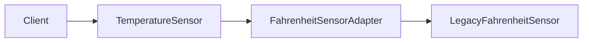
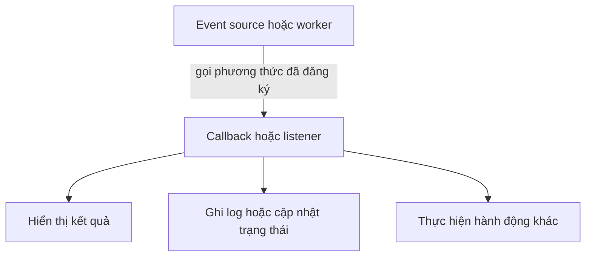

<a id="back-to-top"></a>

# Mẫu thiết kế

## Menu
- [Template Method: quy trình cố định và các bước abstract](#design-patterns-001)
- [Hook method, phương thức final và bảo vệ bất biến](#design-patterns-002)
- [Strategy: thay thuật toán qua interface](#design-patterns-003)
- [Factory Method: tách quyết định chọn lớp cụ thể](#design-patterns-004)
- [Adapter: đưa kiểu có sẵn về hợp đồng mong muốn](#design-patterns-005)
- [Decorator: bổ sung hành vi qua cùng interface](#design-patterns-006)
- [Callback và Listener: giao quyền xử lý sự kiện](#design-patterns-007)
- [Skeletal implementation: triển khai khung kết hợp interface](#design-patterns-008)
- [Chọn mẫu theo vấn đề và tránh áp dụng hình thức](#design-patterns-009)

## <a id="design-patterns-001">Template Method: quy trình cố định và các bước abstract</a>

<details>
<summary>Xem chi tiết</summary>

# Template Method trong Java: quy trình cố định và các bước abstract

## 1. Ý tưởng chính

**Template Method** là mẫu thiết kế hành vi (behavioral design pattern) dùng khi nhiều lớp cần thực hiện cùng một quy trình tổng thể, nhưng một vài bước bên trong quy trình khác nhau tùy loại đối tượng. Lớp cha định nghĩa thứ tự các bước trong một phương thức khuôn mẫu; các lớp con cung cấp cách thực hiện những bước được giao cho chúng.

Ví dụ, nhiều loại báo cáo đều cần chuẩn bị dữ liệu, xử lý dữ liệu, in tiêu đề, rồi xuất kết quả. Thứ tự này là quy tắc chung và không nên bị mỗi lớp con tự ý đảo lộn. Tuy nhiên, cách lấy dữ liệu hoặc tính toán nội dung có thể thay đổi giữa báo cáo doanh thu và báo cáo tồn kho. Template Method giữ quy trình chung ở một nơi và cho phép các lớp con tùy biến đúng những điểm đã thiết kế.

Tên “Template Method” nói đến phương thức chứa bộ khung thuật toán. Trong Java, phương thức đó thường là một phương thức instance được khai báo `final` trong abstract class, còn các bước thay đổi được khai báo thành phương thức `abstract` hoặc các hook có triển khai mặc định.

## 2. Cấu trúc của mẫu thiết kế

Một Template Method thường có ba thành phần:

- **Lớp cha (abstract class):** sở hữu thuật toán tổng thể và định nghĩa các bước theo đúng thứ tự.
- **Template method:** phương thức gọi lần lượt các bước; thường là `final` để lớp con không ghi đè và phá vỡ thứ tự quy trình.
- **Các bước có thể tùy biến:** phương thức abstract bắt buộc lớp con cài đặt, cùng với hook có hành vi mặc định mà lớp con có thể ghi đè khi cần.

Sơ đồ gọi điển hình:

~~~text
Client
  |
  v
ConcreteClass.templateMethod()   (được kế thừa từ AbstractClass)
  |
  +--> stepA()                   (có thể là bước cố định)
  +--> requiredStep()            (abstract, do lớp con cài đặt)
  +--> optionalHook()            (có mặc định, có thể ghi đè)
  +--> stepB()                   (bước cố định)
~~~

Điểm quan trọng là **lớp cha điều khiển luồng gọi**. Lớp con chỉ cung cấp hành vi tại những điểm mở rộng mà lớp cha công bố. Nếu lớp con được phép thay thế toàn bộ template method, hợp đồng về trình tự chung sẽ yếu đi.

## 3. Ví dụ Java 17 chạy được

Ví dụ dưới đây tạo một quy trình xuất báo cáo. Mọi báo cáo đều in phần mở đầu, thu thập dữ liệu, tính toán, rồi in phần kết thúc. Lớp cha giữ nguyên thứ tự đó; lớp con chỉ cung cấp cách lấy dữ liệu và cách tính tổng.

~~~java
abstract class ReportGenerator {
    // Template Method: giữ nguyên trình tự của toàn bộ quy trình.
    public final void generateReport() {
        printHeader();
        String data = collectData();
        String result = calculate(data);
        afterCalculation(result); // Hook tùy chọn
        printFooter();
    }

    private void printHeader() {
        System.out.println("=== REPORT START ===");
    }

    protected abstract String collectData();

    protected abstract String calculate(String data);

    // Hook có hành vi mặc định; lớp con không bắt buộc ghi đè.
    protected void afterCalculation(String result) {
        System.out.println("Result prepared");
    }

    private void printFooter() {
        System.out.println("=== REPORT END ===");
    }
}

final class SalesReport extends ReportGenerator {
    @Override
    protected String collectData() {
        return "10,20,30";
    }

    @Override
    protected String calculate(String data) {
        int total = 0;
        for (String part : data.split(",")) {
            total += Integer.parseInt(part);
        }
        return "Sales total = " + total;
    }

    @Override
    protected void afterCalculation(String result) {
        System.out.println(result);
    }
}

public class Main {
    public static void main(String[] args) {
        ReportGenerator report = new SalesReport();
        report.generateReport();
    }
}
~~~

Lưu toàn bộ mã vào tệp `Main.java`, sau đó chạy bằng JDK 17 trở lên:

~~~text
javac Main.java
java Main
~~~

Kết quả stdout chính xác:

~~~text
=== REPORT START ===
Sales total = 60
=== REPORT END ===
~~~

Luồng gọi diễn ra như sau:

1. `main` gọi `generateReport()` trên một đối tượng SalesReport thông qua biến có kiểu ReportGenerator.
2. Template method in tiêu đề trước khi yêu cầu dữ liệu.
3. Lời gọi `collectData()` và `calculate(data)` được dispatch đến phần triển khai trong SalesReport.
4. Hook `afterCalculation(result)` cũng được dispatch động và in kết quả.
5. Lớp cha in phần kết thúc, vì vậy lớp con không thể bỏ qua bước này bằng cách ghi đè template method.

Trong ví dụ này, các phương thức `printHeader()` và `printFooter()` là private vì chúng là chi tiết cố định của lớp cha. Hai bước abstract là protected để các lớp con có thể cài đặt chúng. Template method là public final để client có thể gọi và lớp con không thể thay đổi thứ tự toàn bộ thuật toán.

## 4. Vì sao dùng các bước abstract?

Một bước abstract biểu thị hành vi mà mọi lớp con cụ thể bắt buộc phải cung cấp. Nếu lớp cha không thể xác định một triển khai hợp lý chung, khai báo abstract làm rõ rằng thiếu bước đó là một triển khai chưa hoàn chỉnh.

Ví dụ, một lớp cha `DataImporter` có thể định nghĩa template `importData()` theo thứ tự: đọc nguồn, phân tích nội dung, kiểm tra dữ liệu, rồi lưu kết quả. Việc đọc CSV và đọc JSON có thể khác nhau, nên `readSource()` hoặc `parse()` có thể là bước abstract. Các thao tác chung như ghi log hay đo thời gian có thể được triển khai trực tiếp trong lớp cha.

Không nên biến mọi dòng lệnh thành phương thức abstract. Chỉ mở rộng những bước thực sự cần khác nhau giữa các lớp con. Nếu quá nhiều bước được tùy biến, quy trình chung sẽ khó hiểu và các lớp con có thể tạo ra những biến thể không còn tuân theo mục đích ban đầu.

Một lớp có ít nhất một phương thức abstract phải được khai báo abstract. Lớp abstract có thể chứa cả phương thức đã triển khai, trường dữ liệu, constructor và phương thức abstract; nó không thể được khởi tạo trực tiếp bằng `new`. Lớp con cụ thể phải cài đặt mọi phương thức abstract còn thiếu, nếu không lớp con đó cũng phải được khai báo abstract.

## 5. Hook: điểm mở rộng không bắt buộc

Hook là phương thức được lớp cha cung cấp với hành vi mặc định. Lớp con có thể ghi đè hook khi cần thêm hành vi, nhưng không bắt buộc phải làm vậy. Trong ví dụ, `afterCalculation(result)` mặc định in một thông báo; SalesReport ghi đè để in kết quả tính toán.

Hook hữu ích cho các điểm như:

- chạy bước kiểm tra bổ sung trước hoặc sau thuật toán;
- thêm log hoặc thông tin chẩn đoán;
- cho phép lớp con quyết định có thực hiện một hành động tùy chọn hay không;
- điều chỉnh một phần nhỏ của quy trình mà không thay thế toàn bộ template method.

Hook không nhất thiết phải là phương thức không tham số. Nó có thể nhận dữ liệu hoặc trả về giá trị nếu hợp đồng thiết kế yêu cầu. Tuy vậy, cần ghi rõ khi nào hook được gọi và kết quả của hook có ảnh hưởng đến các bước tiếp theo hay không.

Có thể dùng hook boolean để cho phép bỏ qua một bước tùy chọn, nhưng nên bảo đảm trạng thái đó không làm hỏng bất biến của thuật toán. Nếu một bước bắt buộc phải xảy ra, hãy giữ nó cố định trong template method hoặc dùng phương thức abstract để buộc lớp con cung cấp hành vi cần thiết.

## 6. Quyền kiểm soát luồng gọi và dynamic dispatch

Template Method thể hiện nguyên tắc “Hollywood”: lớp cha gọi đến lớp con ở những điểm mở rộng đã xác định. Client chỉ cần gọi một phương thức cấp cao như `generateReport()`; client không cần tự điều phối từng bước.

Khi template method gọi một phương thức instance có thể ghi đè, Java chọn triển khai theo kiểu thực tế của đối tượng tại thời điểm chạy (dynamic dispatch). Vì vậy, lời gọi `collectData()` bên trong ReportGenerator vẫn chạy phương thức SalesReport khi đối tượng thực tế là SalesReport.

Nên khai báo template method là `final` khi việc giữ nguyên thứ tự bước là một phần quan trọng của hợp đồng. Nếu có lý do thực sự để lớp con thay đổi toàn bộ thuật toán, hãy xem xét một thiết kế khác hoặc cân nhắc rõ việc không dùng final. Không nên thêm final máy móc khi lớp cha được thiết kế chủ đích cho phép thay đổi thuật toán tổng thể.

Template method thường là phương thức instance, không phải static, vì các bước tùy biến cần dispatch đến đối tượng lớp con. Các phương thức static không được ghi đè theo cơ chế đa hình instance nên không phù hợp làm các bước tùy biến kiểu này.

## 7. Xử lý lỗi, tài nguyên và thứ tự bước

Khi quy trình có thể thất bại, hãy xác định rõ hành vi khi một bước ném exception. Theo cách gọi tuần tự thông thường, nếu một bước ném exception và exception không được bắt tại chỗ, các bước tiếp theo sẽ không chạy. Ví dụ, nếu `collectData()` thất bại, `calculate()`, hook và `printFooter()` sẽ bị bỏ qua trong triển khai cơ bản.

Nếu quy trình bắt buộc phải giải phóng tài nguyên hoặc chạy thao tác kết thúc ngay cả khi có lỗi, dùng cấu trúc như try/finally hoặc try-with-resources ở lớp cha. Đừng giả định rằng template method tự động chạy mọi bước sau lỗi. Việc log lỗi, rollback, đóng kết nối hoặc phát thông báo thất bại phải là phần được thiết kế rõ ràng.

Cũng cần tránh gọi các phương thức có thể ghi đè từ constructor của lớp cha. Trong lúc constructor lớp cha chạy, lớp con có thể chưa khởi tạo xong các trường của mình; một lời gọi động đến phương thức lớp con khi đó có thể quan sát trạng thái chưa sẵn sàng. Hãy bắt đầu template method sau khi đối tượng đã được khởi tạo hoàn chỉnh, thường thông qua một lời gọi rõ ràng từ client hoặc một phương thức điều phối phù hợp.

## 8. Khi nào nên dùng Template Method?

Mẫu này phù hợp khi:

- Có một thuật toán hoặc quy trình chung với thứ tự bước ổn định.
- Một số bước thay đổi giữa các biến thể, nhưng thứ tự và phần điều phối cần được dùng chung.
- Muốn buộc các lớp con triển khai những bước bắt buộc thông qua phương thức abstract.
- Muốn cung cấp các điểm mở rộng tùy chọn bằng hook mà không nhân bản toàn bộ thuật toán.

Các ví dụ thường gặp gồm quy trình nhập dữ liệu, tạo báo cáo, xử lý tệp, kiểm tra đầu vào, pipeline xử lý, và các quy trình kiểm thử có bước chuẩn bị/thực thi/dọn dẹp chung. Trong từng trường hợp, chỉ nên dùng mẫu khi cấu trúc thuật toán thật sự ổn định và các khác biệt có thể được thể hiện bằng những bước nhỏ, rõ ràng.

## 9. Hạn chế và so sánh với Strategy

Template Method thường dùng kế thừa để thay đổi một số bước. Vì thế, lớp con gắn với cấu trúc của lớp cha và phải tuân thủ hợp đồng mà lớp cha quy định. Nếu có nhiều chiều biến đổi độc lập, số lượng lớp con có thể tăng và các bước tùy biến có thể trở nên khó phối hợp.

**Strategy** giải quyết một tình huống gần giống bằng composition: một đối tượng nhận hành vi có thể thay thế được thông qua một interface chiến lược. Điều này cho phép thay đổi thuật toán tại runtime và kết hợp các hành vi mà không cần tạo lớp con cho mọi tổ hợp. Đổi lại, Strategy có thể cần thêm các interface và đối tượng riêng.

| Tiêu chí | Template Method | Strategy |
|---|---|---|
| Cơ chế chính | Kế thừa và ghi đè một số bước | Composition và ủy quyền cho đối tượng chiến lược |
| Ai giữ thứ tự quy trình? | Template method trong lớp cha | Đối tượng điều phối gọi các chiến lược theo thiết kế |
| Phạm vi thay đổi | Một số bước trong thuật toán chung | Có thể thay thế cả một hành vi/thuật toán |
| Thay đổi hành vi lúc chạy | Thường hạn chế; dựa trên kiểu đối tượng và hook | Tự nhiên hơn vì có thể thay đối tượng chiến lược |
| Rủi ro thiết kế | Phân cấp kế thừa cứng, lớp con phụ thuộc lớp cha | Nhiều đối tượng/interface hơn và cần quản lý việc ủy quyền |

Chọn Template Method khi quy trình chung cần ổn định và các bước thay đổi là một phần tự nhiên của phân cấp kế thừa. Chọn Strategy khi cần hoán đổi thuật toán linh hoạt, ghép các hành vi hoặc tránh tạo thêm nhiều lớp con. Hai mẫu có thể kết hợp nếu quy trình vẫn cố định nhưng một bước cụ thể được ủy quyền cho một Strategy.

## 10. Lỗi thường gặp

- **Lặp lại toàn bộ quy trình trong từng lớp con.** Cách này nhân bản logic và dễ khiến thứ tự bước khác nhau theo thời gian. Hãy giữ phần chung trong template method.
- **Để lớp con ghi đè template method khi thứ tự là bất biến.** Cân nhắc dùng `final` để trình biên dịch ngăn việc ghi đè.
- **Đánh dấu mọi bước là abstract.** Những hành vi có triển khai chung nên được giữ ở lớp cha; chỉ tạo điểm mở rộng khi có lý do rõ ràng.
- **Dùng hook cho một bước bắt buộc.** Hook có mặc định thường có thể không được ghi đè. Nếu lớp con bắt buộc phải cung cấp hành vi, hãy dùng phương thức abstract.
- **Gọi template method từ constructor.** Các phương thức có thể ghi đè có thể chạy trước khi trạng thái lớp con được khởi tạo hoàn chỉnh.
- **Cho rằng các bước sau vẫn chạy khi một bước ném exception.** Trong luồng tuần tự cơ bản, exception chưa được xử lý sẽ ngắt quy trình. Hãy thiết kế finally hoặc try-with-resources nếu cần dọn dẹp.
- **Dùng kế thừa khi các hành vi cần thay đổi độc lập.** Khi cần hoán đổi thuật toán linh hoạt hoặc kết hợp nhiều biến thể, hãy đánh giá Strategy và composition.

## 11. Ghi nhớ

Template Method đặt bộ khung của một thuật toán trong lớp cha và giữ thứ tự các bước ở một nơi. Các phương thức abstract buộc lớp con cung cấp những bước bắt buộc; hook cho phép mở rộng hành vi với triển khai mặc định. Một template method thường được khai báo final để bảo vệ trình tự quy trình. Mẫu này phù hợp khi quy trình ổn định nhưng một số bước thay đổi; nếu cần thay thế thuật toán linh hoạt hoặc kết hợp hành vi độc lập, Strategy dựa trên composition có thể phù hợp hơn.

</details>

- [Quay lại đầu trang](#back-to-top)

---

## <a id="design-patterns-002">Hook method, phương thức final và bảo vệ bất biến</a>

<details>
<summary>Xem chi tiết</summary>

# Hook method, phương thức final và bảo vệ bất biến

## Mục tiêu

Sau bài này, bạn có thể phân biệt hook method với phương thức trừu tượng, giải thích cách Template Method giữ cố định thứ tự xử lý, dùng `final` để ngăn lớp con thay đổi quy trình quan trọng, và nhận biết vì sao `final` một mình chưa đủ để bảo vệ mọi bất biến của đối tượng.

## 1. Hook method là gì?

**Hook method** là phương thức trong lớp cha cung cấp một điểm mở rộng cho lớp con. Lớp cha thường định nghĩa sẵn hành vi mặc định; lớp con có thể ghi đè khi cần thay đổi một bước tùy chọn. Nếu lớp con không ghi đè, quy trình vẫn chạy bằng hành vi mặc định.

Ví dụ đơn giản:

~~~java
abstract class Report {
    public final void print() {
        String content = createContent();
        String decorated = decorate(content);
        System.out.println(decorated);
    }

    protected abstract String createContent();

    protected String decorate(String content) {
        return content;
    }
}
~~~

Trong ví dụ này, `createContent()` là một thao tác trừu tượng mà lớp con bắt buộc phải triển khai để lớp cụ thể có thể được tạo. `decorate()` là hook có hành vi mặc định: nếu không ghi đè, nội dung được giữ nguyên. Lớp con có thể tùy chọn thêm tiêu đề, dấu phân cách hoặc phần trang trí.

Hook nên thể hiện một điểm mở rộng có chủ đích. Tránh tạo quá nhiều hook khiến người triển khai khó hiểu thứ tự chạy, hoặc cho phép lớp con thay đổi những bước phải luôn đúng để duy trì trạng thái hợp lệ.

## 2. Template Method và phương thức final

**Template Method** là mẫu thiết kế trong đó lớp cha định nghĩa khung thuật toán và thứ tự các bước; một số bước được lớp con cung cấp hoặc tùy biến. Một cách phổ biến để giữ cố định khung đó là khai báo phương thức điều phối bằng `final`.

~~~java
abstract class Importer {
    public final void importData(String source) {
        validateSource(source);
        String data = read(source);
        String normalized = normalize(data);
        save(normalized);
        afterImport(normalized);
    }

    private void validateSource(String source) {
        if (source == null || source.isBlank()) {
            throw new IllegalArgumentException("source must not be blank");
        }
    }

    protected abstract String read(String source);

    protected String normalize(String data) {
        return data.trim();
    }

    protected abstract void save(String data);

    protected void afterImport(String data) {
        // Hook tùy chọn: mặc định không làm gì.
    }
}
~~~

Phương thức `importData()` là Template Method. Nó luôn thực hiện kiểm tra nguồn, đọc dữ liệu, chuẩn hóa, lưu dữ liệu rồi mới gọi hook sau khi nhập. Lớp con có thể cung cấp cách đọc và lưu phù hợp với định dạng hoặc hệ thống cụ thể; lớp con cũng có thể ghi đè `normalize()` hoặc `afterImport()` khi cần.

Từ khóa `final` ngăn lớp con ghi đè `importData()`, vì vậy lớp con không thể thay thế toàn bộ thứ tự điều phối bằng một thuật toán khác. Tuy nhiên, các phương thức có thể ghi đè mà Template Method gọi bên trong vẫn dùng cơ chế dispatch động. Khi chạy `importData()` trên đối tượng lớp con, Java sẽ gọi phiên bản `read()`, `normalize()`, `save()` hoặc `afterImport()` tương ứng với đối tượng đó.

Đây là sự kết hợp có chủ đích: **quy trình tổng thể được giữ cố định, còn các bước mở rộng được tùy biến trong giới hạn đã thiết kế**.

## 3. Ví dụ Java 17 chạy được

Ví dụ sau tạo một bộ xuất báo cáo. Phương thức `export()` là Template Method và được khai báo `final`. Các hook có thể tùy biến bước chuẩn bị và phần chân trang; bước định dạng là thao tác trừu tượng bắt buộc. Phương thức điều phối kiểm tra dữ liệu trước và sau mỗi điểm mở rộng có thể trả về kết quả.

Lưu toàn bộ mã trong tệp `TemplateMethodInvariantDemo.java`:

~~~java
import java.util.Locale;

abstract class ReportExporter {
    public final String export(String raw) {
        String input = requireNonBlank(raw, "raw input");
        String prepared = requireNonBlank(prepare(input), "prepared text");
        String body = requireNonBlank(format(prepared), "formatted body");
        return requireNonBlank(addFooter(body), "final output");
    }

    private static String requireNonBlank(String value, String name) {
        if (value == null || value.isBlank()) {
            throw new IllegalArgumentException(name + " must not be blank");
        }
        return value;
    }

    protected String prepare(String input) {
        return input.trim();
    }

    protected abstract String format(String prepared);

    protected String addFooter(String body) {
        return body;
    }
}

final class PlainTextExporter extends ReportExporter {
    @Override
    protected String format(String prepared) {
        return "REPORT: " + prepared.toUpperCase(Locale.ROOT);
    }

    @Override
    protected String addFooter(String body) {
        return body + "\n-- end --";
    }
}

public class TemplateMethodInvariantDemo {
    public static void main(String[] args) {
        ReportExporter exporter = new PlainTextExporter();
        System.out.println(exporter.export("  hello Java  "));

        try {
            exporter.export("   ");
        } catch (IllegalArgumentException ex) {
            System.out.println(ex.getMessage());
        }
    }
}
~~~

Biên dịch và chạy bằng Java 17 trở lên:

~~~text
javac TemplateMethodInvariantDemo.java
java TemplateMethodInvariantDemo
~~~

Kết quả stdout chính xác:

~~~text
REPORT: HELLO JAVA
-- end --
raw input must not be blank
~~~

Luồng xử lý của lần gọi đầu tiên là:

1. Kiểm tra đầu vào ban đầu.
2. Gọi hook `prepare()`; hành vi mặc định loại bỏ khoảng trắng ở hai đầu.
3. Gọi thao tác `format()` do lớp con triển khai.
4. Gọi hook `addFooter()`; lớp con thêm dòng kết thúc.
5. Trả về chuỗi đã được kiểm tra.

Lần gọi thứ hai bị từ chối ngay ở bước kiểm tra đầu vào. Nếu một lớp con ghi đè `prepare()`, `format()` hoặc `addFooter()` để trả về `null` hay chuỗi chỉ có khoảng trắng, bước kiểm tra kế tiếp sẽ từ chối kết quả đó. Lớp con vẫn tùy biến được hành vi, nhưng không thể bỏ qua chuỗi kiểm tra bằng cách ghi đè `export()`.

## 4. `final` bảo vệ được gì?

Trong Java, `final` có ý nghĩa tùy theo vị trí khai báo:

| Cách dùng | Ý nghĩa |
|---|---|
| `final class A` | Không thể tạo lớp con kế thừa `A`. |
| `final void run()` | Lớp con không thể ghi đè phương thức instance `run()`. |
| `final int limit = 10` | Biến chỉ có thể được gán một lần. Với biến tham chiếu, `final` khóa việc gán lại tham chiếu, không tự làm đối tượng được tham chiếu trở nên bất biến. |

Phương thức `final` hữu ích khi lớp cha phải duy trì một giao thức ổn định, chẳng hạn kiểm tra đầu vào trước khi xử lý, thực hiện bước cập nhật trạng thái, rồi kiểm tra kết quả trước khi trả về. Lớp con không thể ghi đè phương thức đó để đảo thứ tự hoặc bỏ qua các kiểm tra được đặt trực tiếp trong phương thức.

Tuy nhiên, `final` **không tự động làm mọi hành vi bên trong phương thức bất biến**. Nếu phương thức `final` gọi một hook có thể ghi đè, hook vẫn có thể thực hiện hành vi riêng, phát sinh ngoại lệ hoặc gây tác dụng phụ. Vì vậy, hãy đặt các kiểm tra quan trọng trong mã không thể bị ghi đè, giới hạn trạng thái có thể truy cập từ lớp con và xác thực kết quả sau các điểm mở rộng.

Không thể khai báo cùng một phương thức vừa `abstract` vừa `final`: `abstract` yêu cầu lớp con cung cấp phần triển khai, trong khi `final` cấm ghi đè. Nếu cần bắt buộc lớp con triển khai một bước, dùng phương thức trừu tượng; nếu cần giữ nguyên bước điều phối, dùng phương thức `final` gọi thao tác trừu tượng đó.

## 5. Bảo vệ bất biến của đối tượng

**Bất biến (invariant)** là điều kiện phải luôn đúng đối với trạng thái hợp lệ của một đối tượng, tại những thời điểm đối tượng được xem là ổn định và có thể được sử dụng. Ví dụ, một tài khoản có thể yêu cầu số dư không âm; một bộ đếm có thể yêu cầu giá trị không nhỏ hơn 0; một đối tượng cấu hình có thể yêu cầu tên không được để trống.

Để bảo vệ bất biến trong thiết kế có kế thừa:

- **Ẩn trạng thái:** ưu tiên trường `private`; không cho lớp con sửa trực tiếp các trường đại diện cho bất biến.
- **Kiểm tra tại ranh giới:** xác thực dữ liệu đầu vào trước khi cập nhật và xác thực kết quả trước khi công bố.
- **Giữ thao tác quan trọng ổn định:** cân nhắc dùng phương thức `final` cho thao tác công khai nếu lớp con không được phép thay đổi giao thức của nó.
- **Thiết kế hook hẹp:** chỉ mở rộng những bước thực sự cần tùy biến. Tránh truyền cho hook quyền sửa trực tiếp trạng thái nội bộ.
- **Không trả về trạng thái có thể bị sửa ngoài ý muốn:** dùng kiểu bất biến hoặc bản sao phòng vệ khi cần; khai báo một tham chiếu là `final` không làm đối tượng phía sau tham chiếu tự động bất biến.
- **Xác thực sau khi gọi mã mở rộng:** nếu hook trả về dữ liệu, hãy kiểm tra dữ liệu đó trước khi dùng hoặc trả cho caller.

Một phương thức `final` không thể tự bảo vệ trường `public` bị thay đổi trực tiếp, một đối tượng mutable được trả ra ngoài hoặc trạng thái bị làm sai bởi tác dụng phụ của hook. Bất biến được bảo vệ tốt nhất bằng nhiều lớp: đóng gói trạng thái, kiểm tra dữ liệu, hạn chế điểm mở rộng và điều phối thao tác theo thứ tự rõ ràng.

## 6. Constructor và lời gọi phương thức có thể ghi đè

Một cạm bẫy quan trọng là gọi phương thức có thể ghi đè từ constructor của lớp cha. Java có thể dispatch đến phiên bản ghi đè trong lớp con ngay cả khi constructor của lớp con chưa chạy xong. Khi đó, phương thức ghi đè có thể đọc trường lớp con chưa được khởi tạo đầy đủ và quan sát trạng thái chưa hợp lệ.

Ví dụ minh họa lỗi thiết kế:

~~~java
class BaseConfig {
    BaseConfig() {
        initialize(); // Không nên gọi hook có thể ghi đè ở đây.
    }

    protected void initialize() {
    }
}

class AppConfig extends BaseConfig {
    private String endpoint = "https://example.invalid";

    @Override
    protected void initialize() {
        System.out.println(endpoint.length());
    }
}
~~~

Trong lúc constructor của `BaseConfig` gọi `initialize()`, phiên bản ghi đè trong `AppConfig` có thể được gọi trước khi phần khởi tạo trường `endpoint` của lớp con hoàn tất. Trường có thể vẫn là `null`, dẫn đến `NullPointerException`. Vì vậy, tránh gọi các phương thức có thể ghi đè từ constructor; hãy hoàn tất việc khởi tạo trước rồi mới gọi các điểm mở rộng.

Đoạn mã trên chỉ là ví dụ minh họa lỗi và không phải chương trình chạy thành công. Việc đặt phương thức điều phối là `final` cũng không làm cho mọi lời gọi bên trong trở nên tĩnh: nếu phương thức đó gọi một hook có thể ghi đè trong constructor, nguy cơ vẫn tồn tại.

## 7. Khi nào nên dùng hook và final?

Dùng hook khi lớp cha cần một điểm tùy biến có kiểm soát, như thêm phần mở rộng sau khi xử lý, cung cấp quy tắc định dạng hoặc cho phép lớp con tùy chỉnh một bước phụ. Hook nên có tên và hợp đồng rõ ràng, đồng thời có hành vi mặc định hợp lý nếu là tùy chọn.

Dùng phương thức `final` khi lớp cha cần bảo đảm thứ tự của một quy trình hoặc không cho phép lớp con thay đổi một thao tác cốt lõi. Không nên đánh dấu mọi phương thức là `final` theo thói quen: làm vậy có thể hạn chế khả năng mở rộng mà thiết kế thực sự cần. Nếu không cần kế thừa, một lớp `final` hoặc một thiết kế composition có thể đơn giản hơn.

Trước khi thêm hook, hãy tự hỏi: lớp con có thật sự cần thay đổi bước này không? Nếu hook trả về kết quả, lớp cha sẽ xác minh kết quả ra sao? Hook có thể làm lộ hoặc làm sai trạng thái nội bộ không? Nếu không có câu trả lời rõ, hãy thu hẹp API mở rộng.

## 8. Checklist rà soát

1. Phương thức nào xác định thứ tự thuật toán? Nếu thứ tự phải cố định, cân nhắc đặt phương thức điều phối là `final`.
2. Bước nào bắt buộc lớp con cung cấp? Dùng phương thức `abstract` với hợp đồng cụ thể.
3. Bước nào là tùy chọn? Dùng hook có hành vi mặc định rõ ràng.
4. Bất biến nào phải luôn đúng? Giữ trường liên quan ở phạm vi `private`, kiểm tra đầu vào và xác thực kết quả.
5. Hook có thể trả về `null`, dữ liệu rỗng, phát sinh ngoại lệ hoặc gây tác dụng phụ không? Quyết định cách xử lý trước khi công bố kết quả.
6. Constructor có gọi phương thức có thể ghi đè không? Nếu có, xem lại cách khởi tạo để tránh sử dụng trạng thái chưa hoàn chỉnh.
7. Ví dụ có biên dịch được và stdout có khớp với lệnh chạy không? Giữ riêng ví dụ runnable và đoạn mã chỉ nhằm minh họa lỗi thiết kế.

## Kết luận

Hook method mở ra điểm tùy biến có kiểm soát; phương thức `final` giữ nguyên khung điều phối; và các kiểm tra cùng đóng gói trạng thái giúp bảo vệ bất biến. Ba kỹ thuật này bổ trợ nhau. Một thiết kế tốt xác định rõ bước nào được phép tùy biến, giữ các điều kiện cốt lõi trong mã không thể bị ghi đè, và kiểm tra dữ liệu tại ranh giới giữa lớp cha với lớp con.

</details>

- [Quay lại đầu trang](#back-to-top)

---

## <a id="design-patterns-003">Strategy: thay thuật toán qua interface</a>

<details>
<summary>Xem chi tiết</summary>

# Strategy: thay thuật toán qua interface trong Java

**Strategy** là mẫu thiết kế hành vi cho phép định nghĩa một nhóm thuật toán, đóng gói từng thuật toán thành một triển khai riêng và thay thế chúng mà không phải viết lại đối tượng sử dụng thuật toán. Trong Java, interface thường là điểm chung để các chiến lược tuân theo cùng một hợp đồng.

Ví dụ, một màn hình thanh toán có thể tính giá bằng nhiều chính sách giảm giá. Nếu mỗi chính sách được viết thành một lớp triển khai cùng interface, chương trình có thể chọn chính sách phù hợp lúc chạy. Lớp thanh toán không cần biết chi tiết cách từng chính sách tính toán.

## 1. Bài toán mà Strategy giải quyết

Giả sử ứng dụng có ba cách giảm giá: không giảm, giảm theo phần trăm và giảm một số tiền cố định. Nếu gom tất cả vào một phương thức lớn với nhiều nhánh **if/else**, mỗi lần thêm chính sách mới, ta phải sửa phương thức đó. Khi số chính sách tăng, lớp điều phối sẽ biết quá nhiều chi tiết và khó kiểm thử.

Một cách triển khai ban đầu có thể trông như sau:

~~~java
BigDecimal totalFor(
        BigDecimal subtotal,
        String discountType) {
    if (discountType.equals("NONE")) {
        return subtotal;
    } else if (discountType.equals("PERCENT")) {
        return subtotal.multiply(new BigDecimal("0.90"));
    } else if (discountType.equals("FIXED")) {
        return subtotal.subtract(new BigDecimal("15.00"));
    }
    throw new IllegalArgumentException("Unknown discount type");
}
~~~

Đây chỉ là đoạn minh họa cho vấn đề: logic của nhiều thuật toán bị tập trung vào một nơi, chuỗi định danh có thể gõ sai, và việc thêm một thuật toán đòi hỏi sửa mã điều phối. Đoạn này cũng chưa xử lý đầy đủ quy tắc tiền tệ, chẳng hạn giới hạn tổng tiền không âm.

Strategy tách từng thuật toán thành một triển khai riêng. Lớp sử dụng giữ một tham chiếu đến interface, rồi gọi phương thức của interface để thực hiện hành vi đã chọn.

## 2. Cấu trúc của Strategy

Một thiết kế Strategy thường có ba vai trò:

1. **Strategy interface**: khai báo hợp đồng chung, ví dụ **DiscountStrategy**.
2. **Concrete strategies**: các lớp như **NoDiscount**, **PercentageDiscount** và **FixedDiscount**, mỗi lớp hiện thực một thuật toán.
3. **Context**: đối tượng sử dụng thuật toán. Trong ví dụ này, **Checkout** gọi interface mà nó được cung cấp và có thể nhận chiến lược khác trong lúc chạy.

Luồng gọi:

~~~mermaid
classDiagram
    class DiscountStrategy {
        <<interface>>
        +discountFor(subtotal) BigDecimal
        +name() String
    }
    class NoDiscount
    class PercentageDiscount
    class FixedDiscount
    class Checkout {
        -strategy DiscountStrategy
        +setStrategy(strategy)
        +totalFor(subtotal) BigDecimal
    }
    DiscountStrategy <|.. NoDiscount
    DiscountStrategy <|.. PercentageDiscount
    DiscountStrategy <|.. FixedDiscount
    Checkout --> DiscountStrategy : delegates to
~~~

Mũi tên quan trọng trong thiết kế là **Checkout** phụ thuộc vào **DiscountStrategy**, không phụ thuộc trực tiếp vào một lớp giảm giá cụ thể. Các chiến lược cụ thể đều đáp ứng cùng hợp đồng nên có thể được truyền vào **Checkout** thay thế cho nhau.

## 3. Ví dụ hoàn chỉnh với Java 17+

Ví dụ dùng **BigDecimal** để tính tiền thay vì **double**, vì số thập phân thông thường không luôn biểu diễn chính xác bằng số dấu phẩy động nhị phân. Mỗi chiến lược chỉ quyết định số tiền giảm; **Checkout** áp dụng giới hạn để mức giảm không âm và không vượt quá giá ban đầu.

Lưu toàn bộ mã sau vào tệp **StrategyDemo.java**:

~~~java
import java.math.BigDecimal;
import java.math.RoundingMode;
import java.util.Objects;

interface DiscountStrategy {
    BigDecimal discountFor(BigDecimal subtotal);

    String name();
}

final class NoDiscount implements DiscountStrategy {
    @Override
    public BigDecimal discountFor(BigDecimal subtotal) {
        return BigDecimal.ZERO;
    }

    @Override
    public String name() {
        return "No discount";
    }
}

final class PercentageDiscount implements DiscountStrategy {
    private final BigDecimal rate;

    PercentageDiscount(BigDecimal rate) {
        Objects.requireNonNull(rate, "rate");
        if (rate.compareTo(BigDecimal.ZERO) < 0
                || rate.compareTo(BigDecimal.ONE) > 0) {
            throw new IllegalArgumentException(
                    "rate must be between 0 and 1");
        }
        this.rate = rate;
    }

    @Override
    public BigDecimal discountFor(BigDecimal subtotal) {
        return subtotal.multiply(rate)
                .setScale(2, RoundingMode.HALF_UP);
    }

    @Override
    public String name() {
        return rate.multiply(new BigDecimal("100"))
                .stripTrailingZeros().toPlainString() + "% off";
    }
}

final class FixedDiscount implements DiscountStrategy {
    private final BigDecimal amount;

    FixedDiscount(BigDecimal amount) {
        Objects.requireNonNull(amount, "amount");
        if (amount.compareTo(BigDecimal.ZERO) < 0) {
            throw new IllegalArgumentException(
                    "amount must not be negative");
        }
        this.amount = amount.setScale(2, RoundingMode.HALF_UP);
    }

    @Override
    public BigDecimal discountFor(BigDecimal subtotal) {
        return amount;
    }

    @Override
    public String name() {
        return amount.toPlainString() + " off";
    }
}

final class Checkout {
    private DiscountStrategy strategy;

    Checkout(DiscountStrategy strategy) {
        setStrategy(strategy);
    }

    void setStrategy(DiscountStrategy strategy) {
        this.strategy = Objects.requireNonNull(
                strategy, "strategy");
    }

    BigDecimal totalFor(BigDecimal subtotal) {
        Objects.requireNonNull(subtotal, "subtotal");
        if (subtotal.compareTo(BigDecimal.ZERO) < 0) {
            throw new IllegalArgumentException(
                    "subtotal must not be negative");
        }

        BigDecimal discount = strategy.discountFor(subtotal);
        discount = discount.max(BigDecimal.ZERO).min(subtotal);
        return subtotal.subtract(discount)
                .setScale(2, RoundingMode.HALF_UP);
    }

    String strategyName() {
        return strategy.name();
    }
}

public class StrategyDemo {
    public static void main(String[] args) {
        BigDecimal subtotal = new BigDecimal("100.00");
        Checkout checkout = new Checkout(new NoDiscount());

        System.out.println(checkout.strategyName() + ": "
                + checkout.totalFor(subtotal).toPlainString());

        checkout.setStrategy(
                new PercentageDiscount(new BigDecimal("0.10")));
        System.out.println(checkout.strategyName() + ": "
                + checkout.totalFor(subtotal).toPlainString());

        checkout.setStrategy(
                new FixedDiscount(new BigDecimal("15.00")));
        System.out.println(checkout.strategyName() + ": "
                + checkout.totalFor(subtotal).toPlainString());
    }
}
~~~

Biên dịch và chạy bằng JDK 17 trở lên:

~~~text
javac StrategyDemo.java
java StrategyDemo
~~~

Kết quả stdout:

~~~text
No discount: 100.00
10% off: 90.00
15.00 off: 85.00
~~~

### Đọc ví dụ theo từng bước

- **DiscountStrategy** định nghĩa hai thao tác mà mọi chiến lược phải cung cấp: tính số tiền giảm và trả về tên chiến lược.
- **NoDiscount**, **PercentageDiscount** và **FixedDiscount** thực hiện các thuật toán khác nhau nhưng cùng kiểu interface.
- **Checkout** là context. Nó gọi **strategy.discountFor(...)** mà không cần kiểm tra chiến lược hiện tại thuộc lớp nào.
- **setStrategy(...)** cho phép thay thuật toán lúc chạy. Sau khi thay, cùng một lời gọi **totalFor(...)** sẽ sử dụng hành vi của chiến lược mới.
- **Objects.requireNonNull** chặn việc truyền tham chiếu null; các constructor của chiến lược kiểm tra những tham số có thể làm thuật toán mất ý nghĩa.
- **Checkout** bảo đảm mức giảm nằm trong khoảng từ 0 đến giá ban đầu. Quy tắc này giữ cho tổng tiền không âm ngay cả khi một chiến lược được thêm vào sau này có lỗi.

Việc thay thế chỉ cần tuân thủ interface. Không cần sửa mã của **Checkout** khi thêm một chiến lược mới như giảm giá thành viên hoặc ưu đãi theo mùa.

## 4. Interface, kế thừa và composition

Strategy thường kết hợp **interface với composition**. Context chứa một đối tượng chiến lược và ủy quyền một phần công việc cho nó:

~~~java
private DiscountStrategy strategy;
~~~

Quan hệ này khác với kế thừa. **Checkout** không cần **extends PercentageDiscount**; nó có thể sử dụng bất kỳ đối tượng nào triển khai **DiscountStrategy**. Nhờ vậy, lựa chọn thuật toán không bị gắn cứng vào cây kế thừa của context.

Interface làm hợp đồng chung rõ ràng. Mỗi chiến lược vẫn có thể có trường và constructor riêng để giữ tham số cần thiết, như **rate** hoặc **amount**. Context chỉ dựa vào các phương thức công khai của interface.

## 5. Chọn chiến lược như thế nào?

Trong ứng dụng thực tế, việc chọn chiến lược thường dựa trên cấu hình, loại yêu cầu, trạng thái nghiệp vụ hoặc dữ liệu người dùng. Ví dụ, tầng dịch vụ có thể quyết định chính sách giảm giá rồi truyền đối tượng chiến lược vào **Checkout**.

Không nên để dữ liệu bên ngoài trực tiếp tạo tên lớp tùy ý bằng reflection. Thay vào đó, hãy ánh xạ giá trị cấu hình đã được kiểm tra sang những chiến lược được phép:

~~~java
DiscountStrategy strategy = switch (campaignType) {
    case "NONE" -> new NoDiscount();
    case "TEN_PERCENT" ->
            new PercentageDiscount(new BigDecimal("0.10"));
    case "FIXED_15" ->
            new FixedDiscount(new BigDecimal("15.00"));
    default -> throw new IllegalArgumentException(
            "Unsupported campaign: " + campaignType);
};
~~~

Đây là một đoạn trích để minh họa cách chọn, không phải chương trình độc lập. Nó giả định biến **campaignType** đã được khai báo và kiểm tra theo mô hình dữ liệu của ứng dụng. Việc chọn chiến lược có thể dùng **switch**, factory hoặc dependency injection; điểm cốt lõi của Strategy là phần sử dụng thuật toán làm việc qua interface.

## 6. Khi nào nên dùng Strategy?

Strategy phù hợp khi:

- Có nhiều thuật toán hoặc chính sách có thể thay thế nhau.
- Muốn chọn hành vi khi chạy thay vì cố định hành vi trong một chuỗi điều kiện lớn.
- Muốn kiểm thử từng thuật toán độc lập và kiểm thử context bằng một chiến lược giả.
- Muốn thêm biến thể mới mà giảm số thay đổi trong lớp đang sử dụng thuật toán.
- Các thuật toán có cùng mục đích nhưng khác cách thực hiện, ví dụ tính phí giao hàng, xác thực, định tuyến, nén dữ liệu hoặc lựa chọn chính sách giá.

Strategy có thể là quá mức cần thiết khi chỉ có một thuật toán ổn định và không có nhu cầu mở rộng. Thêm interface và nhiều lớp chỉ để bọc một phép tính đơn giản có thể làm chương trình khó đọc hơn. Hãy tạo các chiến lược riêng khi chúng biểu diễn những lựa chọn thực sự trong miền nghiệp vụ hoặc khi sự biến đổi đó có khả năng xuất hiện.

## 7. Lợi ích và đánh đổi

**Lợi ích**

- Giảm phụ thuộc giữa context và thuật toán cụ thể.
- Thêm thuật toán bằng một lớp triển khai interface mới.
- Kiểm thử các thuật toán riêng rẽ dễ hơn.
- Tránh để một lớp context phình to với nhiều nhánh điều kiện cho những hành vi thay thế nhau.

**Đánh đổi**

- Tăng số kiểu và đối tượng trong chương trình.
- Cần nơi quyết định chiến lược nào được dùng; interface không tự chọn chiến lược.
- Nếu có quá nhiều biến thể nhỏ, việc tìm lớp đang thực thi hành vi có thể mất thời gian.
- Thay chiến lược trong lúc chạy cần được quản lý cẩn thận nếu context được chia sẻ giữa nhiều luồng. Ví dụ này giả định mỗi **Checkout** được dùng theo cách tuần tự; nếu chia sẻ một instance giữa nhiều luồng, cần thiết kế việc cập nhật và đọc chiến lược sao cho an toàn.

## 8. Lỗi thường gặp

- **Đặt các nhánh if/else vào context rồi gọi đó là Strategy.** Nếu mọi thuật toán vẫn nằm trong một phương thức điều phối, phần thay đổi chưa được tách ra.
- **Cho context phụ thuộc trực tiếp vào lớp triển khai.** Khởi tạo chiến lược ở một composition root, factory hoặc tầng cấu hình, rồi truyền vào context qua interface.
- **Đưa quá nhiều trách nhiệm vào interface.** Chỉ khai báo những thao tác chung mà context thật sự cần; các chi tiết riêng có thể nằm trong từng chiến lược.
- **Bỏ qua kiểm tra tham số.** Một chiến lược giảm giá phần trăm cần xác định miền giá trị hợp lệ; các thuật toán về tiền cần thống nhất cách làm tròn.
- **Nhầm Strategy với việc chỉ đổi dữ liệu.** Tham số cấu hình có thể thay đổi kết quả của cùng một thuật toán. Strategy đặc biệt hữu ích khi có những cách thực hiện riêng biệt cần thay thế qua cùng hợp đồng.
- **Quên nơi lựa chọn chiến lược.** Mẫu này tách nơi sử dụng khỏi thuật toán; nó không loại bỏ nhu cầu quyết định thuật toán nào phù hợp với mỗi yêu cầu.

## 9. Cách ghi nhớ

Strategy biến các thuật toán có thể thay thế thành những đối tượng tuân theo cùng một interface. Context giữ tham chiếu đến interface và ủy quyền công việc, nên có thể đổi thuật toán mà không cần viết lại context.

Khi áp dụng, hãy xác định phần nào thường xuyên thay đổi, đặt hợp đồng tối thiểu cho phần đó, viết mỗi thuật toán thành một triển khai riêng và để một tầng phù hợp quyết định chiến lược được sử dụng. Chỉ dùng mẫu này khi lợi ích từ việc tách và thay thế thuật toán lớn hơn chi phí của các kiểu bổ sung.


</details>

- [Quay lại đầu trang](#back-to-top)

---

## <a id="design-patterns-004">Factory Method: tách quyết định chọn lớp cụ thể</a>

<details>
<summary>Xem chi tiết</summary>

# Factory Method: tách quyết định chọn lớp cụ thể

## 1. Bài toán và ý tưởng

Factory Method là mẫu thiết kế khởi tạo thuộc nhóm Creational trong GoF. Mẫu này định nghĩa một phương thức tạo đối tượng trong lớp cơ sở, sau đó để các lớp con quyết định sẽ tạo ra lớp sản phẩm cụ thể nào. Phần nghiệp vụ ổn định chỉ làm việc với kiểu trừu tượng của sản phẩm.

Hãy tưởng tượng một dịch vụ gửi thông báo. Quy trình gửi có thể giống nhau với email và SMS, nhưng cách tạo đối tượng gửi tin khác nhau. Nếu lớp nghiệp vụ trực tiếp gọi `new EmailNotification()` hoặc rải `if/else` để chọn nhiều lớp cụ thể, mỗi lần thêm kênh mới có thể buộc phải sửa các lớp đang có.

Factory Method đưa điểm thay đổi vào một phương thức có thể được ghi đè:

1. Lớp cơ sở khai báo phương thức tạo sản phẩm và dùng nó trong quy trình chung.
2. Mỗi lớp con cụ thể ghi đè phương thức tạo để trả về một sản phẩm phù hợp.
3. Mã gọi chọn một lớp dịch vụ cụ thể, nhưng quy trình gửi chỉ biết giao diện `Notification`.

## 2. Các vai trò trong mẫu GoF

| Vai trò | Trách nhiệm | Trong ví dụ |
| --- | --- | --- |
| Product | Hợp đồng chung cho sản phẩm được tạo | `Notification` |
| Concrete Product | Cài đặt một loại sản phẩm | `EmailNotification`, `SmsNotification` |
| Creator | Khai báo Factory Method và chứa quy trình sử dụng sản phẩm | `NotificationService` |
| Concrete Creator | Ghi đè Factory Method để chọn loại sản phẩm | `EmailNotificationService`, `SmsNotificationService` |
| Client | Chọn creator phù hợp và gọi nghiệp vụ qua kiểu trừu tượng | `Main` |

Quan hệ quan trọng là `NotificationService` không cần biết tên lớp cụ thể của sản phẩm. Nó gọi `createNotification()` và làm việc với giá trị trả về qua kiểu `Notification`.

## 3. Ví dụ Java 17 hoàn chỉnh

Ví dụ dưới đây tạo hai dịch vụ có cùng quy trình gửi nhưng tạo hai loại thông báo khác nhau. Tất cả lớp đều nằm trong một tệp để có thể biên dịch trực tiếp.

Lưu thành `Main.java`:

```java
import java.util.Objects;

public class Main {
    public static void main(String[] args) {
        NotificationService email = new EmailNotificationService();
        email.notifyUser("alice@example.com", "Your report is ready.");

        NotificationService sms = new SmsNotificationService();
        sms.notifyUser("+84901234567", "Your report is ready.");
    }
}

interface Notification {
    void send(String recipient, String message);
}

final class EmailNotification implements Notification {
    @Override
    public void send(String recipient, String message) {
        System.out.println("EMAIL -> " + recipient + ": " + message);
    }
}

final class SmsNotification implements Notification {
    @Override
    public void send(String recipient, String message) {
        System.out.println("SMS -> " + recipient + ": " + message);
    }
}

abstract class NotificationService {
    public final void notifyUser(String recipient, String message) {
        Objects.requireNonNull(recipient, "recipient");
        Objects.requireNonNull(message, "message");

        Notification notification = createNotification();
        notification.send(recipient, message);
    }

    protected abstract Notification createNotification();
}

final class EmailNotificationService extends NotificationService {
    @Override
    protected Notification createNotification() {
        return new EmailNotification();
    }
}

final class SmsNotificationService extends NotificationService {
    @Override
    protected Notification createNotification() {
        return new SmsNotification();
    }
}
```

Biên dịch và chạy bằng JDK 17 trở lên:

```text
javac --release 17 Main.java
java Main
```

Stdout chính xác:

```text
EMAIL -> alice@example.com: Your report is ready.
SMS -> +84901234567: Your report is ready.
```

## 4. Cách chương trình hoạt động

Khi gọi `email.notifyUser(...)`, Java thực thi phương thức `notifyUser` được định nghĩa ở `NotificationService`. Phương thức này gọi `createNotification()`. Vì đối tượng thực tế là `EmailNotificationService`, cơ chế dynamic dispatch chạy phần ghi đè của lớp đó và tạo `EmailNotification`. Sản phẩm sau đó được sử dụng qua giao diện `Notification`.

Khi gọi `sms.notifyUser(...)`, cùng quy trình ở lớp cơ sở được giữ nguyên, nhưng phần ghi đè của `SmsNotificationService` tạo `SmsNotification`. Lớp cơ sở không cần nhánh `if/else` để phân biệt email và SMS.

`notifyUser` thể hiện quy trình chung; `createNotification` là điểm mở rộng. Nếu muốn thêm kênh push notification, có thể tạo `PushNotification` và `PushNotificationService` mà không cần sửa phần quy trình gửi ở `NotificationService`.

Trong ứng dụng thực tế, lớp creator thường được chọn tại điểm khởi tạo ứng dụng hoặc thông qua cấu hình dependency injection. Factory Method xử lý cách tạo sản phẩm bên trong creator; việc chọn creator nào vẫn thuộc về nơi cấu hình ứng dụng.

## 5. Factory Method khác các cách tạo đối tượng khác ra sao?

### Gọi constructor trực tiếp

```java
Notification notification = new EmailNotification();
```

Cách này rõ ràng và hoàn toàn hợp lý nếu loại sản phẩm đã cố định. Tuy nhiên, lớp gọi phụ thuộc trực tiếp vào `EmailNotification`; nếu nhiều loại sản phẩm cần được chọn theo môi trường hoặc nghiệp vụ, các điểm tạo đối tượng có thể bị phân tán.

### Simple Factory hoặc static factory method

Một Simple Factory thường nhận tham số như `"email"` hoặc `"sms"` rồi dùng điều kiện để trả về một sản phẩm. Đây là cách gom logic chọn lớp vào một nơi, nhưng thường phải sửa factory đó mỗi khi thêm loại sản phẩm mới. Nó không phải mẫu Factory Method GoF theo nghĩa chặt chẽ, vì không dựa vào lớp con ghi đè phương thức tạo.

Thuật ngữ Java `static factory method` cũng có nghĩa rộng hơn: một phương thức tĩnh như `List.of(...)` tạo hoặc cung cấp đối tượng. Nó không tự động là mẫu Factory Method GoF.

### Factory Method

Factory Method dùng tính đa hình: lớp con quyết định loại sản phẩm bằng cách ghi đè một phương thức tạo. Mẫu này phù hợp khi có một quy trình chung nhưng có nhiều biến thể của sản phẩm cần được lựa chọn qua các creator khác nhau.

### Abstract Factory

Abstract Factory cung cấp một giao diện để tạo một họ sản phẩm liên quan, thường gồm nhiều loại sản phẩm phải tương thích với nhau. Factory Method thường tập trung vào một điểm tạo sản phẩm trong một creator; Abstract Factory hữu ích khi cần phối hợp nhiều phương thức tạo trong cùng một họ.

### Builder

Builder tách quá trình xây dựng một đối tượng phức tạp thành nhiều bước, thường để cấu hình nhiều trường tùy chọn hoặc biểu diễn các cách xây dựng khác nhau. Factory Method chủ yếu tách quyết định chọn lớp sản phẩm cụ thể.

## 6. Khi nào nên dùng?

Factory Method phù hợp khi:

- Một lớp có quy trình ổn định nhưng cần nhiều biến thể sản phẩm.
- Mã gọi nên phụ thuộc vào interface hoặc abstract class của sản phẩm thay vì lớp cụ thể.
- Một framework cần cung cấp quy trình mặc định và cho phép lớp con mở rộng cách tạo đối tượng.
- Cần thay sản phẩm trong kiểm thử, ví dụ creator kiểm thử trả về một fake hoặc stub triển khai cùng interface.
- Các lớp con có trách nhiệm rõ ràng: mỗi creator đại diện cho một lựa chọn sản phẩm có ý nghĩa.

Ví dụ thực tế có thể gồm bộ đọc tệp theo định dạng, bộ xuất báo cáo, bộ phân tích cú pháp, bộ lưu trữ hoặc dịch vụ gửi thông báo. Chỉ nên áp dụng khi có một điểm thay đổi thật sự; không cần tạo một hierarchy creator cho mỗi lời gọi `new` đơn giản.

## 7. Lợi ích và chi phí

**Lợi ích**

- Tách phần nghiệp vụ khỏi tên lớp sản phẩm cụ thể.
- Giữ quy trình chung ở một chỗ, tránh lặp lại quy trình cho từng loại sản phẩm.
- Mở rộng bằng cách thêm creator và product mới khi thiết kế cho phép, thay vì sửa logic tạo sản phẩm trong lớp cơ sở.
- Hỗ trợ kiểm thử vì mã nghiệp vụ sử dụng hợp đồng chung.
- Tạo điểm mở rộng có chủ đích cho thư viện hoặc framework.

**Chi phí**

- Tăng số lớp và mức gián tiếp; với một sản phẩm duy nhất, thiết kế có thể trở nên nặng nề.
- Người dùng vẫn cần biết hoặc cấu hình creator cụ thể ở điểm khởi tạo.
- Nếu mọi biến thể đều được gom vào một lớp creator với nhiều điều kiện, lợi ích của đa hình có thể biến mất.
- Mẫu này không tự cung cấp quản lý vòng đời, cache, thread safety, connection pooling hay dependency injection; các yêu cầu đó cần được thiết kế riêng.

## 8. Lỗi thiết kế thường gặp

1. **Trả về lớp cụ thể từ quy trình chung.** Nếu `notifyUser` phụ thuộc vào `EmailNotification`, thêm sản phẩm mới vẫn buộc phải sửa lớp cơ sở. Nên trả về và sử dụng kiểu `Notification`.
2. **Đặt toàn bộ điều kiện chọn sản phẩm trong creator cơ sở.** Một `switch` lớn trong `createNotification` có thể chỉ là Simple Factory. Nếu mục tiêu là Factory Method GoF, hãy để creator con ghi đè phương thức tạo.
3. **Nhầm Factory Method với bất kỳ phương thức tên `create...` nào.** Tên phương thức không quyết định mẫu thiết kế; vai trò của nó trong quan hệ creator, product và ghi đè mới là điều quan trọng.
4. **Tạo lớp con nhưng không có biến thể thực sự.** Nếu các creator đều tạo cùng một sản phẩm và không có lý do mở rộng, có thể dùng constructor trực tiếp hoặc factory đơn giản.
5. **Để client tự kiểm tra kiểu sản phẩm sau khi tạo.** Nếu mã gọi phải liên tục dùng `instanceof` để quyết định cách sử dụng, hợp đồng Product có thể chưa thể hiện đủ hành vi cần thiết.
6. **Quên xử lý phụ thuộc khi tạo sản phẩm.** Nếu sản phẩm cần gateway, cấu hình hoặc logger, hãy truyền các phụ thuộc đó qua constructor hoặc cơ chế injection thích hợp. Không nên giấu tài nguyên dùng chung trong biến toàn cục.
7. **Cho rằng mẫu này luôn loại bỏ mọi thay đổi.** Khi thêm loại sản phẩm, thường vẫn cần thêm Concrete Product, Concrete Creator và cấu hình creator tại nơi khởi tạo ứng dụng. Mẫu giảm phạm vi thay đổi và ghép nối, chứ không làm thay đổi mới biến mất.

## 9. Cách triển khai từng bước

1. Xác định phần nghiệp vụ ổn định cần dùng sản phẩm, chẳng hạn `notifyUser`.
2. Định nghĩa Product interface với các hành vi mà quy trình cần gọi.
3. Tạo các Concrete Product triển khai interface đó.
4. Tạo Creator chứa quy trình chung và khai báo Factory Method trả về Product.
5. Tạo Concrete Creator ghi đè Factory Method để trả về loại sản phẩm mong muốn.
6. Chọn creator ở composition root hoặc thông qua cấu hình ứng dụng.
7. Kiểm thử từng creator và quy trình chung; xác minh thêm sản phẩm mới không yêu cầu sửa mã sử dụng Product abstraction.

## 10. Checklist đánh giá thiết kế

- Có nhiều loại sản phẩm thật sự cần được tạo theo những cách khác nhau không?
- Quy trình sử dụng sản phẩm có thể giữ nguyên giữa các loại không?
- Product interface có thể hiện đủ hành vi mà quy trình chung cần không?
- Factory Method có được ghi đè bởi Concrete Creator, và có trả về kiểu trừu tượng không?
- Điểm chọn creator đã rõ ràng ở nơi cấu hình ứng dụng chưa?
- Chi phí của các lớp bổ sung có xứng đáng với lợi ích mở rộng và kiểm thử không?
- Có đang cần Abstract Factory vì phải tạo cả một họ sản phẩm, hoặc Builder vì quá trình xây dựng có nhiều bước không?

Factory Method hữu ích nhất khi nó cô lập một quyết định tạo sản phẩm đang thay đổi, trong khi giữ quy trình nghiệp vụ ổn định và phụ thuộc vào hợp đồng chung.


</details>

- [Quay lại đầu trang](#back-to-top)

---

## <a id="design-patterns-005">Adapter: đưa kiểu có sẵn về hợp đồng mong muốn</a>

<details>
<summary>Xem chi tiết</summary>

# Adapter Pattern — đưa kiểu có sẵn về hợp đồng mong muốn

Adapter (mẫu bộ chuyển đổi) cho phép hai thành phần làm việc với nhau khi chúng có giao diện không tương thích. Thành phần gọi sử dụng một hợp đồng mà nó hiểu; adapter triển khai hợp đồng đó rồi chuyển lời gọi sang API hiện có của một đối tượng khác, đồng thời chuyển đổi dữ liệu hoặc kết quả khi cần.

Ví dụ thường gặp là tích hợp thư viện cũ, SDK của nhà cung cấp, hệ thống bên thứ ba hoặc một API có tên phương thức và đơn vị đo khác với phần còn lại của ứng dụng. Adapter giúp phần gọi tiếp tục phụ thuộc vào hợp đồng ổn định thay vì phụ thuộc trực tiếp vào API cụ thể.

## 1. Bài toán mà Adapter giải quyết

Giả sử ứng dụng cần đọc nhiệt độ theo độ C qua hợp đồng:

```java
interface TemperatureSensor {
    double readCelsius();
}
```

Nhưng thư viện cũ chỉ cung cấp lớp `LegacyFahrenheitSensor` với phương thức `readFahrenheit()`, trả kết quả theo độ Fahrenheit. Client không thể gọi `readCelsius()` trên lớp cũ vì phương thức đó không tồn tại; hơn nữa, ngay cả khi đổi tên lời gọi, đơn vị dữ liệu vẫn khác nhau.

Có thể sửa client để gọi trực tiếp API cũ, nhưng khi nhiều nơi sử dụng nó, chi tiết chuyển đổi sẽ bị lặp lại. Adapter đặt phần chuyển đổi ở một nơi và cung cấp cho client giao diện mà client đang mong đợi.

Công thức chuyển đổi dùng trong ví dụ:

```text
Celsius = (Fahrenheit - 32) * 5 / 9
```

## 2. Các thành phần của mẫu

- **Target (giao diện đích):** hợp đồng mà client muốn sử dụng, ví dụ `TemperatureSensor`.
- **Adaptee (đối tượng được chuyển đổi):** API sẵn có có giao diện không tương thích, ví dụ `LegacyFahrenheitSensor`.
- **Adapter:** triển khai Target, giữ tham chiếu đến Adaptee và chuyển các lời gọi sang API của nó.
- **Client:** chỉ sử dụng Target; không cần biết chi tiết API cũ hoặc cách chuyển đổi.

Luồng gọi thường là:



Client gọi phương thức trên interface. Adapter nhận lời gọi, gọi phương thức tương ứng trên đối tượng cũ, biến đổi kết quả và trả về theo hợp đồng mới.

## 3. Ví dụ hoàn chỉnh với Java 17+

Lưu mã sau trong tệp `AdapterDemo.java`. Đây là **object adapter**: adapter dùng composition để giữ đối tượng cũ, sau đó triển khai interface đích.

```java
public class AdapterDemo {
    public static void main(String[] args) {
        LegacyFahrenheitSensor legacy = new LegacyFahrenheitSensor(77.0, "Server room");
        TemperatureSensor sensor = new FahrenheitSensorAdapter(legacy);

        System.out.println("Sensor: " + sensor.location());
        System.out.printf("Temperature: %.1f C%n", sensor.readCelsius());
    }
}

interface TemperatureSensor {
    double readCelsius();
    String location();
}

// API cũ: tên phương thức và đơn vị đo khác với hợp đồng mà client cần.
final class LegacyFahrenheitSensor {
    private final double fahrenheit;
    private final String label;

    LegacyFahrenheitSensor(double fahrenheit, String label) {
        this.fahrenheit = fahrenheit;
        this.label = label;
    }

    double readFahrenheit() {
        return fahrenheit;
    }

    String label() {
        return label;
    }
}

// Adapter chuyển từ Target sang API cũ và chuyển đổi đơn vị đo.
final class FahrenheitSensorAdapter implements TemperatureSensor {
    private final LegacyFahrenheitSensor adaptee;

    FahrenheitSensorAdapter(LegacyFahrenheitSensor adaptee) {
        if (adaptee == null) {
            throw new IllegalArgumentException("adaptee must not be null");
        }
        this.adaptee = adaptee;
    }

    @Override
    public double readCelsius() {
        return (adaptee.readFahrenheit() - 32.0) * 5.0 / 9.0;
    }

    @Override
    public String location() {
        return adaptee.label();
    }
}
```

Biên dịch và chạy bằng JDK 17 trở lên:

```bash
javac --release 17 AdapterDemo.java
java AdapterDemo
```

Đầu ra:

```text
Sensor: Server room
Temperature: 25.0 C
```

Điểm cần chú ý là biến `sensor` có kiểu `TemperatureSensor`. Client không gọi `readFahrenheit()` hay `label()` trực tiếp. Nếu sau này nguồn dữ liệu được thay bằng một cảm biến khác cũng triển khai `TemperatureSensor`, phần client có thể giữ nguyên.

## 4. Cách thiết kế Adapter trong ứng dụng thật

1. **Xác định hợp đồng mà client cần.** Đặt tên phương thức, kiểu dữ liệu, đơn vị đo và hành vi theo ngôn ngữ của ứng dụng, không nhất thiết sao chép API cũ.
2. **Xác định Adaptee.** Tìm các phương thức và kiểu dữ liệu hiện có, bao gồm lỗi có thể phát sinh, quy tắc null, thời gian chờ và vòng đời tài nguyên.
3. **Tạo lớp adapter triển khai Target.** Giữ đối tượng cũ bằng một trường và nhận nó qua constructor. Cách này làm rõ adapter đang bọc đối tượng nào và dễ thay thế trong kiểm thử.
4. **Ánh xạ từng lời gọi.** Gọi API cũ, chuyển đổi tham số và kết quả, rồi trả về theo hợp đồng đích. Nếu một phương thức không có tương đương trực tiếp, xác định hành vi rõ ràng thay vì trả dữ liệu giả.
5. **Kiểm tra các biên chuyển đổi.** Kiểm tra đơn vị, miền giá trị, độ chính xác, lỗi, null, timeout và các trường hợp API cũ không đáp ứng đầy đủ hợp đồng mới.
6. **Để client phụ thuộc vào Target.** Tạo adapter ở ranh giới tích hợp (composition root hoặc tầng hạ tầng) rồi truyền interface vào logic nghiệp vụ.

Một adapter nên tập trung vào tương thích. Nếu nó đồng thời điều phối nhiều dịch vụ, lưu trữ dữ liệu hoặc thực hiện nghiệp vụ lớn, hãy tách các trách nhiệm đó thành thành phần riêng.

## 5. Object Adapter và Class Adapter

### Object Adapter

Object adapter dùng composition: nó giữ một đối tượng Adaptee và ủy quyền lời gọi cho đối tượng đó. Ví dụ `FahrenheitSensorAdapter` ở trên là object adapter.

Ưu điểm:

- Có thể bọc một instance được tạo sẵn hoặc được cung cấp lúc chạy.
- Không phụ thuộc vào kế thừa lớp cũ.
- Dễ thay thế Adaptee và kiểm thử bằng cách cung cấp một đối tượng giả.
- Phù hợp với Java vì một lớp chỉ có thể `extends` một lớp trực tiếp.

### Class Adapter

Class adapter thường dùng kế thừa để thích nghi một lớp cụ thể, kết hợp với việc triển khai Target. Trong Java, hình thức này chỉ khả thi trực tiếp khi Adaptee là lớp có thể kế thừa và cấu trúc kiểu cho phép dùng `extends` cùng các interface cần thiết. Ví dụ khái quát:

```java
interface Target {
    String request();
}

class LegacyApi {
    String oldRequest() {
        return "legacy response";
    }
}

final class ClassAdapter extends LegacyApi implements Target {
    @Override
    public String request() {
        return oldRequest();
    }
}
```

Đoạn này là ví dụ riêng minh họa cú pháp, không phải một phần của `AdapterDemo.java`. Class adapter có thể truy cập hành vi kế thừa trực tiếp, nhưng bị ràng buộc chặt hơn với lớp cha; nó không thể mở rộng thêm một lớp khác. Với API bên thứ ba hoặc khi cần đổi instance linh hoạt, object adapter thường là lựa chọn thực tế hơn.

## 6. Adapter không làm thay đổi hợp đồng nguồn

Adapter không tự động khiến mọi API tương thích. Người thiết kế phải quyết định cách chuyển đổi có ý nghĩa:

- **Đơn vị:** chuyển độ F sang độ C, byte sang kilobyte hoặc tiền tệ theo một chính sách tỷ giá xác định.
- **Cấu trúc dữ liệu:** chuyển DTO của nhà cung cấp sang model mà ứng dụng sử dụng.
- **Tên và ý nghĩa phương thức:** ánh xạ `fetch()` của API cũ sang `load()` trong Target nếu ngữ nghĩa thực sự tương đương.
- **Ngoại lệ:** chuyển ngoại lệ thư viện sang loại lỗi mà hợp đồng đích quy định; giữ nguyên nguyên nhân để chẩn đoán.
- **Bất đồng bộ:** nếu nguồn trả về callback hoặc Future còn Target mong muốn kiểu khác, phải xác định rõ chính sách hoàn tất, hủy và timeout.
- **Tài nguyên:** làm rõ ai chịu trách nhiệm đóng kết nối hoặc giải phóng tài nguyên; không âm thầm đóng một đối tượng mà client vẫn đang sử dụng.

Không nên chuyển đổi một cách mất thông tin mà không có quy tắc. Chẳng hạn, chuyển tiền tệ cần biết tỷ giá và thời điểm áp dụng; chỉ đổi tên trường không thể giải quyết khác biệt ngữ nghĩa đó.

## 7. Kiểm thử Adapter

Nên kiểm thử ít nhất các nhóm sau:

- **Ánh xạ lời gọi:** Target method gọi đúng phương thức Adaptee và truyền đúng tham số.
- **Chuyển đổi dữ liệu:** dùng giá trị dễ kiểm tra như 32 F → 0 C, 77 F → 25 C và 212 F → 100 C.
- **Biên và lỗi:** kiểm tra null, dữ liệu không hợp lệ, ngoại lệ từ nguồn và các giá trị đặc biệt theo yêu cầu ứng dụng.
- **Hành vi hợp đồng:** client chỉ cần Target và không cần phụ thuộc vào lớp Adaptee cụ thể.

Ví dụ kiểm tra nhanh chuyển đổi có thể dùng assertion trong một chương trình nhỏ:

```java
double celsius = (77.0 - 32.0) * 5.0 / 9.0;
if (Math.abs(celsius - 25.0) > 0.000001) {
    throw new AssertionError("conversion is incorrect");
}
```

Đoạn này chỉ minh họa phép kiểm tra số thực; trong dự án thực tế, hãy kiểm thử adapter qua interface Target và giả lập Adaptee để xác nhận cả lời gọi lẫn kết quả. Khi dùng `assert` của Java, cần bật assertions bằng tùy chọn `-ea`; nếu không, các assertion có thể không được thực thi.

## 8. Lỗi thiết kế thường gặp

| Lỗi | Hệ quả | Cách xử lý |
|---|---|---|
| Cho client gọi trực tiếp API cũ ở nhiều nơi | Logic chuyển đổi bị lặp, khó thay thế nhà cung cấp | Đưa chuyển đổi vào adapter và để client dùng Target |
| Adapter chỉ đổi tên phương thức nhưng bỏ qua đơn vị hoặc ý nghĩa dữ liệu | Kết quả có vẻ hợp lệ nhưng sai ngữ nghĩa | Viết rõ quy tắc chuyển đổi và kiểm thử bằng giá trị đã biết |
| Trả về `null` hoặc giá trị mặc định khi API nguồn lỗi | Lỗi bị che giấu, client khó phát hiện | Quy định cách báo lỗi trong hợp đồng và giữ nguyên nguyên nhân |
| Adapter chứa quá nhiều nghiệp vụ | Khó bảo trì và khó kiểm thử | Giữ adapter ở vai trò tương thích; chuyển nghiệp vụ sang dịch vụ riêng |
| Dùng kế thừa chỉ để tái sử dụng một phương thức | Gắn chặt vào lớp cũ, hạn chế thay thế | Ưu tiên composition nếu không cần quan hệ kiểu kế thừa |
| Bỏ qua timeout, thread safety hoặc vòng đời tài nguyên | Lỗi khó tái hiện khi chạy thật | Ghi rõ và kiểm thử các đặc tính vận hành của Adaptee |

## 9. Phân biệt Adapter với các mẫu gần gũi

- **Adapter:** thay đổi giao diện nhìn từ phía client để hai thành phần không tương thích có thể làm việc cùng nhau.
- **Decorator:** giữ nguyên giao diện chính nhưng bổ sung trách nhiệm, chẳng hạn ghi log hoặc cache lời gọi.
- **Facade:** cung cấp giao diện đơn giản hơn cho một hệ thống gồm nhiều thành phần.
- **Bridge:** tách một khái niệm trừu tượng khỏi phần triển khai để hai phía có thể phát triển độc lập.

Một lớp có thể vừa bọc một đối tượng vừa thực hiện thêm công việc, nhưng hãy chọn mẫu theo mục đích chính. Nếu vấn đề là khác biệt giữa hợp đồng mà client cần và API sẵn có, Adapter là cách diễn đạt phù hợp.

## 10. Khi nào nên dùng?

Dùng Adapter khi tích hợp hệ thống cũ, SDK bên ngoài hoặc hai module có hợp đồng khác nhau mà bạn không thể hoặc không nên sửa trực tiếp. Nó đặc biệt hữu ích khi muốn cô lập phụ thuộc bên ngoài khỏi logic nghiệp vụ.

Không cần thêm adapter nếu hai giao diện đã tương thích và việc bọc chỉ tạo thêm một lớp chuyển tiếp không có giá trị. Cũng không nên coi adapter là cách che giấu một khác biệt ngữ nghĩa chưa được giải quyết: hợp đồng và quy tắc chuyển đổi phải rõ ràng trước khi tích hợp.

## Tài liệu tham khảo

- [Refactoring Guru — Adapter](https://refactoring.guru/design-patterns/adapter)
- [Java Language Specification 17 — Classes](https://docs.oracle.com/javase/specs/jls/se17/html/jls-8.html)


</details>

- [Quay lại đầu trang](#back-to-top)

---

## <a id="design-patterns-006">Decorator: bổ sung hành vi qua cùng interface</a>

<details>
<summary>Xem chi tiết</summary>

# Decorator: bổ sung hành vi qua cùng interface

Decorator là mẫu thiết kế cấu trúc dùng để bổ sung trách nhiệm cho một đối tượng bằng cách bọc đối tượng đó trong một đối tượng khác có cùng interface. Client tiếp tục gọi cùng các phương thức như trước, trong khi decorator có thể thêm hành vi trước hoặc sau khi chuyển tiếp lời gọi đến đối tượng được bọc.

Mẫu này hữu ích khi cần kết hợp các tính năng tùy chọn tại thời điểm chạy, chẳng hạn gửi thông báo qua nhiều kênh, thêm logging, đo thời gian, mã hóa dữ liệu hoặc lưu cache. Trong Java, Decorator thường được triển khai bằng composition: decorator giữ một tham chiếu đến đối tượng cần bọc và triển khai cùng interface với nó.

## 1. Vấn đề mà Decorator giải quyết

Giả sử ứng dụng có interface `Notifier` và một triển khai gửi email. Sau đó yêu cầu bổ sung gửi SMS, thêm tiền tố quan trọng, ghi log và đo thời gian xử lý. Có thể tạo một lớp con cho từng tổ hợp, nhưng số lớp sẽ tăng nhanh:

- Email thông thường
- Email kèm SMS
- Email có tiền tố
- Email kèm SMS và tiền tố
- Các tổ hợp mới khi thêm logging hoặc retry

Đây là sự bùng nổ số lượng lớp do kế thừa để biểu diễn mọi tổ hợp hành vi. Decorator cho phép kết hợp những phần bổ sung độc lập bằng cách bọc đối tượng nhiều lần. Mỗi decorator chịu trách nhiệm cho một phần hành vi và các decorator có thể được lắp ghép khi khởi tạo ứng dụng.

## 2. Cấu trúc và vai trò

Một thiết kế Decorator phổ biến gồm bốn vai trò:

1. **Component**: interface chung mà client sử dụng.
2. **Concrete Component**: đối tượng cơ sở cung cấp hành vi ban đầu.
3. **Base Decorator**: cũng triển khai Component, giữ tham chiếu đến một Component khác và chuyển tiếp lời gọi.
4. **Concrete Decorator**: kế thừa base decorator, thêm hành vi rồi chuyển tiếp hoặc bổ sung xử lý trước/sau lời gọi.

Sơ đồ quan hệ:

~~~mermaid
classDiagram
    class Notifier {
        <<interface>>
        +send(message)
    }
    class EmailNotifier {
        +send(message)
    }
    class NotifierDecorator {
        #delegate
        +send(message)
    }
    class PrefixDecorator {
        +send(message)
    }
    class SmsDecorator {
        +send(message)
    }
    Notifier <|.. EmailNotifier
    Notifier <|.. NotifierDecorator
    NotifierDecorator <|-- PrefixDecorator
    NotifierDecorator <|-- SmsDecorator
    NotifierDecorator o--> Notifier : delegates to
~~~

Mấu chốt là cả đối tượng gốc và decorator đều có thể được gán cho biến kiểu Component. Vì vậy, client không cần biết đang gọi trực tiếp đối tượng gốc hay một chuỗi decorator.

## 3. Ví dụ Java chạy được

Ví dụ sau dùng email làm hành vi cơ sở. `PrefixDecorator` bổ sung tiền tố vào thông điệp, còn `SmsDecorator` gửi thêm một bản thông báo SMS. Hai decorator đều triển khai cùng interface `Notifier`.

Lưu thành tệp `DecoratorDemo.java`:

~~~java
import java.util.Objects;

interface Notifier {
    void send(String message);
}

final class EmailNotifier implements Notifier {
    @Override
    public void send(String message) {
        System.out.println("Email: " + message);
    }
}

abstract class NotifierDecorator implements Notifier {
    protected final Notifier delegate;

    protected NotifierDecorator(Notifier delegate) {
        this.delegate = Objects.requireNonNull(delegate, "delegate");
    }
}

final class PrefixDecorator extends NotifierDecorator {
    PrefixDecorator(Notifier delegate) {
        super(delegate);
    }

    @Override
    public void send(String message) {
        delegate.send("[IMPORTANT] " + message);
    }
}

final class SmsDecorator extends NotifierDecorator {
    SmsDecorator(Notifier delegate) {
        super(delegate);
    }

    @Override
    public void send(String message) {
        delegate.send(message);
        System.out.println("SMS: " + message);
    }
}

public class DecoratorDemo {
    public static void main(String[] args) {
        Notifier notifier =
                new PrefixDecorator(new SmsDecorator(new EmailNotifier()));

        notifier.send("Deployment complete");
    }
}
~~~

Biên dịch và chạy bằng Java 17 trở lên:

~~~text
javac DecoratorDemo.java
java DecoratorDemo
~~~

Kết quả stdout:

~~~text
Email: [IMPORTANT] Deployment complete
SMS: [IMPORTANT] Deployment complete
~~~

Luồng gọi diễn ra như sau:

1. Client gọi `notifier.send("Deployment complete")`.
2. `PrefixDecorator` thêm tiền tố `[IMPORTANT] ` và chuyển tiếp thông điệp mới đến `SmsDecorator`.
3. `SmsDecorator` chuyển tiếp thông điệp đã được bổ sung đến `EmailNotifier`, nên email được gửi trước.
4. Sau khi lời gọi bên trong hoàn tất, `SmsDecorator` gửi thêm SMS với chính thông điệp mà nó nhận được.

Trong ví dụ, thứ tự bọc là `PrefixDecorator(SmsDecorator(EmailNotifier))`. Đổi thứ tự bọc có thể làm thay đổi hành vi vì decorator ngoài cùng nhận lời gọi trước. Hãy xác định rõ mỗi lớp cần sửa dữ liệu, thực hiện hành động bổ sung hay xử lý sau khi delegate hoàn thành.

## 4. Cách triển khai decorator đúng

Một decorator nên giữ hợp đồng của Component và chuyển tiếp các phương thức mà nó không cần thay đổi. Với interface có nhiều phương thức, base decorator thường triển khai tất cả phương thức bằng cách gọi delegate tương ứng; lớp con chỉ ghi đè phương thức cần mở rộng.

Một số nguyên tắc thực hành:

- **Cùng interface:** cả component gốc và decorator phải có thể sử dụng thông qua cùng kiểu Component.
- **Ủy quyền rõ ràng:** decorator giữ một đối tượng delegate và gọi nó ở thời điểm phù hợp.
- **Một trách nhiệm bổ sung:** mỗi decorator nên làm một việc có tên gọi và mục đích rõ ràng, ví dụ thêm logging hoặc mã hóa.
- **Cho phép kết hợp:** caller có thể bọc một component bằng nhiều decorator theo cấu hình lúc chạy.
- **Giữ hợp đồng:** nếu phương thức được kỳ vọng trả về một giá trị, ném loại exception cụ thể hoặc bảo đảm một hậu điều kiện, decorator phải duy trì các cam kết đó.
- **Kiểm soát null và vòng lặp:** constructor nên xác thực delegate nếu null không phải giá trị hợp lệ; tránh cấu hình một decorator tự tham chiếu lại chính nó.
- **Bảo toàn thứ tự và lỗi:** quyết định rõ decorator thực hiện hành vi trước hay sau delegate, và điều gì xảy ra nếu delegate ném exception.

Base decorator là tùy chọn. Với interface nhỏ hoặc chỉ có một phương thức, từng decorator có thể triển khai interface trực tiếp. Với interface lớn, base decorator giúp giảm mã lặp khi chuyển tiếp các phương thức.

## 5. Kết hợp decorator và cấu hình lúc chạy

Có thể xây dựng chuỗi decorator có điều kiện mà không đổi kiểu biến mà client sử dụng:

~~~java
Notifier notifier = new EmailNotifier();

if (sendSms) {
    notifier = new SmsDecorator(notifier);
}
if (markImportant) {
    notifier = new PrefixDecorator(notifier);
}

notifier.send("Deployment complete");
~~~

Đoạn này là ví dụ minh họa một phần; các biến `sendSms` và `markImportant` cần được khai báo trong ngữ cảnh chứa nó. Cả trước và sau khi bọc, kiểu tham chiếu vẫn là `Notifier`. Client chỉ gọi `send`, còn cấu hình quyết định hành vi nào được thêm vào.

Khi số lượng decorator lớn hơn, nên tập trung việc xây dựng chuỗi vào một factory hoặc hàm cấu hình để quy tắc khởi tạo dễ kiểm thử. Tránh để nhiều nơi trong ứng dụng tự xây dựng chuỗi khác nhau nếu thứ tự decorator có ý nghĩa với nghiệp vụ.

## 6. Decorator khác kế thừa thông thường như thế nào?

Kế thừa mở rộng hành vi bằng cách tạo lớp con có quan hệ kiểu cố định với lớp cha. Decorator mở rộng hành vi bằng cách giữ một đối tượng khác và chuyển tiếp lời gọi. Một decorator có thể bọc nhiều loại Concrete Component miễn là chúng cùng triển khai Component.

| Tiêu chí | Kế thừa | Decorator |
|---|---|---|
| Cách bổ sung hành vi | Định nghĩa lớp con | Bọc đối tượng và ủy quyền |
| Kết hợp tính năng | Thường cần lớp con cho các tổ hợp | Có thể xếp nhiều decorator |
| Quyết định lúc nào | Thường gắn với kiểu lớp đã biên dịch | Có thể quyết định lúc chạy |
| Phụ thuộc chính | Quan hệ với lớp cha | Interface và delegate |
| Giới hạn | Có thể tạo nhiều lớp con, khó kết hợp độc lập | Chuỗi bọc có thể phức tạp nếu không quản lý rõ |

Decorator không loại bỏ hoàn toàn kế thừa. Trong ví dụ, các decorator cụ thể kế thừa `NotifierDecorator` để dùng lại cơ chế lưu delegate và chuyển tiếp. Phần quan trọng là hành vi mở rộng được áp dụng lên một đối tượng delegate qua composition, thay vì chỉ dựa vào việc kế thừa từ lớp triển khai cơ sở.

## 7. So sánh với các mẫu thiết kế gần giống

- **Adapter:** chuyển đổi một interface thành interface khác để hai thành phần không tương thích có thể làm việc cùng nhau. Decorator giữ interface gốc để bổ sung trách nhiệm.
- **Proxy:** cũng giữ tham chiếu đến đối tượng và chuyển tiếp lời gọi, nhưng mục tiêu chính thường là kiểm soát truy cập, tạo đối tượng theo nhu cầu, phân phối từ xa hoặc quản lý vòng đời.
- **Chain of Responsibility:** chuyển một yêu cầu qua chuỗi handler để mỗi handler quyết định xử lý hay chuyển tiếp. Decorator thường bọc component để mở rộng hành vi của nó, và các lớp bọc có thể thực hiện cả hành vi trước lẫn sau delegate.
- **Strategy:** thay đổi thuật toán được sử dụng thông qua một interface. Decorator tập trung vào việc kết hợp hành vi xung quanh một component; hai mẫu có thể được dùng cùng nhau.

Tên gọi không quyết định mẫu thiết kế; hãy xem mục tiêu và luồng điều khiển thực tế của mã. Một wrapper có thể trông giống Decorator nhưng về mục đích lại là Proxy hoặc Adapter.

## 8. Ví dụ trong thư viện Java

Thư viện chuẩn Java dùng cách bọc đối tượng ở nhiều API. Ví dụ, `BufferedInputStream` bọc một `InputStream` để thêm buffering, còn `DataInputStream` bổ sung khả năng đọc dữ liệu nguyên thủy. Chúng vẫn được sử dụng thông qua các kiểu stream tương ứng, nên có thể kết hợp nhiều lớp bọc:

~~~java
InputStream input = new BufferedInputStream(
        new FileInputStream("data.bin"));
~~~

Ví dụ trên chỉ minh họa cấu trúc bọc; mã thực tế cần import các lớp và xử lý hoặc khai báo `IOException`. Khi kết hợp stream, hãy tuân thủ quy tắc đóng tài nguyên, thường bằng try-with-resources. Đóng stream ngoài cùng thường sẽ đóng các stream bên trong thông qua cơ chế delegate.

## 9. Lỗi thường gặp

- **Không gọi delegate:** decorator vô tình thay thế toàn bộ hành vi gốc, dù mục tiêu chỉ là bổ sung một phần. Hãy quyết định rõ có chủ ý chặn lời gọi hay cần chuyển tiếp.
- **Thêm hành vi sai thời điểm:** hành vi chạy trước hay sau delegate ảnh hưởng đến kết quả, đặc biệt nếu delegate có thể ném exception.
- **Đảo thứ tự decorator:** tiền xử lý, mã hóa, logging hoặc chuyển đổi dữ liệu có thể không giao hoán. Kiểm thử đúng thứ tự bọc được cấu hình trong ứng dụng.
- **Làm thay đổi hợp đồng:** decorator trả kết quả không hợp lệ, nuốt exception hoặc làm thay đổi trạng thái theo cách caller không mong đợi.
- **Tạo chuỗi quá sâu:** nhiều lớp bọc làm stack trace và quá trình debug khó đọc. Đặt tên rõ ràng cho từng decorator và gom việc cấu hình chuỗi ở một nơi.
- **Nhầm Decorator với Adapter:** nếu phải chuyển đổi sang một interface khác, có thể Adapter mới là lựa chọn đúng.
- **Giữ trạng thái dùng chung không an toàn:** nếu nhiều luồng dùng cùng một decorator, các trường trạng thái có thể cần bất biến, đồng bộ hoặc thiết kế an toàn luồng.

## 10. Cách kiểm thử và quyết định sử dụng

Kiểm thử decorator riêng bằng cách cung cấp một component giả (fake) hoặc mock để xác minh rằng delegate được gọi với đúng đối số và số lần mong muốn. Với decorator thêm hành vi sau delegate, kiểm tra cả thứ tự và trường hợp delegate ném exception. Sau đó kiểm thử chuỗi hoàn chỉnh để xác minh thứ tự bọc tạo ra kết quả đúng.

Decorator phù hợp khi cần thêm các tính năng tùy chọn, độc lập, có thể kết hợp mà vẫn giữ interface cho client. Nếu hành vi mới làm thay đổi hoàn toàn mục đích của API, cần chuyển đổi interface hoặc điều phối một quy trình nhiều bước, hãy cân nhắc Adapter, Strategy hoặc Chain of Responsibility.

Một câu hỏi hữu ích khi thiết kế là: “Tôi có thể bọc component này bằng một đối tượng khác cùng interface, bổ sung một trách nhiệm rõ ràng và vẫn giữ đúng hợp đồng của component không?” Nếu có, Decorator là ứng viên tốt.

</details>

- [Quay lại đầu trang](#back-to-top)

---

## <a id="design-patterns-007">Callback và Listener: giao quyền xử lý sự kiện</a>

<details>
<summary>Xem chi tiết</summary>

# Callback và Listener: giao quyền xử lý sự kiện

Callback và Listener là hai cách để một thành phần giao quyền xử lý cho thành phần khác. Thay vì tự quyết định mọi việc, một đối tượng phát ra kết quả hoặc sự kiện rồi gọi mã do bên sử dụng cung cấp. Cách thiết kế này giúp tách phần phát sinh công việc khỏi phần phản ứng với kết quả, đồng thời làm cho API dễ mở rộng và kiểm thử.

## 1. Callback là gì?

**Callback** là một hàm hoặc phương thức được truyền cho thành phần khác để thành phần đó gọi lại khi đến thời điểm thích hợp. Trong Java, callback thường được biểu diễn bằng một interface, một functional interface, một lambda hoặc một method reference.

Ví dụ, một bộ xử lý công việc không cần biết kết quả sẽ được hiển thị lên màn hình, ghi log hay gửi tiếp đến hệ thống khác. Nó chỉ cần gọi callback khi đã có kết quả:

```java
@FunctionalInterface
interface ResultCallback {
    void onResult(String result);
}

void execute(ResultCallback callback) {
    callback.onResult("done");
}
```

Bên gọi có thể truyền hành vi phù hợp:

```java
execute(result -> System.out.println("Kết quả: " + result));
```

Callback là một khái niệm rộng. Nó có thể được gọi ngay trong cùng luồng (synchronous), được gọi sau khi một thao tác hoàn tất, hoặc được gọi từ luồng khác nếu API được thiết kế như vậy. Bản thân từ “callback” không đảm bảo rằng thao tác là bất đồng bộ.

## 2. Listener là gì?

**Listener** là một đối tượng đăng ký quan tâm đến một loại sự kiện. Khi sự kiện xảy ra, nguồn sự kiện gọi một phương thức trên các listener đã đăng ký. Listener thường được giữ lại qua nhiều lần phát sự kiện, cho đến khi bị gỡ bỏ hoặc nguồn sự kiện kết thúc vòng đời.

Ví dụ: một nguồn thông điệp có thể thông báo `messageReceived`, một nút giao diện có thể thông báo `clicked`, hoặc một bộ theo dõi tiến trình có thể phát sự kiện `progressChanged`.

Listener thường được xem là một dạng callback hướng sự kiện. Sự khác biệt chủ yếu nằm ở cách sử dụng:

| Khía cạnh | Callback đơn lẻ | Listener |
| --- | --- | --- |
| Mục đích thường gặp | Trả kết quả hoặc báo hoàn tất cho một thao tác | Phản ứng với các sự kiện có thể lặp lại |
| Cách đăng ký | Thường truyền trực tiếp vào lời gọi phương thức | Thường đăng ký với một event source và được giữ lại |
| Số bên nhận | Thường một callback cho một yêu cầu | Có thể có nhiều listener cùng nhận một sự kiện |
| Vòng đời | Thường gắn với một lần thực hiện công việc | Cần quản lý thời điểm thêm và gỡ listener |

Đây là quy ước thiết kế phổ biến, không phải ranh giới cứng của ngôn ngữ. Một callback có thể được gọi nhiều lần, và một listener vẫn có thể được truyền như tham số. Điều quan trọng là hợp đồng API phải nói rõ ai gọi, gọi khi nào và ai chịu trách nhiệm quản lý đăng ký.

## 3. Luồng xử lý và trách nhiệm

Trong thiết kế dựa trên callback hoặc listener, thường có ba vai trò:

1. **Nguồn phát (producer/event source):** thực hiện công việc hoặc phát hiện sự kiện.
2. **Hợp đồng (callback/listener interface):** quy định phương thức mà bên nhận phải cung cấp.
3. **Bên nhận (consumer):** triển khai hợp đồng để quyết định cách phản ứng.

Nguồn phát quyết định *khi nào* gọi hợp đồng. Bên nhận quyết định *làm gì* khi được gọi. Nhờ vậy, nguồn phát không cần phụ thuộc vào một cách xử lý cụ thể.



## 4. Ví dụ Java 17+ chạy được

Ví dụ sau minh họa cả hai cơ chế: `Worker` nhận một callback để trả kết quả cho một công việc; `EventSource` cho phép nhiều listener đăng ký và nhận các sự kiện về sau. Tệp có tên `CallbackListenerDemo.java`.

```java
import java.util.Objects;
import java.util.concurrent.CopyOnWriteArrayList;

public class CallbackListenerDemo {
    @FunctionalInterface
    interface ResultCallback {
        void onResult(String result);
    }

    static class Worker {
        void execute(String jobName, ResultCallback callback) {
            Objects.requireNonNull(callback, "callback");
            String result = "done:" + jobName;
            callback.onResult(result);
        }
    }

    @FunctionalInterface
    interface Listener {
        void onEvent(String event);
    }

    static class EventSource {
        private final CopyOnWriteArrayList<Listener> listeners =
                new CopyOnWriteArrayList<>();

        void addListener(Listener listener) {
            listeners.addIfAbsent(Objects.requireNonNull(listener, "listener"));
        }

        void removeListener(Listener listener) {
            listeners.remove(listener);
        }

        void publish(String event) {
            Objects.requireNonNull(event, "event");
            for (Listener listener : listeners) {
                listener.onEvent(event);
            }
        }
    }

    public static void main(String[] args) {
        Worker worker = new Worker();
        worker.execute("report",
                result -> System.out.println("callback received: " + result));

        EventSource source = new EventSource();
        Listener audit = event -> System.out.println("audit: " + event);
        Listener ui = event -> System.out.println("ui: " + event);

        source.addListener(audit);
        source.addListener(ui);
        source.publish("saved");

        source.removeListener(ui);
        source.publish("closed");
    }
}
```

Biên dịch và chạy từ thư mục chứa tệp:

```shell
javac CallbackListenerDemo.java
java CallbackListenerDemo
```

Stdout chính xác:

```text
callback received: done:report
audit: saved
ui: saved
audit: closed
```

`Worker.execute` gọi callback ngay trong lời gọi phương thức hiện tại, nên đây là callback đồng bộ. `EventSource` lưu danh sách listener và gọi từng listener mỗi khi `publish` được gọi. Khi `ui` bị gỡ, listener đó không còn nhận sự kiện tiếp theo; `audit` vẫn nhận được sự kiện `closed`.

## 5. Vì sao dùng interface và lambda?

Functional interface là interface có đúng một phương thức trừu tượng theo quy tắc Java. Nó có thể được triển khai bằng lambda hoặc method reference, giúp người gọi cung cấp hành vi mà không phải tạo một lớp riêng cho mỗi trường hợp.

```java
worker.execute("backup", result -> saveResult(result));
worker.execute("sync", this::handleResult);
```

`@FunctionalInterface` không bắt buộc để lambda hoạt động, nhưng giúp trình biên dịch kiểm tra rằng interface vẫn giữ đúng ý định thiết kế. Nếu cần nhiều loại thông báo hoặc nhiều phương thức xử lý có liên quan, một interface listener thông thường cũng có thể phù hợp.

## 6. Đồng bộ và bất đồng bộ

Callback và listener không tự tạo ra một luồng mới. Trong ví dụ trên, các phương thức được gọi trực tiếp trên luồng đang chạy `main`. Điều này có một số hệ quả:

- Nếu callback chạy lâu, lời gọi `execute` bị chặn cho đến khi callback kết thúc.
- Nếu listener thực hiện I/O hoặc tính toán nặng, `publish` cũng mất thời gian tương ứng.
- Nếu API chạy callback trên luồng nền, bên nhận phải biết điều đó và tuân thủ quy tắc an toàn luồng của môi trường liên quan. Với giao diện đồ họa, chẳng hạn, cập nhật UI thường phải được chuyển về UI thread.
- Nếu cần bất đồng bộ, hãy định nghĩa rõ executor, thread, thứ tự sự kiện, cách truyền lỗi và thời điểm hoàn tất. Không nên để người dùng API đoán callback chạy ở đâu.

`CopyOnWriteArrayList` trong ví dụ bảo vệ cấu trúc danh sách khi nhiều luồng thêm hoặc gỡ listener và cung cấp iterator theo snapshot. Nó phù hợp khi việc duyệt và phát sự kiện thường xuyên hơn việc thay đổi danh sách. Tuy nhiên, nó không tự làm cho code bên trong từng listener an toàn luồng; hai lời gọi `publish` đồng thời vẫn có thể gọi cùng listener trên hai luồng khác nhau. Ví dụ cũng không chuyển callback sang luồng nền.

## 7. Xử lý lỗi và thứ tự gọi

API phải quyết định điều gì xảy ra nếu một callback hoặc listener ném exception. Trong ví dụ, exception không bị bắt, vì vậy nó truyền ngược ra bên gọi và có thể ngăn những listener phía sau được gọi trong lần `publish` đó. Đây là một chính sách đơn giản, nhưng không phải lúc nào cũng phù hợp.

Với hệ thống nhiều listener, hãy quyết định rõ một trong các cách: cho exception truyền ra ngoài; bắt lỗi riêng cho từng listener rồi tiếp tục; hoặc chuyển lỗi đến một error handler. Đừng âm thầm nuốt lỗi nếu người dùng API cần biết sự kiện đã được xử lý thất bại.

Nếu thứ tự là quan trọng, hãy xác định liệu listener được gọi theo thứ tự đăng ký hay không. Ví dụ dùng danh sách có thứ tự và duyệt tuần tự nên thông thường gọi theo thứ tự thêm vào. Với hệ thống phân tán hoặc xử lý song song, cần mô tả riêng bảo đảm về thứ tự và việc giao sự kiện.

## 8. Quản lý vòng đời listener

Nguồn sự kiện thường giữ tham chiếu đến listener đã đăng ký. Nếu một đối tượng không còn cần nhận sự kiện nhưng không được gỡ khỏi nguồn sống lâu dài, tham chiếu đó có thể giữ đối tượng tồn tại lâu hơn mong muốn hoặc làm cho nó tiếp tục xử lý sự kiện không cần thiết.

- Lưu listener vào biến khi cần gỡ bỏ sau này; đừng tạo lambda vô danh trong lời gọi đăng ký nếu sau đó bạn không còn cách giữ đúng đối tượng listener cần xóa.
- Gọi `removeListener` khi thành phần kết thúc vòng đời hoặc không còn quan tâm đến sự kiện.
- Xác định hành vi khi đăng ký cùng listener nhiều lần. Ví dụ dùng `addIfAbsent` để tránh đăng ký trùng theo `equals`.
- Nếu cần mô hình đăng ký có vòng đời rõ ràng hơn, API có thể trả về một đối tượng `Subscription` hoặc `AutoCloseable` để người gọi đóng đăng ký một cách tường minh.
- Tránh để callback giữ các tham chiếu lớn hoặc nhạy cảm nếu nguồn phát tồn tại lâu dài.

## 9. Chọn callback hay listener?

**Dùng callback** khi một lời gọi cần trả kết quả, báo hoàn tất hoặc cho phép bên gọi tùy biến một bước xử lý. Ví dụ: hoàn tất tải tệp, xử lý kết quả truy vấn hoặc cung cấp cách so sánh cho một thuật toán.

**Dùng listener** khi một đối tượng có thể phát nhiều sự kiện trong suốt vòng đời và một hoặc nhiều bên cần đăng ký nhận chúng. Ví dụ: trạng thái kết nối thay đổi, tiến trình được cập nhật hoặc một nguồn thông điệp nhận dữ liệu.

Với API cần một giá trị trả về ngay lập tức, phương thức trả về trực tiếp có thể đơn giản hơn callback. Với API bất đồng bộ có nhiều trạng thái hoàn tất/lỗi, `CompletionStage` hoặc một kiểu kết quả rõ ràng có thể phù hợp hơn. Hãy chọn mô hình đơn giản nhất thể hiện đúng vòng đời và hợp đồng cần có.

## 10. Lỗi thiết kế thường gặp

| Vấn đề | Hướng xử lý |
| --- | --- |
| Giả định callback luôn chạy bất đồng bộ | Ghi rõ callback chạy đồng bộ hay bất đồng bộ, và trên luồng nào. |
| Listener đăng ký nhưng không bao giờ được gỡ | Quản lý vòng đời đăng ký; gỡ khi thành phần không còn cần nhận sự kiện. |
| Nguồn phát phụ thuộc trực tiếp vào lớp giao diện cụ thể | Phụ thuộc vào interface callback/listener, để bên nhận quyết định cách xử lý. |
| Listener chậm làm chậm toàn bộ quá trình phát sự kiện | Xác định rõ chính sách dispatch; cân nhắc executor hoặc hàng đợi nếu cần, đồng thời mô tả thứ tự và xử lý lỗi. |
| Một listener lỗi làm các listener khác không chạy mà không ai biết | Quy định rõ chính sách exception; nếu tiếp tục gọi các listener còn lại, ghi nhận hoặc chuyển lỗi đến nơi phù hợp. |
| Dùng lambda rồi không thể gỡ đúng listener | Giữ tham chiếu đến instance listener đã đăng ký và dùng lại khi gỡ. |
| Cho rằng danh sách thread-safe đồng nghĩa listener thread-safe | Bảo vệ trạng thái dùng chung trong listener và xác định có thể có nhiều lời gọi đồng thời hay không. |

## 11. Checklist khi thiết kế API

- [ ] Xác định đây là kết quả của một thao tác hay sự kiện có thể lặp lại.
- [ ] Định nghĩa tên phương thức, tham số và kiểu dữ liệu của callback/listener rõ ràng.
- [ ] Mô tả khi nào callback được gọi, số lần gọi và liệu giá trị có thể là `null` hay không.
- [ ] Nêu rõ callback chạy đồng bộ hay bất đồng bộ, trên luồng nào và có bảo đảm thứ tự không.
- [ ] Xác định cách xử lý exception và điều gì xảy ra với các listener tiếp theo.
- [ ] Nếu listener được đăng ký lâu dài, cung cấp cơ chế gỡ bỏ và quy tắc xử lý đăng ký trùng.
- [ ] Viết ví dụ có thể biên dịch/chạy và kiểm tra output thực tế.

Callback và Listener đều cho phép giao quyền xử lý cho bên sử dụng thông qua một hợp đồng rõ ràng. Callback thường gắn với một yêu cầu hoặc kết quả; listener thường gắn với một nguồn sự kiện và đăng ký kéo dài. Chất lượng của thiết kế phụ thuộc vào việc mô tả chính xác thời điểm gọi, luồng thực thi, lỗi và vòng đời đăng ký.


</details>

- [Quay lại đầu trang](#back-to-top)

---

## <a id="design-patterns-008">Skeletal implementation: triển khai khung kết hợp interface</a>

<details>
<summary>Xem chi tiết</summary>

# Skeletal implementation: triển khai khung kết hợp interface

**Skeletal implementation** (triển khai khung) là một lớp abstract cung cấp phần lớn hành vi dùng chung của một interface, để mỗi lớp triển khai cụ thể chỉ cần viết những phần cốt lõi còn thiếu. Mẫu này kết hợp ưu điểm của interface — mô tả hợp đồng và cho phép một lớp thực hiện nhiều interface — với ưu điểm của abstract class — chia sẻ mã triển khai, thuật toán và trạng thái khi cần.

Ví dụ, interface có thể định nghĩa một dãy số bằng các thao tác cơ bản như lấy kích thước và đọc phần tử. Một lớp khung có thể dùng hai thao tác đó để triển khai sẵn việc duyệt, tìm kiếm, tính tổng và biểu diễn chuỗi. Lớp cụ thể chỉ cần cung cấp cách lưu trữ và truy cập dữ liệu.

## 1. Ba vai trò trong mẫu thiết kế

| Thành phần | Trách nhiệm |
| --- | --- |
| Interface | Công bố hợp đồng: những thao tác mà mọi implementation phải cung cấp |
| Skeletal implementation | Cài đặt các thao tác có thể suy ra từ hợp đồng, gom logic dùng chung và giữ thuật toán nhất quán |
| Concrete implementation | Cung cấp các thao tác nền tảng phụ thuộc vào cách lưu trữ hoặc nguồn dữ liệu cụ thể |

Mối quan hệ thường có dạng:

```text
Client
  |
  v
Interface (contract)
  ^
  |
Abstract/Skeletal implementation
  ^
  |
Concrete implementation
```

Client nên làm việc qua kiểu interface khi có thể. Nhờ vậy, client phụ thuộc vào hợp đồng công khai thay vì phụ thuộc vào một lớp triển khai cụ thể.

Skeletal implementation là một mẫu thiết kế, không phải từ khóa hay cơ chế đặc biệt của Java. Tên lớp thường bắt đầu bằng `Abstract`, chẳng hạn `AbstractList` hoặc `AbstractCollection`.

## 2. Vì sao kết hợp interface với abstract class?

Interface và abstract class giải quyết những nhu cầu liên quan nhưng khác nhau:

- **Interface** xác định API và cho phép một lớp implements nhiều interface. Các implementation có thể hoàn toàn khác nhau về cấu trúc dữ liệu.
- **Abstract class** có thể cung cấp mã chạy thực tế, trường instance, constructor, phương thức `protected` và các helper dùng chung. Một lớp Java chỉ có thể `extends` một lớp trực tiếp.
- **Skeletal implementation** đặt phần hợp đồng trong interface và phần mã dùng chung trong abstract class. Một implementation có thể kế thừa lớp khung, còn client vẫn sử dụng interface.

Nếu chỉ dùng interface, có thể dùng `default` methods để cung cấp hành vi mặc định. Tuy nhiên, default methods không thay thế hoàn toàn skeletal implementation. Một abstract class có thể lưu trạng thái, có constructor, cung cấp helper `protected`, và tổ chức một thuật toán chung thành các bước mà lớp con tùy chỉnh. Ngoài ra, lớp abstract còn có thể hỗ trợ các phiên bản Java cũ hơn khi default methods chưa tồn tại.

Không cần tạo lớp khung nếu interface chỉ có vài thao tác độc lập, không có logic chung đáng kể, hoặc một abstract class sẽ gây trở ngại vì các lớp triển khai đã cần kế thừa một lớp khác. Hãy chọn mẫu này khi nó thực sự giảm mã lặp và giữ hành vi nhất quán.

## 3. Cách thiết kế một skeletal implementation

Một cách làm hiệu quả là:

1. **Xác định hợp đồng tối thiểu.** Interface chỉ yêu cầu những thao tác mà mọi implementation thực sự có thể cung cấp.
2. **Tìm hành vi có thể suy ra.** Nếu một thao tác có thể được xây dựng từ các thao tác nền tảng, cài đặt nó trong lớp khung.
3. **Giữ lại điểm mở rộng.** Các thao tác phụ thuộc vào cấu trúc dữ liệu cụ thể có thể là abstract để lớp con triển khai.
4. **Dùng các phương thức nền tảng nhất quán.** Phương thức khung nên gọi các phương thức interface thay vì giả định lớp con lưu dữ liệu theo một cách cụ thể.
5. **Kiểm tra hợp đồng và trường hợp biên.** Xác định rõ hành vi với dữ liệu rỗng, chỉ số không hợp lệ, phần tử không tồn tại, và ngoại lệ.
6. **Tạo implementation cụ thể nhỏ.** Nếu lớp cụ thể chỉ phải triển khai một vài phương thức nền tảng, lớp khung đang làm đúng vai trò.

Ví dụ, với một dãy số, `size()` và `get(index)` có thể là hai thao tác nền tảng. Từ đó lớp khung có thể cài đặt sẵn `contains(value)`, `sum()`, `iterator()` và `toString()`. Lớp cụ thể chỉ cần định nghĩa cách tính kích thước và đọc phần tử.

## 4. Ví dụ Java chạy được

Ví dụ dưới đây minh họa ba lớp vai trò. `IntSequence` là interface; `AbstractIntSequence` là lớp khung cung cấp hành vi chung; `ArrayIntSequence` là implementation dùng mảng.

Lưu toàn bộ chương trình trong tệp `Main.java`:

```java
import java.util.Iterator;
import java.util.NoSuchElementException;
import java.util.StringJoiner;

interface IntSequence extends Iterable<Integer> {
    int size();
    int get(int index);
    boolean contains(int value);
    int sum();

    default boolean isEmpty() {
        return size() == 0;
    }
}

abstract class AbstractIntSequence implements IntSequence {
    @Override
    public boolean contains(int target) {
        for (int i = 0; i < size(); i++) {
            if (get(i) == target) {
                return true;
            }
        }
        return false;
    }

    @Override
    public int sum() {
        int total = 0;
        for (int value : this) {
            total += value;
        }
        return total;
    }

    @Override
    public Iterator<Integer> iterator() {
        return new Iterator<>() {
            private int index;

            @Override
            public boolean hasNext() {
                return index < size();
            }

            @Override
            public Integer next() {
                if (!hasNext()) {
                    throw new NoSuchElementException();
                }
                return get(index++);
            }
        };
    }

    @Override
    public String toString() {
        StringJoiner result = new StringJoiner(", ", "[", "]");
        for (int value : this) {
            result.add(Integer.toString(value));
        }
        return result.toString();
    }
}

final class ArrayIntSequence extends AbstractIntSequence {
    private final int[] values;

    ArrayIntSequence(int... values) {
        this.values = values.clone();
    }

    @Override
    public int size() {
        return values.length;
    }

    @Override
    public int get(int index) {
        return values[index];
    }
}

public class Main {
    public static void main(String[] args) {
        IntSequence sequence = new ArrayIntSequence(10, 20, 30);

        System.out.println("size=" + sequence.size());
        System.out.println("empty=" + sequence.isEmpty());
        System.out.println("contains20=" + sequence.contains(20));
        System.out.println("sum=" + sequence.sum());
        System.out.println("values=" + sequence);
    }
}
```

Biên dịch và chạy bằng Java 17 trở lên:

```text
javac Main.java
java Main
```

Kết quả stdout chính xác:

```text
size=3
empty=false
contains20=true
sum=60
values=[10, 20, 30]
```

### Đọc ví dụ theo vai trò

- `IntSequence` công bố `size()`, `get()`, `contains()` và `sum()`. Mọi implementation phải đáp ứng các hợp đồng đó. Interface cung cấp thêm `isEmpty()` bằng `default` method.
- `AbstractIntSequence` cài đặt `contains()`, `sum()`, `iterator()` và `toString()`. Các phương thức này chỉ dựa vào hợp đồng `size()` và `get()`, nên không cần biết dữ liệu được lưu trong mảng hay nguồn khác.
- `ArrayIntSequence` chỉ cung cấp cách lấy kích thước và phần tử từ mảng. Nó kế thừa các hành vi còn lại từ lớp khung.
- Biến `sequence` có kiểu khai báo là `IntSequence`. Client có thể thay `ArrayIntSequence` bằng implementation khác mà không cần thay đổi cách gọi các thao tác được khai báo trong interface.

`ArrayIntSequence` sao chép mảng đầu vào để thay đổi mảng bên ngoài sau khi tạo đối tượng không làm thay đổi dữ liệu nội bộ. Ví dụ giữ đơn giản nên không bổ sung API sửa phần tử.

## 5. Template method và điểm mở rộng

Một skeletal implementation thường dùng ý tưởng **Template Method**: lớp khung định nghĩa quy trình chung, trong đó một số bước gọi phương thức do lớp con triển khai. Ví dụ `sum()` duyệt qua `this`; iterator lần lượt gọi `size()` và `get(index)`. Nhờ vậy, thuật toán tính tổng được viết một lần nhưng vẫn làm việc với nhiều cách lưu trữ.

Điểm mở rộng cần được thiết kế cẩn thận:

- Phương thức abstract chỉ nên đại diện cho thao tác mà implementation cụ thể phải quyết định.
- Phương thức khung nên mô tả rõ tiền điều kiện, hậu điều kiện và ngoại lệ; không dựa vào trạng thái riêng mà interface không bảo đảm.
- Khi một phương thức khung gọi phương thức có thể override, cần cân nhắc liệu lớp con có thể phá vỡ bất biến hoặc tạo ra hành vi bất ngờ hay không.
- Không nên làm mọi phương thức thành `final` một cách máy móc. Điều đó có thể ngăn các implementation tối ưu thuật toán hoặc cần điều chỉnh hành vi trong phạm vi hợp đồng.

Trong ví dụ, `contains()` có thể được tối ưu ở một implementation dùng tập hợp hoặc bảng băm, trong khi implementation mảng có thể dùng cách duyệt tuyến tính mặc định. Lớp khung nên cung cấp cách dùng chung hợp lý mà không làm mất khả năng tối ưu khi có lý do rõ ràng.

## 6. Skeletal implementation trong thư viện Java

Java Collections Framework dùng mẫu này rộng rãi:

- `AbstractCollection<E>` cung cấp một phần hành vi chung cho collection và yêu cầu lớp con triển khai các thao tác nền tảng thích hợp.
- `AbstractList<E>` là khung cho các kiểu `List`; một số implementation dựa vào `get(index)` và `size()`, trong khi các implementation khác có thể override thao tác để tối ưu.
- `AbstractSet<E>` và `AbstractMap<K,V>` cũng cung cấp hành vi chung cho các họ kiểu tương ứng.

Khi sử dụng các lớp này, hãy đọc hợp đồng của interface và tài liệu của abstract class cụ thể để biết phương thức nào bắt buộc override, phương thức nào đã được triển khai và thao tác nào có thể ném `UnsupportedOperationException`. Đừng suy luận rằng mọi phương thức được khai báo trong interface đều đã có một implementation hiệu quả hoặc phù hợp cho mọi cấu trúc dữ liệu.

## 7. Default methods so với skeletal implementation

| Tiêu chí | Interface `default` method | Skeletal implementation |
| --- | --- | --- |
| Vị trí mã dùng chung | Ngay trong interface | Trong abstract class |
| Kế thừa nhiều hợp đồng | Có thể implements nhiều interface | Chỉ extends một lớp trực tiếp |
| Trạng thái instance và constructor | Không có constructor instance; không giữ trường instance thông thường | Có thể có constructor và trạng thái |
| Helper `protected` | Không cung cấp theo cơ chế protected của lớp | Có thể cung cấp |
| Mục tiêu chính | Bổ sung hành vi mặc định cho interface | Chia sẻ một bộ triển khai có cấu trúc, có thể gồm cả thuật toán và trạng thái |

Một interface có thể phối hợp với một skeletal implementation: interface giữ hợp đồng và những default method nhỏ, độc lập; abstract class giữ thuật toán lớn hơn hoặc helper cần trạng thái. Tuy nhiên, tránh đặt cùng một hành vi ở cả hai nơi theo cách khiến quy tắc chọn implementation trở nên khó hiểu.

Nếu một lớp kế thừa từ superclass đã có sẵn, nó không thể đồng thời `extends AbstractIntSequence`. Khi đó, có thể cung cấp một implementation bằng composition, dùng các default methods phù hợp, hoặc tách logic thành helper độc lập. Lựa chọn phụ thuộc vào hợp đồng và khả năng tái sử dụng thực tế.

## 8. Lỗi thiết kế thường gặp

- **Đưa quá nhiều thao tác nền tảng vào interface:** implementation mới phải viết nhiều mã lặp, làm hợp đồng khó đáp ứng.
- **Lớp khung giả định cách lưu trữ cụ thể:** ví dụ truy cập một mảng nội bộ không tồn tại trong các implementation khác. Hãy làm việc qua các phương thức hợp đồng.
- **Bỏ qua hợp đồng ngoại lệ:** `get(index)` có thể ném `IndexOutOfBoundsException`; iterator phải ném `NoSuchElementException` khi hết phần tử. Hành vi cần được nhất quán và được ghi rõ.
- **Sử dụng lớp khung chỉ để có một superclass:** nếu không có mã dùng chung hữu ích, lớp abstract bổ sung độ phức tạp mà không đem lại lợi ích.
- **Quên giới hạn kế thừa đơn:** một implementation không thể kế thừa đồng thời hai lớp khung. Đừng biến skeletal implementation thành điều kiện duy nhất để dùng interface.
- **Coi mã mặc định là tối ưu cho mọi trường hợp:** lớp con có thể cần override các phương thức không phù hợp về hiệu năng, miễn là giữ nguyên hợp đồng.

## 9. Checklist khi áp dụng

Trước khi tạo một skeletal implementation, hãy tự hỏi:

1. Interface đã mô tả đúng hợp đồng tối thiểu chưa?
2. Có những hành vi nào có thể suy ra từ một số ít thao tác nền tảng?
3. Lớp khung có tránh phụ thuộc vào chi tiết lưu trữ cụ thể không?
4. Các trường hợp biên và ngoại lệ có được xác định nhất quán không?
5. Có lý do rõ ràng để dùng abstract class thay cho default methods hoặc composition không?
6. Một implementation cụ thể có thể được viết ngắn gọn bằng cách chỉ cung cấp các thao tác nền tảng không?
7. Client có thể tiếp tục lập trình theo kiểu interface thay vì kiểu lớp cụ thể không?

Skeletal implementation phù hợp khi muốn định nghĩa một interface linh hoạt nhưng vẫn cung cấp phần triển khai dùng chung có cấu trúc. Hãy thiết kế hợp đồng trước, xác định các thao tác nền tảng, rồi đặt logic có thể tái sử dụng vào lớp abstract. Kết quả là các implementation cụ thể ngắn hơn, hành vi nhất quán hơn và client ít phụ thuộc vào chi tiết cài đặt hơn.


</details>

- [Quay lại đầu trang](#back-to-top)

---

## <a id="design-patterns-009">Chọn mẫu theo vấn đề và tránh áp dụng hình thức</a>

<details>
<summary>Xem chi tiết</summary>

# Chọn mẫu theo vấn đề và tránh áp dụng hình thức

Design pattern (mẫu thiết kế) là cách tổ chức các lớp và đối tượng đã được dùng để giải quyết một nhóm vấn đề thiết kế lặp lại. Mẫu giúp diễn đạt một giải pháp bằng ngôn ngữ chung, nhưng **mẫu thiết kế không phải mục tiêu của thiết kế**. Một hệ thống có nhiều pattern chưa chắc tốt hơn; nếu yêu cầu đơn giản, thêm interface, factory hoặc nhiều lớp trung gian có thể khiến mã khó hiểu hơn.

Cách chọn đúng là bắt đầu từ vấn đề đang xảy ra, xác định điều gì có khả năng thay đổi, rồi xem mẫu nào giảm được sự phụ thuộc đó với chi phí hợp lý. Nếu một vài câu lệnh đơn giản đã diễn đạt rõ ý định và chưa có nhu cầu biến thể, giữ cách viết đơn giản là một quyết định thiết kế hợp lệ.

## 1. Bắt đầu từ vấn đề, không bắt đầu từ tên mẫu

Trước khi áp dụng một pattern, hãy trả lời lần lượt các câu hỏi sau:

1. **Mã đang khó ở đâu?** Ví dụ: một thuật toán thay đổi theo loại khách hàng; nhiều nơi phải khởi tạo cùng một nhóm đối tượng; một lớp cần thông báo cho nhiều bên; hoặc hai API không tương thích.
2. **Điều gì thực sự thay đổi?** Phân biệt quy tắc nghiệp vụ hay thay đổi với phần còn lại ổn định. Nếu chỉ có một quy tắc cố định và không có dấu hiệu cần mở rộng, abstraction có thể chưa đem lại lợi ích.
3. **Sự thay đổi đang gây ra chi phí nào?** Chẳng hạn một nhánh `if/else` bị lặp ở nhiều nơi, một thay đổi phải sửa nhiều lớp, hoặc kiểm thử một quy tắc buộc phải khởi tạo cả hệ thống.
4. **Mẫu có cô lập đúng điểm thay đổi không?** Pattern phù hợp phải làm cho mã dễ đọc, dễ kiểm thử hoặc dễ mở rộng hơn ngay trong bối cảnh hiện tại.
5. **Chi phí mới là gì?** Tính cả số lớp và interface tăng thêm, luồng gọi khó lần theo, vòng đời đối tượng, thứ tự sự kiện và yêu cầu bảo trì của nhóm.
6. **Có thể giải quyết bằng cách nhỏ hơn không?** Một hàm riêng, một điều kiện rõ ràng hoặc một object composition đơn giản thường đủ. Không cần tạo cấu trúc pattern chỉ để mã trông giống ví dụ trong sách.

Có thể dùng quy trình ngắn: mô tả vấn đề bằng một câu → xác định trục thay đổi → đưa ra phương án đơn giản nhất → so sánh với một hoặc hai pattern có liên quan → kiểm tra bằng ví dụ và test → chỉ giữ pattern nếu nó giải quyết được chi phí đã xác định.

## 2. Bản đồ vấn đề và mẫu thiết kế

Bảng sau là điểm bắt đầu để lựa chọn, không phải danh sách quy tắc bắt buộc. Một vấn đề có thể có nhiều phương án hợp lệ; hãy chọn phương án khớp với nguyên nhân cụ thể.

| Vấn đề đang gặp | Mẫu đáng cân nhắc | Dấu hiệu mẫu có ích | Khi không nên dùng |
|---|---|---|---|
| Một công việc có nhiều thuật toán thay thế được | **Strategy** | Các cách tính hoặc xử lý khác nhau độc lập với luồng chính và cần chọn theo ngữ cảnh | Chỉ có một thuật toán ổn định, hoặc vài dòng điều kiện dễ đọc hơn |
| Khởi tạo đối tượng phức tạp, nhiều biến thể hoặc cần che giấu quy tắc chọn lớp cụ thể | **Factory Method / Abstract Factory** | Logic tạo đối tượng đang rải rác hoặc nhóm sản phẩm cần tương thích với nhau | Một lời gọi `new` đơn giản đã rõ ràng; factory chỉ chuyển tiếp không thêm quyết định nào |
| Một đối tượng cần thông báo thay đổi cho nhiều bên đăng ký | **Observer** | Bên phát sự kiện không nên biết danh sách cụ thể các bên nhận | Chỉ có một bên nhận cố định; vòng đời đăng ký và hủy đăng ký sẽ tạo thêm rủi ro không cần thiết |
| API có sẵn không khớp giao diện mà mã hiện tại cần | **Adapter** | Cần chuyển đổi một hợp đồng hiện hữu mà không sửa được hoặc không nên sửa mã nguồn bên ngoài | Có thể sửa trực tiếp interface của chính mình mà không ảnh hưởng hợp đồng công khai |
| Muốn thêm trách nhiệm có thể kết hợp theo nhu cầu | **Decorator** | Có nhiều phần bổ sung độc lập cần xếp chồng, ví dụ nén và mã hóa một stream | Chỉ có một lựa chọn đơn giản; chuỗi decorator làm luồng xử lý khó hiểu |
| Hành vi phụ thuộc vào trạng thái hiện tại và quy tắc chuyển trạng thái | **State** | Điều kiện theo trạng thái đã phức tạp, lặp lại và cần quản lý chuyển trạng thái rõ ràng | Chỉ có hai trạng thái với logic nhỏ, ổn định và một điều kiện vẫn dễ đọc |
| Quy trình tổng thể cố định nhưng một số bước có thể thay đổi | **Template Method** | Các lớp chia sẻ cùng khung thuật toán nhưng cần tùy chỉnh một vài bước | Không có quan hệ kế thừa tự nhiên hoặc cần thay đổi từng bước linh hoạt lúc chạy; khi đó composition có thể phù hợp hơn |
| Đối tượng có nhiều tham số tùy chọn hoặc quy tắc xây dựng cần xác minh | **Builder** | Constructor dài, nhiều overload, hoặc trạng thái cấu hình cần rõ ràng | Đối tượng có một vài tham số bắt buộc và có thể tạo an toàn bằng constructor |
| Client phải phối hợp nhiều API/subsystem để thực hiện một tác vụ | **Facade** | Một điểm vào đơn giản giúp giảm sự phụ thuộc trực tiếp vào nhiều thành phần | Lớp facade chỉ chuyển tiếp mọi lời gọi mà không làm rõ hoặc đơn giản hóa cách dùng |

### Những mẫu gần nhau nhưng giải quyết việc khác nhau

- **Strategy và State:** Strategy thay một cách thực hiện theo lựa chọn của client hoặc cấu hình; State biểu diễn hành vi thay đổi theo trạng thái nội tại của đối tượng và thường gắn với chuyển trạng thái.
- **Factory và Builder:** Factory tập trung vào việc chọn hoặc tạo loại đối tượng nào; Builder tập trung vào quá trình lắp ráp một đối tượng có nhiều bước hoặc nhiều tùy chọn.
- **Adapter và Facade:** Adapter làm cho một interface không tương thích có thể được dùng như interface mong muốn; Facade đưa ra một điểm vào đơn giản cho một nhóm API.
- **Decorator và kế thừa:** Decorator thêm trách nhiệm bằng cách bọc một đối tượng, cho phép kết hợp lúc chạy; kế thừa định nghĩa quan hệ kiểu và thường cố định cấu trúc hơn.
- **Observer và gọi hàm trực tiếp:** Observer hữu ích khi có nhiều subscriber độc lập hoặc publisher không nên biết người nhận. Nếu chỉ gọi một collaborator đã biết, lời gọi trực tiếp có thể rõ ràng hơn.

Đừng chọn mẫu chỉ vì tên vấn đề có vẻ giống nhau. Kiểm tra trách nhiệm, chiều phụ thuộc, cách chọn hành vi và vòng đời đối tượng trong tình huống cụ thể.

## 3. Ví dụ Java: khi giải pháp đơn giản là lựa chọn đúng

Giả sử một ứng dụng nhỏ có đúng hai hình thức giao hàng: tiêu chuẩn và nhanh. Phí cơ bản lần lượt là 20.000 và 40.000 đồng; mỗi 500 g vượt quá 1 kg cộng thêm 5.000 đồng. Yêu cầu hiện tại không có hãng vận chuyển bên ngoài, không thay đổi thuật toán bằng cấu hình và không có nhiều nơi phải tự chọn chính sách. Một phương thức với kiểu enum và biểu thức switch đủ rõ ràng để mô tả quy tắc.

Lưu toàn bộ chương trình sau vào tệp **PatternChoiceDemo.java**:

~~~java
import java.util.Objects;

public class PatternChoiceDemo {
    enum Delivery {
        STANDARD, EXPRESS
    }

    static long shippingFee(Delivery delivery, int weightGrams) {
        Objects.requireNonNull(delivery, "delivery");
        if (weightGrams < 0) {
            throw new IllegalArgumentException("weight must not be negative");
        }

        long baseFee = switch (delivery) {
            case STANDARD -> 20_000L;
            case EXPRESS -> 40_000L;
        };
        long extraGrams = Math.max(0L, (long) weightGrams - 1_000L);
        long extraBlocks = (extraGrams + 499L) / 500L;
        return baseFee + extraBlocks * 5_000L;
    }

    public static void main(String[] args) {
        System.out.println("standard=" + shippingFee(Delivery.STANDARD, 1_500));
        System.out.println("express=" + shippingFee(Delivery.EXPRESS, 1_500));
    }
}
~~~

Biên dịch và chạy bằng JDK 17 trở lên:

~~~text
javac PatternChoiceDemo.java
java PatternChoiceDemo
~~~

Kết quả stdout:

~~~text
standard=25000
express=45000
~~~

Ví dụ cố ý **không** tạo interface Strategy, factory hay lớp con: chỉ có một trục lựa chọn nhỏ, hai giá trị xác định và một quy tắc cộng trọng lượng dùng chung. Enum ngăn lỗi gõ sai tên hình thức vận chuyển; switch expression buộc xử lý đủ các giá trị hiện có. Kiểm tra trọng lượng âm ngăn một đầu vào sai làm ra mức phí không có ý nghĩa. Trường hợp 1.500 g có đúng một khối 500 g vượt ngưỡng nên tăng 5.000 đồng.

### Khi yêu cầu thay đổi, mẫu nào mới có giá trị?

| Yêu cầu mới | Phương án có thể phù hợp | Cần cân nhắc |
|---|---|---|
| Hàng chục chính sách tính phí độc lập, chọn theo cấu hình và kiểm thử riêng | Strategy qua interface chính sách | Cần nơi chọn chiến lược và hợp đồng tính phí thống nhất |
| Tích hợp API của hãng vận chuyển trả giá ở đơn vị hoặc kiểu dữ liệu khác | Adapter chuyển hợp đồng bên ngoài sang hợp đồng ứng dụng | Cần quy định làm tròn, đơn vị và xử lý lỗi |
| Thêm logging, đo thời gian hoặc audit một cách tùy chọn quanh lời gọi tính phí | Decorator bọc cùng interface | Thứ tự bọc và cách truyền exception phải rõ |
| Mỗi loại đơn có cùng quy trình kiểm tra → tính phí → lưu kết quả, nhưng vài bước thay đổi | Template Method, nếu quan hệ kế thừa tự nhiên | Giữ bước bắt buộc và bất biến ở lớp cha |
| Tạo nhiều đối tượng vận chuyển cụ thể trong một workflow ổn định | Factory Method | Chỉ có lợi nếu điểm tạo sản phẩm thực sự cần đa hình |
| Nhiều thành phần cần đăng ký khi đơn hàng đã giao | Listener hoặc Observer | Quản lý đăng ký, thứ tự và lỗi listener |

Đây là những phương án cho **những vấn đề mới khác nhau**, không phải một danh sách lớp cần thêm cùng lúc. Nếu ứng dụng chỉ có hai mức phí đơn giản, tiếp tục dùng phiên bản switch ở trên là lựa chọn có căn cứ. Khi một thay đổi thực tế tạo ra nhiều nhánh hoặc sự phụ thuộc gây tốn công bảo trì, lúc đó mới refactor phần thay đổi thích hợp.


## 4. Nhận diện việc áp dụng pattern theo hình thức

Một số dấu hiệu cho thấy cấu trúc đã phức tạp hơn vấn đề cần giải quyết:

- **Tên pattern xuất hiện nhưng lý do không rõ:** nhóm có thể giải thích lớp nào chịu trách nhiệm gì, nhưng không chỉ ra được chi phí nào được giảm.
- **Abstraction chỉ chuyển tiếp:** interface có một implementation, không có điểm thay đổi hoặc ràng buộc hữu ích, và mỗi lớp chỉ gọi sang lớp kế tiếp.
- **Factory cho mọi lần `new`:** nếu factory không che giấu lựa chọn, không kiểm soát vòng đời và không bảo vệ quy tắc xây dựng, nó có thể chỉ tạo thêm một bước điều hướng.
- **Strategy cho một biểu thức nhỏ:** một điều kiện đơn giản dễ hiểu bị tách thành nhiều class dù không có nhu cầu thay thế thuật toán.
- **Singleton dùng để chia sẻ mọi thứ:** tính duy nhất toàn cục tạo phụ thuộc ẩn và làm test dễ bị ảnh hưởng bởi trạng thái còn sót lại. Chỉ dùng khi tính duy nhất thực sự là yêu cầu miền hoặc vòng đời.
- **Observer làm luồng điều khiển khó đoán:** nhiều listener gọi lẫn nhau, lỗi ở một listener ảnh hưởng các bên khác, hoặc không biết khi nào đăng ký/hủy đăng ký. Cần định nghĩa rõ vòng đời, thứ tự và cách xử lý lỗi.
- **Mẫu được lồng quá nhiều:** người đọc phải đi qua nhiều interface, factory và wrapper mới tìm được hành vi thực tế. Hãy kiểm tra xem mỗi lớp có trách nhiệm và lợi ích độc lập hay không.

Lưu ý: một dấu hiệu riêng lẻ chưa đủ kết luận rằng pattern sai. Ví dụ, một Strategy có một implementation hiện tại vẫn có thể hợp lý nếu đó là ranh giới quan trọng với API bên ngoài hoặc cần thay đổi cấu hình lúc chạy. Hãy xem toàn bộ ngữ cảnh và chi phí bảo trì.

## 5. Chọn giữa các phương án một cách có căn cứ

Khi có nhiều lựa chọn, đánh giá chúng theo cùng một số tiêu chí:

1. **Độ rõ ràng:** người mới có hiểu ý định và tìm được nơi xử lý nghiệp vụ chính không?
2. **Khả năng thay đổi:** một biến thể mới cần sửa bao nhiêu vị trí? Phần ổn định có phải biết chi tiết của phần thay đổi không?
3. **Khả năng kiểm thử:** có thể kiểm tra quy tắc độc lập hay phải khởi tạo quá nhiều thành phần?
4. **Độ an toàn:** pattern có giúp giữ invariant, quản lý tài nguyên, trạng thái hoặc vòng đời đăng ký tốt hơn không?
5. **Chi phí đọc và bảo trì:** số lượng lớp, indirection và các quy ước mới có đáng với lợi ích hiện tại không?
6. **Khả năng quay lại:** có thể bắt đầu đơn giản và refactor sau khi xuất hiện nhu cầu thực tế không? Có test nào bảo vệ hành vi trước khi thay cấu trúc không?

Không cần chấm điểm máy móc cho mọi thay đổi. Dùng các tiêu chí này để giải thích trade-off khi thiết kế không hiển nhiên. Nếu hai phương án đáp ứng yêu cầu như nhau, ưu tiên phương án ít khái niệm mới và dễ hiểu hơn với nhóm.

## 6. Quy trình refactor an toàn

Khi một đoạn mã bắt đầu có vấn đề, thực hiện theo từng bước:

1. **Ghi lại hành vi hiện tại.** Tạo hoặc cập nhật test cho các trường hợp quan trọng trước khi thay cấu trúc.
2. **Chỉ ra trục thay đổi.** Ví dụ: quy tắc tính giá, nguồn dữ liệu, loại thông báo hoặc quy trình tạo đối tượng.
3. **Giữ nguyên phần ổn định.** Tách đúng phần thay đổi khỏi luồng chính, thay vì chuyển toàn bộ hệ thống sang cấu trúc mới.
4. **Áp dụng mẫu nhỏ nhất có ích.** Bắt đầu bằng một abstraction có hợp đồng rõ ràng; chỉ thêm Factory, Builder hoặc các lớp phụ khi chúng xử lý một trách nhiệm thực sự.
5. **So sánh trước và sau.** Kiểm tra output và test; xác nhận mã gọi dễ hiểu hơn, thay đổi mới ít lan rộng hơn hoặc việc kiểm thử đơn giản hơn.
6. **Xóa cấu trúc thừa.** Nếu abstraction không còn giúp giảm phụ thuộc hoặc làm rõ trách nhiệm, cân nhắc bỏ nó trong một refactor riêng có test.

## 7. Bài tập tự đánh giá

Với mỗi tình huống, hãy nói rõ vấn đề trước khi chọn pattern:

- **A.** Một chương trình có duy nhất một công thức phí vận chuyển, không có cấu hình hay biến thể. Có nên tạo Strategy ngay không? Giải thích chi phí của interface mới.
- **B.** Có nhiều cách tính phí theo vùng giao hàng; quy tắc thay đổi độc lập và cần được kiểm thử riêng. Strategy có giúp không? Phần nào nên phụ thuộc vào interface?
- **C.** Một SDK bên ngoài cung cấp `LegacyPaymentClient`, nhưng ứng dụng cần interface `PaymentGateway` và không thể sửa SDK. Vì sao Adapter phù hợp hơn Facade trong trường hợp này?
- **D.** Một đơn hàng được gửi đến nhiều subscriber độc lập khi trạng thái thay đổi. Những gì cần quyết định về đăng ký, hủy đăng ký, lỗi listener và thứ tự thông báo trước khi dùng Observer?
- **E.** Một constructor chỉ có hai tham số bắt buộc. Builder có làm cách tạo đối tượng rõ hơn không, hay chỉ thêm mã phải duy trì?

Một câu trả lời tốt không chỉ nêu tên pattern. Nó mô tả vấn đề, chỉ ra trách nhiệm nào cần tách, giải thích tại sao mẫu phù hợp và nêu được chi phí hoặc tình huống khiến mẫu không còn cần thiết.

## 8. Nguyên tắc ghi nhớ

Mẫu thiết kế là công cụ để quản lý sự thay đổi và làm rõ trách nhiệm. Chọn pattern sau khi xác định được vấn đề, trục thay đổi và giới hạn của phương án đơn giản nhất. Dùng một mẫu khi nó giúp hệ thống dễ đọc, kiểm thử hoặc mở rộng hơn trong tình huống hiện tại; tránh thêm cấu trúc chỉ để tuân theo hình thức.


</details>

- [Quay lại đầu trang](#back-to-top)
