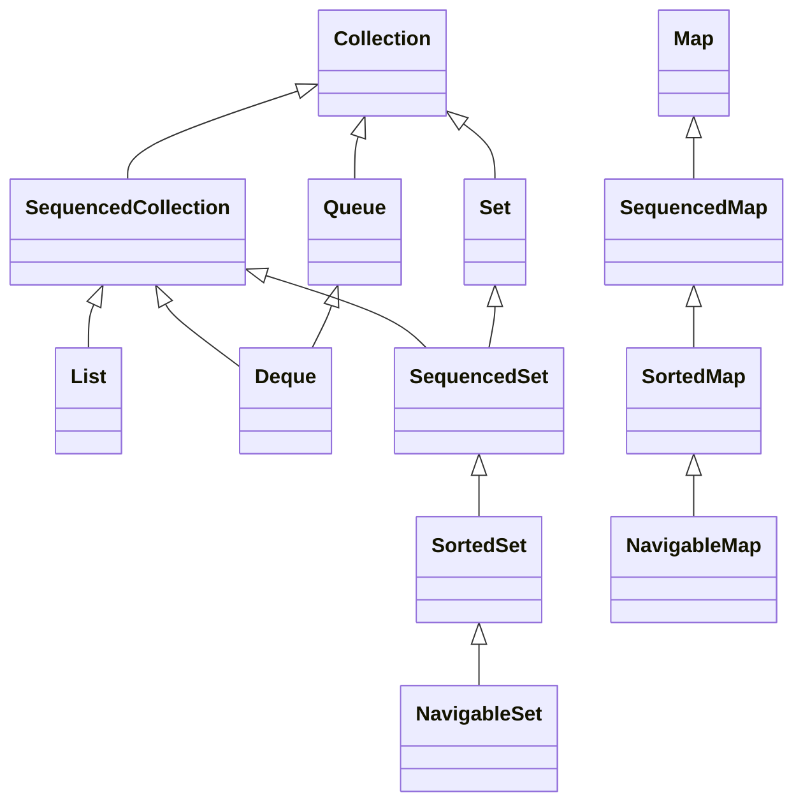

<a id="back-to-top"></a>

# Thứ tự từ Java 21

## Menu
- [Động lực của SequencedCollection, SequencedSet và SequencedMap](#sequenced-collections-001)
- [Quan hệ với List, Deque, SortedSet và SortedMap](#sequenced-collections-002)
- [getFirst, getLast, removeFirst và removeLast](#sequenced-collections-003)
- [addFirst, addLast và thao tác tùy chọn trên tập đã sắp xếp](#sequenced-collections-004)
- [reversed: view đảo thứ tự thay vì bản sao](#sequenced-collections-005)
- [SequencedSet và việc chuyển vị trí phần tử đã có](#sequenced-collections-006)
- [SequencedMap: firstEntry, lastEntry, pollFirstEntry và pollLastEntry](#sequenced-collections-007)
- [putFirst, putLast và các sequenced view của Map](#sequenced-collections-008)

## <a id="sequenced-collections-001">Động lực của SequencedCollection, SequencedSet và SequencedMap</a>

<details>
<summary>Xem chi tiết</summary>

# Động lực của SequencedCollection, SequencedSet và SequencedMap

## 1. Vấn đề cần giải quyết: thứ tự đã tồn tại nhưng thiếu một tiếng nói chung

Giả sử ứng dụng quản lý các bước xuất bản một sản phẩm. Có chỗ lưu toàn bộ lịch sử vào danh sách, có chỗ dùng hàng đợi hai đầu để chờ xử lý, có chỗ giữ các bước không trùng theo thứ tự người dùng chọn. Một chức năng xem trước chỉ cần hỏi: “Phần tử đầu là gì, phần tử cuối là gì, và nếu đọc ngược thì thấy gì?”

Đây là cùng một nhu cầu nghiệp vụ, nhưng trước Java 21, lập trình viên phải diễn đạt bằng nhiều nhóm API khác nhau. Danh sách dùng chỉ số; hàng đợi hai đầu có phương thức dành cho đầu và cuối; tập hợp sắp xếp có khái niệm nhỏ nhất và lớn nhất; tập hợp liên kết giữ thứ tự chèn nhưng thiếu API chung để lấy phần tử cuối hay tạo luồng theo chiều ngược.

Khoảng trống nằm ở **khả năng biểu đạt hợp đồng**: Java đã có nhiều cấu trúc giữ thứ tự, nhưng chưa có một giao diện chung đủ chính xác để nói “tập hợp này có thứ tự gặp phần tử xác định và có thể được nhìn từ hai chiều”. Ba giao diện được đưa vào từ Java 21 giải quyết khoảng trống đó: `SequencedCollection`, `SequencedSet` và `SequencedMap`. Tài liệu giới thiệu chính thức mô tả động lực này trong bối cảnh JEP 431. [Oracle: Creating Sequenced Collections, Sets, and Maps](https://docs.oracle.com/en/java/javase/21/core/creating-sequenced-collections-sets-and-maps.html).

Sau bài này, bạn cần giải thích được vì sao ba kiểu mới cần tồn tại, chọn được giao diện cho đầu vào/đầu ra có ý nghĩa về thứ tự, và tránh suy diễn rằng có phương thức mới thì mọi cấu trúc đều sửa được hoặc có cùng chi phí.

**Mốc phiên bản:** các API `Sequenced*` thuộc Java 21 trở lên. Chương trình chính bên dưới dùng Java 21, không thể biên dịch bằng `--release 17`. Đây là thay đổi thư viện chuẩn đã có trong Java 21; ví dụ không cần bật tính năng thử nghiệm.

## 2. Thứ tự gặp phần tử là gì?

**Thứ tự gặp phần tử (encounter order)** là trình tự các phần tử được xem như đứng từ đầu đến cuối khi thao tác tôn trọng thứ tự. Bạn có thể hình dung một dãy thẻ trên bàn:

~~~text
đầu                                      cuối
build              test                  ship
~~~

Trong dãy này, `build` đứng trước `test`, còn `ship` đứng sau `test`. Đọc thuận cho ra `build, test, ship`; đọc ngược cho ra `ship, test, build`. Khái niệm đó nói về quan hệ logic giữa các phần tử, không khẳng định chúng nằm cạnh nhau trong bộ nhớ. Một mảng động, cấu trúc liên kết và cây có thể cùng cung cấp trình tự có ý nghĩa.

`SequencedCollection` dùng trình tự này cho các thao tác như duyệt, chuyển thành mảng và tạo nguồn luồng. Giao diện có đầu/cuối, các thao tác tại hai đầu và `reversed()` để nhận góc nhìn ngược; các thao tác sửa là thao tác tùy chọn. [Java 21: SequencedCollection](https://docs.oracle.com/en/java/javase/21/docs/api/java.base/java/util/SequencedCollection.html).

### 2.1. Có thứ tự không đồng nghĩa với đã sắp xếp

Hãy đưa lần lượt `ship, build, test` vào ba cấu trúc:

| Cấu trúc và cách dùng | Trình tự quan sát | Điều quyết định trình tự |
| --- | --- | --- |
| `ArrayList`, thêm ở cuối | `ship, build, test` | Vị trí trong danh sách |
| `LinkedHashSet`, dùng `add` thông thường | `ship, build, test` | Thứ tự chèn của các phần tử phân biệt |
| `TreeSet` dùng thứ tự tự nhiên của chuỗi | `build, ship, test` | Phép so sánh giữa các phần tử |

Các cấu trúc đều có thể có thứ tự gặp phần tử, nhưng chỉ hàng cuối là thứ tự do so sánh quyết định. Ví dụ “lấy phần tử đầu” của tập hợp liên kết có thể nghĩa là bước được chọn sớm nhất; với tập hợp sắp xếp, nó là bước nhỏ nhất theo bộ so sánh. Cùng một tên thao tác không xóa đi ý nghĩa của cấu trúc bên dưới.

`TreeSet` sắp xếp theo thứ tự tự nhiên hoặc `Comparator` được cung cấp. Đổi bộ so sánh có thể đổi phần tử đứng đầu dù dữ liệu đầu vào không đổi. [Java 21: TreeSet](https://docs.oracle.com/en/java/javase/21/docs/api/java.base/java/util/TreeSet.html).

### 2.2. Một lần in có vẻ ổn định chưa tạo ra bảo đảm

Một `HashSet` chứa vài chuỗi có thể tình cờ in giống nhau qua nhiều lần chạy. Điều đó không biến nó thành tập hợp có hợp đồng thứ tự chèn. `HashSet` không bảo đảm thứ tự duyệt và không bảo đảm thứ tự ấy giữ nguyên theo thời gian. [Java 21: HashSet](https://docs.oracle.com/en/java/javase/21/docs/api/java.base/java/util/HashSet.html).

Tương tự, không lấy một kết quả `HashMap` hiện tại làm bằng chứng rằng khóa đầu tiên luôn là khóa chèn trước. `HashMap` không cung cấp bảo đảm về thứ tự của map. [Java 21: HashMap](https://docs.oracle.com/en/java/javase/21/docs/api/java.base/java/util/HashMap.html).

Phân biệt hai phát biểu:

- “Lần chạy này iterator trả về `A` trước `B`” là một quan sát.
- “API của cấu trúc quy định `A` phải xuất hiện trước `B` theo quy tắc đã nêu” là một hợp đồng.

Thiết kế chức năng xuất báo cáo, dựng giao diện hay xử lý ưu tiên phải dựa vào phát biểu thứ hai nếu thứ tự ảnh hưởng kết quả.

## 3. Trước Java 21: cùng một ý định, nhiều cách viết

Bảng dưới mô tả sự phân tán API trước Java 21, với dữ liệu không rỗng:

| Kiểu | Lấy đầu | Lấy cuối | Đọc ngược |
| --- | --- | --- | --- |
| `List` | `get(0)` | `get(size() - 1)` | Vòng lặp chỉ số hoặc `ListIterator` đi lùi |
| `Deque` | `getFirst()` | `getLast()` | `descendingIterator()` |
| `SortedSet` | `first()` | `last()` | Nếu có `NavigableSet` thì có `descendingSet()` |
| `LinkedHashSet` | Iterator lấy phần tử đầu | Thường phải duyệt đến cuối | Thường phải tự tổ chức lại việc duyệt hoặc sao chép |
| `LinkedHashMap` | Duyệt `entrySet()` lấy entry đầu | Thường phải duyệt đến cuối | Chưa có góc nhìn ngược thống nhất ở kiểu map này |

Điểm bất tiện không chỉ là số ký tự. Người đọc phải nhận ra rằng các biểu thức khác nhau này đều đang xử lý **biên của một trình tự**. Một tiện ích dùng chung dễ bị tách thành nhiều nhánh theo kiểu cụ thể.

Ví dụ sau là **đoạn phương thức minh họa cách viết tương thích Java 17**, đặt trong một lớp có các import tương ứng; chưa phải chương trình chạy độc lập:

~~~java
static <E> E lastOfList(java.util.List<E> items) {
    if (items.isEmpty()) {
        throw new java.util.NoSuchElementException();
    }
    return items.get(items.size() - 1);
}

static <E> E lastByTraversal(java.util.Collection<E> items) {
    var it = items.iterator();
    if (!it.hasNext()) {
        throw new java.util.NoSuchElementException();
    }
    E last = it.next();
    while (it.hasNext()) {
        last = it.next();
    }
    return last;
}
~~~

Phương thức thứ hai lấy phần tử cuối **của lần duyệt hiện tại**. Nó không thể tự tạo ra bảo đảm “cuối theo thứ tự chèn” cho mọi `Collection`. Nếu truyền một `HashSet`, đoạn code vẫn chạy nhưng ý nghĩa nghiệp vụ mà người gọi tưởng có thể không tồn tại.

Với `Deque`, hợp đồng trước đó vốn đã nói rõ hai đầu và có cặp API trả giá trị đặc biệt khi thao tác thất bại. Từ Java 21, `Deque` còn thuộc nhánh `SequencedCollection`; các khả năng riêng như `offerFirst`, `peekFirst` và `pollFirst` vẫn có ý nghĩa của chúng. [Java 21: Deque](https://docs.oracle.com/en/java/javase/21/docs/api/java.base/java/util/Deque.html).

## 4. Vì sao không dùng Collection hoặc List cho tất cả?

### 4.1. Collection quá rộng nếu thứ tự là một phần của yêu cầu

Xét chữ ký giả định:

~~~java
static void printRoute(java.util.Collection<String> stops) {
    for (String stop : stops) {
        System.out.println(stop);
    }
}
~~~

Phương thức chỉ yêu cầu “một tập hợp phần tử”. Người gọi có thể đưa vào một cấu trúc không có thứ tự bảo đảm. Nếu hàm thực chất cần các điểm dừng theo thứ tự tuyến đường, chữ ký chưa thể hiện hết điều kiện đó; tài liệu và sự cẩn thận của người dùng phải bù vào.

Chuyển sang `SequencedCollection<String>` giúp mô tả trực tiếp rằng đầu vào có trình tự. Một `HashSet<String>` không thể được truyền thẳng vào chữ ký ấy. Trình biên dịch có thể phát hiện sự thiếu phù hợp trước khi chương trình chạy.

Tuy vậy, kiểu này chỉ nói **có một trình tự xác định**. Nó chưa nói trình tự ấy là tuyến đường nghiệp vụ đúng. Một `TreeSet` sắp xếp tên điểm dừng vẫn có thứ tự nhưng có thể sai tuyến. Phải ghi rõ thêm ý nghĩa miền dữ liệu, ví dụ “các điểm dừng theo thứ tự di chuyển”, rồi chọn cấu trúc thỏa điều đó.

### 4.2. List quá hẹp nếu không cần chỉ số và phần tử trùng

Nếu dùng `List` làm tham số, bạn nói rằng danh sách là mô hình phù hợp. Điều này thuận lợi khi cần truy cập vị trí hoặc giữ các lần xuất hiện trùng nhau. Nhưng một hàm chỉ in đầu/cuối và duyệt ngược không nhất thiết cần các đặc điểm đó.

Một tập hợp liên kết loại trùng hoặc tập hợp sắp xếp cũng có thể đáp ứng. Buộc người gọi đổi chúng thành `List` chỉ để qua cửa API làm phát sinh bản sao, cấp phát và một bước diễn giải dữ liệu không cần thiết.

Từ Java 21, `List` vẫn giữ hợp đồng danh sách, đồng thời kế thừa `SequencedCollection` và có `reversed()` trả về `List`. Việc thêm tầng giao diện không thay `List` bằng một mô hình yếu hơn. [Java 21: List](https://docs.oracle.com/en/java/javase/21/docs/api/java.base/java/util/List.html).

### 4.3. Kiểu cụ thể làm tiện ích lệ thuộc một cách lưu dữ liệu

Một chữ ký nhận `LinkedHashSet` mô tả chính xác lớp lưu trữ, nhưng có thể ràng buộc quá mức. Nếu chỉ cần tính duy nhất và trình tự, `SequencedSet` biểu đạt đúng nhu cầu hơn. Người gọi có thể cung cấp cách triển khai phù hợp khác mà tiện ích không phải phân nhánh theo tên lớp.

Đây là lợi ích thiết kế quan trọng của ba giao diện: **chọn hợp đồng cần dùng, giữ các lựa chọn triển khai bên ngoài hàm xử lý**. Không phải cứ thay tên lớp thành một giao diện mới là tốt; phải xác định đúng các khả năng mà hàm thực sự cần.

## 5. Ba giao diện chia trách nhiệm như thế nào?

Sơ đồ sau chỉ vẽ các nhánh liên quan, không phải toàn bộ cây Java Collections Framework. Dấu mũi tên chỉ “là kiểu con của”:

~~~text
List ----------------------> SequencedCollection ------> Collection
Deque ---------------------> SequencedCollection

SequencedSet --------------> SequencedCollection
SequencedSet --------------> Set ----------------------> Collection
SortedSet -----------------> SequencedSet
LinkedHashSet implements --> SequencedSet

SequencedMap --------------> Map
SortedMap -----------------> SequencedMap
LinkedHashMap implements --> SequencedMap
~~~

### 5.1. SequencedCollection: cần một trình tự phần tử

Bạn dùng giao diện này khi cần diễn đạt đầu/cuối và chiều duyệt mà không yêu cầu chỉ số hoặc tính duy nhất.

Nhóm thao tác chính:

| Ý định | Phương thức |
| --- | --- |
| Xem đầu/cuối | `getFirst()`, `getLast()` |
| Thêm ở đầu/cuối nếu được hỗ trợ | `addFirst(e)`, `addLast(e)` |
| Lấy bỏ đầu/cuối nếu được hỗ trợ | `removeFirst()`, `removeLast()` |
| Có góc nhìn theo chiều ngược | `reversed()` |

Đó là từ vựng để viết chung thao tác trên nhiều họ dữ liệu. Không cần hỏi đối tượng có phải `List` hay `Deque` chỉ để lấy đầu và cuối.

### 5.2. SequencedSet: tính duy nhất cộng với trình tự

`SequencedSet` vừa là `Set` vừa là `SequencedCollection`. Nó cho phép API nói rằng dữ liệu không lặp phần tử theo hợp đồng của set, đồng thời có thứ tự gặp phần tử.

Điểm cần giữ là phép so sánh bằng: hợp đồng `Set.equals` vẫn bỏ qua thứ tự. Hai set chứa cùng phần tử có thể bằng nhau dù duyệt theo hai chiều khác nhau. Kiểu mới không chuyển phép bằng của set thành phép bằng của danh sách. [Java 21: SequencedSet](https://docs.oracle.com/en/java/javase/21/docs/api/java.base/java/util/SequencedSet.html).

Ví dụ “các thẻ lọc không trùng, hiện theo thứ tự đã chọn” phù hợp với một tập hợp liên kết. Ví dụ “các mã không trùng, luôn theo thứ tự so sánh” phù hợp với một tập hợp sắp xếp. Cả hai có thể được xử lý qua `SequencedSet` khi hàm chỉ quan tâm phần chung, nhưng nơi tạo dữ liệu phải quyết định chính sách thứ tự.

### 5.3. SequencedMap: trình tự của các ánh xạ khóa–giá trị

`Map` không phải `Collection`. Đơn vị của `SequencedMap` là ánh xạ khóa–giá trị, nên giao diện này kế thừa `Map` riêng.

Nó có `firstEntry()`, `lastEntry()`, `pollFirstEntry()`, `pollLastEntry()`, `putFirst(k, v)`, `putLast(k, v)` và `reversed()`. Khi map rỗng, các thao tác lấy hoặc lấy bỏ entry ở hai đầu trả `null`. Entry do bốn phương thức đầu trả về là ảnh chụp của ánh xạ tại lúc gọi, không dùng `setValue` để sửa ánh xạ gốc. [Java 21: SequencedMap](https://docs.oracle.com/en/java/javase/21/docs/api/java.base/java/util/SequencedMap.html).

Bài toán “số lượng theo từng giai đoạn, hiển thị theo thứ tự quy trình” cần cả tra cứu theo khóa và thứ tự. Dùng map có trình tự tránh phải tách thành một map tra cứu cộng với một danh sách khóa rồi tự giữ hai nguồn dữ liệu đồng bộ.

### 5.4. Vì sao cần các view có tên sequenced?

Các kiểu trả về quen thuộc của map là `Set<K>`, `Collection<V>` và `Set<Map.Entry<K,V>>`. Chúng có thể duyệt theo trình tự của map nhưng chữ ký đó không cung cấp trực tiếp toàn bộ từ vựng đầu/cuối/ngược.

Các phương thức mới biểu đạt rõ hơn:

~~~java
java.util.SequencedSet<String> keys = counts.sequencedKeySet();
java.util.SequencedCollection<Integer> values = counts.sequencedValues();
java.util.SequencedSet<java.util.Map.Entry<String, Integer>> entries =
        counts.sequencedEntrySet();
~~~

Đây là đoạn minh họa bên trong một phương thức, giả sử `counts` là `SequencedMap<String,Integer>`.

Giá trị có thể lặp, nên `sequencedValues()` trả `SequencedCollection` chứ không phải `SequencedSet`. View khóa không đủ thông tin giá trị để thêm một ánh xạ mới; không suy từ tên kiểu rằng có thể gọi `addFirst` thành công trên mọi view.

## 6. Sự thống nhất nằm ở hợp đồng, không phải thay tất cả bằng một lớp

Các lớp quen thuộc vẫn có vai trò. Ví dụ, `ArrayList` vẫn là danh sách dựa trên mảng có thể tăng kích thước, có truy cập vị trí và cho phép `null`. Nó được dùng qua giao diện mới nhờ quan hệ kiểu đã được bổ sung, không phải nhờ một bản sao được tự tạo ra. [Java 21: ArrayList](https://docs.oracle.com/en/java/javase/21/docs/api/java.base/java/util/ArrayList.html).

Một hàm báo cáo đầu/cuối có thể viết như sau trong Java 21:

~~~java
static String describeEnds(java.util.SequencedCollection<?> items) {
    if (items.isEmpty()) {
        return "empty";
    }
    return items.getFirst() + " -> " + items.getLast();
}
~~~

Hàm không biết đối tượng lưu bằng mảng, liên kết hay cây. Nó cũng không cần biết có trùng phần tử hay không. Nó chỉ dựa vào hợp đồng đầu/cuối.

Đổi lại, nếu thuật toán cần `get(i)` thì `SequencedCollection` không đủ. Nếu thuật toán cần một hàng đợi giới hạn dung lượng với `offer`/`poll` thì `Deque` hay một kiểu phù hợp khác vẫn cần thiết. Tên mới không phải lý do hạ mọi chữ ký xuống cùng một mức trừu tượng.

Đoạn kiểm tra `isEmpty` rồi lấy hai đầu ở trên dành cho ngữ cảnh không có thay đổi đồng thời trong suốt thao tác. Hai phương thức riêng biệt không tự tạo một ảnh chụp nguyên tử. Nếu nhiều luồng sửa dữ liệu, phải thiết kế cơ chế đồng bộ hoặc ảnh chụp phù hợp với cách triển khai.

## 7. reversed(): đổi hướng nhìn, cần phân biệt với bản sao

Hình dung dữ liệu gốc:

~~~text
gốc:          A   B   C
view ngược:   C   B   A

view.getFirst()  <->  gốc.getLast()
view.getLast()   <->  gốc.getFirst()
~~~

`reversed()` trả **góc nhìn theo chiều ngược (reverse-ordered view)**. Với một `List` như `ArrayList`, sửa qua view được phép có thể ghi xuyên về danh sách gốc. Ví dụ:

~~~java
java.util.List<String> original =
        new java.util.ArrayList<>(java.util.List.of("A", "B", "C"));
java.util.List<String> backwards = original.reversed();
backwards.addFirst("D");
// original: [A, B, C, D]
// backwards: [D, C, B, A]
~~~

Đây là đoạn minh họa Java 21 bên trong phương thức. Thêm ở đầu góc nhìn ngược tương ứng thêm ở cuối hướng gốc. Không có một lệnh “đảo mảng vật lý” được yêu cầu ở đây.

Phải đọc hợp đồng cụ thể khi dựa vào khả năng quan sát thay đổi từ cấu trúc gốc. Giao diện chung nêu rằng mức độ nhìn thấy thay đổi từ nguồn phụ thuộc cách triển khai. Không hứa mọi kiểu `SequencedCollection` đều có cùng đặc tính cập nhật, iterator hay an toàn luồng.

Đối với `LinkedHashMap`, tài liệu lớp quy định rõ thay đổi qua view ngược truyền về map gốc và thay đổi map gốc nhìn thấy qua view; thứ tự truy cập cũng có thể liên quan nếu map được tạo ở chế độ access-order. [Java 21: LinkedHashMap](https://docs.oracle.com/en/java/javase/21/docs/api/java.base/java/util/LinkedHashMap.html).

### 7.1. Khi nào cần sao chép?

Nếu chức năng cần lưu lại trình tự tại một thời điểm, hãy tạo dữ liệu độc lập về cấu trúc:

~~~java
java.util.List<String> saved =
        new java.util.ArrayList<>(original.reversed());
~~~

`saved` nhận các phần tử theo hướng ngược tại lúc sao chép, rồi không tự đổi cấu trúc khi thêm/xóa vào `original`. Đây vẫn là sao chép nông: nếu phần tử là đối tượng có trạng thái thay đổi, hai cấu trúc có thể cùng giữ tham chiếu đến chúng. Muốn ảnh chụp sâu phải có chính sách riêng cho loại phần tử.

Đừng dùng `reversed()` chỉ vì thấy kết quả ban đầu giống một bản sao đã đảo. Hai lựa chọn có mục đích sở hữu dữ liệu khác nhau.

### 7.2. Luồng ngược trở nên tự nhiên hơn

Một lợi ích thực tế là đưa chiều duyệt vào nguồn dữ liệu:

~~~java
var display = original.reversed().stream().toList();
~~~

Không cần tự chép sang một danh sách rồi đảo danh sách đó chỉ để lấy một luồng đọc ngược. Nếu chuyển sang luồng song song, thứ tự gặp phần tử vẫn là một thuộc tính của nguồn; thứ tự thực thi tác vụ của `forEach` không được bảo đảm theo trình tự đó. Khi cần tác dụng phụ theo thứ tự gặp phần tử, xem `forEachOrdered`; không suy từ `reversed()` rằng mọi luồng chạy song song sẽ in theo thứ tự mong đợi. [Java 21: Stream](https://docs.oracle.com/en/java/javase/21/docs/api/java.base/java/util/stream/Stream.html).

## 8. Có thứ tự không có nghĩa là được đặt phần tử tùy ý

Một giao diện chung cần mô tả được cấu trúc sửa được, cấu trúc không sửa được và cấu trúc mà thứ tự bị một quy tắc khác chi phối. Vì vậy, nhiều thao tác sửa là tùy chọn và có thể ném `UnsupportedOperationException`.

### 8.1. Tập hợp liên kết có thể định vị lại một phần tử

Trong `LinkedHashSet`, `add` thông thường với phần tử đã có không đổi thứ tự. `addFirst` và `addLast` có thể đưa phần tử đã có đến đầu hoặc cuối, không tạo một bản trùng.

Ví dụ một bộ thẻ đang là `[ship, build, test]`. Gọi `addFirst("test")` cho ra `[test, ship, build]`; sau đó gọi `add("ship")` vẫn giữ trình tự ấy. Chức năng “ghim lên đầu” được diễn đạt trực tiếp thay cho cách xóa rồi thêm với nhiều quy tắc phụ. [Java 21: LinkedHashSet](https://docs.oracle.com/en/java/javase/21/docs/api/java.base/java/util/LinkedHashSet.html).

### 8.2. Tập hợp sắp xếp phải giữ quy tắc so sánh

Giả sử một `TreeSet<Integer>` đang chứa `[10, 20, 30]` theo thứ tự tự nhiên. Cho phép đặt `25` vào đầu sẽ mâu thuẫn với yêu cầu sắp xếp. Vì thế `SortedSet` không hỗ trợ định vị tường minh bằng `addFirst` và `addLast`; các phương thức này ném `UnsupportedOperationException`.

Điều này vẫn đúng khi giá trị bạn định thêm tình cờ đã phù hợp vị trí đầu hoặc cuối. Đừng gọi thử một giá trị “đúng thứ tự” rồi xem đó là cách sử dụng hợp lệ; hãy thêm bằng `add` để cấu trúc tự quyết định vị trí. [Java 21: SortedSet](https://docs.oracle.com/en/java/javase/21/docs/api/java.base/java/util/SortedSet.html).

### 8.3. Map sắp xếp có cùng ranh giới

`SortedMap` xác định trình tự theo so sánh khóa. Nó có thể được dùng như `SequencedMap` để xem đầu/cuối/ngược, nhưng `putFirst` và `putLast` không được hỗ trợ vì chúng yêu cầu áp đặt vị trí. `put` vẫn là cách thêm hoặc cập nhật theo quy tắc của map. [Java 21: SortedMap](https://docs.oracle.com/en/java/javase/21/docs/api/java.base/java/util/SortedMap.html).

Một `TreeMap` sắp xếp theo khóa, không theo giá trị. Nếu đầu vào là khóa `2` rồi khóa `1`, thứ tự duyệt tự nhiên là `1, 2`; việc dùng `SequencedMap` không biến nó thành thứ tự chèn. [Java 21: TreeMap](https://docs.oracle.com/en/java/javase/21/docs/api/java.base/java/util/TreeMap.html).

### 8.4. Lớp bọc không sửa được vẫn nên giữ thông tin thứ tự

Trước đây, dùng lớp bọc trả `Set` có thể làm chữ ký mất khả năng biểu đạt thứ tự, dù đối tượng bên trong là một tập hợp liên kết.

Java 21 có các hàm:

- `Collections.unmodifiableSequencedCollection(...)`;
- `Collections.unmodifiableSequencedSet(...)`;
- `Collections.unmodifiableSequencedMap(...)`.

Chúng giữ kiểu hợp đồng có trình tự và chặn sửa qua lớp bọc. Chúng là view, không phải lời hứa rằng nguồn sẽ không bao giờ đổi; thao tác truy vấn đọc qua dữ liệu nguồn. [Java 21: Collections](https://docs.oracle.com/en/java/javase/21/docs/api/java.base/java/util/Collections.html).

Đây là điểm hữu ích cho API trả dữ liệu chỉ đọc: người dùng vẫn biết có thể lấy đầu/cuối và đọc ngược. Nếu yêu cầu là một ảnh chụp độc lập, hãy tạo bản sao có chính sách thứ tự rõ ràng rồi bọc nó; chỉ bọc nguồn sống chưa đạt yêu cầu đó.

## 9. Phép bằng và độ phức tạp không được thống nhất theo tên mới

### 9.1. Trình tự có thể quan trọng khi duyệt nhưng không tham gia equals

`List.equals` so sánh cả phần tử lẫn vị trí tương ứng. Một danh sách `[A, B]` khác `[B, A]`. Trong khi đó `Set.equals` nói về cùng thành viên; thêm khả năng có trình tự không sửa hợp đồng này. [Java 21: Set](https://docs.oracle.com/en/java/javase/21/docs/api/java.base/java/util/Set.html).

Tương tự, `Map.equals` xét cùng các ánh xạ, không xét trình tự duyệt. Một `LinkedHashMap` và view ngược của nó có thể bằng nhau dù báo cáo hai thứ tự khác nhau. [Java 21: Map](https://docs.oracle.com/en/java/javase/21/docs/api/java.base/java/util/Map.html).

Vì vậy, nếu kiểm thử cần kiểm chứng **trình tự**, hãy so sánh trình tự được thu thập, chẳng hạn danh sách các khóa. Một kiểm thử chỉ gọi `expectedSet.equals(actualSet)` có thể bỏ sót lỗi thứ tự giao diện.

Cũng không giả định một tham số `SequencedCollection<?>` có phép bằng theo danh sách: nó có thể đang tham chiếu đến set hoặc kiểu khác. Giao diện chung không áp đặt một định nghĩa `equals` duy nhất mâu thuẫn với các nhánh con.

### 9.2. Cùng tên thao tác không có nghĩa cùng chi phí

`getLast` hoặc `addFirst` giúp nói rõ ý định. Nó không tự thay thuật toán lưu trữ của đối tượng thành thuật toán khác.

Ví dụ, thêm vào đầu `ArrayList` phải dịch các phần tử đang có về phía sau. Khi số phần tử tăng, công việc đó tăng theo; đổi `add(0, value)` thành `addFirst(value)` chủ yếu cải thiện cách diễn đạt. Một thuật toán thường xuyên thêm/xóa hai đầu vẫn phải chọn cấu trúc theo khối lượng công việc thực tế.

Đừng viết một hàm tổng quát nhận `SequencedCollection` rồi hứa mọi thao tác hai đầu đều có thời gian hằng số. Muốn đặt cam kết hiệu năng, phải dựa vào tài liệu của cách triển khai và cách sử dụng cụ thể.

## 10. Chương trình đầy đủ: cùng hợp đồng, các chính sách khác nhau

Lưu toàn bộ mã sau vào **`SequencedMotivationDemo.java`**. Chương trình dùng chuỗi ASCII cho stdout để kết quả không phụ thuộc cách hiển thị dấu tiếng Việt trên terminal.

Nó kiểm chứng bốn điều: một hàm nhận được nhiều kiểu có trình tự; đọc ngược khác sao chép; set/map vẫn giữ hợp đồng riêng; thao tác định vị có thể không được hỗ trợ.

~~~java
import java.util.ArrayDeque;
import java.util.ArrayList;
import java.util.Collections;
import java.util.Deque;
import java.util.LinkedHashMap;
import java.util.LinkedHashSet;
import java.util.List;
import java.util.SequencedCollection;
import java.util.SequencedMap;
import java.util.SequencedSet;
import java.util.TreeMap;
import java.util.TreeSet;

public class SequencedMotivationDemo {
    static String ends(SequencedCollection<?> items) {
        if (items.isEmpty()) {
            return "empty";
        }
        return items.getFirst() + " -> " + items.getLast();
    }

    static String failure(Runnable action) {
        try {
            action.run();
            return "no exception";
        } catch (UnsupportedOperationException | java.util.NoSuchElementException ex) {
            return ex.getClass().getSimpleName();
        }
    }

    public static void main(String[] args) {
        List<String> stages = new ArrayList<>(List.of("build", "test", "ship"));
        Deque<String> jobs = new ArrayDeque<>(List.of("build", "test", "ship"));
        SequencedSet<String> unique =
                new LinkedHashSet<>(List.of("ship", "build", "test", "build"));
        SequencedSet<String> sorted =
                new TreeSet<>(List.of("ship", "build", "test", "build"));

        System.out.println("list ends: " + ends(stages));
        System.out.println("deque ends: " + ends(jobs));
        System.out.println("linked set ends: " + ends(unique));
        System.out.println("sorted set ends: " + ends(sorted));
        System.out.println("reverse stream: " + stages.reversed().stream().toList());

        List<String> backwards = stages.reversed();
        List<String> snapshot = new ArrayList<>(backwards);
        backwards.addFirst("archive");
        System.out.println("list after reverse addFirst: " + stages);
        System.out.println("reverse view now: " + backwards);
        System.out.println("reverse copy stays: " + snapshot);

        unique.addFirst("test");
        unique.add("ship");
        System.out.println("set after reposition: " + unique);
        System.out.println("set equals reverse: " + unique.equals(unique.reversed()));
        System.out.println("list equals reverse: " + stages.equals(stages.reversed()));

        SequencedMap<String, Integer> counts = new LinkedHashMap<>();
        counts.put("build", 1);
        counts.put("test", 2);
        counts.put("ship", 3);
        System.out.println("map first: " + counts.firstEntry());
        System.out.println("map reverse first: " + counts.reversed().firstEntry());
        counts.putFirst("test", 20);
        System.out.println("map after putFirst: " + counts);
        System.out.println("map keys: " + counts.sequencedKeySet());
        System.out.println("map values: " + counts.sequencedValues());
        System.out.println("reverse map keys: " + counts.reversed().sequencedKeySet());
        System.out.println("map equals reverse: " + counts.equals(counts.reversed()));

        LinkedHashSet<String> colors =
                new LinkedHashSet<>(List.of("red", "blue"));
        SequencedSet<String> readOnly =
                Collections.unmodifiableSequencedSet(colors);
        colors.addLast("green");
        System.out.println("read-only view sees: " + readOnly);
        System.out.println("read-only add: " + failure(() -> readOnly.addFirst("black")));

        System.out.println("sorted addFirst: " + failure(() -> sorted.addFirst("alpha")));
        SequencedMap<Integer, String> orderedByKey = new TreeMap<>();
        orderedByKey.put(2, "two");
        orderedByKey.put(1, "one");
        System.out.println("sorted map keys: " + orderedByKey.sequencedKeySet());
        System.out.println("sorted map putLast: "
                + failure(() -> orderedByKey.putLast(0, "zero")));

        SequencedCollection<String> empty = new ArrayList<>();
        System.out.println("empty getFirst: " + failure(() -> empty.getFirst()));
        SequencedMap<String, Integer> emptyMap = new LinkedHashMap<>();
        System.out.println("empty map first: " + emptyMap.firstEntry());
    }
}
~~~

Biên dịch bằng JDK 21 trở lên, đặt mức API/ngôn ngữ mục tiêu là 21, sau đó chạy trên Java 21 trở lên:

~~~shell
javac --release 21 -encoding UTF-8 SequencedMotivationDemo.java
java SequencedMotivationDemo
~~~

Không cần `--enable-preview`. Nếu dùng JDK mới hơn để biên dịch, `--release 21` giúp phát hiện việc vô tình sử dụng API chỉ có sau Java 21. Ví dụ này đã được biên dịch với mức release 21 và chạy thành công bằng OpenJDK 24.0.2.

Stdout chính xác:

~~~text
list ends: build -> ship
deque ends: build -> ship
linked set ends: ship -> test
sorted set ends: build -> test
reverse stream: [ship, test, build]
list after reverse addFirst: [build, test, ship, archive]
reverse view now: [archive, ship, test, build]
reverse copy stays: [ship, test, build]
set after reposition: [test, ship, build]
set equals reverse: true
list equals reverse: false
map first: build=1
map reverse first: ship=3
map after putFirst: {test=20, build=1, ship=3}
map keys: [test, build, ship]
map values: [20, 1, 3]
reverse map keys: [ship, build, test]
map equals reverse: true
read-only view sees: [red, blue, green]
read-only add: UnsupportedOperationException
sorted addFirst: UnsupportedOperationException
sorted map keys: [1, 2]
sorted map putLast: UnsupportedOperationException
empty getFirst: NoSuchElementException
empty map first: null
~~~

### 10.1. Đọc các nhóm kết quả theo ý nghĩa

**Bốn dòng đầu:** cùng một hàm `ends` xử lý `List`, `Deque`, tập hợp liên kết và tập hợp sắp xếp. Hai set nhận cùng dữ liệu ban đầu nhưng đầu/cuối khác nhau vì chính sách thứ tự khác nhau. Chuỗi `build` lặp hai lần không tạo hai phần tử trong set.

**Ba dòng sau thao tác trên view:** `backwards.addFirst("archive")` đưa phần tử về cuối danh sách gốc. View phản ánh hướng ngược mới; `snapshot` vẫn là trình tự đã sao chép trước đó. Chương trình không tạo iterator rồi sửa dữ liệu trong lúc duyệt.

**Các dòng về set:** `test` được chuyển lên đầu; gọi `add("ship")` không di chuyển một phần tử đang có. Set vẫn bằng view ngược theo thành viên. Danh sách không bằng view ngược trong dữ liệu này vì các vị trí không tương ứng.

**Các dòng về map:** map ban đầu theo thứ tự chèn. `putFirst("test", 20)` vừa cập nhật giá trị khóa đã có vừa đưa ánh xạ đó lên đầu. View khóa và view giá trị đi theo cùng trình tự ánh xạ; view ngược đổi chiều của cả chúng.

**Nhóm cuối:** nguồn của lớp bọc chỉ đọc được thêm `green` nên view nhìn thấy phần tử ấy. Sửa qua lớp bọc bị chặn. Set/map sắp xếp từ chối định vị tường minh, dù vẫn có thứ tự để đọc. Collection rỗng và map rỗng dùng quy ước trả kết quả khác nhau ở các phương thức được minh họa.

### 10.2. Vì sao chương trình không thử in thứ tự HashSet?

Mục tiêu là chứng minh một hợp đồng có thể dựa vào, không chọn một kết quả ngẫu nhiên rồi học thuộc. Một lần in `HashSet` không đủ chứng minh hay phủ định yêu cầu thứ tự nghiệp vụ. Ở đây, sự khác biệt thể hiện ngay ở khả năng truyền vào `ends`: một `HashSet` không thuộc kiểu tham số này.

## 11. Cách đưa vào thiết kế API thực tế

Hãy bắt đầu từ câu mà nghiệp vụ muốn nói, rồi mới chọn giao diện:

| Nhu cầu của hàm | Kiểu có thể phù hợp | Điều vẫn phải xác định thêm |
| --- | --- | --- |
| Duyệt phần tử, không quan tâm trình tự | `Collection<E>` | Tính trùng, khả năng sửa, điều kiện phần tử |
| Xem đầu/cuối, đọc hai chiều | `SequencedCollection<E>` | Ý nghĩa trình tự, dữ liệu rỗng, quyền sửa |
| Cần vị trí `i` hoặc ngữ nghĩa danh sách | `List<E>` | Chi phí truy cập và cập nhật của triển khai |
| Không trùng, có trình tự | `SequencedSet<E>` | Thứ tự chèn, so sánh hay chính sách khác |
| Tra cứu theo khóa và trình tự ánh xạ | `SequencedMap<K,V>` | Chính sách thứ tự, xử lý khóa/giá trị `null` |
| Quy trình hàng đợi hai đầu | `Deque<E>` | Hành vi rỗng, giới hạn dung lượng, đồng thời |

Một ví dụ trả về “các bộ lọc được chọn, không trùng và hiện theo thứ tự người dùng chọn” có thể dùng `SequencedSet<Filter>` với dữ liệu được tạo bằng `LinkedHashSet`, rồi bọc thành view chỉ đọc có cùng kiểu nếu phù hợp vòng đời.

Một ví dụ báo cáo “các chỉ số theo khóa tăng dần” có thể dùng `SortedMap` hoặc `NavigableMap` nếu người dùng API còn cần bộ so sánh hay truy vấn phạm vi. Nếu chỉ cần đầu/cuối và duyệt, `SequencedMap` có thể là mức hợp đồng đủ dùng. Không giấu một khả năng mà người dùng thực sự cần chỉ để dùng tên mới.

Nếu thay chữ ký của một API đang được công bố, đó vẫn là quyết định tương thích cần xem xét. Việc một lớp trong JDK có thêm quan hệ kiểu không cho phép bạn tùy tiện đổi mọi tham số, kiểu trả về hoặc yêu cầu phiên bản của thư viện đang được người khác dùng.

### 11.1. Không ép kiểu để “tạo” thứ tự

Đoạn dưới là **ví dụ không hợp lệ khi chạy**, không thuộc chương trình chính:

~~~java
java.util.Collection<String> source = new java.util.HashSet<>();
java.util.SequencedCollection<String> ordered =
        (java.util.SequencedCollection<String>) source;
~~~

Một phép ép kiểu không bổ sung hợp đồng mà đối tượng không triển khai. Đối tượng `HashSet` này sẽ gây `ClassCastException` ở phép ép kiểu.

Nếu đầu vào thực sự không có thứ tự nghiệp vụ, phải quyết định chính sách chuyển đổi. Chép sang `ArrayList` chỉ giữ thứ tự duyệt quan sát được lúc chép; chép sang `TreeSet` tạo thứ tự theo so sánh và loại trùng. Hai phép chuyển đổi có ý nghĩa khác nhau, không phải cách sửa kiểu có thể thay nhau vô điều kiện.

### 11.2. Xác định riêng hành vi rỗng

Một hàm trả “đầu/cuối” phải quyết định đầu vào rỗng là hợp lệ, trả kết quả không có dữ liệu hay báo lỗi miền nghiệp vụ. Chương trình minh họa `ends` trả chuỗi `empty`; đây là lựa chọn của hàm, không phải quy tắc bắt buộc của `SequencedCollection`.

Đừng viết mọi helper bằng cách bắt `Exception` rồi trả `null`. Cách đó có thể che cả lỗi không hỗ trợ thao tác, lỗi dữ liệu và lỗi lập trình. Kiểu đầu vào có trình tự giúp biểu đạt một khía cạnh; chính sách thất bại vẫn cần được thiết kế rõ.

## 12. Những hiểu nhầm dễ dẫn đến thiết kế sai

1. **“Java 21 mới có collection có thứ tự.”** Các cấu trúc có thứ tự đã tồn tại từ trước. Phần mới là tầng giao diện và bộ thao tác thống nhất để biểu đạt, sử dụng phần chung ấy.
2. **“Sequenced nghĩa là tăng dần.”** Một danh sách theo thứ tự người dùng chọn cũng có trình tự. Quy tắc so sánh là một khả năng riêng của nhóm sorted.
3. **“Mọi Set trở thành SequencedSet.”** Chỉ các kiểu phù hợp mới cung cấp hợp đồng ấy. Đừng dùng thứ tự tình cờ của một cấu trúc không bảo đảm thứ tự.
4. **“Có addFirst là gọi luôn được.”** Thao tác sửa có thể bị từ chối bởi lớp bọc hoặc quy tắc sắp xếp.
5. **“reversed đã chép dữ liệu.”** View và bản sao có quyền sở hữu/vòng đời khác nhau. Tự tạo bản sao khi cần dữ liệu độc lập về cấu trúc.
6. **“Cùng thứ tự là đủ, không cần quan tâm trùng.”** `SequencedCollection` không bảo đảm tính duy nhất; `SequencedSet` mới kết hợp hợp đồng set.
7. **“equals sẽ kiểm tra cả thứ tự của set/map.”** Kiểu mới giữ hợp đồng equals của các nhánh đó. Kiểm chứng thứ tự bằng một biểu diễn có thứ tự thích hợp.
8. **“Phương thức gọn hơn làm mọi thao tác nhanh hơn.”** Tên API không thay cấu trúc mảng, liên kết hay cây bên dưới.
9. **“Chỉ đọc là ảnh chụp cố định.”** Lớp bọc view chặn sửa qua một đường truy cập; nguồn bên dưới có thể tiếp tục đổi.
10. **“Đã dùng giao diện mới thì chạy được trên Java 17.”** Thư viện chuẩn được nhắm tới phải có các kiểu ấy. Cần thống nhất mức JDK biên dịch, mục tiêu release và runtime.

## 13. Thực hành có đáp án

### Bài 1 — Chọn chữ ký cho một tiện ích

Một hàm chỉ cần hiển thị phần tử đầu, phần tử cuối và các phần tử theo chiều ngược. Nó phải nhận được danh sách, hàng đợi hai đầu và tập hợp liên kết. Chọn một tham số chung trong Java 21, rồi nêu hai điều kiểu đó chưa cam kết.

**Đáp án:** dùng `SequencedCollection<? extends E>` hoặc `SequencedCollection<?>` tùy cách dùng phần tử. Kiểu không nói trình tự ấy là thứ tự chèn, không cam kết cho phép sửa; cũng không cam kết không trùng, độ phức tạp hay đồng bộ. Nếu hàm chỉ đọc thì không nên tự thêm yêu cầu sửa vào hợp đồng.

### Bài 2 — Thứ tự và nghiệp vụ

Một hàm in các điểm dừng của tuyến xe nhận `SequencedCollection<String>`. Người gọi đưa `TreeSet` tên điểm dừng theo bảng chữ cái. Trình biên dịch chấp nhận. Có thể kết luận tuyến đường đúng không?

**Đáp án:** chưa. Kiểu bảo đảm có trình tự nhưng không xác định trình tự ấy là lịch di chuyển. Cần hợp đồng miền dữ liệu và nguồn dữ liệu đúng; tên tham số hoặc tài liệu phải nêu “theo thứ tự tuyến đường”, rồi chọn cấu trúc bảo toàn quy tắc đó.

### Bài 3 — Dự đoán view và bản sao

Bắt đầu `List<Integer> a = new ArrayList<>(List.of(2, 4, 6))`. Lấy `r = a.reversed()` và `saved = new ArrayList<>(r)`. Sau đó `r.addFirst(8)`. Ba trình tự là gì?

**Đáp án:** `a` là `[2, 4, 6, 8]`; `r` là `[8, 6, 4, 2]`; `saved` là `[6, 4, 2]`. Đây là các phần tử `Integer` không đổi trạng thái, nên ví dụ không có vấn đề dùng chung đối tượng có thể sửa.

### Bài 4 — Tính duy nhất và định vị

Một `LinkedHashSet` có `[A, B, C]`. Gọi `add("B")` rồi `addLast("A")`. Có bốn phần tử không? Trình tự cuối thế nào?

**Đáp án:** vẫn ba phần tử. `add("B")` giữ vị trí của `B`; `addLast("A")` chuyển `A` xuống cuối, kết quả `[B, C, A]`. Không đưa quy tắc này sang `TreeSet`; thao tác định vị tường minh bị từ chối ở tập hợp sắp xếp.

### Bài 5 — Kiểm thử thứ tự map

Hai map có cùng ánh xạ nhưng khóa được duyệt theo hai thứ tự khác nhau. Một kiểm thử dùng `expected.equals(actual)` vẫn qua. Phải bổ sung gì nếu thứ tự là yêu cầu giao diện?

**Đáp án:** so sánh trình tự khóa hoặc entry, ví dụ tạo `new ArrayList<>(actual.sequencedKeySet())` rồi so với danh sách mong đợi. Đừng đổi hợp đồng `Map.equals` bằng suy đoán; hãy kiểm thử trực tiếp điều nghiệp vụ quan tâm.

### Bài 6 — Sửa lỗi lựa chọn thao tác

Một `SequencedMap<Integer,String>` thực tế là `TreeMap`. Lập trình viên gọi `putFirst(0, "start")` vì `0` nhỏ nhất và gặp lỗi. Cách sửa phù hợp là gì?

**Đáp án:** dùng `put(0, "start")` để map sắp xếp theo khóa. `putFirst` vẫn không được hỗ trợ ngay cả khi khóa tình cờ phù hợp đầu. Nếu nghiệp vụ cần tự ghim một khóa bất kỳ lên đầu, phải xem lại lựa chọn cấu trúc và chính sách thứ tự, chẳng hạn một map liên kết; không bắt lỗi rồi giả vờ thao tác đã thành công.

### Bài 7 — Chỉ đọc hay ảnh chụp?

API tạo `Collections.unmodifiableSequencedSet(source)` rồi trả về cho giao diện. Một phần khác của ứng dụng thêm phần tử vào `source`. Có thể hứa kết quả trả về không đổi không?

**Đáp án:** không thể đưa lời hứa ấy chỉ từ lớp bọc. Nếu cần một ảnh chụp có thứ tự độc lập về cấu trúc, hãy tạo bản sao riêng có chính sách đúng rồi bọc bản sao; nếu phần tử có trạng thái thay đổi, phải giải quyết thêm mức sao chép cần thiết.

### Bài 8 — Tự kiểm chứng mức phiên bản

Thử biên dịch chương trình chính với `javac --release 17`, sau đó với `javac --release 21` trên JDK hỗ trợ. Vì sao lần đầu không phù hợp, và vì sao chỉ nâng runtime chưa đủ cho một pipeline đang biên dịch mục tiêu 17?

**Đáp án:** API `Sequenced*` không thuộc thư viện chuẩn Java 17. `--release` kiểm soát API/ngôn ngữ mục tiêu khi biên dịch; một runtime mới hơn không làm các kiểu Java 21 xuất hiện trong mục tiêu release 17. Phải thống nhất yêu cầu Java 21+ của phần mã sử dụng các API này, đồng thời kiểm tra sự tương thích mà dự án cần duy trì.

Khi tự sửa chương trình, hãy thêm một cấu trúc mới vào hàm `ends` và giải thích nguồn gốc của thứ tự đầu/cuối trước khi chạy. Kết quả có giá trị học tập khi bạn dự đoán được hợp đồng nào đang được thực thi, không chỉ khi stdout tình cờ giống điều mong đợi.


</details>

- [Quay lại đầu trang](#back-to-top)

---

## <a id="sequenced-collections-002">Quan hệ với List, Deque, SortedSet và SortedMap</a>

<details>
<summary>Xem chi tiết</summary>

# Quan hệ với List, Deque, SortedSet và SortedMap

## 1. Java 21 bổ sung một hợp đồng chung cho những cấu trúc đã có thứ tự

List biết vị trí phần tử, Deque biết hai đầu hàng đợi, SortedSet biết phần tử đầu/cuối theo thứ tự so sánh và SortedMap biết các ánh xạ theo thứ tự khóa.

Trước khi chọn API, cần nhận ra điểm chung: mỗi cấu trúc ấy có một **thứ tự gặp phần tử hoặc ánh xạ** xác định, thường gọi là encounter order.

Từ Java 21, các giao diện sequenced biểu diễn điểm chung này trong hệ thống kiểu:

- SequencedCollection cho một tập hợp phần tử có thứ tự gặp, có thể nhìn theo chiều ngược và có API hai đầu.
- SequencedSet kết hợp tính chất có thứ tự gặp với hợp đồng Set.
- SequencedMap dành cho các ánh xạ khóa–giá trị có thứ tự gặp.

Chúng không thay List, Deque, SortedSet hoặc SortedMap thành cùng một cấu trúc. Chúng bổ sung tổ tiên chung phù hợp để viết mã dùng chung mà vẫn giữ các đặc tính riêng.

Ba câu hỏi nên tách ra:

| Câu hỏi | Ví dụ |
| --- | --- |
| Có thứ tự gặp xác định không? | List, Deque, SortedSet đều có |
| Thứ tự ấy được quyết định bằng cách nào? | Vị trí danh sách, hai đầu deque hoặc Comparator |
| Những phép sửa nào được hỗ trợ? | Một TreeSet sửa được nhưng không nhận addFirst/addLast |

**Bài cần JDK 21 trở lên.** Các API sequenced không có trong Java 17. Ví dụ được biên dịch với --release 21 và chạy trên OpenJDK 24.0.2; không dùng tính năng preview.

## 2. Hai nhánh kiểu: Collection và Map

### 2.1. Sơ đồ quan hệ chính

Trong sơ đồ, đầu tam giác chỉ về giao diện cha. Sơ đồ lược bớt tham số generic và một số cạnh kế thừa dư để dễ đọc.



Các khai báo quan trọng trong Java 21:

| Giao diện | Quan hệ trực tiếp cần nhớ |
| --- | --- |
| SequencedCollection<E> | extends Collection<E> |
| List<E> | extends SequencedCollection<E> |
| Deque<E> | extends Queue<E>, SequencedCollection<E> |
| SequencedSet<E> | extends SequencedCollection<E>, Set<E> |
| SortedSet<E> | extends Set<E>, SequencedSet<E> |
| SequencedMap<K,V> | extends Map<K,V> |
| SortedMap<K,V> | extends SequencedMap<K,V> |

Quan hệ của List và Deque được mô tả trong [List Java 21](https://docs.oracle.com/en/java/javase/21/docs/api/java.base/java/util/List.html) và [Deque Java 21](https://docs.oracle.com/en/java/javase/21/docs/api/java.base/java/util/Deque.html). Quan hệ của hai nhánh sorted có trong [SortedSet](https://docs.oracle.com/en/java/javase/21/docs/api/java.base/java/util/SortedSet.html) và [SortedMap](https://docs.oracle.com/en/java/javase/21/docs/api/java.base/java/util/SortedMap.html).

### 2.2. List và Deque là hai nhánh cùng chia sẻ hợp đồng

List không extends Deque; Deque cũng không extends List.

ArrayList là ví dụ List. ArrayDeque là ví dụ Deque. LinkedList là một lớp cụ thể thực hiện cả List lẫn Deque; điều đó không làm hai giao diện trở thành cha/con của nhau.

Một phương thức chỉ cần đọc đầu/cuối của dãy có thể nhận SequencedCollection. Nó không cần buộc mọi bên gọi phải chuyển dữ liệu thành List hoặc LinkedList.

### 2.3. SortedMap không trở thành Collection

SequencedMap vẫn thuộc nhánh Map. Nó không extends SequencedCollection và không biến map thành một tập các phần tử E theo cùng giao diện ấy.

Muốn xử lý phần tử của map theo nhánh Collection, cần chọn một view: khóa, giá trị hoặc entry.

Việc cùng có phương thức reversed không tạo quan hệ kế thừa giữa hai nhánh. Tên phương thức giống nhau không thay thế một quan hệ kiểu.

### 2.4. Collection, Set, Queue và Map nói chung không tự có hợp đồng sequenced

Một List vẫn là Collection qua kế thừa gián tiếp. Nhưng chiều ngược lại không đúng: không phải Collection nào cũng là SequencedCollection.

Set nói chung không tự hứa thứ tự gặp. Queue nói chung cũng không trở thành SequencedCollection chỉ vì Deque kết hợp cả hai. Map nói chung không tự trở thành SequencedMap.

HashSet và HashMap không được nâng thành các giao diện sequenced chỉ nhờ có thể duyệt chúng bằng iterator.

## 3. Thứ tự gặp khác thứ tự sắp xếp

### 3.1. “First” là đầu của thứ tự hiện tại

Một List chứa 3, 1, 2 có phần tử đầu là 3 và cuối là 2. Một Deque được thêm theo dãy ấy có thể có cùng thứ tự.

Một TreeSet dùng natural order với cùng ba số lại gặp theo 1, 2, 3.

Cả ba đều có thể là SequencedCollection. Vì vậy gọi getFirst không đồng nghĩa tìm số nhỏ nhất bằng một thuật toán chung.

### 3.2. Các nguồn quyết định thứ tự

| Cấu trúc hoặc giao diện | Nguồn quyết định thứ tự |
| --- | --- |
| List | Vị trí của phần tử trong danh sách |
| Deque | Trật tự từ đầu tới cuối của deque |
| SortedSet | Natural order hoặc Comparator của tập |
| SortedMap | Natural order hoặc Comparator của khóa |
| LinkedHashSet | Thứ tự gặp do triển khai liên kết quản lý |
| LinkedHashMap | Thứ tự gặp theo chế độ của map, chẳng hạn thứ tự chèn |

Với cấu trúc sorted, “đầu” là phía đầu theo quan hệ so sánh đang dùng. Nếu Comparator đảo chiều số học thông thường, first không còn là số bé nhất theo cách đọc số tự nhiên.

Sequenced không phải từ đồng nghĩa với sorted. Sorted là một cách xác định encounter order, không phải cách duy nhất.

### 3.3. Không suy ra vị trí trong bộ nhớ hoặc độ phức tạp

Hợp đồng thứ tự mô tả cách chương trình gặp dữ liệu, không nói các phần tử nằm liên tiếp trong bộ nhớ.

Có addFirst không tự làm mọi triển khai thêm đầu trong thời gian hằng số. Có getLast không tự chứng minh mọi cấu trúc có cùng chi phí tìm cuối.

Giao diện chung giúp diễn đạt khả năng; lựa chọn triển khai vẫn cần xét cách truy cập, số lượng dữ liệu và yêu cầu sửa đổi.

Khái niệm thứ tự gặp và giới hạn của hợp đồng chung được mô tả trong [SequencedCollection Java 21](https://docs.oracle.com/en/java/javase/21/docs/api/java.base/java/util/SequencedCollection.html).

## 4. List và Deque giữ các khả năng riêng

### 4.1. List vẫn có chỉ số

Qua biến List, chương trình vẫn có get(index), set(index, value), listIterator và các phép xử lý vị trí của danh sách.

Qua biến SequencedCollection, chương trình biết thứ tự và hai đầu nhưng không có một API get(index) chung.

Đổi kiểu tham chiếu từ List sang SequencedCollection không chuyển đổi dữ liệu. Nó chỉ thay bề mặt thao tác mà trình biên dịch cho phép gọi qua biến ấy.

### 4.2. Deque vẫn có hai nhóm API xử lý thất bại

Deque vốn đã có getFirst/getLast, addFirst/addLast và removeFirst/removeLast. Sau Java 21, nó còn tham gia hợp đồng SequencedCollection và có reversed với kiểu trả về phù hợp.

Deque vẫn có peekFirst/peekLast, pollFirst/pollLast và offerFirst/offerLast. Các nhóm ấy phục vụ cách xử lý trạng thái rỗng hoặc không thêm được khác với nhóm phương thức ném ngoại lệ.

Không đổi getFirst thành peekFirst chỉ để thấy tên gần giống: hợp đồng khi rỗng khác nhau.

### 4.3. `reversed` giữ kiểu giao diện cụ thể

Các giao diện thu hẹp kiểu trả về của reversed, thường gọi là kiểu trả về hiệp biến:

| Kiểu tham chiếu | Kiểu kết quả của reversed() |
| --- | --- |
| SequencedCollection<E> | SequencedCollection<E> |
| List<E> | List<E> |
| Deque<E> | Deque<E> |
| SequencedSet<E> | SequencedSet<E> |
| SortedSet<E> | SortedSet<E> |
| SequencedMap<K,V> | SequencedMap<K,V> |
| SortedMap<K,V> | SortedMap<K,V> |

Nhờ vậy List đảo chiều vẫn dùng được API chỉ số. SortedSet đảo chiều vẫn cung cấp hợp đồng SortedSet. Không cần hạ mọi kết quả xuống một Collection rồi ép kiểu trở lại.

### 4.4. View đảo chiều không mặc định là một bản sao độc lập

`reversed` trả một view theo chiều ngược. Nếu triển khai cho phép sửa qua view, phép sửa ghi xuyên tới cấu trúc bên dưới theo hợp đồng.

Trong các ví dụ ArrayList và ArrayDeque của bài, addFirst ở view đảo chiều tương ứng thêm về phía cuối của cấu trúc gốc.

Ở mức giao diện tổng quát, mức phản ánh thay đổi từ cấu trúc bên dưới vào view còn phụ thuộc triển khai; không hứa một cơ chế thông báo thay đổi hoặc ảnh chụp giống nhau cho mọi kiểu tùy biến.

Nếu cần một bản danh sách độc lập về các liên kết phần tử, có thể chủ động chép các phần tử theo thứ tự muốn giữ. Việc đảo cách nhìn và việc chép là hai thao tác khác nhau.

## 5. Ví dụ 1: một hàm dùng được cho List, Deque và SortedSet

Hàm describe chỉ đọc getFirst/getLast nên chọn SequencedCollection. Ba đối tượng truyền vào không cần có cùng cách quyết định thứ tự.

Ví dụ cũng cho thấy kiểu trả về của reversed và giới hạn sửa đổi của List.of.

Lưu thành **SharedSequenceContract.java**:

```java
import java.util.ArrayDeque;
import java.util.ArrayList;
import java.util.Deque;
import java.util.List;
import java.util.NoSuchElementException;
import java.util.SequencedCollection;
import java.util.SortedSet;
import java.util.TreeSet;

public class SharedSequenceContract {
    static <E> void describe(String label, SequencedCollection<E> source) {
        System.out.println(label + ": " + new ArrayList<>(source)
                + "; first=" + source.getFirst() + "; last=" + source.getLast());
    }

    public static void main(String[] args) {
        List<Integer> list = new ArrayList<>(List.of(3, 1, 2));
        Deque<Integer> deque = new ArrayDeque<>(List.of(3, 1, 2));
        SortedSet<Integer> sorted = new TreeSet<>(List.of(3, 1, 2));
        describe("List", list);
        describe("Deque", deque);
        describe("SortedSet", sorted);

        List<Integer> reversedList = list.reversed();
        reversedList.addFirst(9);
        System.out.println("list after reversed addFirst: " + list);
        System.out.println("reversed list: " + reversedList);
        System.out.println("list index 0: " + list.get(0));

        Deque<Integer> reversedDeque = deque.reversed();
        reversedDeque.addFirst(9);
        System.out.println("deque after reversed addFirst: " + new ArrayList<>(deque));

        SequencedCollection<Integer> fixed = List.of(1, 2);
        try {
            fixed.addFirst(0);
        } catch (UnsupportedOperationException expected) {
            System.out.println("unmodifiable list addFirst: rejected");
        }

        List<Integer> empty = new ArrayList<>();
        try {
            empty.getFirst();
        } catch (NoSuchElementException expected) {
            System.out.println("empty List getFirst: NoSuchElementException");
        }
    }
}
```

Biên dịch và chạy:

```shell
javac --release 21 -encoding UTF-8 SharedSequenceContract.java
java SharedSequenceContract
```

Stdout:

```text
List: [3, 1, 2]; first=3; last=2
Deque: [3, 1, 2]; first=3; last=2
SortedSet: [1, 2, 3]; first=1; last=3
list after reversed addFirst: [3, 1, 2, 9]
reversed list: [9, 2, 1, 3]
list index 0: 3
deque after reversed addFirst: [3, 1, 2, 9]
unmodifiable list addFirst: rejected
empty List getFirst: NoSuchElementException
```

### 5.1. Hợp đồng chung không xóa khác biệt về thứ tự

List và Deque gặp dãy 3,1,2; SortedSet gặp dãy 1,2,3. Hàm describe vẫn làm đúng cùng một công việc: báo hai đầu của thứ tự từng đối tượng.

Hàm này có tiền điều kiện dữ liệu không rỗng. Khi viết API thật, cần công bố hoặc xử lý điều kiện ấy; không bỏ qua chỉ vì các dữ liệu mẫu đều có phần tử.

### 5.2. Thêm vào đầu view đảo chiều là thêm về cuối ở ví dụ này

`reversedList` có kiểu List, nên vẫn được dùng như danh sách. Khi thêm 9 ở đầu view, list gốc thành 3,1,2,9; view đọc ngược lại thành 9,2,1,3.

Chỉ số 0 của list gốc vẫn là 3. Tạo view không tự đảo vị trí trong chính cách nhìn gốc.

Deque có cùng sự đảo hướng ở phép thêm đầu qua view trong ví dụ.

### 5.3. Sequenced không có nghĩa sửa được mọi thứ

Biến fixed trỏ tới List.of. Nó vẫn là SequencedCollection nhưng không cho thêm đầu.

Một ArrayList rỗng cho getFirst ném NoSuchElementException. Cần phân biệt “không có phần tử” với “không hỗ trợ phép sửa”.

## 6. SortedSet là một SequencedSet, vẫn chịu quy tắc sắp xếp

### 6.1. Tính duy nhất và thứ tự là hai phần của hợp đồng

SequencedSet kết hợp SequencedCollection với Set. Nó không trở thành một List vì đã có đầu/cuối.

Các phần tử vẫn có tính duy nhất theo hợp đồng Set; quy tắc equals/hashCode của Set vẫn được giữ. Hai set có cùng phần tử có thể equals dù thứ tự gặp khác nhau.

SortedSet bổ sung thứ tự so sánh. Với một TreeSet hợp lệ, vị trí được quyết định bởi thứ tự ấy, không phải một chỉ số mà người gọi tự chỉ định.

Tài liệu [SequencedSet Java 21](https://docs.oracle.com/en/java/javase/21/docs/api/java.base/java/util/SequencedSet.html) giải thích quan hệ với Set và việc thứ tự không thay điều kiện equals của Set.

### 6.2. Có thể thêm theo quy tắc sắp xếp nhưng không ép vào đầu/cuối

SortedSet có add thông thường. Nhưng addFirst và addLast ném UnsupportedOperationException vì không hỗ trợ chỉ định vị trí trái với mô hình thứ tự của nó.

Điều đó vẫn đúng khi phần tử đang định thêm tình cờ sẽ nằm đúng đầu hoặc đúng cuối theo Comparator. API chỉ định vị trí không phải một cách viết khác của add.

Ngược lại, LinkedHashSet hỗ trợ di chuyển một phần tử đang có về đầu/cuối bằng các phương thức ấy, trong khi vẫn chỉ có một phần tử tương ứng. Xem [LinkedHashSet Java 21](https://docs.oracle.com/en/java/javase/21/docs/api/java.base/java/util/LinkedHashSet.html).

### 6.3. Sorted không có nghĩa bất biến

Một TreeSet có thể hỗ trợ add, remove và xóa phần tử ở hai đầu. Việc từ chối addFirst/addLast không nói cả tập chỉ đọc.

`reversed` của SortedSet trả SortedSet với chiều thứ tự đảo lại. Phần tử đầu của view ngược là phần tử cuối của thứ tự gốc, không phải một phần tử vừa được tự ý chuyển vị trí.

## 7. Ví dụ 2: SortedSet và LinkedHashSet cùng sequenced nhưng không cùng chính sách vị trí

Lưu thành **SortedAndSequencedSets.java**:

```java
import java.util.ArrayList;
import java.util.LinkedHashSet;
import java.util.List;
import java.util.SequencedSet;
import java.util.SortedSet;
import java.util.TreeSet;

public class SortedAndSequencedSets {
    public static void main(String[] args) {
        SequencedSet<Integer> linked = new LinkedHashSet<>(List.of(3, 1, 2));
        SortedSet<Integer> sorted = new TreeSet<>(List.of(3, 1, 2));
        System.out.println("linked order: " + new ArrayList<>(linked));
        System.out.println("sorted order: " + new ArrayList<>(sorted));
        System.out.println("set equality: " + linked.equals(sorted));
        System.out.println("copied list equality: "
                + new ArrayList<>(linked).equals(new ArrayList<>(sorted)));

        linked.addFirst(2);
        System.out.println("linked after moving 2 first: " + new ArrayList<>(linked));
        System.out.println("linked size: " + linked.size());

        SortedSet<Integer> reversed = sorted.reversed();
        System.out.println("reversed sorted order: " + new ArrayList<>(reversed));
        System.out.println("reversed first: " + reversed.getFirst());
        System.out.println("reverse comparator puts 1 after 2: "
                + (reversed.comparator().compare(1, 2) > 0));

        try {
            sorted.addFirst(0);
        } catch (UnsupportedOperationException expected) {
            System.out.println("SortedSet addFirst: rejected");
        }
        try {
            sorted.addLast(4);
        } catch (UnsupportedOperationException expected) {
            System.out.println("SortedSet addLast: rejected");
        }

        sorted.add(0);
        System.out.println("sorted after ordinary add: " + new ArrayList<>(sorted));
        System.out.println("removed sorted first: " + sorted.removeFirst());
        System.out.println("sorted remaining: " + new ArrayList<>(sorted));
    }
}
```

Biên dịch và chạy:

```shell
javac --release 21 -encoding UTF-8 SortedAndSequencedSets.java
java SortedAndSequencedSets
```

Stdout:

```text
linked order: [3, 1, 2]
sorted order: [1, 2, 3]
set equality: true
copied list equality: false
linked after moving 2 first: [2, 3, 1]
linked size: 3
reversed sorted order: [3, 2, 1]
reversed first: 3
reverse comparator puts 1 after 2: true
SortedSet addFirst: rejected
SortedSet addLast: rejected
sorted after ordinary add: [0, 1, 2, 3]
removed sorted first: 0
sorted remaining: [1, 2, 3]
```

### 7.1. Equals của Set không so dãy vị trí

LinkedHashSet gặp 3,1,2; TreeSet gặp 1,2,3. Phép so bằng của Set vẫn cho true vì có cùng các phần tử.

Khi chủ động chép hai thứ tự ấy thành hai ArrayList, phép so bằng của danh sách lại cho false vì List so cả thứ tự tương ứng.

Bổ sung hợp đồng sequenced không đồng nhất cách so bằng của List và Set.

### 7.2. Cùng tên addFirst nhưng phạm vi hỗ trợ khác nhau

LinkedHashSet đưa số 2 đang có về đầu. Size vẫn là 3, nên đây không phải thêm một bản sao thứ hai của 2.

TreeSet từ chối cả addFirst(0) và addLast(4). Hai số này vốn có thể nằm ở hai biên khi được thêm theo thứ tự tự nhiên; việc vẫn bị từ chối cho thấy thao tác ép vị trí không thuộc hợp đồng sorted.

Add(0) thông thường lại thành công và TreeSet tự quyết định vị trí của 0.

### 7.3. Comparator của view ngược vẫn có ý nghĩa sorted

View reversed có kiểu SortedSet, gặp 3,2,1. Comparator của view đặt 1 sau 2, phù hợp chiều ngược.

Không gọi việc này là “TreeSet đã mất sắp xếp”. Nó được sắp theo quan hệ đảo của thứ tự gốc.

`removeFirst` ở tập gốc lấy và xóa phần tử đầu của thứ tự gốc. Ví dụ chứng minh một tập sửa được vẫn có thể từ chối riêng các phép đặt vị trí.

## 8. SortedMap thuộc SequencedMap và tạo các view thuộc nhánh Collection

### 8.1. Thứ tự áp dụng cho ánh xạ theo khóa

SortedMap xác định thứ tự khóa bằng natural order hoặc Comparator. Các entry và value được gặp theo thứ tự khóa tương ứng.

Nếu khóa 10 gắn "B", khóa 20 gắn "A", khóa 30 gắn "C", dãy value là B,A,C. Không phải A,B,C chỉ vì đó là các String có thể sắp xếp.

SequencedMap tổng quát chỉ hứa thứ tự gặp của các ánh xạ. Nó không hứa mọi map đều sắp theo khóa.

### 8.2. API đầu/cuối của Map dùng entry

| Nhánh phần tử | Nhánh ánh xạ |
| --- | --- |
| getFirst/getLast lấy E | firstEntry/lastEntry lấy Map.Entry<K,V> |
| removeFirst/removeLast lấy và xóa E | pollFirstEntry/pollLastEntry lấy và xóa ánh xạ |
| addFirst/addLast thêm E | putFirst/putLast thêm/cập nhật và đặt ánh xạ ở biên nếu được hỗ trợ |
| reversed trả view tập hợp theo chiều ngược | reversed trả view map theo chiều ngược |

Không gọi getFirst trực tiếp trên SortedMap như thể nó là List. Chọn một entry hoặc chọn rõ view khóa/giá trị cần xử lý.

`firstEntry`/lastEntry trả null khi map rỗng. Trong nhánh Collection, getFirst/getLast trên dữ liệu rỗng ném NoSuchElementException. Hai nhóm không có cùng cách biểu diễn trạng thái rỗng.

### 8.3. Các view mới thể hiện thứ tự ngay trong kiểu trả về

| Phương thức của SequencedMap | Kiểu trả về |
| --- | --- |
| sequencedKeySet() | SequencedSet<K> |
| sequencedValues() | SequencedCollection<V> |
| sequencedEntrySet() | SequencedSet<Map.Entry<K,V>> |

Khóa là một set vì các khóa ánh xạ là duy nhất. Entry cũng có hợp đồng set. Value có thể trùng giữa nhiều khóa, nên view giá trị không được hứa là set.

`keySet`, values và entrySet thông thường vẫn gặp dữ liệu theo thứ tự map sequenced. Nhưng kiểu trả về của các API cũ lần lượt là Set, Collection và Set; qua kiểu ấy không tự gọi được getFirst.

Điều này giải thích ích lợi của các phương thức sequenced tương ứng: làm khả năng có thứ tự xuất hiện trong bề mặt kiểu, không tự sắp xếp lại map thêm một lần.

Các quan hệ và kiểu view được quy định trong [SequencedMap Java 21](https://docs.oracle.com/en/java/javase/21/docs/api/java.base/java/util/SequencedMap.html).

### 8.4. SortedMap không cho putFirst/putLast dù sửa giá trị được

Vị trí của ánh xạ đã do thứ tự khóa quyết định. SortedMap từ chối putFirst và putLast bằng UnsupportedOperationException.

Put theo khóa thông thường vẫn có thể được hỗ trợ bởi một TreeMap sửa được. `pollFirstEntry`/pollLastEntry cũng có thể xóa ánh xạ ở biên.

LinkedHashMap hỗ trợ đặt lại vị trí bằng putFirst/putLast theo hợp đồng của triển khai đó. Xem [LinkedHashMap Java 21](https://docs.oracle.com/en/java/javase/21/docs/api/java.base/java/util/LinkedHashMap.html).

Không viết hàm nhận mọi SequencedMap rồi mặc định gọi được putFirst. Đó là một thao tác tùy chọn, và SortedMap là ví dụ quan trọng cho giới hạn ấy.

### 8.5. View map không có nghĩa được thêm tùy ý qua mọi view

Một sequencedKeySet không tự có đủ thông tin để tạo value mới cho map chỉ từ một khóa. Các view map có hợp đồng hỗ trợ sửa riêng.

Cần xem phép thêm/xóa cụ thể của view, không suy “đây là SequencedSet nên mọi addFirst đều thành công”.

Tương tự, các entry lấy bằng firstEntry/lastEntry là ảnh chụp ánh xạ tại thời điểm gọi và không hỗ trợ setValue để sửa map. Không suy mọi Map.Entry nhận từ mọi API có cùng kết nối tới map.

## 9. Ví dụ 3: SortedMap, LinkedHashMap và kiểu của các view

Lưu thành **SortedAndSequencedMaps.java**:

```java
import java.util.ArrayList;
import java.util.LinkedHashMap;
import java.util.Map;
import java.util.NoSuchElementException;
import java.util.SequencedCollection;
import java.util.SequencedMap;
import java.util.SequencedSet;
import java.util.SortedMap;
import java.util.TreeMap;

public class SortedAndSequencedMaps {
    public static void main(String[] args) {
        SequencedMap<Integer, String> linked = new LinkedHashMap<>();
        SortedMap<Integer, String> sorted = new TreeMap<>();
        linked.put(30, "C");
        linked.put(10, "B");
        linked.put(20, "A");
        sorted.putAll(linked);

        System.out.println("linked keys: " + new ArrayList<>(linked.keySet()));
        System.out.println("sorted keys: " + new ArrayList<>(sorted.keySet()));
        System.out.println("map equality: " + linked.equals(sorted));
        linked.putFirst(20, "A");
        System.out.println("linked after putFirst: " + new ArrayList<>(linked.keySet()));

        try {
            sorted.putFirst(5, "X");
        } catch (UnsupportedOperationException expected) {
            System.out.println("SortedMap putFirst: rejected");
        }
        try {
            sorted.putLast(40, "Y");
        } catch (UnsupportedOperationException expected) {
            System.out.println("SortedMap putLast: rejected");
        }

        SortedMap<Integer, String> reversed = sorted.reversed();
        System.out.println("reversed sorted keys: " + new ArrayList<>(reversed.keySet()));
        System.out.println("reversed first entry: " + reversed.firstEntry());

        SequencedSet<Integer> keys = sorted.sequencedKeySet();
        SequencedCollection<String> values = sorted.sequencedValues();
        System.out.println("first key: " + keys.getFirst());
        System.out.println("values by key order: " + new ArrayList<>(values));

        Map.Entry<Integer, String> snapshot = sorted.firstEntry();
        sorted.put(10, "Z");
        System.out.println("first-entry snapshot: " + snapshot);
        System.out.println("current first entry: " + sorted.firstEntry());
        try {
            snapshot.setValue("changed");
        } catch (UnsupportedOperationException expected) {
            System.out.println("snapshot setValue: rejected");
        }

        SortedMap<Integer, String> empty = new TreeMap<>();
        System.out.println("empty firstEntry: " + empty.firstEntry());
        try {
            empty.sequencedKeySet().getFirst();
        } catch (NoSuchElementException expected) {
            System.out.println("empty key view getFirst: NoSuchElementException");
        }

        System.out.println("polled first entry: " + sorted.pollFirstEntry());
        System.out.println("remaining keys: " + new ArrayList<>(sorted.keySet()));
    }
}
```

Biên dịch và chạy:

```shell
javac --release 21 -encoding UTF-8 SortedAndSequencedMaps.java
java SortedAndSequencedMaps
```

Stdout:

```text
linked keys: [30, 10, 20]
sorted keys: [10, 20, 30]
map equality: true
linked after putFirst: [20, 30, 10]
SortedMap putFirst: rejected
SortedMap putLast: rejected
reversed sorted keys: [30, 20, 10]
reversed first entry: 30=C
first key: 10
values by key order: [B, A, C]
first-entry snapshot: 10=B
current first entry: 10=Z
snapshot setValue: rejected
empty firstEntry: null
empty key view getFirst: NoSuchElementException
polled first entry: 10=Z
remaining keys: [20, 30]
```

### 9.1. Cùng ánh xạ, khác thứ tự gặp

LinkedHashMap mặc định trong ví dụ gặp các khóa theo thứ tự chèn 30,10,20. TreeMap gặp theo natural order 10,20,30.

Phép so bằng của Map cho true khi chúng có cùng ánh xạ, dù dãy thứ tự khác nhau. Sau putFirst(20,"A"), LinkedHashMap đưa ánh xạ 20 lên đầu, không thêm khóa 20 thứ hai.

SortedMap từ chối hai thao tác ép vị trí. Các thao tác thất bại không tạo các khóa 5 hoặc 40 trong dữ liệu mẫu.

### 9.2. View ngược vẫn là SortedMap

Biến reversed nhận trực tiếp kết quả sorted.reversed mà không ép kiểu. Nó có thứ tự khóa 30,20,10 và entry đầu là 30=C.

Biến keys nhận SequencedSet; biến values nhận SequencedCollection. Cả hai tham gia nhánh phần tử khi chương trình muốn dùng getFirst hoặc duyệt theo chiều gặp.

Dãy B,A,C của values đi cùng khóa 10,20,30. Không có một lần sắp xếp độc lập các giá trị.

### 9.3. Entry ở biên khác một tham chiếu cập nhật map trực tiếp

Biến snapshot nhận 10=B. Khi map đổi giá trị khóa 10 thành Z, snapshot vẫn mô tả ánh xạ đã chụp với value String B.

Lời gọi snapshot.setValue bị từ chối. Muốn sửa map, chương trình phải dùng thao tác được map cho phép như put theo khóa.

Ảnh chụp ở đây không có nghĩa sao chép sâu các object khóa và value. Ví dụ dùng String nên không có thay đổi nội dung bên trong value để làm phức tạp việc quan sát.

### 9.4. Map rỗng và key view rỗng trả kết quả khác dạng

`firstEntry` trên map rỗng trả null.

Key view là SequencedSet rỗng; getFirst của nó ném NoSuchElementException. Cùng dữ liệu nền rỗng nhưng API được chọn có hợp đồng trả kết quả khác nhau.

Cuối chương trình, pollFirstEntry lấy và xóa 10=Z. TreeMap còn hai khóa 20 và 30, cho thấy nó sửa được mà vẫn từ chối riêng putFirst/putLast.

## 10. Hợp đồng chung không xóa các quy tắc equals và hashCode cũ

SequencedCollection không áp một quy tắc equals/hashCode mới cho mọi kiểu bên dưới, vì hợp đồng của List và Set khác nhau.

| Giao diện cụ thể | Vai trò của thứ tự trong equals |
| --- | --- |
| List | So các phần tử tương ứng theo thứ tự |
| Set và SequencedSet | Cùng phần tử theo hợp đồng Set, không cần cùng thứ tự gặp |
| Map và SequencedMap | Cùng ánh xạ theo hợp đồng Map, không cần cùng thứ tự gặp |
| SequencedCollection nói chung | Không được tự suy một quy tắc so bằng theo dãy thống nhất |
| Deque nói chung | Không tự nhận toàn bộ quy tắc equals của List chỉ vì cùng hợp đồng sequenced |

Một LinkedList có các hợp đồng của List vì lớp ấy thực hiện List. Điều đó không chứng minh ArrayDeque hoặc mọi SequencedCollection có cùng quy tắc bằng với List.

Nếu bài toán cần đối chiếu hai thứ tự gặp, hãy xác định phép đối chiếu theo dãy một cách rõ ràng. Nếu chỉ cần đối chiếu tập thành viên hay ánh xạ, giữ đúng hợp đồng Set/Map.

Các ví dụ chép ra ArrayList để minh họa phép so dãy; đó là một lựa chọn so sánh chủ động, không phải quy tắc mới áp cho mọi collection.

## 11. Chọn kiểu tham số theo khả năng cần dùng

### 11.1. Một bảng quyết định ngắn

| Nhu cầu thật của phương thức | Kiểu nên đánh giá |
| --- | --- |
| Chỉ cần duyệt hoặc kiểm tra thành viên, không dựa vào thứ tự | Iterable/Collection phù hợp |
| Cần thứ tự gặp và đọc hai đầu của các phần tử | SequencedCollection |
| Cần truy cập theo chỉ số | List |
| Cần các phép offer/poll/peek hai đầu | Deque |
| Cần tính duy nhất và thứ tự gặp | SequencedSet |
| Cần Comparator và các phép lấy tập con theo miền | SortedSet |
| Cần ánh xạ và thứ tự gặp của ánh xạ | SequencedMap |
| Cần ánh xạ sắp theo khóa và thao tác miền khóa | SortedMap |
| Cần lower/floor/ceiling/higher theo thứ tự | NavigableSet hoặc NavigableMap tương ứng |

Không nâng kiểu lên quá tổng quát nếu mã bên trong vẫn cần những khả năng của kiểu cụ thể.

Ngược lại, nếu chỉ đọc hai đầu, yêu cầu List có thể làm bên gọi phải sao chép một Deque hoặc SortedSet dù hợp đồng dùng chung đã đủ.

### 11.2. Kiểu khai báo quyết định phương thức gọi được

Một đối tượng ArrayList đặt vào biến Collection vẫn có thứ tự danh sách ở đối tượng thực tế. Nhưng qua biến Collection, trình biên dịch không cho gọi getFirst vì giao diện ấy không khai báo khả năng này.

Nếu một API cần thứ tự như một phần hợp đồng, nên thể hiện điều đó ở chữ ký thay vì dựa vào mọi bên gọi tình cờ truyền một triển khai có thứ tự.

Tương tự, keySet của một SortedMap vẫn được duyệt theo thứ tự khóa dù kiểu trả về là Set. Nếu muốn dùng ngay API đầu/cuối qua kiểu, chọn sequencedKeySet.

Đổi tên biến hay dùng var không tự sửa một hợp đồng trả về đã quá rộng: var suy từ kiểu biểu thức mà API công bố.

### 11.3. Quan hệ kế thừa không cho phép tùy tiện ép kiểu ngược

List là SequencedCollection nên truyền List vào hàm nhận SequencedCollection là quan hệ kiểu hợp lệ.

Một SequencedCollection lại có thể là Deque hoặc SortedSet. Không ép nó thành List chỉ vì phần tử có thứ tự gặp.

Tương tự, một SequencedMap có thể là LinkedHashMap chứ không phải SortedMap. Có thứ tự gặp không đủ để gọi Comparator hoặc các phép lấy miền khóa sorted.

Cần hợp đồng rõ ràng hoặc kiểm tra kiểu phù hợp tại ranh giới; không dùng một lần chạy với một đối tượng làm bảo đảm cho mọi bên gọi.

### 11.4. Kiểu đọc được không phải cam kết mọi phép sửa đều được hỗ trợ

Nếu một phương thức bắt buộc chèn ở đầu, chỉ nhận SequencedCollection trong chữ ký chưa làm đầu vào SortedSet hay List.of hỗ trợ điều đó.

Cần công bố tiền điều kiện thao tác sửa hoặc thiết kế đầu vào bảo đảm chính sách phù hợp.

Không có một suy luận chung “đã được gán cho giao diện này thì mọi phương thức trong giao diện phải thành công với mọi trạng thái”.

## 12. Những giới hạn cần giữ khi dùng API thống nhất

### 12.1. Trạng thái rỗng cần được xử lý theo đúng nhánh

| Phép đọc hoặc lấy-xóa | Kết quả khi dữ liệu rỗng trong hợp đồng tương ứng |
| --- | --- |
| SequencedCollection.getFirst/getLast | NoSuchElementException |
| Deque.peekFirst/peekLast | null |
| Deque.pollFirst/pollLast | null |
| SequencedMap.firstEntry/lastEntry | null |
| SequencedMap.pollFirstEntry/pollLastEntry | null khi phép lấy-xóa được hỗ trợ |

Không dùng bảng này để suy một cấu trúc bất biến bắt buộc chấp nhận mọi phép xóa. UnsupportedOperationException vẫn có vai trò của thao tác tùy chọn.

Các phương thức Collection có thể trả phần tử null nếu triển khai cho phép null và phần tử ấy thật sự nằm ở biên. Chính sách null thuộc kiểu/triển khai cụ thể, không được thống nhất lại chỉ bởi nhãn sequenced.

### 12.2. Không thêm bảo đảm an toàn luồng

SequencedCollection và SequencedMap không tự làm các triển khai bên dưới an toàn cho cập nhật đồng thời.

Một chuỗi kiểm tra rỗng rồi getFirst cũng không tự là một thao tác nguyên tử nếu dữ liệu được nhiều luồng cùng sửa.

Chọn view đảo chiều không tạo một bản sao cách ly khỏi sửa đổi của luồng khác. Phải đọc hợp đồng đồng thời của triển khai và bảo vệ toàn bộ ý định thao tác khi cần.

### 12.3. Không nhầm bản sao có thứ tự với khả năng sắp xếp

Chép một LinkedHashSet sang List giữ dãy được duyệt tại thời điểm chép; nó không tự tạo một thứ tự theo Comparator.

Chép khóa SortedMap ra List tạo một dãy khóa theo thứ tự đọc lúc đó; List mới không tự duy trì quy tắc sorted khi được sửa về sau.

Nếu vẫn cần duy trì một bất biến thứ tự, giữ cấu trúc và quy trình cập nhật thể hiện bất biến ấy.

### 12.4. Phiên bản biên dịch là một phần của hợp đồng sử dụng

Các ví dụ cần API Java 21. Dùng JDK mới nhưng vẫn biên dịch với --release 17 sẽ không cung cấp các giao diện/phương thức sequenced của Java 21.

Cần đồng bộ mức biên dịch, phiên bản Java chạy chương trình và cấu hình dự án. Không coi đổi một import là đã hoàn tất việc dùng API mới.

Các ví dụ của bài dùng đúng API Java 21, còn phiên bản JVM thực tế được nêu riêng để kết quả kiểm tra có thể được tái hiện.

## 13. Các nhầm lẫn phổ biến

| Nhận định | Cách hiểu đúng |
| --- | --- |
| List bây giờ là Deque | Hai giao diện cùng mở rộng SequencedCollection; không thành cha/con của nhau |
| LinkedList thực hiện cả hai nên mọi List đều là Deque | Đó là lựa chọn của một lớp cụ thể |
| Có thứ tự gặp là đã sắp theo Comparator | Encounter order có thể do vị trí, chèn hoặc chính sách khác |
| SortedMap giờ là SequencedCollection | Nó thuộc SequencedMap, vẫn là nhánh Map |
| Mọi Collection/Set/Queue/Map đều có reversed | Các giao diện tổng quát ấy không tự có hợp đồng sequenced |
| Có addFirst nghĩa là gọi luôn thành công | Đây có thể là thao tác không được hỗ trợ |
| TreeSet không có addFirst nên hoàn toàn bất biến | Nó có thể sửa qua add/remove theo quy tắc của mình |
| `putFirst` trên TreeMap được nếu khóa vốn nhỏ nhất | API ép vị trí vẫn bị từ chối |
| `reversed` mặc định tạo một bản sao độc lập | Nó là view đảo hướng; cần đọc hợp đồng triển khai |
| `keySet` có thứ tự nên kiểu Set gọi được getFirst | Thứ tự thực tế và bề mặt kiểu trả về là hai điều khác nhau |
| Values của SortedMap được sắp theo giá trị | Chúng được gặp theo thứ tự khóa tương ứng |
| Mọi cấu trúc sequenced so equals theo dãy | List, Set và Map giữ các hợp đồng bằng khác nhau |
| Tên phương thức thống nhất nghĩa chi phí thống nhất | Độ phức tạp còn phụ thuộc triển khai |
| API mới tự thêm bảo vệ đồng thời | Cần hợp đồng đồng thời riêng |

## 14. Bài tập tự kiểm tra

### Bài 1. Một hàm chỉ đọc đầu/cuối nên nhận gì?

Muốn nhận cả ArrayList, ArrayDeque và TreeSet mà chỉ in hai đầu, có bắt buộc sao chép tất cả sang List không?

**Gợi ý trả lời:** Không. Trên Java 21 có thể nhận SequencedCollection và xử lý/công bố điều kiện rỗng phù hợp.

### Bài 2. List và Deque có quan hệ cha/con không?

Nếu LinkedList thực hiện cả hai, có suy ra một List bất kỳ cũng là Deque không?

**Gợi ý trả lời:** Không. List và Deque cùng chia sẻ một tổ tiên sequenced nhưng không extends nhau.

### Bài 3. First có phải nhỏ nhất không?

Một List chứa 8,2,5 và một TreeSet natural order chứa cùng các số. `getFirst` có buộc trả cùng số không?

**Gợi ý trả lời:** Không. List trả 8, TreeSet trả 2 trong dữ liệu này. API đọc đầu của thứ tự từng cấu trúc.

### Bài 4. Vì sao TreeSet từ chối addFirst(0)?

TreeSet natural order hiện có 1,2,3. Số 0 vốn nhỏ nhất; tại sao addFirst vẫn không phải phép thêm đúng cho nó?

**Gợi ý trả lời:** SortedSet không hỗ trợ chỉ định vị trí bằng addFirst/addLast. Dùng add thông thường để tập xác định vị trí theo thứ tự.

### Bài 5. SortedMap thuộc nhánh nào?

Có thể truyền một SortedMap trực tiếp vào hàm nhận SequencedCollection<Map.Entry<K,V>> chỉ vì map có entry không?

**Gợi ý trả lời:** Không. Map không extends Collection. Cần chủ động chọn view entry phù hợp, chẳng hạn sequencedEntrySet.

### Bài 6. Tại sao sequencedValues không phải SequencedSet?

Một map có hai khóa khác nhau cùng gắn với value "ready". View giá trị có giữ được hai lần xuất hiện theo các ánh xạ không?

**Gợi ý trả lời:** Có thể có các value trùng nhau, nên kiểu chung là SequencedCollection; không hứa tính duy nhất như Set.

### Bài 7. Kiểu trả về cũ có mất thứ tự thực tế không?

SortedMap.keySet trả Set. Điều đó có nghĩa iterator của keySet được phép bỏ thứ tự khóa của SortedMap không?

**Gợi ý trả lời:** Không. Nó vẫn tuân thứ tự map; kiểu Set chỉ không cung cấp trực tiếp các phương thức sequenced qua biến ấy.

### Bài 8. Hai set khác thứ tự có bằng nhau không?

LinkedHashSet gặp 2,1,3 và TreeSet gặp 1,2,3. Có buộc equals false vì đều có thứ tự gặp không?

**Gợi ý trả lời:** Không. Hợp đồng bằng của Set không so dãy vị trí; với cùng phần tử hợp lệ, chúng có thể equals true.

### Bài 9. View đảo chiều thay đầu ở đâu?

List gốc là a,b,c. Thêm x ở đầu view đảo chiều của ArrayList trong một trường hợp hỗ trợ sửa sẽ cho thứ tự gốc thế nào?

**Gợi ý trả lời:** Dãy gốc thành a,b,c,x. Đầu của cách nhìn ngược tương ứng phía cuối của cách nhìn gốc.

### Bài 10. Hai API trên dữ liệu rỗng có cùng kết quả không?

SortedMap rỗng có firstEntry và sequencedKeySet().getFirst. Cả hai có trả null không?

**Gợi ý trả lời:** Không. `firstEntry` trả null; getFirst của key view rỗng ném NoSuchElementException.

## 15. Tài liệu đối chiếu

- [SequencedCollection — Java 21](https://docs.oracle.com/en/java/javase/21/docs/api/java.base/java/util/SequencedCollection.html): hợp đồng thứ tự gặp, API hai đầu, reversed và giới hạn equals/hashCode.
- [SequencedSet — Java 21](https://docs.oracle.com/en/java/javase/21/docs/api/java.base/java/util/SequencedSet.html): kết hợp Set với SequencedCollection.
- [SequencedMap — Java 21](https://docs.oracle.com/en/java/javase/21/docs/api/java.base/java/util/SequencedMap.html): nhánh Map, entry ở biên và các view sequenced.
- [List — Java 21](https://docs.oracle.com/en/java/javase/21/docs/api/java.base/java/util/List.html): quan hệ kế thừa, API chỉ số và kiểu trả về của reversed.
- [Deque — Java 21](https://docs.oracle.com/en/java/javase/21/docs/api/java.base/java/util/Deque.html): quan hệ với Queue, SequencedCollection và các nhóm thao tác hai đầu.
- [SortedSet — Java 21](https://docs.oracle.com/en/java/javase/21/docs/api/java.base/java/util/SortedSet.html): thứ tự so sánh và giới hạn addFirst/addLast.
- [SortedMap — Java 21](https://docs.oracle.com/en/java/javase/21/docs/api/java.base/java/util/SortedMap.html): thứ tự khóa và giới hạn putFirst/putLast.
- [LinkedHashSet — Java 21](https://docs.oracle.com/en/java/javase/21/docs/api/java.base/java/util/LinkedHashSet.html): thao tác đặt vị trí trên set có thứ tự gặp.
- [LinkedHashMap — Java 21](https://docs.oracle.com/en/java/javase/21/docs/api/java.base/java/util/LinkedHashMap.html): thao tác đặt vị trí trên map có thứ tự gặp.


</details>

- [Quay lại đầu trang](#back-to-top)

---

## <a id="sequenced-collections-003">getFirst, getLast, removeFirst và removeLast</a>

<details>
<summary>Xem chi tiết</summary>

# getFirst, getLast, removeFirst và removeLast

## 1. Đọc hai đầu và lấy bỏ hai đầu là hai nhu cầu khác nhau

Một ứng dụng có danh sách bước xử lý `[fetch, check, save]`. Màn hình xem trước cần biết bước mở đầu và bước kết thúc mà không đổi dữ liệu. Bộ xử lý lại có thể cần lấy bước đầu ra khỏi danh sách sau khi tiếp nhận công việc.

Hai nhu cầu ấy tương ứng với hai nhóm phương thức:

- `getFirst()` và `getLast()` **xem** phần tử ở hai đầu;
- `removeFirst()` và `removeLast()` **lấy bỏ**, đồng thời trả về phần tử vừa bỏ.

Từ Java 21, các phương thức này có mặt trong hợp đồng `SequencedCollection<E>`, giúp nhiều họ collection có thứ tự dùng chung cách diễn đạt. Các API tương tự trên `Deque` và `LinkedList` đã tồn tại trước đó; điểm mới của Java 21 là đưa chúng vào tầng hợp đồng chung và bổ sung cho những kiểu như `List`.

Bài này tập trung vào ý nghĩa của bốn thao tác: đầu nào được chọn, dữ liệu đổi ra sao, điều gì xảy ra khi rỗng hoặc không hỗ trợ xóa, và cách dùng đúng khi có `null`, phần tử đơn lẻ hay góc nhìn ngược. Ví dụ đầy đủ yêu cầu **Java 21 trở lên**, không dùng được với mục tiêu API Java 17.

## 2. “Đầu” và “cuối” được tính theo thứ tự nào?

**Thứ tự gặp phần tử (encounter order)** là trình tự logic từ phần tử đầu đến phần tử cuối của collection. Nó không phải vị trí vật lý trong bộ nhớ.

~~~text
trình tự hiện tại:    fetch ---- check ---- save
                     đầu                  cuối

getFirst()           fetch
getLast()                                 save
~~~

Thứ tự này do hợp đồng và trạng thái của cấu trúc quyết định:

| Cấu trúc | Cách hiểu đầu/cuối |
| --- | --- |
| `List` | Vị trí đầu và cuối của danh sách hiện tại |
| `Deque` | Đầu hàng đợi hai đầu và cuối hàng đợi hai đầu |
| `LinkedHashSet` dùng thêm thông thường | Đầu và cuối của thứ tự chèn các phần tử phân biệt |
| `SortedSet` | Đầu và cuối theo phép so sánh mà set sử dụng |
| View `reversed()` | Đầu/cuối theo chiều đã đảo của view |

`SequencedCollection` bảo đảm có trình tự để diễn đạt các thao tác này; nó không nói rằng mọi trình tự đều là thứ tự tăng dần hay thứ tự chèn. Bốn phương thức không có đối số vì vị trí cần xử lý đã được xác định bởi tên thao tác. [Java 21: SequencedCollection](https://docs.oracle.com/en/java/javase/21/docs/api/java.base/java/util/SequencedCollection.html).

Một ví dụ cần nhớ: nếu tập hợp liên kết đang là `[z, a, m]`, `getFirst()` trả `z`, không tự tìm `a` là chữ nhỏ nhất. Nếu một tập hợp sắp xếp số theo chiều giảm đang là `[40, 30, 20, 10]`, phần tử đầu là `40`. Muốn hiểu kết quả, trước hết phải hiểu quy tắc thứ tự của nguồn.

## 3. Hợp đồng của từng phương thức

Cả bốn đều có kiểu trả về `E`, tức kiểu phần tử của collection. Chúng không trả về một collection mới và cũng không trả về cờ `boolean` thành công.

| Phương thức | Khi có phần tử phù hợp | Có lấy bỏ khỏi collection không? |
| --- | --- | --- |
| `E getFirst()` | Trả phần tử đầu hiện tại | Không |
| `E getLast()` | Trả phần tử cuối hiện tại | Không |
| `E removeFirst()` | Trả phần tử đầu vừa bị bỏ | Có, nếu thao tác được hỗ trợ |
| `E removeLast()` | Trả phần tử cuối vừa bị bỏ | Có, nếu thao tác được hỗ trợ |

### 3.1. getFirst và getLast giữ nguyên cấu trúc

Với một danh sách thông thường `[fetch, check, save]`:

~~~java
String first = steps.getFirst();
String last = steps.getLast();
~~~

Đây là đoạn minh họa Java 21 bên trong một phương thức, giả sử `steps` là `List<String>` không rỗng.

Sau hai lệnh:

- `first` bằng `"fetch"`;
- `last` bằng `"save"`;
- `steps` vẫn có ba phần tử theo cùng trình tự.

Nếu phần tử là đối tượng, kết quả là tham chiếu đến phần tử ấy, không phải bản sao sâu tự động. Gọi `getFirst` không tự xóa hay thay thế phần tử; nếu bạn sửa trạng thái của đối tượng được trả về, đó là một hành động khác cần đánh giá theo mô hình dữ liệu.

### 3.2. removeFirst và removeLast vừa lấy giá trị vừa đổi collection

Xét chuỗi thao tác sau trên một `ArrayList` có quyền xóa:

~~~text
ban đầu                         [fetch, check, save]

x = removeFirst()
x                               fetch
sau lần xóa đầu                 [check, save]

y = removeLast()
y                               save
sau lần xóa cuối                [check]
~~~

Sau mỗi lần xóa thành công, kích thước giảm một. Bước thứ hai dùng **trạng thái sau bước thứ nhất**, không làm việc trên một ảnh chụp chung tự động.

Không cần gọi `getFirst` rồi mới gọi `removeFirst` chỉ để nhận giá trị vừa lấy bỏ. `removeFirst` đã trả về giá trị đó. Viết thêm một lần đọc có thể vừa thừa vừa khiến người đọc hiểu nhầm có một giao dịch chung giữa hai thao tác.

### 3.3. Một phần tử vừa là đầu vừa là cuối

Với `[only]`, `getFirst()` và `getLast()` đều thấy `only`. Nhưng sau `removeFirst()`, collection trở thành rỗng. Gọi tiếp `removeLast()` trên một collection sửa được như `ArrayList` sẽ không lấy lại cùng phần tử; nó ném `NoSuchElementException`.

Do đó “lấy bỏ hai đầu” không nhất thiết có nghĩa “luôn trả đúng hai giá trị”. Phải quyết định chính sách cho các kích thước 0, 1 và ít nhất 2. Trong chương trình bên dưới, hàm `takeEnds` lấy mỗi phần tử biên đang tồn tại đúng một lần: đầu vào một phần tử chỉ cho ra một kết quả.

## 4. Collection rỗng: không có giá trị mặc định cho bốn thao tác này

Trên một `ArrayList` rỗng, cả bốn lệnh sau đều ném `NoSuchElementException`:

~~~java
empty.getFirst();
empty.getLast();
empty.removeFirst();
empty.removeLast();
~~~

Đây là bốn tình huống độc lập để minh họa. Nếu đặt liên tiếp trong cùng một luồng lệnh mà không bắt ngoại lệ, chương trình dừng ở lệnh thất bại đầu tiên; ba lệnh sau không tự chạy.

### 4.1. getFirst khác get(0) ở trường hợp rỗng

Trên `List` không rỗng, có thể hiểu kết quả của `getFirst()` tương ứng với `get(0)`, còn `getLast()` tương ứng với `get(size() - 1)`. Nhưng khi danh sách rỗng, API biên dùng `NoSuchElementException`, trong khi truy cập một chỉ số không hợp lệ dùng `IndexOutOfBoundsException`.

Tương tự, phương thức mặc định của `List` diễn đạt xóa đầu bằng vị trí `0`, xóa cuối bằng `size() - 1` khi có phần tử, nhưng xử lý rỗng theo hợp đồng các thao tác biên. Lớp triển khai có thể ghi đè để dùng cách thực hiện riêng. [Java 21: List, các thao tác tại hai đầu](https://docs.oracle.com/en/java/javase/21/docs/api/java.base/java/util/List.html#getFirst()).

Vì vậy, khi chuyển mã cũ từ `get(0)` sang `getFirst()`, hãy xem lại phần bắt ngoại lệ. Kết quả với dữ liệu hợp lệ có thể giống nhau, nhưng hợp đồng thất bại không nên bị bỏ qua.

### 4.2. Xử lý rỗng theo ý nghĩa nghiệp vụ

Có ba cách thường gặp:

1. **Rỗng là vi phạm điều kiện:** cứ gọi thao tác biên và để lớp gọi xử lý ngoại lệ thích hợp, hoặc kiểm tra rồi ném lỗi nghiệp vụ rõ ràng.
2. **Rỗng là kết quả bình thường:** trả một kết quả thể hiện không có dữ liệu, hoặc chọn API hàng đợi có quy ước phù hợp.
3. **Cần chờ dữ liệu:** dùng cơ chế hàng đợi/chặn phù hợp; bốn phương thức này không tự chờ phần tử xuất hiện.

Một đoạn `if (!items.isEmpty())` rồi gọi `getFirst` phù hợp khi bạn có quyền truy cập độc quyền trong suốt đoạn xử lý. Nó không biến hai lời gọi riêng thành một thao tác nguyên tử khi nhiều luồng cùng sửa collection.

### 4.3. Không bỏ qua giới hạn xóa khi diễn giải ngoại lệ

`removeFirst` và `removeLast` là các thao tác tùy chọn. Nếu nguồn không hỗ trợ xóa, có thể nhận `UnsupportedOperationException`. Đừng thiết kế mã tổng quát bằng suy luận “rỗng thì chắc chắn luôn ưu tiên `NoSuchElementException` trước mọi ngoại lệ khác” cho mọi cách triển khai.

Các collection không sửa được có quy tắc riêng về phương thức thay đổi dữ liệu. Tài liệu `Collection` nêu rằng cách triển khai có thể từ chối thao tác không được hỗ trợ ngay cả khi thao tác đó sẽ không làm thay đổi dữ liệu. [Java 21: Collection, thao tác tùy chọn](https://docs.oracle.com/en/java/javase/21/docs/api/java.base/java/util/Collection.html).

Bảng kết quả rỗng trong chương trình này dùng một `ArrayList` mới, nên không trộn hai câu hỏi “không có phần tử” và “không được phép xóa”.

## 5. Giá trị null không có nghĩa là collection rỗng

Một số cách triển khai cho phép phần tử `null`. Với danh sách `[null, tail]`:

- `getFirst()` trả `null` nhưng kích thước vẫn là 2;
- `removeFirst()` trả `null` và thực sự lấy bỏ một phần tử, còn `[tail]`;
- chỉ sau khi tiếp tục lấy bỏ `tail` thì danh sách mới rỗng.

`ArrayList` cho phép phần tử `null`, nên đây là một trạng thái dữ liệu hợp lệ của lớp này. [Java 21: ArrayList](https://docs.oracle.com/en/java/javase/21/docs/api/java.base/java/util/ArrayList.html).

Điều nguy hiểm là tự viết helper trả `null` cho cả “không có phần tử” lẫn “có phần tử mang giá trị `null`”. Hai trạng thái khác nhau bị gộp lại, khiến bên gọi không biết liệu thao tác đã lấy bỏ dữ liệu hay chưa.

### 5.1. Optional cũng cần một chính sách về null

Đoạn minh họa sau có thể làm mất thông tin:

~~~java
return java.util.Optional.ofNullable(items.removeFirst());
~~~

Nếu phần tử đầu là `null`, lệnh xóa thành công nhưng kết quả là `Optional.empty()`. Điều đó không thể phân biệt với một quy ước “không có phần tử để xóa”.

`Optional.ofNullable` được định nghĩa là trả `Optional` rỗng khi đối số là `null`. [Java 21: Optional](https://docs.oracle.com/en/java/javase/21/docs/api/java.base/java/util/Optional.html#ofNullable(T)).

Nếu miền dữ liệu cấm `null`, một helper trả `Optional<E>` có thể hợp lý với hợp đồng rõ ràng. Nếu cần giữ khả năng có `null`, hãy dùng kiểu kết quả tách **có phần tử hay không** khỏi **giá trị phần tử**, như `Removal<E>(boolean present, E value)` trong chương trình đầy đủ.

Đó là kiểu phục vụ ví dụ của bài, không phải kiểu chuẩn có sẵn trong JDK. Helper kiểm tra rồi xóa ở đây yêu cầu không có thay đổi đồng thời trong suốt thao tác.

### 5.2. Phân biệt null phần tử với null tham chiếu nguồn

Nếu chính biến `items` là `null`, gọi `items.getFirst()` gây `NullPointerException` vì không có đối tượng nhận lời gọi. Đó không phải cách báo collection rỗng.

Đối với đầu vào công khai, có thể xác định rõ “không nhận nguồn `null`” rồi kiểm tra bằng `Objects.requireNonNull`. Đừng bắt mọi `RuntimeException` và đổi thành “không có dữ liệu”; cách đó có thể che lỗi truyền tham số hay nguồn không hỗ trợ thao tác.

## 6. Cùng phương thức nhưng quyền xóa khác nhau

Kiểu tĩnh `List<E>` hay `SequencedCollection<E>` không cam kết mọi cách triển khai đều cho phép xóa. Cần xem nguồn dữ liệu cụ thể.

| Nguồn ví dụ | Xem hai đầu khi không rỗng | Lấy bỏ hai đầu |
| --- | --- | --- |
| `new ArrayList<>(...)` | Có | Có |
| `new LinkedList<>(...)` | Có | Có |
| `new ArrayDeque<>(...)` | Có | Có |
| `Arrays.asList(...)` | Có | Không hỗ trợ đổi kích thước |
| `List.of(...)` | Có | Không hỗ trợ |
| Lớp bọc không sửa được | Có | Không hỗ trợ qua lớp bọc |

### 6.1. Arrays.asList có kích thước cố định, không phải hoàn toàn bất biến

`Arrays.asList(array)` trả một danh sách dựa trên mảng đã cho, với kích thước cố định. `set` có thể thay phần tử và thay đổi nhìn thấy trong mảng; thao tác thêm/xóa làm đổi kích thước không được hỗ trợ. [Java 21: Arrays.asList](https://docs.oracle.com/en/java/javase/21/docs/api/java.base/java/util/Arrays.html#asList(T...)).

Do đó một danh sách có thể vừa cho `getFirst`, `getLast` và `set`, vừa từ chối `removeFirst`, `removeLast`. Chỉ hỏi “nó có sửa được không?” còn quá chung; cần hỏi **thao tác nào** được phép.

Khi thật sự cần một bản sao có quyền đổi kích thước, có thể tạo `new ArrayList<>(fixed)`. Đây là quyết định sao chép và sở hữu dữ liệu, không phải một phép ép kiểu để mở quyền cho nguồn ban đầu.

### 6.2. List.of và lớp bọc không sửa được

Danh sách từ `List.of` không cho thêm, xóa hay thay phần tử. Chương trình minh họa đọc cuối thành công nhưng lấy bỏ cuối thất bại.

`Collections.unmodifiableList(source)` và các lớp bọc tương ứng chặn thao tác sửa qua view. Việc chặn xóa không tự tạo bản sao độc lập; nguồn phía dưới vẫn có thể được đổi qua tham chiếu khác. [Java 21: Collections](https://docs.oracle.com/en/java/javase/21/docs/api/java.base/java/util/Collections.html).

Nếu hàm chỉ cần xem biên, không nên đòi nguồn phải xóa được. Nếu hàm cần lấy bỏ biên, phải nêu yêu cầu ấy trong hợp đồng thay vì để người dùng phát hiện muộn qua ngoại lệ.

## 7. Tập hợp liên kết, tập hợp sắp xếp và view đảo chiều

### 7.1. LinkedHashSet: lấy theo vị trí trong trình tự của set

Một `LinkedHashSet` tạo từ `[z, a, m]` cho đầu là `z`, cuối là `m`. `removeLast()` trả `m` và set còn `[z, a]`.

Đây là lấy bỏ phần tử biên, không phải tìm một phần tử có giá trị lớn nhất. `LinkedHashSet` duy trì thứ tự chèn thông thường và cung cấp các thao tác hai đầu trong Java 21. [Java 21: LinkedHashSet](https://docs.oracle.com/en/java/javase/21/docs/api/java.base/java/util/LinkedHashSet.html).

Tính duy nhất của set vẫn giữ nguyên. Nếu bạn từng thêm một giá trị trùng, không suy rằng có thêm một lần xuất hiện để hai phương thức xóa lần lượt lấy ra.

### 7.2. SortedSet: hai đầu do phép so sánh quyết định

`SortedSet` dùng thứ tự tự nhiên hoặc một `Comparator`. `getFirst` tương ứng phần tử đầu theo thứ tự ấy, `getLast` tương ứng phần tử cuối. Với chiều giảm của số nguyên, chúng lần lượt là giá trị lớn nhất và nhỏ nhất theo cách hiểu số học thông thường.

Xóa biên vẫn có thể được hỗ trợ ở một set sắp xếp sửa được. Việc `addFirst`/`addLast` không được hỗ trợ do áp đặt vị trí không có nghĩa `removeFirst`/`removeLast` cũng bị cấm. Xóa một phần tử đã có không yêu cầu đặt dữ liệu trái quy tắc sắp xếp. [Java 21: SortedSet](https://docs.oracle.com/en/java/javase/21/docs/api/java.base/java/util/SortedSet.html).

Đừng ghi cứng rằng `getFirst` luôn là số nhỏ nhất. Hãy đọc bộ so sánh. Chương trình chính cố tình dùng `Comparator.reverseOrder()` để kiểm chứng điểm này.

### 7.3. View ngược đổi cả đầu đọc lẫn đầu xóa

Với một danh sách sửa được và view `reversed()`:

~~~text
nguồn:                    [1, 2, 3, 4]
view ngược:               [4, 3, 2, 1]

view.getFirst()           4
view.getLast()            1

view.removeFirst()        trả 4, nguồn còn [1, 2, 3]
view.removeLast()         trả 1, nguồn còn [2, 3]
~~~

Một thao tác xóa trên view được phép sẽ truyền về cấu trúc nguồn. Nó không chỉ làm mất phần tử trong một bản sao tưởng tượng.

Tuy nhiên, hợp đồng chung của view ngược để lại một số đặc điểm quan sát thay đổi cho cách triển khai; không tự gán mọi tính chất của một `ArrayList` cho tất cả `SequencedCollection`. Trong ví dụ này, nguồn và view đều là cách dùng danh sách được kiểm chứng bằng chương trình.

## 8. Đối chiếu với peek và poll của Deque

`Deque` có hai phong cách xử lý thiếu dữ liệu:

| Ý định | Báo bằng ngoại lệ khi rỗng | Trả giá trị đặc biệt khi rỗng |
| --- | --- | --- |
| Xem đầu | `getFirst()` | `peekFirst()` trả `null` |
| Xem cuối | `getLast()` | `peekLast()` trả `null` |
| Lấy bỏ đầu | `removeFirst()` | `pollFirst()` trả `null` |
| Lấy bỏ cuối | `removeLast()` | `pollLast()` trả `null` |

`peek` không lấy bỏ, `poll` có lấy bỏ. Đây là nhóm API của `Deque`; đừng gọi `peekFirst` trên một biến chỉ khai báo `SequencedCollection` rồi cho rằng giao diện chung cũng có phương thức ấy. [Java 21: Deque](https://docs.oracle.com/en/java/javase/21/docs/api/java.base/java/util/Deque.html).

Nếu “hàng đợi hiện chưa có việc” là tình huống thường xuyên, `pollFirst` thường thể hiện ý định tốt hơn việc cứ gọi `removeFirst` rồi bắt ngoại lệ để điều khiển vòng lặp. Nhưng quy ước `null` chỉ dễ diễn giải khi nguồn không lưu `null`.

`ArrayDeque` cấm `null` và không an toàn cho nhiều luồng cùng sửa nếu thiếu cơ chế bên ngoài. Phần lớn các thao tác của nó có chi phí hằng số theo phân tích khấu hao; các thao tác tìm theo giá trị hoặc xóa qua vị trí iterator là những trường hợp khác. [Java 21: ArrayDeque](https://docs.oracle.com/en/java/javase/21/docs/api/java.base/java/util/ArrayDeque.html).

Ngược lại, `LinkedList` cho phép `null`. Nếu dùng nó như `Deque` rồi chèn `null`, kết quả `pollFirst() == null` có thể là phần tử vừa bị lấy bỏ, không đủ nói nguồn đã rỗng. [Java 21: LinkedList](https://docs.oracle.com/en/java/javase/21/docs/api/java.base/java/util/LinkedList.html).

### 8.1. “Xem rồi xóa” không phải một giao dịch giữa nhiều luồng

Lịch xen kẽ có thể như sau:

~~~text
Luồng A: getFirst() thấy công việc X
Luồng B: removeFirst() lấy X
Luồng A: removeFirst() lấy công việc Y hoặc gặp nguồn rỗng
~~~

Ngay cả khi mỗi lời gọi trên một cấu trúc đồng thời là an toàn riêng lẻ, hai lời gọi của A vẫn không tự gắn với cùng một phần tử.

Nếu mục tiêu là nhận quyền xử lý phần tử vừa lấy ra, dùng một thao tác lấy bỏ trả về phần tử; chọn cơ chế đồng thời phù hợp. `ConcurrentLinkedDeque` cho phép thêm/xóa/đọc đồng thời an toàn và không cho phần tử `null`, nên một lần `pollFirst` có quy ước rỗng rõ hơn. Nó không biến một chuỗi nhiều lời gọi thành giao dịch nguyên tử. [Java 21: ConcurrentLinkedDeque](https://docs.oracle.com/en/java/javase/21/docs/api/java.base/java/util/concurrent/ConcurrentLinkedDeque.html).

Nếu phải cùng lúc xem, kiểm tra nhiều điều kiện và lấy bỏ nhiều phần tử như một đơn vị, cần một thiết kế đồng bộ phù hợp với toàn bộ yêu cầu. Không dùng `isEmpty` hoặc `size` làm bằng chứng rằng trạng thái sẽ giữ nguyên ở lời gọi kế tiếp.

## 9. Chương trình đầy đủ để kiểm chứng các trường hợp biên

Lưu toàn bộ mã dưới vào **`EndOperationsDemo.java`**.

Chương trình chạy một luồng. Hai helper `takeFirstIfPresent` và `takeEnds` giả định được truy cập độc quyền trong suốt thao tác, đồng thời nguồn hỗ trợ các lần xóa thực sự được gọi. Chúng không cung cấp rollback nếu một cách triển khai tùy biến cho phép bước đầu nhưng từ chối bước sau.

~~~java
import java.util.ArrayDeque;
import java.util.ArrayList;
import java.util.Arrays;
import java.util.Comparator;
import java.util.Deque;
import java.util.LinkedHashSet;
import java.util.List;
import java.util.NoSuchElementException;
import java.util.SequencedCollection;
import java.util.SequencedSet;
import java.util.TreeSet;

public class EndOperationsDemo {
    record Removal<E>(boolean present, E value) {}

    // Requires exclusive access for the whole check-and-remove operation.
    static <E> Removal<E> takeFirstIfPresent(SequencedCollection<E> items) {
        if (items.isEmpty()) {
            return new Removal<>(false, null);
        }
        return new Removal<>(true, items.removeFirst());
    }

    // Removes each existing boundary once, including the singleton case.
    // Requires supported removals and exclusive access for the whole method.
    static <E> List<E> takeEnds(SequencedCollection<E> items) {
        List<E> removed = new ArrayList<>();
        if (!items.isEmpty()) {
            removed.add(items.removeFirst());
        }
        if (!items.isEmpty()) {
            removed.add(items.removeLast());
        }
        return removed;
    }

    static String failure(Runnable action) {
        try {
            action.run();
            return "no exception";
        } catch (NoSuchElementException | UnsupportedOperationException
                 | IndexOutOfBoundsException ex) {
            return ex.getClass().getSimpleName();
        }
    }

    public static void main(String[] args) {
        List<String> plan = new ArrayList<>(List.of("fetch", "check", "save"));
        System.out.println("read bounds: " + plan.getFirst() + " / " + plan.getLast());
        System.out.println("after reads: " + plan + ", size=" + plan.size());
        String first = plan.removeFirst();
        String last = plan.removeLast();
        System.out.println("removed bounds: " + first + " / " + last);
        System.out.println("remaining plan: " + plan);

        List<String> empty = new ArrayList<>();
        System.out.println("empty getFirst: " + failure(() -> empty.getFirst()));
        System.out.println("empty getLast: " + failure(() -> empty.getLast()));
        System.out.println("empty removeFirst: " + failure(() -> empty.removeFirst()));
        System.out.println("empty removeLast: " + failure(() -> empty.removeLast()));
        System.out.println("empty get(0): " + failure(() -> empty.get(0)));

        List<String> nullable =
                new ArrayList<>(Arrays.asList((String) null, "tail"));
        System.out.println("nullable getFirst: " + nullable.getFirst()
                + ", size=" + nullable.size());
        Removal<String> taken = takeFirstIfPresent(nullable);
        System.out.println("nullable removal: " + taken + ", remaining=" + nullable);
        System.out.println("nullable removeLast: " + nullable.removeLast());
        System.out.println("absent removal: " + takeFirstIfPresent(nullable));

        String[] backing = {"left", "right"};
        List<String> fixed = Arrays.asList(backing);
        System.out.println("fixed bounds: " + fixed.getFirst() + " / " + fixed.getLast());
        fixed.set(0, "changed");
        System.out.println("fixed set changes array: " + Arrays.toString(backing));
        System.out.println("fixed removeFirst: " + failure(() -> fixed.removeFirst()));

        List<String> readOnly = List.of("north", "south");
        System.out.println("read-only last: " + readOnly.getLast());
        System.out.println("read-only removeLast: " + failure(() -> readOnly.removeLast()));

        SequencedSet<String> selected =
                new LinkedHashSet<>(List.of("z", "a", "m"));
        System.out.println("linked set bounds: " + selected.getFirst()
                + " / " + selected.getLast());
        System.out.println("linked set removeLast: " + selected.removeLast());
        System.out.println("linked set remains: " + selected);

        SequencedSet<Integer> descending = new TreeSet<>(Comparator.reverseOrder());
        descending.addAll(List.of(10, 40, 20, 30));
        System.out.println("sorted bounds: " + descending.getFirst()
                + " / " + descending.getLast());
        int high = descending.removeFirst();
        int low = descending.removeLast();
        System.out.println("sorted removed: " + high + " / " + low
                + ", remaining=" + descending);

        List<Integer> source = new ArrayList<>(List.of(1, 2, 3, 4));
        List<Integer> backwards = source.reversed();
        System.out.println("reverse bounds: " + backwards.getFirst()
                + " / " + backwards.getLast());
        int reverseFirst = backwards.removeFirst();
        int reverseLast = backwards.removeLast();
        System.out.println("reverse removed: " + reverseFirst + " / " + reverseLast);
        System.out.println("source and reverse: " + source + " / " + backwards);

        List<String> singleton = new ArrayList<>(List.of("only"));
        System.out.println("singleton taken: " + takeEnds(singleton)
                + ", remaining=" + singleton);
        List<Integer> four = new ArrayList<>(List.of(1, 2, 3, 4));
        System.out.println("two ends taken: " + takeEnds(four) + ", remaining=" + four);

        Deque<String> queue = new ArrayDeque<>();
        System.out.println("deque empty getFirst: " + failure(() -> queue.getFirst()));
        System.out.println("deque empty peek/poll: " + queue.peekFirst()
                + " / " + queue.pollFirst());
        queue.addAll(List.of("W1", "W2", "W3"));
        List<String> drained = new ArrayList<>();
        String job;
        while ((job = queue.pollFirst()) != null) {
            drained.add(job);
        }
        System.out.println("deque drained: " + drained + ", empty=" + queue.isEmpty());
    }
}
~~~

Biên dịch bằng JDK 21 trở lên và chạy trên Java 21 trở lên:

~~~shell
javac --release 21 -encoding UTF-8 EndOperationsDemo.java
java EndOperationsDemo
~~~

Không cần `--enable-preview`. Ví dụ đã được biên dịch với mức release 21 và chạy thành công bằng OpenJDK 24.0.2. Kết quả dùng chuỗi ASCII để không phụ thuộc khả năng hiện dấu của terminal.

Stdout chính xác:

~~~text
read bounds: fetch / save
after reads: [fetch, check, save], size=3
removed bounds: fetch / save
remaining plan: [check]
empty getFirst: NoSuchElementException
empty getLast: NoSuchElementException
empty removeFirst: NoSuchElementException
empty removeLast: NoSuchElementException
empty get(0): IndexOutOfBoundsException
nullable getFirst: null, size=2
nullable removal: Removal[present=true, value=null], remaining=[tail]
nullable removeLast: tail
absent removal: Removal[present=false, value=null]
fixed bounds: left / right
fixed set changes array: [changed, right]
fixed removeFirst: UnsupportedOperationException
read-only last: south
read-only removeLast: UnsupportedOperationException
linked set bounds: z / m
linked set removeLast: m
linked set remains: [z, a]
sorted bounds: 40 / 10
sorted removed: 40 / 10, remaining=[30, 20]
reverse bounds: 4 / 1
reverse removed: 4 / 1
source and reverse: [2, 3] / [3, 2]
singleton taken: [only], remaining=[]
two ends taken: [1, 4], remaining=[2, 3]
deque empty getFirst: NoSuchElementException
deque empty peek/poll: null / null
deque drained: [W1, W2, W3], empty=true
~~~

### 9.1. Nhóm đọc và nhóm xóa

Hai dòng đầu cho thấy xem đầu/cuối không đổi danh sách. Sau đó, giá trị trả về từ hai lần xóa là `fetch` và `save`; phần tử giữa `check` còn lại.

Hãy để ý chương trình giữ giá trị vừa xóa vào biến trước khi in. Cách viết này làm thứ tự thay đổi rõ ràng, thuận lợi cho kiểm thử và tránh nhìn một biểu thức dài có nhiều tác dụng phụ.

### 9.2. Nhóm rỗng và nhóm null

Năm dòng về rỗng phân biệt ngoại lệ của thao tác biên với ngoại lệ truy cập chỉ số.

Hai đối tượng `Removal` có cùng `value=null` nhưng khác `present`: trường hợp đầu đã lấy bỏ một phần tử hợp lệ, trường hợp sau không có phần tử. Cờ riêng giúp bên gọi không suy sai từ giá trị `null`.

### 9.3. Nhóm quyền sửa và ý nghĩa thứ tự

Danh sách kích thước cố định đọc được và thay thế phần tử được, nhưng không xóa đầu được. Danh sách chỉ đọc cũng đọc cuối được nhưng từ chối xóa cuối.

Set liên kết lấy biên theo trình tự chèn; set sắp xếp giảm lấy biên theo bộ so sánh. View đảo chiều xóa khỏi nguồn ở đầu đối diện. Các kết quả này minh họa cùng tên phương thức nhưng nguồn vẫn giữ quy tắc riêng.

### 9.4. Nhóm phần tử đơn lẻ và vòng lặp deque

`takeEnds` kiểm tra lại sau lần xóa đầu. Vì vậy, phần tử đơn lẻ không bị yêu cầu xóa lần thứ hai. Với bốn phần tử, hàm trả hai biên và giữ phần giữa.

Vòng lặp dùng `ArrayDeque.pollFirst` tiếp nhận mỗi công việc đúng theo lần lấy bỏ. Điều kiện dừng bằng `null` dựa trên chính sách không cho `null` của nguồn đã chọn; không chép nguyên cách này sang một nguồn cho phép `null` mà không xem lại hợp đồng.

## 10. Cơ chế mặc định và chi phí thực tế

Một giao diện cung cấp từ vựng chung, không đồng nhất mọi thuật toán bên dưới.

Ở mức `SequencedCollection`, phương thức mặc định lấy đầu qua iterator, lấy cuối qua iterator của view ngược; xóa lấy phần tử rồi dùng thao tác xóa của iterator. Những nhánh như `List` và các lớp cụ thể có thể có cách triển khai phù hợp hơn.

Đối với `ArrayList`, đọc hai biên không phải lý do để thay mảng động bằng một cấu trúc khác. Nhưng nếu bạn xóa đầu liên tục, các phần tử còn lại phải dịch về trước. Với n phần tử, việc lấy bỏ đầu cho đến hết có thể cần số lần dịch theo tổng:

~~~text
(n - 1) + (n - 2) + ... + 1
= n * (n - 1) / 2
~~~

Đây là phân tích số phần tử cần dịch của cách dùng mảng động, không phải số đo thời gian từ một benchmark. Tổng tăng bậc hai theo n. Đổi tên `remove(0)` thành `removeFirst()` không loại bỏ công việc dịch ấy.

Khi nghiệp vụ chủ yếu thêm/lấy bỏ ở hai đầu, một `Deque` phù hợp có thể là lựa chọn tốt hơn. Khi cần truy cập chỉ số nhiều, danh sách dựa trên mảng vẫn có lợi thế riêng. Chọn theo tập thao tác thực tế, không chỉ theo việc cả hai đều có `removeFirst`.

Một hàm tổng quát nhận `SequencedCollection` không được hứa bốn thao tác luôn có thời gian hằng số. Muốn nêu bảo đảm hiệu năng, phải dựa vào tài liệu của nguồn và giới hạn cách dùng.

## 11. Cách áp dụng vào mã nghiệp vụ

### 11.1. Chỉ đọc thông tin biên: giữ quyền sửa bên ngoài hàm

Một hàm tóm tắt có thể nhận `SequencedCollection<? extends E>` rồi chỉ gọi các phương thức đọc. Nó vẫn nên xác định chính sách rỗng và tránh hứa đầu/cuối đại diện cho một ảnh chụp nhất quán nếu dữ liệu đang thay đổi.

Không gọi `removeFirst` chỉ vì muốn một phần tử để hiển thị. Sai lựa chọn đó có thể khiến giao diện “xem trước” vô tình tiêu thụ công việc.

### 11.2. Tiêu thụ công việc: dùng giá trị do thao tác xóa trả về

Nếu đã được phép lấy bỏ, hãy xử lý phần tử thực sự nhận từ `removeFirst` hoặc `pollFirst`. Đừng xử lý một giá trị từ lần `getFirst` trước rồi xóa một phần tử khác sau đó.

Cũng phải quyết định khi việc xử lý thất bại sau khi lấy bỏ: có đưa công việc trở lại, ghi vào nguồn thử lại hay lưu trạng thái khác không? Collection chỉ thực hiện thao tác dữ liệu; nó không tự bảo đảm một quy trình giao dịch hay “xử lý đúng một lần” cho nghiệp vụ.

### 11.3. Hai đầu không phải hai lần xuất hiện của cùng một giá trị

Với `[A, B, A]`, xem đầu và cuối cùng trả giá trị `A`, nhưng đó là hai vị trí. Lấy bỏ đầu rồi cuối thành công hai lần để lại `[B]`.

Với `[A]`, có đúng một vị trí. Chính sách “lấy mỗi phần tử biên một lần” cần phân biệt hai trường hợp. Không dùng `first.equals(last)` để đoán collection chỉ có một phần tử, vì hai vị trí khác nhau có thể chứa các phần tử bằng nhau hoặc cùng tham chiếu.

### 11.4. Đừng nhầm với API biên của map

`SequencedMap` dùng `firstEntry`, `lastEntry`, `pollFirstEntry` và `pollLastEntry` cho các ánh xạ khóa–giá trị. Nó không phải `SequencedCollection` của các entry; không gọi `map.getFirst()` theo suy đoán từ tên bài này.

Các phương thức entry biên của `SequencedMap` có thể trả `null` khi map rỗng, khác quy ước ngoại lệ của bốn phương thức collection đang học. [Java 21: SequencedMap](https://docs.oracle.com/en/java/javase/21/docs/api/java.base/java/util/SequencedMap.html).

## 12. Lỗi thường gặp và cách nhận ra

| Lỗi | Hậu quả hoặc dấu hiệu | Cách sửa theo hợp đồng |
| --- | --- | --- |
| Dùng `getFirst` khi muốn tiếp nhận công việc | Phần tử vẫn nằm trong nguồn | Dùng thao tác lấy bỏ phù hợp |
| Dùng `removeLast` để xem trước | Dữ liệu mất khỏi cuối | Dùng `getLast` |
| Cho rằng rỗng trả `null` | Gặp `NoSuchElementException` ở nguồn sửa được | Chọn chính sách rỗng hoặc API phù hợp |
| Thấy kết quả `null` thì kết luận rỗng | Bỏ sót phần tử `null` hợp lệ | Tách trạng thái hiện diện khỏi giá trị |
| Gọi xóa hai đầu vô điều kiện | Thất bại ở đầu vào 0 hoặc 1 phần tử | Xác định và xử lý từng trường hợp |
| Xóa trên `Arrays.asList` | `UnsupportedOperationException` | Dùng nguồn hỗ trợ xóa hoặc tạo bản sao đúng mục đích |
| Xem đầu là phần tử nhỏ nhất với mọi set | Kết quả sai ở trình tự chèn hoặc bộ so sánh giảm | Đọc quy tắc thứ tự của nguồn |
| Xóa từ view ngược rồi tưởng nguồn giữ nguyên | Nguồn bị đổi ở đầu đối diện | Nhận diện view và quyền sở hữu dữ liệu |
| Liên tục xóa đầu `ArrayList` lớn | Tốn công dịch phần tử | Xem lại cấu trúc theo khối lượng thao tác |
| Kiểm tra rỗng rồi coi trạng thái đã được giữ chỗ | Lỗi khi có luồng khác xen vào | Thiết kế đồng bộ hoặc dùng thao tác đồng thời phù hợp |

Khi gặp lỗi, hãy tách ba câu hỏi: **đang nhìn theo hướng nào, nguồn hiện có phần tử không, và thao tác xóa có được hỗ trợ không?** Chúng độc lập; sửa một câu hỏi chưa chắc giải quyết được hai câu còn lại.

## 13. Thực hành có đáp án

### Bài 1 — Dự đoán trạng thái sau từng lệnh

Một `ArrayList<Integer>` có `[7, 8, 9]`. Lần lượt gọi `getLast()`, `removeFirst()`, `getFirst()`, `removeLast()`. Giá trị trả về và dữ liệu cuối là gì?

**Đáp án:** lần lượt trả `9`, `7`, `8`, `9`. Sau lần đọc đầu tiên, danh sách chưa đổi. Sau hai lần xóa, còn `[8]`.

### Bài 2 — Phần tử đơn lẻ

Một danh sách sửa được có `[X]`. Có thể viết `List.of(items.removeFirst(), items.removeLast())` để lấy cả hai biên không?

**Đáp án:** không phù hợp. Lần xóa đầu làm nguồn rỗng, lần xóa cuối ném ngoại lệ. Biểu thức không trở thành một thao tác nguyên tử hay tự rollback. Ngoài ra `List.of` không nhận `null`, nên cách tạo kết quả đó còn đặt thêm điều kiện về dữ liệu. Hãy định nghĩa chính sách kích thước 0/1/n và dùng cấu trúc kết quả phù hợp.

### Bài 3 — Giá trị null

Nguồn là một `ArrayList<String>` chứa đúng một phần tử `null`. `removeFirst()` trả gì, và làm sao biết nó đã xóa thành công?

**Đáp án:** trả `null` và nguồn trở thành rỗng. Bản thân giá trị trả về không có nghĩa “thất bại”. Trong ngữ cảnh truy cập độc quyền, có thể dựa vào thao tác hoàn tất bình thường và một kết quả hiện diện rõ ràng như helper trong bài. Không dùng `Optional.ofNullable` để bảo toàn đầy đủ hai trạng thái nếu miền dữ liệu cho `null`.

### Bài 4 — Quyền đọc và quyền đổi kích thước

Cho `String[] a = {"L", "R"}` và `List<String> x = Arrays.asList(a)`. Vì sao `x.getFirst()` và `x.set(0, "N")` có thể thành công nhưng `x.removeFirst()` thất bại?

**Đáp án:** danh sách dựa trên mảng có kích thước cố định. Đọc và thay thế phần tử không làm đổi kích thước; xóa thì có. Sau `set`, mảng cũng chứa `"N"` ở vị trí đầu. Muốn xóa trong một bản sao độc lập về cấu trúc, có thể tạo `new ArrayList<>(x)` rồi xóa trên bản sao, nếu đó đúng mục đích nghiệp vụ.

### Bài 5 — Bộ so sánh giảm

Một `TreeSet<Integer>` dùng `Comparator.reverseOrder()` chứa `2, 5, 1`. `getFirst()` và `removeLast()` trả gì? Còn gì sau lần xóa?

**Đáp án:** trình tự là `[5, 2, 1]`. `getFirst()` trả `5` và không đổi nguồn. `removeLast()` trả `1`, còn `[5, 2]`. “Đầu” phải theo bộ so sánh, không mặc định theo giá trị nhỏ nhất thông thường.

### Bài 6 — Xóa từ view ngược

Nguồn là `[P, Q, R]`. Lấy view ngược `v`, rồi gọi `v.removeLast()`. Giá trị nào bị lấy bỏ và nguồn còn gì?

**Đáp án:** view là `[R, Q, P]` nên cuối view là `P`. Lời gọi lấy bỏ `P` khỏi nguồn, nguồn còn `[Q, R]`; view còn `[R, Q]`. Đây là thao tác trên view có quyền sửa, không phải trên bản sao.

### Bài 7 — Chọn API cho hàng đợi không cho null

Một vòng lặp lấy công việc từ `ArrayDeque` và dừng khi không có việc. Nên dùng cặp `isEmpty` rồi `removeFirst` hay một lần `pollFirst` trong điều kiện?

**Đáp án:** trong ngữ cảnh phù hợp với `ArrayDeque`, `pollFirst` diễn đạt trực tiếp “lấy nếu có”, trả `null` khi rỗng; quy ước rõ vì nguồn cấm `null`. Nếu nhiều luồng cùng dùng, phải thay cấu trúc/đồng bộ phù hợp, không coi `ArrayDeque` tự an toàn. Với `LinkedList` chứa `null`, cần xem lại điều kiện dừng.

### Bài 8 — Kiểm chứng hợp đồng và hiệu năng

Bạn thay vòng lặp xóa `list.remove(0)` bằng `list.removeFirst()` trên một `ArrayList` lớn. Có thể tuyên bố thuật toán đã đổi từ bậc hai thành tuyến tính không? Kiểm thử nào còn cần cho thay đổi?

**Đáp án:** không. Tên API mới không loại bỏ việc dịch phần tử khi xóa đầu mảng động. Cần đánh giá lại cấu trúc theo khối lượng công việc. Kiểm thử hành vi phải có nguồn rỗng, một phần tử, nhiều phần tử, dữ liệu `null` nếu được phép và nguồn không hỗ trợ xóa nếu hàm nhận loại đó; xem lại loại ngoại lệ nếu mã cũ dựa vào `IndexOutOfBoundsException`.

Sau khi chạy ví dụ, hãy thay dữ liệu đầu vào của `takeEnds` bằng các trường hợp 0, 1, 2 và 3 phần tử. Ghi trạng thái sau mỗi lần xóa và giải thích vì sao hàm không thể lấy bỏ cùng một vị trí hai lần khi nguồn chỉ có một phần tử.


</details>

- [Quay lại đầu trang](#back-to-top)

---

## <a id="sequenced-collections-004">addFirst, addLast và thao tác tùy chọn trên tập đã sắp xếp</a>

<details>
<summary>Xem chi tiết</summary>

# addFirst, addLast và thao tác tùy chọn trên tập đã sắp xếp

## 1. Có thứ tự không đồng nghĩa được tự chọn vị trí

Từ Java 21, một tập đã sắp xếp như TreeSet có thể được sử dụng qua hệ giao diện Sequenced Collections. Vì thế, người học có thể nhìn thấy addFirst và addLast trên SortedSet rồi nghĩ rằng mình được đặt một phần tử vào đầu hoặc cuối tập.

Điều cần hiểu là **ai quyết định thứ tự**. Với TreeSet, quan hệ so sánh quyết định vị trí của phần tử. Với LinkedHashSet, chương trình có thể điều khiển thứ tự gặp các phần tử mà không cần tuân theo một Comparator.

Ví dụ, tập số được sắp theo thứ tự tự nhiên đang có 10,20,30:

- Thêm 25 bằng add làm tập thành 10,20,25,30.
- Yêu cầu đặt 25 vào đầu bằng addFirst trái với chính sách định vị của tập.
- Ngay cả yêu cầu đặt 5 vào đầu cũng bị TreeSet từ chối bằng addFirst; API không cung cấp thao tác này có điều kiện theo giá trị.
- Có thể đọc hoặc xóa phần tử đầu mà không phá quy tắc sắp xếp của các phần tử còn lại.

Bài học này giải thích vì sao phương thức tồn tại nhưng có thể không được hỗ trợ, cách chọn thao tác đúng, và cách kiểm tra hành vi trên Java 21. Tất cả chương trình đầy đủ trong bài cần **JDK 21 trở lên**; chúng không dùng tính năng preview.

### 1.1. Các từ cần phân biệt

| Khái niệm | Ý nghĩa trong bài |
|---|---|
| Tập hợp, Set | Lưu các phần tử theo tính duy nhất của tập; không có chỉ số như List |
| Thứ tự gặp, encounter order | Thứ tự các phần tử xuất hiện khi duyệt collection |
| Tập đã sắp xếp, SortedSet | Thứ tự do thứ tự tự nhiên hoặc Comparator chi phối |
| SequencedSet | Set có thứ tự gặp được xác định, cùng các thao tác theo hai đầu |
| Định vị tường minh | Yêu cầu một phần tử phải nằm ở đầu hoặc cuối bằng addFirst/addLast |
| Thao tác tùy chọn | Phương thức được khai báo trong API nhưng một triển khai có thể từ chối bằng UnsupportedOperationException |
| View | Một cách nhìn lên dữ liệu của collection khác, không mặc nhiên là bản sao |

Đọc đúng những quan hệ này giúp tránh hai kết luận sai: “TreeSet có addFirst nên chắc chắn gọi được” và “TreeSet không hỗ trợ addFirst nên toàn bộ tập không sửa được”.

## 2. Java 21 nối các giao diện như thế nào?

Trước Java 21, SortedSet đã có first, last và các thao tác theo khoảng. Từ Java 21, SortedSet còn thuộc hệ SequencedSet. Vì vậy cùng một tập đã sắp xếp có thể được đọc thông qua các giao diện có quy ước chung về đầu và cuối.

Sơ đồ dưới đây chỉ thể hiện nhánh quan hệ cần cho bài:

```text
SequencedCollection<E> + Set<E>
                  ↓
           SequencedSet<E>
                  ↓
             SortedSet<E>
                  ↓
           NavigableSet<E>
                  ↓
               TreeSet<E>
```

Mũi tên đi từ giao diện rộng hơn đến giao diện/lớp chuyên biệt hơn. SequencedSet kết hợp khả năng có thứ tự gặp với đặc tính của Set. SortedSet bổ sung chính sách thứ tự dựa trên so sánh.

Không phải mọi Set đều có giao diện SequencedSet. Ví dụ, một biến khai báo là Set chỉ cho phép gọi các phương thức thuộc Set ở mức biên dịch. Muốn viết mã sử dụng API mới, cần chọn kiểu khai báo phù hợp với hợp đồng thật sự muốn dùng.

Tài liệu [SequencedSet — Java 21 API](https://docs.oracle.com/en/java/javase/21/docs/api/java.base/java/util/SequencedSet.html) mô tả giao diện kết hợp này. Nó không biến mọi thao tác sửa thứ tự thành thao tác bắt buộc được hỗ trợ.

### 2.1. Hai câu hỏi riêng ở hai thời điểm

| Câu hỏi | Được quyết định bởi |
|---|---|
| Mã có gọi được tên phương thức này không? | Kiểu khai báo, generic và phiên bản API khi biên dịch |
| Lời gọi có thực hiện được không? | Hợp đồng và khả năng của đối tượng thực tế lúc chạy |

Với SortedSet<Integer> trên Java 21, addFirst tồn tại nên lời gọi có thể biên dịch. Nhưng đối tượng TreeSet từ chối thao tác bằng UnsupportedOperationException.

Đổi biến nhận từ SortedSet sang SequencedSet không tạo ra một collection khác. Thao tác trên đối tượng thực tế vẫn giữ chính sách của TreeSet. Ép kiểu cũng không cài thêm một cơ chế thay đổi thứ tự cho đối tượng.

## 3. addFirst và addLast yêu cầu điều gì?

### 3.1. Hậu điều kiện về vị trí

addFirst nhận một phần tử và yêu cầu sau khi hoàn thành bình thường, phần tử đó là phần tử đầu theo thứ tự gặp. addLast yêu cầu phần tử ở cuối.

Hai phương thức trả void. Không dùng giá trị trả về của chúng như kết quả boolean của add.

| Phương thức | Giá trị trả về | Điều chương trình đang yêu cầu |
|---|---|---|
| add(e) trên một Set sửa được | boolean | Bảo đảm có phần tử theo quy tắc của tập, báo tập có thay đổi do thêm hay không |
| addFirst(e) | void | Đặt phần tử ở đầu theo thứ tự gặp |
| addLast(e) | void | Đặt phần tử ở cuối theo thứ tự gặp |

Cùng tên phương thức trên các collection khác nhau không xóa đi chính sách riêng của collection đó. Trên List, thêm đầu/cuối và phần tử trùng mang ý nghĩa khác với một Set chỉ giữ phần tử duy nhất. Trong bài, trọng tâm là các tập và giới hạn định vị của tập đã sắp xếp.

### 3.2. “Tùy chọn” không có nghĩa tham số có thể bỏ trống

Một thao tác tùy chọn vẫn có chữ ký đầy đủ; người gọi không bỏ tham số e. Tính tùy chọn ở đây là khả năng hỗ trợ thao tác sửa dữ liệu của triển khai.

[SequencedCollection — Java 21 API](https://docs.oracle.com/en/java/javase/21/docs/api/java.base/java/util/SequencedCollection.html) khai báo addFirst và addLast là thao tác tùy chọn. Phần mặc định trong giao diện từ chối chúng. Lớp hỗ trợ định vị sẽ cung cấp hành vi thích hợp; lớp không thể cho người gọi chọn vị trí sẽ giữ hoặc công bố việc từ chối.

UnsupportedOperationException là ngoại lệ không được trình biên dịch buộc phải khai báo/catch. Mã biên dịch được không chứng minh lời gọi sẽ thành công.

### 3.3. TreeSet không định vị theo yêu cầu đầu/cuối

[SortedSet — Java 21 API](https://docs.oracle.com/en/java/javase/21/docs/api/java.base/java/util/SortedSet.html) xác định addFirst và addLast ném UnsupportedOperationException; quy tắc so sánh đã chịu trách nhiệm đặt vị trí. [TreeSet — Java 21 API](https://docs.oracle.com/en/java/javase/21/docs/api/java.base/java/util/TreeSet.html) công bố cùng hành vi.

Với TreeSet tiêu chuẩn, không có nhánh “nếu phần tử vốn sẽ nằm ở đầu thì cho addFirst”. Các trường hợp sau đều bị từ chối:

- Phần tử mới nhỏ hơn mọi phần tử khi dùng thứ tự tự nhiên.
- Phần tử mới lớn hơn mọi phần tử khi gọi addLast.
- Phần tử đã tồn tại.
- Tập đang rỗng.
- Biến tham chiếu đang có kiểu rộng hơn là SequencedSet.

Điểm này cần đọc như một hợp đồng của thao tác. Không tự viết mã phụ thuộc vào dự đoán “giá trị của mình chắc chắn hợp với đầu tập”.

## 4. Chương trình 1: thao tác bị từ chối nhưng add vẫn hoạt động

Lưu vào `SortedPositionDemo.java`. Hàm expectUnsupported dùng để kiểm tra các lời gọi được dự kiến phải thất bại; nếu lời gọi không ném ngoại lệ, chương trình ném AssertionError để không báo một kết quả kiểm tra sai.

```java
import java.util.List;
import java.util.SequencedSet;
import java.util.SortedSet;
import java.util.TreeSet;

public class SortedPositionDemo {
    static void expectUnsupported(String label, Runnable action) {
        try {
            action.run();
            throw new AssertionError("Expected UnsupportedOperationException");
        } catch (UnsupportedOperationException expected) {
            System.out.println(label + "=UnsupportedOperationException");
        }
    }

    public static void main(String[] args) {
        SortedSet<Integer> sorted = new TreeSet<>(List.of(10, 30));
        System.out.println("initial=" + sorted);
        expectUnsupported("addFirstSmaller", () -> sorted.addFirst(5));
        expectUnsupported("addLastLarger", () -> sorted.addLast(40));
        expectUnsupported("addFirstExisting", () -> sorted.addFirst(10));
        System.out.println("afterRejected=" + sorted);
        System.out.println("add20=" + sorted.add(20));
        System.out.println("add10Again=" + sorted.add(10));
        System.out.println("afterAdd=" + sorted);
        System.out.println("ends=" + sorted.getFirst() + "," + sorted.getLast());

        SequencedSet<Integer> throughInterface = sorted;
        expectUnsupported("throughSequencedSet",
                () -> throughInterface.addFirst(5));

        SortedSet<Integer> empty = new TreeSet<>();
        expectUnsupported("emptyAddFirst", () -> empty.addFirst(1));
        expectUnsupported("emptyAddLast", () -> empty.addLast(1));
        System.out.println("emptyStillEmpty=" + empty.isEmpty());
    }
}
```

Biên dịch và chạy:

```shell
javac --release 21 -encoding UTF-8 SortedPositionDemo.java
java SortedPositionDemo
```

Stdout:

```text
initial=[10, 30]
addFirstSmaller=UnsupportedOperationException
addLastLarger=UnsupportedOperationException
addFirstExisting=UnsupportedOperationException
afterRejected=[10, 30]
add20=true
add10Again=false
afterAdd=[10, 20, 30]
ends=10,30
throughSequencedSet=UnsupportedOperationException
emptyAddFirst=UnsupportedOperationException
emptyAddLast=UnsupportedOperationException
emptyStillEmpty=true
```

### 4.1. Phần tử phù hợp với hai đầu vẫn bị từ chối

5 nhỏ hơn 10, còn 40 lớn hơn 30. Tuy nhiên, hai lời gọi định vị tương ứng đều ném UnsupportedOperationException. TreeSet không thực hiện add rồi xác nhận vị trí; nó không cung cấp quyền định vị tường minh.

Lời gọi addFirst(10) cũng thất bại dù 10 đã là phần tử đầu. Không thể biến addFirst thành một lệnh “không làm gì cũng được” chỉ vì phần tử đã ở đúng nơi.

`afterRejected=[10, 30]` xác nhận ba lời gọi thử nghiệm không làm thay đổi tập trong ví dụ.

### 4.2. add vẫn thêm theo quy tắc sắp xếp

add(20) trả true và tập thành `[10, 20, 30]`. add(10) sau đó trả false vì phần tử đã có. Đây là hành vi của add trên tập số dùng thứ tự tự nhiên, không liên quan đến quyền đặt phần tử ở đầu.

getFirst và getLast đọc hai đầu là 10 và 30. Việc đọc phần tử ở hai đầu hoàn toàn tương thích với chính sách sắp xếp.

### 4.3. Kiểu tham chiếu và trạng thái rỗng không mở thêm quyền

throughInterface vẫn trỏ tới đúng TreeSet ban đầu. Vì vậy addFirst qua SequencedSet cũng bị từ chối.

Tập empty chưa có phần tử, nhưng addFirst và addLast vẫn ném ngoại lệ; `emptyStillEmpty=true`. Không cần thử xem tập có rỗng rồi mới quyết định dùng addFirst cho TreeSet. Nếu mục đích là thêm một giá trị vào tập theo Comparator, dùng add.

## 5. Thêm vào tập đã sắp xếp đúng cách

### 5.1. Để Comparator quyết định vị trí

Với TreeSet sửa được, cách thông thường là add(e) hoặc addAll(collection). Phần tử được đặt theo thứ tự tự nhiên hoặc Comparator đã chọn khi tạo tập.

Nếu một tác vụ cần “thêm phần tử nhỏ nhất mới” theo nghiệp vụ, trước hết tính được giá trị đó, rồi vẫn gọi add để tập đặt đúng vị trí. Tên yêu cầu nghiệp vụ không làm addFirst trở thành API được hỗ trợ.

Nếu nghiệp vụ muốn một phần tử bất kỳ đứng trước tất cả phần tử khác bất kể Comparator, yêu cầu đó đã khác với một tập luôn sắp theo Comparator hiện tại. Cần đổi mô hình dữ liệu hoặc thiết kế một khóa ưu tiên phù hợp, thay vì phá hợp đồng của SortedSet.

### 5.2. Phần tử trùng được xét theo phép so sánh

Trong TreeSet<Integer> của ví dụ, 10 so sánh bằng 10 nên add lần nữa không tạo thêm vị trí. Với kiểu dữ liệu tùy chỉnh, Comparator quyết định hai phần tử có được tập xem như cùng một phần tử hay không qua kết quả so sánh bằng 0.

Comparator cần nhất quán với equals để tập thực hiện đúng hợp đồng Set nói chung. Đừng dùng một Comparator chỉ nhằm ép một đối tượng lên đầu mà vô tình làm nhiều phần tử khác nhau so sánh bằng 0 và bị gộp.

Nếu thứ tự phụ thuộc một thuộc tính của phần tử, không sửa thuộc tính đó khi phần tử còn nằm trong TreeSet rồi kỳ vọng cây tự sắp xếp lại. Thiết kế thông thường là loại phần tử khỏi tập trước khi đổi khóa sắp xếp, rồi thêm lại; thao tác cần được phối hợp theo yêu cầu truy cập của chương trình.

### 5.3. Không âm thầm đổi ý nghĩa khi gặp ngoại lệ

Một mẫu xử lý sai về ý định là: thử addFirst; nếu UnsupportedOperationException thì gọi add và coi như yêu cầu đã hoàn thành.

Với TreeSet, add có thể đặt phần tử vào giữa. Khi đó mã không thực hiện yêu cầu “đặt đầu” của người gọi. Nếu chỉ cần bảo đảm phần tử thuộc tập, chọn add ngay từ đầu. Nếu bắt buộc định vị, phải dùng cấu trúc hỗ trợ hoặc báo rõ tiền điều kiện của API.

Không dùng một thao tác có tác dụng sửa dữ liệu như phép dò khả năng vô hại trên một collection bất kỳ. Trên lớp hỗ trợ, lời gọi thử có thể thật sự làm đổi thứ tự.


## 6. Khi cần điều khiển vị trí, hãy chọn chính sách thứ tự phù hợp

### 6.1. LinkedHashSet có thể thay đổi thứ tự gặp

Một tập có thứ tự gặp không nhất thiết phải được sắp theo Comparator. LinkedHashSet là ví dụ: nó giữ tính duy nhất của Set và có thứ tự duyệt mà chương trình có thể điều chỉnh bằng addFirst/addLast trên Java 21.

Với một phần tử mới, addFirst đưa nó lên đầu, addLast đưa nó xuống cuối. Với một phần tử đã có, hai phương thức này có thể chuyển vị trí của phần tử đó đến đầu/cuối; không tạo thêm một bản trùng trong tập.

Điều này khác add thông thường trên LinkedHashSet. Gọi add với phần tử đã tồn tại không chuyển phần tử đó xuống cuối. Phải phân biệt yêu cầu “bảo đảm phần tử có mặt” với yêu cầu “đưa phần tử đến đầu/cuối”.

Hợp đồng cụ thể được mô tả tại [LinkedHashSet — Java 21 API](https://docs.oracle.com/en/java/javase/21/docs/api/java.base/java/util/LinkedHashSet.html). Đây là hành vi của một cấu trúc hỗ trợ định vị; không thể suy ngược rằng TreeSet cũng phải làm như vậy.

### 6.2. Sao chép sang cấu trúc khác là quyết định thay đổi chính sách

Có thể tạo LinkedHashSet từ các phần tử đang duyệt của TreeSet. Khi mới tạo, bản sao nhận thứ tự duyệt đó. Sau này, addFirst/addLast trên LinkedHashSet có thể làm thứ tự khác hẳn thứ tự so sánh của TreeSet.

Việc này phù hợp nếu tác vụ đã chuyển sang yêu cầu giữ thứ tự thủ công. Nó không phải một cách bổ sung addFirst cho chính TreeSet nguồn. Tập nguồn và tập đích có cấu trúc chứa khác nhau.

Với kiểu tùy chỉnh, cần xét thêm cách xác định tính duy nhất: TreeSet dựa vào so sánh, còn LinkedHashSet sử dụng hợp đồng equals/hashCode của Set dựa trên băm. Nếu Comparator không nhất quán với equals, việc đổi cấu trúc có thể thay đổi ý nghĩa giữ/loại phần tử về sau. Không chọn bản sao chỉ để vượt qua một ngoại lệ mà bỏ qua yêu cầu nghiệp vụ.

## 7. Chương trình 2: thêm mới và di chuyển phần tử trên LinkedHashSet

Lưu vào `SequencedInsertionDemo.java`:

```java
import java.util.LinkedHashSet;
import java.util.List;
import java.util.TreeSet;

public class SequencedInsertionDemo {
    public static void main(String[] args) {
        LinkedHashSet<String> names = new LinkedHashSet<>(List.of("beta", "gamma"));
        names.addFirst("alpha");
        names.addLast("delta");
        System.out.println("afterNewElements=" + names);
        names.addFirst("gamma");
        System.out.println("afterMoveFirst=" + names);
        System.out.println("sizeAfterMove=" + names.size());
        System.out.println("ordinaryAddExisting=" + names.add("alpha"));
        System.out.println("afterOrdinaryAdd=" + names);
        names.addLast("gamma");
        System.out.println("afterMoveLast=" + names);

        TreeSet<Integer> sorted = new TreeSet<>(List.of(3, 1, 2));
        LinkedHashSet<Integer> manualOrder = new LinkedHashSet<>(sorted);
        manualOrder.addFirst(99);
        System.out.println("manualOrder=" + manualOrder);
        System.out.println("originalSorted=" + sorted);
    }
}
```

Biên dịch và chạy:

```shell
javac --release 21 -encoding UTF-8 SequencedInsertionDemo.java
java SequencedInsertionDemo
```

Stdout:

```text
afterNewElements=[alpha, beta, gamma, delta]
afterMoveFirst=[gamma, alpha, beta, delta]
sizeAfterMove=4
ordinaryAddExisting=false
afterOrdinaryAdd=[gamma, alpha, beta, delta]
afterMoveLast=[alpha, beta, delta, gamma]
manualOrder=[99, 1, 2, 3]
originalSorted=[1, 2, 3]
```

### 7.1. Một phần tử mới được đưa đến đầu hoặc cuối

names bắt đầu với beta,gamma. addFirst(alpha) và addLast(delta) tạo `[alpha, beta, gamma, delta]`. Không có Comparator bắt alpha hay delta phải tìm vị trí bằng so sánh chữ.

Đây là thứ tự do các thao tác tạo ra. Không xem việc dãy tên tình cờ dễ đọc như bằng chứng LinkedHashSet tự sắp xếp.

### 7.2. Phần tử có sẵn được chuyển vị trí, không nhân đôi

gamma đã tồn tại. addFirst(gamma) đưa nó lên đầu, tạo `[gamma, alpha, beta, delta]`; size vẫn là 4.

add(alpha) trả false, không đổi thứ tự. Sau đó addLast(gamma) chuyển gamma xuống cuối, tạo `[alpha, beta, delta, gamma]`. Tập vẫn chỉ có một gamma.

Vì addFirst/addLast trả void, ví dụ kiểm tra thứ tự và size sau lời gọi. Không có boolean từ chúng để báo “vừa thêm mới hay chỉ chuyển vị trí”.

### 7.3. Bản sao thứ tự thủ công không còn tự sắp theo TreeSet

TreeSet số được in là `[1, 2, 3]` dù tạo từ dữ liệu 3,1,2. LinkedHashSet sao chép từ nó ban đầu có cùng thứ tự, rồi addFirst(99) làm bản sao thành `[99, 1, 2, 3]`.

TreeSet nguồn vẫn là `[1, 2, 3]`. Nếu tác vụ yêu cầu mọi phần tử luôn tăng dần, bản sao sau thao tác không thỏa yêu cầu đó. Nếu tác vụ muốn ưu tiên hiển thị 99 trước, cấu trúc có thứ tự thủ công có thể phù hợp hơn.

## 8. reversed và tập con không bỏ chính sách sắp xếp

### 8.1. Đảo chiều nhìn không biến SortedSet thành danh sách tự do

TreeSet là NavigableSet. Trên Java 21, reversed của NavigableSet tương đương descendingSet: nhìn các phần tử theo chiều ngược của thứ tự đang có.

Với TreeSet tự nhiên chứa 10,20,30,40, view ngược có thứ tự 40,30,20,10. “Đầu” trong view ngược là 40; “cuối” trong view ngược là 10.

Tuy vậy, view vẫn là tập có chính sách sắp xếp. Không dùng reversed để mở quyền addFirst/addLast. Thêm thông thường bằng add trên view được đặt theo thứ tự của tập và phản ánh lên tập nguồn nếu view sửa được.

Quan hệ đảo chiều của API được nêu tại [NavigableSet.reversed — Java 21 API](https://docs.oracle.com/en/java/javase/21/docs/api/java.base/java/util/NavigableSet.html). Với TreeSet trong ví dụ, các view chia sẻ dữ liệu nguồn; chúng không phải các bản sao độc lập.

### 8.2. Tập con giữ thêm ràng buộc khoảng

Một view subSet của TreeSet chỉ cho phép làm việc với các phần tử thuộc khoảng được chọn. Nó vẫn duy trì thứ tự, và một lần thêm hợp lệ phải thỏa cả giới hạn khoảng lẫn các điều kiện phần tử của tập.

Hai lỗi khác nhau:

- addFirst/addLast yêu cầu định vị, nên bị từ chối trên view TreeSet này.
- add với giá trị ngoài khoảng là thao tác thêm theo thứ tự nhưng vi phạm giới hạn view, nên ném IllegalArgumentException.

Không giải thích mọi ngoại lệ của tập con bằng một nguyên nhân “không sửa được”. View có thể sửa trong phạm vi, nhưng không hỗ trợ định vị tường minh và không chấp nhận giá trị vượt khoảng.

## 9. Chương trình 3: view ngược và view theo khoảng

Lưu vào `SortedViewsDemo.java`:

```java
import java.util.List;
import java.util.NavigableSet;
import java.util.SortedSet;
import java.util.TreeSet;

public class SortedViewsDemo {
    static void expectUnsupported(String label, Runnable action) {
        try {
            action.run();
            throw new AssertionError("Expected UnsupportedOperationException");
        } catch (UnsupportedOperationException expected) {
            System.out.println(label + "=UnsupportedOperationException");
        }
    }

    public static void main(String[] args) {
        NavigableSet<Integer> base = new TreeSet<>(List.of(10, 20, 30, 40));
        NavigableSet<Integer> reverse = base.reversed();
        System.out.println("reverseInitial=" + reverse);
        expectUnsupported("reverseAddFirst", () -> reverse.addFirst(50));
        expectUnsupported("reverseAddLast", () -> reverse.addLast(5));
        System.out.println("reverseAdd25=" + reverse.add(25));
        System.out.println("baseAfterAdd=" + base);
        System.out.println("reverseAfterAdd=" + reverse);
        System.out.println("reverseRemoveFirst=" + reverse.removeFirst());
        System.out.println("baseAfterReverseRemove=" + base);

        SortedSet<Integer> middle = base.subSet(15, true, 30, false);
        System.out.println("middleInitial=" + middle);
        expectUnsupported("middleAddFirst", () -> middle.addFirst(17));
        System.out.println("middleAdd17=" + middle.add(17));
        try {
            middle.add(50);
            throw new AssertionError("Expected IllegalArgumentException");
        } catch (IllegalArgumentException expected) {
            System.out.println("middleOutside=IllegalArgumentException");
        }
        System.out.println("middleAfterAdd=" + middle);
        System.out.println("middleRemoveLast=" + middle.removeLast());
        System.out.println("baseFinal=" + base);
    }
}
```

Biên dịch và chạy:

```shell
javac --release 21 -encoding UTF-8 SortedViewsDemo.java
java SortedViewsDemo
```

Stdout:

```text
reverseInitial=[40, 30, 20, 10]
reverseAddFirst=UnsupportedOperationException
reverseAddLast=UnsupportedOperationException
reverseAdd25=true
baseAfterAdd=[10, 20, 25, 30, 40]
reverseAfterAdd=[40, 30, 25, 20, 10]
reverseRemoveFirst=40
baseAfterReverseRemove=[10, 20, 25, 30]
middleInitial=[20, 25]
middleAddFirst=UnsupportedOperationException
middleAdd17=true
middleOutside=IllegalArgumentException
middleAfterAdd=[17, 20, 25]
middleRemoveLast=25
baseFinal=[10, 17, 20, 30]
```

### 9.1. add trên view ngược vẫn đặt theo so sánh

reverse ban đầu là `[40, 30, 20, 10]`. addFirst(50) và addLast(5) đều thất bại dù các giá trị này có vẻ phù hợp với hai đầu của chiều ngược.

reverse.add(25) thành công. Tập nguồn trở thành `[10, 20, 25, 30, 40]`, còn view ngược hiển thị `[40, 30, 25, 20, 10]`. Không có phần tử mới bị ép đứng ở đầu hoặc cuối.

### 9.2. Xóa đầu của view ngược là xóa cuối theo chiều nguồn

reverse.removeFirst lấy và xóa 40. Tập nguồn sau đó là `[10, 20, 25, 30]`.

Xóa phần tử không yêu cầu đặt lại vị trí tùy ý của một phần tử còn tồn tại. Các phần tử còn lại vẫn đúng thứ tự nên TreeSet sửa được có thể hỗ trợ thao tác xóa ở hai đầu, dù nó không hỗ trợ thêm theo vị trí.

### 9.3. Khoảng [15,30) và ba lời gọi khác nhau

middle dùng overload của NavigableSet với cận dưới bao gồm 15, cận trên không bao gồm 30. Dữ liệu ban đầu trong khoảng là 20,25.

- middle.addFirst(17) ném UnsupportedOperationException vì định vị không được hỗ trợ.
- middle.add(17) trả true vì 17 hợp lệ trong khoảng và chưa có.
- middle.add(50) ném IllegalArgumentException vì 50 nằm ngoài khoảng.

Sau đó middle là `[17, 20, 25]`. middle.removeLast xóa 25 khỏi view và khỏi tập nguồn. Tập nguồn cuối là `[10, 17, 20, 30]`.

Biến middle khai báo SortedSet dù được tạo từ một TreeSet có khả năng NavigableSet. Điều đó vẫn cho gọi addFirst, getFirst hoặc removeLast trên Java 21. Kiểu tham chiếu không thay đổi chính sách định vị hoặc giới hạn khoảng của đối tượng thực tế.


## 10. Các thao tác khác trên hai đầu phải được xét riêng

### 10.1. Đọc đầu/cuối không phải thêm đầu/cuối

getFirst và getLast trả phần tử tại hai đầu theo thứ tự của collection đang xét. Với SortedSet, chúng tương ứng với first và last. Chúng không xóa phần tử.

Không mặc định “đầu luôn là số nhỏ nhất”. Nếu TreeSet dùng Comparator.reverseOrder, thứ tự là 30,20,10; getFirst trả 30 và getLast trả 10. “Đầu” được hiểu theo Comparator của tập, không theo trực giác tăng dần của số.

Khi tập sửa được đang rỗng, không có phần tử để getFirst/getLast trả về; các thao tác đọc này ném NoSuchElementException. Không dùng null làm kết quả rỗng của chúng.

### 10.2. Xóa ở hai đầu có thể được hỗ trợ

TreeSet sửa được hỗ trợ removeFirst và removeLast trên Java 21. Chúng trả phần tử đã xóa; các phần tử còn lại vẫn duy trì thứ tự.

Với một TreeSet rỗng, removeFirst/removeLast ném NoSuchElementException. NavigableSet còn có pollFirst/pollLast trả null khi rỗng. Ví dụ của bài dùng Integer không null nên kết quả null của pollFirst minh họa trường hợp rỗng rõ ràng.

Không khái quát rằng mọi SortedSet đều cho xóa. Các thao tác xóa vẫn có thể không được hỗ trợ trên một view không cho sửa hoặc một triển khai có giới hạn tương ứng. Cần xét từng thao tác trên đối tượng thực tế.

### 10.3. Từ chối định vị khác với không cho sửa mọi dữ liệu

TreeSet thông thường từ chối addFirst/addLast vì chính sách thứ tự, nhưng có thể add và remove.

Một view do Collections.unmodifiableSortedSet tạo ra còn có ràng buộc khác: không cho người dùng sửa dữ liệu qua view đó. Vì vậy ngay cả add hoặc removeFirst cũng bị từ chối, dù TreeSet nguồn sửa được.

View không cho sửa không nhất thiết là bản dữ liệu độc lập bất biến theo thời gian. Nếu một tham chiếu khác còn sửa được tập nguồn, việc đọc qua view có thể thấy dữ liệu nguồn mới. Hợp đồng này được mô tả tại [Collections.unmodifiableSortedSet — Java 21 API](https://docs.oracle.com/en/java/javase/21/docs/api/java.base/java/util/Collections.html).

Không dùng addFirst làm phép kiểm tra “collection này có sửa được không”: TreeSet sửa được cũng từ chối nó. Cũng không dùng add thành công để suy ra mọi thao tác sửa khác sẽ thành công.

## 11. Chương trình 4: Comparator, xóa hai đầu và view không cho sửa

Lưu vào `SortedOptionalOperationsDemo.java`:

```java
import java.util.Collections;
import java.util.Comparator;
import java.util.List;
import java.util.SortedSet;
import java.util.TreeSet;

public class SortedOptionalOperationsDemo {
    static void expectUnsupported(String label, Runnable action) {
        try {
            action.run();
            throw new AssertionError("Expected UnsupportedOperationException");
        } catch (UnsupportedOperationException expected) {
            System.out.println(label + "=UnsupportedOperationException");
        }
    }

    static void expectEmpty(String label, Runnable action) {
        try {
            action.run();
            throw new AssertionError("Expected NoSuchElementException");
        } catch (java.util.NoSuchElementException expected) {
            System.out.println(label + "=NoSuchElementException");
        }
    }

    public static void main(String[] args) {
        TreeSet<Integer> descending = new TreeSet<>(Comparator.reverseOrder());
        descending.addAll(List.of(10, 20, 30));
        System.out.println("descending=" + descending);
        System.out.println("ends=" + descending.getFirst() + "," + descending.getLast());
        expectUnsupported("descendingAddFirst", () -> descending.addFirst(40));
        expectUnsupported("descendingAddLast", () -> descending.addLast(0));
        System.out.println("removeFirst=" + descending.removeFirst());
        System.out.println("removeLast=" + descending.removeLast());
        System.out.println("afterEndRemovals=" + descending);

        SortedSet<Integer> readOnly = Collections.unmodifiableSortedSet(descending);
        System.out.println("readOnlyFirst=" + readOnly.getFirst());
        expectUnsupported("readOnlyAdd", () -> readOnly.add(25));
        expectUnsupported("readOnlyRemoveFirst", () -> readOnly.removeFirst());
        descending.add(15);
        System.out.println("readOnlyAfterSourceAdd=" + readOnly);

        TreeSet<Integer> empty = new TreeSet<>();
        expectEmpty("emptyGetFirst", () -> empty.getFirst());
        expectEmpty("emptyRemoveFirst", () -> empty.removeFirst());
        System.out.println("emptyPollFirst=" + empty.pollFirst());
    }
}
```

Biên dịch và chạy:

```shell
javac --release 21 -encoding UTF-8 SortedOptionalOperationsDemo.java
java SortedOptionalOperationsDemo
```

Stdout:

```text
descending=[30, 20, 10]
ends=30,10
descendingAddFirst=UnsupportedOperationException
descendingAddLast=UnsupportedOperationException
removeFirst=30
removeLast=10
afterEndRemovals=[20]
readOnlyFirst=20
readOnlyAdd=UnsupportedOperationException
readOnlyRemoveFirst=UnsupportedOperationException
readOnlyAfterSourceAdd=[20, 15]
emptyGetFirst=NoSuchElementException
emptyRemoveFirst=NoSuchElementException
emptyPollFirst=null
```

### 11.1. Đầu/cuối đi theo Comparator

descending có thứ tự `[30, 20, 10]` và ends in `30,10`. addFirst(40) và addLast(0) bị từ chối dù hai giá trị phù hợp với hai đầu theo thứ tự giảm.

removeFirst xóa 30; removeLast xóa 10. Tập còn `[20]`. Kết quả cho thấy không thể gom mọi thao tác có từ First/Last vào cùng một mức hỗ trợ.

### 11.2. View không cho sửa vẫn đọc được và còn dựa trên nguồn

readOnly đọc được phần tử đầu 20. add(25) và removeFirst đều ném UnsupportedOperationException vì được gọi qua view không cho sửa.

Lời gọi descending.add(15) thực hiện qua tham chiếu TreeSet nguồn nên thành công. Sau đó readOnly đọc thấy `[20, 15]`, theo Comparator giảm của nguồn.

Ví dụ không sử dụng nhiều luồng. Việc hai tham chiếu chia sẻ dữ liệu không có nghĩa TreeSet tự an toàn cho truy cập đồng thời; các yêu cầu đồng bộ là một vấn đề riêng.

### 11.3. Không có phần tử khác với không hỗ trợ thao tác

empty là TreeSet sửa được, đang rỗng. getFirst và removeFirst ném NoSuchElementException vì không có phần tử, còn pollFirst trả null.

Trường hợp này khác addFirst trên tập rỗng ở chương trình 1: thao tác định vị bị từ chối bằng UnsupportedOperationException. Nếu đối tượng đồng thời có nhiều giới hạn, không viết logic dựa trên một thứ tự kiểm tra ngoại lệ chung cho mọi triển khai. Các ví dụ thử riêng từng điều kiện với đối tượng cụ thể.

## 12. Thiết kế mã gọi theo đúng yêu cầu

### 12.1. Chọn thao tác từ ý định

| Ý định của mã gọi | Lựa chọn phù hợp | Điều cần bảo đảm |
|---|---|---|
| Giữ các giá trị duy nhất và luôn theo Comparator | TreeSet với add/addAll | Phần tử so sánh được, Comparator đúng, đối tượng cho phép thêm |
| Đọc phần tử đầu hoặc cuối của tập đã sắp xếp | getFirst/getLast hoặc first/last | Có phần tử; dùng đúng nghĩa đầu/cuối theo Comparator |
| Lấy và xóa phần tử đầu/cuối | removeFirst/removeLast trên TreeSet sửa được | Không rỗng và thao tác xóa được hỗ trợ |
| Lấy và xóa với kết quả null khi rỗng | pollFirst/pollLast của NavigableSet | Hiểu chính sách null của nguồn và thao tác xóa |
| Điều khiển thứ tự gặp nhưng vẫn giữ tính duy nhất | LinkedHashSet với addFirst/addLast | Chấp nhận thứ tự thủ công thay vì luôn sắp theo Comparator |
| Cần nhiều vị trí có phần tử trùng và thứ tự tự chọn | Một List phù hợp | Yêu cầu đã khác tính duy nhất của Set |
| Chỉ cung cấp quyền đọc một tập đã sắp xếp | View unmodifiable thích hợp | Không coi view là bản sao sâu hay ảnh chụp cố định |

Không chọn chỉ dựa trên tên “collection có thứ tự”. Cần hỏi thứ tự đến từ so sánh, lần thêm hay thao tác điều chỉnh vị trí.

### 12.2. Chữ ký SequencedSet chưa đủ để hứa định vị được

Một phương thức nhận SequencedSet<E> có thể nhận LinkedHashSet, TreeSet hoặc view không cho sửa. Vì vậy chỉ nhìn chữ ký này chưa đủ để hứa rằng addFirst luôn thành công.

Nếu phương thức thực sự cần định vị, phải công bố yêu cầu đối số hỗ trợ thao tác đó hoặc tự sở hữu một cấu trúc phù hợp bên trong. Nếu đầu vào chỉ dùng để đọc, có thể tạo một cấu trúc kết quả mới với chính sách thứ tự đã chọn.

Không tự nhận biết khả năng bằng một danh sách vài lớp rồi coi mọi lớp khác giống nhau. Các wrapper và lớp tùy chỉnh có thể có giới hạn riêng. Hợp đồng của API nhận và trả dữ liệu cần làm rõ quyền sửa.

### 12.3. Phiên bản Java là một phần của hợp đồng triển khai

Các ví dụ sử dụng API thêm từ Java 21, nên cả mức biên dịch và môi trường chạy phải phù hợp. Dùng một JDK mới nhưng đặt --release 17 vẫn không làm API Java 21 xuất hiện trong mã nguồn đang biên dịch cho Java 17.

Kiểm tra javac và java đang trỏ đến bản JDK nào nếu có nhiều bản cài đặt. Không chỉ đổi tên kiểu biến hoặc ép kiểu để giải quyết lỗi thiếu API do phiên bản.

Trong mã phải giữ tương thích Java 17, TreeSet vẫn có add, first, last và các API cũ tương ứng; không gọi những phương thức mới như addFirst/getFirst thông qua API Java 21 rồi kỳ vọng chạy nguyên dạng trên Java 17.

### 12.4. Phần tử hợp lệ vẫn là điều kiện riêng

add thông thường cũng có thể thất bại vì các phần tử không so sánh được, null không được nguồn chấp nhận, hoặc giá trị nằm ngoài khoảng view. “Dùng add thay addFirst cho TreeSet” không có nghĩa bỏ qua mọi tiền điều kiện khác.

Ví dụ trong bài dùng số nguyên không null hoặc chuỗi với hợp đồng đơn giản để tách rõ lỗi không hỗ trợ định vị. Khi đổi sang dữ liệu nghiệp vụ, cần kiểm tra thêm Comparator, equals/hashCode và giới hạn view tương ứng.

## 13. Lỗi phổ biến và cách kiểm tra

| Lỗi | Vì sao sai | Cách sửa cách hiểu |
|---|---|---|
| Có addFirst trong gợi ý IDE nên chắc chắn dùng được | Có phương thức ở mức kiểu không bảo đảm hỗ trợ lúc chạy | Đọc hợp đồng của đối tượng thực tế |
| TreeSet rỗng thì addFirst chắc hợp lệ | TreeSet từ chối thao tác định vị ngay cả khi rỗng | Dùng add nếu cần thêm theo thứ tự |
| Chỉ thử giá trị nhỏ hơn mọi phần tử để tránh ngoại lệ | Việc từ chối không phụ thuộc vị trí dự đoán của giá trị | Không dùng addFirst/addLast trên TreeSet |
| Đổi biến thành SequencedSet để mở quyền | Vẫn cùng đối tượng TreeSet | Chọn cấu trúc đúng chính sách nếu cần định vị |
| Gặp UnsupportedOperationException rồi kết luận tập không sửa được | Có thể chỉ thao tác định vị không được hỗ trợ | Xét từng thao tác và các wrapper |
| Catch lỗi addFirst rồi gọi add như thể cùng ý nghĩa | add không bảo đảm đặt đầu | Chọn rõ yêu cầu thêm theo thứ tự hay định vị |
| Dùng add để chuyển phần tử cũ của LinkedHashSet xuống cuối | add phần tử cũ không đổi thứ tự gặp | Dùng addLast khi thực sự muốn chuyển cuối |
| Mong addFirst trên Set tạo thêm bản trùng | Set vẫn giữ tính duy nhất | Dùng cấu trúc khác nếu yêu cầu có phần tử trùng |
| Cho rằng reversed bỏ chính sách so sánh | View ngược vẫn có thứ tự được ràng buộc | Dùng add theo thứ tự, không định vị |
| Nhầm thêm ngoài khoảng với không hỗ trợ định vị | IllegalArgumentException và UnsupportedOperationException là hai điều kiện khác nhau | Kiểm tra khoảng và loại thao tác riêng |
| Cho getFirst trả null khi tập rỗng | Thao tác này ném NoSuchElementException | Kiểm tra rỗng hoặc chọn API có hợp đồng khác |
| Xem view không cho sửa như bản sao không bao giờ đổi | Tập nguồn vẫn có thể bị sửa qua tham chiếu khác | Tạo bản sao nếu yêu cầu dữ liệu chứa độc lập |

Khi kiểm tra mã sử dụng API này, nên có các trường hợp: tập có dữ liệu; tập rỗng; phần tử mới; phần tử đã có; Comparator tăng và giảm; view ngược; view theo khoảng; view không cho sửa. Kiểm tra cả dữ liệu sau lời gọi để phát hiện việc vô tình đổi thứ tự hoặc đổi tập nguồn.

Các helper expectUnsupported trong bài phục vụ ví dụ xác minh. Trong mã nghiệp vụ, không catch chung Exception rồi bỏ qua: điều đó che cả lỗi phần tử, lỗi khoảng và những lỗi không liên quan khác.

## 14. Tự kiểm tra và thực hành

### 14.1. Câu hỏi với đáp án

1. **Vì sao SortedSet có addFirst từ Java 21 nhưng TreeSet lại ném ngoại lệ?** SortedSet tham gia hệ SequencedSet, còn vị trí trong TreeSet do so sánh quyết định. API chung có thao tác tùy chọn; TreeSet không hỗ trợ định vị tường minh.
2. **TreeSet chứa 10,30; addFirst(5) có được vì 5 đúng là nhỏ nhất không?** Không. TreeSet ném UnsupportedOperationException. Muốn thêm 5 theo quy tắc sắp xếp, gọi add(5).
3. **Đổi sang biến SequencedSet có thay hành vi không?** Không. Đối tượng vẫn là TreeSet, nên giới hạn của nó vẫn giữ nguyên.
4. **TreeSet không hỗ trợ addLast có chứng minh removeLast cũng không được hỗ trợ không?** Không. TreeSet sửa được có thể xóa phần tử cuối, còn không cho định vị phần tử bằng addLast.
5. **LinkedHashSet có beta,gamma; addFirst(gamma) làm size tăng không?** Không. gamma được chuyển lên đầu nếu cần, không được nhân đôi.
6. **add(alpha) với alpha đã có trong LinkedHashSet có đưa alpha xuống cuối không?** Không. add phần tử cũ không đổi thứ tự gặp; addLast mới thể hiện yêu cầu chuyển cuối.
7. **TreeSet có Comparator giảm thì getFirst trả số nhỏ nhất hay lớn nhất trong ví dụ số không null?** Với Comparator.reverseOrder và các số trong ví dụ, getFirst trả số lớn nhất theo thứ tự số thông thường, vì nó đứng đầu theo Comparator giảm.
8. **View ngược của TreeSet có cho addFirst không?** Không. Nó vẫn chịu chính sách định vị của tập đã sắp xếp.
9. **Vì sao subSet có thể add(17) được nhưng addFirst(17) không được?** 17 có thể hợp lệ trong khoảng cho thêm thông thường; thao tác định vị vẫn không được hỗ trợ.
10. **Một view unmodifiable có add bị từ chối thì có kết luận tập nguồn không bao giờ đổi được không?** Không. Nguồn có thể còn được sửa qua tham chiếu khác; view cung cấp giới hạn quyền sửa qua chính nó.

### 14.2. Bài tập: phân loại thao tác trên cùng dữ liệu

Tạo TreeSet<Integer> với dữ liệu 9,3,6. Trước khi chạy, dự đoán riêng từng thao tác: add(1), addFirst(0), addLast(10), getFirst, removeLast.

Thực hiện trên những tập mới có cùng dữ liệu nếu muốn các phép thử độc lập. Kỳ vọng:

- add(1) thành công và tập có thứ tự 1,3,6,9.
- addFirst(0) và addLast(10) ném UnsupportedOperationException.
- getFirst trên tập ban đầu trả 3 mà không xóa.
- removeLast trên tập ban đầu trả 9 và còn 3,6.

Giải thích bằng chính sách thứ tự và hỗ trợ thao tác, không chỉ ghi tên ngoại lệ.

### 14.3. Bài tập: chọn cấu trúc từ yêu cầu

Một màn hình cần giữ các mã duy nhất theo thứ tự tăng dần. Màn hình khác cần cho người dùng đưa một mã đã có lên đầu danh sách ưu tiên.

Với màn hình đầu, dùng TreeSet và add theo quy tắc sắp xếp. Với màn hình sau, một LinkedHashSet có thao tác addFirst có thể phù hợp nếu vẫn cần tính duy nhất và chỉ cần điều khiển đầu/cuối.

Hãy nêu rõ điều gì bị thay đổi nếu sao chép tập tăng dần sang LinkedHashSet rồi chuyển một mã lớn lên đầu: dữ liệu chứa đã độc lập về cấu trúc, còn chính sách luôn tăng dần không được duy trì ở bản sao đó.

### 14.4. Bài tập: xem đầu theo Comparator và view

Tạo TreeSet<Integer> với Comparator giảm chứa 4,8,12. Dự đoán getFirst trên tập gốc, getFirst trên reversed, rồi thử addFirst trên từng phía.

Kỳ vọng đầu của tập gốc là 12; đầu của view ngược là 4. Cả hai lời gọi addFirst vẫn bị từ chối. Nếu muốn thêm 10 vào tập, dùng add và quan sát vị trí 10 theo hai chiều nhìn.

## 15. Nguồn đối chiếu và kiểm chứng

- [SortedSet — Java 21 API](https://docs.oracle.com/en/java/javase/21/docs/api/java.base/java/util/SortedSet.html): quan hệ với SequencedSet, thao tác định vị không được hỗ trợ, đọc/xóa theo hai đầu.
- [TreeSet — Java 21 API](https://docs.oracle.com/en/java/javase/21/docs/api/java.base/java/util/TreeSet.html): thứ tự theo so sánh và hành vi addFirst/addLast của lớp cụ thể.
- [SequencedCollection — Java 21 API](https://docs.oracle.com/en/java/javase/21/docs/api/java.base/java/util/SequencedCollection.html): các thao tác chung ở hai đầu và tính tùy chọn của thao tác sửa.
- [SequencedSet — Java 21 API](https://docs.oracle.com/en/java/javase/21/docs/api/java.base/java/util/SequencedSet.html): Set có thứ tự gặp, vẫn giữ tính duy nhất.
- [LinkedHashSet — Java 21 API](https://docs.oracle.com/en/java/javase/21/docs/api/java.base/java/util/LinkedHashSet.html): định vị phần tử mới hoặc chuyển phần tử đã có.
- [NavigableSet — Java 21 API](https://docs.oracle.com/en/java/javase/21/docs/api/java.base/java/util/NavigableSet.html): reversed, removeFirst/removeLast và view theo khoảng.
- [Collections — Java 21 API](https://docs.oracle.com/en/java/javase/21/docs/api/java.base/java/util/Collections.html): view unmodifiableSortedSet.

Bốn chương trình đầy đủ được biên dịch với `javac --release 21 -encoding UTF-8` và chạy bằng JDK 21.0.9. Stdout trong bài khớp kết quả chạy. Những lời gọi dự kiến ném ngoại lệ được kiểm tra trực tiếp, đồng thời in dữ liệu trước/sau để minh họa khả năng sửa và quan hệ giữa tập nguồn với view.


</details>

- [Quay lại đầu trang](#back-to-top)

---

## <a id="sequenced-collections-005">reversed: view đảo thứ tự thay vì bản sao</a>

<details>
<summary>Xem chi tiết</summary>

# reversed: view đảo thứ tự thay vì bản sao

## 1. Đảo cách nhìn dữ liệu là một quyết định khác với sao chép

Một danh sách sự kiện được lưu từ cũ tới mới nhưng màn hình cần đọc từ mới tới cũ. Có hai nhu cầu khác nhau:

- Nhìn cùng dữ liệu theo chiều ngược.
- Giữ một dãy riêng theo chiều ngược để dùng độc lập về sau.

Từ Java 21, reversed() cung cấp một **khung nhìn đảo thứ tự (reverse-ordered view)** cho các giao diện sequenced thích hợp. Nó không mặc định tạo một bản sao dữ liệu độc lập.

Với danh sách gốc a,b,c,d, có thể hình dung:

```text
cách nhìn gốc:       a → b → c → d
cách nhìn reversed:  d → c → b → a
                     cùng các phần tử của dữ liệu nền
```

Chỉ gọi reversed không tự đổi danh sách gốc thành d,c,b,a. Nó cung cấp một cách truy cập có chiều ngược.

Khi chương trình sửa được qua view, thay đổi có thể tác động dữ liệu nền theo hợp đồng. Nếu cần một dãy có các liên kết riêng, phải chủ động sao chép.

Bài phân biệt bốn khái niệm thường bị gộp:

| Khái niệm | Điều nó nói |
| --- | --- |
| Thứ tự gặp | Phần tử/ánh xạ được duyệt theo chiều nào |
| View | Một bề mặt truy cập gắn với dữ liệu nền |
| Bản sao cấu trúc | Một tập liên kết phần tử/ánh xạ riêng |
| Sao chép sâu | Tạo thêm dữ liệu phần tử theo mức độc lập do ứng dụng định nghĩa |

**Các ví dụ cần JDK 21 trở lên.** Chúng được biên dịch bằng --release 21 và chạy trên OpenJDK 24.0.2, không dùng preview.

## 2. Hợp đồng của reversed và cách hiểu phép sửa

### 2.1. Đầu và cuối đổi vai trò

`reversed` đảo encounter order, tức thứ tự gặp dữ liệu. Phần tử đầu ở view tương ứng phần tử cuối ở thứ tự gốc.

Với một List hỗ trợ các phép sửa được nêu, quan hệ theo cách nhìn là:

| Thao tác qua view đảo chiều | Vị trí tương ứng trong cách nhìn gốc |
| --- | --- |
| getFirst() | Phía cuối |
| getLast() | Phía đầu |
| set(0, value) | Thay phần tử cuối |
| addFirst(value) | Thêm về phía cuối |
| addLast(value) | Thêm về phía đầu |
| removeFirst() | Lấy và xóa phía cuối |
| removeLast() | Lấy và xóa phía đầu |

Bảng mô tả ý nghĩa của thứ tự, không khẳng định JVM bắt buộc gọi một tên hàm nội bộ nhất định.

Nếu List hiện có n phần tử và không có thay đổi chen giữa, phần tử ở chỉ số i của view tương ứng phần tử ở chỉ số n - 1 - i của danh sách gốc.

Vị trí chèn lại nằm giữa các phần tử: chèn tại chỉ số i của view tương ứng vị trí n - i trong cách nhìn gốc. Không dùng công thức truy cập n - 1 - i cho vị trí chèn.

### 2.2. Có một view không tự mở quyền sửa

Nếu triển khai cho sửa qua view, thay đổi được ghi xuyên về cấu trúc nền. Nhưng một danh sách không cho thêm/xóa vẫn có thể từ chối các thao tác ấy ở view.

Quyền set cũng có thể khác quyền thêm/xóa. Một danh sách cố định kích thước có thể thay phần tử nhưng không tăng/giảm số phần tử.

Ở mức [SequencedCollection Java 21](https://docs.oracle.com/en/java/javase/21/docs/api/java.base/java/util/SequencedCollection.html), khả năng thấy thay đổi từ dữ liệu nền qua view còn phụ thuộc triển khai. Không suy một cam kết phản ánh thay đổi tổng quát cho mọi lớp tùy biến chỉ từ chữ view.

Các ví dụ ArrayList và LinkedHashMap trong bài có sự liên hệ được giải thích cụ thể. Ứng dụng cần biết kiểu và hợp đồng mà nó dựa vào.

### 2.3. `reversed` không phải một phép sắp xếp

View đảo chiều thứ tự hiện tại. Một danh sách 8,2,5 cho thứ tự view 5,2,8, không phải tự động 2,5,8 hoặc 8,5,2.

Với cấu trúc sorted, view được xét theo quan hệ thứ tự đảo lại. Với map có thứ tự chèn, view nhìn các ánh xạ theo chiều ngược của thứ tự gặp.

Không áp một Comparator mới tùy ý chỉ vì muốn gọi reversed.

### 2.4. Kiểu trả về vẫn có thể giữ khả năng riêng

List.reversed trả List; Deque.reversed trả Deque; SortedSet.reversed và SortedMap.reversed giữ kiểu sorted tương ứng.

Qua List đảo chiều vẫn có chỉ số. Qua map đảo chiều vẫn thao tác theo khóa/ánh xạ. `reversed` không chuyển một map thành list.

Xem [List.reversed Java 21](https://docs.oracle.com/en/java/javase/21/docs/api/java.base/java/util/List.html#reversed()) cho hợp đồng view và cách các thao tác nhạy với thứ tự được diễn giải.

## 3. Ví dụ 1: sửa qua List view và quan sát bản sao riêng

Lưu thành **ReversedListViewDemo.java**:

```java
import java.util.ArrayList;
import java.util.List;

public class ReversedListViewDemo {
    public static void main(String[] args) {
        List<String> base = new ArrayList<>(List.of("a", "b", "c", "d"));
        List<String> view = base.reversed();
        List<String> copy = new ArrayList<>(view);
        System.out.println("base after creating view: " + base);
        System.out.println("view initially: " + view);
        System.out.println("copy initially: " + copy);

        view.set(1, "C");
        System.out.println("base after view set: " + base);
        view.addFirst("e");
        view.addLast("z");
        System.out.println("base after view end additions: " + base);
        System.out.println("view after end additions: " + view);

        System.out.println("view removeFirst: " + view.removeFirst());
        System.out.println("view removeLast: " + view.removeLast());
        System.out.println("base after view removals: " + base);
        base.addFirst("x");
        System.out.println("view after base addFirst: " + view);
        System.out.println("copy remains: " + copy);
        System.out.println("double reverse has base order: "
                + view.reversed().equals(base));

        List<String> duplicates = new ArrayList<>(List.of("x", "y", "x"));
        duplicates.reversed().remove("x");
        System.out.println("base after reversed remove x: " + duplicates);
    }
}
```

Biên dịch và chạy:

```shell
javac --release 21 -encoding UTF-8 ReversedListViewDemo.java
java ReversedListViewDemo
```

Stdout:

```text
base after creating view: [a, b, c, d]
view initially: [d, c, b, a]
copy initially: [d, c, b, a]
base after view set: [a, b, C, d]
base after view end additions: [z, a, b, C, d, e]
view after end additions: [e, d, C, b, a, z]
view removeFirst: e
view removeLast: z
base after view removals: [a, b, C, d]
view after base addFirst: [d, C, b, a, x]
copy remains: [d, c, b, a]
double reverse has base order: true
base after reversed remove x: [x, y]
```

### 3.1. Tạo view không đảo dữ liệu gốc tại chỗ

Sau khi tạo view, base vẫn là a,b,c,d. View đọc theo d,c,b,a.

Copy được tạo bằng new ArrayList<>(view), nên lúc đầu cũng có d,c,b,a. Cùng dãy in ra không chứng minh view và copy có cùng chính sách chia sẻ.

Các lệnh tiếp theo mới làm sự khác nhau hiện rõ.

### 3.2. Set và hai phép thêm dùng hướng của view

View.set(1,"C") thay phần tử thứ hai theo chiều ngược, tức c ở vị trí gần cuối của base. Base trở thành a,b,C,d.

View.addFirst("e") đặt e ở cuối base. View.addLast("z") đặt z ở đầu base.

Vì vậy base là z,a,b,C,d,e, còn view đọc e,d,C,b,a,z. Không có hai bản danh sách tự đồng bộ bằng cách chép qua lại; chương trình đang dùng một view của cùng cấu trúc nền.

### 3.3. Xóa ở đầu/cuối cũng đổi hướng

`removeFirst` qua view lấy e, removeLast qua view lấy z. Base còn a,b,C,d.

Sau khi base được thêm x ở đầu, view trong ví dụ ArrayList này đọc d,C,b,a,x. Điều này giúp thấy sự chia sẻ không chỉ ở chiều sửa qua view.

Copy vẫn là d,c,b,a. Phép set hoặc thêm/xóa liên kết trong base không thay các liên kết đã chép vào copy.

### 3.4. Với phần tử trùng, “lần xuất hiện đầu” thuộc thứ tự đang nhìn

Danh sách riêng x,y,x có hai x. `remove`("x") qua view xét phía đầu của thứ tự đảo, nên nó xóa x ở cuối danh sách gốc.

Danh sách gốc còn x,y, không phải y,x.

Đây là lý do đổi chiều duyệt có thể đổi phần tử bị tác động bởi một thao tác nhạy với thứ tự, dù đối số truyền vào vẫn là cùng chuỗi "x".

### 3.5. Đảo hai lần và nhận dạng đối tượng là hai câu hỏi

Ví dụ xác nhận view.reversed có cùng thứ tự List với base bằng equals.

Không dùng kết quả này để suy mọi reversed().reversed() của mọi giao diện/triển khai đều bắt buộc trả một object là cùng một đối tượng với nguồn.

Hợp đồng mặc định của List có mô tả việc đảo view trở lại List nguồn; khi viết mã tổng quát, nên dựa vào ngữ nghĩa được kiểu cụ thể cam kết, không dựa vào tên lớp nội bộ hoặc số đối tượng view được tạo.

## 4. Phân biệt reversed, bản sao và đảo tại chỗ

### 4.1. Ba cách làm trả lời ba yêu cầu khác nhau

| Cách dùng với List | Kết quả chủ yếu |
| --- | --- |
| source.reversed() | Nhận view theo chiều ngược; không tự đảo source tại chỗ |
| new ArrayList<>(source.reversed()) | Tạo danh sách riêng chứa phần tử theo thứ tự view tại lần chép |
| List.copyOf(source.reversed()) | Tạo kết quả List không sửa được, giữ thứ tự phần tử đã lấy và không nhận null |
| Collections.reverse(source) | Đảo các vị trí trong chính danh sách được truyền vào nếu hỗ trợ thay phần tử |

Collections.reverse nhận List và trả void. Đây là thuật toán sửa tại chỗ, khác phương thức reversed trả view. Tài liệu [Collections.reverse Java 21](https://docs.oracle.com/en/java/javase/21/docs/api/java.base/java/util/Collections.html#reverse(java.util.List)) nêu rõ sự khác biệt này.

Không chọn cách làm chỉ vì chúng đều có chữ reverse; cần xác định dữ liệu gốc có phải thay đổi hay không và kết quả có cần độc lập về cấu trúc hay không.

### 4.2. Bản sao cấu trúc vẫn có thể dùng chung phần tử

new ArrayList<>(view) chép các tham chiếu phần tử vào cấu trúc riêng. Nó không tự nhân bản mọi object phần tử.

Nếu phần tử là một Task có trường name thay đổi được, sửa chính Task ấy có thể được nhìn thấy qua cả nguồn, view lẫn bản sao đang giữ cùng Task.

Ngược lại, xóa một phần tử khỏi danh sách copy không tự xóa liên kết tương ứng trong base.

Muốn độc lập cả dữ liệu phần tử, cần chọn mô hình bất biến hoặc một chính sách sao chép sâu phù hợp. Không có một phép sao chép sâu tổng quát đúng cho mọi loại object chỉ bằng constructor ArrayList.

### 4.3. Không sửa được không có nghĩa là ảnh chụp độc lập

Collections.unmodifiableList tạo một view không cho người dùng sửa qua bề mặt ấy. Nếu danh sách nền còn thay đổi và view được gắn với nó, người đọc vẫn có thể thấy dữ liệu thay đổi.

List.copyOf lại có hợp đồng kết quả không phản ánh những thay đổi cấu trúc sau đó ở Collection nguồn. Tuy nhiên các object phần tử khả biến vẫn có thể được chia sẻ.

Hai lựa chọn khác nhau ở cả quyền sửa qua kết quả và quan hệ với cấu trúc nguồn. Tài liệu [List.copyOf](https://docs.oracle.com/en/java/javase/21/docs/api/java.base/java/util/List.html#copyOf(java.util.Collection)) và [Collections.unmodifiableList](https://docs.oracle.com/en/java/javase/21/docs/api/java.base/java/util/Collections.html#unmodifiableList(java.util.List)) là các hợp đồng cần đối chiếu.

### 4.4. Khi có null, cách chép cũng là một quyết định

Một ArrayList có thể giữ phần tử null; view đảo chiều có thể đọc null ấy nếu nó nằm ở vị trí đang hỏi.

List.copyOf không nhận phần tử null. Vì vậy đổi từ constructor ArrayList sang List.copyOf không chỉ là đổi quyền sửa; nó còn đổi điều kiện dữ liệu hợp lệ.

Không để một sự thay thế “cho gọn” vô tình tạo lỗi ở ranh giới dữ liệu.

## 5. Ví dụ 2: cấu trúc riêng, phần tử dùng chung và các mức hạn chế sửa

Lưu thành **ViewCopyAndElementSharing.java**:

```java
import java.util.ArrayList;
import java.util.Arrays;
import java.util.Collections;
import java.util.List;

public class ViewCopyAndElementSharing {
    static final class Task {
        String name;

        Task(String name) {
            this.name = name;
        }

        @Override
        public String toString() {
            return name;
        }
    }

    public static void main(String[] args) {
        Task a = new Task("A");
        Task b = new Task("B");
        List<Task> base = new ArrayList<>(List.of(a, b));
        List<Task> view = base.reversed();
        List<Task> copy = new ArrayList<>(view);
        List<Task> frozen = List.copyOf(view);

        base.addLast(new Task("C"));
        System.out.println("view after adding C: " + view);
        System.out.println("copy after adding C: " + copy);
        System.out.println("frozen after adding C: " + frozen);

        a.name = "A*";
        System.out.println("base after element edit: " + base);
        System.out.println("copy after element edit: " + copy);
        System.out.println("frozen after element edit: " + frozen);
        copy.removeFirst();
        System.out.println("copy after removing its first: " + copy);
        System.out.println("base after copy removal: " + base);

        try {
            frozen.reversed().addFirst(new Task("D"));
        } catch (UnsupportedOperationException expected) {
            System.out.println("unmodifiable reversed add: rejected");
        }

        String[] array = {"left", "right"};
        List<String> fixed = Arrays.asList(array);
        List<String> fixedView = fixed.reversed();
        fixedView.set(0, "RIGHT");
        System.out.println("array after reversed set: " + Arrays.toString(array));
        try {
            fixedView.addLast("extra");
        } catch (UnsupportedOperationException expected) {
            System.out.println("fixed-size reversed add: rejected");
        }

        List<Integer> changingBase = new ArrayList<>(List.of(1, 2));
        List<Integer> readOnlyView = Collections.unmodifiableList(changingBase.reversed());
        changingBase.addLast(3);
        System.out.println("unmodifiable view after source add: " + readOnlyView);

        List<Integer> inPlace = new ArrayList<>(List.of(1, 2, 3));
        Collections.reverse(inPlace);
        System.out.println("Collections.reverse changed list: " + inPlace);
    }
}
```

Biên dịch và chạy:

```shell
javac --release 21 -encoding UTF-8 ViewCopyAndElementSharing.java
java ViewCopyAndElementSharing
```

Stdout:

```text
view after adding C: [C, B, A]
copy after adding C: [B, A]
frozen after adding C: [B, A]
base after element edit: [A*, B, C]
copy after element edit: [B, A*]
frozen after element edit: [B, A*]
copy after removing its first: [A*]
base after copy removal: [A*, B, C]
unmodifiable reversed add: rejected
array after reversed set: [left, RIGHT]
fixed-size reversed add: rejected
unmodifiable view after source add: [3, 2, 1]
Collections.reverse changed list: [3, 2, 1]
```

### 5.1. Thêm C phân biệt view với hai kết quả chép

Base ban đầu chứa Task A và B; cả view, copy và frozen được tạo trước khi thêm C.

Sau khi thêm C, view đọc C,B,A, còn copy và frozen vẫn có hai liên kết B,A. Điều này thể hiện độc lập cấu trúc của kết quả chép.

Tên frozen trong ví dụ chỉ là tên biến cho kết quả List.copyOf. Nó không có nghĩa mọi object được tham chiếu bên trong đã bất biến sâu.

### 5.2. Sửa A cho thấy phần tử vẫn có thể được chia sẻ

Đổi a.name thành A* làm cả base, copy và frozen in tên mới của cùng Task.

Sau đó copy.removeFirst chỉ bỏ liên kết tới B trong copy. Base vẫn giữ A*,B,C.

Cần phân biệt “sửa đối tượng B” với “bỏ B khỏi một danh sách”. Hai thao tác tác động hai tầng khác nhau.

### 5.3. Cố định kích thước không giống cấm mọi thay đổi

Arrays.asList tạo List cố định kích thước gắn với mảng. View đảo chiều của nó có thể dùng set thay phần tử cuối mảng, nên array trở thành left,RIGHT.

AddLast lại bị từ chối vì nó đòi tăng số phần tử.

Điều này đúng với hợp đồng [Arrays.asList Java 21](https://docs.oracle.com/en/java/javase/21/docs/api/java.base/java/util/Arrays.html#asList(T...)), không phải một quyền mới được view tự cấp.

### 5.4. View chỉ đọc vẫn nhìn thay đổi, còn reverse tại chỗ đổi nguồn

Biến readOnlyView không cho sửa qua lớp bao, nhưng khi changingBase thêm 3, nó đọc 3,2,1.

Phần inPlace là một danh sách riêng để minh họa Collections.reverse: chính danh sách ấy đổi từ 1,2,3 thành 3,2,1.

Hai dãy 3,2,1 có thể trông giống nhau ở đầu ra, nhưng một dãy đến từ cách nhìn ngược trên nguồn 1,2,3, còn dãy kia là dữ liệu đã bị đảo tại chỗ.

## 6. `reversed` trên Map, SortedSet và Deque

### 6.1. Map đảo thứ tự ánh xạ, không tráo key với value

Một SequencedMap có các view khóa, giá trị và entry. View map đảo chiều làm các view này được đọc theo encounter order đảo lại.

`get` và put vẫn làm việc theo khóa. Không biến key thành value, không sắp xếp riêng các value, không tạo một nhóm ánh xạ mới chỉ vì gọi reversed.

Với các thao tác đặt biên được hỗ trợ:

| Qua map view đảo chiều | Phía tương ứng trong map nền |
| --- | --- |
| firstEntry() | Ánh xạ cuối |
| lastEntry() | Ánh xạ đầu |
| putFirst(key, value) | Đặt về phía cuối |
| putLast(key, value) | Đặt về phía đầu |
| pollFirstEntry() | Lấy và xóa phía cuối |
| pollLastEntry() | Lấy và xóa phía đầu |

[SequencedMap Java 21](https://docs.oracle.com/en/java/javase/21/docs/api/java.base/java/util/SequencedMap.html) mô tả hợp đồng đảo encounter order cho map và các view của nó.

### 6.2. Chính sách map cụ thể vẫn còn hiệu lực

LinkedHashMap mặc định trong ví dụ dùng thứ tự chèn. Sửa value của khóa b đang có không tự biến ánh xạ b thành khóa mới ở một vị trí khác.

Nếu dùng LinkedHashMap theo thứ tự truy cập, một phép truy cập như get có thể thay thứ tự theo chính sách map. View đảo chiều không đóng băng chính sách đó. Cần đọc hợp đồng của chế độ đang chọn, không chỉ nhìn kiểu SequencedMap.

Tài liệu [LinkedHashMap.reversed Java 21](https://docs.oracle.com/en/java/javase/21/docs/api/java.base/java/util/LinkedHashMap.html#reversed()) còn nêu cụ thể việc sửa qua view được truyền tới map và sửa map được nhìn thấy qua view của triển khai này.

### 6.3. Đảo SortedMap/SortedSet vẫn giữ quy tắc sorted

View của TreeMap/TreeSet được xét theo thứ tự so sánh đảo lại. Nó vẫn không mở quyền đặt vị trí tùy ý.

`putFirst`/putLast của SortedMap và addFirst/addLast của SortedSet bị từ chối. Việc một khóa hoặc phần tử tình cờ sẽ nằm ở biên không biến thao tác đó thành được hỗ trợ.

`put`/add thông thường có thể sửa được trên view của những cấu trúc mutable ấy; vị trí được thứ tự so sánh quyết định.

Xem [SortedMap](https://docs.oracle.com/en/java/javase/21/docs/api/java.base/java/util/SortedMap.html) và [SortedSet](https://docs.oracle.com/en/java/javase/21/docs/api/java.base/java/util/SortedSet.html) của Java 21.

### 6.4. Deque đảo hướng hai đầu

Với Deque, head/tail đổi vai trò trong cách nhìn ngược. `removeFirst` qua view có thể lấy phần tử nằm ở phía cuối deque gốc.

Điều kiện rỗng và hợp đồng của từng phép vẫn cần được giữ. `getFirst` của deque rỗng ném NoSuchElementException; các API peek/poll có quy tắc khác.

View không tự cung cấp dữ liệu nếu nguồn đã bị xóa hết. Đối chiếu [Deque.reversed Java 21](https://docs.oracle.com/en/java/javase/21/docs/api/java.base/java/util/Deque.html#reversed()).

## 7. Ví dụ 3: view dùng chung ánh xạ và giữ giới hạn của cấu trúc nền

Lưu thành **ReversedMapAndEndViews.java**:

```java
import java.util.ArrayDeque;
import java.util.ArrayList;
import java.util.Deque;
import java.util.LinkedHashMap;
import java.util.List;
import java.util.NoSuchElementException;
import java.util.SequencedMap;
import java.util.SortedMap;
import java.util.SortedSet;
import java.util.TreeMap;
import java.util.TreeSet;

public class ReversedMapAndEndViews {
    public static void main(String[] args) {
        SequencedMap<String, Integer> base = new LinkedHashMap<>();
        base.put("a", 1);
        base.put("b", 2);
        base.put("c", 3);
        SequencedMap<String, Integer> view = base.reversed();
        System.out.println("map view initially: " + new ArrayList<>(view.entrySet()));
        view.putFirst("d", 4);
        view.putLast("z", 0);
        view.put("b", 20);
        view.remove("a");
        System.out.println("base after view edits: " + new ArrayList<>(base.entrySet()));

        base.put("e", 5);
        System.out.println("view after base put: " + new ArrayList<>(view.entrySet()));
        System.out.println("view pollFirstEntry: " + view.pollFirstEntry());
        System.out.println("base remaining: " + new ArrayList<>(base.entrySet()));
        System.out.println("view values: " + new ArrayList<>(view.sequencedValues()));

        SortedMap<Integer, String> sorted = new TreeMap<>();
        sorted.put(1, "A");
        sorted.put(2, "B");
        sorted.put(3, "C");
        SortedMap<Integer, String> sortedView = sorted.reversed();
        try {
            sortedView.putFirst(4, "D");
        } catch (UnsupportedOperationException expected) {
            System.out.println("reversed SortedMap putFirst: rejected");
        }
        sortedView.put(4, "D");
        System.out.println("sorted base keys: " + new ArrayList<>(sorted.keySet()));
        System.out.println("sorted view keys: " + new ArrayList<>(sortedView.keySet()));

        SortedSet<Integer> set = new TreeSet<>(List.of(1, 2, 3));
        SortedSet<Integer> setView = set.reversed();
        try {
            setView.addFirst(4);
        } catch (UnsupportedOperationException expected) {
            System.out.println("reversed SortedSet addFirst: rejected");
        }
        setView.add(4);
        System.out.println("set base: " + new ArrayList<>(set));
        System.out.println("set view: " + new ArrayList<>(setView));

        Deque<String> deque = new ArrayDeque<>(List.of("front", "back"));
        Deque<String> dequeView = deque.reversed();
        System.out.println("reversed deque removeFirst: " + dequeView.removeFirst());
        System.out.println("deque remaining: " + new ArrayList<>(deque));
        deque.clear();
        try {
            dequeView.getFirst();
        } catch (NoSuchElementException expected) {
            System.out.println("empty reversed deque getFirst: NoSuchElementException");
        }
    }
}
```

Biên dịch và chạy:

```shell
javac --release 21 -encoding UTF-8 ReversedMapAndEndViews.java
java ReversedMapAndEndViews
```

Stdout:

```text
map view initially: [c=3, b=2, a=1]
base after view edits: [z=0, b=20, c=3, d=4]
view after base put: [e=5, d=4, c=3, b=20, z=0]
view pollFirstEntry: e=5
base remaining: [z=0, b=20, c=3, d=4]
view values: [4, 3, 20, 0]
reversed SortedMap putFirst: rejected
sorted base keys: [1, 2, 3, 4]
sorted view keys: [4, 3, 2, 1]
reversed SortedSet addFirst: rejected
set base: [1, 2, 3, 4]
set view: [4, 3, 2, 1]
reversed deque removeFirst: back
deque remaining: [front]
empty reversed deque getFirst: NoSuchElementException
```

### 7.1. Các thao tác view tác động cùng map

Map nền bắt đầu có a=1,b=2,c=3. View đọc c=3,b=2,a=1.

`putFirst`("d",4) qua view đặt d về cuối base. `putLast`("z",0) qua view đặt z về đầu base.

`put`("b",20) đổi value của b; remove("a") bỏ ánh xạ a ở dữ liệu chung. Vì vậy base còn z=0,b=20,c=3,d=4.

Không cần một bước “đồng bộ bản sao” sau các thao tác này.

### 7.2. Thêm ở base rồi xóa ở đầu view

Khi base thêm e=5, view của LinkedHashMap trong ví dụ đọc e trước. `pollFirstEntry` trên view lấy và xóa e=5, tương ứng phía cuối thứ tự base.

Dãy value 4,3,20,0 đi cùng các ánh xạ d,c,b,z trong view. Các số không được sắp xếp tăng hoặc giảm theo giá trị số.

Nếu chương trình chỉ lấy value mà quên thứ tự đi cùng khóa, rất dễ diễn giải sai kết quả map đảo chiều.

### 7.3. Sorted view sửa được nhưng không nhận phép ép biên

SortedMap view từ chối putFirst(4,"D"), sau đó nhận put(4,"D"). Base có thứ tự khóa 1,2,3,4; view đọc 4,3,2,1.

SortedSet view cũng từ chối addFirst(4), nhưng add(4) thông thường thành công. Tập nền vẫn sắp theo thứ tự gốc, view thể hiện chiều đảo.

Cả hai thí nghiệm dùng phần tử mới ở đúng biên tự nhiên để tránh hiểu nhầm rằng chỉ cần chọn một giá trị “phù hợp” là ép vị trí được.

### 7.4. Deque view có cùng vòng đời dữ liệu nền trong ví dụ

`removeFirst` qua view lấy "back", nên deque gốc chỉ còn "front".

Sau deque.clear, getFirst qua view ném ngoại lệ vì dữ liệu nền đã rỗng. View không giữ một bản sao riêng của hai chuỗi để tiếp tục trả lại như lúc tạo.

## 8. Chi phí, quyền sở hữu và dữ liệu dùng chung

### 8.1. View không có nghĩa không tạo object nào

Một triển khai có thể tạo object view để chuyển các lời gọi sang dữ liệu nền theo hướng ngược. Không sao chép toàn bộ phần tử khác với không cấp phát bất kỳ object nào.

Không dựa vào số object được tạo, tên lớp triển khai của view hoặc phép so đồng nhất đối tượng bằng == như một bảo đảm hiệu năng của API tổng quát.

Hợp đồng reversed không áp một độ phức tạp duy nhất cho mọi collection, mọi thao tác và mọi lớp tùy biến.

### 8.2. Sao chép phải giữ dữ liệu riêng của cấu trúc kết quả

Một ArrayList mới chứa n phần tử cần giữ n tham chiếu phần tử trong cấu trúc của nó và phải lấy dữ liệu để chép.

Nếu chỉ cần duyệt ngược một lần trên một cấu trúc thích hợp, một view có thể diễn đạt nhu cầu mà không chủ động chép toàn bộ dữ liệu.

Nếu cần kết quả tách khỏi việc thêm/xóa ở nguồn, chi phí chép lại phục vụ một yêu cầu thật. Không bỏ bản sao chỉ để tối ưu mà làm mất tính ổn định được bên dùng trông đợi.

### 8.3. Trả view ra ngoài nghĩa là chia sẻ một quan hệ với nguồn

Nếu API trả một view sửa được của danh sách nội bộ, bên gọi có thể sửa dữ liệu nền qua bề mặt đó.

Bọc chỉ đọc có thể hạn chế quyền sửa qua giá trị trả về. Nó không mặc định làm nội dung trở thành ảnh chụp độc lập hoặc làm các phần tử bên trong bất biến.

Khi thiết kế kết quả trả về, nên trả lời rõ:

1. Bên nhận có được sửa cấu trúc không?
2. Bên nhận có được thấy những lần thêm/xóa ở nguồn về sau không?
3. Các object phần tử có được dùng chung không?
4. Có cần một phiên bản dữ liệu ổn định tại một thời điểm không?

Không dùng một kiểu List chung để che tất cả các quyết định ấy.

### 8.4. View không tự tách tuổi thọ khỏi nguồn

Một view gắn với dữ liệu nền có thể cần giữ liên hệ tới nguồn để thực hiện các lời gọi sau. Không suy rằng nguồn có thể được giải phóng độc lập chỉ vì đã giữ một biến view khác tên.

Nếu cần giữ riêng một tập kết quả mà không phụ thuộc cấu trúc nguồn, hãy chọn một cách chép phù hợp và xét cả dữ liệu phần tử được chia sẻ.

Đây là hệ quả của quyền sở hữu dữ liệu, không phải lý do mọi trường hợp đều phải sao chép.

### 8.5. Không có bảo đảm an toàn luồng mới

ArrayList không tự trở thành an toàn cho sửa đồng thời khi được nhìn qua reversed.

Nếu một luồng sửa nguồn trong lúc luồng khác duyệt view, phải tuân hợp đồng đồng thời/iterator của triển khai. Không nhận được ConcurrentModificationException không chứng minh cách truy cập ấy an toàn.

Sao chép từ nguồn đang bị sửa cũng không tự tạo một ảnh chụp nguyên tử. Muốn ảnh chụp nhất quán, cần quy trình đọc/công bố dữ liệu hoặc đồng bộ phối hợp đúng với các bên sửa.

View chỉ đọc cũng không phải một khóa đồng bộ và không tự đóng băng dữ liệu dùng chung.

## 9. Chọn view hay bản sao từ yêu cầu sử dụng

| Tình huống | Lựa chọn cần đánh giá |
| --- | --- |
| Duyệt các sự kiện hiện có theo chiều ngược, vẫn chấp nhận quan hệ với nguồn | `reversed` view của kiểu thích hợp |
| Sửa đầu của cách nhìn ngược và muốn cập nhật chính nguồn | View cho phép phép sửa tương ứng |
| Xuất một danh sách riêng giữ thứ tự đã đọc | Chép theo view, chẳng hạn một ArrayList mới |
| Trả kết quả không cho thêm/xóa/thay phần tử và không phản ánh sửa cấu trúc nguồn | List.copyOf nếu chính sách null và kiểu phần tử phù hợp |
| Cấm sửa qua một bề mặt nhưng vẫn muốn chia sẻ dữ liệu nền | View chỉ đọc với hợp đồng đã công bố |
| Độc lập cả dữ liệu phần tử khả biến | Dữ liệu bất biến hoặc chính sách sao chép sâu riêng |
| Muốn chính danh sách hiện tại đổi vị trí theo chiều ngược | Collections.reverse khi danh sách hỗ trợ thao tác cần thiết |

Không có một lựa chọn luôn đúng hơn. View phục vụ quan hệ chia sẻ có chủ đích; bản sao phục vụ nhu cầu độc lập có chủ đích.

Khi kết quả chỉ được dùng trong một phạm vi ngắn để đọc, view thường dễ diễn đạt. Khi kết quả đi qua ranh giới thời gian, tác vụ hoặc bên sở hữu, cần công bố chính sách ổn định và quyền sửa rõ hơn.

## 10. Cách kiểm tra mà không nhầm view với bản sao

### 10.1. Kiểm tra bằng thao tác phân biệt được hai mô hình

Chỉ so dãy in ra ngay sau khi tạo chưa đủ, vì view và copy có thể cùng in d,c,b,a.

Một kiểm tra có ý nghĩa cần xét những hành vi khác nhau:

- Tạo view có giữ nguyên cách nhìn gốc không?
- Sửa một vị trí qua view có tác động vị trí đối ứng ở nguồn không?
- Thêm/xóa ở hai đầu qua view có đúng hướng không?
- Bản sao cấu trúc có giữ các liên kết đã chép khi nguồn thêm/xóa không?
- Các phần tử khả biến có còn được chia sẻ không?
- View có giữ đúng giới hạn set/thêm/xóa của nguồn không?

Với map, kiểm tra cả thứ tự entry/key/value và việc một thao tác qua view cập nhật đúng ánh xạ nền.

### 10.2. Không dùng equals của mọi loại để chứng minh thứ tự

List.equals có ý nghĩa theo dãy. Nhưng Map.equals và Set.equals không tự so thứ tự gặp như List.

Một map hoặc set có thể bằng view đảo chiều theo hợp đồng ánh xạ/thành viên mà thứ tự duyệt vẫn ngược nhau.

Nếu đang kiểm tra thứ tự, chủ động đối chiếu dãy phần tử/entry theo cách duyệt, như các ArrayList tạo để in kết quả trong ví dụ. Đừng dùng một kết quả equals true làm chứng cứ rằng thứ tự không đổi.

### 10.3. Giữ điều kiện rỗng, null và thao tác tùy chọn trong bộ kiểm tra

Một nguồn rỗng, nguồn có một phần tử, nguồn có phần tử trùng và nguồn chứa null có thể làm lộ những giả định mà ví dụ nhiều phần tử khác nhau không cho thấy.

Với phép chèn chỉ số, cần phân biệt các chỉ số phần tử 0 tới n-1 với các vị trí chèn 0 tới n.

Với dữ liệu hạn chế sửa, kiểm tra riêng thay phần tử, thêm và xóa. Không suy từ một phép set thành công rằng add sẽ thành công, hoặc từ add bị từ chối rằng get không còn hoạt động.

Kiểm thử nên yêu cầu hành vi API đã công bố, không yêu cầu một tên lớp view, một địa chỉ object hay một chi tiết tối ưu nội bộ cụ thể.

## 11. Các lỗi phổ biến

| Cách hiểu | Điều cần sửa |
| --- | --- |
| `reversed` đã đảo source tại chỗ | Nó trả view đảo hướng; chỉ tạo view không tự đổi thứ tự gốc |
| Hai biến có cùng dãy ban đầu thì đều là bản sao | Cần kiểm tra quan hệ chia sẻ sau sửa đổi |
| AddFirst của view phải thêm đầu source | Hướng đầu/cuối đã đảo |
| Chỉ số truy cập và chỉ số chèn dùng cùng công thức | Truy cập dùng n-1-i, vị trí chèn dùng n-i trong mô hình List đã nêu |
| `remove` phần tử trùng luôn xóa cùng object như nguồn | Lần xuất hiện đầu được xác định theo thứ tự view |
| Copy ArrayList tự nhân bản mọi phần tử | Nó chép cấu trúc tham chiếu, không tự sao chép sâu |
| List.copyOf làm mọi phần tử bên trong bất biến | Phần tử khả biến vẫn có thể được dùng chung |
| View chỉ đọc là ảnh chụp độc lập | Quyền sửa qua view khác với quan hệ phản ánh dữ liệu nguồn |
| Fixed-size nghĩa không set được | Arrays.asList có thể thay phần tử nhưng không đổi kích thước |
| `reversed` mở khóa addFirst của SortedSet | Nó giữ giới hạn của mô hình sorted |
| Map đảo chiều là map hoán đổi key/value | Chỉ encounter order của ánh xạ bị đảo |
| View không cấp phát gì và mọi thao tác đều O(1) | API tổng quát không hứa điều ấy |
| Chép từ nguồn đang sửa luôn là ảnh chụp nguyên tử | Cần cơ chế nhất quán riêng |
| `reversed` tự bảo vệ an toàn luồng | Hợp đồng đồng thời của triển khai vẫn quyết định |

## 12. Bài tập tự kiểm tra

### Bài 1. Sau khi tạo view, nguồn có đổi không?

Base là 1,2,3. Chỉ gọi base.reversed và giữ kết quả, chưa sửa gì. Base có tự trở thành 3,2,1 không?

**Gợi ý trả lời:** Không. View đọc theo chiều ngược; cách nhìn gốc vẫn là 1,2,3.

### Bài 2. Thêm ở đầu view nằm ở đâu?

Một ArrayList a,b,c có view đảo chiều sửa được. View.addFirst("x") làm base thành dãy nào?

**Gợi ý trả lời:** Dãy base thành a,b,c,x. Phía đầu view tương ứng phía cuối base.

### Bài 3. Chỉ số 0 của view là vị trí nào?

Nguồn có n phần tử, không có thay đổi chen giữa. View.set(0, value) tác động chỉ số nào của List nguồn?

**Gợi ý trả lời:** Chỉ số n-1. Với phép chèn tại chỉ số 0 của view thì vị trí chèn đối ứng lại là n.

### Bài 4. Vì sao bản sao vẫn thấy Task đổi tên?

Copy được tạo bằng new ArrayList<>(view). Sửa một trường của chính Task đang được cả hai giữ. Có mâu thuẫn với việc copy có cấu trúc riêng không?

**Gợi ý trả lời:** Không. Cấu trúc riêng vẫn có thể giữ cùng tham chiếu Task; sao chép cấu trúc không phải sao chép sâu.

### Bài 5. Chỉ đọc có đồng nghĩa ổn định không?

Collections.unmodifiableList bọc một view gắn với nguồn còn thay đổi. Có thể coi nó là ảnh chụp độc lập không?

**Gợi ý trả lời:** Không. Nó hạn chế sửa qua bề mặt ấy, không tự tách dữ liệu nền.

### Bài 6. Có thể dùng List.copyOf khi có null không?

ArrayList nguồn chứa null và view đọc được phần tử ấy. Đổi sang List.copyOf(view) có luôn giữ cùng điều kiện hợp lệ không?

**Gợi ý trả lời:** Không. List.copyOf từ chối phần tử null.

### Bài 7. TreeMap view có nhận putFirst không?

Khóa mới sẽ là phần tử đầu của chiều ngược. Điều đó có làm putFirst trên SortedMap view được phép không?

**Gợi ý trả lời:** Không. SortedMap không hỗ trợ ép vị trí bằng putFirst/putLast; put thông thường mới đi qua quy tắc sắp xếp.

### Bài 8. Map view có xóa trên một bản riêng không?

`pollFirstEntry` trên view LinkedHashMap sửa được lấy một entry. Entry tương ứng ở map nền có còn vì “đó chỉ là view” không?

**Gợi ý trả lời:** Không. Phép xóa qua view được ghi xuyên tới map nền theo hợp đồng triển khai.

### Bài 9. Double reversed có cần so địa chỉ không?

Muốn kiểm tra một List đảo hai lần có khôi phục thứ tự gặp, có cần dùng == làm điều kiện đúng tổng quát không?

**Gợi ý trả lời:** Không. Hãy kiểm tra ngữ nghĩa theo hợp đồng cụ thể; không mở rộng một tối ưu nhận dạng object sang mọi giao diện và triển khai.

### Bài 10. Collections.reverse khác reversed ở điểm nào?

Một phương thức trả view, một phương thức sửa danh sách tại chỗ. Cần chọn gì nếu yêu cầu là giữ nguyên thứ tự nguồn và chỉ duyệt ngược?

**Gợi ý trả lời:** Đánh giá reversed view phù hợp; không dùng Collections.reverse trên nguồn khi không muốn đổi vị trí trong nguồn.

## 13. Tài liệu đối chiếu

- [SequencedCollection — Java 21](https://docs.oracle.com/en/java/javase/21/docs/api/java.base/java/util/SequencedCollection.html): view đảo thứ tự, các phép hai đầu và giới hạn của hợp đồng tổng quát.
- [List.reversed — Java 21](https://docs.oracle.com/en/java/javase/21/docs/api/java.base/java/util/List.html#reversed()): view List và ý nghĩa thao tác theo chiều ngược.
- [List.copyOf — Java 21](https://docs.oracle.com/en/java/javase/21/docs/api/java.base/java/util/List.html#copyOf(java.util.Collection)): kết quả không sửa được, thứ tự, null và quan hệ với nguồn.
- [Collections — Java 21](https://docs.oracle.com/en/java/javase/21/docs/api/java.base/java/util/Collections.html): reverse tại chỗ và các lớp bao chỉ đọc.
- [Arrays.asList — Java 21](https://docs.oracle.com/en/java/javase/21/docs/api/java.base/java/util/Arrays.html#asList(T...)): List cố định kích thước gắn với mảng.
- [SequencedMap — Java 21](https://docs.oracle.com/en/java/javase/21/docs/api/java.base/java/util/SequencedMap.html): thứ tự ánh xạ, các view và thao tác ở biên.
- [LinkedHashMap — Java 21](https://docs.oracle.com/en/java/javase/21/docs/api/java.base/java/util/LinkedHashMap.html): chính sách encounter order và liên hệ giữa reversed view với map.
- [SortedMap — Java 21](https://docs.oracle.com/en/java/javase/21/docs/api/java.base/java/util/SortedMap.html): view đảo chiều theo thứ tự khóa và giới hạn ép vị trí.
- [SortedSet — Java 21](https://docs.oracle.com/en/java/javase/21/docs/api/java.base/java/util/SortedSet.html): view đảo chiều theo thứ tự phần tử và giới hạn ép vị trí.
- [Deque — Java 21](https://docs.oracle.com/en/java/javase/21/docs/api/java.base/java/util/Deque.html): hai đầu của deque và reversed view.
- [ArrayList — Java 21](https://docs.oracle.com/en/java/javase/21/docs/api/java.base/java/util/ArrayList.html): cấu trúc List và yêu cầu đồng bộ khi có truy cập sửa đồng thời.


</details>

- [Quay lại đầu trang](#back-to-top)

---

## <a id="sequenced-collections-006">SequencedSet và việc chuyển vị trí phần tử đã có</a>

<details>
<summary>Xem chi tiết</summary>

# SequencedSet và việc chuyển vị trí phần tử đã có

## 1. Từ tập hợp không trùng đến tập hợp có vị trí trong trình tự

Giả sử màn hình đang hiển thị các bước được chọn theo thứ tự:

~~~text
edit -> review -> publish
~~~

Người dùng muốn ghim `review` lên đầu. Yêu cầu có hai phần cùng lúc:

- `review` vẫn chỉ xuất hiện một lần;
- vị trí của nó trong trình tự phải thay đổi.

Một danh sách có thể đổi vị trí nhưng không tự bảo đảm loại trùng. Một set thông thường thể hiện tính duy nhất nhưng không nhất thiết có hợp đồng về thứ tự. Từ Java 21, `SequencedSet<E>` kết hợp hai khía cạnh: **là set và có thứ tự gặp phần tử xác định**.

Giao diện này kế thừa cả `Set<E>` lẫn `SequencedCollection<E>`; `reversed()` của nó trả lại một `SequencedSet<E>`. Tuy nhiên, quyền sửa và định vị vẫn phụ thuộc cách triển khai. [Java 21: SequencedSet](https://docs.oracle.com/en/java/javase/21/docs/api/java.base/java/util/SequencedSet.html).

Trong bài này, `LinkedHashSet` là cách triển khai chính để học việc đưa phần tử đã có về đầu/cuối. Ta sẽ phân biệt rõ nó với `TreeSet`, set chỉ đọc và view khóa của map. Chương trình đầy đủ dùng **Java 21 trở lên** vì `SequencedSet` và các thao tác định vị được học thuộc API từ phiên bản này.

## 2. Ba câu hỏi phải tách riêng

Khi gọi một thao tác trên set có trình tự, hãy tách ba câu hỏi:

1. **Thành viên:** phần tử này có thuộc set không?
2. **Trình tự:** nó đang đứng ở đâu trong lần duyệt?
3. **Quyền thao tác:** nguồn có cho phép áp đặt vị trí hay không?

Ví dụ, với `LinkedHashSet` đang là `[edit, review, publish]`:

~~~text
thành viên:    edit, review, publish đều có mặt
trình tự:     edit trước review, review trước publish
ý định mới:   review đứng đầu
~~~

Sau khi đưa `review` lên đầu:

~~~text
trình tự:     review -> edit -> publish
thành viên:   vẫn cùng ba phần tử
kích thước:   vẫn là 3
~~~

**Kích thước không đổi không có nghĩa trạng thái không đổi.** Trình tự là dữ liệu có thể quan trọng với giao diện, báo cáo hoặc chính sách ưu tiên. Một kiểm thử chỉ kiểm tra số phần tử sẽ không bắt được lỗi “đã nhận yêu cầu ghim nhưng chưa chuyển vị trí”.

Ngược lại, việc một kiểu có thứ tự cũng không đủ chứng minh được quyền chuyển vị trí. Một tập hợp sắp xếp xác định vị trí bằng phép so sánh; nó không thể cho tùy ý ghim một phần tử bất kỳ lên đầu mà vẫn giữ cùng quy tắc đó.

## 3. LinkedHashSet: add khác addFirst và addLast thế nào?

`LinkedHashSet` duy trì thứ tự chèn thông thường. Gọi lại `add(e)` khi phần tử đã có không làm đổi thứ tự. Từ Java 21, `addFirst(e)` và `addLast(e)` cung cấp ý định định vị tường minh; nếu phần tử đã có, nó được chuyển về đầu hoặc cuối khi cần. [Java 21: LinkedHashSet](https://docs.oracle.com/en/java/javase/21/docs/api/java.base/java/util/LinkedHashSet.html).

### 3.1. add: bảo đảm có thành viên, giữ vị trí của phần tử đã có

Bắt đầu từ `[A, B, C]`:

~~~java
boolean changed = items.add("B");
~~~

Đây là đoạn minh họa bên trong phương thức, với `items` là một `LinkedHashSet<String>` sửa được.

Kết quả là `changed == false` và trình tự vẫn `[A, B, C]`. Hàm trả `false` vì không thêm một thành viên mới. Không có hành vi tự động “vừa dùng B nên B thành mới nhất”.

Nếu gọi `add("D")` với phần tử chưa có, tập hợp liên kết thông thường thêm nó vào cuối, trở thành `[A, B, C, D]` và trả `true`.

### 3.2. addFirst: thêm nếu thiếu, đưa lên đầu nếu đã có

Bắt đầu từ `[A, B, C]`:

~~~text
addFirst(B)          [B, A, C]       kích thước 3
~~~

`B` không bị nhân đôi. Các phần tử còn lại giữ quan hệ tương đối `A` trước `C`.

Nếu đối số là `D` chưa có:

~~~text
[A, B, C]
addFirst(D)
[D, A, B, C]                        kích thước 4
~~~

Do đó `addFirst` không phải lệnh “chỉ di chuyển nếu tồn tại”. Nó cũng là lệnh thêm một phần tử mới vào đầu khi phần tử ấy chưa thuộc set.

### 3.3. addLast: thêm nếu thiếu, đưa xuống cuối nếu đã có

Bắt đầu từ `[A, B, C]`:

~~~text
addLast(A)           [B, C, A]       kích thước 3
~~~

Nếu đối số chưa có, nó được thêm ở cuối. Nếu phần tử đã là cuối, kết quả trình tự không thay đổi. Lặp `addLast("A")` trên `[B, C, A]` vẫn có cùng ba phần tử theo cùng trình tự.

Đó là kết quả logic có thể dựa vào. Đừng suy thêm rằng mọi lần gọi ở đúng đầu/cuối đều có cùng chi tiết nội bộ, không ảnh hưởng bất kỳ iterator nào hay miễn phí hoàn toàn.

### 3.4. Bảng đối chiếu cho một LinkedHashSet sửa được

| Thao tác | Đối số chưa có | Đối số đã có | Giá trị trả về |
| --- | --- | --- | --- |
| `add(e)` | Thêm vào cuối | Giữ vị trí hiện tại | `boolean`, có thêm thành viên mới hay không |
| `addFirst(e)` | Thêm vào đầu | Chuyển về đầu nếu cần | `void` |
| `addLast(e)` | Thêm vào cuối | Chuyển về cuối nếu cần | `void` |

Không thể viết `boolean moved = items.addFirst(e);`: phương thức trả `void`.

Cũng đừng dùng thay đổi của `size` để kết luận có chuyển vị trí hay không. Một phần tử đang ở giữa có thể được chuyển lên đầu trong khi `size` giữ nguyên.

## 4. “Đã có” dựa vào tính bằng, không phải chỉ cùng tham chiếu

Với các chuỗi trong `LinkedHashSet`, hai đối tượng `String` khác tham chiếu nhưng có nội dung bằng nhau vẫn đại diện cho cùng thành viên.

Ví dụ:

~~~java
var items = new java.util.LinkedHashSet<String>(
        java.util.List.of("A", "B", "C"));
boolean added = items.add(new String("B"));
items.addFirst(new String("B"));
~~~

Đoạn minh họa Java 21 này không tạo thêm thành viên `B`. Lệnh `add` trả `false`; sau lệnh định vị, trình tự là `[B, A, C]`.

`LinkedHashSet` thuộc họ set dựa trên băm. Cần triển khai `equals` và `hashCode` nhất quán cho kiểu phần tử tự định nghĩa. Việc chỉ trùng mã băm không đủ làm hai phần tử trở thành bằng nhau; mã băm hỗ trợ tìm vùng ứng viên, còn phép bằng phân biệt các giá trị trong vùng đó. Các thao tác cơ bản của `HashSet` dựa trên cấu trúc băm và có đặc tính hiệu năng gắn với sự phân tán mã băm. [Java 21: HashSet](https://docs.oracle.com/en/java/javase/21/docs/api/java.base/java/util/HashSet.html).

Đối với một đối tượng nghiệp vụ có nhiều trường, phải xác định “cùng phần tử” là gì. Nếu `equals` chỉ dựa trên mã định danh, một lời gọi định vị bằng đối tượng cùng mã không có nghĩa API đã cập nhật mọi trường mô tả của đối tượng đang lưu. **Chuyển vị trí và cập nhật dữ liệu phần tử là hai trách nhiệm khác nhau.** Không dùng thao tác định vị như một API thay thế dữ liệu mà chưa xác định hợp đồng cần thiết.

### 4.1. Không đổi khóa bằng trong khi phần tử đang thuộc set

Nếu thay một trường ảnh hưởng `equals` hoặc `hashCode` khi đối tượng đang nằm trong set băm, việc tra cứu và các lần định vị sau có thể không còn đáng tin theo hợp đồng mong đợi.

Tài liệu `Set` cảnh báo hành vi không được xác định khi giá trị đối tượng đổi theo cách ảnh hưởng so sánh bằng trong lúc nó vẫn là thành viên. [Java 21: Set](https://docs.oracle.com/en/java/javase/21/docs/api/java.base/java/util/Set.html).

Một lựa chọn dễ kiểm soát là lưu mã định danh bất biến, như `String` hoặc một kiểu giá trị bất biến có phép bằng đúng. Đổi nhãn hiển thị hay trạng thái xử lý trong nguồn dữ liệu khác không nên vô tình làm thay đổi danh tính của phần tử trong set.

### 4.2. null cũng là một thành viên có thể chuyển vị trí trong LinkedHashSet

`LinkedHashSet` cho phép `null`. Nếu đang có `[left, right]`:

~~~text
addFirst(null)       [null, left, right]       kích thước 3
addLast(null)        [left, right, null]       kích thước 3
add(null)            giữ nguyên               trả false
~~~

Không có “null thứ hai” sau lần định vị. Nhưng đây là khả năng của nguồn cho phép `null`, không phải quyền được suy cho mọi `SequencedSet`.

Với mã công việc hoặc mã tài liệu, nghiệp vụ thường có thể cấm `null` để tránh khó hiểu khi hiển thị và xử lý. Nếu cấm, kiểm tra trước khi sửa dữ liệu. `Objects.requireNonNull` là một cách biểu đạt điều kiện đó; nó không thay thế việc thiết kế ý nghĩa miền dữ liệu. [Java 21: Objects](https://docs.oracle.com/en/java/javase/21/docs/api/java.base/java/util/Objects.html#requireNonNull(T,java.lang.String)).

## 5. Thêm hoặc chuyển khác với chỉ chuyển phần tử đang tồn tại

Một nút “ghim lên đầu” trên bảng chỉ chứa các mục đã chọn có thể không được phép tự đưa mã lạ vào bảng. Trong trường hợp ấy, gọi thẳng `addFirst` là quá rộng.

Helper sau chỉ chuyển nếu đã có:

~~~java
static <E> boolean moveExistingFirst(
        java.util.SequencedSet<E> items, E value) {
    if (!items.contains(value)) {
        return false;
    }
    items.addFirst(value);
    return true;
}
~~~

Đây là đoạn phương thức Java 21, cần đặt trong lớp; chương trình đầy đủ bên dưới có cách dùng.

Hợp đồng của helper phải nói rõ:

- nguồn hỗ trợ định vị khi nhánh đó được thực hiện;
- không có thay đổi đồng thời trong suốt phép kiểm tra và thao tác tiếp theo;
- `true` nghĩa là phần tử đã có và lời gọi định vị hoàn tất; nó **không** hứa phần tử trước đó nằm ở vị trí khác;
- `false` nghĩa là không tìm thấy nên helper không thêm phần tử.

Nếu phần tử đã ở đầu, helper vẫn trả `true`. Muốn báo riêng “thứ tự có thay đổi không”, cần thiết kế kết quả khác và so sánh với đầu hiện tại bằng phép bằng phù hợp. Đừng đặt tên `wasInserted` hoặc `orderChanged` cho cờ chỉ thể hiện sự hiện diện.

Trong hệ thống nhiều luồng, một luồng khác có thể xóa phần tử sau `contains`, rồi `addFirst` thêm nó trở lại. Hai lời gọi này không tạo một giao dịch nguyên tử. Cần đồng bộ cả thao tác nếu quy tắc “chỉ chuyển phần tử đang có” phải được giữ trong mọi lịch xen kẽ.

### 5.1. Vì sao không dùng remove rồi add như một thay thế vô điều kiện?

Mã cũ có thể làm:

~~~java
items.remove(value);
items.add(value);
~~~

Với một tập hợp liên kết sửa được và điều kiện phù hợp, cách này có thể đưa phần tử xuống cuối. Nhưng ý định được chia thành hai thay đổi, có thời điểm phần tử không thuộc set; nếu dùng đối tượng khác có phép bằng tương đương, việc xóa rồi thêm còn có thể thay đối tượng đại diện được lưu.

Thêm nữa, một generic set không nhất thiết giữ thứ tự chèn và không nhất thiết hỗ trợ cả hai thao tác. Không biến chuỗi `remove + add` thành cách “chữa” việc `addLast` ném `UnsupportedOperationException` trên nguồn không cho định vị. Trước hết phải chọn đúng mô hình dữ liệu.

`addLast` thể hiện trực tiếp ý định thêm hoặc đưa xuống cuối trên `LinkedHashSet`. Nó vẫn không làm cả quy trình nghiệp vụ xung quanh trở thành nguyên tử hay an toàn luồng.

### 5.2. Không dùng contains để tự động ghi nhận lần truy cập

`contains(e)` là câu hỏi về thành viên. Trên `LinkedHashSet` thông thường, nó không tự đẩy `e` về đầu/cuối như chính sách “mới dùng gần đây”.

Nếu muốn theo dõi lần sử dụng, phải gọi thao tác định vị khi sự kiện nghiệp vụ thực sự xảy ra. Cũng phải thống nhất đầu nào biểu thị mới nhất; mỗi nơi tự chọn một chiều sẽ tạo kết quả trái ngược dù từng lệnh đều hợp lệ.

## 6. Góc nhìn reversed đảo ý nghĩa của đầu và cuối

`reversed()` trả một view có chiều gặp phần tử ngược. Với `LinkedHashSet`, thay đổi qua view được phép truyền về nguồn, và thay đổi nguồn cũng nhìn thấy qua view.

Ví dụ nguồn ban đầu:

~~~text
nguồn:         [A, B, C, D]
view ngược:    [D, C, B, A]
~~~

Gọi `view.addFirst("B")` nghĩa là đưa `B` về **đầu view**. Đầu view là cuối theo chiều nguồn:

~~~text
nguồn sau:     [A, C, D, B]
view sau:      [B, D, C, A]
~~~

Sau đó gọi `view.addLast("D")`, tức đưa `D` về cuối view, tương ứng đầu nguồn:

~~~text
nguồn sau:     [D, A, C, B]
view sau:      [B, C, A, D]
~~~

Trong mã nguồn OpenJDK 21, view ngược của `LinkedHashSet` thực hiện `addFirst` qua `addLast` của nguồn và ngược lại. Đây là cách triển khai cụ thể phù hợp với ý nghĩa đảo chiều của view. [OpenJDK 21: LinkedHashSet.java](https://raw.githubusercontent.com/openjdk/jdk/jdk-21%2B35/src/java.base/share/classes/java/util/LinkedHashSet.java).

Có hai điểm dễ nhầm:

1. Tạo view không sao chép toàn bộ thành viên sang một set độc lập.
2. “Đưa lên đầu” luôn phải gắn với **chiều đang dùng để nhìn dữ liệu**.

Nếu cần thứ tự gốc giữ nguyên, hãy tạo một bản sao phù hợp rồi định vị trên bản sao. Nếu giao diện chỉ cần hiển thị mới nhất trước trong khi nguồn lưu mới nhất cuối, có thể đọc view ngược mà không chuyển mọi phần tử trong nguồn.

Không suy rằng `add` thông thường luôn tương đương `addLast` của mọi view. Khi ý định là một đầu cụ thể, dùng `addFirst` hoặc `addLast` và đọc hợp đồng nguồn.

## 7. Đưa nhiều phần tử lên đầu: thứ tự vòng lặp rất quan trọng

Bắt đầu `[A, B, C, D]`. Người dùng chọn thứ tự ưu tiên `[B, D]` và muốn chúng xuất hiện đầu tiên theo đúng thứ tự đó.

Nếu duyệt thuận yêu cầu và gọi `addFirst`:

~~~text
ban đầu                    [A, B, C, D]
đưa B lên đầu              [B, A, C, D]
đưa D lên đầu              [D, B, A, C]
~~~

Thứ tự nhóm ưu tiên bị đảo. Lần gọi sau cùng chiếm đầu.

Muốn kết quả `[B, D, A, C]`, hãy xử lý yêu cầu theo chiều ngược:

~~~java
for (String id : requested.reversed()) {
    selected.addFirst(id);
}
~~~

Đoạn minh họa Java 21 giả sử `requested` là `List<String>` riêng, `selected` là `LinkedHashSet<String>` sửa được, và các mã yêu cầu không lặp. `List.reversed()` cung cấp chiều duyệt ngược của danh sách yêu cầu. [Java 21: List](https://docs.oracle.com/en/java/javase/21/docs/api/java.base/java/util/List.html#reversed()).

Sau hai thao tác, các thành viên không thuộc nhóm ưu tiên giữ quan hệ tương đối `A` trước `C`.

### 7.1. Xác định chính sách với yêu cầu lặp hoặc thiếu

Nếu yêu cầu là `[B, D, B]`, câu “giữ nguyên thứ tự yêu cầu” chưa đủ rõ: set không thể hiển thị hai lần `B`. Phải chọn giữ lần xuất hiện đầu, lần cuối hay từ chối dữ liệu lặp, rồi chuẩn hóa đầu vào trước khi định vị.

Nếu yêu cầu có một mã chưa thuộc nguồn, `addFirst` sẽ thêm mã đó. Muốn chỉ chuyển thành viên đã có, dùng chính sách kiểm tra tương ứng dưới quyền truy cập phù hợp.

Đừng để vòng lặp vô tình định nghĩa chính sách mà sản phẩm chưa quyết định. Hãy kiểm thử riêng trường hợp mã lặp, mã lạ và nhóm rỗng.

### 7.2. Không vừa duyệt cùng nguồn vừa tùy tiện chuyển liên kết

Một vòng `for (E e : selected)` dùng iterator của nguồn. Đổi vị trí một phần tử thật sự có thể làm iterator không còn hợp lệ dù số thành viên giữ nguyên.

Cách thông thường là tách quyết định khỏi cập nhật:

~~~java
java.util.List<String> toPin = new java.util.ArrayList<>();
for (String id : selected) {
    if (id.startsWith("urgent-")) {
        toPin.add(id);
    }
}
for (String id : toPin.reversed()) {
    selected.addFirst(id);
}
~~~

Đây là đoạn minh họa Java 21 bên trong phương thức, dành cho ngữ cảnh không có thay đổi đồng thời. Vòng đầu thu thập quyết định mà không sửa nguồn; vòng sau duyệt danh sách riêng.

Iterator nói chung không cho tùy ý sửa cấu trúc nguồn trong lúc duyệt, trừ cơ chế được nó hoặc cách triển khai quy định. `Iterator.remove` là quyền xóa phần tử vừa trả về, không phải API chuyển nó về đầu/cuối. [Java 21: Iterator](https://docs.oracle.com/en/java/javase/21/docs/api/java.base/java/util/Iterator.html#remove()).

## 8. Cơ chế bên dưới: tính duy nhất và trình tự là hai phần phối hợp

Có thể hình dung `LinkedHashSet` bằng hai góc nhìn:

~~~text
tìm thành viên:     băm của giá trị -> tìm phần tử phù hợp

duyệt trình tự:     đầu <-> A <-> B <-> C <-> cuối
~~~

Khi đưa `B` lên đầu, mô hình logic là tháo `B` khỏi vị trí giữa rồi nối nó trước `A`:

~~~text
trước:              A <-> B <-> C
sau:                B <-> A <-> C
~~~

Phần tìm thành viên giúp nhận ra `B` đã có; phần liên kết giúp duy trì chiều duyệt. Không cần tạo một thành viên `B` mới chỉ vì nó đổi vị trí.

Trong OpenJDK 21, set này dùng `LinkedHashMap` làm cấu trúc hỗ trợ. Mã nguồn `LinkedHashMap` có nhánh đưa nút hiện có về đầu hoặc cuối, cập nhật các liên kết và bộ đếm thay đổi khi thực sự chuyển nút. Đây là giải thích cơ chế của cách triển khai đó, không phải thuật toán bắt buộc cho mọi `SequencedSet`. [OpenJDK 21: LinkedHashMap.java](https://raw.githubusercontent.com/openjdk/jdk/jdk-21%2B35/src/java.base/share/classes/java/util/LinkedHashMap.java).

### 8.1. Vì sao size không đủ bảo đảm iterator còn hợp lệ?

Iterator theo dõi quá trình duyệt trình tự. Một nút chuyển từ giữa lên đầu có thể làm đường duyệt thay đổi dù số nút không đổi. Vì vậy, “không thêm hay xóa thành viên” không phải lý do cho phép định vị tùy ý trong lúc đang dùng iterator cũ.

Cơ chế phát hiện thay đổi kiểu fail-fast là hỗ trợ tìm lỗi, không phải công cụ đồng bộ hay một giao thức nghiệp vụ. Không dựa vào việc có hoặc không thấy `ConcurrentModificationException` để quyết định chương trình đúng.

### 8.2. Hiệu năng không đến từ tên giao diện

Tìm bằng băm tốt và cập nhật một số liên kết có thể giúp thao tác định vị trên cách triển khai liên kết không phải chép lại toàn bộ trình tự. Nhưng chi phí còn phụ thuộc phép băm, phép bằng, va chạm và cách triển khai.

Một tham số `SequencedSet<E>` không hứa mọi thao tác có cùng thời gian hay cùng quyền sửa. Nếu hiệu năng và quyền định vị là điều kiện của một API, cần nêu yêu cầu cụ thể và đo với khối lượng công việc thực tế. Đừng chỉ đổi tên biến từ `Set` thành `SequencedSet` rồi tuyên bố hiệu năng đã cải thiện.

## 9. Các nguồn có SequencedSet nhưng không cho chuyển vị trí tùy ý

### 9.1. TreeSet và SortedSet giữ thứ tự do so sánh quyết định

Một `TreeSet` tự nhiên chứa `[A, B, C]` phải giữ quy tắc so sánh. `addFirst("B")` không được phép đưa `B` trước `A`. `SortedSet.addFirst` và `addLast` ném `UnsupportedOperationException` vì định vị tường minh xung đột với quy tắc thứ tự.

Ngay cả gọi `addFirst("A")` khi `A` đã ở đầu vẫn không phải cách sử dụng được hỗ trợ. Dùng `add` để thêm thành viên, còn vị trí do phép so sánh quyết định. [Java 21: SortedSet](https://docs.oracle.com/en/java/javase/21/docs/api/java.base/java/util/SortedSet.html#addFirst(E)).

Nếu yêu cầu là “ghim một mục bất kỳ lên đầu”, việc sắp xếp toàn bộ bằng một bộ so sánh cố định có thể không còn là mô hình phù hợp. Có thể cần một trình tự ưu tiên riêng hoặc một bộ so sánh phản ánh đúng chính sách; không bắt ngoại lệ rồi bỏ qua mà vẫn báo ghim thành công.

### 9.2. Lớp bọc không sửa được

`Collections.unmodifiableSequencedSet(source)` giữ khả năng đọc trình tự và hai chiều, nhưng từ chối sửa qua view. Một lời gọi định vị bị từ chối ngay cả khi đối số đã thuộc nguồn.

Lớp bọc này vẫn là view; nếu nguồn được sửa qua một đường khác, truy vấn view đọc theo nguồn. Nó không tạo ảnh chụp cố định. [Java 21: Collections.unmodifiableSequencedSet](https://docs.oracle.com/en/java/javase/21/docs/api/java.base/java/util/Collections.html#unmodifiableSequencedSet(java.util.SequencedSet)).

Muốn giữ một bản dữ liệu độc lập về cấu trúc ở thời điểm hiện tại, có thể tạo `new LinkedHashSet<>(source)` trước. Đó là sao chép nông: nếu phần tử có trạng thái thay đổi, các cấu trúc vẫn có thể chia sẻ tham chiếu đến chúng.

### 9.3. View khóa của map

`SequencedMap.sequencedKeySet()` trả `SequencedSet<K>`, nhưng không nên hiểu đây là một set độc lập có mọi quyền định vị.

Ví dụ view khóa của `LinkedHashMap` không hỗ trợ `addFirst` hay `addLast`. Nếu cần định vị ánh xạ trong map, hãy dùng API thích hợp của map và cung cấp giá trị đi kèm, thay vì xem view khóa như một lối tắt. [Java 21: LinkedHashMap, các view có trình tự](https://docs.oracle.com/en/java/javase/21/docs/api/java.base/java/util/LinkedHashMap.html#sequencedKeySet()).

Điều này cho thấy chỉ nhìn kiểu `SequencedSet` là chưa đủ để hứa một helper ghim hoạt động trên mọi đầu vào. Quyền sửa là một phần hợp đồng mà nơi tạo và nơi nhận dữ liệu phải thống nhất.

## 10. Chuyển vị trí không thay hợp đồng equals và hashCode của set

Hai set có cùng thành viên vẫn có thể `equals` nhau dù trình tự duyệt khác nhau. Thêm giao diện có trình tự không biến phép bằng của set thành phép bằng theo vị trí.

Ví dụ:

~~~text
x:    [A, B, C]
y:    [C, A, B]

x.equals(y)                      true
cùng thứ tự duyệt?               false
~~~

Nếu kiểm thử tính năng ghim chỉ dùng `expectedSet.equals(actualSet)`, nó có thể qua dù tính năng không đổi thứ tự như yêu cầu. Cần so sánh một trình tự, chẳng hạn:

~~~java
java.util.List<String> actualOrder = new java.util.ArrayList<>(actual);
if (!actualOrder.equals(java.util.List.of("B", "A", "C"))) {
    throw new AssertionError("unexpected order: " + actualOrder);
}
~~~

Đây là đoạn kiểm chứng Java 21 bên trong phương thức, giả sử `actual` là nguồn không bị thay đổi đồng thời. Lựa chọn danh sách cho kết quả kiểm chứng là có chủ đích vì `List.equals` xét các vị trí.

Trong chương trình đầy đủ, source và view ngược có `equals == true`, đồng thời `hashCode` bằng nhau. Hai dòng ấy xác nhận hợp đồng set; chúng không phủ định việc góc nhìn ngược đọc theo thứ tự khác.

## 11. Chương trình đầy đủ: phần tử đã có, view, nhóm ưu tiên và lịch sử gần đây

Lưu toàn bộ mã sau vào **`SetRepositionDemo.java`**. Chương trình chạy một luồng, dùng các chuỗi bất biến và giữ quyền cập nhật dữ liệu trong các helper.

Helper `touchRecent` minh họa một chính sách ứng dụng: mới dùng nhất nằm cuối, mã không được `null`, chỉ giữ tối đa một số mã. Đây là thuật toán mẫu cho lịch sử mã, không phải một cache hoàn chỉnh hay cơ chế xử lý đồng thời.

~~~java
import java.util.ArrayList;
import java.util.Collections;
import java.util.LinkedHashMap;
import java.util.LinkedHashSet;
import java.util.List;
import java.util.Objects;
import java.util.SequencedSet;
import java.util.TreeSet;

public class SetRepositionDemo {
    // Requires supported positioning and exclusive access for the whole method.
    // true means the element was present, not necessarily that its order changed.
    static <E> boolean moveExistingFirst(SequencedSet<E> items, E value) {
        if (!items.contains(value)) {
            return false;
        }
        items.addFirst(value);
        return true;
    }

    // Application policy: newest at the end, no null IDs, positive capacity.
    // Requires exclusive access for the entire update.
    static void touchRecent(LinkedHashSet<String> recent, String id, int limit) {
        if (limit < 1) {
            throw new IllegalArgumentException("limit must be positive");
        }
        Objects.requireNonNull(id, "id");
        recent.addLast(id);
        while (recent.size() > limit) {
            recent.removeFirst();
        }
    }

    static String unsupported(Runnable action) {
        try {
            action.run();
            return "no exception";
        } catch (UnsupportedOperationException ex) {
            return ex.getClass().getSimpleName();
        }
    }

    public static void main(String[] args) {
        LinkedHashSet<String> steps =
                new LinkedHashSet<>(List.of("edit", "review", "publish"));
        System.out.println("initial: " + steps);
        boolean added = steps.add(new String("review"));
        System.out.println("ordinary add existing: " + added + ", order=" + steps);

        steps.addFirst("review");
        System.out.println("first existing: " + steps + ", size=" + steps.size());
        steps.addLast("edit");
        System.out.println("last existing: " + steps + ", size=" + steps.size());
        steps.addFirst("draft");
        System.out.println("first missing: " + steps + ", size=" + steps.size());
        steps.addLast("draft");
        System.out.println("last draft: " + steps + ", size=" + steps.size());
        steps.addLast("draft");
        System.out.println("last draft again: " + steps + ", size=" + steps.size());

        boolean foundMissing = moveExistingFirst(steps, "missing");
        System.out.println("move missing: " + foundMissing + ", order=" + steps);
        boolean foundPublish = moveExistingFirst(steps, "publish");
        System.out.println("move publish: " + foundPublish + ", order=" + steps);
        System.out.println("set equals reverse: " + steps.equals(steps.reversed()));
        System.out.println("hash equals reverse: "
                + (steps.hashCode() == steps.reversed().hashCode()));

        SequencedSet<String> readOnly =
                Collections.unmodifiableSequencedSet(steps);
        LinkedHashSet<String> saved = new LinkedHashSet<>(steps);
        System.out.println("read-only reposition: "
                + unsupported(() -> readOnly.addFirst("edit")));
        steps.addFirst("edit");
        System.out.println("read-only sees source: " + readOnly);
        System.out.println("saved copy stays: " + saved);

        LinkedHashSet<String> base =
                new LinkedHashSet<>(List.of("A", "B", "C", "D"));
        SequencedSet<String> reverse = base.reversed();
        reverse.addFirst("B");
        System.out.println("reverse first B, base: " + base);
        System.out.println("reverse first B, view: " + reverse);
        reverse.addLast("D");
        System.out.println("reverse last D, base: " + base);
        System.out.println("reverse last D, view: " + reverse);

        List<String> requested = List.of("B", "D");
        LinkedHashSet<String> forwardBatch =
                new LinkedHashSet<>(List.of("A", "B", "C", "D"));
        for (String id : requested) {
            forwardBatch.addFirst(id);
        }
        LinkedHashSet<String> preservedBatch =
                new LinkedHashSet<>(List.of("A", "B", "C", "D"));
        for (String id : requested.reversed()) {
            preservedBatch.addFirst(id);
        }
        System.out.println("batch forward input: " + forwardBatch);
        System.out.println("batch preserve input: " + preservedBatch);

        LinkedHashSet<String> nullable =
                new LinkedHashSet<>(List.of("left", "right"));
        nullable.addFirst(null);
        nullable.addLast(null);
        boolean duplicateNull = nullable.add(null);
        System.out.println("null moved: " + nullable + ", size=" + nullable.size()
                + ", ordinary add=" + duplicateNull);

        SequencedSet<String> sorted =
                new TreeSet<>(List.of("A", "B", "C"));
        System.out.println("sorted first existing A: "
                + unsupported(() -> sorted.addFirst("A")));
        System.out.println("sorted last existing C: "
                + unsupported(() -> sorted.addLast("C")));

        LinkedHashMap<String, Integer> counts = new LinkedHashMap<>();
        counts.put("A", 1);
        counts.put("B", 2);
        SequencedSet<String> keys = counts.sequencedKeySet();
        System.out.println("map key view reposition: "
                + unsupported(() -> keys.addFirst("B")));

        LinkedHashSet<String> recent =
                new LinkedHashSet<>(List.of("r1", "r2", "r3"));
        touchRecent(recent, "r1", 3);
        System.out.println("touch existing: " + recent);
        touchRecent(recent, "r4", 3);
        System.out.println("touch new and trim: " + recent);
        System.out.println("newest first display: " + recent.reversed());
    }
}
~~~

Dùng JDK 21 trở lên để biên dịch và Java 21 trở lên để chạy:

~~~shell
javac --release 21 -encoding UTF-8 SetRepositionDemo.java
java SetRepositionDemo
~~~

Không cần `--enable-preview`. Ví dụ đã được biên dịch với mức release 21 và chạy thành công trên OpenJDK 24.0.2. Các dòng stdout dùng chuỗi ASCII để kết quả không phụ thuộc khả năng hiển thị dấu trên terminal.

Stdout chính xác:

~~~text
initial: [edit, review, publish]
ordinary add existing: false, order=[edit, review, publish]
first existing: [review, edit, publish], size=3
last existing: [review, publish, edit], size=3
first missing: [draft, review, publish, edit], size=4
last draft: [review, publish, edit, draft], size=4
last draft again: [review, publish, edit, draft], size=4
move missing: false, order=[review, publish, edit, draft]
move publish: true, order=[publish, review, edit, draft]
set equals reverse: true
hash equals reverse: true
read-only reposition: UnsupportedOperationException
read-only sees source: [edit, publish, review, draft]
saved copy stays: [publish, review, edit, draft]
reverse first B, base: [A, C, D, B]
reverse first B, view: [B, D, C, A]
reverse last D, base: [D, A, C, B]
reverse last D, view: [B, C, A, D]
batch forward input: [D, B, A, C]
batch preserve input: [B, D, A, C]
null moved: [left, right, null], size=3, ordinary add=false
sorted first existing A: UnsupportedOperationException
sorted last existing C: UnsupportedOperationException
map key view reposition: UnsupportedOperationException
touch existing: [r2, r3, r1]
touch new and trim: [r3, r1, r4]
newest first display: [r4, r1, r3]
~~~

### 11.1. Các lệnh trên steps

`new String("review")` tạo một đối tượng chuỗi khác tham chiếu nhưng bằng nội dung. `add` không tạo thành viên thứ hai và không chuyển vị trí.

`addFirst("review")` đưa bước đã có lên đầu, `addLast("edit")` đưa bước đã có xuống cuối. Kích thước vẫn 3. Chỉ khi thêm `draft` chưa có thì kích thước tăng lên 4.

Gọi lại `addLast("draft")` giữ cùng trình tự. Helper chỉ chuyển mục đang có không tự thêm `missing`, còn `publish` được chuyển thành công.

### 11.2. View chỉ đọc và bản sao

View chỉ đọc từ chối lời gọi định vị, sau đó nhìn thấy thay đổi qua nguồn gốc. Bản `saved` giữ thứ tự đã chép trước thay đổi ấy.

Đây là hai lựa chọn khác nhau về vòng đời dữ liệu: chia sẻ góc nhìn nguồn hoặc giữ một cấu trúc riêng. Đừng gọi cả hai là “bản không đổi” nếu chưa xác định mức bảo đảm cần thiết.

### 11.3. Hai chiều và cập nhật theo nhóm

Bốn dòng về view ngược cho phép đối chiếu trực tiếp đầu view với cuối nguồn và ngược lại.

Hai dòng cập nhật nhóm dùng cùng dữ liệu ban đầu nhưng khác chiều duyệt yêu cầu. Đọc chúng cùng với bảng trung gian ở phần 7 để thấy vì sao gọi `addFirst` lặp lại làm đảo thứ tự xử lý.

### 11.4. Nguồn từ chối định vị và chính sách gần đây

`TreeSet` từ chối cả hai lời gọi với phần tử đã ở đúng biên. View khóa của map cũng từ chối định vị, dù nó có kiểu `SequencedSet`.

Trong lịch sử gần đây, dùng lại `r1` chuyển mã này xuống cuối mà không tăng số thành viên. Thêm `r4` tạo thành viên mới rồi loại đầu cũ `r2`, nên nguồn còn `[r3, r1, r4]`. View ngược hiển thị mới nhất trước.

`LinkedHashMap` có một chế độ access-order riêng cho các ánh xạ, nhưng ở đây set không tự theo dõi truy cập; chính helper nhận sự kiện sử dụng và chủ động định vị. Nếu cần lưu thêm dữ liệu theo mã và chính sách cache, phải thiết kế tiếp trên mô hình phù hợp, không coi ví dụ set này đã giải quyết toàn bộ yêu cầu.

## 12. Cách dùng an toàn trong ứng dụng

### 12.1. Đặt tên chính sách theo ý nghĩa

Hãy chọn và ghi rõ một trong các quy ước như “ưu tiên cao nhất ở đầu” hoặc “mới dùng nhất ở cuối”. Từ đó suy ra `addFirst` hay `addLast` ở mỗi sự kiện.

Nếu phải hỗ trợ cả thứ tự tùy chỉnh của người dùng và thời điểm truy cập gần đây, một trình tự duy nhất có thể không đủ diễn đạt hai quan hệ độc lập. Cần hai nguồn thứ tự hoặc dữ liệu bổ sung, thay vì để thao tác ghim vô tình phá lịch sử truy cập.

### 12.2. Kiểm tra hợp lệ trước khi đổi thứ tự

Giả sử yêu cầu chứa mã chưa tồn tại trong kho dữ liệu nghiệp vụ. Nếu một API chỉ được phép chuyển mục đã chọn, phải xác minh điều kiện đó trước khi gọi thao tác có khả năng thêm.

Với cập nhật nhiều mục, kiểm tra toàn bộ yêu cầu trước có thể tránh lỗi dữ liệu ở mục thứ ba sau khi hai mục đầu đã được chuyển. Tuy vậy, việc kiểm tra rồi sửa nhiều lệnh không tự có rollback; nếu cần “tất cả hoặc không gì”, phải thiết kế một lần cập nhật trạng thái mới, khóa hoặc giao dịch phù hợp ở tầng sở hữu.

### 12.3. Đồng bộ toàn bộ đơn vị nghiệp vụ khi chia sẻ

`LinkedHashSet` không tự đồng bộ. Một lần định vị, kiểm tra `contains` rồi định vị, hoặc định vị rồi giới hạn kích thước đều có thể là phần của một đơn vị nghiệp vụ lớn hơn.

Nếu dùng khóa ngoài, mọi nơi đọc/sửa có liên quan phải tuân cùng quy tắc, và khóa cần bao trùm toàn bộ chuỗi phải nhất quán. Bọc bằng một API trả `Set` cũng có thể làm chữ ký không còn cung cấp trực tiếp các phương thức `SequencedSet`; đừng ép kiểu tùy tiện để lấy lại khả năng không được lớp bọc cam kết.

Fail-fast không thay cho khóa, còn không thấy ngoại lệ không chứng minh không có tranh chấp dữ liệu. Những ví dụ trong bài giữ ngữ cảnh một luồng để kiểm chứng trình tự mà không lẫn lịch xen kẽ.

### 12.4. Lưu và truyền trình tự bằng định dạng thể hiện được nó

Nếu thứ tự ghim là dữ liệu nghiệp vụ, khi xuất hoặc lưu phải chọn biểu diễn có trình tự rõ ràng. So sánh chỉ thành viên trước/sau có thể bỏ sót thay đổi cần lưu.

Tương tự, không chuyển qua `HashSet` hay `Set.copyOf` rồi mặc định vẫn giữ được thứ tự hiển thị đã chọn. Một set bất biến thông thường không tự trở thành hợp đồng có trình tự. Nếu cần đầu ra chỉ đọc có trình tự, chọn lớp bọc `unmodifiableSequencedSet` trên một nguồn có vòng đời và quyền sở hữu phù hợp.

## 13. Những lỗi thường gặp

| Cách nghĩ hoặc cách viết | Vấn đề | Hướng sửa |
| --- | --- | --- |
| Gọi `add(e)` để đánh dấu e mới dùng nhất | Phần tử đã có không tự di chuyển trong LinkedHashSet | Dùng thao tác định vị theo chính sách |
| Gọi `addFirst` với mã lạ trong chức năng “chỉ ghim mục đã chọn” | Có thể thêm một thành viên mới | Kiểm tra và xác định hợp đồng thêm/di chuyển |
| Gán kết quả `addFirst` vào `boolean` | Sai kiểu trả về `void` | Tạo kết quả nghiệp vụ riêng nếu cần |
| Dùng `size` để phát hiện mọi thay đổi | Không thấy việc đổi thứ tự | Kiểm chứng trình tự |
| Coi mọi SequencedSet đều chuyển vị trí được | SortedSet/view chỉ đọc có thể từ chối | Nêu rõ quyền định vị cần thiết |
| Bắt lỗi định vị rồi xóa/thêm đại | Có thể phá quy tắc hoặc đổi đối tượng lưu | Chọn đúng cấu trúc và ý định |
| Duyệt nguồn và chuyển phần tử ngay trong vòng lặp | Iterator có thể không còn hợp lệ | Thu thập trước, cập nhật sau |
| Duyệt nhóm thuận rồi addFirst và mong giữ thứ tự nhóm | Nhóm bị đảo | Chọn chiều duyệt phù hợp |
| Dùng set equals để kiểm tra thứ tự | Kiểm thử có thể qua dù thứ tự sai | So sánh trình tự bằng danh sách |
| Đổi trường dùng cho equals/hashCode khi phần tử đang trong set | Tra cứu/định vị không còn đúng giả định | Dùng danh tính bất biến hoặc quy trình cập nhật đúng |

## 14. Thực hành có đáp án

### Bài 1 — Cùng phần tử, khác thao tác

Nguồn `LinkedHashSet` là `[A, B, C]`. Lần lượt gọi `add("B")`, `addFirst("C")`, `addLast("A")`. Trình tự và kích thước cuối là gì?

**Đáp án:** `add("B")` trả `false`, nguồn vẫn `[A, B, C]`. Sau `addFirst("C")` là `[C, A, B]`. Sau `addLast("A")` là `[C, B, A]`. Kích thước vẫn 3 vì không thêm thành viên mới.

### Bài 2 — Chỉ chuyển nếu đã có

Nguồn `[A, B]`. Yêu cầu “đưa X lên đầu nếu X đang được chọn, nếu chưa có thì không làm gì”. Vì sao gọi thẳng `addFirst("X")` sai yêu cầu?

**Đáp án:** thao tác thêm hoặc định vị sẽ đưa `X` vào nguồn, thành `[X, A, B]`. Cần helper có chính sách chỉ chuyển khi đã có, với quyền định vị và truy cập nhất quán. Nếu có nhiều luồng, phép kiểm tra cùng thao tác định vị phải được xử lý trong một đơn vị đồng bộ phù hợp.

### Bài 3 — Hai đối tượng bằng nhau

Một set chuỗi có `"B"`. Bạn gọi `addFirst(new String("B"))`. Có hai thành viên `B` vì tham chiếu khác nhau không?

**Đáp án:** không. Tính duy nhất dựa trên phép bằng đúng của phần tử, không chỉ `==`. Chuỗi mới bằng nội dung với thành viên đang có. Tuy nhiên, không hiểu lời gọi định vị là một API cập nhật mọi thuộc tính của đối tượng nghiệp vụ bằng nhau theo mã.

### Bài 4 — Đầu của view ngược

Nguồn là `[A, B, C]`, view ngược là `[C, B, A]`. Gọi `view.addFirst("A")` rồi `view.addLast("B")` trên view của `LinkedHashSet` sửa được. Nguồn và view cuối thế nào?

**Đáp án:** lần đầu đưa `A` xuống cuối nguồn, nguồn `[B, C, A]`, view `[A, C, B]`. Lần sau đưa `B` lên đầu nguồn; `B` vốn đã ở đầu nên trình tự giữ nguyên. Kết quả cuối vẫn là nguồn `[B, C, A]` và view `[A, C, B]`.

### Bài 5 — Nhóm ưu tiên có thứ tự

Nguồn `[A, B, C, D, E]`. Muốn nhóm `[C, E]` đứng đầu theo đúng thứ tự ấy. Hãy mô tả trình tự gọi `addFirst`.

**Đáp án:** xử lý `E` trước, rồi `C`. Sau lần đầu: `[E, A, B, C, D]`; sau lần hai: `[C, E, A, B, D]`. Nếu xử lý `C` trước rồi `E`, nhóm đầu sẽ thành `[E, C]`. Giả định yêu cầu không lặp và mọi mã đã có; chính sách khác cần được xác định riêng.

### Bài 6 — Kiểm thử ghim bị bỏ sót

Một kiểm thử tạo hai set có cùng thành viên nhưng khác thứ tự rồi dùng `equals`. Nó qua. Có chứng minh tính năng ghim đúng không?

**Đáp án:** không. `Set.equals` không xét thứ tự gặp phần tử. Hãy thu thập trình tự thành danh sách và so với trình tự mong đợi; đồng thời kiểm tra số thành viên và thành viên đúng nếu đó là yêu cầu riêng. Không dùng `hashCode` của set làm dấu thay đổi thứ tự.

### Bài 7 — Đã ở đầu nhưng vẫn bị từ chối

`SequencedSet<String> x` thực tế là `TreeSet` chứa `[A, B, C]`. Vì sao `x.addFirst("A")` vẫn có thể ném `UnsupportedOperationException` dù `A` đang ở đầu?

**Đáp án:** quyền định vị tường minh không được hỗ trợ trên set sắp xếp; vị trí do phép so sánh quyết định. Trạng thái hiện tại không mở thêm quyền cho API ấy. Dùng `add` để thêm thành viên, hoặc đổi mô hình nếu cần ghim tùy ý; không bắt ngoại lệ rồi báo thành công.

### Bài 8 — Lịch sử gần đây có giới hạn

Giữ tối đa 3 mã, cũ nhất ở đầu và mới nhất ở cuối. Nguồn ban đầu `[p1, p2, p3]`. Dùng lại `p2` rồi dùng mã mới `p4`. Kết quả phải thế nào và cần kiểm tra gì ngoài số phần tử?

**Đáp án:** sau khi dùng lại `p2` là `[p1, p3, p2]`. Thêm `p4` rồi loại đầu cũ cho `[p3, p2, p4]`. Cần kiểm tra trình tự, tính duy nhất và đúng mã bị loại. Phải xác định chính sách `null`, dung lượng hợp lệ, cách xử lý lỗi và đồng bộ toàn bộ cập nhật nếu chia sẻ giữa các luồng.

Hãy tự thêm một bài kiểm chứng với phần tử đã ở đúng đầu/cuối, nhóm yêu cầu rỗng và một mã chưa có. Trước khi chạy, ghi rõ thao tác nào chỉ di chuyển và thao tác nào được phép thêm. Khi dự đoán được cả thành viên lẫn trình tự sau mỗi lệnh, bạn đã nắm đúng ý nghĩa của việc chuyển vị trí trong set có trình tự.


</details>

- [Quay lại đầu trang](#back-to-top)

---

## <a id="sequenced-collections-007">SequencedMap: firstEntry, lastEntry, pollFirstEntry và pollLastEntry</a>

<details>
<summary>Xem chi tiết</summary>

# SequencedMap: firstEntry, lastEntry, pollFirstEntry và pollLastEntry

## 1. Làm việc với hai đầu của một map có thứ tự

Một Map lưu các ánh xạ từ khóa sang giá trị. Khi map có thứ tự gặp được xác định, còn có thể hỏi: ánh xạ nào đứng đầu, ánh xạ nào đứng cuối, và có cần lấy ánh xạ đó ra khỏi map hay chỉ xem?

Từ Java 21, `SequencedMap<K, V>` cung cấp hợp đồng chung cho map có thứ tự gặp, gọi là encounter order. Bốn phương thức trong bài chia thành hai nhóm:

- firstEntry và lastEntry: đọc một ánh xạ ở đầu/cuối.
- pollFirstEntry và pollLastEntry: lấy và xóa một ánh xạ ở đầu/cuối, nếu thao tác xóa được hỗ trợ.

Kết quả là `Map.Entry<K, V>`, tức một cặp khóa và giá trị. Đây không phải chỉ một giá trị V, cũng không phải cả map.

Ví dụ, LinkedHashMap theo thứ tự thêm khóa đang chứa B=20, A=10, C=30. firstEntry là B=20; lastEntry là C=30. Chúng không tự chọn A vì A nhỏ nhất theo chữ cái, cũng không chọn giá trị 10 vì nhỏ nhất theo số.

Điều cần luôn xác định trước khi dùng API là **thứ tự của map đến từ đâu**. Cùng một lời gọi firstEntry, LinkedHashMap theo thứ tự thêm có thể trả ánh xạ thêm sớm nhất còn tồn tại; TreeMap có thể trả ánh xạ có khóa đứng đầu theo Comparator.

### 1.1. Kiến thức đầu vào và phiên bản

Cần biết cách khai báo generic, put/get của Map và cách đọc getKey/getValue của Map.Entry. Không cần tạo một lớp Entry riêng để dùng bốn phương thức này.

Tất cả chương trình đầy đủ trong bài cần JDK 21 trở lên. Chúng dùng --release 21 và không cần bật preview.

Tên bốn phương thức đã có trên NavigableMap trước Java 21, ví dụ TreeMap đã hỗ trợ từ Java 6. Java 21 bổ sung SequencedMap làm giao diện chung và cho phép dùng cùng nhóm thao tác với những map như LinkedHashMap. Không hiểu rằng mọi lời gọi firstEntry trên TreeMap chỉ mới xuất hiện từ Java 21.

## 2. Đọc đúng hợp đồng của bốn phương thức

| Phương thức | Kết quả khi có ánh xạ | Làm thay đổi số ánh xạ? | Khi map sửa được đang rỗng |
|---|---|---|---|
| firstEntry() | Entry của ánh xạ đầu | Không xóa | Trả null |
| lastEntry() | Entry của ánh xạ cuối | Không xóa | Trả null |
| pollFirstEntry() | Entry của ánh xạ đầu vừa được xóa | Giảm một ánh xạ | Trả null |
| pollLastEntry() | Entry của ánh xạ cuối vừa được xóa | Giảm một ánh xạ | Trả null |

Hai phương thức poll là thao tác tùy chọn. Một đối tượng không hỗ trợ xóa có thể ném UnsupportedOperationException. Điều kiện đó phải được xét riêng với tình huống rỗng.

Các entry do bốn phương thức này trả về là **snapshot của ánh xạ tại lúc gọi**. Chúng không phải các entry cho phép sửa map bằng setValue. Phần sau sẽ giải thích vì sao snapshot cũng không có nghĩa sao chép sâu mọi đối tượng khóa và giá trị.

Hợp đồng được mô tả tại [SequencedMap — Java 21 API](https://docs.oracle.com/en/java/javase/21/docs/api/java.base/java/util/SequencedMap.html).

### 2.1. poll không phải đọc rồi giữ nguyên dữ liệu

Sau pollFirstEntry thành công trên map không rỗng, ánh xạ vừa nhận không còn trong map đó. Giá trị và khóa vẫn có thể được tham chiếu từ Entry trả về, nhưng quan hệ khóa–giá trị đã bị loại khỏi map.

Nếu chỉ muốn xem trước, chọn firstEntry hoặc lastEntry. Không dùng poll để in thử đầu/cuối rồi ngạc nhiên khi dữ liệu bị mất khỏi cấu trúc chứa.

poll ở đây cũng không phải một lệnh đợi có dữ liệu. Trên map sửa được rỗng, nó trả null theo hợp đồng; không chờ một luồng khác thêm ánh xạ.

### 2.2. Một ánh xạ duy nhất là cả đầu lẫn cuối

Nếu map chỉ có A=10, firstEntry và lastEntry cùng mô tả ánh xạ đó. Không suy ra phải có hai ánh xạ khác nhau để hai phương thức này hoạt động.

Poll một trong hai đầu sẽ làm map rỗng. Lần poll tiếp theo trên map sửa được trả null, không trả lại ánh xạ cũ.

Không kiểm tra hai entry snapshot có phải cùng một đối tượng bằng == để xác nhận cùng ánh xạ. Thông tin cần sử dụng là khóa và giá trị; API không hứa tái sử dụng cùng đối tượng Entry cho các lần gọi.

### 2.3. null của Entry khác null của giá trị

Nếu firstEntry trả null, không có ánh xạ đầu để đọc. Nhưng một Entry không null có thể mang giá trị null nếu map cho phép.

Vì vậy phải kiểm tra bản thân entry trước khi gọi getValue. Không dùng `entry.getValue() == null` làm phép kiểm tra map rỗng: nó có thể là một ánh xạ hợp lệ, và còn gây NullPointerException nếu entry thực sự là null.

LinkedHashMap còn cho phép khóa null. Một entry có cả khóa null lẫn giá trị null vẫn là một Entry tồn tại; nó khác kết quả null biểu thị không còn ánh xạ.

## 3. Thứ tự nào quyết định đầu và cuối?

### 3.1. Ba chính sách thường gặp

| Đối tượng thực tế | Thứ tự cần hiểu | Đầu/cuối thường biểu thị |
|---|---|---|
| LinkedHashMap mặc định | Thứ tự thêm khóa | Ánh xạ thêm sớm nhất/muộn nhất còn tồn tại |
| LinkedHashMap với accessOrder=true | Thứ tự truy cập theo hợp đồng của lớp | Ít được truy cập gần đây nhất/gần đây nhất |
| TreeMap | Thứ tự khóa tự nhiên hoặc Comparator | Khóa đứng đầu/cuối theo phép so sánh |
| View reversed của một map phù hợp | Chiều ngược của thứ tự map nguồn | Đầu của view là cuối theo chiều nguồn |

Không lấy tên firstEntry để suy ra thứ tự tăng dần của khóa, thời gian tạo hay độ ưu tiên nghiệp vụ. Những ý nghĩa đó phải đến từ cấu trúc và cách sử dụng map.

Với LinkedHashMap mặc định, cập nhật giá trị bằng put cho một khóa đã có không tự chuyển khóa xuống cuối. Với chế độ access-order, các thao tác truy cập được lớp quy định có thể đổi thứ tự. Cần xác định đúng chế độ trước khi dùng hai đầu để chọn đối tượng cần xử lý.

### 3.2. Kiểu khai báo ảnh hưởng lời gọi ở mức biên dịch

Đối tượng LinkedHashMap có thể được giữ trong biến Map hoặc SequencedMap. Nếu biến chỉ có kiểu Map, trình biên dịch chỉ cung cấp hợp đồng Map; không tự cho gọi firstEntry vì đối tượng thực tế có thứ tự.

Khai báo SequencedMap khi API của chương trình thực sự cần thao tác theo thứ tự. Điều này diễn tả rõ hơn việc truyền một Map bất kỳ rồi ép kiểu bên trong.

HashMap không được biến thành SequencedMap chỉ bằng ép kiểu. Tạo một LinkedHashMap mới từ một map khác là tạo cấu trúc mới, và thứ tự thu vào còn phụ thuộc thứ tự duyệt của nguồn. Không lấy một Map có thứ tự không được bảo đảm làm đầu vào rồi gán ý nghĩa nghiệp vụ chắc chắn cho “ánh xạ đầu”.

### 3.3. Thứ tự được dùng cho ánh xạ, không chỉ cho khóa riêng lẻ

Một Entry luôn ghép khóa với giá trị tương ứng. Nếu cần lấy đầu map để xử lý cả hai, firstEntry hoặc pollFirstEntry giúp nhận đúng cặp trong một kết quả.

Không lấy “khóa đầu” từ một lần đọc rồi “giá trị đầu” từ một lần đọc độc lập khi dữ liệu có thể đổi giữa các lần đọc. Ngay cả một Entry snapshot cũng không cung cấp thêm bảo đảm đồng thời cho toàn map; vấn đề phối hợp truy cập sẽ được tách riêng ở phần áp dụng.

## 4. Chương trình 1: xem và lấy ra là hai hành động khác nhau

Lưu chương trình đầy đủ vào `SequencedMapEndsDemo.java`. Các lệnh put được viết tuần tự để thứ tự thêm khóa rõ ràng.

```java
import java.util.LinkedHashMap;
import java.util.SequencedMap;

public class SequencedMapEndsDemo {
    public static void main(String[] args) {
        SequencedMap<String, Integer> map = new LinkedHashMap<>();
        map.put("B", 20);
        map.put("A", 10);
        map.put("C", 30);
        System.out.println("initial=" + map);
        System.out.println("first=" + map.firstEntry());
        System.out.println("last=" + map.lastEntry());
        System.out.println("sizeAfterReads=" + map.size());
        System.out.println("pollFirst=" + map.pollFirstEntry());
        System.out.println("afterPollFirst=" + map);
        System.out.println("pollLast=" + map.pollLastEntry());
        System.out.println("afterPollLast=" + map);
        System.out.println("singleFirst=" + map.firstEntry());
        System.out.println("singleLast=" + map.lastEntry());
        System.out.println("pollSingle=" + map.pollFirstEntry());
        System.out.println("emptyFirst=" + map.firstEntry());
        System.out.println("emptyLast=" + map.lastEntry());
        System.out.println("emptyPollFirst=" + map.pollFirstEntry());
        System.out.println("emptyPollLast=" + map.pollLastEntry());
        System.out.println("emptySize=" + map.size());
    }
}
```

Biên dịch và chạy:

```shell
javac --release 21 -encoding UTF-8 SequencedMapEndsDemo.java
java SequencedMapEndsDemo
```

Stdout:

```text
initial={B=20, A=10, C=30}
first=B=20
last=C=30
sizeAfterReads=3
pollFirst=B=20
afterPollFirst={A=10, C=30}
pollLast=C=30
afterPollLast={A=10}
singleFirst=A=10
singleLast=A=10
pollSingle=A=10
emptyFirst=null
emptyLast=null
emptyPollFirst=null
emptyPollLast=null
emptySize=0
```

### 4.1. B là đầu vì được thêm trước

initial là `{B=20, A=10, C=30}`. B đứng đầu dù A nhỏ hơn theo chữ cái. Hai lần đọc trả B=20 và C=30, còn sizeAfterReads vẫn là 3.

Dạng in Entry trong chương trình là khóa=giá trị. Chuỗi `first=B=20` bao gồm nhãn first, rồi biểu diễn Entry B=20; không phải có hai ánh xạ.

### 4.2. Poll xóa đúng một ánh xạ tại đầu được chọn

pollFirstEntry lấy B=20 ra, nên map còn A=10,C=30. pollLastEntry sau đó lấy C=30, nên còn A=10.

Nếu đảo thứ tự gọi các phương thức poll, trạng thái trung gian cần được tính lại. Mỗi lần poll làm việc trên trạng thái hiện tại của map, không dựa vào một danh sách đầu/cuối được chụp sẵn lúc bắt đầu chương trình.

### 4.3. Một phần tử rồi rỗng

Khi chỉ còn A=10, cả singleFirst và singleLast cùng in A=10. pollSingle lấy ánh xạ đó ra.

Sau đó cả bốn phương thức đều in null với LinkedHashMap sửa được trong ví dụ, và emptySize là 0. Không có NoSuchElementException chỉ vì gọi bốn API này trên map sửa được đang rỗng.


## 5. Entry trả về là snapshot của ánh xạ

### 5.1. Cặp tham chiếu tại thời điểm gọi

Snapshot ở đây có nghĩa Entry ghi nhận khóa và giá trị của ánh xạ tại thời điểm phương thức được gọi. Sau đó map có thể cập nhật sang một giá trị khác hoặc xóa ánh xạ; Entry đã nhận không trở thành một cửa sổ tự động đọc lại giá trị mới.

Ví dụ:

```text
Lúc đọc:
map:       task → queued
snapshot:  task → queued

Sau put(task, running):
map:       task → running
snapshot:  task → queued
```

Nếu cần trạng thái hiện tại, phải đọc lại map bằng API phù hợp. Không giữ snapshot trong một biến rồi kỳ vọng lần gọi getValue sau đó luôn phản ánh dữ liệu mới nhất của map.

Đối với pollFirstEntry và pollLastEntry, snapshot càng cần được hiểu rõ: ánh xạ đã bị xóa khỏi map, nhưng kết quả trả về còn giữ thông tin để người gọi xử lý.

### 5.2. Không dùng setValue để cập nhật map

Entry nhận từ bốn phương thức này không hỗ trợ sửa map bằng setValue. Trong các triển khai chuẩn được kiểm tra trong bài, gọi setValue trên entry đó ném UnsupportedOperationException.

Điều này không chứng minh map nguồn không sửa được. LinkedHashMap nguồn vẫn có thể put hoặc remove; chỉ đối tượng Entry snapshot không phải đường sửa map.

Muốn cập nhật một khóa, gọi API cập nhật của map theo chính sách nghiệp vụ. Cần nhớ rằng một snapshot có thể đã cũ: nếu khóa đã bị xóa, put dùng khóa từ snapshot sẽ thêm lại ánh xạ. Không thay thế kiểm tra trạng thái hiện tại bằng một entry giữ từ trước.

### 5.3. Snapshot không phải bản sao sâu của khóa và giá trị

Entry có thể giữ cùng tham chiếu tới một đối tượng giá trị có thể thay đổi. Nếu V là List và nội dung List được sửa, getValue của snapshot vẫn trỏ tới List đó và có thể thấy nội dung mới.

Hai việc khác nhau:

- Map thay tham chiếu giá trị của một khóa sang đối tượng khác.
- Chương trình sửa chính đối tượng giá trị đang được cả map lẫn snapshot tham chiếu.

Trong trường hợp đầu, snapshot giữ tham chiếu cũ. Trong trường hợp sau, cùng một đối tượng được nhìn thấy từ nhiều nơi. Không mô tả snapshot Entry như việc đóng băng toàn bộ cây đối tượng bên trong.

### 5.4. Không đồng nhất mọi nguồn tạo Map.Entry

Một Entry nhận khi duyệt entrySet có hợp đồng kết nối với map trong phạm vi phép duyệt; setValue còn tùy khả năng của map. Nó khác nhóm snapshot của firstEntry/lastEntry/pollFirstEntry/pollLastEntry.

Ngay cả `sequencedEntrySet().getFirst()` cũng không được giao diện SequencedMap hứa cùng hợp đồng snapshot/setValue như firstEntry. Đừng thay một cách lấy entry bằng cách khác chỉ vì cả hai trả Map.Entry và có từ First.

Tài liệu [SequencedMap — Java 21 API](https://docs.oracle.com/en/java/javase/21/docs/api/java.base/java/util/SequencedMap.html) tách rõ các nguồn Entry này. Khi thiết kế mã sửa dữ liệu, phải đọc hợp đồng của đường tạo entry cụ thể.

## 6. Chương trình 2: snapshot, giá trị có thể thay đổi và null

Lưu vào `SequencedMapSnapshotDemo.java`:

```java
import java.util.ArrayList;
import java.util.LinkedHashMap;
import java.util.List;
import java.util.Map;
import java.util.SequencedMap;

public class SequencedMapSnapshotDemo {
    static void expectUnsupported(String label, Runnable action) {
        try {
            action.run();
            throw new AssertionError("Expected UnsupportedOperationException");
        } catch (UnsupportedOperationException expected) {
            System.out.println(label + "=UnsupportedOperationException");
        }
    }

    public static void main(String[] args) {
        SequencedMap<String, String> map = new LinkedHashMap<>();
        map.put("task", "queued");
        Map.Entry<String, String> snapshot = map.firstEntry();
        expectUnsupported("snapshotSetValue", () -> snapshot.setValue("forced"));
        map.put("task", "running");
        System.out.println("snapshotAfterPut=" + snapshot);
        System.out.println("currentEntry=" + map.firstEntry());
        Map.Entry<String, String> removed = map.pollLastEntry();
        System.out.println("removed=" + removed);
        System.out.println("snapshotAfterRemoval=" + snapshot);
        System.out.println("mapAfterRemoval=" + map);
        expectUnsupported("removedSetValue", () -> removed.setValue("changed"));

        SequencedMap<String, List<String>> mutable = new LinkedHashMap<>();
        List<String> steps = new ArrayList<>(List.of("start"));
        mutable.put("job", steps);
        Map.Entry<String, List<String>> shallow = mutable.firstEntry();
        steps.add("finish");
        System.out.println("snapshotSharedValue=" + shallow.getValue());
        System.out.println("sameValueReference=" + (shallow.getValue() == steps));

        SequencedMap<String, String> nullable = new LinkedHashMap<>();
        nullable.put(null, null);
        Map.Entry<String, String> nullMapping = nullable.pollFirstEntry();
        System.out.println("hasNullMapping=" + (nullMapping != null));
        System.out.println("nullKey=" + nullMapping.getKey());
        System.out.println("nullValue=" + nullMapping.getValue());
        System.out.println("afterNullMappingPoll=" + nullable.pollFirstEntry());
    }
}
```

Biên dịch và chạy:

```shell
javac --release 21 -encoding UTF-8 SequencedMapSnapshotDemo.java
java SequencedMapSnapshotDemo
```

Stdout:

```text
snapshotSetValue=UnsupportedOperationException
snapshotAfterPut=task=queued
currentEntry=task=running
removed=task=running
snapshotAfterRemoval=task=queued
mapAfterRemoval={}
removedSetValue=UnsupportedOperationException
snapshotSharedValue=[start, finish]
sameValueReference=true
hasNullMapping=true
nullKey=null
nullValue=null
afterNullMappingPoll=null
```

### 6.1. Snapshot giữ giá trị queued khi map chuyển sang running

snapshot được lấy lúc map chứa task=queued. setValue qua snapshot bị từ chối. Sau put(task,running), snapshotAfterPut vẫn in task=queued, trong khi currentEntry đọc mới là task=running.

pollLastEntry trả task=running và làm map rỗng. snapshot cũ vẫn in task=queued; nó không biến thành null khi ánh xạ nguồn bị xóa. Entry removed cũng không hỗ trợ setValue để tạo hay sửa lại ánh xạ.

### 6.2. Đối tượng List vẫn được chia sẻ

mutable chứa job trỏ đến List steps. shallow ghi nhận cùng tham chiếu List. Sau khi thêm finish vào steps, snapshotSharedValue in `[start, finish]`.

sameValueReference là true. Kết quả này phù hợp với snapshot của cặp tham chiếu, không phải sao chép sâu các phần tử của List. Nếu cần dữ liệu độc lập sâu, phải thiết kế sao chép theo kiểu giá trị, không dựa vào tên snapshot của Entry.

### 6.3. Ánh xạ null vẫn trả một Entry tồn tại

nullable có một ánh xạ với khóa null và giá trị null. pollFirstEntry trả một Entry không null nên hasNullMapping là true; getKey và getValue của nó đều là null.

Sau khi đã lấy ánh xạ này ra, lần poll tiếp theo mới trả null. Như vậy có thể phân biệt:

```text
Entry không null, value null → có ánh xạ, giá trị là null
Entry null                 → không có ánh xạ để trả về
```

Không gọi getKey/getValue trước khi kiểm tra entry trong mã có thể gặp map rỗng.

## 7. Đầu và cuối đổi vai trò trên reversed

reversed trả một view nhìn theo thứ tự ngược. Trong view này, đầu theo chiều nguồn trở thành cuối và cuối theo chiều nguồn trở thành đầu.

Trên view ngược sửa được của LinkedHashMap, có thể dự đoán:

| Lời gọi trên view ngược | Ánh xạ được chọn theo chiều map nguồn |
|---|---|
| firstEntry() | Ánh xạ cuối |
| lastEntry() | Ánh xạ đầu |
| pollFirstEntry() | Lấy và xóa ánh xạ cuối |
| pollLastEntry() | Lấy và xóa ánh xạ đầu |

Bảng nói về ánh xạ được chọn và tác dụng lên dữ liệu, không hứa hai lời gọi riêng trả cùng đối tượng Entry theo ==. Nếu dữ liệu thay đổi giữa các lần gọi, còn phải xét trạng thái mới.

[LinkedHashMap.reversed — Java 21 API](https://docs.oracle.com/en/java/javase/21/docs/api/java.base/java/util/LinkedHashMap.html) cho phép thay đổi qua view này và phản ánh thay đổi vào map nguồn. Đây là view có dữ liệu chung, không phải bản sao được tự động tạo ra để người gọi có thể poll thoải mái mà không ảnh hưởng nguồn.

## 8. Chương trình 3: lấy qua view ngược tác động lên map gốc

Lưu vào `SequencedMapReverseDemo.java`:

```java
import java.util.LinkedHashMap;
import java.util.SequencedMap;

public class SequencedMapReverseDemo {
    public static void main(String[] args) {
        SequencedMap<String, Integer> forward = new LinkedHashMap<>();
        forward.put("a", 1);
        forward.put("b", 2);
        forward.put("c", 3);
        forward.put("d", 4);
        SequencedMap<String, Integer> reverse = forward.reversed();
        System.out.println("forward=" + forward);
        System.out.println("reverse=" + reverse);
        System.out.println("reverseFirst=" + reverse.firstEntry());
        System.out.println("reverseLast=" + reverse.lastEntry());
        System.out.println("reversePollFirst=" + reverse.pollFirstEntry());
        System.out.println("forwardAfterFirstPoll=" + forward);
        System.out.println("reversePollLast=" + reverse.pollLastEntry());
        System.out.println("forwardAfterLastPoll=" + forward);
        System.out.println("forwardPollFirst=" + forward.pollFirstEntry());
        System.out.println("reverseNow=" + reverse);
    }
}
```

Biên dịch và chạy:

```shell
javac --release 21 -encoding UTF-8 SequencedMapReverseDemo.java
java SequencedMapReverseDemo
```

Stdout:

```text
forward={a=1, b=2, c=3, d=4}
reverse={d=4, c=3, b=2, a=1}
reverseFirst=d=4
reverseLast=a=1
reversePollFirst=d=4
forwardAfterFirstPoll={a=1, b=2, c=3}
reversePollLast=a=1
forwardAfterLastPoll={b=2, c=3}
forwardPollFirst=b=2
reverseNow={c=3}
```

### 8.1. Hai hướng nhìn cùng bốn ánh xạ

forward ban đầu là a=1,b=2,c=3,d=4; reverse hiển thị d=4,c=3,b=2,a=1. reverseFirst trả d=4, reverseLast trả a=1.

Đọc đầu/cuối không tạo thêm ánh xạ và không xóa. Nhưng khi poll qua reverse, hướng chọn đầu/cuối đã đảo.

### 8.2. Poll trên view là sửa dữ liệu nguồn

reverse.pollFirstEntry lấy d=4, nên forward chỉ còn a,b,c. reverse.pollLastEntry tiếp theo lấy a=1, nên forward còn b,c.

forward.pollFirstEntry sau đó lấy b=2. reverseNow chỉ còn c=3 vì nó nhìn cùng map nguồn, theo chiều ngược.

Nếu cần một tập dữ liệu để tiêu thụ độc lập, phải tạo một map chứa riêng với chính sách thứ tự được chọn. Chỉ gọi reversed không cung cấp sự độc lập đó.

## 9. TreeMap dùng cùng bốn phương thức nhưng đầu phụ thuộc Comparator

TreeMap sắp các khóa theo thứ tự tự nhiên hoặc Comparator. Nó không giữ thứ tự lần thêm khóa như LinkedHashMap mặc định.

Với khóa số tự nhiên, ánh xạ đầu có khóa nhỏ nhất. Với Comparator.reverseOrder, đầu theo thứ tự map có khóa lớn nhất theo cách so số thông thường. Không gọi đó là “sai thứ tự”: chính Comparator giảm đã định nghĩa cách xếp.

Cũng không tự chọn entry theo giá trị V. Một map có giá trị one,two,three vẫn được TreeMap sắp theo khóa K, trừ khi ứng dụng chủ động thiết kế một mô hình khác.

[TreeMap — Java 21 API](https://docs.oracle.com/en/java/javase/21/docs/api/java.base/java/util/TreeMap.html) và [NavigableMap — Java 21 API](https://docs.oracle.com/en/java/javase/21/docs/api/java.base/java/util/NavigableMap.html) là nguồn đối chiếu cho các thao tác trên tập khóa được sắp xếp này.

## 10. Chương trình 4: đầu theo Comparator giảm

Lưu vào `SequencedMapSortedDemo.java`:

```java
import java.util.Comparator;
import java.util.SequencedMap;
import java.util.TreeMap;

public class SequencedMapSortedDemo {
    public static void main(String[] args) {
        SequencedMap<Integer, String> sorted =
                new TreeMap<>(Comparator.reverseOrder());
        sorted.put(2, "two");
        sorted.put(1, "one");
        sorted.put(3, "three");
        System.out.println("sorted=" + sorted);
        System.out.println("first=" + sorted.firstEntry());
        System.out.println("last=" + sorted.lastEntry());
        System.out.println("pollFirst=" + sorted.pollFirstEntry());
        System.out.println("pollLast=" + sorted.pollLastEntry());
        System.out.println("remaining=" + sorted);
        System.out.println("remainingFirst=" + sorted.firstEntry());
        System.out.println("remainingLast=" + sorted.lastEntry());
    }
}
```

Biên dịch và chạy:

```shell
javac --release 21 -encoding UTF-8 SequencedMapSortedDemo.java
java SequencedMapSortedDemo
```

Stdout:

```text
sorted={3=three, 2=two, 1=one}
first=3=three
last=1=one
pollFirst=3=three
pollLast=1=one
remaining={2=two}
remainingFirst=2=two
remainingLast=2=two
```

### 10.1. Thứ tự put không quyết định thứ tự của TreeMap

Mã thêm khóa 2, rồi 1, rồi 3. Map in theo thứ tự 3,2,1 do Comparator.reverseOrder. firstEntry trả 3=three; lastEntry trả 1=one.

Nếu chỉ đổi kiểu khai báo từ TreeMap sang SequencedMap, thứ tự thực tế không đổi. SequencedMap tạo một hợp đồng chung để gọi, không thay thế Comparator của đối tượng.

### 10.2. Poll không đòi quyền đặt vị trí tường minh

pollFirstEntry xóa khóa 3; pollLastEntry xóa khóa 1; còn khóa 2. TreeMap sửa được hỗ trợ các thao tác xóa này.

Điều đó khác yêu cầu đặt một ánh xạ tùy ý vào đầu bằng putFirst. Một TreeMap có thể hỗ trợ lấy/xóa hai đầu trong khi không hỗ trợ định vị tường minh. Không suy ra mọi thao tác của SequencedMap đều có cùng mức hỗ trợ chỉ vì một thao tác poll đã chạy được.

Khi còn một ánh xạ, remainingFirst và remainingLast đều là 2=two. Nguyên tắc đầu/cuối cùng một ánh xạ giống ví dụ LinkedHashMap, còn chính sách xác định thứ tự thì khác.


## 11. Thứ tự truy cập và quyền xóa là hai điều kiện riêng

### 11.1. LinkedHashMap theo thứ tự truy cập

Với constructor đặt accessOrder=true, các ánh xạ được duy trì theo thứ tự truy cập theo hợp đồng của LinkedHashMap. Một lần get thành công có thể chuyển ánh xạ được truy cập về cuối của chiều map nguồn.

firstEntry và lastEntry không tạo một lượt truy cập kiểu get. Vì vậy có thể xem hai đầu mà không làm ánh xạ vừa xem tự chuyển vị trí do cơ chế access-order.

Trong cách dùng không chủ động định vị lại, đầu map là ứng viên ít được truy cập gần đây nhất. Có thể dùng firstEntry để xem, hoặc pollFirstEntry để lấy và loại ứng viên đó. Hai API không tự biến map thành một cache hoàn chỉnh: giới hạn dung lượng, điều kiện loại bỏ và cách xử lý tài nguyên vẫn do chương trình quyết định.

Nếu mã còn gọi putFirst/putLast để điều chỉnh vị trí tường minh, phải xét thứ tự hiện tại sau những thao tác đó. Không tự gán một dấu thời gian nghiệp vụ cho đầu/cuối chỉ dựa vào tên access-order.

Các quy tắc tạo lượt truy cập được mô tả tại [LinkedHashMap — Java 21 API](https://docs.oracle.com/en/java/javase/21/docs/api/java.base/java/util/LinkedHashMap.html).

### 11.2. View không cho sửa có thể đọc nhưng không poll

Collections.unmodifiableSequencedMap trả một view giữ hợp đồng SequencedMap nhưng không cho sửa qua view. firstEntry và lastEntry có thể dùng để đọc; các thao tác poll bị từ chối bằng UnsupportedOperationException.

Không thử poll như phép đọc vô hại để kiểm tra map có rỗng hay không. Trên một map sửa được, phép thử đó thật sự xóa dữ liệu; trên một view không cho sửa, nó có thể ném ngoại lệ. Chọn đúng nhóm API theo ý định.

View không cho sửa cũng không phải bản sao dữ liệu. Tập ánh xạ nguồn vẫn có thể được sửa qua một tham chiếu khác; việc đọc qua view sẽ đọc dữ liệu nguồn theo hợp đồng của wrapper.

Nguồn đối chiếu: [Collections.unmodifiableSequencedMap — Java 21 API](https://docs.oracle.com/en/java/javase/21/docs/api/java.base/java/util/Collections.html).

## 12. Chương trình 5: đọc hai đầu, truy cập và view không cho sửa

Lưu vào `SequencedMapPolicyDemo.java`:

```java
import java.util.Collections;
import java.util.LinkedHashMap;
import java.util.SequencedMap;

public class SequencedMapPolicyDemo {
    static void expectUnsupported(String label, Runnable action) {
        try {
            action.run();
            throw new AssertionError("Expected UnsupportedOperationException");
        } catch (UnsupportedOperationException expected) {
            System.out.println(label + "=UnsupportedOperationException");
        }
    }

    public static void main(String[] args) {
        LinkedHashMap<String, Integer> access = new LinkedHashMap<>(16, 0.75f, true);
        access.put("A", 1);
        access.put("B", 2);
        access.put("C", 3);
        System.out.println("initial=" + access);
        System.out.println("firstBeforeGet=" + access.firstEntry());
        System.out.println("lastBeforeGet=" + access.lastEntry());
        System.out.println("afterEndReads=" + access);
        System.out.println("getA=" + access.get("A"));
        System.out.println("afterGetA=" + access);
        System.out.println("firstAfterGet=" + access.firstEntry());
        System.out.println("pollLeastRecent=" + access.pollFirstEntry());
        System.out.println("afterPoll=" + access);

        SequencedMap<String, Integer> readOnly =
                Collections.unmodifiableSequencedMap(access);
        System.out.println("readOnlyFirst=" + readOnly.firstEntry());
        expectUnsupported("readOnlyPollFirst", () -> readOnly.pollFirstEntry());
        expectUnsupported("readOnlyPollLast", () -> readOnly.pollLastEntry());
        access.put("D", 4);
        System.out.println("readOnlyAfterSourcePut=" + readOnly);
    }
}
```

Biên dịch và chạy:

```shell
javac --release 21 -encoding UTF-8 SequencedMapPolicyDemo.java
java SequencedMapPolicyDemo
```

Stdout:

```text
initial={A=1, B=2, C=3}
firstBeforeGet=A=1
lastBeforeGet=C=3
afterEndReads={A=1, B=2, C=3}
getA=1
afterGetA={B=2, C=3, A=1}
firstAfterGet=B=2
pollLeastRecent=B=2
afterPoll={C=3, A=1}
readOnlyFirst=C=3
readOnlyPollFirst=UnsupportedOperationException
readOnlyPollLast=UnsupportedOperationException
readOnlyAfterSourcePut={C=3, A=1, D=4}
```

### 12.1. Xem hai đầu không làm A trở thành vừa được truy cập

Map bắt đầu theo thứ tự A,B,C. firstBeforeGet là A=1 và lastBeforeGet là C=3. afterEndReads vẫn hiển thị A,B,C.

Sau get(A), kết quả đọc là 1 và thứ tự thành B,C,A. Lúc này firstAfterGet là B=2. pollLeastRecent lấy B=2 ra, còn C,A.

Nếu đổi map sang chế độ mặc định theo thứ tự thêm khóa, không được mặc nhiên giữ dự đoán “get(A) làm A đi cuối”. Cần kiểm tra đúng constructor.

### 12.2. Chặn quyền sửa qua view không chặn tham chiếu nguồn

readOnly đọc được C=3 nhưng cả hai lời gọi poll đều bị từ chối. Helper chỉ bắt đúng UnsupportedOperationException để xác nhận điều kiện này; nó không che các lỗi khác bằng một catch chung.

Sau access.put(D,4) qua tham chiếu nguồn, readOnly nhìn thấy C,A,D. View này không cung cấp một lịch sử cố định của các ánh xạ tại lúc được tạo.

### 12.3. Kiểm tra từng loại thay đổi

Trong chương trình có ba hành động riêng:

1. Đọc entry ở hai đầu: không xóa và không tạo lượt truy cập của LinkedHashMap.
2. get(A) trong access-order: cập nhật thứ tự gặp của ánh xạ.
3. pollFirstEntry: xóa một ánh xạ tại đầu hiện tại.

Nếu chỉ so kích thước, hành động thứ hai sẽ bị bỏ sót vì số ánh xạ không đổi. Khi cần kiểm chứng đầu/cuối, hãy kiểm tra cả thứ tự chứ không chỉ size.

## 13. Mẫu áp dụng và giới hạn thực tế

### 13.1. Chỉ xem trước một ánh xạ

Đoạn sau là mã minh họa đặt trong một phương thức đã có biến pending kiểu SequencedMap<String,Integer> và import Map. Nó không phải tệp Java độc lập:

```java
Map.Entry<String, Integer> next = pending.firstEntry();
if (next != null) {
    System.out.println(next.getKey() + ":" + next.getValue());
}
```

Việc kiểm tra next khác null cho phép xử lý cả trường hợp giá trị Integer trong một ánh xạ hợp lệ là null. Mã không gọi phương thức trên một Entry rỗng.

Không đọc firstEntry rồi mặc nhiên tin nó vẫn là đầu sau những thay đổi tiếp theo của chương trình. Snapshot ghi nhận thông tin lúc gọi, không giữ vị trí của ánh xạ trong map.

### 13.2. Tiêu thụ lần lượt theo thứ tự hiện tại

Trong cùng ngữ cảnh có biến pending là map sửa được, đoạn minh họa này lấy lần lượt các ánh xạ ra khỏi đầu:

```java
Map.Entry<String, Integer> next;
while ((next = pending.pollFirstEntry()) != null) {
    System.out.println(next.getKey() + ":" + next.getValue());
}
```

Dùng chính kết quả poll để vừa kiểm tra còn dữ liệu vừa lấy cặp khóa–giá trị. Không cần một lần isEmpty riêng chỉ để quyết định có được đọc kết quả hay không.

Điều kiện của mẫu là chương trình cho phép xóa ánh xạ trước khi xử lý. Nếu công việc bên trong thất bại, ánh xạ đã bị lấy khỏi map; vòng lặp không có cơ chế xác nhận thành công, khôi phục hay thử lại. Những yêu cầu đó phải được thiết kế riêng.

Mẫu phù hợp với nguồn hữu hạn và điều kiện truy cập đã được kiểm soát. Nếu nơi khác liên tục thêm dữ liệu, không có bảo đảm vòng lặp sẽ kết thúc chỉ vì ban đầu map có một số ánh xạ hữu hạn.

### 13.3. Không biến cặp thao tác thành một giao dịch bằng suy đoán

SequencedMap không tự bảo đảm mọi triển khai an toàn cho nhiều luồng hoặc mọi thao tác kết hợp đều nguyên tử.

Một lần firstEntry rồi một lần pollFirstEntry là hai lời gọi. Nếu có thay đổi xen giữa, ánh xạ được xem trước có thể khác ánh xạ thực tế bị lấy ra. Ngay cả khi chỉ gọi poll, tính an toàn và nguyên tử khi nhiều luồng cùng thao tác phải được xác định theo lớp cụ thể; giao diện SequencedMap không đủ để kết luận.

LinkedHashMap và TreeMap trong các ví dụ không được dùng như cấu trúc tự đồng bộ. Nếu nhiều luồng chia sẻ chúng, phải thiết kế phối hợp truy cập thích hợp; không dựa vào snapshot Entry hay một ngoại lệ kiểm tra sửa đổi để thay thế việc đó.

### 13.4. Không poll trong lúc đang duyệt bằng iterator khác

Một vòng for-each qua entrySet dùng iterator. Poll map từ bên trong vòng đó là một đường sửa cấu trúc khác. Với LinkedHashMap hoặc TreeMap, điều này có thể làm phép duyệt vi phạm quy tắc sửa dữ liệu và gặp ConcurrentModificationException.

Nếu mục đích là tiêu thụ từ hai đầu, dùng vòng lặp poll riêng với quyền truy cập phù hợp. Nếu mục đích là duyệt và xóa qua iterator, tuân theo hợp đồng iterator của lớp đó. Không trộn hai cơ chế sửa một cách tùy ý.

Các ví dụ stdout cố định trong bài không phụ thuộc vào cạnh tranh giữa các luồng hay thứ tự phát hiện sửa đổi.

### 13.5. Không gán một chi phí chung chỉ từ giao diện

SequencedMap mô tả ý nghĩa đầu/cuối và kết quả trả về, không hứa mọi triển khai có cùng chi phí.

LinkedHashMap và TreeMap dùng các cấu trúc khác nhau. Một lớp tùy chỉnh còn có thể dựa vào triển khai mặc định qua iterator. Chọn cấu trúc theo cả chính sách thứ tự lẫn yêu cầu hiệu năng; không suy ra O(1) cho mọi firstEntry hoặc pollLastEntry chỉ vì tên phương thức ngắn.

Tương tự, snapshot trả về là một Entry, không phải một thao tác sao chép toàn bộ map hoặc nhân bản sâu mọi khóa/giá trị.

## 14. Các lỗi thường gặp

| Cách dùng hoặc kết luận | Vấn đề | Điều cần làm |
|---|---|---|
| Dùng poll để xem thử đầu map | Ánh xạ bị xóa nếu được hỗ trợ | Dùng firstEntry hoặc lastEntry |
| Mong firstEntry luôn có khóa nhỏ nhất | Thứ tự phụ thuộc map và Comparator | Xác định chính sách thứ tự thực tế |
| Gọi getValue ngay trên kết quả firstEntry | Kết quả có thể null khi rỗng | Kiểm tra Entry trước |
| Xem value null như không còn ánh xạ | Một ánh xạ hợp lệ có thể mang null | Phân biệt Entry null với value null |
| Dùng setValue trên snapshot để cập nhật map | Đây không phải entry sửa map | Dùng API cập nhật của map theo trạng thái hiện tại |
| Mong snapshot giữ giá trị mới nhất sau put | Snapshot ghi nhận ánh xạ lúc gọi | Đọc lại nếu cần thông tin hiện tại |
| Nghĩ snapshot sao chép sâu List giá trị | Tham chiếu List có thể còn được chia sẻ | Thiết kế bản sao giá trị nếu cần độc lập |
| Poll qua reversed rồi mong map gốc nguyên | View sửa được dùng chung dữ liệu | Tạo cấu trúc chứa riêng nếu cần tiêu thụ độc lập |
| Cho rằng mọi Entry lấy từ view đều giống firstEntry | Hợp đồng kết nối/setValue tùy đường lấy entry | Đọc hợp đồng API tạo entry |
| Mong poll đợi đến khi có ánh xạ | Đây không phải thao tác chờ | Xử lý kết quả rỗng theo hợp đồng |
| Kết luận có SequencedMap thì chắc poll được | Poll là thao tác tùy chọn | Kiểm tra hợp đồng quyền sửa |
| Dùng firstEntry rồi remove như một thao tác nguyên tử chung | Có thể có thay đổi xen giữa | Thiết kế đồng bộ hoặc chọn cấu trúc có hợp đồng phù hợp |
| Chỉ kiểm tra size của map access-order | Thứ tự có thể đổi mà size giữ nguyên | Kiểm tra cả thứ tự gặp |
| Mong Map.equals kiểm tra thứ tự giống nhau | Map so sánh các ánh xạ, không dùng thứ tự làm điều kiện equals | Kiểm tra dãy khóa/entry theo thứ tự khi đó là yêu cầu |

## 15. Tự kiểm tra và thực hành

### 15.1. Câu hỏi với đáp án

1. **firstEntry và pollFirstEntry khác nhau ở đâu?** Cùng chọn đầu hiện tại theo thứ tự của map; firstEntry chỉ đọc, pollFirstEntry còn xóa ánh xạ nếu thao tác được hỗ trợ.
2. **Khi map sửa được rỗng, bốn phương thức trả gì?** Trả null. Riêng khả năng không hỗ trợ thao tác xóa phải được xét độc lập với trạng thái rỗng.
3. **Một Entry không null có value null có chứng minh map rỗng không?** Không. Nó mô tả một ánh xạ có giá trị null.
4. **Snapshot được lấy lúc task=queued; sau put(task,running) snapshot có tự chuyển sang running không?** Không. Đọc lại map mới lấy thông tin của ánh xạ cập nhật.
5. **Vì sao sửa List qua một tham chiếu khác vẫn có thể thấy trong snapshot?** Snapshot giữ tham chiếu giá trị, không sao chép sâu đối tượng List.
6. **Có dùng setValue trên entry của firstEntry để sửa map được không?** Không theo hợp đồng snapshot này; các ví dụ chuẩn ném UnsupportedOperationException.
7. **pollFirstEntry trên view ngược của LinkedHashMap lấy phía nào của nguồn?** Phía cuối theo chiều map nguồn, đồng thời xóa ánh xạ đó khỏi nguồn.
8. **TreeMap với Comparator giảm có đầu mang khóa nhỏ nhất theo cách so số thông thường không?** Không. Ví dụ khóa 1,2,3 có đầu là 3 khi Comparator là reverseOrder.
9. **firstEntry trên LinkedHashMap access-order có tạo lượt truy cập như get không?** Không. Một lần get thành công có thể thay thứ tự theo cơ chế của lớp, còn thao tác xem entry ở hai đầu không tạo lượt truy cập đó.
10. **Entry snapshot có làm một chuỗi xem rồi xóa trở nên nguyên tử không?** Không. Cần hợp đồng đồng thời và cách phối hợp riêng.
11. **View unmodifiableSequencedMap có phải bản sao cố định không?** Không. Nó chặn sửa qua view, còn có thể nhìn thấy thay đổi của nguồn.
12. **Vì sao một biến Map trỏ tới LinkedHashMap vẫn không trực tiếp gọi được firstEntry ở mức biên dịch?** Kiểu khai báo Map không cung cấp phương thức đó; cần một kiểu API thể hiện hợp đồng thứ tự phù hợp.

### 15.2. Bài tập: dự đoán trạng thái sau mỗi poll

Tạo LinkedHashMap mặc định, lần lượt put K2=20, K1=10, K3=30.

Dự đoán rồi chạy: firstEntry, lastEntry, pollLastEntry, pollFirstEntry, firstEntry. Kỳ vọng các kết quả lần lượt là K2=20, K3=30, K3=30, K2=20, K1=10; cuối cùng map còn đúng K1=10.

Đổi hai lời gọi poll sang thao tác trên reversed và dự đoán lại trước khi chạy. Cần giải thích bằng chiều thứ tự, không chỉ sửa nhãn First thành Last theo thói quen.

### 15.3. Bài tập: snapshot với hai loại thay đổi

Tạo SequencedMap<String,List<String>> chứa một List có hai phần tử. Lấy firstEntry, rồi lần lượt:

1. Thay nội dung của chính List ban đầu.
2. put một List hoàn toàn khác vào cùng khóa.

Quan sát snapshot ở mỗi bước. Kỳ vọng bước 1 được nhìn thấy vì cùng đối tượng List; bước 2 không làm snapshot tự trỏ sang List mới.

Thử setValue trên snapshot và xác minh thao tác bị từ chối. Không dùng kết quả snapshot đó để kết luận map không sửa được.

### 15.4. Bài tập: chính sách thứ tự và quyền sửa

Dùng cùng tập ánh xạ số cho LinkedHashMap theo thứ tự thêm, LinkedHashMap access-order và TreeMap với Comparator giảm.

Giữ một bản in thứ tự trước/sau get một khóa, rồi kiểm tra firstEntry và lastEntry. Sau đó bọc một map bằng unmodifiableSequencedMap và thử riêng hai thao tác poll trên map còn dữ liệu.

Điều cần giải thích: đầu/cuối phụ thuộc chính sách, còn việc poll được hay không phụ thuộc quyền sửa; hai yếu tố này không thay thế cho nhau.

## 16. Nguồn đối chiếu và phạm vi kiểm chứng

- [SequencedMap — Java 21 API](https://docs.oracle.com/en/java/javase/21/docs/api/java.base/java/util/SequencedMap.html): hợp đồng bốn phương thức, snapshot Entry, view ngược và ý nghĩa thứ tự của ánh xạ.
- [LinkedHashMap — Java 21 API](https://docs.oracle.com/en/java/javase/21/docs/api/java.base/java/util/LinkedHashMap.html): thứ tự thêm, thứ tự truy cập, các thao tác tạo lượt truy cập và reversed.
- [NavigableMap — Java 21 API](https://docs.oracle.com/en/java/javase/21/docs/api/java.base/java/util/NavigableMap.html): nguồn gốc các API đầu/cuối trên map sắp xếp, có từ Java 6.
- [TreeMap — Java 21 API](https://docs.oracle.com/en/java/javase/21/docs/api/java.base/java/util/TreeMap.html): thứ tự theo khóa/Comparator và các entry snapshot.
- [Map.Entry — Java 21 API](https://docs.oracle.com/en/java/javase/21/docs/api/java.base/java/util/Map.Entry.html): sự khác nhau giữa entry từ phép duyệt và entry không kết nối với map.
- [Collections — Java 21 API](https://docs.oracle.com/en/java/javase/21/docs/api/java.base/java/util/Collections.html): unmodifiableSequencedMap và quyền sửa qua view.

Năm chương trình đầy đủ đã biên dịch với `javac --release 21 -encoding UTF-8` và chạy trên JDK 21.0.9, cho đúng stdout được ghi. Các đoạn ở phần mẫu áp dụng được đánh dấu là minh họa, cần đặt trong phương thức có sẵn biến pending và import tương ứng. Chúng không được trình bày như tệp Java độc lập.


</details>

- [Quay lại đầu trang](#back-to-top)

---

## <a id="sequenced-collections-008">putFirst, putLast và các sequenced view của Map</a>

<details>
<summary>Xem chi tiết</summary>

# putFirst, putLast và các sequenced view của Map

## 1. Một map có thứ tự cần cả tra cứu lẫn định vị

Giả sử ứng dụng giữ các công việc theo mã. Mỗi mã có một trạng thái hoặc số liệu đi kèm, và giao diện hiển thị chúng theo thứ tự xử lý. Khi ghim một công việc lên đầu, ta muốn thay đổi vị trí **cả ánh xạ khóa–giá trị**, không tách riêng một danh sách khóa rồi cố giữ nó khớp với map.

Từ Java 21, `SequencedMap<K,V>` diễn đạt map có thứ tự gặp ánh xạ xác định. `putFirst(k, v)` và `putLast(k, v)` cho phép thêm/cập nhật ánh xạ đồng thời chỉ định đầu hoặc cuối khi cách triển khai hỗ trợ. Ba view có trình tự cho phép nhìn cùng dữ liệu dưới dạng khóa, giá trị hoặc entry.

Đơn vị có thứ tự của map là **ánh xạ**. Nó khác collection thông thường, nơi đơn vị là một phần tử. `SequencedMap` kế thừa `Map`, không kế thừa `SequencedCollection`. [Java 21: SequencedMap](https://docs.oracle.com/en/java/javase/21/docs/api/java.base/java/util/SequencedMap.html).

Bài này dùng `LinkedHashMap` làm nguồn sửa được để kiểm chứng định vị và view. Ta cũng sẽ xem nguồn sắp xếp, lớp bọc chỉ đọc, giá trị `null` và map theo thứ tự truy cập. Ví dụ chính yêu cầu **Java 21 trở lên**; các API từ Java 21 này không thuộc mục tiêu thư viện chuẩn Java 17.

## 2. putFirst và putLast làm hai việc cùng lúc

Hai chữ ký trọng tâm là:

~~~java
V putFirst(K key, V value);
V putLast(K key, V value);
~~~

Đây là hình dạng chữ ký để đọc hợp đồng, không phải một lớp Java chạy độc lập.

Nếu thao tác hoàn tất bình thường:

- ánh xạ cho khóa `key` có giá trị `value`;
- nó đứng đầu với `putFirst` hoặc đứng cuối với `putLast`;
- giá trị trả về là **giá trị trước đó gắn với khóa**, hoặc `null` nếu trước đó chưa có ánh xạ.

Đó là thao tác tùy chọn. Không suy rằng mọi đối tượng khai báo `SequencedMap` đều hỗ trợ định vị.

### 2.1. Khóa chưa có: thêm một ánh xạ ở biên

Với một `LinkedHashMap` sửa được:

~~~text
ban đầu                        {A=10, B=20, C=30}

putFirst(Z, 0)
giá trị trả về                 null
sau                            {Z=0, A=10, B=20, C=30}

putLast(D, 40)
giá trị trả về                 null
sau                            {Z=0, A=10, B=20, C=30, D=40}
~~~

Kích thước tăng khi thêm khóa chưa có. Giá trị không cần khác các giá trị đã tồn tại; map chỉ yêu cầu tính duy nhất theo khóa của nó.

### 2.2. Khóa đã có: cập nhật giá trị và chuyển vị trí

Bắt đầu lại từ `{A=10, B=20, C=30}`:

~~~text
putFirst(B, 200)                trả 20
map sau                        {B=200, A=10, C=30}

putLast(A, 100)                 trả 10
map sau                        {B=200, C=30, A=100}
~~~

Số ánh xạ vẫn là 3. Không có hai khóa `B` hay hai khóa `A` vì thay đổi vị trí. Các ánh xạ khác giữ quan hệ tương đối khi một ánh xạ được chuyển trong cách dùng này.

Đừng coi `putFirst` là “chỉ ghim lên đầu”. Nó còn thay giá trị theo đối số bạn truyền vào. Nếu vô tình truyền một giá trị cũ đã đọc từ trước, bạn có thể ghi đè trạng thái mới hơn của công việc.

### 2.3. Đã ở biên vẫn có thể được cập nhật giá trị

Nếu map đang là `{B=200, A=10}`, gọi `putFirst("B", 201)` giữ `B` ở đầu nhưng đổi giá trị thành `201`, trả `200`.

Vì vậy, kiểm tra thứ tự không đổi chưa đủ kết luận thao tác không làm gì. Tách rõ ba quan sát: có thêm khóa không, giá trị có đổi không, trình tự có đổi không.

### 2.4. put thông thường khác gì?

Ở `LinkedHashMap` mặc định theo thứ tự chèn, `put` với khóa đang có cập nhật giá trị nhưng giữ vị trí. `putFirst`/`putLast` biểu đạt ý định định vị tường minh. Lớp còn có chế độ access-order với quy tắc khác, được xem riêng ở cuối bài. [Java 21: LinkedHashMap](https://docs.oracle.com/en/java/javase/21/docs/api/java.base/java/util/LinkedHashMap.html).

| Ý định trên map liên kết theo thứ tự chèn | Phương thức |
| --- | --- |
| Thêm nếu thiếu; nếu đã có thì cập nhật và giữ vị trí | `put(k, v)` |
| Thêm hoặc cập nhật, đặt ánh xạ ở đầu | `putFirst(k, v)` |
| Thêm hoặc cập nhật, đặt ánh xạ ở cuối | `putLast(k, v)` |

Không dùng `remove(k)` rồi `put(k, v)` như một thay thế vô điều kiện. Chuỗi đó tạo khoảng giữa hai lệnh khi ánh xạ không tồn tại và không diễn đạt rõ cùng một ý định. Nó cũng không trở thành giao dịch khi có nhiều luồng.

## 3. Giá trị trả về null không chứng minh khóa trước đó vắng mặt

`LinkedHashMap` cho phép giá trị `null` và một khóa `null`. `HashMap`, lớp nền của nó, cũng có chính sách cho phép các giá trị này. Không được suy chính sách ấy cho mọi `SequencedMap`. [Java 21: HashMap](https://docs.oracle.com/en/java/javase/21/docs/api/java.base/java/util/HashMap.html).

Ví dụ:

~~~java
map.putLast("pending", null);
Integer previous = map.putFirst("pending", 7);
~~~

Đoạn minh họa Java 21 giả sử `map` là `LinkedHashMap<String,Integer>`. `previous` bằng `null` dù khóa `pending` đã có.

Muốn phân biệt “khóa chưa có” với “khóa đã ánh xạ đến `null`”, có thể kiểm tra `containsKey` trước trong ngữ cảnh bạn giữ quyền truy cập nhất quán. Nhưng `containsKey` rồi `putFirst` là hai lời gọi; nó không cung cấp một giao dịch nguyên tử cho nhiều luồng.

Cũng cần phân biệt:

- `putFirst` trả `null` là nói về **giá trị trước đó**;
- `firstEntry()` trả `null` là nói map **rỗng**;
- một entry tồn tại nhưng `getValue() == null` vẫn là một ánh xạ.

Các cách dùng `null` này xuất hiện ở các tầng khác nhau. Đừng dùng một điều kiện duy nhất để thay cho cả ba ý nghĩa.

## 4. Ba view có trình tự của cùng một map

Giả sử map hiện là:

~~~text
map:        {A=10, B=20, C=20}
khóa:       [A, B, C]
giá trị:    [10, 20, 20]
entry:      [A=10, B=20, C=20]
~~~

Ba phương thức và kiểu trả về:

| Phương thức | Kiểu trả về | Đơn vị phần tử |
| --- | --- | --- |
| `sequencedKeySet()` | `SequencedSet<K>` | Khóa |
| `sequencedValues()` | `SequencedCollection<V>` | Giá trị |
| `sequencedEntrySet()` | `SequencedSet<Map.Entry<K,V>>` | Cặp khóa–giá trị |

Khóa không trùng; entry của mỗi ánh xạ cũng có tính duy nhất. Giá trị có thể lặp, nên view giá trị là `SequencedCollection` chứ không phải `SequencedSet`.

`SequencedSet` kết hợp hợp đồng set với trình tự; phép bằng của set vẫn dựa trên thành viên, không tự xét vị trí. [Java 21: SequencedSet](https://docs.oracle.com/en/java/javase/21/docs/api/java.base/java/util/SequencedSet.html).

### 4.1. Không phải ba bản sao

Trên `LinkedHashMap`, các view được liên kết với dữ liệu nguồn. Khi map thay đổi, các lần truy vấn view nhìn theo trạng thái mới; khi một thao tác xóa qua view được hỗ trợ, ánh xạ tương ứng trong map cũng bị xóa.

Có thể tạo view một lần:

~~~java
java.util.SequencedSet<String> keys = map.sequencedKeySet();
java.util.SequencedCollection<Integer> values = map.sequencedValues();
java.util.SequencedSet<java.util.Map.Entry<String, Integer>> entries =
        map.sequencedEntrySet();
~~~

Đoạn này giả sử `map` là `SequencedMap<String,Integer>`. Sau `map.putFirst("Z", 0)` trên nguồn phù hợp, không cần gọi lại ba phương thức để có các đối tượng view mới chỉ nhằm nhìn ánh xạ đó.

Nhưng **view đang sống không có nghĩa iterator cũ luôn còn hợp lệ**. Nếu tạo iterator rồi thay trình tự hoặc số ánh xạ, phải tuân quy tắc duyệt của nguồn; không dùng việc view nhìn thấy cập nhật làm lý do tiếp tục iterator cũ tùy ý.

### 4.2. Các view cũ vẫn theo trình tự của map

`keySet()`, `values()` và `entrySet()` trên một `SequencedMap` vẫn phản ánh thứ tự gặp ánh xạ. Khác biệt quan trọng là kiểu trả về cũ không cung cấp trực tiếp bộ API có trình tự.

Vì thế, đây là thay đổi về **khả năng biểu đạt và thao tác qua kiểu**, không phải tuyên bố rằng view cũ của map liên kết trước đó duyệt ngẫu nhiên.

Ví dụ, khi cần khóa cuối, `sequencedKeySet().getLast()` thể hiện ý định trực tiếp hơn việc nhận `Set<K>` rồi tự đi đến cuối.

## 5. Đọc và xóa qua view có tác dụng gì?

### 5.1. Xóa khóa qua view là xóa ánh xạ

Nếu nguồn đang `{A=10, B=20, C=30}`:

~~~text
keys.removeFirst()             trả A
map sau                        {B=20, C=30}
~~~

Nó không chỉ xóa một nhãn trong một danh sách hiển thị. Giá trị `10` cùng ánh xạ của khóa `A` không còn trong map.

Khi cần chỉ ẩn một khóa trên giao diện mà vẫn giữ dữ liệu nguồn, hãy tạo một trình tự hiển thị riêng hoặc kết quả lọc phù hợp. Đừng dùng thao tác xóa của view như thao tác “bỏ khỏi màn hình” nếu nguồn vẫn cần giữ ánh xạ.

### 5.2. Xóa giá trị qua view cũng xóa cả ánh xạ

`values.removeLast()` lấy giá trị của ánh xạ cuối và xóa ánh xạ ấy khỏi map. Với `{A=10, B=20, C=30}`, nó trả `30` và xóa khóa `C`.

Nếu giá trị bị trùng, một lệnh xóa theo giá trị không thể được hiểu là chỉ định rõ khóa. Trong chương trình, view của `LinkedHashMap` có `[5, 20, 20]`; `remove(20)` xóa một ánh xạ phù hợp, không xóa mọi ánh xạ mang `20`. Ví dụ kiểm chứng cách triển khai này chọn lần khớp đầu theo chiều duyệt hiện tại. Nếu nghiệp vụ cần xóa một khóa cụ thể, hãy gọi theo khóa; đừng dựa vào một giá trị trùng để đoán khóa.

Hợp đồng `Collection.remove(Object)` là xóa một phần tử phù hợp nếu có, không phải thao tác xóa tất cả lần xuất hiện. [Java 21: Collection.remove](https://docs.oracle.com/en/java/javase/21/docs/api/java.base/java/util/Collection.html#remove(java.lang.Object)).

### 5.3. Xóa entry trả cả khóa lẫn giá trị

`entries.removeFirst()` trên view có quyền xóa cho bạn entry của ánh xạ đầu bị lấy bỏ. Đây có thể là lựa chọn rõ hơn xóa một giá trị khi bạn cần biết mã nào đã bị loại.

Tuy vậy, không tự suy rằng mọi entry nhận theo cách này đều là một đối tượng sửa được kết nối vĩnh viễn với map. Vòng đời và quyền `setValue` của entry là câu hỏi riêng, được giải thích ở phần tiếp theo.

### 5.4. Trạng thái rỗng khác API entry biên của map

`SequencedCollection.getFirst()` và `getLast()` báo `NoSuchElementException` khi collection rỗng. Các phương thức lấy bỏ có thêm điều kiện nguồn hỗ trợ xóa. [Java 21: SequencedCollection](https://docs.oracle.com/en/java/javase/21/docs/api/java.base/java/util/SequencedCollection.html).

Do đó, với map rỗng:

~~~text
map.firstEntry()                    null
map.sequencedKeySet().getFirst()    NoSuchElementException
~~~

Hai lệnh không có cùng quy ước thiếu dữ liệu dù cùng liên quan biên đầu. Hãy chọn theo kiểu kết quả và chính sách lỗi mà hàm của bạn cần.

## 6. Vì sao view không phải lối tắt để thêm hoặc chuyển ánh xạ?

Trên các view của `LinkedHashMap`:

- `keys.addFirst(k)` và `keys.addLast(k)` không được hỗ trợ;
- `values.addFirst(v)` và `values.addLast(v)` không được hỗ trợ;
- `entries.addFirst(entry)` và `entries.addLast(entry)` cũng không được hỗ trợ.

Điều này vẫn áp dụng khi khóa đã có. Không dùng view khóa như một `LinkedHashSet` độc lập rồi mong nó chuyển vị trí ánh xạ.

Khóa đơn lẻ không mang giá trị cần thiết để tạo ánh xạ. Giá trị đơn lẻ không chỉ định khóa. Ngay cả entry có đủ hai phần cũng không làm view trở thành API chèn/định vị tùy ý của map. Nguồn sở hữu quyền thêm hoặc đặt vị trí qua `putFirst`, `putLast` khi chúng được hỗ trợ.

Mã nguồn OpenJDK 21 của `LinkedHashMap` thể hiện trực tiếp các thao tác thêm tại hai đầu của view bị từ chối, trong khi các thao tác xóa biên đi vào việc xóa ánh xạ nguồn. Đây là bằng chứng cho cách triển khai được dùng trong ví dụ. [OpenJDK 21: LinkedHashMap.java](https://raw.githubusercontent.com/openjdk/jdk/jdk-21%2B35/src/java.base/share/classes/java/util/LinkedHashMap.java).

Kết quả cần nhớ là **quyền thao tác không suy ra chỉ từ tên kiểu trả về**. `SequencedSet` và `SequencedCollection` có các thao tác tùy chọn; nguồn view quyết định phần nào được hỗ trợ.

## 7. Entry có thể là ảnh chụp hoặc phần tử đang kết nối với map

Một lỗi phổ biến là thấy kiểu `Map.Entry<K,V>` rồi cho rằng gọi `setValue` lúc nào cũng sửa được map.

Cần phân biệt ba cách nhận entry:

| Cách lấy | Điều có thể dựa vào |
| --- | --- |
| `map.firstEntry()`, `lastEntry()`, `pollFirstEntry()`, `pollLastEntry()` | Entry là ảnh chụp ánh xạ tại lúc gọi; không hỗ trợ sửa nguồn bằng `setValue` |
| Entry lấy trong lúc duyệt entry view | Kết nối với nguồn được bảo đảm trong thời gian duyệt; `setValue` có thể sửa giá trị nếu nguồn hỗ trợ |
| `map.sequencedEntrySet().getFirst()` | Giao diện `SequencedMap` không quy định chung việc entry ấy có kết nối/sửa được hay không |

### 7.1. firstEntry không phải tay nắm để sửa ánh xạ

Ví dụ nguồn là `{E=5, D=20}`:

~~~java
java.util.Map.Entry<String, Integer> before = map.firstEntry();
map.putFirst("E", 50);
~~~

Entry `before` vẫn mô tả `E=5`; ánh xạ hiện tại trong map là `E=50`. Gọi `before.setValue(999)` không phải cách cập nhật map và bị từ chối ở entry ảnh chụp này.

Ảnh chụp entry là sao chép cặp tham chiếu khóa/giá trị, không phải tự sao chép sâu mọi trạng thái bên trong đối tượng. Ví dụ dùng chuỗi và số nguyên bất biến để kết quả rõ ràng.

### 7.2. Cập nhật qua entry trong lúc duyệt

Với nguồn hỗ trợ, có thể dùng:

~~~java
for (java.util.Map.Entry<String, Integer> entry
        : map.sequencedEntrySet()) {
    if (entry.getKey().equals("D")) {
        entry.setValue(21);
    }
}
~~~

Đây là đoạn minh họa dành cho `LinkedHashMap` sửa được trong ví dụ một luồng. Nó cập nhật **giá trị** qua entry của lần duyệt, không tự gọi `putFirst` làm đổi trình tự trong vòng lặp ấy.

Hợp đồng `Map.Entry` ràng buộc kết nối với map vào cách lấy entry và thời gian duyệt. Không giữ một entry iterator lâu dài rồi sửa map qua đường khác và coi entry ấy còn là tay nắm hợp lệ. Nếu cần entry độc lập, phải sao chép theo chính sách thích hợp; `Map.Entry.copyOf` không nhận khóa hoặc giá trị `null`. [Java 21: Map.Entry](https://docs.oracle.com/en/java/javase/21/docs/api/java.base/java/util/Map.Entry.html).

### 7.3. Không tự khái quát từ một lần thử getFirst().setValue()

Một cách triển khai có thể trả entry kết nối khi bạn gọi `sequencedEntrySet().getFirst()`; cách khác có thể trả ảnh chụp hoặc từ chối sửa. Muốn viết mã chỉ dựa trên giao diện chung, không được biến quan sát của một lớp thành bảo đảm cho mọi map.

Nếu ý định là cập nhật một khóa, API map trực tiếp thường rõ hơn. Nếu ý định là duyệt và cập nhật giá trị của từng entry trên nguồn cho phép, dùng hợp đồng của phép duyệt. Chọn đường thao tác dựa trên ý định thay vì thử phương thức nào tình cờ chạy.

## 8. reversed đảo chiều của map và mọi view liên quan

Với nguồn:

~~~text
map gốc:       {A=1, B=2, C=3}
map ngược:     {C=3, B=2, A=1}
khóa ngược:    [C, B, A]
giá trị ngược: [3, 2, 1]
~~~

`map.reversed()` là view theo chiều ngược. Các view khóa, giá trị, entry của map ngược cũng đi theo chiều ấy.

Trên `LinkedHashMap` có quyền định vị:

- `map.reversed().putFirst(k, v)` đặt ánh xạ ở đầu chiều ngược, tương ứng cuối nguồn;
- `map.reversed().putLast(k, v)` đặt ở cuối chiều ngược, tương ứng đầu nguồn.

Ví dụ:

~~~text
nguồn trước                       {A=1, B=2, C=3}
ngược.putFirst(B, 20)
nguồn sau                         {A=1, C=3, B=20}
view ngược sau                    {B=20, C=3, A=1}
~~~

Giá trị cũ trả về vẫn thuộc khóa được cập nhật; đảo chiều không đổi khóa mà lời gọi nhắm đến.

Với `LinkedHashMap`, thay đổi qua map ngược và các view của nó truyền về nguồn, thay đổi nguồn cũng nhìn thấy qua view. Giao diện chung để một số đặc điểm nhìn thấy thay đổi cho cách triển khai, nên hãy phân biệt hợp đồng lớp cụ thể với phần chung của mọi `SequencedMap`.

Nếu chỉ cần xuất báo cáo theo chiều ngược, hãy duyệt view ngược. Không cần chuyển từng ánh xạ trong nguồn để đảo toàn bộ dữ liệu rồi lại đảo trở lại.

## 9. Không phải mọi map có thứ tự đều hỗ trợ putFirst/putLast

### 9.1. SortedMap và TreeMap

`SortedMap` định vị ánh xạ theo phép so sánh khóa. Vì vậy, `putFirst` và `putLast` từ chối định vị tường minh bằng `UnsupportedOperationException`. Điều này vẫn đúng nếu khóa tình cờ đã ở đúng biên. [Java 21: SortedMap](https://docs.oracle.com/en/java/javase/21/docs/api/java.base/java/util/SortedMap.html#putFirst(K,V)).

`TreeMap` dùng thứ tự tự nhiên hoặc `Comparator` của khóa, không phải thứ tự giá trị và cũng không tự chuyển sang thứ tự chèn khi được tham chiếu qua `SequencedMap`. [Java 21: TreeMap](https://docs.oracle.com/en/java/javase/21/docs/api/java.base/java/util/TreeMap.html).

Muốn thêm/cập nhật trong map sắp xếp, dùng `put` và để nguồn xác định vị trí. Nếu sản phẩm cần ghim tùy ý một mục, phải xem lại mô hình thứ tự; không bắt lỗi rồi giả vờ vị trí đã được cập nhật.

### 9.2. Map không sửa được và các view của nó

`Collections.unmodifiableSequencedMap(source)` trả một view chỉ đọc có cùng khả năng biểu đạt trình tự. Nó chặn sửa qua map và qua các collection view của map ấy. [Java 21: Collections.unmodifiableSequencedMap](https://docs.oracle.com/en/java/javase/21/docs/api/java.base/java/util/Collections.html#unmodifiableSequencedMap(java.util.SequencedMap)).

Việc chặn sửa qua view không làm nguồn trở thành một ảnh chụp bất biến. Nếu nơi khác gọi `source.putLast`, view chỉ đọc có thể nhìn thấy trình tự mới của nguồn theo hợp đồng lớp bọc.

Để giữ dữ liệu riêng về cấu trúc, có thể tạo `new LinkedHashMap<>(source)` trước rồi bọc bản sao. Cách này giữ trình tự duyệt được sao chép vào map liên kết; nó không phải sao chép sâu các đối tượng khóa/giá trị.

Đừng thay bằng `Map.copyOf` chỉ vì tên có chữ “copy” rồi mặc định còn có hợp đồng `SequencedMap` hoặc thứ tự hiển thị theo ý muốn. Chọn công cụ theo cả quyền sửa và yêu cầu thứ tự.

## 10. Chương trình đầy đủ

Lưu mã dưới vào **`SequencedMapViewsDemo.java`**. Các view được lấy trước nhiều lần cập nhật để chứng minh chúng không phải bản sao. Chương trình dùng nguồn một luồng; không giữ iterator qua các thao tác định vị.

~~~java
import java.util.Collections;
import java.util.LinkedHashMap;
import java.util.Map;
import java.util.NoSuchElementException;
import java.util.SequencedCollection;
import java.util.SequencedMap;
import java.util.SequencedSet;
import java.util.TreeMap;

public class SequencedMapViewsDemo {
    static String failure(Runnable action) {
        try {
            action.run();
            return "no exception";
        } catch (UnsupportedOperationException | NoSuchElementException ex) {
            return ex.getClass().getSimpleName();
        }
    }

    public static void main(String[] args) {
        SequencedMap<String, Integer> map = new LinkedHashMap<>();
        map.put("A", 10);
        map.put("B", 20);
        map.put("C", 20);
        SequencedSet<String> keys = map.sequencedKeySet();
        SequencedCollection<Integer> values = map.sequencedValues();
        SequencedSet<Map.Entry<String, Integer>> entries = map.sequencedEntrySet();

        Integer previous = map.putFirst("B", 200);
        System.out.println("putFirst existing: previous=" + previous + ", map=" + map);
        previous = map.putLast("A", 100);
        System.out.println("putLast existing: previous=" + previous + ", map=" + map);
        previous = map.putFirst("Z", 0);
        System.out.println("putFirst new: previous=" + previous + ", map=" + map);
        System.out.println("live keys: " + keys);
        System.out.println("live values: " + values);
        System.out.println("live entries: " + entries);

        System.out.println("key view removeFirst: " + keys.removeFirst());
        System.out.println("after key removal: " + map);
        System.out.println("value view removeLast: " + values.removeLast());
        System.out.println("after value removal: " + map);
        System.out.println("entry view removeFirst: " + entries.removeFirst());
        System.out.println("after entry removal: " + map);

        map.putLast("D", 20);
        map.putFirst("E", 5);
        System.out.println("duplicate values: " + values);
        boolean removed = values.remove(Integer.valueOf(20));
        System.out.println("remove one matching value: " + removed + ", map=" + map);
        System.out.println("same key view now: " + keys);

        Map.Entry<String, Integer> snapshot = map.firstEntry();
        map.putFirst("E", 50);
        System.out.println("snapshot and current: " + snapshot + " / " + map.firstEntry());
        System.out.println("snapshot setValue: " + failure(() -> snapshot.setValue(999)));
        for (Map.Entry<String, Integer> entry : entries) {
            if (entry.getKey().equals("D")) {
                entry.setValue(21);
            }
        }
        System.out.println("iterator entry update: " + map);

        SequencedMap<String, Integer> backwards = map.reversed();
        previous = backwards.putFirst("E", 500);
        System.out.println("reverse putFirst: previous=" + previous + ", base=" + map);
        System.out.println("reverse map: " + backwards);
        backwards.putLast("X", 9);
        System.out.println("reverse putLast new, base: " + map);
        System.out.println("reverse keys: " + backwards.sequencedKeySet());

        System.out.println("key addFirst: " + failure(() -> keys.addFirst("D")));
        System.out.println("value addLast: " + failure(() -> values.addLast(30)));
        System.out.println("entry addFirst: "
                + failure(() -> entries.addFirst(Map.entry("Y", 1))));

        SequencedMap<String, Integer> empty = new LinkedHashMap<>();
        System.out.println("empty map firstEntry: " + empty.firstEntry());
        System.out.println("empty key view getFirst: "
                + failure(() -> empty.sequencedKeySet().getFirst()));

        SequencedMap<String, Integer> nullable = new LinkedHashMap<>();
        nullable.putLast("nullValue", null);
        boolean existed = nullable.containsKey("nullValue");
        previous = nullable.putFirst("nullValue", 7);
        System.out.println("previous null: existed=" + existed + ", previous=" + previous);
        nullable.putLast(null, 9);
        System.out.println("null key: " + nullable);

        SequencedMap<Integer, String> sorted = new TreeMap<>();
        sorted.put(2, "two");
        sorted.put(1, "one");
        System.out.println("sorted putFirst existing: "
                + failure(() -> sorted.putFirst(1, "ONE")));
        System.out.println("sorted remains: " + sorted);

        SequencedMap<String, Integer> readOnly =
                Collections.unmodifiableSequencedMap(map);
        LinkedHashMap<String, Integer> saved = new LinkedHashMap<>(map);
        System.out.println("read-only putFirst: "
                + failure(() -> readOnly.putFirst("D", 2)));
        System.out.println("read-only view removeFirst: "
                + failure(() -> readOnly.sequencedValues().removeFirst()));
        map.putLast("F", 6);
        System.out.println("read-only sees source keys: " + readOnly.sequencedKeySet());
        System.out.println("saved copy keys: " + saved.sequencedKeySet());
        System.out.println("map equals reverse: " + map.equals(map.reversed()));

        LinkedHashMap<String, Integer> access =
                new LinkedHashMap<>(16, 0.75f, true);
        access.put("A", 1);
        access.put("B", 2);
        access.put("C", 3);
        access.get("A");
        System.out.println("access after get A: " + access.sequencedKeySet());
        access.putFirst("C", 30);
        System.out.println("access explicit first C: " + access.sequencedKeySet());
        System.out.println("access firstEntry: " + access.firstEntry());
        System.out.println("access after firstEntry: " + access.sequencedKeySet());
        access.get("C");
        System.out.println("access after get C: " + access.sequencedKeySet());
    }
}
~~~

Biên dịch bằng JDK 21 trở lên và chạy trên Java 21 trở lên:

~~~shell
javac --release 21 -encoding UTF-8 SequencedMapViewsDemo.java
java SequencedMapViewsDemo
~~~

Không cần `--enable-preview`. Ví dụ đã được biên dịch với mức release 21 và chạy thành công bằng OpenJDK 24.0.2.

Stdout chính xác:

~~~text
putFirst existing: previous=20, map={B=200, A=10, C=20}
putLast existing: previous=10, map={B=200, C=20, A=100}
putFirst new: previous=null, map={Z=0, B=200, C=20, A=100}
live keys: [Z, B, C, A]
live values: [0, 200, 20, 100]
live entries: [Z=0, B=200, C=20, A=100]
key view removeFirst: Z
after key removal: {B=200, C=20, A=100}
value view removeLast: 100
after value removal: {B=200, C=20}
entry view removeFirst: B=200
after entry removal: {C=20}
duplicate values: [5, 20, 20]
remove one matching value: true, map={E=5, D=20}
same key view now: [E, D]
snapshot and current: E=5 / E=50
snapshot setValue: UnsupportedOperationException
iterator entry update: {E=50, D=21}
reverse putFirst: previous=50, base={D=21, E=500}
reverse map: {E=500, D=21}
reverse putLast new, base: {X=9, D=21, E=500}
reverse keys: [E, D, X]
key addFirst: UnsupportedOperationException
value addLast: UnsupportedOperationException
entry addFirst: UnsupportedOperationException
empty map firstEntry: null
empty key view getFirst: NoSuchElementException
previous null: existed=true, previous=null
null key: {nullValue=7, null=9}
sorted putFirst existing: UnsupportedOperationException
sorted remains: {1=one, 2=two}
read-only putFirst: UnsupportedOperationException
read-only view removeFirst: UnsupportedOperationException
read-only sees source keys: [X, D, E, F]
saved copy keys: [X, D, E]
map equals reverse: true
access after get A: [B, C, A]
access explicit first C: [C, B, A]
access firstEntry: C=30
access after firstEntry: [C, B, A]
access after get C: [B, A, C]
~~~

### 10.1. Cập nhật và định vị

Ba dòng đầu phân biệt hai khóa đã có với một khóa mới. Giá trị trước đó của `B` và `A` được trả về; `Z` được thêm mới với kết quả `null`.

Ba view đã tạo trước đó đều phản ánh map sau cập nhật. Chúng đọc cùng trình tự ánh xạ, nhưng chiếu ra loại phần tử khác nhau.

### 10.2. Xóa qua view và giá trị lặp

Xóa khóa đầu lấy `Z` khỏi map; xóa giá trị cuối lấy ánh xạ của `A`; xóa entry đầu tiếp tục lấy ánh xạ của `B`. Các thay đổi không bị giới hạn trong “bản danh sách” của từng view.

Sau khi thêm `E` và `D`, giá trị `20` lặp hai lần. Lần `remove(20)` trên view giá trị của nguồn này chỉ xóa một ánh xạ khớp; dòng map sau đó cho biết khóa `C` đã mất, `D` vẫn còn.

### 10.3. Entry ảnh chụp và entry iterator

`snapshot` giữ `E=5` sau khi map đã cập nhật `E=50` và từ chối `setValue`. Vòng lặp entry sau đó thay `D` thành `21` trực tiếp qua entry được lấy trong lúc duyệt trên nguồn hỗ trợ.

Không lấy kết quả của hai cách này để suy rằng mọi `Map.Entry` đều có cùng quyền sửa.

### 10.4. Chiều ngược, nguồn bị hạn chế và bản sao

`backwards.putFirst("E", 500)` đẩy `E` về cuối nguồn. `backwards.putLast("X", 9)` đưa khóa mới về đầu nguồn.

Các thao tác thêm vào view bị từ chối. Map sắp xếp cũng từ chối định vị. Lớp bọc chỉ đọc chặn cả `putFirst` và xóa qua view giá trị; nhưng nhìn thấy khóa `F` được thêm qua nguồn. Bản `saved` giữ cấu trúc trước lần thêm ấy.

## 11. Cẩn thận với access-order của LinkedHashMap

`LinkedHashMap` mặc định theo thứ tự chèn. Constructor có đối số cuối `true` tạo chế độ thứ tự truy cập (access-order): các thao tác truy cập được lớp quy định có thể đưa ánh xạ về cuối nguồn.

Ví dụ ở cuối chương trình:

~~~text
ban đầu sau các lệnh put          [A, B, C]
get(A)                           [B, C, A]
putFirst(C, 30)                  [C, B, A]
firstEntry()                     vẫn [C, B, A]
get(C)                           [B, A, C]
~~~

`putFirst` là định vị tường minh, không được hiểu như một lần truy cập thông thường tự đẩy mục về cuối. Nhưng một lệnh `get` tiếp theo vẫn có thể đổi vị trí theo chính sách access-order.

Vì vậy, quy trình “đưa C lên đầu, rồi đọc lại giá trị bằng get(C) để in” có thể vừa kiểm tra vừa làm C rời đầu. Khi chỉ cần hiển thị các ánh xạ của nguồn access-order, hãy cân nhắc duyệt entry thay vì duyệt khóa rồi gọi `get` cho từng khóa.

Đây cũng là lý do không định nghĩa đầu/cuối đơn giản bằng thời điểm chèn cho mọi `LinkedHashMap`. Phải biết chế độ tạo map và những sự kiện làm đổi trình tự.

## 12. Chọn cách áp dụng và kiểm thử

### 12.1. Cần cả khóa và giá trị: ưu tiên duyệt entry

Một báo cáo cần cặp khóa–giá trị nên đọc trực tiếp entry:

~~~java
for (var entry : report.reversed().sequencedEntrySet()) {
    System.out.println(entry.getKey() + " = " + entry.getValue());
}
~~~

Đây là đoạn minh họa Java 21, giả sử `report` là nguồn phù hợp và không bị thay đổi đồng thời trong thời gian duyệt. Nó thể hiện rõ chiều xuất báo cáo và không cần một lần tra cứu phụ cho mỗi khóa.

### 12.2. Chỉ chuyển vị trí mà giữ giá trị cần một hợp đồng riêng

`putFirst` bắt buộc bạn truyền giá trị. Nếu muốn “chỉ chuyển khóa đang có và giữ nguyên giá trị hiện tại”, hãy thiết kế helper với chính sách rõ về khóa thiếu, giá trị `null` và thay đổi đồng thời.

Với nguồn access-order, `get` tự nó còn có thể đổi trình tự trước thao tác định vị. Với nguồn nhiều luồng, một lần đọc rồi ghi giá trị cũ có thể ghi đè cập nhật khác. Không quảng bá helper đọc–ghi đơn giản như một thao tác chuyển vị trí nguyên tử.

### 12.3. Kiểm thử cả nội dung lẫn trình tự

`Map.equals` xét cùng các ánh xạ, không xét thứ tự duyệt. Một map và map ngược của nó có thể bằng nhau. [Java 21: Map.equals](https://docs.oracle.com/en/java/javase/21/docs/api/java.base/java/util/Map.html#equals(java.lang.Object)).

Vì vậy, kiểm thử định vị nên có ít nhất hai quan sát độc lập:

- ánh xạ cho từng khóa đúng giá trị;
- danh sách khóa hoặc entry theo chiều cần dùng đúng trình tự.

Đừng dùng việc map `equals` với kết quả mong đợi làm bằng chứng duy nhất rằng `putFirst` đã đặt đúng vị trí. Cũng không dùng `size` để phát hiện mọi thay đổi: cập nhật và chuyển khóa đã có thường giữ nguyên số ánh xạ.

### 12.4. Đồng thời, iterator và hiệu năng

Map liên kết không tự đồng bộ. Cập nhật giá trị, định vị và xóa qua view phải tuân chính sách truy cập của nguồn. Tránh giữ iterator rồi gọi thao tác có thể đổi trình tự qua đường khác.

Nếu cần một thao tác nhiều bước như kiểm tra quyền ghim, đọc giá trị, chuyển vị trí và ghi lịch sử thành một đơn vị nhất quán, phải có cơ chế bao trùm cả chuỗi. Fail-fast chỉ giúp phát hiện một số lỗi; nó không thay thế khóa hay giao dịch.

Hiệu năng đến từ cách triển khai băm/liên kết hoặc cây, không đến từ tên `SequencedMap`. Dùng giao diện chung giúp biểu đạt hợp đồng; nó không hứa mọi thao tác trên mọi nguồn có cùng độ phức tạp.

## 13. Các lỗi dễ gặp

| Lỗi | Hậu quả | Cách xử lý |
| --- | --- | --- |
| Coi `putFirst` chỉ đổi thứ tự | Vô tình ghi đè giá trị | Nhận diện cả cập nhật lẫn định vị |
| Thấy giá trị cũ `null` và kết luận khóa mới | Sai khi khóa đã có giá trị `null` | Phân biệt hiện diện theo hợp đồng nguồn |
| Xóa trên view để chỉ ẩn dòng | Ánh xạ nguồn bị xóa | Tạo dữ liệu hiển thị riêng nếu cần |
| Thêm hoặc chuyển khóa qua view | `UnsupportedOperationException` | Dùng API map hỗ trợ thao tác ấy |
| Coi mọi entry sửa được | Gặp lỗi hoặc phụ thuộc triển khai | Phân biệt ảnh chụp, iterator và cách lấy khác |
| Coi view ngược là bản sao | Sửa làm đổi nguồn ở đầu đối diện | Chọn view hay bản sao theo quyền sở hữu |
| Dùng `TreeMap.putFirst` khi khóa đúng là nhỏ nhất | Vẫn bị từ chối | Dùng `put` theo quy tắc so sánh |
| Duyệt khóa rồi `get` trên access-order | Thứ tự có thể đổi trong lúc duyệt | Duyệt entry hoặc thiết kế ảnh chụp phù hợp |
| Chỉ dùng `Map.equals` để kiểm thử ghim | Bỏ sót lỗi thứ tự | So sánh trình tự riêng |
| Coi lớp bọc chỉ đọc là ảnh chụp cố định | Không dự đoán được thay đổi qua nguồn | Xác định vòng đời và cách sao chép |

## 14. Thực hành có đáp án

### Bài 1 — Cập nhật hai biên

Một `LinkedHashMap` theo thứ tự chèn có `{A=1, B=2, C=3}`. Gọi `putFirst("B", 20)` rồi `putLast("A", 10)`. Hai giá trị trả về và map cuối là gì?

**Đáp án:** trả `2` rồi `1`. Map cuối `{B=20, C=3, A=10}`, kích thước vẫn 3. Mỗi lời gọi cập nhật giá trị đồng thời đặt vị trí của ánh xạ.

### Bài 2 — null trước đó

Map có khóa `K` ánh xạ đến `null`. `putLast("K", 9)` trả `null`. Có thể kết luận đây là lần thêm khóa mới không?

**Đáp án:** không. Kết quả là giá trị cũ, có thể là `null` của một ánh xạ đã tồn tại. Nếu cần phân biệt, kiểm tra hiện diện theo một quy trình truy cập nhất quán; không coi `containsKey` rồi cập nhật là một giao dịch tự động trong nhiều luồng.

### Bài 3 — Xóa giá trị cuối

Map là `{P=5, Q=5, R=8}`. `sequencedValues().removeLast()` trên view sửa được trả gì và tác động nguồn ra sao?

**Đáp án:** trả `8` và xóa cả ánh xạ của `R`, nguồn còn `{P=5, Q=5}`. Nó không chỉ sửa một collection giá trị tách rời map. Nếu cần biết cả khóa bị lấy bỏ, xem API entry biên phù hợp.

### Bài 4 — View khóa có đủ quyền không?

Một biến `SequencedSet<String> keys = map.sequencedKeySet()` của `LinkedHashMap`. Vì sao `keys.addFirst("Q")` không phải cách ghim khóa đang có lên đầu?

**Đáp án:** view không hỗ trợ thao tác thêm/định vị này, kể cả với khóa đã có. Phải thao tác trên map qua API có hợp đồng thích hợp và quản lý giá trị đi kèm. Kiểu `SequencedSet` không đồng nghĩa mọi thao tác sửa tùy chọn đều được hỗ trợ.

### Bài 5 — Hai cách lấy entry

`before = map.firstEntry()` khi đầu là `A=1`. Sau đó map đổi `A` thành `10`. Có nên gọi `before.setValue(100)` để sửa tiếp map không?

**Đáp án:** không. Entry đó là ảnh chụp không cho cập nhật nguồn bằng `setValue`. Nó vẫn mô tả giá trị tại lúc lấy. Nếu muốn cập nhật ánh xạ, dùng API map phù hợp; nếu dùng entry trong lúc duyệt, phải tuân quyền và vòng đời của entry iterator trên nguồn hỗ trợ.

### Bài 6 — Định vị qua chiều ngược

Nguồn `{A=1, B=2, C=3}`. Gọi `map.reversed().putLast("B", 200)` trên map liên kết sửa được. Nguồn và view ngược sau là gì?

**Đáp án:** cuối chiều ngược là đầu nguồn, nên nguồn trở thành `{B=200, A=1, C=3}`; view ngược là `{C=3, A=1, B=200}`. Giá trị cũ trả về là `2`.

### Bài 7 — Map theo truy cập

Một map access-order có khóa theo trình tự `[A, B, C]`. Gọi `putFirst("B", 20)` rồi `get("B")`. Có thể hứa `B` vẫn ở đầu sau đoạn này không?

**Đáp án:** không. Lệnh định vị cho `[B, A, C]`, nhưng `get` tiếp theo tạo truy cập làm `B` về cuối nguồn, thành `[A, C, B]`. Khi kiểm tra hoặc xuất dữ liệu, phải biết các lệnh đọc nào cũng tác động thứ tự.

### Bài 8 — Chỉ đọc, sao chép và kiểm thử thứ tự

API trả `Collections.unmodifiableSequencedMap(source)`. Sau đó nguồn thêm một khóa ở đầu. Kết quả trả về có chắc giữ nguyên không, và kiểm thử `equals` có đủ kiểm tra thứ tự không?

**Đáp án:** lớp bọc là view, không tự tạo ảnh chụp độc lập. Muốn giữ cấu trúc tại một thời điểm, tạo bản sao giữ chính sách thứ tự rồi bọc nếu phù hợp; vẫn phải xác định mức sao chép sâu khi khóa/giá trị có thể sửa. `Map.equals` không xét thứ tự, nên cần kiểm tra trình tự khóa/entry riêng.

Khi tự mở rộng chương trình, hãy thử một khóa mới, một khóa đã ở đúng biên, hai ánh xạ có cùng giá trị và một nguồn rỗng. Với mỗi lời gọi, ghi ba điều: giá trị trả về, nội dung ánh xạ và trình tự duyệt. Cách kiểm chứng này giúp phân biệt rõ định vị, cập nhật và tác dụng của view.


</details>

- [Quay lại đầu trang](#back-to-top)
