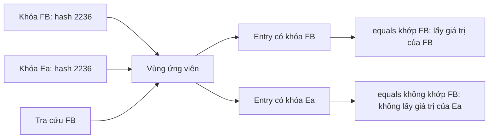

<a id="back-to-top"></a>

# Bằng nhau và băm

## Menu
- [Vai trò của equals và hashCode trong tìm kiếm và loại trùng](#equality-hashing-001)
- [Hợp đồng equals–hashCode và cách viết kiểu khóa](#equality-hashing-002)
- [Phân biệt giá trị bằng nhau với cùng tham chiếu](#equality-hashing-003)
- [Ngữ nghĩa equals của List, Set và Map](#equality-hashing-004)
- [Phân biệt băm trùng với hai khóa bằng nhau](#equality-hashing-005)
- [Rủi ro sửa trường tham gia equals hoặc hashCode sau khi thêm](#equality-hashing-006)
- [Record và đối tượng bất biến khi làm khóa hoặc phần tử Set](#equality-hashing-007)
- [Ảnh hưởng của phần tử khả biến đến equals và hashCode của collection](#equality-hashing-008)

## <a id="equality-hashing-001">Vai trò của equals và hashCode trong tìm kiếm và loại trùng</a>

<details>
<summary>Xem chi tiết</summary>

# Vai trò của equals và hashCode trong tìm kiếm và loại trùng

Collection không tự biết “hai khách hàng là cùng một người” hay “hai sản phẩm là cùng một mặt hàng”. Nó cần một quy tắc để quyết định hai đối tượng có được xem là bằng nhau hay không.

Trong Java, `equals` mô tả quan hệ bằng nhau theo giá trị của đối tượng. `hashCode` cung cấp mã băm để những cấu trúc như `HashSet` và `HashMap` tổ chức việc lưu và tìm hiệu quả hơn.

Hai phương thức phối hợp nhưng không thay thế nhau:

- `equals` trả lời **hai giá trị có được coi là bằng nhau không**.
- `hashCode` hỗ trợ **tìm nhóm ứng viên có thể phù hợp**.
- Cùng mã băm không có nghĩa là bằng nhau.
- Nếu bằng nhau theo `equals`, chúng bắt buộc phải có cùng mã băm.

Bài này giải thích các quy tắc qua tìm kiếm trong danh sách, loại trùng trong tập và tra cứu theo khóa trong map. Ví dụ sử dụng Java 17 trở lên.

## 1. Phân biệt cùng đối tượng với cùng giá trị

### 1.1. Toán tử == trên tham chiếu

Với hai tham chiếu đối tượng, `a == b` kiểm tra chúng có cùng trỏ đến một đối tượng hay không.

```java
String first = new String("Java");
String second = new String("Java");

System.out.println(first == second);      // false
System.out.println(first.equals(second)); // true
```

Hai chuỗi được tạo riêng nhưng có cùng nội dung. `String` đã định nghĩa `equals` theo nội dung nên kết quả khác với `==`.

Không dùng kết quả tình cờ của string pool để suy ra `==` là phép so nội dung chuỗi. Collection cũng không thay `equals` bằng `==` chỉ vì hai phần tử có cùng kiểu.

### 1.2. Lớp tự viết không tự có bình đẳng theo mọi trường

Nếu một lớp chỉ có trường `id` nhưng không ghi đè `equals`, hai đối tượng khác nhau có cùng `id` vẫn dùng quy tắc mặc định từ `Object`: bằng nhau khi cùng đối tượng.

Ví dụ minh họa:

```java
final class PlainKey {
    private final String id;

    PlainKey(String id) {
        this.id = id;
    }
}
```

Với hai lần `new PlainKey("C7")`, nội dung trường giống nhau không tự tạo bình đẳng giá trị. Nếu đưa cả hai vào `HashSet`, tập có thể giữ cả hai vì chúng không bằng nhau theo quy tắc của lớp.

Trước khi chọn cấu trúc loại trùng, phải xác định **loại trùng theo điều gì**: toàn bộ giá trị, mã ổn định, cặp mã tổ chức–mã khách hàng hay một tiêu chí khác. Đây là một quyết định mô hình dữ liệu.

## 2. Hợp đồng phải giữ giữa equals và hashCode

### 2.1. Equals phải là một quan hệ nhất quán

Với các tham chiếu không `null`, những tính chất cần giữ gồm:

| Tính chất | Yêu cầu |
| --- | --- |
| Phản xạ | `x.equals(x)` đúng |
| Đối xứng | `x.equals(y)` và `y.equals(x)` đồng ý |
| Bắc cầu | Nếu x bằng y và y bằng z thì x bằng z |
| Nhất quán | Không đổi kết quả khi dữ liệu tham gia so sánh không đổi |
| So với null | `x.equals(null)` sai |

Nếu đối xứng hoặc bắc cầu bị phá, việc tìm hoặc loại trùng có thể phụ thuộc cách truy vấn được thực hiện. Không thiết kế `equals` như một phép “gần giống” tùy tình huống nếu quan hệ ấy không đáp ứng các tính chất trên.

### 2.2. HashCode phải phù hợp với bình đẳng

Quy tắc quan trọng nhất:

```text
a.equals(b) == true
        ⇒
a.hashCode() == b.hashCode()
```

Chiều ngược lại không đúng. Hai đối tượng không bằng nhau vẫn có thể có cùng mã băm.

Mã băm phải nhất quán trong một lần chạy khi thông tin dùng cho bình đẳng không đổi. Hợp đồng chung không buộc mã băm của mọi loại đối tượng phải giống nhau giữa các lần khởi động ứng dụng.

Vì vậy, khi ghi đè `equals`, thông thường phải ghi đè `hashCode` tương ứng. Không dùng mã băm như một mã định danh duy nhất, địa chỉ bộ nhớ hoặc dấu vân tay bảo mật. Nó chỉ là một số `int` phục vụ hợp đồng băm. [Java 17: hợp đồng Object.equals và hashCode](https://docs.oracle.com/en/java/javase/17/docs/api/java.base/java/lang/Object.html)

## 3. Collection dùng bình đẳng ở đâu?

| Cấu trúc / thao tác | Vai trò của bình đẳng và băm |
| --- | --- |
| `List.contains`, `indexOf`, `remove(value)` | Tìm phần tử theo quan hệ bằng nhau được API quy định |
| `HashSet.add` | Không thêm một phần tử đã có theo bình đẳng |
| `HashSet.contains`, `remove` | Dùng cơ chế băm để tìm, rồi xác định phần tử phù hợp |
| `HashMap.put`, `get`, `containsKey` | Tìm theo bình đẳng và mã băm của khóa |
| `HashMap.containsValue` | Hỏi bình đẳng của giá trị; mã băm khóa không biến thành chỉ mục cho giá trị |
| `TreeSet`, khóa của `TreeMap` | Dùng thứ tự tự nhiên hoặc comparator để xác định vị trí và tương đương |

Không phải mọi collection đều dựa vào băm. Thay `ArrayList` bằng `HashSet` có thể làm một lỗi `hashCode` lộ ra dù phép tìm trong danh sách trước đó vẫn có vẻ đúng.

Hợp đồng của `contains` thường được diễn đạt bằng phép so sánh giá trị, nhưng cách triển khai không bắt buộc gọi `equals` lần lượt cho mọi phần tử. Nó có thể loại bớt ứng viên bằng thông tin băm trước. [Java 17: Collection](https://docs.oracle.com/en/java/javase/17/docs/api/java.base/java/util/Collection.html)

## 4. Tìm trong List không có nghĩa là loại trùng

Giả sử `CustomerKey` được định nghĩa bằng nhau theo `id`:

```java
CustomerKey first = new CustomerKey("C7");
CustomerKey another = new CustomerKey("C7");

List<CustomerKey> list =
        new ArrayList<>(List.of(first, another));

System.out.println(list.size()); // 2
System.out.println(list.contains(new CustomerKey("C7"))); // true
```

Đây là đoạn minh họa; lớp `CustomerKey` được định nghĩa đầy đủ trong chương trình cuối bài.

Danh sách giữ hai phần tử bằng nhau vì `List` cho phép giữ các lần xuất hiện trùng. `contains` chỉ trả lời có ít nhất một phần tử phù hợp hay không.

Khi gọi `remove(new CustomerKey("C7"))`, danh sách có thể xóa một lần xuất hiện phù hợp theo hợp đồng `remove(Object)`; nó không tự xóa hết mọi phần tử cùng mã.

Cần phân biệt ba nhu cầu:

- **Tìm:** có phần tử phù hợp không?
- **Đếm:** có bao nhiêu lần xuất hiện?
- **Loại trùng:** giữ một đại diện theo quy tắc đã chọn.

Cùng một quy tắc `equals` có thể tham gia cả ba, nhưng cấu trúc và thao tác quyết định kết quả cuối.

## 5. HashSet phối hợp băm với equals thế nào?

Có thể đọc cơ chế ở mức khái niệm:

```text
Giá trị cần thêm hoặc tìm
        ↓
Lấy mã băm để định hướng tìm kiếm
        ↓
Xét các ứng viên trong vùng liên quan
        ↓
Dùng quan hệ bằng nhau để xác định khớp
        ↓
Có khớp: dùng phần tử hiện có
Không khớp: chưa có giá trị tương ứng
```

Đây là mô hình để hiểu vai trò, không phải mô tả cấu trúc riêng của mọi phiên bản JDK. Không cần biết kích thước bảng hay ngưỡng chuyển cấu trúc nội bộ để viết `equals`/`hashCode` đúng.

Với hai khóa bằng nhau:

```java
Set<CustomerKey> unique = new HashSet<>();

System.out.println(unique.add(new CustomerKey("C7"))); // true
System.out.println(unique.add(new CustomerKey("C7"))); // false
System.out.println(unique.size());                     // 1
```

Lần thêm thứ hai không tạo thêm phần tử. Giá trị `false` của `add` cho biết tập không thay đổi do đã có phần tử tương ứng.

Tập cũng không tự hợp nhất dữ liệu nghiệp vụ. Nếu hai đối tượng được định nghĩa bằng nhau theo mã nhưng có thông tin hiển thị khác nhau, gọi `add` lần nữa không phải một lệnh cập nhật các trường của phần tử cũ. Nếu cần “mã → hồ sơ mới nhất”, một `Map` hoặc quy trình cập nhật rõ ràng có thể diễn đạt đúng hơn. [Java 17: HashSet](https://docs.oracle.com/en/java/javase/17/docs/api/java.base/java/util/HashSet.html)

## 6. Va chạm mã băm không làm mất giá trị khác nhau

`"Aa"` và `"BB"` là ví dụ ngắn có cùng mã băm theo quy tắc của `String`:

```java
String left = "Aa";
String right = "BB";

System.out.println(left.equals(right)); // false
System.out.println(left.hashCode());    // 2112
System.out.println(right.hashCode());   // 2112
```

Khi thêm vào `HashSet`:

```java
Set<String> values = new HashSet<>(List.of(left, right));
System.out.println(values.size()); // 2
```

Hai chuỗi có cùng hash nhưng không bằng nhau, nên vẫn là hai giá trị. Cấu trúc băm được thiết kế để xử lý va chạm, không phải chỉ giữ một phần tử cho mỗi số nguyên hash. [Java 17: String.hashCode](https://docs.oracle.com/en/java/javase/17/docs/api/java.base/java/lang/String.html#hashCode())

Một `hashCode` luôn trả cùng hằng số cho mọi đối tượng có thể vẫn đáp ứng điều kiện “bằng nhau thì cùng hash”. Tuy nhiên, nó làm giảm khả năng phân tán và có thể gây hiệu năng tìm kiếm kém.

Ngược lại, một hàm tạo hash rất đa dạng nhưng cho hai đối tượng bằng nhau ra hai hash khác nhau là **sai hợp đồng**, không phải một tối ưu hóa chấp nhận được.

### Hai vấn đề cần tách riêng

| Vấn đề | Tính đúng đắn | Hiệu năng |
| --- | --- | --- |
| Có va chạm giữa hai giá trị không bằng nhau | Được phép | Nhiều va chạm có thể làm tăng công tìm kiếm |
| Hai giá trị bằng nhau có hash khác nhau | Vi phạm hợp đồng | Không thể chỉ xem là chậm hơn |
| Hash phân bố tốt và nhất quán với equals | Đáp ứng nền tảng cần thiết | Hỗ trợ tra cứu hiệu quả hơn |

Không cần đòi một hàm hash không va chạm; điều đó cũng không thể bảo đảm cho mọi tập giá trị không giới hạn khi kết quả chỉ có số lượng hữu hạn.

## 7. HashMap dùng quy tắc của khóa

Ví dụ một bảng hồ sơ theo mã khách hàng:

```java
Map<CustomerKey, String> customers = new HashMap<>();

customers.put(new CustomerKey("C7"), "old");
String previous =
        customers.put(new CustomerKey("C7"), "updated");

System.out.println(previous); // old
System.out.println(customers.size()); // 1
System.out.println(customers.get(new CustomerKey("C7"))); // updated
```

Dù mỗi lần gọi tạo một đối tượng khóa mới, bình đẳng theo `id` cùng hash nhất quán giúp map tìm đúng ánh xạ đã có.

Lần `put` thứ hai thay giá trị của cùng khóa logic, không tạo thêm một ánh xạ. Không cần giữ đúng tham chiếu khóa ban đầu để tra cứu.

Cần phân biệt:

- `containsKey(key)` hỏi về bình đẳng của khóa.
- `containsValue(value)` hỏi về bình đẳng của giá trị.
- Giá trị được phép trùng giữa nhiều khóa.
- Khi map cho phép giá trị `null`, `get(key) == null` chưa đủ để kết luận không có khóa.

Không suy diễn rằng map phải thay cả đối tượng khóa được lưu bằng đối tượng truyền vào sau, hoặc phải giữ một nhận dạng tham chiếu cụ thể ngoài những gì API bảo đảm. Điều cần dựa vào là ánh xạ theo khóa logic. [Java 17: HashMap](https://docs.oracle.com/en/java/javase/17/docs/api/java.base/java/util/HashMap.html)

## 8. Viết một kiểu khóa đúng theo miền dữ liệu

Ví dụ chỉ cần nhận biết khách hàng theo `id` trong một phạm vi đã xác định:

```java
static final class CustomerKey {
    private final String id;

    CustomerKey(String id) {
        this.id = Objects.requireNonNull(id);
    }

    @Override
    public boolean equals(Object other) {
        if (this == other) {
            return true;
        }
        return other instanceof CustomerKey key
                && id.equals(key.id);
    }

    @Override
    public int hashCode() {
        return id.hashCode();
    }
}
```

Đây là một lớp lồng có thể đặt trong lớp bao ngoài; cần import `java.util.Objects`.

Các quyết định trong ví dụ:

1. `id` không được `null`; constructor kiểm tra ngay.
2. Lớp là `final`, tránh phát sinh một hệ lớp con tự mở rộng nghĩa bình đẳng.
3. `equals` có đúng chữ ký `equals(Object)`, không phải một overload chỉ nhận `CustomerKey`.
4. Hai khóa bằng nhau khi cùng mã.
5. Hash lấy từ chính mã nên hai khóa bằng nhau có cùng hash.
6. Trường `id` là final và là `String` bất biến, giúp quy tắc ổn định trong lúc làm khóa.

`@Override` giúp phát hiện nhầm chữ ký. Nếu lỡ viết `equals(CustomerKey other)`, đó không phải ghi đè phương thức `Object.equals(Object)`; collection có thể vẫn sử dụng hành vi không như dự định.

Không xem mẫu này là quy tắc “mọi lớp đều phải so theo id”. Một kiểu giá trị tọa độ có thể so cả hai thành phần; một khóa nhiều tổ chức cần thêm mã tổ chức.

### Nhiều trường phải có cùng nghĩa ở cả hai phương thức

Với khóa gồm `tenantId` và `customerId`, hai khách hàng cùng mã ở hai tổ chức không được loại trùng với nhau.

Một biểu diễn ngắn trong Java 17:

```java
record TenantCustomerKey(String tenantId, String customerId) {}
```

Các phương thức bình đẳng và băm được sinh mặc định dựa trên các thành phần record. Hai record khác tổ chức sẽ khác nhau.

Record phù hợp khi chính các thành phần khai báo là nghĩa giá trị cần có. Nó không tự bảo đảm mọi đối tượng được tham chiếu bên trong đều bất biến. Nếu thành phần là một danh sách có thể sửa, phải xét tác động đến bình đẳng và băm. [Java 17: Record](https://docs.oracle.com/en/java/javase/17/docs/api/java.base/java/lang/Record.html)

## 9. Chọn đúng dữ liệu tham gia bình đẳng

Trước khi viết mã, trả lời:

- Hai đối tượng cùng mã nhưng khác tên có được coi là cùng khóa không?
- Mã có duy nhất trong toàn hệ thống hay chỉ trong một tổ chức?
- Giá trị có phân biệt hoa thường không?
- Khoảng trắng hoặc định dạng đầu vào có được chuẩn hóa không?
- Một trường có thể thay đổi sau khi đối tượng được lưu không?
- Một đối tượng mới tạo chưa có mã ổn định phải được xử lý thế nào?

Đừng tùy tiện dùng tên hiển thị, email có thể đổi hoặc mã chưa được cấp làm định danh duy nhất. Nếu yêu cầu là so sánh không phân biệt hoa thường, phải thiết kế cả bước chuẩn hóa và hash phù hợp; đổi riêng `equals` mà giữ hash theo chuỗi gốc dễ phá hợp đồng.

`hashCode` có thể sử dụng ít thông tin hơn `equals` mà vẫn hợp lệ, miễn hai đối tượng bằng nhau luôn cùng hash. Tuy nhiên, bỏ quá nhiều thông tin có thể làm tăng va chạm. Một lựa chọn dễ kiểm tra là xây hash từ các thành phần giá trị bất biến đã dùng để xác định bình đẳng.

Nếu chỉ một chức năng cần loại trùng theo tiêu chí riêng, chưa chắc nên thay `equals` toàn bộ lớp dùng ở nhiều nơi. Có thể tạo kiểu khóa riêng hoặc ánh xạ ra khóa phù hợp cho chức năng ấy. Thay bình đẳng của lớp là thay ý nghĩa tìm kiếm và loại trùng ở mọi collection đang dựa vào nó.

## 10. Không đổi thông tin khóa khi đang ở cấu trúc băm

Giả sử một khóa có `hashCode` phụ thuộc mã khách hàng. Sau khi đưa vào `HashMap`, chương trình đổi mã.

Vị trí lưu đã được xác định theo trạng thái cũ, trong khi lần tìm sau tính từ trạng thái mới. Khi đó, hành vi tìm kiếm hoặc loại bỏ có thể không còn được bảo đảm theo cách ta mong muốn.

Một lỗi như vậy dễ gây cảm giác nghịch lý: duyệt vẫn thấy đối tượng, nhưng tra cứu bằng giá trị mong đợi không tìm thấy. Không viết bài kiểm thử bắt buộc một output cụ thể cho mọi trường hợp đã làm thay đổi khóa theo cách vi phạm điều kiện sử dụng.

Các hướng thiết kế:

- Dùng khóa giá trị bất biến, tách khỏi hồ sơ thường xuyên thay đổi.
- Không đưa những trường có thể đổi vào bình đẳng khóa.
- Nếu thật sự phải đổi danh tính khóa, xóa bằng trạng thái cũ trước, rồi đưa lại vào bằng khóa mới với quy trình phù hợp.
- Với hệ thống dùng chung nhiều nơi, ưu tiên một phép cập nhật có kiểm soát thay vì cho sửa trường trực tiếp.

`final` trên tham chiếu tới một đối tượng có thể sửa chưa đủ: nếu hash phụ thuộc nội dung đối tượng bên trong, nội dung ấy vẫn có thể đổi. Cần xét toàn bộ dữ liệu tham gia tính bình đẳng.

## 11. Giới hạn: không phải mọi loại trùng đều do hashCode

`TreeSet` dùng thứ tự tự nhiên hoặc comparator để tìm và phân biệt phần tử. Hai phần tử so sánh bằng 0 được xem là tương đương trong tập cây.

Nếu comparator chỉ xét tên sản phẩm, hai sản phẩm khác mã nhưng cùng tên có thể bị xem là một giá trị, dù `equals` coi chúng khác nhau. Sửa `hashCode` không giải quyết chuyện đó, vì tập cây không dựa vào hash để xác định vị trí.

Để tuân thủ đầy đủ hợp đồng `Set` dựa trên bình đẳng, thứ tự cần nhất quán với `equals`. Vì vậy, khi chẩn đoán “tại sao mất phần tử khi loại trùng”, trước hết xác định cấu trúc đang dùng là tập băm hay tập cây. [Java 17: TreeSet](https://docs.oracle.com/en/java/javase/17/docs/api/java.base/java/util/TreeSet.html)

Tương tự, một thao tác tìm theo predicate tự viết có thể xét thuộc tính khác với `equals`. Không gọi mọi phép khớp dữ liệu là cùng một quan hệ bình đẳng.

## 12. Chương trình Java 17 hoàn chỉnh

Lưu vào `EqualityHashDemo.java`:

```java
import java.util.ArrayList;
import java.util.HashMap;
import java.util.HashSet;
import java.util.List;
import java.util.Map;
import java.util.Objects;
import java.util.Set;

public class EqualityHashDemo {
    static final class PlainKey {
        private final String id;

        PlainKey(String id) {
            this.id = id;
        }
    }

    static final class CustomerKey {
        private final String id;

        CustomerKey(String id) {
            this.id = Objects.requireNonNull(id);
        }

        @Override
        public boolean equals(Object other) {
            if (this == other) {
                return true;
            }
            return other instanceof CustomerKey key
                    && id.equals(key.id);
        }

        @Override
        public int hashCode() {
            return id.hashCode();
        }
    }

    record TenantCustomerKey(String tenantId, String customerId) {}

    public static void main(String[] args) {
        PlainKey plainA = new PlainKey("C7");
        PlainKey plainB = new PlainKey("C7");
        Set<PlainKey> plainSet = new HashSet<>(List.of(plainA, plainB));
        System.out.println("plain equals = " + plainA.equals(plainB));
        System.out.println("plain set size = " + plainSet.size());

        CustomerKey first = new CustomerKey("C7");
        CustomerKey sameValue = new CustomerKey("C7");
        System.out.println("same reference = " + (first == sameValue));
        System.out.println("value equals = " + first.equals(sameValue));
        System.out.println("same hash = "
                + (first.hashCode() == sameValue.hashCode()));

        List<CustomerKey> list =
                new ArrayList<>(List.of(first, sameValue));
        System.out.println("list size = " + list.size());
        System.out.println("list contains fresh key = "
                + list.contains(new CustomerKey("C7")));

        Set<CustomerKey> unique = new HashSet<>();
        System.out.println("first add = " + unique.add(first));
        System.out.println("equal add = " + unique.add(sameValue));
        System.out.println("unique size = " + unique.size());
        System.out.println("set contains fresh key = "
                + unique.contains(new CustomerKey("C7")));

        Map<CustomerKey, String> customers = new HashMap<>();
        customers.put(first, "old");
        String previous = customers.put(sameValue, "updated");
        System.out.println("previous map value = " + previous);
        System.out.println("map size = " + customers.size());
        System.out.println("lookup with fresh key = "
                + customers.get(new CustomerKey("C7")));

        String left = "Aa";
        String right = "BB";
        Set<String> collisions = new HashSet<>(List.of(left, right));
        System.out.println("collision values equal = " + left.equals(right));
        System.out.println("left hash = " + left.hashCode());
        System.out.println("right hash = " + right.hashCode());
        System.out.println("collision set size = " + collisions.size());
        System.out.println("collision lookup = "
                + collisions.contains(new String("BB")));

        Set<TenantCustomerKey> scoped = new HashSet<>();
        scoped.add(new TenantCustomerKey("T1", "C7"));
        scoped.add(new TenantCustomerKey("T2", "C7"));
        System.out.println("tenant-scoped size = " + scoped.size());
    }
}
```

Biên dịch và chạy:

```shell
javac --release 17 -encoding UTF-8 EqualityHashDemo.java
java EqualityHashDemo
```

Stdout:

```text
plain equals = false
plain set size = 2
same reference = false
value equals = true
same hash = true
list size = 2
list contains fresh key = true
first add = true
equal add = false
unique size = 1
set contains fresh key = true
previous map value = old
map size = 1
lookup with fresh key = updated
collision values equal = false
left hash = 2112
right hash = 2112
collision set size = 2
collision lookup = true
tenant-scoped size = 2
```

Cách đọc minh chứng:

1. `PlainKey` không ghi đè bình đẳng nên hai đối tượng khác nhau cùng mã vẫn là hai phần tử của tập.
2. `CustomerKey` có bình đẳng giá trị: khác tham chiếu nhưng bằng nhau và cùng hash.
3. Danh sách giữ cả hai lần xuất hiện, nhưng tìm được bằng một khóa mới cùng giá trị.
4. Tập băm chỉ thêm khóa logic lần đầu; lần thêm tương đương trả `false`.
5. Map thay giá trị khi dùng khóa logic đã có, rồi tra được bằng một đối tượng mới.
6. Hai chuỗi va chạm hash vẫn là hai phần tử riêng và đều tra được.
7. Khóa record có thêm phạm vi tổ chức giữ hai khách hàng cùng mã cục bộ ở hai tổ chức khác nhau.

Chương trình không in trực tiếp thứ tự của `HashSet` hoặc `HashMap`, nên stdout không phụ thuộc thứ tự duyệt mà các lớp đó không cam kết. Nó cũng không dựa vào mã hash mặc định hoặc địa chỉ của đối tượng để tạo kết quả cố định.

## 13. Các lỗi phổ biến cần kiểm tra

| Lỗi | Tác động hoặc cách sửa |
| --- | --- |
| So chuỗi bằng `==` | Chỉ kiểm tra tham chiếu; dùng bình đẳng nội dung khi đó là yêu cầu |
| Ghi đè `equals` nhưng giữ hash không phù hợp | Tập/map băm có thể không tìm hoặc loại trùng đúng; sửa đồng thời hợp đồng |
| Chỉ ghi đè `hashCode` để “cùng mã thì cùng người” | Hash không tự định nghĩa bình đẳng; cần `equals` tương ứng |
| Coi cùng hash là cùng giá trị | Va chạm hợp lệ; vẫn phải phân biệt bằng nhau |
| Dùng mọi trường tự động mà không xét nghiệp vụ | Tên hoặc trạng thái đổi có thể làm danh tính giá trị đổi ngoài ý muốn |
| Đổi trường tham gia hash trong lúc làm khóa | Có thể làm lệch quan hệ giữa vị trí lưu và trạng thái tìm |
| Viết `equals(MyType)` thay `equals(Object)` | Tạo overload; dùng `@Override` để phát hiện |
| Bình đẳng bất đối xứng giữa lớp cha và lớp con | Kết quả khớp trở nên không nhất quán; thiết kế ranh giới bình đẳng rõ |
| Coi `HashSet.add` khóa trùng là cập nhật hồ sơ | Tập không tự hợp nhất các trường |
| Coi hash là ID lưu bền hoặc bảo mật | Không duy nhất và không có bảo đảm chung phù hợp mục tiêu đó |

## 14. Cách kiểm chứng một lớp làm khóa

Một bộ kiểm tra có giá trị nên bao gồm:

1. Cùng một đối tượng bằng chính nó.
2. Hai đối tượng có cùng giá trị định danh bằng nhau ở cả hai chiều.
3. Các đối tượng nối tiếp cùng định danh đáp ứng bắc cầu.
4. Hai đối tượng bằng nhau có cùng hash.
5. Hai khóa khác nhau không bị gộp chỉ vì va chạm hash.
6. Tra cứu trong `HashSet` và `HashMap` bằng một đối tượng mới cùng giá trị thành công.
7. Gán giá trị mới cho cùng khóa logic giữ đúng số ánh xạ cần có.
8. Các thành phần phạm vi như tổ chức hoặc môi trường tham gia bình đẳng nếu nghiệp vụ yêu cầu.
9. Dữ liệu dùng làm khóa không thể bị sửa ngoài kiểm soát.

Không kiểm tra “hai đối tượng không bằng nhau bắt buộc khác hash”: đó không phải hợp đồng. Cũng không kiểm tra một giá trị hash cụ thể trừ khi chính kiểu đó có quy tắc công khai cần xác nhận, như ví dụ chuỗi trong bài.

## 15. Tự luyện

1. Hai đối tượng không bằng nhau nhưng cùng hash. `HashSet` có bắt buộc chỉ giữ một không?  
   **Đáp án:** không. Va chạm không tạo bình đẳng; tập vẫn có thể giữ cả hai.

2. Hai đối tượng bằng nhau nhưng hash khác nhau. Điều gì sai?  
   **Đáp án:** lớp đã vi phạm hợp đồng `equals`–`hashCode`.

3. Vì sao `List` có thể chứa hai khóa bằng nhau mà `contains` vẫn trả `true` khi tìm bằng khóa mới?  
   **Đáp án:** danh sách cho phép nhiều lần xuất hiện; tìm kiếm và loại trùng là hai thao tác khác nhau.

4. Hai khách hàng cùng mã ở hai tổ chức bị gộp khi đưa vào tập. Cần kiểm tra gì?  
   **Gợi ý:** bình đẳng khóa có bao gồm phạm vi tổ chức cần thiết hay không.

5. Khi đã dùng record làm khóa, có còn phải xét tính thay đổi của thành phần không?  
   **Đáp án:** có. Record không tự đóng băng đối tượng được tham chiếu bên trong.

Một cấu trúc tìm kiếm hay loại trùng chỉ đúng khi quan hệ giá trị của phần tử được thiết kế đúng. Hãy xác định bình đẳng trước, giữ hash nhất quán với nó và bảo vệ sự ổn định của dữ liệu đang làm khóa.


</details>

- [Quay lại đầu trang](#back-to-top)

---

## <a id="equality-hashing-002">Hợp đồng equals–hashCode và cách viết kiểu khóa</a>

<details>
<summary>Xem chi tiết</summary>

# Hợp đồng equals–hashCode và cách viết kiểu khóa

## 1. Bài toán: hai đối tượng có thể đại diện cùng một khóa

Một ứng dụng có thể tạo hai đối tượng khóa khác nhau để nói tới cùng một tài khoản:

```java
AccountKey first = new AccountKey("tenant-a", "u-7");
AccountKey second = new AccountKey("tenant-a", "u-7");
```

Hai biến không nhất thiết trỏ tới cùng đối tượng. Tuy nhiên, nếu quy tắc nghiệp vụ là “tài khoản được xác định bằng cặp tenantId và userId”, chúng cần được xem là cùng một khóa.

Điều này ảnh hưởng trực tiếp tới:

- Tra cứu bằng một đối tượng khóa mới có cùng dữ liệu.
- Thêm khóa tương đương vào `HashMap` để cập nhật giá trị.
- Loại trùng trong `HashSet`.
- Khả năng xóa hoặc kiểm tra tồn tại bằng một đối tượng tương đương.

Để các cấu trúc dựa trên bảng băm hoạt động đúng, kiểu khóa cần có quan hệ bằng nhau rõ ràng và mã băm nhất quán với quan hệ đó.

Bài sử dụng Java 17. Mục tiêu là hiểu hợp đồng, viết khóa bất biến đúng và nhận ra các lỗi thường chỉ lộ khi đối tượng được dùng trong collection.

## 2. Ba câu hỏi khác nhau: ==, equals và hashCode

| Cơ chế | Câu hỏi |
| --- | --- |
| `a == b` với tham chiếu | Hai tham chiếu có trỏ tới cùng một đối tượng không? |
| `a.equals(b)` | Hai đối tượng có bằng nhau theo hợp đồng của kiểu không? |
| `a.hashCode()` | Mã băm hỗ trợ phân nhóm/tìm kiếm trong cấu trúc băm là gì? |

Mặc định, `Object.equals` dùng quan hệ cùng đối tượng. Kiểu giá trị có thể override để định nghĩa bằng nhau theo dữ liệu.

`hashCode` trả `int`. Nó không phải ID duy nhất, không phải chữ ký mật mã và không có bảo đảm là địa chỉ bộ nhớ. Không lưu `hashCode` như định danh bền vững cho nghiệp vụ.

`equals` là nơi định nghĩa sự bằng nhau; việc hai mã băm bằng nhau không đủ để kết luận hai đối tượng bằng nhau.

Hợp đồng chính thức nằm trong [Object.equals và Object.hashCode](https://docs.oracle.com/en/java/javase/17/docs/api/java.base/java/lang/Object.html).

## 3. Hợp đồng equals cần giữ

Đối với các tham chiếu khác `null`, quan hệ bằng nhau phải có các tính chất sau:

| Tính chất | Điều kiện |
| --- | --- |
| Phản xạ | `x.equals(x)` là `true` |
| Đối xứng | `x.equals(y)` và `y.equals(x)` cho cùng kết quả |
| Bắc cầu | Nếu `x` bằng `y` và `y` bằng `z`, thì `x` bằng `z` |
| Nhất quán | Kết quả không đổi khi thông tin dùng để so sánh không đổi |
| Với `null` | `x.equals(null)` là `false` |

Đây không chỉ là quy ước trình bày. Nếu vi phạm đối xứng, kết quả có thể phụ thuộc phía thực hiện phép so sánh. Nếu vi phạm bắc cầu, một nhóm “cùng khóa” không còn được xác định nhất quán.

Phương thức phải có đúng chữ ký:

```java
@Override
public boolean equals(Object object)
```

Viết `equals(AccountKey other)` chỉ tạo overload nếu không đồng thời override `equals(Object)`. Các collection dùng hợp đồng `Object.equals`, nên overload đó không giải quyết được bài toán khóa. Dùng `@Override` để compiler giúp phát hiện sai chữ ký.

## 4. Hợp đồng hashCode và chiều suy luận đúng

Các quy tắc cốt lõi:

1. Khi thông tin tham gia `equals` không đổi trong một lần chạy, hash phải nhất quán.
2. Hai đối tượng bằng nhau phải có cùng hash.
3. Hai đối tượng khác nhau được phép có cùng hash.

Hash không bắt buộc giống nhau giữa các lần chạy chương trình. Không dùng quy tắc “khác nhau thì hash phải khác” làm kiểm thử tính đúng.

Có thể ghi nhớ:

```text
a.equals(b) == true  =>  a.hashCode() == b.hashCode()

a.hashCode() == b.hashCode()
    chưa đủ để kết luận a.equals(b) == true
```

Một hàm luôn trả `1` vẫn có thể đáp ứng yêu cầu hai đối tượng bằng nhau phải cùng hash. Nhưng nó gom rất nhiều khóa vào cùng nhóm ứng viên, làm giảm khả năng phân tán và có thể làm hiệu năng kém.

Ngược lại, một hàm tạo hash phân tán đẹp nhưng dùng thông tin không phù hợp với `equals` vẫn có thể sai về hợp đồng.

### Cần dùng các thông tin nhất quán

Nếu `equals` chỉ xét `tenantId` và `userId`, `hashCode` không nên thêm tên hiển thị thay đổi độc lập vào kết quả. Hai đối tượng bằng nhau theo cặp định danh có thể khác tên hiển thị, dẫn tới hash khác.

Thiết kế thông thường và dễ kiểm tra là dùng cùng các thành phần định nghĩa bằng nhau cho cả hai phương thức. Hash không bắt buộc “dùng đủ mọi trường”; điều cần bảo đảm là nhất quán với quan hệ bằng nhau, đồng thời phân tán hợp lý.

## 5. HashMap và HashSet sử dụng hợp đồng như thế nào?

Ở mức mô hình, cấu trúc băm dùng hash để thu hẹp nhóm ứng viên, rồi phân biệt khóa theo quan hệ bằng nhau. Không nên coi đây là lời hứa về số lần chính xác mà `equals` hoặc `hashCode` được gọi.

### 5.1. Khóa bằng nhau trong map

Nếu `first` và `second` là các khóa bằng nhau và có hash đúng:

```java
// Đoạn minh họa với AccountKey được định nghĩa ở phần chương trình đầy đủ.
Map<AccountKey, String> map = new HashMap<>();
map.put(first, "old");

System.out.println(map.get(second));        // old
System.out.println(map.put(second, "new")); // old
System.out.println(map.size());             // 1
```

Lần `put` sau cập nhật giá trị của mapping có khóa tương đương, không tạo thêm một tài khoản khác theo quan hệ khóa.

### 5.2. Phần tử bằng nhau trong set

```java
// Đoạn minh họa với hai AccountKey bằng nhau; cần import java.util.*.
Set<AccountKey> keys = new HashSet<>();
System.out.println(keys.add(first));  // true
System.out.println(keys.add(second)); // false
```

Set loại trùng theo hợp đồng phần tử. Nếu phần tử có `equals/hashCode` sai, kết quả loại trùng và tìm kiếm có thể không đáp ứng ý định nghiệp vụ.

Xem [HashMap](https://docs.oracle.com/en/java/javase/17/docs/api/java.base/java/util/HashMap.html), [HashSet](https://docs.oracle.com/en/java/javase/17/docs/api/java.base/java/util/HashSet.html) và [Set](https://docs.oracle.com/en/java/javase/17/docs/api/java.base/java/util/Set.html).

### 5.3. Va chạm băm không làm hai khóa thành một

Hai khóa khác nhau có thể cùng hash. Cấu trúc vẫn phải phân biệt chúng theo hợp đồng bằng nhau.

Vì vậy, không cài đặt:

```java
// Minh họa cách viết sai; không sử dụng.
return this.hashCode() == other.hashCode();
```

như toàn bộ định nghĩa `equals`.

Cũng không đưa thông tin hash vào điều kiện nghiệp vụ kiểu “mã băm trùng nên đây là cùng người dùng”. Hash chỉ có vai trò hỗ trợ cấu trúc tra cứu.

## 6. Chọn đúng dữ liệu định nghĩa khóa trước khi viết code

Với khóa tài khoản đa tenant, `userId` có thể chỉ duy nhất trong từng tenant. Bỏ `tenantId` khỏi `equals` sẽ gộp hai tài khoản thuộc hai tenant khác nhau.

Cần xác định:

- Phạm vi duy nhất của từng thành phần.
- Phân biệt chữ hoa/chữ thường.
- Chính sách khoảng trắng và chuẩn hóa.
- Có cho phép `null` hoặc giá trị rỗng không.
- Định danh có ổn định trong suốt thời gian khóa được lưu không.

Ví dụ bài này chọn chính sách đơn giản: hai chuỗi bắt buộc khác `null`, so sánh chính xác, có phân biệt chữ hoa/thường, không tự cắt khoảng trắng.

Không tự gọi `toLowerCase` hoặc `trim` trong một phía của `equals` rồi dùng dữ liệu gốc để băm. Nếu nghiệp vụ cần chuẩn hóa, hãy xác định một quy tắc nhất quán, thực hiện tại lúc tạo khóa và dùng biểu diễn đã chuẩn hóa ở cả hai phương thức.

Các giá trị có cấu trúc nên được giữ thành thành phần riêng. Ghép hai trường thành chuỗi mà không có quy tắc phân tách rõ có thể làm mất ranh giới dữ liệu.

## 7. Viết một lớp khóa bất biến

Một mẫu dễ kiểm tra:

```java
// Đoạn khai báo lớp; cần import java.util.Objects.
static final class AccountKey {
    private final String tenantId;
    private final String userId;

    AccountKey(String tenantId, String userId) {
        this.tenantId = Objects.requireNonNull(tenantId, "tenantId");
        this.userId = Objects.requireNonNull(userId, "userId");
    }

    @Override
    public boolean equals(Object object) {
        if (this == object) {
            return true;
        }
        if (!(object instanceof AccountKey other)) {
            return false;
        }
        return tenantId.equals(other.tenantId)
                && userId.equals(other.userId);
    }

    @Override
    public int hashCode() {
        return Objects.hash(tenantId, userId);
    }
}
```

Từng quyết định có mục đích:

- `final class` giữ miền so sánh không bị lớp con mở rộng ngoài thiết kế.
- Hai trường `final` và kiểu `String` bất biến làm thông tin khóa ổn định.
- Constructor quy định hai thành phần khác `null`.
- `this == object` là đường tắt cho cùng đối tượng.
- `instanceof` trả `false` khi đối số là `null` hoặc khác kiểu.
- Hai trường được so bằng `String.equals` thay vì `==`.
- Hash được tính từ các thành phần cùng định nghĩa bằng nhau.

`Objects.hash` là tiện ích băm nhiều thành phần; không phải thuật toán mã hóa hoặc bảo đảm không va chạm. `Objects.equals` cũng hữu ích khi một trường được phép `null`, nhưng chính sách khóa mẫu đã từ chối `null` từ constructor. [Objects API](https://docs.oracle.com/en/java/javase/17/docs/api/java.base/java/util/Objects.html)

Có thể dùng công cụ sinh code của IDE, nhưng vẫn phải chọn đúng trường và hiểu hợp đồng được sinh. Sinh code đúng cú pháp không tự chọn đúng danh tính nghiệp vụ.

## 8. Kế thừa và miền bằng nhau

Khi lớp khóa có thể được kế thừa, câu hỏi khó xuất hiện: đối tượng lớp cha có được xem bằng lớp con không, và các trường mới ở lớp con có tham gia bằng nhau không?

Ví dụ, lớp cha chỉ có tọa độ; lớp con thêm màu. Nếu cha chấp nhận mọi đối tượng cùng tọa độ còn con đòi thêm màu, có thể xảy ra:

```text
cha.equals(con) = true
con.equals(cha) = false
```

Đây là vi phạm đối xứng. Những cách “linh động bỏ qua màu trong một số trường hợp” còn có thể làm hỏng bắc cầu.

Không có một thay thế máy móc `instanceof` hoặc `getClass` nào giải quyết mọi mô hình kế thừa. Trước hết cần quyết định miền đối tượng được coi bằng nhau.

Với kiểu khóa giá trị mới, các lựa chọn thường dễ quản lý là:

- Dùng một lớp `final`.
- Dùng record có các component phù hợp.
- Dùng kết hợp đối tượng thay cho mở rộng một quan hệ bằng nhau chưa được thiết kế.

Nếu bắt buộc thiết kế phân cấp có bằng nhau xuyên lớp, phải kiểm tra đối xứng, bắc cầu và hash trên toàn miền đó. Bài mẫu dùng lớp cuối để giữ hợp đồng rõ ràng.

## 9. Khóa thay đổi sau khi chèn: vì sao tra cứu có thể thất bại?

Giả sử một khóa dùng trường `id` trong cả `equals` và `hashCode`. Sau khi chèn, mã sửa `id` từ `1` thành `2`.

Thông tin dùng để tìm khóa đã thay đổi, trong khi cấu trúc băm không được thông báo để sắp xếp lại mapping tương ứng.

Có thể thấy tình huống:

```text
map.size() vẫn là 1
iterator vẫn nhìn thấy đối tượng khóa
map.get(chính đối tượng đó) lại không tìm được
```

Đây không phải lỗi “map quên giữ tham chiếu”. Đối tượng vẫn tồn tại; cách tìm kiếm theo khóa đã không còn tương thích với trạng thái dùng lúc lưu.

Hợp đồng `Map` nói rõ hành vi không được quy định khi đối tượng khóa bị đổi theo cách ảnh hưởng `equals` trong lúc đang là khóa. `Set` có giới hạn tương tự với phần tử ảnh hưởng quan hệ bằng nhau. Kết quả tra cứu trong chương trình đầy đủ là minh họa được quan sát với `HashMap` đang chạy, không phải một hành vi mới có thể dùng làm quy tắc ứng dụng. [Map contract](https://docs.oracle.com/en/java/javase/17/docs/api/java.base/java/util/Map.html)

### Cách xử lý đúng

Ưu tiên khóa bất biến. Khi cần “đổi định danh”, tạo một đối tượng khóa mới và cập nhật mapping có kiểm soát.

Nếu đang quản lý một khóa mutable, phải xóa mapping bằng trạng thái cũ trước khi thay đổi rồi chèn lại với trạng thái mới, trong một quy trình bảo đảm không có truy cập cạnh tranh ngoài kiểm soát. Sau khi khóa đã bị sửa, đừng giả định `remove(key)` chắc chắn tìm được nó để chữa lỗi.

Việc thay trường không tham gia `equals/hashCode` không nhất thiết làm đổi danh tính khóa, nhưng vẫn cần xét các ràng buộc khác. “Có setter” không tự động là lỗi; lỗi cốt lõi là dữ liệu quyết định định vị/bằng nhau thay đổi khi đối tượng đang được dùng theo hợp đồng cần ổn định.

## 10. Record: ngắn gọn nhưng phải chọn component đúng

Đây là phương án thay thế lớp `AccountKey` ở trên; không khai báo cả hai cùng tên trong cùng phạm vi. Chương trình đầy đủ dùng tên `RecordKey` để đặt hai cách viết cạnh nhau.

```java
// Đoạn khai báo record; cần import java.util.Objects.
record AccountKey(String tenantId, String userId) {
    AccountKey {
        Objects.requireNonNull(tenantId, "tenantId");
        Objects.requireNonNull(userId, "userId");
    }
}
```

Record tự cung cấp `equals/hashCode` theo các component và kiểm tra cùng lớp record. Nó phù hợp với khóa giá trị khi các component biểu đạt đúng danh tính và có trạng thái ổn định.

Các điểm cần giữ rõ:

- Thêm một component như tên hiển thị cũng làm nó tham gia quan hệ mặc định.
- Component là tham chiếu `final`, nhưng đối tượng được tham chiếu có thể thay đổi.
- Record chứa collection mutable có thể có hash thay đổi theo nội dung collection.
- Record chứa mảng không tự có phép bằng nhau sâu theo nội dung mảng.
- Không phụ thuộc một giá trị hash số cụ thể hoặc thuật toán kết hợp component được quan sát.

Nếu muốn record chứa một danh sách chuỗi làm khóa, có thể sao chép phòng vệ bằng `List.copyOf` trong constructor, đồng thời chấp nhận chính sách cấm phần tử `null` và hiểu rằng đó là bản sao nông. Với phần tử mutable, cần một thiết kế sâu hơn.

Xem [Record API](https://docs.oracle.com/en/java/javase/17/docs/api/java.base/java/lang/Record.html), [Record Classes](https://docs.oracle.com/en/java/javase/17/language/records.html) và [JLS 8.10](https://docs.oracle.com/javase/specs/jls/se17/html/jls-8.html#jls-8.10).

## 11. Khóa có mảng cần bằng nhau nội dung và sao chép phòng vệ

Mảng dùng quan hệ bằng nhau theo tham chiếu của `Object` nếu chỉ gọi `array.equals`. Hai mảng byte riêng có cùng nội dung không tự bằng nhau.

Để định nghĩa khóa theo nội dung byte:

- Dùng `Arrays.equals` cho bằng nhau.
- Dùng `Arrays.hashCode` tương ứng cho băm.
- Sao chép mảng đầu vào.
- Không trả trực tiếp mảng nội bộ cho người gọi sửa.

```java
// Đoạn khai báo lớp; cần import java.util.Arrays và java.util.Objects.
static final class BytesKey {
    private final byte[] bytes;

    BytesKey(byte[] bytes) {
        this.bytes = Objects.requireNonNull(bytes, "bytes").clone();
    }

    byte[] bytes() {
        return bytes.clone();
    }

    @Override
    public boolean equals(Object object) {
        return object instanceof BytesKey other
                && Arrays.equals(bytes, other.bytes);
    }

    @Override
    public int hashCode() {
        return Arrays.hashCode(bytes);
    }
}
```

Chỉ khai báo `private final byte[]` chưa đủ: `final` cố định tham chiếu nhưng không cố định các phần tử.

Cũng không thay `Arrays.hashCode(bytes)` bằng `Objects.hash(bytes)` rồi giả định đó là băm nội dung byte tương đương. Với mảng nguyên thủy truyền như một đối tượng cho varargs, cách xử lý không phải phép băm từng phần tử byte mà khóa nội dung đang cần.

Với mảng lồng nhau hoặc mảng đối tượng, cần chọn `equals/deepEquals` và `hashCode/deepHashCode` theo chính xác mức nội dung được coi là danh tính. Không trộn phép so sánh sâu với hash chỉ dựa trên tham chiếu. [Arrays API](https://docs.oracle.com/en/java/javase/17/docs/api/java.base/java/util/Arrays.html)

## 12. Bằng nhau, sắp thứ tự và một số giá trị đặc biệt

`HashMap/HashSet` dựa vào hợp đồng băm/bằng nhau. `TreeMap/TreeSet` định vị theo `compareTo` hoặc comparator. Để đáp ứng hợp đồng chung của map/set, thứ tự cần nhất quán với `equals`.

Ví dụ, `BigDecimal("1.0")` và `BigDecimal("1.00")` có `compareTo` trả `0` nhưng `equals` là `false` do khác scale. Khi chọn kiểu khóa và cấu trúc, phải hiểu “bằng nhau theo số học” và “bằng nhau của kiểu” có thể khác.

Không cố sửa hash để biến một comparator không nhất quán thành đúng. Cần thiết kế quan hệ bằng nhau và thứ tự theo cùng ý định, hoặc lựa chọn mô hình có chủ đích và hiểu giới hạn hợp đồng.

Nguồn: [TreeMap](https://docs.oracle.com/en/java/javase/17/docs/api/java.base/java/util/TreeMap.html), [TreeSet](https://docs.oracle.com/en/java/javase/17/docs/api/java.base/java/util/TreeSet.html), [BigDecimal](https://docs.oracle.com/en/java/javase/17/docs/api/java.base/java/math/BigDecimal.html).

Khi khóa có số thực, cần chọn ngữ nghĩa rõ cho `NaN` và zero có dấu; dùng cách so sánh/băm thống nhất của kiểu wrapper hoặc công cụ sinh code phù hợp. Không tự thêm quy tắc “gần bằng trong một epsilon” vào `equals` mà không xét bắc cầu.

Với định danh được cấp sau khi tạo đối tượng, chẳng hạn ID tạm thời chưa có giá trị, cũng cần xác định lúc nào đối tượng có một danh tính ổn định. Không mặc định mọi đối tượng có ID `null` đều là cùng một khóa.

## 13. Chương trình hoàn chỉnh

Lưu thành `EqualityKeyDemo.java`.

```java
import java.util.Arrays;
import java.util.HashMap;
import java.util.HashSet;
import java.util.Map;
import java.util.Objects;
import java.util.Set;

public final class EqualityKeyDemo {
    static final class AccountKey {
        private final String tenantId;
        private final String userId;

        AccountKey(String tenantId, String userId) {
            this.tenantId = Objects.requireNonNull(tenantId, "tenantId");
            this.userId = Objects.requireNonNull(userId, "userId");
        }

        @Override
        public boolean equals(Object object) {
            if (this == object) {
                return true;
            }
            if (!(object instanceof AccountKey other)) {
                return false;
            }
            return tenantId.equals(other.tenantId)
                    && userId.equals(other.userId);
        }

        @Override
        public int hashCode() {
            return Objects.hash(tenantId, userId);
        }
    }

    record RecordKey(String tenantId, String userId) {
        RecordKey {
            Objects.requireNonNull(tenantId, "tenantId");
            Objects.requireNonNull(userId, "userId");
        }
    }

    static final class MutableKey {
        private int id;

        MutableKey(int id) {
            this.id = id;
        }

        void setId(int id) {
            this.id = id;
        }

        @Override
        public boolean equals(Object object) {
            return object instanceof MutableKey other && id == other.id;
        }

        @Override
        public int hashCode() {
            return id;
        }
    }

    static final class CollisionKey {
        private final int id;

        CollisionKey(int id) {
            this.id = id;
        }

        @Override
        public boolean equals(Object object) {
            return object instanceof CollisionKey other && id == other.id;
        }

        @Override
        public int hashCode() {
            return 1;
        }
    }

    static final class BytesKey {
        private final byte[] bytes;

        BytesKey(byte[] bytes) {
            this.bytes = Objects.requireNonNull(bytes, "bytes").clone();
        }

        byte[] bytes() {
            return bytes.clone();
        }

        @Override
        public boolean equals(Object object) {
            return object instanceof BytesKey other
                    && Arrays.equals(bytes, other.bytes);
        }

        @Override
        public int hashCode() {
            return Arrays.hashCode(bytes);
        }
    }

    public static void main(String[] args) {
        AccountKey first = new AccountKey("tenant-a", "u-7");
        AccountKey equal = new AccountKey("tenant-a", "u-7");
        AccountKey otherTenant = new AccountKey("tenant-b", "u-7");

        System.out.println("Same reference: " + (first == equal));
        System.out.println("Equal content: " + first.equals(equal));
        System.out.println("Equal hash: "
                + (first.hashCode() == equal.hashCode()));
        System.out.println("Different tenant equal: "
                + first.equals(otherTenant));

        Map<AccountKey, String> users = new HashMap<>();
        users.put(first, "old");
        System.out.println("Lookup with equal key: " + users.get(equal));
        System.out.println("Previous value: " + users.put(equal, "new"));
        System.out.println("Map size: " + users.size());

        Set<AccountKey> keys = new HashSet<>();
        System.out.println("First set add: " + keys.add(first));
        System.out.println("Equal set add: " + keys.add(equal));

        RecordKey recordA = new RecordKey("tenant-a", "u-7");
        RecordKey recordB = new RecordKey("tenant-a", "u-7");
        System.out.println("Record equality: " + recordA.equals(recordB));

        Map<CollisionKey, String> collisions = new HashMap<>();
        collisions.put(new CollisionKey(1), "one");
        collisions.put(new CollisionKey(2), "two");
        System.out.println("Collision map size: " + collisions.size());
        System.out.println("Collision lookup: "
                + collisions.get(new CollisionKey(2)));

        MutableKey mutable = new MutableKey(1);
        Map<MutableKey, String> unsafe = new HashMap<>();
        unsafe.put(mutable, "value");
        mutable.setId(2);
        System.out.println("Mutated key same reference present: "
                + (unsafe.keySet().iterator().next() == mutable));
        System.out.println("Mutated key lookup: " + unsafe.get(mutable));
        System.out.println("Mutated map size: " + unsafe.size());

        byte[] input = {1, 2};
        BytesKey bytesKey = new BytesKey(input);
        input[0] = 9;
        byte[] returned = bytesKey.bytes();
        returned[1] = 9;
        System.out.println("Defensive bytes equality: "
                + bytesKey.equals(new BytesKey(new byte[] {1, 2})));

        record ArrayRecord(byte[] bytes) {}
        System.out.println("Array record equality: "
                + new ArrayRecord(new byte[] {1, 2})
                        .equals(new ArrayRecord(new byte[] {1, 2})));
    }
}
```

Biên dịch và chạy:

```shell
javac --release 17 -encoding UTF-8 -Xlint:unchecked EqualityKeyDemo.java
java EqualityKeyDemo
```

Mã đã được kiểm tra theo nền API Java 17 trên một JDK mới hơn, không có cảnh báo unchecked.

Stdout quan sát được:

```text
Same reference: false
Equal content: true
Equal hash: true
Different tenant equal: false
Lookup with equal key: old
Previous value: old
Map size: 1
First set add: true
Equal set add: false
Record equality: true
Collision map size: 2
Collision lookup: two
Mutated key same reference present: true
Mutated key lookup: null
Mutated map size: 1
Defensive bytes equality: true
Array record equality: false
```

### Giải thích kết quả

- Hai `AccountKey` là hai đối tượng riêng nên `==` trả `false`, nhưng cùng cặp định danh nên `equals` là `true` và hash bằng nhau.
- Khác tenant làm khóa khác dù cùng user ID.
- Tra cứu bằng khóa tương đương trả mapping ban đầu; `put` cập nhật giá trị nên kích thước map vẫn `1`.
- Set từ chối thêm phần tử bằng nhau lần hai.
- Record với hai component chuỗi có quan hệ bằng nhau giá trị phù hợp.
- `CollisionKey` luôn trả cùng hash nhưng `equals` vẫn phân biệt ID, nên map giữ được hai mapping.
- `MutableKey` bị đổi sau khi chèn: chương trình quan sát khóa vẫn nằm trong map nhưng `get` không tìm được. Đây là tình huống đã vượt điều kiện sử dụng được bảo đảm; không dựa vào đúng kết quả này ở các chương trình khác.
- `BytesKey` vẫn giữ nội dung `1, 2` sau khi mảng đầu vào và mảng trả ra bị sửa, nhờ sao chép phòng vệ.
- Hai record chứa hai mảng byte riêng có cùng nội dung vẫn không bằng nhau theo cài đặt record mặc định.

Ví dụ cố ý giữ `MutableKey` và `CollisionKey` chỉ để minh họa rủi ro và hợp đồng, không đề xuất chúng làm khóa sản xuất.

## 14. Kiểm tra một kiểu khóa trước khi sử dụng

Với ít nhất ba đối tượng riêng cùng dữ liệu và các đối tượng khác từng thành phần, cần kiểm tra:

1. Phản xạ, đối xứng, bắc cầu.
2. So với `null` và một kiểu khác.
3. Kết quả ổn định khi trạng thái liên quan không đổi.
4. Hai đối tượng bằng nhau có hash bằng nhau.
5. Khác một thành phần danh tính làm `equals` khác nếu nghiệp vụ quy định.
6. Tra cứu/xóa bằng một khóa mới tương đương trong `HashMap`.
7. Loại trùng đúng trong `HashSet`.
8. Constructor và getter không làm lộ trạng thái mutable quyết định hash.
9. Các trường hợp biên như chuỗi rỗng, Unicode, `null` nếu được phép, mảng và component lồng nhau.
10. Tính nhất quán với comparator nếu kiểu dùng trong cấu trúc có thứ tự.

Không yêu cầu hai đối tượng khác nhau phải có hash khác trong kiểm thử tính đúng. Có thể đánh giá phân bố hash/hiệu năng riêng trên dữ liệu đại diện, nhưng đừng biến mong muốn hiệu năng thành một hợp đồng không tồn tại.

Không kiểm thử bằng con số hash cụ thể của record. Kiểm thử quan hệ mà ứng dụng cần: bằng nhau, ổn định và truy cập collection đúng.

## 15. Lỗi thường gặp

| Lỗi | Hậu quả | Cách xử lý |
| --- | --- | --- |
| Override `equals` nhưng giữ hash mặc định | Các đối tượng bằng nhau có thể không được tìm như cùng khóa | Cài đặt cả hai theo cùng danh tính |
| Viết `equals(MyKey)` thay vì `equals(Object)` | Chỉ overload, collection không dùng hợp đồng mong muốn | Dùng đúng chữ ký và `@Override` |
| So chuỗi bằng `==` | Phụ thuộc việc chia sẻ đối tượng | Dùng `String.equals` hoặc `Objects.equals` |
| Dùng hash bằng nhau làm định nghĩa equals | Gộp khóa do va chạm | So sánh dữ liệu danh tính |
| Hash dùng trường không được equals xét | Có thể vi phạm equal ⇒ same hash | Chọn thông tin nhất quán |
| Dùng mọi trường mutable làm danh tính | Hash/equals thay đổi trong collection | Tách khóa ổn định khỏi dữ liệu thay đổi |
| Chỉ dùng `final` cho mảng/collection | Nội dung vẫn có thể đổi | Sao chép phòng vệ và kiểm soát phần tử |
| Cho lớp con mở rộng equality tùy ý | Dễ phá đối xứng/bắc cầu | Thiết kế miền so sánh; cân nhắc lớp cuối hoặc kết hợp |
| Coi record là bất biến sâu | Component có thể giữ đối tượng mutable | Kiểm tra component và sao chép đúng mức |
| Sửa khóa rồi gọi `remove` để chữa | Có thể không tìm được theo trạng thái mới | Giữ khóa ổn định; cập nhật mapping có kiểm soát |
| Lưu hash như ID nghiệp vụ | Va chạm và thiếu bảo đảm bền vững | Dùng định danh được thiết kế cho mục đích đó |

## 16. Tự kiểm tra và thực hành

### Câu hỏi

1. Hai khóa có cùng dữ liệu nhưng `==` là `false` có thể `equals` là `true` không?
2. Nếu `a.equals(b)` là `true`, hash phải thỏa điều gì?
3. Hai hash bằng nhau có đủ kết luận cùng khóa không?
4. Vì sao bỏ tenant khỏi khóa đa tenant là lỗi thiết kế dù code đúng cú pháp?
5. `equals(AccountKey)` khác `equals(Object)` thế nào?
6. Vì sao hash không nên dùng trường thay đổi ngoài danh tính equality?
7. Có phải `private final byte[]` tự tạo khóa bất biến?
8. Record chứa mảng có tự so sánh nội dung mảng không?
9. Vì sao map còn giữ đối tượng khóa nhưng tra cứu lại có thể thất bại sau khi sửa khóa?
10. `TreeMap` dùng quan hệ nào để định vị khóa và cần nhất quán ra sao?

### Bài tập

- Viết khóa `ProductKey` gồm `shopId` và `sku`, có chính sách `null` rõ ràng.
- Tạo ba đối tượng riêng cùng dữ liệu và kiểm tra các tính chất của `equals`.
- Dùng một đối tượng để `put` và một đối tượng tương đương để `get/remove`.
- Đưa các khóa tương đương vào `HashSet` và kiểm tra số phần tử.
- Tạo phiên bản record của khóa, so sánh mức code cần viết và các giả định về component.
- Thêm trường tên hiển thị vào mô hình dữ liệu nhưng không vào khóa; giải thích vì sao định danh vẫn ổn định.
- Viết khóa có dữ liệu byte, kiểm tra sửa mảng đầu vào hoặc getter không làm đổi hash nội bộ.
- Thử va chạm hash có chủ đích trong môi trường học, chứng minh hai khóa khác nhau vẫn tồn tại.
- Đối chiếu `BigDecimal` làm khóa trong cấu trúc băm và cấu trúc sắp thứ tự, nêu rõ quan hệ bằng nhau được quan sát.

### Gợi ý đối chiếu

1. Có; bằng nhau giá trị khác với cùng tham chiếu.
2. Hai hash phải bằng nhau.
3. Không; va chạm được phép.
4. Quan hệ bằng nhau đã gộp các danh tính nghiệp vụ khác nhau.
5. Chữ ký đầu chỉ overload nếu không có override đúng; chữ ký sau là hợp đồng Object.
6. Hai đối tượng bằng nhau có thể khác trường đó, tạo hash khác.
7. Không; chỉ tham chiếu là final, các phần tử vẫn thay đổi được.
8. Không; cần định nghĩa equality/hash theo nội dung nếu đó là ý định.
9. Trạng thái định vị đã đổi trong khi cấu trúc chưa được xây lại; điều kiện Map không còn được bảo đảm.
10. Dùng compareTo/comparator; thứ tự cần nhất quán với equals để đáp ứng hợp đồng chung.


</details>

- [Quay lại đầu trang](#back-to-top)

---

## <a id="equality-hashing-003">Phân biệt giá trị bằng nhau với cùng tham chiếu</a>

<details>
<summary>Xem chi tiết</summary>

# Phân biệt giá trị bằng nhau với cùng tham chiếu

Hai biến có thể trỏ đến cùng một đối tượng. Hai đối tượng khác nhau cũng có thể biểu diễn cùng một giá trị hoặc cùng một định danh nghiệp vụ. Đây là hai quan hệ khác nhau, và Java cung cấp những cơ chế khác nhau để diễn đạt chúng.

Trong collection, nhầm hai quan hệ này có thể dẫn đến những câu hỏi khó hiểu: vì sao `contains` tìm được một đối tượng chưa từng được thêm, vì sao `HashSet` chỉ còn một phần tử, hoặc vì sao hai danh sách in giống nhau nhưng phép so sánh cho kết quả khác?

Bài dùng Java 17, tập trung vào cách phân biệt danh tính đối tượng với bình đẳng logic, rồi áp dụng vào phần tử, khóa và chính collection. Chương trình đầy đủ cùng lệnh chạy và output nằm ở phần thực nghiệm. Các đoạn Java ngắn khác chỉ minh họa theo ngữ cảnh.

## 1. Hai câu hỏi phải tách biệt

Giả sử có hai đối tượng sản phẩm cùng mã `P1`.

Câu hỏi thứ nhất:

> Hai biến này có đang trỏ đến đúng cùng một đối tượng được tạo trong chương trình không?

Đây là bình đẳng tham chiếu. Với hai toán hạng tham chiếu có kiểu phù hợp để so sánh, ta dùng `==`.

Câu hỏi thứ hai:

> Theo quy tắc của lớp hoặc mô hình dữ liệu, hai đối tượng này có được coi là bằng nhau không?

Đây là bình đẳng logic, thường được diễn đạt bằng `equals`.

Hai câu hỏi có thể cho kết quả khác nhau mà không có lỗi. Cần xác định điều muốn hỏi trước khi chọn toán tử hoặc phương thức.

| Tình huống | Cùng tham chiếu? | Có thể bằng nhau theo giá trị? |
| --- | --- | --- |
| Gán `b = a` và chưa gán lại biến nào | Có | Có, với hợp đồng equals đúng trên đối tượng không null |
| Tạo hai chuỗi khác đối tượng nhưng cùng nội dung | Không | Có |
| Tạo hai sản phẩm khác đối tượng, cùng mã được lớp dùng làm tiêu chí bằng nhau | Không | Có |
| Tạo hai đối tượng không cùng tiêu chí bằng nhau | Không | Không |

“Bằng nhau theo giá trị” không tự có nghĩa mọi trường bên trong đều giống hệt. Nó phải được hiểu theo hợp đồng của lớp; một lớp có thể chọn một tập thuộc tính cụ thể để xác định bình đẳng.

## 2. Tham chiếu và phép gán biến

Xét đoạn minh họa:

```java
Product first = new Product("P1", "Pen");
Product alias = first;
```

Sơ đồ:

```text
first ----+
          |
          v
        mot doi tuong Product P1
          ^
          |
alias ----+
```

Phép gán không sao chép đối tượng. Nó chép giá trị tham chiếu, khiến hai biến cùng trỏ đến một đối tượng.

Vì vậy, `first == alias` là `true`.

Nếu tiếp tục:

```java
alias = new Product("P1", "Pen");
```

thì `alias` chuyển sang một đối tượng khác. `first` vẫn trỏ đến đối tượng ban đầu. Nếu lớp coi hai sản phẩm cùng mã là bằng nhau, lúc này:

- `first == alias` là `false`.
- `first.equals(alias)` có thể là `true`.

Không dùng cụm “cùng địa chỉ bộ nhớ” như một cam kết về địa chỉ vật lý mà chương trình Java có thể quan sát. Điều toán tử kiểm tra là danh tính tham chiếu theo mô hình ngôn ngữ; vị trí vật lý của đối tượng là chi tiết quản lý bộ nhớ.

## 3. == mang ý nghĩa khác theo kiểu toán hạng

### 3.1. Với hai tham chiếu

Phép so sánh tham chiếu cho `true` khi:

- Hai tham chiếu cùng chỉ một đối tượng.
- Hoặc cả hai đều là `null`.

Một tham chiếu null và một tham chiếu không null không bằng nhau theo phép này.

Việc viết được phép so sánh còn phụ thuộc kiểu tĩnh của hai toán hạng. Không phải mọi cặp lớp không liên quan đều có thể đem so sánh bằng `==` trong bất kỳ biểu thức nào.

### 3.2. Với kiểu nguyên thủy

`==` trên các giá trị nguyên thủy phù hợp kiểm tra giá trị theo quy tắc của toán hạng, bao gồm các chuyển đổi số khi áp dụng.

Không lấy câu “`==` so sánh tham chiếu” làm định nghĩa cho mọi trường hợp Java. Câu đó chỉ áp dụng khi phép toán đang là so sánh tham chiếu.

### 3.3. Wrapper có thể làm biểu thức khó nhìn

Nếu cả hai toán hạng là `Integer`, `==` có thể đang so sánh tham chiếu. Nếu một phía là `int`, biểu thức số có thể yêu cầu unboxing để so sánh giá trị.

Do đó, khi gặp một phép so sánh số có wrapper, phải xem kiểu của cả hai phía. Unboxing `null` còn có thể gây `NullPointerException`.

Quy tắc chi tiết nằm trong [JLS 17, Equality Operators](https://docs.oracle.com/javase/specs/jls/se17/html/jls-15.html#jls-15.21).

## 4. equals không tự biết thế nào là bằng nhau về nghiệp vụ

### 4.1. Hành vi mặc định của Object

Nếu một lớp không override `equals`, nó nhận hành vi mặc định từ `Object`: với tham chiếu không null, hai đối tượng được coi là bằng nhau theo phương thức này khi cùng là một đối tượng.

Ví dụ hai đối tượng thuộc một lớp chỉ chứa trường `code`:

```java
PlainProduct a = new PlainProduct("P1");
PlainProduct b = new PlainProduct("P1");
```

Nếu lớp không override `equals`, `a.equals(b)` là `false`. Việc các trường được in ra giống nhau không khiến Java tự sinh quy tắc bình đẳng.

### 4.2. Override diễn đạt lựa chọn của mô hình

Một lớp có thể coi sản phẩm cùng mã là bằng nhau. Một kiểu giá trị khác có thể yêu cầu cả mã, đơn vị và phiên bản đều giống nhau.

Không có quy tắc chung rằng mọi lớp phải so sánh tất cả trường. Cần xác định:

1. Đối tượng đại diện cho điều gì?
2. Những thuộc tính nào quyết định việc hai biểu diễn có thể thay thế cho nhau trong mục đích đang xét?
3. Những thuộc tính đó có ổn định trong vòng đời sử dụng không?
4. Quy tắc có nhất quán với các collection và phép băm không?

### 4.3. Tên phương thức chưa đủ: phải đúng chữ ký

Chữ ký override đúng là:

```java
@Override
public boolean equals(Object other) {
    return other instanceof Product that && code.equals(that.code);
}
```

Đây là đoạn phương thức đặt trong lớp Product có trường code bắt buộc không null và lớp không cho kế thừa. Chương trình đầy đủ bên dưới trình bày cả lớp, hashCode và cách dùng.

Viết `boolean equals(Product other)` tạo một overload, không override `Object.equals(Object)`. Khi framework gọi theo chữ ký nhận `Object`, nó có thể không dùng phương thức mà người viết tưởng đã thay thế.

Dùng `@Override` giúp compiler phát hiện chữ ký không thực sự override như dự định.

### 4.4. Hợp đồng cơ bản phải giữ

Một `equals` đúng cần có các tính chất trên đối tượng không null:

- Phản xạ: đối tượng bằng chính nó.
- Đối xứng: đổi thứ tự so sánh không đổi kết luận.
- Bắc cầu: nếu a bằng b và b bằng c, thì a bằng c.
- Nhất quán khi dữ liệu liên quan không đổi.
- So với `null` trả `false`.

Các tính chất cùng yêu cầu liên quan `hashCode` được mô tả trong [Object.equals Java 17](https://docs.oracle.com/en/java/javase/17/docs/api/java.base/java/lang/Object.html#equals(java.lang.Object)).

## 5. String: ví dụ rõ nhất về hai đối tượng cùng giá trị

Đoạn minh họa:

```java
String first = new String("java");
String second = new String("java");
```

Hai biểu thức `new` tạo hai đối tượng chuỗi khác nhau, nên:

```text
first == second       -> false
first.equals(second)  -> true
```

`String.equals` so sánh nội dung chuỗi theo hợp đồng của lớp. Nó không yêu cầu hai biến dùng cùng một đối tượng.

### 5.1. Literal và intern có thể che giấu lỗi

Hai literal chuỗi cùng nội dung có thể dùng cùng đối tượng đã intern theo quy tắc ngôn ngữ. Điều đó khiến một phép `==` tình cờ cho kết quả người viết đang muốn về giá trị.

Nhưng chuỗi lấy từ đầu vào, tệp, phép dựng hoặc nguồn khác không phải lúc nào cũng cùng tham chiếu với literal. Vì vậy, dùng `==` để kiểm tra nội dung chuỗi là sai mục đích, dù vài trường hợp nhỏ cho `true`.

Không cần gọi `new String(...)` trong mã thực tế chỉ để tránh dùng chung. Bài dùng nó để tạo thí nghiệm phân biệt hai quan hệ một cách rõ ràng.

### 5.2. Bằng nhau theo phương thức nào?

`"Java"` và `"java"` không bằng nhau theo `String.equals`.

Nếu một quy trình cần đối chiếu không phân biệt hoa thường hoặc theo quy tắc chuẩn hóa riêng, phải chọn phép đối chiếu phù hợp. Không suy ra cùng cách hiển thị hoặc cùng ý nghĩa ngôn ngữ là điều `String.equals` tự bảo đảm.

Hợp đồng ở [String.equals Java 17](https://docs.oracle.com/en/java/javase/17/docs/api/java.base/java/lang/String.html#equals(java.lang.Object)).

## 6. Xử lý null khi so sánh giá trị

### 6.1. Gọi phương thức trên null là lỗi

Đoạn:

```java
Product a = null;
a.equals(other);
```

ném `NullPointerException` trước khi có thể dùng logic bình đẳng của `Product`.

Ngược lại, một đối tượng không null có `equals` đúng phải trả `false` khi nhận `null`.

### 6.2. Objects.equals diễn đạt kiểm tra dung nạp null

Có thể dùng:

```java
boolean equal = Objects.equals(a, b);
```

Quy tắc thông thường của phương thức:

| a | b | Kết quả |
| --- | --- | --- |
| `null` | `null` | `true` |
| `null` | Không null | `false` |
| Không null | `null` | `false` với equals đúng |
| Không null | Không null | Dựa vào bình đẳng của đối tượng theo hợp đồng |

`Objects.equals` không phản chiếu tất cả các trường để tự tìm một định nghĩa bình đẳng mới. Nó cũng không sửa được một lớp có `equals` sai đối xứng hoặc sai bắc cầu.

Xem [Objects.equals Java 17](https://docs.oracle.com/en/java/javase/17/docs/api/java.base/java/util/Objects.html#equals(java.lang.Object,java.lang.Object)).

### 6.3. Null an toàn về kỹ thuật chưa chắc đúng nghiệp vụ

Hai giá trị cùng `null` có thể được `Objects.equals` coi là bằng nhau. Tuy nhiên, nếu mã sản phẩm là bắt buộc, hai sản phẩm đều thiếu mã không nên được âm thầm coi là hợp lệ chỉ nhờ biểu thức này.

Thiết kế constructor hoặc bước kiểm tra dữ liệu cần bảo vệ điều kiện nghiệp vụ. Trong chương trình đầy đủ, mã sản phẩm không được phép null.

## 7. Vì sao collection có thể tìm được một đối tượng khác tham chiếu?

Giả sử `Product` coi hai sản phẩm cùng mã là bằng nhau:

```java
Product stored = new Product("P1", "Pen");
Product query = new Product("P1", "Blue pen");

List<Product> products = new ArrayList<>();
products.add(stored);
```

Mặc dù `stored != query`, lời gọi:

```java
products.contains(query);
```

có thể trả `true` vì danh sách tìm thấy một phần tử bằng giá trị theo hợp đồng, chứ không chỉ tìm đúng tham chiếu `query`.

Tương tự, `products.remove(query)` có thể xóa phần tử được lưu dù đối tượng được truyền vào chưa từng được thêm.

### 7.1. Mục đích của tiêu chí bình đẳng

Nếu yêu cầu nghiệp vụ là tìm sản phẩm theo mã, đây có thể là hành vi mong muốn.

Nếu cần xóa đúng một đối tượng cụ thể trong một đồ thị đối tượng, bình đẳng theo mã có thể chưa phù hợp. Khi đó phải diễn đạt nhu cầu danh tính một cách rõ ràng, không đổi tùy tiện `equals` của cả lớp chỉ để phục vụ một thao tác đặc biệt.

### 7.2. Phần tử lặp trong List

Một list vẫn có thể chứa hai phần tử bằng nhau theo `equals`. `List` cho phép lặp; bình đẳng không tự loại phần tử khi thêm vào list.

Một lời gọi `remove(Object)` trên danh sách thông thường chỉ xóa một phần tử phù hợp theo hợp đồng, không xóa mọi đối tượng bằng nhau. Đừng nhầm quy tắc “bằng nhau” với chính sách số lần xuất hiện.

## 8. HashSet và HashMap: equals phải đi cùng hashCode

### 8.1. Hai đối tượng bằng nhau có thể là một phần tử tập hợp

Một `HashSet<Product>` có thể chỉ giữ một phần tử khi thêm hai đối tượng khác tham chiếu nhưng bằng nhau theo `equals` và có `hashCode` nhất quán.

Nó đang biểu diễn tập các giá trị phân biệt theo quy tắc của phần tử, không phải tập mọi lần gọi `new`.

### 8.2. Hai khóa bằng nhau có thể là cùng một ánh xạ

Với `HashMap<Product, Integer>`:

```java
map.put(first, 10);
map.put(second, 20);
```

nếu hai khóa bằng nhau theo hợp đồng và băm nhất quán, map quản lý một ánh xạ cho khóa đó; lần `put` sau thay giá trị tương ứng.

Không suy ra kích thước map bằng số đối tượng khóa đã được tạo hoặc bằng số lời gọi `put`.

### 8.3. Mã băm không phải căn cước duy nhất

Hợp đồng yêu cầu:

```text
a.equals(b) là true
    => a.hashCode() == b.hashCode()
```

Chiều ngược lại không đúng. Hai đối tượng không bằng nhau vẫn có thể trùng mã băm.

Cũng không được dùng `System.identityHashCode` như mã định danh duy nhất tuyệt đối cho mọi đối tượng. Mã băm danh tính vẫn có thể trùng; nó không thay thế phép so sánh tham chiếu.

### 8.4. Đừng nhìn toString để chứng minh danh tính

Hai đối tượng có thể có cùng chuỗi hiển thị nhưng không bằng nhau, hoặc bằng nhau theo một tập trường chọn lọc nhưng chuỗi hiển thị khác nhau.

Dạng mặc định như `ClassName@...` cũng không phải một địa chỉ bộ nhớ được bảo đảm. Không lấy output hiển thị làm hợp đồng `equals` hoặc `==`.

## 9. Chọn tiêu chí bình đẳng cho lớp tự định nghĩa

### 9.1. Bình đẳng phải phản ánh ý nghĩa đối tượng

Trong ví dụ `Product`, mã `code` quyết định bình đẳng, còn nhãn `label` không tham gia. Hai đối tượng cùng mã nhưng nhãn khác vẫn bằng nhau theo lựa chọn đó.

Điều này phù hợp với mô hình coi mã là định danh ổn định của sản phẩm. Nếu mô hình đang biểu diễn một bản chụp đầy đủ cần phân biệt cả nhãn, phải chọn quy tắc khác.

Không sao chép công thức từ ví dụ vào mọi lớp mà không xác định ý nghĩa dữ liệu.

### 9.2. Dữ liệu tham gia bình đẳng nên ổn định

Nếu một đối tượng đang làm phần tử trong tập băm hoặc làm khóa map, sửa trường tham gia `equals` hoặc `hashCode` có thể làm các thao tác tra cứu không còn đáp ứng giả định.

Có thể sửa nhãn hiển thị mà không đổi bình đẳng nếu nhãn không tham gia tiêu chí. Nhưng chính sách đó cần được thiết kế từ đầu.

Lựa chọn thường dễ quản lý là khóa có giá trị ổn định hoặc kiểu giá trị bất biến cho phần dùng trong băm.

### 9.3. Kế thừa cần được cân nhắc

Lớp con có thêm trạng thái có thể làm việc giữ đối xứng, bắc cầu của `equals` trở nên khó hơn nếu lớp cha và lớp con áp dụng tiêu chí khác nhau.

Chương trình dùng lớp `final` để giới hạn phạm vi so sánh và tránh đưa thêm vấn đề kế thừa vào ví dụ chính. Đây là lựa chọn của ví dụ, không phải quy tắc mọi lớp Java đều phải `final`.

### 9.4. Record hỗ trợ một quy tắc mặc định, không quyết định mọi nghiệp vụ

Record sinh hành vi bình đẳng dựa trên cùng lớp record và các thành phần theo hợp đồng của record. Điều đó thuận tiện cho nhiều kiểu dữ liệu giá trị.

Nhưng:

- Mọi thành phần được chọn làm trạng thái record đều có vai trò trong quy tắc mặc định.
- Thành phần tham chiếu vẫn dùng bình đẳng tương ứng của kiểu đó.
- Thành phần là mảng không tự được so sánh sâu theo nội dung chỉ vì nằm trong record.

Vẫn cần thiết kế thành phần phù hợp ý nghĩa miền. Xem [Record Java 17](https://docs.oracle.com/en/java/javase/17/docs/api/java.base/java/lang/Record.html).

## 10. Hai collection có thể khác đối tượng nhưng bằng nhau

Bây giờ không chỉ so sánh phần tử; chính list hoặc set cũng là đối tượng có `equals`.

### 10.1. List: cùng thứ tự và từng cặp phần tử bằng nhau

Hai list có thể thuộc hai lớp triển khai khác nhau:

```java
List<String> a = new ArrayList<>(List.of("A", "B"));
List<String> b = new LinkedList<>(List.of("A", "B"));
```

`a == b` là `false`, còn `a.equals(b)` là `true`.

Hợp đồng list xét kích thước và các cặp phần tử theo đúng thứ tự. Vì vậy:

```text
[A, B] khác [B, A]
[A, A, B] khác [A, B]
```

Không thay phép `equals` bằng `containsAll` nếu mục tiêu là bình đẳng danh sách, vì `containsAll` không diễn đạt thứ tự hoặc số lần xuất hiện theo cách đó.

Xem [List.equals Java 17](https://docs.oracle.com/en/java/javase/17/docs/api/java.base/java/util/List.html#equals(java.lang.Object)).

### 10.2. Set: cùng các phần tử theo hợp đồng tập hợp

Một `HashSet` chứa `A, B` và một `LinkedHashSet` chứa `B, A` có thể bằng nhau theo hợp đồng `Set`, dù thứ tự duyệt khác.

Tập hợp không coi thứ tự duyệt là một phần của bình đẳng tổng quát của set. Phần tử vẫn phải có quan hệ bình đẳng đúng và nhất quán.

Xem [Set.equals Java 17](https://docs.oracle.com/en/java/javase/17/docs/api/java.base/java/util/Set.html#equals(java.lang.Object)).

### 10.3. Map: cùng các ánh xạ

Hai map thông thường có thể bằng nhau nếu biểu diễn cùng các ánh xạ khóa–giá trị theo hợp đồng `Map`, dù lớp triển khai hoặc thứ tự duyệt khác.

So sánh map không phải chỉ so tập khóa hoặc chỉ so các giá trị. Ánh xạ khóa nào gắn với giá trị nào mới là dữ liệu cần xét.

Xem [Map.equals Java 17](https://docs.oracle.com/en/java/javase/17/docs/api/java.base/java/util/Map.html#equals(java.lang.Object)).

### 10.4. Không suy ra mọi Collection đều có equals theo phần tử

`Collection` không cung cấp một công thức bình đẳng nội dung dùng chung bắt buộc cho mọi cấu trúc.

Một ví dụ cụ thể là `ArrayDeque`: hai deque khác nhau có cùng phần tử theo cùng thứ tự vẫn không được phương thức `equals` của lớp coi là bằng nhau theo nội dung.

Nếu cần so sánh một hàng đợi theo trình tự phần tử, phải chọn quy trình hoặc biểu diễn so sánh phù hợp, thay vì mặc nhiên gọi `equals` và áp dụng quy tắc của list.

Tài liệu [Queue Java 17](https://docs.oracle.com/en/java/javase/17/docs/api/java.base/java/util/Queue.html) lưu ý các cách triển khai hàng đợi thường không định nghĩa `equals` và `hashCode` dựa trên phần tử.

## 11. Mảng cần các phép so sánh nội dung riêng

### 11.1. equals của mảng không tự duyệt phần tử

Đoạn minh họa:

```java
int[] a = {1, 2};
int[] b = {1, 2};
```

Vì đây là hai đối tượng mảng khác nhau:

- `a == b` là `false`.
- `a.equals(b)` cũng là `false`.

Muốn so sánh nội dung một chiều, dùng `Arrays.equals(a, b)`, kết quả là `true`.

### 11.2. Mảng lồng và deepEquals

Với:

```java
Object[] a = {new int[]{1, 2}};
Object[] b = {new int[]{1, 2}};
```

`Arrays.equals(a, b)` kiểm tra các phần tử ở tầng ngoài theo bình đẳng tương ứng. Hai phần tử đó là hai mảng `int[]` khác tham chiếu, nên kết quả là `false`.

`Arrays.deepEquals(a, b)` xử lý nội dung mảng lồng theo hợp đồng và trả `true` trong ví dụ.

Không hiểu “deep” là tự phản chiếu và so tất cả trường của mọi lớp tùy ý. Với các phần tử đối tượng thông thường, bình đẳng của chính đối tượng vẫn có vai trò.

Xem [Arrays Java 17](https://docs.oracle.com/en/java/javase/17/docs/api/java.base/java/util/Arrays.html).

### 11.3. List chứa mảng vẫn cần xét bình đẳng của phần tử mảng

Nếu hai list chứa các mảng riêng biệt có cùng nội dung, hợp đồng list không tự biến bình đẳng của mảng thành so sánh sâu.

Đây là ví dụ cho nguyên tắc: bình đẳng của collection dựa vào bình đẳng phần tử; nó không sửa thay một quy tắc phần tử chưa phù hợp yêu cầu.

## 12. Khi nào thật sự cần danh tính tham chiếu?

Không phải mọi cách dùng `==` trên đối tượng đều sai.

### 12.1. Theo dõi đúng một đối tượng

Các tình huống có thể cần danh tính:

- Phát hiện hai biến có phải alias của cùng đối tượng.
- Theo dõi các nút đã thăm trong đồ thị đối tượng khi các nút có thể bằng giá trị.
- Giữ quan hệ chia sẻ đối tượng khi sao chép đồ thị.
- Quản lý dữ liệu phụ gắn với đúng một instance.

Ở những tình huống đó, gộp hai đối tượng chỉ vì `equals` trả `true` có thể làm sai thuật toán.

### 12.2. IdentityHashMap là cấu trúc chuyên dụng

`IdentityHashMap` so sánh khóa theo tham chiếu thay cho bình đẳng đối tượng thông thường. Hai khóa khác tham chiếu nhưng cùng giá trị logic có thể được giữ thành hai ánh xạ.

Đây là chủ đích của cấu trúc chuyên dụng, không phải một phiên bản `HashMap` có thể thay thế tùy ý. Nó cố ý khác hợp đồng map tổng quát về quan hệ bình đẳng.

Chọn nó khi thuật toán thật sự cần danh tính. Không dùng nó để che việc `equals` hoặc `hashCode` của khóa chưa được thiết kế đúng.

Xem [IdentityHashMap Java 17](https://docs.oracle.com/en/java/javase/17/docs/api/java.base/java/util/IdentityHashMap.html).

### 12.3. Danh tính đối tượng khác với định danh nghiệp vụ

Hai đối tượng Java cùng biểu diễn một sản phẩm có mã `P1` không nhất thiết cùng một instance.

Cụm “cùng sản phẩm” có thể nói về mã nghiệp vụ, trong khi “cùng đối tượng” nói về tham chiếu. Khi trao đổi trong nhóm hoặc đặt tên biến, nên nói rõ lớp nghĩa đang xét.

## 13. Bằng nhau không chứng minh có hoặc không chia sẻ trạng thái

### 13.1. Hai đối tượng bằng giá trị có thể độc lập

Hai đối tượng bất biến có cùng giá trị có thể được tạo riêng. `equals` trả `true` không chứng minh sửa ở một phía sẽ tác động phía kia.

### 13.2. Hai collection khác tham chiếu có thể dùng chung phần tử

`new ArrayList<>(source)` tạo list khác nhưng thường sao chép các tham chiếu phần tử.

Hai list có thể vừa khác tham chiếu, vừa bằng nhau theo nội dung, đồng thời vẫn dùng chung các đối tượng phần tử. Nếu phần tử có thể thay đổi, đó là một quan hệ chia sẻ cần phân tích riêng.

### 13.3. Cùng tham chiếu không có nghĩa giá trị không đổi theo thời gian

Một đối tượng có thể giữ nguyên danh tính trong khi trường bên trong thay đổi.

Vì vậy, `a == b` là `true` tại một thời điểm không chứng minh đối tượng là bất biến, an toàn giữa nhiều luồng hoặc phù hợp làm khóa băm có thể sửa tùy ý.

Cần phân biệt ba trục:

1. Danh tính đối tượng.
2. Bình đẳng logic tại trạng thái đang xét.
3. Quan hệ chia sẻ và khả năng thay đổi trạng thái.

## 14. Comparator trả 0 không luôn có nghĩa equals trả true

Khi cấu trúc dùng thứ tự so sánh, còn có một quan hệ cần tách khỏi hai quan hệ chính.

Ví dụ, comparator chỉ so sánh sản phẩm theo giá có thể coi hai sản phẩm khác mã là cùng vị trí thứ tự khi chúng có giá bằng nhau.

Điều đó không tự làm `equals` của sản phẩm trả `true`.

Trong `TreeSet` hoặc `TreeMap`, kết quả so sánh ảnh hưởng nhận diện phần tử hoặc khóa. Muốn chúng tuân thủ nhất quán hợp đồng tổng quát của tập hoặc map, cần thiết kế thứ tự phù hợp với bình đẳng.

Không áp dụng kết luận từ `HashSet` sang một cây có comparator khác tiêu chí mà chưa xem xét quan hệ so sánh. Cũng không dùng `compare(...) == 0` làm phép thay thế mọi `equals` trong ứng dụng.

## 15. Chương trình Java hoàn chỉnh

Chương trình dưới đây so sánh danh tính với bình đẳng logic ở ba tầng: đối tượng thường, phần tử trong collection và chính cấu trúc chứa.

Lưu vào tệp `ReferenceAndValueEqualityDemo.java`:

```java
import java.util.ArrayDeque;
import java.util.ArrayList;
import java.util.Arrays;
import java.util.HashMap;
import java.util.HashSet;
import java.util.IdentityHashMap;
import java.util.LinkedHashSet;
import java.util.LinkedList;
import java.util.List;
import java.util.Map;
import java.util.Objects;
import java.util.Queue;
import java.util.Set;

public class ReferenceAndValueEqualityDemo {
    static final class PlainProduct {
        private final String code;

        PlainProduct(String code) {
            this.code = code;
        }
    }

    static final class Product {
        private final String code;
        private final String label;

        Product(String code, String label) {
            this.code = Objects.requireNonNull(code);
            this.label = Objects.requireNonNull(label);
        }

        @Override
        public boolean equals(Object other) {
            if (this == other) {
                return true;
            }
            if (!(other instanceof Product that)) {
                return false;
            }
            return code.equals(that.code);
        }

        @Override
        public int hashCode() {
            return code.hashCode();
        }

        @Override
        public String toString() {
            return code + ":" + label;
        }
    }

    public static void main(String[] args) {
        String text1 = new String("java");
        String text2 = new String("java");
        System.out.println("String same reference: " + (text1 == text2));
        System.out.println("String same value: " + text1.equals(text2));

        PlainProduct plain1 = new PlainProduct("P1");
        PlainProduct plain2 = new PlainProduct("P1");
        System.out.println("Default equals: " + plain1.equals(plain2));

        Product p1 = new Product("P1", "Pen");
        Product p2 = new Product("P1", "Blue pen");
        Product alias = p1;
        System.out.println("Alias same reference: " + (p1 == alias));
        System.out.println("Products same reference: " + (p1 == p2));
        System.out.println("Products same value: " + p1.equals(p2));
        System.out.println("Equal hash codes: "
                + (p1.hashCode() == p2.hashCode()));

        List<Product> products = new ArrayList<>(List.of(p1));
        System.out.println("List contains equal product: "
                + products.contains(p2));
        System.out.println("List removes equal product: "
                + products.remove(p2));

        Set<Product> distinct = new HashSet<>(List.of(p1, p2));
        System.out.println("HashSet size: " + distinct.size());

        Map<Product, Integer> normalMap = new HashMap<>();
        normalMap.put(p1, 10);
        normalMap.put(p2, 20);
        System.out.println("HashMap size: " + normalMap.size());
        System.out.println("HashMap value: " + normalMap.get(p1));

        Map<Product, Integer> identityMap = new IdentityHashMap<>();
        identityMap.put(p1, 10);
        identityMap.put(p2, 20);
        System.out.println("IdentityHashMap size: " + identityMap.size());

        List<String> left = new ArrayList<>(List.of("A", "B"));
        List<String> right = new LinkedList<>(List.of("A", "B"));
        System.out.println("Lists same reference: " + (left == right));
        System.out.println("Lists same value: " + left.equals(right));

        Set<String> set1 = new HashSet<>(List.of("A", "B"));
        Set<String> set2 = new LinkedHashSet<>(List.of("B", "A"));
        System.out.println("Sets same value: " + set1.equals(set2));

        Queue<String> queue1 = new ArrayDeque<>(List.of("A", "B"));
        Queue<String> queue2 = new ArrayDeque<>(List.of("A", "B"));
        System.out.println("ArrayDeque equals: " + queue1.equals(queue2));

        int[] array1 = {1, 2};
        int[] array2 = {1, 2};
        System.out.println("Array equals: " + array1.equals(array2));
        System.out.println("Array content equality: "
                + Arrays.equals(array1, array2));

        Object[] nested1 = {new int[]{1, 2}};
        Object[] nested2 = {new int[]{1, 2}};
        System.out.println("Nested array shallow equality: "
                + Arrays.equals(nested1, nested2));
        System.out.println("Nested array deep equality: "
                + Arrays.deepEquals(nested1, nested2));

        System.out.println("Objects.equals with nulls: "
                + Objects.equals(null, null));
    }
}
```

Biên dịch và chạy:

```shell
javac --release 17 ReferenceAndValueEqualityDemo.java
java ReferenceAndValueEqualityDemo
```

Kết quả chuẩn:

```text
String same reference: false
String same value: true
Default equals: false
Alias same reference: true
Products same reference: false
Products same value: true
Equal hash codes: true
List contains equal product: true
List removes equal product: true
HashSet size: 1
HashMap size: 1
HashMap value: 20
IdentityHashMap size: 2
Lists same reference: false
Lists same value: true
Sets same value: true
ArrayDeque equals: false
Array equals: false
Array content equality: true
Nested array shallow equality: false
Nested array deep equality: true
Objects.equals with nulls: true
```

### 15.1. Vì sao PlainProduct không bằng nhau?

Hai đối tượng có cùng trường `code`, nhưng lớp không override `equals`. Chúng tiếp tục dùng bình đẳng tham chiếu mặc định của `Object`.

Chương trình cố ý không dựa vào `toString` hoặc mã băm của các đối tượng này để suy luận kết quả.

### 15.2. Vì sao Product bằng nhau dù label khác?

Lớp `Product` chọn `code` làm tiêu chí bình đẳng và tính mã băm theo cùng trường đó. Nhãn chỉ là thuộc tính mô tả trong mô hình ví dụ.

`p1` và `p2` được tạo bởi hai lời gọi `new`, nên khác tham chiếu. `alias` nhận từ phép gán `p1`, nên cùng tham chiếu với `p1`.

### 15.3. Vì sao contains, remove, set và map phản ứng như vậy?

List có thể tìm và xóa đối tượng bằng giá trị qua `p2`.

Tập băm gộp hai giá trị bằng nhau thành một phần tử. Map thông thường quản lý một ánh xạ; giá trị sau lời ghi thứ hai là 20.

Map theo danh tính giữ hai khóa vì hai đối tượng khác instance.

### 15.4. Vì sao không in nội dung HashSet hoặc IdentityHashMap để làm output chuẩn?

Ví dụ quan sát kích thước và giá trị truy vấn, không phụ thuộc thứ tự duyệt không được bảo đảm của những cấu trúc này.

Chọn output ổn định giúp thực nghiệm chứng minh đúng quan hệ đang học, thay vì vô tình học một thứ tự chỉ xuất hiện trong một lần chạy.

### 15.5. Vì sao cùng phần tử nhưng ArrayDeque không bằng nhau?

Bình đẳng nội dung của `List` không phải quy tắc tự động cho mọi collection. `ArrayDeque` không cung cấp `equals` theo trình tự phần tử như list.

Đối với mảng, cần chọn `Arrays.equals` hoặc `Arrays.deepEquals` theo cấu trúc cần so sánh.

## 16. Cách chọn phép so sánh trong mã thực tế

| Câu hỏi | Cách tiếp cận |
| --- | --- |
| Hai biến có trỏ cùng instance không? | So sánh tham chiếu phù hợp bằng `==` |
| Hai chuỗi có cùng nội dung không? | `String.equals`, hoặc phép đối chiếu riêng theo yêu cầu |
| Hai giá trị có thể null có bằng nhau theo lớp không? | `Objects.equals` |
| Hai đối tượng miền có cùng tiêu chí giá trị không? | Thiết kế và dùng `equals` đúng hợp đồng |
| Hai list có cùng dãy phần tử không? | Hợp đồng `List.equals` |
| Hai set có cùng thành viên không? | Hợp đồng `Set.equals` với phần tử và cấu trúc nhất quán |
| Hai map thông thường có cùng ánh xạ không? | Hợp đồng `Map.equals` |
| Hai mảng một chiều có cùng nội dung không? | Overload `Arrays.equals` phù hợp |
| Hai mảng đối tượng có mảng lồng cần so nội dung không? | `Arrays.deepEquals` theo hợp đồng |
| Thuật toán cần phân biệt các instance cùng giá trị? | Cấu trúc theo danh tính phù hợp và được chọn có chủ ý |

Cần đọc đúng kiểu đang dùng: `Objects.equals` không tự áp dụng quy tắc list cho deque, và `Arrays.deepEquals` không tự hiểu mọi quan hệ nghiệp vụ trong lớp tự định nghĩa.

## 17. Lỗi thường gặp và cách chẩn đoán

### 17.1. equals luôn trả false với các đối tượng có cùng dữ liệu

Kiểm tra lớp có override đúng `equals(Object)` không, hay chỉ có overload với kiểu cụ thể. Dùng `@Override` và xem tiêu chí so sánh.

### 17.2. contains hoặc get không tìm thấy khóa được tạo lại

Kiểm tra đồng thời:

- `equals` có coi đối tượng truy vấn bằng đối tượng đã lưu không?
- `hashCode` có nhất quán với `equals` không?
- Trường dùng trong so sánh hoặc băm có bị đổi sau khi lưu không?
- Có đang dùng cấu trúc so sánh theo comparator hoặc danh tính không?

Không kết luận ngay rằng collection bị lỗi.

### 17.3. Set có ít phần tử hơn số lần thêm

Có thể các phần tử được coi là bằng nhau. Hãy kiểm tra dữ liệu đầu vào và tiêu chí bình đẳng.

Nếu thật sự cần giữ mọi lần xuất hiện, một list hoặc mô hình có đếm số lượng có thể phù hợp hơn. Không sửa `equals` để ép tập hợp chứa các giá trị mà nó đang phải coi là trùng.

### 17.4. Hai đối tượng in giống nhau nhưng không bằng nhau

`toString` là biểu diễn, không phải định nghĩa bắt buộc của bình đẳng. Cần xem hợp đồng lớp và phương thức thực sự được gọi.

### 17.5. Hai list chứa mảng cho kết quả ngoài dự đoán

Đi từ ngoài vào trong: list so sánh từng phần tử; phần tử mảng dùng bình đẳng nào? Có cần so sánh nội dung mảng tường minh không?

### 17.6. Dùng == trên wrapper vì cache

Một số giá trị dùng chung đối tượng nên phép so sánh tham chiếu cho `true`. Đó không phải cơ sở chọn toán tử cho bình đẳng giá trị tổng quát.

Vấn đề được sửa bằng chọn đúng quan hệ so sánh, không phải ghi nhớ thêm các khoảng số trong cache.

## 18. Bài tập tự kiểm chứng

### Bài 1: Vẽ đồ thị tham chiếu

Tạo một đối tượng, gán cho hai biến, rồi gán lại một biến sang đối tượng mới cùng dữ liệu.

Vẽ trước và sau. Dự đoán `==` và `equals` với lớp mặc định, rồi với lớp có bình đẳng theo mã.

### Bài 2: Thiết kế bình đẳng cho hai kiểu dữ liệu

Một kiểu đại diện điểm tọa độ, một kiểu đại diện khách hàng có mã ổn định và tên có thể đổi.

Hãy chọn thuộc tính tham gia bình đẳng cho từng kiểu, giải thích vì sao và viết `hashCode` nhất quán. Không mặc định một công thức giống nhau cho hai mô hình.

### Bài 3: Phần tử khác tham chiếu trong collection

Tạo hai đối tượng bằng giá trị nhưng khác tham chiếu. Dùng chúng với `ArrayList`, `HashSet`, `HashMap` và `IdentityHashMap`.

Dự đoán `contains`, số phần tử hoặc số ánh xạ trước khi chạy. Giải thích cấu trúc nào dùng quan hệ nào.

### Bài 4: So sánh ở nhiều tầng

Thử các cặp:

- Hai list `[A, B]` khác lớp triển khai.
- Hai list `[A, B]` và `[B, A]`.
- Hai set cùng phần tử nhưng khác thứ tự thêm.
- Hai mảng `int[]` riêng có cùng nội dung.
- Hai list chứa hai mảng riêng có cùng nội dung.

Không chỉ ghi kết quả; hãy chỉ rõ phương thức được dùng ở tầng cấu trúc và tầng phần tử.

### Bài 5: Kiểm tra hợp đồng equals

Với lớp tự viết, kiểm tra:

- Cùng đối tượng.
- Khác đối tượng nhưng cùng tiêu chí.
- Khác ít nhất một thuộc tính quyết định.
- `null`.
- Đối tượng thuộc kiểu không phù hợp.
- Đổi thứ tự so sánh.
- Ba đối tượng để kiểm tra bắc cầu.
- Hai đối tượng bằng nhau có cùng mã băm.

Không kiểm tra rằng hai đối tượng không bằng nhau phải có mã băm khác, vì đó không phải yêu cầu hợp đồng.

### Bài 6: Chia sẻ và bình đẳng

Tạo bản sao nông một list có phần tử thay đổi được. Quan sát:

- Hai list có cùng tham chiếu không?
- Chúng có bằng nhau theo list không?
- Các phần tử tương ứng có cùng tham chiếu không?
- Sửa một phần tử chung làm bên nào nhìn thấy thay đổi?

Bài tập này buộc tách bình đẳng nội dung khỏi quan hệ chia sẻ dữ liệu.

## 19. Các kết luận cần tránh

- “Dữ liệu in ra giống nhau thì == phải true.”
- “equals luôn so mọi trường.”
- “equals mặc định tự so giá trị các thuộc tính.”
- “Hai đối tượng bằng nhau thì chắc chắn cùng instance.”
- “Hai mã băm bằng nhau thì hai đối tượng bằng nhau.”
- “identityHashCode là địa chỉ hoặc mã duy nhất tuyệt đối.”
- “Mọi collection đều equals theo nội dung giống List.”
- “Record hoặc list tự biến mảng bên trong thành so sánh sâu.”
- “Objects.equals tự sửa một equals sai hợp đồng.”
- “Cùng tham chiếu chứng minh đối tượng không thể thay đổi.”

Cách làm đúng bắt đầu bằng việc nói rõ quan hệ cần kiểm tra: danh tính instance, bình đẳng theo mô hình, bình đẳng cấu trúc chứa hay quan hệ thứ tự. Khi các lớp nghĩa được tách rõ, hành vi tìm kiếm, loại trùng, băm và so sánh collection có thể được giải thích bằng hợp đồng thay vì bằng phỏng đoán.


</details>

- [Quay lại đầu trang](#back-to-top)

---

## <a id="equality-hashing-004">Ngữ nghĩa equals của List, Set và Map</a>

<details>
<summary>Xem chi tiết</summary>

# Ngữ nghĩa equals của List, Set và Map

Hai collection chứa những giá trị nhìn giống nhau chưa chắc bằng nhau. Java xác định bình đẳng theo **mô hình dữ liệu** của cấu trúc:

- `List` là một chuỗi phần tử có thứ tự.
- `Set` là một tập thành viên, không có lần xuất hiện trùng.
- `Map` là một tập ánh xạ từ khóa đến giá trị.

Vì vậy, “bằng nhau” phải trả lời một câu hỏi khác nhau ở mỗi nhóm. Hai danh sách cần có cùng thứ tự; hai tập không cần cùng thứ tự duyệt; hai map cần cùng các cặp khóa–giá trị chứ không chỉ cùng khóa hoặc cùng giá trị.

Bài này trình bày hợp đồng chung của `List`, `Set` và `Map`, với ví dụ Java 17 trở lên. Các kết luận giả định kiểu phần tử, khóa và giá trị có quy tắc bình đẳng hợp lệ; những cấu trúc dùng quan hệ đặc biệt cần đọc hợp đồng riêng.

## 1. Bản đồ ba kiểu bình đẳng

| Cấu trúc | Khi nào bằng nhau? | Thứ tự có ý nghĩa? |
| --- | --- | --- |
| `List` | Đối tượng kia cũng là `List`, cùng số phần tử và từng cặp cùng vị trí bằng nhau | Có |
| `Set` | Đối tượng kia cũng là `Set`, có cùng các thành viên | Không xét thứ tự duyệt |
| `Map` | Đối tượng kia cũng là `Map`, biểu diễn cùng các ánh xạ | Không xét thứ tự duyệt entry |

Ví dụ ngắn:

```text
List [A, B] và List [B, A]       → không bằng nhau
Set  {A, B} và Set  {B, A}       → bằng nhau
Map  A→1, B→2 và Map B→2, A→1    → bằng nhau
Map  A→1, B→2 và Map A→2, B→1    → không bằng nhau
```

Ký hiệu dấu ngoặc nhọn trong sơ đồ chỉ mô tả tập/map, không phải cú pháp literal của Java.

Không cần hai đối tượng thuộc cùng lớp cụ thể: `ArrayList` có thể bằng `LinkedList`; `HashMap` có thể bằng `TreeMap` nếu cùng ánh xạ và quy tắc khóa phù hợp.

## 2. List.equals: cùng độ dài, cùng thứ tự, cùng giá trị

### 2.1. So theo từng vị trí

Hai danh sách bằng nhau khi:

1. Đối tượng được so sánh cũng là `List`.
2. Số phần tử bằng nhau.
3. Ở mỗi vị trí, hai phần tử bằng nhau theo quy tắc giá trị tương ứng.

```java
List<String> first =
        new ArrayList<>(List.of("A", "B", "A"));

List<String> same =
        new LinkedList<>(List.of("A", "B", "A"));

List<String> reordered = List.of("A", "A", "B");

System.out.println(first.equals(same));      // true
System.out.println(first.equals(reordered)); // false
```

Đây là đoạn minh họa trong một phương thức; cần import các kiểu `java.util` được dùng.

`first` và `same` lưu bằng hai cách khác nhau nhưng có cùng chuỗi giá trị. `reordered` có cùng các giá trị và cùng số lần xuất hiện, nhưng vị trí khác nên không bằng.

Bình đẳng danh sách không đồng nghĩa “có cùng tập thành viên” hoặc “có cùng số lần xuất hiện nếu bỏ thứ tự”. [Java 17: List.equals](https://docs.oracle.com/en/java/javase/17/docs/api/java.base/java/util/List.html#equals(java.lang.Object))

### 2.2. Phần tử trùng có ý nghĩa

```java
List<String> twice = List.of("A", "A");
List<String> once = List.of("A");

System.out.println(twice.equals(once)); // false
```

Danh sách biểu diễn từng lần xuất hiện. Một thao tác chuyển sang `Set` sẽ làm mất thông tin này.

Vì vậy, cách so sau không kiểm tra bình đẳng danh sách:

```java
new HashSet<>(first).equals(new HashSet<>(second))
```

Nó đang hỏi “hai danh sách có cùng các giá trị phân biệt không”, bỏ cả thứ tự lẫn số lần xuất hiện. Chỉ dùng phép biến đổi này khi đó chính là yêu cầu nghiệp vụ.

Ngay cả ghép thêm kiểm tra `size` cũng chưa đủ để so đa tập: `[A, A, B]` và `[A, B, B]` cùng kích thước và cùng tập giá trị phân biệt nhưng khác số lần xuất hiện.

### 2.3. Quyền sửa không tham gia bình đẳng

```java
List<String> editable =
        new ArrayList<>(List.of("A", "B"));

List<String> unmodifiable = List.of("A", "B");

System.out.println(editable.equals(unmodifiable)); // true
```

`equals` không hỏi danh sách nào thêm/xóa được hoặc được tạo bằng factory nào. Nó so chuỗi phần tử.

Dữ liệu có thể thay đổi về sau; hai danh sách bằng nhau ở một thời điểm không có nghĩa mãi bằng nhau. Sự kiện thêm, xóa hoặc thay phần tử có thể đổi kết quả.

## 3. Set.equals: cùng thành viên, không xét thứ tự duyệt

### 3.1. Thứ tự chèn và cách lưu không đổi nghĩa tập

```java
Set<String> first =
        new LinkedHashSet<>(List.of("A", "B"));

Set<String> second =
        new HashSet<>(List.of("B", "A"));

System.out.println(first.equals(second)); // true
```

`LinkedHashSet` giữ thứ tự chèn để duyệt. `HashSet` không cam kết thứ tự duyệt. Nhưng thứ tự ấy không tham gia `Set.equals`.

Hai tập phải có cùng thành viên. Không thể kết luận bằng nhau chỉ vì cùng kích thước:

```java
System.out.println(
        Set.of("A", "B").equals(Set.of("A", "C"))
); // false
```

Tập không biểu diễn số lần xuất hiện trùng. Nếu đầu vào có `A` nhiều lần, sau khi đưa vào một tập bình đẳng phù hợp thì chỉ còn một thành viên `A`. [Java 17: Set.equals](https://docs.oracle.com/en/java/javase/17/docs/api/java.base/java/util/Set.html#equals(java.lang.Object))

### 3.2. Cùng nội dung in ra không làm List bằng Set

```java
List<String> list = List.of("A", "B");
Set<String> set = new LinkedHashSet<>(list);

System.out.println(list.equals(set)); // false
System.out.println(set.equals(list)); // false
```

Danh sách và tập là hai mô hình khác nhau. Dù khi in có thể đều trông như `[A, B]`, chúng không bằng nhau theo hai hợp đồng này.

Đối xứng được giữ vì `List.equals` chỉ nhận đối tượng `List` cho so sánh nội dung, còn `Set.equals` chỉ nhận `Set`.

Đừng so sánh collection bằng chuỗi `toString()`: định dạng hiển thị và thứ tự không đủ biểu đạt loại cấu trúc hoặc hợp đồng bình đẳng.

## 4. Map.equals: phải đúng cặp khóa–giá trị

### 4.1. Bình đẳng ánh xạ không phụ thuộc thứ tự put

```java
Map<String, Integer> first = new LinkedHashMap<>();
first.put("A", 1);
first.put("B", 2);

Map<String, Integer> second = new TreeMap<>();
second.put("B", 2);
second.put("A", 1);

System.out.println(first.equals(second)); // true
```

Đoạn minh họa cần import các kiểu tương ứng.

Hai map biểu diễn cùng ánh xạ: `A` đi đến 1 và `B` đi đến 2. Không cần cùng thứ tự thêm, cùng thứ tự duyệt hoặc cùng lớp triển khai.

Một cách diễn đạt của hợp đồng là hai `entrySet` bằng nhau. Mỗi entry liên kết khóa với giá trị tương ứng. [Java 17: Map.equals](https://docs.oracle.com/en/java/javase/17/docs/api/java.base/java/util/Map.html#equals(java.lang.Object))

### 4.2. Cùng khóa hoặc cùng tập giá trị đều chưa đủ

```java
Map<String, Integer> first = Map.of("A", 1, "B", 2);
Map<String, Integer> swapped = Map.of("A", 2, "B", 1);

System.out.println(first.keySet().equals(swapped.keySet())); // true
System.out.println(first.equals(swapped));                  // false
```

Hai map cùng các khóa và cùng các giá trị 1, 2, nhưng ghép cặp khác.

Nếu chỉ so `keySet`, ta đang kiểm tra phạm vi khóa, không kiểm tra nội dung ánh xạ. Nếu đưa `values()` vào một tập để so, ta còn làm mất thông tin giá trị trùng và quan hệ với khóa.

Ví dụ map `A→1, B→1` có hai ánh xạ dù tập giá trị phân biệt chỉ có một giá trị. Số ánh xạ và số giá trị phân biệt là hai đại lượng khác nhau.

### 4.3. Giá trị null không làm mất ý nghĩa của khóa

Với map có hỗ trợ `null`:

```java
Map<String, String> first = new HashMap<>();
first.put("A", null);

Map<String, String> second = new HashMap<>();
second.put("B", null);

System.out.println(first.equals(second)); // false
```

Cả hai cùng kích thước và cùng có giá trị `null`, nhưng khóa khác nhau.

Không tự viết phép so map chỉ bằng `other.get(key)` rồi coi `null` là đủ chứng minh tương đương. `get` có thể trả `null` khi không có khóa; ánh xạ “có khóa với giá trị null” khác “không có khóa”.

Khi so đúng hợp đồng map, sự tồn tại của khóa và giá trị tương ứng đều phải được giữ.

## 5. HashCode của mỗi cấu trúc phải khớp nghĩa equals

Nếu hai đối tượng bằng nhau, chúng phải có cùng hash. Vì vậy, các interface quy định cách tính hash phù hợp với mô hình bình đẳng.

### 5.1. List có hash phụ thuộc thứ tự

Công thức của danh sách có thể diễn đạt:

```java
int hash = 1;
for (Object element : list) {
    hash = 31 * hash + (element == null ? 0 : element.hashCode());
}
```

Đây là đoạn mô tả công thức, không phải chương trình độc lập. Nó không hứa hash là duy nhất.

Với phần tử `Integer`:

```text
List [1, 2]:
  bắt đầu 1
  sau 1: 31 × 1 + 1 = 32
  sau 2: 31 × 32 + 2 = 994
```

Thứ tự có ảnh hưởng đến phép tích lũy. Tuy nhiên, hai danh sách khác nhau vẫn có thể va chạm hash; không dùng so hash để thay `equals`.

### 5.2. Set có hash không phụ thuộc thứ tự

Hash của tập là tổng hash của các phần tử; phần tử `null`, nếu được hỗ trợ, đóng góp 0.

Vì phép cộng không phụ thuộc thứ tự, hai tập cùng thành viên có cùng hash dù duyệt khác thứ tự. Chẳng hạn tập số nguyên `{1, 2}` có tổng hash bằng 3 theo quy tắc hash của các phần tử này.

Không thể suy ngược từ tổng hash bằng nhau ra cùng tập. `{1, 2}` và `{3}` có thể cùng tổng nhưng rõ ràng khác thành viên.

### 5.3. Map có hash theo các entry

Hash của map là tổng hash các entry. Hash một entry được xác định bằng XOR giữa hash khóa và hash giá trị, dùng 0 cho thành phần `null` khi hợp lệ:

```text
entryHash = keyHash XOR valueHash
mapHash   = tổng entryHash của các ánh xạ
```

Thứ tự duyệt entry không ảnh hưởng tổng. Hai map bằng nhau theo ánh xạ có cùng hash.

Một lần nữa, cùng hash không chứng minh các cặp khóa–giá trị bằng nhau. [Java 17: List.hashCode](https://docs.oracle.com/en/java/javase/17/docs/api/java.base/java/util/List.html#hashCode()), [Set.hashCode](https://docs.oracle.com/en/java/javase/17/docs/api/java.base/java/util/Set.html#hashCode()), [Map.hashCode](https://docs.oracle.com/en/java/javase/17/docs/api/java.base/java/util/Map.html#hashCode()), [Map.Entry.hashCode](https://docs.oracle.com/en/java/javase/17/docs/api/java.base/java/util/Map.Entry.html#hashCode())

Các công thức này giúp bảo đảm bình đẳng xuyên qua các lớp triển khai cùng mô hình. Một `ArrayList` bằng `LinkedList` phải có cùng hash, chứ không được tự lấy hash theo địa chỉ vùng lưu riêng.

## 6. Bình đẳng lồng nhau theo kiểu của từng thành phần

Khi phần tử hoặc giá trị là một collection khác, quy tắc được áp dụng theo từng lớp cấu trúc.

### 6.1. Map chứa List

```java
Map<String, List<Integer>> first =
        Map.of("scores", List.of(1, 2));

Map<String, List<Integer>> second =
        Map.of("scores", List.of(2, 1));

System.out.println(first.equals(second)); // false
```

Map không xét thứ tự duyệt các khóa, nhưng giá trị tại khóa `"scores"` là một danh sách. Danh sách ấy xét thứ tự phần tử, nên hai giá trị không bằng nhau.

### 6.2. List chứa Set

Hai danh sách có thể bằng nhau nếu mỗi cặp tập cùng vị trí có cùng thành viên, dù thứ tự duyệt bên trong tập khác nhau.

Nhưng đổi vị trí hai tập khác nhau trong danh sách vẫn có thể làm hai danh sách không bằng. “Không xét thứ tự” của tập không lan ra để xóa ý nghĩa thứ tự của danh sách ngoài.

### 6.3. Set chứa List

Trong một tập các danh sách, `[1, 2]` và `[2, 1]` là hai phần tử khác nhau vì danh sách so theo thứ tự.

Tập ngoài không quan tâm hai danh sách được duyệt theo thứ tự nào; nó vẫn dùng bình đẳng của từng danh sách làm thành viên.

Hãy đọc cấu trúc từ ngoài vào: mỗi tầng có quy tắc riêng, không có một chế độ “so sâu và bỏ mọi thứ tự” mặc định.

## 7. Mảng bên trong collection không tự được so theo nội dung

Một điểm dễ gây bất ngờ:

```java
int[] firstArray = {1, 2};
int[] secondArray = {1, 2};

List<int[]> first = List.of(firstArray);
List<int[]> second = List.of(secondArray);

System.out.println(first.equals(second)); // false
System.out.println(Arrays.equals(firstArray, secondArray)); // true
```

Hai danh sách đều có một phần tử, nhưng các phần tử là hai đối tượng mảng khác nhau. Mảng không ghi đè `equals` thành phép so nội dung phần tử, nên `List.equals` không tự gọi `Arrays.equals` thay thế.

Dùng mảng primitive `int[]` trong ví dụ cũng làm rõ mỗi mảng là một phần tử `List<int[]>`.

Nếu mô hình cần bình đẳng theo nội dung mảng, có thể:

- So tường minh bằng `Arrays.equals` trong đúng phép kiểm tra.
- Chọn một kiểu giá trị có `equals`/`hashCode` theo nội dung.
- Chuyển sang cấu trúc giá trị phù hợp như danh sách phần tử, nếu điều đó đúng yêu cầu.

Một wrapper chỉ ghi đè `equals` theo nội dung mảng nhưng giữ hash theo nhận dạng mảng vẫn sai hợp đồng. Nếu dùng nó trong tập/map băm, cần tính hash nội dung tương ứng, chẳng hạn theo API `Arrays.hashCode`. [Java 17: Arrays](https://docs.oracle.com/en/java/javase/17/docs/api/java.base/java/util/Arrays.html)

“Lồng nhau” không đồng nghĩa collection tự biết mọi cấu trúc tùy ý để thực hiện deep equality.

## 8. Collection không có một hợp đồng nội dung chung cho mọi lớp

`Collection` là interface gốc cho nhiều nhóm, nhưng nó không áp đặt một phép `equals` theo nội dung duy nhất cho mọi cách triển khai.

`List` và `Set` bổ sung những hợp đồng riêng. Nếu một biến khai báo `Collection<String>` nhưng đối tượng thật là `ArrayList`, lời gọi `equals` vẫn dùng hành vi của đối tượng danh sách; kiểu khai báo không đổi mô hình lúc chạy.

Ngược lại, không được giả định mọi queue, deque hoặc wrapper bất kỳ đều so nội dung giống `List`. Cần đọc hợp đồng lớp cụ thể.

Nếu một lớp tùy chỉnh không phải `List` hay `Set` muốn định nghĩa bình đẳng nội dung, nó phải đặc biệt giữ đối xứng khi so với các mô hình đã có. Không thiết kế lớp “bằng mọi collection chứa cùng các phần tử” trong khi các collection kia không xem nó bằng. [Java 17: Collection, equals và hashCode](https://docs.oracle.com/en/java/javase/17/docs/api/java.base/java/util/Collection.html)

## 9. Các ranh giới cần lưu ý

### 9.1. Thứ tự comparator phải phù hợp bình đẳng khi dùng tập cây

`TreeSet` tìm thành viên bằng thứ tự tự nhiên hoặc comparator. Nếu comparator xem hai phần tử là tương đương nhưng `equals` lại coi khác, hành vi so với một tập khác có thể vi phạm những kỳ vọng của hợp đồng tập.

Ví dụ một bên coi chữ hoa và chữ thường giống nhau, bên còn lại dùng bình đẳng chuỗi phân biệt hoa thường. Đừng kết luận “cùng nội dung hiển thị là đủ”; phải bảo đảm các cấu trúc đang dùng cùng quan hệ giá trị phù hợp.

Tài liệu `TreeSet` yêu cầu thứ tự nhất quán với `equals` nếu muốn tuân thủ đầy đủ hợp đồng `Set`. [Java 17: TreeSet](https://docs.oracle.com/en/java/javase/17/docs/api/java.base/java/util/TreeSet.html)

### 9.2. IdentityHashMap là trường hợp đặc biệt có chủ đích

`IdentityHashMap` sử dụng bình đẳng tham chiếu cho khóa và giá trị, thay vì bình đẳng logic thông thường. Tài liệu lớp nói rõ nó có chủ đích khác hợp đồng map thông thường ở điểm này.

Không đưa cấu trúc dùng identity vào một phép so nội dung với map thông thường rồi mặc định mọi tính chất sẽ tương đương. Chỉ dùng kiểu đặc biệt đó khi yêu cầu chính là theo dõi nhận dạng đối tượng. [Java 17: IdentityHashMap](https://docs.oracle.com/en/java/javase/17/docs/api/java.base/java/util/IdentityHashMap.html)

### 9.3. Null là phần tử khác với việc thiếu phần tử

Hai danh sách có `null` ở cùng vị trí có thể bằng nhau nếu cách triển khai chấp nhận dữ liệu đó. Một danh sách chứa một `null` không bằng danh sách rỗng.

Tương tự, tập có `null` khác tập rỗng; map có ánh xạ đến `null` khác map không có ánh xạ ấy.

Các factory như `List.of` hoặc `Map.of` có chính sách đầu vào riêng. Không cố tạo dữ liệu `null` bằng một factory không hỗ trợ rồi nhầm lỗi khởi tạo với kết quả của `equals`.

## 10. Dữ liệu có thể sửa làm kết quả bình đẳng thay đổi

Một danh sách được dùng làm phần tử của `HashSet` có hash phụ thuộc nội dung của nó. Nếu sau khi thêm vào tập, chương trình sửa danh sách, hash và bình đẳng của phần tử có thể đổi.

Điều đó có thể làm cấu trúc băm không còn tìm thấy theo cách mong muốn. Rủi ro tương tự tồn tại với:

- Danh sách hoặc tập làm khóa map.
- Một map làm phần tử trong tập.
- Collection ngoài chứa phần tử có `equals`/`hashCode` phụ thuộc trạng thái thay đổi.
- Danh sách không sửa được nhưng chứa đối tượng phần tử vẫn sửa được.

Khi cần khóa theo nội dung, nên dùng biểu diễn giá trị đủ ổn định và bảo vệ cả dữ liệu thành phần. Chỉ bọc một lớp không cho sửa cấu trúc chưa chắc giải quyết được mọi trạng thái bên trong.

Hai collection bằng nhau ở một thời điểm không hứa rằng chúng có cùng chủ sở hữu, cùng vòng đời hoặc cùng dữ liệu bất biến.

Ngoài ra, không gọi phép so trên dữ liệu đang bị sửa đồng thời mà không có cơ chế phù hợp. Một lần `equals` không tự tạo ảnh chụp giao dịch chung cho hai cấu trúc.

Cấu trúc tự chứa chính nó hoặc có chu trình cũng cần tránh trong mô hình bình đẳng đơn giản: các phép so hoặc hash đệ quy có thể không được định nghĩa rõ hoặc không kết thúc như mong muốn.

## 11. Chương trình Java 17 hoàn chỉnh

Lưu vào `CollectionEqualityDemo.java`:

```java
import java.util.ArrayList;
import java.util.Arrays;
import java.util.HashMap;
import java.util.HashSet;
import java.util.LinkedHashMap;
import java.util.LinkedHashSet;
import java.util.LinkedList;
import java.util.List;
import java.util.Map;
import java.util.Set;
import java.util.TreeMap;

public class CollectionEqualityDemo {
    public static void main(String[] args) {
        List<String> firstList =
                new ArrayList<>(List.of("A", "B", "A"));
        List<String> sameList =
                new LinkedList<>(List.of("A", "B", "A"));
        List<String> reordered = List.of("A", "A", "B");

        System.out.println("different list classes equal = "
                + firstList.equals(sameList));
        System.out.println("list order matters = "
                + firstList.equals(reordered));
        System.out.println("equal list hashes = "
                + (firstList.hashCode() == sameList.hashCode()));

        Set<String> firstSet =
                new LinkedHashSet<>(List.of("A", "B"));
        Set<String> secondSet =
                new HashSet<>(List.of("B", "A"));
        System.out.println("set order ignored = "
                + firstSet.equals(secondSet));
        System.out.println("equal set hashes = "
                + (firstSet.hashCode() == secondSet.hashCode()));
        System.out.println("list equals set = "
                + List.of("A", "B").equals(firstSet));
        System.out.println("set equals list = "
                + firstSet.equals(List.of("A", "B")));

        Map<String, Integer> firstMap = new LinkedHashMap<>();
        firstMap.put("A", 1);
        firstMap.put("B", 2);
        Map<String, Integer> secondMap = new TreeMap<>();
        secondMap.put("B", 2);
        secondMap.put("A", 1);
        System.out.println("different map classes equal = "
                + firstMap.equals(secondMap));
        System.out.println("equal map hashes = "
                + (firstMap.hashCode() == secondMap.hashCode()));
        System.out.println("same values wrong keys = "
                + firstMap.equals(Map.of("A", 2, "B", 1)));

        Map<String, String> nullAtA = new HashMap<>();
        nullAtA.put("A", null);
        Map<String, String> nullAtB = new HashMap<>();
        nullAtB.put("B", null);
        System.out.println("null values different keys = "
                + nullAtA.equals(nullAtB));

        Map<String, List<Integer>> nestedA =
                Map.of("scores", List.of(1, 2));
        Map<String, List<Integer>> nestedB =
                Map.of("scores", List.of(2, 1));
        System.out.println("nested list order matters = "
                + nestedA.equals(nestedB));

        int[] arrayA = {1, 2};
        int[] arrayB = {1, 2};
        List<int[]> arraysA = List.of(arrayA);
        List<int[]> arraysB = List.of(arrayB);
        System.out.println("list of distinct arrays equal = "
                + arraysA.equals(arraysB));
        System.out.println("array contents equal explicitly = "
                + Arrays.equals(arrayA, arrayB));

        List<String> editable = new ArrayList<>(List.of("A", "B"));
        System.out.println("mutability ignored by list equals = "
                + editable.equals(List.of("A", "B")));
    }
}
```

Biên dịch và chạy:

```shell
javac --release 17 -encoding UTF-8 CollectionEqualityDemo.java
java CollectionEqualityDemo
```

Stdout:

```text
different list classes equal = true
list order matters = false
equal list hashes = true
set order ignored = true
equal set hashes = true
list equals set = false
set equals list = false
different map classes equal = true
equal map hashes = true
same values wrong keys = false
null values different keys = false
nested list order matters = false
list of distinct arrays equal = false
array contents equal explicitly = true
mutability ignored by list equals = true
```

Các nhãn như `list order matters` đi kèm kết quả của phép `equals`: `false` ở dòng đó nghĩa là hai danh sách đổi thứ tự **không bằng nhau**.

Cách đọc minh chứng:

1. Danh sách khác lớp vẫn bằng nếu cùng chuỗi phần tử, và có cùng hash.
2. Đổi thứ tự danh sách làm kết quả so khác.
3. Tập có cùng thành viên bằng nhau dù cách lưu và thứ tự thêm khác.
4. Danh sách không bằng tập ở cả hai chiều.
5. Map khác lớp bằng nếu cùng ánh xạ, nhưng đổi ghép cặp giá trị thì khác.
6. Hai giá trị `null` tại hai khóa khác nhau không làm map bằng nhau.
7. Map chứa danh sách vẫn chịu quy tắc thứ tự của danh sách ở tầng giá trị.
8. Hai mảng riêng cùng nội dung không tự làm hai danh sách chứa chúng bằng nhau.
9. Khả năng sửa danh sách không phải tiêu chí `List.equals`.

Chương trình không so chuỗi in trực tiếp của các map/tập không có thứ tự. Kết quả boolean dựa trên hợp đồng mô hình.

## 12. Chọn đúng phép so cho yêu cầu

Trước khi gọi `equals`, diễn đạt yêu cầu bằng một câu:

| Yêu cầu | Hướng xử lý |
| --- | --- |
| Cùng chuỗi theo vị trí và số lần xuất hiện | `List.equals` |
| Cùng các thành viên phân biệt, bỏ thứ tự và số lần lặp | So tập đã được tạo theo quy tắc phù hợp |
| Cùng số lần xuất hiện, không xét thứ tự | Xây bảng tần suất theo quan hệ bằng nhau cần dùng |
| Cùng ánh xạ khóa đến giá trị | `Map.equals` |
| Chỉ cần cùng khóa | So `keySet` |
| So mảng theo nội dung | API `Arrays.equals` hoặc kiểu giá trị tương ứng |
| So theo một vài thuộc tính nghiệp vụ | Phép so hoặc khóa giá trị được thiết kế rõ |

Không thay `equals` bằng cách so hash, so `size`, so `containsAll` một chiều hoặc so `toString`. Mỗi cách chỉ cung cấp một phần thông tin.

Ví dụ, `first.containsAll(second)` chưa chứng minh hai danh sách bằng nhau: nó không xét thứ tự và không tự đếm số lần xuất hiện. Muốn so kiểu đa tập, cần xử lý tần suất.

## 13. Lỗi thường gặp

| Hiểu nhầm | Điều cần nhớ |
| --- | --- |
| Khác lớp triển khai thì không thể bằng | Các lớp cùng mô hình có thể bằng theo hợp đồng interface |
| Mọi collection có cùng các phần tử đều bằng | `List`, `Set` và những nhóm khác có hợp đồng khác |
| Set có thứ tự chèn thì equals cũng xét thứ tự chèn | Thứ tự duyệt của tập không tham gia `Set.equals` |
| Map bằng khi cùng các giá trị | Phải đúng giá trị tại từng khóa |
| Có cùng hash thì có cùng nội dung | Hash có thể va chạm |
| Bỏ trùng rồi so Set là cách so mọi List | Nó làm mất thứ tự và số lần xuất hiện |
| Collection lồng nhau luôn được deep compare tùy ý | Mỗi tầng dùng `equals` của phần tử; mảng vẫn là trường hợp khác |
| Danh sách không sửa được có hash mãi ổn định | Phần tử bên trong vẫn có thể thay đổi |
| Dữ liệu đang thay đổi vẫn so như một ảnh chụp nguyên tử | Phải có cơ chế quan sát nhất quán phù hợp |
| TreeSet và HashSet luôn dùng cùng phép tương đương | Comparator không nhất quán với equals có thể phá kỳ vọng |

## 14. Tự luyện

1. `[A, B, A]` có bằng `[A, A, B]` theo `List.equals` không?  
   **Đáp án:** không, vì thứ tự khác.

2. Hai `LinkedHashSet` được thêm A rồi B và B rồi A có bằng nhau không?  
   **Đáp án:** có, nếu cùng hai thành viên và quy tắc bình đẳng hợp lệ.

3. Map `A→1, B→2` có bằng map `A→2, B→1` không?  
   **Đáp án:** không. Cùng tập khóa và tập giá trị chưa đủ.

4. Hai danh sách mỗi bên chứa một mảng `int[]` mới có cùng số bên trong có tự bằng nhau không?  
   **Đáp án:** không; danh sách không tự thay phép `equals` mảng bằng `Arrays.equals`.

5. Vì sao một `ArrayList` và một `LinkedList` bằng nhau phải có cùng hash?  
   **Đáp án:** chúng tuân thủ cùng hợp đồng bình đẳng và băm của `List`; cách lưu riêng không được phá điều kiện bằng nhau thì cùng hash.

Khi hiểu đúng mô hình, `equals` trở thành một câu hỏi chính xác: cùng chuỗi, cùng thành viên hay cùng ánh xạ. Chọn câu hỏi đó trước, rồi kiểm tra quy tắc bình đẳng của các thành phần bên trong.


</details>

- [Quay lại đầu trang](#back-to-top)

---

## <a id="equality-hashing-005">Phân biệt băm trùng với hai khóa bằng nhau</a>

<details>
<summary>Xem chi tiết</summary>

# Phân biệt băm trùng với hai khóa bằng nhau

## 1. Hai thông tin thường bị đánh đồng

Xét hai chuỗi:

```java
String first = "FB";
String second = "Ea";
```

Chúng khác nội dung, nên:

```java
System.out.println(first.equals(second)); // false
```

Nhưng chúng có cùng mã băm:

```java
System.out.println(first.hashCode());  // 2236
System.out.println(second.hashCode()); // 2236
```

Đây là một **va chạm băm** (hash collision): hai khóa khác nhau theo `equals` nhưng cho cùng `hashCode`.

Nếu đưa chúng vào `HashMap<String, String>`, map vẫn có thể giữ hai mapping riêng. Hash trùng không tự làm mất dữ liệu và cũng không có nghĩa Java tính sai.

Bài này sử dụng Java 17, tập trung vào cách phân biệt:

1. Mã băm trùng nhau.
2. Các khóa được đưa vào cùng vùng ứng viên trong bảng băm.
3. Các khóa thực sự bằng nhau theo hợp đồng của kiểu.

Hiểu ba mức này giúp giải thích đúng việc `put` cập nhật hay thêm mới, `HashSet` loại trùng ra sao và lỗi nào cần sửa trong kiểu khóa.

## 2. equals quyết định bằng nhau; hashCode hỗ trợ tìm ứng viên

`equals` trả `boolean` để biểu đạt quan hệ bằng nhau của kiểu. `hashCode` trả `int` dùng để hỗ trợ cấu trúc băm.

Hợp đồng có chiều suy luận:

```text
Nếu a.equals(b) là true
thì a.hashCode() phải bằng b.hashCode().
```

Chiều ngược lại không được bảo đảm:

```text
a.hashCode() bằng b.hashCode()
chưa chứng minh a.equals(b) là true.
```

Bảng đối chiếu:

| Quan hệ equals | Quan hệ hash | Ý nghĩa |
| --- | --- | --- |
| Bằng nhau | Cùng hash | Đúng yêu cầu |
| Khác nhau | Khác hash | Được phép, thuận lợi cho phân tán |
| Khác nhau | Cùng hash | Va chạm được phép |
| Bằng nhau | Khác hash | Vi phạm hợp đồng hashCode |

Bảng giả định hai phương thức được xét trong trạng thái dữ liệu phù hợp. Không thay đổi trường quyết định bằng nhau giữa các lần kiểm tra rồi coi đó là cùng một phép so sánh ổn định.

Nếu hai hash khác nhau, có thể kết luận hai đối tượng không bằng nhau **khi kiểu tuân thủ hợp đồng**. Nếu kiểu đã vi phạm hợp đồng, suy luận đó không cứu được thiết kế.

Nguồn chính thức: [Object.equals và Object.hashCode](https://docs.oracle.com/en/java/javase/17/docs/api/java.base/java/lang/Object.html).

## 3. Cùng tham chiếu và cùng giá trị cũng là hai việc khác nhau

```java
// Đoạn minh họa trong một phương thức.
String first = "FB";
String copy = new String("FB");

System.out.println(first == copy);      // false
System.out.println(first.equals(copy)); // true
System.out.println(first.hashCode() == copy.hashCode()); // true
```

`new String("FB")` tạo đối tượng chuỗi riêng, nhưng vẫn cùng nội dung với chuỗi ban đầu. Với `String`, hai đối tượng đó là hai khóa tương đương theo giá trị.

Trong khi đó:

```java
String first = "FB";
String second = "Ea";

System.out.println(first.equals(second)); // false
System.out.println(first.hashCode() == second.hashCode()); // true
```

Hai cặp đều có hash bằng nhau, nhưng chỉ một cặp bằng nhau theo `equals`.

Vì vậy:

- `==` không thay thế `String.equals` khi muốn so nội dung.
- So hash không thay thế `equals`.
- Số đối tượng được cấp phát không quyết định số khóa logic trong map.

Không dựa vào string interning để viết quy tắc khóa. Bài dùng `new String` chỉ để làm rõ sự khác biệt giữa tham chiếu và giá trị.

## 4. Vì sao va chạm là điều bình thường?

`hashCode` chỉ trả một số nguyên 32 bit, nên chỉ có một số hữu hạn kết quả. Miền đối tượng hoặc chuỗi có thể lớn hơn rất nhiều.

Một hàm nén nhiều đầu vào vào một tập kết quả nhỏ hơn không thể bảo đảm mọi đầu vào khác nhau đều nhận giá trị khác nhau.

Va chạm có thể xảy ra với một hàm băm hợp lệ. Chất lượng hash liên quan tới khả năng phân tán trên dữ liệu thực tế, không phải một lời hứa không bao giờ trùng.

Các điều không nên suy ra:

- Hash trùng nghĩa là lỗi lập trình.
- Hash phải luôn là số dương.
- Hash là ID duy nhất của đối tượng.
- Hash là địa chỉ bộ nhớ.
- Hash có thể dùng để xác nhận nội dung không thay đổi một cách an toàn.
- Hash của mọi kiểu được bảo đảm bền vững giữa các lần chạy.

Một kiểu cụ thể như `String` có thuật toán hash được công bố. Không nên mở rộng bảo đảm riêng đó sang mọi lớp Java.

## 5. Tính ví dụ FB và Ea

Với chuỗi có hai đơn vị mã UTF-16, công thức của `String.hashCode` cho trường hợp này là:

```text
hash = 31 * ký_tự_đầu + ký_tự_sau

"FB": 31 * 70 + 66 = 2236
"Ea": 31 * 69 + 97 = 2236
```

Hai ký tự đầu chênh `1`, còn ký tự thứ hai bù lại `31`, tạo ra cùng tổng. Nội dung chuỗi vẫn khác nhau.

Với chuỗi dài hơn, công thức là dạng đa thức theo cơ số `31` trên các giá trị `char`, dùng số học `int` của Java. Ví dụ hai ký tự đủ cho bài học nên không cần tự cài lại hàm hash.

Điểm cần quan sát:

```text
"FB" và "Ea"
    cùng hash
    khác nội dung
    equals là false
```

Công thức được mô tả trong [String.hashCode](https://docs.oracle.com/en/java/javase/17/docs/api/java.base/java/lang/String.html#hashCode()).

## 6. Hash code, bucket và equality là ba mức

Có thể hình dung một bảng băm bằng mô hình sau:



Đây là sơ đồ khái niệm, không mô tả thứ tự so sánh hoặc mọi bước tối ưu của một phiên bản `HashMap`.

### 6.1. Mã băm đầy đủ

Đây là `int` do khóa trả từ `hashCode()`. Hai giá trị bằng nhau ở mức này là “trùng hashCode”.

### 6.2. Vị trí trong bảng

Bảng có một số lượng vị trí hữu hạn theo dung lượng hiện tại. Cài đặt phải chuyển thông tin hash thành vị trí phù hợp.

Do số vị trí thường ít hơn số giá trị `int`, hai hash khác nhau cũng có thể đi tới cùng một vị trí. Vì vậy, cùng bucket không chứng minh hashCode đầy đủ bằng nhau.

Ví dụ một bảng minh họa dùng `index = hash % 4` cho các hash dương: `1` và `5` đều đi vào vị trí `1`. Đây là mô hình đơn giản để thấy việc nén vị trí, **không phải công thức đầy đủ của HashMap Java**.

### 6.3. Quyết định khóa khớp

Trong nhóm ứng viên, cài đặt vẫn cần phân biệt khóa theo hợp đồng bằng nhau, với các đường tắt hợp lệ như cùng tham chiếu.

Băm chỉ giúp thu hẹp tìm kiếm. Nó không thay nội dung khóa bằng một con số duy nhất.

Mã nguồn OpenJDK 17 cho thấy việc trải hash, tìm trong bảng và kiểm tra khóa là các bước phân biệt. Chi tiết này thuộc cài đặt; không viết mã nghiệp vụ phụ thuộc số bucket hoặc số lần gọi `equals`. [OpenJDK HashMap source](https://raw.githubusercontent.com/openjdk/jdk17u/master/src/java.base/share/classes/java/util/HashMap.java)

## 7. put gặp hash trùng nhưng equals khác: giữ hai mapping

```java
// Đoạn minh họa trong một phương thức; cần import java.util.*.
Map<String, String> map = new HashMap<>();

map.put("FB", "first");
map.put("Ea", "second");

System.out.println(map.size());    // 2
System.out.println(map.get("FB")); // first
System.out.println(map.get("Ea")); // second
```

Lần `put` thứ hai không thay giá trị của `"FB"`. Hai khóa không bằng nhau, nên chúng là hai mapping khác nhau dù hash trùng.

Điều kiện của `Map` là mỗi khóa logic ánh xạ tối đa một giá trị. Nó không quy định “mỗi hash chỉ có một giá trị”.

Nếu thấy hai khóa trùng hash vẫn cùng tồn tại, đó là hành vi bình thường của cấu trúc xử lý va chạm. [Map.put](https://docs.oracle.com/en/java/javase/17/docs/api/java.base/java/util/Map.html#put(K,V))

## 8. put gặp khóa bằng nhau: cập nhật mapping

```java
// Đoạn minh họa trong một phương thức; cần import java.util.*.
Map<String, String> map = new HashMap<>();
map.put("FB", "first");
map.put("Ea", "second");

String previous = map.put(new String("FB"), "updated");

System.out.println(previous);      // first
System.out.println(map.size());    // 2
System.out.println(map.get("FB")); // updated
System.out.println(map.get("Ea")); // second
```

Lần này đối tượng mới bằng `"FB"` theo `String.equals`, nên cập nhật mapping tương ứng.

Các kết quả cần tách:

- `put` khóa khác nhưng trùng hash: thêm mapping nếu chưa có khóa bằng nó.
- `put` khóa bằng một khóa đã có: thay giá trị của mapping đó.
- Cùng tham chiếu là một trường hợp khóa khớp, nhưng không phải điều kiện duy nhất.

`put` trả giá trị trước đó. Nếu kết quả là `null`, cần nhớ map có thể từng chứa giá trị `null`. Trong các ví dụ bài này, giá trị được lưu đều khác `null`, nên trường hợp `null` ban đầu có nghĩa chưa có mapping.

Không dựa vào loại đối tượng khóa đại diện nào được giữ lại sau cập nhật để tạo quy tắc nghiệp vụ ngoài hợp đồng API.

## 9. HashSet loại trùng theo equals, không theo hash đơn độc

```java
// Đoạn minh họa trong một phương thức; cần import java.util.*.
Set<String> set = new HashSet<>();

System.out.println(set.add("FB"));             // true
System.out.println(set.add("Ea"));             // true
System.out.println(set.add(new String("FB"))); // false
System.out.println(set.size());                // 2
```

Hai lần đầu tạo hai phần tử logic khác nhau. Lần ba không thêm vì đã có phần tử bằng nó.

`HashSet` sử dụng một `HashMap` làm cấu trúc nền trong cài đặt JDK, nhưng người dùng không cần truy cập map nội bộ để dùng đúng hợp đồng tập.

Các phép `contains` và `remove` cũng cần tìm đúng phần tử bằng nhau, không xóa mọi phần tử có cùng hash.

Không dùng thứ tự `System.out.println(set)` để chứng minh hành vi va chạm, vì `HashSet` không cam kết thứ tự duyệt. Dùng `size`, kết quả `add` và truy vấn từng khóa sẽ rõ hơn. [HashSet API](https://docs.oracle.com/en/java/javase/17/docs/api/java.base/java/util/HashSet.html)

## 10. Một kiểu khóa có hash hằng số vẫn phân biệt được giá trị

Để quan sát va chạm có chủ đích, có thể dùng lớp thử:

```java
// Đoạn khai báo lớp lồng trong một lớp khác.
static final class CollisionKey {
    private final int id;

    CollisionKey(int id) {
        this.id = id;
    }

    @Override
    public boolean equals(Object object) {
        return object instanceof CollisionKey other && id == other.id;
    }

    @Override
    public int hashCode() {
        return 7;
    }
}
```

Mọi instance có cùng hash `7`, nhưng equality vẫn dựa trên `id`.

```java
// Đoạn minh họa với CollisionKey đã khai báo; cần import java.util.*.
Map<CollisionKey, String> values = new HashMap<>();
values.put(new CollisionKey(1), "one");
values.put(new CollisionKey(2), "two");

System.out.println(values.size()); // 2
System.out.println(values.get(new CollisionKey(2))); // two
System.out.println(values.remove(new CollisionKey(1))); // one
System.out.println(values.get(new CollisionKey(2))); // two
```

Ví dụ chứng minh tính đúng có thể được giữ dù va chạm nhiều, khi hợp đồng bằng nhau và hash vẫn phù hợp.

Không dùng hash hằng số cho mã sản xuất chỉ vì thử nghiệm này vẫn trả đúng kết quả. Sự phân tán kém làm tăng công việc xử lý trong một nhóm ứng viên và có thể làm hiệu năng tệ.

Hiệu năng bình thường của các phép tra cứu bảng băm dựa trên giả định hash phân tán hợp lý. Không khẳng định mọi trường hợp va chạm đều có một chi phí giống nhau hoặc mọi phép gọi luôn là `O(1)`. [HashMap API](https://docs.oracle.com/en/java/javase/17/docs/api/java.base/java/util/HashMap.html)

## 11. Lỗi nguy hiểm: bỏ khóa gốc, chỉ dùng số hash làm khóa

```java
// Đoạn minh họa cách mô hình hóa không phù hợp; cần import java.util.*.
Map<Integer, String> byHash = new HashMap<>();

byHash.put("FB".hashCode(), "for FB");
byHash.put("Ea".hashCode(), "for Ea");

System.out.println(byHash.size()); // 1
System.out.println(byHash.get("FB".hashCode())); // for Ea
```

Ở đây `HashMap` hoạt động đúng theo những gì được đưa vào: hai khóa thật sự của nó đều là số `2236`. Hai `Integer` đó bằng nhau, nên lần sau cập nhật cùng mapping.

Thông tin phân biệt `"FB"` với `"Ea"` đã bị ứng dụng loại bỏ trước khi map xử lý.

Nếu muốn tra cứu theo chuỗi, giữ chuỗi làm khóa:

```java
Map<String, String> byOriginalKey = new HashMap<>();
```

Nếu có một thuật toán riêng cần nhóm theo hash, phải giữ danh sách ứng viên cùng dữ liệu gốc và kiểm tra equality sau đó. Không tự xây một map “mỗi hash một giá trị” rồi mong nó thay thế semantics của map theo đối tượng.

HashCode cũng không thích hợp làm định danh người dùng, khóa duy nhất bền vững hoặc kết quả kiểm tra toàn vẹn an toàn. Với yêu cầu kiểm tra nội dung chuyên biệt, cần một cơ chế được thiết kế cho yêu cầu đó và quy trình xác minh tương ứng.

## 12. Phân biệt va chạm hợp lệ với hợp đồng khóa bị hỏng

### 12.1. equals bằng nhau nhưng hash khác

Nếu hai khóa bằng nhau mà trả hash khác, cài đặt khóa đã vi phạm hợp đồng. Bảng băm có thể tìm theo hash rồi không xét cặp đối tượng như người viết kỳ vọng.

Các triệu chứng có thể gồm:

- Tra bằng một đối tượng mới tương đương không tìm được giá trị.
- Tập không loại trùng theo ý định.
- Xóa bằng khóa tương đương không hoạt động như mong muốn.

Đây là vấn đề khác với va chạm. Va chạm là “khác nhau nhưng hash trùng”, vốn được cho phép.

### 12.2. equals dùng hash làm danh tính

Nếu định nghĩa equality chỉ bằng so hash, ứng dụng có thể gộp các dữ liệu khác nhau thành cùng một danh tính.

Ngay cả khi hai phương thức có vẻ nhất quán với nhau về mặt toán học, quan hệ equality đó vẫn có thể sai hoàn toàn với nghiệp vụ. Hợp đồng formal không tự chọn đúng “cùng người dùng”, “cùng sản phẩm” hoặc “cùng tọa độ”.

### 12.3. Khóa bị sửa sau khi chèn

Nếu dữ liệu tham gia `equals/hashCode` thay đổi trong lúc đối tượng là khóa, điều kiện sử dụng ổn định không còn giữ. `Map` không bảo đảm hành vi khi thay đổi khóa theo cách ảnh hưởng equality.

Giữ khóa bất biến hoặc cập nhật mapping bằng một quy trình kiểm soát rõ. Không chẩn đoán mọi lỗi lookup là “do hash trùng”.

### 12.4. equals không đối xứng hoặc không bắc cầu

Lỗi trong quan hệ bằng nhau cũng có thể tạo kết quả phụ thuộc đường so sánh. Hãy kiểm tra phản xạ, đối xứng, bắc cầu, nhất quán và so với `null`, thay vì chỉ so hai con số hash.

`Objects.equals` hỗ trợ gọi equality có xét `null`; nó không biến hash thành định nghĩa equality. [Objects API](https://docs.oracle.com/en/java/javase/17/docs/api/java.base/java/util/Objects.html)

## 13. Đừng mở rộng mô hình này sang mọi loại Map

Bài tập trung vào `HashMap` và `HashSet`. Các cấu trúc khác có thể dùng quy tắc định vị khác:

- `TreeMap` dựa vào `compareTo` hoặc comparator. Hai khóa có kết quả so sánh `0` được coi cùng vị trí theo cây; hashCode không quyết định việc đó.
- `IdentityHashMap` được thiết kế dùng quan hệ tham chiếu, khác ngữ nghĩa equality giá trị thông thường.

Với sorted map/set, thứ tự cần nhất quán với `equals` để đáp ứng hợp đồng chung tương ứng. Không dùng một thí nghiệm trong `TreeMap` để kết luận về va chạm băm.

Nguồn: [TreeMap](https://docs.oracle.com/en/java/javase/17/docs/api/java.base/java/util/TreeMap.html), [IdentityHashMap](https://docs.oracle.com/en/java/javase/17/docs/api/java.base/java/util/IdentityHashMap.html).

## 14. Chương trình hoàn chỉnh

Lưu thành `HashCollisionDemo.java`.

```java
import java.util.HashMap;
import java.util.HashSet;
import java.util.Map;
import java.util.Set;

public final class HashCollisionDemo {
    static final class CollisionKey {
        private final int id;

        CollisionKey(int id) {
            this.id = id;
        }

        @Override
        public boolean equals(Object object) {
            return object instanceof CollisionKey other && id == other.id;
        }

        @Override
        public int hashCode() {
            return 7;
        }
    }

    public static void main(String[] args) {
        String first = "FB";
        String second = "Ea";
        String equalToFirst = new String("FB");

        System.out.println("FB hash: " + first.hashCode());
        System.out.println("Ea hash: " + second.hashCode());
        System.out.println("Same hash: "
                + (first.hashCode() == second.hashCode()));
        System.out.println("FB equals Ea: " + first.equals(second));
        System.out.println("FB same reference as copy: "
                + (first == equalToFirst));
        System.out.println("FB equals copy: " + first.equals(equalToFirst));

        Map<String, String> map = new HashMap<>();
        System.out.println("Put FB previous: " + map.put(first, "first"));
        System.out.println("Put Ea previous: " + map.put(second, "second"));
        System.out.println("Size after collision: " + map.size());
        System.out.println("Get FB: " + map.get(first));
        System.out.println("Get Ea: " + map.get(second));

        System.out.println("Put equal FB previous: "
                + map.put(equalToFirst, "updated"));
        System.out.println("Size after equal key: " + map.size());
        System.out.println("Get FB after update: " + map.get(first));
        System.out.println("Get Ea after update: " + map.get(second));

        Set<String> set = new HashSet<>();
        System.out.println("Set add FB: " + set.add(first));
        System.out.println("Set add Ea: " + set.add(second));
        System.out.println("Set add equal FB: " + set.add(equalToFirst));
        System.out.println("Set size: " + set.size());

        Map<CollisionKey, String> ids = new HashMap<>();
        ids.put(new CollisionKey(1), "one");
        ids.put(new CollisionKey(2), "two");
        System.out.println("Constant-hash size: " + ids.size());
        System.out.println("Constant-hash get 2: "
                + ids.get(new CollisionKey(2)));
        System.out.println("Constant-hash remove 1: "
                + ids.remove(new CollisionKey(1)));
        System.out.println("Remaining get 2: "
                + ids.get(new CollisionKey(2)));
        System.out.println("Remaining size: " + ids.size());

        Map<Integer, String> oneValuePerHash = new HashMap<>();
        oneValuePerHash.put(first.hashCode(), "for FB");
        oneValuePerHash.put(second.hashCode(), "for Ea");
        System.out.println("Hash-as-key size: " + oneValuePerHash.size());
        System.out.println("Hash-as-key FB lookup: "
                + oneValuePerHash.get(first.hashCode()));
    }
}
```

Biên dịch và chạy:

```shell
javac --release 17 -encoding UTF-8 -Xlint:unchecked HashCollisionDemo.java
java HashCollisionDemo
```

Mã đã được kiểm tra với nền API Java 17 trên JDK mới hơn, không có cảnh báo unchecked.

Stdout:

```text
FB hash: 2236
Ea hash: 2236
Same hash: true
FB equals Ea: false
FB same reference as copy: false
FB equals copy: true
Put FB previous: null
Put Ea previous: null
Size after collision: 2
Get FB: first
Get Ea: second
Put equal FB previous: first
Size after equal key: 2
Get FB after update: updated
Get Ea after update: second
Set add FB: true
Set add Ea: true
Set add equal FB: false
Set size: 2
Constant-hash size: 2
Constant-hash get 2: two
Constant-hash remove 1: one
Remaining get 2: two
Remaining size: 1
Hash-as-key size: 1
Hash-as-key FB lookup: for Ea
```

### Đọc kết quả theo đúng khái niệm

- Hai chuỗi đầu cùng hash `2236` nhưng `equals` là `false`.
- Chuỗi mới `"FB"` khác tham chiếu với chuỗi ban đầu nhưng bằng nhau theo nội dung.
- `put("Ea", ...)` tạo mapping thứ hai dù hash trùng.
- `put` bằng đối tượng mới có nội dung `"FB"` cập nhật giá trị và trả `"first"`.
- Mapping của `"Ea"` không bị thay đổi khi cập nhật `"FB"`.
- HashSet giữ hai khóa khác nội dung và từ chối bản tương đương của `"FB"`.
- Kiểu khóa hash hằng số vẫn tra/xóa đúng theo `id`.
- Ví dụ chỉ giữ số hash làm khóa mất khả năng phân biệt hai chuỗi gốc.

Chương trình không in thứ tự các entry trong HashMap hoặc phần tử HashSet, nên stdout không dựa vào thứ tự duyệt không được cam kết.

## 15. Cách kiểm tra và chẩn đoán trong mã thực tế

Khi cần xác định “trùng hash” hay “trùng khóa”, thực hiện theo thứ tự:

1. Ghi nhận loại cấu trúc đang dùng: HashMap, TreeMap hay loại khác.
2. Chọn hai đối tượng cụ thể; quan sát dữ liệu quyết định danh tính.
3. Kiểm tra `a == b` nếu cần phân biệt tham chiếu.
4. Kiểm tra `a.equals(b)` và `b.equals(a)`.
5. So hash để xác nhận chúng tuân thủ quan hệ equal ⇒ same hash.
6. Thực hiện `put/get/containsKey/remove` bằng đối tượng mới tương đương.
7. Kiểm tra trạng thái khóa có bị đổi sau khi chèn không.
8. Kiểm tra ứng dụng có rút khóa gốc thành số hash hoặc comparator không phù hợp không.

Không yêu cầu “mọi khóa khác nhau phải có hash khác” trong unit test tính đúng. Một kiểm thử va chạm có chủ đích giúp chắc rằng mã ứng dụng không vô tình dựa vào giả định đó.

Nếu vấn đề là hiệu năng, đánh giá riêng phân bố dữ liệu, chi phí tính hash, chi phí equality và quy mô tập khóa. Tránh suy ra hiệu năng của cả ứng dụng từ một ví dụ hai phần tử.

Không log nguyên dữ liệu khóa nhạy cảm chỉ để kiểm tra hash. Có thể dùng dữ liệu giả trong kiểm thử và thông tin chẩn đoán được phép trong vận hành.

## 16. Lỗi phổ biến

| Cách hiểu sai | Vì sao sai | Cách xử lý |
| --- | --- | --- |
| Hash bằng nhau nghĩa là cùng khóa | Va chạm được phép | Kiểm tra equality theo hợp đồng |
| HashMap chỉ lưu được một entry mỗi bucket | Một bucket có thể chứa nhiều ứng viên | Phân biệt vị trí lưu và khóa logic |
| `put` thứ hai ghi đè vì hash trùng | Cập nhật do khóa bằng nhau, không do hash đơn độc | Quan sát `equals`, kích thước và từng lookup |
| HashSet loại mọi phần tử cùng hash | Nó cần phân biệt phần tử logic | Kiểm thử cặp va chạm nhưng khác nhau |
| Hash hằng số luôn sai về hợp đồng | Có thể đúng nhưng phân tán kém | Tách tính đúng khỏi hiệu năng |
| Dùng `hashCode` làm ID duy nhất | Miền kết quả hữu hạn và có va chạm | Giữ khóa đầy đủ hoặc ID được thiết kế riêng |
| Trùng bucket chứng minh trùng hashCode | Nhiều hash có thể cùng vị trí | Tách hash đầy đủ khỏi phép chọn vị trí |
| Lookup lỗi chắc chắn do va chạm | Có thể do equals/hash sai hoặc khóa bị sửa | Kiểm tra toàn bộ hợp đồng |
| Dựa vào thứ tự in HashMap để đoán va chạm | Thứ tự không được cam kết | Dùng các phép kiểm tra hành vi trực tiếp |
| Coi mọi map đều dùng hash để so khóa | Cài đặt có thể dùng comparator hoặc identity | Đọc hợp đồng loại map cụ thể |

## 17. Tự kiểm tra và thực hành

### Câu hỏi

1. `"FB"` và `"Ea"` cùng hash có bằng nhau không?
2. Hai đối tượng bằng nhau có được trả hash khác không?
3. Hai hash khác nhau có đủ kết luận khóa khác khi lớp đã vi phạm hợp đồng không?
4. `put` bằng một đối tượng mới nhưng equals với khóa cũ làm gì?
5. Vì sao HashSet nhận cả hai chuỗi va chạm nhưng từ chối bản sao nội dung của `"FB"`?
6. Hai khóa cùng bucket có nhất thiết cùng hashCode đầy đủ không?
7. Tại sao dùng `Map<Integer, V>` với `key.hashCode()` có thể làm mất dữ liệu?
8. Hash hằng số tác động tới tính đúng và hiệu năng thế nào?
9. Sửa khóa trong map có phải trường hợp va chạm hợp lệ không?
10. Vì sao không dùng TreeMap để chứng minh cơ chế xử lý hash collision?

### Bài tập

- Chạy chương trình đầy đủ và dự đoán kích thước map sau từng `put`.
- Đổi giá trị cập nhật của `"FB"`, kiểm tra `"Ea"` vẫn giữ giá trị của nó.
- Dùng kiểu `CollisionKey` để thêm nhiều ID khác nhau rồi tra bằng đối tượng mới có cùng ID.
- Xóa một khóa trong nhóm hash trùng, kiểm tra các khóa còn lại vẫn truy cập được.
- Viết một kiểm thử khẳng định hai khóa khác nhau nhưng cùng hash cùng tồn tại trong HashMap.
- Viết một kiểm thử riêng khẳng định khóa bằng nhau cập nhật cùng mapping.
- Tìm một chỗ trong mã thử dùng hash làm ID; thay bằng khóa đầy đủ rồi chứng minh dữ liệu không bị gộp.
- Với bảng minh họa có bốn vị trí, chọn hai hash khác nhau cùng chỉ số để phân biệt bucket collision với trùng hashCode.

### Gợi ý đối chiếu

1. Không; hash cùng `2236` nhưng nội dung khác.
2. Không; đó là vi phạm hợp đồng.
3. Không; điều kiện để suy luận hợp lệ đã bị phá vỡ.
4. Cập nhật giá trị của mapping có khóa tương đương.
5. Hai chuỗi đầu khác nhau theo equality; bản sao FB thì bằng khóa đã có.
6. Không.
7. Ứng dụng đã nén nhiều khóa gốc thành cùng một Integer trước khi map xử lý.
8. Vẫn có thể tra đúng khi equality đúng, nhưng phân tán kém và có thể giảm hiệu năng.
9. Không; đó là vấn đề ổn định trạng thái khóa và điều kiện sử dụng.
10. TreeMap định vị bằng phép so sánh, không dựa vào hashCode.


</details>

- [Quay lại đầu trang](#back-to-top)

---

## <a id="equality-hashing-006">Rủi ro sửa trường tham gia equals hoặc hashCode sau khi thêm</a>

<details>
<summary>Xem chi tiết</summary>

# Rủi ro sửa trường tham gia equals hoặc hashCode sau khi thêm

Một khóa có thể vẫn nằm trong `HashMap` nhưng `get` bằng chính tham chiếu đó lại không tìm thấy. Một `HashSet` có thể giữ hai đối tượng vốn khác nhau lúc thêm, rồi sau một lần sửa trường, hai đối tượng ấy trở nên bằng nhau mà `size()` vẫn là `2`. Cả hai hiện tượng đều có thể bắt nguồn từ việc thay đổi dữ liệu dùng để xác định khóa hoặc phần tử sau khi đưa vào tập hợp.

Trong chủ đề **Java core - collection**, nhóm **Bằng nhau và băm**, bài này giải thích vì sao việc thay đổi ấy nguy hiểm và cách thiết kế để tránh nó. Mục tiêu không phải học thuộc một kết quả lỗi cụ thể của `HashMap`. Mục tiêu là giữ cho ý nghĩa của khóa ổn định trong suốt thời gian nó được dùng làm khóa.

## 1. Mô hình cần nắm trước: đối tượng thay đổi, tập hợp không tự cập nhật chỉ mục

Hãy hình dung một danh mục được lập theo mã hồ sơ. Khi đưa hồ sơ mã `A` vào danh mục, hệ thống chọn vị trí tìm kiếm dựa trên mã `A`. Nếu sau đó một người cầm trực tiếp hồ sơ và sửa mã trên hồ sơ thành `B`, việc sửa giấy không đồng nghĩa với việc hệ thống đã thực hiện thao tác chuyển danh mục từ `A` sang `B`.

Tương tự, `HashMap` tổ chức các mục dựa trên thông tin từ khóa lúc thêm. Việc gọi một phương thức như `key.setId(2)` chỉ sửa đối tượng khóa. Nó không phải lời gọi đổi khóa của `Map` và không thông báo cho bảng băm rằng phải lập lại cấu trúc tìm kiếm.

Có ba khái niệm cần tách rõ:

| Khái niệm | Câu hỏi mà nó trả lời |
|---|---|
| Đồng nhất tham chiếu, `a == b` | Hai biến có cùng trỏ đến một đối tượng không? |
| Bằng nhau về giá trị, `a.equals(b)` | Hai đối tượng có đại diện cho cùng một khóa hoặc giá trị theo mô hình đã chọn không? |
| Mã băm, `a.hashCode()` | Thông tin số nào được dùng để hỗ trợ tổ chức và thu hẹp tìm kiếm? |

Một tham chiếu không thay đổi không kéo theo trạng thái của đối tượng không thay đổi. Và trạng thái thay đổi có thể làm kết quả `equals` hoặc `hashCode` thay đổi.

**Nguyên tắc thực hành:** trong thời gian một đối tượng đang làm khóa của `HashMap` hoặc phần tử của `HashSet`, hãy giữ ổn định những dữ liệu quyết định quan hệ bằng nhau và mã băm của nó.

Tài liệu `Map` và `Set` đều cảnh báo về trường hợp thay đổi đối tượng trong khi nó đang được lưu, nếu thay đổi đó ảnh hưởng đến việc so sánh bằng nhau. Khi vi phạm điều kiện ấy, hành vi của tập hợp không được đặc tả bảo đảm. Vì vậy, các biểu hiện lỗi ở bài này là để thấy cơ chế và tránh thiết kế sai; chúng không phải kết quả mà mọi triển khai phải tạo ra. [Map](https://docs.oracle.com/en/java/javase/17/docs/api/java.base/java/util/Map.html), [Set](https://docs.oracle.com/en/java/javase/17/docs/api/java.base/java/util/Set.html)

## 2. Vì sao đây là vấn đề về thời gian, không chỉ là viết đúng hai phương thức

Một lớp thường được kiểm tra bằng các quy tắc:

- `equals` phải phản xạ, đối xứng, bắc cầu và nhất quán khi dữ liệu tham gia so sánh không đổi.
- Hai đối tượng bằng nhau phải có cùng mã băm.
- Hai đối tượng khác nhau vẫn có thể có cùng mã băm.
- Các lần gọi `hashCode` phải nhất quán khi dữ liệu dùng trong `equals` không bị thay đổi.

Quy tắc cuối có điều kiện: dữ liệu liên quan không bị thay đổi. Nó không nói rằng mã băm của mọi đối tượng bắt buộc bất biến từ lúc sinh ra đến lúc bị thu gom. [Object.equals và Object.hashCode](https://docs.oracle.com/en/java/javase/17/docs/api/java.base/java/lang/Object.html)

Ví dụ, một lớp dùng `id` cho cả `equals` và `hashCode` có thể có:

- Tại thời điểm thứ nhất: `id = 1`; quan hệ bằng nhau và mã băm đều dựa trên `1`.
- Tại thời điểm thứ hai: `id = 2`; cả hai đều chuyển sang dựa trên `2`.

Hai phương thức có thể vẫn phù hợp với nhau tại từng thời điểm. Tuy nhiên, nếu giữa hai thời điểm ấy đối tượng đang là khóa trong bảng băm, việc sử dụng khóa vẫn có vấn đề. Cấu trúc lưu trữ đã được xây dựng theo trạng thái trước đó.

Cần phân biệt hai loại lỗi:

| Loại lỗi | Ví dụ | Hướng xử lý |
|---|---|---|
| Sai hợp đồng giữa `equals` và `hashCode` | Hai đối tượng bằng nhau nhưng trả mã băm khác nhau ngay tại cùng một trạng thái | Sửa thiết kế và cài đặt hai phương thức |
| Sửa dữ liệu xác định khóa khi khóa đang được lưu | Ban đầu `id = 1`, thêm vào map, rồi sửa `id = 2` | Giữ khóa ổn định hoặc thực hiện quy trình đổi khóa có kiểm soát |

Sửa đúng hai phương thức không tự giải quyết được loại lỗi thứ hai. Để dùng an toàn trong bảng băm, cần thêm một quyết định thiết kế về **vòng đời của khóa**.

## 3. Cơ chế: thông tin khi thêm khác thông tin khi tìm

Giả sử một khóa có `hashCode()` trả về trực tiếp `id`. Một mô hình đơn giản của thao tác thêm là:

1. Lấy mã băm từ khóa hiện tại.
2. Dùng mã băm để xác định khu vực tìm kiếm.
3. Kiểm tra các khóa ứng viên để xem đã có khóa bằng nhau hay chưa.
4. Lưu một mục mới nếu chưa có.

Khi tra cứu, map bắt đầu từ mã băm của đối tượng được dùng để tìm ở thời điểm tra cứu. Nó không bắt buộc đi qua mọi phần tử rồi so sánh tham chiếu với đối tượng cần tìm.

Trong cài đặt OpenJDK 17 của `HashMap`, nút lưu trữ giữ mã băm đã được tính lúc tạo nút. Đường tìm kiếm xét mã băm trước khi kiểm tra tham chiếu hoặc `equals` ở nút ứng viên. Do đó, thay đổi mã băm của đối tượng không tự cập nhật mã băm đã lưu trong nút. Đây là một giải thích về cài đặt cụ thể, không phải định nghĩa áp dụng cho mọi loại `Map`. [Mã nguồn HashMap của OpenJDK 17](https://raw.githubusercontent.com/openjdk/jdk17u/master/src/java.base/share/classes/java/util/HashMap.java)

Ví dụ theo dòng thời gian:

| Thời điểm | Trạng thái khóa | Thao tác | Điều cần hiểu |
|---|---|---|---|
| T0 | `id = 1` | `map.put(key, "payload")` | Map tổ chức mục theo thông tin ban đầu |
| T1 | `id = 2` | `key.setId(2)` | Chỉ đối tượng thay đổi; không có thao tác đổi khóa trên map |
| T2 | `id = 2` | `map.get(key)` | Đường tìm kiếm sử dụng thông tin hiện tại của khóa |
| T3 | `id = 2` | Duyệt `entrySet` hoặc `keySet` | Có thể vẫn thấy mục và tham chiếu đã bị sửa |

**Không tìm thấy khi tra cứu không có nghĩa là mục đã bị xóa.** Mục có thể vẫn chiếm chỗ, vẫn được đếm trong `size` và vẫn xuất hiện khi duyệt.

Cũng không nên suy ra rằng giữ nguyên số thứ tự ngăn là đủ an toàn. Một bảng băm có thể kiểm tra cả mã băm đã lưu, không chỉ ngăn được chọn. Tương tự, đừng dùng việc thêm đủ phần tử để bảng mở rộng làm cơ chế sửa lỗi: đó không phải một thao tác đổi khóa được API cam kết.

## 4. Ba kiểu thay đổi cần nhận diện

### 4.1. Mã băm thay đổi

Một trường được dùng để tính `hashCode` bị sửa sau khi thêm:

```java
// Minh họa thao tác nguy hiểm; lớp MutableKey có trong chương trình đầy đủ.
MutableKey key = new MutableKey(1);
map.put(key, "payload");
key.setId(2);
```

Các triệu chứng có thể gồm:

- `containsKey(key)` trả `false` dù duyệt map vẫn thấy khóa.
- `get(key)` trả `null` dù giá trị đã lưu khác `null`.
- `remove(key)` không loại bỏ được mục mà người viết chương trình mong muốn.
- Một lần `put` tiếp theo không tạo ra trạng thái mà người viết nghĩ là “cập nhật mục cũ”.

Không nên viết logic nghiệp vụ dựa trên việc một triệu chứng nào đó chắc chắn xảy ra. Sau khi làm thay đổi khóa theo cách không được hỗ trợ, API không bảo đảm một cách khôi phục tự động.

Riêng `get` trả `null` còn có nghĩa khác trong `HashMap`: có thể không có ánh xạ, hoặc có ánh xạ với giá trị `null`. Khi chẩn đoán trên một map hợp lệ cho phép `null`, cần xét cả `containsKey`. Trong ví dụ chạy ở dưới, giá trị ban đầu là chuỗi `"payload"` để loại bỏ sự nhập nhằng này. [HashMap](https://docs.oracle.com/en/java/javase/17/docs/api/java.base/java/util/HashMap.html)

### 4.2. Quan hệ bằng nhau thay đổi, dù mã băm không đổi

Giả sử mọi đối tượng của lớp đều trả mã băm `7`. Điều này có thể làm hiệu năng kém, nhưng bản thân việc nhiều đối tượng có cùng mã băm không vi phạm quy tắc “bằng nhau thì cùng mã băm”.

Ta có hai đối tượng:

- `left.code = "A"`.
- `right.code = "B"`.

Ban đầu chúng khác nhau nên được thêm thành hai phần tử của set. Nếu sau đó sửa `right.code` thành `"A"` thì hai đối tượng đang được lưu trở nên bằng nhau.

Mã băm vẫn là `7`, nhưng quan hệ bằng nhau đã thay đổi. Set không tự chạy lại thao tác thêm cho toàn bộ phần tử để loại bỏ một phần tử trùng theo nghĩa mới.

Điểm cần nhớ: **giữ mã băm không đổi chưa đủ; ý nghĩa bằng nhau cũng phải ổn định.**

Tình huống tương tự với map còn khó xử lý hơn vì hai khóa nay bằng nhau có thể gắn với hai giá trị khác nhau. Nếu dựng lại map, phải quyết định giá trị nào được giữ hoặc có cần báo xung đột. Không được coi đó chỉ là việc “băm lại cho đúng”.

### 4.3. Trường không tham gia nhận diện khóa thay đổi

Không phải mọi thay đổi của đối tượng đều phá hỏng cách dùng trong map.

Ví dụ:

- `id` là định danh ổn định.
- `displayName` là tên hiển thị có thể đổi.
- `equals` và `hashCode` chỉ dựa trên `id`.

Đổi `displayName` không làm thay đổi dữ liệu dùng cho bằng nhau hoặc băm. Về khía cạnh tra cứu khóa, thay đổi đó có thể an toàn.

Tuy vậy, phải kiểm tra ý nghĩa nghiệp vụ. Nếu `id` thực sự chỉ duy nhất trong từng `tenant` thì khóa chỉ có `id` có thể đã thiếu dữ liệu ngay từ đầu. Quyết định “không đưa trường này vào `equals`” phải xuất phát từ định nghĩa đúng về danh tính, không phải để né một lỗi đang gặp.

## 5. Chương trình chạy hoàn chỉnh với Java 17 trở lên

Chương trình sau đặt các tình huống cạnh nhau:

1. Sửa trường làm thay đổi mã băm của khóa.
2. Sửa quan hệ bằng nhau của phần tử set dù mã băm không đổi.
3. Đổi một trường không tham gia định danh.
4. Thấy rủi ro của một `record` chứa danh sách còn sửa được.
5. Dùng bản sao bảo vệ cho danh sách và dùng khóa bất biến để đổi khóa.

Lưu toàn bộ vào `MutableCollectionKeyDemo.java`:

```java
import java.util.ArrayList;
import java.util.HashMap;
import java.util.HashSet;
import java.util.List;
import java.util.Map;
import java.util.Objects;
import java.util.Set;

public final class MutableCollectionKeyDemo {
    static final class MutableKey {
        private int id;

        MutableKey(int id) {
            this.id = id;
        }

        void setId(int id) {
            this.id = id;
        }

        @Override
        public boolean equals(Object object) {
            return object instanceof MutableKey other && id == other.id;
        }

        @Override
        public int hashCode() {
            return id;
        }
    }

    static final class SameHashKey {
        private String code;

        SameHashKey(String code) {
            this.code = Objects.requireNonNull(code, "code");
        }

        void setCode(String code) {
            this.code = Objects.requireNonNull(code, "code");
        }

        @Override
        public boolean equals(Object object) {
            return object instanceof SameHashKey other
                    && code.equals(other.code);
        }

        @Override
        public int hashCode() {
            return 7;
        }
    }

    static final class StableId {
        private final int id;
        private String displayName;

        StableId(int id, String displayName) {
            this.id = id;
            this.displayName = displayName;
        }

        void setDisplayName(String displayName) {
            this.displayName = displayName;
        }

        String displayName() {
            return displayName;
        }

        @Override
        public boolean equals(Object object) {
            return object instanceof StableId other && id == other.id;
        }

        @Override
        public int hashCode() {
            return id;
        }
    }

    record UnsafeTagsKey(String tenant, List<String> tags) {}

    record SafeTagsKey(String tenant, List<String> tags) {
        SafeTagsKey {
            tenant = Objects.requireNonNull(tenant, "tenant");
            tags = List.copyOf(tags);
        }
    }

    record UserKey(String tenant, int id) {
        UserKey {
            Objects.requireNonNull(tenant, "tenant");
        }
    }

    public static void main(String[] args) {
        MutableKey key = new MutableKey(1);
        Map<MutableKey, String> map = new HashMap<>();
        map.put(key, "payload");
        System.out.println("Before change: "
                + map.get(new MutableKey(1)));

        key.setId(2);
        System.out.println("Same object still stored: "
                + (map.keySet().iterator().next() == key));
        System.out.println("Map size after change: " + map.size());
        System.out.println("Lookup same changed object: " + map.get(key));
        System.out.println("Lookup old logical key: "
                + map.get(new MutableKey(1)));
        System.out.println("Lookup new logical key: "
                + map.get(new MutableKey(2)));

        SameHashKey left = new SameHashKey("A");
        SameHashKey right = new SameHashKey("B");
        Set<SameHashKey> set = new HashSet<>();
        set.add(left);
        set.add(right);
        right.setCode("A");
        System.out.println("Elements now equal: " + left.equals(right));
        System.out.println("Set size after equality change: " + set.size());
        System.out.println("Distinct references still stored: "
                + (set.stream().filter(value -> value == left).count() == 1
                && set.stream().filter(value -> value == right).count() == 1));

        StableId stable = new StableId(7, "Old name");
        Map<StableId, String> stableMap = new HashMap<>();
        stableMap.put(stable, "account");
        stable.setDisplayName("New name");
        System.out.println("Changed non-key field: " + stable.displayName());
        System.out.println("Stable identity lookup: "
                + stableMap.get(new StableId(7, "Another name")));

        List<String> mutableTags = new ArrayList<>(List.of("reader"));
        UnsafeTagsKey unsafe = new UnsafeTagsKey("t", mutableTags);
        UnsafeTagsKey oldSnapshot =
                new UnsafeTagsKey("t", List.of("reader"));
        mutableTags.add("writer");
        System.out.println("Unsafe record changed equality: "
                + !unsafe.equals(oldSnapshot));

        List<String> input = new ArrayList<>(List.of("reader"));
        SafeTagsKey safe = new SafeTagsKey("t", input);
        int oldHash = safe.hashCode();
        input.add("writer");
        System.out.println("Safe record tags: " + safe.tags());
        System.out.println("Safe record hash stable: "
                + (oldHash == safe.hashCode()));
        Map<SafeTagsKey, String> safeMap = new HashMap<>();
        safeMap.put(safe, "allowed");
        System.out.println("Safe record lookup: "
                + safeMap.get(new SafeTagsKey("t", List.of("reader"))));

        UserKey oldKey = new UserKey("t", 1);
        UserKey newKey = new UserKey("t", 2);
        Map<UserKey, String> accounts = new HashMap<>();
        accounts.put(oldKey, "value");
        if (!accounts.containsKey(oldKey)
                || accounts.containsKey(newKey)) {
            throw new IllegalStateException("cannot change key");
        }
        String value = accounts.remove(oldKey);
        accounts.put(newKey, value);
        System.out.println("Rekey old present: "
                + accounts.containsKey(oldKey));
        System.out.println("Rekey new value: " + accounts.get(newKey));
        System.out.println("Rekey size: " + accounts.size());
    }
}

```

Biên dịch và chạy trong thư mục chứa tệp:

```shell
javac --release 17 -encoding UTF-8 -Xlint:unchecked MutableCollectionKeyDemo.java
java MutableCollectionKeyDemo
```

Mã chỉ sử dụng tính năng và API có từ Java 17 trở xuống. Lệnh trên đã được kiểm tra bằng `javac` và Java 24.0.2 với `--release 17` khi biên dịch; không cần thư viện ngoài.

Kết quả quan sát được trên lần chạy đã kiểm tra:

```text
Before change: payload
Same object still stored: true
Map size after change: 1
Lookup same changed object: null
Lookup old logical key: null
Lookup new logical key: null
Elements now equal: true
Set size after equality change: 2
Distinct references still stored: true
Changed non-key field: New name
Stable identity lookup: account
Unsafe record changed equality: true
Safe record tags: [reader]
Safe record hash stable: true
Safe record lookup: allowed
Rekey old present: false
Rekey new value: value
Rekey size: 1
```

**Giới hạn của kết quả:** các dòng thuộc hai tình huống cố ý sửa khóa/phần tử đang được lưu mô tả hành vi quan sát được của `HashMap` và `HashSet` trong lần chạy này. Hành vi sau sự thay đổi ấy không phải bảo đảm có tính di động của hợp đồng `Map` hoặc `Set`. Các phần dùng khóa ổn định ở cuối mới là mẫu thiết kế nên áp dụng.

### 5.1. Đọc nhóm kết quả về MutableKey

`Before change: payload` chứng minh khóa tra cứu độc lập có `id = 1` tìm được giá trị trước khi có thay đổi.

Sau `key.setId(2)`:

- `Same object still stored: true` được kiểm tra bằng `==` khi duyệt `keySet`: tham chiếu ban đầu vẫn nằm trong map.
- `Map size after change: 1` cho thấy việc sửa trường không phải thao tác xóa mục.
- Tra cứu bằng chính đối tượng đã đổi, một khóa mới có `id = 1` hoặc một khóa mới có `id = 2` đều cho `null` trong lần chạy này.

Khóa `id = 1` mới không còn bằng đối tượng đang lưu vì đối tượng đang lưu đã có `id = 2`. Khóa `id = 2` mới lại bắt đầu tìm theo thông tin băm mới, trong khi mục đã được tổ chức theo thông tin cũ. “Dùng lại chính đối tượng đó” không giúp bỏ qua toàn bộ quá trình chọn ứng viên.

### 5.2. Đọc nhóm kết quả về SameHashKey

Hai phần tử được thêm khi `code` khác nhau. Sau khi đổi `right` thành `"A"`:

- `Elements now equal: true` xác nhận quan hệ bằng nhau mới.
- `Set size after equality change: 2` cho thấy tập hợp không tự loại bỏ một mục.
- `Distinct references still stored: true` chứng minh cả hai tham chiếu ban đầu vẫn được duyệt ra.

Phép đếm bằng `==` ở đây chỉ dùng để quan sát hai đối tượng vật lý. Nó không thay thế định nghĩa bằng nhau của set.

### 5.3. Đọc nhóm kết quả về StableId

Khóa `StableId` dùng `id` cho cả `equals` và `hashCode`; `displayName` không tham gia. Vì `id` không đổi, một đối tượng khác cùng `id = 7` vẫn tìm được `"account"` sau khi đổi tên hiển thị.

Đây là ví dụ về một đối tượng có dữ liệu thay đổi được nhưng có phần nhận diện khóa ổn định. Trong một thiết kế lớn hơn, tách khóa thành một kiểu riêng vẫn thường dễ kiểm tra và giải thích hơn.

### 5.4. Đọc nhóm kết quả về record và danh sách

`UnsafeTagsKey` giữ trực tiếp tham chiếu danh sách được đưa vào. Sau `mutableTags.add("writer")`, thành phần `tags` trong record cũng quan sát thấy danh sách mới, nên record không còn bằng bản chụp chỉ có `"reader"`.

`SafeTagsKey` tạo `List.copyOf(tags)` trong hàm tạo. Với các phần tử là `String` trong ví dụ, việc sửa danh sách đầu vào không thay đổi danh sách được giữ trong khóa. Khóa vẫn tìm được giá trị qua một khóa độc lập có cùng dữ liệu.

### 5.5. Đọc nhóm kết quả về đổi khóa

`UserKey` là khóa mới độc lập cho định danh cũ và định danh mới. Chương trình kiểm tra khóa cũ tồn tại, khóa mới chưa có, rồi lấy giá trị khỏi khóa cũ và thêm dưới khóa mới.

Sau đó:

- Khóa cũ không còn tồn tại.
- Khóa mới dẫn đến cùng giá trị.
- Kích thước vẫn là `1`.

Đoạn này chạy trong một luồng, với các khóa bất biến, không có tác nhân khác sửa map và không mô phỏng lỗi giữa hai thao tác. Nó không phải một phép đổi khóa nguyên tử dành cho mọi môi trường.

## 6. final và record chưa có nghĩa là bất biến sâu

### 6.1. final khóa tham chiếu, không khóa toàn bộ đồ thị đối tượng

Xét khai báo:

```java
final List<String> tags = new ArrayList<>();
tags.add("reader");
```

`final` cấm gán `tags` sang một tham chiếu khác sau khi đã được khởi tạo. Nó không cấm gọi `add` trên đối tượng đang được tham chiếu.

Nếu một khóa tính `equals` hoặc `hashCode` từ nội dung danh sách đó, việc sửa danh sách qua bất kỳ tham chiếu nào cũng có thể làm thay đổi dữ liệu nhận diện khóa. Không nhất thiết phải có phương thức `setTags` ngay trên lớp khóa mới có rủi ro.

Các đường thay đổi gián tiếp thường gặp gồm:

- Người gọi giữ danh sách đầu vào và tiếp tục sửa sau khi tạo khóa.
- Một phương thức truy cập trả trực tiếp danh sách bên trong.
- Danh sách không cho thêm/xóa phần tử nhưng phần tử bên trong vẫn có thể bị sửa.
- Một đối tượng lồng bên trong thay đổi kết quả `equals` hoặc `hashCode`.

Cần kiểm tra cả dữ liệu đi vào lẫn dữ liệu đi ra, và cả các đối tượng lồng mà phép so sánh phụ thuộc vào.

### 6.2. record tự sinh phương thức theo thành phần, không tự sao chép sâu

Một record có các trường thành phần là `private final` và sinh các phương thức truy cập, `equals`, `hashCode`, `toString` theo mô hình record. Tuy nhiên, nếu thành phần tham chiếu một danh sách sửa được, chính danh sách đó vẫn có thể đổi. Record không tự biến danh sách đầu vào thành bản sao bất biến. [Records trong Java 17](https://docs.oracle.com/en/java/javase/17/language/records.html)

Vì vậy:

```java
record UserKey(String tenant, int id) {}
```

là một lựa chọn khóa ổn định đơn giản: `String` bất biến, `int` là giá trị nguyên thủy, và hai thành phần không bị gán lại sau khi tạo.

Ngược lại:

```java
record TagsKey(List<String> tags) {}
```

cần chính sách sở hữu danh sách rõ ràng. Kiểu `record` một mình không đưa ra chính sách ấy.

Mẫu `List.copyOf` trong chương trình đầy đủ có ba điểm cần hiểu:

1. Danh sách kết quả không cho sửa cấu trúc qua API danh sách.
2. Việc thêm/xóa vào danh sách đầu vào sau khi sao chép không phản ánh vào danh sách kết quả.
3. Nó không sao chép sâu từng phần tử.

`List.copyOf` không chấp nhận nguồn `null` hoặc phần tử `null`. Với `List<String>`, các phần tử chuỗi bất biến nên rủi ro sửa trạng thái của phần tử không xuất hiện. Nếu thành phần là `List<MutableTag>`, vẫn phải xử lý tính ổn định của từng `MutableTag`. [List.copyOf](https://docs.oracle.com/en/java/javase/17/docs/api/java.base/java/util/List.html#copyOf(java.util.Collection))

Ngoài ra, nếu danh sách là một phần của danh tính thì thứ tự phần tử có ý nghĩa theo `List.equals`. Hai danh sách `["reader", "writer"]` và `["writer", "reader"]` không tự trở thành cùng một khóa. Nếu nghiệp vụ muốn bỏ qua thứ tự hoặc chuẩn hóa chữ hoa/chữ thường, phải định nghĩa và chuẩn hóa ngay khi tạo khóa, trước khi đưa vào map.

## 7. Lựa chọn thiết kế: định danh ổn định, dữ liệu thay đổi ở phía giá trị

Thiết kế dễ duy trì thường là:

```text
Khóa bất biến: tenant + userId
                ↓
Giá trị thay đổi: tên hiển thị, trạng thái tài khoản, quyền hiện tại...
```

Ví dụ khai báo loại khóa:

```java
record AccountKey(String tenant, long userId) {}
```

Nếu `tenant` và `userId` xác định danh tính của tài khoản và không đổi trong thời gian lưu, khóa này dễ dùng hơn một đối tượng `Account` lớn chứa nhiều trường có thể sửa.

Bảng quyết định:

| Nhu cầu | Lựa chọn nên cân nhắc | Điều cần kiểm tra |
|---|---|---|
| Nhận diện bằng một mã ổn định | Dùng mã bất biến làm khóa | Mã có duy nhất đúng trong phạm vi cần dùng không? |
| Nhận diện bằng nhiều trường | Tạo lớp/record khóa riêng | Mọi thành phần có ổn định và được chuẩn hóa nhất quán không? |
| Chỉ cập nhật tên, trạng thái, dữ liệu hiển thị | Sửa hoặc thay giá trị của map | Dữ liệu này có thực sự không tham gia khóa không? |
| Danh tính nghiệp vụ thực sự đổi | Thực hiện quy trình đổi khóa | Có xung đột với khóa mới, lỗi giữa chừng hoặc truy cập đồng thời không? |
| Dùng khóa có tập hợp lồng nhau | Sao chép bảo vệ và giữ thành phần ổn định | Bản sao có đủ sâu theo định nghĩa bằng nhau không? |

Đừng loại một trường khỏi `equals` chỉ vì trường đó hay đổi, nếu bỏ nó làm hai thực thể khác nhau trở thành cùng một khóa. Trước hết phải trả lời: “Hai đối tượng nào được phép đại diện cho cùng một mục trong map?” Sau đó mới quyết định cấu trúc khóa.

Một đối tượng giá trị của map có thể thay đổi mà không ảnh hưởng đến chỉ mục khóa của chính map ấy. Ví dụ, sửa `Account.displayName` khi map được đánh khóa bởi `AccountKey` không phải là sửa khóa. Tuy nhiên, nếu lại dùng toàn bộ map hoặc một đối tượng chứa map làm khóa ở một nơi khác, phải xét lại chuỗi phụ thuộc của `equals` và `hashCode` ở nơi đó.

## 8. Nếu buộc phải đổi dữ liệu nhận diện

### 8.1. Cách ưu tiên: thay bằng khóa mới bất biến

Với một map do một luồng sở hữu, cách làm có thể là:

1. Xác định khóa cũ và khóa mới dưới dạng các giá trị ổn định.
2. Kiểm tra khóa cũ có tồn tại.
3. Kiểm tra chính sách khi khóa mới đã có: từ chối, hợp nhất hay thay thế.
4. Lấy giá trị và bỏ ánh xạ theo khóa cũ.
5. Tạo ánh xạ theo khóa mới.
6. Kiểm tra kết quả phù hợp với chính sách đã chọn.

Chương trình chạy ở trên chọn chính sách từ chối nếu khóa mới đã tồn tại. Đây là một chính sách cụ thể; không phải mọi ứng dụng đều phải dùng cùng chính sách.

Nếu map cho phép giá trị `null`, chỉ kiểm tra kết quả `remove` có `null` hay không là chưa đủ để phân biệt “khóa không có” với “khóa có và giá trị là `null`”. Đó là lý do ví dụ kiểm tra `containsKey(oldKey)` trước.

Chuỗi kiểm tra rồi xóa rồi thêm có thể bị chen ngang khi có nhiều luồng hoặc có tác nhân khác sửa map. Nó cũng có thể cần phục hồi nếu hệ thống có thao tác bổ sung có thể thất bại giữa chừng. Cách đồng bộ hóa, giao dịch hoặc điều phối phải bao phủ toàn bộ yêu cầu đổi khóa, không chỉ một lệnh riêng lẻ.

### 8.2. Nếu vẫn dùng đối tượng khóa thay đổi được

Trong phạm vi thật sự kiểm soát được, thứ tự phải là:

```text
Khóa còn ở trạng thái cũ và map còn hợp lệ
    → loại khóa khỏi tất cả cấu trúc đang lập chỉ mục theo nó
    → thay đổi dữ liệu nhận diện
    → thêm lại theo dữ liệu mới và xử lý xung đột
```

Điểm quyết định là **loại ra trước khi sửa**, khi thao tác tìm bằng trạng thái cũ vẫn còn hợp lệ. Sửa trước rồi mới gọi `remove(key)` có thể đã quá muộn.

Đồng thời phải biết đối tượng đang được dùng ở những đâu. Một khóa có thể xuất hiện trong nhiều map hoặc đồng thời là phần tử của set. Chỉ bỏ nó khỏi một map không làm cho việc sửa trở nên an toàn đối với các cấu trúc còn lại.

Cách này đòi hỏi quyền sở hữu và điều phối chặt chẽ. Nếu không chứng minh được các điều kiện ấy, tạo khóa bất biến riêng là lựa chọn ít rủi ro hơn.

### 8.3. Nếu đối tượng đã bị sửa khi đang nằm trong bảng băm

Đừng tiếp tục gọi thử nhiều lần `put`, `remove` hoặc tăng kích thước map với hy vọng nó tự lành.

Một hướng phục hồi có kiểm soát là:

1. Dừng các thay đổi và truy cập cạnh tranh vào cấu trúc bị ảnh hưởng.
2. Quan sát các mục hiện có để giữ lại khóa, giá trị và bằng chứng xung đột cần thiết.
3. Chuyển dữ liệu sang các khóa mới ổn định.
4. Phát hiện các khóa nay bằng nhau và áp dụng chính sách xung đột rõ ràng.
5. Chỉ thay thế cấu trúc cũ khi kết quả mới đã được kiểm tra.

Đây là hướng xử lý dữ liệu trong một quy trình phục hồi, không phải cam kết rằng mọi thao tác trên map đã bị dùng sai đều có hành vi được đặc tả. Nếu hậu quả liên quan dữ liệu quan trọng, cần có nguồn dữ liệu chuẩn hoặc bản chụp tin cậy để đối chiếu.

Không sao chép mù quáng sang map mới rồi cho rằng đã bảo toàn mọi giá trị: các khóa nay bằng nhau có thể khiến một giá trị ghi đè giá trị khác. Việc tái lập chỉ mục phải đi cùng quyết định nghiệp vụ về xung đột.

## 9. Những thay đổi có vẻ là giải pháp nhưng không giải quyết nguyên nhân

### 9.1. Dùng lại cùng tham chiếu

`get(key)` không phải lời yêu cầu quét mọi phần tử để tìm đúng địa chỉ đối tượng. Một cấu trúc dựa trên băm có thể cần đến đúng ứng viên trước khi kiểm tra tham chiếu. Vì vậy, “tôi vẫn giữ biến `key` ban đầu” không chứng minh khóa vẫn tìm được.

### 9.2. Chuyển sang ConcurrentHashMap

`ConcurrentHashMap` cung cấp các đặc tính cho truy cập đồng thời. Nó không biến dữ liệu trong khóa thành bất biến và không tự theo dõi mọi lần sửa trường của khóa. [ConcurrentHashMap](https://docs.oracle.com/en/java/javase/17/docs/api/java.base/java/util/concurrent/ConcurrentHashMap.html)

Các thao tác như `compute` hoặc `putIfAbsent` cũng không tự biến “bỏ khóa cũ rồi thêm khóa mới” thành một phép đổi tên nguyên tử trên hai khóa. Cần thiết kế riêng nếu yêu cầu nghiệp vụ cần tính nguyên tử của cả chuỗi.

### 9.3. Bọc map bằng unmodifiableMap hoặc gọi Map.copyOf

Một map không cho sửa qua API của nó vẫn có thể giữ tham chiếu tới các khóa hoặc giá trị có trạng thái thay đổi được. Chặn `put` và `remove` không chặn một tham chiếu bên ngoài gọi `key.setId(...)`.

`Collections.unmodifiableMap` tạo một cách nhìn không cho sửa map qua cách nhìn đó; nó không đóng băng các đối tượng khóa. Với `Map.copyOf` cũng không nên suy ra rằng các đối tượng khóa đã được sao chép sâu. [Collections.unmodifiableMap](https://docs.oracle.com/en/java/javase/17/docs/api/java.base/java/util/Collections.html#unmodifiableMap(java.util.Map)), [Map.copyOf](https://docs.oracle.com/en/java/javase/17/docs/api/java.base/java/util/Map.html#copyOf(java.util.Map))

### 9.4. Đổi hashCode thành một hằng số

Nếu quan hệ `equals` thay đổi thì mã băm hằng số không bảo vệ được tính duy nhất của phần tử. Ví dụ `SameHashKey` đã minh họa trực tiếp điều này. Mã băm hằng số còn làm giảm khả năng phân tán, nên không phải cách sửa thiết kế khóa.

### 9.5. Chuyển sang TreeMap hoặc TreeSet

Cấu trúc có thứ tự dựa vào quy tắc so sánh để định vị phần tử. Nếu sửa trường mà `Comparator` hoặc `compareTo` dùng trong lúc phần tử đang được lưu, quan hệ thứ tự có thể thay đổi mà cây không tự tổ chức lại. Chuyển cấu trúc dữ liệu chỉ có ích khi tiêu chí nhận diện và cách thay đổi phù hợp với cấu trúc mới. [TreeSet](https://docs.oracle.com/en/java/javase/17/docs/api/java.base/java/util/TreeSet.html)

### 9.6. Dùng IdentityHashMap để bỏ qua equals và hashCode

`IdentityHashMap` nhận diện khóa bằng đồng nhất tham chiếu. Đây là một mô hình khóa khác, thích hợp cho một số bài toán theo dõi từng đối tượng vật lý. Hai đối tượng khác nhau có cùng mã nghiệp vụ không tự trở thành cùng khóa. Vì vậy, nó chỉ phù hợp khi chính bài toán yêu cầu ngữ nghĩa đó. [IdentityHashMap](https://docs.oracle.com/en/java/javase/17/docs/api/java.base/java/util/IdentityHashMap.html)

### 9.7. Chờ ConcurrentModificationException

Việc sửa trường của một đối tượng không phải thao tác thêm hoặc xóa mục qua API của collection. Không có bảo đảm rằng một lần sửa như thế sẽ gây `ConcurrentModificationException`.

Cơ chế phát hiện sửa cấu trúc trong lúc duyệt không phải bộ kiểm tra tính đúng đắn của danh tính khóa. Chương trình không ném ngoại lệ vẫn có thể đang giữ một cấu trúc mà tra cứu không còn đáng tin.

## 10. Cách kiểm tra một loại khóa trước khi đưa vào sử dụng

### 10.1. Kiểm tra định nghĩa danh tính

Viết một câu rõ ràng, chẳng hạn:

> Trong map này, hai khóa bằng nhau khi cùng tenant và cùng mã tài khoản.

Sau đó đối chiếu:

- `equals` có dùng đúng hai thành phần ấy không?
- `hashCode` có dựa trên các thành phần phù hợp không?
- Các thành phần có đổi trong thời gian lưu không?
- Có cần chuẩn hóa dữ liệu đầu vào không?
- Có trường nào bị bỏ sót làm hai danh tính khác nhau nhập làm một không?

Một phương thức sinh tự động từ IDE có thể nhất quán về cú pháp nhưng vẫn chọn sai định nghĩa nghiệp vụ.

### 10.2. Kiểm tra đường thay đổi gián tiếp

Tìm các phương thức đặt giá trị, phương thức truy cập và các tham chiếu dùng chung. Với khóa chứa dữ liệu lồng nhau, kiểm tra cả đối tượng bên trong.

Các câu hỏi thực tế:

- Sau khi tạo khóa, sửa danh sách đầu vào có làm khóa đổi không?
- Lấy danh sách từ khóa rồi sửa có làm khóa đổi không?
- Phần tử của danh sách có thể thay đổi dữ liệu dùng cho bằng nhau không?
- Trường `final` có đang giữ một đối tượng thay đổi được không?
- Có lớp con ghi đè phương thức liên quan làm thay đổi cách nhận diện không?

### 10.3. Kiểm tra hành vi đúng, không cố định một biểu hiện lỗi không được bảo đảm

Các kiểm tra nên bảo vệ cam kết thiết kế:

| Cam kết | Cách kiểm tra có ý nghĩa |
|---|---|
| Khóa độc lập cùng danh tính tra cứu được | Tạo hai khóa riêng cùng dữ liệu; dùng khóa thứ hai tìm giá trị đã thêm bằng khóa thứ nhất |
| Trường ngoài danh tính được phép đổi | Đổi tên hiển thị; xác nhận khóa độc lập cùng định danh vẫn tra cứu đúng |
| Dữ liệu đầu vào đã được sao chép bảo vệ | Sửa danh sách đầu vào; xác nhận dữ liệu, bằng nhau và mã băm của khóa không đổi |
| Không làm lộ cấu trúc sửa được của khóa | Kiểm tra chính sách truy cập dữ liệu trả ra phù hợp với thiết kế bất biến |
| Đổi khóa tuân theo chính sách | Kiểm tra khóa mới trống, khóa mới đã tồn tại, khóa cũ vắng mặt và giá trị `null` nếu được hỗ trợ |
| Xung đột không làm mất dữ liệu âm thầm | Tạo tình huống nhiều dữ liệu dẫn về cùng khóa mới và xác nhận chính sách xử lý |

Không nên coi một kiểm tra bắt buộc `map.get(mutatedKey) == null` là hợp đồng mà chương trình phải giữ trên mọi JVM. Đó là kiểm tra một biểu hiện của việc dùng sai điều kiện lưu trữ. Kiểm tra hữu ích hơn là bảo đảm không có dữ liệu nhận diện bị sửa khi khóa đang được lưu.

## 11. Bài tập thực hành

### Bài 1: sửa tên tài khoản

Một map dùng `record AccountKey(String tenant, long id)` làm khóa và đối tượng `Account` làm giá trị. Đổi `Account.displayName` có phải đổi khóa không?

**Đáp án:** không, nếu `Account` chỉ là giá trị và tên hiển thị không làm thay đổi các thành phần của `AccountKey`. Vẫn cần xử lý đồng thời và các ràng buộc riêng của giá trị nếu có, nhưng đó là vấn đề khác với tính ổn định của khóa.

### Bài 2: record chứa danh sách

Một khóa là `record GroupKey(List<String> members)`. Người gọi tạo khóa bằng một `ArrayList` rồi tiếp tục thêm thành viên vào danh sách đó. Có thể kết luận an toàn vì record không có phương thức đặt giá trị không?

**Đáp án:** không. Record giữ tham chiếu tới danh sách. Nội dung danh sách ảnh hưởng đến bằng nhau và băm của thành phần ấy. Cần xác định lại danh tính nhóm và chính sách sao chép bảo vệ; nếu thành viên thay đổi thường xuyên thì dùng mã nhóm ổn định làm khóa thường phù hợp hơn.

### Bài 3: hashCode luôn bằng 7

Một set có hai phần tử với mã băm bằng `7`. Chúng khác nhau khi thêm, rồi một phần tử bị sửa để bằng phần tử kia. Mã băm không đổi có đủ bảo đảm set vẫn đúng không?

**Đáp án:** không. Quan hệ bằng nhau đã đổi trong thời gian lưu. Mã băm chỉ là một phần của điều kiện cần giữ ổn định.

### Bài 4: thứ tự sửa và xóa

Lập trình viên làm `key.setId(newId)` rồi `map.remove(key)` trước khi thêm lại. Vì sao thứ tự này nguy hiểm?

**Đáp án:** thao tác xóa đã bắt đầu từ trạng thái mới, trong khi mục được tổ chức theo trạng thái cũ. Nếu dùng khóa thay đổi được trong phạm vi kiểm soát, phải loại nó ra khi nó vẫn có trạng thái cũ. Cách dễ duy trì hơn là dùng hai khóa bất biến khác nhau và một quy trình đổi ánh xạ rõ ràng.

### Bài 5: hai người dùng đồng thời đổi khóa

Một `ConcurrentHashMap` có thao tác kiểm tra khóa mới vắng mặt, xóa khóa cũ, rồi thêm khóa mới. Có tự động bảo đảm không luồng nào chen vào giữa không?

**Đáp án:** không. Việc mỗi thao tác được hỗ trợ an toàn khi truy cập đồng thời không làm toàn bộ chuỗi trên hai khóa trở thành một giao dịch. Phải xác định điều kiện đồng bộ hóa hoặc giao dịch ở cấp yêu cầu đổi khóa.

## 12. Những điểm cần ghi nhớ

- Giữ ổn định cả quan hệ bằng nhau lẫn mã băm trong thời gian khóa hoặc phần tử đang được lưu trong bảng băm.
- Một lớp có thể viết `equals` và `hashCode` phù hợp tại từng thời điểm nhưng vẫn bị dùng sai nếu dữ liệu nhận diện đổi giữa thời gian lưu.
- Cùng tham chiếu, mã băm hằng số, `final`, `record` hoặc map không cho sửa đều không tự giải quyết mọi đường thay đổi của dữ liệu nhận diện.
- Ưu tiên khóa nhỏ, bất biến, mô tả đúng danh tính; đặt thông tin thường xuyên thay đổi ở giá trị.
- Khi danh tính thực sự cần đổi, xử lý bằng một quy trình đổi khóa có chính sách xung đột và điều kiện đồng thời rõ ràng.
- Dùng các kết quả lỗi để hiểu rủi ro; dùng các bất biến thiết kế để kiểm tra mã đúng.

## Tài liệu đối chiếu

- [Object — hợp đồng equals và hashCode](https://docs.oracle.com/en/java/javase/17/docs/api/java.base/java/lang/Object.html).
- [Map — điều kiện sử dụng khóa và các thao tác ánh xạ](https://docs.oracle.com/en/java/javase/17/docs/api/java.base/java/util/Map.html).
- [Set — điều kiện sử dụng phần tử và tính duy nhất](https://docs.oracle.com/en/java/javase/17/docs/api/java.base/java/util/Set.html).
- [HashMap — hành vi API và đặc điểm cài đặt](https://docs.oracle.com/en/java/javase/17/docs/api/java.base/java/util/HashMap.html).
- [Records trong Java 17](https://docs.oracle.com/en/java/javase/17/language/records.html).
- [List.copyOf — bản sao không cho sửa và giới hạn sao chép](https://docs.oracle.com/en/java/javase/17/docs/api/java.base/java/util/List.html#copyOf(java.util.Collection)).
- [Mã nguồn HashMap của OpenJDK 17 — tham khảo cơ chế cụ thể](https://raw.githubusercontent.com/openjdk/jdk17u/master/src/java.base/share/classes/java/util/HashMap.java).


</details>

- [Quay lại đầu trang](#back-to-top)

---

## <a id="equality-hashing-007">Record và đối tượng bất biến khi làm khóa hoặc phần tử Set</a>

<details>
<summary>Xem chi tiết</summary>

# Record và đối tượng bất biến khi làm khóa hoặc phần tử Set

Một khóa của `HashMap` hoặc phần tử của `HashSet` không chỉ cần có `equals` và `hashCode` đúng tại lúc tạo. Thông tin mà hai phương thức dựa vào cần giữ ổn định trong thời gian đối tượng đang được dùng để tìm kiếm hoặc loại trùng.

Record và những kiểu giá trị bất biến giúp đáp ứng yêu cầu đó. Nhưng record chỉ bảo vệ các trường thành phần ở mức tham chiếu; nó không tự làm mọi đối tượng bên trong thành bất biến.

Bài này giải thích cách chọn thành phần khóa, dùng record, bảo vệ dữ liệu tham chiếu và xử lý mảng. Ví dụ dùng Java 17 trở lên.

## 1. Vì sao khóa và phần tử tập cần ổn định?

Một cấu trúc băm tổ chức dữ liệu dựa trên mã băm của khóa hoặc phần tử. Khi truy vấn, nó cần tìm theo mã băm và quan hệ bình đẳng tương ứng.

Có thể hình dung:

```text
Thêm đối tượng theo giá trị khóa hiện tại
        ↓
Lưu trong cấu trúc băm
        ↓
Tra cứu bằng cùng quan hệ giá trị
```

Nếu dữ liệu tham gia bình đẳng hoặc băm bị sửa giữa chừng, quan hệ giữa giá trị hiện tại và cách đối tượng đã được lưu có thể bị phá. Đối tượng vẫn còn trong cấu trúc, nhưng việc tìm hoặc loại bỏ theo giá trị mới có thể không được bảo đảm như mong đợi.

Hợp đồng `Map` và `Set` cảnh báo về việc thay đổi dữ liệu làm ảnh hưởng bình đẳng khi một đối tượng đang được dùng làm khóa hoặc thành viên. Không nên viết chương trình dựa vào kết quả tình cờ sau một thay đổi như vậy. [Java 17: Map](https://docs.oracle.com/en/java/javase/17/docs/api/java.base/java/util/Map.html), [Set](https://docs.oracle.com/en/java/javase/17/docs/api/java.base/java/util/Set.html)

Đối tượng bất biến giúp dễ suy luận: một khi đã được tạo hợp lệ, giá trị dùng làm khóa không đổi ngoài kiểm soát.

### Bất biến toàn bộ và ổn định phần khóa

Một đối tượng có thể có nhiều trường thay đổi nhưng chỉ dùng một mã bất biến trong `equals`/`hashCode`. Trong trường hợp ấy, những thay đổi không liên quan không nhất thiết phá khóa.

Tuy vậy, tách một **kiểu khóa giá trị bất biến** khỏi hồ sơ có thể sửa thường rõ ràng hơn:

```text
CustomerKey → chỉ thông tin xác định khách hàng
CustomerProfile → tên, liên hệ, trạng thái và dữ liệu thay đổi
Map<CustomerKey, CustomerProfile> → tra cứu hồ sơ bằng khóa ổn định
```

Không cần đưa mọi dữ liệu của hồ sơ vào khóa chỉ vì chúng có sẵn trong đối tượng.

## 2. Record cung cấp những gì?

Một khai báo:

```java
record CustomerKey(String tenantId, String customerId) {}
```

Record là một lớp mang một tập thành phần giá trị cố định. Khi không tự khai báo thay thế, Java cung cấp:

- Trường `private final` tương ứng mỗi thành phần.
- Constructor chuẩn để khởi tạo các thành phần.
- Accessor như `tenantId()` và `customerId()`.
- `equals`, `hashCode` và `toString` dựa trên các thành phần.

Lớp record không được kế thừa để thêm trạng thái đối tượng theo một hệ lớp con. Điều này giúp tránh một số vấn đề khi mở rộng nghĩa bình đẳng giữa lớp cha và lớp con.

Hai đối tượng cùng lớp record, có các thành phần tương ứng bằng nhau, được xem là bằng nhau theo cách sinh mặc định. Với các thành phần `String` trong ví dụ, bình đẳng là theo nội dung chuỗi.

```java
CustomerKey first = new CustomerKey("T1", "C7");
CustomerKey second = new CustomerKey("T1", "C7");

System.out.println(first.equals(second)); // true
System.out.println(first.hashCode() == second.hashCode()); // true
```

Không cần giữ đúng cùng tham chiếu để tra cứu một khóa giá trị. Một khóa mới có cùng thành phần có thể tìm được ánh xạ hoặc thành viên đã lưu. [Java 17: Record](https://docs.oracle.com/en/java/javase/17/docs/api/java.base/java/lang/Record.html)

### Record không hứa một giá trị hash cố định để lưu bền

Điều cần dựa vào là sự nhất quán với bình đẳng, không phải một công thức kết hợp số cụ thể của trình biên dịch. Không dùng `record.hashCode()` làm mã định danh duy nhất, khóa cơ sở dữ liệu, checksum trao đổi hoặc giá trị cần giữ giống nhau giữa mọi runtime.

Tương tự, `toString()` thuận tiện để đọc khi gỡ lỗi nhưng không phải định dạng tuần tự hóa để chương trình phân tích lấy lại các thành phần.

## 3. Thiết kế thành phần khóa trước khi chọn cú pháp

Record làm việc viết mã ngắn hơn; nó không tự chọn đúng nghĩa của danh tính.

Giả sử mã khách hàng chỉ duy nhất trong từng tổ chức:

```java
record CustomerKey(String tenantId, String customerId) {}
```

Hai khóa:

```text
(T1, C7)
(T2, C7)
```

phải khác nhau. Nếu chỉ dùng `customerId`, dữ liệu hai tổ chức có thể bị gộp khi loại trùng hoặc bị ghi đè trong map.

Ngược lại, khai báo một record hồ sơ gồm cả tên:

```java
record CustomerProfile(CustomerKey key, String displayName) {}
```

Theo bình đẳng mặc định, hai hồ sơ cùng khóa nhưng khác tên không bằng nhau. Đó có thể là nghĩa hợp lý cho một ảnh chụp hồ sơ, nhưng không phải nghĩa mong muốn của khóa khách hàng.

### Các câu hỏi cần trả lời

| Câu hỏi | Tác động đến thiết kế |
| --- | --- |
| Mã duy nhất trong phạm vi nào? | Có thể cần thêm tổ chức, môi trường hoặc loại tài nguyên |
| Trường nào có thể đổi? | Tránh dùng làm danh tính khóa nếu thay đổi không tạo danh tính mới |
| Hai phiên bản hồ sơ có phải cùng khóa không? | Tách khóa khỏi dữ liệu phiên bản |
| Có phân biệt hoa thường hoặc khoảng trắng không? | Cần một chính sách chuẩn hóa rõ |
| Có trạng thái “chưa có mã” không? | Không nên vô tình gộp nhiều đối tượng chưa có mã thành cùng khóa |
| Thứ tự thành phần collection có ý nghĩa không? | Chọn `List` hoặc `Set` theo đúng quan hệ giá trị |

Không tự chuẩn hóa chữ hoa, bỏ dấu hoặc cắt khoảng trắng chỉ vì thuận tiện. Mỗi phép chuẩn hóa làm thay đổi ranh giới những giá trị được xem là cùng một khóa.

## 4. Kiểm tra dữ liệu bằng compact constructor

Một record vẫn có thể kiểm tra điều kiện đầu vào:

```java
record CustomerKey(String tenantId, String customerId) {
    CustomerKey {
        Objects.requireNonNull(tenantId);
        Objects.requireNonNull(customerId);

        if (tenantId.isBlank() || customerId.isBlank()) {
            throw new IllegalArgumentException("ids must not be blank");
        }
    }
}
```

Ví dụ cần import `java.util.Objects`. Đây là compact constructor cho một record có phạm vi truy cập phù hợp trong lớp minh họa.

Mục đích:

1. Không cho tạo khóa thiếu thành phần bắt buộc.
2. Phát hiện dữ liệu không hợp lệ ngay tại biên tạo giá trị.
3. Giữ cùng một điều kiện cho mọi nơi dùng khóa trong map hoặc tập.

Với compact constructor, có thể điều chỉnh giá trị tham số trước khi chúng được gán vào các trường thành phần. Điều này hữu ích cho bản sao phòng vệ hoặc một phép chuẩn hóa đã được nghiệp vụ định nghĩa.

Record không tự từ chối `null` ở thành phần tham chiếu. Nếu `null` không hợp lệ, phải kiểm tra. Bình đẳng mặc định có khả năng xử lý thành phần tham chiếu `null`, nhưng “so được” không đồng nghĩa “đúng miền dữ liệu”. [Java Language Specification 17: record và constructor](https://docs.oracle.com/javase/specs/jls/se17/html/jls-8.html#jls-8.10)

## 5. Record chỉ bất biến nông

Xét một record có danh sách:

```java
record UnsafeTagKey(List<String> tags) {}
```

Trường `tags` được giữ bằng một tham chiếu final, nhưng đối tượng danh sách được tham chiếu vẫn có thể sửa:

```java
List<String> source = new ArrayList<>(List.of("red"));
UnsafeTagKey key = new UnsafeTagKey(source);

source.add("blue");
System.out.println(key.tags()); // [red, blue]
```

Không có phép gán lại trường record nào diễn ra. Chính đối tượng danh sách bên trong đã thay đổi.

Vì `List.equals` và `List.hashCode` phụ thuộc nội dung, giá trị bình đẳng/băm của record có thành phần này cũng có thể thay đổi. Đặt record ấy vào `HashSet` hoặc dùng làm khóa map rồi sửa danh sách là rủi ro.

Có hai đường làm lọt thay đổi:

- Người gọi giữ tham chiếu danh sách đã truyền vào constructor.
- Accessor mặc định trả lại cùng tham chiếu danh sách, cho phép sửa qua `key.tags()`.

Vì vậy, không thể khẳng định một khóa an toàn chỉ bằng việc thấy từ khóa `record`.

## 6. Sao chép phòng vệ với List<String>

Nếu thứ tự thẻ là một phần của giá trị khóa, có thể thiết kế:

```java
record OrderedTagKey(List<String> tags) {
    OrderedTagKey {
        tags = List.copyOf(tags);
    }
}
```

`List.copyOf` cho một danh sách không sửa được và không phản ánh việc thêm/xóa sau đó của nguồn. Nó cũng từ chối nguồn hoặc phần tử `null` theo hợp đồng.

Vì `String` bất biến, kết hợp này bảo vệ được cả cấu trúc danh sách và các giá trị chuỗi dùng cho khóa:

```java
List<String> source = new ArrayList<>(List.of("red"));
OrderedTagKey key = new OrderedTagKey(source);

source.add("blue");
System.out.println(key.tags()); // [red]
```

Gọi `key.tags().add("green")` sẽ bị từ chối. Accessor có thể trả danh sách không sửa được đang giữ mà không mở một đường sửa cấu trúc từ bên ngoài. [Java 17: List.copyOf](https://docs.oracle.com/en/java/javase/17/docs/api/java.base/java/util/List.html#copyOf(java.util.Collection))

### 6.1. Vì sao chỉ unmodifiableList(source) chưa đủ?

Một view không cho sửa như `Collections.unmodifiableList(source)` vẫn gắn với nguồn. Nếu người gọi giữ `source` và sửa nó, view phản ánh thay đổi.

Muốn một ảnh chụp cấu trúc ổn định, cần cơ chế sao chép hoặc phương thức có hợp đồng không phản ánh thay đổi nguồn như `List.copyOf`, thay vì chỉ chặn sửa qua một tham chiếu.

### 6.2. CopyOf vẫn là bản sao nông

Nếu thành phần là `List<MutableItem>`, việc không cho thêm/xóa danh sách chưa ngăn một `MutableItem` bên trong thay đổi.

Nếu bình đẳng/băm của phần tử phụ thuộc trạng thái đó, khóa vẫn có thể không ổn định. Những hướng phù hợp gồm:

- Chuyển từng phần tử sang một kiểu giá trị bất biến.
- Sao chép sâu các phần thực sự cần làm khóa.
- Chỉ giữ định danh bất biến của phần tử.
- Thiết kế lại khóa để không chứa đồ thị dữ liệu thay đổi.

Không dùng “copy” như một từ đồng nghĩa với “mọi dữ liệu bên trong đã độc lập”.

### 6.3. List hay Set là một phần của nghĩa khóa

`List.of("red", "blue")` khác `List.of("blue", "red")` theo bình đẳng danh sách. Nếu thứ tự thẻ không có ý nghĩa, chọn thành phần tập giá trị bất biến, chẳng hạn một `Set<String>` được tạo bằng `Set.copyOf`, có thể đúng hơn.

Nhưng `Set` bỏ thông tin lặp; nếu số lần xuất hiện quan trọng thì lại không phù hợp. Không chuyển kiểu chỉ để làm dữ liệu “có vẻ bất biến” mà quên ngữ nghĩa bình đẳng.

## 7. Mảng trong record có hai vấn đề riêng

Xét:

```java
record ArrayComponentKey(int[] values) {}
```

Vấn đề thứ nhất là mảng có thể sửa. Constructor và accessor mặc định giữ/trả cùng tham chiếu mảng.

Vấn đề thứ hai là bình đẳng mặc định của thành phần mảng dựa vào bình đẳng của chính đối tượng mảng, không tự so từng số bên trong:

```java
ArrayComponentKey first =
        new ArrayComponentKey(new int[]{1, 2});

ArrayComponentKey second =
        new ArrayComponentKey(new int[]{1, 2});

System.out.println(first.equals(second)); // false
```

Hai mảng khác nhau dù cùng nội dung không tự làm record bằng nhau.

Đáng chú ý: sửa nội dung một mảng không nhất thiết làm hash tham chiếu mảng đổi. Nhưng điều đó không biến record này thành một khóa giá trị theo nội dung. Phải phân biệt **ổn định hash** với **đúng nghĩa bình đẳng cần có**.

Nếu yêu cầu khóa là dãy số theo nội dung, chỉ clone mảng trong constructor mà vẫn giữ bình đẳng mảng mặc định chưa giải quyết đủ. Cần đồng thời:

1. Bảo vệ mảng khỏi sửa qua đầu vào.
2. Không để accessor làm lộ mảng nội bộ có thể sửa.
3. Định nghĩa bình đẳng nội dung.
4. Tính hash nội dung tương ứng.

Một lớp bất biến tường minh thường dễ giải thích cho trường hợp này.

## 8. Lớp khóa bất biến cho nội dung mảng

Ví dụ:

```java
static final class IntArrayKey {
    private final int[] values;

    IntArrayKey(int[] values) {
        this.values = Objects.requireNonNull(values).clone();
    }

    int[] values() {
        return values.clone();
    }

    @Override
    public boolean equals(Object other) {
        return this == other
                || (other instanceof IntArrayKey key
                    && Arrays.equals(values, key.values));
    }

    @Override
    public int hashCode() {
        return Arrays.hashCode(values);
    }
}
```

Đây là lớp lồng trong chương trình minh họa, cần import `Arrays` và `Objects`.

Các lớp bảo vệ phối hợp:

- Lớp `final` không cho lớp con mở rộng trạng thái và làm mơ hồ bình đẳng.
- Trường `private final` giữ quyền sở hữu tham chiếu.
- Constructor clone mảng đầu vào.
- Accessor trả clone, không trả mảng nội bộ.
- `Arrays.equals` và `Arrays.hashCode` cùng dựa trên nội dung dãy số.

Hai khóa được tạo từ hai mảng riêng có cùng số sẽ bằng nhau. Sửa mảng truyền vào hoặc mảng nhận từ accessor không thay đổi khóa.

Clone một `int[]` đủ sao chép các giá trị primitive. Với mảng chứa đối tượng, clone chỉ sao chép các tham chiếu phần tử; vẫn phải xét trạng thái phần tử.

Không cache hash để che một thiết kế còn lộ dữ liệu sửa được. Nếu `equals` đổi theo dữ liệu mà hash đã cache không đổi, ta có thể tạo vấn đề nhất quán khác thay vì giải quyết tính bất biến. [Java 17: Arrays.equals và hashCode](https://docs.oracle.com/en/java/javase/17/docs/api/java.base/java/util/Arrays.html)

## 9. Nếu tùy chỉnh record, phải giữ bình đẳng và khả năng dựng lại

Record cho phép khai báo rõ constructor, accessor và các phương thức giá trị trong những giới hạn của ngôn ngữ. Điều đó không có nghĩa có thể tùy ý thay nghĩa mà không xét hợp đồng.

Một yêu cầu đáng chú ý của record: tạo lại record bằng các giá trị lấy từ accessor cần cho một giá trị bằng record gốc:

```text
copy = new R(r.c1(), r.c2(), ...)

r.equals(copy) phải đúng.
```

Nếu accessor clone mảng nhưng `equals` vẫn dùng bình đẳng tham chiếu mảng, một bản dựng lại từ accessor có thể không bằng bản gốc. Đây là một lý do không nên chỉ thêm defensive accessor rồi bỏ qua bình đẳng của thành phần.

Nếu tùy chỉnh bình đẳng của record có mảng, phải xem xét đồng thời `equals`, `hashCode`, constructor, accessor và các bất biến liên quan. Nếu giá trị không còn được mô tả tự nhiên bằng các thành phần công khai, một lớp giá trị thông thường có thể rõ hơn. [Java 17: hợp đồng Record](https://docs.oracle.com/en/java/javase/17/docs/api/java.base/java/lang/Record.html)

## 10. Tập băm và tập cây cần ổn định theo những tiêu chí khác nhau

Với `HashSet`, trạng thái tham gia `equals`/`hashCode` cần ổn định.

Với `TreeSet`, trạng thái được comparator hoặc thứ tự tự nhiên sử dụng cũng phải ổn định trong khi nằm trong cây. Một đối tượng có hash ổn định nhưng trường sắp xếp bị đổi vẫn có thể không còn nằm đúng vị trí tìm theo thứ tự.

Một kiểu khóa gồm các giá trị bất biến giúp cả hai trường hợp, nhưng vẫn phải chọn comparator phù hợp:

- Nếu comparator chỉ xét một phần khóa, hai giá trị khác nhau có thể so sánh bằng 0.
- Nếu muốn tuân thủ đầy đủ hợp đồng tập, thứ tự cần nhất quán với `equals`.
- Record không tự sinh `Comparable` hoặc một thứ tự sắp phù hợp chỉ vì nó có bình đẳng giá trị.

Chọn tập băm hay tập cây là quyết định khác với chọn record hay class. Một bên xác định cơ chế truy cập và loại trùng; bên kia xác định mô hình giá trị của phần tử. [Java 17: TreeSet](https://docs.oracle.com/en/java/javase/17/docs/api/java.base/java/util/TreeSet.html)

## 11. Thay đổi hồ sơ khác với thay đổi khóa

Với một map:

```java
Map<CustomerKey, CustomerProfile> customers = new HashMap<>();
```

Có thể cập nhật hồ sơ bằng cách thay giá trị tại cùng một khóa bất biến. Tên hiển thị đổi không cần làm khóa đổi.

Nếu danh tính thực sự đổi, hãy tạo một khóa mới và điều phối cập nhật rõ ràng. Phải xét:

- Khóa mới đã tồn tại chưa?
- Cần chuyển giá trị hay hợp nhất dữ liệu?
- Có tập hoặc chỉ mục phụ nào còn giữ khóa cũ?
- Các bên truy cập đồng thời cần quan sát chuyển đổi theo cơ chế nào?
- Nếu thao tác lỗi giữa chừng, quy trình khôi phục ra sao?

Đối tượng bất biến không tự tạo giao dịch cho các bước `remove` và `put`. Nó giúp không có chuyện đối tượng đã đặt trong cấu trúc âm thầm đổi giá trị.

Một record chứa dữ liệu bất biến cũng không tự làm `HashMap` hoặc `HashSet` dùng chung trở nên an toàn đồng thời. Tính ổn định của khóa và cơ chế phối hợp truy cập là hai điều kiện riêng.

## 12. Chương trình Java 17 hoàn chỉnh

Lưu vào `ImmutableKeyDemo.java`:

```java
import java.util.ArrayList;
import java.util.Arrays;
import java.util.HashMap;
import java.util.HashSet;
import java.util.List;
import java.util.Map;
import java.util.Objects;
import java.util.Set;

public class ImmutableKeyDemo {
    record CustomerKey(String tenantId, String customerId) {
        CustomerKey {
            Objects.requireNonNull(tenantId);
            Objects.requireNonNull(customerId);
            if (tenantId.isBlank() || customerId.isBlank()) {
                throw new IllegalArgumentException("ids must not be blank");
            }
        }
    }

    record CustomerProfile(CustomerKey key, String displayName) {}

    record OrderedTagKey(List<String> tags) {
        OrderedTagKey {
            tags = List.copyOf(tags);
        }
    }

    record UnsafeTagKey(List<String> tags) {}

    record ArrayComponentKey(int[] values) {}

    static final class IntArrayKey {
        private final int[] values;

        IntArrayKey(int[] values) {
            this.values = Objects.requireNonNull(values).clone();
        }

        int[] values() {
            return values.clone();
        }

        @Override
        public boolean equals(Object other) {
            return this == other
                    || (other instanceof IntArrayKey key
                        && Arrays.equals(values, key.values));
        }

        @Override
        public int hashCode() {
            return Arrays.hashCode(values);
        }
    }

    public static void main(String[] args) {
        CustomerKey first = new CustomerKey("T1", "C7");
        CustomerKey equalKey = new CustomerKey("T1", "C7");
        System.out.println("record value equality = " + first.equals(equalKey));
        System.out.println("record equal hashes = "
                + (first.hashCode() == equalKey.hashCode()));

        Map<CustomerKey, String> customers = new HashMap<>();
        customers.put(first, "Lan");
        System.out.println("lookup with fresh record = " + customers.get(equalKey));
        customers.put(equalKey, "Lan updated");
        System.out.println("map size after update = " + customers.size());

        Set<CustomerKey> scoped = new HashSet<>();
        scoped.add(first);
        scoped.add(equalKey);
        scoped.add(new CustomerKey("T2", "C7"));
        System.out.println("tenant-scoped set size = " + scoped.size());

        CustomerProfile before = new CustomerProfile(first, "Lan");
        CustomerProfile after = new CustomerProfile(first, "Lan updated");
        System.out.println("profiles with changed name equal = "
                + before.equals(after));
        System.out.println("profile keys still equal = "
                + before.key().equals(after.key()));

        List<String> externalTags = new ArrayList<>(List.of("red"));
        OrderedTagKey stable = new OrderedTagKey(externalTags);
        Set<OrderedTagKey> stableSet = new HashSet<>();
        stableSet.add(stable);
        externalTags.add("blue");
        System.out.println("copied tags = " + stable.tags());
        System.out.println("stable key lookup = "
                + stableSet.contains(new OrderedTagKey(List.of("red"))));
        try {
            stable.tags().add("green");
        } catch (UnsupportedOperationException expected) {
            System.out.println("tag accessor does not allow structural mutation");
        }

        List<String> mutableTags = new ArrayList<>(List.of("red"));
        UnsafeTagKey unsafe = new UnsafeTagKey(mutableTags);
        UnsafeTagKey oldValue = new UnsafeTagKey(List.of("red"));
        System.out.println("unsafe key initially equal = " + unsafe.equals(oldValue));
        mutableTags.add("blue");
        System.out.println("unsafe key equal after external mutation = "
                + unsafe.equals(oldValue));

        ArrayComponentKey rawA = new ArrayComponentKey(new int[]{1, 2});
        ArrayComponentKey rawB = new ArrayComponentKey(new int[]{1, 2});
        System.out.println("default record array equality = " + rawA.equals(rawB));

        int[] externalArray = {1, 2};
        IntArrayKey arrayKey = new IntArrayKey(externalArray);
        Set<IntArrayKey> arrayKeys = new HashSet<>();
        arrayKeys.add(arrayKey);
        externalArray[0] = 99;
        int[] returnedArray = arrayKey.values();
        returnedArray[1] = 88;
        System.out.println("protected array value = "
                + Arrays.toString(arrayKey.values()));
        System.out.println("protected array key lookup = "
                + arrayKeys.contains(new IntArrayKey(new int[]{1, 2})));
    }
}
```

Biên dịch và chạy:

```shell
javac --release 17 -encoding UTF-8 ImmutableKeyDemo.java
java ImmutableKeyDemo
```

Stdout:

```text
record value equality = true
record equal hashes = true
lookup with fresh record = Lan
map size after update = 1
tenant-scoped set size = 2
profiles with changed name equal = false
profile keys still equal = true
copied tags = [red]
stable key lookup = true
tag accessor does not allow structural mutation
unsafe key initially equal = true
unsafe key equal after external mutation = false
default record array equality = false
protected array value = [1, 2]
protected array key lookup = true
```

Cách đọc minh chứng:

1. Hai record cùng tổ chức và mã khách hàng bằng nhau, có cùng hash và tra được cùng ánh xạ.
2. Ghi giá trị bằng khóa tương đương không tạo thêm một ánh xạ.
3. Cùng mã cục bộ ở tổ chức khác vẫn là một thành viên khác của tập.
4. Hồ sơ đổi tên là một giá trị hồ sơ khác, nhưng khóa của hai hồ sơ vẫn bằng nhau.
5. Record sao chép `List<String>` không bị ảnh hưởng khi danh sách đầu vào thêm phần tử.
6. Accessor của record ấy không cho sửa cấu trúc danh sách đang giữ.
7. Record không phòng vệ bị thay đổi giá trị quan sát được qua một alias danh sách đầu vào.
8. Hai thành phần mảng khác nhau không tự được record mặc định so theo nội dung.
9. Lớp `IntArrayKey` bảo vệ cả đường vào lẫn đường ra, nên sửa các mảng bên ngoài không ảnh hưởng tra cứu.

Chương trình không truy vấn tập sau khi cố tình làm hỏng một khóa đã lưu. Phần “unsafe” chỉ so giá trị trước và sau thay đổi để minh chứng bất biến nông, tránh hứa một output tra cứu cụ thể cho trạng thái dùng khóa không an toàn.

Nó cũng không in giá trị hash record cố định hoặc thứ tự `HashSet`/`HashMap`, nên kết quả không dựa vào những chi tiết không cần thiết của cách triển khai.

## 13. Cách kiểm chứng một kiểu khóa bất biến

Một bộ kiểm tra có ý nghĩa nên bao gồm:

1. Tạo hai khóa riêng có cùng giá trị và xác nhận `equals`.
2. Xác nhận các khóa bằng nhau có cùng hash.
3. Tra bằng một khóa mới cùng giá trị trong map/tập.
4. Xác nhận thành phần phạm vi khác làm khóa khác nếu đó là yêu cầu.
5. Thử sửa dữ liệu đầu vào sau khi tạo và xác nhận khóa không đổi.
6. Thử sửa dữ liệu lấy từ accessor và xác nhận không làm thay đổi khóa.
7. Kiểm tra phần tử lồng nhau, không chỉ container ngoài.
8. Kiểm tra dữ liệu không hợp lệ được từ chối theo hợp đồng.
9. Nếu có comparator, kiểm tra tính tương thích với bình đẳng.
10. Nếu tùy chỉnh record, kiểm tra giá trị dựng lại từ accessor bằng giá trị ban đầu.

Không kiểm tra “hai khóa khác nhau bắt buộc có hash khác nhau”: va chạm được phép. Không dùng một giá trị hash cố định làm bằng chứng chung cho tính đúng đắn của record.

## 14. Lỗi thường gặp

| Hiểu nhầm | Điều cần nhớ |
| --- | --- |
| Có từ khóa record thì mọi dữ liệu bên trong bất biến | Record chỉ giữ cố định các trường thành phần; đối tượng tham chiếu vẫn có thể sửa |
| Trường final ngăn sửa nội dung danh sách hoặc mảng | Final ngăn gán lại tham chiếu, không tự đóng băng đối tượng |
| `List.copyOf` tạo bản sao sâu | Nó không tự sao chép đối tượng phần tử |
| Bọc nguồn bằng unmodifiable view là đủ | Nguồn có thể đổi qua alias khác |
| Record có mảng tự so theo nội dung mảng | Bình đẳng mặc định không thay bằng `Arrays.equals` |
| Clone mảng khi nhận vào là đủ | Accessor trả mảng nội bộ vẫn làm lộ đường sửa |
| Cache hash có thể cứu một khóa còn thay đổi | Bình đẳng và hash có thể trở nên không nhất quán |
| Mọi trường hồ sơ đều nên là thành phần khóa | Chọn theo danh tính giá trị cần dùng, tránh dữ liệu dễ đổi |
| Record tự có thứ tự tự nhiên phù hợp TreeSet | Phải định nghĩa Comparable hoặc comparator phù hợp |
| Khóa bất biến làm collection an toàn đồng thời | Cơ chế phối hợp truy cập vẫn cần riêng |

## 15. Tự luyện

1. `record Key(List<String> ids) {}` có an toàn làm khóa băm nếu người gọi còn giữ một `ArrayList` đã truyền vào không?  
   **Đáp án:** chưa. Người gọi có thể sửa danh sách làm thay đổi giá trị khóa.

2. Vì sao `List.copyOf` phù hợp hơn một view không cho sửa khi cần ảnh chụp danh sách chuỗi?  
   **Đáp án:** kết quả không phản ánh thêm/xóa sau đó của nguồn; với `String` bất biến, các giá trị thành phần cũng ổn định.

3. Hai record cùng kiểu chứa hai mảng `int[]` riêng có cùng số bên trong có mặc định bằng nhau không?  
   **Đáp án:** không. Cần một thiết kế bình đẳng nội dung nếu đó là yêu cầu.

4. Khách hàng đổi tên hiển thị. Có nên tạo khóa khách hàng khác chỉ vì record hồ sơ có thêm trường tên không?  
   **Gợi ý:** tách khóa ổn định khỏi hồ sơ và xác định rõ danh tính nghiệp vụ.

5. Có thể dùng record chứa `List<MutableItem>` làm khóa chỉ bằng `List.copyOf` không?  
   **Đáp án:** chưa đủ nếu trạng thái phần tử tham gia bình đẳng/băm còn có thể thay đổi.

Một kiểu khóa tốt giữ đúng nghĩa danh tính và không để thông tin dùng cho tìm kiếm thay đổi ngoài kiểm soát. Record giúp biểu diễn ngắn gọn; tính bất biến thực sự vẫn cần được thiết kế đến tận các thành phần bên trong.


</details>

- [Quay lại đầu trang](#back-to-top)

---

## <a id="equality-hashing-008">Ảnh hưởng của phần tử khả biến đến equals và hashCode của collection</a>

<details>
<summary>Xem chi tiết</summary>

# Ảnh hưởng của phần tử khả biến đến equals và hashCode của collection

Một danh sách có thể giữ nguyên đối tượng list, nguyên số phần tử và nguyên các tham chiếu, nhưng kết quả `equals` hoặc `hashCode` của nó vẫn thay đổi. Nguyên nhân nằm ở các đối tượng phần tử: collection có bình đẳng theo nội dung thường dựa vào bình đẳng và mã băm của những đối tượng đang được chứa.

Điều này quan trọng khi dùng collection làm khóa map, phần tử tập băm, bản chụp để so sánh thay đổi hoặc thành phần của một đối tượng giá trị. Chỉ bọc collection thành không cho sửa chưa chắc làm giá trị của nó ổn định.

Bài dùng Java 17, tập trung vào sự phụ thuộc từ phần tử khả biến đến giá trị bình đẳng và mã băm của cấu trúc chứa. Các đoạn Java ngắn chỉ minh họa cơ chế. Chương trình hoàn chỉnh ở phần thực nghiệm có lệnh biên dịch và kết quả chuẩn.

## 1. Trước hết, phân biệt ba lớp thay đổi

Giả sử `labels` là một `ArrayList<MutableLabel>` có một phần tử.

Ba thao tác khác nhau:

```java
labels.add(new MutableLabel("C"));
labels.set(0, new MutableLabel("B"));
labels.get(0).rename("B");
```

- `add` thêm phần tử, làm cấu trúc danh sách thay đổi.
- `set` thay phần tử gắn với một vị trí đang có.
- `rename` sửa trạng thái bên trong đối tượng mà danh sách đã tham chiếu.

Bài này quan tâm chủ yếu tới thao tác cuối. Danh sách có thể không nhận một lời gọi sửa nào, nhưng nội dung được dùng khi so sánh giá trị đã khác.

Sơ đồ:

```text
Trước:
    list ----> vị trí 0 ----> MutableLabel, text = "A"

Sau rename:
    cùng list -> cùng vị trí 0 -> cùng MutableLabel, text = "B"
```

Nếu `MutableLabel.equals` và `hashCode` dựa vào `text`, dữ liệu mà các phép toán của list sử dụng cũng đổi theo.

Cần tách hai câu hỏi:

1. Collection có thay đổi cấu trúc qua API không?
2. Giá trị bình đẳng hoặc mã băm của collection có còn như trước không?

Câu trả lời thứ nhất là “không” chưa suy ra câu thứ hai là “có”.

## 2. equals và hashCode của cấu trúc chứa phụ thuộc gì?

Không phải mọi `Collection` có cùng cách định nghĩa bình đẳng. Trước khi phân tích tính khả biến, cần biết hợp đồng cụ thể.

| Kiểu cấu trúc thông thường | Bình đẳng dựa vào | Mã băm dựa vào |
| --- | --- | --- |
| `List` | Cùng dãy phần tử theo thứ tự | Mã băm phần tử cùng vị trí trong dãy |
| `Set` | Cùng các thành viên theo hợp đồng tập hợp | Mã băm các thành viên |
| `Map` | Cùng các ánh xạ khóa–giá trị | Mã băm các entry, gồm khóa và giá trị |
| Cấu trúc chỉ dùng bình đẳng danh tính | Chính instance | Quy tắc danh tính hoặc hợp đồng lớp |
| Cấu trúc chuyên dụng khác | Phải đọc hợp đồng riêng | Phải đọc hợp đồng riêng |

Không lấy hành vi `List.equals` áp dụng cho mọi hàng đợi hoặc deque. Chẳng hạn, một lớp có thể tiếp tục dùng bình đẳng danh tính mặc định thay vì so nội dung.

Vì vậy, phát biểu chính xác là: **khi hợp đồng bình đẳng hoặc băm của cấu trúc phụ thuộc vào trạng thái phần tử, thay đổi trạng thái liên quan của phần tử có thể lan tới cấu trúc chứa**. Tài liệu [Collection Java 17](https://docs.oracle.com/en/java/javase/17/docs/api/java.base/java/util/Collection.html) cũng phân biệt khả năng sửa của collection với khả năng thay đổi của các đối tượng được chứa.

## 3. List: không đổi kích thước nhưng giá trị có thể đổi

### 3.1. Bình đẳng theo thứ tự và từng phần tử

Hai list bằng nhau khi có cùng kích thước và các cặp phần tử tương ứng bằng nhau theo hợp đồng list.

Giả sử:

```text
current   = [MutableLabel("A")]
baseline  = [MutableLabel("A")]
```

Hai phần tử là hai đối tượng độc lập, nhưng lớp định nghĩa bình đẳng theo trường `text`. Ban đầu, hai list bằng nhau.

Sau khi chỉ sửa phần tử của `current` thành `"B"`:

```text
current   = [MutableLabel("B")]
baseline  = [MutableLabel("A")]
```

Hai list không còn bằng nhau. Không có phần tử nào được thêm hoặc xóa.

Kết quả phản ánh trạng thái hiện tại, không phải giá trị lịch sử tại lúc list được tạo.

### 3.2. Cơ chế mã băm theo dãy

Hợp đồng `List.hashCode` dùng cách tích lũy theo thứ tự, có thể diễn đạt:

```java
int hash = 1;
for (E element : list) {
    hash = 31 * hash + (element == null ? 0 : element.hashCode());
}
```

Đây là mã giả theo kiểu Java để mô tả công thức, cần ngữ cảnh generic và list nếu muốn đưa vào một lớp.

Với list một phần tử mà phần tử có hash bằng mã băm chuỗi `"A"`:

```text
hash ban đầu = 31 × 1 + 65 = 96
```

Nếu phần tử chuyển sang dùng hash của `"B"`:

```text
hash sau sửa = 31 × 1 + 66 = 97
```

Ví dụ cụ thể này đổi mã băm. Nhưng không được kết luận mọi thay đổi giá trị đều làm hash khác: va chạm mã băm vẫn có thể xảy ra.

Công thức và quan hệ bình đẳng được quy định ở [List.equals và List.hashCode Java 17](https://docs.oracle.com/en/java/javase/17/docs/api/java.base/java/util/List.html#hashCode()).

### 3.3. Thay đổi có thể ảnh hưởng cả contains và indexOf

Nếu `equals` của phần tử thay đổi, một truy vấn theo giá trị cũ có thể không còn tìm thấy, còn truy vấn theo giá trị mới có thể tìm thấy.

Với list thông thường, đây có thể là thay đổi hợp lệ của dữ liệu hiện tại. List không dựa vào bảng băm của phần tử để định vị vị trí giống như một tập băm.

Tuy vậy, ứng dụng vẫn phải xác định có được đổi trạng thái đó không. “Cấu trúc vẫn hoạt động theo hợp đồng” không chứng minh thao tác phù hợp nghiệp vụ.

## 4. Set: phân biệt hash của tập với tính hợp lệ của thành viên

### 4.1. Mã băm tập phụ thuộc mã băm thành viên

Hợp đồng `Set.hashCode` lấy tổng mã băm các phần tử, với quy tắc tương ứng cho `null` nếu được phép.

Vì tổng không phụ thuộc thứ tự, hai set bằng nhau có cùng mã băm dù thứ tự duyệt khác nhau. Tuy nhiên, nếu mã băm của thành viên đổi, mã băm tính cho toàn tập có thể đổi.

Đó là một lớp phụ thuộc về giá trị. Còn một vấn đề nghiêm trọng hơn: phần tử vẫn đang nằm trong chính cấu trúc dùng để quản lý thành viên.

### 4.2. Sửa phần tử đang ở HashSet có thể phá giả định tìm kiếm

Một tập băm dùng bình đẳng và mã băm để tổ chức phần tử. Khi phần tử được thêm, vị trí tìm kiếm được gắn với thông tin tại thời điểm đó.

Nếu sau đó setter đổi trường tham gia `equals` hoặc `hashCode`, tập không tự nhận setter rồi đưa phần tử sang vị trí phù hợp trạng thái mới.

Hợp đồng `Set` không xác định hành vi khi đối tượng đang thuộc tập bị sửa theo cách ảnh hưởng phép so sánh bình đẳng. Không đưa ra output bắt buộc như “contains chắc chắn luôn false” cho mọi tình huống đã phá điều kiện này. Nó có thể biểu hiện bằng tra cứu, xóa hoặc loại trùng không như mong đợi.

Phạm vi cần nhớ:

- Phần tử có thể vẫn xuất hiện khi duyệt.
- Điều đó không chứng minh việc định vị theo giá trị còn hợp lệ.
- Mã băm tính lại của set không tự sửa vị trí nội bộ của phần tử.
- Không đổi hash trong một trường hợp cụ thể cũng chưa đủ chứng minh an toàn nếu quan hệ bình đẳng đã đổi.

Xem [Set Java 17: phần tử khả biến và hợp đồng hashCode](https://docs.oracle.com/en/java/javase/17/docs/api/java.base/java/util/Set.html).

### 4.3. Sửa trường không tham gia bình đẳng có thể không ảnh hưởng

Một `Item` có `id` bất biến và `label` thay đổi được, trong khi `equals`–`hashCode` chỉ dựa vào `id`, có thể đổi nhãn mà không đổi quan hệ bình đẳng hoặc mã băm.

Do đó, không phải cứ đối tượng có setter là mọi collection chứa nó chắc chắn đổi hash.

Phải hỏi **trường nào đổi và những phương thức nào phụ thuộc vào trường đó**. Nếu comparator, logic nghiệp vụ hoặc một chỉ mục khác dùng nhãn, chúng vẫn cần được xem xét riêng.

## 5. Map: giá trị khả biến cũng ảnh hưởng hash của toàn map

### 5.1. Hash của map không chỉ dựa vào khóa

Với map thông thường, `hashCode` được tính từ các entry. Mỗi entry có đóng góp từ cả khóa và giá trị, thường được diễn đạt theo hợp đồng entry bằng XOR mã băm khóa với mã băm giá trị; hash toàn map cộng các đóng góp entry.

Vì vậy:

```java
Map<String, MutableLabel> labels = new HashMap<>();
```

có thể có khóa ổn định nhưng hash của chính `labels` vẫn đổi khi đối tượng value đổi mã băm.

### 5.2. Hai map có thể ngừng bằng nhau dù tập khóa không đổi

Giả sử hai map có cùng khóa `"key"`, cùng gắn với hai giá trị độc lập đang bằng nhau.

Sửa value ở một map theo cách làm đổi `equals` có thể khiến hai map không còn bằng nhau. Cả hai vẫn có cùng một khóa; `size()` vẫn như cũ.

Không dùng “tập khóa không đổi” làm bằng chứng toàn map không đổi giá trị.

### 5.3. Phân biệt sửa value với sửa key

Nếu value thay đổi, việc tìm ánh xạ theo một khóa chuỗi ổn định trong `HashMap` vẫn có thể hoạt động đúng. Điều đang đổi là giá trị của ánh xạ, bình đẳng và mã băm của toàn map.

Nếu đối tượng key bị sửa ở phần ảnh hưởng bình đẳng hoặc băm, chính việc định vị ánh xạ có thể mất điều kiện hợp lệ.

Tài liệu [Map Java 17](https://docs.oracle.com/en/java/javase/17/docs/api/java.base/java/util/Map.html) đặc biệt cảnh báo các khóa khả biến ảnh hưởng bình đẳng. Hai trường hợp này cần được phân tích riêng.

## 6. Thay đổi hash theo thời gian có vi phạm hợp đồng Object không?

Không nhất thiết.

Hợp đồng `Object.hashCode` yêu cầu tính nhất quán trong một lần chạy khi thông tin được dùng cho `equals` không bị thay đổi. Nó không yêu cầu hash của mọi đối tượng phải là một hằng số bất kể trạng thái.

Nếu một phần tử có bình đẳng theo trường `text` và trường đó được phép đổi, mã băm của phần tử có thể đổi theo. List chứa nó cũng có thể đổi mã băm khi trạng thái dùng để so sánh list thay đổi.

Vấn đề phát sinh khi ứng dụng đồng thời yêu cầu một điều mạnh hơn: đối tượng đang được dùng như khóa hoặc phần tử chỉ mục phải giữ tiêu chí định vị ổn định.

Phân biệt:

| Tình huống | Ý nghĩa |
| --- | --- |
| Một list dữ liệu hiện tại đổi equality sau khi phần tử đổi | Có thể là hành vi hợp lệ theo trạng thái |
| Hash của list đổi cùng thông tin equality | Không tự vi phạm hợp đồng hashCode |
| List đó đang được dùng làm khóa trong HashMap và bị sửa | Có thể phá giả định của map ngoài |
| Hai đối tượng bằng nhau có hash khác nhau ở cùng trạng thái | Vi phạm hợp đồng của equals–hashCode |
| Hai trạng thái khác nhau có cùng hash | Có thể chỉ là va chạm hợp lệ |

Không chữa vấn đề bằng cách bắt `hashCode` luôn trả một số đã lưu nếu `equals` vẫn dùng trạng thái hiện tại mà không có thiết kế phù hợp. Mã băm phải nhất quán với quan hệ bình đẳng được chọn.

Xem [Object.hashCode Java 17](https://docs.oracle.com/en/java/javase/17/docs/api/java.base/java/lang/Object.html#hashCode()).

## 7. Hiệu ứng lan truyền qua các cấu trúc lồng nhau

Một phụ thuộc có thể đi qua nhiều lớp:

```text
thuộc tính khả biến của đối tượng
        |
        v
equals/hashCode của phần tử
        |
        v
equals/hashCode của list bên trong
        |
        v
equals/hashCode của record hoặc đối tượng chứa list
        |
        v
equals/hashCode của collection bên ngoài
```

### 7.1. List trong list

Nếu một list ngoài chứa list trong, và bình đẳng của list trong thay đổi sau khi thêm phần tử hoặc sửa trạng thái liên quan, list ngoài cũng có thể thay đổi kết quả so sánh hoặc hash.

Không cần có lời gọi `outer.add`, `outer.set` hay `outer.remove`.

### 7.2. Record chứa một List

Ví dụ:

```java
record TagGroup(List<String> tags) {
}
```

Tham chiếu thành phần của record không thể gán lại theo cách thông thường sau khởi tạo. Nhưng đối tượng list mà `tags` trỏ tới vẫn có thể thay đổi.

Bình đẳng và mã băm được sinh cho record có thể phụ thuộc vào giá trị hiện tại của thành phần list. Sửa nội dung list có thể làm record thay đổi equality và hash; collection chứa record lại có thể chịu ảnh hưởng tiếp.

`record` không tự sao chép hoặc làm bất biến sâu các đối tượng thành phần. Xem [Record Java 17](https://docs.oracle.com/en/java/javase/17/docs/api/java.base/java/lang/Record.html).

### 7.3. Map làm value hoặc thành phần của một khóa

Một đối tượng khóa có trường map có thể có hash phụ thuộc cả các value khả biến ở sâu bên trong map đó.

Một biến top-level là `final` hoặc một trường không có setter chưa đủ chứng minh toàn đồ thị dữ liệu dùng trong equality là ổn định.

Cần lần theo đúng những nhánh dữ liệu mà `equals` và `hashCode` thực sự sử dụng.

### 7.4. Không tạo quan hệ tự tham chiếu tùy tiện

Một collection chứa chính nó hoặc vòng tham chiếu qua nhiều collection có thể khiến `equals`, `hashCode` hoặc các phép duyệt đệ quy không còn xác định tốt theo hợp đồng, hoặc không kết thúc như mong muốn.

Đừng dùng khả năng lưu tham chiếu tùy ý để suy ra các thuật toán bình đẳng nội dung sẽ tự xử lý mọi đồ thị có chu trình.

## 8. Collection làm khóa hoặc thành viên của cấu trúc băm ngoài

### 8.1. Rủi ro gián tiếp

Đoạn minh họa nguy hiểm:

```java
List<MutableLabel> key = new ArrayList<>(List.of(label));
Map<List<MutableLabel>, String> index = new HashMap<>();
index.put(key, "saved");

label.rename("changed");
```

Dòng cuối không gọi phương thức nào của `key` hoặc `index`. Nhưng nếu nó đổi bình đẳng và mã băm của `label`, nó có thể đổi hash của list làm khóa.

Map ngoài vẫn tổ chức ánh xạ theo trạng thái đã dùng trước đó; nó không tự tái lập chỉ mục khi một đối tượng ở sâu trong khóa được sửa.

Đây là lý do “không sửa list làm khóa” còn phải bao gồm không sửa phần dữ liệu bên trong ảnh hưởng equality của list đó.

### 8.2. Map làm phần tử của HashSet

Tình huống tương tự xảy ra khi một map được đặt vào `HashSet`, rồi value trong map bị sửa theo cách làm đổi hash.

Các khóa của map trong có thể hoàn toàn ổn định, nhưng hash của chính map trong đã khác; set ngoài mới là nơi chịu rủi ro định vị.

### 8.3. Không khẳng định mọi lời gọi chắc chắn cho cùng một lỗi

Sau khi vi phạm điều kiện ổn định của khóa hoặc thành viên, đừng dựng bài học dựa trên một kết quả tình cờ như:

- `contains` nhất định trả false.
- Thêm lại nhất định tăng size.
- Một lần xóa nhất định khắc phục được mọi trạng thái.

Kết quả còn phụ thuộc mã băm, va chạm, cấu trúc bên trong và trạng thái cụ thể. Điều cần chứng minh là điều kiện hợp đồng đã bị phá vỡ, không phải một output đặc thù phải xuất hiện trên mọi JDK.

Chương trình ở bài này chỉ chạy các thay đổi vẫn giữ đúng điều kiện của cấu trúc băm, và minh họa quy trình loại bỏ trước khi sửa.

## 9. Unmodifiable, copy và final bảo vệ đến đâu?

### 9.1. final chỉ giữ tham chiếu

`final List<MutableLabel> labels` ngăn gán lại biến `labels`; nó không khóa cấu trúc list hoặc các trường của phần tử.

### 9.2. View không cho sửa vẫn nhìn thấy nguồn

`Collections.unmodifiableList(source)` hạn chế thao tác sửa qua wrapper. Nguồn vẫn có thể được sửa qua tham chiếu khác; các phần tử cũng có thể bị thay đổi.

Bình đẳng hoặc hash quan sát qua view có thể đổi theo dữ liệu nền.

### 9.3. Bản sao nông tách cấu trúc, không tách phần tử

Với:

```java
List<MutableLabel> copy = new ArrayList<>(source);
```

thêm hoặc thay phần tử ở nguồn không tự sửa cấu trúc `copy`. Nhưng sửa đối tượng mà cả hai cùng tham chiếu có thể làm equality và hash của cả hai cùng đổi.

Từ đó có một bẫy khi phát hiện thay đổi:

```text
tạo shallow copy làm baseline
sửa phần tử dùng chung
so source với baseline
kết quả vẫn bằng nhau
```

Không phải vì dữ liệu chưa đổi, mà vì cả hai phía đã cùng nhìn trạng thái mới của một đối tượng.

### 9.4. List.copyOf không phải ảnh chụp sâu của giá trị

`List.copyOf(source)` cho list không cho sửa với các phần tử của nguồn tại thời điểm gọi. Thay đổi cấu trúc nguồn không được phản ánh như một live view.

Tuy nhiên, đối tượng phần tử vẫn có thể là những tham chiếu được chia sẻ. Nếu phần tử sửa được và equality theo trạng thái, kết quả `copyOf` vẫn có thể thay đổi giá trị quan sát được.

Vì vậy, dùng `List.copyOf` không tự làm collection an toàn để làm khóa băm nếu phần tử dùng trong equality còn thay đổi.

### 9.5. Bất biến sâu cần được thiết kế

Một bản chụp có thể tạo từ các đối tượng giá trị bất biến, hoặc trích ra những thuộc tính bất biến cần giữ.

Không cần sao chép mọi trường của hệ thống một cách máy móc. Cần sao chép đúng phần dữ liệu mà bản chụp phải đại diện, đồng thời bảo đảm phần đó không bị đổi qua alias về sau.

Với một nhãn lưu bằng `String`, lấy giá trị chuỗi hiện tại vào list mới có thể đủ cho bản chụp nhãn. Với cấu trúc lồng sâu hơn, cần kiểm tra từng tầng.

## 10. Phần tử khả biến không luôn làm equality hoặc hash đổi

### 10.1. Trường bị sửa không tham gia bình đẳng

Nếu equality và hash chỉ dựa trên `id` ổn định, thay `displayName` có thể không đổi kết quả collection.

Phải xét đúng hợp đồng. Việc đổi `toString()` hoặc output hiển thị không chứng minh equality đã đổi.

### 10.2. Phần tử dùng bình đẳng danh tính

Một lớp không override bình đẳng theo trạng thái có thể giữ `equals` và `hashCode` dựa trên danh tính mặc định. Sửa một trường thông thường không tự làm nó trở thành đối tượng khác.

Chẳng hạn, các đối tượng có nội dung thay đổi nhưng không định nghĩa `equals` theo nội dung không tự được collection so sánh bằng nội dung mới.

Mảng cũng không tự cung cấp bình đẳng nội dung qua `Object.equals`. Thay phần tử của một mảng đang được tham chiếu không được hiểu như thay một giá trị sâu trong công thức list nếu list chỉ nhìn mảng theo bình đẳng danh tính.

Nếu ứng dụng cần so nội dung sâu, phải dùng hoặc thiết kế phép đối chiếu phù hợp.

### 10.3. Có va chạm mã băm

Ngay cả khi equality theo trạng thái đổi, hash có thể trùng giữa hai trạng thái.

Do đó:

```text
hash trước == hash sau
```

không chứng minh đối tượng hoặc collection không thay đổi.

Chiều hữu ích hơn: nếu cùng một phép tính hash đúng hợp đồng trên hai trạng thái cho kết quả khác nhau, chúng không thể được coi là bằng nhau theo cùng hợp đồng tại những trạng thái đó. Nhưng vẫn không dùng hash như một bản ghi lịch sử đầy đủ.

## 11. Chiến lược thiết kế an toàn

### 11.1. Dùng định danh ổn định cho cấu trúc tra cứu

Thay vì dùng toàn bộ collection đang thay đổi làm khóa, có thể dùng một mã định danh bất biến có ý nghĩa nghiệp vụ.

Ví dụ, map quản lý giỏ hàng theo `cartId`, còn danh sách món hàng là value. Giỏ thay đổi không buộc thay hash của khóa.

Chọn định danh phải đúng yêu cầu: một mã định danh không thay thế nội dung khi mục tiêu thật sự là đối chiếu hai bản chụp giá trị.

### 11.2. Dùng giá trị bất biến cho khóa theo nội dung

Nếu khóa thật sự cần dựa trên nội dung, tạo một biểu diễn bất biến của nội dung cần định vị.

Với dữ liệu có cấu trúc lồng, chỉ bọc lớp ngoài là chưa đủ. Cần bảo đảm mọi thành phần tham gia equality và hash giữ ổn định trong thời gian khóa còn được dùng.

### 11.3. Loại khỏi chỉ mục trước khi sửa rồi thêm lại

Nếu cho phép cập nhật đối tượng dùng làm thành viên hoặc khóa, quy trình có thể là:

1. Tìm và loại đối tượng khi nó vẫn giữ trạng thái cũ hợp lệ.
2. Kiểm tra đã loại thành công.
3. Thay trạng thái.
4. Đưa lại vào các chỉ mục liên quan.
5. Xử lý trường hợp trạng thái mới trùng giá trị đã có.

Không đổi trước rồi mới cố xóa bằng trạng thái mới. Khi đã đổi, chính thao tác tìm để xóa có thể không còn đáng tin theo hợp đồng.

Nếu đối tượng nằm trong nhiều chỉ mục hoặc có nhiều luồng truy cập, cả chuỗi phải được tổ chức nhất quán. Xóa ở một nơi không đủ nếu nơi khác vẫn dùng nó làm khóa.

### 11.4. Tạo baseline có ý nghĩa

Để phát hiện thay đổi, baseline cần đại diện trạng thái trước, không tiếp tục trỏ đến những phần tử đang được sửa.

Có thể lưu:

- Bản chụp các thuộc tính giá trị cần so.
- Đối tượng giá trị bất biến.
- Số phiên bản hoặc dấu hiệu thay đổi do ứng dụng quản lý.
- Một bản sao phần tử phù hợp mô hình dữ liệu.

Không dùng riêng `hashCode` làm dấu vân tay không va chạm hoặc thay thế bản chụp đầy đủ. Hash của collection là một số nguyên phục vụ hợp đồng băm, không phải checksum bảo mật.

### 11.5. Không lưu cache hash tùy tiện

Lưu hash tính một lần có thể phù hợp với đối tượng bất biến được thiết kế đúng. Với dữ liệu vẫn thay đổi và equality dùng trạng thái mới, giữ hash cũ có thể làm các đối tượng bằng nhau có mã băm khác nhau.

Muốn cache phải có bất biến hoặc cơ chế vô hiệu hóa bảo đảm nhất quán với equality, không phải chỉ để tránh triệu chứng “hash đổi”.

## 12. Chương trình Java hoàn chỉnh

Chương trình kiểm tra những thay đổi vẫn hợp lệ: phần tử khả biến ở trong list, value khả biến ở trong map có khóa ổn định, trường mô tả không tham gia equality và một chuỗi cập nhật chỉ mục có remove trước mutation.

Lưu vào tệp `MutableElementEqualityDemo.java`:

```java
import java.util.ArrayList;
import java.util.HashMap;
import java.util.HashSet;
import java.util.List;
import java.util.Map;
import java.util.Objects;
import java.util.Set;

public class MutableElementEqualityDemo {
    static final class MutableLabel {
        private String text;

        MutableLabel(String text) {
            this.text = Objects.requireNonNull(text);
        }

        String text() {
            return text;
        }

        void rename(String text) {
            this.text = Objects.requireNonNull(text);
        }

        @Override
        public boolean equals(Object other) {
            return other instanceof MutableLabel that
                    && text.equals(that.text);
        }

        @Override
        public int hashCode() {
            return text.hashCode();
        }

        @Override
        public String toString() {
            return text;
        }
    }

    static final class Item {
        private final String id;
        private String label;

        Item(String id, String label) {
            this.id = Objects.requireNonNull(id);
            this.label = Objects.requireNonNull(label);
        }

        void rename(String label) {
            this.label = Objects.requireNonNull(label);
        }

        @Override
        public boolean equals(Object other) {
            return other instanceof Item that && id.equals(that.id);
        }

        @Override
        public int hashCode() {
            return id.hashCode();
        }
    }

    record TagGroup(List<String> tags) {
    }

    public static void main(String[] args) {
        MutableLabel label = new MutableLabel("A");
        List<MutableLabel> current = new ArrayList<>(List.of(label));
        List<MutableLabel> independent =
                List.of(new MutableLabel("A"));
        List<MutableLabel> shallow = new ArrayList<>(current);
        List<MutableLabel> unmodifiable = List.copyOf(current);
        List<String> frozenValues = List.of(label.text());

        int initialHash = current.hashCode();
        System.out.println("before equals: " + current.equals(independent));
        System.out.println("before list hash: " + initialHash);

        label.rename("B");

        System.out.println("same list size: " + (current.size() == 1));
        System.out.println("after equals: " + current.equals(independent));
        System.out.println("after list hash: " + current.hashCode());
        System.out.println("shallow copy follows: " + shallow);
        System.out.println("unmodifiable copy follows: " + unmodifiable);
        System.out.println("shallow equals current: " + shallow.equals(current));
        System.out.println("frozen values: " + frozenValues);

        MutableLabel value = new MutableLabel("X");
        Map<String, MutableLabel> map = new HashMap<>();
        map.put("key", value);
        Map<String, MutableLabel> expectedMap =
                Map.of("key", new MutableLabel("X"));
        int mapHash = map.hashCode();

        value.rename("Y");
        System.out.println("map key still present: " + map.containsKey("key"));
        System.out.println("map equals baseline: " + map.equals(expectedMap));
        System.out.println("map hash changed: " + (mapHash != map.hashCode()));

        Item item = new Item("P1", "Old label");
        Set<Item> items = new HashSet<>(List.of(item));
        Set<Item> expectedItems = Set.of(new Item("P1", "Other label"));
        int setHash = items.hashCode();
        item.rename("New label");
        System.out.println("ignored field keeps set equals: "
                + items.equals(expectedItems));
        System.out.println("ignored field keeps set hash: "
                + (setHash == items.hashCode()));

        List<String> tags = new ArrayList<>(List.of("A"));
        TagGroup group = new TagGroup(tags);
        TagGroup expectedGroup = new TagGroup(List.of("A"));
        List<TagGroup> outer = List.of(group);
        List<TagGroup> expectedOuter = List.of(expectedGroup);
        int outerHash = outer.hashCode();
        tags.set(0, "B");
        System.out.println("nested record equals baseline: "
                + group.equals(expectedGroup));
        System.out.println("outer list equals baseline: "
                + outer.equals(expectedOuter));
        System.out.println("outer list hash changed: "
                + (outerHash != outer.hashCode()));

        List<String> key = new ArrayList<>(List.of("A"));
        Set<List<String>> index = new HashSet<>();
        index.add(key);
        boolean removed = index.remove(key);
        key.add("B");
        boolean addedAgain = index.add(key);
        System.out.println("remove before mutation: " + removed);
        System.out.println("reinsert after mutation: " + addedAgain);
        System.out.println("index contains new value: "
                + index.contains(List.of("A", "B")));
    }
}
```

Biên dịch và chạy:

```shell
javac --release 17 MutableElementEqualityDemo.java
java MutableElementEqualityDemo
```

Kết quả chuẩn:

```text
before equals: true
before list hash: 96
same list size: true
after equals: false
after list hash: 97
shallow copy follows: [B]
unmodifiable copy follows: [B]
shallow equals current: true
frozen values: [A]
map key still present: true
map equals baseline: false
map hash changed: true
ignored field keeps set equals: true
ignored field keeps set hash: true
nested record equals baseline: false
outer list equals baseline: false
outer list hash changed: true
remove before mutation: true
reinsert after mutation: true
index contains new value: true
```

### 12.1. List giữ size nhưng giá trị đổi

`MutableLabel` tính equality và hash theo `text`. Khi đổi từ `A` sang `B`, `current` vẫn có một phần tử nhưng không còn bằng baseline độc lập.

Hai giá trị hash 96 và 97 đến từ dữ liệu cụ thể cùng công thức list, không phải ví dụ về mọi mutation luôn đổi hash.

### 12.2. Bản sao nông làm baseline trôi theo nguồn

`shallow` và `unmodifiable` giữ cùng đối tượng `MutableLabel`, nên in `[B]`. `shallow.equals(current)` vẫn là `true`.

`frozenValues` giữ chuỗi nhãn `"A"` được lấy trước khi setter chạy. `String` bất biến và setter đã gán nhãn mới cho đối tượng, nên bản chụp này vẫn là `[A]`.

### 12.3. Map có khóa ổn định nhưng hash toàn map đổi

Giá trị `MutableLabel` chuyển từ `X` sang `Y`. Map vẫn tìm được khóa `"key"`, nhưng không còn bằng baseline map có value độc lập `X`; hash của toàn map cũng đổi trong dữ liệu này.

Điều đó không phải lỗi tra cứu khóa của map trong. Nó trở thành rủi ro khác nếu chính map này đang được dùng làm khóa hoặc thành viên ở một cấu trúc ngoài.

### 12.4. Trường ngoài tiêu chí equality không đổi set

`Item` chỉ dùng `id` bất biến trong equality và hash. Đổi nhãn không ảnh hưởng hai phương thức đó.

Vì vậy, phần thử nghiệm này không vi phạm điều kiện ổn định của phần tử tập băm. Nó minh họa vì sao phải phân tích quan hệ phụ thuộc, không chỉ thấy setter là kết luận hash đổi.

### 12.5. Record không khóa list thành phần

`TagGroup` giữ tham chiếu tới `tags`. `tags.set(0, "B")` đổi bình đẳng của list, rồi đổi bình đẳng của record và list ngoài chứa record.

Trong chương trình, các đối tượng này không đang nằm trong chỉ mục băm cần giữ giá trị ổn định, nên việc thay đổi equality theo trạng thái được quan sát một cách hợp lệ.

### 12.6. Remove trước mutation giữ chỉ mục đúng

Phần cuối loại `key` khỏi set trước khi thêm `B` vào list. Sau đó đưa lại và tra cứu bằng một list khác cùng nội dung.

Ví dụ một luồng này chỉ minh họa thứ tự thao tác đúng. Nó chưa giải quyết giao dịch nhiều chỉ mục hoặc truy cập đồng thời.

## 13. Iterator không phải bộ giám sát mọi thay đổi giá trị

Setter của phần tử thường không cập nhật bộ đếm sửa cấu trúc của collection. Không có lý do để mong đợi một `ConcurrentModificationException` xuất hiện chỉ vì hash của phần tử đã đổi.

Từ đó:

- Iterator tiếp tục chạy không chứng minh giá trị collection không đổi.
- `size()` giữ nguyên không chứng minh hash ổn định.
- Một collection hỗ trợ truy cập đồng thời không tự làm các phần tử bên trong an toàn.
- Một thao tác so sánh đang chạy trong lúc dữ liệu liên quan bị đổi cần bảo đảm đồng bộ hoặc bản chụp riêng.

Nếu một luồng tính hash trong khi luồng khác sửa các trường dùng cho equality, ứng dụng có thể không quan sát một trạng thái nghiệp vụ nhất quán. Đừng dùng bình đẳng hoặc mã băm làm cơ chế đồng bộ.

## 14. Cách rà soát một cấu trúc dữ liệu thực tế

Khi collection có phần tử khả biến, hãy đi theo chuỗi câu hỏi:

1. Kiểu collection cụ thể định nghĩa equality và hash ra sao?
2. Phương thức của nó sử dụng equality hoặc hash của phần tử, khóa hay value nào?
3. Những thuộc tính nào của các đối tượng đó có thể đổi?
4. Có thuộc tính bị đổi nằm ngoài tiêu chí equality không?
5. Có list, map, record hoặc đối tượng chứa lồng nhiều tầng không?
6. Có alias cho phép sửa từ một thành phần khác không?
7. Collection đang chỉ là dữ liệu hiện tại, hay đang làm khóa hoặc thành viên một chỉ mục?
8. Baseline so sánh có thật sự độc lập về phần trạng thái cần giữ không?
9. Wrapper chỉ đọc có đang bị nhầm với bất biến sâu không?
10. Thay đổi có được tổ chức lại ở mọi chỉ mục liên quan không?
11. Có nhiều luồng làm mất tính nhất quán của thời điểm quan sát không?
12. Kiểm thử có đang dựa vào một hành vi không được bảo đảm sau khi đã phá hợp đồng không?

Mục tiêu là xác định đường lan truyền của thay đổi, thay vì chỉ nhìn kiểu khai báo hoặc một lời gọi setter riêng lẻ.

## 15. Bài tập tự kiểm chứng

### Bài 1: Hash list thay đổi do phần tử

Tạo hai list độc lập cùng chứa một nhãn `"A"`. Lớp nhãn dùng nội dung chuỗi cho equality và hash.

Đổi nhãn ở một phía sang `"B"`. Kiểm tra size, tham chiếu phần tử, equality giữa hai list và hash trước–sau.

Giải thích vì sao hash thay đổi không đòi hỏi list phải nhận lời gọi thêm hoặc xóa.

### Bài 2: Baseline bị dùng chung

Tạo baseline bằng `new ArrayList<>(source)`, rồi sửa một phần tử được chia sẻ.

Chứng minh so sánh hai list vẫn có thể trả `true` dù dữ liệu đã đổi so với trạng thái ban đầu. Sau đó thay baseline bằng bản chụp các giá trị bất biến cần giữ.

### Bài 3: Map value và Map key

Thiết kế hai tình huống:

- Value thay đổi nhưng khóa chuỗi ổn định.
- Một đối tượng khả biến được dùng làm key và bị đổi trường equality.

Tình huống đầu có thể quan sát bình đẳng hoặc hash toàn map đổi mà tra cứu khóa vẫn đúng. Tình huống sau phải được xác định là vi phạm điều kiện ổn định của khóa; không yêu cầu một output lỗi cố định cho mọi JDK.

### Bài 4: Trường nào thật sự ảnh hưởng?

Một lớp có `id`, `displayName` và `lastViewedAt`. Chọn `id` làm tiêu chí equality cùng hash.

Kiểm tra đổi hai trường còn lại có ảnh hưởng equality hoặc hash của list, set chứa nó không. Sau đó giải thích vì sao thay đổi cách hiển thị không phải bằng chứng bình đẳng đã đổi.

### Bài 5: Collection lồng trong record

Tạo record chứa list chuỗi, rồi đặt record trong list ngoài. Thay một chuỗi bằng `set` trên list thành phần.

Theo dõi từng tầng phụ thuộc. Thiết kế lại constructor hoặc mô hình dữ liệu để có một bản chụp bất biến phù hợp, không chỉ một tham chiếu thành phần final.

### Bài 6: Cập nhật thành viên chỉ mục

Một đối tượng cần đổi giá trị khi đang ở nhiều tập băm hoặc map. Vẽ quy trình loại khỏi mọi chỉ mục liên quan, sửa, kiểm tra xung đột và thêm lại.

Nêu cách ngăn bên đọc thấy trạng thái trung gian nếu yêu cầu nghiệp vụ đòi hỏi nhất quán.

## 16. Các kết luận cần tránh

- “Không đổi size thì equals và hashCode không đổi.”
- “Phần tử còn cùng tham chiếu thì giá trị collection vẫn như cũ.”
- “Hash đổi theo trạng thái luôn vi phạm Object.hashCode.”
- “Hash không đổi chứng minh dữ liệu chưa đổi.”
- “List.copyOf tạo bản sao sâu.”
- “Record có thành phần final nên equality luôn bất biến.”
- “Chỉ cần không gọi set hoặc add trên list làm khóa là đủ an toàn.”
- “Hash của map chỉ phụ thuộc khóa.”
- “Sửa mọi trường của phần tử luôn làm hash collection đổi.”
- “Không có ConcurrentModificationException nghĩa là chỉ mục vẫn đúng.”

Nguyên tắc cần giữ là theo dõi toàn bộ dữ liệu tham gia equality và hash, kể cả những đối tượng ở sâu bên trong. Giá trị có thể thay đổi hợp lệ theo thời gian; khi nó được dùng để định vị trong một cấu trúc khác, ứng dụng phải bảo đảm sự ổn định hoặc cập nhật chỉ mục theo một quy trình đúng.


</details>

- [Quay lại đầu trang](#back-to-top)
