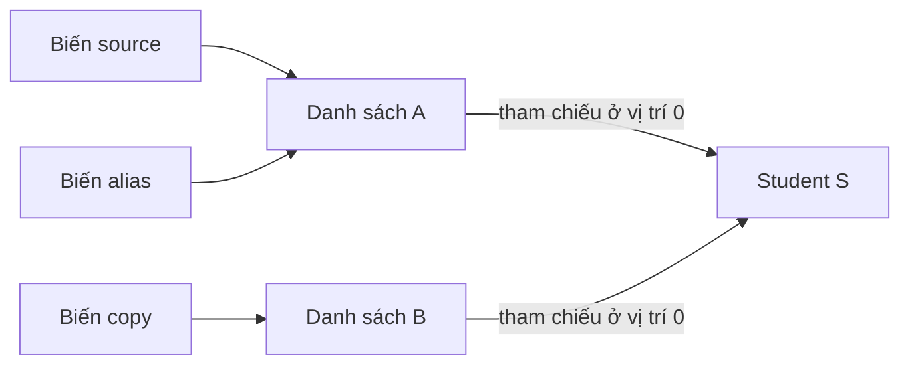

<a id="back-to-top"></a>

# ArrayList

## Menu
- [Cấu trúc mảng động và phân biệt size với capacity](#array-list-001)
- [Khởi tạo, tăng dung lượng và chi phí thêm cuối khấu hao](#array-list-002)
- [Độ phức tạp truy cập, tìm kiếm, chèn và xóa](#array-list-003)
- [ensureCapacity và trimToSize](#array-list-004)
- [Chi phí dịch chuyển khi thêm hoặc xóa ở đầu và giữa](#array-list-005)
- [Duyệt liên tiếp, tính cục bộ bộ nhớ và RandomAccess](#array-list-006)
- [Bản sao bằng constructor và giới hạn sao chép nông](#array-list-007)
- [Khi nào ArrayList là lựa chọn phù hợp](#array-list-008)

## <a id="array-list-001">Cấu trúc mảng động và phân biệt size với capacity</a>

<details>
<summary>Xem chi tiết</summary>

# Cấu trúc mảng động và phân biệt size với capacity

## 1. ArrayList giải quyết vấn đề gì của mảng?

Một mảng Java có độ dài cố định sau khi tạo. Với `new String[4]`, đối tượng mảng có đúng bốn vị trí; không thể đổi thuộc tính `length` của chính mảng đó thành tám.

`ArrayList<E>` cung cấp một danh sách có thể thêm và xóa phần tử mà người dùng không phải tự quản lý mảng nền. Khi cần chỗ lớn hơn, nó có thể tạo một mảng khác, chuyển các tham chiếu sang đó và dùng mảng mới làm nơi lưu trữ.

Từ “động” nói về cách cấu trúc danh sách quản lý chỗ chứa trong quá trình sử dụng. Nó không có nghĩa một đối tượng mảng Java tự thay đổi được độ dài.

Có hai đại lượng riêng:

- **Kích thước logic, `size`**: số phần tử hiện thuộc danh sách.
- **Sức chứa của mảng nền, `capacity`**: số vị trí mà mảng nội bộ dành để chứa phần tử trước khi phải tăng chỗ chứa.

Một cách hình dung là dãy vị trí đã được dành chỗ, trong đó chỉ một đoạn đầu đang thuộc danh sách. Có chỗ dự phòng không đồng nghĩa các vị trí dự phòng đã trở thành phần tử.

`ArrayList` là một triển khai của `List`; `size()`, thứ tự phần tử và truy cập theo chỉ số là phần của giao diện danh sách. Capacity gắn với cách triển khai bằng mảng của `ArrayList`, không phải khái niệm mà mọi `List` đều phải cung cấp. [ArrayList trong Java 17](https://docs.oracle.com/en/java/javase/17/docs/api/java.base/java/util/ArrayList.html).

## 2. size và capacity khác nhau ở đâu?

| Câu hỏi | size | capacity |
|---|---|---|
| Đang có bao nhiêu phần tử trong danh sách? | Trả lời câu hỏi này | Không trả lời câu hỏi này |
| Được dùng để xác định chỉ số đọc/thay phần tử hợp lệ? | Có | Không |
| Có API đọc trực tiếp trong ArrayList? | Có: `size()` | Không có phương thức công khai `capacity()` |
| Có tính phần tử mang giá trị `null`? | Có | Đếm chỗ chứa, không đếm giá trị khác `null` |
| Thêm phần tử có làm tăng? | Tăng theo số phần tử được thêm | Chỉ cần tăng nếu chỗ chứa chưa đủ |
| Xóa phần tử có làm giảm? | Giảm theo số phần tử bị xóa | Không nhất thiết giảm theo |
| Cấp chỗ dự phòng có tạo phần tử? | Không | Có thể làm tăng chỗ chứa |
| Thu gọn chỗ dự phòng có xóa phần tử? | Không | Có thể giảm tới bằng size |

Quan hệ cần giữ là:

```text
0 <= size <= capacity
```

Ví dụ khái niệm: danh sách có `size = 3`, mảng nền có `capacity = 6`.

```text
Chỉ số mảng:       0       1       2       3       4       5
                 +-------+-------+-------+-------+-------+-------+
Mảng nền:        |  A    | null  |  C    | trống | trống | trống |
                 +-------+-------+-------+-------+-------+-------+
Phần của List:   <---------- size = 3 ---------->
Toàn mảng nền:   <---------------- capacity = 6 ---------------->
```

Trong hình, “trống” chỉ là nhãn giải thích các ô nằm ngoài phần logic của danh sách. Nó không phải một giá trị Java đặc biệt. Các ô dự phòng của mảng tham chiếu có thể cũng mang giá trị `null`; `ArrayList` phân biệt vùng có phần tử bằng `size`, không bằng cách tìm ô `null` đầu tiên.

Vì vậy, `[A, null, C]` có ba phần tử. `null` ở chỉ số 1 vẫn là một phần tử thật của danh sách và vẫn chiếm một vị trí logic.

## 3. Mảng nền chứa gì?

Trong OpenJDK 17, `ArrayList` dùng một mảng `Object[]` để giữ các tham chiếu và một trường số nguyên để theo dõi số phần tử. Đây là mô tả triển khai giúp giải thích cơ chế, không phải quyền truy cập trực tiếp vào các trường nội bộ.

Với `ArrayList<Person>`, các ô mảng giữ tham chiếu đến đối tượng `Person`; bản thân toàn bộ đối tượng `Person` không bị nhét vào từng ô như một khối dữ liệu nằm liền nhau. Khi nói mảng có các vị trí liên tiếp, cần phân biệt vị trí chứa tham chiếu với vị trí thực tế của các đối tượng được tham chiếu trên heap.

Với `ArrayList<Integer>`, các giá trị số được biểu diễn bằng đối tượng bao `Integer` khi cần boxing. Cấu trúc này không tương đương với một `int[]` về cách lưu trữ và chi phí bộ nhớ.

Khi mảng nền được thay bằng mảng lớn hơn:

- Thứ tự logic của các phần tử được giữ.
- Các tham chiếu phần tử được chuyển sang chỗ chứa mới.
- Những đối tượng phần tử không tự được sao chép sâu hoặc tạo lại.
- Các biến khác đang tham chiếu đến cùng đối tượng phần tử vẫn tham chiếu đối tượng đó.

Hệ quả quan trọng: capacity tính bằng **số ô chứa tham chiếu**, không tính bằng byte và không cho biết tổng bộ nhớ của mọi đối tượng trong danh sách. Tổng bộ nhớ còn phụ thuộc bố cục đối tượng, tham chiếu, căn chỉnh và các đối tượng phần tử. [Triển khai ArrayList của OpenJDK 17](https://github.com/openjdk/jdk17u/blob/master/src/java.base/share/classes/java/util/ArrayList.java).

## 4. Cấp capacity trước không tạo ra phần tử

### 4.1. new ArrayList<>(n) vẫn có size bằng 0

Đoạn minh họa bên trong một phương thức:

```java
ArrayList<String> names = new ArrayList<>(100);

System.out.println(names.size());    // 0
System.out.println(names.isEmpty()); // true
```

Đối số 100 là capacity ban đầu, không phải số phần tử ban đầu. Các lời gọi sau vẫn sai ngay lúc này:

```java
names.get(0);      // IndexOutOfBoundsException
names.set(0, "An"); // IndexOutOfBoundsException
```

Đây là các dòng minh họa lỗi độc lập, không phải phần tiếp tục chạy sau khi dòng đầu đã ném ngoại lệ. Chỉ số đọc hoặc thay thế phải thỏa `0 <= index < size()`; capacity không nới phạm vi này.

Muốn tạo phần tử đầu tiên, gọi `names.add("An")`. Sau đó `size()` mới là 1 và `get(0)`, `set(0, ...)` mới hợp lệ.

Đối số `initialCapacity` của hàm dựng phải không âm. Giá trị 0 tạo danh sách rỗng vẫn thêm được về sau; giá trị âm gây `IllegalArgumentException`.

Capacity ban đầu cũng không phải giới hạn số lượng phần tử tối đa. Một `new ArrayList<>(2)` vẫn có thể chứa hơn hai phần tử; danh sách sẽ tăng chỗ chứa khi cần, nếu việc cấp phát có thể thực hiện.

### 4.2. add và set có nhiệm vụ khác nhau

| Thao tác | Vai trò | Tác động đến size |
|---|---|---|
| `add(value)` | Thêm phần tử ở cuối | Tăng một |
| `add(index, value)` | Chèn phần tử tại vị trí hợp lệ | Tăng một |
| `set(index, value)` | Thay một phần tử đã tồn tại | Không đổi |
| `get(index)` | Đọc một phần tử đã tồn tại | Không đổi |

Với `add(index, value)`, vị trí chèn cho phép `0 <= index <= size()`. Cho phép chèn ngay sau phần tử cuối không có nghĩa cho phép chèn vào một chỉ số bất kỳ nhỏ hơn capacity.

Ví dụ, danh sách rỗng có capacity 100 cho phép `add(0, "A")`, nhưng không cho phép `add(50, "A")`. Nó không tự tạo 50 phần tử trung gian để lấp khoảng trống.

### 4.3. Nếu thật sự cần n vị trí logic

Có bài toán cần tạo sẵn danh sách chứa `n` phần tử `null` rồi thay từng vị trí. Khi đó phải tạo phần tử, không chỉ cấp capacity.

Đoạn minh họa, cần import `java.util.Collections`:

```java
ArrayList<String> slots =
        new ArrayList<>(Collections.nCopies(3, (String) null));

slots.set(2, "LAST");

// slots = [null, null, LAST]
// slots.size() = 3
```

Ở đây danh sách thực sự có ba phần tử. Hàm dựng `ArrayList(Collection)` nhận một collection để lấy các phần tử ban đầu, khác với hàm dựng `ArrayList(int)` chỉ nhận capacity ban đầu.

Không cần lấp `null` chỉ để chuẩn bị thêm dữ liệu ở cuối. Nếu mục tiêu là nạp lần lượt bằng `add`, cấp capacity hợp lý rồi thêm phần tử thường diễn đạt đúng ý định hơn.

## 5. Cơ chế tăng mảng khi thêm phần tử

### 5.1. Khi còn chỗ trống

Nếu `size < capacity`, thêm ở cuối có thể dùng ô tại chỉ số `size` của mảng nền:

```text
Trước: size = 3, capacity = 6
       [A, B, C, trống, trống, trống]

Thêm D:
       [A, B, C, D, trống, trống]
Sau:  size = 4, capacity = 6
```

Kích thước logic tăng, nhưng không cần thay mảng chỉ vì một phần tử vừa được thêm.

### 5.2. Khi mảng đã đầy

Nếu `size == capacity` và cần thêm một phần tử:

1. Tính sức chứa mới đủ đáp ứng yêu cầu.
2. Cấp mảng mới.
3. Sao chép các ô cần giữ từ mảng cũ sang mảng mới.
4. Chuyển danh sách sang sử dụng mảng mới.
5. Đặt phần tử mới vào vị trí cuối và cập nhật size.

Đây là mô tả cơ chế, không phải mã nguồn đầy đủ của `ArrayList`. Triển khai thực còn xử lý tăng theo lô, giới hạn độ dài mảng và trường hợp cấp phát không thực hiện được.

```text
Trước khi thêm:
size = 4
mảng cũ, capacity = 4: [A, B, C, D]

Sau khi tăng chỗ và thêm E:
size = 5
mảng mới, ví dụ capacity = 6: [A, B, C, D, E, trống]
```

Số 6 trong hình minh họa một lần tăng có thể xảy ra; không phải cam kết rằng mọi lần tăng đều cho đúng con số đó.

Trong lúc thay mảng, mảng cũ và mảng mới có thể cùng tồn tại tạm thời. Vì thế, thao tác tăng có chi phí cấp phát và sao chép; mức bộ nhớ tạm dùng có thể lớn hơn kích thước của riêng mảng cuối cùng.

### 5.3. Chính sách tăng trưởng là chi tiết triển khai

API của `ArrayList` bảo đảm tăng chỗ chứa tự động và chi phí thêm cuối theo nghĩa khấu hao. API không quy định rằng capacity phải nhân đôi hay luôn tăng đúng 50%.

Trong nhánh OpenJDK 17 được tham khảo, mức tăng ưu tiên thường bằng một nửa capacity cũ. Kích thước mới còn phải đáp ứng mức tối thiểu đang cần và các giới hạn khác. Với các giá trị nhỏ, thêm lần lượt và bắt đầu từ capacity 4, một diễn tiến điển hình là:

| Trạng thái | size | Capacity theo chính sách OpenJDK 17 đang mô tả |
|---|---|---|
| Vừa tạo `new ArrayList<>(4)` | 0 | 4 |
| Đã thêm bốn phần tử | 4 | 4 |
| Thêm phần tử thứ năm | 5 | 6 |
| Thêm phần tử thứ sáu | 6 | 6 |
| Thêm phần tử thứ bảy | 7 | 9 |

Đây là bảng phân tích triển khai, không phải kết quả từ một phương thức công khai đọc capacity. Không viết kiểm thử nghiệp vụ buộc các capacity trung gian phải bằng 4, 6, 9. [Cơ chế grow trong OpenJDK 17](https://github.com/openjdk/jdk17u/blob/master/src/java.base/share/classes/java/util/ArrayList.java), [tính độ dài mới trong ArraysSupport](https://github.com/openjdk/jdk17u/blob/master/src/java.base/share/classes/jdk/internal/util/ArraysSupport.java).

Hàm dựng rỗng cũng cần được đọc đúng lớp thông tin: Javadoc mô tả capacity ban đầu mặc định là 10, nhưng OpenJDK 17 trì hoãn việc cấp mảng cho trường hợp rỗng mặc định. Lần thêm thông thường đầu tiên mới thực hiện chính sách cấp chỗ ban đầu đó. Không suy từ số 10 rằng mọi danh sách vừa gọi `new ArrayList<>()` đã lập tức sở hữu một mảng riêng có mười ô.

Chi tiết cấp phát muộn không thay đổi điều người dùng quan sát qua `List`: trước lần thêm đầu tiên, danh sách vẫn rỗng và size vẫn bằng 0.

## 6. Vì sao thêm cuối là O(1) khấu hao?

Một lần thêm cuối khi còn chỗ thường chỉ cần ghi tham chiếu và tăng size. Một lần thêm khi phải tăng mảng có thể phải sao chép số lượng ô tỉ lệ với mảng cũ, nên lần thêm đó có thể tốn `O(n)`.

**Khấu hao (amortized)** xem tổng chi phí trên cả một dãy thao tác, không nói rằng từng lần gọi đều có chi phí bằng nhau.

Nếu mảng tăng theo một tỉ lệ lớn hơn 1 thay vì chỉ tăng một ô, giữa hai lần tăng có nhiều lần thêm không cần sao chép. Tổng lượng sao chép qua một dãy thêm dài được chặn bởi một hằng số nhân với số phần tử được thêm, trong điều kiện sử dụng thông thường của phân tích.

Một mô hình toán học dễ nhìn là tăng gấp đôi: tổng các mức cũ `1 + 2 + 4 + ...` nhỏ hơn một hằng số nhân với mức cuối. Đây là mô hình giải thích tổng chi phí, không khẳng định `ArrayList` Java đang tăng gấp đôi.

Kết quả:

- Thêm `n` phần tử ở cuối có tổng chi phí `O(n)` theo bảo đảm khấu hao.
- Chi phí bình quân khấu hao cho một lần thêm cuối là `O(1)`.
- Một lần thêm riêng lẻ vẫn có thể chậm hơn vì cấp phát và sao chép.
- Khấu hao không phải cam kết độ trễ cố định cho từng lời gọi.

Capacity dư đổi một phần bộ nhớ lấy việc giảm tần suất cấp mảng mới. Nếu tăng đúng một ô mỗi khi đầy, gần như mỗi lần thêm lại phải sao chép danh sách đang lớn dần, dẫn đến tổng chi phí kiểu `1 + 2 + ... + n`, tức `O(n²)`.

### 6.1. Capacity dư không loại bỏ chi phí dịch phần tử

| Thao tác trên ArrayList | Cơ chế chính | Chi phí thường dùng để phân tích |
|---|---|---|
| `size()`, `isEmpty()` | Đọc trạng thái kích thước | `O(1)` |
| `get(i)`, `set(i, value)` | Truy cập trực tiếp vị trí sau kiểm tra biên | `O(1)` |
| `add(value)` ở cuối | Ghi cuối; đôi khi tăng mảng | `O(1)` khấu hao, một lần có thể `O(n)` |
| Chèn ở đầu hoặc giữa | Dịch các phần tử phía sau; có thể tăng mảng | `O(n)` trong trường hợp xấu |
| Xóa ở đầu hoặc giữa theo chỉ số | Dịch phần tử phía sau sang trái | `O(n)` trong trường hợp xấu |
| Xóa phần tử cuối theo chỉ số | Bỏ tham chiếu cuối và giảm size | `O(1)` |
| `clear()` | Bỏ các tham chiếu thuộc vùng logic | `O(n)` với `n = size` trước khi xóa |

Nếu đã cấp capacity 10.000 rồi chèn vào đầu danh sách có 5.000 phần tử, việc dịch 5.000 phần tử vẫn còn. Cấp trước capacity giúp tránh tăng mảng, không biến chèn giữa thành một phép ghi duy nhất.

Tương tự, xóa theo giá trị có thể phải tìm phần tử trước khi xóa. Đừng dùng độ phức tạp của xóa cuối theo chỉ số để mô tả mọi dạng `remove`.

## 7. ensureCapacity: dự phòng chỗ, không đổi nội dung

Đoạn minh họa:

```java
ArrayList<String> names = new ArrayList<>();
names.ensureCapacity(1_000);

// names.size() vẫn là 0
// names vẫn là []
```

`ensureCapacity(minCapacity)` yêu cầu danh sách chuẩn bị chỗ cho ít nhất số phần tử được chỉ định khi cần. Nó không thêm các phần tử `null`, không trả một danh sách mới và không đổi thứ tự phần tử hiện có.

Không hiểu nó thành “đặt capacity chính xác bằng tham số”. Nếu danh sách đã có capacity lớn hơn, không cần thu nhỏ; khi phải tăng, triển khai có thể chọn sức chứa lớn hơn mức tối thiểu.

Các trường hợp hợp lý:

- Biết khá chắc số phần tử sẽ nạp trong một đợt, có thể cấp capacity từ hàm dựng.
- Đang có một `ArrayList` và biết sắp thêm nhiều phần tử, có thể gọi `ensureCapacity` trước đợt thêm.
- Muốn giảm số lần cấp mảng lại và sao chép trong lúc nạp dữ liệu.

Đừng gọi `ensureCapacity` với một con số cực lớn chỉ vì “để khỏi tăng nữa”. Phần chỗ dự phòng vẫn có chi phí bộ nhớ và có thể làm việc cấp phát thất bại. Ước lượng nên dựa trên khối lượng dữ liệu có lý do, không dựa trên giới hạn số nguyên lớn nhất.

Capacity không phải giới hạn nghiệp vụ. Nếu chỉ được nhận tối đa 100 mục, phải kiểm tra quy tắc đó trước khi thêm; `new ArrayList<>(100)` không chặn mục thứ 101. [ArrayList.ensureCapacity](https://docs.oracle.com/en/java/javase/17/docs/api/java.base/java/util/ArrayList.html#ensureCapacity(int)).

### 7.1. Phương thức capacity thuộc kiểu ArrayList

Nếu khai báo:

```java
List<String> names = new ArrayList<>();
```

thì qua kiểu `List`, không thể gọi trực tiếp `names.ensureCapacity(...)` hoặc `names.trimToSize()`; hai phương thức này không nằm trong giao diện `List`.

Khi một đoạn mã thật sự cần kiểm soát chỗ chứa của `ArrayList`, có thể giữ biến cục bộ mang kiểu `ArrayList`. Ở ranh giới API chỉ cần các thao tác danh sách, kiểu `List` vẫn giúp diễn đạt đúng khả năng cần dùng. Không ép kiểu mọi danh sách sang `ArrayList` chỉ để can thiệp capacity, vì đối tượng thực tế có thể là một triển khai khác.

## 8. Xóa phần tử và thu nhỏ mảng là hai việc riêng

### 8.1. remove làm giảm size

Ví dụ khái niệm:

```text
Trước:
size = 4, capacity = 6
[A, B, C, D, trống, trống]

Xóa B ở chỉ số 1:
size = 3, capacity vẫn = 6
[A, C, D, trống, trống, trống]
```

Các phần tử phía sau được dịch sang trái. Trong triển khai OpenJDK, ô cuối không còn thuộc vùng logic được đặt về `null` để mảng không giữ thừa tham chiếu đến phần tử.

Việc bỏ tham chiếu từ danh sách không có nghĩa đối tượng bị hủy ngay. Nếu nơi khác vẫn giữ tham chiếu, đối tượng vẫn được dùng bình thường; nếu không còn tham chiếu giữ sống, việc thu hồi còn do bộ gom rác quản lý.

### 8.2. clear làm size về 0 nhưng giữ chỗ chứa để tái sử dụng

Trong OpenJDK 17, `clear()` bỏ các tham chiếu phần tử và đặt size về 0, nhưng không tự thay mảng nền bằng một mảng nhỏ chỉ vì danh sách đã rỗng.

Điều này hữu ích nếu danh sách sẽ được nạp lại nhiều lần với quy mô tương tự. Giữ chỗ chứa giúp tránh phải cấp lại mảng từ đầu sau mỗi đợt.

Nhưng nếu một danh sách từng rất lớn, sau `clear()` nó vẫn có thể giữ một mảng nền lớn. Cần phân biệt hai loại dữ liệu:

- Các đối tượng phần tử cũ không còn được danh sách giữ chỉ vì từng có trong danh sách.
- Mảng nền chứa các ô dự phòng vẫn có thể còn được danh sách giữ.

Không dùng `clear()` như một lời hứa rằng mọi bộ nhớ liên quan đã được trả ngay. [remove, clear và trimToSize trong mã OpenJDK 17](https://github.com/openjdk/jdk17u/blob/master/src/java.base/share/classes/java/util/ArrayList.java).

### 8.3. trimToSize thu capacity về size hiện tại

`trimToSize()` thu capacity của `ArrayList` về kích thước logic hiện tại. Nội dung và size không thay đổi.

Đoạn minh họa:

```java
ArrayList<String> names = new ArrayList<>(1_000);
names.add("An");
names.add("Binh");

names.trimToSize();

// size vẫn là 2; nội dung vẫn [An, Binh].
// Capacity sau trim bằng size hiện tại.
```

Thao tác này có thể cần tạo mảng mới và sao chép các tham chiếu đang dùng. Nó không làm danh sách trở thành bất biến và không đặt giới hạn số phần tử vĩnh viễn. Nếu tiếp tục thêm khi mảng đã đầy, danh sách lại tăng chỗ chứa.

Đừng đặt `trimToSize()` sau mỗi lần `add`. Việc liên tục ép capacity sát size rồi lại thêm có thể buộc cấp phát và sao chép lặp đi lặp lại, phá lợi ích của chỗ dự phòng.

Một thời điểm có thể cân nhắc là sau đợt nạp/xóa lớn, khi biết danh sách sẽ được giữ lâu và ít thêm phần tử nữa. Quyết định cần cân bằng bộ nhớ, số lần sao chép và mẫu sử dụng. [ArrayList.trimToSize](https://docs.oracle.com/en/java/javase/17/docs/api/java.base/java/util/ArrayList.html#trimToSize()).

## 9. Chương trình đầy đủ: size, chỉ số và các thao tác capacity

Các đoạn ngắn ở trên minh họa bên trong phương thức và cần import thích hợp. Chương trình sau là tệp độc lập, dùng API có trong Java 17.

Lưu thành `SizeCapacityDemo.java`:

```java
import java.util.ArrayList;
import java.util.Collections;

public class SizeCapacityDemo {
    private static void show(String step, ArrayList<String> values) {
        System.out.println(step + ": size = " + values.size()
                + ", values = " + values);
    }

    public static void main(String[] args) {
        ArrayList<String> values = new ArrayList<>(5);
        show("new ArrayList<>(5)", values);
        System.out.println("empty = " + values.isEmpty());

        try {
            values.get(0);
        } catch (IndexOutOfBoundsException ex) {
            System.out.println("get(0) -> IndexOutOfBoundsException");
        }
        try {
            values.set(0, "A");
        } catch (IndexOutOfBoundsException ex) {
            System.out.println("set(0) -> IndexOutOfBoundsException");
        }

        values.ensureCapacity(12);
        show("after ensureCapacity(12)", values);

        values.add("A");
        values.add(null);
        values.add("C");
        show("after three adds", values);
        System.out.println("toArray().length = " + values.toArray().length);

        String old = values.set(1, "B");
        System.out.println("set returned = " + old);
        show("after set(1, B)", values);

        values.add(1, "X");
        show("after add(1, X)", values);

        String removed = values.remove(2);
        System.out.println("removed = " + removed);
        show("after remove(2)", values);

        values.trimToSize();
        show("after trimToSize()", values);

        values.clear();
        show("after clear()", values);

        values.trimToSize();
        values.add("Z");
        show("after empty trim and add", values);

        ArrayList<String> slots =
                new ArrayList<>(Collections.nCopies(3, (String) null));
        show("three real null elements", slots);
        slots.set(2, "LAST");
        show("after slots.set(2, LAST)", slots);
    }
}
```

Biên dịch và chạy:

```shell
javac --release 17 -encoding UTF-8 SizeCapacityDemo.java
java SizeCapacityDemo
```

Kết quả chuẩn:

```text
new ArrayList<>(5): size = 0, values = []
empty = true
get(0) -> IndexOutOfBoundsException
set(0) -> IndexOutOfBoundsException
after ensureCapacity(12): size = 0, values = []
after three adds: size = 3, values = [A, null, C]
toArray().length = 3
set returned = null
after set(1, B): size = 3, values = [A, B, C]
after add(1, X): size = 4, values = [A, X, B, C]
removed = B
after remove(2): size = 3, values = [A, X, C]
after trimToSize(): size = 3, values = [A, X, C]
after clear(): size = 0, values = []
after empty trim and add: size = 1, values = [Z]
three real null elements: size = 3, values = [null, null, null]
after slots.set(2, LAST): size = 3, values = [null, null, LAST]
```

Các quan sát cần rút ra:

1. Capacity ban đầu là 5 nhưng danh sách rỗng. `get(0)` và `set(0, ...)` không được phép.
2. Sau `ensureCapacity(12)`, nội dung và size vẫn không đổi.
3. Ba lời gọi `add` tạo ba phần tử, kể cả phần tử `null`.
4. `set` thay `null` bằng `B`, trả giá trị cũ là `null` và không tăng size.
5. `add(1, "X")` chèn một phần tử mới nên size tăng.
6. `remove(2)` xóa một phần tử nên size giảm.
7. `trimToSize` không thay đổi nội dung. Sau khi rỗng và thu gọn, danh sách vẫn thêm lại được.
8. Danh sách tạo từ ba `null` thực sự có ba phần tử, nên `set(2, ...)` hợp lệ.

Chương trình cố ý không in capacity nội bộ vì `ArrayList` không cung cấp API công khai để đọc nó. Kết quả kiểm tra những điều người gọi có thể dựa vào: số phần tử, nội dung và tính hợp lệ của thao tác.

### 9.1. toArray().length không phải phép đọc capacity

Trong chương trình, `values.toArray().length` là 3 vì danh sách có ba phần tử. `toArray()` trả một mảng chứa các phần tử logic; nó không trao mảng nền để quan sát chỗ dự phòng.

Vì vậy, không viết `list.toArray().length` rồi gắn nhãn “capacity”. Thao tác này còn tạo một mảng kết quả riêng, có chi phí không cần thiết nếu chỉ muốn biết số phần tử.

Cũng không dùng số lượng giá trị khác `null` để suy ra size hoặc capacity. Một danh sách có thể chứa nhiều phần tử `null` hợp lệ.

## 10. Chương trình đầy đủ: thay mảng không nhân bản phần tử

Lưu thành `ArrayListReferenceDemo.java`:

```java
import java.util.ArrayList;

public class ArrayListReferenceDemo {
    private static final class Item {
        private String name;

        private Item(String name) {
            this.name = name;
        }

        private void rename(String name) {
            this.name = name;
        }

        @Override
        public String toString() {
            return name;
        }
    }

    public static void main(String[] args) {
        ArrayList<Item> items = new ArrayList<>(1);
        Item first = new Item("A");
        items.add(first);

        items.ensureCapacity(100);
        System.out.println("after reserve: same first = "
                + (items.get(0) == first));
        System.out.println("after reserve: size = " + items.size());

        items.add(new Item("B"));
        items.trimToSize();
        System.out.println("after trim: same first = "
                + (items.get(0) == first));
        System.out.println("after trim: items = " + items);

        first.rename("A*");
        System.out.println("after rename: items = " + items);

        Item removed = items.remove(0);
        System.out.println("removed is first = " + (removed == first));
        System.out.println("remaining items = " + items);

        items.clear();
        System.out.println("after clear: size = " + items.size());
        System.out.println("external reference = " + first);
    }
}
```

Biên dịch và chạy:

```shell
javac --release 17 -encoding UTF-8 ArrayListReferenceDemo.java
java ArrayListReferenceDemo
```

Kết quả chuẩn:

```text
after reserve: same first = true
after reserve: size = 1
after trim: same first = true
after trim: items = [A, B]
after rename: items = [A*, B]
removed is first = true
remaining items = [B]
after clear: size = 0
external reference = A*
```

Ở đây capacity ban đầu chỉ là 1; `ensureCapacity(100)` dự phòng chỗ lớn hơn. Dù có thay mảng nền, phần tử đầu vẫn là đúng đối tượng `first`, thể hiện bằng kết quả `==` là `true`.

Sau khi thêm phần tử thứ hai rồi thu gọn, tham chiếu đến phần tử đầu vẫn được giữ. Đổi tên qua biến `first` khiến danh sách cũng nhìn thấy tên mới, vì hai đường truy cập đang chỉ đến cùng đối tượng.

Cuối cùng, `remove` và `clear` không làm biến `first` ở bên ngoài biến mất. Biến đó vẫn tham chiếu đến đối tượng `Item` tên `A*`. Đây là bằng chứng về quan hệ tham chiếu, không phải phép đo thời điểm bộ gom rác chạy.

## 11. Đọc và sử dụng capacity đúng trong thực tế

### 11.1. Khi đã biết số lượng dữ liệu sẽ nạp

Đoạn minh họa:

```java
int expectedCount = 5_000;
ArrayList<String> rows = new ArrayList<>(expectedCount);

for (int i = 0; i < expectedCount; i++) {
    rows.add("row-" + i);
}
```

Capacity giúp giảm việc tăng mảng trong giai đoạn nạp. Nó không tạo sẵn chuỗi, không tránh chi phí tạo từng chuỗi và không bảo đảm toàn bộ tác vụ chỉ tốn một lần cấp phát. Ngoài mảng nền còn có các đối tượng phần tử và các chi phí khác.

Nếu số lượng chỉ là một ước lượng, danh sách vẫn có thể tăng thêm khi thực tế vượt dự kiến. Nếu ước lượng quá cao, có thể lãng phí nhiều ô dự phòng.

### 11.2. Khi tái sử dụng theo nhiều đợt

Nếu mỗi đợt có quy mô tương tự, giữ một `ArrayList` rồi `clear()` giữa các đợt có thể tận dụng mảng đã cấp. Nếu các đợt sau nhỏ hơn nhiều và danh sách được giữ lâu, cân nhắc thu gọn tại một ranh giới phù hợp.

Không có một quy tắc “luôn trim” hay “không bao giờ trim” đúng cho mọi chương trình. Quan sát lượng dữ liệu, thời gian giữ danh sách và chi phí cấp phát trước khi tối ưu.

### 11.3. Capacity không cung cấp an toàn luồng hoặc bảo đảm không lỗi

Có sẵn chỗ trống không làm `ArrayList` an toàn cho nhiều luồng cùng sửa. `size`, dữ liệu mảng và các thay đổi cấu trúc vẫn cần được quản lý theo chính sách đồng thời phù hợp.

Tăng capacity cũng không bảo đảm mọi lần thêm tương lai thành công: phần tử có thể tiếp tục tăng, tài nguyên có giới hạn, và mã xung quanh có thể có lỗi khác. Không coi con số dự phòng là một bằng chứng đầy đủ về hiệu năng hay tính đúng đắn.

## 12. Những hiểu nhầm cần sửa

| Hiểu nhầm | Điều thực sự xảy ra | Cách viết hoặc đọc đúng |
|---|---|---|
| `new ArrayList<>(100)` có 100 phần tử | Size ban đầu là 0 | Dùng `add` để tạo phần tử |
| Capacity 100 thì `get(99)` luôn hợp lệ | Phạm vi đọc dựa vào size | Kiểm tra `0 <= index < size()` |
| Có thể dùng `set` để thêm vào ô dự phòng | `set` chỉ thay phần tử đã có | Dùng `add` nếu cần tăng size |
| Capacity là giới hạn số phần tử tối đa | Nó là chỗ chứa hiện tại, có thể tăng | Viết quy tắc giới hạn riêng nếu cần |
| Có `null` thì danh sách chưa có phần tử ở đó | `null` có thể là phần tử hợp lệ | Size là số phần tử logic, không phải số phần tử khác `null` |
| Mọi lần thêm đều `O(1)` | Một số lần phải tăng và sao chép | Phân biệt một lần gọi với chi phí khấu hao |
| Còn capacity nên chèn giữa là `O(1)` | Vẫn phải dịch các phần tử phía sau | Phân tích cả dịch chuyển lẫn tăng mảng |
| Xóa làm capacity tự giảm tương ứng | Size giảm nhưng mảng có thể giữ nguyên | Chỉ thu gọn khi có lý do phù hợp |
| `clear()` trả ngay toàn bộ bộ nhớ đã dùng | Bỏ phần tử và giữ mảng nền để tái sử dụng | Phân biệt phần tử, mảng nền và việc thu hồi bởi GC |
| `trimToSize()` làm danh sách không thêm được nữa | Danh sách vẫn tăng khi thêm tiếp | Trim là tối ưu chỗ chứa tại thời điểm gọi |
| `toArray().length` là capacity | Đó là độ dài mảng kết quả của các phần tử | Dùng `size()` khi cần số phần tử |
| Capacity của Java luôn nhân đôi hoặc luôn nhân 1,5 | Hệ số cụ thể không thuộc bảo đảm API | Dựa vào hợp đồng thay vì con số trung gian |

## 13. Tự kiểm tra bằng một chuỗi thao tác

Giả sử bắt đầu với `ArrayList<String> values = new ArrayList<>(8);`. Không dùng reflection hoặc truy cập mảng nội bộ.

| Bước | Thao tác | Size sau bước | Điều có thể kết luận về chỗ chứa |
|---|---|---|---|
| 1 | Tạo danh sách | 0 | Có capacity ban đầu 8; chưa có phần tử |
| 2 | Thêm ba phần tử | 3 | Không cần vượt chỗ chứa 8 |
| 3 | Thay phần tử ở chỉ số 1 bằng `set` | 3 | Không cần tăng mảng chỉ để thay tham chiếu |
| 4 | Xóa phần tử ở chỉ số 0 | 2 | Xóa không tự thu mảng theo từng phần tử |
| 5 | `ensureCapacity(12)` | 2 | Chuẩn bị ít nhất chỗ chứa yêu cầu, không tạo thêm phần tử |
| 6 | `trimToSize()` | 2 | Capacity được thu về 2 |
| 7 | Thêm một phần tử | 3 | Phải có chỗ cho ít nhất ba phần tử; không dựa vào một hệ số cố định |
| 8 | `clear()` | 0 | Không còn phần tử logic; mảng nền có thể còn được giữ |

Các câu hỏi kiểm tra thêm:

1. Sau bước 1, `values.set(0, "A")` có hợp lệ không?
2. Sau bước 2, nếu một phần tử là `null`, size có còn bằng 3 không?
3. Sau bước 5, `values.get(10)` có hợp lệ không?
4. Sau bước 6, vì sao thêm phần tử mới có thể cần thay mảng?
5. Nếu một biến khác còn giữ đối tượng đã bị xóa khỏi danh sách, đối tượng đó có tự mất đi ngay không?

Đáp án:

1. Không, vì chưa có phần tử ở chỉ số 0.
2. Có; `null` vẫn được tính là một phần tử.
3. Không; size vẫn là 2 dù đã dự phòng chỗ.
4. Vì capacity bằng size hiện tại là 2, không còn ô dự phòng cho phần tử thứ ba.
5. Không; đối tượng vẫn có thể được dùng qua tham chiếu bên ngoài.

Khi phân tích một thao tác trên `ArrayList`, hãy tách ba câu hỏi: số phần tử logic có đổi không, mảng nền có cần đổi chỗ chứa không, và các phần tử có cần dịch vị trí không. Cách đọc này giúp dự đoán đúng cả hành vi chỉ số lẫn chi phí của cấu trúc mảng động.


</details>

- [Quay lại đầu trang](#back-to-top)

---

## <a id="array-list-002">Khởi tạo, tăng dung lượng và chi phí thêm cuối khấu hao</a>

<details>
<summary>Xem chi tiết</summary>

# ArrayList: khởi tạo, tăng dung lượng và chi phí thêm cuối khấu hao

Khi đọc các dòng dữ liệu mà chưa biết trước số dòng, ta cần một danh sách có thể nhận thêm phần tử. Mảng Java có độ dài cố định sau khi tạo; nếu tự dùng mảng, ta phải theo dõi số phần tử, phát hiện lúc đầy, cấp mảng khác và chuyển dữ liệu. `ArrayList` đóng gói công việc đó để người dùng thao tác với một danh sách có chỉ số.

Sự thuận tiện này có một chi phí cần hiểu: phần lớn lần thêm cuối chỉ ghi thêm một tham chiếu, nhưng một số lần phải thay mảng lưu trữ. Vì vậy, câu “thêm cuối là O(1)” chỉ chính xác khi nói về **chi phí hằng số khấu hao trên một chuỗi thao tác**, không phải thời gian tối đa của từng lần gọi.

Bài này đi từ mô hình kích thước–dung lượng, các cách khởi tạo, cơ chế tăng mảng, đến chứng minh khấu hao và cách chọn chiến lược cấp phát. Ví dụ dùng API tương thích Java 17. Chi tiết riêng của một bản OpenJDK được tách khỏi những điều chương trình có thể dựa vào qua API.

## 1. Hai đại lượng khác nhau: số phần tử và chỗ dự trữ

**Kích thước (size)** là số phần tử đang thuộc về danh sách. **Dung lượng (capacity)** là số vị trí mà mảng nền hiện có thể chứa trước khi cần tăng tiếp.

Ta có thể hình dung một danh sách như sau:

~~~text
size = 3, capacity = 5

chi so mang:   0      1      2      3      4
             [A]    [B]    [C]   [rong] [rong]
              <--- phan tu --->  <- du tru ->
~~~

Sơ đồ là mô hình giải thích. `[rong]` biểu diễn vị trí dự trữ bên trong, không phải một phần tử có thể đọc bằng `get`. Với trạng thái này:

- `size()` trả về 3.
- `get(0)`, `get(1)`, `get(2)` hợp lệ.
- `get(3)` không hợp lệ dù mảng nền còn chỗ.
- `add("D")` tạo phần tử thứ tư của danh sách.
- `set(3, "D")` trước khi thêm không hợp lệ; `set` chỉ thay một phần tử đã tồn tại.

Điều kiện cần giữ là:

~~~text
0 <= size <= capacity

get/set:      0 <= index < size
add(index,x): 0 <= index <= size
~~~

Trong đó `add(size, x)` là chèn ở cuối; `add(x)` diễn đạt trực tiếp mục đích này.

Dung lượng không phải giới hạn số phần tử mà danh sách được phép nhận suốt đời. Khi cần, danh sách có thể tăng thêm dung lượng, miễn là môi trường còn cấp phát được bộ nhớ. Ngược lại, dung lượng lớn không làm danh sách có sẵn phần tử.

### 1.1. Một phần tử null vẫn được tính vào size

`ArrayList` cho phép phần tử `null`. Nếu gọi `add(null)`, ta đã thêm một phần tử và `size` tăng lên. Không được đồng nhất “vị trí có tham chiếu null” với “vị trí chưa thuộc danh sách”.

Điều quyết định phần nào của mảng là nội dung danh sách chính là `size`. Đây cũng là lý do không thể suy ra kích thước bằng cách quét đến tham chiếu `null` đầu tiên.

### 1.2. Mảng nền chứa tham chiếu

Với `ArrayList<Person>`, các vị trí mảng giữ tham chiếu tới đối tượng `Person`. Tăng mảng sao chép các tham chiếu; nó không tạo bản sao sâu của từng `Person`.

Tương tự, `ArrayList<Integer>` không phải `int[]` tự tăng. Nó chứa tham chiếu tới các đối tượng `Integer`; việc đóng hộp (boxing), bộ nhớ của đối tượng và cách các giá trị được tạo là những chi phí khác với chi phí thay mảng. Khi phân tích thêm cuối, cần nói rõ đang đếm công việc ở cấu trúc danh sách hay toàn bộ công việc của ứng dụng.

## 2. Chọn cách khởi tạo theo thông tin đang có

Ba dạng khởi tạo thường dùng:

| Cách viết | Kích thước ngay sau tạo | Mục đích |
|---|---:|---|
| `new ArrayList<>()` | 0 | Chưa có dữ liệu, chưa có ước lượng hữu ích |
| `new ArrayList<>(expected)` | 0 | Dự trữ theo số phần tử dự kiến |
| `new ArrayList<>(source)` | `source.size()` nếu nguồn ổn định | Tạo danh sách chứa các phần tử của nguồn |

Tham số số nguyên là dung lượng ban đầu, không phải kích thước ban đầu. Constructor nhận collection sao chép phần tử theo thứ tự bộ lặp của nguồn; nó không tự sắp xếp. Dung lượng âm gây `IllegalArgumentException`; collection nguồn là `null` gây `NullPointerException`. Xem hợp đồng tại [ArrayList trong Java SE 17](https://docs.oracle.com/en/java/javase/17/docs/api/java.base/java/util/ArrayList.html).

### 2.1. Constructor mặc định: lựa chọn tốt khi chưa biết số lượng

Đoạn sau là một phần thân phương thức minh họa:

~~~java
ArrayList<String> names = new ArrayList<>();
names.add("An");
names.add("Binh");
~~~

Người dùng không cần tự quản lý việc đầy mảng. Đây thường là cách viết rõ ràng khi danh sách có quy mô nhỏ, hoặc chưa có số lượng dự kiến đáng tin.

Không cần chọn một con số lớn tùy ý để “phòng trường hợp thiếu”. Việc tự tăng là chức năng bình thường của cấu trúc này; quyết định đặt trước dung lượng cần có lý do từ dữ liệu hoặc phép đo.

### 2.2. Constructor số nguyên: dành chỗ, chưa điền dữ liệu

~~~java
ArrayList<String> names = new ArrayList<>(100);
~~~

Dòng trên tạo danh sách rỗng có dung lượng ban đầu được chỉ định. Nó không tạo 100 tên rỗng, 100 chuỗi rỗng hay 100 phần tử `null`. Ngay sau đó, `names.size()` vẫn bằng 0.

Nếu muốn danh sách thực sự có 100 phần tử `null`, phải thêm 100 phần tử; đó là yêu cầu khác và làm thay đổi nội dung quan sát được. Không dùng thao tác điền phần tử giả để thay cho yêu cầu dự trữ bộ nhớ.

Giá trị 0 hợp lệ: `new ArrayList<>(0)` vẫn có thể nhận phần tử về sau. Giá trị âm không mang nghĩa “để Java tự tính”. Nếu ước lượng có thể âm, hãy xử lý lỗi đầu vào trước khi gọi constructor.

Đặt trước dung lượng hợp lý hữu ích khi biết sẽ thu thập khoảng 20.000 kết quả. Nó dời công việc cấp phát sang thời điểm khởi tạo và giảm những lần thay mảng khi thêm. Tuy nhiên, nếu cuối cùng chỉ nhận 3 kết quả, phần lớn vùng dự trữ chưa phục vụ nội dung thực tế.

### 2.3. Constructor collection: sao chép cấu trúc, chia sẻ phần tử

~~~java
ArrayList<String> names = new ArrayList<>(List.of("An", "Binh"));
names.add("Chi");
~~~

Danh sách mới có thể thay đổi cấu trúc dù nguồn `List.of` không cho phép thêm hoặc xóa. Điều này thuận tiện khi cần bắt đầu từ một tập dữ liệu cố định rồi tiếp tục chỉnh sửa.

Cần phân biệt hai loại độc lập:

- Thêm hoặc xóa trong danh sách mới không trực tiếp thêm hoặc xóa phần tử của danh sách nguồn.
- Nếu phần tử là đối tượng có thể thay đổi và cả hai danh sách cùng giữ tham chiếu đến nó, thay đổi đối tượng có thể được nhìn thấy qua cả hai danh sách.

Ví dụ đầy đủ ở phần thực hành dùng `StringBuilder` để quan sát hiện tượng này. Sao chép danh sách không tự biến các đối tượng bên trong thành bất biến hoặc độc lập.

Nếu nguồn có m phần tử, việc thiết lập nội dung danh sách mới cần xử lý các phần tử nguồn; không nên coi constructor này là thao tác O(1) chỉ vì cú pháp có một dòng. Với nguồn thông thường, ổn định và có thao tác duyệt tuyến tính, chi phí sao chép là O(m). Nếu nguồn có cách triển khai đặc biệt hoặc bị thay đổi đồng thời, phải xét hợp đồng và chi phí của chính nguồn.

### 2.4. “Mặc định 10” có nghĩa gì?

Tài liệu Java 17 mô tả constructor không tham số với dung lượng ban đầu 10. Điều đó không có nghĩa là `size()` bằng 10 hay chương trình được phép đọc 10 vị trí.

Ở bản OpenJDK 17 được tham chiếu trong bài, constructor mặc định dùng một mảng rỗng đánh dấu và trì hoãn cấp mảng thông thường đến lúc cần. Với lần thêm đầu tiên thông thường, mốc mặc định là 10. Constructor truyền 0 đi qua một trạng thái rỗng khác; không nên dùng hai cách tạo này để suy đoán một lịch tăng giống nhau. Đây là chi tiết triển khai, thể hiện trong [mã nguồn ArrayList của OpenJDK 17, bản jdk-17+35](https://raw.githubusercontent.com/openjdk/jdk/jdk-17%2B35/src/java.base/share/classes/java/util/ArrayList.java).

Kết luận để viết mã là: cả hai cách đều tạo danh sách rỗng hợp lệ, và ứng dụng sử dụng `size`, `add`, `get` theo hợp đồng. Không viết điều kiện nghiệp vụ dựa trên việc lần cấp mảng đầu tiên có đúng 10 vị trí.

## 3. Điều gì xảy ra khi thêm cuối?

Xét một danh sách đang có n phần tử và dung lượng c. Có hai tình huống.

### 3.1. Còn chỗ: ghi ở vị trí kế tiếp

Nếu `n < c`, cấu trúc có thể:

1. Ghi tham chiếu phần tử mới vào vị trí n.
2. Tăng kích thước thành n + 1.

Không cần dịch các phần tử phía trước. Nếu chỉ xét công việc quản lý mảng và chỉ số, số thao tác không tăng theo n: đây là đường đi có chi phí O(1).

Việc tạo phần tử có thể tốn nhiều thời gian hơn. Với `list.add(loadLargeDocument())`, tải tài liệu xảy ra trước khi lời gọi `add` nhận được kết quả; đánh giá tốc độ toàn biểu thức phải tính riêng công việc đó.

### 3.2. Đã đầy: thay mảng rồi mới ghi

Nếu `n == c`, cấu trúc cần một vùng chứa lớn hơn. Mô hình điển hình là:

1. Chọn dung lượng mới đủ chứa ít nhất phần tử sắp thêm.
2. Cấp một mảng mới.
3. Sao chép dữ liệu từ mảng cũ.
4. Chuyển tham chiếu nội bộ sang mảng mới.
5. Ghi phần tử mới và cập nhật kích thước.

Ví dụ minh họa dưới đây cố ý dùng một chính sách tăng giả định:

~~~text
truoc add(D): size=3, capacity=3
mang cu:       [A] [B] [C]

sau khi tang: size=3, capacity=6
mang moi:      [A] [B] [C] [ ] [ ] [ ]

sau add(D):   size=4, capacity=6
mang moi:      [A] [B] [C] [D] [ ] [ ]
~~~

Sơ đồ không khẳng định `ArrayList` Java luôn tăng từ 3 lên 6. Nó giải thích vì sao một lần thêm có thể cần công việc tỷ lệ với số phần tử hiện có.

Khi tăng từ một mảng đầy, sao chép n tham chiếu đã có tạo chi phí O(n). Cấp phát và khởi tạo mảng mới cũng có chi phí; phân tích khấu hao phải xét cả chuỗi lần tăng, thay vì chỉ bỏ qua các bước đắt.

### 3.3. Danh sách vẫn là cùng một đối tượng

Khi mảng nền được thay, đối tượng `ArrayList` mà mã ứng dụng đang giữ không bị thay bằng một danh sách mới. Các biến cùng trỏ tới danh sách đó vẫn thấy nội dung được thêm.

Các phần tử cũng không đổi danh tính chỉ vì mảng chứa tham chiếu của chúng được thay. Không có yêu cầu gọi lại constructor của từng phần tử, `clone` từng phần tử hay tính lại nội dung nghiệp vụ.

Mảng cũ có thể trở thành đối tượng đủ điều kiện để bộ gom rác thu hồi sau khi không còn tham chiếu cần thiết. Điều này không bảo đảm bộ nhớ được thu hồi ngay lập tức. Trong lúc chuyển tiếp, cần có chỗ cho cả mảng cũ và mảng mới; đỉnh sử dụng bộ nhớ có thể cao hơn kích thước ổn định sau khi tăng.

## 4. Chính sách tăng dung lượng: cam kết và chi tiết triển khai

Điều ứng dụng cần dựa vào là khả năng tự tăng và cam kết thêm cuối có chi phí hằng số khấu hao. API không cố định một hệ số tăng mà mọi Java implementation phải dùng.

Ở OpenJDK 17 được nêu trên, khi đã có mảng thông thường, mức tăng ưu tiên xấp xỉ một nửa dung lượng cũ. Mức tối thiểu cần thiết và xử lý giới hạn số nguyên có thể làm kết quả khác phép nhân 1,5 đơn giản. Việc tính chiều dài liên quan đến [ArraysSupport của cùng bản OpenJDK](https://raw.githubusercontent.com/openjdk/jdk/jdk-17%2B35/src/java.base/share/classes/jdk/internal/util/ArraysSupport.java).

Không cần ghi nhớ một dãy dung lượng để sử dụng `ArrayList` đúng. Những nhận định sau đều thiếu điều kiện:

- “Mọi lần tăng đều gấp đôi.”
- “Mọi lần tăng đều đúng 1,5 lần, kể cả mảng rỗng và số nhỏ.”
- “Sau khi thêm n phần tử, dung lượng chắc chắn bằng một công thức cố định của n.”
- “Constructor hoặc `ensureCapacity` sẽ luôn cấp đúng số ô mà tôi có thể kiểm tra bằng một getter.”

`ArrayList` không cung cấp phương thức công khai `capacity()`. `size()` chỉ báo số phần tử. Không dùng reflection vào trường riêng để biến chi tiết triển khai thành điều kiện nghiệp vụ hoặc thành một kiểm thử tính đúng của ứng dụng.

Bài sẽ dùng chính sách **tăng gấp đôi** ở phần toán học và chương trình đếm công việc. Chính sách này giúp nhìn rõ cấp số nhân. Nó là mô hình học tập riêng, không phải bản sao thuật toán OpenJDK.

## 5. Vì sao một số lần O(n) vẫn cho thêm cuối O(1) khấu hao?

### 5.1. Xét tổng chi phí của một chuỗi, không chỉ lần chậm nhất

Giả sử bắt đầu rỗng và chỉ thêm cuối. Trong mô hình tăng gấp đôi, dung lượng đi qua:

~~~text
1, 2, 4, 8, 16, 32, ...
~~~

Để chuyển từ mảng đầy sang mảng kế tiếp, ta sao chép:

~~~text
0, 1, 2, 4, 8, 16, ...
~~~

Đa số lần thêm nằm giữa hai mốc tăng và không sao chép phần tử cũ. Một lần tăng đắt tạo ra nhiều chỗ trống, phục vụ nhiều lần thêm tiếp theo.

Bảng đếm công việc với 9 lần thêm:

| Lần thêm | Dung lượng sau thêm | Số phần tử cũ phải sao chép ở lần này | Ghi phần tử mới |
|---:|---:|---:|---:|
| 1 | 1 | 0 | 1 |
| 2 | 2 | 1 | 1 |
| 3 | 4 | 2 | 1 |
| 4 | 4 | 0 | 1 |
| 5 | 8 | 4 | 1 |
| 6 | 8 | 0 | 1 |
| 7 | 8 | 0 | 1 |
| 8 | 8 | 0 | 1 |
| 9 | 16 | 8 | 1 |

Sau 9 lần thêm, tổng có 15 lượt sao chép và 9 lượt ghi mới. Riêng lần thứ 9 làm nhiều việc hơn lần thứ 8, nhưng tổng công việc vẫn chỉ tỷ lệ với số phần tử đã thêm.

### 5.2. Chứng minh bằng tổng cấp số nhân

Gọi n là số phần tử đã thêm, n >= 1; gọi C là dung lượng cuối trong mô hình tăng gấp đôi. Ta có:

~~~text
n <= C < 2n

tong so tham chieu/phan tu cu duoc sao chep
    = 1 + 2 + 4 + ... + C/2
    = C - 1
    < 2n

so lan ghi phan tu moi = n

tong hai loai cong viec < 3n
~~~

Với C = 1, tổng sao chép rỗng bằng 0; công thức C - 1 vẫn đúng.

Vì tổng công việc cho n lần thêm là O(n), chia cho n thao tác cho ta chi phí O(1) khấu hao mỗi lần thêm. Đây là một giới hạn trên cho cả chuỗi theo mô hình, không cần giả định người dùng đưa vào dữ liệu ngẫu nhiên.

Chi phí cấp phát và khởi tạo mảng không làm mất kết quả bậc lớn này trong mô hình thông thường: tổng các chiều dài mảng đã cấp cũng là một tổng cấp số nhân và là O(n). Tuy nhiên, các hằng số, cách JVM cấp phát, bộ gom rác và phần tử mà ứng dụng tạo đều ảnh hưởng thời gian thực.

### 5.3. Khấu hao khác trung bình xác suất và khác giới hạn độ trễ

**Phân tích khấu hao (amortized analysis)** phân bổ tổng công việc của một chuỗi thao tác. Nó không nói “thường thì dữ liệu may mắn nên nhanh”.

Nếu chương trình phải đáp ứng hạn thời gian rất chặt cho từng yêu cầu, một lần sao chép lớn vẫn có thể làm yêu cầu đó chậm. O(1) khấu hao không phải cam kết rằng mỗi lần gọi có cùng số nano giây, không cấp phát hay không gặp dừng do bộ gom rác.

Ba câu nên dùng với đúng phạm vi:

| Câu hỏi | Kết luận phù hợp |
|---|---|
| Thêm cuối khi còn chỗ tốn bao nhiêu công việc quản lý danh sách? | O(1) |
| Một lần thêm cuối có thể làm bao nhiêu việc khi cần tăng từ mảng đầy? | O(n), với n là số phần tử cũ |
| Một chuỗi n lần thêm cuối từ rỗng, theo chính sách tăng thông thường, có tổng công việc bậc nào? | O(n), tức O(1) khấu hao mỗi lần |

Nếu danh sách ban đầu đã có m phần tử, lần thêm đầu tiên của đoạn đang quan sát có thể phải chuyển m phần tử đó. Không được cắt bỏ lịch sử rồi tuyên bố một chuỗi rất ngắn luôn chỉ tốn theo số phần tử mới. Một giới hạn an toàn cho việc thêm tiếp n phần tử từ trạng thái đã có m phần tử là O(m + n), nếu tính cả lần tăng liên quan.

### 5.4. Vì sao không chỉ tăng thêm một vị trí?

Nếu mỗi lần đầy chỉ cấp đúng một vị trí bổ sung, số lần sao chép khi thêm n phần tử từ rỗng là:

~~~text
0 + 1 + 2 + ... + (n - 1) = n(n - 1)/2
~~~

Tổng trở thành O(n²). Cấp thừa một phần dung lượng giúp đổi bộ nhớ dự trữ lấy ít lần sao chép hơn.

Với hệ số tăng cố định lớn hơn 1, tổng chiều dài các đợt vẫn có dạng cấp số nhân. Hệ số lớn hơn thường tạo nhiều chỗ dư hơn sau một lần tăng nhưng giảm tần suất tăng; hệ số gần 1 thường giảm chỗ dư nhưng làm tổng sao chép có hằng số lớn hơn. Đây là đánh đổi về thiết kế cấu trúc dữ liệu, không phải một tham số công khai để chỉnh trên `ArrayList`.

## 6. ensureCapacity và trimToSize điều khiển điều gì?

### 6.1. ensureCapacity: chuẩn bị trước một nhu cầu có căn cứ

Với một danh sách đã tồn tại, có thể gọi:

~~~java
ArrayList<String> rows = new ArrayList<>();
rows.ensureCapacity(20_000);
~~~

Yêu cầu này không thêm phần tử. Nó cũng không điền `null`, không đổi thứ tự và không làm các chỉ số từ 0 đến 19.999 trở thành chỉ số đọc hợp lệ.

Tên “capacity” cần hiểu theo mức tối thiểu phục vụ nhu cầu, không phải lệnh đặt dung lượng bằng chính xác tham số. Nếu đã đủ chỗ, không cần tăng. Nếu cần tăng, triển khai có thể chọn một mảng lớn hơn mức yêu cầu. Phương thức này không dùng để thu nhỏ.

Ở đường đi của constructor mặc định trong OpenJDK 17, những yêu cầu nhỏ còn có thể giữ trạng thái cấp phát lười đã nêu. Bởi vậy, không suy ra rằng mỗi lần gọi `ensureCapacity(k)` đều thực hiện cấp phát ngay.

Khi sẽ bổ sung một lô dữ liệu, nhu cầu là **tổng kích thước cần có sau bổ sung**, không chỉ số phần tử của lô. Nếu hiện có 3.000 phần tử và dự kiến thêm 2.000, một yêu cầu theo 2.000 không diễn đạt nhu cầu 5.000 phần tử.

Phép tính `size + incomingCount` dùng số nguyên `int` có thể tràn nếu dữ liệu quá lớn. Nếu ứng dụng thực sự nhận các số lượng bên ngoài có thể lớn, hãy kiểm tra không âm và tràn số, chẳng hạn bằng `Math.addExact`, rồi áp dụng giới hạn bộ nhớ của ứng dụng. Một tổng còn nằm trong `int` chưa bảo đảm cấp phát thành công.

Không cần gọi `ensureCapacity(size() + 1)` trước mọi lần `add`: chính `add` đã có khả năng tăng. Mặt khác, cũng không được khẳng định chuỗi lời gọi dư thừa này mặc nhiên ép mỗi lần tăng đúng một vị trí; `ensureCapacity` đặt mức cần thiết, không cố định cách tăng. Muốn kết luận về hiệu năng phải phân tích đúng hành vi.

### 6.2. trimToSize: bỏ phần dự trữ không dùng

`trimToSize()` yêu cầu thu dung lượng về kích thước hiện có. Nó giữ nguyên nội dung logic của danh sách.

Nếu danh sách từng có rất nhiều phần tử rồi chỉ còn một phần nhỏ và sẽ giữ lâu để đọc, việc thu gọn có thể giảm phần mảng dự trữ. Nếu danh sách sắp được thêm nhiều trở lại, thu gọn có thể chỉ khiến lần thêm sau phải tăng mảng.

Đây không phải thao tác O(1) vô điều kiện. Trong triển khai dùng mảng, khi thực sự cần thu gọn, phải cấp mảng mới và chuyển dữ liệu còn giữ. Chi phí và bộ nhớ tạm trong lúc sao chép vẫn cần được tính.

### 6.3. clear giải phóng nội dung danh sách, không hứa trả ngay toàn bộ bộ nhớ

`clear()` làm danh sách rỗng, nên `size()` về 0. Ở OpenJDK 17, các tham chiếu phần tử bị xóa khỏi các vị trí đang dùng, còn mảng nền được giữ lại. Việc giữ mảng có ích nếu cùng danh sách được tái sử dụng cho đợt tiếp theo.

Đừng suy ra rằng gọi `clear` thì mọi đối tượng phần tử lập tức biến mất khỏi heap. Chúng có thể còn được nơi khác tham chiếu; ngay cả khi không còn, thời điểm bộ gom rác thu hồi vẫn do JVM quyết định.

Nếu vừa xóa một tập rất lớn và chắc chắn không cần giữ vùng dự trữ, có thể cân nhắc `trimToSize` sau đó, hoặc thay đổi cách quản lý vòng đời danh sách. Quyết định phải xét ai còn giữ tham chiếu tới danh sách cũ và nhu cầu dùng lại, không chỉ nhìn một lần đo bộ nhớ.

### 6.4. Đừng thu gọn sau mỗi lần thêm

Giả sử sau mỗi `add` đều gọi `trimToSize`. Kết thúc mỗi vòng lặp, dung lượng lại bằng kích thước; lần thêm tiếp theo không còn chỗ dự trữ.

Ở cấu trúc mảng đang xét, việc đó khiến các lần thêm liên tiếp phải sao chép danh sách ngày càng dài, và thu gọn còn có thể sao chép thêm lần nữa. Tổng chi phí có thể trở thành O(n²). Chính chương trình đã phá điều kiện giữ lại khoảng trống để phân bổ chi phí.

Trường hợp này khác một lần thu gọn có chủ đích sau khi hoàn thành giai đoạn nạp dữ liệu. Không nên biến một thao tác tối ưu bộ nhớ có điều kiện thành nghi thức bắt buộc trong vòng lặp.

## 7. Thực hành: quan sát API và đếm công việc trong mô hình riêng

Chương trình sau có hai phần độc lập:

1. Dùng `ArrayList` thật để kiểm tra kích thước, chỉ số, constructor, `ensureCapacity`, `trimToSize` và sao chép nông.
2. Dùng `DoublingBuffer` tự viết để đếm công việc tăng gấp đôi, vì API `ArrayList` không có bộ đếm số lần sao chép hay getter dung lượng.

`DoublingBuffer` cố ý đơn giản và dùng `int[]`. Nó không triển khai `List`, không có đủ thao tác hay chính sách giới hạn của `ArrayList`, và không dùng cho dữ liệu sản xuất. Mục tiêu duy nhất là kiểm tra phép cộng đã chứng minh.

### 7.1. Mã nguồn hoàn chỉnh

Lưu thành `ArrayListGrowthDemo.java`:

~~~java
import java.util.ArrayList;
import java.util.Arrays;
import java.util.List;

public class ArrayListGrowthDemo {
    // Mo hinh de dem cong viec: KHONG phai ma nguon ArrayList.
    static final class DoublingBuffer {
        private int[] elements = new int[0];
        private int size;
        private long copies;
        private int growths;

        void add(int value) {
            if (size == elements.length) {
                int nextCapacity = elements.length == 0
                        ? 1 : Math.multiplyExact(elements.length, 2);
                copies += size;
                elements = Arrays.copyOf(elements, nextCapacity);
                growths++;
            }
            elements[size++] = value;
        }

        long totalWork() {
            return copies + size;
        }
    }

    public static void main(String[] args) {
        ArrayList<String> defaults = new ArrayList<>();
        ArrayList<String> zero = new ArrayList<>(0);
        ArrayList<String> reserved = new ArrayList<>(4);
        System.out.printf("empty sizes: default=%d, zero=%d, reserved=%d%n",
                defaults.size(), zero.size(), reserved.size());

        try {
            reserved.get(0);
        } catch (IndexOutOfBoundsException exception) {
            System.out.println("get(0) before add: IndexOutOfBoundsException");
        }

        reserved.add("A");
        reserved.add("B");
        System.out.printf("after add: size=%d, values=%s%n",
                reserved.size(), reserved);
        reserved.ensureCapacity(100);
        System.out.printf("after ensureCapacity: size=%d, values=%s%n",
                reserved.size(), reserved);
        reserved.trimToSize();
        System.out.printf("after trimToSize: size=%d, values=%s%n",
                reserved.size(), reserved);
        reserved.clear();
        System.out.printf("after clear: size=%d, values=%s%n",
                reserved.size(), reserved);

        ArrayList<String> mutable = new ArrayList<>(List.of("X", "Y"));
        mutable.add("Z");
        System.out.println("copy from List.of: " + mutable);
        try {
            new ArrayList<String>(-1);
        } catch (IllegalArgumentException exception) {
            System.out.println("negative capacity: IllegalArgumentException");
        }

        ArrayList<StringBuilder> source = new ArrayList<>();
        source.add(new StringBuilder("item"));
        ArrayList<StringBuilder> copied = new ArrayList<>(source);
        source.add(new StringBuilder("other"));
        copied.get(0).append("*");
        System.out.printf("shallow copy: sourceSize=%d, copySize=%d, shared=%s%n",
                source.size(), copied.size(), source.get(0) == copied.get(0));
        System.out.printf("shared content: source=%s, copy=%s%n",
                source.get(0), copied.get(0));

        System.out.println("doubling model: n, capacity, growths, copies, stores, work");
        for (int n : new int[] {1, 2, 3, 4, 5, 8, 9, 16, 17, 1000}) {
            DoublingBuffer buffer = new DoublingBuffer();
            for (int value = 0; value < n; value++) {
                buffer.add(value);
            }
            System.out.printf("%d, %d, %d, %d, %d, %d%n",
                    n, buffer.elements.length, buffer.growths,
                    buffer.copies, buffer.size, buffer.totalWork());
        }
    }
}
~~~

Biên dịch và chạy bằng JDK 17 trở lên:

~~~shell
javac --release 17 -encoding UTF-8 ArrayListGrowthDemo.java
java ArrayListGrowthDemo
~~~

### 7.2. Kết quả stdout

~~~text
empty sizes: default=0, zero=0, reserved=0
get(0) before add: IndexOutOfBoundsException
after add: size=2, values=[A, B]
after ensureCapacity: size=2, values=[A, B]
after trimToSize: size=2, values=[A, B]
after clear: size=0, values=[]
copy from List.of: [X, Y, Z]
negative capacity: IllegalArgumentException
shallow copy: sourceSize=2, copySize=1, shared=true
shared content: source=item*, copy=item*
doubling model: n, capacity, growths, copies, stores, work
1, 1, 1, 0, 1, 1
2, 2, 2, 1, 2, 3
3, 4, 3, 3, 3, 6
4, 4, 3, 3, 4, 7
5, 8, 4, 7, 5, 12
8, 8, 4, 7, 8, 15
9, 16, 5, 15, 9, 24
16, 16, 5, 15, 16, 31
17, 32, 6, 31, 17, 48
1000, 1024, 11, 1023, 1000, 2023
~~~

### 7.3. Đọc kết quả

Dòng `empty sizes` cho thấy ba cách tạo rỗng đều có cùng kích thước logic. Nó không đo dung lượng thực và không khẳng định ba mảng nền có cùng cách cấp phát.

Ngoại lệ ở `get(0)` chứng minh dung lượng dự trữ không mở rộng miền chỉ số hợp lệ. Chương trình chỉ in tên loại ngoại lệ do chính nó chọn, không phụ thuộc nội dung thông báo ngoại lệ riêng của từng JDK.

Các dòng sau `ensureCapacity` và `trimToSize` vẫn cho `size=2`, `values=[A, B]`. Đây là điều quan sát được qua API: nội dung được giữ. Chương trình không cố đọc trạng thái riêng để đo bao nhiêu ô đã cấp.

Bản sao từ `List.of` nhận thêm `Z` thành công. Trong ví dụ `StringBuilder`, thêm một đối tượng vào nguồn làm kích thước nguồn thành 2, bản sao vẫn có 1 phần tử; nhưng đối tượng đầu tiên được chia sẻ nên cả hai cùng nhìn thấy `item*`.

Ở bảng `doubling model`:

- `n` là số lần thêm từ một bộ đệm rỗng mới.
- `capacity` là chiều dài mảng của mô hình tự viết, không phải của `ArrayList`.
- `growths` đếm số đợt cấp mảng, gồm lần đầu từ 0 lên 1.
- `copies` đếm tổng số phần tử cũ phải chuyển giữa các mảng.
- `stores` đếm một lượt ghi cho mỗi phần tử mới.
- `work` là `copies + stores`.

Tại n = 16, tổng công việc được đếm là 15 + 16 = 31. Tại n = 17, thêm một phần tử vượt mốc 16 làm tổng sao chép tăng lên 31, nhưng tổng công việc 48 vẫn nhỏ hơn 3 × 17. Tại n = 1.000, 2.023 đơn vị vẫn tăng tuyến tính theo n.

Bộ đếm này không bao gồm khởi tạo các ô mảng mới, tính toán chỉ số, kiểm tra điều kiện, thu gom rác hay thời gian tạo phần tử. Vì vậy, không đọc 2.023 thành 2.023 nano giây, và không so sánh trực tiếp số đó với thời gian thực của Java `ArrayList`. Nó minh chứng một mô hình chi phí đã được công bố rõ.

## 8. Chọn chiến lược cấp phát trong ứng dụng

### 8.1. Biết số lượng đầu ra tương đối chắc

Nếu biết đầu ra có đúng hoặc gần k phần tử và k hợp lý với ngân sách bộ nhớ, dùng `new ArrayList<>(k)` giúp tránh nhiều đợt tăng trong quá trình nạp.

Hãy tính cả chi phí khởi tạo vùng chứa vào quá trình xây danh sách. Đặt trước k rất lớn không biến toàn bộ quá trình thành miễn phí; nó dời chi phí cấp mảng ra đầu và giữ bộ nhớ sớm hơn.

Nếu đưa việc tạo danh sách ra ngoài đoạn đo thời gian, kết quả đo chỉ phản ánh phần còn lại. Điều này có thể đúng với mục tiêu đo, nhưng phải được nói rõ khi so sánh với cách để danh sách tự tăng.

### 8.2. Chỉ biết cận trên rất lỏng

Giả sử có 1.000.000 bản ghi đầu vào nhưng chỉ một phần nhỏ qua bộ lọc. Dùng số đầu vào làm dung lượng đầu ra có thể lãng phí đáng kể.

Có thể chọn mặc định, một ước lượng dựa trên tỷ lệ kết quả đã quan sát, hoặc xử lý theo từng lô. Không có quy tắc “biết cận trên thì luôn cấp bằng cận trên”. Một ước lượng nhỏ vừa phải vẫn cho phép tăng nếu thực tế lớn hơn.

Không cấp phát theo một số lượng cực lớn do người dùng hoặc dữ liệu ngoài cung cấp mà chưa áp dụng giới hạn ứng dụng. Constructor nhận `int` hợp lệ về mặt kiểu chưa chứng minh rằng yêu cầu phù hợp với bộ nhớ đang có.

### 8.3. Danh sách tăng theo nhiều đợt

Nếu từng đợt bổ sung có số lượng biết trước, có thể chuẩn bị theo tổng nhu cầu trước đợt. Đừng đặt `trimToSize` giữa các đợt chỉ để vài giây sau lại tăng.

Nếu một danh sách sống lâu nhưng tải cao chỉ xảy ra một lần, việc giữ mảng lớn mãi có thể không phù hợp. Tách pha nạp, pha xử lý và vòng đời dữ liệu giúp quyết định thời điểm thu gọn hoặc bỏ danh sách rõ ràng hơn.

### 8.4. Cần kiểm soát độ trễ của một lần thêm

Đặt trước dung lượng có thể tránh tăng mảng trong một khoảng đã dự kiến. Tuy nhiên, nó không tự bảo đảm thời gian tối đa cho toàn ứng dụng: tạo phần tử, truy cập dữ liệu, lập lịch luồng và bộ gom rác vẫn còn.

Nếu yêu cầu quan trọng là độ trễ đuôi, cần đo phân bố độ trễ trên tải phù hợp và thiết kế vòng đời bộ nhớ tương ứng. Một giá trị trung bình tốt không chứng minh không có lần thêm chậm ở ranh giới dung lượng.

### 8.5. Khi không cần giữ toàn bộ kết quả

Nếu chỉ cần tính tổng, ghi từng bản ghi hoặc chuyển tiếp theo luồng, hãy xem có thật sự cần tích lũy mọi phần tử trong danh sách không. Tránh lưu trữ không cần thiết có thể có tác động lớn hơn việc điều chỉnh dung lượng.

Đây là quyết định về thuật toán và yêu cầu đầu ra. Nếu cần truy cập lại toàn bộ dữ liệu theo chỉ số, giữ danh sách có thể hoàn toàn hợp lý; không thay cấu trúc chỉ vì muốn loại bỏ một lần tăng mảng.

## 9. Giới hạn của kết luận hiệu năng

### 9.1. Đặt trước dung lượng không làm mọi thao tác thành O(1)

Dung lượng đủ chỗ tránh chi phí thay mảng, nhưng chèn ở đầu vẫn phải dời các phần tử phía sau. Tương tự, xóa ở giữa cần xử lý khoảng trống.

Với `ArrayList`, mô hình chi phí thường dùng là:

| Thao tác | Công việc chính |
|---|---|
| `get(index)`, `set(index, value)` | Truy cập vị trí đã có, O(1) |
| `add(value)` | O(1) khấu hao; có lần tăng O(n) |
| `add(index, value)` | Dịch phần đuôi, có thể O(n), cộng khả năng tăng mảng |
| Tìm phần tử bằng cách duyệt | Có thể phải xem n phần tử |
| Thu gọn mảng thực sự | Cấp mảng khác và chuyển dữ liệu còn giữ |

Độ phức tạp mô tả số lượng công việc tăng theo đầu vào. Nó không thay thế việc đo một ứng dụng có phần tử lớn, thao tác so sánh tốn kém hoặc giới hạn heap cụ thể.

### 9.2. Bộ nhớ không chỉ là n phần tử

Cần phân biệt dung lượng mảng tham chiếu, đối tượng danh sách, đối tượng phần tử và bộ nhớ tạm khi tăng. Không thể tính chính xác số byte bằng một công thức cố định “n × 4” cho mọi JVM.

Kích thước tham chiếu, căn chỉnh và tiêu đề đối tượng phụ thuộc cấu hình JVM. Nếu cần số byte để ra quyết định, hãy đo bằng công cụ phù hợp với môi trường đích thay vì suy ra từ `size()`.

Khi gần giới hạn, cấp phát có thể thất bại vì thiếu heap hoặc giới hạn mảng của JVM. `Integer.MAX_VALUE` không phải lời hứa rằng có thể tạo một `ArrayList` chứa từng ấy phần tử. Không cần chạy thí nghiệm cố chiếm hết bộ nhớ để kiểm chứng một quy tắc sử dụng thường ngày.

### 9.3. Tăng sẵn dung lượng không giải quyết đồng thời hóa

`ArrayList` không tự an toàn khi nhiều luồng cùng sửa cấu trúc. Việc còn nhiều chỗ trống không biến cập nhật kích thước và ghi phần tử thành một giao thức đồng thời đúng.

Nếu chia sẻ danh sách để ghi giữa nhiều luồng, phải có giải pháp đồng bộ hoặc cấu trúc phù hợp với yêu cầu truy cập. Dung lượng là vấn đề lưu trữ và hiệu năng; nó không thay thế quy tắc phối hợp giữa các luồng.

### 9.4. Không suy ra hệ số tăng từ một lần bấm giờ

Một lần đo bằng đồng hồ có thể chịu ảnh hưởng khởi động JVM, biên dịch JIT, tối ưu bỏ công việc không dùng, cấp phát, thu gom rác và tải hệ thống.

Để so sánh có ý nghĩa, phải thống nhất phạm vi đo: có tính constructor, tạo phần tử và dọn dữ liệu hay không; mỗi vòng dùng danh sách mới hay tái sử dụng; dữ liệu có đại diện thực tế hay không. Đặc biệt, không so một trường hợp đã cấp bộ nhớ sẵn với trường hợp còn phải cấp rồi kết luận cấu trúc thứ nhất luôn nhanh hơn theo cùng tỷ lệ.

Bằng chứng toán học giải thích bậc tăng của công việc. Chương trình đếm minh họa xác nhận phép tính trên mô hình. Phép đo hiệu năng thực trả lời một câu hỏi khác trên một JVM và tải xác định.

## 10. Những hiểu nhầm thường gặp

| Hiểu nhầm | Cách hiểu đúng |
|---|---|
| `new ArrayList<>(100)` có 100 phần tử | Kích thước vẫn 0; tham số dành cho dung lượng ban đầu |
| Có dung lượng thì `set` vào mọi vị trí đều được | `set` chỉ dùng với chỉ số nhỏ hơn `size` |
| Phần tử `null` không tính vào kích thước | Mỗi lần thêm `null` vẫn thêm một phần tử |
| Thêm cuối luôn có chi phí hằng số trong từng lần gọi | Hằng số khấu hao; một lần tăng có thể tuyến tính |
| Khấu hao nghĩa là dữ liệu ngẫu nhiên nên thường nhanh | Phân tích tổng công việc của một chuỗi, không cần giả định ngẫu nhiên |
| Mảng tăng thì mọi đối tượng phần tử được sao chép sâu | Chủ yếu chuyển các tham chiếu; đối tượng được tham chiếu vẫn được chia sẻ |
| Constructor collection luôn độc lập hoàn toàn với nguồn | Cấu trúc độc lập, phần tử có thể là cùng một đối tượng |
| `ensureCapacity` đặt kích thước danh sách | Nó điều chỉnh khả năng chứa, không thêm phần tử |
| `ensureCapacity(k)` bắt buộc dung lượng đúng k | k thể hiện nhu cầu tối thiểu, không phải getter/setter chính xác của mảng |
| `clear` bảo đảm trả ngay toàn bộ bộ nhớ cho hệ điều hành | Xóa nội dung logic; còn phải xét mảng giữ lại và hoạt động GC |
| Thu gọn sau mỗi lần thêm luôn tiết kiệm và nhanh hơn | Có thể phá lợi ích khoảng trống và làm tổng sao chép bậc hai |
| Có dung lượng trước thì thêm ở đầu cũng O(1) | Phần đuôi vẫn cần dịch |
| Tăng dung lượng trước làm danh sách an toàn khi ghi đa luồng | Không thay đổi yêu cầu đồng bộ truy cập |

## 11. Bài tập tự kiểm tra

### Tình huống 1: miền chỉ số

Sau khi tạo `new ArrayList<String>(8)`, chưa thêm phần tử nào, `get(0)` có hợp lệ không? Sau hai lần `add`, `set(2, "C")` có hợp lệ không?

**Giải thích:** Cả hai đều không hợp lệ. Ban đầu `size=0`; sau hai lần thêm `size=2`, chỉ số thay thế hợp lệ là 0 và 1. Muốn có phần tử thứ ba, dùng `add("C")` hoặc `add(2, "C")`.

### Tình huống 2: tổng công việc

Trong mô hình tăng gấp đôi, sau khi thêm 8 phần tử rồi thêm phần tử thứ 9, tổng số lượt sao chép thay đổi ra sao?

**Giải thích:** Sau 8 phần tử đã sao chép 1 + 2 + 4 = 7 lượt. Lần thêm thứ 9 sao chép thêm 8, nên tổng thành 15. Sự tăng đột ngột của một lần không phủ định giới hạn tuyến tính của cả chuỗi.

### Tình huống 3: dự trữ cho lô tiếp theo

Danh sách đang có 700 phần tử, sắp thêm 500. Gọi `ensureCapacity(500)` có diễn đạt đúng nhu cầu của cả đợt không?

**Giải thích:** Không. Tổng nhu cầu là 1.200, nếu không có xóa xen giữa và số đếm đáng tin. Gọi 500 có thể chẳng làm gì vì số phần tử hiện tại đã lớn hơn giá trị đó. Tuy vậy, ngay cả khi không đặt trước, `add` vẫn có khả năng tăng khi cần.

### Tình huống 4: đã cấp quá nhiều

Một danh sách từng chứa 100.000 phần tử, nay còn 100 và sẽ được giữ lâu chỉ để đọc. Có nên tự động gọi `trimToSize` trong mọi lần xóa không?

**Giải thích:** Không cần gắn với mọi lần xóa. Có thể cân nhắc thu gọn một lần sau khi pha giảm dữ liệu hoàn tất, dựa trên vòng đời và nhu cầu dùng lại. Phải tính chi phí sao chép và bộ nhớ tạm; `size=100` tự nó không cho biết dung lượng thực đang giữ.

### Tình huống 5: sao chép nông

Nguồn và bản sao cùng chứa một `StringBuilder`. Xóa tham chiếu khỏi nguồn có xóa phần tử của bản sao không? Thay đổi nội dung `StringBuilder` có thể được bản sao nhìn thấy không?

**Giải thích:** Xóa trong nguồn không xóa phần tử khỏi danh sách bản sao. Thay đổi đối tượng được chia sẻ có thể được thấy từ bản sao. Độc lập của cấu trúc danh sách và độc lập của đối tượng phần tử là hai điều khác nhau.

Khi đọc hoặc viết mã dùng `ArrayList`, hãy xác định rõ đang quan tâm tới **số phần tử**, **chỗ dự trữ**, **chi phí của một lần thao tác**, hay **tổng chi phí của một chuỗi**. Bốn câu hỏi đó giúp chọn constructor đúng, tránh cấp phát thừa và sử dụng kết luận O(1) khấu hao đúng điều kiện.


</details>

- [Quay lại đầu trang](#back-to-top)

---

## <a id="array-list-003">Độ phức tạp truy cập, tìm kiếm, chèn và xóa</a>

<details>
<summary>Xem chi tiết</summary>

# Độ phức tạp truy cập, tìm kiếm, chèn và xóa trong ArrayList

## 1. Từ một mảng có thể lớn lên đến chi phí của từng thao tác

`ArrayList<E>` là một cách triển khai `List<E>` bằng mảng có thể thay đổi sức chứa. Dữ liệu đang dùng được giữ thành một dãy liên tục theo chỉ số trong mảng bên trong. Khi cần thêm chỗ, danh sách có thể cấp phát mảng lớn hơn và chuyển các tham chiếu sang mảng mới.

Cấu trúc này giải thích đồng thời hai đặc điểm:

- Biết chỉ số thì có thể đi thẳng đến ô tương ứng: đọc hoặc thay thế một phần tử không cần đi qua các phần tử trước nó.
- Chèn hoặc xóa ở giữa mà vẫn giữ thứ tự thì phải dịch phần phía sau: chi phí phụ thuộc vào độ dài đoạn phải dịch.

Vì vậy, câu “ArrayList nhanh” chưa đủ để chọn thuật toán. Cần nói rõ **nhanh với thao tác nào, ở vị trí nào, trên một lần gọi hay cả chuỗi thao tác**.

Ví dụ một danh sách kết quả đọc tuần tự, thường thêm cuối và đôi lúc đọc theo chỉ số thường rất phù hợp với ArrayList. Nếu dùng cùng danh sách làm hàng đợi bằng cách liên tục xóa phần tử đầu, mỗi lần xóa lại phải kéo phần còn lại sang trái.

Bài này phân tích ArrayList trong một luồng, với chỉ số hợp lệ và thao tác thực hiện thành công. Việc khóa, tranh chấp giữa các luồng, thời gian nhập/xuất, lỗi cấp phát bộ nhớ và công việc nghiệp vụ bên ngoài thao tác được tách khỏi mô hình đếm.

Tài liệu [ArrayList của Java 17](https://docs.oracle.com/en/java/javase/17/docs/api/java.base/java/util/ArrayList.html) xác nhận truy cập theo chỉ số có chi phí hằng số và thêm cuối có chi phí hằng số khấu hao. Những công thức dịch chuyển bên dưới được suy ra từ cách giữ thứ tự của dãy; các chi tiết về thao tác hàng loạt sẽ được ghi rõ khi dựa trên triển khai OpenJDK 17.

## 2. Đọc ký hiệu trước khi đọc bảng độ phức tạp

### 2.1. Các biến dùng trong bài

| Ký hiệu | Ý nghĩa |
| --- | --- |
| `n` | `size()` ngay trước thao tác, tức số phần tử thực sự đang có |
| `C` | Sức chứa của mảng bên trong; luôn có `C >= n` |
| `i` | Chỉ số chèn, đọc, thay hoặc xóa, tùy phương thức |
| `k` | Số phần tử trong một lô được thêm hoặc xóa |
| `m` | Số thao tác trong một chuỗi; trong bài toán hai collection có thể dùng làm kích thước collection đối chiếu và sẽ nêu riêng |
| `E` | Chi phí của một lần kiểm tra bằng `equals` |
| `P` | Chi phí của một lần chạy điều kiện lọc |

Không trộn `size` với `capacity`. Danh sách có thể chứa 20 phần tử nhưng đã dành chỗ cho 1.000 phần tử. Một lần `contains` vẫn chỉ xét tối đa 20 phần tử đang dùng, không tìm trong toàn bộ 1.000 ô dự phòng.

### 2.2. O(1), O(n) và Θ(n) nói điều gì?

`O(1)` nghĩa là số bước cơ bản bị chặn bởi một hằng số không tăng theo `n`; không có nghĩa là đúng một lệnh máy hay luôn mất cùng một số nano giây.

`O(n)` mô tả một chặn trên tăng tuyến tính theo `n`. Khi biết chi phí tăng tuyến tính cả về chặn trên lẫn chặn dưới trong trường hợp đang xét, bài dùng `Θ(n)`. Chẳng hạn, dịch đúng `n - 1` tham chiếu khi xóa đầu một danh sách không rỗng có chi phí `Θ(n)` trong mô hình này.

`O(n²)` thường xuất hiện khi một thao tác tuyến tính được lặp lại theo kích thước danh sách. Một vòng lặp có `n` lượt không tự động là `O(n)`: phải tính cả công việc trong mỗi lượt.

### 2.3. Trường hợp xấu nhất khác với khấu hao

- **Một lần gọi ở trường hợp xấu nhất:** tìm lần gọi tốn nhiều công việc nhất ở kích thước hiện tại.
- **Chi phí khấu hao:** xét tổng công việc của cả chuỗi thao tác rồi phân bổ cho mỗi thao tác.
- **Chi phí trung bình theo dữ liệu:** cần giả định phân bố dữ liệu hoặc xác suất; không đồng nghĩa với khấu hao.

Với thêm cuối, khấu hao không dựa vào giả định “ít khi gặp dữ liệu xấu”. Nó dựa vào việc một lần mở rộng mảng tạo ra chỗ trống để nhiều lần thêm sau đó không phải mở rộng nữa.

## 3. Bảng tra cứu cốt lõi

Bảng sau giả sử đọc/ghi một tham chiếu và so sánh phần tử đều có chi phí hằng số. `n` là kích thước trước thao tác. Khi `equals` đắt, phải cộng chi phí so sánh như phần 5.

| Thao tác trên ArrayList | Công việc chính | Chi phí cần nhớ |
| --- | --- | --- |
| `size()`, `isEmpty()` | Đọc thông tin kích thước | `Θ(1)` |
| `get(i)` | Kiểm tra chỉ số rồi đọc một ô | `Θ(1)` |
| `set(i, value)` | Kiểm tra chỉ số, đọc giá trị cũ và thay một ô | `Θ(1)` |
| `contains(value)`, `indexOf(value)` | Tìm từ đầu tới lần xuất hiện đầu tiên | Tốt nhất `Θ(1)`; xấu nhất `Θ(n)` |
| `lastIndexOf(value)` | Tìm từ cuối về lần xuất hiện cuối cùng | Tốt nhất `Θ(1)`; xấu nhất `Θ(n)` |
| `add(value)` | Ghi cuối; đôi lúc mở rộng mảng | Không mở rộng: `Θ(1)`; một lần mở rộng: `Θ(n)`; khấu hao: `O(1)` |
| `add(i, value)` | Dịch `n - i` phần tử; có thể còn phải mở rộng | Không mở rộng: `Θ(n - i + 1)`; xấu nhất `Θ(n)` |
| `remove(i)` | Dịch `n - i - 1` phần tử, bỏ tham chiếu cuối | `Θ(n - i)`; xóa cuối là `Θ(1)`, xóa đầu là `Θ(n)` |
| `remove(value)` | Tìm lần xuất hiện đầu tiên rồi dịch phần sau | Xấu nhất `Θ(n)`; không thể coi là xóa cuối `O(1)` dù giá trị nằm cuối |
| Duyệt toàn danh sách một lượt | Đọc từng phần tử | `Θ(n)`, chưa tính phần xử lý từng phần tử |
| `clear()` trong OpenJDK 17 | Bỏ các tham chiếu đang dùng | `Θ(n)` với danh sách không rỗng |

Giới hạn chỉ số:

- `get`, `set`, `remove(int)`: `0 <= i < n`.
- `add(int, E)`: `0 <= i <= n`, vì được phép chèn vào vị trí ngay sau phần tử cuối.

Những kết luận trên gắn với **ArrayList**. Biến có kiểu khai báo `List<E>` không làm thay đổi đối tượng thực tế, nhưng giao diện List không bảo đảm mọi cách triển khai đều có cùng chi phí truy cập theo chỉ số.

## 4. Truy cập theo chỉ số: vì sao get và set là O(1)?

Có thể hình dung phần dữ liệu đang dùng như sau:

```text
index:     0     1     2     3
element:  [A]   [B]   [C]   [D]
size = 4; các ô dự phòng nếu có nằm phía sau
```
Với `get(2)`, danh sách đã biết ô cần đọc. Nó không cần kiểm tra A rồi B để đến C.

`set(2, "X")` thay tham chiếu ở ô 2, trả về giá trị cũ và không đổi kích thước. Cũng không có phần đuôi nào phải dịch.

Phân biệt ba thao tác dễ nhầm:

```java
// Đoạn minh họa, giả sử items đã có ít nhất ba phần tử.
items.get(2);       // Đọc phần tử đang ở vị trí 2.
items.set(2, "X");  // Thay phần tử ở vị trí 2.
items.add(2, "X");  // Chèn X, đẩy phần tử cũ ở vị trí 2 sang phải.
```
Cùng một chỉ số nhưng `set` và `add` có công việc khác nhau. Không được lấy chi phí `set` để suy ra chi phí chèn.

Nếu sau khi gọi `get(i)` ta xử lý một tài liệu lớn, phân tích chuỗi hoặc gọi dịch vụ mạng, chi phí đó thuộc công việc sử dụng phần tử. `get(i)` có chi phí hằng số không biến toàn bộ biểu thức nghiệp vụ thành hằng số.

Tương tự, ép kiểu, tự động bỏ hộp một `Integer`, hoặc gọi phương thức trên đối tượng lấy ra có thể có hành vi riêng. Bảng độ phức tạp chỉ đang mô tả thao tác của cấu trúc dữ liệu.

## 5. Tìm kiếm theo giá trị: không biết chỉ số thì phải tìm

### 5.1. contains không tận dụng được “truy cập ngẫu nhiên” để tìm ngay một giá trị

Có chỉ số 7 và hỏi “giá trị tại chỉ số 7 là gì?” khác với có giá trị X và hỏi “X nằm ở đâu?”.

ArrayList không duy trì một bảng tra cứu tự động từ mọi giá trị sang chỉ số. `contains` và `indexOf` tìm tuyến tính; việc danh sách có thứ tự không có nghĩa là nó đã được sắp xếp theo giá trị.

Nếu tìm từ đầu và gặp ở chỉ số `i`, cần xét `i + 1` vị trí. Nếu không có giá trị đó, phải xét cả `n` vị trí.

`lastIndexOf` tìm theo hướng ngược lại. Khi vị trí khớp cuối cùng là `i`, số vị trí được xét là `n - i`. Đó vẫn là tìm tuyến tính theo trường hợp xấu nhất.

`null` cũng không cần một loại cấu trúc dữ liệu khác: ArrayList có thể chứa null và tìm null bằng kiểm tra thích hợp. Chi phí vẫn phụ thuộc số vị trí phải xét.

### 5.2. Chi phí equals không phải lúc nào cũng hằng số

Với một khóa nhỏ chứa một số nguyên, so sánh có thể xem là hằng số. Nhưng nếu `equals` duyệt nội dung một chuỗi dài, một mảng hoặc một cấu trúc lồng nhau, mỗi lần so sánh có thể tốn nhiều bước hơn.

Cách phân tích tổng quát hơn là:

```text
Chi phí tìm kiếm
= chi phí đi qua các vị trí
+ tổng chi phí kiểm tra bằng nhau tại các vị trí đã xét.

Nếu mỗi lần equals bị chặn bởi E:
trường hợp xấu nhất có chặn trên O(n + n * E).
```
Trong bảng tra nhanh người ta thường giả sử `E = O(1)` rồi ghi `O(n)`. Khi mô hình dữ liệu không thỏa giả định đó, phải đưa chi phí so sánh trở lại.

### 5.3. Chương trình đếm phép so sánh

Lưu đoạn sau vào `ArrayListSearchCostDemo.java`. Lớp Key chỉ so sánh một số nguyên; bộ đếm giúp nhìn số lần gọi equals, không đo thời gian máy chạy.

```java
import java.util.ArrayList;
import java.util.List;

public class ArrayListSearchCostDemo {
    static final class Key {
        private final int id;
        static int equalsCalls;

        Key(int id) {
            this.id = id;
        }

        @Override
        public boolean equals(Object other) {
            equalsCalls++;
            return other instanceof Key key && id == key.id;
        }

        @Override
        public int hashCode() {
            return Integer.hashCode(id);
        }
    }

    static void checkContains(ArrayList<Key> keys, int id) {
        Key.equalsCalls = 0;
        boolean found = keys.contains(new Key(id));
        System.out.println("contains " + id + " = " + found
                + ", equals calls = " + Key.equalsCalls);
    }

    public static void main(String[] args) {
        ArrayList<Key> keys = new ArrayList<>(List.of(
                new Key(1), new Key(2), new Key(3),
                new Key(4), new Key(5)));

        checkContains(keys, 1);
        checkContains(keys, 5);
        checkContains(keys, 99);

        Key.equalsCalls = 0;
        int index = keys.indexOf(new Key(3));
        System.out.println("indexOf 3 = " + index
                + ", equals calls = " + Key.equalsCalls);

        Key.equalsCalls = 0;
        boolean removed = keys.remove(new Key(5));
        System.out.println("remove value 5 = " + removed
                + ", equals calls = " + Key.equalsCalls);

        Key.equalsCalls = 0;
        Key removedByIndex = keys.remove(0);
        System.out.println("remove index 0 id = " + removedByIndex.id
                + ", equals calls = " + Key.equalsCalls);
    }
}
```
Biên dịch và chạy:

```shell
javac --release 17 ArrayListSearchCostDemo.java
java ArrayListSearchCostDemo
```
Kết quả:

```text
contains 1 = true, equals calls = 1
contains 5 = true, equals calls = 5
contains 99 = false, equals calls = 5
indexOf 3 = 2, equals calls = 3
remove value 5 = true, equals calls = 5
remove index 0 id = 1, equals calls = 0
```
Giải thích:

- Tìm 1 gặp ngay phần tử đầu nên có một phép so sánh.
- Tìm 5 ở cuối và tìm 99 không tồn tại đều đi qua đủ năm phần tử.
- `indexOf(3)` trả về chỉ số 2 nhưng phải xét ba vị trí.
- Xóa theo giá trị 5 vẫn phải tìm đủ năm phần tử, dù sau khi tìm thấy không còn phần tử nào phía sau để dịch.
- Xóa theo chỉ số 0 không gọi equals để tìm. Tuy vậy, sau khi 5 đã bị xóa, thao tác này phải dịch ba tham chiếu còn lại: không gọi equals không đồng nghĩa với chi phí hằng số.

Bộ đếm là minh họa hành vi tìm kiếm của ArrayList trong triển khai được chạy, phù hợp với cách tìm tuyến tính trong OpenJDK 17. Không dùng số lần gọi equals của ví dụ làm hợp đồng cho mọi loại List hoặc cho các đối tượng tự thay đổi trong lúc so sánh.

Nếu lặp lại `contains` trên danh sách `n` phần tử cho `q` truy vấn, chặn trên trở thành `O(q * n)` khi coi so sánh là hằng số. Khi `q` tăng cùng `n`, công việc có thể là bậc hai. Cần xem xét toàn bộ mẫu sử dụng, không chỉ một lời gọi riêng lẻ.

## 6. Thêm cuối: O(1) khấu hao không phải O(1) cho mọi lần gọi

### 6.1. Khi còn sức chứa

Nếu `n < C`, một lần `add(value)` chỉ cần ghi phần tử vào ô cuối đang trống và tăng size. Không phải dịch các phần tử đã có.

```text
Trước: [A, B, C, _, _, _]  size = 3
Sau:   [A, B, C, D, _, _]  size = 4

Phần tử cũ không đổi chỉ số.
```
Dấu `_` trong hình biểu diễn chỗ dự phòng, không phải một phần tử mà người dùng có thể get.

### 6.2. Khi mảng đã đầy

Nếu hết sức chứa, cần có mảng đủ lớn để chứa phần tử mới. Việc cấp phát và chuyển dữ liệu làm một lần thêm có chi phí tuyến tính theo kích thước hiện tại trong quá trình tăng trưởng thông thường.

```text
Mảng cũ: [A, B, C, D]         size = capacity = 4
Mảng mới lớn hơn: [A, B, C, D, E, _, ...]
                   sao chép       thêm mới
```
Việc chuyển ở đây là chuyển các **tham chiếu**, không gọi constructor để nhân bản sâu từng đối tượng A, B, C, D. Đối tượng phần tử không tự đổi danh tính vì ArrayList mở rộng mảng.

### 6.3. Vì sao tổng thêm m phần tử vẫn tuyến tính?

Hãy xét một mô hình mảng động minh họa tăng gấp đôi khi đầy. Đây là mô hình dùng để giải thích khấu hao, **không phải cam kết rằng ArrayList luôn tăng gấp đôi**.

Khi sức chứa lần lượt là `1, 2, 4, 8, 16`, số tham chiếu cũ phải chép để đạt sức chứa 16 là:

```text
1 + 2 + 4 + 8 = 15
```
Để có 16 phần tử còn có 16 lần ghi phần tử mới. Tổng công việc theo mô hình đếm này là 31 đơn vị, thay vì 16 lần đều phải chép lại gần 16 phần tử.

Tổng một cấp số nhân tăng theo hệ số lớn hơn 1 có cùng bậc với số phần tử cuối cùng. Vì vậy, trên chuỗi chỉ thêm cuối từ danh sách mới, công việc mở rộng được phân bổ cho nhiều lần thêm: tổng `m` lần thêm là `O(m)`, chi phí khấu hao mỗi lần là `O(1)`.

Tài liệu API không quy định chi tiết hệ số tăng sức chứa. Không viết thuật toán phụ thuộc vào việc “lần sau capacity chính xác bằng bao nhiêu”. Điều cần dựa vào là bảo đảm khấu hao của thao tác thêm cuối.

Nếu bắt đầu từ một danh sách đã rất lớn và ngay lần thêm tiếp theo phải mở rộng, lần đó vẫn có thể tốn `Θ(n)`. Nhìn riêng một đoạn đo rất ngắn không thay thế được phân tích tổng của quá trình tăng trưởng.

### 6.4. Dành trước sức chứa giúp điều gì?

```java
// Đoạn minh họa: expectedCount là ước lượng số kết quả sẽ thu được.
ArrayList<String> results = new ArrayList<>(expectedCount);

// size vẫn bằng 0; mỗi add mới làm tăng số phần tử.
results.add("first");
```
Dành trước đủ chỗ có thể tránh một số lần cấp phát và sao chép trong quá trình thêm. Nó không tạo sẵn các phần tử, không cho phép `get(0)` trên danh sách rỗng và không làm chèn đầu hết phải dịch.

Chi phí cấp phát mảng dự phòng cũng là công việc thật. Nếu dành trước một lượng rất lớn chỉ để dùng vài phần tử, ta đánh đổi bộ nhớ và chi phí khởi tạo để giảm việc mở rộng sau này.

Không gọi `trimToSize()` sau mỗi lần thêm:

```java
// Đoạn minh họa một mẫu sử dụng cần tránh khi liên tục tăng danh sách.
for (String value : input) {
    results.add(value);
    results.trimToSize();
}
```
Thu sức chứa về sát size liên tục có thể làm lần thêm tiếp theo lại phải mở rộng và sao chép. Cả chuỗi có thể thành `Θ(m²)`. Bảo đảm thêm cuối khấu hao không có nghĩa là có thể tùy ý chen các thao tác phá bỏ sức chứa dự phòng mà vẫn giữ tổng chi phí đó.

## 7. Chèn theo chỉ số: đếm đoạn phía sau, rồi xét mở rộng

Với `add(i, value)`, các phần tử cũ ở chỉ số `i` đến `n - 1` phải dịch sang phải để nhường chỗ.

Số tham chiếu phải dịch do việc chèn là:

```text
n - i
```
Ví dụ có `[A, B, C, D]`, `n = 4`, chèn X ở `i = 2`:

```text
Trước: [A, B, C, D]
Dịch:        C -> vị trí 3
                D -> vị trí 4
Sau:   [A, B, X, C, D]

Số phần tử thuộc đoạn dịch: 4 - 2 = 2.
```
Mô tả các mũi tên thể hiện quan hệ vị trí trước–sau; phần sao chép nội bộ phải xử lý vùng chồng lấp đúng cách, không phải một vòng gán tùy tiện từ trái sang phải.

| Vị trí chèn | Số phần tử phải dịch | Hệ quả khi chưa cần mở rộng |
| --- | --- | --- |
| Đầu, `i = 0` | `n` | `Θ(n)` |
| Giữa, `i` xấp xỉ `n / 2` | Xấp xỉ `n / 2` | Vẫn là `Θ(n)` |
| Ngay trước phần tử cuối | 1 | `Θ(1)` cho phần dịch |
| Sau phần tử cuối, `i = n` | 0 | Giống thêm cuối |

Nếu cần mở rộng, phải cộng thêm chi phí cấp phát và sao chép sang mảng lớn hơn. Vì vậy, chèn sát cuối chỉ có chi phí hằng số **khi không phải mở rộng**; trường hợp xấu nhất của một lần chèn vẫn có thể tuyến tính.

Dành trước sức chứa chỉ loại bớt việc mở rộng. Nó không loại bỏ `n - i` phần tử phải dịch để giữ thứ tự.

Một lỗi phân tích phổ biến là cho rằng đã biết chỉ số thì chèn là O(1). Biết chỉ số chỉ giúp xác định điểm chèn nhanh; việc nhường chỗ cho phần tử mới là công việc riêng.

## 8. Xóa: phân biệt chỉ số, giá trị và phần tử cuối

### 8.1. remove(int index)

Sau khi bỏ phần tử ở chỉ số `i`, các phần tử từ `i + 1` đến `n - 1` phải dịch sang trái.

Số tham chiếu phải dịch là:

```text
n - i - 1
```
Ngoài ra còn có công việc hằng số để cập nhật size, trả về phần tử cũ và bỏ tham chiếu thừa ở ô cuối.

Ví dụ:

```text
Trước: [A, B, X, C, D, E]  n = 6
Xóa i = 2:
Sau:   [A, B, C, D, E]

C, D, E phải đổi vị trí: 6 - 2 - 1 = 3 phần tử.
```
Xóa cuối bằng `remove(size() - 1)` không có phần tử phía sau để dịch nên có chi phí hằng số trong ArrayList. Xóa đầu bằng `remove(0)` dịch `n - 1` phần tử nên tuyến tính.

Trong triển khai OpenJDK 17, xóa phần tử không tự thu nhỏ mảng bên trong. Việc bỏ tham chiếu cuối giúp danh sách không giữ một tham chiếu thừa đến đối tượng đã xóa. Nó không bảo đảm đối tượng được thu gom rác ngay: đối tượng có thể còn được tham chiếu ở nơi khác.

### 8.2. remove(Object value)

Phương thức này phải tìm lần xuất hiện đầu tiên bằng quan hệ bằng nhau trước, rồi mới xóa vị trí đã tìm.

Nếu phần tử ở chỉ số `i`:

```text
Chi phí = tìm tới i + dịch đoạn sau i + cập nhật danh sách.

Với so sánh hằng số:
tìm xét i + 1 vị trí;
dịch n - i - 1 tham chiếu.
```
Khi tìm thấy gần đầu, tìm ngắn nhưng đoạn dịch dài. Khi tìm thấy ở cuối, không phải dịch nhưng đoạn tìm dài. Vì vậy, đừng ghi “remove(value) ở cuối là O(1)”: điều đó nhầm với `remove(int)` khi đã có chỉ số cuối.

Nếu không tìm thấy, danh sách không đổi nhưng vẫn có thể đã tìm đủ `n` phần tử. Với equals có chi phí `E`, chặn trên tổng quát là `O(n * E + n)`.

### 8.3. Cẩn thận với List<Integer>

```java
// Đoạn minh họa hai overload, bắt đầu từ hai bản sao khác nhau.
ArrayList<Integer> byIndex = new ArrayList<>(List.of(10, 20, 10));
byIndex.remove(1);                 // Xóa chỉ số 1: còn [10, 10].

ArrayList<Integer> byValue = new ArrayList<>(List.of(10, 20, 10));
byValue.remove(Integer.valueOf(10)); // Xóa giá trị 10 đầu tiên: còn [20, 10].
```
Đây vừa là vấn đề tính đúng vừa là vấn đề chi phí: một phương thức đi thẳng đến chỉ số, phương thức còn lại phải tìm theo giá trị.

### 8.4. Chương trình quan sát trạng thái và chiều dài đoạn dịch

Lưu vào `ArrayListMovementDemo.java`:

```java
import java.util.ArrayList;
import java.util.List;

public class ArrayListMovementDemo {
    public static void main(String[] args) {
        ArrayList<String> items = new ArrayList<>(16);
        System.out.println("size after capacity reservation = " + items.size());

        items.addAll(List.of("A", "B", "C", "D"));
        System.out.println("initial = " + items);
        System.out.println("get(2) = " + items.get(2));

        String previous = items.set(1, "B*");
        System.out.println("set returned = " + previous);
        System.out.println("after set = " + items);

        int index = 2;
        int shiftedForInsert = items.size() - index;
        items.add(index, "X");
        System.out.println("insert suffix length = " + shiftedForInsert);
        System.out.println("after insert = " + items);

        items.add("E");
        System.out.println("after append = " + items);

        int shiftedForRemove = items.size() - index - 1;
        String removed = items.remove(index);
        System.out.println("removed at index 2 = " + removed);
        System.out.println("remove suffix length = " + shiftedForRemove);
        System.out.println("after remove = " + items);

        String removedLast = items.remove(items.size() - 1);
        System.out.println("removed last = " + removedLast);
        System.out.println("final = " + items);
    }
}
```
Biên dịch và chạy:

```shell
javac --release 17 ArrayListMovementDemo.java
java ArrayListMovementDemo
```
Kết quả:

```text
size after capacity reservation = 0
initial = [A, B, C, D]
get(2) = C
set returned = B
after set = [A, B*, C, D]
insert suffix length = 2
after insert = [A, B*, X, C, D]
after append = [A, B*, X, C, D, E]
removed at index 2 = X
remove suffix length = 3
after remove = [A, B*, C, D, E]
removed last = E
final = [A, B*, C, D]
```
Các biến `shiftedForInsert` và `shiftedForRemove` tính chiều dài đoạn phải dịch theo công thức. Chương trình không đọc mảng nội bộ, không đo số lệnh máy và không đếm phần sao chép do mở rộng.

Danh sách được dành trước sức chứa 16, còn ví dụ chỉ dùng tối đa sáu phần tử, nên không phải mở rộng trong chuỗi này. Nhờ đó có thể tập trung vào khác biệt giữa thay một ô, chèn, thêm cuối và xóa.

## 9. Từ một thao tác đến cả thuật toán

### 9.1. Thêm cuối n phần tử

```java
// Đoạn minh họa; input có n phần tử.
ArrayList<String> output = new ArrayList<>();
for (String value : input) {
    output.add(value);
}
```
Tổng thêm là `O(n)` theo khấu hao, giả sử việc lấy từng phần tử từ input có chi phí phù hợp và không chen thao tác thu sức chứa liên tục.

### 9.2. Thêm đầu n lần

```java
// Đoạn minh họa xây dựng danh sách bằng cách chèn đầu.
ArrayList<String> output = new ArrayList<>();
for (String value : input) {
    output.add(0, value);
}
```
Lần lượt phải dịch `0, 1, 2, ..., n - 1` phần tử. Tổng là:

```text
0 + 1 + ... + (n - 1) = n * (n - 1) / 2 = Θ(n²)
```
Tổng chi phí mở rộng mảng không cứu được phần dịch bậc hai này. Ngoài ra, thứ tự kết quả bị đảo so với thứ tự input. Nếu muốn đảo một danh sách đã có, nên chọn thuật toán diễn đạt rõ mục tiêu thay vì vô tình tạo ra chi phí chèn đầu lặp lại.

### 9.3. Xóa đầu đến khi rỗng

```java
// Đoạn minh họa.
while (!items.isEmpty()) {
    items.remove(0);
}
```
Số phần tử phải dịch là `n - 1, n - 2, ..., 0`, tổng `Θ(n²)`. Nếu mục tiêu chỉ là bỏ toàn bộ nội dung, `clear()` diễn đạt đúng mục tiêu và duyệt các tham chiếu đang dùng một lần trong OpenJDK 17.

Nếu mục tiêu là lấy phần tử theo cơ chế hàng đợi, nên chọn cấu trúc có thao tác ở đầu phù hợp, chẳng hạn Deque. Không dùng `clear()` để thay một nghiệp vụ cần xử lý từng phần tử.

### 9.4. Xóa cuối đến khi rỗng

```java
// Đoạn minh họa.
while (!items.isEmpty()) {
    items.remove(items.size() - 1);
}
```
Mỗi lần xóa cuối có chi phí hằng số; `n` lần là `Θ(n)`. Thứ tự lấy ra là từ cuối về đầu, nên chỉ áp dụng nếu phù hợp yêu cầu.

### 9.5. Duyệt bằng get có tuyến tính không?

```java
// Đoạn minh họa; xử lý mỗi phần tử trong O(1).
for (int i = 0; i < items.size(); i++) {
    String value = items.get(i);
    consume(value);
}
```
Trên ArrayList, size và get đều hằng số nên một lượt đọc như vậy là `Θ(n)`, chưa tính `consume`. Duyệt foreach hoặc iterator cũng tuyến tính cho một lượt đi qua toàn bộ dữ liệu.

Kết luận này không được chuyển nguyên sang mọi List. Đặc biệt, không chọn một thuật toán dùng nhiều get(i) chỉ vì tham số có kiểu List; phải biết đặc điểm của cách triển khai hoặc chọn cách duyệt phù hợp.

## 10. Thao tác hàng loạt: một lời gọi vẫn có thể làm nhiều việc

Các phân tích chi tiết trong phần này dựa trên [mã nguồn ArrayList của OpenJDK 17](https://github.com/openjdk/jdk17u/blob/master/src/java.base/share/classes/java/util/ArrayList.java), với collection nguồn thông thường, không bị thay đổi đồng thời. Chúng giúp hiểu công việc nội bộ, không phải lời hứa về mọi cách triển khai Collection hay mọi phiên bản tương lai.

### 10.1. addAll ở cuối

Giả sử thêm lô `k` phần tử. Ít nhất phải lấy và ghi `k` phần tử mới:

- Đủ sức chứa: thông thường `O(k)`.
- Phải mở rộng: thông thường `O(n + k)`.

Phải tính cả việc lấy dữ liệu từ collection nguồn. Nếu collection nguồn có cách chuyển sang mảng đắt hoặc có hành vi đặc biệt, không thể tự coi phần này miễn phí.

Không ghi `addAll(batch)` là `O(1)` chỉ vì nó là một lời gọi. Bảo đảm khấu hao hằng số của `add(value)` áp dụng cho thêm **một** phần tử cuối, không có nghĩa thêm một lô tùy ý là hằng số.

### 10.2. addAll(i, batch)

Nếu chưa cần mở rộng, chèn cả lô cần:

```text
lấy và ghi k phần tử mới
+ dịch n - i phần tử cũ phía sau điểm chèn.

Chi phí thông thường: O(k + n - i).
```
Khi phải mở rộng, chặn trên thông thường là `O(n + k)`.

Chèn cả lô một lần thường tránh việc dịch đi dịch lại cùng phần đuôi như khi gọi `add(i + offset, value)` nhiều lần. Phải giữ đúng thứ tự lô theo yêu cầu; không đánh đổi tính đúng để giảm phép dịch.

### 10.3. Xóa một đoạn bằng subList(...).clear()

Với đoạn `[from, to)`, số phần tử xóa là `k = to - from`. Khi `k > 0`, triển khai OpenJDK 17 có thể dồn phần đuôi sau `to` sang trái một lần, rồi bỏ các tham chiếu thừa.

Công việc tỷ lệ với:

```text
(n - to) + k
= phần đuôi cần dồn + các ô tham chiếu cần bỏ.
```
Đây có thể tốt hơn xóa từng phần tử ở cùng một vị trí rồi lặp lại việc dịch đuôi. Với đoạn rỗng, không suy ra rằng vẫn cần dịch toàn danh sách; phải xét trường hợp không có phần tử để xóa riêng.

`subList` là một vùng nhìn vào danh sách gốc. Lệnh clear trên vùng nhìn này thay đổi danh sách gốc; nó không tạo một bản sao độc lập của đoạn.

### 10.4. removeIf

Với ArrayList của OpenJDK 17, removeIf xác định các vị trí cần xóa rồi dồn các phần tử còn lại, tránh dịch toàn phần đuôi sau từng lần xóa riêng lẻ.

Nếu điều kiện lọc có chi phí `P`, phân tích thông thường là `O(n * P + n)`; khi `P = O(1)` thì tuyến tính. Triển khai có thể dùng bộ nhớ đánh dấu bổ sung khi có phần tử cần xóa. Đừng suy ra rằng một lời gọi removeIf luôn không cần thêm bộ nhớ.

Điều kiện lọc nên mô tả việc giữ/xóa phần tử, không tự sửa cấu trúc của chính danh sách đang được lọc. Nếu điều kiện gọi `otherList.contains(value)` và otherList dài, chi phí kiểm tra lồng nhau vẫn có thể làm toàn phép lọc thành bậc hai.

Đây là chi phí của cách ArrayList triển khai thao tác, không phải bảo đảm chung rằng removeIf của mọi Collection đều tuyến tính.

### 10.5. removeAll và retainAll phụ thuộc collection đối chiếu

Hai thao tác này phải kiểm tra các phần tử của danh sách có thuộc collection đối chiếu hay không. Nếu collection đối chiếu cũng là một danh sách dài `m`, và mỗi lần contains phải tìm tuyến tính, chặn trên có thể là `O(n * m)` khi so sánh hằng số.

Không kết luận “xóa hàng loạt luôn O(n)” chỉ từ tên phương thức. Cần nhìn cả cấu trúc nhận thao tác và cấu trúc được dùng để kiểm tra thuộc tập.

Nếu cần kiểm tra thuộc tập nhiều lần, có thể cân nhắc tạo một cấu trúc tra cứu phù hợp trước. Phải tính cả chi phí xây dựng, bộ nhớ và quy tắc bằng nhau của cấu trúc đó; không tự đổi quy tắc nhận diện phần tử.

## 11. Tính đúng khi xóa và chi phí khi xóa là hai câu hỏi riêng

Khi xóa bằng chỉ số trong một vòng lặp tiến, phần tử kế tiếp bị kéo vào vị trí vừa xóa. Nếu vẫn tăng chỉ số, có thể bỏ qua phần tử đó.

Một iterator cho phép xóa thông qua `iterator.remove()` theo đúng quy tắc duyệt. Nhưng trên ArrayList, nó vẫn phải thực hiện công việc xóa và dịch của mảng. Iterator giúp quản lý vị trí duyệt; nó không biến xóa giữa ArrayList thành thao tác hằng số.

Lưu chương trình sau vào `ArrayListRemovalPatternsDemo.java`:

```java
import java.util.ArrayList;
import java.util.Iterator;
import java.util.List;

public class ArrayListRemovalPatternsDemo {
    public static void main(String[] args) {
        List<Integer> source = List.of(2, 4, 6, 1, 3, 8);

        ArrayList<Integer> skipped = new ArrayList<>(source);
        for (int i = 0; i < skipped.size(); i++) {
            if (skipped.get(i) % 2 == 0) {
                skipped.remove(i);
            }
        }
        System.out.println("incorrect forward removal = " + skipped);

        ArrayList<Integer> byIterator = new ArrayList<>(source);
        for (Iterator<Integer> it = byIterator.iterator(); it.hasNext();) {
            if (it.next() % 2 == 0) {
                it.remove();
            }
        }
        System.out.println("iterator removal = " + byIterator);

        ArrayList<Integer> byPredicate = new ArrayList<>(source);
        int[] tested = {0};
        byPredicate.removeIf(value -> {
            tested[0]++;
            return value % 2 == 0;
        });
        System.out.println("removeIf = " + byPredicate);
        System.out.println("predicate calls = " + tested[0]);

        ArrayList<String> letters = new ArrayList<>(
                List.of("A", "B", "C", "D", "E", "F"));
        letters.subList(1, 4).clear();
        System.out.println("after clearing [1, 4) = " + letters);

        ArrayList<Integer> fromFront = new ArrayList<>(source);
        long frontShiftCount = 0;
        while (!fromFront.isEmpty()) {
            frontShiftCount += fromFront.size() - 1L;
            fromFront.remove(0);
        }

        ArrayList<Integer> fromEnd = new ArrayList<>(source);
        long endShiftCount = 0;
        while (!fromEnd.isEmpty()) {
            int last = fromEnd.size() - 1;
            endShiftCount += fromEnd.size() - last - 1L;
            fromEnd.remove(last);
        }
        System.out.println("front removal suffix total = " + frontShiftCount);
        System.out.println("end removal suffix total = " + endShiftCount);
    }
}
```
Biên dịch và chạy:

```shell
javac --release 17 ArrayListRemovalPatternsDemo.java
java ArrayListRemovalPatternsDemo
```
Kết quả:

```text
incorrect forward removal = [4, 1, 3]
iterator removal = [1, 3]
removeIf = [1, 3]
predicate calls = 6
after clearing [1, 4) = [A, E, F]
front removal suffix total = 15
end removal suffix total = 0
```
Đọc kết quả theo hai góc:

1. **Tính đúng:** vòng lặp tiến sai còn sót 4. Sau khi xóa 2 ở vị trí 0, giá trị 4 đã dịch về 0 nhưng lượt kế tiếp đi thẳng đến vị trí 1.
2. **Cơ chế xóa:** iterator.remove cho đúng `[1, 3]`, nhưng mỗi lần vẫn có thể phải dịch phần đuôi.
3. **Lọc hàng loạt:** removeIf cũng cho `[1, 3]`; với điều kiện đơn giản, ArrayList có thể xử lý theo các lượt tuyến tính thay vì một chuỗi dịch đuôi sau từng phần tử.
4. **Xóa đoạn:** `subList(1, 4).clear()` bỏ B, C, D; cận phải 4 không nằm trong đoạn.
5. **Tổng dịch chuyển:** sáu lần xóa từ đầu có `5 + 4 + 3 + 2 + 1 + 0 = 15` phần tử thuộc các đoạn dịch; xóa từ cuối không cần dịch phần tử nào.

Các tổng trong chương trình là số tham chiếu thuộc đoạn cần dịch được tính bằng công thức, không phải thời gian chạy thực tế. Các phép xóa cuối vẫn có công việc cập nhật size và bỏ tham chiếu, nên tổng số dịch bằng 0 không có nghĩa toàn thuật toán không tốn công việc.

Duyệt từ cuối về đầu có thể tránh bỏ sót khi xóa theo chỉ số, nhưng không bảo đảm mọi mẫu xóa trở thành tuyến tính. Nếu xóa nhiều phần tử ở giữa mà phía sau vẫn còn nhiều phần tử được giữ, cùng phần đuôi vẫn có thể bị dịch nhiều lần.

## 12. Sức chứa, bộ nhớ và thời gian đo thực tế

### 12.1. clear không nhất thiết giải phóng toàn bộ mảng dự phòng

Trong OpenJDK 17, clear bỏ tham chiếu của các phần tử đang dùng và đặt size về 0, nhưng giữ mảng bên trong để có thể tái sử dụng sức chứa. Vì thế:

- clear có thể làm các đối tượng phần tử đủ điều kiện thu gom rác nếu không còn tham chiếu nào khác.
- Không suy ra rằng toàn bộ bộ nhớ dành cho mảng đã được trả ngay.
- Có thể cân nhắc `trimToSize()` khi thực sự muốn giảm sức chứa giữ lại; đây là một thao tác có chi phí và không nên lặp theo từng lần thêm.

Nếu thay cả biến bằng một ArrayList mới, mảng cũ chỉ có thể được thu gom khi không còn tham chiếu giữ nó. Các vùng nhìn hoặc đối tượng khác còn giữ danh sách có thể làm vòng đời dữ liệu dài hơn dự kiến.

### 12.2. Big O không thay thế phép đo, phép đo cũng không thay thế Big O

Hai thao tác cùng O(n) có thể có hằng số rất khác. Sao chép một đoạn tham chiếu liên tục có thể được JVM tối ưu tốt, nhưng vẫn có công việc tăng theo số tham chiếu. Các yếu tố như bố trí bộ nhớ, bộ nhớ đệm, cấp phát, thu gom rác và JIT ảnh hưởng thời gian đo.

Không dùng một lần `System.nanoTime()` quanh thao tác trên danh sách rất nhỏ để kết luận độ phức tạp. Ở kích thước nhỏ, nhiễu đo và chi phí gọi hàm có thể che khuất xu hướng.

Một quy trình đánh giá hợp lý là:

1. Xác định chính xác thao tác, vị trí và kích thước đầu vào.
2. Đếm công việc theo mô hình để dự đoán xu hướng khi n tăng.
3. Nếu cần đo thời gian, chuẩn bị dữ liệu và môi trường kiểm thử có kiểm soát; tách việc tạo dữ liệu hoặc in kết quả khỏi phần đo khi chúng không thuộc công việc cần đánh giá.
4. Đo trên nhiều kích thước và kiểm tra kết quả có phù hợp dự đoán không.
5. Dùng công cụ benchmark JVM phù hợp khi cần so sánh hiệu năng đáng tin cậy.

Các chương trình trong bài cố ý in kết quả và đếm phép so sánh/chiều dài đoạn dịch để học cơ chế. Chúng không phải benchmark so sánh tốc độ các collection.

## 13. Chọn thuật toán dựa trên mẫu thao tác

| Nhu cầu | Nhận định với ArrayList |
| --- | --- |
| Đọc nhiều theo chỉ số, thay giá trị tại chỉ số | Phù hợp vì get/set hằng số |
| Gom kết quả bằng cách thêm cuối | Phù hợp; xét sức chứa và chi phí khấu hao |
| Duyệt toàn bộ một hoặc vài lượt | Một lượt tuyến tính; giữ phần xử lý từng phần tử trong phân tích |
| Chèn/xóa giữa nhiều lần | Phải tính phần đuôi bị dịch trong từng lần |
| Tìm theo giá trị liên tục trên dữ liệu lớn | Tìm tuyến tính có thể trở thành phần tốn công nhất |
| Thường xuyên lấy và bỏ phần tử đầu | Xóa đầu lặp lại dễ tạo tổng bậc hai; nên xem xét cấu trúc hàng đợi |
| Xóa tất cả theo một điều kiện | Cân nhắc removeIf thay cho nhiều lệnh remove riêng lẻ |
| Chèn một lô hoặc xóa một đoạn | Dùng thao tác hàng loạt có thể giảm việc dịch đi dịch lại |

Một ArrayList đã được sắp xếp có thể dùng tìm kiếm nhị phân với số phép so sánh logarit bằng API thích hợp. Điều kiện bắt buộc là dữ liệu được sắp theo cùng quy tắc tìm; phải cộng chi phí sắp xếp và duy trì thứ tự nếu dữ liệu thay đổi. `contains` và `indexOf` không tự chuyển sang tìm kiếm nhị phân chỉ vì nội dung tình cờ đã tăng dần. Xem điều kiện của [Collections.binarySearch trong Java 17](https://docs.oracle.com/en/java/javase/17/docs/api/java.base/java/util/Collections.html#binarySearch(java.util.List,T)).

Đừng vội đổi sang danh sách liên kết chỉ từ câu “chèn/xóa nhanh hơn”. Nếu phải tìm vị trí trước mỗi lần chèn/xóa, chi phí tìm cũng là một phần của thuật toán. Cần so tổng công việc với mẫu thao tác thực tế, đồng thời giữ đúng yêu cầu về thứ tự, phần tử trùng và cách truy cập.

Nếu tạo thêm một chỉ mục để tra cứu nhanh bên cạnh ArrayList, việc thêm/xóa có thể làm chỉ số các phần tử thay đổi. Chỉ mục đó cần được cập nhật đúng; tiết kiệm thời gian tìm kiếm không cho phép để dữ liệu phụ lệch khỏi danh sách.

## 14. Các lỗi phân tích phổ biến

| Nhận định sai | Cách phân tích đúng |
| --- | --- |
| “add của ArrayList luôn O(1)” | Thêm cuối O(1) khấu hao; một lần mở rộng có thể O(n); chèn giữa còn phải dịch |
| “Biết i nên add(i, x) và remove(i) đều O(1)” | Biết vị trí không loại bỏ công việc giữ thứ tự của phần đuôi |
| “set(i, x) cũng phải dịch” | set thay một ô; size và chỉ số phần còn lại giữ nguyên |
| “contains O(1) vì ArrayList có RandomAccess” | RandomAccess liên quan truy cập theo chỉ số; tìm theo giá trị vẫn tuyến tính |
| “Xóa giá trị nằm cuối là O(1)” | remove(value) phải tìm; remove(size() - 1) mới đi thẳng đến vị trí cuối |
| “Dùng iterator.remove nên xóa giữa không phải dịch” | Iterator quản lý trạng thái duyệt; mảng vẫn cần dồn phần tử |
| “Một vòng for nghĩa là O(n)” | Phải nhân/cộng chi phí trong mỗi lượt, kể cả tìm và dịch |
| “removeIf luôn O(n), bất kể điều kiện” | Cộng chi phí của điều kiện; điều kiện có tìm tuyến tính lồng nhau có thể làm tổng bậc hai |
| “new ArrayList<>(1000) đã có 1000 phần tử” | Chỉ dành sức chứa; size ban đầu vẫn bằng 0 |
| “clear chỉ gán size = 0 nên O(1)” | OpenJDK 17 còn bỏ các tham chiếu đang dùng |
| “Khấu hao nghĩa là trung bình trên dữ liệu ngẫu nhiên” | Khấu hao xét tổng cả chuỗi, không cần giả định dữ liệu ngẫu nhiên |
| “Một ví dụ chạy rất nhanh chứng minh O(1)” | Thời gian ở một kích thước không chứng minh tốc độ tăng khi n thay đổi |

## 15. Tự kiểm tra bằng cách đếm công việc

### Bài 1: Cùng chỉ số, khác thao tác

Một ArrayList có `n = 1.000`, đủ sức chứa để chèn thêm. Hãy phân tích:

- `get(400)`: đọc trực tiếp một ô, hằng số.
- `set(400, x)`: thay một ô, hằng số.
- `add(400, x)`: dịch `1.000 - 400 = 600` phần tử, tuyến tính theo n khi giữ cùng tỷ lệ vị trí.
- `remove(400)` trên danh sách ban đầu: dịch `1.000 - 400 - 1 = 599` phần tử.

Phải dùng kích thước đúng tại thời điểm thao tác. Nếu thực hiện nối tiếp các lệnh trên cùng một danh sách, lệnh add làm n tăng trước lệnh remove; không được tiếp tục thay n bằng kích thước cũ một cách máy móc.

### Bài 2: Đã có chỉ số cuối hay mới có giá trị cuối?

So sánh `remove(size() - 1)` với `remove(Integer.valueOf(999))` trên ArrayList chứa các số 0 đến 999.

Đáp án: xóa bằng chỉ số cuối không tìm và không dịch nên hằng số. Xóa bằng giá trị 999 phải tìm từ đầu đến cuối nên tuyến tính, dù không cần dịch sau khi đã tìm thấy.

### Bài 3: Tổng thêm đầu

Bắt đầu từ danh sách rỗng, chèn 1.000 phần tử bằng `add(0, value)`. Riêng công việc dịch phần tử có bao nhiêu lượt?

Đáp án: `1.000 * 999 / 2 = 499.500` lượt tham chiếu thuộc các đoạn dịch. Đây chưa bao gồm cấp phát, các lần mở rộng và ghi phần tử mới. Bậc tăng của tổng vẫn là bậc hai.

### Bài 4: Một lô ở giữa

Danh sách có 10.000 phần tử, đủ sức chứa; chèn một lô 200 phần tử tại chỉ số 2.000. Phải xét những phần nào?

Đáp án: lấy/ghi 200 phần tử mới và dịch 8.000 phần tử cũ phía sau điểm chèn. Không thể gọi đây là O(1). Nếu nguồn có cách lấy dữ liệu đắt, phải cộng phần đó.

### Bài 5: Tìm kiếm lồng nhau trong điều kiện lọc

Một ArrayList có n phần tử, removeIf kiểm tra mỗi phần tử bằng `blockedList.contains(value)`; blockedList cũng có n phần tử và các giá trị thường không khớp. Vì sao toàn phép lọc có thể O(n²)?

Đáp án: có n lần chạy điều kiện, mỗi lần tìm có thể xét n phần tử của blockedList. Việc ArrayList dồn phần tử theo các lượt tuyến tính không loại bỏ công việc so sánh bậc hai đã xảy ra trong điều kiện.

### Bài 6: Chứng minh khấu hao bằng mô hình

Dùng mô hình tăng gấp đôi, bắt đầu sức chứa 1 và thêm đến 32 phần tử. Tổng số tham chiếu cũ phải sao chép khi tăng sức chứa là:

```text
1 + 2 + 4 + 8 + 16 = 31
```
Thêm 32 lần ghi phần tử mới cho tổng 63 đơn vị trong mô hình đếm giản lược. Không dùng con số 31 để khẳng định ArrayList thật có cùng các mốc capacity; điều cần rút ra là tổng cấp số nhân tăng tuyến tính theo số phần tử cuối.

Khi phân tích một đoạn mã thực tế, hãy ghi rõ **kích thước tại từng bước, vị trí thao tác, phần phải tìm, phần phải dịch và thời điểm có thể mở rộng**. Những thông tin đó cho phép tự suy ra chi phí thay vì học thuộc một bảng thiếu điều kiện.


</details>

- [Quay lại đầu trang](#back-to-top)

---

## <a id="array-list-004">ensureCapacity và trimToSize</a>

<details>
<summary>Xem chi tiết</summary>

# ensureCapacity và trimToSize

## 1. Hai thao tác quản lý chỗ chứa của ArrayList

`ArrayList` dùng một mảng nền để giữ tham chiếu đến các phần tử. Số phần tử đang có gọi là `size`; số ô của mảng nền dành để chứa phần tử gọi là `capacity`. Thường có một phần chỗ dự phòng giữa hai đại lượng này.

Hai phương thức sau tác động đến chỗ chứa:

```java
public void ensureCapacity(int minCapacity)
public void trimToSize()
```

Đây là chữ ký API, không phải một chương trình Java độc lập.

- `ensureCapacity` chuẩn bị đủ chỗ cho một tổng số phần tử dự kiến, khi cần tăng.
- `trimToSize` thu chỗ chứa về bằng số phần tử đang có.

Chúng không phải thao tác thêm hoặc xóa phần tử. Một danh sách có nội dung `[A, B, C]` vẫn có nội dung đó sau khi gọi thành công một trong hai phương thức.

Mục đích của chúng là giúp cân bằng số lần cấp mảng/sao chép với lượng chỗ dự phòng được giữ. Dùng đúng thời điểm có thể hữu ích; gọi thêm thật nhiều không tự làm chương trình hiệu quả hơn.

| Thuộc tính | ensureCapacity(minCapacity) | trimToSize() |
|---|---|---|
| Mục tiêu | Chuẩn bị chỗ cho ít nhất tổng số phần tử cần chứa | Bỏ chỗ dự phòng vượt size hiện tại |
| Có thay size không? | Không | Không |
| Có thay thứ tự hoặc giá trị phần tử không? | Không | Không |
| Có thể thay mảng nền không? | Có, nếu cần tăng | Có, nếu cần thu gọn |
| Có làm giảm capacity đang lớn không? | Không dùng để thu nhỏ | Có, về size |
| Kết quả trả về | `void` | `void` |
| Sau đó danh sách còn thêm/xóa được không? | Có | Có |

Đây là các phương thức riêng của `ArrayList`, không thuộc giao diện `List`. [ArrayList.ensureCapacity](https://docs.oracle.com/en/java/javase/17/docs/api/java.base/java/util/ArrayList.html#ensureCapacity(int)), [ArrayList.trimToSize](https://docs.oracle.com/en/java/javase/17/docs/api/java.base/java/util/ArrayList.html#trimToSize()).

## 2. ensureCapacity nhận tổng sức chứa tối thiểu

### 2.1. Không phải số ô cần thêm vào capacity

Đoạn minh họa bên trong một phương thức, cần import `java.util.ArrayList`:

```java
ArrayList<String> names = new ArrayList<>(2);
names.add("An");
names.add("Binh");

names.ensureCapacity(100);

// names.size() vẫn là 2.
// names vẫn chứa [An, Binh].
```

Số 100 nghĩa là chuẩn bị chỗ để danh sách chứa ít nhất tổng cộng 100 phần tử, không có nghĩa “tăng thêm 100 ô so với capacity hiện tại”.

Phương thức cũng không có nghĩa “đặt capacity chính xác bằng 100”. Nếu chỗ chứa đã đủ lớn, không cần tăng; khi phải tăng, chính sách của triển khai có thể chọn một mảng lớn hơn yêu cầu tối thiểu.

Ví dụ khái niệm:

| Trước lời gọi | Lời gọi | Kết luận phù hợp |
|---|---|---|
| Capacity đang là 20 | `ensureCapacity(100)` | Chuẩn bị đủ cho ít nhất tổng cộng 100 phần tử |
| Capacity đang là 200 | `ensureCapacity(100)` | Không thu nhỏ về 100 |
| Size đang là 50 | `ensureCapacity(10)` | Không xóa 40 phần tử; size vẫn 50 |
| Danh sách rỗng | `ensureCapacity(100)` | Không tạo 100 phần tử `null`; size vẫn 0 |

Các con số capacity trong bảng là giả định để giải thích ý nghĩa tham số, không phải kết quả đọc bằng một phương thức công khai.

### 2.2. Nếu sắp thêm một đợt dữ liệu, tính tổng cần có

Giả sử hiện có `currentSize` phần tử và sắp thêm `incomingCount` phần tử. Mục tiêu là:

```text
requiredTotal = currentSize + incomingCount
```

Đoạn minh họa:

```java
int requiredTotal = Math.addExact(rows.size(), incoming.size());
rows.ensureCapacity(requiredTotal);
```

Ở đây `rows` là một `ArrayList` đã có và `incoming` là nguồn dữ liệu độc lập, ổn định trong lúc nạp. `Math.addExact` kiểm tra tràn số `int`; nếu tổng không biểu diễn được, nó ném `ArithmeticException` thay vì âm thầm biến thành một giá trị sai.

Chẳng hạn, đang có 8.000 mục và sắp thêm 5.000 mục thì yêu cầu là tổng 13.000. Chỉ gọi `ensureCapacity(5_000)` không diễn đạt được nhu cầu chứa tổng số mục sau đợt thêm.

Việc tổng vẫn nằm trong `int` không bảo đảm có đủ bộ nhớ để cấp phát mảng đó. Đây là hai điều kiện khác nhau: tính toán số lượng không tràn và tài nguyên thực tế đáp ứng được yêu cầu. [Math.addExact(int, int)](https://docs.oracle.com/en/java/javase/17/docs/api/java.base/java/lang/Math.html#addExact(int,int)).

Nếu chỉ cần nối trực tiếp một collection, `addAll` của `ArrayList` đã có cơ chế chuẩn bị chỗ theo số phần tử cần thêm. Đừng mặc định rằng gọi thêm `ensureCapacity` trước mọi `addAll` luôn cần thiết hoặc luôn nhanh hơn. Dự phòng rõ ràng thường có ý nghĩa khi biết trước quy mô của một chuỗi thao tác nạp hoặc xử lý nhiều bước.

### 2.3. Dự phòng không làm chỉ số trở nên hợp lệ

Đoạn minh họa:

```java
ArrayList<String> rows = new ArrayList<>();
rows.ensureCapacity(50);

rows.set(0, "first"); // IndexOutOfBoundsException
```

Danh sách vẫn có size bằng 0. `set` chỉ thay một phần tử đã tồn tại, còn capacity chỉ là chỗ chứa. Muốn tạo phần tử đầu tiên, dùng `rows.add("first")`.

Giới hạn chỉ số vẫn dựa vào size:

- `get(i)`, `set(i, value)`: `0 <= i < size()`.
- `add(i, value)`: `0 <= i <= size()`.
- Dự phòng nhiều hơn không tự tạo những phần tử trung gian.

### 2.4. Capacity không phải kiểm tra đầu vào nghiệp vụ

Nếu hệ thống chỉ cho tối đa 100 mục, `ensureCapacity(100)` không thiết lập giới hạn đó. Phần tử thứ 101 vẫn có thể được thêm; cần quy tắc kiểm tra riêng.

Tương tự, nếu số lượng dự kiến đến từ đầu vào, hãy tự kiểm tra tính hợp lệ của nó. Đừng dùng `ensureCapacity` như một hàm xác thực số lượng. Ví dụ, trong OpenJDK 17, một yêu cầu âm không đi vào nhánh tăng mảng; không thể trông chờ nó luôn báo lỗi để phát hiện phép tính sai.

Đối số capacity ban đầu âm của hàm dựng `ArrayList(int)` lại có quy định báo `IllegalArgumentException`. Hai API có mục đích khác nhau; không suy đoán quy tắc kiểm tra của phương thức này từ phương thức kia.

## 3. trimToSize thu phần dự phòng, giữ nguyên phần tử

Giả sử danh sách đang có:

```text
size = 3
capacity = 10
nội dung logic = [A, B, C]
```

Sau `trimToSize()`:

```text
size = 3
capacity = 3
nội dung logic = [A, B, C]
```

Nếu cần thu gọn, triển khai tạo chỗ chứa nhỏ hơn đủ cho các tham chiếu hiện có. Nó không gọi `remove` để bớt phần tử và không làm phần tử cuối biến mất.

Đoạn minh họa:

```java
ArrayList<String> names = new ArrayList<>(1_000);
names.add("An");
names.add("Binh");

names.trimToSize();

// names vẫn là [An, Binh].
// names.size() vẫn là 2.
```

### 3.1. Sau trim vẫn thêm được

`trimToSize` không biến danh sách thành danh sách kích thước cố định hoặc không sửa đổi được.

Nếu capacity đã bằng size và gọi `add`, danh sách lại phải có thêm chỗ chứa cho phần tử mới. Vì vậy, thu gọn sớm rồi tiếp tục nạp nhiều có thể tạo thêm việc cấp phát/sao chép mà trước đó không cần.

Cũng không dùng trim như cách đặt “giới hạn cứng” bằng size hiện tại. Đây là điều chỉnh cách lưu trữ tại thời điểm gọi.

### 3.2. clear và trim giải quyết hai mục tiêu khác nhau

| Thao tác | Phần tử logic | Chỗ chứa nền trong triển khai OpenJDK |
|---|---|---|
| `clear()` | Xóa toàn bộ, size về 0 | Giữ mảng nền để tái sử dụng |
| `trimToSize()` | Giữ nguyên phần tử | Thu về size |
| `clear(); trimToSize();` | Xóa toàn bộ | Đồng thời bỏ phần chỗ chứa dư của danh sách rỗng |

Nếu đang có dữ liệu mà chỉ gọi trim, dữ liệu vẫn được danh sách giữ. Trim không phải cách “giải phóng các đối tượng phần tử”.

Nếu gọi clear rồi trim, các đối tượng cũ có còn sống hay không còn phụ thuộc các tham chiếu khác. Ngay cả khi mảng cũ không còn được giữ, việc bộ gom rác thu hồi hoặc hệ điều hành quan sát lượng bộ nhớ giảm không được bảo đảm xảy ra ngay tại lời gọi.

Một đợt xử lý có quy mô tương tự đợt sau có thể hưởng lợi từ việc giữ mảng sau clear. Một đợt rất lớn rồi chuyển sang giữ lâu danh sách nhỏ lại có thể là lý do cân nhắc trim. Quyết định dựa vào vòng đời dữ liệu, không chỉ nhìn size hiện tại.

## 4. Chi phí của hai phương thức nằm ở cấp mảng và sao chép

Mảng Java có độ dài cố định. Khi cần thay độ dài mảng nền, `ArrayList` không sửa trực tiếp thuộc tính `length` của mảng cũ; nó dùng một mảng khác.

### 4.1. Chi phí khi tăng

Khi `ensureCapacity` phải tăng:

1. Tính độ dài mảng mới đủ đáp ứng yêu cầu.
2. Cấp một mảng tham chiếu mới.
3. Chuyển nội dung mảng cũ sang mảng mới.
4. Cho cùng đối tượng `ArrayList` sử dụng mảng mới.

Trong OpenJDK, thao tác sao chép có thể đi qua cả các ô dự phòng của mảng cũ, không chỉ riêng số phần tử logic. Vì thế, không mô tả mọi lần reserve bằng đúng chi phí `O(size)` nếu capacity cũ có thể lớn hơn size nhiều.

Ngoài chi phí sao chép còn có chi phí cấp và khởi tạo mảng mới, phụ thuộc kích thước được yêu cầu. Tăng capacity là một thao tác quản lý bộ nhớ thật, không phải chỉ cập nhật một con số.

### 4.2. Chi phí khi thu

Khi trim thực sự thu mảng và size khác 0, cần chỗ chứa mới cho size tham chiếu và sao chép các tham chiếu đang dùng. Nếu size bằng 0, triển khai có thể chuyển sang mảng rỗng dùng chung.

Trong thời gian thay mảng, mảng cũ và mảng mới có thể cùng tồn tại tạm thời. Trim nhằm giảm chỗ giữ về sau, nhưng bản thân thao tác có thể cần thêm một lần cấp phát trước khi mảng cũ đủ điều kiện được thu hồi.

### 4.3. Không tạo danh sách mới hoặc sao chép sâu phần tử

Cả hai phương thức đều trả `void` và điều chỉnh cùng đối tượng danh sách. Nếu hai biến cùng tham chiếu một `ArrayList`, chúng vẫn cùng tham chiếu danh sách đó sau lời gọi.

Các đối tượng phần tử không tự được nhân bản. Thay mảng nền chỉ thay chỗ giữ các tham chiếu; một đối tượng phần tử có thể vẫn được nhiều nơi cùng tham chiếu. Không dùng hai phương thức này để tạo bản sao độc lập hoặc làm dữ liệu bất biến.

## 5. Chọn thời điểm dự phòng và thu gọn

Một vòng đời thường dễ quản lý là:

```text
Ước lượng số phần tử sẽ có
        |
        v
Cấp capacity ban đầu hoặc ensureCapacity
        |
        v
Nạp/thêm/xử lý dữ liệu
        |
        v
Hoàn thành đợt sửa đổi lớn
        |
        v
Nếu sẽ giữ lâu và ít thêm tiếp: cân nhắc trimToSize
        |
        v
Tạo iterator/view hoặc bàn giao dữ liệu để đọc
```

Không phải mọi danh sách đều cần bước dự phòng hoặc trim. Flow này đặt các thao tác quản lý chỗ ở ranh giới dễ kiểm soát, khi chúng có lý do rõ.

| Tình huống | Cách cân nhắc |
|---|---|
| Tạo danh sách mới, biết khá chắc tổng số mục | `new ArrayList<>(expectedTotal)` thường diễn đạt trực tiếp |
| Đã có danh sách, sắp nạp thêm nhiều mục | Tính tổng cần có rồi cân nhắc `ensureCapacity` |
| Số lượng nhỏ hoặc không có ước lượng hợp lý | Để cơ chế tự tăng hoạt động thường đủ |
| Vừa xóa nhiều mục, danh sách nhỏ sẽ được giữ lâu | Cân nhắc trim sau khi xóa xong |
| Đang nạp liên tục | Giữ chỗ dự phòng, tránh trim giữa mỗi lần thêm |
| clear rồi sẽ nạp đợt tương tự ngay sau | Giữ mảng nền có thể có lợi |
| Đang có iterator hoặc view được sử dụng | Hoàn tất quản lý capacity ở ranh giới phù hợp trước khi duyệt/tạo lại view |

Ước lượng quá lớn có thể làm giữ nhiều chỗ không dùng. Ước lượng quá nhỏ vẫn không làm sai dữ liệu; danh sách có thể tự tăng, nhưng lợi ích tránh cấp lại có thể giảm.

## 6. Chương trình đầy đủ: dự phòng cho một đợt rồi thu gọn

Các đoạn ngắn phía trên là minh họa trong phương thức và cần import phù hợp. Chương trình sau là tệp độc lập dùng API có trong Java 17.

Lưu thành `CapacityLifecycleDemo.java`:

```java
import java.util.ArrayList;
import java.util.List;

public class CapacityLifecycleDemo {
    private static void appendBatch(
            ArrayList<String> target, List<String> batch) {
        int requiredTotal = Math.addExact(target.size(), batch.size());
        target.ensureCapacity(requiredTotal);
        System.out.println("required total = " + requiredTotal);
        System.out.println("size after reserve = " + target.size());

        for (String value : batch) {
            target.add(value);
        }
    }

    public static void main(String[] args) {
        ArrayList<String> rows = new ArrayList<>(2);
        rows.add("seed");
        ArrayList<String> alias = rows;

        appendBatch(rows, List.of("A", "B", "C"));
        System.out.println("after append = " + rows);
        System.out.println("size after append = " + rows.size());

        rows.remove(1);
        List<String> beforeTrim = new ArrayList<>(rows);
        rows.trimToSize();
        System.out.println("after trim = " + rows);
        System.out.println("trim preserved content = " + rows.equals(beforeTrim));
        System.out.println("same list object = " + (rows == alias));

        rows.add("D");
        System.out.println("after append following trim = " + rows);
        System.out.println("size = " + rows.size());

        rows.clear();
        System.out.println("after clear = " + rows + "; size = " + rows.size());

        rows.ensureCapacity(50);
        System.out.println("after reserve on empty = " + rows
                + "; size = " + rows.size());
        try {
            rows.set(0, "X");
        } catch (IndexOutOfBoundsException ex) {
            System.out.println("set(0) after reserve -> IndexOutOfBoundsException");
        }

        rows.trimToSize();
        rows.add("again");
        System.out.println("after empty trim and reuse = " + rows);
    }
}
```

Biên dịch và chạy:

```shell
javac --release 17 -encoding UTF-8 CapacityLifecycleDemo.java
java CapacityLifecycleDemo
```

Kết quả chuẩn:

```text
required total = 4
size after reserve = 1
after append = [seed, A, B, C]
size after append = 4
after trim = [seed, B, C]
trim preserved content = true
same list object = true
after append following trim = [seed, B, C, D]
size = 4
after clear = []; size = 0
after reserve on empty = []; size = 0
set(0) after reserve -> IndexOutOfBoundsException
after empty trim and reuse = [again]
```

Phương thức `appendBatch` có điều kiện sử dụng trong ví dụ: batch độc lập với target và không bị sửa trong lúc nạp. Nếu nguồn dữ liệu chính là danh sách đích, việc vừa lặp vừa thêm sẽ thành một vấn đề khác; không áp dụng nguyên xi vòng lặp này cho trường hợp đó.

Các bước cần chú ý:

1. Danh sách ban đầu có một phần tử `seed`; batch có ba phần tử. Tổng cần chứa là 4, không phải 3.
2. Sau reserve, size vẫn bằng 1. Chỉ các lệnh `add` trong vòng lặp mới tăng size lên 4.
3. Sau khi xóa `A`, trim giữ nguyên `[seed, B, C]`.
4. So sánh với một bản sao nội dung tạo trước trim cho kết quả `true`; biến `alias` vẫn là cùng đối tượng danh sách.
5. Thêm `D` sau trim vẫn thành công, cho thấy trim không đóng băng danh sách.
6. Dự phòng cho danh sách rỗng không tạo phần tử số 0; `set(0, ...)` vẫn bị từ chối.
7. Sau trim khi rỗng, danh sách vẫn được tái sử dụng bằng `add`.

Ví dụ xác nhận nội dung, size và quan hệ tham chiếu của danh sách. Nó không in capacity bằng suy đoán.

## 7. Không có API công khai đọc capacity để in ra

`ArrayList` có `size()`, `ensureCapacity` và `trimToSize`, nhưng không cung cấp một phương thức công khai `capacity()`.

Vì vậy, một chương trình chỉ dùng API công khai nên kiểm chứng các điều như:

- Reserve và trim không thay size hoặc thứ tự phần tử.
- Dự phòng không làm `set` vào vị trí chưa có trở nên hợp lệ.
- Trim xong vẫn có thể thêm tiếp.
- Hai biến đang cùng tham chiếu danh sách vẫn giữ quan hệ đó.

`toArray().length` là độ dài mảng kết quả chứa phần tử logic, không phải capacity của mảng nền. Dùng nó như phép đo capacity vừa sai ý nghĩa vừa có thể tạo thêm mảng không cần thiết.

Các con số về hệ số tăng, mảng rỗng dùng chung hoặc trường theo dõi sửa đổi có thể được tìm hiểu qua mã nguồn của phiên bản JDK đang xét. Cần ghi rõ đó là phân tích triển khai, không biến thành giả định bắt buộc trong mã nghiệp vụ.

## 8. Một số chi tiết triển khai OpenJDK 17 cần phân biệt với hợp đồng

### 8.1. Reserve nhỏ trên danh sách rỗng mặc định có thể chưa cấp mảng riêng

OpenJDK 17 dùng cơ chế trì hoãn cấp mảng cho danh sách rỗng tạo bằng `new ArrayList<>()`. Một yêu cầu capacity nhỏ trong phạm vi mặc định có thể chưa làm cấp ngay một mảng riêng; chính sách cấp ban đầu sẽ được áp dụng khi thật sự thêm.

Vì vậy, không dùng lời gọi `ensureCapacity(5)` trên một danh sách rỗng mặc định làm bằng chứng rằng “đã cấp ngay mảng vật lý đúng năm ô”. Hãy hiểu ý nghĩa chuẩn bị sức chứa và tách nó khỏi cách cấp phát cụ thể.

### 8.2. Mức tăng có thể vượt yêu cầu

Chính sách tăng trong OpenJDK 17 kết hợp mức tăng ưu tiên với sức chứa tối thiểu đang cần. Con số truyền vào `ensureCapacity` không phải yêu cầu chọn đúng độ dài đó.

Không dựa vào hệ số cố định như “luôn gấp đôi” hoặc “luôn đúng 1,5 lần” để xác nhận chương trình. Mức tăng nhỏ, yêu cầu theo lô và giới hạn mảng có thể làm diễn tiến khác với một công thức đơn giản.

### 8.3. Những phương thức trông như không đổi nội dung vẫn có thể ảnh hưởng lượt duyệt

OpenJDK 17 có một bộ đếm sửa đổi để kiểm tra iterator và các view liên quan:

- `ensureCapacity` khi thật sự đi vào nhánh tăng cập nhật trạng thái theo dõi sửa đổi.
- `trimToSize` cập nhật bộ đếm ngay cả khi capacity đã bằng size và không cần thay mảng.

Điểm thứ hai rất dễ bỏ sót nếu chỉ suy luận “nội dung không đổi thì iterator chắc chắn dùng tiếp được”. Đây là chi tiết triển khai được nêu để giải thích hiện tượng; không cần hoặc không nên tự truy cập bộ đếm đó từ ứng dụng. [ensureCapacity, trimToSize và grow trong OpenJDK 17](https://github.com/openjdk/jdk17u/blob/master/src/java.base/share/classes/java/util/ArrayList.java).

## 9. Ảnh hưởng đến iterator và subList

### 9.1. Cùng một size không có nghĩa cùng trạng thái cấu trúc

Tài liệu `ArrayList` tính việc thay đổi kích thước mảng nền một cách tường minh vào các thay đổi cấu trúc. Vì vậy, tăng hoặc thu mảng có thể làm iterator đã tạo trước đó không còn phù hợp, dù size và nội dung phần tử vẫn giống trước.

Một lời gọi tiếp theo như `iterator.next()` có thể ném `ConcurrentModificationException`. Tên ngoại lệ không đòi hỏi phải có hai luồng; một luồng cũng có thể tạo iterator, đổi capacity rồi dùng lại iterator cũ.

Cách tổ chức tốt hơn là hoàn tất dự phòng/thu gọn trước khi bắt đầu một lượt duyệt cần iterator ổn định, rồi tạo iterator sau các thao tác đó.

Không xây dựng tính đúng đắn của chương trình dựa trên việc luôn thấy ngoại lệ ở cùng một vị trí. Cơ chế phát hiện sửa đổi chủ yếu hỗ trợ tìm lỗi; cần tôn trọng vòng đời iterator và quy tắc sửa đổi thay vì bắt lỗi rồi dùng tiếp.

### 9.2. View subList cũng còn liên hệ với danh sách nền

Một `subList` là view của nguồn. Nếu nguồn bị sửa cấu trúc bên ngoài đường thao tác của view, hợp đồng không bảo đảm ngữ nghĩa của view cũ.

Do đó, đừng tạo `part = list.subList(...)`, gọi `list.ensureCapacity(...)` làm tăng mảng hoặc thu mảng nguồn, rồi cho rằng view cũ chắc chắn an toàn vì “chỉ đổi bộ nhớ”.

Đặt quản lý capacity trước khi tạo view cần dùng, hoặc hoàn tất việc dùng view trước khi thay đổi cấu trúc nguồn. Nếu tạo lại view, tính biên theo trạng thái hiện tại và ý định cần chọn dữ liệu. [Quy tắc sửa đổi của ArrayList](https://docs.oracle.com/en/java/javase/17/docs/api/java.base/java/util/ArrayList.html), [giới hạn sử dụng List.subList](https://docs.oracle.com/en/java/javase/17/docs/api/java.base/java/util/List.html#subList(int,int)).

### 9.3. Chương trình quan sát cơ chế phát hiện của OpenJDK

Chương trình sau dùng API có trong Java 17 và minh họa các nhánh được đối chiếu với triển khai OpenJDK 17. Kết quả ngoại lệ dưới đây là minh chứng cho cơ chế đó, không phải yêu cầu rằng mọi JVM phải phát hiện mọi thay đổi ở đúng các lời gọi này.

Lưu thành `CapacityTraversalDemo.java`:

```java
import java.util.ArrayList;
import java.util.ConcurrentModificationException;
import java.util.Iterator;
import java.util.List;

public class CapacityTraversalDemo {
    private static void readNext(String label, Iterator<String> iterator) {
        try {
            System.out.println(label + " -> " + iterator.next());
        } catch (ConcurrentModificationException ex) {
            System.out.println(label + " -> ConcurrentModificationException");
        }
    }

    public static void main(String[] args) {
        ArrayList<String> growing = new ArrayList<>(2);
        growing.add("A");
        Iterator<String> beforeGrowth = growing.iterator();
        growing.ensureCapacity(100);
        readNext("reserve that grows", beforeGrowth);
        readNext("new iterator after reserve", growing.iterator());

        ArrayList<String> shrinking = new ArrayList<>(10);
        shrinking.add("B");
        Iterator<String> beforeShrink = shrinking.iterator();
        shrinking.trimToSize();
        readNext("trim that shrinks", beforeShrink);

        ArrayList<String> alreadyTight = new ArrayList<>(1);
        alreadyTight.add("C");
        Iterator<String> beforeNoOpTrim = alreadyTight.iterator();
        alreadyTight.trimToSize();
        readNext("trim when capacity equals size", beforeNoOpTrim);

        ArrayList<String> sufficient = new ArrayList<>(4);
        sufficient.add("D");
        Iterator<String> beforeNoOpReserve = sufficient.iterator();
        sufficient.ensureCapacity(2);
        readNext("reserve with sufficient capacity", beforeNoOpReserve);

        ArrayList<String> root = new ArrayList<>(2);
        root.add("X");
        root.add("Y");
        List<String> part = root.subList(0, 1);
        root.ensureCapacity(100);
        try {
            System.out.println("old subList size -> " + part.size());
        } catch (ConcurrentModificationException ex) {
            System.out.println("old subList -> ConcurrentModificationException");
        }
        System.out.println("root content = " + root);
    }
}
```

Biên dịch và chạy:

```shell
javac --release 17 -encoding UTF-8 CapacityTraversalDemo.java
java CapacityTraversalDemo
```

Kết quả quan sát với cơ chế OpenJDK được mô tả:

```text
reserve that grows -> ConcurrentModificationException
new iterator after reserve -> A
trim that shrinks -> ConcurrentModificationException
trim when capacity equals size -> ConcurrentModificationException
reserve with sufficient capacity -> D
old subList -> ConcurrentModificationException
root content = [X, Y]
```

Giải thích các trường hợp:

- `growing` có capacity ban đầu 2 và một phần tử. Yêu cầu 100 buộc chuẩn bị mảng lớn hơn; iterator cũ bị từ chối, còn iterator tạo mới sau reserve đọc được `A`.
- `shrinking` có nhiều chỗ dự phòng. Trim thu mảng và iterator tạo trước đó bị từ chối.
- `alreadyTight` đã có capacity bằng size. Dù không cần thu mảng, trim vẫn thay bộ đếm trong triển khai đang xét, nên iterator cũ cũng bị từ chối.
- `sufficient` đã có capacity 4 và chỉ yêu cầu 2. Nhánh reserve không cần tăng, nên iterator trong ví dụ vẫn đọc được `D`.
- `part` là view tạo trước khi mảng của `root` tăng. Việc dùng lại view cũ bị phát hiện, trong khi nguồn vẫn chứa `[X, Y]`.

Không suy từ trường hợp reserve không tăng rằng nên chen các lệnh quản lý capacity vào giữa mọi lượt duyệt. Khi cần bảo đảm mã dễ hiểu và ít phụ thuộc chi tiết triển khai, hãy quản lý chỗ chứa ở ranh giới trước hoặc sau lượt duyệt.

## 10. Các cách dùng làm mất lợi ích của mảng động

### 10.1. Trim sau mỗi lần thêm

Đoạn minh họa cách dùng nên tránh trong một đợt nạp lớn:

```java
for (String value : incoming) {
    rows.add(value);
    rows.trimToSize();
}
```

Sau mỗi vòng, capacity bị ép sát size. Ở vòng tiếp theo, thêm phần tử lại cần thêm chỗ; sau đó trim tiếp tục bỏ phần dự phòng vừa có.

Nếu lặp đủ dài, việc sao chép có thể tích lũy theo kiểu `1 + 2 + ... + n`, dẫn đến chi phí bậc hai thay vì tận dụng tăng trưởng khấu hao của một chuỗi thêm cuối thông thường. Nó còn tạo nhiều mảng trung gian.

Nếu thực sự cần trim, làm sau khi đợt thêm/xóa lớn đã kết thúc và có lý do giữ cấu trúc gọn về sau.

### 10.2. Reserve và trim kéo ngược nhau

Đoạn minh họa:

```java
rows.ensureCapacity(10_000);
rows.trimToSize();
```

Nếu rows đang nhỏ, lệnh đầu chuẩn bị nhiều chỗ còn lệnh sau bỏ chỗ dự phòng. Không có đợt nạp nằm giữa, hai mục tiêu này xung đột và có thể tạo việc cấp phát/sao chép thừa.

Các lời gọi nên gắn với một giai đoạn dữ liệu cụ thể: chuẩn bị trước khi nạp, thu sau khi ổn định nếu cần.

### 10.3. Reserve quá lớn hoặc tối ưu bằng phỏng đoán

Dự phòng rất lớn có thể tăng lượng bộ nhớ được giữ, áp lực cấp phát và cả bộ nhớ tạm trong lúc thay mảng. Nó không làm nhanh hơn các phép tạo đối tượng phần tử, tìm kiếm tuyến tính hoặc dịch phần tử khi chèn giữa.

Khi đánh giá lợi ích, đo mẫu sử dụng thực: kích thước dữ liệu, số đợt nạp lại, số lần xóa, thời gian giữ danh sách và lượng cấp phát. Không kết luận bằng một lần chạy rất ngắn rằng mọi danh sách đều cần reserve hoặc trim.

## 11. Kiểu biến và ranh giới thiết kế

Đoạn sau cố ý không biên dịch:

```java
List<String> rows = new ArrayList<>();
rows.ensureCapacity(100);
```

Biến có kiểu khai báo `List`, nên chỉ thấy các phương thức thuộc giao diện đó. Nếu đang xây dựng dữ liệu bằng `ArrayList` và thật sự cần quản lý capacity, có thể giữ biến cục bộ cụ thể:

```java
ArrayList<String> building = new ArrayList<>(100);
building.add("A");
building.trimToSize();

List<String> result = building;
```

Đây là đoạn minh họa, cần import `java.util.List` và `java.util.ArrayList`. Việc gán sang `List` không sao chép hoặc làm danh sách bất biến; `result` vẫn tham chiếu cùng đối tượng.

Không ép kiểu một `List` tùy ý sang `ArrayList` chỉ để gọi trim. Danh sách nhận từ bên ngoài có thể là một triển khai khác hoặc có chính sách sở hữu dữ liệu riêng. Quản lý capacity nên nằm ở nơi thật sự sở hữu quá trình xây dựng và sử dụng cấu trúc đó.

Hai phương thức cũng không cung cấp đồng bộ hóa cho nhiều luồng. Dự phòng đủ chỗ không biến các thao tác thêm hoặc lượt duyệt thành an toàn khi có sửa đổi đồng thời.

## 12. Tự kiểm tra và sửa các cách hiểu sai

| Cách hiểu sai | Cách hiểu đúng |
|---|---|
| `ensureCapacity(100)` thêm 100 phần tử | Nó quản lý chỗ chứa, size không đổi |
| Tham số là số ô cần cộng thêm | Nó là tổng sức chứa tối thiểu cần đáp ứng |
| Reserve đặt capacity đúng bằng tham số | Nó không thu nhỏ và có thể chọn mức lớn hơn yêu cầu |
| `trimToSize` xóa bớt phần tử | Nó bỏ phần chỗ dự phòng, giữ nội dung logic |
| Sau trim không thêm được nữa | Danh sách vẫn tăng chỗ chứa nếu thêm tiếp |
| Reserve đủ rồi thì dùng `set` ở chỉ số bất kỳ | `set` vẫn yêu cầu phần tử đã có theo size |
| Nội dung không đổi nên iterator chắc chắn còn hợp lệ | Các phương thức capacity có thể ảnh hưởng trạng thái theo dõi cấu trúc |
| `clear` và trim là cùng thao tác | Một bên xóa phần tử, một bên thu chỗ chứa |
| Trim trả ngay toàn bộ bộ nhớ về hệ điều hành | Nó điều chỉnh cấu trúc lưu trữ; thu hồi thực tế có vòng đời riêng |
| Cứ gọi hai phương thức sau mỗi vòng lặp là tốt | Gọi sai thời điểm có thể tạo nhiều lần sao chép và cấp mảng |

Dự đoán các tình huống sau trước khi chạy:

1. Danh sách có size 20 và capacity giả định 100; gọi `ensureCapacity(50)`. Có bị xóa 50 ô để capacity thành 50 không?
2. Đang có 200 mục, sắp thêm 80 mục. Tổng cần yêu cầu là 80, 200 hay 280?
3. Sau `trimToSize` trên danh sách ba phần tử, gọi `add` có bị từ chối chỉ vì đã trim không?
4. Trên danh sách rỗng đã reserve 100, `set(99, value)` có hợp lệ không?
5. Cần nạp lại nhiều đợt 10.000 mục. Việc clear rồi trim sau mọi đợt có chắc tốt hơn clear và tái sử dụng mảng không?
6. Trong OpenJDK 17, trim khi capacity đã bằng size có chắc không ảnh hưởng iterator cũ không?

Đáp án:

1. Không; `ensureCapacity` không có nhiệm vụ thu nhỏ.
2. 280, với phép tính được kiểm tra phù hợp; tham số là tổng số cần chứa.
3. Không; việc thêm có thể làm mảng tăng trở lại.
4. Không; size vẫn là 0.
5. Không chắc; trim có thể khiến đợt kế tiếp phải cấp lại nhiều chỗ đã có.
6. Không; triển khai đó vẫn cập nhật bộ đếm khi gọi trim.

Chọn hai phương thức theo giai đoạn sử dụng dữ liệu: dự phòng khi có căn cứ về tổng số phần tử sắp cần, thu gọn khi cấu trúc đã ổn định và lợi ích giữ ít chỗ dư đáng với chi phí sao chép. Giữ riêng các câu hỏi về nội dung, chỗ chứa và vòng đời iterator/view để không đánh đổi tính đúng đắn lấy một tối ưu chưa được kiểm chứng.


</details>

- [Quay lại đầu trang](#back-to-top)

---

## <a id="array-list-005">Chi phí dịch chuyển khi thêm hoặc xóa ở đầu và giữa</a>

<details>
<summary>Xem chi tiết</summary>

# ArrayList: chi phí dịch chuyển khi thêm hoặc xóa ở đầu và giữa

`ArrayList` thuận tiện khi cần một danh sách có thứ tự và truy cập nhanh bằng chỉ số. Nhưng “truy cập nhanh tới vị trí i” không đồng nghĩa với “chèn hoặc xóa tại i cũng nhanh”. Truy cập chỉ đọc một vị trí; chèn hoặc xóa còn phải duy trì cách các phần tử được xếp liên tiếp và giữ đúng thứ tự.

Ví dụ, danh sách công việc đang là `[A, B, C, D]`. Nếu thêm `X` trước `B`, kết quả phải là `[A, X, B, C, D]`; ba phần tử B, C, D đổi chỉ số. Nếu xóa `B`, các phần tử phía sau phải dồn lại để danh sách không có lỗ hổng.

Bài này giải thích phần việc dịch chuyển đó, cách tính theo vị trí, tác động khi thao tác lặp nhiều lần, và những cách giảm công việc mà vẫn giữ đúng kết quả. Các ví dụ dùng Java 17 trở lên; chỗ nào phân tích thuật toán cụ thể của OpenJDK sẽ được nêu rõ.

## 1. Mô hình cần nhớ: các phần tử nằm liên tiếp trong mảng nền

Một `ArrayList` có hai đại lượng khác nhau:

- **Kích thước (size):** số phần tử đang có trong danh sách.
- **Dung lượng (capacity):** số vị trí mảng nền có thể chứa trước khi cần tăng mảng.

Nếu kích thước là n, các phần tử logic chiếm các vị trí từ 0 đến n−1. Dung lượng có thể lớn hơn n, nhưng phần dự trữ nằm sau đoạn đang dùng, không phải những lỗ trống rải ở giữa.

~~~text
size = 5, capacity = 8

chi so:     0   1   2   3   4   5   6   7
mang nen:  [A] [B] [C] [D] [E] [ ] [ ] [ ]
           <--- danh sach ---> <du tru>
~~~

Phần trống bên phải giúp thêm cuối. Nó không tạo sẵn một vị trí trống giữa B và C. Muốn chèn ở đó mà vẫn giữ thứ tự, phải mở một khoảng trống bằng cách dời đoạn phía sau.

Trong bài, n luôn là **kích thước ngay trước thao tác đang phân tích**, i là chỉ số được truyền vào. Khi có nhiều thao tác, n có thể thay đổi sau mỗi lần.

### 1.1. Dịch chuyển là chuyển tham chiếu, không sao chép sâu đối tượng

Mảng nền của `ArrayList<E>` chứa các tham chiếu đối tượng. Dời phần tử từ chỉ số 3 sang 4 chủ yếu là chép tham chiếu sang vị trí khác; không gọi lại constructor và không tự tạo một bản sao sâu của đối tượng.

Một đối tượng có dữ liệu nội bộ lớn không có nghĩa là toàn bộ dữ liệu của nó được sao chép mỗi lần danh sách dịch chuyển. Tuy nhiên, dời một triệu tham chiếu vẫn là công việc đáng kể: cần đọc và ghi nhiều vị trí bộ nhớ.

Các đối tượng phần tử giữ nguyên danh tính. Chỉ số của chúng trong danh sách có thể thay đổi; biến bên ngoài đang giữ tham chiếu tới một phần tử vẫn trỏ tới đối tượng đó.

### 1.2. Thứ tự là lý do phải trả chi phí

Nếu không cần giữ thứ tự, một cấu trúc khác hoặc một thuật toán đặc biệt có thể xử lý khoảng trống theo cách khác. Nhưng `List` biểu diễn một dãy có thứ tự. `ArrayList.remove(i)` phải giữ nguyên thứ tự tương đối của những phần tử còn lại.

Tự đưa phần tử cuối vào chỗ vừa xóa rồi bỏ cuối có thể giảm công việc, nhưng thay đổi kết quả của dãy. Chỉ có thể cân nhắc thuật toán đó khi yêu cầu nghiệp vụ cho phép đổi thứ tự; nó không phải hành vi của `ArrayList.remove(i)`.

## 2. Thêm tại chỉ số i: dịch n−i phần tử sang phải

`add(i, value)` chèn một phần tử trước phần tử đang ở i. Phần tử cũ tại i và mọi phần tử phía sau tăng chỉ số thêm 1.

Điều kiện chỉ số:

~~~text
0 <= i <= n
~~~

i = n là thêm cuối. i = 0 là thêm đầu. Danh sách rỗng n = 0 vẫn cho phép thêm tại i = 0.

Quy tắc chèn và miền chỉ số được mô tả trong [hợp đồng add(int, E) của ArrayList Java 17](https://docs.oracle.com/en/java/javase/17/docs/api/java.base/java/util/ArrayList.html#add(int,E)).

### 2.1. Ví dụ chèn giữa

Đang có `[A, B, C, D, E]`, n = 5, chèn X tại i = 2:

~~~text
truoc:
chi so:     0   1   2   3   4
           [A] [B] [C] [D] [E]

mo cho tai i = 2:
chi so:     0   1   2   3   4   5
           [A] [B] [ ] [C] [D] [E]
                      C,D,E dich sang phai

ghi X:
           [A] [B] [X] [C] [D] [E]
~~~

Đoạn phải chuyển là các vị trí cũ 2, 3, 4, nên số tham chiếu dịch chuyển là:

~~~text
n - i = 5 - 2 = 3
~~~

Sau đó còn một lượt ghi phần tử mới và cập nhật kích thước. Nếu mảng đã đủ chỗ, mô hình công việc là **Θ(n−i+1)**. Ký hiệu Θ ở đây diễn đạt số lượng công việc cùng bậc với độ dài đoạn phải xử lý, gồm cả phần việc hằng số.

### 2.2. Đầu, giữa và cuối khác nhau thế nào?

| Vị trí chèn | Số phần tử cũ phải dịch | Khi đã đủ dung lượng |
|---|---:|---|
| Đầu, i = 0 | n | Θ(n+1) |
| Giữa, i xấp xỉ n/2 | Xấp xỉ n/2 | Θ(n) |
| Gần cuối, trước một số phần tử cố định | Số cố định đó | Θ(1) theo n |
| Cuối, i = n | 0 | Θ(1) |

Nếu danh sách có 100.000 phần tử, chèn ở chính giữa cần dịch khoảng 50.000 tham chiếu. “Chỉ chuyển một nửa” vẫn là tuyến tính: hệ số 1/2 không làm thay đổi bậc tăng.

Không nên nói mọi lần `add(i, x)` đều cần dịch n phần tử. Con số phụ thuộc i. Phát biểu “chèn theo chỉ số có trường hợp xấu nhất O(n)” đúng, còn công thức n−i giúp phân biệt từng vị trí.

### 2.3. Thêm khác thay thế

Đoạn thân phương thức minh họa:

~~~java
ArrayList<String> values = new ArrayList<>(List.of("A", "B", "C"));
values.set(1, "X");  // [A, X, C]: thay the, size khong doi
values.add(1, "Y");  // [A, Y, X, C]: chen, phan duoi doi chi so
~~~

`set` ghi đè một vị trí đã tồn tại; nó không mở khoảng trống và không dịch cả đuôi. Nếu yêu cầu chỉ là thay giá trị tại một vị trí, dùng `set` thay vì xóa rồi chèn lại.

Với `set`, chỉ số phải nhỏ hơn n. Dung lượng dự trữ không làm `set(n, x)` hợp lệ.

## 3. Xóa tại chỉ số i: dịch n−i−1 phần tử sang trái

`remove(i)` trả về phần tử bị xóa và giữ thứ tự các phần tử còn lại. Các phần tử nằm sau i giảm chỉ số đi 1.

Điều kiện chỉ số:

~~~text
0 <= i < n
~~~

Vì phải có phần tử để xóa, i = n không hợp lệ và danh sách rỗng không có chỉ số xóa hợp lệ. Xem [hợp đồng remove(int) của ArrayList Java 17](https://docs.oracle.com/en/java/javase/17/docs/api/java.base/java/util/ArrayList.html#remove(int)).

### 3.1. Ví dụ xóa giữa

Đang có `[A, B, C, D, E]`, n = 5, xóa i = 2:

~~~text
truoc:
chi so:     0   1   2   3   4
           [A] [B] [C] [D] [E]

xoa C va don phan duoi:
chi so:     0   1   2   3   4
           [A] [B] [D] [E] [ ]
                    D,E dich sang trai

size moi = 4
~~~

Đoạn phải chuyển bắt đầu tại i+1 và kết thúc tại n−1, nên số phần tử dịch là:

~~~text
n - i - 1 = 5 - 2 - 1 = 2
~~~

Trong triển khai OpenJDK dùng ở bài, sau khi dồn đoạn đuôi, vị trí cuối cũ được gán `null` để không giữ thừa tham chiếu. Việc cập nhật kích thước, trả về phần tử đã xóa và xóa tham chiếu cuối là phần việc hằng số ngoài đoạn dịch.

Mô hình chi phí của xóa theo chỉ số là **Θ(n−i)**. Với phần tử cuối, n−i = 1, nên công việc vẫn là hằng số dù số tham chiếu phải dịch bằng 0.

### 3.2. Bảng vị trí xóa

| Vị trí xóa | Số phần tử phải dịch | Bậc công việc theo n |
|---|---:|---|
| Đầu, i = 0 | n−1 | Θ(n) với n lớn |
| Giữa, i xấp xỉ n/2 | Xấp xỉ n/2 | Θ(n) |
| Áp cuối, i = n−2 | 1 | Θ(1) |
| Cuối, i = n−1 | 0 | Θ(1) |

Không có bước “tìm từ đầu đến chỉ số i” trong `ArrayList.remove(int)`: truy cập mảng bằng chỉ số là trực tiếp. Phần tuyến tính đến từ việc dồn đuôi, không phải đi tìm ô có chỉ số.

### 3.3. Không dịch không có nghĩa là không làm gì

Xóa cuối vẫn cần lấy giá trị cũ, giảm kích thước và bỏ tham chiếu ở ô cuối. Xóa một phần tử không bảo đảm đối tượng đó bị thu gom ngay:

- Nơi khác có thể vẫn giữ tham chiếu.
- Giá trị trả về của `remove` có thể đang được mã gọi giữ lại.
- Thời điểm bộ gom rác chạy do JVM quyết định.

Xóa phần tử cũng không đồng nghĩa với thu nhỏ mảng nền sau từng lần. Việc bỏ nội dung, dồn thứ tự và điều chỉnh dung lượng là các vấn đề khác nhau.

## 4. Dịch phần đuôi và tăng dung lượng là hai loại công việc

Khi chèn, có thể đồng thời phát sinh:

1. **Tăng mảng:** cần một vùng chứa lớn hơn nếu hết chỗ.
2. **Dịch đoạn đuôi:** cần mở đúng vị trí chèn trong dãy có thứ tự.

Đặt trước dung lượng giúp tránh loại thứ nhất trong phạm vi đã dự trữ. Nó không loại bỏ loại thứ hai.

Ví dụ, `new ArrayList<>(1_000_000)` đang có 100.000 phần tử vẫn phải dịch 100.000 tham chiếu nếu chèn ở đầu. Phần trống sau vị trí 99.999 không thay thế được khoảng trống trước vị trí 0.

Ở [mã nguồn ArrayList OpenJDK 17, bản jdk-17+35](https://raw.githubusercontent.com/openjdk/jdk/jdk-17%2B35/src/java.base/share/classes/java/util/ArrayList.java), chèn theo chỉ số thực hiện bước tăng nếu cần, rồi chuyển đoạn đuôi; xóa theo chỉ số dồn đoạn đuôi và bỏ tham chiếu cuối. Đây là cơ sở triển khai cụ thể cho mô hình phân tích của bài.

### 4.1. Thêm cuối khấu hao không suy rộng sang thêm đầu

Một chuỗi thêm cuối từ rỗng có tổng chi phí quản lý mảng tuyến tính dưới chính sách tăng thông thường: các lần tăng đắt được phân bổ cho nhiều lần thêm khác. Vì vậy, thêm cuối có chi phí hằng số khấu hao.

Nhưng với thêm đầu, **mỗi lần** đều phải dời các phần tử đang có. Chỗ dự trữ tạo bởi lần tăng mảng không làm biến mất yêu cầu dịch ở lần thêm đầu kế tiếp. Do đó, không dùng kết luận khấu hao của thêm cuối để kết luận thêm đầu cũng O(1).

### 4.2. arraycopy nhanh vẫn phải xử lý một đoạn dài

Triển khai có thể dùng `System.arraycopy` thay cho một vòng lặp Java viết tay. Hàm này hỗ trợ sao chép giữa những đoạn chồng lấn của cùng một mảng với kết quả đúng, như mô tả tại [System.arraycopy trong Java 17](https://docs.oracle.com/en/java/javase/17/docs/api/java.base/java/lang/System.html#arraycopy(java.lang.Object,int,java.lang.Object,int,int)).

Việc JVM tối ưu sao chép khối có thể làm hằng số thời gian tốt hơn. Nó không biến việc chuyển một đoạn k tham chiếu thành số lượng công việc độc lập với k.

“Dịch sang phải thì ghi từ cuối về đầu” là cách nghĩ hữu ích khi tự viết vòng lặp để tránh ghi đè dữ liệu chưa đọc. Với `ArrayList`, thư viện đã xử lý tính đúng của đoạn chồng lấn; ứng dụng không cần tự thao tác vào mảng riêng.

## 5. Khi lặp thao tác, chi phí có thể thành bậc hai

Đánh giá một dòng lệnh riêng lẻ chưa đủ. Cần cộng số phần tử phải chuyển của cả vòng lặp.

### 5.1. Xây danh sách bằng cách thêm đầu liên tiếp

Tạo danh sách từ rỗng bằng n lần `add(0, value)`:

~~~text
lan thu 1:  dang co 0 phan tu -> dich 0
lan thu 2:  dang co 1 phan tu -> dich 1
lan thu 3:  dang co 2 phan tu -> dich 2
...
lan thu n:  dang co n-1 phan tu -> dich n-1
~~~

Tổng số tham chiếu dịch:

~~~text
0 + 1 + 2 + ... + (n - 1) = n(n - 1)/2
~~~

Chỉ riêng dịch đoạn đã là Θ(n²), kể cả khi đặt trước đủ dung lượng để không tăng mảng lần nào.

Với n = 8, tổng là 28. Với n = 100.000, tổng là 4.999.950.000 lượt dịch theo mô hình. Đây là số lượt xử lý vị trí, không phải số nano giây.

Nếu viết phép tính bằng `int`, tích `n * (n - 1)` có thể tràn trước khi chia 2. Ví dụ thực hành dùng `long` ngay từ toán hạng đầu tiên. Cần phân biệt lỗi tràn của phép đếm trong ví dụ với giới hạn kích thước danh sách thật.

Thêm các giá trị 1, 2, 3 lần lượt ở đầu cũng đảo thứ tự thành `[3, 2, 1]`. Thay đổi thuật toán để nhanh hơn phải giữ đúng thứ tự mà yêu cầu cuối cùng cần.

Nếu mục tiêu là tạo thứ tự đảo, có thể cân nhắc thêm cuối rồi đảo một lần, hoặc duyệt nguồn theo chiều phù hợp rồi thêm cuối. Lợi ích đến từ việc tránh dời phần đuôi lặp đi lặp lại, không chỉ từ đổi tên phương thức.

### 5.2. Xóa đầu cho đến rỗng

Bắt đầu với n phần tử, liên tục gọi `remove(0)`:

~~~text
(n - 1) + (n - 2) + ... + 1 + 0 = n(n - 1)/2
~~~

Vì vậy, dùng `ArrayList` làm hàng đợi bằng cách thêm cuối và lấy/xóa đầu có thể phát sinh tổng dịch bậc hai khi tháo hết một lô lớn.

Đổi sang đọc `get(cursor++)` có thể tránh dồn mảng trong một số thiết kế chỉ duyệt một lượt, nhưng phần đã đọc vẫn được danh sách giữ nếu chưa được giải phóng theo cách khác. Đây không phải phép thay thế hoàn toàn tương đương cho mọi hàng đợi dài hạn.

### 5.3. Xóa từ cuối cho đến rỗng

Liên tục xóa tại `size()-1` không phải dịch tham chiếu nào. Có n thao tác hằng số, nên tổng công việc xóa là Θ(n).

Hai vòng lặp “xóa đến rỗng” có mục tiêu cuối giống nhau nhưng cách làm khác nhau về số lượng công việc. Nếu chỉ muốn bỏ toàn bộ nội dung, `clear()` còn diễn đạt mục đích trực tiếp hơn; không cần viết một vòng lặp chỉ để làm danh sách rỗng.

### 5.4. Xóa gần giữa nhiều lần cũng cần cộng tổng

Nếu liên tục xóa một vị trí gần đầu trong khi phía sau còn nhiều phần tử, nhiều phần tử sống sót sẽ bị dời lặp lại. Nếu mỗi lần đều xóa ở giữa danh sách hiện tại, độ dài đoạn dịch vẫn tỷ lệ với kích thước còn lại; lặp đủ nhiều lần có thể cho tổng bậc hai.

Không phải mọi chuỗi k lần xóa đều tốn đúng k×n. Một giới hạn thô là O(kn), nhưng công thức cụ thể phụ thuộc vị trí và kích thước ở từng bước. Khi xóa phần đuôi, số dịch có thể bằng 0 suốt chuỗi.

## 6. Gom chèn thành một lô để dịch phần đuôi ít lần hơn

Giả sử danh sách ban đầu có n phần tử, cần chèn k phần tử tại vị trí p, giữ nguyên thứ tự của lô.

### 6.1. Chèn từng phần tử theo vị trí tăng dần

Một đoạn minh họa:

~~~java
for (int offset = 0; offset < block.size(); offset++) {
    values.add(p + offset, block.get(offset));
}
~~~

Sau mỗi lần, kích thước danh sách tăng 1 và vị trí chèn cũng tăng 1. Đoạn đuôi cũ sau p vẫn có n−p phần tử và bị dịch lại k lần.

Số lượt dịch phần đuôi cũ là:

~~~text
k * (n - p)
~~~

Nếu k và n−p cùng lớn, đây là nguồn công việc đáng kể. Công thức này chỉ đếm dịch đoạn, chưa cộng chi phí tăng mảng, đọc nguồn và ghi k phần tử mới.

Nếu thay vào đó cứ chèn mọi phần tử tại cùng p theo thứ tự duyệt nguồn, các phần tử mới trước đó cũng bị đẩy đi và thứ tự lô bị đảo. Khi ấy số lượt dịch là:

~~~text
k * (n - p) + k(k - 1)/2
~~~

Cùng là “vòng lặp chèn k phần tử”, nhưng vị trí chèn vừa ảnh hưởng kết quả vừa ảnh hưởng chi phí.

### 6.2. Dùng addAll(p, block)

Với một collection nguồn riêng, ổn định, `addAll(p, block)` diễn đạt yêu cầu chèn cả lô theo thứ tự nguồn.

Ở triển khai OpenJDK được xét, phần đuôi cũ được mở chỗ cho cả lô trong một bước, thay vì dịch lại cho từng phần tử. Khi không phải tăng mảng và nguồn có thể được xử lý tuyến tính, công việc chính gồm:

~~~text
doc/chuyen k phan tu nguon
+ dich n-p phan tu duoi mot lan
+ ghi k phan tu vao khoang da mo
~~~

Chi phí có dạng O(k + n−p), thay vì phần dịch O(k(n−p)) của cách chèn từng phần tử. Nếu phải tăng mảng, còn thêm chi phí của mảng mới và dữ liệu chuyển sang đó.

Ví dụ `[10, 20, 30, 40]`, p = 1, lô `[7, 8, 9]`:

- Chèn từng phần tử theo p+offset: dịch 3 tham chiếu đuôi mỗi lần, tổng 9.
- Chèn theo lô: dịch 3 tham chiếu đuôi một lần, rồi đặt 3 phần tử mới.
- Cả hai cho `[10, 7, 8, 9, 20, 30, 40]`.

Đừng đọc “3 lượt dịch” thành toàn bộ chi phí của `addAll`: phương thức vẫn phải xử lý lô, có thể cấp bộ nhớ trung gian và có thể tăng mảng. Kết quả so sánh ở đây chỉ cô lập phần công việc do đuôi cũ bị dịch.

Dùng nguồn riêng, không bị thay đổi trong lúc thao tác. Nếu lô là một view chia sẻ cấu trúc với danh sách đích, hãy tạo bản sao nguồn ổn định trước thay vì suy đoán hành vi khi đang chèn vào chính cấu trúc đó.

## 7. Xóa nhiều phần tử: phân biệt xóa đoạn và xóa theo điều kiện

### 7.1. Xóa một đoạn liên tiếp

Muốn xóa chỉ số từ a đến trước b, có thể dùng:

~~~java
values.subList(a, b).clear();
~~~

Điều kiện: `0 <= a <= b <= size()`. `subList` là một view của danh sách gốc, nên `clear` qua view xóa thật các phần tử tương ứng của danh sách gốc; nó không chỉ xóa một bản sao.

Với đoạn không rỗng, k = b−a, triển khai mảng có thể:

1. Dời n−b phần tử phía sau đoạn về bên trái một lần.
2. Bỏ k tham chiếu ở phần cuối cũ.
3. Cập nhật kích thước và trạng thái cấu trúc liên quan.

Phần công việc chính có bậc O((n−b)+k), tức O(n−a). Khoảng xóa và phần đuôi quyết định lượng công việc; không phải xóa k phần tử là chỉ làm k thao tác độc lập vị trí.

Ví dụ n = 10, xóa `[2, 6)`:

~~~text
truoc: [0, 1, 2, 3, 4, 5, 6, 7, 8, 9]
              <--- xoa ---> <giu va dich>

sau:   [0, 1, 6, 7, 8, 9]
~~~

Chỉ cần dịch bốn phần tử 6, 7, 8, 9 một lần, rồi bỏ bốn tham chiếu cuối cũ.

Nếu gọi `remove(2)` bốn lần, số lượt dịch là 7 + 6 + 5 + 4 = 22. Cùng kết quả nhưng đuôi đã bị dời nhiều lần.

View không phải một danh sách độc lập để giữ rồi tiếp tục thay đổi cấu trúc danh sách gốc tùy ý. Sau khi xóa đoạn, nên tiếp tục thao tác theo thiết kế rõ ràng trên danh sách gốc; không dựa vào các view hoặc bộ lặp cũ để giữ nguyên chỉ số trước đó.

### 7.2. Xóa theo điều kiện

Nếu muốn xóa tất cả phần tử thỏa một điều kiện, có thể dùng:

~~~java
values.removeIf(value -> value % 2 == 0);
~~~

Đây là ví dụ dành cho danh sách số nguyên không chứa `null`. Với dữ liệu có `null`, điều kiện phải xử lý trường hợp đó theo yêu cầu.

Ở OpenJDK 17, `ArrayList` có cách thực hiện `removeIf` riêng: xác định phần tử cần loại rồi nén các phần tử còn giữ. Nó tránh cách gọi xóa từng phần tử khiến cùng một đuôi bị dịch nhiều lần.

Với điều kiện có chi phí O(1), một lượt lọc toàn bộ danh sách có chi phí O(n) theo triển khai này. Phải tính thêm công việc của điều kiện nếu nó làm tìm kiếm, I/O hoặc tính toán nặng. Triển khai cũng có bộ nhớ phụ để đánh dấu; không nên mặc định mọi phép lọc đều dùng O(1) bộ nhớ.

Không khái quát chi tiết này thành lời hứa rằng `removeIf` trên mọi `Collection` đều dùng cùng thuật toán. Khi đánh giá chi phí, cần biết cấu trúc thật đang dùng.

Điều kiện nên chỉ quyết định giữ hay xóa dựa trên dữ liệu, không tự chèn/xóa trong chính danh sách đang lọc. Một phép tối ưu dịch chuyển không thay thế yêu cầu về tính đúng của thao tác.

### 7.3. clear không phải xóa đầu lặp lại

Trong triển khai `ArrayList` đang xét, `clear()` bỏ các tham chiếu đang dùng trong một lượt và đặt kích thước về 0. Nó không cần bảo toàn phần tử sống sót vì không có phần tử nào cần giữ.

Do đó, bỏ toàn bộ n phần tử có thể được làm tuyến tính thay vì gọi `remove(0)` n lần với tổng dịch bậc hai. Không có dịch đuôi vẫn có thể có O(n) công việc xóa tham chiếu; đừng chỉ đếm dịch rồi kết luận `clear` luôn O(1).

## 8. Tính đúng khi xóa trong lúc duyệt

### 8.1. Duyệt tiến rồi tăng chỉ số có thể bỏ sót

Xét `[2, 4, 6, 7, 8]`. Khi đang ở chỉ số 0 và xóa 2, giá trị 4 dịch vào chỉ số 0. Nếu vòng lặp lập tức tăng chỉ số thành 1, nó không kiểm tra 4 nữa.

Đoạn sau **cố ý minh họa lỗi**:

~~~java
for (int index = 0; index < values.size(); index++) {
    if (values.get(index) % 2 == 0) {
        values.remove(index);
    }
}
~~~

Không phải “xóa trong vòng lặp chỉ số luôn sai”; vấn đề là quy tắc cập nhật chỉ số phải tính đến việc đuôi vừa dồn lại. Có thể giữ nguyên chỉ số sau khi xóa, nhưng cách đó vẫn phải trả chi phí dịch cho từng lần xóa.

### 8.2. Duyệt từ cuối giúp giữ chỉ số của phần chưa xét

Nếu chỉ xóa các vị trí đã kiểm tra, duyệt chỉ số giảm dần giúp các phần tử phía trước chưa xét không bị đổi chỉ số. Đây là một cách viết đúng cho nhiều bài toán xóa theo điều kiện.

Tuy nhiên, nó không bảo đảm mọi trường hợp trở thành O(n). Ví dụ danh sách có n phần tử; muốn xóa k phần tử đầu nhưng giữ n−k phần tử cuối. Dù xóa các chỉ số cần xóa từ phải sang trái, phần đuôi sống sót vẫn có thể bị dịch k lần, tạo k(n−k) lượt dịch. Khi k xấp xỉ n/2, lượng công việc vẫn bậc hai.

Duyệt ngược giải quyết một vấn đề về chỉ số; nén theo lô giải quyết một vấn đề khác về công việc lặp.

### 8.3. Iterator.remove giúp thao tác hợp lệ, không đổi mảng thành danh sách liên kết

Dùng `Iterator.remove()` đúng quy tắc có thể xóa phần tử đang duyệt mà phối hợp được trạng thái bộ lặp. Nhưng với `ArrayList`, phía dưới vẫn phải dồn đoạn đuôi khi xóa từng phần tử.

Vì vậy, một vòng lặp iterator xóa nhiều phần tử có thể vẫn có tổng chi phí bậc hai. Sửa lỗi `ConcurrentModificationException` và giảm số tham chiếu bị dịch là hai mục tiêu riêng.

Không sửa cấu trúc trực tiếp qua danh sách trong vòng `for-each` rồi dựa vào việc có hoặc không có ngoại lệ để quyết định đúng sai. Fail-fast chỉ giúp phát hiện một số lỗi sử dụng, không phải cơ chế đồng bộ hay cách bỏ qua chi phí dịch.

### 8.4. remove(1) có thể không xóa giá trị 1

Với `ArrayList<Integer>`:

~~~java
values.remove(1);                   // chon remove(int): xoa chi so 1
values.remove(Integer.valueOf(1));  // chon remove(Object): tim va xoa gia tri 1
~~~

Hai phương thức có cả ý nghĩa và mô hình chi phí khác nhau. Xóa theo giá trị còn phải tìm phần tử phù hợp; nếu tìm được, mới dồn đoạn đuôi sau nó. Không được chỉ nhìn vị trí phần tử cuối cùng để kết luận thao tác tìm-xóa là O(1).

Ví dụ, xóa một giá trị nằm ở cuối bằng `remove(Object)` có thể không cần dịch tham chiếu nào nhưng vẫn phải duyệt nhiều phần tử để tìm. Nếu phép `equals` của phần tử tốn kém, cần cộng cả chi phí so sánh đó.

## 9. Chương trình hoàn chỉnh: kiểm tra kết quả và đếm số dịch theo mô hình

Chương trình sau chạy các thao tác thật trên `ArrayList`, đồng thời tính số dịch từ kích thước và chỉ số trước mỗi thao tác.

Các biến `shifts` là **bộ đếm theo công thức của bài**, không phải số đọc từ một bộ đo nội bộ của JVM. Chương trình không dùng reflection và không đo thời gian. Với các ca chèn nhỏ, dung lượng được dự trữ đủ để tách việc dịch khỏi việc tăng mảng.

### 9.1. Mã nguồn

Lưu thành `ArrayListShiftDemo.java`:

~~~java
import java.util.ArrayList;
import java.util.List;

public class ArrayListShiftDemo {
    static <E> ArrayList<E> reservedCopy(List<E> source) {
        ArrayList<E> result = new ArrayList<>(32);
        result.addAll(source);
        return result;
    }

    static <E> void addAt(ArrayList<E> list, int index, E value) {
        int before = list.size();
        int logicalShifts = before - index;
        list.add(index, value);
        System.out.printf("add(%d, %s): shifts=%d, values=%s%n",
                index, value, logicalShifts, list);
    }

    static <E> void removeAt(ArrayList<E> list, int index) {
        int before = list.size();
        int logicalShifts = before - index - 1;
        E removed = list.remove(index);
        System.out.printf("remove(%d): removed=%s, shifts=%d, values=%s%n",
                index, removed, logicalShifts, list);
    }

    static ArrayList<Integer> numbers(int n) {
        ArrayList<Integer> result = new ArrayList<>(n);
        for (int value = 0; value < n; value++) {
            result.add(value);
        }
        return result;
    }

    public static void main(String[] args) {
        ArrayList<String> trace = reservedCopy(List.of("A", "B", "C", "D", "E"));
        System.out.println("start: " + trace);
        addAt(trace, 0, "X");
        addAt(trace, 3, "Y");
        removeAt(trace, 0);
        removeAt(trace, 2);
        removeAt(trace, trace.size() - 1);

        ArrayList<Integer> front = new ArrayList<>(8);
        long frontInsertShifts = 0;
        for (int value = 1; value <= 8; value++) {
            frontInsertShifts += front.size();
            front.add(0, value);
        }
        System.out.printf("prepend 8: shifts=%d, values=%s%n",
                frontInsertShifts, front);
        long frontRemoveShifts = 0;
        while (!front.isEmpty()) {
            frontRemoveShifts += front.size() - 1;
            front.remove(0);
        }
        System.out.printf("drain front: shifts=%d, remaining=%s%n",
                frontRemoveShifts, front);

        ArrayList<Integer> back = numbers(8);
        long backRemoveShifts = 0;
        while (!back.isEmpty()) {
            int index = back.size() - 1;
            backRemoveShifts += back.size() - index - 1;
            back.remove(index);
        }
        System.out.printf("drain back: shifts=%d, remaining=%s%n",
                backRemoveShifts, back);
        long n = 100_000L;
        System.out.println("formula only, n=100000: " + n * (n - 1) / 2);

        List<Integer> base = List.of(10, 20, 30, 40);
        List<Integer> block = List.of(7, 8, 9);
        ArrayList<Integer> repeated = reservedCopy(base);
        long repeatedShifts = 0;
        for (int offset = 0; offset < block.size(); offset++) {
            int index = 1 + offset;
            repeatedShifts += repeated.size() - index;
            repeated.add(index, block.get(offset));
        }
        ArrayList<Integer> bulk = reservedCopy(base);
        int bulkTailShifts = bulk.size() - 1;
        bulk.addAll(1, block);
        System.out.printf("insert one by one: shifts=%d, values=%s%n",
                repeatedShifts, repeated);
        System.out.printf("insert addAll: tailShifts=%d, values=%s%n",
                bulkTailShifts, bulk);
        System.out.println("same insert result: " + repeated.equals(bulk));

        ArrayList<Integer> repeatedRemoval = numbers(10);
        long repeatedRemovalShifts = 0;
        for (int count = 0; count < 4; count++) {
            repeatedRemovalShifts += repeatedRemoval.size() - 2 - 1;
            repeatedRemoval.remove(2);
        }
        ArrayList<Integer> rangeRemoval = numbers(10);
        int rangeTailShifts = rangeRemoval.size() - 6;
        rangeRemoval.subList(2, 6).clear();
        System.out.printf("remove one by one: shifts=%d, values=%s%n",
                repeatedRemovalShifts, repeatedRemoval);
        System.out.printf("remove range: tailShifts=%d, values=%s%n",
                rangeTailShifts, rangeRemoval);
        System.out.println("same remove result: " + repeatedRemoval.equals(rangeRemoval));

        ArrayList<Integer> wrong = new ArrayList<>(List.of(2, 4, 6, 7, 8));
        for (int index = 0; index < wrong.size(); index++) {
            if (wrong.get(index) % 2 == 0) {
                wrong.remove(index);
            }
        }
        System.out.println("buggy forward i++: " + wrong);
        ArrayList<Integer> backward = new ArrayList<>(List.of(2, 4, 6, 7, 8));
        for (int index = backward.size() - 1; index >= 0; index--) {
            if (backward.get(index) % 2 == 0) {
                backward.remove(index);
            }
        }
        ArrayList<Integer> filtered = new ArrayList<>(List.of(2, 4, 6, 7, 8));
        boolean changed = filtered.removeIf(value -> value % 2 == 0);
        System.out.println("backward removal: " + backward);
        System.out.printf("removeIf: changed=%s, values=%s%n", changed, filtered);

        ArrayList<Integer> byIndex = new ArrayList<>(List.of(1, 2, 3));
        ArrayList<Integer> byValue = new ArrayList<>(List.of(1, 2, 3));
        byIndex.remove(1);
        byValue.remove(Integer.valueOf(1));
        System.out.println("remove(int 1): " + byIndex);
        System.out.println("remove(Integer 1): " + byValue);
    }
}
~~~

Biên dịch và chạy bằng JDK 17 trở lên:

~~~shell
javac --release 17 -encoding UTF-8 ArrayListShiftDemo.java
java ArrayListShiftDemo
~~~

### 9.2. Kết quả stdout

~~~text
start: [A, B, C, D, E]
add(0, X): shifts=5, values=[X, A, B, C, D, E]
add(3, Y): shifts=3, values=[X, A, B, Y, C, D, E]
remove(0): removed=X, shifts=6, values=[A, B, Y, C, D, E]
remove(2): removed=Y, shifts=3, values=[A, B, C, D, E]
remove(4): removed=E, shifts=0, values=[A, B, C, D]
prepend 8: shifts=28, values=[8, 7, 6, 5, 4, 3, 2, 1]
drain front: shifts=28, remaining=[]
drain back: shifts=0, remaining=[]
formula only, n=100000: 4999950000
insert one by one: shifts=9, values=[10, 7, 8, 9, 20, 30, 40]
insert addAll: tailShifts=3, values=[10, 7, 8, 9, 20, 30, 40]
same insert result: true
remove one by one: shifts=22, values=[0, 1, 6, 7, 8, 9]
remove range: tailShifts=4, values=[0, 1, 6, 7, 8, 9]
same remove result: true
buggy forward i++: [4, 7]
backward removal: [7]
removeIf: changed=true, values=[7]
remove(int 1): [1, 3]
remove(Integer 1): [2, 3]
~~~

### 9.3. Đọc từng nhóm kết quả

Nhóm `start` đến `remove(4)` cho thấy n được lấy trước từng thao tác, không giữ cố định bằng kích thước ban đầu:

- Thêm đầu khi có 5 phần tử: dịch 5.
- Sau đó thêm tại chỉ số 3 khi có 6 phần tử: dịch 6−3 = 3.
- Xóa đầu khi có 7 phần tử: dịch 7−0−1 = 6.
- Xóa tại 2 khi có 6 phần tử: dịch 6−2−1 = 3.
- Xóa cuối khi có 5 phần tử: dịch 5−4−1 = 0.

Nhóm thêm đầu và tháo đầu có cùng tổng 28 với 8 phần tử. Tháo cuối có tổng dịch bằng 0. Cả hai cách tháo đều làm danh sách rỗng, nhưng lượng công việc khác nhau.

Dòng có n = 100.000 chỉ tính công thức bằng `long`; chương trình không thật sự chạy một vòng lặp dịch hàng tỷ lượt. Nhờ vậy, ví dụ không biến thành một phép thử hiệu năng tốn thời gian để chứng minh phép cộng.

Hai cặp `same ... result: true` xác nhận cách làm từng phần tử và cách theo lô cho cùng nội dung, cùng thứ tự trong dữ liệu thử. `tailShifts` của cách theo lô chỉ đếm phần đuôi cũ, không tính thao tác sao chép nguồn hoặc xóa tham chiếu cuối.

Dòng `buggy forward i++: [4, 7]` cho thấy một số chẵn bị bỏ sót. Duyệt ngược và `removeIf` đều cho `[7]`; việc hai cách đúng cùng kết quả chưa có nghĩa chúng có cùng chi phí trên mọi dữ liệu.

Hai dòng cuối phân biệt overload: `remove(1)` xóa phần tử 2 ở chỉ số 1, còn `remove(Integer.valueOf(1))` xóa giá trị 1.

### 9.4. Phạm vi của bằng chứng

Kết quả chạy xác nhận nội dung, chỉ số và các phép cộng trong những trường hợp đã cho. Nó không tự đo số byte được đọc/ghi, số lệnh máy hay thời gian từng thao tác.

Kết luận bậc tăng đến từ phân tích độ dài đoạn phải xử lý. Hiệu năng thực còn chịu ảnh hưởng JVM, bộ nhớ đệm, kích thước dữ liệu, cấp phát và tải máy. Muốn so sánh thời gian, cần thiết kế phép đo riêng có kiểm soát; không suy ra một tỷ lệ tốc độ cố định từ các bộ đếm này.

## 10. Chọn cách biểu diễn phù hợp với kiểu thao tác

### 10.1. Nhiều đọc theo chỉ số, thêm cuối và duyệt

Đây là kiểu sử dụng phù hợp để cân nhắc `ArrayList`. Các thay đổi thỉnh thoảng ở giữa có thể chấp nhận được, nhất là khi dữ liệu nhỏ hoặc được gom thành lô.

Không cần đổi cấu trúc chỉ vì thấy một thao tác có O(n). Cần xét số lần, quy mô thực tế và phần việc chiếm ưu thế của toàn thuật toán.

### 10.2. Thêm/xóa thường xuyên ở hai đầu

Nếu bài toán là hàng đợi hoặc hàng đợi hai đầu, có thể xem xét `ArrayDeque` và dùng các thao tác như `addLast`, `pollFirst`, `addFirst`, `pollLast`. Cấu trúc này tránh cách phải dồn toàn bộ dãy về chỉ số 0 sau mỗi lần lấy đầu.

`ArrayDeque` có phần lớn thao tác với chi phí hằng số khấu hao, nhưng không cung cấp truy cập phần tử tùy ý bằng chỉ số như `List` và không cho phép `null`. Vì vậy, chuyển cấu trúc cần phù hợp cả yêu cầu API lẫn dữ liệu, theo [tài liệu ArrayDeque Java 17](https://docs.oracle.com/en/java/javase/17/docs/api/java.base/java/util/ArrayDeque.html).

### 10.3. Chèn/xóa giữa: đừng đổi sang LinkedList theo khẩu hiệu

`LinkedList` có thể cập nhật liên kết với chi phí hằng số khi đã có vị trí thông qua bộ lặp phù hợp. Nhưng `linkedList.add(i, x)` hoặc `remove(i)` còn phải tìm nút ở chỉ số i.

Tài liệu [LinkedList Java 17](https://docs.oracle.com/en/java/javase/17/docs/api/java.base/java/util/LinkedList.html) nêu rằng các thao tác theo chỉ số đi từ đầu hoặc cuối, tùy bên nào gần hơn. Vì vậy, thay `ArrayList` bằng `LinkedList` mà giữ nguyên vòng lặp truy cập chỉ số có thể chỉ đổi chi phí dịch mảng thành chi phí đi qua nút.

Cần xét cách tìm vị trí, kiểu duyệt, cấp phát nút, bộ nhớ và tải thực tế. “Chèn giữa O(1)” chỉ có ý nghĩa khi nêu rõ đã có quyền truy cập tới vị trí thích hợp bằng cách nào.

### 10.4. Nhiều thay đổi nhưng có thể xây kết quả mới

Nếu đầu vào không cần bị sửa tại chỗ, đôi khi một lượt duyệt tạo danh sách kết quả rồi thêm cuối dễ hiểu hơn một loạt chèn/xóa ở giữa. Cách này đổi bộ nhớ của danh sách kết quả lấy việc tránh dời cùng phần tử nhiều lần.

Phải kiểm tra ngữ nghĩa: các nơi đang giữ tham chiếu tới danh sách cũ có cần nhìn thấy thay đổi trực tiếp không? Có cần bảo toàn chính đối tượng danh sách không? Tối ưu bằng cách tạo danh sách khác không tự động thay thế được cập nhật tại chỗ.

### 10.5. Tìm vị trí nhanh không làm bước cập nhật nhanh theo cùng bậc

Trong danh sách đã sắp xếp, tìm điểm chèn bằng tìm kiếm nhị phân có thể dùng O(log n) phép so sánh. Sau khi tìm được chỉ số, `ArrayList` vẫn phải mở khoảng trống bằng cách dịch đuôi.

Vì vậy, một lần tìm rồi chèn vẫn có thể là O(n) do bước cập nhật. Hãy tách **tìm vị trí**, **dịch dữ liệu** và **xử lý phần tử** khi phân tích; đừng lấy bậc của bước nhanh nhất làm bậc của toàn thao tác.

## 11. Các lỗi suy luận thường gặp

| Nhận định | Điều cần sửa |
|---|---|
| Truy cập chỉ số O(1), nên chèn tại chỉ số cũng O(1) | Chèn phải mở khoảng trống và giữ thứ tự |
| Đã đặt trước dung lượng thì thêm đầu không phải dịch | Khoảng dự trữ ở cuối không nằm tại vị trí chèn |
| Chèn giữa chỉ dịch một nửa nên không tuyến tính | Một nửa n vẫn có bậc Θ(n) |
| Xóa cuối bằng giá trị chắc chắn O(1) | Tìm theo giá trị có thể cần duyệt cả danh sách |
| Dùng arraycopy thì dịch khối là O(1) | Số vị trí xử lý vẫn tăng theo chiều dài khối |
| Dùng Iterator.remove thì xóa hàng loạt luôn O(n) | Mỗi lần xóa trên ArrayList vẫn có thể dồn đuôi |
| Duyệt ngược làm mọi phép xóa nhanh tuyến tính | Nó giữ chỉ số chưa xét, nhưng có thể dời đuôi sống sót nhiều lần |
| addAll không phải dịch gì vì thêm theo lô | Nó vẫn phải mở chỗ; lợi ích là dịch đuôi ít lần hơn |
| Xóa một đoạn qua subList chỉ ảnh hưởng một bản sao | subList là view, clear tác động tới danh sách gốc |
| Dịch tham chiếu đồng nghĩa sao chép sâu đối tượng | Danh tính các đối tượng phần tử thường được giữ |
| Thêm cuối khấu hao O(1) suy ra thêm đầu cũng vậy | Dịch đầu phát sinh ở từng lần, khác với tăng dung lượng theo đợt |
| Không có tham chiếu dịch thì toàn thao tác bằng 0 chi phí | Còn tìm kiếm, cập nhật, ghi/xóa tham chiếu và công việc khác |

## 12. Bài tập tự kiểm tra

### Bài 1: đếm theo chỉ số

Danh sách có n = 12. Chèn tại i = 4 phải dịch bao nhiêu phần tử? Xóa tại i = 4 trên một danh sách khác cũng có n = 12 phải dịch bao nhiêu?

**Giải thích:** Chèn dịch 12−4 = 8 phần tử. Xóa dịch 12−4−1 = 7. Hai danh sách độc lập được dùng trong câu hỏi để n không thay đổi giữa hai phép tính.

### Bài 2: dung lượng lớn có giúp không?

Danh sách có size = 1.000, đã dành dung lượng 10.000. Thêm một phần tử ở đầu có cần dịch không?

**Giải thích:** Có, cần dịch 1.000 tham chiếu đang có. Dung lượng đủ chỉ giúp tránh tăng mảng cho lần thêm này.

### Bài 3: xóa một đoạn

Danh sách có 20 phần tử. Xóa đoạn `[5, 12)` bằng thao tác theo lô cần dời bao nhiêu phần tử đuôi và bỏ bao nhiêu tham chiếu cuối cũ?

**Giải thích:** Có 20−12 = 8 phần tử đuôi cần dời, và 12−5 = 7 vị trí cuối cũ cần bỏ tham chiếu. Đây là hai phần công việc khác nhau; cả hai đều cần được tính.

### Bài 4: duyệt ngược

Có thể kết luận “xóa các phần tử có chỉ số chẵn bằng vòng lặp chỉ số giảm dần trên ArrayList luôn O(n)” không?

**Giải thích:** Không. Duyệt giảm dần tránh bỏ sót do chỉ số của phần chưa xét, nhưng nhiều phần tử còn giữ phía sau vẫn có thể bị dời nhiều lần. Cần cộng độ dài đoạn đuôi của từng lần xóa, hoặc dùng cách lọc/nén phù hợp.

### Bài 5: chèn lô

Danh sách có n = 1.000, chèn k = 100 phần tử tại p = 200. Nếu chèn từng phần tử theo p+offset, riêng đuôi cũ bị dịch tổng bao nhiêu lượt? Nếu chèn cả lô trong một bước mở chỗ?

**Giải thích:** Đuôi cũ dài 800. Chèn từng phần tử tạo 100×800 = 80.000 lượt dịch đuôi cũ. Mở chỗ cho cả lô chỉ dịch 800 tham chiếu đuôi một lần. Cả hai còn phải xử lý 100 phần tử nguồn; nếu cần tăng mảng, phải cộng công việc đó.

### Bài 6: giữ đúng yêu cầu khi tối ưu

Nếu yêu cầu phải giữ thứ tự `[A, B, C, D]` sau khi xóa B thành `[A, C, D]`, có thể thay B bằng D rồi xóa cuối để thu được `[A, D, C]` nhằm giảm dịch không?

**Giải thích:** Không, kết quả khác thứ tự được yêu cầu. Một phép tối ưu chỉ hợp lệ khi bảo toàn những điều ứng dụng cần quan sát.

Khi gặp vòng lặp thêm hoặc xóa ở đầu và giữa, hãy xác định đoạn đuôi nào phải dịch, độ dài của nó tại từng bước, rồi cộng cho cả chuỗi. Đây là cách thấy được chi phí thật của cấu trúc mảng và chọn việc gom lô, thay thuật toán hoặc đổi cấu trúc bằng một lý do cụ thể.


</details>

- [Quay lại đầu trang](#back-to-top)

---

## <a id="array-list-006">Duyệt liên tiếp, tính cục bộ bộ nhớ và RandomAccess</a>

<details>
<summary>Xem chi tiết</summary>

# Duyệt liên tiếp, tính cục bộ bộ nhớ và RandomAccess của ArrayList

## 1. Ba ý tưởng liên quan nhưng không đồng nghĩa

Khi đọc ArrayList, ta thường gặp ba nhận xét: nó duyệt tốt theo thứ tự, có lợi về tính cục bộ bộ nhớ và triển khai RandomAccess. Ba nhận xét này liên quan đến nhau, nhưng nói về ba vấn đề khác nhau.

| Ý tưởng | Câu hỏi mà nó trả lời |
| --- | --- |
| Duyệt liên tiếp | Chương trình đi qua các phần tử theo thứ tự nào và bằng cách nào? |
| Tính cục bộ bộ nhớ (memory locality) | Các lần truy cập có tái sử dụng dữ liệu gần nhau trong không gian hoặc thời gian không? |
| RandomAccess | Một thuật toán nhận List có thể nhận biết danh sách hỗ trợ truy cập theo chỉ số nhanh hay không? |

Ví dụ, vòng lặp đọc lần lượt `get(0), get(1), get(2)` là duyệt liên tiếp, dù ArrayList có tên giao diện RandomAccess. Chữ “random” ở đây nói đến khả năng lấy một vị trí bất kỳ mà không phải đi qua toàn bộ phần tử trước đó; nó không yêu cầu chương trình đọc các vị trí ngẫu nhiên.

Mặt khác, phần tử của ArrayList là tham chiếu đến đối tượng. Đọc các ô tham chiếu liên tiếp không bảo đảm các đối tượng được trỏ tới cũng nằm cạnh nhau trong bộ nhớ.

Muốn phân tích đúng, hãy đi theo thứ tự:

1. Biết ArrayList lưu dữ liệu như thế nào.
2. Xác định cách vòng lặp lấy phần tử.
3. Xác định công việc thực hiện sau khi đã lấy được tham chiếu.
4. Tách chi phí thuật toán khỏi các yếu tố bố trí bộ nhớ và tối ưu của JVM.
5. Dùng phép đo phù hợp nếu cần kết luận về tốc độ thực tế.

Bài dùng Java 17 trở lên, với ví dụ đọc dữ liệu ổn định trong một luồng. Không thay đổi cấu trúc danh sách trong khi các vòng lặp minh họa đang chạy. Các ví dụ số nguyên đều không chứa null.

## 2. Cấu trúc mảng bên trong: liền nhau là cái gì?

### 2.1. ArrayList giữ một dãy tham chiếu

ArrayList là một triển khai List dựa trên mảng có thể tăng sức chứa. Trong triển khai thông thường của OpenJDK, các phần tử được giữ trong một mảng tham chiếu bên trong.

Mô hình khái niệm:

```text
ArrayList
   |
   v
mảng tham chiếu bên trong
index:   0       1       2       3
       [ref A] [ref B] [ref C] [ref D]
          |       |       |       |
          v       v       v       v
       object A  object B object C object D

Các ô ref thuộc cùng một mảng.
Hình không thể hiện địa chỉ thật hoặc khoảng cách giữa các object.
```

Với cách bố trí mảng thông thường trên HotSpot, các ô tham chiếu là các ô kề nhau trong vùng dữ liệu của mảng. Lấy phần tử ở chỉ số i có thể xác định ô tương ứng trực tiếp; không cần đi qua i phần tử đầu tiên.

Điều này không có nghĩa “mọi dữ liệu bên trong các đối tượng đều nằm trong mảng”. Nếu mỗi phần tử là một đơn hàng chứa khách hàng, danh sách sản phẩm và các chuỗi, đọc sâu vào đơn hàng có thể kéo theo nhiều lần đi đến những đối tượng khác.

Cũng không suy từ hình rằng vùng nhớ ảo của tiến trình tương ứng với một dải RAM vật lý liên tục. Các chi tiết ánh xạ bộ nhớ thuộc hệ điều hành và JVM, nằm ngoài hợp đồng của List.

### 2.2. Đối chiếu với danh sách liên kết để thấy cơ chế duyệt

Một danh sách liên kết thường có các nút giữ phần tử và liên kết đến nút kế tiếp. Ví dụ khái niệm:

```text
node A --next--> node B --next--> node C
  |                |                |
item A           item B           item C
```
Để đi tiếp, iterator đọc liên kết của nút hiện tại rồi sang nút kế. Khi nút kế ở vị trí xa trong bộ nhớ, có thể phải chờ dữ liệu tương ứng được đưa đến bộ xử lý. Đường đi còn phụ thuộc vào kết quả đọc liên kết trước đó.

ArrayList không cần một nút liên kết riêng cho mỗi phần tử để xác định vị trí kế tiếp trong dãy tham chiếu. Đây là một lý do nó thường thuận lợi cho các lượt quét lớn, nhưng chưa đủ để khẳng định nó nhanh hơn trong mọi chương trình hoặc trên mọi loại phần tử.

Các đối tượng được tạo gần nhau có thể tình cờ được đặt gần nhau; bộ thu gom rác có thể di chuyển chúng. Không biến các khả năng đó thành quy tắc rằng nút của LinkedList luôn xa nhau hoặc phần tử của ArrayList luôn gần nhau.

### 2.3. Hợp đồng Java khác với mô hình bố trí cụ thể

Tài liệu [ArrayList Java 17](https://docs.oracle.com/en/java/javase/17/docs/api/java.base/java/util/ArrayList.html) mô tả triển khai dựa trên mảng và truy cập get theo thời gian hằng số. Nó không cung cấp API để hỏi địa chỉ thật của phần tử hoặc số lần trượt bộ nhớ đệm.

[Đặc tả JVM, phần biểu diễn đối tượng](https://docs.oracle.com/javase/specs/jvms/se17/html/jvms-2.html#jvms-2.7) để cách biểu diễn nội bộ cho triển khai JVM quyết định. Vì vậy, sơ đồ bộ nhớ trong bài là mô hình giải thích cho cách triển khai thông thường, không phải một công thức địa chỉ có thể sử dụng trong mã Java độc lập nền tảng.

## 3. Tính cục bộ bộ nhớ giúp duyệt liên tiếp như thế nào?

### 3.1. Bộ nhớ đệm CPU là một lớp khác với collection

CPU thường làm việc với nhiều tầng bộ nhớ đệm để giảm thời gian chờ dữ liệu từ các tầng bộ nhớ chậm hơn. Dữ liệu thường được chuyển theo từng khối, gọi là dòng bộ nhớ đệm (cache line), chứ không chỉ đúng một biến Java đang được đọc.

Kích thước dòng bộ nhớ đệm, số tầng đệm, độ trễ và cách dự đoán truy cập phụ thuộc phần cứng. Không mặc định mọi máy đều có cùng một con số rồi dùng nó như thuộc tính của ArrayList.

Đây là bộ nhớ đệm của phần cứng. Nó khác với một Map dùng làm cache trong ứng dụng, khác với giá trị đã lưu trong biến và khác với Integer cache của thư viện Java.

### 3.2. Cục bộ theo không gian

Tính cục bộ theo không gian (spatial locality) xuất hiện khi chương trình truy cập các vùng ở gần nhau.

Khi đọc liên tiếp các ô tham chiếu trong cùng mảng, một khối dữ liệu đã được đưa vào bộ nhớ đệm có thể phục vụ nhiều lần đọc ở các chỉ số lân cận. Phần cứng cũng có thể nhận ra một mẫu truy cập đều đặn và nạp trước dữ liệu (prefetch).

Mô hình giản lược:

```text
Đọc: ref[0], ref[1], ref[2], ref[3], ...

Một khối chứa nhiều ô tham chiếu lân cận có thể được dùng
cho nhiều bước liên tiếp của vòng lặp.
```
Từ khóa là “có thể”. Kết quả còn phụ thuộc căn chỉnh, kích thước dữ liệu, dữ liệu khác tranh chấp bộ nhớ đệm, phần cứng và mã máy mà JVM tạo ra.

### 3.3. Cục bộ theo thời gian

Tính cục bộ theo thời gian (temporal locality) xuất hiện khi một vùng dữ liệu vừa dùng được dùng lại sớm.

Ví dụ, nhiều phép xử lý nhỏ trên cùng một nhóm phần tử có thể tái sử dụng dữ liệu đã được nạp. Nhưng nếu tập dữ liệu quá lớn hoặc giữa hai lượt có nhiều công việc khác, dữ liệu có thể không còn ở tầng đệm mong muốn.

Vì vậy, “chạy lượt thứ hai nhanh hơn” không tự chứng minh ArrayList có một bảo đảm cache nào. Có thể có đồng thời tác động của bộ nhớ đệm, JIT, cấp phát, thu gom rác và lịch chạy hệ điều hành.

### 3.4. Khi nào lợi thế có thể bị che khuất?

Nếu mỗi bước chỉ đọc một trường số và cộng vào tổng, chi phí truy cập bộ nhớ có thể chiếm tỷ trọng lớn. Nếu mỗi bước gọi mạng, ghi log lớn hoặc giải mã một tài liệu phức tạp, chi phí nghiệp vụ có thể lấn át khác biệt ở cách lấy tham chiếu.

Một mô hình hữu ích là:

```text
Tổng thời gian một lượt
= thời gian điều khiển vòng lặp
+ thời gian lấy các tham chiếu
+ thời gian đọc dữ liệu của từng đối tượng
+ thời gian xử lý nghiệp vụ
+ các tác động của môi trường chạy.
```
Không được chỉ nhìn số lần gọi get hoặc sự có mặt của iterator rồi bỏ qua các phần còn lại.

## 4. Hai tầng truy cập: tham chiếu và nội dung đối tượng

Xét biểu thức:

```java
// Đoạn minh họa, readings là ArrayList<Reading>.
total += readings.get(i).value;
```
Ở mức mô hình, có hai công việc khác nhau:

1. Lấy tham chiếu ở ô i của mảng bên trong.
2. Dùng tham chiếu đó để đọc trường value của đối tượng Reading.

Tầng thứ nhất có lợi từ dãy ô tham chiếu kề nhau. Tầng thứ hai phụ thuộc vị trí và cấu trúc của những đối tượng Reading.

Nếu các tham chiếu trỏ đến cùng một đối tượng, có thể tái sử dụng cùng dữ liệu nhiều lần. Nếu mỗi tham chiếu trỏ đến một đối tượng lớn khác nhau, công việc đọc sâu có đặc điểm khác. Chỉ biết số phần tử n chưa mô tả đầy đủ lượng bộ nhớ thực sự bị chạm đến.

### 4.1. ArrayList<Integer> khác int[]

Trong Java 17, generic như ArrayList dùng kiểu tham chiếu; `ArrayList<int>` không hợp lệ. `ArrayList<Integer>` giữ tham chiếu đến các đối tượng Integer, còn `int[]` có các thành phần giá trị nguyên thủy.

| Biểu diễn | Cái được giữ trong các ô | Công việc điển hình để cộng giá trị |
| --- | --- | --- |
| `int[]` | Các giá trị int | Đọc giá trị tại ô rồi cộng |
| `ArrayList<Integer>` | Tham chiếu Integer | Lấy tham chiếu, bỏ hộp Integer để lấy int rồi cộng |
| `ArrayList<Reading>` | Tham chiếu Reading | Lấy tham chiếu, đọc trường hoặc gọi phương thức rồi xử lý |

Đây là khác biệt về biểu diễn, không phải kết luận rằng mọi chương trình dùng int[] đều nhanh hơn với một tỷ lệ cố định.

Autoboxing có thể tái sử dụng một số Integer; không được mặc định “mỗi lần thêm một số luôn tạo một đối tượng mới”. Ngược lại, việc có Integer được tái sử dụng cũng không làm ArrayList<Integer> trở thành int[].

Nếu có null trong ArrayList<Integer>, biểu thức cộng có thể ném NullPointerException khi bỏ hộp. Đây là khác biệt về hành vi cần giải quyết trước khi nói đến tốc độ.

### 4.2. Đổi thứ tự tham chiếu không sắp xếp lại các đối tượng trên heap

Sắp xếp ArrayList thay đổi thứ tự các tham chiếu trong danh sách theo quy tắc so sánh. Nó không phải lệnh “di chuyển tất cả đối tượng phần tử đến cạnh nhau trong bộ nhớ”.

Tương tự, sao chép sang một ArrayList mới tạo một container khác chứa các tham chiếu đến các phần tử. Việc đó không tự nhân bản sâu hoặc gom các đối tượng được tham chiếu thành một khối mới.

Duyệt một ArrayList đã xáo thứ tự vẫn đọc các ô tham chiếu theo chỉ số liên tiếp nếu vòng lặp đi 0, 1, 2, ...; tuy nhiên thứ tự các đối tượng được truy cập qua những tham chiếu ấy đã thay đổi. Hai tầng cục bộ phải được phân biệt.

## 5. Ba cách duyệt ArrayList và điều kiện để phân tích đúng

### 5.1. Vòng lặp theo chỉ số

```java
// Đoạn minh họa: danh sách không bị thay đổi trong vòng lặp.
for (int i = 0, n = values.size(); i < n; i++) {
    Integer value = values.get(i);
    use(value);
}
```
ArrayList lấy phần tử theo chỉ số trong thời gian hằng số, nên một lượt đọc n phần tử có chi phí O(n), chưa tính use.

Lưu size vào biến n thể hiện rõ rằng ta đang đọc một dãy có kích thước ổn định trong lượt này. Nó không tạo snapshot. Nếu nơi khác thêm/xóa dữ liệu, biến n có thể không còn phù hợp với danh sách hiện tại.

Không suy từ cú pháp rằng JVM chắc chắn sinh ra đúng một hình dạng mã máy. JVM có thể tối ưu kiểm tra chỉ số và các lời gọi khi có đủ điều kiện, nhưng việc tối ưu cụ thể phải được kiểm tra hoặc đo trên môi trường liên quan.

### 5.2. Foreach

```java
// Đoạn minh họa.
for (Integer value : values) {
    use(value);
}
```
Với đối tượng Iterable, vòng lặp foreach có ngữ nghĩa dựa trên iterator. Với mảng, foreach có cách dịch theo mảng riêng. Xem [JLS 17, enhanced for statement](https://docs.oracle.com/javase/specs/jls/se17/html/jls-14.html#jls-14.14.2).

Dùng foreach trên ArrayList không biến cấu trúc bên dưới thành danh sách liên kết. Iterator vẫn đọc dãy phần tử của ArrayList theo thứ tự.

Một cách viết gọn không nhất thiết nhanh hơn hoặc chậm hơn một cách viết dài. Khi iterator không cần tồn tại độc lập ra ngoài, JVM có thể có cơ hội tối ưu việc sử dụng nó. Không khẳng định luôn có cấp phát iterator thật ở mỗi lượt chạy chỉ từ mã nguồn.

### 5.3. Iterator viết tường minh

```java
// Đoạn minh họa.
for (Iterator<Integer> it = values.iterator(); it.hasNext();) {
    Integer value = it.next();
    use(value);
}
```
Iterator phù hợp khi cần thể hiện rõ thao tác duyệt hoặc làm việc theo giao thức iterator. Với ArrayList ổn định, duyệt một lượt cũng tuyến tính.

Nếu cần sửa cấu trúc trong khi duyệt, phải tuân theo quy tắc của thao tác được chọn. Iterator của ArrayList có cơ chế fail-fast ở mức best effort; nó không tạo ra bảo đảm an toàn luồng. Vòng lặp get(i) cũng không trở nên an toàn chỉ vì không dùng iterator.

Trong bài này, hãy giữ dữ liệu ổn định để tập trung vào mẫu truy cập. Việc đồng bộ và quản lý thay đổi cần một thiết kế riêng theo yêu cầu chương trình.

### 5.4. Khi chỉ cần đọc từng phần tử, ưu tiên diễn đạt rõ mục tiêu

- Cần cả vị trí và phần tử: vòng lặp chỉ số có thể phù hợp nếu biết đặc điểm truy cập của danh sách.
- Chỉ cần đọc tuần tự: foreach thường diễn đạt mục tiêu ngắn gọn.
- Cần giao thức duyệt tường minh: dùng Iterator hoặc ListIterator theo đúng nhu cầu.

Đừng thay toàn bộ foreach bằng get(i) chỉ vì một nhận xét chung về cache. Cả hai cách vẫn đọc cùng dữ liệu của ArrayList; khác biệt tốc độ cần được đặt vào ngữ cảnh.

## 6. Ví dụ chạy được: cùng thứ tự, cùng tổng, ba cách viết

Lưu chương trình sau vào `ArrayListTraversalStylesDemo.java`:

```java
import java.util.ArrayList;
import java.util.Iterator;
import java.util.List;

public class ArrayListTraversalStylesDemo {
    static long sumByIndex(List<Integer> values) {
        long sum = 0;
        for (int i = 0, n = values.size(); i < n; i++) {
            sum += values.get(i);
        }
        return sum;
    }

    static long sumByForEach(List<Integer> values) {
        long sum = 0;
        for (int value : values) {
            sum += value;
        }
        return sum;
    }

    static long sumByIterator(List<Integer> values) {
        long sum = 0;
        for (Iterator<Integer> it = values.iterator(); it.hasNext();) {
            sum += it.next();
        }
        return sum;
    }

    public static void main(String[] args) {
        List<Integer> values = new ArrayList<>(List.of(3, 1, 4, 1, 5));
        System.out.println("values = " + values);
        System.out.println("index sum = " + sumByIndex(values));
        System.out.println("foreach sum = " + sumByForEach(values));
        System.out.println("iterator sum = " + sumByIterator(values));
    }
}
```
Biên dịch và chạy:

```shell
javac --release 17 ArrayListTraversalStylesDemo.java
java ArrayListTraversalStylesDemo
```
Kết quả:

```text
values = [3, 1, 4, 1, 5]
index sum = 14
foreach sum = 14
iterator sum = 14
```
Chương trình chứng minh ba cách duyệt đọc cùng dãy và cho cùng kết quả với dữ liệu này. Nó không đo cache miss và không chứng minh cách nào nhanh nhất.

Kiểu tích lũy long tránh việc tổng bị giới hạn ở miền int như khi dùng biến tổng int. Việc lựa chọn kiểu tổng vẫn phải dựa trên miền dữ liệu thực tế; ví dụ nhỏ này không kiểm tra giới hạn của long.

Dù tham số các hàm là List<Integer>, đối tượng trong main là ArrayList. Điều đó quan trọng với hàm dùng get(i): khai báo kiểu giao diện không xóa đặc điểm của đối tượng thực tế.

## 7. RandomAccess là dấu hiệu cho thuật toán, không phải một thao tác

### 7.1. Đây là marker interface

`java.util.RandomAccess` là giao diện đánh dấu (marker interface). Nó không khai báo phương thức để tự lấy phần tử.

Hình dung hình dạng giao diện, lược bỏ phần tài liệu:

```java
// Đoạn minh họa hình dạng giao diện, không phải lớp cần tạo trong dự án.
public interface RandomAccess {
}
```
Một đối tượng có thể vừa là List vừa triển khai RandomAccess. Thuật toán kiểm tra:

```java
// Đoạn minh họa: values có kiểu List<?>.
if (values instanceof RandomAccess) {
    // Có thể cân nhắc thuật toán dùng truy cập theo chỉ số.
} else {
    // Có thể ưu tiên cách đi tuần tự bằng iterator.
}
```

Theo [hợp đồng RandomAccess của Java 17](https://docs.oracle.com/en/java/javase/17/docs/api/java.base/java/util/RandomAccess.html), dấu hiệu này mô tả hỗ trợ truy cập bất kỳ theo chỉ số nhanh, nhìn chung là thời gian hằng số, để thuật toán tổng quát có thể chọn cách xử lý phù hợp.

Không có cơ chế trong interface tự kiểm tra độ phức tạp của get. Nếu một lớp tự khai báo implements RandomAccess nhưng triển khai get rất chậm, việc thêm marker không làm thuật toán của lớp đó nhanh hơn. Người viết lớp phải chọn marker phù hợp với hành vi thực tế.

### 7.2. “Random access” không có nghĩa là “random order”

ArrayList có thể đọc trực tiếp phần tử ở chỉ số 900 mà không cần đi qua 900 phần tử trước nó. Đó là ý nghĩa khả năng truy cập bất kỳ.

Cùng một ArrayList có thể được đọc theo:

```text
Liên tiếp:      0, 1, 2, 3, 4, ...
Ngược:          n - 1, n - 2, ..., 0
Theo một lịch:  7, 2, 9, 1, 5, ...
```
Cả ba đều dùng một đối tượng triển khai RandomAccess. Nhưng mẫu địa chỉ bộ nhớ được chạm đến và cơ hội tái sử dụng bộ nhớ đệm có thể khác nhau.

Vì vậy, không viết “ArrayList có RandomAccess nên locality luôn tốt”, cũng không viết “random access nghĩa là cache luôn kém”. Marker nói về năng lực truy cập của cấu trúc; locality còn phụ thuộc mẫu sử dụng cụ thể.

### 7.3. Marker không nói các thuộc tính khác

RandomAccess không khẳng định rằng danh sách:

- Đã được sắp xếp theo giá trị.
- Không có phần tử trùng hoặc null.
- Cho phép sửa đổi.
- Có snapshot khi duyệt.
- An toàn khi nhiều luồng cùng sửa.
- Tìm contains hoặc indexOf trong thời gian hằng số.
- Giữ toàn bộ đối tượng phần tử cạnh nhau trong bộ nhớ.

Thuật toán phải kiểm tra hoặc quy định các điều kiện liên quan riêng, thay vì suy ra chúng từ một marker.

## 8. Vì sao một thuật toán dùng get(i) có thể trở thành bậc hai?

Trên ArrayList, mỗi get(i) có chi phí hằng số. Duyệt n chỉ số có tổng tuyến tính:

```text
n lần lấy phần tử * O(1) = O(n)
```
Với LinkedList, lấy một chỉ số có thể phải đi qua các nút từ đầu hoặc cuối danh sách đến vị trí cần lấy. Khi gọi get(0), get(1), ..., get(n - 1), ta bắt đầu nhiều cuộc tìm vị trí riêng.

Chi phí của những lần đi qua nút cộng lại có thể là Θ(n²), dù vòng lặp bên ngoài chỉ có n lượt. LinkedList chọn đầu gần vị trí hơn không làm tổng cả chuỗi get liên tiếp trở thành tuyến tính.

Nếu thay bằng một iterator đi từ đầu đến cuối, iterator giữ vị trí hiện tại và tiến sang nút kế tiếp; không phải bắt đầu lại việc tìm chỉ số cho mỗi phần tử. Một lượt duyệt khi đó tuyến tính.

Tài liệu [LinkedList Java 17](https://docs.oracle.com/en/java/javase/17/docs/api/java.base/java/util/LinkedList.html) mô tả việc truy cập bằng chỉ số phải đi qua các liên kết từ đầu hoặc cuối phù hợp.

| Cấu trúc thực tế | Duyệt bằng get(i) từ 0 đến n - 1 | Duyệt bằng iterator một lượt |
| --- | --- | --- |
| ArrayList | O(n) | O(n) |
| LinkedList | Có thể Θ(n²) | O(n) |

Bảng nói về số công việc theo kích thước dữ liệu, với công việc trên từng phần tử là hằng số. Nó không đưa ra thời gian tính bằng mili giây.

Hai cách duyệt ArrayList cùng O(n) vẫn có thể có hằng số khác nhau do JVM và phần cứng. Nhưng tránh một thuật toán bậc hai trên danh sách liên kết thường quan trọng hơn việc suy đoán một khác biệt nhỏ giữa hai vòng lặp tuyến tính.

Đây là lý do RandomAccess hữu ích trong thư viện nhận List tổng quát: không cần buộc mọi đầu vào là ArrayList nhưng vẫn có dấu hiệu để tránh cách truy cập không phù hợp.

## 9. Ví dụ chạy được: chọn cách duyệt theo RandomAccess

Lưu vào `RandomAccessChoiceDemo.java`:

```java
import java.util.ArrayList;
import java.util.Iterator;
import java.util.LinkedList;
import java.util.List;
import java.util.Objects;
import java.util.RandomAccess;

public class RandomAccessChoiceDemo {
    record Result(String path, long sum) {}

    static Result sumAdaptively(List<Integer> values) {
        Objects.requireNonNull(values, "values");

        long sum = 0;
        if (values instanceof RandomAccess) {
            for (int i = 0, n = values.size(); i < n; i++) {
                sum += values.get(i);
            }
            return new Result("index", sum);
        }

        for (Iterator<Integer> it = values.iterator(); it.hasNext();) {
            sum += it.next();
        }
        return new Result("iterator", sum);
    }

    static void show(String label, List<Integer> values) {
        Result result = sumAdaptively(values);
        System.out.println(label + " RandomAccess = "
                + (values instanceof RandomAccess));
        System.out.println(label + " path = " + result.path()
                + ", sum = " + result.sum());
    }

    public static void main(String[] args) {
        List<Integer> array = new ArrayList<>(List.of(10, 20, 30, 40));
        List<Integer> linked = new LinkedList<>(List.of(10, 20, 30, 40));

        show("ArrayList", array);
        show("LinkedList", linked);
    }
}
```
Biên dịch và chạy:

```shell
javac --release 17 RandomAccessChoiceDemo.java
java RandomAccessChoiceDemo
```
Kết quả:

```text
ArrayList RandomAccess = true
ArrayList path = index, sum = 100
LinkedList RandomAccess = false
LinkedList path = iterator, sum = 100
```
Giải thích:

1. Hai biến đều có kiểu List<Integer> nhưng giữ hai cách triển khai khác nhau.
2. ArrayList mang marker RandomAccess nên hàm chọn nhánh index.
3. LinkedList không mang marker này nên hàm giữ một iterator để đi tuần tự.
4. Cả hai nhánh vẫn phải đáp ứng cùng yêu cầu chức năng: tổng bằng 100.

Hàm minh họa cách dùng marker để chọn chiến lược. Nó không phải bằng chứng rằng phải rẽ hai nhánh cho mọi phép cộng. Trong mã ứng dụng chỉ cần cộng từng phần tử, một vòng foreach duy nhất thường đã đơn giản và phù hợp cho cả hai loại danh sách.

Không thay kiểm tra marker bằng `values.getClass() == ArrayList.class` nếu mục tiêu là nhận biết năng lực truy cập. Kiểm tra tên lớp cụ thể có thể bỏ qua các cách triển khai khác hoặc các lớp bọc vẫn có đặc điểm truy cập nhanh.

Ngược lại, việc một đối tượng không mang marker không chứng minh rằng nó luôn chậm. Thuật toán tổng quát chỉ đang dùng một dấu hiệu được quy ước để chọn chiến lược an toàn hơn về đặc điểm truy cập.

Nếu thư viện có yêu cầu mạnh hơn, chẳng hạn không cho null hoặc không được sửa cấu trúc trong khi hàm chạy, hãy ghi các tiền điều kiện đó trong hợp đồng. RandomAccess không thay thế chúng.

## 10. Ví dụ chạy được: sao chép danh sách không gom các object thành một khối

Lưu vào `ArrayListReferencesDemo.java`:

```java
import java.util.ArrayList;
import java.util.List;

public class ArrayListReferencesDemo {
    static final class Reading {
        int value;

        Reading(int value) {
            this.value = value;
        }
    }

    static List<Integer> valuesOf(List<Reading> readings) {
        ArrayList<Integer> values = new ArrayList<>();
        for (Reading reading : readings) {
            values.add(reading.value);
        }
        return values;
    }

    static long sum(List<Reading> readings) {
        long total = 0;
        for (Reading reading : readings) {
            total += reading.value;
        }
        return total;
    }

    public static void main(String[] args) {
        Reading shared = new Reading(10);
        ArrayList<Reading> original = new ArrayList<>(
                List.of(shared, new Reading(20), shared));
        ArrayList<Reading> copy = new ArrayList<>(original);

        System.out.println("initial values = " + valuesOf(original));
        System.out.println("initial sum = " + sum(original));
        System.out.println("same object at 0 and 2 = "
                + (original.get(0) == original.get(2)));
        System.out.println("different list containers = " + (original != copy));
        System.out.println("shared first element across lists = "
                + (original.get(0) == copy.get(0)));

        shared.value = 99;
        System.out.println("original after object change = " + valuesOf(original));
        System.out.println("copy after object change = " + valuesOf(copy));
        System.out.println("sum after object change = " + sum(original));

        copy.set(1, new Reading(7));
        System.out.println("original after copy.set = " + valuesOf(original));
        System.out.println("copy after copy.set = " + valuesOf(copy));
    }
}
```
Biên dịch và chạy:

```shell
javac --release 17 ArrayListReferencesDemo.java
java ArrayListReferencesDemo
```
Kết quả:

```text
initial values = [10, 20, 10]
initial sum = 40
same object at 0 and 2 = true
different list containers = true
shared first element across lists = true
original after object change = [99, 20, 99]
copy after object change = [99, 20, 99]
sum after object change = 218
original after copy.set = [99, 20, 99]
copy after copy.set = [99, 7, 99]
```
Những điều có thể kết luận từ chương trình:

- Hai vị trí 0 và 2 của original giữ cùng một đối tượng Reading.
- copy là một container khác, nhưng ban đầu dùng chung các đối tượng phần tử với original.
- Thay trường của shared làm giá trị đọc qua cả hai vị trí và cả hai danh sách thay đổi.
- `copy.set(1, ...)` thay tham chiếu ở một vị trí của copy, không thay tham chiếu ở vị trí tương ứng của original.

Những điều **không** thể kết luận từ output:

- Địa chỉ thật của các đối tượng.
- Khoảng cách giữa các Reading trên heap.
- Số dòng bộ nhớ đệm đã dùng.
- Tốc độ duyệt của copy so với original.

Toán tử == trên tham chiếu cho biết có cùng đối tượng hay không, không cho địa chỉ bộ nhớ. `System.identityHashCode` cũng không phải API để suy ra địa chỉ hoặc khoảng cách vật lý giữa các đối tượng.

Ví dụ này giúp sửa một mô hình tinh thần sai: “new ArrayList<>(original) làm mọi dữ liệu phần tử trở nên liền nhau”. Thao tác sao chép container không tự sao chép sâu các phần tử hoặc kiểm soát cách JVM bố trí chúng.

## 11. Bố trí dữ liệu và mẫu truy cập cần được xem cùng nhau

### 11.1. Liên tiếp trong danh sách khác với liên tiếp trong dữ liệu sâu

Giả sử ArrayList chứa các tài liệu. Vòng lặp đọc các tham chiếu theo thứ tự tốt, nhưng mỗi tài liệu lại có một cây các nút, chuỗi và danh sách con. Nếu công việc đi sâu khắp cây, toàn bộ vùng dữ liệu được chạm đến lớn hơn nhiều so với mảng tham chiếu.

Nếu mục tiêu chỉ cần cộng một trường số nhỏ trên hàng triệu đối tượng, cấu trúc biểu diễn có thể ảnh hưởng rõ đến lượng dữ liệu phải đọc. Nếu mục tiêu là xử lý từng tài liệu một cách phức tạp, tối ưu vòng lặp ngoài có thể không phải ưu tiên đầu tiên.

Đừng tự đổi mô hình đối tượng hoặc API chỉ vì một suy đoán về cache. Trước hết cần xác định công việc nào thật sự chiếm thời gian và yêu cầu nghiệp vụ nào phải được giữ.

### 11.2. Sắp xếp và xáo trộn ảnh hưởng các tầng khác nhau

Khi đổi thứ tự phần tử ArrayList:

- Dãy ô tham chiếu vẫn thuộc mảng bên trong.
- Giá trị tham chiếu được đặt ở mỗi ô có thể đổi.
- Thứ tự truy cập các đối tượng được trỏ tới có thể đổi.
- JVM không được yêu cầu di chuyển các đối tượng phần tử theo thứ tự mới.

Vì thế, hai ArrayList chứa cùng tập đối tượng nhưng có thứ tự khác nhau có thể có thời gian xử lý khác nhau. Đây là một giả thuyết hiệu năng có cơ sở để đo, không phải tỷ lệ tốc độ được bảo đảm.

Với dữ liệu số, thay đổi thứ tự còn có thể ảnh hưởng hành vi nghiệp vụ hoặc kết quả nếu phép toán không độc lập thứ tự. Ví dụ, không tùy ý đổi thứ tự cộng số thực rồi mặc định kết quả phải giống từng bit. Tối ưu locality phải giữ đúng yêu cầu kết quả.

### 11.3. Đọc nhiều lần không miễn phí

Nếu phải quét n phần tử qua r lượt, số lượt đọc về mặt thuật toán vẫn là O(r * n). Bộ nhớ đệm có thể giảm hằng số trong điều kiện phù hợp, nhưng không biến việc xử lý r lượt thành một lượt.

Có thể cân nhắc kết hợp các phép xử lý độc lập trong một lượt để giảm số lần duyệt. Tuy nhiên, việc kết hợp phải giữ đúng thứ tự tác dụng, điều kiện dừng và độ rõ ràng của thuật toán. Không gộp các bước có phụ thuộc khác nhau chỉ vì muốn ít vòng lặp hơn.

## 12. Kiểm chứng hiệu năng mà không biến giả thuyết thành sự thật

### 12.1. Một kết quả đúng không phải số đo locality

Ba chương trình trong bài kiểm chứng:

| Ví dụ | Điều đã kiểm chứng |
| --- | --- |
| TraversalStyles | Các cách duyệt trả cùng tổng trên dữ liệu đã cho |
| RandomAccessChoice | Kiểm tra marker chọn đúng nhánh với ArrayList và LinkedList |
| References | Danh sách có thể dùng chung đối tượng và bản sao container không phải bản sao sâu |

Không chương trình nào đo số lần trượt bộ nhớ đệm hoặc địa chỉ heap. In một dòng “ArrayList nhanh” sau khi chạy không tạo thêm bằng chứng.

### 12.2. Vì sao không dùng một phép bấm giờ nhỏ?

Một lần đo quanh vòng lặp có thể chịu ảnh hưởng của:

- JIT chưa hoặc đã tối ưu phần mã đó.
- Bộ nhớ đang nóng hoặc lạnh theo lịch chạy trước đó.
- Thu gom rác và cấp phát dữ liệu kiểm thử.
- Trình biên dịch loại bỏ kết quả không được dùng.
- Boxing/unboxing, kiểu dữ liệu và kích thước đối tượng.
- In console, tạo chuỗi hoặc công việc khác nằm trong vùng đo.
- CPU, tần số, tải nền và cấu hình JVM.

Vì vậy, không rút ra một quy luật “for nhanh hơn foreach X lần” từ một đoạn nanoTime chạy một lần trên vài chục phần tử.

### 12.3. Nếu cần đo, đặt một câu hỏi cụ thể

Một câu hỏi đủ rõ có thể là:

> Trên JVM và dữ liệu của ứng dụng này, tổng hợp một trường số qua ArrayList ổn định bằng chỉ số và bằng iterator có khác biệt đáng kể không?

Sau đó:

1. Tách chuẩn bị dữ liệu khỏi phần đo nếu mục tiêu là đo một lượt đọc.
2. Giữ cùng công việc nghiệp vụ và cùng dữ liệu giữa các phương án.
3. Dùng nhiều kích thước dữ liệu, không chỉ một danh sách nhỏ.
4. Đảm bảo kết quả được sử dụng để tránh tối ưu loại bỏ công việc.
5. Có giai đoạn khởi động, nhiều lần đo và tiến trình chạy độc lập phù hợp.
6. Ghi JVM, phần cứng, tham số chạy và mức sai số cùng kết quả.

JMH là công cụ của OpenJDK dành cho benchmark JVM. [Mẫu JMHSample_39_MemoryAccess](https://github.com/openjdk/jmh/blob/master/jmh-samples/src/main/java/org/openjdk/jmh/samples/JMHSample_39_MemoryAccess.java) minh họa việc biểu diễn số nguyên bằng mảng nguyên thủy, danh sách số được boxing và thứ tự tham chiếu có thể làm phép đo chịu ảnh hưởng lớn của truy cập bộ nhớ.

Mẫu đó là tài liệu học cách đặt phép đo, không phải bảng tốc độ có thể áp nguyên vào mọi máy. Muốn kết luận về cache miss cụ thể, cần công cụ phân tích hoặc bộ đếm phần cứng phù hợp và phải kiểm tra giới hạn của công cụ trên môi trường đó.

## 13. Các nhầm lẫn cần tránh

| Nhầm lẫn | Cách hiểu đúng |
| --- | --- |
| “ArrayList giữ các object liên tiếp” | Nó giữ các tham chiếu trong mảng; vị trí object được tham chiếu là vấn đề riêng |
| “foreach làm mất locality của ArrayList” | Iterator vẫn duyệt các phần tử của cùng cấu trúc ArrayList |
| “RandomAccess nghĩa là phải đọc ngẫu nhiên” | Nó chỉ báo khả năng truy cập vị trí bất kỳ nhanh |
| “Có RandomAccess thì contains O(1)” | Marker không tạo chỉ mục tìm theo giá trị |
| “Cùng O(n) nên mọi vòng lặp nhanh như nhau” | Big O không mô tả hết hằng số, bố trí bộ nhớ hoặc tối ưu JVM |
| “ArrayList luôn nhanh hơn LinkedList trong mọi bài toán” | Phải xét mẫu thao tác, dữ liệu, vị trí sửa và môi trường |
| “get(i) trong vòng for luôn là duyệt tuyến tính” | Tổng phụ thuộc chi phí get của cách triển khai thực tế |
| “Sao chép hoặc sort làm các object nằm sát nhau” | Các thao tác đó không cho chương trình kiểm soát vị trí heap của phần tử |
| “Cache locality tốt nghĩa là an toàn luồng” | Locality nói về truy cập bộ nhớ; đồng bộ và khả năng nhìn thấy thay đổi là vấn đề khác |
| “Cứ thêm implements RandomAccess là danh sách nhanh lên” | Marker mô tả đặc điểm; không thay thuật toán của get |
| “identityHashCode cho biết object ở địa chỉ nào” | Nó không phải địa chỉ bộ nhớ và không đo khoảng cách giữa các object |
| “Kết quả một lần nanoTime chứng minh cache miss ít hơn” | Đo thời gian tổng không tự phân tách được nguyên nhân phần cứng |

## 14. Thực hành suy luận trước khi tối ưu

### Bài 1: Duyệt liên tiếp trên một RandomAccess list có mâu thuẫn không?

Không. “Liên tiếp” mô tả lịch truy cập mà vòng lặp đang dùng; RandomAccess mô tả khả năng của cấu trúc. Một ArrayList vừa hỗ trợ lấy chỉ số bất kỳ nhanh, vừa có thể được quét từ đầu đến cuối.

### Bài 2: Hai ArrayList có cùng n có chắc cùng tốc độ duyệt không?

Không. Nếu một danh sách chứa các đối tượng nhỏ được dùng lại nhiều lần, còn danh sách kia trỏ đến nhiều đối tượng lớn và đọc sâu, lượng dữ liệu phải chạm đến khác nhau. Mẫu công việc và trạng thái JVM cũng có thể khác.

### Bài 3: Hàm nhận List và dùng get(i) để cộng toàn bộ có vấn đề gì?

Nó có thể tuyến tính với ArrayList nhưng bậc hai với LinkedList. Nếu chỉ cần đọc tuần tự, dùng foreach/iterator là một cách tự nhiên. Nếu thuật toán thật sự có hai chiến lược khác nhau, có thể dùng RandomAccess để chọn như ví dụ trong bài.

### Bài 4: Vì sao ArrayList<Integer> không có cùng biểu diễn với int[]?

ArrayList<Integer> giữ tham chiếu Integer; khi cộng thường phải lấy giá trị int qua unboxing. int[] có thành phần int nguyên thủy. Việc một số Integer được tái sử dụng không xóa khác biệt giữa hai biểu diễn.

### Bài 5: Có thể dùng output của ReferencesDemo để biết locality không?

Không. Output chứng minh quan hệ dùng chung tham chiếu và khác biệt giữa sửa đối tượng với thay một ô trong container. Nó không cung cấp địa chỉ hay bộ đếm bộ nhớ đệm. Quan hệ đối tượng đúng là nền tảng để đặt giả thuyết, nhưng không thay thế phép đo.

### Bài 6: Nên sửa gì trước trong đoạn duyệt chậm?

Giả sử mỗi lượt gọi `items.get(i)`, rồi lại tìm cùng đối tượng bằng `items.indexOf(value)` để lấy vị trí hiện tại. Trước khi so for với foreach, hãy xem có đang tạo tìm kiếm tuyến tính lồng nhau không, và có thực sự cần tìm lại vị trí đã biết không.

Cũng phải nhớ rằng indexOf trả lần xuất hiện đầu tiên theo quan hệ bằng nhau. Nếu có phần tử trùng, kết quả không nhất thiết là chỉ số của lượt duyệt hiện tại. Đây có thể đồng thời là lỗi hiệu năng và lỗi tính đúng.

### Bài 7: Tự thiết kế một phép đo có thể trả lời được

Chọn một tác vụ đọc ổn định thực tế, xác định dữ liệu, kết quả cần giữ, các cách duyệt muốn so sánh và những công việc nào thuộc vùng đo. Viết trước điều có thể kết luận và điều không thể kết luận từ số đo.

Nếu chỉ đo thời gian tổng, hãy báo thời gian tổng trên môi trường đã ghi. Không tự đặt nhãn “ít cache miss hơn” khi chưa có bằng chứng phù hợp.

Khi đọc một nhận xét về ArrayList, hãy hỏi: **nhận xét đó nói về hợp đồng truy cập, số bước thuật toán, dãy tham chiếu hay bố trí đối tượng và phần cứng?** Phân biệt đúng tầng giúp chọn cách duyệt rõ ràng, tránh bậc hai ngoài ý muốn và đánh giá hiệu năng bằng bằng chứng phù hợp.


</details>

- [Quay lại đầu trang](#back-to-top)

---

## <a id="array-list-007">Bản sao bằng constructor và giới hạn sao chép nông</a>

<details>
<summary>Xem chi tiết</summary>

# Bản sao bằng constructor và giới hạn sao chép nông

## 1. Tạo danh sách mới chưa có nghĩa tạo phần tử mới

Khi cần một danh sách để sửa riêng, cách quen thuộc là:

```java
List<Student> copy = new ArrayList<>(source);
```

Đây là biểu thức minh họa với `source` và kiểu `Student` đã tồn tại. Nó tạo một đối tượng `ArrayList` mới chứa các phần tử lấy từ nguồn. Tuy nhiên, nếu phần tử là một đối tượng `Student`, điều được sao chép vào danh sách mới là **tham chiếu đến Student**, không phải tự động tạo một Student khác.

Đó là **sao chép nông (shallow copy)**: cấu trúc chứa bên ngoài được tách ra, còn các đối tượng phần tử vẫn có thể được dùng chung.

Có ba mức cần phân biệt:

| Cách làm | Có danh sách mới? | Có tự tạo đối tượng phần tử mới? |
|---|---|---|
| `List<Student> alias = source;` | Không | Không |
| `List<Student> copy = new ArrayList<>(source);` | Có | Không |
| Duyệt nguồn và sao chép từng Student theo quy tắc của kiểu | Có | Tùy cách sao chép được viết |

Mục tiêu học ở đây là xác định chính xác “độc lập” tới đâu. Nếu chỉ cần thêm/xóa/sắp xếp danh sách mà không làm đổi cấu trúc nguồn, bản sao nông thường phù hợp. Nếu cần thay đổi trạng thái từng Student mà không tác động dữ liệu nguồn, chỉ tạo `ArrayList` mới chưa đủ.

## 2. Constructor nhận Collection làm gì?

Chữ ký API:

```java
public ArrayList(Collection<? extends E> c)
```

Đây là chữ ký minh họa, không phải tệp Java độc lập.

Hàm dựng này tạo một `ArrayList` có các phần tử của collection nguồn theo thứ tự mà nguồn cung cấp khi duyệt. Với nguồn là một `List`, thứ tự danh sách được giữ.

Đoạn minh họa trong một phương thức, cần import `java.util.List` và `java.util.ArrayList`:

```java
List<String> source = List.of("Java", "SQL", "Java");
ArrayList<String> copy = new ArrayList<>(source);

// copy = [Java, SQL, Java]
// copy.size() = 3
```

Các điểm thuộc ý nghĩa thao tác:

- Những phần tử trùng vẫn được giữ; constructor không khử trùng.
- Nguồn không bị xóa hoặc tiêu thụ hết dữ liệu sau khi sao chép.
- Kết quả là `ArrayList` cho phép sửa đổi, dù nguồn là danh sách không sửa được.
- Thứ tự nguồn cung cấp được giữ, nhưng constructor không tự sắp xếp. Nếu nguồn không có cam kết thứ tự duyệt ổn định, bản sao không tự tạo ra một cam kết sắp xếp mới.
- Một collection nguồn bằng `null` gây `NullPointerException`.
- Phần tử `null` bên trong một nguồn hợp lệ được `ArrayList` chấp nhận.

Tham số `Collection<? extends E>` cũng cho phép sao chép phần tử vào một danh sách có kiểu phần tử tổng quát hơn. Ví dụ minh họa:

```java
List<Integer> integers = List.of(1, 2, 3);
ArrayList<Number> numbers = new ArrayList<>(integers);
```

Các phần tử vẫn là những đối tượng `Integer`; chọn kiểu biến `Number` không chuyển chúng thành một loại đối tượng số mới.

Đừng nhầm hai hàm dựng:

| Biểu thức | Kết quả ban đầu |
|---|---|
| `new ArrayList<String>(100)` | Danh sách rỗng, dự phòng capacity ban đầu 100 |
| `new ArrayList<>(source)` | Danh sách chứa các phần tử đang lấy từ nguồn |

Một bên nhận số lượng chỗ dự phòng, một bên nhận collection để sao chép nội dung. [Hàm dựng ArrayList(Collection)](https://docs.oracle.com/en/java/javase/17/docs/api/java.base/java/util/ArrayList.html#%3Cinit%3E(java.util.Collection)).

## 3. Gán tham chiếu và sao chép cấu trúc là hai việc khác nhau

### 3.1. Gán biến không sao chép đối tượng

Đoạn minh họa:

```java
List<String> source = new ArrayList<>(List.of("A", "B"));
List<String> alias = source;

alias.add("C");

// source và alias đều nhìn thấy [A, B, C].
```

Hai biến giữ tham chiếu đến cùng một đối tượng danh sách. Sửa qua biến nào cũng đang sửa cùng cấu trúc đó.

Đổi tên biến thành `backup`, `snapshot` hoặc `copy` không thay đổi ý nghĩa phép gán. Điều quyết định là có tạo một cấu trúc mới hay chỉ chép giá trị tham chiếu.

### 3.2. Constructor tạo cấu trúc chứa độc lập

Đoạn minh họa:

```java
List<String> source = new ArrayList<>(List.of("A", "B"));
List<String> copy = new ArrayList<>(source);

copy.add("C");

// source = [A, B]
// copy = [A, B, C]
```

Sau khi tạo xong, các thao tác thay đổi danh sách này không tự thay đổi cấu trúc của danh sách kia:

- `add`, `remove`, `clear` tác động đến danh sách nhận lời gọi.
- `set(index, newElement)` thay tham chiếu ở vị trí của danh sách nhận lời gọi.
- Sắp xếp lại bản sao thay thứ tự tham chiếu trong bản sao, không sắp xếp lại nguồn.

Cần phân biệt điều đó với việc gọi một phương thức trên đối tượng phần tử, như `copy.get(0).setName(...)`. Lúc này cấu trúc danh sách có thể không thay đổi, nhưng một đối tượng dùng chung đã thay đổi trạng thái.

### 3.3. equals không chứng minh đã sao chép sâu

Ngay sau `new ArrayList<>(source)`, có thể có:

```java
source == copy       // false
source.equals(copy)  // true
```

Đây là hai biểu thức minh họa:

- `==` giữa hai biến danh sách hỏi có phải cùng đối tượng danh sách hay không.
- `List.equals` so sánh dãy phần tử theo thứ tự và quan hệ bằng nhau.

Hai danh sách bằng nhau về nội dung không có nghĩa là cùng đối tượng. Ngược lại, kết quả bằng nhau cũng không chứng minh các phần tử đã được nhân bản; chính các tham chiếu dùng chung có thể khiến phần tử được so sánh bằng nhau.

## 4. Chương trình đầy đủ: alias và bản sao danh sách

Lưu thành `ArrayListConstructorCopyDemo.java`. Chương trình dùng API có trong Java 17:

```java
import java.util.ArrayList;
import java.util.List;

public class ArrayListConstructorCopyDemo {
    public static void main(String[] args) {
        List<String> source = new ArrayList<>(List.of("A", "B"));
        List<String> alias = source;
        List<String> copy = new ArrayList<>(source);

        System.out.println("source == alias: " + (source == alias));
        System.out.println("source == copy: " + (source == copy));
        System.out.println("source.equals(copy): " + source.equals(copy));

        copy.set(0, "X");
        copy.add("C");
        System.out.println("after editing copy, source: " + source);
        System.out.println("after editing copy, copy: " + copy);

        alias.remove(1);
        System.out.println("after editing alias, source: " + source);
        System.out.println("after editing alias, copy: " + copy);

        source.clear();
        System.out.println("after source.clear(), source: " + source);
        System.out.println("after source.clear(), copy: " + copy);

        List<String> fixedSource = List.of("P", "Q");
        ArrayList<String> modifiableCopy = new ArrayList<>(fixedSource);
        modifiableCopy.add("R");
        System.out.println("unmodifiable source: " + fixedSource);
        System.out.println("modifiable copy: " + modifiableCopy);
    }
}
```

Biên dịch và chạy:

```shell
javac --release 17 -encoding UTF-8 ArrayListConstructorCopyDemo.java
java ArrayListConstructorCopyDemo
```

Kết quả chuẩn:

```text
source == alias: true
source == copy: false
source.equals(copy): true
after editing copy, source: [A, B]
after editing copy, copy: [X, B, C]
after editing alias, source: [A]
after editing alias, copy: [X, B, C]
after source.clear(), source: []
after source.clear(), copy: [X, B, C]
unmodifiable source: [P, Q]
modifiable copy: [P, Q, R]
```

Đọc kết quả theo quan hệ sở hữu cấu trúc:

1. `source` và `alias` là cùng danh sách; `copy` là danh sách khác.
2. Thay phần tử và thêm vào `copy` không làm đổi `source`.
3. Xóa qua `alias` làm đổi `source`, vì hai biến vẫn dùng chung cấu trúc.
4. `source.clear()` không xóa nội dung của `copy`.
5. Nguồn từ `List.of` không sửa đổi được, nhưng bản sao `ArrayList` tạo từ nguồn đó vẫn thêm được.

Các phần tử là `String` nên không có thao tác thay đổi nội dung của chính một đối tượng chuỗi. Điều này làm việc dùng chung tham chiếu phần tử ít gây bất ngờ. Nó không biến constructor thành một phép sao chép sâu.

## 5. Giới hạn sao chép nông khi phần tử có thể thay đổi

Giả sử `source` chứa một Student S, rồi tạo một bản sao nông:



Có hai đối tượng danh sách nhưng chỉ một Student S ở vị trí đang xét.

Nếu gọi `copy.get(0).setName("Lan mới")`, Student S đổi tên. Đọc `source.get(0)` cũng thấy tên mới, vì nguồn vẫn trỏ đến cùng Student S.

Nếu gọi `copy.set(0, anotherStudent)`, chỉ ô chứa tham chiếu của bản sao đổi sang đối tượng khác. Nguồn vẫn trỏ đến Student S.

| Thao tác | Đổi cấu trúc/vị trí chứa của bản sao? | Có thể quan sát tác động qua phần tử ở nguồn? |
|---|---|---|
| `copy.add(newStudent)` | Có | Không tự thêm vào nguồn |
| `copy.remove(0)` | Có | Không tự xóa khỏi nguồn |
| `copy.set(0, newStudent)` | Thay tham chiếu tại vị trí bản sao | Không tự thay tham chiếu ở nguồn |
| `copy.get(0).setName(...)` | Không nhất thiết đổi danh sách | Có, nếu đối tượng đó đang được dùng chung |
| `copy.get(0).getSkills().add(...)` | Không đổi danh sách ngoài | Có, nếu danh sách skills bên trong còn dùng chung |

Điểm mấu chốt là đối tượng nào nhận thao tác: bản thân danh sách ngoài, phần tử, hay một đối tượng nằm bên trong phần tử.

Cơ chế này tuân theo quy tắc tham chiếu chung của Java: nhiều biến hoặc ô chứa có thể cùng tham chiếu một đối tượng, và thay đổi trạng thái qua một tham chiếu có thể được quan sát qua tham chiếu khác. [JLS 4.3.1 về đối tượng và tham chiếu](https://docs.oracle.com/javase/specs/jls/se17/html/jls-4.html#jls-4.3.1).

## 6. Danh sách lồng nhau: sao chép lớp ngoài vẫn dùng chung lớp trong

Với `List<List<String>>`, phần tử của danh sách ngoài chính là một đối tượng danh sách khác.

Đoạn minh họa trong một phương thức:

```java
List<List<String>> source = new ArrayList<>();
source.add(new ArrayList<>(List.of("A", "B")));

List<List<String>> outerCopy = new ArrayList<>(source);
outerCopy.get(0).add("C");

// source = [[A, B, C]]
// outerCopy = [[A, B, C]]
```

`outerCopy.get(0)` và `source.get(0)` đang là cùng danh sách con. Việc đã tạo danh sách ngoài mới không tạo danh sách con mới.

Nếu yêu cầu tách cả từng danh sách con, có thể sao chép thêm một lớp:

```java
List<List<String>> rowsCopy = new ArrayList<>(source.size());
for (List<String> row : source) {
    rowsCopy.add(new ArrayList<>(row));
}
```

Đây là đoạn minh họa với `source` đã khai báo. Nó tạo danh sách ngoài mới và mỗi danh sách con mới. Các phần tử `String` vẫn có thể dùng chung vì chuỗi bất biến.

Nhưng nếu kiểu là `List<List<Student>>`, cùng cách làm chỉ tách hai lớp danh sách; các Student vẫn có thể được dùng chung. Số lần viết `new ArrayList` không phải một định nghĩa tổng quát của “sao chép sâu”. Cần đi theo các đối tượng có trạng thái thay đổi được trong mô hình dữ liệu.

Nếu có danh sách con bằng `null`, vòng lặp sao chép ở trên phải có chính sách xử lý riêng. `new ArrayList<>(null)` không biến một hàng `null` thành hàng rỗng; nó gây `NullPointerException`.

## 7. Tách phần tử bằng quy tắc sao chép của kiểu dữ liệu

### 7.1. Tạo Student mới nhưng gán lại trường tham chiếu vẫn có thể chưa đủ

Giả sử Student có:

- Một tên kiểu `String`.
- Một địa chỉ kiểu `Address` có thể đổi thành phố.
- Một danh sách kỹ năng `List<String>`.

Chỉ tạo Student mới rồi gán `newStudent.address = oldStudent.address` vẫn dùng chung Address. Gán `newStudent.skills = oldStudent.skills` vẫn dùng chung danh sách kỹ năng.

Muốn độc lập đối với các thay đổi được yêu cầu, quy tắc sao chép phải tách những đối tượng có thể thay đổi liên quan:

- Tạo Student mới.
- Tạo Address mới.
- Tạo danh sách skills mới.
- Có thể dùng lại các chuỗi vì `String` là bất biến.

Đây là một quy tắc theo mô hình cụ thể, không phải một cơ chế tự động mà constructor của `ArrayList` suy ra được.

### 7.2. Chương trình đầy đủ với constructor sao chép cho phần tử

Lưu thành `MutableElementCopyDemo.java`:

```java
import java.util.ArrayList;
import java.util.List;

public class MutableElementCopyDemo {
    private static final class Address {
        private String city;

        private Address(String city) {
            this.city = city;
        }

        private Address(Address other) {
            this.city = other.city;
        }
    }

    private static final class Student {
        private String name;
        private Address address;
        private List<String> skills;

        private Student(String name, Address address, List<String> skills) {
            this.name = name;
            this.address = address;
            this.skills = skills;
        }

        private Student(Student other) {
            this.name = other.name;
            this.address = new Address(other.address);
            this.skills = new ArrayList<>(other.skills);
        }

        @Override
        public String toString() {
            return name + "@" + address.city + skills;
        }
    }

    private static List<Student> copyStudents(List<Student> source) {
        List<Student> result = new ArrayList<>(source.size());
        for (Student student : source) {
            result.add(new Student(student));
        }
        return result;
    }

    public static void main(String[] args) {
        List<Student> source = new ArrayList<>();
        source.add(new Student("Lan", new Address("Hue"),
                new ArrayList<>(List.of("Java"))));

        List<Student> shallow = new ArrayList<>(source);
        List<Student> independent = copyStudents(source);

        System.out.println("shallow same Student: "
                + (source.get(0) == shallow.get(0)));
        System.out.println("independent same Student: "
                + (source.get(0) == independent.get(0)));
        System.out.println("independent same Address: "
                + (source.get(0).address == independent.get(0).address));
        System.out.println("independent same skills list: "
                + (source.get(0).skills == independent.get(0).skills));

        source.get(0).name = "Lan*";
        source.get(0).address.city = "DaNang";
        source.get(0).skills.add("Spring");
        System.out.println("after source element edits, source: " + source);
        System.out.println("after source element edits, shallow: " + shallow);
        System.out.println("after source element edits, independent: " + independent);

        shallow.set(0, new Student("New", new Address("Hanoi"),
                new ArrayList<>(List.of("SQL"))));
        System.out.println("after shallow.set(), source: " + source);
        System.out.println("after shallow.set(), shallow: " + shallow);
        System.out.println("after shallow.set(), independent: " + independent);
    }
}
```

Biên dịch và chạy:

```shell
javac --release 17 -encoding UTF-8 MutableElementCopyDemo.java
java MutableElementCopyDemo
```

Kết quả chuẩn:

```text
shallow same Student: true
independent same Student: false
independent same Address: false
independent same skills list: false
after source element edits, source: [Lan*@DaNang[Java, Spring]]
after source element edits, shallow: [Lan*@DaNang[Java, Spring]]
after source element edits, independent: [Lan@Hue[Java]]
after shallow.set(), source: [Lan*@DaNang[Java, Spring]]
after shallow.set(), shallow: [New@Hanoi[SQL]]
after shallow.set(), independent: [Lan@Hue[Java]]
```

Trong chương trình:

- `shallow` có danh sách ngoài mới nhưng giữ Student cũ.
- `independent` chứa Student mới được tạo qua `Student(Student other)`.
- Constructor sao chép của Student tiếp tục tạo Address mới và danh sách skills mới.
- Sửa tên, địa chỉ và kỹ năng qua nguồn làm `shallow` thấy thay đổi nhưng không làm đổi bản `independent`.
- `shallow.set(0, ...)` chỉ thay tham chiếu trong bản sao nông, không thay phần tử ở nguồn hoặc bản độc lập.

Tên `Student(Student other)` chỉ là quy ước thiết kế constructor sao chép của lớp. Java không tự bảo đảm rằng mọi constructor nhận cùng kiểu đều sao chép sâu; chính phần thân constructor quyết định các tham chiếu nào được dùng lại và các đối tượng nào được tạo mới.

### 7.3. Giới hạn đã chọn của ví dụ

Ví dụ giả sử Student, Address và danh sách skills không bằng `null`. Nếu dữ liệu cho phép `null`, cần quyết định rõ giữ `null`, dùng giá trị mặc định hay từ chối đầu vào; không để người gọi phải đoán.

Phần tử trong skills là `String`, nên sao chép danh sách skills là đủ để tách các thao tác thêm/xóa/thay chuỗi trong mô hình này. Nếu skills chứa một đối tượng Skill có thể sửa, cần xem tiếp trạng thái của Skill.

Hàm `copyStudents` tạo Student mới cho mỗi vị trí. Nếu hai vị trí nguồn cùng trỏ đến một Student, cách làm này tạo hai Student độc lập ở đích. Điều đó có thể đúng hoặc sai tùy yêu cầu có cần giữ quan hệ dùng chung hay không.

Một đồ thị đối tượng phức tạp có thể có nhiều đường cùng trỏ đến một địa chỉ hoặc có chu kỳ tham chiếu. Khi yêu cầu bảo toàn cấu trúc quan hệ, phải thiết kế quy tắc và cơ chế theo dõi đối tượng đã sao chép; không áp dụng đệ quy mù quáng rồi gọi đó là giải pháp tổng quát.

Không phải mọi tài nguyên đều nên nhân bản như dữ liệu thông thường. Một kết nối, luồng xử lý hoặc đối tượng quản lý tài nguyên cần chính sách riêng. Mục tiêu là sao chép trạng thái dữ liệu cần tách, không tự động tạo lại mọi thứ có thể truy cập được.

## 8. Bất biến, final và các API có tên giống sao chép

### 8.1. Phần tử bất biến có thể được chia sẻ an toàn hơn

Với `List<String>`, `List<Integer>` hoặc các kiểu giá trị bất biến được thiết kế đúng, việc dùng chung đối tượng phần tử thường không tạo ra đường sửa trạng thái của chính đối tượng đó.

Khi gọi `copy.set(0, "new")`, ta thay tham chiếu trong danh sách bản sao. Không có thao tác đổi nội dung của đối tượng chuỗi cũ để nguồn bỗng nhìn thấy một chuỗi khác.

Sao chép sâu một cách máy móc đối với mọi giá trị bất biến thường không đem lại lợi ích tương ứng. Hãy xác định trạng thái nào có thể đổi thay vì chỉ đếm số đối tượng mới.

### 8.2. final không làm phần tử bất biến

Đoạn minh họa:

```java
final List<Student> students = new ArrayList<>(source);
```

`final` ngăn biến `students` được gán sang một danh sách khác. Nó không tự cấm `students.add(...)` hoặc sửa trạng thái của một Student dùng chung.

Một `record` có trường thành phần kiểu danh sách cũng không tự làm danh sách đó thành bất biến hoặc tự sao chép sâu dữ liệu nhận vào. Cần thiết kế việc sao chép và quyền sửa đổi cho các thành phần có thể thay đổi. [JLS về biến final và tham chiếu](https://docs.oracle.com/javase/specs/jls/se17/html/jls-4.html#jls-4.12.4).

### 8.3. So sánh các cách lấy danh sách

| Cách làm | Cấu trúc danh sách đích | Phần tử có tự được sao chép sâu không? |
|---|---|---|
| `alias = source` | Cùng danh sách | Không |
| `new ArrayList<>(source)` | Danh sách mới, sửa được | Không |
| `Collections.unmodifiableList(source)` | View ngăn sửa qua tham chiếu trả về, còn liên hệ nguồn | Không |
| `List.copyOf(source)` | Kết quả không sửa đổi được, không phản ánh việc nguồn thay dãy phần tử về sau | Không |
| `ArrayList.clone()` | Bản sao nông của ArrayList | Không |
| Vòng lặp tạo phần tử mới theo quy tắc miền dữ liệu | Phụ thuộc quy tắc đã viết | Chỉ tới mức quy tắc thực sự xử lý |

`List.copyOf` không chấp nhận phần tử `null` và có thể tái sử dụng một danh sách không sửa đổi được phù hợp; không dựa vào nó để khẳng định luôn có một đối tượng danh sách mới. Nếu phần tử có thể sửa, danh sách không sửa đổi được vẫn có thể quan sát trạng thái phần tử đổi qua nơi khác.

`Collections.unmodifiableList` không phải bản sao dữ liệu. Những thay đổi hợp lệ ở nguồn vẫn có thể được quan sát qua view.

`ArrayList.clone()` cũng là sao chép nông; đổi từ constructor sang clone không khắc phục việc dùng chung phần tử. Với bài toán tạo một danh sách chứa phần tử từ collection, constructor thường diễn đạt trực tiếp mà không cần thao tác với giá trị trả về kiểu `Object` của clone.

Các API có mục đích khác nhau; chọn theo quyền sửa cấu trúc, quan hệ với nguồn, khả năng chứa `null` và mức độc lập phần tử thực sự cần. [List.copyOf](https://docs.oracle.com/en/java/javase/17/docs/api/java.base/java/util/List.html#copyOf(java.util.Collection)), [Collections.unmodifiableList](https://docs.oracle.com/en/java/javase/17/docs/api/java.base/java/util/Collections.html#unmodifiableList(java.util.List)), [ArrayList.clone](https://docs.oracle.com/en/java/javase/17/docs/api/java.base/java/util/ArrayList.html#clone()).

## 9. Sao chép để bảo vệ ranh giới API

Giả sử một lớp nhận danh sách từ bên ngoài:

```java
this.students = new ArrayList<>(incoming);
```

Đây là câu lệnh minh họa trong constructor hoặc phương thức của lớp, với các trường và kiểu đã khai báo.

Sau thao tác này, bên gọi thêm/xóa phần tử trong `incoming` không tự thêm/xóa trong `this.students`. Nhưng nếu vẫn giữ một Student dùng chung, bên gọi có thể sửa Student và trạng thái lớp đang lưu cũng quan sát thấy thay đổi.

Tương tự, một getter trả `new ArrayList<>(this.students)` ngăn bên nhận xóa trực tiếp phần tử trong danh sách nội bộ qua cấu trúc được trả về. Nó không tự ngăn bên nhận sửa từng Student nội bộ được chia sẻ.

Khi thiết kế API, xác định điều cần bảo vệ:

1. Chỉ cần người gọi không thêm/xóa/sắp xếp lại danh sách nội bộ?
2. Cần người gọi không được sửa cả trạng thái phần tử?
3. Cần một bản chụp dữ liệu giá trị để giữ lâu?
4. Có chủ ý cho phép chia sẻ một số đối tượng bất biến hoặc một số quan hệ dùng chung không?

Tùy yêu cầu, có thể dùng bản sao nông, các phần tử bất biến, dữ liệu chuyển giao chỉ gồm giá trị, hoặc một quy tắc sao chép phần tử rõ ràng. Không gắn tên “defensive copy” rồi mặc định đã giải quyết mọi đường thay đổi.

## 10. Chi phí và giới hạn lúc tạo bản sao

Với nguồn có `n` phần tử và chi phí duyệt thông thường, constructor cần lấy các tham chiếu phần tử và chuẩn bị cấu trúc chứa chúng, có chi phí tuyến tính `O(n)` và chỗ chứa thêm tỉ lệ `O(n)`.

Phân tích đó không bao gồm việc nhân bản toàn bộ đồ thị trạng thái của các phần tử, vì constructor không thực hiện việc đó. Nếu tự sao chép sâu, chi phí còn phụ thuộc dữ liệu con, quan hệ dùng chung và quy tắc sao chép.

Bản sao độc lập về cấu trúc cũng không có nghĩa quá trình tạo nó là một bản chụp nguyên tử khi nguồn đang được sửa đồng thời. Cần chính sách đồng bộ hoặc nguồn có quy tắc duyệt phù hợp nếu nhiều luồng truy cập; một lời gọi constructor không tự bảo vệ khỏi mọi thay đổi trong lúc đang lấy dữ liệu.

Ngay cả khi đã sao chép danh sách xong, các phần tử dùng chung vẫn có thể bị nơi khác sửa. Cần xem riêng tính ổn định của dãy tham chiếu và tính ổn định của trạng thái các đối tượng mà dãy đó trỏ tới.

Nếu nguồn là view của một phần danh sách, `new ArrayList<>(view)` tách cấu trúc chứa các phần tử được lấy khỏi quan hệ view. Nhưng nó vẫn giữ các tham chiếu phần tử đó; không được suy ra rằng toàn bộ dữ liệu bên dưới đã trở thành độc lập.

## 11. Lỗi phổ biến và cách kiểm tra đúng mức sao chép

| Hiện tượng hoặc cách hiểu | Nguyên nhân | Cách kiểm tra hoặc sửa |
|---|---|---|
| Sửa `backup` làm danh sách nguồn đổi | Chỉ gán `backup = source` | Kiểm tra `backup == source`; tạo cấu trúc mới nếu cần |
| Đã dùng `new ArrayList` nhưng đổi tên phần tử vẫn ảnh hưởng nguồn | Phần tử dùng chung | Kiểm tra `copy.get(i) == source.get(i)`; tách phần tử có thể sửa nếu yêu cầu |
| Đã tạo Student mới nhưng đổi địa chỉ vẫn ảnh hưởng nguồn | Trường Address còn dùng chung | Kiểm tra từng đối tượng con có trạng thái thay đổi |
| Bản sao danh sách lồng nhau vẫn thêm được vào cùng hàng nguồn | Danh sách con là phần tử dùng chung | Sao chép thêm lớp danh sách con khi cần |
| `equals` trả true nên cho rằng đã sao chép sâu | So sánh nội dung không đo quyền sở hữu | Dùng kiểm tra quan hệ tham chiếu và thử thay đổi theo yêu cầu |
| Đổi sang `List.copyOf` để mong nhân bản Student | Danh sách không sửa được không đồng nghĩa phần tử bất biến | Thiết kế kiểu phần tử hoặc quy tắc sao chép |
| Thêm `final` rồi coi mọi dữ liệu đã bất biến | Chỉ cố định tham chiếu của biến | Phân biệt biến, cấu trúc danh sách và trạng thái phần tử |
| Gọi constructor với nguồn `null` để mong ra danh sách rỗng | Nguồn null không phải collection rỗng | Xác định chính sách null trước khi gọi |
| Sao chép từng vị trí làm mất quan hệ dùng chung cần giữ | Quy tắc tạo phần tử mới không bảo toàn đồ thị | Nêu rõ có cần giữ quan hệ đồng nhất giữa các vị trí hay không |

Một phép kiểm chứng có ý nghĩa nên thử hai nhóm riêng:

- Sửa cấu trúc: thêm, xóa, thay tham chiếu hoặc đổi thứ tự trong bản sao rồi kiểm tra nguồn.
- Sửa phần tử: thay một trường, sửa một danh sách con hoặc một đối tượng con rồi kiểm tra nơi còn tham chiếu.

Nếu yêu cầu chỉ độc lập cấu trúc, nhóm thứ nhất là trọng tâm. Nếu yêu cầu độc lập trạng thái phần tử, phải kiểm tra nhóm thứ hai ở đúng các lớp dữ liệu cần tách.

## 12. Bài tập dự đoán

Xét đoạn minh họa sau trong một phương thức:

```java
List<List<String>> source = new ArrayList<>();
source.add(new ArrayList<>(List.of("A")));

List<List<String>> alias = source;
List<List<String>> copy = new ArrayList<>(source);

copy.add(new ArrayList<>(List.of("B")));
copy.get(0).add("X");
copy.set(0, new ArrayList<>(List.of("Y")));
alias.clear();
```

Dự đoán lần lượt:

1. Ngay sau constructor, `copy == source` là gì?
2. Ngay sau constructor, `copy.get(0) == source.get(0)` là gì?
3. Sau `copy.add(...)`, nguồn có thêm hàng `[B]` không?
4. Sau `copy.get(0).add("X")`, hàng đầu của nguồn có đổi không?
5. Sau `copy.set(0, ...)`, hàng đầu của nguồn có thành `[Y]` không?
6. Sau `alias.clear()`, nguồn và bản sao còn gì?

Đáp án:

1. `false`: đã tạo danh sách ngoài mới.
2. `true`: danh sách con đầu tiên còn dùng chung.
3. Không; nguồn vẫn chỉ có một hàng.
4. Có; cả hai đang giữ cùng hàng đầu, nên nguồn là `[[A, X]]`.
5. Không; nguồn vẫn giữ hàng `[A, X]`, còn vị trí 0 của bản sao trỏ sang hàng `[Y]`.
6. Nguồn thành `[]` vì alias là cùng danh sách; bản sao vẫn `[[Y], [B]]`.

Khi viết `new ArrayList<>(source)`, hãy đọc đúng phạm vi bảo đảm: có một danh sách mới chứa các tham chiếu phần tử được lấy từ nguồn. Muốn độc lập thêm tới đâu, cần xem tiếp từng đối tượng có trạng thái thay đổi được và quy tắc sao chép của chính mô hình dữ liệu.


</details>

- [Quay lại đầu trang](#back-to-top)

---

## <a id="array-list-008">Khi nào ArrayList là lựa chọn phù hợp</a>

<details>
<summary>Xem chi tiết</summary>

# Khi nào ArrayList là lựa chọn phù hợp?

`ArrayList` thường là một điểm bắt đầu tốt cho một dãy dữ liệu có thứ tự, có thể thay đổi độ dài, được xây dựng chủ yếu bằng cách thêm cuối rồi đọc hoặc duyệt nhiều lần. Nhưng nó không phải lựa chọn mặc định cho mọi tập dữ liệu chỉ vì có phương thức `add`.

Muốn chọn đúng, cần trả lời hai nhóm câu hỏi: **dữ liệu cần giữ ý nghĩa gì** và **chương trình sẽ thao tác với dữ liệu theo cách nào**. Giữ thứ tự, giữ bản ghi trùng, truy cập theo chỉ số, tìm theo mã, lấy đầu hàng đợi và sửa đồng thời là những nhu cầu khác nhau.

Bài này hướng dẫn cách đánh giá những nhu cầu đó, giải thích cơ chế khiến `ArrayList` phù hợp hoặc kém phù hợp, rồi áp dụng vào một ví dụ Java 17 hoàn chỉnh.

## 1. Trước hết, xác định có thật sự cần một List không

`List` là mô hình một dãy phần tử có vị trí. Ví dụ:

~~~text
chi so:     0       1       2       3
du lieu:   Lan:8   Lan:8   An:9    Ha:7
~~~

Hai dòng `Lan:8` có thể đại diện cho hai lần ghi nhận riêng và đều cần được giữ. Vị trí cũng có ý nghĩa: nếu chưa sắp xếp lại, dãy phản ánh thứ tự chương trình thêm dữ liệu.

Một `ArrayList`:

- Giữ thứ tự các phần tử trong danh sách.
- Cho phép nhiều phần tử bằng nhau theo `equals`.
- Cho phép đọc hoặc thay thế phần tử tại một chỉ số.
- Cho phép tăng, giảm số phần tử.
- Cho phép `null`, dù ứng dụng có thể chủ động cấm `null`.

Đây là các đặc điểm khác với “một tập phần tử duy nhất” hoặc “một bảng tra cứu theo khóa”.

### 1.1. Giữ thứ tự không có nghĩa là tự sắp xếp

Nếu thêm B, A, C thì danh sách là `[B, A, C]`, không tự thành `[A, B, C]`. Muốn có thứ tự theo tên, điểm hoặc thời gian, phải thực hiện bước sắp xếp tương ứng.

Sau khi chèn ở giữa hoặc xóa, chỉ số phía sau có thể đổi. Do đó, chỉ số là vị trí hiện tại trong dãy, không nên được dùng thay cho mã định danh bền vững của một bản ghi.

### 1.2. Cho phép trùng có thể là yêu cầu, không phải lỗi

Trong lịch sử giao dịch, dữ liệu đo, dòng hóa đơn hoặc danh sách lượt đăng ký, hai giá trị bằng nhau chưa chắc là một dữ liệu cần loại bỏ. Chuyển sang `Set` chỉ để “tra cứu nhanh hơn” có thể làm mất thông tin về số lần xuất hiện.

Ngược lại, nếu yêu cầu cốt lõi là “mỗi mã chỉ xuất hiện một lần”, dùng danh sách rồi gọi `contains` trước từng `add` có thể vừa khó thể hiện quy tắc vừa tạo nhiều lần tìm kiếm tuyến tính. Cần xác định tính duy nhất ngay từ mô hình dữ liệu.

### 1.3. Truy cập theo vị trí khác truy cập theo mã

`scores.get(200)` lấy phần tử đang ở vị trí 200. Nó không tìm người có mã 200.

Nếu câu hỏi thường xuyên là “đối tượng nào có mã X?”, cấu trúc ánh xạ từ mã đến đối tượng thường diễn đạt mục đích rõ hơn. Một dãy để trình bày và một chỉ mục để tìm kiếm có thể cùng tồn tại nếu ứng dụng thật sự cần cả hai; khi ấy phải quản lý tính nhất quán giữa chúng.

## 2. Vì sao cơ chế mảng làm ArrayList phù hợp với một số kiểu thao tác?

`ArrayList` triển khai `List` bằng một mảng có khả năng được thay bằng mảng lớn hơn khi cần. Các vị trí của mảng nền chứa tham chiếu tới phần tử.

Mô hình đơn giản:

~~~text
size = 4, capacity = 6

chi so mang:    0     1     2     3     4     5
              [A]   [B]   [C]   [D]   [ ]   [ ]
              <--- phan tu dang co --> <du tru>
~~~

**Kích thước (size)** là số phần tử thực sự có. **Dung lượng (capacity)** là số vị trí mảng nền có thể chứa. Dung lượng không phải số phần tử đã được tạo.

Tài liệu [ArrayList Java SE 17](https://docs.oracle.com/en/java/javase/17/docs/api/java.base/java/util/ArrayList.html) mô tả các thao tác truy cập theo chỉ số có chi phí hằng số và thêm cuối có chi phí hằng số khấu hao; các phần việc khác cần được xem theo kiểu thao tác cụ thể.

### 2.1. Đọc một chỉ số không cần đi qua các phần tử trước

Để lấy phần tử tại i, cấu trúc truy cập vị trí mảng tương ứng. `get(i)` và `set(i, value)` có chi phí O(1) với chỉ số hợp lệ.

Đây là lý do `ArrayList` hữu ích khi thuật toán cần truy cập nhiều vị trí rời rạc, xử lý các khoảng chỉ số, đọc hàng đang chọn hoặc tra các phần tử đã được nạp sẵn.

O(1) ở đây mô tả công việc truy cập danh sách. Nếu sau đó phải giải mã tài liệu, gọi mạng hoặc xử lý đối tượng phức tạp, tổng công việc của ứng dụng còn có những chi phí khác.

### 2.2. Thêm cuối phù hợp với việc tích lũy kết quả

Khi mảng còn chỗ, thêm cuối chủ yếu là ghi một tham chiếu và tăng kích thước. Khi đầy, có thể phải cấp mảng lớn hơn và chuyển các tham chiếu cũ.

Vì tăng mảng diễn ra theo những đợt, chi phí đó được phân bổ trên một chuỗi thêm cuối: O(1) khấu hao mỗi lần. Một lần riêng lẻ vẫn có thể tốn O(n) khi tăng mảng.

Do đó, mô hình “đọc từng bản ghi, nếu hợp lệ thì thêm vào cuối kết quả” thường phù hợp. Tuy nhiên, nếu yêu cầu giới hạn độ trễ cho từng lần ghi cực kỳ chặt, chữ “khấu hao” chưa đủ để chứng minh đáp ứng thời hạn.

### 2.3. Duyệt một lượt phù hợp với dữ liệu đã được gom trong bộ nhớ

Một vòng duyệt n phần tử có chi phí quản lý duyệt O(n), cộng công việc thực hiện với từng phần tử. Mảng tham chiếu được bố trí theo các vị trí liên tiếp, tránh việc phải cấp một nút liên kết riêng cho mỗi vị trí như mô hình danh sách liên kết.

Không được suy ra rằng toàn bộ đối tượng phần tử cũng nằm liên tiếp trong bộ nhớ, hoặc rằng `ArrayList` luôn thắng mọi cấu trúc trong mọi phép đo. Nó chứa tham chiếu; cách các đối tượng được tạo và cách JVM quản lý bộ nhớ vẫn ảnh hưởng hiệu năng.

### 2.4. Chèn/xóa ở đầu hoặc giữa phải giữ nguyên thứ tự

Nếu có n phần tử và chèn tại i, phần đuôi dài n−i phải dịch để mở chỗ. Xóa tại i phải dồn n−i−1 phần tử phía sau.

Đặt trước dung lượng có thể tránh tăng mảng nhưng không loại bỏ phần việc dịch đuôi. Đây là hạn chế quan trọng khi kiểu thao tác chính là sửa liên tục ở đầu hoặc giữa một danh sách lớn.

## 3. Những tình huống thường phù hợp

| Tình huống | Vì sao ArrayList hợp lý | Điều kiện cần xem thêm |
|---|---|---|
| Gom các bản ghi hợp lệ từ một nguồn hữu hạn | Thêm cuối, giữ thứ tự và số lần xuất hiện | Toàn bộ kết quả phải vừa ngân sách bộ nhớ |
| Tạo danh sách kết quả để hiển thị | Có thứ tự, truy cập theo vị trí | Cần quy định ai được sửa danh sách |
| Nạp một lô rồi xử lý hoặc sắp xếp | Dễ duyệt, truy cập và cập nhật theo chỉ số | Tính cả thời gian sắp xếp và tạo bản sao |
| Giữ một danh sách làm việc trong một phương thức | Quyền sở hữu rõ, không cần phối hợp ghi giữa nhiều luồng | Không để tham chiếu nội bộ thoát ra ngoài ngoài ý muốn |
| Cần bản sao có thể thay đổi của một collection | Constructor nhận nguồn tạo cấu trúc danh sách riêng | Các đối tượng phần tử vẫn có thể được chia sẻ |
| Dữ liệu tăng giảm vừa phải, sửa giữa không chiếm ưu thế | Mã đơn giản và phù hợp nhiều thao tác thông thường | Đo trên tải thật nếu thao tác sửa trở thành điểm nghẽn |

### 3.1. Danh sách kết quả của một phép lọc

Một nguồn có m bản ghi, cần giữ những bản ghi vượt điều kiện. Dùng một `ArrayList` kết quả rồi thêm cuối từng bản ghi được giữ giúp:

- Bảo toàn thứ tự nguồn.
- Giữ mọi lần xuất hiện nếu yêu cầu không loại trùng.
- Không làm thay đổi danh sách đầu vào.
- Tránh xóa từng phần tử khỏi giữa nguồn chỉ để tạo đầu ra mới.

Chi phí vòng lọc là O(m) cộng chi phí điều kiện; bộ nhớ kết quả phụ thuộc số bản ghi được giữ. Nếu chỉ muốn tính tổng hoặc đếm, có thể không cần giữ cả danh sách kết quả.

### 3.2. Dữ liệu được xây một lần, đọc nhiều lần

Một ứng dụng có thể dùng `ArrayList` trong giai đoạn xây dựng, sau đó công bố một danh sách không cho sửa cấu trúc. Cách này tách rõ giai đoạn thay đổi khỏi giai đoạn sử dụng.

Điều đó không yêu cầu đối tượng trả về cuối cùng phải có lớp triển khai `ArrayList`. Ví dụ `List.copyOf` có thể tạo một biểu diễn khác. Nên thiết kế theo hợp đồng cần cung cấp, thay vì ép nơi nhận biết lớp nội bộ.

### 3.3. Thay thế giá trị ở các vị trí đã có

Nếu yêu cầu là cập nhật phần tử tại i mà không thêm hoặc xóa vị trí, `set(i, value)` không phải dịch phần đuôi. Một danh sách làm việc có nhiều lần đọc và thay thế theo chỉ số có thể phù hợp với `ArrayList`.

Tuy nhiên, nếu cần tìm đúng bản ghi bằng mã trước mỗi lần thay thế, bước tìm đó vẫn có thể là tuyến tính. Phải phân tích cả tìm vị trí lẫn cập nhật, không chỉ nhìn `set`.

### 3.4. Một số thay đổi giữa vẫn có thể chấp nhận được

Một danh sách 30 phần tử được người dùng thỉnh thoảng sắp xếp lại không nhất thiết cần cấu trúc phức tạp chỉ vì chèn giữa có O(n). Số phần tử và tần suất thực tế quyết định phần chi phí có đáng quan tâm hay không.

Ví dụ này minh họa cách suy xét, không đặt ra ngưỡng “dưới 30 luôn dùng ArrayList”. Không có một con số phổ quát thay cho yêu cầu, môi trường và phép đo.

## 4. Những nhu cầu nên khiến ta cân nhắc cấu trúc khác

### 4.1. Hàng đợi: thêm cuối và lấy/xóa đầu liên tục

Nếu cứ `add(value)` rồi `remove(0)`, mỗi lần xóa đầu của `ArrayList` phải dồn các phần tử còn lại.

Tháo n phần tử bằng xóa đầu có tổng số tham chiếu dịch:

~~~text
(n - 1) + (n - 2) + ... + 1 + 0 = n(n - 1)/2
~~~

Một hàng đợi thường phù hợp hơn với giao diện `Queue` hoặc `Deque`. `ArrayDeque` hỗ trợ các thao tác ở hai đầu với phần lớn thao tác có chi phí hằng số khấu hao; nó không cung cấp `get(i)` và không cho phép phần tử `null`. Xem [ArrayDeque Java 17](https://docs.oracle.com/en/java/javase/17/docs/api/java.base/java/util/ArrayDeque.html).

Lựa chọn cần phản ánh cả dữ liệu lẫn thao tác: không thay bằng deque nếu ứng dụng thực sự cần truy cập tùy ý theo chỉ số và không có cách thiết kế khác phù hợp.

### 4.2. Kiểm tra phần tử có tồn tại rất nhiều lần

`ArrayList.contains` có thể phải so sánh qua nhiều phần tử. Gọi nó cho từng phần tử của một tập lớn khác có thể tạo số phép so sánh tăng theo tích hai kích thước.

Nếu cần tính duy nhất và kiểm tra thành viên, cân nhắc `HashSet`. Các thao tác cơ bản có hiệu năng hằng số khi hàm băm phân bố tốt; tập này không bảo đảm thứ tự duyệt. Đây là điều kiện của cấu trúc băm, không phải lời hứa O(1) tuyệt đối cho mọi hàm băm và mọi dữ liệu, theo [HashSet Java 17](https://docs.oracle.com/en/java/javase/17/docs/api/java.base/java/util/HashSet.html).

Nếu danh sách nhỏ, số lần kiểm tra ít, hoặc cần giữ phần tử trùng, chi phí tạo và duy trì một tập bổ sung có thể không cần thiết. Cần đánh giá nhu cầu thực tế thay vì thay mọi `contains` bằng một cấu trúc khác theo thói quen.

### 4.3. Tìm đối tượng theo khóa

Nếu thao tác chính là “lấy khách hàng theo mã”, một `Map<Id, Customer>` thường mô tả yêu cầu trực tiếp hơn `List<Customer>` rồi duyệt tìm.

`HashMap` có các thao tác `get` và `put` hiệu quả khi hàm băm phân bố tốt, và không bảo đảm thứ tự duyệt, như nêu tại [HashMap Java 17](https://docs.oracle.com/en/java/javase/17/docs/api/java.base/java/util/HashMap.html).

Cần xác định quy tắc khi hai bản ghi cùng khóa. Dùng map có thể thay thế một giá trị cũ bằng giá trị mới; đó là một quyết định dữ liệu, không chỉ tối ưu thời gian.

### 4.4. Chèn/xóa giữa thường xuyên khi đã có vị trí duyệt

Một danh sách liên kết có lợi trong một số chuỗi thao tác khi đã có bộ lặp ở vị trí phù hợp. Nhưng đổi thành `LinkedList` rồi vẫn gọi `get(i)`, `add(i, x)`, `remove(i)` không tự tạo thao tác O(1): cần đi tới nút tương ứng.

Tài liệu [LinkedList Java 17](https://docs.oracle.com/en/java/javase/17/docs/api/java.base/java/util/LinkedList.html) nêu các thao tác theo chỉ số đi từ đầu hoặc cuối, tùy bên nào gần hơn. Vì vậy, phải xét cả cách tìm vị trí, không chỉ thao tác cập nhật liên kết.

Nếu những lần thay đổi giữa có thể gom thành lô hoặc tạo một danh sách kết quả mới trong một lượt, thay thuật toán có thể hữu ích hơn đổi cấu trúc.

### 4.5. Số lượng cố định hoặc dữ liệu nguyên thủy rất lớn

Khi kích thước cố định, cần tương tác với API nhận mảng, hoặc muốn lưu số nguyên trong `int[]`, mảng có thể phù hợp hơn.

`ArrayList<Integer>` giữ các tham chiếu `Integer`, không phải một vùng `int` nguyên thủy tự tăng. Việc đóng hộp, bộ nhớ đối tượng và tham chiếu có thể đáng kể với khối dữ liệu số lớn. Mảng nguyên thủy tránh phần biểu diễn đó nhưng đổi lại cần tự quản lý kích thước logic hoặc chấp nhận độ dài cố định.

Không dùng một công thức byte cố định cho mọi JVM để so sánh bộ nhớ; cấu hình tham chiếu, tiêu đề đối tượng và căn chỉnh có thể khác nhau.

### 4.6. Dữ liệu không có giới hạn hữu ích trong bộ nhớ

`ArrayList` giữ các phần tử trong bộ nhớ. Nó không phải cơ chế tự phân trang dữ liệu từ đĩa, cơ sở dữ liệu hoặc mạng.

Nếu nguồn rất lớn hoặc liên tục không kết thúc, cần xem cách xử lý từng phần, theo lô, theo luồng hoặc lưu trữ bên ngoài. Gọi một collection là “dynamic” không có nghĩa là dung lượng vô hạn.

Tương tự, có thể dùng danh sách cho một trang kết quả đã tải, nhưng không vì cần hiển thị một trang mà phải nạp toàn bộ hàng triệu bản ghi vào danh sách để cắt trang trong bộ nhớ.

### 4.7. Nhiều luồng cùng sửa

`ArrayList` không tự đồng bộ hóa. Nhiều luồng ghi vào cùng một danh sách hoặc đọc xen ghi đòi hỏi thiết kế phối hợp phù hợp; không được dùng việc “chưa thấy ConcurrentModificationException” làm bằng chứng an toàn.

Một danh sách chỉ được dùng trong một luồng, hoặc được xây xong rồi chia sẻ để đọc qua cơ chế công bố an toàn, có yêu cầu khác với danh sách nhiều luồng cùng ghi.

Bọc đồng bộ, dùng bản sao, phân chia quyền sở hữu hay chọn cấu trúc đồng thời là những lựa chọn tùy mẫu truy cập. Không có một thao tác thêm dung lượng hoặc một từ khóa kiểu dữ liệu nào tự giải quyết toàn bộ vấn đề.

## 5. Cách ra quyết định theo thứ tự

Thay vì bắt đầu bằng câu “ArrayList hay LinkedList nhanh hơn?”, hãy đi qua các câu sau:

1. **Dữ liệu có phải một dãy có thứ tự và có vị trí không?** Nếu không, xem lại việc có cần `List`.
2. **Có cần giữ phần tử trùng không?** Nếu có, không thay bằng set chỉ để làm nhanh một thao tác.
3. **Các thao tác chiếm ưu thế là gì?** Thêm cuối, duyệt và đọc theo chỉ số ủng hộ `ArrayList`; lấy đầu liên tục hoặc tìm theo khóa gợi ý mô hình khác.
4. **Kết quả có vừa bộ nhớ và sống trong bao lâu?** Tính cả vùng dự trữ, đối tượng phần tử và các bản sao cùng tồn tại.
5. **Ai được sửa và có bao nhiêu luồng truy cập?** Chọn cách chuyển giao và đồng bộ ngay từ hợp đồng.
6. **Có bằng chứng phần việc này là điểm nghẽn không?** Nếu cần tối ưu, đo trên tải có ý nghĩa và kiểm tra cả kết quả lẫn chi phí.

Các câu trả lời có thể dẫn tới việc dùng `ArrayList` bên trong và một kiểu công khai khác bên ngoài. “Chọn cấu trúc để xây dữ liệu” và “cung cấp quyền gì cho nơi dùng dữ liệu” là hai quyết định liên quan nhưng không đồng nhất.

## 6. Khai báo List, dùng ArrayList và thiết kế quyền sửa

### 6.1. Giao diện không tự quy định khả năng thay đổi

Một đoạn thân phương thức minh họa:

~~~java
List<String> names = new ArrayList<>();
names.add("An");
~~~

Biến có kiểu `List`, nhưng đối tượng thật là `ArrayList`, nên thao tác thêm vẫn được hỗ trợ.

Dùng `List` ở chỗ chỉ cần hợp đồng danh sách giúp giảm phụ thuộc vào lớp triển khai. Nhưng một phương thức nhận `List` không được tự giả định rằng mọi nguồn đều hỗ trợ thêm, xóa hoặc thay thế: có danh sách chỉ đọc và có danh sách kích thước cố định.

Nếu phương thức cần sửa đầu vào, phải nêu rõ yêu cầu đó hoặc tự tạo bản sao làm việc. Không âm thầm sắp xếp danh sách mà người gọi mong được giữ nguyên.

### 6.2. Khi thật sự cần API riêng của ArrayList

`ensureCapacity` và `trimToSize` không thuộc giao diện `List`. Nếu một phần xây dựng dữ liệu cần sử dụng chúng, biến nội bộ có thể mang kiểu `ArrayList`:

~~~java
ArrayList<String> building = new ArrayList<>(expectedCount);
building.ensureCapacity(nextExpectedTotal);
~~~

Đây là đoạn minh họa, với các biến số lượng đã được kiểm tra hợp lệ. Dung lượng dự kiến không làm kích thước danh sách tăng và không cho phép `get` vào vị trí chưa được thêm.

Không cần ép kiểu một `List` bất kỳ về `ArrayList` chỉ vì hy vọng đối tượng thật thuộc lớp đó. Một hợp đồng công khai trả `List` có thể thay đổi triển khai mà vẫn đáp ứng hợp đồng.

### 6.3. Bản sao có thể sửa, view chỉ đọc và bản chụp không giống nhau

| Cách tạo | Quyền sửa cấu trúc qua tham chiếu kết quả | Có phản ánh thay đổi cấu trúc của nguồn sau đó? |
|---|---|---|
| `new ArrayList<>(source)` | Có | Không, cấu trúc danh sách riêng |
| `Collections.unmodifiableList(source)` | Không | Có, đây là view của nguồn |
| `List.copyOf(source)` | Không | Không phản ánh cập nhật nguồn sau khi tạo |

`List.copyOf` không chấp nhận phần tử `null` và không hứa lớp triển khai cụ thể. Nó có thể tái sử dụng một danh sách không sửa được phù hợp; đừng suy ra rằng mỗi lời gọi luôn cấp một `ArrayList` mới. Xem [List.copyOf Java 17](https://docs.oracle.com/en/java/javase/17/docs/api/java.base/java/util/List.html#copyOf(java.util.Collection)).

View chỉ đọc giữ liên hệ với nguồn, theo [Collections.unmodifiableList Java 17](https://docs.oracle.com/en/java/javase/17/docs/api/java.base/java/util/Collections.html#unmodifiableList(java.util.List)). Nếu nguồn vẫn bị sửa ở nơi khác, nơi giữ view có thể quan sát dữ liệu thay đổi.

Tất cả các cách trên đều không tự sao chép sâu từng đối tượng phần tử. Nếu phần tử có thể thay đổi, một danh sách không cho thêm/xóa vẫn có thể chứa đối tượng bị thay đổi qua tham chiếu khác. Muốn một giá trị ổn định hoàn toàn còn phải thiết kế phần tử và cách chia sẻ nó.

### 6.4. Không phải mọi cách tạo List đều thay thế được ArrayList làm việc

`List.of(...)` cho một danh sách không sửa được. `Arrays.asList(array)` tạo danh sách kích thước cố định được hậu thuẫn bởi mảng: có thể thay phần tử qua `set`, nhưng không thêm/xóa vị trí như một `ArrayList` độc lập. Xem [Arrays.asList Java 17](https://docs.oracle.com/en/java/javase/17/docs/api/java.base/java/util/Arrays.html#asList(T...)).

Vì vậy, nếu cần tiếp tục thêm/xóa sau khi nhận một nguồn như vậy, có thể tạo `new ArrayList<>(source)`. Lý do chọn ở đây là khả năng sửa cấu trúc và quyền sở hữu, không chỉ độ phức tạp.

## 7. Ví dụ hoàn chỉnh: gom dữ liệu, đọc theo vị trí, sắp xếp và chuyển giao kết quả

Yêu cầu giả định:

- Đầu vào là một lô điểm hữu hạn.
- Loại bản ghi có điểm âm.
- Giữ đủ số lần xuất hiện; hai bản ghi `Lan:8` đều có ý nghĩa.
- Có danh sách làm việc để đọc theo chỉ số và sắp xếp.
- Khi đã chuẩn bị kết quả, tạo bản chụp không cho sửa cấu trúc.
- Không làm thay đổi danh sách đầu vào.

`ArrayList` phù hợp với giai đoạn làm việc: xây bằng thêm cuối, duyệt, truy cập chỉ số và sắp xếp. Giai đoạn chuyển giao có hợp đồng riêng và dùng `List.copyOf`.

### 7.1. Mã nguồn

Lưu thành `ArrayListChoiceDemo.java`:

~~~java
import java.util.ArrayList;
import java.util.Collections;
import java.util.Comparator;
import java.util.List;
import java.util.Objects;

public class ArrayListChoiceDemo {
    record Score(String name, int points) {
        Score {
            Objects.requireNonNull(name, "name");
        }

        @Override
        public String toString() {
            return name + ":" + points;
        }
    }

    static List<Score> collectValidScores(List<Score> input) {
        Objects.requireNonNull(input, "input");
        List<Score> result = new ArrayList<>();
        for (Score score : input) {
            Objects.requireNonNull(score, "score");
            if (score.points() >= 0) {
                result.add(score);
            }
        }
        return result;
    }

    public static void main(String[] args) {
        List<Score> input = List.of(
                new Score("Lan", 8),
                new Score("Minh", -1),
                new Score("Lan", 8),
                new Score("An", 9),
                new Score("Ha", 7));

        List<Score> working = collectValidScores(input);
        System.out.println("accepted: " + working);
        System.out.println("duplicate Lan:8 count: "
                + Collections.frequency(working, new Score("Lan", 8)));
        System.out.println("get(2): " + working.get(2));
        long total = 0;
        for (Score score : working) {
            total += score.points();
        }
        System.out.println("total: " + total);

        working.sort(Comparator.comparingInt(Score::points)
                .reversed().thenComparing(Score::name));
        System.out.println("sorted: " + working);
        List<Score> snapshot = List.copyOf(working);
        List<Score> view = Collections.unmodifiableList(working);

        working.add(new Score("Binh", 6));
        System.out.printf("after append: working=%d, snapshot=%d, view=%d%n",
                working.size(), snapshot.size(), view.size());
        System.out.println("snapshot: " + snapshot);
        try {
            snapshot.add(new Score("Chi", 10));
        } catch (UnsupportedOperationException exception) {
            System.out.println("snapshot.add: UnsupportedOperationException");
        }

        List<Score> mutableCopy = new ArrayList<>(snapshot);
        mutableCopy.set(0, new Score("An", 10));
        System.out.println("mutable copy: " + mutableCopy);
        System.out.println("snapshot after copy.set: " + snapshot);
        System.out.println("input unchanged: " + input);

        List<String> nullable = new ArrayList<>();
        nullable.add(null);
        System.out.println("ArrayList accepts null: " + nullable);
        try {
            List.copyOf(nullable);
        } catch (NullPointerException exception) {
            System.out.println("List.copyOf null: NullPointerException");
        }
    }
}
~~~

Biên dịch và chạy bằng JDK 17 trở lên:

~~~shell
javac --release 17 -encoding UTF-8 ArrayListChoiceDemo.java
java ArrayListChoiceDemo
~~~

### 7.2. Kết quả stdout

~~~text
accepted: [Lan:8, Lan:8, An:9, Ha:7]
duplicate Lan:8 count: 2
get(2): An:9
total: 32
sorted: [An:9, Lan:8, Lan:8, Ha:7]
after append: working=5, snapshot=4, view=5
snapshot: [An:9, Lan:8, Lan:8, Ha:7]
snapshot.add: UnsupportedOperationException
mutable copy: [An:10, Lan:8, Lan:8, Ha:7]
snapshot after copy.set: [An:9, Lan:8, Lan:8, Ha:7]
input unchanged: [Lan:8, Minh:-1, Lan:8, An:9, Ha:7]
ArrayList accepts null: [null]
List.copyOf null: NullPointerException
~~~

### 7.3. Mỗi kết quả chứng minh điều gì?

`accepted` giữ thứ tự của các bản ghi hợp lệ trong đầu vào. Hai bản ghi `Lan:8` vẫn còn và `Collections.frequency` cho kết quả 2. Điều này phù hợp với yêu cầu giữ số lần xuất hiện.

`get(2)` lấy `An:9` theo vị trí trước khi sắp xếp. Nó không tìm theo tên. Tổng điểm 32 được tính trong một lượt duyệt.

Bước `sort` chủ động đổi thứ tự thành giảm dần theo điểm, rồi theo tên nếu bằng điểm. Danh sách không tự có thứ tự này chỉ vì dùng `ArrayList`. Bộ so sánh làm việc trên các trường của `Score`, không dựa vào chuỗi hiển thị của `toString`.

Sau khi thêm Binh vào `working`, kích thước của `working` và view cùng là 5, còn snapshot vẫn là 4. Đây là sự khác biệt quan sát được giữa view và bản chụp.

`snapshot.add` bị từ chối. Tạo `new ArrayList<>(snapshot)` lại cho phép sửa; `set` trên bản sao thay tham chiếu tại vị trí 0 mà không đổi snapshot.

`Score` trong ví dụ có hai thành phần `String` và `int`, không có trường dữ liệu có thể sửa qua một collection lồng bên trong. Việc thay một phần tử bằng `new Score(...)` khác với sửa nội dung của một đối tượng phần tử có thể thay đổi được. Không suy rộng rằng mọi `record` đều bất biến sâu chỉ vì nó là record.

Danh sách đầu vào được giữ nguyên vì hàm lọc tạo danh sách riêng. Việc `input` được tạo bằng `List.of` cũng cho thấy nhận một `List` không có nghĩa là có thể sửa nó tại chỗ.

Cuối cùng, `ArrayList` chấp nhận `null`, nhưng chuyển một danh sách có `null` bằng `List.copyOf` bị từ chối. Chính sách dữ liệu cần nhất quán ở ranh giới, không chỉ đúng ở cấu trúc làm việc.

### 7.4. Vì sao hàm collectValidScores trả List?

Mã trong ví dụ cần một danh sách kết quả có thể thay đổi để tiếp tục sắp xếp; helper tạo nó bằng `ArrayList` và trả qua kiểu `List`. Khả năng sửa ở đây đến từ hợp đồng và cách triển khai helper trong chương trình, không đến từ tên giao diện.

Trong một API thực, hãy ghi rõ kết quả có thể sửa hay chỉ đọc, có độc lập với nguồn không và có cho phép `null` không. Người gọi không nên phải đoán bằng cách thử `add` rồi bắt ngoại lệ.

Ví dụ chỉ có quyền sửa trong cùng một luồng. Nó không minh chứng hành vi của nhiều luồng ghi chung và không phải phép đo tốc độ giữa các collection.

## 8. Phân tích chi phí của toàn bộ ví dụ

Gọi m là số bản ghi đầu vào và n là số bản ghi được giữ, với n <= m.

### 8.1. Giai đoạn lọc

Mỗi bản ghi được xem một lần. Với phép kiểm tra điểm có chi phí hằng số, vòng lọc có tổng công việc O(m); việc thêm cuối kết quả đóng góp O(n) khấu hao và nằm trong O(m).

Danh sách kết quả giữ n tham chiếu cùng vùng dự trữ có thể có. Nó không tạo lại toàn bộ đối tượng `Score` cho mỗi lần thêm: các phần tử được giữ là tham chiếu tới những đối tượng đầu vào phù hợp.

Nếu không cần danh sách mà chỉ cần tổng điểm, có thể cộng trong lúc duyệt và tránh lưu kết quả. Nhưng ví dụ còn cần đọc theo chỉ số và sắp xếp, nên việc giữ một dãy có lý do.

### 8.2. Giai đoạn truy cập và tổng hợp

Một lần `get(2)` là O(1) trong cấu trúc thật đang dùng. Một lần tính tổng là O(n).

Nếu gọi một phương thức tính tổng bằng cách duyệt lại cho mỗi phần tử, tổng chi phí của thiết kế có thể tăng lên O(n²), dù từng `get` riêng lẻ vẫn O(1). Cấu trúc phù hợp không tự sửa một thuật toán lặp lại công việc không cần thiết.

### 8.3. Giai đoạn sắp xếp

Sắp xếp danh sách cần công việc so sánh và di chuyển tham chiếu; không thể coi đây là O(1) vì chỉ có một dòng `sort`.

Với bộ so sánh có chi phí hằng số và thuật toán sắp xếp đối tượng thông thường của Java, phân tích dùng bậc O(n log n) cho trường hợp tổng quát. Dữ liệu đã có các đoạn thứ tự hoặc điều kiện cụ thể có thể làm lượng công việc thực khác nhau.

Trong ví dụ, so sánh tên còn phụ thuộc độ dài các chuỗi; coi mỗi phép so sánh là O(1) là một giả định khi tách riêng kích thước danh sách khỏi kích thước tên. Khi bộ so sánh gọi phép tính nặng, số phép so sánh và chi phí mỗi phép so sánh đều quan trọng. Không quy toàn bộ thời gian cho collection. Tham khảo mô tả thuật toán sắp xếp mặc định tại [List.sort Java 17](https://docs.oracle.com/en/java/javase/17/docs/api/java.base/java/util/List.html#sort(java.util.Comparator)).

### 8.4. Giai đoạn bản sao và vòng đời bộ nhớ

Khi tạo snapshot từ danh sách làm việc có thể sửa, cần tính công việc bảo toàn n phần tử và bộ nhớ của biểu diễn kết quả. Trong ví dụ, đầu vào, working, snapshot và mutableCopy có thể cùng tồn tại.

Các danh sách có thể chia sẻ đối tượng `Score` nhưng có cấu trúc lưu trữ riêng. Do đó, “sao chép n tham chiếu” và “sao chép n đối tượng nghiệp vụ” là hai mô hình bộ nhớ khác nhau.

Đừng tạo snapshot sau từng lần thêm chỉ vì muốn “dữ liệu luôn bất biến”; có thể làm tổng sao chép tăng đáng kể. Hãy chọn ranh giới chuyển giao phù hợp với yêu cầu.

## 9. Những quyết định thực tế giúp dùng ArrayList đúng chỗ

### 9.1. Đặt trước dung lượng khi có ước lượng đáng tin

Nếu biết sẽ giữ gần k phần tử và k hợp lý với bộ nhớ, `new ArrayList<>(k)` có thể giảm các lần tăng mảng. Nếu chỉ biết số lượng đầu vào rất lớn nhưng tỷ lệ giữ lại rất nhỏ, cấp theo toàn bộ đầu vào có thể lãng phí.

Trong ví dụ lọc, dùng constructor mặc định tránh tự giả định mọi bản ghi đều hợp lệ. Đây là lựa chọn để minh họa rõ, không phải quy tắc rằng phép lọc tuyệt đối không được đặt trước dung lượng.

Đặt trước dung lượng không tạo phần tử, không bảo đảm đủ bộ nhớ cho mọi k và không làm chèn đầu trở thành hằng số.

### 9.2. Giữ quyền sở hữu rõ ràng

Một danh sách nội bộ có thể được sửa tự do trong giai đoạn xây dựng nếu không bị chia sẻ ngoài ý muốn. Khi đưa ra ngoài, hãy quyết định người nhận có được sửa không và các thay đổi có cần quay lại nguồn không.

Trả thẳng một `ArrayList` nội bộ có thể cho phép nơi gọi làm mất những điều kiện mà lớp đang giữ. Trả một view chỉ đọc lại có thể khiến nơi gọi thấy các thay đổi về sau. Cần chọn theo ý nghĩa dữ liệu, không chỉ chọn tên một phương thức bọc.

### 9.3. Chỉ giữ dữ liệu cần thiết

Một danh sách được giữ lâu sẽ giữ tham chiếu tới các phần tử còn trong nó. Nếu dữ liệu chỉ cần trong phạm vi một yêu cầu, đừng đặt nó vào một biến sống toàn ứng dụng chỉ vì muốn tái sử dụng dung lượng.

Nếu cần dùng lại một danh sách lớn, cần xem xét vòng đời, bộ nhớ giữ lại và yêu cầu đa luồng. Việc tái sử dụng có thể có lợi hoặc có hại tùy mẫu tải.

### 9.4. Chọn thuật toán theo lô khi có thể

Nhiều chèn giữa có thể được gom thành `addAll`. Nhiều xóa có thể được diễn đạt bằng xóa đoạn, lọc hoặc tạo kết quả mới, thay vì dời cùng đuôi nhiều lần.

Các thay đổi đó chỉ hợp lệ khi giữ đúng thứ tự, số lần xuất hiện, quyền sở hữu và thời điểm mà nơi khác quan sát được kết quả. Tối ưu không được làm sai hợp đồng dữ liệu.

### 9.5. Đo đúng câu hỏi khi hiệu năng thực sự quan trọng

Một so sánh có ý nghĩa cần nêu rõ:

- Kích thước và phân bố dữ liệu.
- Tỷ lệ đọc, thêm cuối, chèn/xóa và tìm kiếm.
- Có tính constructor, tạo phần tử, sắp xếp và sao chép không.
- Có tính bộ nhớ và độ trễ ở các lần tăng mảng không.
- Danh sách được tạo mới hay tái sử dụng qua nhiều đợt.

Một lần bấm giờ trên máy đang tải hoặc một phép đo chỉ chạy một vòng không đủ để khẳng định cấu trúc nào luôn nhanh hơn. JVM cần được xét với khởi động, JIT, tối ưu và thu gom rác; thời gian của phần tử có thể lấn át thời gian của danh sách.

Không cần làm benchmark cho mọi danh sách nhỏ. Dùng hợp đồng và phân tích để chọn hướng hợp lý trước, rồi đo khi có mục tiêu hiệu năng hoặc bằng chứng cần tối ưu.

## 10. Những hiểu nhầm cần tránh

| Hiểu nhầm | Cách nhìn đúng |
|---|---|
| Mọi collection đều có thể thay bằng ArrayList | Ngữ nghĩa thứ tự, trùng, khóa và quyền sửa khác nhau |
| List nghĩa là danh sách chỉ đọc | List là giao diện; khả năng sửa tùy đối tượng và hợp đồng |
| ArrayList tự sắp xếp | Nó giữ thứ tự dãy hiện tại; sort là bước chủ động |
| ArrayList<Integer> tương đương int[] tự tăng | Có lớp biểu diễn tham chiếu và đóng hộp |
| contains nhanh vì get nhanh | contains có thể phải duyệt và so sánh nhiều phần tử |
| Còn dung lượng thì chèn giữa O(1) | Vẫn phải dịch đoạn đuôi |
| Thêm cuối O(1) nghĩa là mọi lần đều không cấp phát | O(1) khấu hao; có lần tăng mảng |
| ArrayList luôn tốt nhất cho dữ liệu nhỏ hoặc đọc nhiều | Đây là gợi ý theo thao tác, không phải luật tuyệt đối |
| Đổi sang LinkedList làm mọi chèn/xóa giữa O(1) | Cần tính việc đi tới vị trí |
| Bọc unmodifiableList tạo snapshot độc lập | Đó là view phản ánh nguồn |
| copyOf làm các đối tượng bên trong bất biến sâu | Nó không tự sao chép sâu đối tượng phần tử |
| Không thấy ngoại lệ thì dùng chung đa luồng an toàn | Cần quy tắc phối hợp và công bố dữ liệu đúng |
| Dynamic nghĩa là chứa bao nhiêu dữ liệu cũng được | Bộ nhớ và giới hạn môi trường vẫn hữu hạn |

## 11. Tự kiểm tra bằng các tình huống

### Tình huống 1: kết quả tìm kiếm một trang

Ứng dụng nhận tối đa 50 bản ghi cho một trang, cần giữ thứ tự do nguồn trả về và đọc bản ghi theo vị trí khi người dùng chọn hàng.

**Đánh giá:** `ArrayList` là một ứng viên phù hợp cho dữ liệu của trang. Cần quyết định danh sách có được sửa sau khi trả ra ngoài không. Không suy ra rằng phải tải toàn bộ cơ sở dữ liệu vào danh sách để làm phân trang.

### Tình huống 2: hàng đợi công việc

Chương trình liên tục thêm cuối rồi lấy và xóa đầu của một danh sách lớn.

**Đánh giá:** Đây là dấu hiệu cần xem mô hình `Queue`/`Deque`, thay vì trả chi phí dồn mảng sau mỗi lần lấy đầu. Nếu có nhiều luồng, còn phải chọn cách phối hợp phù hợp; một deque thông thường không tự giải quyết truy cập đồng thời.

### Tình huống 3: danh mục theo mã

Có 100.000 sản phẩm và thao tác thường gặp nhất là tìm sản phẩm bằng mã duy nhất.

**Đánh giá:** Một map theo mã có thể phù hợp với truy cập chính. Nếu còn cần danh sách trình bày theo thứ tự, có thể tạo một biểu diễn riêng, nhưng phải xác định thời điểm cập nhật và tính nhất quán. Không dùng chỉ số danh sách thay mã sản phẩm.

### Tình huống 4: dữ liệu đo trùng

Hai phép đo có cùng giá trị nhưng xảy ra ở hai lần ghi nhận khác nhau; báo cáo cần giữ cả hai và giữ thứ tự ghi nhận.

**Đánh giá:** `List` và `ArrayList` có thể phù hợp với ngữ nghĩa đó. Chuyển thành set chỉ để giảm số phần tử sẽ làm mất thông tin mà yêu cầu cần giữ.

### Tình huống 5: kết quả không được sửa

Một phương thức dùng `ArrayList` để xây kết quả, sau đó muốn nơi gọi không được thêm, xóa hoặc thay thế phần tử trong danh sách kết quả và không nhìn thấy các lần thêm về sau của bộ dựng.

**Đánh giá:** Có thể xem `List.copyOf` nếu chính sách dữ liệu không chứa `null`. Nếu phần tử có thể thay đổi, còn phải xử lý tính ổn định của chính phần tử; danh sách không sửa được chưa đồng nghĩa với toàn bộ đồ thị dữ liệu bất biến.

### Tình huống 6: chỉ cần tổng

Nguồn có rất nhiều bản ghi và chương trình chỉ cần tính một tổng, không đọc lại từng bản ghi sau đó.

**Đánh giá:** Có thể tích lũy tổng trong lúc duyệt mà không lưu cả nguồn vào `ArrayList`. Đây là trường hợp xem lại nhu cầu giữ dữ liệu có thể đem lại lợi ích lớn hơn chọn giữa hai lớp danh sách.

### Tình huống 7: nhiều cập nhật theo chỉ số

Một danh sách đã nạp xong, sau đó thường đọc và thay thế các phần tử tại chỉ số đã biết, ít chèn/xóa.

**Đánh giá:** Đây là kiểu thao tác ủng hộ `ArrayList`. Phải kiểm tra chỉ số còn đúng sau những thay đổi cấu trúc khác và không để nhiều luồng cùng sửa mà thiếu phối hợp.

Một quyết định chọn `ArrayList` có cơ sở là quyết định giải thích được **ý nghĩa của dãy**, **các thao tác chiếm ưu thế**, **giới hạn bộ nhớ** và **quyền thay đổi dữ liệu**. Khi các điều kiện đó khớp, cấu trúc này đem lại một cách viết đơn giản, dễ đọc và có mô hình chi phí rõ ràng.


</details>

- [Quay lại đầu trang](#back-to-top)
