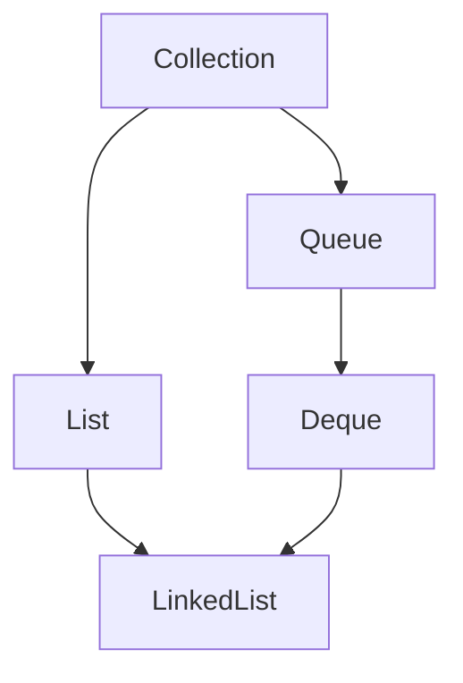

<a id="back-to-top"></a>

# LinkedList

## Menu
- [Danh sách liên kết đôi và chi phí của nút](#linked-list-001)
- [Vai trò đồng thời của List và Deque](#linked-list-002)
- [Chi phí tìm nút theo chỉ số](#linked-list-003)
- [Chèn và xóa tại vị trí đã có ListIterator](#linked-list-004)
- [Vì sao chèn giữa không luôn nhanh hơn ArrayList](#linked-list-005)
- [Thao tác hai đầu và chính sách null](#linked-list-006)
- [So sánh LinkedList với ArrayList và ArrayDeque](#linked-list-007)

## <a id="linked-list-001">Danh sách liên kết đôi và chi phí của nút</a>

<details>
<summary>Xem chi tiết</summary>

# Danh sách liên kết đôi và chi phí của nút trong LinkedList

## 1. LinkedList lưu một chuỗi nút thay vì một mảng phần tử

`LinkedList<E>` của Java là danh sách liên kết đôi (doubly linked list). Mỗi lần xuất hiện trong danh sách được biểu diễn bằng một nút (node). Nút giữ tham chiếu đến phần tử và liên kết với nút trước, nút sau.

Điểm khác biệt quan trọng với danh sách dựa trên mảng là: để thêm hoặc bỏ một nút tại vị trí đã biết, danh sách nối lại một số liên kết quanh vị trí đó. Nó không cần dịch cả đoạn phần tử phía sau sang các ô mảng khác.

Nhưng lợi ích này có giá:

- Muốn đến một vị trí ở giữa, thường phải đi qua các nút.
- Mỗi lần xuất hiện cần một đối tượng nút và các tham chiếu quản lý.
- Đọc qua chuỗi nút có thể phải chạm đến nhiều vùng bộ nhớ khác nhau.
- Thêm/xóa liên tục tạo ra công việc cấp phát và thu gom các nút.

Vì thế, “LinkedList chèn/xóa O(1)” chỉ đúng nếu nói rõ đã xác định được vị trí cần thao tác. Nó không mô tả đầy đủ một lời gọi xóa theo chỉ số hoặc theo giá trị.

Theo [API LinkedList của Java 17](https://docs.oracle.com/en/java/javase/17/docs/api/java.base/java/util/LinkedList.html), lớp này triển khai cả List và Deque. Ta có thể dùng nó như một dãy có chỉ số hoặc như một hàng đợi hai đầu. Hai cách dùng cùng một cấu trúc nhưng dẫn đến những mẫu chi phí rất khác nhau.

Bài dùng Java 17 trở lên. Các ví dụ hoạt động trong một luồng, không có thay đổi cấu trúc từ nơi khác trong lúc iterator đang chạy.

## 2. Mô hình một nút: item, prev và next

### 2.1. Ba tham chiếu có ba vai trò khác nhau

Hình dạng khái niệm của một nút:

```text
Node
  item ----> đối tượng phần tử E
  prev ----> nút đứng trước
  next ----> nút đứng sau
```
Trong triển khai OpenJDK 17, Node là lớp nội bộ riêng của LinkedList, không phải một kiểu nút mà API công khai cho người gọi giữ và thao tác trực tiếp.

Bảng phân biệt:

| Thành phần | Trỏ đến cái gì? | Mục đích |
| --- | --- | --- |
| item | Đối tượng phần tử, hoặc null | Giữ giá trị của lần xuất hiện trong danh sách |
| prev | Một nút khác, hoặc null ở đầu | Cho phép đi lùi và nối lại phía trước |
| next | Một nút khác, hoặc null ở cuối | Cho phép đi tiến và nối lại phía sau |

item không phải bản sao sâu của đối tượng. Nếu phần tử là một đơn hàng, nút giữ tham chiếu đến đơn hàng; toàn bộ dữ liệu đơn hàng không được nhét trực tiếp vào các trường liên kết.

Khi gọi `getFirst()`, `get(i)` hoặc `iterator.next()`, ta nhận **phần tử E**, không nhận Node nội bộ. Giữ một tham chiếu đến phần tử không có nghĩa là có một tham chiếu đến nút chứa nó.

### 2.2. first và last thuộc đối tượng danh sách

Bản thân đối tượng LinkedList giữ tham chiếu đến nút đầu, nút cuối và thông tin kích thước.

```text
                  first                         last
                    |                             |
                    v                             v
null <-prev- [node A] <-prev- [node B] <-prev- [node C]
             [      ] -next-> [      ] -next-> [      ] -next-> null

Mỗi node còn có item riêng trỏ đến A, B hoặc C.
```
Cách đọc gọn hơn:

```text
first -> [A] <-> [B] <-> [C] <- last

[A], [B], [C] là các nút, không phải vị trí bộ nhớ được bảo đảm.
```
Trong mô hình OpenJDK 17, danh sách này không phải vòng tròn và không dùng một nút giả cố định để biểu diễn biên. Một số sách hoặc cấu trúc liên kết khác dùng nút canh (sentinel); không áp nguyên sơ đồ đó vào LinkedList của Java.

Các chi tiết triển khai trong bài được đối chiếu với [mã nguồn LinkedList của OpenJDK 17](https://github.com/openjdk/jdk17u/blob/master/src/java.base/share/classes/java/util/LinkedList.java). API quy định hành vi công khai; hình dạng Node là thông tin triển khai để giải thích cơ chế và chi phí.

### 2.3. Vì sao cần cả prev và next?

next đủ để đi tiến. Thêm prev cho phép:

- Đi lùi từ cuối.
- Biết nút trước khi đã có một nút ở giữa.
- Bỏ một nút đã biết bằng cách nối hai hàng xóm của nó lại.
- Giữ các thao tác ở cả hai đầu không cần đi từ đầu qua toàn chuỗi.

Đổi lại, mỗi nút có thêm một tham chiếu và mỗi lần nối/gỡ phải giữ hai chiều nhất quán. Liên kết đôi là một sự đánh đổi về cấu trúc, không phải một khả năng miễn phí.

## 3. Những quan hệ phải luôn đúng

Một cấu trúc liên kết chỉ hữu ích khi các liên kết của nó nhất quán. Những quan hệ sau giúp đọc hiểu thuật toán và phát hiện lỗi khi tự triển khai một danh sách tương tự.

### 3.1. Danh sách rỗng

```text
size = 0
first = null
last  = null
```
Không có nút phần tử nào trong chuỗi. Một đối tượng LinkedList rỗng vẫn là một đối tượng chứa danh sách; “không có nút” không có nghĩa là không tốn bất kỳ bộ nhớ nào.

### 3.2. Danh sách có đúng một phần tử

```text
first ----+
          v
        [node X]
          ^
last -----+

node X.prev = null
node X.next = null
size = 1
```
first và last phải trỏ cùng một nút. Khi bỏ nút duy nhất, phải cập nhật **cả hai** về null.

Nếu chỉ cập nhật một đầu, cấu trúc có thể vừa báo rỗng theo một đường truy cập, vừa giữ một nút cũ theo đường khác. Đây là lỗi biên thường gặp khi tự viết danh sách liên kết.

### 3.3. Danh sách có nhiều nút

- first.prev bằng null.
- last.next bằng null.
- Nếu x.next là y thì y.prev phải là x.
- Nếu y.prev là x thì x.next phải là y.
- Đi next từ first phải đến đúng số nút bằng size rồi kết thúc.
- Đi prev từ last phải thu được cùng các nút theo thứ tự ngược lại.

LinkedList quản lý các quan hệ này bên trong. Người dùng API không tự sửa prev/next.

Lưu ý: `item == null` khác với `node == null`. LinkedList cho phép một nút có phần tử null; đó vẫn là một lần xuất hiện trong danh sách và vẫn làm size tăng. Không thể dùng “phần tử đầu là null” để khẳng định danh sách rỗng.

## 4. Chèn một nút: đổi một vùng liên kết nhỏ

### 4.1. Chèn X giữa P và Q

Trước:

```text
... <-> P <-> Q <-> ...

P.next = Q
Q.prev = P
```
Sau:

```text
... <-> P <-> X <-> Q <-> ...

X.prev = P
X.next = Q
P.next = X
Q.prev = X
```
Sau khi đã biết các nút liên quan, chỉ cần một số thao tác tạo nút và gán tham chiếu không tăng theo độ dài danh sách.

Không phải “đẩy” mọi nút phía sau Q sang chỗ khác. Vị trí của chúng trong thứ tự List thay đổi, nhưng không có một mảng chỉ số cần dịch vật lý.

Đây cũng giải thích câu trong tài liệu List rằng các phần tử sau điểm chèn có chỉ số tăng một đơn vị: **chỉ số logic thay đổi**, không có nghĩa LinkedList thực hiện sao chép cả đoạn đuôi như danh sách dựa trên mảng.

### 4.2. Thêm đầu

Với một danh sách không rỗng:

1. Tạo nút mới có prev là null và next là first cũ.
2. Cho nút first cũ trỏ prev về nút mới.
3. Cập nhật first.
4. Tăng size.

Nếu danh sách trước đó rỗng, nút mới đồng thời là first và last.

Không cần tìm đầu vì đối tượng danh sách đã giữ first. Số liên kết cần cập nhật là hằng số.

### 4.3. Thêm cuối

Tương tự:

1. Tạo nút mới có prev là last cũ và next là null.
2. Cho last cũ trỏ next đến nút mới.
3. Cập nhật last.
4. Nếu trước đó rỗng, cập nhật cả first.
5. Tăng size.

Đây là cơ chế của việc thêm cuối thông thường. Không có một mảng dự phòng phải mở rộng rồi sao chép tất cả tham chiếu cũ, nhưng **vẫn có một nút mới cần được cấp phát**.

Những bước trên mô tả quan hệ cần có sau thao tác trong một luồng. Không coi chuỗi gán liên kết này là một thao tác nguyên tử an toàn cho nhiều luồng.

## 5. Xóa một nút: nối hai hàng xóm rồi tách nút cũ

Giả sử đã xác định nút X cần bỏ:

```text
Trước: ... <-> P <-> X <-> Q <-> ...
Sau:   ... <-> P <------> Q <-> ...
```
Cần nối P.next với Q và Q.prev với P. Các trường hợp biên:

| X nằm ở đâu? | Việc cập nhật biên |
| --- | --- |
| Ở giữa | Nối hai hàng xóm |
| Là first nhưng còn nút sau | first trở thành nút sau; prev của first mới bằng null |
| Là last nhưng còn nút trước | last trở thành nút trước; next của last mới bằng null |
| Là nút duy nhất | Cả first và last trở thành null |

Sau đó size giảm. Trong OpenJDK 17, các tham chiếu của nút bị gỡ được bỏ phù hợp để tránh giữ dữ liệu và chuỗi nút không cần thiết qua nút đó.

Việc gỡ nút không đồng nghĩa đối tượng phần tử bị hủy ngay:

- Phương thức xóa có thể trả phần tử cho người gọi.
- Đối tượng có thể còn ở một vị trí khác trong cùng danh sách.
- Đối tượng có thể còn được giữ bởi một danh sách khác hoặc biến khác.
- Bộ thu gom rác quyết định thời điểm thu hồi đối tượng không còn được dùng.

Java không có bước `free(node)` mà người dùng LinkedList phải gọi sau mỗi lần xóa. Cần hiểu vòng đời tham chiếu, không viết chương trình phụ thuộc thời điểm thu gom chính xác.

## 6. Đã biết nút khác với đã biết chỉ số hoặc giá trị

### 6.1. Biết chỉ số chưa có nghĩa là biết Node

Với mảng, từ chỉ số có thể xác định ô trực tiếp. Với LinkedList, get(i) phải tìm nút ở vị trí i bằng cách lần theo liên kết.

LinkedList chọn đi từ đầu hoặc từ cuối tùy phía nào gần hơn. Với một chỉ số phần tử hợp lệ:

```text
n = size trước thao tác
0 <= i < n

Số bước qua liên kết để đến i:
d(i) = min(i, n - 1 - i)

Chi phí tìm nút:
O(1 + d(i))
```
Cộng 1 để cả trường hợp first hoặc last vẫn có công việc hằng số.

Ví dụ danh sách có 1.000 phần tử:

- get(0): đã có first.
- get(999): đã có last.
- get(998): đi lùi một liên kết từ last.
- get(500): vẫn phải đi qua hàng trăm liên kết.

Vì vậy, get ở gần hai đầu có thể rẻ, nhưng get ở giữa có chi phí tuyến tính theo n.

### 6.2. Chèn/xóa theo chỉ số phải cộng bước tìm

```text
Chi phí add(i, value)
= tìm vị trí chèn
+ tạo nút
+ cập nhật một số liên kết.

Chi phí remove(i)
= tìm nút ở i
+ gỡ một số liên kết.
```
`add(size(), value)` là trường hợp cuối, có thể dùng last trực tiếp. Chèn trước một phần tử ở giữa vẫn phải tìm nút đó trước.

Một lệnh remove(i) không trở thành O(1) chỉ vì phần gỡ nút sau khi tìm là O(1).

### 6.3. Xóa theo giá trị còn phải tìm bằng quan hệ bằng nhau

`remove(value)` tìm lần xuất hiện đầu tiên theo quan hệ bằng nhau rồi mới gỡ nút. Nếu giá trị không có hoặc ở xa đầu, có thể phải xét cả danh sách.

Khi coi mỗi phép so sánh là hằng số, trường hợp xấu nhất là O(n). Nếu equals đọc một cấu trúc lớn, phải cộng chi phí so sánh đó. Liên kết đôi không tạo ra bảng tra cứu theo giá trị.

Với LinkedList<Integer>, còn phải phân biệt hai overload:

```java
// Đoạn minh họa; hai danh sách bắt đầu từ dữ liệu giống nhau.
LinkedList<Integer> byIndex = new LinkedList<>(List.of(10, 20, 10));
byIndex.remove(1);                   // Xóa chỉ số 1: [10, 10].

LinkedList<Integer> byValue = new LinkedList<>(List.of(10, 20, 10));
byValue.remove(Integer.valueOf(10)); // Xóa giá trị đầu tiên bằng 10: [20, 10].
```
Phân biệt đúng yêu cầu xóa trước, rồi mới phân tích số liên kết phải đi qua.

### 6.4. Bảng chi phí cần gắn điều kiện

Bảng xét mô hình thao tác cấu trúc thông thường của LinkedList, chưa tính công việc nghiệp vụ và tạm coi so sánh bằng nhau là hằng số.

| Thao tác | Chi phí | Lý do |
| --- | --- | --- |
| size(), isEmpty() | O(1) | Có thông tin kích thước được lưu |
| getFirst(), getLast(), peekFirst(), peekLast() | O(1) | Có first/last |
| addFirst(), addLast(), add(E) | O(1) về thao tác cấu trúc | Tạo một nút và nối ở đầu đã biết |
| removeFirst(), removeLast(), pollFirst(), pollLast() | O(1) | Gỡ nút ở đầu đã biết |
| get(i), set(i, value), remove(i) | O(1 + min(i, n - 1 - i)) | Phải đến nút ở i |
| add(i, value), với i < n | Chi phí tìm nút ở i cộng O(1) | Không bỏ qua bước định vị |
| add(n, value) | O(1) về thao tác cấu trúc | Thêm sau last |
| contains(value), remove(value) | O(n) ở trường hợp xấu nhất | Tìm tuyến tính |
| Duyệt toàn bộ bằng iterator | O(n) | Mỗi bước đi tiếp từ vị trí hiện tại |
| clear() trong OpenJDK 17 | O(n) với danh sách không rỗng | Đi qua các nút để bỏ tham chiếu |

Ký hiệu O(1) về thao tác cấu trúc không phải cam kết về độ trễ tối đa tính bằng nano giây. Cấp phát, thu gom rác, lịch chạy và hệ thống bộ nhớ vẫn ảnh hưởng thời gian thực tế.

## 7. Chi phí của nút gồm những gì?

### 7.1. Không chỉ có item

Một lần xuất hiện của phần tử cần chỗ cho:

1. Tham chiếu item.
2. Tham chiếu prev.
3. Tham chiếu next.
4. Phần thông tin quản lý đối tượng của JVM.
5. Phần đệm để đáp ứng căn chỉnh bộ nhớ nếu có.

Ngoài các nút, đối tượng LinkedList còn có trạng thái đối tượng danh sách. Còn bản thân đối tượng phần tử có thể chiếm một lượng bộ nhớ khác.

Không cộng ba tham chiếu rồi gọi đó là kích thước đầy đủ của Node. Cũng không lấy một con số đo trên một JVM rồi xem là hằng số của ngôn ngữ Java.

### 7.2. Mô hình tách cấu trúc khỏi dữ liệu phần tử

Một cách ước lượng khái niệm:

```text
Bộ nhớ cấu trúc LinkedList
xấp xỉ
bộ nhớ container
+ n * bộ nhớ mỗi Node.

Bộ nhớ mỗi Node
bao gồm ba trường tham chiếu, phần quản lý đối tượng và căn chỉnh.

Bộ nhớ toàn đồ thị đang xét
còn có thể bao gồm các đối tượng phần tử và những gì chúng tham chiếu.
```
Ở đây n là số lần xuất hiện, không phải số đối tượng phần tử khác nhau.

Nếu thêm cùng một đối tượng 1.000 lần vào LinkedList theo triển khai OpenJDK 17, ta có 1.000 nút chứa tham chiếu đến cùng đối tượng đó. Nó không nhân bản đối tượng thành 1.000 bản sâu, nhưng cũng không gộp 1.000 nút thành một nút.

Nếu thêm null nhiều lần, mỗi lần vẫn có nút riêng. item bằng null không loại bỏ chỗ cần cho prev, next và thông tin quản lý nút.

### 7.3. Đếm trường tham chiếu khác với đếm byte

Với n nút, có 3n trường tham chiếu trong các nút. Hai liên kết biên chứa null khi danh sách không rỗng, nhưng trường giữ null vẫn chiếm chỗ trong biểu diễn của nút.

Số byte phụ thuộc vào JVM và cấu hình, chẳng hạn cách biểu diễn tham chiếu, tiêu đề đối tượng và căn chỉnh. Nếu cần con số cho một môi trường cụ thể, phải đo trong môi trường đó và ghi lại điều kiện đo.

[JOL của OpenJDK](https://github.com/openjdk/jol) là công cụ khảo sát bố trí đối tượng. Khi dùng kết quả của công cụ, cần phân biệt:

- Kích thước nông của một đối tượng (shallow size).
- Các đối tượng có thể đi tới qua tham chiếu trong một đồ thị.
- Phần dữ liệu được dùng chung với các đối tượng danh sách khác.
- Bộ nhớ thực sự bị giữ lại độc quyền theo một phân tích vòng đời cụ thể.

Không cộng toàn bộ đồ thị phần tử hai lần chỉ vì hai danh sách cùng trỏ đến những đối tượng đó.

### 7.4. “Không có capacity dự phòng” không đồng nghĩa “luôn tiết kiệm hơn”

Danh sách dựa trên mảng thường có một vùng ô tham chiếu, có thể có chỗ dự phòng. LinkedList không cần một mảng capacity kiểu đó, nhưng trả chi phí cho từng đối tượng Node.

Với dữ liệu phần tử nhỏ hoặc dùng chung nhiều, chi phí nút có thể chiếm tỷ trọng đáng kể. Với dữ liệu phần tử rất lớn, chi phí nút có thể nhỏ hơn khi nhìn theo tỷ lệ, nhưng nó vẫn tồn tại.

Không khẳng định một tỷ lệ bộ nhớ cố định giữa LinkedList và ArrayList. Capacity đã dành trước của ArrayList, cách JVM biểu diễn nút và đồ thị phần tử đều ảnh hưởng phép so sánh.

## 8. Cấp phát, thu gom rác và tính cục bộ bộ nhớ

### 8.1. Kích thước đang giữ khác với số nút đã tạo

Giả sử ứng dụng liên tục thêm một phần tử rồi lấy nó ra. size có thể hiếm khi lớn hơn 1, nhưng sau một triệu vòng đã có rất nhiều lần tạo và bỏ nút theo cách triển khai LinkedList.

Điều này phân biệt:

- **Bộ nhớ đang được giữ tại một thời điểm:** phụ thuộc số nút còn nằm trong cấu trúc và các tham chiếu còn sống.
- **Lưu lượng cấp phát theo thời gian:** phụ thuộc số lần tạo nút.
- **Công việc thu gom:** phụ thuộc JVM, tuổi thọ đối tượng, tải và cấu hình.

Tạo một nút nhỏ có thể được JVM thực hiện nhanh. Tuy vậy, “nhỏ” không có nghĩa miễn phí; một tải thêm/xóa lớn có thể khiến cấp phát và thu gom trở thành một phần đáng kể của hiệu năng.

`set(i, value)` thay phần tử tại nút đã tìm, không cần tạo một nút danh sách mới chỉ để thay item. Nếu đối số value được tạo bằng new ở phía người gọi, chi phí tạo đối tượng đó là một công việc riêng.

### 8.2. Đi theo liên kết có thể gây nhiều lần chờ dữ liệu

Các Node là những đối tượng riêng. API không hứa chúng nằm cạnh nhau trong bộ nhớ. Muốn đi tiếp, chương trình đọc next hoặc prev rồi mới biết nút kế tiếp.

Nếu dữ liệu của nút kế chưa ở bộ nhớ đệm CPU, lượt duyệt có thể phải chờ. Một danh sách dựa trên mảng có lợi thế là dãy ô tham chiếu của nó thường ở gần nhau trong cùng vùng dữ liệu mảng.

Đó là một lý do cần thận trọng trước câu “cùng O(n) nên tốc độ duyệt giống nhau”. Big O không mô tả hết số đối tượng, số lần gián tiếp qua tham chiếu và cách dữ liệu đi qua các tầng bộ nhớ.

Cũng không đảo thành một khẳng định tuyệt đối rằng mọi nút LinkedList luôn xa nhau hoặc LinkedList luôn chậm hơn. Bố trí thực tế, công việc trên phần tử và JVM đều cần được xem xét.

### 8.3. clear không chỉ bỏ hai đầu

Trong OpenJDK 17, clear đi qua các nút và bỏ item/next/prev trước khi đặt lại first, last và size. Vì vậy, clear của LinkedList không được phân tích như chỉ có hai phép gán first = last = null.

Việc bỏ các liên kết giúp tránh giữ một chuỗi dữ liệu không cần thiết qua tham chiếu cũ tới một nút, và phục vụ quản lý bộ nhớ của triển khai. Thời điểm bộ nhớ thật được thu hồi vẫn do GC quyết định.

Không gọi System.gc() rồi lấy thay đổi bộ nhớ của một lần chạy làm kích thước chuẩn của một Node. Số đo toàn tiến trình bị ảnh hưởng bởi nhiều đối tượng và quyết định của JVM.

## 9. Ví dụ chạy được: hai đầu, duyệt ngược và trạng thái biên

Lưu chương trình vào `LinkedListEndsDemo.java`:

```java
import java.util.ArrayList;
import java.util.Deque;
import java.util.Iterator;
import java.util.LinkedList;
import java.util.List;
import java.util.NoSuchElementException;

public class LinkedListEndsDemo {
    public static void main(String[] args) {
        Deque<String> items = new LinkedList<>();
        System.out.println("initially empty = " + items.isEmpty());

        items.addLast("B");
        items.addFirst("A");
        items.addLast("C");
        System.out.println("forward = " + items);
        System.out.println("first = " + items.getFirst());
        System.out.println("last = " + items.getLast());

        List<String> reversed = new ArrayList<>();
        for (Iterator<String> it = items.descendingIterator(); it.hasNext();) {
            reversed.add(it.next());
        }
        System.out.println("reverse traversal = " + reversed);

        System.out.println("removed first = " + items.removeFirst());
        System.out.println("removed last = " + items.removeLast());
        System.out.println("one item remains = " + items);
        System.out.println("removed only item = " + items.removeLast());
        System.out.println("empty again = " + items.isEmpty());
        System.out.println("pollFirst on empty = " + items.pollFirst());

        try {
            items.removeFirst();
        } catch (NoSuchElementException ex) {
            System.out.println("removeFirst on empty = "
                    + ex.getClass().getSimpleName());
        }
    }
}
```
Biên dịch và chạy:

```shell
javac --release 17 LinkedListEndsDemo.java
java LinkedListEndsDemo
```
Kết quả:

```text
initially empty = true
forward = [A, B, C]
first = A
last = C
reverse traversal = [C, B, A]
removed first = A
removed last = C
one item remains = [B]
removed only item = B
empty again = true
pollFirst on empty = null
removeFirst on empty = NoSuchElementException
```
Giải thích theo cấu trúc:

- Thêm B vào danh sách rỗng tạo một nút vừa là đầu vừa là cuối.
- Thêm A ở đầu và C ở cuối tạo chuỗi A ↔ B ↔ C.
- descendingIterator đi theo thứ tự ngược, trả C, B, A.
- Sau khi bỏ A và C, còn một nút B nên hai đầu cùng chỉ đến nút đó.
- Bỏ B đưa cả hai đầu về trạng thái rỗng.
- pollFirst trả null khi rỗng; removeFirst ném NoSuchElementException khi rỗng.

Theo [hợp đồng Deque của Java 17](https://docs.oracle.com/en/java/javase/17/docs/api/java.base/java/util/Deque.html), các cặp phương thức thường có cách báo không có phần tử khác nhau. Chọn cách báo phù hợp với luồng xử lý, không coi poll và remove là cùng một hợp đồng lỗi.

LinkedList còn cho phép lưu null. Nếu cho null vào, poll trả null có thể là phần tử vừa lấy ra thay vì dấu hiệu rằng trước đó rỗng. Với một hàng đợi cần dùng null làm tín hiệu kết thúc, hãy đặt chính sách không chứa null hoặc chọn cách quản lý trạng thái phù hợp. Không viết vòng xử lý dựa trên tín hiệu mơ hồ.

Biến được khai báo là Deque vì ví dụ chỉ cần thao tác hai đầu. Cách khai báo này thể hiện nhu cầu của mã gọi; cấu trúc thực tế vẫn là LinkedList.

## 10. Iterator giữ vị trí giúp tránh tìm lại nút

### 10.1. Iterator biết vị trí hiện tại trong chuỗi

Một iterator của LinkedList giữ trạng thái đủ để đi sang nút kế và làm việc với phần tử vừa trả về. Nó không phải gọi get(i) từ đầu cho mỗi lượt.

Khi đang đứng đúng vị trí, việc iterator.remove gỡ nút vừa trả về chỉ cần nối lại hàng xóm. ListIterator.add chèn tại con trỏ hiện tại cũng không cần bắt đầu một cuộc tìm chỉ số mới.

Đây là một trường hợp có thể tận dụng cơ chế liên kết:

```text
Tìm/đi đến vị trí một lần
-> đọc tuần tự các nút
-> sửa gần vị trí con trỏ
-> tiếp tục đi.
```
Ngược lại, tạo listIterator(i) ở một vị trí giữa vẫn cần tìm đến vị trí đó lúc khởi tạo. Tạo lại iterator ở giữa trong mỗi lượt có thể làm mất lợi ích giữ vị trí.

### 10.2. Chương trình chỉnh sửa trong một lượt

Lưu vào `LinkedListCursorEditDemo.java`:

```java
import java.util.LinkedList;
import java.util.List;
import java.util.ListIterator;

public class LinkedListCursorEditDemo {
    public static void main(String[] args) {
        LinkedList<Integer> values = new LinkedList<>(
                List.of(10, -1, 20, -2, 30));
        int visited = 0;
        int removed = 0;
        int inserted = 0;

        for (ListIterator<Integer> it = values.listIterator(); it.hasNext();) {
            int value = it.next();
            visited++;

            if (value < 0) {
                it.remove();
                removed++;
            } else if (value == 20) {
                it.add(21);
                inserted++;
            }
        }

        System.out.println("result = " + values);
        System.out.println("visited original values = " + visited);
        System.out.println("removed nodes = " + removed);
        System.out.println("inserted nodes = " + inserted);
    }
}
```
Biên dịch và chạy:

```shell
javac --release 17 LinkedListCursorEditDemo.java
java LinkedListCursorEditDemo
```
Kết quả:

```text
result = [10, 20, 21, 30]
visited original values = 5
removed nodes = 2
inserted nodes = 1
```
Chương trình đọc năm phần tử ban đầu:

- Nút chứa -1 và -2 bị gỡ bằng iterator.remove.
- Khi gặp 20, một nút mới chứa 21 được chèn tại vị trí con trỏ.
- Phần tử mới được chèn nằm phía sau phần tử vừa đọc và trước phần tử sẽ được đọc tiếp. Theo quy tắc ListIterator.add, lần next tiếp theo vẫn trả phần tử vốn đứng kế tiếp, nên 21 không được đếm lại là một phần tử ban đầu đã duyệt.

Với một lượt đi tuần tự, điều kiện hằng số và mỗi phần tử chỉ gây số thao tác nút bị chặn bởi hằng số, tổng công việc cấu trúc là tuyến tính theo số phần tử ban đầu, cộng số nút được chèn.

Các bộ đếm trong chương trình là bộ đếm hành vi của thuật toán, không phải bộ đếm byte hoặc GC. Việc in cả danh sách ở cuối cũng có chi phí duyệt, không nên đặt vào một phép đo chỉ muốn so sánh riêng một thao tác nối nút.

### 10.3. Quy tắc sửa khi duyệt vẫn phải được giữ

- remove cần một phần tử vừa được next hoặc previous trả về và chưa bị xóa lại.
- add/remove qua chính iterator phải tuân theo trạng thái của iterator.
- Không tự gọi các thao tác sửa cấu trúc khác trên danh sách rồi mặc định iterator cũ vẫn hợp lệ.
- Fail-fast giúp phát hiện một số thay đổi không hợp lệ ở mức best effort; không phải cơ chế đồng bộ.

Giữ một iterator không có nghĩa là có một tham chiếu nút công khai ổn định để dùng tùy ý sau mọi thay đổi. Không thiết kế thuật toán giả định Java LinkedList cho phép trực tiếp truyền Node vào một phương thức public để xóa.

## 11. Ví dụ chạy được: nút riêng, phần tử dùng chung

Lưu vào `LinkedListPayloadSharingDemo.java`:

```java
import java.util.LinkedList;
import java.util.List;

public class LinkedListPayloadSharingDemo {
    static final class Task {
        String title;

        Task(String title) {
            this.title = title;
        }

        @Override
        public String toString() {
            return title;
        }
    }

    public static void main(String[] args) {
        Task shared = new Task("draft");
        LinkedList<Task> original = new LinkedList<>(List.of(shared, shared));
        LinkedList<Task> copy = new LinkedList<>(original);

        System.out.println("original size = " + original.size());
        System.out.println("same payload at two positions = "
                + (original.getFirst() == original.getLast()));

        original.removeFirst();
        System.out.println("original size after removal = " + original.size());
        System.out.println("copy size after original removal = " + copy.size());
        System.out.println("same payload across containers = "
                + (original.getFirst() == copy.getFirst()));

        shared.title = "approved";
        System.out.println("original values = " + original);
        System.out.println("copy values = " + copy);

        copy.clear();
        System.out.println("copy empty = " + copy.isEmpty());
        System.out.println("original size after copy.clear = " + original.size());
    }
}
```
Biên dịch và chạy:

```shell
javac --release 17 LinkedListPayloadSharingDemo.java
java LinkedListPayloadSharingDemo
```
Kết quả:

```text
original size = 2
same payload at two positions = true
original size after removal = 1
copy size after original removal = 2
same payload across containers = true
original values = [approved]
copy values = [approved, approved]
copy empty = true
original size after copy.clear = 1
```
Đọc kết quả theo hai tầng:

1. **Tầng cấu trúc:** xóa ở original không làm size của copy giảm. clear của copy không xóa lần xuất hiện còn lại trong original.
2. **Tầng phần tử:** các lần xuất hiện giữ tham chiếu đến cùng Task, nên thay title của Task được nhìn thấy khi duyệt cả hai danh sách.

Trong OpenJDK 17, tạo LinkedList mới từ collection dựng chuỗi nút mới cho các phần tử lấy từ collection nguồn. Nó không tái sử dụng một chuỗi Node như cấu trúc chung giữa hai danh sách.

Nhưng các đối tượng Task không tự được sao chép sâu. Ban đầu original có hai nút, copy có hai nút, trong khi cả bốn item đều có thể trỏ đến cùng một Task.

Sau khi original.removeFirst, một nút không còn nằm trong original. Điều này không xóa Task vì các nút khác và biến shared vẫn giữ tham chiếu đến nó.

Chương trình không quan sát trực tiếp Node nội bộ và không đo bộ nhớ. Nó kiểm chứng hành vi độc lập của hai đối tượng danh sách và hành vi dùng chung phần tử. Cách triển khai nút mới được giải thích từ cấu trúc của OpenJDK 17, không suy ra địa chỉ nút từ output.

Một hệ quả thiết kế: nếu tự tạo một lớp phần tử có trường prev/next rồi đưa nó vào java.util.LinkedList, LinkedList không tự dùng hai trường đó làm liên kết nội bộ. Nó vẫn bọc phần tử trong Node của nó. Cấu trúc “phần tử tự mang liên kết” là một thiết kế khác và không phải hợp đồng của Java LinkedList.

## 12. Dùng mô hình nút để đánh giá lựa chọn cấu trúc

### 12.1. Những mẫu có thể tận dụng liên kết đôi

- Làm việc ở đầu/cuối mà không cần truy cập chỉ số ngẫu nhiên.
- Đi tuần tự và chỉnh sửa tại vị trí con trỏ đã có.
- Cần hiểu rõ thao tác thêm/gỡ không phải dịch một dãy ô mảng.

Nhưng mỗi mẫu vẫn phải chịu chi phí nút, cấp phát và truy cập bộ nhớ. Cần so với tổng yêu cầu, không chỉ một phép nối liên kết.

### 12.2. Những mẫu dễ dùng sai

| Mẫu mã | Vấn đề cần xem |
| --- | --- |
| for i từ 0 đến size - 1 rồi get(i) | Mỗi lượt có thể tìm lại nút; tổng có thể bậc hai |
| remove(i) ở giữa liên tục | Phần gỡ rẻ nhưng phần tìm lại vị trí có thể đắt |
| remove(value) rất nhiều lần | Tìm theo giá trị vẫn tuyến tính trong trường hợp xấu |
| Thêm/xóa liên tục với size nhỏ | Bộ nhớ đang giữ nhỏ nhưng lưu lượng cấp phát nút có thể lớn |
| Thêm nhiều lần cùng một đối tượng | Không nhân bản phần tử, nhưng vẫn tạo nhiều nút |
| Chọn LinkedList chỉ vì “không có ô dự phòng” | Đã bỏ qua tiêu đề đối tượng và các liên kết trên từng nút |
| Dùng LinkedList giữa nhiều luồng mà không có thiết kế đồng bộ | Liên kết đôi không tạo an toàn luồng |

Nếu chỉ cần một Deque thông thường và không cần null, có thể cân nhắc [ArrayDeque Java 17](https://docs.oracle.com/en/java/javase/17/docs/api/java.base/java/util/ArrayDeque.html), vốn dùng cấu trúc mảng và không có một Node liên kết riêng cho từng lần xuất hiện. Đây là một lựa chọn cần đánh giá theo tác vụ; không suy thành tỷ lệ tốc độ cố định hoặc tính tương thích hoàn toàn với các hành vi của LinkedList.

Nếu phần lớn công việc là đọc theo chỉ số hoặc duyệt ổn định, cũng cần xem xét một danh sách dựa trên mảng. Trước khi đổi cấu trúc, hãy ghi rõ yêu cầu về thứ tự, null, phần tử trùng, sửa tại con trỏ và mô hình luồng.

### 12.3. Đánh giá bằng số bước và bằng số đo đúng mục tiêu

Phân tích số bước trả lời “chi phí tăng như thế nào khi n tăng”. Đo hiệu năng trả lời “trên môi trường này, tác vụ này chạy ra sao”.

Để đánh giá chi phí nút thực tế, có thể cần:

- Đo bộ nhớ của cấu trúc với cùng tập đối tượng phần tử, tránh nhân đôi dữ liệu một cách không chủ ý.
- Đo lưu lượng cấp phát khi thêm/xóa, bên cạnh bộ nhớ còn giữ.
- Tách việc tạo phần tử nghiệp vụ khỏi việc thêm nút nếu mục tiêu chỉ là đo cấu trúc.
- Kiểm tra một lượt duyệt và mẫu sửa thực sự của ứng dụng.
- Ghi phiên bản JVM, tùy chọn quan trọng, kích thước dữ liệu và điều kiện đo.

Không suy từ một ví dụ nhỏ in ra kết quả đúng rằng chi phí cấp phát hoặc cache đã được đo. Các chương trình trong bài là minh chứng chức năng và mô hình tham chiếu.

## 13. Các lỗi phổ biến khi giải thích LinkedList

| Nhận định sai | Điều cần sửa |
| --- | --- |
| “Mỗi nút chứa nguyên đối tượng phần tử bên trong” | Node giữ tham chiếu item; đối tượng phần tử là một tầng khác |
| “Danh sách liên kết đôi là hai danh sách riêng” | Một chuỗi nút có liên kết theo hai hướng |
| “Có prev nên get(i) là O(1)” | Chỉ giúp bắt đầu từ phía gần hơn; vẫn phải đi qua liên kết |
| “Biết giá trị phần tử là biết nút” | Cùng một đối tượng có thể xuất hiện nhiều lần; API trả phần tử chứ không trả Node |
| “Xóa ở giữa luôn O(1)” | Chỉ phần gỡ tại nút đã xác định là hằng số |
| “Chỉ số sau điểm xóa giảm thì phải dịch mọi nút” | Chỉ số là vị trí logic; cấu trúc chỉ nối lại liên kết |
| “Không có capacity nên luôn ít bộ nhớ hơn” | Có chi phí đối tượng và ba tham chiếu cho từng nút |
| “Bỏ nút là phần tử bị hủy ngay” | Phần tử có thể còn tham chiếu; GC quyết định thu hồi |
| “clear chỉ cần bỏ first/last nên luôn O(1)” | OpenJDK 17 đi qua chuỗi để bỏ tham chiếu trong các nút |
| “Một Node luôn tốn đúng X byte trên mọi JVM” | Cách biểu diễn tham chiếu, tiêu đề và căn chỉnh phụ thuộc môi trường |
| “Iterator giữ nút nên không cần tuân theo quy tắc sửa” | Iterator có trạng thái và hợp đồng sửa riêng |
| “LinkedList là cấu trúc sẵn sàng cho nhiều luồng” | Lớp không tự đồng bộ; cần thiết kế truy cập phù hợp |

## 14. Thực hành với liên kết, chi phí và vòng đời

### Bài 1: Chèn giữa có cần cập nhật phần tử xa không?

Có chuỗi A ↔ B ↔ C ↔ D. Chèn X giữa B và C, giả sử đã có vị trí.

Các quan hệ mới là B.next = X, X.prev = B, X.next = C, C.prev = X. Không cần cập nhật liên kết của A và D chỉ để chèn tại vị trí này. Size tăng một.

Các vị trí logic của C và D tăng một, nhưng không có trường chỉ số trong từng Node cần tăng theo.

### Bài 2: Bỏ nút duy nhất

Danh sách chỉ có X, first và last cùng trỏ X. Bỏ X phải đưa first và last về null và size về 0. Bỏ sót một đầu là sai dù một số thao tác kiểm tra khác có thể chưa bộc lộ lỗi ngay.

### Bài 3: Ba tham chiếu trên mỗi nút

Danh sách có năm nút, mọi item khác null. Có bao nhiêu trường tham chiếu trong các nút, và bao nhiêu liên kết prev/next khác null?

Có 15 trường tham chiếu trong năm nút. Các liên kết prev/next khác null là 2 * (5 - 1) = 8; hai trường liên kết biên chứa null. Ngoài ra có năm item khác null. Không dùng số 15 để suy ra ngay một số byte nếu chưa biết biểu diễn JVM.

### Bài 4: Cùng đối tượng xuất hiện 100 lần

Theo mô hình OpenJDK 17, có 100 nút và 100 trường item trỏ đến cùng đối tượng. Không có 100 bản sao sâu của phần tử.

Xóa một lần xuất hiện chỉ bỏ một nút. Đối tượng vẫn có thể được giữ bởi 99 lần xuất hiện còn lại và các tham chiếu khác.

### Bài 5: Xóa theo chỉ số giữa một danh sách lớn

Vì sao remove(500_000) trên danh sách một triệu phần tử không được gọi đơn giản là O(1)?

Vì cần tìm nút ở chỉ số đó bằng cách đi qua các liên kết trước. Phần nối lại hàng xóm chỉ là bước sau khi đã đến nơi.

### Bài 6: Bộ nhớ nhỏ tại một thời điểm, cấp phát lớn theo thời gian

Một vòng lặp luôn addLast rồi removeFirst, không giữ lại phần tử, có thể chỉ giữ rất ít nút cùng lúc. Tuy vậy, nhiều vòng vẫn tạo nhiều nút theo thời gian. Hai phép đo “bộ nhớ đang giữ” và “tốc độ cấp phát” trả lời hai câu hỏi khác nhau.

### Bài 7: Nhận diện một tổng bậc hai

Nếu duyệt bằng get(i) từ 0 đến n - 1 trên LinkedList, mỗi lần bắt đầu định vị từ một đầu. Tổng số liên kết phải đi qua có thể Θ(n²). Dùng iterator giữ vị trí để đi một lượt giúp tránh tìm lại vị trí cho từng phần tử.

### Bài 8: Node và phần tử có cùng vòng đời không?

Không bắt buộc. Một nút bị gỡ có thể không còn được danh sách giữ, trong khi phần tử được trả về vẫn nằm trong một biến của người gọi. Ngược lại, nhiều nút của các danh sách khác nhau có thể cùng trỏ đến một phần tử.

Khi phân tích LinkedList, hãy tách **tìm vị trí → nối/gỡ liên kết → tạo/bỏ nút → vòng đời phần tử**. Bốn phần này giải thích vì sao liên kết đôi thuận lợi ở một số mẫu thao tác nhưng vẫn có chi phí thời gian và bộ nhớ mà một câu “chèn/xóa nhanh” không thể hiện đủ.


</details>

- [Quay lại đầu trang](#back-to-top)

---

## <a id="linked-list-002">Vai trò đồng thời của List và Deque</a>

<details>
<summary>Xem chi tiết</summary>

# Vai trò đồng thời của List và Deque trong LinkedList

## 1. Một đối tượng, hai cách mô tả thao tác

`LinkedList<E>` vừa triển khai `List<E>`, vừa triển khai `Deque<E>`. Nó có thể được dùng như một danh sách có thứ tự và chỉ số, đồng thời có thể được dùng như một hàng đợi hai đầu.

Hai vai trò này nói về các **giao diện thao tác trên cùng dữ liệu**, không có nghĩa đối tượng tự tạo hai bản sao hoặc tự bảo đảm an toàn cho nhiều luồng.

- `List` tập trung vào dãy phần tử: vị trí, thêm/chèn, thay thế, tìm kiếm và duyệt theo thứ tự.
- `Deque` tập trung vào hai đầu: thêm, đọc, lấy ra ở đầu trước hoặc đầu sau.
- `Deque` kế thừa `Queue`, nên một LinkedList cũng dùng được qua các thao tác hàng đợi.

Trong Java 17, quan hệ cần nhớ là:



Các mũi tên đi từ giao diện tổng quát đến giao diện/lớp cụ thể hơn. Sơ đồ chỉ thể hiện các quan hệ cần cho bài, không liệt kê toàn bộ cây kế thừa.

`Deque` đọc là “deck”, viết tắt của double-ended queue, tức hàng đợi hai đầu. Nó không phải “dequeue” theo nghĩa một thao tác lấy phần tử ra.

Các chương trình trong bài dùng API có trong Java 17. Từ Java 21, `List` còn có thêm thao tác đầu/cuối qua `SequencedCollection`; điều đó không biến mọi List thành Deque. Các thao tác chỉ số và nhóm `offer/poll/peek/push/pop` vẫn cần được hiểu theo giao diện tương ứng. [LinkedList Java 17](https://docs.oracle.com/en/java/javase/17/docs/api/java.base/java/util/LinkedList.html), [List Java 21](https://docs.oracle.com/en/java/javase/21/docs/api/java.base/java/util/List.html).

## 2. Vì sao cấu trúc LinkedList hỗ trợ được cả hai vai trò?

LinkedList là danh sách liên kết đôi. Mỗi nút giữ phần tử cùng liên kết tới nút trước và nút sau; cấu trúc giữ thông tin về hai đầu.

Hình dung dãy `[A, B, C]`:

```text
đầu trước (head)                         đầu sau (tail)
       |                                      |
       v                                      v
      [A] <------------> [B] <------------> [C]
       0                 1                  2
```

Trong cách nhìn của List, ta gọi chúng là phần tử tại chỉ số 0, 1, 2. Trong cách nhìn của Deque, A ở đầu trước và C ở đầu sau.

Thêm một phần tử ở đầu bằng Deque làm các vị trí List thay đổi tương ứng:

```text
Trước addFirst(X): [A, B, C]
Sau addFirst(X):   [X, A, B, C]

Chỉ số của A: từ 0 thành 1
Chỉ số của C: từ 2 thành 3
```

Không có bước “đồng bộ hai danh sách”; chỉ một dãy nút đã thay đổi. Chỉ số là vị trí hiện tại trong dãy, không phải một nhãn cố định gắn với nút.

Liên kết đôi giúp tới hai đầu trực tiếp, nhưng không tạo ra truy cập ngẫu nhiên theo chỉ số như mảng. Muốn tới một chỉ số ở giữa, LinkedList phải đi theo liên kết từ đầu gần hơn. [Cơ chế truy cập theo chỉ số của LinkedList](https://docs.oracle.com/en/java/javase/17/docs/api/java.base/java/util/LinkedList.html).

## 3. Dùng LinkedList trong vai trò List

Đoạn minh họa bên trong một phương thức, cần import `java.util.List` và `java.util.LinkedList`:

```java
List<String> names = new LinkedList<>();

names.add("An");
names.add("Chi");
names.add(1, "Binh");
names.set(2, "Chau");

// names = [An, Binh, Chau]
// names.get(1) trả Binh.
```

Các đặc điểm List vẫn được giữ:

- Có thứ tự phần tử và vị trí tính từ 0.
- Cho phép phần tử trùng nhau.
- LinkedList cho phép phần tử `null`.
- `get(i)`, `set(i, value)`, `remove(i)` làm việc với vị trí.
- `add(i, value)` chèn trước phần tử hiện tại ở vị trí đó, hoặc chèn cuối nếu `i == size()`.
- Iterator thông thường duyệt theo thứ tự từ đầu tới cuối.

Kiểu biến `List<String>` diễn đạt rằng đoạn mã cần hợp đồng danh sách. Nó không biến LinkedList thành mảng; chi phí truy cập vẫn do đối tượng LinkedList thực hiện.

Đặc biệt, tránh mặc định rằng vòng lặp sau có chi phí tuyến tính trên LinkedList:

```java
for (int i = 0; i < names.size(); i++) {
    System.out.println(names.get(i));
}
```

Đây là đoạn minh họa. Mỗi `get(i)` có thể lại phải đi qua các nút, khiến tổng chi phí có thể là `O(n²)`. Nếu chỉ cần lần lượt xử lý phần tử, duyệt bằng for-each hoặc iterator thường phù hợp hơn.

## 4. Dùng cùng cấu trúc trong vai trò Deque

Deque cho phép chọn rõ đầu thao tác:

| Mục tiêu | Đầu trước, báo lỗi khi không thực hiện được | Đầu trước, trả giá trị đặc biệt | Đầu sau, báo lỗi khi không thực hiện được | Đầu sau, trả giá trị đặc biệt |
|---|---|---|---|---|
| Thêm | `addFirst(e)` | `offerFirst(e)` | `addLast(e)` | `offerLast(e)` |
| Lấy ra và xóa | `removeFirst()` | `pollFirst()` | `removeLast()` | `pollLast()` |
| Đọc, không xóa | `getFirst()` | `peekFirst()` | `getLast()` | `peekLast()` |

Khi rỗng:

- `removeFirst/removeLast/getFirst/getLast` ném `NoSuchElementException`.
- `pollFirst/pollLast/peekFirst/peekLast` trả `null`.

Với thao tác thêm, nhóm `offer` có kiểu kết quả boolean; sự khác nhau với nhóm `add` hữu ích đặc biệt ở triển khai Deque có giới hạn số phần tử. LinkedList không đặt một capacity tối đa cố định như một hàng đợi bị chặn dung lượng. Không suy từ đây rằng mọi triển khai Deque có cùng chính sách thêm hoặc đều cho `null`.

Phân biệt đọc và lấy ra:

```java
Deque<String> tasks = new LinkedList<>();
tasks.addLast("A");
tasks.addLast("B");

String first = tasks.peekFirst(); // A; tasks vẫn [A, B].
String taken = tasks.pollFirst(); // A; tasks thành [B].
```

Đoạn trên minh họa trong phương thức, cần import `java.util.Deque` và `java.util.LinkedList`.

Deque không cung cấp truy cập theo chỉ số. Nếu một biến được khai báo `Deque<String>`, không gọi `get(1)` hoặc `add(1, value)` qua biến đó, dù đối tượng thực tế là LinkedList. [Giao diện Deque](https://docs.oracle.com/en/java/javase/17/docs/api/java.base/java/util/Deque.html).

## 5. FIFO và LIFO là cách chọn đầu thêm/lấy

### 5.1. Dùng như hàng đợi FIFO

FIFO nghĩa là vào trước, ra trước. Trên LinkedList dùng theo hợp đồng Deque, thêm ở cuối và lấy ở đầu:

```text
offerLast(A): [A]
offerLast(B): [A, B]
offerLast(C): [A, B, C]

pollFirst(): trả A; còn [B, C]
pollFirst(): trả B; còn [C]
```

Có thể dùng các tên của Queue:

| Queue | Thao tác tương ứng của Deque |
|---|---|
| `add(e)` | Thêm cuối bằng `addLast(e)` |
| `offer(e)` | `offerLast(e)` |
| `remove()` | `removeFirst()` |
| `poll()` | `pollFirst()` |
| `element()` | `getFirst()` |
| `peek()` | `peekFirst()` |

Ví dụ minh họa:

```java
Queue<String> jobs = new LinkedList<>();
jobs.offer("job-1");
jobs.offer("job-2");

String next = jobs.poll(); // job-1
```

Kiểu biến Queue diễn đạt mục đích một đầu vào/một đầu ra. Bản thân giao diện Queue không có nghĩa mọi triển khai đều dùng FIFO; chẳng hạn có hàng đợi ưu tiên. Ở đây FIFO có được từ quy tắc Queue của Deque/LinkedList: thêm cuối, lấy đầu.

### 5.2. Dùng như ngăn xếp LIFO

LIFO nghĩa là vào sau, ra trước. Với nhóm phương thức ngăn xếp của Deque:

| Phương thức | Ý nghĩa trên Deque |
|---|---|
| `push(e)` | Thêm vào đầu trước, tương ứng `addFirst(e)` |
| `pop()` | Lấy và xóa đầu trước, tương ứng `removeFirst()` |
| `peek()` | Xem đầu trước, trả `null` khi rỗng |

Đoạn minh họa:

```java
Deque<String> history = new LinkedList<>();
history.push("A");
history.push("B");

// history = [B, A]
String latest = history.pop(); // B
```

Đỉnh ngăn xếp ở đầu trước trong quy ước `push/pop` của Deque. Phần tử được đẩy vào sau nằm trước, nên iterator thông thường sau hai lần push duyệt `B` rồi `A`.

Nếu kết hợp `addLast` với `removeLast`, cũng tạo được hành vi vào sau ra trước ở đầu sau. Nhưng khi dùng API có tên `push/pop`, hãy tuân theo quy ước đầu trước của chính các phương thức đó để người đọc không phải đoán.

### 5.3. Không trộn quy ước vô tình

Một cấu trúc có khả năng thêm/lấy ở cả hai đầu không tự chọn thay thuật toán là hàng đợi hay ngăn xếp. Nếu quy trình cần FIFO mà một nhánh lại gọi `push`, nhánh đó đưa phần tử lên đầu, có thể vượt trước các phần tử đã chờ.

Chọn một quy ước rõ cho mỗi luồng xử lý. Các ví dụ trộn nhiều nhóm phương thức trong bài nhằm chứng minh cùng một cấu trúc hỗ trợ các vai trò, không phải gợi ý dùng tùy ý mọi nhóm trong cùng một thuật toán.

## 6. Nhiều kiểu biến vẫn có thể là cùng một đối tượng

Đoạn minh họa:

```java
LinkedList<String> storage = new LinkedList<>();

List<String> asList = storage;
Deque<String> asDeque = storage;
Queue<String> asQueue = storage;
```

Không có bản sao hoặc bộ chuyển đổi dữ liệu được tạo bởi ba phép gán này. Mọi biến đều tham chiếu cùng một LinkedList.

- Thêm đầu qua `asDeque` làm `asList.get(0)` nhìn thấy phần tử mới.
- Chèn giữa qua `asList` làm thứ tự được nhìn qua `asDeque` thay đổi.
- Lấy đầu qua `asQueue` làm size mà cả ba biến quan sát cùng giảm.
- Xóa sạch qua một biến cũng xóa dữ liệu mà các biến còn lại đang nhìn.

Kiểu khai báo quyết định các phương thức mà trình biên dịch cho phép gọi qua biến. Kiểu thực tế quyết định phần triển khai được thực thi sau khi phương thức đã được xác định.

Đừng ép kiểu một List tùy ý thành Deque chỉ vì LinkedList hỗ trợ cả hai. Một `ArrayList` là List nhưng không phải Deque; một `ArrayDeque` là Deque nhưng không phải List. Nếu API cần một vai trò, nhận đúng giao diện đó thay vì giả định mọi triển khai đều có thêm vai trò còn lại.

## 7. Chương trình đầy đủ: List, Deque và Queue trên một LinkedList

Lưu thành `LinkedListRolesDemo.java`. Chương trình dùng API có trong Java 17:

```java
import java.util.Deque;
import java.util.Iterator;
import java.util.LinkedList;
import java.util.List;
import java.util.Queue;
import java.util.StringJoiner;

public class LinkedListRolesDemo {
    public static void main(String[] args) {
        LinkedList<String> storage = new LinkedList<>();
        List<String> asList = storage;
        Deque<String> asDeque = storage;
        Queue<String> asQueue = storage;

        System.out.println("same object: " + (asList == asDeque));

        asList.add("B");
        asList.add("C");
        asList.add(1, "X");
        System.out.println("after List operations: " + storage);

        asDeque.addFirst("A");
        asDeque.addLast("D");
        System.out.println("after Deque operations: " + asList);

        String old = asList.set(2, "Y");
        System.out.println("List.set returned: " + old);
        System.out.println("Deque sees: " + asDeque);

        asQueue.offer("E");
        System.out.println("Queue.peek: " + asQueue.peek());
        System.out.println("Queue.poll: " + asQueue.poll());
        System.out.println("after FIFO step: " + storage);

        System.out.println("Deque.pollLast: " + asDeque.pollLast());
        asDeque.push("TOP");
        System.out.println("after push: " + storage);
        System.out.println("pop: " + asDeque.pop());
        System.out.println("after pop: " + storage);

        System.out.println("forward: " + String.join(",", asList));
        StringJoiner reverse = new StringJoiner(",");
        Iterator<String> iterator = asDeque.descendingIterator();
        while (iterator.hasNext()) {
            reverse.add(iterator.next());
        }
        System.out.println("reverse: " + reverse);
        System.out.println("shared size: " + asList.size()
                + "/" + asDeque.size() + "/" + asQueue.size());
    }
}
```

Biên dịch và chạy:

```shell
javac --release 17 -encoding UTF-8 LinkedListRolesDemo.java
java LinkedListRolesDemo
```

Kết quả chuẩn:

```text
same object: true
after List operations: [B, X, C]
after Deque operations: [A, B, X, C, D]
List.set returned: X
Deque sees: [A, B, Y, C, D]
Queue.peek: A
Queue.poll: A
after FIFO step: [B, Y, C, D, E]
Deque.pollLast: E
after push: [TOP, B, Y, C, D]
pop: TOP
after pop: [B, Y, C, D]
forward: B,Y,C,D
reverse: D,C,Y,B
shared size: 4/4/4
```

Theo dõi sự thống nhất của dữ liệu:

1. Sau thao tác List, dãy là `[B, X, C]`.
2. Thêm ở hai đầu qua Deque tạo `[A, B, X, C, D]`, và biến List nhìn thấy ngay.
3. Thay phần tử chỉ số 2 qua List làm Deque nhìn thấy `Y` thay `X`.
4. Queue thêm `E` ở cuối; peek xem `A` mà không xóa; poll mới xóa `A`.
5. `pollLast` lấy `E` ở cuối.
6. `push("TOP")` đưa phần tử vào đầu; pop lấy đúng phần tử đó ra.
7. Cả ba biến báo size bằng 4 vì cùng một đối tượng.

Duyệt thường đi từ đầu trước tới đầu sau. `descendingIterator` đi ngược, không tự đảo hoặc sao chép danh sách; sau khi duyệt ngược, dãy gốc vẫn `[B, Y, C, D]`.

## 8. Tên remove dễ gây nhầm khi đổi vai trò

LinkedList có các dạng phương thức khác nhau:

| Lời gọi | Ý nghĩa | Kiểu kết quả |
|---|---|---|
| `remove()` | Lấy và xóa đầu trước; lỗi nếu rỗng | Phần tử |
| `remove(int index)` | Xóa phần tử tại chỉ số List | Phần tử |
| `remove(Object value)` | Xóa lần xuất hiện đầu tiên bằng giá trị tìm | `boolean` |
| `removeFirst()`, `removeLast()` | Xóa đầu được chỉ rõ | Phần tử |
| `removeFirstOccurrence(value)`, `removeLastOccurrence(value)` | Tìm và xóa lần xuất hiện đầu/cuối bằng giá trị | `boolean` |

Đặc biệt với số nguyên, kiểu biến nhận lời gọi có thể thay đổi tập overload nhìn thấy.

Đoạn minh họa, mỗi phần dùng một danh sách mới `[1, 20, 30]`:

```java
List<Integer> indexed = new LinkedList<>(List.of(1, 20, 30));
Integer deleted = indexed.remove(1);
// deleted = 20; indexed = [1, 30]

Deque<Integer> ended = new LinkedList<>(List.of(1, 20, 30));
boolean found = ended.remove(1);
// found = true; ended = [20, 30]
```

Qua List, đối số `int` khớp phương thức xóa theo chỉ số. Qua Deque, không có `remove(int)`; số 1 được boxing thành `Integer` và dùng cho `remove(Object)`.

Điều này không có nghĩa đối tượng tự đổi hành vi theo dữ liệu chứa bên trong. Trình biên dịch đã chọn hai phương thức khác nhau dựa trên kiểu biến và đối số tại chỗ gọi.

Nếu cần xóa giá trị 1 qua một biến List, viết rõ `remove(Integer.valueOf(1))`. Nếu cần lấy đầu hàng đợi, dùng `pollFirst/removeFirst` hoặc tên Queue tương ứng. Đừng gắn chung nghĩa “xóa đầu” cho mọi lời gọi có tên `remove`.

Các phương thức `removeFirstOccurrence/removeLastOccurrence` cũng có thể phải tìm qua nhiều phần tử; chữ “First/Last” ở đây nói về lần xuất hiện được chọn, không tự bảo đảm chi phí hằng số như xóa ngay tại một đầu.

## 9. LinkedList cho null nhưng điều đó gây nhập nhằng khi dùng Deque

LinkedList chấp nhận phần tử `null`. Trong khi đó, các phương thức `poll` và `peek` dùng `null` để báo rỗng.

Nếu deque chứa `[null, A]`:

- `peekFirst()` trả `null` nhưng deque chưa rỗng.
- `pollFirst()` trả `null` và thực sự xóa một phần tử; size từ 2 xuống 1.
- Sau khi hết phần tử, `pollFirst()` cũng trả `null`, nhưng lần này không có phần tử nào bị xóa.

Vì vậy, nếu dùng LinkedList theo mô hình hàng đợi với vòng lặp dừng khi poll trả `null`, cần chính sách không đưa phần tử `null` vào hàng đợi.

Đoạn minh họa chỉ phù hợp khi dữ liệu phần tử không có `null` và lượt xử lý được quản lý đúng:

```java
String task;
while ((task = tasks.pollFirst()) != null) {
    System.out.println(task);
}
```

Đây là đoạn thân phương thức với `tasks` kiểu `Deque<String>` đã được khai báo. Nếu cho `null` làm một mục dữ liệu hợp lệ, điều kiện dừng có thể khiến vòng lặp kết thúc trước khi xử lý các phần tử còn lại.

Chọn phương thức báo ngoại lệ không tự cấm lưu `null`: `getFirst` trên một LinkedList không rỗng có phần tử đầu bằng `null` vẫn trả phần tử đó. Cần tách chính sách dữ liệu khỏi cách báo deque rỗng.

Với số nguyên, nhận kết quả có thể là `null` vào biến nguyên thủy còn có thể gây `NullPointerException` do unboxing. Xử lý kết quả trước khi chuyển sang kiểu nguyên thủy khi API cho phép rỗng.

Tài liệu Deque khuyến khích tránh dùng phần tử `null` ngay cả với triển khai cho phép, vì sự trùng nghĩa này. [Deque và giá trị null](https://docs.oracle.com/en/java/javase/17/docs/api/java.base/java/util/Deque.html).

## 10. Chương trình đầy đủ: remove, rỗng và null

Lưu thành `LinkedListRoleBoundariesDemo.java`:

```java
import java.util.Deque;
import java.util.LinkedList;
import java.util.List;
import java.util.NoSuchElementException;

public class LinkedListRoleBoundariesDemo {
    public static void main(String[] args) {
        LinkedList<Integer> indexStorage =
                new LinkedList<>(List.of(1, 20, 30));
        List<Integer> listView = indexStorage;
        Integer removedByIndex = listView.remove(1);
        System.out.println("List.remove(1): " + removedByIndex);
        System.out.println("indexStorage: " + indexStorage);

        LinkedList<Integer> valueStorage =
                new LinkedList<>(List.of(1, 20, 30));
        Deque<Integer> dequeView = valueStorage;
        boolean removedByValue = dequeView.remove(1);
        System.out.println("Deque.remove(1): " + removedByValue);
        System.out.println("valueStorage: " + valueStorage);
        System.out.println("Deque.remove(): " + dequeView.remove());
        System.out.println("after no-argument remove: " + valueStorage);

        Deque<String> nullable = new LinkedList<>();
        nullable.offerLast(null);
        nullable.offerLast("A");
        System.out.println("peekFirst: " + nullable.peekFirst()
                + "; size = " + nullable.size());
        System.out.println("pollFirst: " + nullable.pollFirst()
                + "; size = " + nullable.size());
        System.out.println("pollFirst: " + nullable.pollFirst()
                + "; size = " + nullable.size());
        System.out.println("pollFirst: " + nullable.pollFirst()
                + "; size = " + nullable.size());

        try {
            nullable.removeFirst();
        } catch (NoSuchElementException ex) {
            System.out.println("removeFirst on empty: NoSuchElementException");
        }
        try {
            nullable.getFirst();
        } catch (NoSuchElementException ex) {
            System.out.println("getFirst on empty: NoSuchElementException");
        }
        System.out.println("peekLast on empty: " + nullable.peekLast());
    }
}
```

Biên dịch và chạy:

```shell
javac --release 17 -encoding UTF-8 LinkedListRoleBoundariesDemo.java
java LinkedListRoleBoundariesDemo
```

Kết quả chuẩn:

```text
List.remove(1): 20
indexStorage: [1, 30]
Deque.remove(1): true
valueStorage: [20, 30]
Deque.remove(): 20
after no-argument remove: [30]
peekFirst: null; size = 2
pollFirst: null; size = 1
pollFirst: A; size = 0
pollFirst: null; size = 0
removeFirst on empty: NoSuchElementException
getFirst on empty: NoSuchElementException
peekLast on empty: null
```

Hai nhóm đầu chỉ khác kiểu biến và phương thức được chọn, nhưng xóa hai phần tử khác nhau từ cùng nội dung ban đầu. Sau đó `Deque.remove()` không có đối số lấy phần tử đầu 20.

Nhóm `nullable` cho thấy cùng một giá trị trả về `null` có thể đi kèm size 2, size 1 hoặc size 0 tùy thao tác và thời điểm. Không đọc mỗi giá trị trả về rồi suy ra mọi lần đều là deque rỗng.

Khi deque thật sự rỗng, các phương thức lấy/đọc có dạng báo lỗi được kiểm chứng bằng `NoSuchElementException`; dạng peek/poll trả `null`.

## 11. Chi phí và chọn giao diện đúng với nhu cầu

Hỗ trợ hai giao diện làm LinkedList linh hoạt về thao tác, nhưng không tự làm nó tối ưu cho mọi việc có thể viết bằng List hoặc Deque.

| Nhu cầu thao tác trên LinkedList | Cơ chế chính | Chi phí thường xét |
|---|---|---|
| Xem đầu/cuối qua `getFirst/getLast/peekFirst/peekLast` | Truy cập nút đầu/cuối | `O(1)` |
| Thêm hoặc xóa ngay ở một đầu | Đổi liên kết đầu/cuối | `O(1)` |
| `get(i)`, `set(i, value)` | Đi tới nút theo chỉ số | `O(n)` trong trường hợp xấu |
| Chèn/xóa ở chỉ số giữa | Tìm nút rồi đổi liên kết | `O(n)` trong trường hợp xấu |
| Tìm giá trị hoặc xóa theo lần xuất hiện | Duyệt để tìm phần tử phù hợp | `O(n)` trong trường hợp xấu |
| Duyệt toàn bộ bằng iterator | Đi từng liên kết | `O(n)` |

Tháo/gắn một nút khi đã đến vị trí khác với tìm đến vị trí đó. Không suy từ việc thay liên kết nhanh rằng `add(index, value)` hoặc `remove(index)` luôn `O(1)`.

Nếu thuật toán chủ yếu truy cập theo chỉ số, cần xem xét triển khai List phù hợp với cách truy cập đó. Nếu chủ yếu thêm/lấy ở hai đầu, giao diện Deque diễn đạt trực tiếp hơn. `ArrayDeque` là một triển khai Deque khác để cân nhắc khi không cần vai trò List; nó không cho phần tử `null`.

Chỉ dùng LinkedList vì có thật sự phù hợp với mẫu thao tác và yêu cầu dữ liệu. Việc lớp có cả hai nhóm phương thức không bắt buộc chương trình phải sử dụng cả hai. [ArrayDeque Java 17](https://docs.oracle.com/en/java/javase/17/docs/api/java.base/java/util/ArrayDeque.html).

### 11.1. Chọn kiểu tham số để thể hiện ý định

Các chữ ký minh họa:

```java
void reorder(List<String> items)
void schedule(Queue<String> pending)
void manipulateEnds(Deque<String> items)
```

Đây chỉ là các chữ ký API, không phải mã nguồn đầy đủ.

- Hàm cần thao tác vị trí có thể nhận List.
- Hàm chỉ cần quy tắc hàng đợi có thể nhận Queue.
- Hàm cần chủ động thao tác cả hai đầu có thể nhận Deque.

Khi một đoạn mã cố ý phối hợp thao tác vị trí và hai đầu trên cùng cấu trúc, có thể giữ biến LinkedList cụ thể tại nơi phối hợp. Ranh giới API vẫn nên bộc lộ đúng khả năng cần dùng thay vì buộc mọi người gọi phụ thuộc vào lớp cụ thể.

### 11.2. Kiểu biến không thay hợp đồng equals của đối tượng

Một LinkedList vẫn có cách so sánh nội dung của List dù đang được giữ qua biến Deque. Gán sang kiểu giao diện khác không biến nó thành một đối tượng mới hay tự thay phần triển khai `equals`.

Tuy nhiên, không khái quát cách so sánh nội dung của LinkedList thành mọi triển khai Deque. Deque nói chung không đặt cùng yêu cầu so sánh dãy phần tử như List. Khi viết mã tổng quát cho Deque, kiểm tra hợp đồng của đối tượng thay vì suy từ một triển khai cụ thể.

## 12. Cùng dữ liệu cũng có nghĩa cùng thay đổi cấu trúc

Nếu tạo iterator qua biến List rồi thêm phần tử qua biến Deque, thao tác đó vẫn sửa cùng LinkedList. Iterator không có một phiên bản dữ liệu tách biệt chỉ vì được tạo qua giao diện khác.

Đoạn minh họa một cách dùng có thể làm iterator cũ không còn hợp lệ:

```java
LinkedList<String> storage = new LinkedList<>(List.of("A", "B"));
List<String> asList = storage;
Deque<String> asDeque = storage;

Iterator<String> iterator = asList.iterator();
asDeque.addFirst("X");

// Không tiếp tục coi iterator cũ là một lượt duyệt ổn định.
```

Đoạn này cần import các kiểu tương ứng; nó minh họa quan hệ sửa đổi, không phải chương trình dựa vào một kết quả ngoại lệ cố định.

Cơ chế phát hiện sửa đổi của iterator có thể ném `ConcurrentModificationException`. Điều cần quản lý là vòng đời lượt duyệt và đường sửa đổi trên cùng cấu trúc; không coi hai biến giao diện là hai chủ sở hữu độc lập.

LinkedList cũng không tự đồng bộ hóa. Từ “đồng thời” trong việc triển khai List và Deque nói về việc cùng có hai vai trò API, không phải lời hứa cho nhiều luồng cùng thao tác an toàn. Khi cần truy cập nhiều luồng, phải có chính sách đồng thời phù hợp; đổi kiểu biến không tạo ra chính sách đó.

## 13. Các lỗi thường gặp

| Cách hiểu hoặc lời gọi | Điểm sai | Cách kiểm tra |
|---|---|---|
| Gán LinkedList sang List và Deque để có hai bản sao | Hai biến có thể cùng trỏ một đối tượng | Kiểm tra quan hệ tham chiếu và chủ ý sở hữu dữ liệu |
| Có List nên truy cập chỉ số luôn nhanh như mảng | Chi phí do triển khai LinkedList quyết định | Phân biệt truy cập chỉ số và duyệt tuần tự |
| `peek` lấy phần tử ra | Peek chỉ xem | Dùng poll/remove khi cần xóa khỏi đầu |
| Dùng `push` nhưng mong FIFO như `offerLast` | Push thêm đầu trước | Gắn quy tắc thêm/lấy với hai đầu rõ ràng |
| `remove(1)` luôn xóa số 1 | Qua List nó có thể chọn overload chỉ số | Kiểm tra kiểu biến và kiểu đối số |
| `remove()` giống `remove(0)` về mọi mặt API | Một bên là lấy đầu của Queue/Deque, một bên là xóa vị trí List | Đọc chữ ký, nhất là hành vi khi rỗng |
| Poll trả null nên chắc không còn dữ liệu | LinkedList có thể chứa phần tử null | Có chính sách tránh null khi dùng giá trị đặc biệt báo rỗng |
| Deque nào cũng cho null vì LinkedList cho | Khả năng của từng triển khai khác nhau | Đọc hợp đồng triển khai thực tế |
| Sửa qua Deque không ảnh hưởng iterator tạo qua List | Cùng đối tượng và cùng trạng thái sửa đổi | Quản lý lượt duyệt trên cấu trúc thực |
| Cùng có hai giao diện nghĩa là an toàn cho hai luồng | Không có suy luận đó | Chọn chính sách đồng thời riêng |

## 14. Bài tập dự đoán trên cùng một cấu trúc

Xét đoạn minh họa trong một phương thức:

```java
LinkedList<String> data = new LinkedList<>(List.of("B", "C"));
List<String> list = data;
Deque<String> deque = data;

deque.addFirst("A");
list.add(2, "X");
String seen = deque.peekLast();
String taken = deque.pollFirst();
deque.push("TOP");
String popped = deque.pop();
```

Dự đoán:

1. Dãy sau `addFirst("A")` là gì?
2. Dãy sau `list.add(2, "X")` là gì?
3. `seen` là gì và dãy có đổi không?
4. `taken` là gì và dãy còn gì?
5. `popped` là gì?
6. Cuối cùng `list`, `deque` và `data` có nội dung khác nhau không?

Đáp án:

1. `[A, B, C]`.
2. `[A, B, X, C]`; chèn vào chỉ số 2 hiện tại.
3. `C`; peek không xóa, dãy vẫn `[A, B, X, C]`.
4. `A`; còn `[B, X, C]`.
5. `TOP`; push và pop cùng dùng đầu trước.
6. Không; cả ba cùng nhìn `[B, X, C]` của một LinkedList.

Khi dùng LinkedList, xác định vai trò ngay tại chỗ gọi: vị trí trong dãy của List, đầu/cuối của Deque, hay quy tắc vào/ra của Queue/ngăn xếp. Các cách nhìn đó cùng tác động lên một thứ tự phần tử, nên việc chọn giao diện phải đi cùng ý định thao tác, chi phí và chính sách dữ liệu rõ ràng.


</details>

- [Quay lại đầu trang](#back-to-top)

---

## <a id="linked-list-003">Chi phí tìm nút theo chỉ số</a>

<details>
<summary>Xem chi tiết</summary>

# LinkedList: chi phí tìm nút theo chỉ số

`LinkedList` triển khai giao diện `List`, nên có `get(i)`, `set(i, value)`, `add(i, value)` và `remove(i)`. Nhưng việc có cùng tên phương thức với `ArrayList` không có nghĩa là có cùng cách tìm vị trí.

Một mảng có thể truy cập vị trí i trực tiếp. Một danh sách liên kết phải tìm nút chứa vị trí đó bằng cách đi qua các liên kết. Java `LinkedList` có liên kết hai chiều và giữ tham chiếu đến cả đầu lẫn cuối, nên có thể bắt đầu từ phía gần hơn. Cách này giảm số bước đi, nhưng không làm truy cập giữa danh sách thành O(1).

Điểm cần nắm là: **tìm đến nút** và **thực hiện công việc tại nút đã tìm được** là hai phần chi phí khác nhau. Nhầm lẫn hai phần này dễ dẫn tới vòng lặp O(n²) hoặc kết luận sai rằng chèn/xóa theo chỉ số luôn có chi phí hằng số.

## 1. Mô hình: chỉ số là vị trí logic, không phải địa chỉ nút

Một danh sách liên kết hai chiều có thể được hình dung như sau:

~~~text
first                                             last
  |                                                 |
  v                                                 v
 [A] <-> [B] <-> [C] <-> [D] <-> [E] <-> [F] <-> [G]
  0       1       2       3       4       5       6
             chi so logic trong danh sach
~~~

Mỗi nút giữ phần tử và liên kết tới nút trước, nút sau. Các số 0, 1, 2… trong sơ đồ là vị trí mà ta dùng để giải thích thứ tự. Không có một mảng công khai ánh xạ mỗi số đó tới sẵn một nút.

Biết `i = 4` nghĩa là biết mình muốn phần tử thứ năm. Điều đó chưa cung cấp trực tiếp tham chiếu tới nút E.

Theo [tài liệu LinkedList Java SE 17](https://docs.oracle.com/en/java/javase/17/docs/api/java.base/java/util/LinkedList.html), các thao tác truy cập theo chỉ số đi từ đầu hoặc cuối, tùy phía nào gần vị trí cần hơn. Đây là đặc tính quan trọng khi chọn cách duyệt và đánh giá chi phí.

### 1.1. Có liên kết prev giúp gì?

Nếu chỉ có liên kết tiến và chỉ giữ đầu danh sách, tìm chỉ số i cần đi i bước từ đầu. Với liên kết hai chiều và có cả `last`, tìm gần cuối có thể đi ngược ít bước hơn nhiều.

Ví dụ, một danh sách có 10.000 phần tử:

- Tìm chỉ số 2 có thể đi từ đầu qua hai liên kết.
- Tìm chỉ số 9.997 có thể đi từ cuối qua hai liên kết.
- Tìm chỉ số 5.000 vẫn cần đi qua khoảng một nửa danh sách.

Vì vậy, không phải mọi `get(i)` đều phải đi từ đầu. Cũng không phải có hai chiều thì mọi `get(i)` chỉ cần vài bước.

### 1.2. Phần tử khác nút chứa phần tử

`get(i)` trả về phần tử kiểu E, không trả về một đối tượng nút công khai để ứng dụng tự nối hoặc tháo.

Ngay cả khi đang giữ tham chiếu tới một phần tử, ta chưa chắc có tham chiếu tới nút chứa nó. Danh sách còn có thể chứa cùng một tham chiếu phần tử ở nhiều vị trí.

Do đó, câu “đã có đối tượng cần xóa nên xóa O(1)” không tự áp dụng cho `linkedList.remove(object)`. Phương thức đó còn phải tìm vị trí xuất hiện phù hợp theo giá trị.

## 2. Đếm số bước tìm nút cho một chỉ số hợp lệ

Gọi:

- n là số phần tử hiện có.
- i là chỉ số cần truy cập.
- `0 <= i < n`.

Khoảng cách từ đầu là i. Khoảng cách từ cuối, ở chỉ số n−1, là n−1−i.

Số bước đi qua liên kết khi chọn phía gần hơn:

~~~text
h(n, i) = min(i, n - 1 - i)
~~~

Đây là số lần chuyển từ một nút sang nút lân cận, không phải toàn bộ số lệnh mà JVM chạy. Ngay cả h = 0, vẫn phải kiểm tra chỉ số, lấy tham chiếu đầu/cuối và đọc phần tử.

Vì vậy, mô hình công việc của tìm nút và truy cập phần tử là:

~~~text
Theta(1 + min(i, n - 1 - i))
~~~

Thêm 1 giúp biểu diễn đúng phần việc hằng số ở hai đầu.

### 2.1. Ví dụ n = 8

| i | Đi từ đầu | Đi từ cuối | Phía gần hơn | Số bước h(n,i) |
|---:|---:|---:|---|---:|
| 0 | 0 | 7 | Đầu | 0 |
| 1 | 1 | 6 | Đầu | 1 |
| 2 | 2 | 5 | Đầu | 2 |
| 3 | 3 | 4 | Đầu | 3 |
| 4 | 4 | 3 | Cuối | 3 |
| 5 | 5 | 2 | Cuối | 2 |
| 6 | 6 | 1 | Cuối | 1 |
| 7 | 7 | 0 | Cuối | 0 |

Tìm chỉ số 4 đi từ nút ở chỉ số 7, qua 6, 5 rồi đến 4. Ta đi ba liên kết, không cần đi từ đầu qua bốn liên kết.

### 2.2. Cách chọn nhánh cụ thể trong OpenJDK 17

Ở [mã nguồn LinkedList của OpenJDK 17, bản jdk-17+35](https://raw.githubusercontent.com/openjdk/jdk/jdk-17%2B35/src/java.base/share/classes/java/util/LinkedList.java), hàm tìm nút nội bộ so sánh chỉ số với một nửa kích thước. Nửa đầu đi từ `first` qua `next`; phần còn lại đi từ `last` qua `prev`.

Nếu n lẻ, nút chính giữa cách hai đầu bằng nhau; cách chọn nhánh trong bản này đi từ cuối khi rơi đúng mốc giữa. Chọn đầu hay cuối trong trường hợp hòa không đổi số bước và không đổi bậc chi phí.

Chương trình trong bài mô phỏng quy tắc đếm này. Nó không gọi một API xem nút riêng và không đo trực tiếp trường nội bộ của JVM.

### 2.3. Vì sao lấy đầu và cuối vẫn O(1)?

Với i = 0:

~~~text
min(0, n - 1) = 0
~~~

Với i = n−1:

~~~text
min(n - 1, 0) = 0
~~~

Do đã giữ tham chiếu đầu và cuối, không cần lần theo danh sách để tìm hai vị trí này. Các thao tác thể hiện rõ mục đích như `getFirst()`, `getLast()`, `addFirst()`, `addLast()`, `removeFirst()`, `removeLast()` sử dụng trực tiếp các đầu mút trong triển khai đang xét.

O(1) mô tả số lượng công việc quản lý cấu trúc, không phải bảo đảm mọi lời gọi có cùng độ trễ tuyệt đối. Cấp nút mới, hoạt động bộ nhớ và môi trường chạy vẫn có thể ảnh hưởng thời gian thực.

### 2.4. Vì sao giữa vẫn O(n)?

Nếu i ở gần n/2, cả hai khoảng cách đều tỷ lệ với n. Đi n/2 bước thay vì n bước có lợi về số bước, nhưng:

~~~text
Theta(n/2) = Theta(n)
~~~

Giảm hệ số không đổi không thay đổi bậc tăng. Với yêu cầu truy cập một vị trí bất kỳ, trường hợp xấu nhất của tìm nút theo chỉ số vẫn tuyến tính.

Cách phát biểu đầy đủ là: **phụ thuộc vị trí, nhanh ở hai đầu, tuyến tính ở vùng giữa trong trường hợp xấu nhất**. Chỉ nói “LinkedList.get là O(n)” có thể dùng làm giới hạn xấu nhất, nhưng bỏ qua thông tin hữu ích về các vị trí gần đầu/cuối.

## 3. Những phương thức nào phải trả phần chi phí tìm nút?

### 3.1. get(i): tìm rồi đọc phần tử

`get(i)` kiểm tra chỉ số, tìm nút, rồi đọc phần tử trong nút. Đọc phần tử sau khi đã có nút là hằng số; phần đi qua liên kết tạo chi phí theo vị trí.

Hai lời gọi liên tiếp `get(i)` và `get(i+1)` không tự chia sẻ một con trỏ đang ở i. Trong triển khai OpenJDK được nêu, mỗi lời gọi `get` thực hiện việc tìm nút lại từ đầu hoặc cuối.

Đây là khác biệt quan trọng giữa truy cập lặp bằng chỉ số và duyệt bằng iterator.

### 3.2. set(i, value): tìm rồi thay tham chiếu phần tử

`set` không chèn nút và không thay đổi số phần tử. Tuy nhiên, nó vẫn phải tìm nút tại i trước khi thay giá trị.

Do đó, không thể suy từ “chỉ thay một tham chiếu” ra kết luận toàn bộ `set(i, value)` luôn O(1). Nếu chỉ số nằm giữa, bước tìm vẫn tuyến tính.

Nếu một thuật toán vừa `get(i)` rồi `set(i, newValue)` cho mọi i, nó có thể lặp phần đi tìm hai lần tại mỗi vị trí. Dùng `ListIterator` để đọc và thay tại vị trí đang duyệt tránh việc tìm lại theo chỉ số.

### 3.3. remove(i): tìm rồi tháo liên kết

Sau khi đã có nút, bỏ nó khỏi chuỗi liên kết cần cập nhật một số lượng tham chiếu cố định và các thông tin đầu/cuối khi cần. Không phải dồn mọi phần tử sau nó như trong mảng.

Nhưng `remove(i)` bắt đầu bằng một chỉ số, nên vẫn phải tìm nút. Chi phí toàn thao tác là:

~~~text
tim nut tai i + thao lien ket tai nut do
~~~

Với nút giữa, phần đầu tuyến tính, phần sau hằng số; tổng vẫn tuyến tính.

Không có một bước đi qua toàn bộ các nút phía sau chỉ để giảm “số chỉ mục” lưu trên chúng. Chỉ số là vị trí logic được suy ra từ thứ tự, không phải trường bắt buộc phải cập nhật trên từng nút.

### 3.4. add(i, value): chú ý vị trí chèn ở cuối

Miền hợp lệ của chèn rộng hơn miền đọc:

~~~text
get/set/remove:  0 <= i < n
add:             0 <= i <= n
~~~

Trong triển khai đang xét:

- Nếu i = n, có thể nối vào cuối trực tiếp.
- Nếu i < n, cần tìm nút hiện đang ở i rồi nối nút mới trước nó.
- Nối nút mới sau khi biết vị trí là phần việc hằng số, ngoài việc cấp phát.

Danh sách rỗng chỉ có vị trí chèn 0, nhưng không có vị trí đọc/xóa nào.

Không áp dụng công thức `min(i, n−1−i)` trực tiếp cho i = n: đó là công thức tìm một phần tử đã có, còn i = n là một khoảng chèn sau phần tử cuối.

### 3.5. Bảng tách hai giai đoạn

| Thao tác trên LinkedList | Cần tìm theo chỉ số? | Phần việc sau khi đã có nút/vị trí |
|---|---|---|
| `get(i)` | Có | Đọc phần tử |
| `set(i, x)` | Có | Thay phần tử |
| `remove(i)` | Có | Tháo nút và cập nhật liên kết |
| `add(i, x)`, i < n | Có | Nối nút mới trước nút tìm được |
| `add(n, x)` | Không cần duyệt tìm nút giữa | Nối cuối |
| `getFirst()`, `getLast()` | Không | Đọc trực tiếp đầu/cuối |
| `ListIterator.next()` đã định vị | Không tìm lại bằng chỉ số | Đi tới nút kế tiếp và trả phần tử |

Bảng mô tả việc quản lý cấu trúc dưới điều kiện sử dụng hợp lệ. Nó không tính công việc do ứng dụng làm với phần tử và không là cam kết độ trễ theo thời gian thực.

## 4. Bẫy lớn: vòng for theo chỉ số có thể thành O(n²)

Xét một đoạn thân phương thức minh họa:

~~~java
long sum = 0;
for (int index = 0; index < values.size(); index++) {
    sum += values.get(index);
}
~~~

Nếu `values` là `LinkedList`, mỗi lần `get(index)` tìm từ một đầu. Vòng lặp không giữ vị trí của lần trước.

### 4.1. Với n = 8, cộng số bước của từng get

Dãy số bước tìm là:

~~~text
index:       0  1  2  3  4  5  6  7
so buoc:     0  1  2  3  3  2  1  0

tong = 12 buoc lan theo lien ket
~~~

Ngoài 12 bước này còn có 8 lượt xử lý phần tử và phần việc hằng số mỗi vòng. Không nên nhầm số bước tìm với tổng số lệnh máy.

### 4.2. Chứng minh tổng theo n

Nếu n = 2m là số chẵn, dãy khoảng cách là:

~~~text
0, 1, ..., m-1, m-1, ..., 1, 0
~~~

Tổng:

~~~text
2 * (0 + 1 + ... + m-1) = m(m-1)
~~~

Nếu n = 2m+1 là số lẻ, dãy là:

~~~text
0, 1, ..., m-1, m, m-1, ..., 1, 0
~~~

Tổng:

~~~text
2 * (0 + 1 + ... + m-1) + m = m^2
~~~

Cả hai đều là Θ(n²). Việc luôn chọn đầu gần hơn làm tổng nhỏ hơn so với luôn đi từ đầu, nhưng vẫn không biến nó thành tuyến tính.

Với n = 1.000, tổng số bước tìm theo mô hình là 249.500. Duyệt một lượt không cần khởi động lại việc tìm 1.000 lần.

### 4.3. Lưu size ra biến không giải quyết phần chi phí chính

Trong OpenJDK `LinkedList`, kích thước được lưu sẵn. `size()` không cần đếm lại các nút mỗi lần.

Đổi điều kiện thành `index < cachedSize` có thể thay cách viết nhưng không loại bỏ việc `get(index)` tìm nút lại. Nếu vấn đề là bậc hai do truy cập theo chỉ số, phải đổi cách duyệt hoặc cách lưu dữ liệu.

Tương tự, duyệt chỉ số từ n−1 về 0 chỉ đảo thứ tự các khoảng cách. Tổng số bước tìm vẫn là tổng cũ nếu đọc mọi chỉ số một lần theo cách đó.

### 4.4. Truy cập lặp ở cùng vị trí giữa cũng phải xét lại

Nếu gọi `get(n/2)` q lần độc lập trên một danh sách không đổi, mỗi lần vẫn phải đi tới nút giữa. Tổng phần tìm có thể là Θ(qn).

Nếu thực sự chỉ cần sử dụng lại cùng một phần tử và danh sách không đổi theo cách ảnh hưởng yêu cầu, có thể lấy phần tử một lần rồi dùng biến đang giữ nó. Nếu cần duyệt các phần tử lân cận, dùng một iterator đã định vị.

Không tự giả định thư viện sẽ nhớ nút được truy cập gần nhất giữa các lời gọi `get`.

## 5. Iterator giữ vị trí: trả chi phí tìm một lần rồi tiến từng bước

### 5.1. Duyệt tuần tự bằng for-each

Đoạn minh họa:

~~~java
long sum = 0;
for (int value : values) {
    sum += value;
}
~~~

Với `LinkedList`, bộ lặp đi qua chuỗi nút đang có. Mỗi lần tiến dùng liên kết tiếp theo, không đổi một số nguyên thành vị trí bằng cách tìm lại từ đầu/cuối.

Một lượt duyệt n phần tử có chi phí O(n), cộng công việc xử lý từng phần tử. Mã ngắn hơn không phải nguyên nhân làm nhanh hơn; nguyên nhân là bảo toàn trạng thái vị trí giữa các bước.

Ví dụ dùng `int` giả định phần tử không phải `null`, vì đọc vào biến nguyên thủy cần mở hộp. Nếu danh sách cho phép `null`, cách xử lý phải phù hợp với dữ liệu.

### 5.2. listIterator(i) không miễn phí ở giữa

`ListIterator` có con trỏ nằm giữa các phần tử. Với `listIterator(i)`, lần `next()` đầu tiên sẽ trả phần tử tại i nếu còn phần tử.

Để đặt con trỏ vào giữa một `LinkedList`, triển khai cần tìm nút tương ứng. Vì vậy:

~~~text
tao iterator tai vi tri i:
    tra chi phi dinh vi ban dau

sau do next/previous:
    di theo lien ket, moi buoc O(1)
~~~

Nếu đi qua k phần tử sau khi định vị tại i < n, mô hình chi phí là:

~~~text
O(1 + min(i, n - 1 - i) + k)
~~~

Thay vì gọi `get(i)`, `get(i+1)`… rồi trả phần tìm lại cho từng vị trí, ta định vị một lần.

### 5.3. Vị trí size là con trỏ hợp lệ ở cuối

`listIterator(n)` hợp lệ: con trỏ nằm sau phần tử cuối, `hasNext()` là false; nếu danh sách không rỗng, `previous()` có thể trả phần tử cuối.

Ở OpenJDK đang xét, việc tạo iterator tại cuối không phải đi qua n nút. Nó dùng trạng thái cuối trực tiếp.

Ngược lại, `get(n)` không hợp lệ, vì không có phần tử ở vị trí n. Phải phân biệt **chỉ số phần tử** với **vị trí con trỏ/khoảng chèn**.

### 5.4. Giữ một iterator cho nhiều chỉnh sửa cục bộ

Khi `ListIterator` của `LinkedList` đã tới vị trí, `set`, `add` và `remove` hợp lệ có thể làm việc bằng các tham chiếu nút mà nó đang giữ. Không cần tìm lại nút bằng chỉ số cho từng thao tác.

Ví dụ: định vị trước phần tử 3, đọc nó, thay giá trị, chèn một phần tử kế bên, đọc phần tử tiếp theo rồi xóa phần tử vừa đọc. Chi phí định vị được trả ở đầu; phần cập nhật cục bộ sau đó dùng số lượng thao tác liên kết cố định.

Nhưng các phương thức có quy tắc trạng thái:

- `set` và `remove` cần có phần tử vừa được trả bởi `next` hoặc `previous`.
- Sau `add`, trạng thái “phần tử vừa trả” để dùng cho `set/remove` bị đặt lại.
- Không gọi `remove` hai lần cho cùng một lần đọc.
- Không sửa cấu trúc qua đường khác rồi tiếp tục dùng iterator như thể vị trí vẫn hợp lệ.

Chương trình bên dưới gọi `next` sau `add` trước khi `remove`, nên xóa đúng phần tử vừa đọc. Việc có chi phí tốt không cho phép bỏ qua hợp đồng thao tác.

### 5.5. Tạo một iterator mới trong mỗi vòng vẫn có thể chậm

Nếu mỗi vòng đều gọi `listIterator(i)` rồi chỉ `next()` một lần, ta vẫn lặp việc định vị. Cú pháp có chữ “iterator” chưa bảo đảm đã dùng thuật toán tuyến tính.

Lợi ích xuất hiện khi giữ và tiến chính iterator đó qua các vị trí cần duyệt. Hãy đếm số lần định vị, không chỉ đếm số lần gọi `next`.

## 6. Chương trình hoàn chỉnh: truy cập theo chỉ số và duyệt tuần tự

Chương trình tạo một `LinkedList` thật, đọc các vị trí và đối chiếu kết quả duyệt. Các cột `modeledHops` và `initialHops` được **tính theo công thức**, không phải số đọc từ bên trong JVM.

Mục tiêu là làm rõ cơ chế và kiểm tra phép tính; không dùng ví dụ này để kết luận một tỷ lệ tốc độ theo nano giây.

### 6.1. Mã nguồn

Lưu thành `LinkedListIndexCostDemo.java`:

~~~java
import java.util.ArrayList;
import java.util.LinkedList;
import java.util.List;
import java.util.ListIterator;
import java.util.Objects;
import java.util.RandomAccess;

public class LinkedListIndexCostDemo {
    // So buoc di qua lien ket theo mo hinh, khong do noi bo JVM.
    static int modeledHops(int size, int index) {
        Objects.checkIndex(index, size);
        return Math.min(index, size - 1 - index);
    }

    static long allIndexHops(int size) {
        if (size < 0) {
            throw new IllegalArgumentException("negative size");
        }
        long half = size / 2L;
        return size % 2 == 0 ? half * (half - 1) : half * half;
    }

    public static void main(String[] args) {
        LinkedList<Integer> values = new LinkedList<>();
        for (int value = 0; value < 8; value++) {
            values.addLast(value);
        }
        System.out.println("values: " + values);
        System.out.println("index, direction, modeledHops, value");
        for (int index = 0; index < values.size(); index++) {
            String direction = index < values.size() / 2 ? "HEAD" : "TAIL";
            System.out.printf("%d, %s, %d, %d%n", index, direction,
                    modeledHops(values.size(), index), values.get(index));
        }

        long indexedSum = 0;
        long indexedHops = 0;
        for (int index = 0; index < values.size(); index++) {
            indexedSum += values.get(index);
            indexedHops += modeledHops(values.size(), index);
        }
        long sequentialSum = 0;
        int visits = 0;
        for (int value : values) {
            sequentialSum += value;
            visits++;
        }
        System.out.printf("get loop: sum=%d, modeledHops=%d%n",
                indexedSum, indexedHops);
        System.out.printf("for-each: sum=%d, visits=%d%n", sequentialSum, visits);
        System.out.println("same sums: " + (indexedSum == sequentialSum));

        for (int size : new int[] {8, 9, 10, 100, 1000}) {
            System.out.printf("formula only: n=%d, allIndexHops=%d%n",
                    size, allIndexHops(size));
        }

        int start = 3;
        int width = 3;
        ListIterator<Integer> range = values.listIterator(start);
        long rangeSum = 0;
        for (int count = 0; count < width; count++) {
            rangeSum += range.next();
        }
        System.out.printf("range [3,6): initialHops=%d, nextCalls=%d, sum=%d%n",
                modeledHops(values.size(), start), width, rangeSum);

        ListIterator<Integer> editor = values.listIterator(3);
        int first = editor.next();
        editor.set(30);
        editor.add(31);
        int second = editor.next();
        editor.remove();
        System.out.printf("editor read=%d then %d, values=%s%n",
                first, second, values);

        ListIterator<Integer> reverse = values.listIterator(values.size());
        System.out.println("iterator at size, previous: " + reverse.previous());
        try {
            values.get(values.size());
        } catch (IndexOutOfBoundsException exception) {
            System.out.println("get(size): IndexOutOfBoundsException");
        }

        List<Integer> linkedAsList = values;
        List<Integer> arrayAsList = new ArrayList<>(values);
        System.out.println("LinkedList RandomAccess: "
                + (linkedAsList instanceof RandomAccess));
        System.out.println("ArrayList RandomAccess: "
                + (arrayAsList instanceof RandomAccess));
    }
}
~~~

Biên dịch và chạy bằng JDK 17 trở lên:

~~~shell
javac --release 17 -encoding UTF-8 LinkedListIndexCostDemo.java
java LinkedListIndexCostDemo
~~~

### 6.2. Kết quả stdout

~~~text
values: [0, 1, 2, 3, 4, 5, 6, 7]
index, direction, modeledHops, value
0, HEAD, 0, 0
1, HEAD, 1, 1
2, HEAD, 2, 2
3, HEAD, 3, 3
4, TAIL, 3, 4
5, TAIL, 2, 5
6, TAIL, 1, 6
7, TAIL, 0, 7
get loop: sum=28, modeledHops=12
for-each: sum=28, visits=8
same sums: true
formula only: n=8, allIndexHops=12
formula only: n=9, allIndexHops=16
formula only: n=10, allIndexHops=20
formula only: n=100, allIndexHops=2450
formula only: n=1000, allIndexHops=249500
range [3,6): initialHops=3, nextCalls=3, sum=12
editor read=3 then 4, values=[0, 1, 2, 30, 31, 5, 6, 7]
iterator at size, previous: 7
get(size): IndexOutOfBoundsException
LinkedList RandomAccess: false
ArrayList RandomAccess: true
~~~

### 6.3. Giải thích kết quả

Tám dòng chỉ số cho thấy phía tìm và khoảng cách theo mô hình. Hai đầu đều có số bước 0; vùng giữa cần 3 bước với n = 8.

Hai cách tính tổng cùng cho 28. Điều đó kiểm tra rằng thay cách duyệt không làm thay kết quả trong dữ liệu thử. Khác biệt về thuật toán nằm ở việc vòng `get` tìm lại vị trí, còn `for-each` tiến liên tục.

Các dòng `formula only` chỉ tính tổng bằng công thức; không tạo các danh sách rồi đo hàng nghìn lời gọi. `long` được dùng cho tích và tổng để tránh tràn `int` khi n tăng.

Với đoạn `[3,6)`, iterator được đặt tại 3 bằng một lần định vị theo mô hình, sau đó gọi `next` ba lần để nhận 3, 4, 5 và tính tổng 12. `initialHops` và `nextCalls` đo hai loại công việc khác nhau, không phải hai cột thời gian để cộng thành nano giây.

Phần `editor`:

1. Đọc 3 và thay nó bằng 30.
2. Chèn 31 ở vị trí con trỏ, trước 4.
3. Đọc 4 rồi xóa nó qua chính iterator.
4. Nhận `[0, 1, 2, 30, 31, 5, 6, 7]`.

Đây là ví dụ cập nhật cục bộ sau khi đã định vị. Nó không nói `values.add(3, ...)` tự nhiên miễn bước tìm.

`listIterator(size)` đi lùi được tới 7, còn `get(size)` ném `IndexOutOfBoundsException`. Chương trình tự in tên loại ngoại lệ nên không phụ thuộc câu thông báo riêng của từng bản JDK.

Hai dòng `RandomAccess` minh họa rằng cùng giữ qua biến kiểu `List` nhưng đối tượng thật vẫn có đặc tính truy cập khác nhau.

## 7. List và RandomAccess: cùng giao diện không có nghĩa cùng chi phí

### 7.1. Kiểu biến không thay cấu trúc bên dưới

Đoạn minh họa:

~~~java
List<String> values = new LinkedList<>();
~~~

Lệnh `values.get(i)` vẫn chạy theo triển khai của `LinkedList`. Khai báo qua giao diện giúp giảm phụ thuộc về kiểu, nhưng không biến danh sách liên kết thành mảng.

Nếu viết một phương thức nhận `List<T>`, hãy tránh mặc định rằng mọi `get(i)` đều O(1). Một vòng `for-each` thường diễn đạt tốt hơn khi mục đích chỉ là xem từng phần tử một lần.

Hợp đồng `List` cho phép truy cập bằng chỉ số, không bảo đảm mọi lớp triển khai có cùng chi phí cho cách truy cập đó. Xem [List Java 17](https://docs.oracle.com/en/java/javase/17/docs/api/java.base/java/util/List.html).

### 7.2. RandomAccess là dấu hiệu để thuật toán lựa chọn cách đi

`RandomAccess` là một giao diện đánh dấu cho các `List` hỗ trợ truy cập ngẫu nhiên hiệu quả. `ArrayList` triển khai dấu hiệu này; `LinkedList` không triển khai nó.

Tài liệu [RandomAccess Java 17](https://docs.oracle.com/en/java/javase/17/docs/api/java.base/java/util/RandomAccess.html) giải thích vai trò của dấu hiệu này để thuật toán tổng quát tránh lựa chọn cách truy cập bất lợi cho các danh sách khác nhau.

Nó không tự tối ưu một vòng lặp mà ứng dụng đã viết. Nếu mã vẫn gọi `get(i)` cho từng i trên một `LinkedList`, không có cơ chế tự động đổi vòng đó thành iterator chỉ vì một giao diện đánh dấu tồn tại trong thư viện.

Khi không cần một chiến lược chuyên biệt, duyệt qua iterator là cách đơn giản để không phụ thuộc vào khả năng truy cập ngẫu nhiên. Khi thật sự cần chọn hai chiến lược, việc kiểm tra dấu hiệu cần đi cùng phân tích thuật toán và yêu cầu cụ thể.

### 7.3. Sao chép sang ArrayList cho nhiều lượt truy cập chỉ số

Nếu đã có một `LinkedList` ổn định nhưng giai đoạn sau cần rất nhiều truy cập chỉ số rời rạc, có thể cân nhắc:

~~~java
List<String> indexed = new ArrayList<>(linkedSource);
~~~

Việc chuyển một lần cần đọc nguồn và tạo cấu trúc chứa các tham chiếu, có chi phí tuyến tính và cần thêm bộ nhớ. Sau đó, truy cập `get` theo chỉ số của `ArrayList` có chi phí hằng số, theo [ArrayList Java 17](https://docs.oracle.com/en/java/javase/17/docs/api/java.base/java/util/ArrayList.html).

Nếu chỉ đọc một phần tử hoặc chỉ duyệt một lần, tạo bản sao có thể không cần thiết. Nếu nguồn tiếp tục thay đổi, bản sao không tự phản ánh cấu trúc mới; phải chọn thời điểm và quyền sở hữu rõ ràng.

Constructor sao chép danh sách không tự sao chép sâu đối tượng phần tử. Hai cấu trúc có thể vẫn cùng giữ tham chiếu tới một đối tượng có thể thay đổi.

## 8. Đừng nhầm tìm theo chỉ số với tìm theo giá trị

### 8.1. indexOf không biết trước vị trí đích

`get(i)` biết i rồi tìm nút ở đó. `indexOf(value)` cần tìm xem phần tử phù hợp đầu tiên nằm ở đâu.

Trong triển khai đang xét, `indexOf` đi tuần tự từ đầu, kiểm tra phần tử ở mỗi nút. Nó không thử `get(0)`, `get(1)`, `get(2)` theo một vòng lặp gây tìm lại cho từng vị trí.

Vì vậy, việc tìm theo giá trị có trường hợp xấu nhất O(n) lần xem phần tử, cộng chi phí so sánh. Không được nhìn cách mô tả hợp đồng bằng `get(i)` rồi suy ra mã triển khai chắc chắn dùng vòng `get` bậc hai.

### 8.2. indexOf rồi get có thể đi lại một đoạn

Nếu chỉ cần đối tượng phù hợp với một điều kiện, việc tìm chỉ số trước rồi `get` lại có thể khiến chương trình đi qua một phần danh sách lần nữa.

Một lượt duyệt trả trực tiếp phần tử tìm thấy có thể đủ. Nếu cần sửa/xóa phần tử đang tìm, một iterator có quy tắc sử dụng phù hợp có thể giữ được vị trí.

Không phải mọi lần đi lại đều là lỗi đáng tối ưu; đây là cách nhận diện phần công việc để đánh giá khi dữ liệu lớn hoặc thao tác lặp nhiều lần.

### 8.3. remove(Object) không phải remove(int)

Với danh sách số nguyên, `remove(2)` chọn overload xóa tại chỉ số 2; `remove(Integer.valueOf(2))` tìm và xóa một phần tử bằng giá trị 2.

Xóa theo giá trị không có được nút trực tiếp chỉ vì đối tượng được truyền vào. Chi phí tìm vẫn cần xét, rồi mới đến bước tháo liên kết.

## 9. Những giới hạn của mô hình chi phí

### 9.1. Số bước liên kết không phải thời gian thực

Một bước từ nút hiện tại sang nút tiếp theo cần đọc tham chiếu. Độ trễ thực có thể phụ thuộc cách các nút nằm trong bộ nhớ, bộ nhớ đệm, JVM và tải hệ thống.

Số bước giúp giải thích bậc tăng và lượng công việc lặp. Nó không cho phép khẳng định “mỗi bước mất đúng X nano giây” hay “danh sách này luôn chậm hơn cấu trúc kia đúng Y lần”.

Nếu cần quyết định hiệu năng ở một ứng dụng thực, phải đo kiểu truy cập cụ thể, kích thước dữ liệu và môi trường mục tiêu.

### 9.2. Phần việc của người dùng được cộng riêng

Duyệt bằng iterator là O(n) về cấu trúc. Nếu mỗi phần tử gây truy vấn mạng, tìm kiếm trên một tập khác hoặc phép tính O(n), tổng ứng dụng có thể lớn hơn O(n).

Tương tự, truy cập đầu danh sách là O(1) không làm biểu thức `getFirst().expensiveOperation()` thành O(1) xét toàn bộ công việc.

### 9.3. Công thức giả định trạng thái hợp lệ, ổn định trong lúc phân tích

n và i được hiểu tại thời điểm thao tác. Nếu thêm/xóa, kích thước và chỉ số phần tử phía sau có thể đổi; cần cập nhật lại cách tính.

Nếu i không hợp lệ, phương thức kiểm tra chỉ số rồi ném ngoại lệ, không áp dụng công thức tìm nút như thể có một nút ở ngoài danh sách.

`LinkedList` không tự an toàn khi nhiều luồng cùng thay đổi cấu trúc. Fail-fast của iterator không phải cơ chế đồng bộ và không bảo đảm phát hiện mọi truy cập sai. Ví dụ trong bài chỉ dùng một luồng.

### 9.4. Giữ một iterator là giữ một trạng thái sử dụng

Một iterator hữu ích vì giữ vị trí, nhưng vị trí đó đi kèm trạng thái và sự hợp lệ đối với cấu trúc danh sách. Không xem iterator như một mã định danh bền vững để cất giữ rồi sửa danh sách qua nhiều đường độc lập.

Nếu bài toán cần tham chiếu ổn định tới các đối tượng nghiệp vụ, hãy thiết kế định danh của phần tử. Đừng đồng nhất nó với chỉ số hoặc một iterator cũ.

## 10. Các lỗi suy luận thường gặp

| Nhận định | Cách hiểu đúng |
|---|---|
| LinkedList có get nên truy cập chỉ số giống mảng | Cần tìm nút bằng liên kết |
| Mọi get đều đi từ đầu | Có thể đi từ đầu hoặc cuối gần hơn |
| Có hai chiều nên tìm giữa O(1) | Giữa vẫn cách mỗi đầu một số bước tỷ lệ với n |
| Đi n/2 thay vì n thì không còn tuyến tính | Hệ số 1/2 không đổi bậc Θ(n) |
| get(0) cũng phải duyệt n nút | Có tham chiếu đầu, không cần đi qua liên kết |
| set chỉ thay giá trị nên toàn thao tác luôn O(1) | Phải tính bước tìm nút theo chỉ số |
| Xóa nút O(1) nên remove(i) luôn O(1) | remove(i) còn phải định vị |
| Biết đối tượng phần tử nghĩa là đã có nút của nó | Phần tử và nút chứa phần tử là hai đối tượng khác nhau |
| Vòng get theo chỉ số chỉ đi qua danh sách một lần | Mỗi get có thể khởi động việc tìm lại |
| Duyệt chỉ số giảm dần tránh bậc hai | Nó chỉ đảo thứ tự các khoảng cách |
| Dùng listIterator(i) luôn tạo trong O(1) | Tạo ở giữa còn phải tìm vị trí |
| Tạo iterator mới mỗi vòng vẫn là một lượt duyệt | Chi phí định vị có thể bị lặp lại |
| Khai báo List làm chi phí giống nhau | Đối tượng triển khai quyết định cơ chế |
| Không có RandomAccess nghĩa là không dùng được get | get vẫn có, nhưng thuật toán cần xét chi phí |
| Tìm theo giá trị chắc chắn gọi get(i) nhiều lần | Thư viện có thể duyệt trực tiếp qua liên kết |

## 11. Bài tập tự kiểm tra

### Bài 1: khoảng cách từ hai đầu

Danh sách có n = 12. Tìm i = 2 và i = 9 cần bao nhiêu bước theo mô hình?

**Giải thích:** i = 2 có khoảng cách 2 từ đầu, 9 từ cuối, chọn 2. i = 9 có khoảng cách 9 từ đầu, 2 từ cuối, cũng chọn 2. Hai vị trí đối xứng có cùng khoảng cách nhỏ nhất.

### Bài 2: nút giữa của số phần tử lẻ

n = 9, tìm i = 4. Có bao nhiêu bước? Việc chọn đầu hay cuối có làm đổi kết quả bậc lớn không?

**Giải thích:** Cả hai khoảng cách đều bằng 4. Bản OpenJDK được nêu chọn nhánh từ cuối ở điểm hòa này, nhưng số bước và bậc chi phí không đổi.

### Bài 3: vòng đọc mọi chỉ số

Với n = 10, tổng số bước tìm của `get(0)` đến `get(9)` là bao nhiêu?

**Giải thích:** n = 2m với m = 5, tổng là m(m−1) = 20. Ngoài 20 bước đi còn có phần việc hằng số cho 10 lần truy cập. Khi n tăng, tổng có bậc hai.

### Bài 4: đọc một khoảng liên tiếp

Cần đọc 100 phần tử liên tiếp bắt đầu ở giữa một danh sách liên kết lớn. Nên tạo iterator một lần hay gọi get theo từng chỉ số?

**Giải thích:** Một iterator được định vị một lần rồi tiến qua 100 phần tử tránh tìm lại nút từ đầu/cuối cho từng chỉ số. Phải tính chi phí định vị ban đầu và đảm bảo khoảng đọc hợp lệ.

### Bài 5: sửa tại vị trí đã tới

Một `ListIterator` đã vừa trả về một phần tử. Vì sao `iterator.set(x)` có thể có chi phí cấu trúc hằng số, còn `list.set(i, x)` ở giữa có thể tuyến tính?

**Giải thích:** Iterator giữ nút vừa trả; lời gọi theo chỉ số phải tìm lại nút. Cả hai cùng thay phần tử nhưng nhận thông tin vị trí khác nhau.

### Bài 6: vị trí n

Danh sách có 5 phần tử. `get(5)`, `add(5, x)`, `listIterator(5)` có cùng tính hợp lệ không?

**Giải thích:** Không. `get(5)` không có phần tử để đọc. Hai thao tác còn lại cho phép vị trí sau phần tử cuối: chèn cuối hoặc đặt con trỏ ở cuối.

Khi phân tích một thao tác trên `LinkedList`, hãy hỏi: **vị trí đã được giữ dưới dạng con trỏ hợp lệ, hay chỉ mới có một số chỉ mục?** Câu trả lời quyết định có phải trả thêm phần tìm nút, và giúp chọn giữa truy cập theo chỉ số, giữ iterator hoặc chuyển sang cách lưu trữ phù hợp hơn.


</details>

- [Quay lại đầu trang](#back-to-top)

---

## <a id="linked-list-004">Chèn và xóa tại vị trí đã có ListIterator</a>

<details>
<summary>Xem chi tiết</summary>

# Chèn và xóa tại vị trí đã có ListIterator trong LinkedList

## 1. Vì sao “đã có ListIterator” là điều kiện quan trọng?

LinkedList lưu phần tử bằng các nút liên kết đôi. Thay đổi liên kết gần một nút đã biết là thao tác cục bộ, nhưng tìm nút theo một chỉ số ở giữa có thể cần đi qua nhiều nút.

Vì vậy, hai công việc khác nhau cần được tách ra:

1. Đi đến vị trí cần sửa.
2. Chèn hoặc xóa tại vị trí đã đến.

Nếu đang duyệt bằng `ListIterator`, iterator đã giữ thông tin về vị trí quanh con trỏ. Dùng `iterator.add(...)` hoặc `iterator.remove()` tận dụng vị trí đó, thay vì lại gọi `list.add(index, ...)` hay `list.remove(index)` để tìm nút theo chỉ số.

Lợi ích không chỉ ở chi phí tìm kiếm. ListIterator còn quy định cách vừa duyệt vừa sửa danh sách mà vẫn giữ một trạng thái con trỏ hợp lệ.

Nhưng cần hiểu chính xác:

- `add` chèn tại khoảng giữa hai phần tử, theo vị trí con trỏ.
- `remove` không xóa một “phần tử tại con trỏ” tùy ý; nó xóa phần tử vừa được `next` hoặc `previous` trả về.
- Không phải cứ có iterator trong tay là có thể gọi remove ngay.

Các ví dụ dùng API có trong Java 17 và đối tượng thực tế là LinkedList. Hợp đồng ListIterator áp dụng rộng hơn, còn chi phí thao tác cục bộ được phân tích riêng cho LinkedList. [ListIterator Java 17](https://docs.oracle.com/en/java/javase/17/docs/api/java.base/java/util/ListIterator.html), [LinkedList.listIterator](https://docs.oracle.com/en/java/javase/17/docs/api/java.base/java/util/LinkedList.html#listIterator(int)).

## 2. Con trỏ nằm giữa các phần tử

ListIterator không có một “phần tử hiện tại” làm điểm neo chung cho mọi phương thức. Con trỏ nằm giữa phần tử mà previous sẽ trả về và phần tử mà next sẽ trả về.

Với `[A, B, C]`, có bốn vị trí con trỏ:

```text
| A B C
A | B C
A B | C
A B C |
```

Dấu `|` chỉ dùng để minh họa, không phải phần tử trong danh sách.

Đoạn minh họa bên trong một phương thức, cần import `java.util.List`, `java.util.LinkedList` và `java.util.ListIterator`:

```java
List<String> values = new LinkedList<>(List.of("A", "B", "C"));
ListIterator<String> iterator = values.listIterator(1);

// A | B C
// iterator.nextIndex() = 1
// iterator.previousIndex() = 0
```

Chỉ số truyền cho `listIterator(index)` là vị trí mà next sẽ đọc nếu còn phần tử:

- `listIterator(0)`: đứng trước phần tử đầu.
- `listIterator(size())`: đứng sau phần tử cuối.
- `listIterator()`: tương ứng vị trí bắt đầu.
- Chỉ số hợp lệ là `0 <= index <= size()`.

Cho phép vị trí bằng size không có nghĩa có phần tử tại chỉ số size. Ở cuối, `hasNext()` là false và `next()` gây `NoSuchElementException`.

`nextIndex()` bằng size khi ở cuối. `previousIndex()` bằng -1 khi ở đầu. Các phương thức hỏi chỉ số hoặc `hasNext/hasPrevious` không tự di chuyển con trỏ và không chọn một phần tử để remove.

## 3. next và previous xác định phần tử nào vừa được trả về

Từ vị trí:

```text
A | B C
```

Gọi `next()`:

```text
Trả về: B
Sau đó: A B | C
```

Gọi `previous()` ngay sau đó:

```text
Trả về: B
Sau đó: A | B C
```

Hai lời gọi ngược hướng liên tiếp có thể trả cùng phần tử. Điều này đúng với mô hình con trỏ giữa phần tử; không phải iterator tự bỏ qua một nút hoặc bị lặp do lỗi.

Cần theo dõi riêng hai trạng thái:

- **Vị trí con trỏ**: xác định nơi chèn và phần tử kế tiếp ở mỗi hướng.
- **Phần tử vừa được trả về**: xác định mục tiêu của remove hoặc set khi trạng thái cho phép.

Đó là lý do một lời gọi `add` và một lời gọi `remove` không thể được hiểu bằng cùng câu “sửa phần tử ở vị trí hiện tại”.

## 4. add chèn trước phần tử mà next sẽ trả về

Từ `A | B C`, gọi `iterator.add("X")`:

```text
Trước: A | B C
Sau:   A X | B C
```

Các hệ quả:

- X được chèn giữa A và B.
- next tiếp theo vẫn trả B.
- previous tiếp theo trả X.
- Size tăng một.
- `nextIndex()` và `previousIndex()` cùng tăng một so với trước khi chèn.
- Add không cần có một lời gọi next hoặc previous trước đó.

Vì vậy, có thể chèn vào danh sách rỗng hoặc chèn ngay đầu/cuối qua một ListIterator ở biên phù hợp.

### 4.1. Chèn nhiều phần tử giữ thứ tự gọi

Từ `A | B C`:

```java
iterator.add("X");
iterator.add("Y");
```

Kết quả:

```text
A X Y | B C
```

Con trỏ đi sau phần tử vừa chèn, nên thứ tự các lần add được giữ. Nó khác với việc lặp `list.add(sameIndex, value)` tại một chỉ số cố định, vốn có thể đặt phần tử mới trước phần tử vừa chèn trước đó.

Nếu có một batch độc lập và ổn định cần chèn ở đây, có thể gọi add lần lượt cho từng phần tử. Không dùng chính danh sách đang sửa làm nguồn duyệt đồng thời cho batch mà không có chính sách riêng.

### 4.2. Add làm mất quyền remove/set trên lần trả về cũ

Giả sử đã next trả B rồi gọi add. Khi đó không được tiếp tục remove hoặc set dựa trên B đã trả trước add. Add thiết lập lại trạng thái lựa chọn phần tử.

Muốn remove phần tử X vừa chèn từ vị trí `A X | B C`, có thể gọi previous để thật sự trả X, rồi remove. Không gọi remove ngay sau add và trông chờ nó tự hiểu cần xóa X.

Theo hợp đồng, `ListIterator.add(E)` trả `void`; nó không trả phần tử mới, chỉ số chèn hay cờ thành công.

## 5. remove xóa phần tử vừa được next/previous trả về

### 5.1. Muốn xóa phần tử kế tiếp ở phía trước

Từ `A | B C`:

```java
String removed = iterator.next(); // B
iterator.remove();
```

Kết quả:

```text
A | C
```

Iterator remove trả `void`. Nếu cần giữ giá trị bị xóa, nhận giá trị từ next hoặc previous trước khi gọi remove.

Sau khi xóa B, next tiếp theo trả C. Không cần tự tăng chỉ số hoặc gọi thêm một next chỉ để “bù” cho việc xóa; làm vậy có thể bỏ qua C.

### 5.2. Muốn xóa phần tử phía sau con trỏ

Từ `A B | C`:

```java
String removed = iterator.previous(); // B
iterator.remove();
```

Kết quả cũng là:

```text
A | C
```

Nhưng đường di chuyển khác: previous đã đưa con trỏ về trước B rồi remove xóa B. Đối với nextIndex:

- Remove sau next làm nextIndex giảm một so với ngay trước remove.
- Remove sau previous không giảm nextIndex thêm lần nữa; previous đã đưa chỉ số về phía trước.

Cách dễ kiểm tra là theo dõi phần tử mà next sẽ trả về, không chỉ cộng/trừ số theo trí nhớ.

### 5.3. Remove chọn đúng lần trả về, không tìm theo giá trị

`iterator.remove()` không nhận chỉ số hoặc đối tượng cần tìm. Nó xóa đúng phần tử vừa được trả về trong lượt duyệt.

Nếu danh sách có nhiều giá trị bằng nhau, iterator không quay lại tìm lần xuất hiện đầu như `list.remove(Object)`. Điều này hữu ích khi cần xóa đúng một lần xuất hiện tại vị trí đang xử lý.

Nếu next trả `null` trên LinkedList, vẫn có một phần tử vừa được duyệt. Remove sau đó hợp lệ nếu chưa có add/remove xen giữa; giá trị phần tử bằng null không đồng nghĩa “chưa chọn phần tử”.

## 6. Quy tắc trạng thái của add, remove và set

Set được đưa vào bảng để phân biệt thay phần tử với chèn/xóa. `iterator.set(value)` thay phần tử vừa được next/previous trả về, không đổi size.

| Trạng thái sau thao tác gần nhất có liên quan | Có thể add? | Có thể remove? | Có thể set? |
|---|---|---|---|
| Vừa tạo iterator, chưa next/previous | Có | Không | Không |
| Next hoặc previous vừa trả phần tử thành công | Có | Có, một lần cho lựa chọn đó | Có |
| Vừa remove, chưa next/previous lại | Có | Không | Không |
| Vừa add, chưa next/previous lại | Có | Không | Không |
| Vừa set trên một lựa chọn hợp lệ | Có | Vẫn có thể remove lựa chọn đó | Có thể set lại |

Bảng giả sử iterator còn hợp lệ và triển khai hỗ trợ thao tác. LinkedList hỗ trợ các thao tác sửa đổi này. Với một ListIterator của danh sách không hỗ trợ sửa, còn có thể gặp `UnsupportedOperationException`.

Các vi phạm trạng thái như remove trước lần duyệt đầu, remove hai lần liên tiếp hoặc set ngay sau add gây `IllegalStateException` khi xét iterator LinkedList hợp lệ.

Một lần gọi `hasNext()` trả true không cấp quyền remove. Nó chỉ kiểm tra có phần tử phía trước. Cần next/previous thực sự trả một phần tử thành công.

Các thao tác sửa qua iterator có chữ ký khác với thao tác trực tiếp trên List:

| API | Kết quả | Mục tiêu |
|---|---|---|
| `iterator.add(e)` | `void` | Khoảng tại con trỏ |
| `iterator.remove()` | `void` | Phần tử vừa được trả về |
| `iterator.set(e)` | `void` | Phần tử vừa được trả về |
| `list.remove(index)` | Phần tử | Chỉ số hiện tại của danh sách |
| `list.remove(object)` | `boolean` | Lần xuất hiện đầu tiên bằng giá trị tìm |

Đừng thay trực tiếp phương thức này bằng phương thức kia chỉ vì cùng có tên remove. [Hợp đồng add/remove/set của ListIterator](https://docs.oracle.com/en/java/javase/17/docs/api/java.base/java/util/ListIterator.html).

## 7. Chương trình đầy đủ: chèn/xóa theo cả hai hướng

Lưu thành `LinkedListCursorEditDemo.java`. Chương trình dùng API có trong Java 17:

```java
import java.util.LinkedList;
import java.util.List;
import java.util.ListIterator;

public class LinkedListCursorEditDemo {
    private static void show(
            String label, List<String> values, ListIterator<String> iterator) {
        System.out.println(label + ": " + values
                + "; previousIndex = " + iterator.previousIndex()
                + "; nextIndex = " + iterator.nextIndex());
    }

    public static void main(String[] args) {
        List<String> values =
                new LinkedList<>(List.of("A", "B", "C", "D"));
        ListIterator<String> iterator = values.listIterator(1);
        show("start", values, iterator);

        iterator.add("X");
        iterator.add("Y");
        show("after two adds", values, iterator);

        System.out.println("next = " + iterator.next());
        iterator.remove();
        show("after remove following next", values, iterator);

        System.out.println("next = " + iterator.next());
        System.out.println("previous = " + iterator.previous());
        iterator.remove();
        show("after remove following previous", values, iterator);

        iterator.add("Z");
        System.out.println("next after add = " + iterator.next());
        iterator.set("D*");
        show("after set", values, iterator);
    }
}
```

Biên dịch và chạy:

```shell
javac --release 17 -encoding UTF-8 LinkedListCursorEditDemo.java
java LinkedListCursorEditDemo
```

Kết quả chuẩn:

```text
start: [A, B, C, D]; previousIndex = 0; nextIndex = 1
after two adds: [A, X, Y, B, C, D]; previousIndex = 2; nextIndex = 3
next = B
after remove following next: [A, X, Y, C, D]; previousIndex = 2; nextIndex = 3
next = C
previous = C
after remove following previous: [A, X, Y, D]; previousIndex = 2; nextIndex = 3
next after add = D
after set: [A, X, Y, Z, D*]; previousIndex = 4; nextIndex = 5
```

Theo dõi con trỏ tương ứng:

| Bước | Danh sách và vị trí con trỏ |
|---|---|
| Khởi tạo tại 1 | `A \| B C D` |
| Add X | `A X \| B C D` |
| Add Y | `A X Y \| B C D` |
| Next trả B | `A X Y B \| C D` |
| Remove B | `A X Y \| C D` |
| Next trả C | `A X Y C \| D` |
| Previous trả C | `A X Y \| C D` |
| Remove C | `A X Y \| D` |
| Add Z | `A X Y Z \| D` |
| Next trả D, rồi set D* | `A X Y Z D* \|` |

Trong chương trình, X và Y được chèn đúng thứ tự trước B. Next sau hai lần add vẫn trả B, không trả X hoặc Y.

Phần C được next rồi previous trả lại, nên remove sau đó nhắm vào C. Iterator tiếp tục giữ đúng khoảng trước D. Sau khi chèn Z, next trả D; set thay D thành D* mà không làm thay size.

Hàm `show` in cả danh sách để quan sát. Việc in cần duyệt danh sách, nên không dùng thời gian chạy của ví dụ in từng bước để đo chi phí riêng của add/remove cục bộ.

## 8. Chi phí khi đã giữ iterator ở vị trí cần sửa

Trong triển khai LinkedList của OpenJDK, ListIterator giữ tham chiếu đến nút kế tiếp và nút vừa trả về. Add nối nút mới trước nút kế tiếp hoặc nối cuối; remove tháo nút vừa trả về. Nó không cần tìm lại từ đầu bằng chỉ số cho mỗi lần sửa.

| Công việc trên LinkedList | Chi phí thường xét |
|---|---|
| Tạo `listIterator(index)` tại vị trí giữa | `O(n)` trong trường hợp xấu vì cần đi đến vị trí |
| Tạo iterator ở đầu hoặc cuối | `O(1)` |
| Next/previous một bước | `O(1)` |
| Add tại con trỏ đã có | `O(1)` cho việc nối nút |
| Remove hợp lệ phần tử vừa trả về | `O(1)` cho việc tháo nút |
| Set hợp lệ phần tử vừa trả về | `O(1)` |

Phân tích là chi phí cấu trúc thông thường; thêm nút còn cần cấp đối tượng nút. Đây không phải cam kết độ trễ cố định theo thời gian thực.

Nếu ban đầu phải đi tới vị trí xa, rồi thực hiện `k` lần chèn/xóa cục bộ, tổng chi phí có dạng “chi phí đi đến vị trí + chi phí k thao tác”. Không bỏ phần chi phí đầu rồi khẳng định mọi thao tác tại một chỉ số bất kỳ đều hằng số.

Ví dụ, tạo lại `listIterator(index)` ở giữa cho mỗi lần chèn có thể lại trả chi phí tìm vị trí nhiều lần. Giữ và di chuyển một iterator phù hợp mới tận dụng được vị trí đã có.

Cũng không suy độ phức tạp này chỉ từ tên giao diện ListIterator. ListIterator của ArrayList có thể phải dịch phần tử khi chèn/xóa ở giữa. Cùng một hợp đồng thao tác không buộc các cấu trúc có cùng chi phí. [ListItr và liên kết nút trong OpenJDK 17](https://github.com/openjdk/jdk17u/blob/master/src/java.base/share/classes/java/util/LinkedList.java).

## 9. Một lượt duyệt vừa lọc vừa chèn

Mẫu xóa khi đang duyệt tiến:

```java
ListIterator<Integer> iterator = values.listIterator();
while (iterator.hasNext()) {
    Integer value = iterator.next();
    if (value == null || value < 0) {
        iterator.remove();
    }
}
```

Đây là đoạn minh họa với `values` là một LinkedList đã khai báo. Nhánh null được kiểm tra trước phép so sánh số, tránh unboxing null.

Sau remove, next tiếp theo đọc phần tử chưa xử lý kế tiếp. Không cần sửa một biến chỉ số để đối phó việc các vị trí dịch chuyển.

Muốn chèn ngay sau phần tử vừa được next trả về, gọi add ở vị trí hiện tại:

```java
Integer value = iterator.next();
if (Integer.valueOf(2).equals(value)) {
    iterator.add(20);
}
```

Đây là đoạn minh họa độc lập, giả sử trước đó đã kiểm tra còn phần tử. Từ `... 2 | phần-kế-tiếp ...`, kết quả là `... 2 20 | phần-kế-tiếp ...`.

Nếu vòng lặp tiếp tục chỉ gọi next theo hướng tiến, phần tử 20 vừa chèn nằm phía sau con trỏ và không được xử lý lại bởi lần next tiếp theo. Điều đó có thể đúng ý định khi chỉ muốn xử lý các phần tử ban đầu.

Nếu thuật toán cần xử lý cả dữ liệu mới chèn, phải thiết kế lại quy tắc di chuyển và điều kiện kết thúc. Việc tự gọi previous rồi xử lý lại một phần tử theo cùng quy tắc chèn có thể tạo vòng lặp không kết thúc.

### 9.1. Muốn chèn trước phần tử vừa đọc phải quản lý con trỏ rõ

Sau next trả B, con trỏ đã đứng sau B. Add ngay sẽ chèn sau B, không phải trước B.

Một mẫu minh họa chèn marker trước B:

```java
while (iterator.hasNext()) {
    String value = iterator.next();
    if ("B".equals(value)) {
        iterator.previous(); // Trở lại khoảng trước B.
        iterator.add("before-B");
        iterator.next();     // Đi qua B để tiếp tục sau B.
    }
}
```

Đoạn này dùng một `ListIterator<String>` độc lập và một danh sách chuỗi đã có. Với `[A, B, C]`, kết quả là `[A, before-B, B, C]`.

Lời gọi next cuối nhánh có mục đích: đi qua B sau khi đã chèn marker. Nếu bỏ nó, lần lặp tiếp theo có thể lại đọc B và tiếp tục chèn trước B mãi. Đây là lỗi thuật toán về con trỏ, dù mỗi lời gọi add đều hợp lệ.

### 9.2. Xóa một đoạn từ con trỏ

Nếu cần xóa tối đa `limit` phần tử ở phía next, có thể lặp “next để chọn, remove để xóa”:

```java
int removedCount = 0;
while (removedCount < limit && iterator.hasNext()) {
    iterator.next();
    iterator.remove();
    removedCount++;
}
```

Đây là đoạn minh họa với iterator hợp lệ và `limit >= 0`. Nó xóa tối đa limit phần tử, không hứa xóa đủ nếu đã tới cuối.

Nếu yêu cầu nghiệp vụ là xóa đúng một số lượng và không được sửa một phần khi thiếu dữ liệu, cần kiểm tra điều kiện hoặc thiết kế thao tác theo chính sách đó trước khi bắt đầu. Không gán khả năng hoàn tác tự động cho iterator.

## 10. Chương trình đầy đủ: một lượt sửa và các lỗi trạng thái

Lưu thành `LinkedListEditPassDemo.java`:

```java
import java.util.ArrayList;
import java.util.Arrays;
import java.util.LinkedList;
import java.util.List;
import java.util.ListIterator;

public class LinkedListEditPassDemo {
    private static void expectIllegalState(String label, Runnable action) {
        try {
            action.run();
            System.out.println(label + ": no exception");
        } catch (IllegalStateException ex) {
            System.out.println(label + ": IllegalStateException");
        }
    }

    public static void main(String[] args) {
        List<Integer> values =
                new LinkedList<>(Arrays.asList(-1, null, 0, -2, 2, 3));
        List<Integer> visited = new ArrayList<>();
        ListIterator<Integer> iterator = values.listIterator();

        while (iterator.hasNext()) {
            Integer value = iterator.next();
            visited.add(value);
            if (value == null || value < 0) {
                iterator.remove();
            } else if (value == 0) {
                iterator.set(10);
                iterator.add(11);
            } else if (value == 2) {
                iterator.add(20);
            }
        }

        System.out.println("visited: " + visited);
        System.out.println("edited: " + values);

        List<String> words = new LinkedList<>(List.of("A", "B", "C"));
        ListIterator<String> edit = words.listIterator(1);
        expectIllegalState("remove before traversal", edit::remove);

        System.out.println("selected: " + edit.next());
        edit.remove();
        expectIllegalState("second remove", edit::remove);

        System.out.println("selected: " + edit.next());
        edit.add("X");
        expectIllegalState("remove after add", edit::remove);
        expectIllegalState("set after add", () -> edit.set("bad"));

        System.out.println("previous after add: " + edit.previous());
        edit.remove();
        System.out.println("words: " + words);
    }
}
```

Biên dịch và chạy:

```shell
javac --release 17 -encoding UTF-8 LinkedListEditPassDemo.java
java LinkedListEditPassDemo
```

Kết quả chuẩn:

```text
visited: [-1, null, 0, -2, 2, 3]
edited: [10, 11, 2, 20, 3]
remove before traversal: IllegalStateException
selected: B
second remove: IllegalStateException
selected: C
remove after add: IllegalStateException
set after add: IllegalStateException
previous after add: X
words: [A, C]
```

Lượt xử lý số thực hiện:

- Xóa số âm và phần tử null ngay sau khi duyệt chúng.
- Thay 0 bằng 10 qua set, rồi chèn 11 sau đó.
- Chèn 20 sau giá trị 2.
- Tiếp tục đọc các phần tử chưa xử lý ban đầu.

Danh sách `visited` cho thấy iterator đã xử lý sáu phần tử gốc, gồm cả null. Các giá trị mới 11 và 20 không được next đọc lại trong lượt tiến này. Kết quả không bỏ sót -2 sau khi đã chèn 11, cũng không bỏ sót phần tử sau mỗi lần xóa.

Nhóm chuỗi kiểm tra hợp đồng trạng thái:

1. Vừa tạo iterator thì remove bị từ chối.
2. Next chọn B, remove xóa B; remove lần nữa bị từ chối.
3. Next chọn C, nhưng add X làm mất lựa chọn cũ đối với remove/set.
4. Previous sau add trả X, tạo một lựa chọn mới hợp lệ.
5. Remove lúc này xóa đúng X, còn `[A, C]`.

Nếu chỉ cần lọc theo điều kiện, một API như removeIf có thể diễn đạt ngắn hơn. ListIterator có giá trị khi cần phối hợp vị trí, hướng di chuyển, thay thế và chèn/xóa trong cùng một lượt có quy tắc rõ.

## 11. Chỉ sửa cấu trúc qua iterator đang quản lý lượt duyệt

Đoạn minh họa cách dùng không phù hợp:

```java
ListIterator<String> iterator = words.listIterator();
while (iterator.hasNext()) {
    String value = iterator.next();
    if ("B".equals(value)) {
        words.remove(value); // Sửa cấu trúc ngoài iterator đang duyệt.
    }
}
```

Ở đây dù đã tìm được phần tử bằng iterator, mã lại quay sang gọi remove trực tiếp trên danh sách. Điều này có thể:

- Tìm và xóa theo giá trị thay vì đúng lần xuất hiện vừa duyệt.
- Tốn thêm việc tìm kiếm.
- Làm iterator đang giữ không còn phù hợp với trạng thái cấu trúc.

Trên LinkedList, iterator có cơ chế phát hiện sửa đổi và có thể ném `ConcurrentModificationException`. Việc phát hiện không phải một cơ chế đồng bộ hoặc một chiến lược điều khiển luồng bảo đảm; không viết mã dựa vào chuyện “nếu không ném thì chắc an toàn”.

Trong lượt sửa đang xét, dùng `iterator.remove()` và `iterator.add(...)` để iterator cập nhật trạng thái của chính nó theo các thao tác đó.

Nếu có hai iterator trên cùng danh sách, sửa cấu trúc qua iterator thứ nhất không giữ iterator thứ hai hợp lệ một cách tự động. Tương tự, thêm qua một biến Deque cùng trỏ vào LinkedList vẫn là sửa cùng cấu trúc bên ngoài iterator hiện tại.

ListIterator không phải bản sao dữ liệu và không làm LinkedList an toàn cho nhiều luồng. Nếu có truy cập đồng thời, cần chính sách riêng cho việc sở hữu và sửa danh sách. [Quy tắc iterator của LinkedList](https://docs.oracle.com/en/java/javase/17/docs/api/java.base/java/util/LinkedList.html).

## 12. Lỗi phổ biến và cách kiểm tra

| Cách hiểu hoặc cách viết | Hậu quả | Cách sửa theo ý định |
|---|---|---|
| Cho rằng con trỏ luôn trỏ vào một phần tử hiện tại | Add/remove bị đọc sai vị trí | Vẽ khoảng giữa previous và next |
| Gọi remove ngay sau listIterator(index) | Chưa có phần tử vừa trả về | Next hoặc previous để chọn đúng phía rồi remove |
| Gọi remove ngay sau add để xóa phần tử mới | IllegalStateException | Previous trả phần tử vừa chèn rồi remove nếu đó là mục tiêu |
| Gọi remove hai lần sau một lần next | Lần thứ hai sai trạng thái | Duyệt chọn phần tử khác trước lần remove tiếp |
| Gọi set sau add mà không duyệt lại | Lựa chọn trước add không còn dùng cho set | Chọn lại bằng next/previous |
| Add sau next nhưng mong chèn trước phần tử vừa đọc | Phần tử bị chèn ở phía sau phần tử vừa đọc | Tính lại di chuyển con trỏ rõ ràng |
| Sau remove lại gọi thêm next để bù chỉ số | Có thể bỏ qua phần tử kế tiếp | Để bước next của vòng lặp thực hiện việc đọc tiếp |
| Lặp lại tạo iterator theo chỉ số ở giữa | Tìm lại vị trí nhiều lần | Giữ iterator khi mẫu chỉnh sửa cục bộ cho phép |
| Gọi list.remove(value) trong lượt iterator | Tìm/xóa theo đường khác và có thể làm iterator mất hiệu lực | Sửa qua iterator đang quản lý lượt duyệt |
| Kết luận mọi ListIterator có add/remove O(1) | Bỏ qua cấu trúc triển khai | Gắn phân tích chi phí với LinkedList cụ thể |

## 13. Tự dự đoán từ vị trí con trỏ

Mỗi câu bắt đầu độc lập từ danh sách `[A, B, C]` và iterator tạo bởi `listIterator(1)`, tức `A | B C`.

1. Gọi add X rồi add Y. Danh sách và next tiếp theo là gì?
2. Gọi next rồi remove. Danh sách và nextIndex là gì?
3. Gọi previous rồi remove. Phần tử nào bị xóa?
4. Gọi add X rồi remove ngay. Có hợp lệ không?
5. Gọi add X, previous, remove. Kết quả là gì?
6. Chỉ gọi hasNext rồi remove. HasNext có cấp quyền xóa không?

Đáp án:

1. `[A, X, Y, B, C]`; con trỏ `A X Y | B C`, nên next trả B.
2. Next trả B; remove xóa B; còn `[A, C]`, con trỏ `A | C`, nextIndex bằng 1.
3. Previous trả A; remove xóa A; còn `[B, C]`, con trỏ ở đầu.
4. Không; add đã thiết lập lại trạng thái lựa chọn, remove gây `IllegalStateException`.
5. Sau add là `A X | B C`; previous trả X; remove xóa X. Danh sách trở về `[A, B, C]` với con trỏ `A | B C`.
6. Không; cần next/previous trả phần tử thật sự trước khi remove.

Khi đã có ListIterator, hãy giữ rõ ba thông tin: con trỏ đang ở khoảng nào, phần tử nào vừa được trả về và trạng thái hiện tại có cho phép remove/set hay không. Trên LinkedList, hiểu đúng ba điều đó vừa giúp sửa đúng phần tử vừa tận dụng được vị trí nút đã có để chèn/xóa cục bộ.


</details>

- [Quay lại đầu trang](#back-to-top)

---

## <a id="linked-list-005">Vì sao chèn giữa không luôn nhanh hơn ArrayList</a>

<details>
<summary>Xem chi tiết</summary>

# Vì sao chèn giữa không luôn nhanh hơn ArrayList?

## 1. Phải so toàn bộ thao tác mà chương trình thực sự yêu cầu

Câu “LinkedList chèn giữa O(1), ArrayList chèn giữa O(n)” bỏ mất một điều kiện quan trọng: **LinkedList chỉ nối nút trong thời gian hằng số sau khi đã xác định được vị trí nút cần nối**.

Nếu đầu vào của chương trình là một chỉ số ở giữa, chẳng hạn `add(50_000, value)`, LinkedList vẫn phải đi đến vị trí đó. ArrayList xác định ô theo chỉ số trực tiếp nhưng phải dịch phần phía sau. Với một chỉ số ở giữa danh sách lớn, cả hai lời gọi đều có chi phí tuyến tính theo số phần tử trong mô hình thông thường.

Hai loại danh sách làm những công việc khác nhau:

| Cấu trúc | Công việc tốn nhiều bước khi chèn giữa bằng chỉ số |
| --- | --- |
| LinkedList | Lần theo liên kết để tìm vị trí; sau đó tạo và nối nút |
| ArrayList | Nhường chỗ bằng cách dịch các tham chiếu phía sau; có thể còn phải mở rộng mảng |

Cùng O(n) không có nghĩa cùng tốc độ, cũng không xác định bên nào chắc chắn thắng. Cần xét kiểu công việc, bố trí bộ nhớ, cấp phát và cả thuật toán bao quanh lời gọi.

Một ví dụ nghiệp vụ: ứng dụng có danh sách các dòng và muốn chèn một dòng ở vị trí người dùng chọn. Nếu giao diện chỉ gửi số thứ tự dòng, chi phí tìm vị trí trong LinkedList là công việc thật. Nếu bộ xử lý đang duyệt bằng một iterator và chèn ngay tại con trỏ hiện tại, tình huống đã khác.

Bài này phân tích Java 17 trở lên trong một luồng, với các danh sách có thể sửa và dữ liệu không bị thay đổi từ nơi khác trong khi dùng iterator. Các chương trình minh họa tính đúng và số công việc theo mô hình, không phải benchmark tốc độ.

## 2. Định nghĩa rõ “chèn giữa”

### 2.1. Cùng kết quả nhưng có nhiều cách biết vị trí

Giả sử bắt đầu với:

```text
[A, B, C, D]

Muốn chèn X trước C:
[A, B, X, C, D]
```
Đề bài có thể cung cấp:

1. Chỉ số 2.
2. Một giá trị cần tìm, ví dụ “chèn trước phần tử bằng C”.
3. Một ListIterator đã ở ngay trước C.
4. Một lô phần tử cần chèn một lần trước C.

Đó là các đầu vào khác nhau. Không lấy chi phí của trường hợp thứ ba để mô tả mọi lần gọi trong trường hợp thứ nhất hoặc thứ hai.

Giữ tham chiếu đến đối tượng C cũng chưa phải giữ nút nội bộ của LinkedList. C có thể xuất hiện nhiều lần trong danh sách; cùng một đối tượng phần tử có thể được nhiều nút tham chiếu. API LinkedList không cho người gọi một Node công khai để truyền trực tiếp vào lệnh chèn.

### 2.2. Các biến dùng để đếm

| Ký hiệu | Ý nghĩa |
| --- | --- |
| n | Số phần tử ban đầu, trước phép chèn đang xét |
| i | Chỉ số điểm chèn; 0 <= i <= n |
| k | Số phần tử cần chèn trong một lô |
| s = n - i | Số phần tử cũ phía sau điểm chèn |
| d | Số liên kết cần đi qua để định vị trong LinkedList |

Khi i nằm xấp xỉ n/2, s và d đều có bậc tuyến tính theo n. Khi chèn rất gần đầu hoặc cuối, chi phí tương đối có thể khác; không thay mọi vị trí bằng một nhãn “giữa” mơ hồ.

### 2.3. Thời gian một thao tác là tổng nhiều phần

```text
Tổng công việc
= tìm điểm chèn
+ tạo chỗ hoặc tạo nút
+ ghi phần tử/cập nhật liên kết
+ cập nhật trạng thái danh sách
+ công việc phụ mà thuật toán yêu cầu.
```
Việc tạo đối tượng phần tử nghiệp vụ có thể là một bước riêng. Ví dụ, xây dựng một tài liệu lớn rồi chèn vào danh sách không nên được dùng để kết luận về chi phí riêng của cấu trúc nếu hai phép đo tạo tài liệu khác nhau.

## 3. LinkedList: nối nhanh sau khi đã đến nơi

### 3.1. Việc nối nút là cục bộ

LinkedList là danh sách liên kết đôi. Một nút giữ tham chiếu đến phần tử và hai nút hàng xóm.

```text
Trước: ... <-> B <-> C <-> ...
Sau:   ... <-> B <-> X <-> C <-> ...
```
Sau khi biết nút C và nút đứng trước nó, tạo X rồi nối các hàng xóm chỉ cần số phép gán bị chặn bởi hằng số. Không phải dịch tất cả nút phía sau sang vị trí lưu trữ mới.

Nhưng điều kiện “sau khi biết nút” là phần không được bỏ qua.

### 3.2. Chỉ số không tự biến thành một nút

Theo [LinkedList Java 17](https://docs.oracle.com/en/java/javase/17/docs/api/java.base/java/util/LinkedList.html), truy cập bằng chỉ số đi từ đầu hoặc cuối, tùy phía nào gần vị trí hơn.

Trong triển khai OpenJDK 17, với i < n, có thể hình dung số bước qua liên kết đến nút ở i là:

```text
d = min(i, n - 1 - i)
```
Để chèn trước nút đó, tổng công việc là tìm nút cộng tạo và nối nút mới:

```text
T_LinkedList(add(i, x))
= O(1 + d) + O(1)
= O(1 + d).
```
Với i xấp xỉ n/2, tổng là O(n), và số bước tìm tăng tuyến tính. Trường hợp i = n là thêm cuối, có thể dùng last trực tiếp nên không áp công thức chỉ số phần tử i < n cho điểm chèn sau cùng.

Nếu tạo `listIterator(i)` ở giữa, việc khởi tạo iterator cũng phải đến vị trí đó. Gọi constructor của iterator trước dòng đo không làm chi phí tìm biến mất khỏi tác vụ tổng thể; nó chỉ đổi phần nào của tác vụ đang được đo.

### 3.3. Nếu đã giữ một iterator hợp lệ

Khi thuật toán đang đi qua danh sách bằng một ListIterator và chèn ngay tại con trỏ hiện tại, LinkedList không cần bắt đầu lại việc tìm chỉ số. Khi đó, một lần ListIterator.add có thể tạo và nối nút với số thao tác cấu trúc hằng số.

Đây là lợi thế có thật trong mẫu thao tác phù hợp. Tuy nhiên:

- Phải tính chi phí đến vị trí ban đầu hoặc đi tuần tự đến đó.
- Iterator phải còn hợp lệ theo hợp đồng sử dụng.
- Nếu mỗi lần lại tạo một iterator mới ở giữa, có thể lặp lại chi phí tìm.
- Nếu điểm chèn nhảy xa liên tục, giữ một con trỏ không tự làm việc di chuyển đến mọi điểm mới thành hằng số.

Không nên gọi chi phí tìm là “không công bằng” nếu yêu cầu ứng dụng thật sự cung cấp vị trí bằng chỉ số. Cũng không nên ép tìm lại mỗi lần nếu thuật toán thực sự đã có một con trỏ hợp lệ. Cần mô tả đúng đầu vào và trạng thái có sẵn.

## 4. ArrayList: đi thẳng đến chỉ số nhưng phải nhường chỗ

### 4.1. Số phần tử phải dịch

ArrayList giữ một dãy tham chiếu trong mảng bên trong. Chèn x tại i cần đưa các tham chiếu cũ từ i đến n - 1 sang phải.

```text
Số tham chiếu phải dịch do chèn = n - i = s.
```
Nếu mảng đã đủ sức chứa:

```text
T_ArrayList(add(i, x)) = O(1 + n - i).
```
Chèn giữa có số tham chiếu dịch tăng tuyến tính. Chèn gần cuối dịch ít hơn. Nếu i = n, không có đoạn phía sau để dịch.

### 4.2. Khi hết sức chứa

Nếu cần mở rộng, ArrayList còn phải cấp phát mảng lớn hơn và sao chép các tham chiếu cũ. Một lần chèn có thể phải trả cả chi phí tăng sức chứa lẫn chi phí dịch đoạn đuôi.

Dành trước sức chứa có thể giảm phần mở rộng, nhưng không làm đoạn phía sau điểm chèn hết phải dịch.

Tài liệu [ArrayList Java 17](https://docs.oracle.com/en/java/javase/17/docs/api/java.base/java/util/ArrayList.html) bảo đảm thêm cuối có chi phí hằng số khấu hao. Đừng dùng bảo đảm đó để nói rằng chèn ở một chỉ số giữa cũng có chi phí hằng số khấu hao: công việc dịch đoạn đuôi vẫn lặp lại khi chèn.

Khi tính tổng tác vụ, chi phí dành trước sức chứa cũng cần được ghi nhận ở đúng giai đoạn. Nếu chỉ muốn đo phần chèn khi đã đủ chỗ, phải nói rõ điều kiện đó.

### 4.3. Dịch tham chiếu không phải nhân bản đối tượng

Giả sử phần tử là những tài liệu rất lớn. ArrayList không phải sao chép sâu nội dung tất cả tài liệu phía sau khi chèn. Nó chuyển các tham chiếu trong mảng.

```text
Mảng trước: [ref A, ref B, ref C, ref D]
Mảng sau:   [ref A, ref B, ref X, ref C, ref D]

Các đối tượng A, B, C, D vẫn là các đối tượng cũ.
```
Kích thước sâu của tài liệu không trực tiếp trở thành số byte dữ liệu tài liệu bị sao chép trong thao tác dịch này.

Điều đó không có nghĩa đối tượng lớn không ảnh hưởng hiệu năng toàn chương trình. Đọc/xử lý chúng có thể ảnh hưởng bộ nhớ đệm và tổng thời gian; chỉ cần tách phần đó khỏi việc dịch các ô tham chiếu.

Trong [mã nguồn ArrayList của OpenJDK 17](https://github.com/openjdk/jdk17u/blob/master/src/java.base/share/classes/java/util/ArrayList.java), phần dịch được thực hiện bằng thao tác sao chép mảng, còn phần tử mới được ghi vào ô điểm chèn.

## 5. Cùng tuyến tính nhưng những bước cơ bản không giống nhau

### 5.1. Đi qua nút khác với sao chép một vùng tham chiếu

Khi LinkedList tìm đến vị trí giữa, mỗi bước đọc liên kết để biết nút tiếp theo. Các nút là những đối tượng riêng; API không bảo đảm chúng nằm gần nhau trong bộ nhớ.

Khi ArrayList dịch đoạn đuôi, các ô tham chiếu thuộc một vùng dữ liệu mảng. Việc chuyển một vùng như vậy có thể được JVM và phần cứng thực hiện hiệu quả.

Hai công việc đều có số bước tăng theo n nhưng không có cùng hằng số hoặc cùng mẫu truy cập bộ nhớ.

Không được suy:

```text
50.000 tham chiếu phải dịch
> 49.999 liên kết phải đi qua
=> LinkedList chắc chắn nhanh hơn.
```
Một lượt dịch tham chiếu và một bước phụ thuộc qua nút không phải hai đơn vị thời gian bằng nhau. Mô hình đếm giải thích xu hướng tăng; phép đo mới đánh giá thời gian cụ thể.

### 5.2. LinkedList còn có chi phí tạo nút

Trong triển khai [LinkedList của OpenJDK 17](https://github.com/openjdk/jdk17u/blob/master/src/java.base/share/classes/java/util/LinkedList.java), mỗi lần chèn tạo một Node giữ item, prev và next.

Nút có thông tin quản lý đối tượng và căn chỉnh tùy JVM. Chèn nhiều phần tử tạo nhiều nút, dù các phần tử cùng trỏ đến một đối tượng nghiệp vụ đã có.

ArrayList có thể chèn vào mảng đã đủ sức chứa mà không tạo một nút riêng cho mỗi phần tử. Khi cần tăng sức chứa nó lại có chi phí cấp phát mảng, nên phải so trên mẫu tăng trưởng thực tế.

Cấp phát nhỏ có thể rất nhanh trên JVM hiện đại, nhưng không miễn phí. Lưu lượng tạo nút, vòng đời nút và thu gom rác có thể ảnh hưởng tổng thời gian và bộ nhớ.

### 5.3. Không có một điểm thắng cố định cho mọi ứng dụng

Không thể từ tên lớp suy ra một quy luật “sau n = X thì LinkedList luôn thắng” mà bỏ qua:

- Vị trí chèn và cách xác định vị trí.
- Số phần tử chèn mỗi lần.
- Sức chứa hiện tại của ArrayList.
- Việc giữ hay tạo lại iterator.
- Kiểu phần tử và công việc bao quanh.
- Phiên bản JVM, phần cứng, tải và trạng thái bộ nhớ.

Một kết quả đo cụ thể có thể có ích cho một tác vụ. Nó phải được báo cùng điều kiện, thay vì biến thành một quy luật của giao diện List.

## 6. Ví dụ chạy được: một lần chèn giữa bằng chỉ số

Lưu vào `MiddleInsertCostModelDemo.java`:

```java
import java.util.ArrayList;
import java.util.LinkedList;
import java.util.List;

public class MiddleInsertCostModelDemo {
    public static void main(String[] args) {
        List<String> seed = List.of("A", "B", "C", "D");
        ArrayList<String> array = new ArrayList<>(16);
        array.addAll(seed);
        LinkedList<String> linked = new LinkedList<>(seed);

        int index = 2;
        array.add(index, "X");
        linked.add(index, "X");

        System.out.println("ArrayList result = " + array);
        System.out.println("LinkedList result = " + linked);
        System.out.println("same result = " + array.equals(linked));

        int n = 100_000;
        int middle = n / 2;
        int arraySuffix = n - middle;
        int linkedHops = Math.min(middle, n - 1 - middle);
        System.out.println("model n = " + n + ", index = " + middle);
        System.out.println("ArrayList suffix references = " + arraySuffix);
        System.out.println("LinkedList locating links = " + linkedHops);
    }
}
```
Biên dịch và chạy:

```shell
javac --release 17 MiddleInsertCostModelDemo.java
java MiddleInsertCostModelDemo
```
Kết quả:

```text
ArrayList result = [A, B, X, C, D]
LinkedList result = [A, B, X, C, D]
same result = true
model n = 100000, index = 50000
ArrayList suffix references = 50000
LinkedList locating links = 49999
```
Phần đầu thực hiện phép chèn thật trên hai danh sách nhỏ và kiểm tra cùng thứ tự kết quả.

Phần sau chỉ tính các đại lượng trong mô hình ở n = 100.000; nó không tạo danh sách 100.000 phần tử và không đo thời gian:

- ArrayList phải dịch đoạn đuôi dài 50.000 tham chiếu nếu chèn tại 50.000.
- LinkedList của mô hình đi từ cuối qua 49.999 liên kết để đến nút ở chỉ số đó trước khi nối.

Hai con số chỉ ra rằng phần tìm của LinkedList không phải số bước hằng số trong tình huống này. Chúng không xác định bên nào chạy nhanh hơn.

ArrayList nhỏ trong chương trình được dành sức chứa 16, trong khi sau chèn chỉ có năm phần tử. Vì vậy, chuỗi minh họa này không phải ví dụ đo một lần mở rộng mảng.

## 7. Chèn nhiều phần tử: thuật toán có thể quan trọng hơn tên lớp

### 7.1. Chèn từng phần tử theo chỉ số tăng dần

Muốn chèn X, Y, Z trước C và giữ thứ tự lô:

```text
Ban đầu: [A, B, C, D]
Sau X:   [A, B, X, C, D]
Sau Y:   [A, B, X, Y, C, D]
Sau Z:   [A, B, X, Y, Z, C, D]
```
Với ArrayList, đoạn cũ C, D bị dịch ba lần. Tổng số tham chiếu thuộc các đoạn dịch là 3 * 2 = 6.

Tổng quát, nếu có k phần tử được chèn theo các chỉ số i, i + 1, ..., i + k - 1, đoạn cũ phía sau dài s = n - i vẫn phải dịch ở mỗi lần:

```text
Tổng số tham chiếu cũ bị dịch = k * s.
```
Đây chưa bao gồm ghi k phần tử mới và các lần mở rộng có thể xảy ra.

Với LinkedList, nếu cũng gọi add(index, value) riêng từng lần, mỗi lời gọi lại cần định vị. Khi điểm chèn nằm giữa và khoảng cách đến đoạn đuôi cũ vẫn lớn, tổng phần tìm có thể có bậc O(k * n), không tự biến thành O(k).

### 7.2. Giữ một ListIterator của LinkedList

Nếu tạo một iterator ở điểm chèn một lần, rồi dùng iterator.add cho cả lô:

```text
Một lần tìm vị trí: O(n) ở giữa.
k lần tạo và nối nút: O(k).
Tổng: O(n + k).
```
Trong công thức trên, O(n) là chặn cho bước định vị ở giữa; nếu đã có iterator vì một lượt duyệt cần thiết trước đó, có thể báo riêng phần k lần chèn là O(k), đồng thời mô tả rõ chi phí của lượt duyệt.

ListIterator có cả hai cách triển khai trên ArrayList và LinkedList, nhưng dùng cùng API không làm chi phí giống nhau. Iterator của ArrayList giữ vị trí logic; chèn ở giữa qua iterator vẫn phải dịch đoạn phía sau.

### 7.3. ArrayList cũng có thao tác chèn cả lô

`addAll(i, batch)` có thể chuyển đoạn phía sau sang phải một lần đủ k ô, rồi ghi k phần tử mới.

Nếu đủ sức chứa và lấy lô nguồn có chi phí thông thường:

```text
Chi phí ArrayList.addAll(i, batch)
= O((n - i) + k).
```
Nếu phải mở rộng, chặn trên thông thường là O(n + k), tính cả phần dữ liệu cũ cần chuyển.

LinkedList.addAll cũng có thể định vị một lần rồi tạo chuỗi k nút mới. Với collection nguồn thông thường, tổng có dạng O(chi phí định vị + k), tức O(n + k) khi chèn giữa.

Vì vậy, so một vòng chèn từng phần tử vào ArrayList với một lệnh chèn lô vào LinkedList mà không giải thích khác biệt thuật toán có thể dẫn đến kết luận sai về bản thân cấu trúc.

### 7.4. Đúng thứ tự lô là yêu cầu chức năng

Nếu gọi add(i, value) với **cùng chỉ số i** cho từng giá trị X, Y, Z, kết quả tại vị trí đó có thể là Z, Y, X. Đây không phải cùng tác vụ với chèn lô giữ thứ tự X, Y, Z.

Khi so hiệu năng, trước hết kiểm tra các phương án tạo cùng kết quả. Không chọn phương án chạy nhanh hơn nhưng làm sai thứ tự.

Ngoài ra, “mỗi lần chèn tại giữa danh sách hiện tại” khác với “chèn cả lô trước phần tử C đã chọn ban đầu”. Kích thước thay đổi qua mỗi lần chèn, nên các điểm chèn có thể khác nhau. Phải định nghĩa rõ quy tắc vị trí.

## 8. Ví dụ chạy được: năm cách tạo cùng một kết quả

Lưu vào `MiddleInsertBatchDemo.java`:

```java
import java.util.ArrayList;
import java.util.LinkedList;
import java.util.List;
import java.util.ListIterator;

public class MiddleInsertBatchDemo {
    static void insertByIndexes(
            List<String> target, int index, List<String> batch) {
        int offset = 0;
        for (String value : batch) {
            target.add(index + offset, value);
            offset++;
        }
    }

    public static void main(String[] args) {
        List<String> seed = List.of("A", "B", "C", "D");
        List<String> batch = List.of("X", "Y", "Z");
        int index = 2;

        ArrayList<String> arrayRepeated = new ArrayList<>(16);
        arrayRepeated.addAll(seed);
        insertByIndexes(arrayRepeated, index, batch);

        LinkedList<String> linkedRepeated = new LinkedList<>(seed);
        insertByIndexes(linkedRepeated, index, batch);

        LinkedList<String> linkedCursor = new LinkedList<>(seed);
        ListIterator<String> cursor = linkedCursor.listIterator(index);
        for (String value : batch) {
            cursor.add(value);
        }

        ArrayList<String> arrayBulk = new ArrayList<>(16);
        arrayBulk.addAll(seed);
        arrayBulk.addAll(index, batch);

        LinkedList<String> linkedBulk = new LinkedList<>(seed);
        linkedBulk.addAll(index, batch);

        System.out.println("ArrayList repeated = " + arrayRepeated);
        System.out.println("LinkedList repeated = " + linkedRepeated);
        System.out.println("LinkedList one cursor = " + linkedCursor);
        System.out.println("ArrayList addAll = " + arrayBulk);
        System.out.println("LinkedList addAll = " + linkedBulk);

        List<String> expected = List.of("A", "B", "X", "Y", "Z", "C", "D");
        boolean allMatch = arrayRepeated.equals(expected)
                && linkedRepeated.equals(expected)
                && linkedCursor.equals(expected)
                && arrayBulk.equals(expected)
                && linkedBulk.equals(expected);
        System.out.println("all results match = " + allMatch);

        long repeatedSuffixCount = (long) batch.size() * (seed.size() - index);
        long bulkSuffixCount = seed.size() - index;
        System.out.println("ArrayList repeated suffix model = "
                + repeatedSuffixCount);
        System.out.println("ArrayList addAll suffix model = " + bulkSuffixCount);
    }
}
```
Biên dịch và chạy:

```shell
javac --release 17 MiddleInsertBatchDemo.java
java MiddleInsertBatchDemo
```
Kết quả:

```text
ArrayList repeated = [A, B, X, Y, Z, C, D]
LinkedList repeated = [A, B, X, Y, Z, C, D]
LinkedList one cursor = [A, B, X, Y, Z, C, D]
ArrayList addAll = [A, B, X, Y, Z, C, D]
LinkedList addAll = [A, B, X, Y, Z, C, D]
all results match = true
ArrayList repeated suffix model = 6
ArrayList addAll suffix model = 2
```
Chương trình có năm phương án:

1. Chèn từng phần tử bằng chỉ số trên ArrayList.
2. Chèn từng phần tử bằng chỉ số trên LinkedList.
3. Dùng một ListIterator của LinkedList cho cả lô.
4. Dùng ArrayList.addAll.
5. Dùng LinkedList.addAll.

Các phương án đều chèn X, Y, Z trước C và giữ thứ tự. Kiểm tra allMatch xác nhận tính đúng trên dữ liệu ví dụ.

Hai dòng suffix model tính số tham chiếu cũ trong đoạn đuôi phải dịch theo mô hình ArrayList:

- Lặp ba lần: C, D bị chuyển ba lần, tổng 6.
- addAll một lần: C, D chỉ cần chuyển sang sau cả lô, tổng 2.

Chúng không đếm các lần ghi phần tử mới, mảng tạm lấy từ collection nguồn hoặc mọi công việc JVM. Không gọi hai giá trị 6 và 2 là số lần cấp phát hoặc tỷ lệ tốc độ.

Trong [hợp đồng ListIterator.add của Java 17](https://docs.oracle.com/en/java/javase/17/docs/api/java.base/java/util/ListIterator.html#add(E)), phần tử được chèn trước phần tử sẽ được next trả về. Con trỏ tiến qua phần tử vừa thêm; chuỗi add trong ví dụ giữ thứ tự X, Y, Z mà không phải tìm lại C.

Sau khi đã biết toàn bộ lô cần chèn, addAll thường diễn đạt ý định rõ hơn một chuỗi gọi add riêng lẻ. Chi phí lấy dữ liệu từ collection nguồn và yêu cầu dữ liệu không bị thay đổi trong lúc thao tác vẫn phải được xem xét.

## 9. Ví dụ chạy được: đối tượng phần tử không bị sao chép sâu

Lưu vào `MiddleInsertReferenceDemo.java`:

```java
import java.util.ArrayList;
import java.util.LinkedList;
import java.util.List;

public class MiddleInsertReferenceDemo {
    static final class Document {
        static int constructed;
        final String name;

        Document(String name) {
            this.name = name;
            constructed++;
        }

        @Override
        public String toString() {
            return name;
        }
    }

    public static void main(String[] args) {
        Document a = new Document("A");
        Document b = new Document("B");
        Document c = new Document("C");
        Document d = new Document("D");
        Document inserted = new Document("X");

        List<Document> seed = List.of(a, b, c, d);
        ArrayList<Document> array = new ArrayList<>(16);
        array.addAll(seed);
        LinkedList<Document> linked = new LinkedList<>(seed);

        System.out.println("documents before insertion = " + Document.constructed);
        array.add(2, inserted);
        linked.add(2, inserted);
        System.out.println("documents after insertion = " + Document.constructed);
        System.out.println("ArrayList values = " + array);
        System.out.println("LinkedList values = " + linked);
        System.out.println("ArrayList retained C identity = " + (array.get(3) == c));
        System.out.println("LinkedList retained C identity = " + (linked.get(3) == c));
        System.out.println("both contain the same X = "
                + (array.get(2) == linked.get(2)));
    }
}
```
Biên dịch và chạy:

```shell
javac --release 17 MiddleInsertReferenceDemo.java
java MiddleInsertReferenceDemo
```
Kết quả:

```text
documents before insertion = 5
documents after insertion = 5
ArrayList values = [A, B, X, C, D]
LinkedList values = [A, B, X, C, D]
ArrayList retained C identity = true
LinkedList retained C identity = true
both contain the same X = true
```
Có năm Document được tạo trước khi chèn: A, B, C, D và X. Sau khi chèn X vào cả hai danh sách, số Document đã được constructor tạo vẫn bằng năm.

Kiểm tra bằng == cho thấy C sau khi đổi chỉ số vẫn là chính đối tượng C cũ. X ở hai danh sách cũng là cùng đối tượng được cung cấp.

Điều cần phân biệt:

- Bộ đếm chỉ đếm Document do chương trình tạo, không đếm Node nội bộ của LinkedList hoặc mảng bên trong ArrayList.
- ArrayList có thể di chuyển nhiều tham chiếu mà không tạo Document mới.
- LinkedList có thể tạo Node mới để chứa tham chiếu đến một Document đã có.
- Chương trình không đo tổng số byte cấp phát hoặc thời gian chạy.

Không dựa vào kích thước sâu của một Document để tính số byte phần thân Document bị sao chép trong ArrayList.add. Công việc dịch ở đây liên quan đến các ô tham chiếu.

## 10. Những chi phí ẩn trong cách xác định điểm chèn

### 10.1. Tìm theo giá trị rồi chèn theo chỉ số

Một mẫu dễ viết là:

```java
// Đoạn minh họa; cần xử lý riêng trường hợp target không tồn tại.
int index = items.indexOf(target);
if (index >= 0) {
    items.add(index, inserted);
}
```
indexOf có thể tìm tuyến tính trên cả hai loại danh sách.

Với LinkedList, sau khi indexOf đã đi qua các nút và trả về một số nguyên, add(index, inserted) lại phải định vị nút theo chỉ số. Kết quả tìm về mặt nội bộ không tự được truyền tiếp qua số nguyên index.

Một thuật toán tìm bằng ListIterator rồi chèn ngay tại vị trí phù hợp có thể tránh một lượt định vị lại. Nhưng nếu yêu cầu là “trước lần xuất hiện đầu tiên bằng target”, phải xử lý vị trí con trỏ đúng theo quy tắc next/previous/add. Không thay đổi ngữ nghĩa tìm để tối ưu.

Chặn trên tổng cho một lần tìm và chèn giữa vẫn tuyến tính trong cả hai cách triển khai, nhưng công việc cụ thể và số lượt đi qua dữ liệu có thể khác.

### 10.2. Tìm vị trí bằng nhiều get(i)

Nếu tìm phần tử trên LinkedList bằng một vòng i từ 0 đến n - 1 và gọi get(i) mỗi lượt, có thể tạo ra tổng công việc bậc hai trước khi chèn.

Đây là vấn đề của thuật toán tìm, không phải bằng chứng rằng việc nối một nút tốn bậc hai. Duyệt bằng iterator khi chỉ cần đi tuần tự giúp giữ vị trí thay vì tìm lại từ một đầu danh sách.

### 10.3. Bảng tra cứu chỉ số không tự miễn phí

Một Map từ mã phần tử sang chỉ số có thể giảm một số tìm kiếm, nhưng chèn trước các phần tử khác làm chỉ số của chúng thay đổi. Cập nhật chỉ mục phụ có thể là một công việc đáng kể.

Với LinkedList chuẩn, giữ phần tử trong một Map cũng không cho quyền giữ Node nội bộ. Không thiết kế một phân tích giả định có sẵn thao tác public “chèn trước Node này” nếu API không cung cấp nó.

Nếu tác vụ yêu cầu rất nhiều vị trí ổn định và sửa ở các điểm xa nhau, có thể cần xem lại mô hình dữ liệu hoặc cấu trúc chuyên dụng. Trước hết phải định nghĩa “vị trí” là chỉ số, định danh hay con trỏ duyệt.

## 11. Bảng so sánh theo điều kiện thực tế

Bảng sau nói về công việc cấu trúc thông thường; k là kích thước lô, s là chiều dài đoạn cũ phía sau điểm chèn. Không quy định tỷ lệ thời gian giữa các ô.

| Tình huống | LinkedList | ArrayList |
| --- | --- | --- |
| Một lệnh add(i, x) với i ở giữa, chỉ biết i | Tìm tuyến tính rồi nối nút | Dịch tuyến tính; có thể mở rộng |
| Một lần chèn khi đã có iterator đúng vị trí | Tạo/nối nút với công việc hằng số | Vẫn dịch đoạn phía sau |
| Khởi tạo iterator ở giữa khi chỉ có i | Cần tìm tới vị trí | Có thể giữ vị trí chỉ số trực tiếp |
| Chèn k phần tử bằng một iterator ở giữa | Định vị một lần rồi O(k) thao tác nút | Có thể dịch cùng đoạn đuôi s nhiều lần, tổng O(k * s + k), chưa tính mở rộng |
| Chèn cả lô bằng addAll(i, batch) | Định vị một lần, tạo k nút | Dịch đuôi một lần, ghi k tham chiếu; có thể mở rộng |
| Phải tìm target theo giá trị trước | Cộng chi phí tìm | Cộng chi phí tìm |
| Sau khi chèn có rất nhiều truy cập chỉ số | Cần tính chi phí các lần đi đến nút | Truy cập chỉ số trực tiếp |
| Thêm/xóa liên tục | Tính cấp phát và vòng đời nút | Tính sức chứa, dịch và các lần thay mảng |

Một mẫu đủ thuận lợi cho LinkedList là: thuật toán vốn đã đi tuần tự, giữ iterator hợp lệ và làm nhiều chỉnh sửa tại chỗ trong lượt đó. Lợi thế nằm ở việc tận dụng vị trí đang có và chỉ sửa vùng liên kết nhỏ.

Một mẫu không tạo ra lợi thế rõ từ riêng lý thuyết nối nút là: nhận nhiều chỉ số giữa độc lập, mỗi lần gọi add(index, value), rồi thường xuyên đọc lại bằng get(i).

Cả hai nhận định vẫn cần được đặt trong tổng yêu cầu và kiểm chứng hiệu năng nếu chi phí có ý nghĩa với ứng dụng.

## 12. Đo đúng câu hỏi thay vì đo một phép so sánh lệch

### 12.1. Chọn phạm vi đo

Hai câu hỏi sau đều hợp lệ nhưng khác nhau:

- Mất bao lâu để thực hiện yêu cầu “đây là chỉ số, hãy chèn một phần tử”?
- Mất bao lâu để chèn tại một iterator đã có vì chương trình đang duyệt đến đây?

Câu thứ nhất nên tính việc định vị cần thiết. Câu thứ hai có thể đo riêng phần chèn tại con trỏ, nhưng phải báo trạng thái có sẵn và đánh giá cả giai đoạn duyệt khi nói về toàn tác vụ.

Đừng công bố một nhãn duy nhất “chèn giữa” cho hai điều kiện khác nhau.

### 12.2. Những điều cần giữ nhất quán

1. **Kết quả:** cùng thứ tự dữ liệu, cùng số phần tử mới, cùng quy tắc điểm chèn.
2. **Kích thước:** phép chèn làm size tăng; phải xác định mỗi lần đo bắt đầu từ kích thước nào.
3. **Chuẩn bị:** tạo danh sách, tạo phần tử, tạo iterator và dành sức chứa thuộc hay không thuộc phần đo phải được nêu rõ.
4. **Sức chứa:** ArrayList đã đủ chỗ hay đang đo cả chi phí mở rộng?
5. **Cách định vị:** nhận chỉ số, tìm theo giá trị hay tiếp tục từ một con trỏ đã có?
6. **Công việc khác:** không vô tình đo cả in console, tạo chuỗi hoặc sinh số ngẫu nhiên nếu câu hỏi chỉ là chi phí chèn.

Nếu chèn rồi xóa ngay để phục hồi trạng thái trong cùng đoạn đo, số đo có thể là chi phí **cặp chèn–xóa**, không phải chỉ chèn. Nếu tạo bản sao mới trước mọi lần chèn trong đoạn đo, có thể đang đo chủ yếu việc dựng dữ liệu.

Những công việc đó không mặc nhiên sai; chúng chỉ phải phù hợp câu hỏi và được báo đúng tên.

### 12.3. JVM và phần cứng ảnh hưởng kết quả

Cần khởi động mã đủ để JIT có điều kiện tối ưu, đo nhiều lần, kiểm soát việc kết quả bị loại bỏ và ghi lại môi trường. Một lần nanoTime trên danh sách nhỏ không đủ để kết luận về mọi kích thước.

[JMH của OpenJDK](https://github.com/openjdk/jmh) hỗ trợ xây dựng benchmark JVM. Nếu cần xem vì sao biểu diễn và thứ tự tham chiếu ảnh hưởng phép đo, có thể đọc [mẫu MemoryAccess của JMH](https://github.com/openjdk/jmh/blob/master/jmh-samples/src/main/java/org/openjdk/jmh/samples/JMHSample_39_MemoryAccess.java).

Các ví dụ chạy độc lập trong bài chưa thực hiện một benchmark JMH hoặc đo cache miss. Vì thế, bài không đưa ra tỷ lệ nhanh hơn, điểm kích thước chuyển lợi thế hoặc số nano giây bịa từ mô hình.

### 12.4. Đánh giá cả tải thực tế

Một ứng dụng có thể chèn ít nhưng đọc rất nhiều. Tiết kiệm một phần chi phí chèn không nhất thiết bù được chi phí của hàng triệu lần truy cập theo chỉ số sau đó.

Một ứng dụng khác có thể đi tuần tự và sửa liên tục tại cùng vùng. Giữ con trỏ hợp lệ khi đó làm thay đổi đáng kể phần định vị.

Hãy tính tỷ trọng các thao tác và tuổi thọ dữ liệu, không chọn cấu trúc chỉ từ một ô trong bảng độ phức tạp.

## 13. Những kết luận sai thường gặp

| Nhận định | Điều kiện hoặc phần công việc bị bỏ quên |
| --- | --- |
| “LinkedList chèn giữa luôn O(1)” | Bỏ bước tìm vị trí nếu đầu vào chỉ là chỉ số hoặc giá trị |
| “ArrayList sao chép toàn bộ object phía sau” | Nó dịch tham chiếu, không sao chép sâu phần tử |
| “Cùng O(n) thì hiệu năng bằng nhau” | Số đối tượng, tính phụ thuộc khi đọc liên kết và thao tác sao chép mảng khác nhau |
| “Có iterator rồi thì mọi loại List chèn O(1)” | Iterator không thay cách ArrayList nhường chỗ |
| “Dành trước capacity làm ArrayList chèn giữa O(1)” | Đoạn đuôi vẫn phải dịch |
| “Chèn cả lô và chèn từng phần tử là cùng chi phí” | Số lần dịch hoặc định vị có thể khác lớn |
| “Nối vài tham chiếu là không cấp phát gì” | LinkedList thường tạo một Node mới cho phần tử được chèn |
| “Tìm indexOf xong thì LinkedList đã giữ sẵn nút cho add(index)” | Số nguyên chỉ số không mang theo trạng thái nút của lượt tìm |
| “Benchmark tạo cursor trước luôn chứng minh yêu cầu theo chỉ số nhanh hơn” | Nó có thể đã tách chi phí định vị ra khỏi vùng đo |
| “ArrayList luôn thắng vì sao chép mảng nhanh” | Cần xét mẫu con trỏ, số lần chèn, kích thước và các thao tác khác |
| “Đổi tên lớp là tối ưu đủ” | Thuật toán chèn theo lô, giữ vị trí và cách tìm thường quyết định nhiều công việc |
| “Có một ngưỡng n dùng được cho mọi máy” | Ngưỡng đo phụ thuộc tác vụ và môi trường |

## 14. Tự kiểm tra bằng các tình huống cụ thể

### Bài 1: Một chỉ số ở giữa

Danh sách có một triệu phần tử, chỉ biết chỉ số 500.000 và cần chèn một phần tử.

LinkedList phải tìm nút gần giữa; ArrayList phải dịch khoảng nửa triệu tham chiếu, có thể còn mở rộng. Cả hai có công việc tuyến tính trong mô hình. Không thể kết luận LinkedList là hằng số chỉ từ phần nối nút.

### Bài 2: Đang duyệt và chèn tại con trỏ

Một thuật toán đã duyệt tới vùng cần sửa bằng ListIterator của LinkedList và chèn 100 phần tử ở con trỏ đó.

Có thể tận dụng vị trí đang có: 100 lần tạo/nối nút có tổng O(100) công việc cấu trúc. Khi báo tổng tác vụ, vẫn tính lượt duyệt đã cần để đến vùng đó.

Nếu biết sẵn toàn bộ lô, hãy so cả phương án addAll và cách tổ chức dữ liệu phù hợp, thay vì mặc định phải dùng 100 lời gọi riêng lẻ trên mọi cấu trúc.

### Bài 3: Chèn lô vào ArrayList đã đủ chỗ

Một ArrayList có n = 10.000, chèn k = 200 phần tử trước chỉ số i = 2.000 và giữ thứ tự.

Đoạn cũ phía sau có s = 8.000 phần tử:

- Chèn từng phần tử theo chỉ số tăng dần: riêng tham chiếu cũ trong các đoạn dịch có tổng 200 * 8.000 = 1.600.000 lượt.
- addAll: đoạn cũ được chuyển sang sau lô một lần, dài 8.000 tham chiếu; còn phải ghi 200 phần tử mới và lấy dữ liệu lô.

Đây là số công việc theo mô hình, không phải tỷ lệ thời gian 200 lần.

### Bài 4: Có tham chiếu đến C thì có phải chèn trước C trong O(1) không?

Không thể suy như vậy với Java LinkedList. Tham chiếu đến C là phần tử nghiệp vụ, không phải Node nội bộ. Nếu C xuất hiện nhiều lần, còn phải xác định lần xuất hiện nào cần chọn.

### Bài 5: Document rất lớn có làm dịch ArrayList phải sao chép toàn tài liệu không?

Không. Các ô bị dịch là tham chiếu. Việc xử lý nội dung Document có thể tốn nhiều thời gian nhưng là một phần công việc khác.

### Bài 6: So kết quả trước khi so thời gian

Một chương trình gọi add(2, value) liên tục với X, Y, Z. Chương trình khác dùng addAll(2, List.of("X", "Y", "Z")). Có chắc cùng tác vụ không?

Không. Gọi lại cùng chỉ số có thể đảo thứ tự nhóm mới, còn addAll giữ thứ tự lô. Cần kiểm tra kết quả trước khi diễn giải số đo.

### Bài 7: Đề xuất tối ưu có đúng toàn luồng không?

Một đề xuất đổi ArrayList thành LinkedList vì có vài lệnh chèn giữa, nhưng phần còn lại dùng get(i) trong nhiều vòng lặp. Điều cần làm là kiểm tra tần suất, vị trí và cách duyệt toàn luồng; việc đổi cấu trúc có thể chuyển chi phí sang các lần đọc hoặc thậm chí tạo tìm vị trí lặp lại.

Câu cần trả lời luôn là: **chương trình đã biết gì trước phép chèn, phải làm gì để đến vị trí đó, chèn một phần tử hay cả lô, và sẽ dùng dữ liệu ra sao sau đó?** Khi tách rõ những phần này, lợi thế nối nút của LinkedList được đặt đúng chỗ và việc chọn ArrayList hay LinkedList có cơ sở để kiểm chứng.


</details>

- [Quay lại đầu trang](#back-to-top)

---

## <a id="linked-list-006">Thao tác hai đầu và chính sách null</a>

<details>
<summary>Xem chi tiết</summary>

# LinkedList: thao tác hai đầu và chính sách null

`LinkedList` vừa là một `List`, vừa triển khai `Deque` — hàng đợi hai đầu. Ta có thể thêm, xem hoặc lấy/xóa phần tử ở đầu và cuối mà không phải tìm nút bằng chỉ số.

Điểm cần lựa chọn rõ là **đầu nào**, **có xóa phần tử không**, và **khi rỗng thì trả tín hiệu hay ném ngoại lệ**. Với `LinkedList`, còn một yếu tố dễ gây lỗi: cấu trúc cho phép lưu `null`, trong khi nhiều phương thức cũng dùng `null` để báo không có phần tử.

Bài này dùng API tương thích Java 17, giải thích các nhóm phương thức, cách dùng theo FIFO/LIFO và cách thiết kế chính sách `null` để không nhầm dữ liệu với trạng thái rỗng.

## 1. Hai đầu của một danh sách liên kết

Có thể hình dung một danh sách đang chứa A, B, C như sau:

~~~text
first / head                       last / tail
     |                                  |
     v                                  v
    [A] <------------> [B] <----------> [C]
~~~

- **Đầu (first/head):** phía chứa phần tử A trong sơ đồ.
- **Cuối (last/tail):** phía chứa phần tử C.
- `addFirst` thêm trước A; `addLast` thêm sau C.
- Lấy ở đầu hoặc cuối không cần đi qua các nút ở giữa.

Trong triển khai danh sách liên kết hai chiều, cấu trúc giữ tham chiếu tới cả nút đầu lẫn nút cuối. Việc đọc một đầu hoặc cập nhật một đầu chỉ cần số lượng thao tác liên kết cố định.

Điều này khác với `get(i)` ở giữa: chỉ số giữa còn đòi hỏi tìm nút. Đừng dùng chi phí của thao tác hai đầu để suy ra mọi thao tác trên `LinkedList` đều O(1).

### 1.1. Deque mô tả cách sử dụng, LinkedList là một cách triển khai

Đoạn thân phương thức minh họa:

~~~java
Deque<String> work = new LinkedList<>();
work.addLast("A");
work.addFirst("urgent");
~~~

Biến được khai báo bằng `Deque` để thể hiện rằng chương trình quan tâm tới hai đầu. Đối tượng thật vẫn là `LinkedList`; khả năng lưu `null`, cơ chế bộ nhớ và yêu cầu đồng bộ đến từ triển khai này.

Theo [LinkedList Java SE 17](https://docs.oracle.com/en/java/javase/17/docs/api/java.base/java/util/LinkedList.html), cấu trúc hỗ trợ các phần tử bao gồm `null`. Theo [Deque Java SE 17](https://docs.oracle.com/en/java/javase/17/docs/api/java.base/java/util/Deque.html), các phương thức được tổ chức thành các cặp có cách báo thất bại khác nhau.

### 1.2. Danh sách rỗng khác danh sách chứa null

Hai trạng thái dưới đây khác nhau:

~~~text
rong:
size = 0
khong co nut phan tu

chua mot phan tu null:
size = 1
first/last -> [item = null]
~~~

Một nút có phần tử `null` vẫn là một nút thật và vẫn được tính vào kích thước. Sự vắng mặt của nút đầu/cuối mới biểu thị danh sách rỗng; giá trị `null` trong phần tử không tự làm danh sách rỗng.

Đây là nền tảng để hiểu những kết quả tưởng như giống nhau của `peek`, `poll`, `getFirst` và `removeFirst`.

## 2. Xem hay lấy/xóa: chọn đúng nhóm phương thức

Có hai quyết định độc lập:

1. Chỉ xem phần tử, hay lấy và xóa khỏi cấu trúc?
2. Khi không có phần tử, ném ngoại lệ hay trả `null`?

### 2.1. Các phương thức ở đầu

| Mục đích | Ném ngoại lệ nếu rỗng | Trả null nếu rỗng | Có xóa phần tử? |
|---|---|---|---|
| Xem đầu | `getFirst()` | `peekFirst()` | Không |
| Lấy đầu | `removeFirst()` | `pollFirst()` | Có, nếu có nút đầu |

Nhóm ném ngoại lệ dùng `NoSuchElementException` khi danh sách rỗng. Nhóm trả `null` không ném ngoại lệ vì lý do rỗng.

Cách chọn có thể dựa vào hợp đồng của chương trình:

- Nếu không có phần tử là tình huống bình thường, nhóm `peek/poll` thường thuận tiện.
- Nếu tại điểm đó chương trình yêu cầu chắc chắn phải có phần tử, nhóm `get/remove` giúp làm lộ việc vi phạm yêu cầu.
- Khi cho phép phần tử `null`, chỉ nhìn kết quả của nhóm `peek/poll` không đủ để phân biệt trạng thái rỗng.

### 2.2. Các phương thức ở cuối

| Mục đích | Ném ngoại lệ nếu rỗng | Trả null nếu rỗng | Có xóa phần tử? |
|---|---|---|---|
| Xem cuối | `getLast()` | `peekLast()` | Không |
| Lấy cuối | `removeLast()` | `pollLast()` | Có, nếu có nút cuối |

Hai đầu đối xứng về ý nghĩa. Khi đọc mã, hậu tố `First` hoặc `Last` cho biết đầu nào được tác động; động từ cho biết có xóa không và dùng cách báo rỗng nào.

### 2.3. Xem không làm thay đổi số phần tử

Với `[A, B, C]`:

~~~text
getFirst()  -> A, danh sach van [A, B, C]
peekLast()  -> C, danh sach van [A, B, C]

removeFirst() -> A, danh sach thanh [B, C]
pollLast()    -> C, danh sach thanh [B]
~~~

Nếu thuật toán cần kiểm tra phần tử đầu nhiều lần trước khi quyết định xử lý, `peekFirst` hoặc `getFirst` phù hợp hơn việc lấy rồi tự thêm lại. Nếu đã xử lý xong và cần loại khỏi hàng đợi, chỉ `peek` sẽ không tiến được trạng thái.

### 2.4. Ngoại lệ khi rỗng không phải ngoại lệ vì phần tử null

Nếu đầu danh sách là một phần tử `null` nhưng danh sách không rỗng:

- `getFirst()` trả về `null`, không ném `NoSuchElementException`.
- `removeFirst()` trả về `null` và xóa nút đó.
- `peekFirst()` trả về `null` và giữ nguyên nút.
- `pollFirst()` trả về `null` và xóa nút đó.

Tương tự ở cuối.

Vì vậy, không nên gọi nhóm ném ngoại lệ là “nhóm luôn trả phần tử khác null”. Nhóm này phân biệt **không có nút** bằng ngoại lệ; nó không thay đổi chính sách dữ liệu của `LinkedList`.

## 3. Thêm vào hai đầu: add và offer khác nhau ở hợp đồng

| Đầu thêm | Phương thức thêm | Kiểu kết quả | Phương thức offer | Kiểu kết quả |
|---|---|---|---|---|
| Đầu | `addFirst(e)` | `void` | `offerFirst(e)` | `boolean` |
| Cuối | `addLast(e)` | `void` | `offerLast(e)` | `boolean` |

Trong hợp đồng `Deque` tổng quát, với một cấu trúc bị giới hạn sức chứa:

- Nhóm `add` có thể báo không thêm được vì hết chỗ bằng `IllegalStateException`.
- Nhóm `offer` có thể trả `false` vì không còn chỗ.

Đó là lý do có hai dạng. `offer` không có nghĩa “bỏ qua mọi lỗi và luôn không ném ngoại lệ”. Một triển khai cấm `null` vẫn có thể ném `NullPointerException` khi `offer(null)`.

### 3.1. Với LinkedList, offer thường trả true khi hoàn thành

`LinkedList` không có tham số cấu hình giới hạn số phần tử kiểu một hàng đợi hữu hạn. Các phương thức `offer`, `offerFirst`, `offerLast` của nó trả `true` sau khi thêm thành công.

Không dùng `false` như cơ chế dự kiến để phát hiện danh sách liên kết “đầy”. Bộ nhớ vẫn hữu hạn; cấp phát có thể thất bại. `offer` không biến lỗi thiếu tài nguyên thành một hệ thống điều tiết tải hoặc một bảo đảm có thể lưu vô hạn.

Nếu yêu cầu cần giới hạn tải, cần một thiết kế có sức chứa và cách báo/chờ phù hợp. Đổi `add` thành `offer` trên cùng `LinkedList` không tự tạo giới hạn đó.

### 3.2. Null được LinkedList chấp nhận ở cả hai đầu

Một `LinkedList<String>` có thể nhận `addFirst(null)`, `addLast(null)`, `offerFirst(null)` và `offerLast(null)`. Đây là phần tử `null`, không phải lệnh “không thêm gì”.

Sau một lần thêm thành công, kích thước tăng lên kể cả khi giá trị thêm là `null`.

Tuy nhiên, một tham số collection nguồn bằng `null`, chẳng hạn truyền vào constructor nhận collection, là một trường hợp khác với collection có phần tử `null`. “Cho phép phần tử null” không có nghĩa mọi tham số API đều được phép là `null`.

### 3.3. Offer và poll không chờ dữ liệu

Các phương thức ở đây là thao tác tức thời trên trạng thái hiện tại. `pollFirst()` trên một `LinkedList` rỗng trả `null`; nó không chờ đến khi một luồng khác thêm phần tử.

Nếu bài toán là phối hợp các luồng có thao tác chờ, hết thời gian chờ hoặc sức chứa giới hạn, cần hợp đồng đồng thời thích hợp. Không diễn giải tên `Queue` hoặc `Deque` là một cam kết tự chặn/chờ.

## 4. Dùng cùng cấu trúc theo FIFO hoặc LIFO

### 4.1. Hàng đợi FIFO: vào cuối, ra đầu

FIFO là “vào trước, ra trước”. Với `LinkedList`, cách dùng thường gặp:

~~~java
Queue<String> queue = new LinkedList<>();
queue.offer("first");
queue.offer("second");
String next = queue.poll(); // "first"
~~~

Đoạn trên chỉ minh họa phần thân phương thức. Các tên ngắn của `Queue` được ánh xạ vào đầu/cuối của `Deque` như sau:

| Tên ngắn | Ý nghĩa trên LinkedList |
|---|---|
| `add(e)` | Thêm cuối; trả `true` khi thành công |
| `offer(e)` | Tương đương hướng thêm của `offerLast(e)` |
| `remove()` | Lấy/xóa đầu; rỗng thì ném ngoại lệ |
| `poll()` | Lấy/xóa đầu; rỗng thì trả `null` |
| `element()` | Xem đầu; rỗng thì ném ngoại lệ |
| `peek()` | Xem đầu; rỗng thì trả `null` |

Tính FIFO ở đây đến từ việc thêm vào cuối và lấy ra đầu của triển khai này. Không suy từ giao diện `Queue` rằng mọi loại hàng đợi Java đều dùng cùng quy tắc sắp thứ tự; có các triển khai có quy tắc khác. Xem [Queue Java 17](https://docs.oracle.com/en/java/javase/17/docs/api/java.base/java/util/Queue.html).

Khi chỉ cần dùng theo hàng đợi, khai báo `Queue` giúp tránh gọi nhầm các thao tác ở đầu/cuối khác. Nếu cần cả hai đầu, dùng `Deque` để thể hiện đầy đủ yêu cầu.

### 4.2. Ngăn xếp LIFO: vào đầu, ra đầu

LIFO là “vào sau, ra trước”. Các tên stack trong `Deque`:

| Tên | Tương đương |
|---|---|
| `push(e)` | `addFirst(e)` |
| `pop()` | `removeFirst()` |
| `peek()` | `peekFirst()` |

Đẩy one rồi two sẽ có thứ tự đầu→cuối là `[two, one]`; `pop()` lấy two trước.

Không trộn `push` với `pollLast` rồi vẫn gọi đó là cùng một quy tắc LIFO. Tên “ngăn xếp” không tự ngăn mã gọi lấy ở đầu còn lại.

### 4.3. remove() khác remove(value) và remove(index)

Với đối tượng `LinkedList` cụ thể có nhiều phương thức cùng tên:

- `remove()`: lấy/xóa đầu.
- `remove(int index)`: tìm và xóa theo chỉ số.
- `remove(Object value)`: tìm và xóa lần xuất hiện phù hợp đầu tiên.

Trong một biến kiểu `Deque<Integer>`, `remove(1)` chọn `remove(Object)` qua đóng hộp vì giao diện này không có `remove(int)`. Trong một biến kiểu `LinkedList<Integer>`, `remove(1)` lại chọn xóa chỉ số 1.

Bởi vậy, với ý định thao tác đầu mút, dùng tên rõ như `removeFirst`, `pollFirst`, `removeLast` giúp tránh nhầm ý nghĩa. Xóa theo giá trị hoặc theo chỉ số giữa còn có thể cần tìm kiếm, không có cùng mô hình chi phí với xóa đầu/cuối.

## 5. Vấn đề cốt lõi của null: một kết quả có hai nghĩa

### 5.1. Bảng trạng thái ở đầu

| Trạng thái trước gọi | peekFirst | getFirst | pollFirst | removeFirst |
|---|---|---|---|---|
| Rỗng | `null`, không đổi | `NoSuchElementException` | `null`, không đổi | `NoSuchElementException` |
| Đầu là X khác null | X, không đổi | X, không đổi | X, xóa nút đầu | X, xóa nút đầu |
| Đầu là null thật | `null`, không đổi | `null`, không đổi | `null`, xóa nút đầu | `null`, xóa nút đầu |

Bảng ở cuối có ý nghĩa đối xứng khi thay `First` bằng `Last`.

Từ bảng này:

~~~text
deque rong       -> peekFirst() tra null
peekFirst()==null -> CHUA DU de ket luan deque rong
~~~

Một chiều suy luận đúng không làm chiều ngược tự đúng.

### 5.2. Poll trả null có thể đã thay đổi danh sách

Giả sử danh sách đang là `[null, job]`:

~~~text
pollFirst() -> null
danh sach sau do -> [job]
~~~

Nếu danh sách rỗng:

~~~text
pollFirst() -> null
danh sach sau do -> []
~~~

Kết quả trả về bằng nhau, nhưng một lần đã lấy/xóa phần tử thật còn lần kia không lấy gì.

Do đó, sau khi nhận `null`, không được tự suy ra rằng thao tác không làm thay đổi trạng thái. Đây là lỗi đặc biệt nguy hiểm khi chương trình bỏ qua hoặc thử lại phần việc mà nó tưởng chưa xảy ra.

### 5.3. Vòng lặp dùng null làm dấu kết thúc có thể dừng sớm

Mẫu sau chỉ phù hợp nếu dữ liệu được bảo đảm không chứa `null`:

~~~java
String item;
while ((item = deque.pollFirst()) != null) {
    process(item);
}
~~~

Với `[A, null, B]`:

1. Lấy A và xử lý A.
2. Lấy phần tử `null`, nút đó bị xóa.
3. Điều kiện vòng lặp sai, nên vòng dừng.
4. B vẫn còn chưa được xử lý trong deque.

Mã không chỉ bỏ qua việc xử lý `null`; nó còn dừng trước các phần tử phía sau. Ví dụ đầy đủ bên dưới cho kết quả `processed=[A], remaining=[B]`.

### 5.4. Optional.ofNullable không phục hồi thông tin đã mất

Bọc kết quả bằng:

~~~java
Optional<String> item = Optional.ofNullable(deque.pollFirst());
~~~

không phân biệt được “không có phần tử” với “đã lấy ra phần tử null”. Cả hai đều thành `Optional.empty`.

Đây là hành vi được định nghĩa của [Optional.ofNullable Java 17](https://docs.oracle.com/en/java/javase/17/docs/api/java.base/java/util/Optional.html#ofNullable(T)). Muốn phân biệt hai trạng thái, cần giữ một thông tin riêng về sự hiện diện; không thể khôi phục nó chỉ từ giá trị `null` mà `poll` đã trả.

### 5.5. Mở hộp có thể ném ngoại lệ sau khi nút đã bị lấy ra

Với `Deque<Integer>`:

~~~java
int value = deque.removeFirst();
~~~

Nếu có một phần tử `null` ở đầu, `removeFirst` có thể xóa nó và trả `null`; sau đó quá trình chuyển `Integer` sang `int` ném `NullPointerException`.

Lỗi mở hộp không có nghĩa là deque chắc chắn không đổi. Phải phân biệt bước gọi phương thức đã hoàn thành với bước chuyển kiểu giá trị trả về.

Nếu dữ liệu thực sự cho phép `null`, hãy nhận bằng kiểu bao `Integer` và xử lý chính sách `null` rõ ràng trước khi cần một giá trị nguyên thủy.

## 6. Chọn một chính sách null rõ ràng

### 6.1. Nếu null không phải dữ liệu hợp lệ: từ chối ở ranh giới

Trong nhiều hàng đợi công việc, không có lý do nghiệp vụ để một phần tử công việc chính nó là `null`. Từ chối sớm giúp nhóm `poll/peek` có tín hiệu rỗng rõ nghĩa.

Một helper có thể dùng `Objects.requireNonNull` trước khi thêm. Tuy nhiên, helper chỉ kiểm tra các lời gọi đi qua nó. Nếu nơi khác vẫn giữ deque có thể sửa và gọi trực tiếp `addFirst(null)`, chính sách đã bị đi vòng.

Muốn bảo đảm điều kiện cho cả ứng dụng, phải quản lý quyền sở hữu và mọi đường đưa dữ liệu vào: thêm đầu, thêm cuối, thêm lô hoặc sửa qua các giao diện khác nếu bị lộ. Tài liệu API của lớp nghiệp vụ nên nói rõ rằng công việc không được là `null`.

Khi chỉ cần một deque không chứa `null`, có thể cân nhắc `ArrayDeque`. Cấu trúc này cấm phần tử `null`; việc thêm `null` bị từ chối bằng `NullPointerException`, như mô tả tại [ArrayDeque Java 17](https://docs.oracle.com/en/java/javase/17/docs/api/java.base/java/util/ArrayDeque.html).

Đổi triển khai vẫn cần kiểm tra các yêu cầu khác: API đang dùng, bộ nhớ và cách truy cập. Việc cùng có kiểu `Deque` không bảo đảm dữ liệu cũ chứa `null` được chấp nhận khi chuyển sang cấu trúc khác.

### 6.2. Nếu null là dữ liệu thật: kiểm tra sự rỗng độc lập với giá trị

Trong phạm vi một luồng, khi không có thay đổi xen giữa kiểm tra và lấy phần tử, có thể viết:

~~~java
while (!deque.isEmpty()) {
    String item = deque.removeFirst();
    processIncludingNull(item);
}
~~~

Trạng thái rỗng được kiểm tra bằng `isEmpty`; giá trị lấy ra có thể là `null` và vẫn được đưa vào xử lý theo quy tắc nghiệp vụ.

Đây là mẫu minh họa, với hàm `processIncludingNull` do ứng dụng định nghĩa. Tên hàm nhấn mạnh rằng không thể chỉ đổi điều kiện vòng lặp rồi giả định mọi mã xử lý bên trong đã hỗ trợ `null`.

Không áp dụng mẫu “kiểm tra rồi lấy” như một thao tác nguyên tử trong môi trường có các luồng khác cùng sửa. Khi đó phải có cơ chế phối hợp phù hợp cho cả chuỗi hành động.

### 6.3. Nếu cần trả kết quả có phân biệt: dùng cờ hiện diện riêng

Ví dụ, một kết quả có hai trường:

~~~text
present = true,  value = null  -> da lay duoc mot phan tu, gia tri cua no la null
present = false, value = null  -> khong co phan tu de lay
~~~

Chương trình bên dưới dùng record `Removal<E>` để minh họa. Hàm trợ giúp kiểm tra rỗng rồi gọi `removeFirst`, và được giới hạn rõ ở tình huống không có thay đổi đồng thời.

Đây là cách biểu diễn kết quả, không phải một lớp hàng đợi đồng thời hoàn chỉnh. Khi dùng ngoài ví dụ, cần thiết kế cả hợp đồng tạo kết quả và quy tắc truy cập cấu trúc.

### 6.4. Giá trị tùy chọn bên trong phần tử khác phần tử null

Một công việc có thể tồn tại nhưng thiếu ghi chú. Ta có thể biểu diễn bằng một đối tượng công việc khác `null`, với trường ghi chú có chính sách riêng, thay vì dùng chính `null` làm cả phần tử hàng đợi.

Tương tự, nếu cần dấu kết thúc, dấu phân cách lô hoặc loại thông điệp đặc biệt, một kiểu dữ liệu thể hiện rõ các loại thông điệp thường dễ kiểm tra hơn một `null` không có tên. Khi dùng `null` làm dấu quy ước, phải đánh giá xung đột với các phương thức coi `null` là trạng thái rỗng.

Giao diện `Deque` khuyến khích không tận dụng khả năng chèn `null` ngay cả ở triển khai cho phép, chính vì sự nhập nhằng của các giá trị trả về. Khả năng được lớp hỗ trợ và chính sách nên dùng của ứng dụng là hai quyết định khác nhau.

## 7. Chương trình hoàn chỉnh: hai đầu, FIFO/LIFO và các trạng thái null

Ví dụ chạy trong một luồng. Nó kiểm tra thao tác ở cả hai đầu, kết quả khi rỗng, phần tử `null` thật, vòng lặp bị dừng sớm và hai cách biểu diễn trạng thái không có dữ liệu.

### 7.1. Mã nguồn

Lưu thành `LinkedListEndsNullDemo.java`:

~~~java
import java.util.ArrayDeque;
import java.util.ArrayList;
import java.util.Deque;
import java.util.LinkedList;
import java.util.List;
import java.util.NoSuchElementException;
import java.util.Objects;
import java.util.Optional;
import java.util.Queue;

public class LinkedListEndsNullDemo {
    record Removal<E>(boolean present, E value) {}

    // Chi dung khi khong co thay doi dong thoi giua check va remove.
    static <E> Removal<E> removeNullableFirst(Deque<E> deque) {
        if (deque.isEmpty()) {
            return new Removal<>(false, null);
        }
        return new Removal<>(true, deque.removeFirst());
    }

    static void enqueueNonNull(Deque<String> deque, String value) {
        deque.addLast(Objects.requireNonNull(value, "value"));
    }

    static void showEmptyFailure(String name, Runnable operation) {
        try {
            operation.run();
            throw new AssertionError("expected NoSuchElementException");
        } catch (NoSuchElementException exception) {
            System.out.println(name + ": NoSuchElementException");
        }
    }

    public static void main(String[] args) {
        Deque<String> ends = new LinkedList<>();
        ends.addLast("B");
        ends.addFirst("A");
        boolean tailAccepted = ends.offerLast("C");
        boolean headAccepted = ends.offerFirst("Z");
        System.out.printf("offers: head=%s, tail=%s, values=%s%n",
                headAccepted, tailAccepted, ends);
        System.out.printf("get ends: first=%s, last=%s, size=%d%n",
                ends.getFirst(), ends.getLast(), ends.size());
        System.out.printf("peek ends: first=%s, last=%s, size=%d%n",
                ends.peekFirst(), ends.peekLast(), ends.size());
        System.out.println("removeFirst: " + ends.removeFirst());
        System.out.println("pollLast: " + ends.pollLast());
        System.out.println("remaining: " + ends);

        Queue<String> queue = new LinkedList<>();
        queue.offer("one");
        queue.offer("two");
        System.out.println("FIFO poll: " + queue.poll());
        System.out.println("FIFO element: " + queue.element());
        System.out.println("FIFO remove: " + queue.remove());

        Deque<Integer> dequeView = new LinkedList<>(List.of(1, 2, 3));
        LinkedList<Integer> listView = new LinkedList<>(List.of(1, 2, 3));
        boolean removedValue = dequeView.remove(1);
        int removedIndex = listView.remove(1);
        System.out.printf("remove(1) as Deque: returned=%s, values=%s%n",
                removedValue, dequeView);
        System.out.printf("remove(1) as LinkedList: returned=%d, values=%s%n",
                removedIndex, listView);

        Deque<String> stack = new LinkedList<>();
        stack.push("one");
        stack.push("two");
        System.out.println("stack values: " + stack);
        System.out.println("LIFO pop: " + stack.pop());
        System.out.println("LIFO peek: " + stack.peek());

        Deque<String> empty = new LinkedList<>();
        System.out.printf("empty peek: first=%s, last=%s%n",
                empty.peekFirst(), empty.peekLast());
        System.out.printf("empty poll: first=%s, last=%s%n",
                empty.pollFirst(), empty.pollLast());
        showEmptyFailure("empty getFirst", () -> empty.getFirst());
        showEmptyFailure("empty getLast", () -> empty.getLast());
        showEmptyFailure("empty removeFirst", () -> empty.removeFirst());
        showEmptyFailure("empty removeLast", () -> empty.removeLast());

        Deque<String> nullable = new LinkedList<>();
        System.out.println("offerFirst(null): " + nullable.offerFirst(null));
        nullable.addLast("job");
        System.out.printf("null head: size=%d, peek=%s, get=%s%n",
                nullable.size(), nullable.peekFirst(), nullable.getFirst());
        String removedNull = nullable.pollFirst();
        System.out.printf("poll stored null: value=%s, remaining=%s%n",
                removedNull, nullable);
        System.out.println("poll job: " + nullable.pollFirst());
        System.out.println("poll empty: " + nullable.pollFirst());

        Deque<String> tailNull = new LinkedList<>();
        tailNull.addLast("job");
        tailNull.addLast(null);
        System.out.printf("null tail: peek=%s, get=%s, size=%d%n",
                tailNull.peekLast(), tailNull.getLast(), tailNull.size());
        String removedTailNull = tailNull.removeLast();
        System.out.printf("remove stored tail null: value=%s, remaining=%s%n",
                removedTailNull, tailNull);

        Deque<String> risky = new LinkedList<>();
        risky.addLast("A");
        risky.addLast(null);
        risky.addLast("B");
        List<String> processed = new ArrayList<>();
        String item;
        while ((item = risky.pollFirst()) != null) {
            processed.add(item);
        }
        System.out.printf("sentinel loop: processed=%s, remaining=%s%n",
                processed, risky);

        Deque<String> complete = new LinkedList<>();
        complete.addLast("A");
        complete.addLast(null);
        complete.addLast("B");
        List<String> all = new ArrayList<>();
        while (!complete.isEmpty()) {
            all.add(complete.removeFirst());
        }
        System.out.printf("explicit-empty loop: processed=%s, remaining=%s%n",
                all, complete);

        Deque<String> results = new LinkedList<>();
        results.addLast(null);
        System.out.println("explicit result 1: " + removeNullableFirst(results));
        System.out.println("explicit result 2: " + removeNullableFirst(results));
        results.addLast(null);
        Optional<String> optional = Optional.ofNullable(results.pollFirst());
        System.out.printf("Optional after stored null: %s, remaining=%s%n",
                optional, results);

        Deque<String> guarded = new LinkedList<>();
        enqueueNonNull(guarded, "job");
        try {
            enqueueNonNull(guarded, null);
        } catch (NullPointerException exception) {
            System.out.println("guard rejects null: remaining=" + guarded);
        }
        Deque<String> array = new ArrayDeque<>();
        try {
            array.addLast(null);
        } catch (NullPointerException exception) {
            System.out.println("ArrayDeque null: NullPointerException");
        }

        Deque<Integer> numbers = new LinkedList<>();
        numbers.addLast(null);
        try {
            int value = numbers.removeFirst();
            System.out.println(value);
        } catch (NullPointerException exception) {
            System.out.println("unboxing removed null: NullPointerException, size="
                    + numbers.size());
        }
    }
}
~~~

Biên dịch và chạy bằng JDK 17 trở lên:

~~~shell
javac --release 17 -encoding UTF-8 LinkedListEndsNullDemo.java
java LinkedListEndsNullDemo
~~~

### 7.2. Kết quả stdout

~~~text
offers: head=true, tail=true, values=[Z, A, B, C]
get ends: first=Z, last=C, size=4
peek ends: first=Z, last=C, size=4
removeFirst: Z
pollLast: C
remaining: [A, B]
FIFO poll: one
FIFO element: two
FIFO remove: two
remove(1) as Deque: returned=true, values=[2, 3]
remove(1) as LinkedList: returned=2, values=[1, 3]
stack values: [two, one]
LIFO pop: two
LIFO peek: one
empty peek: first=null, last=null
empty poll: first=null, last=null
empty getFirst: NoSuchElementException
empty getLast: NoSuchElementException
empty removeFirst: NoSuchElementException
empty removeLast: NoSuchElementException
offerFirst(null): true
null head: size=2, peek=null, get=null
poll stored null: value=null, remaining=[job]
poll job: job
poll empty: null
null tail: peek=null, get=null, size=2
remove stored tail null: value=null, remaining=[job]
sentinel loop: processed=[A], remaining=[B]
explicit-empty loop: processed=[A, null, B], remaining=[]
explicit result 1: Removal[present=true, value=null]
explicit result 2: Removal[present=false, value=null]
Optional after stored null: Optional.empty, remaining=[]
guard rejects null: remaining=[job]
ArrayDeque null: NullPointerException
unboxing removed null: NullPointerException, size=0
~~~

### 7.3. Đọc những điểm quyết định trong kết quả

Sau các lần thêm đầu/cuối, deque là `[Z, A, B, C]`. Hai nhóm `get` và `peek` đều giữ size = 4. `removeFirst` lấy Z, `pollLast` lấy C, còn `[A, B]`.

Nhóm FIFO lấy one trước two, trong khi ngăn xếp đã đẩy one rồi two lại lấy two trước. Đây là kết quả của các đầu được chọn, không phải hai lớp lưu trữ khác nhau.

Hai dòng `remove(1)` cho thấy kiểu tham chiếu ảnh hưởng việc chọn overload khi biên dịch: qua `Deque`, giá trị 1 bị xóa và kết quả trả là boolean; qua `LinkedList`, phần tử 2 tại chỉ số 1 bị xóa và được trả về.

Nhóm rỗng cho `null` ở `peek/poll` và `NoSuchElementException` ở `get/remove`. Chương trình chỉ in loại ngoại lệ, không phụ thuộc câu thông báo cụ thể của bản JDK.

Dòng `null head: size=2` chứng minh giá trị xem được là `null` mà danh sách vẫn còn phần tử. Lần `poll stored null` tiếp theo trả `null` nhưng đã xóa nút đầu, để lại `[job]`.

Ở cuối, `getLast` cũng trả được `null` khi có nút cuối chứa `null`. `removeLast` lấy/xóa nút đó bình thường; không có `NoSuchElementException` vì danh sách không rỗng.

Hai vòng lặp cho kết quả khác nhau:

- Mẫu sentinel dừng khi lấy ra `null`, còn B chưa xử lý.
- Mẫu kiểm tra rỗng tách khỏi giá trị xử lý đủ A, `null`, B trong điều kiện một luồng của ví dụ.

Hai record kết quả giữ sự khác biệt giữa “có phần tử null” và “không có phần tử”. `Optional.ofNullable` nhận kết quả `poll` lại không giữ được khác biệt đó.

Helper kiểm tra đầu vào từ chối `null` trước khi thêm nên danh sách guarded vẫn chỉ có job. `ArrayDeque` tự từ chối phần tử `null`. Cuối cùng, lỗi mở hộp xảy ra khi size đã về 0, xác nhận rằng lời gọi lấy/xóa có thể hoàn thành trước khi việc dùng giá trị bị lỗi.

Trong các dòng in, `null` là tham chiếu null do mã thêm trực tiếp; không phải chuỗi ký tự `"null"`. Chỉ nhìn chuỗi hiển thị của một collection bất kỳ không luôn phân biệt được hai dữ liệu này.

## 8. Chi phí và các giới hạn sử dụng

### 8.1. O(1) ở hai đầu là công việc liên kết

Với `LinkedList`, xem đầu/cuối và nối/tháo một nút ở đầu/cuối dùng số lượng cập nhật cấu trúc cố định. Không phải tìm nút giữa và không phải dịch một đoạn mảng.

Mã nguồn [LinkedList OpenJDK 17, bản jdk-17+35](https://raw.githubusercontent.com/openjdk/jdk/jdk-17%2B35/src/java.base/share/classes/java/util/LinkedList.java) thể hiện việc dùng tham chiếu đầu/cuối và cập nhật liên kết khi các nút được thêm hoặc bỏ.

Phân tích này không bảo đảm mỗi lần thêm có cùng độ trễ: cần cấp một nút mới, còn có ảnh hưởng của bộ nhớ và thu gom rác. Nó cũng không chứng minh `LinkedList` luôn nhanh hơn một deque dùng mảng trên mọi tải thực tế.

Nếu thuật toán chỉ thêm và tháo n phần tử ở các đầu, phần công việc quản lý liên kết có tổng O(n). Nếu lại đi tìm một giá trị giữa danh sách trước mỗi lần, phải cộng công việc tìm đó.

### 8.2. Null không thay đổi bậc chi phí nhưng thay đổi cách diễn giải

Lưu `null` vẫn tạo một phần tử và một nút. Lấy nó khỏi đầu không cần tìm kiếm thêm vì giá trị là `null`.

Vấn đề lớn của chính sách `null` ở đây là ý nghĩa dữ liệu và tính đúng của luồng xử lý, không phải một hệ số tốc độ. Tối ưu một thao tác nhanh không có ích nếu chương trình dừng sớm và bỏ sót công việc.

### 8.3. Không tự an toàn khi dùng nhiều luồng

Một đối tượng `LinkedList` thông thường không tự đồng bộ. Chuỗi `isEmpty` rồi `removeFirst` gồm hai hành động; luồng khác có thể thay đổi cấu trúc giữa hai hành động nếu không có phối hợp.

Chỉ khóa riêng từng lời gọi hoặc nhìn giá trị `null` sau một phép lấy chưa chắc đáp ứng đúng hợp đồng của cả quy trình. Cần thiết kế quyền truy cập, đồng bộ hoặc cấu trúc đồng thời theo yêu cầu cụ thể.

Các ví dụ cố ý dùng một luồng để làm rõ API. Không dùng chúng làm bằng chứng rằng hàng đợi nhiều luồng đã an toàn.

### 8.4. Tên kiểu giúp hạn chế những cách gọi không cần thiết

Nếu chỉ cần FIFO, có thể nhận/trả `Queue<E>`. Nếu cần hai đầu, `Deque<E>` thể hiện ý định. Nếu cần thêm cả truy cập danh sách theo chỉ số, phải đánh giá riêng chi phí đó thay vì coi mọi API trên `LinkedList` đều tương đương.

Dù dùng kiểu nào, hãy ghi rõ chính sách `null` ở hợp đồng của ứng dụng. Một biến `Deque<E>` không tự nói dữ liệu của nó cho phép `null` hay không; hai triển khai `LinkedList` và `ArrayDeque` đã có khác biệt này.

## 9. Những hiểu nhầm thường gặp

| Hiểu nhầm | Cách hiểu đúng |
|---|---|
| Deque luôn cấm null | Giao diện không bắt buộc mọi triển khai cấm; LinkedList cho phép |
| LinkedList cho phép null nên nên dùng null làm dấu rỗng | poll/peek đã dùng null làm tín hiệu; ứng dụng cần chính sách rõ |
| peekFirst trả null thì chắc chắn rỗng | Đầu có thể là phần tử null |
| pollFirst trả null thì không có gì bị xóa | Có thể vừa lấy/xóa một phần tử null thật |
| getFirst luôn trả giá trị khác null | Nó ném ngoại lệ khi không có nút, vẫn trả null nếu nút chứa null |
| removeFirst ném NullPointerException khi phần tử null | Bản thân LinkedList có thể trả null; lỗi có thể xảy ra ở mã xử lý sau đó |
| Bọc poll bằng Optional giải quyết mọi trạng thái | ofNullable gộp null dữ liệu và null báo rỗng thành Optional.empty |
| Offer không bao giờ ném lỗi | Nó không chuyển mọi lỗi đầu vào hoặc cấp phát thành false |
| Offer false là cách báo LinkedList hết bộ nhớ | LinkedList không có cơ chế sức chứa hữu hạn như vậy |
| Poll đợi đến khi có phần tử | Nó kiểm tra trạng thái hiện tại và trả ngay |
| Push rồi pollLast vẫn là cùng mẫu ngăn xếp | Hai thao tác dùng hai đầu khác nhau, cần kiểm tra thứ tự |
| remove(), remove(value), remove(index) đều lấy đầu | Đây là các hợp đồng khác nhau |
| isEmpty rồi remove là nguyên tử | Chỉ đúng khi đã có điều kiện phối hợp phù hợp cho cả chuỗi |
| Mọi thao tác LinkedList O(1) vì hai đầu O(1) | Tìm giữa theo chỉ số/giá trị vẫn cần chi phí tìm kiếm |

## 10. Bài tập tự kiểm tra

### Bài 1: đọc mà không lấy

Deque đang có `[A, B]`. Sau `peekFirst()`, `getLast()`, kích thước còn bao nhiêu? Hai giá trị trả về là gì?

**Giải thích:** Vẫn có 2 phần tử; kết quả lần lượt A và B. Cả hai chỉ xem.

### Bài 2: lấy ở hai đầu

Từ `[A, B, C]`, gọi `pollLast()` rồi `removeFirst()`. Còn gì?

**Giải thích:** Lấy C, sau đó lấy A, còn `[B]`. Hậu tố xác định phía tác động, không phụ thuộc nhóm ném ngoại lệ hay trả tín hiệu khi rỗng.

### Bài 3: một phần tử null

Deque đang chứa đúng một phần tử `null`. `getFirst()`, `isEmpty()` và `size()` cho gì?

**Giải thích:** `getFirst` trả `null`, `isEmpty` là false, size = 1. Xem đầu không xóa nút. Nếu tiếp theo gọi `removeFirst`, nó trả `null` và làm deque rỗng.

### Bài 4: dừng bằng sentinel

Với `[A, null, B, C]`, vòng `while ((x = pollFirst()) != null)` xử lý được những giá trị nào và để lại gì?

**Giải thích:** Chỉ xử lý A; phần tử null đã bị lấy ra khi kiểm tra điều kiện, vòng dừng và còn `[B, C]`.

### Bài 5: thứ tự ngăn xếp

Gọi `push("A")`, `push("B")`, `push("C")`, rồi `pop()`. Giá trị trả về là gì?

**Giải thích:** C, vì push và pop đều thao tác ở đầu; phần vào cuối cùng được lấy trước. Sau đó dãy đầu→cuối là `[B, A]`.

### Bài 6: đổi triển khai

Một biến kiểu `Deque<String>` hiện giữ `LinkedList` và dữ liệu có `null`. Chỉ đổi constructor sang `ArrayDeque` có bảo toàn mọi hành vi không?

**Giải thích:** Không. `ArrayDeque` không cho chèn `null`. Cần xem lại chính sách dữ liệu và mọi đường thêm phần tử, không chỉ giữ nguyên tên giao diện.

### Bài 7: kết quả có hiện diện

Vì sao `Removal(true, null)` khác `Removal(false, null)`, còn `Optional.ofNullable(pollFirst())` không phân biệt được hai trường hợp đó?

**Giải thích:** Record giữ một cờ riêng mô tả đã có phần tử hay chưa. Optional được tạo chỉ từ giá trị trả về; khi giá trị là null, cả hai nguồn gốc đều bị biểu diễn là không có giá trị.

Sử dụng hai đầu của `LinkedList` hiệu quả đòi hỏi chọn đúng **phía**, **tác động lên cấu trúc** và **cách báo rỗng**. Khi chính sách `null` được quyết định rõ, các cặp phương thức trở nên nhất quán và luồng xử lý tránh được việc nhầm một phần tử hợp lệ với sự kết thúc dữ liệu.


</details>

- [Quay lại đầu trang](#back-to-top)

---

## <a id="linked-list-007">So sánh LinkedList với ArrayList và ArrayDeque</a>

<details>
<summary>Xem chi tiết</summary>

# So sánh LinkedList với ArrayList và ArrayDeque

## 1. Chọn theo thao tác cần làm, rồi mới chọn cấu trúc

Ba lớp đều có thể giữ một dãy phần tử, nhưng không cung cấp cùng hợp đồng:

- **ArrayList** là List dùng mảng động, phù hợp với truy cập theo chỉ số và nhiều kiểu xử lý danh sách thông thường.
- **LinkedList** là danh sách liên kết đôi, đồng thời triển khai List và Deque; nó hỗ trợ thao tác theo vị trí lẫn hai đầu.
- **ArrayDeque** là Deque dùng mảng có thể tăng, tổ chức để thêm/lấy ở hai đầu; nó không phải List có chỉ số.

Vì vậy, câu hỏi đầu tiên không phải “lớp nào luôn nhanh nhất”, mà là:

1. Cần chỉ số, hai đầu, hay đang giữ một iterator ở vị trí sửa?
2. Tần suất đọc, thêm, xóa và tìm kiếm như thế nào?
3. Có cho phần tử null không?
4. Cần so sánh nội dung theo hợp đồng nào?
5. Quy mô và vòng đời dữ liệu tạo áp lực bộ nhớ ra sao?

Độ phức tạp giúp loại các lựa chọn không phù hợp, còn thời gian thực tế còn phụ thuộc hằng số, cấp phát, bộ nhớ và mẫu truy cập. Không dùng một nhãn “hay chèn/xóa” thay cho mô tả vị trí và cách tìm phần tử cần sửa.

Các ví dụ trong bài dùng API có trong Java 17. Với Java 21, List có thêm một số thao tác đầu/cuối qua SequencedCollection; ArrayList vẫn không trở thành Deque và ArrayDeque vẫn không có API List theo chỉ số. Tên phương thức có thể mở rộng theo phiên bản, còn cấu trúc lưu trữ và cách phân tích thao tác vẫn cần được xem riêng. [ArrayList](https://docs.oracle.com/en/java/javase/17/docs/api/java.base/java/util/ArrayList.html), [LinkedList](https://docs.oracle.com/en/java/javase/17/docs/api/java.base/java/util/LinkedList.html), [ArrayDeque](https://docs.oracle.com/en/java/javase/17/docs/api/java.base/java/util/ArrayDeque.html), [List Java 21](https://docs.oracle.com/en/java/javase/21/docs/api/java.base/java/util/List.html).

## 2. So sánh hợp đồng trước khi so sánh tốc độ

| Thuộc tính | ArrayList | LinkedList | ArrayDeque |
|---|---|---|---|
| Triển khai List | Có | Có | Không |
| Triển khai Deque và Queue | Không | Có | Có |
| Truy cập/chèn theo chỉ số List | Có | Có | Không cung cấp |
| Nhóm thao tác hai đầu của Deque | Không thuộc hợp đồng Deque của lớp | Có | Có |
| ListIterator hai chiều có add/set theo vị trí | Có | Có | Không có ListIterator |
| Duyệt iterator thông thường | Theo thứ tự danh sách | Từ đầu tới cuối | Từ đầu trước tới đầu sau |
| Cho phần tử trùng nhau | Có | Có | Có |
| Cho phần tử null | Có | Có | Không |
| Có marker RandomAccess | Có | Không | Không |
| Tự đồng bộ cho nhiều luồng sửa | Không | Không | Không |

RandomAccess là dấu hiệu của một List hỗ trợ truy cập ngẫu nhiên nhanh. Việc ArrayDeque không có marker này không có nghĩa nó là LinkedList; nó không phải List ngay từ đầu.

Cả ba không tự sắp xếp và không khử phần tử trùng. Thứ tự quan sát được đến từ các thao tác đã thực hiện: thêm cuối, thêm đầu, chèn giữa hoặc thay đổi dãy.

Các kiểu biến minh họa trong phương thức:

```java
List<String> names = new ArrayList<>();
List<String> editableSequence = new LinkedList<>();

Deque<String> pending = new ArrayDeque<>();
Deque<String> bothEnds = new LinkedList<>();
```

Các import cần tương ứng từ `java.util`. Chọn kiểu biến List khi cần hợp đồng danh sách; chọn Deque khi cần hai đầu. Việc hai lớp cùng triển khai một giao diện cho phép dùng chung một phần mã, nhưng không bảo đảm chi phí hoặc mọi đặc tính phụ giống nhau.

## 3. Cấu trúc bên dưới giải thích các khác biệt

### 3.1. ArrayList: một mảng tham chiếu và số phần tử đang dùng

ArrayList dùng mảng nền để giữ tham chiếu phần tử. Phần tử ở chỉ số i có vị trí tương ứng trong mảng; đọc hoặc thay phần tử đó không cần lần theo các nút từ đầu.

Khi còn chỗ dự phòng, thêm cuối chỉ cần dùng vị trí cuối đang trống. Khi thiếu chỗ, danh sách cấp mảng lớn hơn và sao chép các tham chiếu sang đó.

Chèn/xóa ở đầu hoặc giữa thường phải dịch các tham chiếu phía sau để giữ dãy liên tiếp. Đó là chi phí chính của những thao tác này, ngay cả khi capacity đã đủ.

### 3.2. LinkedList: nút riêng có liên kết trước/sau

Mỗi nút giữ phần tử cùng liên kết đến nút trước và nút sau. Cấu trúc giữ hai đầu để thao tác trực tiếp ở đầu/cuối.

Muốn đến chỉ số giữa, nó phải đi theo liên kết từ phía gần hơn. Khi đã có đúng nút hoặc ListIterator giữ vị trí cần sửa, nối/tháo cục bộ không cần dịch một dãy tham chiếu như ArrayList.

Tuy nhiên, ứng dụng không được bỏ qua chi phí tìm đến vị trí. `remove(index)` không giống “đã giữ ListIterator ngay ở nút cần xóa”.

### 3.3. ArrayDeque: mảng vòng cho hai đầu

Trong triển khai OpenJDK, ArrayDeque dùng mảng với thông tin vị trí đầu/cuối theo cách vòng. Đầu logic của deque không nhất thiết nằm ở ô số 0 của mảng.

Khi lấy đầu, cấu trúc có thể tiến vị trí đầu thay vì dồn toàn bộ phần tử còn lại về ô số 0. Khi thêm ở đầu hoặc cuối, nó sử dụng vị trí vòng thích hợp; nếu cần thêm chỗ, có thể tăng mảng.

Vì vậy, không suy rằng “dùng mảng thì lấy đầu phải dịch như ArrayList”. Cách tổ chức dữ liệu trong mảng khác nhau.

Ngược lại, có mảng nền không tự cấp API `get(index)`. ArrayDeque được thiết kế và công bố như Deque; người gọi không được xem nó là ArrayList chỉ vì cả hai đều dùng mảng. [Mã nguồn ArrayDeque của OpenJDK 17](https://github.com/openjdk/jdk17u/blob/master/src/java.base/share/classes/java/util/ArrayDeque.java).

## 4. Bảng chi phí phải gắn với thao tác cụ thể

Bảng dưới xét chi phí cấu trúc thường dùng cho một cấu trúc có n phần tử. “Khấu hao” nói về tổng chi phí một chuỗi thao tác; một lần tăng mảng riêng lẻ vẫn có thể cần sao chép nhiều phần tử.

| Thao tác | ArrayList | LinkedList | ArrayDeque |
|---|---|---|---|
| Đọc/thay ở chỉ số i | `O(1)` | `O(n)` trường hợp xấu | Không có API chỉ số |
| Thêm cuối | `O(1)` khấu hao | `O(1)` | `O(1)` khấu hao |
| Xóa cuối | `O(1)` qua chỉ số cuối | `O(1)` | `O(1)` |
| Thêm đầu | `O(n)` do dịch phần tử | `O(1)` | `O(1)` khấu hao |
| Xóa đầu | `O(n)` do dịch phần tử | `O(1)` | `O(1)` |
| Chèn/xóa ở một chỉ số giữa | `O(n)` trường hợp xấu | `O(n)` gồm tìm nút | Không có API chỉ số |
| Contains hoặc tìm/xóa theo giá trị | `O(n)` trường hợp xấu | `O(n)` trường hợp xấu | `O(n)` trường hợp xấu |
| Duyệt toàn bộ bằng iterator | `O(n)` | `O(n)` | `O(n)` |
| Add bằng ListIterator đã ở vị trí giữa | `O(n)` do dịch | `O(1)` nối nút | Không có ListIterator |
| Remove hợp lệ bằng iterator đã ở vị trí giữa | `O(n)` trường hợp xấu | `O(1)` tháo nút | `O(n)` trường hợp xấu |

Các phép đọc đầu/cuối trên cấu trúc không rỗng cũng nhanh, nhưng API và hành vi khi rỗng có thể khác. Ví dụ Java 17: `arrayList.get(0)` dùng chỉ số và gây lỗi chỉ số nếu rỗng, còn `deque.peekFirst()` trả null khi rỗng.

Với ArrayDeque, ngoại lệ quan trọng đối với nhóm thao tác khấu hao hằng số là tìm/xóa theo giá trị và `iterator.remove()`, có thể tuyến tính. Không áp dụng chi phí của `pollFirst` cho mọi phương thức mang tên remove. [Chi phí ArrayList](https://docs.oracle.com/en/java/javase/17/docs/api/java.base/java/util/ArrayList.html), [chi phí và ngoại lệ thao tác ArrayDeque](https://docs.oracle.com/en/java/javase/17/docs/api/java.base/java/util/ArrayDeque.html).

### 4.1. “LinkedList chèn/xóa O(1)” cần điều kiện

Nếu cần xóa ở chỉ số 50.000, LinkedList còn phải tìm nút đó. Sau khi tìm thấy, tháo liên kết nhanh không xóa đi chi phí đã tìm.

Nếu đang duyệt bằng ListIterator rồi quyết định chèn/xóa ngay tại vị trí đó, iterator đã giữ vị trí quanh nút. Đây là tình huống thể hiện đúng lợi ích sửa cục bộ của danh sách liên kết.

Tạo lại `listIterator(index)` cho mỗi lần sửa ở giữa vẫn có thể phải tìm lại nhiều lần. Phân tích cả quy trình, không chỉ một dòng `iterator.remove()` tách rời.

### 4.2. “Tất cả đều O(n)” không có nghĩa thời gian giống nhau

Duyệt tuyến tính cả ba đều có ký hiệu O(n), nhưng đường đi của CPU và bộ nhớ khác nhau:

- Mảng giữ các ô tham chiếu theo một cấu trúc tập trung hơn.
- Danh sách liên kết cần đọc liên kết để đến nút kế tiếp.
- LinkedList có thêm các đối tượng nút và hoạt động cấp phát khi thêm.
- Mảng có chỗ dự phòng và có những lần tăng phải sao chép.

Các yếu tố này ảnh hưởng hằng số và tính cục bộ truy cập bộ nhớ. Không cần hoặc không nên gán một tỉ lệ nhanh hơn cố định cho mọi JVM và mọi khối lượng dữ liệu.

## 5. Chọn theo các mẫu sử dụng thường gặp

### 5.1. Danh sách thường xuyên đọc bằng chỉ số

Nếu cần `get(i)`, `set(i, value)`, giữ kết quả để truy cập nhiều lần hoặc chủ yếu thêm cuối rồi đọc, ArrayList thường là điểm bắt đầu phù hợp.

Một vòng lặp theo chỉ số trên LinkedList có thể gây vấn đề:

```java
for (int i = 0; i < values.size(); i++) {
    process(values.get(i));
}
```

Đây là đoạn minh họa, với `values` và `process` đã được định nghĩa. Nếu values là LinkedList, mỗi get có thể lại đi qua nhiều nút, làm tổng chi phí có thể thành O(n²). Nếu chỉ cần duyệt tuần tự, for-each hoặc iterator tránh việc tìm lại từng chỉ số.

Điều đó không có nghĩa phải thay cấu trúc ngay trong mọi trường hợp; đôi khi sửa cách duyệt đã giải quyết nguyên nhân chính.

### 5.2. Hàng đợi FIFO hoặc ngăn xếp LIFO

Nếu chỉ cần thêm/lấy ở các đầu và không cần phần tử null, ArrayDeque thường là lựa chọn khởi đầu phù hợp:

```java
Deque<String> queue = new ArrayDeque<>();
queue.offerLast("A");
queue.offerLast("B");
String first = queue.pollFirst(); // A

Deque<String> stack = new ArrayDeque<>();
stack.push("A");
stack.push("B");
String lastPushed = stack.pop(); // B
```

Đây là đoạn minh họa trong phương thức, cần import các kiểu tương ứng. LinkedList cũng thực hiện đúng các hợp đồng Deque này, nhưng có cấu trúc cấp nút và chi phí bộ nhớ khác.

Tài liệu ArrayDeque nhận định nó có khả năng nhanh hơn LinkedList khi dùng như queue. Đó là định hướng thực tế từ API, không phải bảo đảm thắng mọi phép đo. Nếu hiệu năng quyết định lựa chọn, đo đúng mẫu queue/stack của chương trình. [ArrayDeque](https://docs.oracle.com/en/java/javase/17/docs/api/java.base/java/util/ArrayDeque.html).

Tránh dùng `ArrayList.remove(0)` lặp đi lặp lại để lấy đầu của một hàng đợi lớn; việc dồn phần tử sau mỗi lần lấy có thể tích lũy chi phí đáng kể.

### 5.3. Chỉnh sửa gần vị trí iterator đang giữ

Nếu thuật toán đi tuần tự rồi liên tục chèn/xóa ngay ở chỗ đã đến, LinkedList với ListIterator có thể phù hợp:

```java
ListIterator<String> iterator = values.listIterator();
while (iterator.hasNext()) {
    String value = iterator.next();
    if ("obsolete".equals(value)) {
        iterator.remove();
    }
}
```

Đây là đoạn minh họa, values được giả định là LinkedList. Nó không tìm lại nút theo chỉ số cho từng lần xóa.

Nếu bài toán chỉ là lọc hàng loạt theo một điều kiện, cần xem cả API xử lý theo lô và thuật toán thực tế. Không suy từ chi phí một lần `ArrayList.iterator().remove()` rằng mọi cách lọc ArrayList đều phải có cùng cách dịch phần tử lặp lại.

### 5.4. Cần cả List và Deque trên cùng một cấu trúc

LinkedList có thể phục vụ khi một đoạn mã thực sự cần phối hợp thao tác theo vị trí và thao tác hai đầu trên cùng dãy dữ liệu.

Đoạn minh họa:

```java
LinkedList<String> storage = new LinkedList<>();
List<String> indexed = storage;
Deque<String> ended = storage;
```

Hai biến không tạo hai bản sao. Thao tác qua một biến thay đổi dữ liệu mà biến kia quan sát.

Đây là một khả năng API đáng biết, nhưng không tự chứng minh LinkedList là lựa chọn tốt nhất nếu truy cập chỉ số chiếm phần lớn thời gian. Cần mô tả tần suất của từng nhóm thao tác.

## 6. Chương trình đầy đủ: cùng hợp đồng cho kết quả tương ứng

Lưu thành `CollectionWorkloadDemo.java`. Chương trình dùng API có trong Java 17:

```java
import java.util.ArrayDeque;
import java.util.ArrayList;
import java.util.Deque;
import java.util.LinkedList;
import java.util.List;
import java.util.ListIterator;

public class CollectionWorkloadDemo {
    private static void editList(String name, List<String> values) {
        values.addAll(List.of("A", "B", "C"));
        System.out.println(name + " get(1): " + values.get(1));

        ListIterator<String> iterator = values.listIterator(1);
        iterator.add("X");
        String selected = iterator.next();
        iterator.remove();
        System.out.println(name + " selected: " + selected);
        System.out.println(name + " edited: " + values);
    }

    private static void useDeque(String name, Deque<String> values) {
        values.offerLast("A");
        values.offerLast("B");
        values.offerFirst("URGENT");
        System.out.println(name + " first: " + values.pollFirst());

        values.push("TOP");
        System.out.println(name + " stack: " + values.pop());
        System.out.println(name + " last: " + values.pollLast());
        System.out.println(name + " remaining: " + values);
    }

    public static void main(String[] args) {
        editList("ArrayList", new ArrayList<>());
        editList("LinkedList", new LinkedList<>());

        useDeque("ArrayDeque", new ArrayDeque<>());
        useDeque("LinkedList deque", new LinkedList<>());
    }
}
```

Biên dịch và chạy:

```shell
javac --release 17 -encoding UTF-8 CollectionWorkloadDemo.java
java CollectionWorkloadDemo
```

Kết quả chuẩn:

```text
ArrayList get(1): B
ArrayList selected: B
ArrayList edited: [A, X, C]
LinkedList get(1): B
LinkedList selected: B
LinkedList edited: [A, X, C]
ArrayDeque first: URGENT
ArrayDeque stack: TOP
ArrayDeque last: B
ArrayDeque remaining: [A]
LinkedList deque first: URGENT
LinkedList deque stack: TOP
LinkedList deque last: B
LinkedList deque remaining: [A]
```

Hai triển khai List đều trả B tại chỉ số 1. Sau khi chèn X tại con trỏ rồi next chọn B và remove, cả hai đều còn `[A, X, C]`.

Hai triển khai Deque đều xử lý đúng cùng quy ước đầu/cuối:

- Thêm URGENT ở đầu, nên pollFirst lấy URGENT.
- Push TOP rồi pop lấy TOP.
- PollLast lấy B ở cuối, còn A.

Ví dụ chứng minh hành vi qua giao diện, không phải benchmark. Kết quả in giống nhau không nói chi phí nội bộ giống nhau; việc in còn thêm chi phí duyệt và nhập/xuất.

Chương trình cũng cho thấy ArrayDeque không được truyền cho hàm `editList` nhận List, còn ArrayList không được truyền cho hàm `useDeque` nhận Deque. Đó là khác biệt hợp đồng, không phải một lựa chọn tối ưu hóa có thể bỏ qua bằng ép kiểu tùy ý.

## 7. Null là khác biệt cần kiểm tra trước khi đổi lớp

ArrayList và LinkedList cho null làm phần tử. ArrayDeque từ chối null, kể cả qua `offer`; offer không có nghĩa mọi dữ liệu sai đều được chuyển thành kết quả false.

Nếu đổi một LinkedList đang có phần tử null sang `new ArrayDeque<>(source)`, quá trình tạo kết quả có thể thất bại bằng `NullPointerException`. Cần xác định ý nghĩa null trong dữ liệu và chính sách chuyển đổi, không âm thầm bỏ phần tử chỉ để constructor thành công.

Khi dùng LinkedList qua Deque, null còn có thể gây nhập nhằng:

```java
Deque<String> values = new LinkedList<>();
values.addLast(null);
values.addLast("A");

String first = values.pollFirst(); // null, nhưng đã xóa một phần tử.
// values vẫn còn [A].
```

Đây là đoạn minh họa. Kết quả null của poll có thể là một phần tử null hoặc dấu hiệu rỗng. Vì vậy, ngay cả khi cấu trúc cho phép null, một mô hình hàng đợi dừng khi poll trả null vẫn nên có chính sách không dùng null làm dữ liệu.

ArrayDeque cấm null nên tránh được sự trùng nghĩa đó. Cần phân biệt ràng buộc phần tử với hành vi khi deque rỗng: poll/peek trả null, còn removeFirst/getFirst báo `NoSuchElementException` trên cả hai triển khai Deque.

## 8. equals của List khác equals của ArrayDeque

ArrayList và LinkedList tuân theo so sánh nội dung của List: cùng số phần tử và các phần tử tương ứng bằng nhau theo thứ tự.

Vì vậy:

```java
List<String> a = new ArrayList<>(List.of("A", "B"));
List<String> b = new LinkedList<>(List.of("A", "B"));

boolean equal = a.equals(b); // true
```

Đoạn minh họa này không nói hai danh sách là cùng đối tượng; `a == b` vẫn là false.

ArrayDeque kế thừa cách so sánh danh tính đối tượng của Object, không cung cấp phép equals theo dãy phần tử như List. Hai ArrayDeque riêng cùng chứa `[A, B]` có thể in giống nhau nhưng equals là false.

Nếu mục tiêu là so sánh hai dãy phần tử theo thứ tự duyệt, có thể chuyển sang một biểu diễn List để so sánh trong phạm vi có kiểm soát:

```java
boolean sameSequence =
        new ArrayList<>(leftDeque).equals(new ArrayList<>(rightDeque));
```

Đây là biểu thức minh họa với hai deque đã khai báo. Nó tạo cấu trúc chứa mới để dùng hợp đồng List; không phải một phép đo miễn phí và không làm phần tử được sao chép sâu.

Một LinkedList giữ trong biến Deque vẫn có cách equals của chính LinkedList. Chọn kiểu biến Deque không biến đối tượng thành ArrayDeque hoặc thay cách triển khai equals.

Đây là một khác biệt về tính đúng đắn khi thay lớp, không chỉ về tốc độ. Nếu chương trình dựa vào equals/hashCode của container, phải kiểm tra hợp đồng thay vì chỉ so tên phương thức. [Deque và equals/hashCode](https://docs.oracle.com/en/java/javase/17/docs/api/java.base/java/util/Deque.html), [ArrayDeque kế thừa equals từ Object](https://docs.oracle.com/en/java/javase/17/docs/api/java.base/java/util/ArrayDeque.html).

## 9. Chương trình đầy đủ: giao diện, null và equals

Lưu thành `CollectionContractDifferencesDemo.java`:

```java
import java.util.ArrayDeque;
import java.util.ArrayList;
import java.util.Arrays;
import java.util.Deque;
import java.util.LinkedList;
import java.util.List;
import java.util.RandomAccess;

public class CollectionContractDifferencesDemo {
    private static void capabilities(String name, Object value) {
        System.out.println(name + ": List=" + (value instanceof List<?>)
                + ", Deque=" + (value instanceof Deque<?>)
                + ", RandomAccess=" + (value instanceof RandomAccess));
    }

    public static void main(String[] args) {
        capabilities("ArrayList", new ArrayList<>());
        capabilities("LinkedList", new LinkedList<>());
        capabilities("ArrayDeque", new ArrayDeque<>());

        List<String> arrayList =
                new ArrayList<>(Arrays.asList("A", null, "A"));
        List<String> linkedList = new LinkedList<>(arrayList);
        System.out.println("ArrayList with null: " + arrayList);
        System.out.println("LinkedList with null: " + linkedList);

        Deque<String> arrayDeque = new ArrayDeque<>();
        try {
            arrayDeque.offerLast(null);
        } catch (NullPointerException ex) {
            System.out.println("ArrayDeque null: NullPointerException");
        }
        System.out.println("ArrayDeque size after rejected null: "
                + arrayDeque.size());

        List<String> leftList = new ArrayList<>(List.of("A", "B"));
        List<String> rightList = new LinkedList<>(List.of("A", "B"));
        System.out.println("ArrayList equals LinkedList: "
                + leftList.equals(rightList));

        Deque<String> firstDeque =
                new ArrayDeque<>(List.of("A", "B"));
        Deque<String> secondDeque =
                new ArrayDeque<>(List.of("A", "B"));
        System.out.println("two ArrayDeque instances equal: "
                + firstDeque.equals(secondDeque));
        System.out.println("compare encounter order as lists: "
                + new ArrayList<>(firstDeque)
                        .equals(new ArrayList<>(secondDeque)));

        Deque<String> linkedAsDeque =
                new LinkedList<>(List.of("A", "B"));
        System.out.println("LinkedList held as Deque equals List: "
                + linkedAsDeque.equals(leftList));
    }
}
```

Biên dịch và chạy:

```shell
javac --release 17 -encoding UTF-8 CollectionContractDifferencesDemo.java
java CollectionContractDifferencesDemo
```

Kết quả chuẩn:

```text
ArrayList: List=true, Deque=false, RandomAccess=true
LinkedList: List=true, Deque=true, RandomAccess=false
ArrayDeque: List=false, Deque=true, RandomAccess=false
ArrayList with null: [A, null, A]
LinkedList with null: [A, null, A]
ArrayDeque null: NullPointerException
ArrayDeque size after rejected null: 0
ArrayList equals LinkedList: true
two ArrayDeque instances equal: false
compare encounter order as lists: true
LinkedList held as Deque equals List: true
```

Các quan sát chính:

1. ArrayList là List có RandomAccess; LinkedList là cả List lẫn Deque; ArrayDeque chỉ thuộc nhóm Deque/Queue trong hai vai trò đang xét.
2. Null và giá trị trùng A được giữ trong hai danh sách.
3. ArrayDeque từ chối null, không thêm một mục dữ liệu mới.
4. ArrayList và LinkedList cùng dãy có equals true.
5. Hai ArrayDeque riêng cùng dãy không có equals theo nội dung.
6. Chuyển các thứ tự duyệt sang ArrayList cho phép so sánh dãy bằng hợp đồng List.
7. Biến Deque đang trỏ LinkedList vẫn gọi cách equals của LinkedList.

## 10. Bộ nhớ và cấp phát: không chỉ có Big O

### 10.1. Hai cấu trúc mảng có chỗ dự phòng

ArrayList và ArrayDeque giữ mảng tham chiếu có thể lớn hơn số phần tử logic. Chỗ dự phòng giúp giảm số lần tăng mảng, nhưng vẫn chiếm bộ nhớ.

Khi mảng cần lớn hơn, có chi phí cấp mảng mới và chuyển dữ liệu. Trong lúc thay mảng, mảng cũ và mới có thể cùng tồn tại tạm thời. “Thêm cuối O(1) khấu hao” không hứa rằng không bao giờ có lần cấp phát hoặc sao chép lớn.

ArrayList cung cấp `ensureCapacity` và `trimToSize`. ArrayDeque không cung cấp cùng cặp phương thức công khai đó. Không dùng một API capacity của ArrayList như thể nó là một phần của mọi cấu trúc dùng mảng.

Các constructor nhận số lượng ban đầu của hai lớp mảng chuẩn bị chỗ chứa; chúng không tạo sẵn số phần tử đó và không đặt giới hạn nghiệp vụ cứng.

### 10.2. LinkedList có chi phí nút

LinkedList không giữ một mảng chỗ dự phòng cho toàn dãy theo cách hai lớp kia làm, nhưng mỗi phần tử cần một nút có các liên kết và phần quản lý đối tượng.

Với nhiều phần tử nhỏ, chi phí các nút và cấp phát có thể đáng kể. Khi đi qua danh sách, cần theo các tham chiếu nút; đây là kiểu truy cập khác với đi qua các ô trong một mảng.

Không suy “không có capacity dư” thành “luôn dùng ít bộ nhớ hơn”. Hai cách tổ chức đánh đổi khác nhau.

### 10.3. Không gán số byte cố định cho mọi JVM

Tổng bộ nhớ phụ thuộc kích thước tham chiếu, bố cục đối tượng, căn chỉnh, cấu hình JVM, mức dự phòng và chính các đối tượng phần tử.

Cả ba cấu trúc đều giữ tham chiếu đến phần tử, không tự sao chép toàn bộ đối tượng phần tử vào container. Chuyển container bằng constructor cũng không mặc nhiên tạo một bản sao sâu của dữ liệu.

Khi bộ nhớ là yêu cầu quan trọng, đo cấu hình và tải thực. Những mô tả như “LinkedList thêm hai liên kết mỗi nút” giúp giải thích cơ chế, nhưng không thay thế phép đo tổng bộ nhớ với một số byte có tính phổ quát.

## 11. Đổi triển khai cần kiểm tra cả ý nghĩa lời gọi

Có hai loại thay đổi khác nhau:

- Đổi `new ArrayList<>()` thành `new LinkedList<>()` trong một biến List: hợp đồng List vẫn dùng được, nhưng chi phí thay đổi.
- Đổi một thiết kế từ List sang Deque: tập phương thức và có thể cả lựa chọn overload ở chỗ gọi thay đổi.

Ví dụ, qua `List<Integer>`, `remove(1)` chọn xóa tại chỉ số 1. Qua `Deque<Integer>`, không có `remove(int)`; đối số 1 được boxing để tìm theo `remove(Object)`.

Sự khác nhau đó do kiểu biến và tập overload nhìn thấy, không phải vì ArrayDeque hoặc LinkedList đoán ý định từ giá trị chứa bên trong.

Trước khi đổi lớp, kiểm tra ít nhất các điểm sau:

| Điểm cần xem | Lý do |
|---|---|
| Có gọi get/set/add theo chỉ số không? | ArrayDeque không cung cấp API đó |
| Có null trong dữ liệu không? | ArrayDeque từ chối |
| Có dựa vào equals theo nội dung container không? | ArrayDeque không dùng hợp đồng List.equals |
| Có ListIterator hoặc subList không? | Hai API này thuộc vai trò List |
| Thao tác remove đang nhận int, Object hay không có đối số? | Ý nghĩa có thể khác |
| Có truy cập dữ liệu theo chỉ số trong vòng lặp không? | Có thể làm LinkedList tốn chi phí tìm lặp lại |
| Nguồn có bị sửa qua nhiều tham chiếu hoặc nhiều luồng không? | Đổi lớp không tự xử lý quyền sửa dữ liệu |

## 12. Duyệt và đồng thời: cả ba đều cần quy tắc rõ

Iterator của ba lớp có cơ chế phát hiện một số sửa đổi ngoài lượt duyệt, nhưng không dùng nó làm cơ chế an toàn luồng hoặc bằng chứng chắc chắn về tính đúng đắn.

Nếu đang duyệt và cần sửa, dùng đúng thao tác được iterator hỗ trợ theo hợp đồng. LinkedList có ListIterator cho phép chèn/xóa tại con trỏ; ArrayDeque không có ListIterator để chèn tùy ý tại vị trí duyệt.

Một iterator không phải bản sao dữ liệu. Sửa qua biến khác cùng trỏ container vẫn là sửa cùng cấu trúc; tên biến hoặc kiểu giao diện không tạo ra chủ sở hữu độc lập.

Cả ArrayList, LinkedList và ArrayDeque đều không tự đồng bộ cho truy cập sửa đổi từ nhiều luồng. Chọn một trong ba vì chi phí thao tác không giải quyết thay yêu cầu đồng thời hoặc hàng đợi chặn. Các yêu cầu đó cần được xác định riêng trước khi chọn cấu trúc phù hợp.

## 13. Cách đánh giá một lựa chọn trên dữ liệu thực

Một phép đánh giá có ích nên giữ cùng mục tiêu xử lý và xem:

1. Tỉ lệ đọc chỉ số, duyệt toàn bộ, thao tác đầu/cuối và sửa giữa.
2. Kích thước thường gặp và các đợt tăng đột biến.
3. Chi phí tìm vị trí trước khi chèn/xóa.
4. Số đối tượng được cấp và lượng bộ nhớ giữ lâu.
5. Thời gian tăng mảng, tái sử dụng và vòng đời phần tử.
6. Các yêu cầu hợp đồng như null, thứ tự, equals và quyền sửa.

Không in từng phần tử trong vùng đo rồi kết luận đó là tốc độ container. Không so một thuật toán dùng iterator với một thuật toán tìm lại chỉ số mỗi lần mà gọi đó là so sánh thuần cấu trúc.

Nếu có thể diễn đạt cùng mục tiêu bằng một thuật toán xử lý theo lô phù hợp hơn, cần xét cả lựa chọn thuật toán. Đổi container không phải đòn bẩy duy nhất.

## 14. Bài tập chọn và giải thích

| Tình huống | Lựa chọn khởi đầu hợp lý | Lý do chính |
|---|---|---|
| Nạp dữ liệu rồi đọc nhiều lần bằng get(i) | ArrayList | Truy cập chỉ số hằng số |
| Duy trì FIFO, chỉ thêm cuối và lấy đầu, không có null | ArrayDeque qua Deque/Queue | Hợp đồng trực tiếp và thao tác hai đầu hiệu quả |
| Ngăn xếp một luồng, không có null | ArrayDeque qua Deque | Push/pop theo quy ước Deque |
| Đang duyệt và sửa cục bộ nhiều tại ListIterator đã giữ | Cân nhắc LinkedList | Tận dụng vị trí nút đã có, vẫn tính chi phí duyệt |
| Cần cùng đối tượng cung cấp List và Deque | Cân nhắc LinkedList | Có cả hai vai trò API |
| Thường xuyên tìm phần tử theo giá trị trong một dãy lớn | Chưa thể quyết định chỉ từ ba tên lớp | Cả ba đều có tìm tuyến tính; phải xem toàn bộ yêu cầu |

Câu hỏi tự kiểm tra:

1. Vì sao thêm/xóa nhiều chưa đủ để kết luận dùng LinkedList?
2. Vì sao ArrayDeque dùng mảng nhưng lấy đầu không cần dồn toàn bộ dãy như ArrayList?
3. Hai ArrayDeque in cùng nội dung có nhất thiết equals true không?
4. Đổi LinkedList có null sang ArrayDeque có phải thay đổi chỉ về hiệu năng không?
5. Nếu một vòng lặp LinkedList dùng get(i) cho mọi i, có thể sửa gì trước khi thay lớp?
6. Chèn qua ListIterator của ArrayList và LinkedList có cùng ý nghĩa nhưng cùng chi phí không?

Đáp án:

1. Cần biết vị trí, cách tìm và có giữ iterator hay không; chi phí tìm nút có thể chiếm phần lớn.
2. Mảng vòng quản lý đầu/cuối logic bằng các vị trí thích hợp, không buộc đầu luôn ở ô số 0.
3. Không; ArrayDeque dùng equals theo danh tính đối tượng.
4. Không; khác biệt null có thể làm thao tác thất bại.
5. Nếu chỉ cần duyệt tuần tự, đổi sang for-each hoặc iterator để tránh tìm lại từng chỉ số.
6. Ý nghĩa hợp đồng tương ứng giống nhau, nhưng ArrayList có thể cần dịch phần tử còn LinkedList sửa liên kết tại nút đã đến.

Hãy chọn từ hợp đồng và mẫu thao tác: ArrayList cho nhu cầu List thiên về truy cập chỉ số, ArrayDeque cho nhu cầu hai đầu thông thường không có null, và LinkedList cho các trường hợp có lý do cụ thể về vị trí nút hoặc sự kết hợp List/Deque. Sau đó kiểm tra chi phí và đặc tính dữ liệu trên quy trình thực tế của chương trình.


</details>

- [Quay lại đầu trang](#back-to-top)
