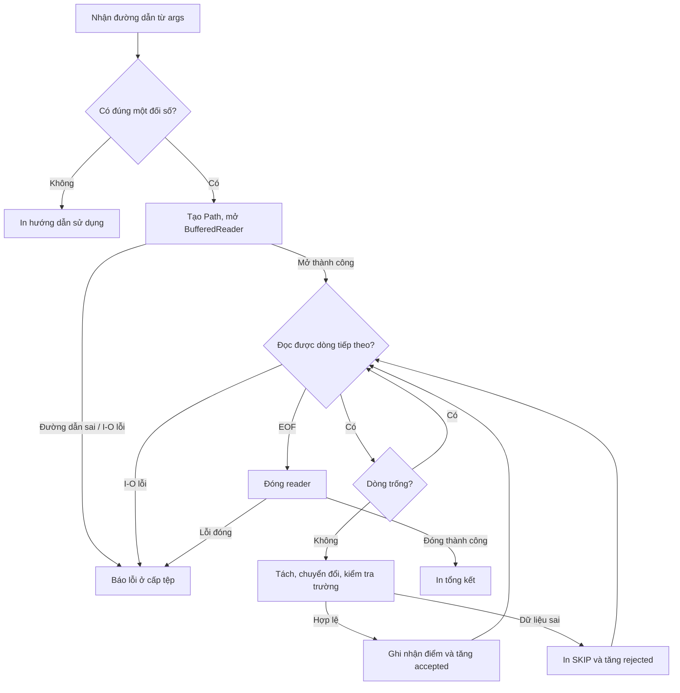

<a id="back-to-top"></a>

# Tổng quan

## Menu
- [Ngoại lệ là gì và vấn đề cần giải quyết](#exception-overview-001)
- [Phân biệt lỗi biên dịch, thất bại khi chạy và kết quả nghiệp vụ](#exception-overview-002)
- [Vì sao dùng ngoại lệ thay cho mã lỗi hoặc giá trị đặc biệt](#exception-overview-003)
- [Các thành phần: nơi phát sinh, nơi gọi và nơi xử lý](#exception-overview-004)
- [Quan hệ giữa ngoại lệ, hợp đồng phương thức và trạng thái chương trình](#exception-overview-005)
- [Một ví dụ xuyên suốt: đọc và xử lý dữ liệu đầu vào](#exception-overview-006)
- [Kiến thức tiên quyết và trình tự học đề xuất](#exception-overview-007)
- [Phạm vi Java Core và cách đối chiếu phiên bản JDK](#exception-overview-008)

## <a id="exception-overview-001">Ngoại lệ là gì và vấn đề cần giải quyết</a>

<details>
<summary>Xem chi tiết</summary>

# Ngoại lệ là gì và vấn đề cần giải quyết trong Java

Trong Java, **ngoại lệ (exception)** là đối tượng biểu diễn một tình huống bất thường xảy ra trong lúc chương trình thực thi, khiến thao tác hiện tại không thể tiếp tục theo đường đi bình thường. Thay vì âm thầm trả kết quả sai hoặc bắt mọi hàm tự kiểm tra một “mã lỗi”, Java cho phép nơi phát hiện vấn đề **ném (throw)** một đối tượng exception; hệ thống thực thi sẽ tìm một nơi **bắt (catch)** phù hợp trong chuỗi lời gọi để xử lý.

Ví dụ: chương trình đọc cấu hình để kết nối dịch vụ, nhưng tệp cấu hình không tồn tại. Không thể giả vờ rằng đã đọc được dữ liệu. Mã đọc tệp có thể báo `IOException`; mã gọi nó quyết định nên thử đường dẫn khác, trả lỗi cho người dùng, hủy thao tác hay chuyển lỗi lên tầng cao hơn.

Bài học này giải thích **exception là gì, vì sao Java cần cơ chế exception và cách cơ chế ấy vận hành**. Mục tiêu không phải biến mọi tình huống không như mong muốn thành exception, mà là giữ rõ ranh giới giữa **luồng xử lý bình thường** và **sự cố phải được xử lý có chủ đích**.

## 1. Vấn đề ban đầu: thao tác có thể không hoàn tất

Hãy xét một hàm nạp thông tin người dùng. Trong trường hợp thuận lợi, hàm nhận ID, tìm dữ liệu và trả về người dùng. Nhưng điều gì xảy ra nếu:

- Cơ sở dữ liệu tạm thời không thể truy cập?
- Dữ liệu đầu vào vi phạm tiền điều kiện API?
- Mã cố truy cập một tham chiếu `null`?
- Một phần công việc đã hoàn tất nhưng phần còn lại thất bại?
- Tài nguyên như tệp hoặc kết nối đã mở cần được đóng khi có lỗi?

Nếu chỉ có kiểu kết quả dành cho **thành công**, hàm khó thể hiện nguyên nhân thất bại. Nếu mọi hàm đều trả về một giá trị đặc biệt như `-1`, `null` hoặc chuỗi `"ERROR"`, bên gọi phải nhớ kiểm tra từng bước và giá trị đặc biệt dễ bị hiểu nhầm là dữ liệu hợp lệ.

Ví dụ về cách báo lỗi qua giá trị đặc biệt:

```java
// Minh họa ý tưởng; không phải API hoàn chỉnh.
int readScore(String text) {
    try {
        return Integer.parseInt(text);
    } catch (NumberFormatException e) {
        return -1; // -1 là "không parse được" hay một giá trị đầu vào thực?
    }
}
```

Ở đây không thể phân biệt “người dùng nhập `-1`” với “không chuyển được chuỗi sang số”. Bên gọi còn có thể quên kiểm tra `-1` và dùng nó để tính toán.

Exception giải quyết một phần khó khăn này bằng cách tạo **đường truyền tín hiệu thất bại riêng khỏi giá trị trả về thông thường**. Khi exception được ném, phép tính hiện tại bị gián đoạn; Java tìm nơi xử lý phù hợp, và đối tượng exception có thể mang loại lỗi, thông điệp, nguyên nhân gốc và stack trace.

Điều đó không có nghĩa mọi thất bại đều nên dùng exception. Một kết quả dự kiến như “hết hàng” hoặc “không tìm thấy trong truy vấn tìm kiếm” có thể phù hợp hơn với giá trị trả về có kiểu rõ ràng. Chính **hợp đồng của thao tác** quyết định sự kiện nào là nhánh bình thường, sự kiện nào là bất thường.

## 2. Khái niệm exception theo nghĩa chính xác

**Exception là một đối tượng thuộc lớp `Throwable`, thường là một lớp con của `Exception`, được ném bởi câu lệnh `throw` hoặc phát sinh trong quá trình JVM thực thi.** Khi nói “một exception xảy ra”, thông thường ta đang nói đến việc một đối tượng exception được ném.

Hãy tách ba điều:

1. **Sự kiện/điều kiện gây vấn đề:** ví dụ chuỗi không phải số, tệp mất quyền truy cập hoặc tham chiếu `null`.
2. **Tín hiệu Java:** một đối tượng như `NumberFormatException` hoặc `IOException` biểu diễn vấn đề đó.
3. **Chính sách xử lý:** bắt exception để yêu cầu nhập lại, ghi nhận lỗi, thử phương án khác, hoặc để nó lan truyền tới tầng biết xử lý.

Một vấn đề có thể được phát hiện ở tầng thấp nhưng chỉ được giải quyết ở tầng cao. Ví dụ, thư viện đọc tệp biết *không đọc được*, còn ứng dụng biết *có được phép dùng cấu hình mặc định hay phải dừng khởi động*. Cơ chế exception cho phép hai tầng giữ đúng trách nhiệm.

**Các thuộc tính đáng chú ý** của đối tượng ngoại lệ:

- **Loại (type):** ví dụ `IOException` hay `IllegalArgumentException`; người gọi có thể bắt theo loại.
- **Thông điệp (message):** lấy qua `getMessage()`, mô tả bối cảnh; có thể bằng `null`.
- **Nguyên nhân (cause):** lấy qua `getCause()`, liên kết lỗi cấp cao với lỗi gốc khi chuyển đổi exception.
- **Stack trace:** các khung lời gọi giúp lần theo vị trí và đường dẫn thực thi; lấy qua `getStackTrace()` hoặc in qua `printStackTrace()`.
- **Suppressed exceptions:** các lỗi phụ được đính kèm, thường gặp khi đóng tài nguyên trong `try-with-resources`; lấy qua `getSuppressed()`.

Thông điệp không phải một mã lỗi chuẩn hóa và có thể thay đổi; đừng để nghiệp vụ phụ thuộc vào việc so sánh nguyên văn `getMessage()`.

## 3. Exception thay đổi luồng thực thi như thế nào?

Câu lệnh bình thường chạy từ trên xuống dưới. Khi ném exception, Java **dừng đường đi bình thường trong đoạn đang thực thi**. Nó tìm `catch` phù hợp ở cấu trúc `try` gần nhất; nếu không có, exception tiếp tục lan truyền qua những phương thức đang gọi nhau.

Ví dụ giả định:

```text
main()
  └─ receiveRequest()
       └─ loadConfig()
            └─ readFile()  → ném IOException
```

Nếu `readFile()` không xử lý exception, nó không quay về với giá trị thành công. Exception được chuyển tới `loadConfig()`; nếu không có `catch` phù hợp thì tiếp tục tới `receiveRequest()`, rồi tới `main()`. Quá trình đó thường được gọi là **lan truyền exception (exception propagation)** và **tháo ngăn xếp lời gọi (stack unwinding)**.

Mỗi khi một phương thức kết thúc bất thường, các lệnh còn lại trên đường thực thi đó không tự động tiếp tục. Khi đã tìm thấy `catch` phù hợp, luồng chạy tiếp **sau phần xử lý theo cấu trúc điều khiển**, chứ không nhảy ngược vào chính câu lệnh gây exception.

Ví dụ Java 17+ độc lập, lưu thành `PropagationDemo.java`:

```java
public class PropagationDemo {
    static void readSettings() {
        throw new IllegalStateException("Thiếu cấu hình");
    }

    static void startService() {
        readSettings();
        System.out.println("Dịch vụ đã khởi động"); // Không chạy
    }

    public static void main(String[] args) {
        System.out.println("Bắt đầu");
        try {
            startService();
            System.out.println("Trong try, sau startService"); // Không chạy
        } catch (IllegalStateException e) {
            System.out.println("Đã bắt: " + e.getMessage());
        }
        System.out.println("Chương trình tiếp tục");
    }
}
```

Biên dịch và chạy trong thư mục chứa tệp:

```bash
javac -encoding UTF-8 --release 17 PropagationDemo.java
java PropagationDemo
```

**stdout chính xác** trong môi trường hiển thị UTF-8:

```text
Bắt đầu
Đã bắt: Thiếu cấu hình
Chương trình tiếp tục
```

Những câu lệnh in “Dịch vụ đã khởi động” và “Trong try, sau startService” không chạy. `catch` nằm ở `main` xử lý được exception ném sâu trong `readSettings`; sau `catch`, chương trình tiếp tục theo đường đi hợp lệ.

Nếu không có `catch` phù hợp trên đường lan truyền và exception thoát khỏi `main`, luồng `main` kết thúc bất thường; JVM thường in loại exception, message và stack trace ra **stderr**. Trong ứng dụng máy chủ hay đa luồng, một exception không được bắt thường làm kết thúc luồng tương ứng; không nên mặc định toàn bộ tiến trình JVM luôn dừng trong mọi ngữ cảnh.

## 4. Exception giải quyết những vấn đề gì?

### 4.1. Báo thất bại mà không giả tạo một kết quả thành công

Một hàm tuyên bố trả về `User` nên trả về người dùng khi thành công. Nếu gặp lỗi không thể hoàn tất, hàm có thể ném exception thay vì trả về một đối tượng rỗng hoặc dữ liệu giả. Điều này giúp bên gọi phân biệt “có dữ liệu hợp lệ” với “không hoàn thành thao tác”.

Cần phân biệt: **không có kết quả nhưng vẫn hợp lệ** (ví dụ tìm một phần tử không tồn tại) có thể dùng `Optional<User>` hoặc loại kết quả riêng; exception không thay thế thiết kế API.

### 4.2. Không bắt tầng thấp tự quyết định cách ứng dụng phản ứng

Mã thao tác tệp biết nó thất bại, nhưng không biết nên hiển thị hộp thoại hay chuyển sang cấu hình dự phòng. Khi ném exception, tầng đó truyền thông tin cho tầng có đủ ngữ cảnh quyết định.

Lợi ích là tách biệt **phát hiện lỗi** và **chính sách xử lý lỗi**. Đổi lại, người viết chương trình phải đọc hợp đồng phương thức và có chiến lược xử lý rõ ràng ở ranh giới phù hợp.

### 4.3. Không bắt mọi lời gọi kiểm tra mã lỗi thủ công

Khi thao tác A gọi B, B gọi C, C gọi D, mã lỗi thủ công buộc nhiều tầng truyền giá trị báo lỗi dù không tầng nào xử lý được nó. Exception có thể đi qua các tầng đó tới `catch` phù hợp.

Đây là công cụ làm mã sáng rõ hơn, **không miễn trách nhiệm thiết kế hợp đồng và kiểm thử nhánh lỗi**. Một exception bị bỏ quên vẫn có thể khiến luồng yêu cầu thất bại bất ngờ.

### 4.4. Giữ bối cảnh chẩn đoán

Loại exception và stack trace cho biết mã đi qua những lời gọi nào; message giải thích điều kiện, `cause` giúp liên kết lỗi cấp cao với lỗi gốc. Khi “không thể tạo báo cáo” bắt nguồn từ “không đọc được tệp cấu hình”, chuỗi nguyên nhân giúp chẩn đoán đúng nơi.

### 4.5. Hỗ trợ cleanup khi đường đi bình thường bị gián đoạn

Khi đang dùng tệp, socket hoặc tài nguyên khác, một exception có thể xuất hiện trước lệnh đóng tài nguyên. `finally` và `try-with-resources` giúp lập trình viên đặt việc dọn dẹp vào vị trí được thực hiện khi rời phạm vi, kể cả trong các đường đi có exception. Tuy nhiên, không có cơ chế cleanup nào bảo đảm chạy trong mọi trường hợp như JVM bị chấm dứt cưỡng bức.

## 5. Hệ phân cấp cơ bản: `Throwable`, `Exception` và `Error`

Sơ đồ rút gọn:

```text
java.lang.Object
  └─ java.lang.Throwable
       ├─ java.lang.Error
       │    ├─ OutOfMemoryError
       │    └─ StackOverflowError
       └─ java.lang.Exception
            ├─ IOException
            ├─ ReflectiveOperationException
            └─ RuntimeException
                 ├─ IllegalArgumentException
                 │    └─ NumberFormatException
                 ├─ IllegalStateException
                 ├─ NullPointerException
                 └─ IndexOutOfBoundsException
```

Các lớp trên chỉ là **một phần** của hệ phân cấp Java.

- `Throwable` là kiểu gốc cho các đối tượng có thể `throw` và `catch`.
- `Exception` thường biểu diễn tình huống ứng dụng có thể xử lý hoặc truyền cho phía gọi.
- `RuntimeException` là lớp con của `Exception`, dùng cho các exception **unchecked** như `IllegalArgumentException` và `NullPointerException`.
- `Error` biểu thị những vấn đề nghiêm trọng của JVM/môi trường hay liên kết lớp; mã nghiệp vụ thông thường **không nên** bắt rộng nhóm này để giả vờ tiếp tục an toàn.

**Checked exception** là lớp con của `Throwable` không thuộc `RuntimeException` hoặc `Error`, thường thấy ở các lớp con của `Exception` như `IOException`. Trình biên dịch yêu cầu mã gọi phải bắt hoặc khai báo checked exception có thể được ném. **Unchecked exception** gồm `RuntimeException` cùng lớp con và `Error` cùng lớp con; trình biên dịch không buộc bên gọi khai báo/bắt chúng.

Đừng hiểu “checked” là chắc chắn phục hồi được, hay “unchecked” là chắc chắn bug. Một `IOException` có thể không thể khắc phục tại chỗ; một `IllegalArgumentException` có thể bắt nguồn từ dữ liệu nhập vào cần được báo lại cho người dùng. Tình huống thực tế và hợp đồng API mới quyết định hành động.

## 6. Các cấu trúc Java liên quan trực tiếp đến exception

| Cấu trúc | Vai trò |
| --- | --- |
| `throw exceptionObject;` | Ném **một đối tượng** thuộc `Throwable`, làm gián đoạn luồng bình thường |
| `throws SomeException` | Khai báo ở chữ ký phương thức rằng nó có thể truyền exception tương ứng ra ngoài; **không tự ném** |
| `try { ... }` | Bao đoạn mã cần đặt dưới cơ chế bắt/dọn dẹp |
| `catch (Type e) { ... }` | Chạy khi có exception khớp kiểu đang được lan truyền từ `try` tương ứng |
| `finally { ... }` | Dành cho dọn dẹp/cuối thao tác, thường chạy khi rời `try/catch` |
| `try (resource) { ... }` | Tự đóng tài nguyên `AutoCloseable` theo thứ tự ngược khi rời `try` |

### `throw` và `throws` là hai việc khác nhau

```java
import java.io.IOException;

class ConfigurationService {
    static String load(boolean reachable) throws IOException {
        if (!reachable) {
            throw new IOException("Không thể truy cập cấu hình");
        }
        return "ready";
    }
}
```

Đây là **đoạn khai báo lớp minh họa**, không có `main` để chạy độc lập. `throw new IOException(...)` thực sự tạo và ném đối tượng; `throws IOException` thông báo cho bên gọi về khả năng này. Nếu bên gọi viết `ConfigurationService.load(false)`, nó phải bắt hoặc khai báo `IOException` thì mã mới biên dịch được, vì đó là checked exception.

`throws` không làm tệp/dịch vụ hoạt động lại, cũng không thay cho `catch`. Bên gọi muốn bỏ qua vấn đề bằng cách ghi `throws IOException` suốt chuỗi tầng thì tầng cao nhất vẫn cần xác định điều gì xảy ra nếu exception thoát ra.

### `catch` lựa chọn theo quan hệ kiểu

`catch` bắt exception có kiểu tương thích với kiểu khai báo của tham số, kể cả lớp con. Các nhánh `catch` phải được sắp từ **cụ thể tới tổng quát**. Ví dụ `NumberFormatException` là lớp con của `IllegalArgumentException`; bắt `IllegalArgumentException` trước sẽ khiến nhánh `NumberFormatException` phía sau trở thành mã không thể tới, nên Java báo lỗi biên dịch.

```java
try {
    int value = Integer.parseInt(text);
    System.out.println(value);
} catch (NumberFormatException e) {
    System.out.println("Dữ liệu không phải số nguyên");
} catch (IllegalArgumentException e) {
    System.out.println("Đối số không hợp lệ");
}
```

Đây là **đoạn trong một phương thức**, giả sử biến `text` đã được khai báo. Phân nhánh thứ hai sẽ bắt một số `IllegalArgumentException` khác phát sinh bên trong `try`; với riêng `Integer.parseInt` và một chuỗi đầu vào, nhánh `NumberFormatException` là nhánh lỗi chuyển đổi đáng quan tâm.

### `finally` và `try-with-resources`

`finally` thường chạy khi thoát `try`, dù thành công, có exception được bắt, exception chưa được bắt hoặc có `return`; nhưng không thể bảo đảm nếu tiến trình bị dừng cưỡng bức, JVM sập hoặc xảy ra các tình huống đặc biệt. Tránh `return` hoặc `throw` mới trong `finally` vì có thể **che khuất exception hoặc giá trị trả về đang có**.

Với tài nguyên triển khai `AutoCloseable` (như `BufferedReader`), ưu tiên `try-with-resources`:

```java
import java.io.BufferedReader;
import java.io.IOException;
import java.nio.file.Files;
import java.nio.file.Path;

class FileReaderExample {
    static String readFirstLine(Path path) throws IOException {
        try (BufferedReader reader = Files.newBufferedReader(path)) {
            return reader.readLine();
        }
    }
}
```

Đoạn này là **lớp minh họa không có `main`**; hành vi phụ thuộc đường dẫn và nội dung tệp thực tế. Dù `readLine` thành công, trả về `null` khi đã hết dữ liệu, hay ném exception, Java đều cố đóng `reader` khi rời khối `try`. Nếu cả phần xử lý lẫn `close()` đều ném exception, ngoại lệ khi đóng thường được lưu trong danh sách **suppressed** của exception chính, để giữ dấu vết lỗi gốc. Nếu không có lỗi phần xử lý nhưng việc đóng lỗi, exception từ `close()` có thể được truyền ra ngoài.

`try-with-resources` không tự động rollback giao dịch, hoàn tác mọi side effect, hay bảo đảm tài nguyên xa được đóng thành công; nó quản lý việc gọi `close()` trên các tài nguyên được khai báo.

## 7. Ví dụ hoàn chỉnh: nhận dữ liệu, báo lỗi, xử lý và tiếp tục

Lưu chương trình sau thành `ExceptionBasicsDemo.java` và chạy với **Java 17+**:

```java
public class ExceptionBasicsDemo {
    static int readPositiveInteger(String text) {
        int value = Integer.parseInt(text);
        if (value <= 0) {
            throw new IllegalArgumentException("Giá trị phải lớn hơn 0");
        }
        return value;
    }

    static int calculatePrice(String quantityText) {
        int quantity = readPositiveInteger(quantityText);
        return quantity * 100;
    }

    public static void main(String[] args) {
        String[] inputs = {"3", "0", "abc"};

        for (String text : inputs) {
            try {
                int price = calculatePrice(text);
                System.out.println(text + " -> " + price);
            } catch (NumberFormatException e) {
                System.out.println(text + " -> không phải số nguyên");
            } catch (IllegalArgumentException e) {
                System.out.println(text + " -> số lượng không hợp lệ: "
                        + e.getMessage());
            }
        }

        System.out.println("Đã xử lý tất cả đầu vào");
    }
}
```

Lệnh chạy:

```bash
javac -encoding UTF-8 --release 17 ExceptionBasicsDemo.java
java ExceptionBasicsDemo
```

**stdout chính xác** trong môi trường hiển thị UTF-8:

```text
3 -> 300
0 -> số lượng không hợp lệ: Giá trị phải lớn hơn 0
abc -> không phải số nguyên
Đã xử lý tất cả đầu vào
```

Phân tích từng nhánh:

1. `"3"` chuyển được thành `int 3`, hợp lệ; `calculatePrice` trả về `300` như một giá trị thông thường.
2. `"0"` chuyển được thành số nhưng không thỏa tiền điều kiện của `readPositiveInteger`; câu lệnh `throw new IllegalArgumentException(...)` chấm dứt nhánh bình thường và ném exception đến `catch` tương ứng trong vòng lặp ở `main`.
3. `"abc"` khiến `Integer.parseInt` ném `NumberFormatException` trước khi tới kiểm tra số dương. Vì nhánh `catch (NumberFormatException e)` đứng trước `IllegalArgumentException` nên nó được chọn.
4. Sau khi mỗi exception được xử lý, vòng lặp chuyển sang lần tiếp theo; không có lệnh nào trong phép gọi thất bại tiếp tục chạy tại vị trí đã bị gián đoạn.

Ví dụ dùng giá đơn vị `100` để kết quả dễ theo dõi; ứng dụng thực cần xác thực miền giá trị, chống tràn số và lựa chọn cách xử lý nhập liệu phù hợp. `NumberFormatException` là một exception, nhưng việc nhập sai có thể được chuyển thành **kết quả xác thực dự kiến** tại giao diện; lựa chọn đó phụ thuộc hợp đồng tầng giao tiếp.

## 8. Khi không bắt được exception: điều gì thực sự xảy ra?

Nếu không có `catch` tương thích, exception tiếp tục được truyền lên các caller. Với một ứng dụng console, exception thoát khỏi `main` thường in stack trace và kết thúc luồng chính với trạng thái lỗi. Stack trace hiển thị những vị trí khung lời gọi phục vụ chẩn đoán, ví dụ từ `readPositiveInteger` qua `calculatePrice` tới `main`, cùng tên loại exception.

Trong chương trình đa luồng, nếu một thread có exception không được bắt, thread đó có thể kết thúc; các thread khác có thể vẫn tiếp tục. Trong framework máy chủ, tầng framework thường đặt ranh giới xử lý exception cho từng request, nên một request có thể thất bại mà toàn bộ JVM vẫn sống. Vì vậy câu “cứ ném exception là chương trình sập” là khái quát sai.

Phân biệt **được ném** và **được xử lý hiệu quả**: một `catch` có thể bắt exception nhưng trả về dữ liệu sai, bỏ qua nguyên nhân hoặc ghi log rồi tiếp tục trong trạng thái hỏng. Đó không phải xử lý an toàn.

## 9. Chọn nơi bắt và cách xử lý ngoại lệ

Chỉ bắt exception khi tầng hiện tại **biết làm gì có ý nghĩa**: thử phương án dự phòng, yêu cầu dữ liệu mới, khôi phục trạng thái hợp lệ, bổ sung ngữ cảnh cho lỗi hoặc chuyển thành phản hồi ở ranh giới API.

Các lựa chọn điển hình:

- **Phục hồi:** đường dẫn tệp chính lỗi và ứng dụng có cấu hình dự phòng được phép dùng. Bắt `IOException`, thử đường dẫn dự phòng, báo rõ nếu vẫn không thể nạp.
- **Chuyển thành kết quả rõ ràng:** lớp giao tiếp bắt lỗi chuyển đổi dữ liệu người dùng và trả một lỗi xác thực có cấu trúc.
- **Bổ sung ngữ cảnh rồi ném tiếp:** lớp dịch vụ biết thao tác nào thất bại; bọc `IOException` thành ngoại lệ phù hợp với API, giữ `cause`.
- **Cho phép lan truyền:** tầng hiện tại không có chiến lược an toàn; giữ hợp đồng `throws` cho checked exception hoặc cho exception unchecked đi lên tầng có trách nhiệm.

Ví dụ chuyển lỗi nhưng vẫn giữ nguyên nhân gốc:

```java
import java.io.IOException;
import java.nio.file.Files;
import java.nio.file.Path;

class AppSettings {
    static String load(Path path) {
        try {
            return Files.readString(path);
        } catch (IOException cause) {
            throw new IllegalStateException(
                    "Không nạp được cấu hình từ " + path, cause);
        }
    }
}
```

Đây là **lớp minh họa không có `main`**. Nếu việc đọc thất bại, bên gọi thấy `IllegalStateException` với thông điệp có ngữ cảnh; `getCause()` trả về `IOException` ban đầu. Không lạm dụng việc chuyển checked sang unchecked chỉ để né xử lý; chỉ đổi loại khi phù hợp với hợp đồng API của tầng hiện tại.

Đặt xử lý tại **ranh giới có khả năng quyết định**: ví dụ console UI chọn thông báo và yêu cầu nhập lại, HTTP adapter chuyển lỗi thành mã HTTP đúng theo hợp đồng, scheduler ghi nhận job thất bại và áp dụng chính sách retry hợp lệ. Đừng bắt một lỗi từ cơ sở dữ liệu rồi trả về “không tìm thấy người dùng” nếu hai tình huống có ý nghĩa khác nhau.

## 10. Exception không có nhiệm vụ thay thế mọi nhánh nghiệp vụ

Hãy hỏi: một điều kiện có **thường xuyên và hợp lệ** đối với nghiệp vụ hay không? Nếu “hết hàng” là nhánh phải hiển thị bình thường, kiểu kết quả chứa trạng thái `OUT_OF_STOCK` thường dễ hiểu hơn ném exception qua nhiều tầng. Nếu “kho luôn không âm” là bất biến nội bộ nhưng đột nhiên kho âm, exception có thể biểu diễn việc vi phạm hợp đồng.

Một số hình thức báo kết quả thường gặp:

| Trường hợp | Một thiết kế có thể phù hợp |
| --- | --- |
| Tìm ID có thể không tồn tại như điều bình thường | `Optional<User>` hoặc kết quả có trạng thái `NOT_FOUND` |
| Đặt hàng bị từ chối vì hết hàng | Kết quả kiểu `OrderResult` chứa mã từ chối |
| Dữ liệu người dùng không đạt điều kiện | Danh sách lỗi xác thực; hoặc lỗi chuyển đổi được xử lý tại ranh giới |
| Gọi API với tham số sai hợp đồng của lập trình viên | `IllegalArgumentException` |
| Tệp bắt buộc bị lỗi truy cập | `IOException`, xử lý hoặc lan truyền có ngữ cảnh |
| Hệ thống vi phạm bất biến nội bộ | Exception diễn tả trạng thái không hợp lệ, đi tới tầng chịu trách nhiệm |

Các lựa chọn trên không phải luật cứng. Có API cố ý thiết kế **domain exception** để biểu diễn sự từ chối nghiệp vụ. Khi ấy exception vẫn là cơ chế Java của việc truyền tín hiệu; ý nghĩa là gì do hợp đồng quyết định. Quan trọng nhất là caller biết xử lý thế nào và không coi một lời từ chối dự kiến là sự cố hạ tầng.

## 11. Exception khác gì lỗi biên dịch và lỗi logic?

Exception là cơ chế **khi thực thi**. Nó không thay thế kiểm tra cú pháp và kiểu của `javac`:

- `int n = "5";` là lỗi kiểu tại **biên dịch**, không thể dùng `try/catch` để “bắt” lỗi đó trong chương trình đã chạy.
- `Integer.parseInt("x")` có thể **biên dịch**, nhưng khi chạy sẽ ném `NumberFormatException`.
- `int sum = Integer.MAX_VALUE + 1;` biên dịch và thực thi phép cộng kiểu `int` với kết quả bị tràn theo quy tắc số nguyên Java; mặc định **không ném exception**. Đây có thể là lỗi logic nếu nghiệp vụ cần kết quả toán học chính xác.
- Một yêu cầu đăng nhập có mật khẩu không đúng có thể trả “từ chối” hoàn toàn bình thường; không nhất thiết có exception.

Đừng chẩn đoán sai bằng quy tắc “không có exception nghĩa là chương trình đúng” hay “có exception nghĩa là chắc chắn lỗi lập trình”. Kiểm thử tính đúng đắn, tính nhất quán dữ liệu và các nhánh nghiệp vụ vẫn cần thực hiện.

## 12. Những lỗi phổ biến khi bắt ngoại lệ

### Bắt rồi bỏ qua

```java
try {
    performOperation();
} catch (Exception ignored) {
    // Không ghi nhận và không có chiến lược khôi phục.
}
```

Đây là **đoạn minh họa**, giả sử `performOperation()` đã được định nghĩa. Cách này làm mất tín hiệu về sự cố. Chỉ bỏ qua một loại exception cụ thể khi hợp đồng cho phép và có lý do rõ ràng.

### Bắt quá rộng hoặc bắt cả `Throwable`

`catch (Exception e)` có thể gom nhiều loại lỗi cần xử lý khác nhau, che giấu bug và đánh mất hành động phù hợp với từng loại. `catch (Throwable t)` còn có thể bắt cả `Error` vốn không nên được tầng nghiệp vụ cố xử lý như lỗi thường. Có các ranh giới framework đặc biệt cần bắt rộng để ghi nhận lỗi cuối cùng, nhưng đó là quyết định kiến trúc có chủ đích.

### Đổi sang lỗi mới mà làm mất `cause`

```java
// Kém: không giữ nguyên nhân ban đầu.
catch (IOException e) {
    throw new IllegalStateException("Không đọc được dữ liệu");
}
```

Nên giữ nguyên nhân nếu chuyển kiểu:

```java
catch (IOException e) {
    throw new IllegalStateException("Không đọc được dữ liệu", e);
}
```

Hai đoạn là **phần của khối try/catch**, không phải chương trình độc lập. Giữ `cause` giúp stack trace phản ánh cả sự cố nền tảng.

### Dùng exception thay vòng điều khiển thông thường

Ném exception cho mỗi bước lặp hoặc mỗi kết quả kiểm tra thông thường khiến mã khó hiểu, buộc người đọc lần theo các nhánh phi tuyến, và có thể gây chi phí không cần thiết khi ném rất thường xuyên. Hãy dùng điều kiện, trạng thái hoặc kiểu kết quả rõ ràng cho những nhánh dự kiến.

### Hiển thị stack trace cho người dùng cuối

Stack trace dành cho người phát triển và vận hành; có thể chứa đường dẫn nội bộ, tên lớp, thông tin nhạy cảm và cấu trúc hệ thống. Ứng dụng nên cung cấp thông điệp phù hợp với người dùng, đồng thời ghi log chẩn đoán cần thiết ở nơi được bảo vệ. Không đặt bí mật vào message của exception.

### Retry mọi exception

Không phải lỗi nào cũng tạm thời, và không phải thao tác nào cũng an toàn khi lặp lại. Retry một yêu cầu tạo đơn hàng có thể tạo đơn trùng nếu lần đầu đã ghi thành công trước khi mất phản hồi. Chỉ retry khi nguyên nhân, chính sách backoff, timeout, tính idempotent và side effect đã được xem xét.

### Quên cleanup hoặc dùng `finally` không an toàn

Một exception có thể bỏ qua lệnh `close()` nằm ở cuối `try`. Hãy ưu tiên `try-with-resources` cho `AutoCloseable`. Đừng `return` trong `finally` để vô tình ghi đè kết quả hoặc che exception đang lan truyền.

## 13. Cách đọc exception khi xử lý lỗi thật

Khi có lỗi runtime, lần lượt:

1. **Tên loại:** `NumberFormatException` nói đến chuyển đổi số, `IOException` liên quan hoạt động I/O; tên loại chỉ là gợi ý, không đủ để kết luận nguyên nhân gốc.
2. **Message:** nêu giá trị/trạng thái liên quan nếu an toàn, nhưng không phụ thuộc vào văn bản message làm logic điều kiện.
3. **Stack trace:** tìm khung lời gọi thuộc mã ứng dụng nơi thao tác lỗi, rồi lần theo caller để biết điều kiện nào dẫn tới đó. Dòng gây ném ở thư viện không nhất thiết là nơi có bug trong ứng dụng.
4. **Cause:** lần xuống chuỗi `getCause()` để xác định lỗi sâu bên dưới khi exception được bọc.
5. **Suppressed:** kiểm tra khi có nhiều lỗi, đặc biệt lúc đóng tài nguyên.
6. **Bối cảnh:** dữ liệu đầu vào, phiên bản JDK, cấu hình, tài nguyên, thời điểm và thao tác trước đó; tránh log dữ liệu bí mật.
7. **Hợp đồng:** xác định nên khôi phục, trả kết quả nghiệp vụ, hay thông báo lỗi kỹ thuật cho tầng cao hơn.

Một exception được **bắt** chưa chắc đã **được giải quyết**. Xử lý đúng nghĩa là giữ hệ thống ở trạng thái hợp lệ, đưa ra tín hiệu phù hợp cho caller và không làm mất thông tin cần điều tra.

## 14. Câu hỏi tự kiểm tra

**Tình huống 1.** Hàm đọc tệp ném `IOException`. Phương thức gọi chỉ có thể hiển thị thông báo và yêu cầu chọn tệp khác. Nên làm gì?  
Có thể `catch` tại tầng giao diện để báo lỗi và cho chọn lại, vì tầng này có chiến lược phục hồi hợp lệ.

**Tình huống 2.** `methodA()` gọi `methodB()`; `methodB()` ném `IllegalStateException` không được bắt. Câu lệnh ngay sau lời gọi `methodB()` trong `methodA()` có tiếp tục không?  
Không, lời gọi kết thúc bất thường và exception tiếp tục lan truyền. Mã có thể chạy tiếp ở một `catch` phù hợp trên call stack.

**Tình huống 3.** Thêm `throws IOException` vào một phương thức có làm lỗi đọc tệp biến mất không?  
Không. Nó chỉ thay đổi hợp đồng khai báo và cho phép exception lan truyền; vẫn phải quyết định chính sách xử lý.

**Tình huống 4.** Người dùng tìm kiếm một bản ghi không tồn tại. Có bắt buộc phải ném exception không?  
Không. Nếu “không tìm thấy” là kết quả được dự kiến, có thể dùng `Optional` hoặc trạng thái nghiệp vụ rõ ràng.

**Tình huống 5.** Vì sao nên dùng `try-with-resources` khi đọc tệp?  
Vì tài nguyên được đóng khi rời khối theo cơ chế có cấu trúc, kể cả khi có exception, và Java giữ được suppressed exception trong tình huống thích hợp.

**Tình huống 6.** Vì sao `catch (NumberFormatException e)` cần đứng trước `catch (IllegalArgumentException e)`?  
Vì `NumberFormatException` là lớp con của `IllegalArgumentException`. Nếu bắt lớp cha trước, nhánh cho lớp con phía sau không thể tới và trình biên dịch từ chối.

## 15. Ghi nhớ để dùng exception đúng mục đích

- **Exception là tín hiệu có kiểu**, được ném trong lúc thực thi để biểu diễn vấn đề khiến đường đi bình thường không thể tiếp tục.
- Khi exception xuất hiện, Java **lan truyền qua call stack** đến `catch` tương thích; các lệnh nằm sau điểm ném trên nhánh đang bị gián đoạn không tự chạy tiếp.
- Exception giúp **tách việc phát hiện vấn đề khỏi quyết định xử lý**, giữ thông tin chẩn đoán và hỗ trợ dọn dẹp tài nguyên khi thoát đường đi bất thường.
- `throw` dùng để ném; `throws` khai báo khả năng ném; `catch` chỉ có ích khi tầng đó thật sự biết cách xử lý; `try-with-resources` quản lý tài nguyên `AutoCloseable`.
- **Không phải mọi kết quả không như mong muốn đều cần exception.** Chọn giữa kết quả bình thường và exception theo hợp đồng, bản chất sự kiện và trách nhiệm của bên gọi.


</details>

- [Quay lại đầu trang](#back-to-top)

---

## <a id="exception-overview-002">Phân biệt lỗi biên dịch, thất bại khi chạy và kết quả nghiệp vụ</a>

<details>
<summary>Xem chi tiết</summary>

# Phân biệt lỗi biên dịch, thất bại khi chạy và kết quả nghiệp vụ trong Java

Một chương trình Java có thể **không biên dịch được**, **biên dịch thành công nhưng thất bại khi chạy**, hoặc **chạy đúng và trả về kết quả nghiệp vụ không như người dùng mong muốn**. Ba tình huống này khác nhau về thời điểm xuất hiện, nguyên nhân, cách biểu diễn và trách nhiệm xử lý. Trong chủ đề Java Core – Exception, phân biệt chúng là bước đầu tiên để quyết định khi nào cần sửa mã nguồn, khi nào xử lý exception và khi nào chỉ cần kiểm tra một kết quả bình thường.

## 1. Ba loại tình huống nhìn từ vòng đời chương trình

| Góc nhìn | Lỗi biên dịch (compile-time error) | Thất bại khi chạy (runtime failure) | Kết quả nghiệp vụ (business outcome) |
| --- | --- | --- | --- |
| Thời điểm | Khi `javac` kiểm tra/biên dịch mã nguồn | Khi chương trình đang thực thi | Khi nghiệp vụ đưa ra một quyết định trong lúc chạy |
| Ví dụ | Gán `String` vào `int`; dùng biến không khai báo; không xử lý checked exception | `NullPointerException`; tệp cấu hình không đọc được; kết nối cơ sở dữ liệu thất bại | Đơn hàng hết hàng; đăng nhập sai mật khẩu; hồ sơ không đạt điều kiện |
| Có tạo được bản biên dịch mới? | Không, đối với phần nguồn đang lỗi | Có thể có; lỗi xuất hiện trong lúc thực thi | Có; chương trình hoàn toàn có thể chạy đúng |
| Java có bắt buộc ném exception? | Không: trình biên dịch báo lỗi | Không phải mọi thất bại đều ném exception; nhiều lỗi có exception hoặc `Error` | Không: có thể biểu diễn bằng giá trị trả về hoặc trạng thái |
| Phản ứng chính | Sửa mã, kiểu dữ liệu, cú pháp, khai báo hoặc phụ thuộc | Chẩn đoán nguyên nhân, khôi phục nếu khả thi, hoặc chuyển lỗi qua ranh giới thích hợp | Xử lý nhánh nghiệp vụ và thông báo phù hợp cho người dùng |
| Có luôn là bug? | Thường là lỗi mã/thiết lập biên dịch cần sửa | Có thể là bug, dữ liệu sai, sự cố môi trường hoặc tình huống dự liệu trước | Không: “hết hàng” có thể là quyết định hoàn toàn đúng của hệ thống |

Cần phân biệt thêm **kết quả nghiệp vụ** với **lỗi logic**: nếu hệ thống phải trừ 10 điểm nhưng lại trừ 100 điểm mà không ném exception, chương trình vẫn có thể chạy tới cuối. Đây là bug về tính đúng đắn khi chạy, không phải một kết quả nghiệp vụ hợp lệ chỉ vì không có exception.

Một chu trình giản lược:

1. Viết mã nguồn `.java` và chạy `javac`. Nếu việc biên dịch thất bại, sửa mã hoặc cấu hình biên dịch trước khi có thể chạy bản mới.
2. Chạy bytecode bằng `java`. Trong lúc chạy có thể phát sinh exception, lỗi môi trường, treo chương trình, hoặc cho ra giá trị sai.
3. Nếu hoạt động kỹ thuật thành công, các quy tắc nghiệp vụ vẫn có thể trả về “được chấp nhận”, “bị từ chối”, “không còn hàng”, “chưa đủ điều kiện”…

Một ứng dụng thực tế có thể biên dịch thành công, xử lý hàng nghìn yêu cầu bình thường, rồi chỉ một yêu cầu cụ thể gặp lỗi runtime. Ngược lại, một yêu cầu bị từ chối do quy tắc nghiệp vụ có thể được xử lý thành công hoàn toàn.

## 2. Lỗi biên dịch: chương trình bị từ chối trước khi chạy

Trình biên dịch Java kiểm tra cú pháp và nhiều quy tắc tĩnh: tên biến, kiểu dữ liệu, khả năng truy cập thành viên, một số đường đi trả về, và nghĩa vụ xử lý/khai báo **checked exception**. Ví dụ tệp `CompileDemo.java`:

```java
public class CompileDemo {
    public static void main(String[] args) {
        int quantity = "3"; // Sai: String không tự chuyển thành int
        System.out.println(quantity);
    }
}
```

Chạy:

```bash
javac CompileDemo.java
```

Lệnh thất bại với thông báo về **kiểu dữ liệu không tương thích**; nội dung và cách trình bày chẩn đoán phụ thuộc phiên bản `javac`. Đây không phải `ClassCastException` trong lúc chạy. Lỗi xuất hiện vì trình biên dịch đã phát hiện phép gán không hợp lệ. Một cách sửa là dùng `int quantity = 3;`; nếu giá trị thực sự đến từ văn bản, việc chuyển đổi như `Integer.parseInt(text)` lại có thể gặp exception **khi chạy**, nếu văn bản không phải số nguyên hợp lệ.

Một tình huống liên quan đến exception:

```java
import java.io.IOException;
import java.nio.file.Files;
import java.nio.file.Path;

class CheckedExample {
    static String load(Path file) throws IOException {
        return Files.readString(file);
    }

    static void show() {
        String data = load(Path.of("config.txt")); // Lỗi biên dịch
        System.out.println(data);
    }
}
```

`Files.readString` có thể ném `IOException`, là checked exception. Phương thức `show()` phải **bắt** nó bằng `try/catch` hoặc **khai báo** `throws IOException` (hay kiểu cha phù hợp). Nếu sửa chữ ký thành `static void show() throws IOException`, mã có thể biên dịch; điều đó **không bảo đảm** tệp tồn tại hoặc việc đọc sẽ thành công. `throws` chỉ làm rõ hợp đồng lan truyền exception, không xử lý nguyên nhân ở runtime.

**Giới hạn của trình biên dịch:** biên dịch thành công không chứng minh nghiệp vụ đúng, không bảo đảm dữ liệu đầu vào hợp lệ, không bảo đảm kết nối mạng khả dụng và không loại bỏ `NullPointerException`. Ngược lại, cảnh báo biên dịch không đồng nghĩa với lỗi khiến `javac` phải dừng. Lỗi do không tìm thấy thư viện ở compile classpath hoặc phiên bản JDK không tương thích cũng có thể làm build thất bại, dù không phải lỗi logic trong từng câu lệnh Java.

## 3. Thất bại khi chạy: mã hợp lệ nhưng thao tác không hoàn tất như dự định

Ví dụ tệp `RuntimeDemo.java`:

```java
public class RuntimeDemo {
    public static void main(String[] args) {
        System.out.println("Bắt đầu chuyển đổi");
        int quantity = Integer.parseInt("abc");
        System.out.println("Số lượng: " + quantity);
    }
}
```

Biên dịch và chạy với Java 17 trở lên:

```bash
javac -encoding UTF-8 RuntimeDemo.java
java RuntimeDemo
```

`javac` biên dịch thành công. Khi chạy, **stdout** in:

```text
Bắt đầu chuyển đổi
```

Sau đó `Integer.parseInt("abc")` ném `NumberFormatException` vì chuỗi không biểu diễn một số nguyên thập phân hợp lệ. Không có `catch` nào xử lý nên exception thoát khỏi `main`; JVM in thông tin exception và stack trace ra **stderr**, và câu lệnh in “Số lượng” không được thực hiện. Không cần dự đoán từng dòng stack trace vì chi tiết có thể khác theo phiên bản JDK.

Các dạng thất bại runtime thường gặp:

- **Lỗi dữ liệu hoặc tiền điều kiện:** `NumberFormatException`, `IllegalArgumentException`, nhiều `NullPointerException`. Nguyên nhân có thể nằm ở dữ liệu không mong đợi hoặc bug của bên gọi.
- **I/O và tài nguyên bên ngoài:** `IOException` khi đọc/ghi, lỗi kết nối, timeout. Cần biết thao tác có thể thử lại an toàn hay không.
- **Trạng thái/cạnh tranh:** `IllegalStateException`, tranh chấp tài nguyên, deadlock, race condition. Một deadlock có thể khiến chương trình treo **mà không ném exception**.
- **Giới hạn môi trường:** hết bộ nhớ có thể dẫn đến `OutOfMemoryError`; `Error` thường biểu thị vấn đề mà luồng nghiệp vụ thông thường không thể tự xử lý an toàn.
- **Lỗi logic âm thầm:** phép tính tràn số nguyên `int` thông thường không tự ném exception; chương trình vẫn có thể trả về giá trị sai.

Trong Java, `Throwable` là gốc của `Exception` và `Error`. Hai nhóm thường gặp trong `Exception` là **checked exception** (ví dụ `IOException`) và **unchecked exception** (các lớp con của `RuntimeException`, ví dụ `NumberFormatException`). Các lớp con của `Error` cũng không phải checked exception. Không nên suy luận rằng “checked = luôn khôi phục được” hoặc “unchecked = luôn là bug”: khả năng khôi phục do ngữ cảnh và hợp đồng phương thức quyết định.

`try/catch` chỉ hoạt động khi chương trình đã chạy tới một exception tương ứng. Nó không bắt lỗi cú pháp hay lỗi kiểu mà `javac` từ chối; cũng không tự phát hiện deadlock, kết quả sai nhưng không ném exception, hoặc mọi sự cố nghiêm trọng của JVM.

## 4. Kết quả nghiệp vụ: bị từ chối vẫn có thể là xử lý thành công

Hãy xét thao tác đặt hàng. Nếu khách yêu cầu 7 sản phẩm nhưng kho chỉ còn 5, “không đủ hàng” là **trạng thái dự kiến** của quy tắc nghiệp vụ. Nó không đòi hỏi một lỗi Java; phía gọi cần biết phải gợi ý giảm số lượng, báo hết hàng hay dừng quy trình mua. Tương tự: mật khẩu sai, đơn vượt hạn mức, phiếu giảm giá hết hạn, tài khoản chưa đủ điều kiện là các nhánh nghiệp vụ có thể dự liệu.

Một cách biểu diễn rõ ràng là trả về đối tượng kết quả có mã trạng thái. Tệp `CheckoutDemo.java` dưới đây chạy độc lập bằng Java 17+:

```java
public class CheckoutDemo {
    enum Status {
        PLACED, OUT_OF_STOCK, INVALID_QUANTITY
    }

    record CheckoutResult(Status status, String message) {}

    static CheckoutResult placeOrder(int quantity, int stock) {
        // stock do hệ thống quản lý: giá trị âm vi phạm tiền điều kiện kỹ thuật.
        if (stock < 0) {
            throw new IllegalArgumentException("Tồn kho không được âm");
        }

        // quantity từ yêu cầu của người dùng: từ chối theo quy tắc nghiệp vụ.
        if (quantity <= 0) {
            return new CheckoutResult(
                    Status.INVALID_QUANTITY, "Số lượng phải lớn hơn 0");
        }
        if (quantity > stock) {
            return new CheckoutResult(
                    Status.OUT_OF_STOCK, "Không đủ tồn kho");
        }
        return new CheckoutResult(Status.PLACED, "Đặt hàng thành công");
    }

    public static void main(String[] args) {
        System.out.println(placeOrder(2, 5));
        System.out.println(placeOrder(7, 5));
        System.out.println(placeOrder(0, 5));

        try {
            placeOrder(1, -1);
        } catch (IllegalArgumentException e) {
            System.out.println("Lỗi dữ liệu hệ thống: " + e.getMessage());
        }
    }
}
```

Chạy:

```bash
javac -encoding UTF-8 --release 17 CheckoutDemo.java
java CheckoutDemo
```

**stdout chính xác** trong môi trường hiển thị UTF-8:

```text
CheckoutResult[status=PLACED, message=Đặt hàng thành công]
CheckoutResult[status=OUT_OF_STOCK, message=Không đủ tồn kho]
CheckoutResult[status=INVALID_QUANTITY, message=Số lượng phải lớn hơn 0]
Lỗi dữ liệu hệ thống: Tồn kho không được âm
```

Điểm cần chú ý:

- Cả ba kết quả đầu đều trở về bình thường từ `placeOrder`, kể cả `OUT_OF_STOCK` và `INVALID_QUANTITY`. Bên gọi xử lý qua `status()` mà không cần `catch`.
- Ở ví dụ này, `stock` là dữ liệu nội bộ đã được giả định hợp lệ. Giá trị âm biểu thị **vi phạm hợp đồng của bên gọi/dữ liệu hệ thống**, nên `IllegalArgumentException` là một lựa chọn có chủ ý. Nếu tồn kho âm vốn là tình huống nghiệp vụ được cho phép trong một hệ thống khác, cách phân loại và biểu diễn sẽ khác.
- Việc dùng `record` chỉ giúp tạo một loại dữ liệu kết quả ngắn gọn, bất biến ở mức tham chiếu của các thành phần ví dụ; không phải quy định rằng mọi kết quả nghiệp vụ đều phải dùng `record`.
- Chạy thành công không đồng nghĩa với “đặt hàng thành công”: **thao tác kỹ thuật** thành công có thể trả về **quyết định nghiệp vụ** bị từ chối.

Nếu màn hình nhập số lượng là nơi người dùng có thể gõ sai, dữ liệu không hợp lệ thường nên được xác thực và trả về kết quả có cấu trúc. Nếu API thư viện quy định đối số bắt buộc là số dương và bên lập trình gọi sai hợp đồng, `IllegalArgumentException` lại có thể phù hợp. **Nguồn dữ liệu, kỳ vọng và hợp đồng giữa các tầng** quyết định cách xử lý; không chỉ riêng kiểu exception.

## 5. Không đồng nhất exception với “lỗi nghiệp vụ”

Tên của một lớp không tự xác định cách hệ thống diễn giải nó. Ví dụ `NumberFormatException` là một exception xảy ra lúc chạy, nhưng:

- Khi người dùng nhập `"abc"` vào ô “số lượng”, tầng nhập liệu có thể bắt lỗi chuyển đổi và trả thông báo “Số lượng phải là số nguyên” như **kết quả xác thực dự kiến**.
- Khi dịch vụ đọc `"abc"` từ một tệp cấu hình bắt buộc phải chứa số, cùng exception có thể chỉ ra **dữ liệu cấu hình hỏng**, khiến thao tác kỹ thuật thất bại.
- Nếu mã đã xác thực dữ liệu là số trước đó nhưng vẫn parse sai, có thể tồn tại **bug hoặc sai lệch hợp đồng giữa các tầng**.

Tương tự, “không tìm thấy bản ghi” có thể là kết quả bình thường của chức năng tìm kiếm, hoặc là lỗi bất thường nếu ứng dụng đang cập nhật một bản ghi vừa xác nhận tồn tại. Có dự án dùng `Optional`, mã trạng thái, `Result`/`Either` hoặc một **domain exception** cho trường hợp này; điều quan trọng là hợp đồng nhất quán và bên gọi biết chính xác cách xử lý.

Một exception nghiệp vụ được định nghĩa riêng **vẫn là exception Java phát sinh lúc chạy** khi được ném; nó không biến thành “lỗi biên dịch”, cũng không chứng minh chương trình gặp sự cố kỹ thuật. Cần phân biệt **cơ chế truyền tín hiệu** (throw/catch hay return) với **ý nghĩa sự kiện** (kết quả dự kiến hay thất bại bất thường).

## 6. Chọn cách biểu diễn và vị trí xử lý

Các lựa chọn thông dụng:

| Tình huống | Biểu diễn thường hợp lý | Lý do |
| --- | --- | --- |
| Điều kiện nghiệp vụ dự kiến: hết hàng, giảm giá hết hạn, thiếu điều kiện | Kết quả có kiểu, trạng thái hoặc nhánh domain rõ ràng | Bên gọi phải ra quyết định bình thường |
| Thao tác tìm kiếm có thể không có dữ liệu | `Optional<T>` nếu chỉ cần có/không; loại kết quả riêng nếu cần lý do | Tránh dùng exception như nhánh điều khiển thông thường |
| Đối số từ lập trình viên vi phạm tiền điều kiện API | `IllegalArgumentException` hoặc `NullPointerException` theo hợp đồng | Báo bên gọi đã sử dụng API sai |
| Không đọc được tệp, gọi dịch vụ ngoài thất bại | Exception phù hợp, kèm ngữ cảnh; xử lý ở nơi có chiến lược | Lỗi không thể được bỏ qua như một kết quả thành công |
| Vi phạm bất biến nội bộ hoặc trạng thái không được phép | `IllegalStateException` hay loại exception tương ứng | Báo chương trình đang ở trạng thái không hợp lệ |
| Nghiệp vụ cần cả thành công lẫn nhiều lý do từ chối | `enum` + `record`, sealed hierarchy hoặc kiểu kết quả rõ ràng | Giúp gọi hàm xử lý đầy đủ các nhánh |

Không có nguyên tắc “mọi thất bại phải ném exception” hoặc “không bao giờ dùng domain exception”. Khi từ chối là nhánh thường xuyên, việc dùng giá trị kết quả thường dễ đọc, dễ kiểm thử và ít khiến người gọi tưởng đó là lỗi hạ tầng. Khi phương thức không thể thực hiện hợp đồng hoặc muốn dừng nhanh luồng xử lý bất thường, exception có thể phù hợp. Nếu chọn domain exception, cần ghi rõ loại nào được phép xảy ra, nơi bắt, cách chuyển thành phản hồi và liệu hệ thống có cần rollback.

Với checked exception, `catch` khi tầng hiện tại thực sự có thể khôi phục, chọn đường thay thế hoặc chuyển thành lỗi có ý nghĩa. Nếu tầng hiện tại không đủ thông tin, có thể khai báo `throws` (nếu hợp đồng cho phép) hay chuyển ngoại lệ kèm nguyên nhân:

```java
try {
    return Files.readString(path);
} catch (IOException cause) {
    throw new IllegalStateException("Không thể nạp cấu hình: " + path, cause);
}
```

Đây là **đoạn minh họa bên trong một phương thức** đã có biến `path` kiểu `Path` và `import` cần thiết; không phải chương trình độc lập. Lưu `cause` giúp chẩn đoán ngọn nguồn. Việc chuyển sang unchecked exception chỉ phù hợp nếu tầng này không thể xử lý tại chỗ và hợp đồng của API cho phép; không dùng nó chỉ để né nghĩa vụ xử lý checked exception.

Không bắt rồi bỏ qua exception, trả `null` hay trả “thành công” giả:

```java
// Phản ví dụ: lỗi đọc dữ liệu bị che giấu.
try {
    return Files.readString(path);
} catch (IOException e) {
    return ""; // Không biết tệp thực sự rỗng hay đã đọc thất bại.
}
```

Nếu chuỗi rỗng là phương án dự phòng được **quy định rõ và an toàn** trong nghiệp vụ, có thể dùng; nếu không, cách này làm mất sự khác biệt giữa dữ liệu hợp lệ và sự cố.

## 7. Ranh giới tầng và cách báo cho người dùng

Trong ứng dụng nhiều tầng, nơi exception **phát sinh** có thể khác nơi quyết định **phản hồi**:

1. **Tầng nhập liệu:** xác thực dữ liệu người dùng; trả danh sách lỗi trường nếu đó là nhánh dự kiến.
2. **Tầng nghiệp vụ:** thực hiện quy tắc; trả kết quả `PLACED`/`OUT_OF_STOCK` hoặc domain outcome tương đương.
3. **Tầng tích hợp:** phát hiện lỗi tệp, mạng, cơ sở dữ liệu; ném exception có đủ ngữ cảnh và không làm lộ thông tin nhạy cảm.
4. **Tầng giao tiếp/API:** chuyển kết quả/exception thành phản hồi giao thức, log thông tin chẩn đoán cần thiết, giữ nguyên ý nghĩa nghiệp vụ.

Ví dụ trong một HTTP API (chỉ là gợi ý thiết kế, **không phải quy tắc của Java**):

| Sự kiện | Phản hồi có thể phù hợp |
| --- | --- |
| Người dùng gửi số lượng không hợp lệ | `400 Bad Request`, kèm mô tả lỗi nhập liệu |
| Đặt hàng bị từ chối vì thiếu hàng | `409 Conflict` hoặc mã trạng thái domain trong phản hồi, tùy hợp đồng API |
| Tìm theo ID nhưng không có kết quả | `404 Not Found` nếu URI đại diện tài nguyên không tồn tại |
| Kho dữ liệu tạm thời không truy cập được | `503 Service Unavailable` nếu đây là tình trạng tạm thời, hoặc mã 5xx phù hợp |
| Bug nội bộ chưa xử lý được | `500 Internal Server Error`, tránh lộ stack trace cho người dùng |

`400`, `404`, `409`, `500` chỉ mô tả hợp đồng của dịch vụ HTTP; **chúng không phải các loại exception Java**. API có thể trả mã 4xx dù Java không ném exception; ngược lại một exception được bắt và chuyển thành lỗi nhập liệu phù hợp cũng không cần khiến ứng dụng dừng.

Đừng lấy mọi exception làm `500` một cách máy móc, cũng đừng tự động biến mọi lỗi kỹ thuật thành “nghiệp vụ từ chối”. Một phản hồi có thể mang mã lỗi cho người dùng nhưng cần giữ dấu vết kỹ thuật nội bộ để điều tra.

## 8. Quy trình chẩn đoán thực tế

Khi thấy thông báo “lỗi”, hãy đi theo thứ tự câu hỏi sau:

1. **`javac`/build có thất bại không?** Đọc file, dòng, tên ký hiệu, kiểu dữ liệu, API, import, cấu hình build. Nếu lỗi xuất hiện trước khi chạy bản mới, xử lý ở pha biên dịch.
2. **Chương trình có chạy và có exception/`Error` không?** Đọc **loại exception**, message, `cause` và stack trace từ điểm lỗi tới lời gọi. Xác định đầu vào, trạng thái và tài nguyên tại thời điểm xảy ra.
3. **Không có exception nhưng hành vi vẫn sai?** So sánh kết quả thực với đặc tả, kiểm thử ca biên, dữ liệu và phép tính. Đây có thể là lỗi logic hoặc lỗi đồng bộ; không được mặc định là kết quả nghiệp vụ hợp lệ.
4. **Có trả một trạng thái từ chối dự kiến không?** Đối chiếu quy tắc nghiệp vụ: chẳng hạn `OUT_OF_STOCK` với `requested > available` là kết quả đúng. Xử lý ở bên gọi bằng lời nhắn hoặc hành động tiếp theo.
5. **Sự kiện được chuyển đổi giữa các tầng ra sao?** Một exception phát sinh bên trong có thể đã được bắt và chuyển thành kết quả; theo dõi cả nguyên nhân ban đầu và hợp đồng bên ngoài trước khi phân loại.

Đặc biệt với lỗi runtime: thử lại thường có ý nghĩa khi lỗi là **tạm thời** và thao tác **an toàn để lặp lại** (cần cân nhắc idempotency, giao dịch và side effect). Không tự động retry một đơn hàng khi không biết lần trước đã ghi thành công hay chưa. Một kết quả `OUT_OF_STOCK` sẽ không biến thành thành công chỉ vì thực hiện lại ngay nhiều lần.

## 9. Kiểm thử ba lớp hành vi khác nhau

- **Kiểm tra biên dịch:** chạy build/`javac` để phát hiện sai cú pháp, sai kiểu, thiếu thư viện, checked exception chưa xử lý. Build thành công là điều kiện cần nhưng chưa đủ.
- **Kiểm thử tình huống runtime:** cho dữ liệu hoặc môi trường gây lỗi đã dự kiến (số không hợp lệ, tệp vắng mặt, dịch vụ ngoài tạm ngắt) và xác minh exception/đường xử lý/ghi log phù hợp. Phân biệt exception mong đợi trong test với exception thoát ra làm test thất bại.
- **Kiểm thử nghiệp vụ:** xác minh nhiều nhánh bình thường như đủ hàng, hết hàng, số lượng bằng 0, dữ liệu ở ranh giới; so sánh trạng thái và thông báo, không chỉ kiểm tra “không ném exception”.
- **Kiểm thử tính đúng đắn:** kiểm tra các giá trị tính toán, tình huống cạnh biên và side effect, vì kết quả sai có thể không tạo exception.

Với `CheckoutDemo`, ba lời gọi đầu bao phủ ba nhánh kết quả; lời gọi có `stock = -1` kiểm tra tiền điều kiện bị vi phạm. Trong sản phẩm thực, cần thêm test cho số lượng sát ranh giới tồn kho, các bất biến và tính nhất quán khi nhiều yêu cầu đặt hàng đồng thời.

## 10. Các nhầm lẫn thường gặp

| Nhầm lẫn | Cách hiểu đúng |
| --- | --- |
| “Biên dịch qua nghĩa là code không có lỗi.” | Java chỉ kiểm tra được một phần; lỗi logic, tài nguyên và dữ liệu xuất hiện khi chạy. |
| “Lỗi biên dịch có thể sửa bằng `try/catch`.” | `try/catch` chỉ dùng cho exception tại runtime; phải sửa mã/cấu hình để `javac` chấp nhận. |
| “Cứ `throws` là đã xử lý lỗi.” | `throws` khai báo khả năng lan truyền; bên gọi hoặc ranh giới trên cùng vẫn cần chính sách xử lý. |
| “Đơn bị từ chối nghĩa là server bị lỗi.” | Nếu từ chối theo quy tắc dự kiến, đó có thể là kết quả nghiệp vụ đúng. |
| “Bất cứ exception nào cũng là bug lập trình.” | Một số exception do I/O, dữ liệu không hợp lệ, hoặc điều kiện môi trường; đánh giá theo hợp đồng. |
| “Không có exception tức là thành công.” | Chương trình có thể treo, tính sai hoặc trả trạng thái từ chối hợp lệ. |
| “Bắt `Exception` rồi trả `true` là an toàn.” | Che giấu lỗi, làm mất nguyên nhân và phát tín hiệu thành công giả. |
| “Dùng `catch (Throwable)` cho mọi tình huống.” | Có thể nuốt cả `Error` nghiêm trọng; tránh dùng làm luồng xử lý chung. |

## 11. Tự phân loại nhanh

1. `int x = "10";` → **Lỗi biên dịch** vì kiểu dữ liệu không tương thích.
2. `Integer.parseInt("xyz")` không được bắt → **Exception khi chạy**, loại `NumberFormatException`.
3. Đặt 8 sản phẩm trong khi tồn kho chỉ còn 3, hàm trả `OUT_OF_STOCK` → **Kết quả nghiệp vụ dự kiến**.
4. Đặt hàng trả “thành công” nhưng hệ thống không ghi đơn → **Bug khi chạy hoặc thất bại xử lý bị che giấu**, cần truy nguyên; không phải thành công đúng nghĩa.
5. Gọi API đọc tệp khai báo `throws IOException` mà bên gọi chưa bắt hoặc khai báo → **Lỗi biên dịch** tại vị trí gọi; nếu đã xử lý hợp đồng nhưng tệp vẫn không đọc được thì đó là **sự cố lúc chạy**.
6. Màn hình yêu cầu số lượng, người dùng gõ chữ; bộ chuyển đổi ném `NumberFormatException` rồi tầng giao tiếp trả lỗi nhập liệu → **Exception ở bên trong**, nhưng **kết quả xác thực dự kiến** ở ranh giới người dùng.

Ghi nhớ nguyên tắc: hãy xác định **pha xuất hiện** (biên dịch hay thực thi), **cơ chế báo hiệu** (diagnostic, exception, return value) và **ý nghĩa trong hợp đồng** (bug/sự cố hay nhánh nghiệp vụ dự kiến). Ba câu hỏi này giúp thiết kế API dễ dùng, xử lý lỗi đúng tầng và tránh báo lỗi giả cho người dùng.


</details>

- [Quay lại đầu trang](#back-to-top)

---

## <a id="exception-overview-003">Vì sao dùng ngoại lệ thay cho mã lỗi hoặc giá trị đặc biệt</a>

<details>
<summary>Xem chi tiết</summary>

# Vì sao dùng ngoại lệ thay cho mã lỗi hoặc giá trị đặc biệt trong Java?

Trong một lời gọi phương thức, ta cần phân biệt **kết quả nghiệp vụ hợp lệ** với **việc không thể thực hiện thao tác như đã cam kết**. Nếu biểu diễn mọi thất bại bằng một số như `-1`, một chuỗi như `"ERROR"` hoặc `null`, người gọi có thể nhầm tín hiệu lỗi với dữ liệu hợp lệ. Ngoại lệ (exception) cho Java một **luồng xử lý lỗi riêng**: phương thức trả về giá trị khi thành công; khi gặp sự cố, nó `throw` ngoại lệ để người có trách nhiệm xử lý ở tầng phù hợp.

Ngoại lệ không phải lựa chọn đúng cho *mọi* trường hợp không có kết quả. Điểm quyết định là **đó có phải một kết quả bình thường theo hợp đồng của phương thức hay là một tình huống thất bại cần được xử lý?**

## 1. Vấn đề của mã lỗi và giá trị đặc biệt

Giả sử phương thức chuyển chuỗi thành nhiệt độ nguyên. Nhiệt độ `-1` hoàn toàn hợp lệ. Nếu trả về `-1` khi chuỗi không chuyển đổi được, hai tình huống trở nên không thể phân biệt:

- `parse("-1")` thành công với giá trị `-1`.
- `parse("abc")` thất bại nhưng cũng trả về `-1`.

Một giá trị đặc biệt (sentinel value) chỉ an toàn khi **được hợp đồng loại trừ khỏi toàn bộ miền giá trị hợp lệ**, và mọi người gọi đều biết phải kiểm tra nó. Các cách khác cũng có giới hạn:

- `null`: có thể là “không có dữ liệu” hoặc “đã lỗi”; bỏ kiểm tra còn có thể gây `NullPointerException` ở vị trí rất xa nguồn gốc.
- `false`: phù hợp với câu hỏi có/không đơn giản, nhưng không nói được *vì sao* thao tác thất bại.
- Mã trạng thái `0`/`1`/`2`: buộc người gọi kiểm tra mã và giữ chỗ khác để lấy kết quả hoặc thông tin lỗi; nếu bỏ quên kiểm tra, lỗi có thể bị che giấu.
- Giá trị `"ERROR"`: có thể trùng dữ liệu hợp lệ, phụ thuộc quy ước chuỗi và khó kiểm tra bằng kiểu dữ liệu.

**Không phải mã lỗi luôn sai.** Một kiểu kết quả tường minh chứa cả trạng thái và dữ liệu (ví dụ `Result<T, E>` tự định nghĩa), hay mã trạng thái ở giao thức HTTP, vẫn rất hữu ích. Vấn đề chủ yếu nằm ở **mã lỗi hoặc sentinel thiếu ngữ nghĩa, dễ bị bỏ qua hoặc trùng dữ liệu hợp lệ**.

## 2. Ngoại lệ giải quyết những gì?

### Tách luồng thành công khỏi luồng thất bại

Chữ ký `int parse(String text)` có nghĩa khi thành công sẽ thu được một `int`. Nếu nội dung không hợp lệ, phương thức có thể `throw NumberFormatException`; nó không cần “chiếm dụng” một giá trị `int` làm dấu hiệu lỗi. Người gọi dùng `try`/`catch` khi có cách phục hồi hoặc chuyển lỗi thành thông báo phù hợp.

### Giữ thông tin để chẩn đoán

Một đối tượng ngoại lệ có **kiểu cụ thể**, **thông điệp**, **stack trace** và có thể có **nguyên nhân gốc** (`cause`). Chẳng hạn, có thể phân biệt `NumberFormatException` (chuỗi không phải số), `IOException` (đọc/ghi gặp sự cố) và `IllegalArgumentException` (đối số vi phạm điều kiện).

Khi chuyển lỗi giữa các tầng, có thể giữ nguyên nguyên nhân: `throw new IllegalStateException("Không tải được cấu hình", cause);`. Nhờ vậy, lớp ngoài hiển thị thông báo ngắn, còn nhật ký chẩn đoán vẫn giữ được lỗi ban đầu. Một mã `-1` đơn độc không chứa thông tin tương đương.

### Truyền lỗi tới nơi chịu trách nhiệm xử lý

Nếu hàm A gọi B, B gọi C, và C không thể hoàn thành, ngoại lệ có thể lan từ C qua B tới A mà B không phải tự kiểm tra rồi trả tiếp một mã lỗi sau mọi lời gọi. Khi được `throw`, **các câu lệnh còn lại trên đường thực thi bình thường bị bỏ qua** cho đến khi tìm thấy `catch` phù hợp; các khối `finally` và việc đóng tài nguyên theo `try-with-resources` vẫn được xử lý theo quy tắc ngôn ngữ.

Điều này giúp lớp thư viện tập trung phát hiện lỗi, còn lớp giao diện/API quyết định phản hồi người dùng. Tuy nhiên, việc ném ngoại lệ **không tự động hoàn tác** mọi thay đổi đã thực hiện trước đó; rollback giao dịch hoặc bù trừ thao tác vẫn cần cơ chế riêng.

### Buộc một số hợp đồng lỗi được thể hiện rõ

Java phân biệt:

- **Checked exception** như `IOException`: lời gọi có thể buộc người viết mã phải bắt bằng `catch` hoặc khai báo `throws`. Đây là quy tắc kiểm tra của trình biên dịch, không phải bảo đảm lỗi đã được xử lý đúng.
- **Unchecked exception** như `NumberFormatException` và `IllegalArgumentException` (kế thừa `RuntimeException`): không bắt buộc khai báo hoặc bắt tại thời điểm biên dịch; phù hợp cho nhiều tình huống vi phạm tiền điều kiện hay dữ liệu không đúng định dạng.
- **`Error`** như `OutOfMemoryError`: nói chung biểu thị lỗi nghiêm trọng của môi trường/runtime; ứng dụng không nên coi đây là ngoại lệ nghiệp vụ thông thường để bắt rồi tiếp tục.

## 3. Ví dụ Java 17+: cùng `-1` nhưng hai ý nghĩa

Lưu toàn bộ ví dụ sau thành tệp **`ExceptionVsErrorCodeDemo.java`**:

```java
import java.io.IOException;
import java.nio.file.Files;
import java.nio.file.Path;
import java.util.Arrays;
import java.util.OptionalInt;

public class ExceptionVsErrorCodeDemo {
    // Cách cũ: -1 vừa là nhiệt độ hợp lệ vừa là tín hiệu lỗi.
    static int parseLegacy(String text) {
        try {
            return Integer.parseInt(text);
        } catch (NumberFormatException ex) {
            return -1;
        }
    }

    // Cách dùng ngoại lệ: khi thành công luôn trả về số đã đọc.
    // Nếu sai định dạng, NumberFormatException lan tới người gọi.
    static int parseStrict(String text) {
        return Integer.parseInt(text);
    }

    // Không tìm thấy là tình huống bình thường, nên dùng OptionalInt.
    static OptionalInt firstEvenAbove(int[] values, int threshold) {
        return Arrays.stream(values)
                .filter(value -> value > threshold && value % 2 == 0)
                .findFirst();
    }

    // I/O có thể thất bại: khai báo checked exception.
    static String readConfiguration(Path file) throws IOException {
        return Files.readString(file);
    }

    public static void main(String[] args) {
        System.out.println("Cũ, hợp lệ -1: " + parseLegacy("-1"));
        System.out.println("Cũ, nhập sai: " + parseLegacy("abc"));

        System.out.println("Ngoại lệ, hợp lệ -1: " + parseStrict("-1"));
        try {
            parseStrict("abc");
        } catch (NumberFormatException ex) {
            System.out.println(
                    "Ngoại lệ, nhập sai: " + ex.getClass().getSimpleName());
        }

        OptionalInt found = firstEvenAbove(new int[] {1, 3, 4}, 4);
        System.out.println("Không thấy số chẵn > 4: " + found.isEmpty());
    }
}
```

Biên dịch và chạy (JDK 17 trở lên):

```bash
javac -encoding UTF-8 ExceptionVsErrorCodeDemo.java
java ExceptionVsErrorCodeDemo
```

Kết quả chuẩn:

```text
Cũ, hợp lệ -1: -1
Cũ, nhập sai: -1
Ngoại lệ, hợp lệ -1: -1
Ngoại lệ, nhập sai: NumberFormatException
Không thấy số chẵn > 4: true
```

**Phân tích:**

1. Hai dòng “Cũ” trả về cùng `-1` nên bên gọi không biết thao tác thành công hay thất bại. Không thể sửa nhược điểm này chỉ bằng cách kiểm tra `result == -1`, vì `-1` là dữ liệu hợp lệ.
2. Với `parseStrict`, `-1` vẫn được giữ như dữ liệu; chuỗi `"abc"` sinh `NumberFormatException` và đi vào nhánh `catch`. Ta chỉ in tên kiểu ngoại lệ nên kết quả không phụ thuộc nội dung stack trace.
3. Tìm số chẵn lớn hơn 4 trong mảng là một phép tìm kiếm **có thể không có kết quả**. `OptionalInt.empty()` biểu diễn rõ điều đó mà không cần ném ngoại lệ. `isEmpty()` trả về `true`.
4. `readConfiguration` minh họa hợp đồng **checked exception** của đọc tệp. Nó không được gọi trong `main`, nên ví dụ không phụ thuộc tệp có sẵn hay không. Nếu người gọi sử dụng phương thức này, người gọi phải xử lý hoặc khai báo `IOException`.

## 4. So sánh các lựa chọn thiết kế API

| Cách biểu diễn | Nên dùng khi | Điểm cần cân nhắc |
| --- | --- | --- |
| Giá trị bình thường (`int`, `String`, đối tượng) | Thành công có kết quả hợp lệ | Không dùng một giá trị hợp lệ làm mã lỗi |
| `boolean` hoặc enum trạng thái | Kết quả có/không là điều thường xuyên và đủ thông tin | Phải quy định rõ ý nghĩa trạng thái |
| `Optional<T>` / `OptionalInt` | “Không tìm thấy” là kết quả dự kiến | Không dùng để che giấu lỗi I/O, lỗi hệ thống; bản thân `Optional` không mang nguyên nhân lỗi |
| Kết quả tường minh như `Result<T, E>` | Thất bại dự kiến có nhiều kiểu, bên gọi cần xử lý như dữ liệu | Java 17 không có kiểu `Result<T, E>` chuẩn trong thư viện lõi; phải tự định nghĩa hoặc dùng thư viện phù hợp |
| Ngoại lệ cụ thể | Không đáp ứng được hợp đồng thao tác, vi phạm tiền điều kiện, hoặc có sự cố cần chuyển lên tầng xử lý | Phải chọn đúng loại, tài liệu hóa và xử lý tại đúng ranh giới |
| Mã lỗi của giao thức/API ngoài | HTTP, quy ước C/native, thiết bị, hệ thống kế thừa | Nên chuyển sang kiểu Java tường minh tại lớp tích hợp khi thích hợp |

Ví dụ định hướng: tìm sản phẩm theo bộ lọc có thể trả về danh sách rỗng; tra cứu một bản ghi không tồn tại có thể trả về `Optional.empty()` nếu hợp đồng cho phép vắng mặt; nhưng không đọc được cơ sở dữ liệu vì mất kết nối là **sự cố**, không nên giả làm “không có bản ghi”.

Tương tự, dữ liệu biểu mẫu sai định dạng có thể được hệ thống xác thực thu thập thành nhiều lỗi trường để người dùng sửa cùng lúc. Một ngoại lệ vẫn có thể được sử dụng tại ranh giới chuyển đổi dữ liệu, nhưng không nên ném rồi bắt ngoại lệ cho từng nhánh kiểm tra thông thường nếu kết quả xác thực tường minh dễ hiểu hơn.

## 5. Cách sử dụng ngoại lệ có trách nhiệm

### Ném lỗi tại nơi phát hiện, xử lý tại nơi biết phải làm gì

Một phương thức nên kiểm tra tiền điều kiện và ném loại ngoại lệ thể hiện chính xác sai phạm, ví dụ `IllegalArgumentException` cho đối số âm trong thao tác yêu cầu số dương. Lớp thấp thường **không biết** cách hiển thị thông báo cho người dùng; lớp ngoài có thể chuyển ngoại lệ thành thông báo giao diện, phản hồi HTTP, retry có kiểm soát hoặc cảnh báo vận hành.

Không cần `catch` ở mọi cấp. Chỉ bắt khi có khả năng **phục hồi, bổ sung ngữ cảnh, chuyển đổi có chủ đích, hoặc kết thúc thao tác một cách an toàn**.

### Giữ nguyên nguyên nhân gốc khi chuyển kiểu ngoại lệ

Đoạn sau là **một phương thức minh họa**, cần đặt trong lớp Java có các import `java.io.IOException`, `java.nio.file.Files` và `java.nio.file.Path`; không phải chương trình độc lập:

```java
static String loadRequiredConfig(Path file) {
    try {
        return Files.readString(file);
    } catch (IOException cause) {
        throw new IllegalStateException(
                "Không thể tải cấu hình bắt buộc: " + file, cause);
    }
}
```

Nếu hợp đồng của lớp đang thiết kế cho phép người gọi tự phục hồi lỗi I/O, giữ `throws IOException` có thể hợp lý hơn chuyển sang `IllegalStateException`. Chỉ chuyển kiểu khi tầng hiện tại có đủ ngữ cảnh để quyết định.

### Đóng tài nguyên ngay cả khi có ngoại lệ

Khi thao tác trên luồng/tệp/kết nối, ưu tiên `try-with-resources` cho đối tượng thực thi `AutoCloseable`:

```java
static String readFirstLine(Path file) throws IOException {
    try (var reader = Files.newBufferedReader(file)) {
        return reader.readLine();
    }
}
```

Đây là đoạn phương thức minh họa, cần import `java.io.IOException`, `java.nio.file.Files` và `java.nio.file.Path`. Reader được đóng khi rời khối, kể cả khi đọc gặp ngoại lệ. Giá trị `null` của `readLine()` trong trường hợp tệp rỗng là một **kết quả đã được hợp đồng API quy định**, khác với `IOException` do đọc lỗi. Khi cả thao tác chính và thao tác đóng đều ném ngoại lệ, Java có thể lưu ngoại lệ lúc đóng dưới dạng **suppressed exception**.

### Tài liệu hóa và phân loại nhất quán

Mô tả rõ ngoại lệ có thể gặp bằng JavaDoc (`@throws`), dùng thông điệp chứa bối cảnh hữu ích nhưng không đưa mật khẩu, token hoặc dữ liệu nhạy cảm vào lỗi. Nếu có nhiều kiểu thất bại nghiệp vụ cần xử lý riêng, có thể tạo loại ngoại lệ riêng; không tạo một lớp ngoại lệ mới chỉ để thay tên cho một loại có sẵn đã diễn đạt chính xác.

## 6. Các sai lầm thường gặp

- **Nuốt lỗi:** `catch (Exception e) { return null; }` biến sự cố thành một kết quả mơ hồ, làm mất ngữ cảnh. Chỉ cung cấp giá trị dự phòng khi đó là chính sách đã xác định rõ và dữ liệu dự phòng thực sự an toàn.
- **Bắt quá rộng:** bắt `Exception` hoặc `Throwable` ở mọi phương thức làm che khuất lỗi lập trình và có thể bắt cả lỗi hệ thống. Ưu tiên kiểu ngoại lệ cụ thể; đừng bắt `Error` để xử lý như lỗi nghiệp vụ.
- **Dùng ngoại lệ để điều khiển luồng thường xuyên:** thử truy cập phần tử rồi bắt lỗi để kết thúc vòng lặp, hoặc ném ngoại lệ mỗi khi tìm không thấy trong một phép tìm kiếm bình thường, khiến mã khó đọc và có thể tốn chi phí tạo stack trace.
- **Làm mất nguyên nhân:** `throw new RuntimeException("Lỗi")` sau khi bắt `IOException` nhưng không truyền `cause` sẽ làm giảm khả năng truy vết.
- **Vừa ghi log ở mọi tầng vừa ném tiếp:** một lỗi có thể tạo nhiều bản ghi trùng lặp. Xác định tầng chịu trách nhiệm ghi log, thêm ngữ cảnh hoặc phản hồi.
- **Gắn tất cả vào một loại chung:** chỉ dùng `RuntimeException` với cùng thông báo cho lỗi đầu vào, mất kết nối và vi phạm trạng thái làm người gọi không phân biệt được hành động xử lý.
- **Cho rằng ngoại lệ thay thế kiểm tra dữ liệu:** kiểm tra yêu cầu nghiệp vụ vẫn cần thiết. Ngoại lệ thông báo thất bại; nó không tự xác định đâu là dữ liệu hợp lệ và không tự rollback các tác động đã xảy ra.

Về hiệu năng, **ném và tạo ngoại lệ thường tốn chi phí hơn một nhánh điều kiện đơn giản**, nhất là khi cần dựng stack trace; nhưng không nên tránh ngoại lệ bằng mã lỗi trong mọi trường hợp chỉ vì hiệu năng. Hãy lựa chọn theo hợp đồng API và đo đạc nếu luồng thất bại diễn ra với tần suất cao.

## 7. Quy tắc chọn nhanh theo tình huống

1. **Hợp lệ nhưng không có giá trị?** Trả `Optional`, tập rỗng, hoặc một trạng thái tường minh nếu đó là kết quả bình thường. Ví dụ: tìm kiếm không thấy.
2. **Tham số vi phạm hợp đồng?** Cân nhắc `IllegalArgumentException` hoặc loại ngoại lệ cụ thể. Ví dụ: tham số phải dương nhưng nhận số âm.
3. **Thao tác không thực hiện được do tài nguyên bên ngoài?** Dùng kiểu ngoại lệ biểu đạt sự cố, chẳng hạn `IOException`, và để lớp có trách nhiệm xử lý hoặc phục hồi.
4. **Nhiều lỗi dự kiến cần trả đồng thời hoặc tích lũy?** Cân nhắc kiểu kết quả có cấu trúc, đặc biệt cho xác thực đầu vào.
5. **Giao tiếp qua HTTP hay native API dùng mã trạng thái?** Tuân thủ hợp đồng giao thức ở ranh giới đó và chuyển đổi hợp lý sang mô hình lỗi Java ở bên trong.

**Điểm cần ghi nhớ:** giá trị trả về nên mô tả **kết quả thành công**; ngoại lệ nên biểu đạt **thao tác không thể hoàn thành như hợp đồng** và mang thông tin để xử lý/chẩn đoán. Mã trạng thái và `Optional` vẫn đúng khi tình huống đó là một phần bình thường, được mô hình hóa rõ ràng của API.

</details>

- [Quay lại đầu trang](#back-to-top)

---

## <a id="exception-overview-004">Các thành phần: nơi phát sinh, nơi gọi và nơi xử lý</a>

<details>
<summary>Xem chi tiết</summary>

# Các thành phần trong luồng ngoại lệ Java: nơi phát sinh, nơi gọi và nơi xử lý

Khi một thao tác trong Java thất bại, hiểu được **ngoại lệ bắt đầu ở đâu, đi qua những phương thức nào và được xử lý ở đâu** giúp bạn đọc stack trace, chọn chỗ đặt `try-catch` và thiết kế trách nhiệm giữa các lớp. Ba vai trò cốt lõi là:

1. **Nơi phát sinh (throw site / origin):** câu lệnh hoặc thao tác tại đó ngoại lệ được ném vào luồng thực thi.
2. **Nơi gọi (call site / caller):** câu lệnh đang gọi phương thức xảy ra lỗi; có thể là một hoặc nhiều tầng gọi lồng nhau.
3. **Nơi xử lý (handler):** khối `catch` phù hợp gần nhất theo thứ tự tìm kiếm của JVM trên chuỗi lời gọi đang hoạt động; khối này quyết định phục hồi, chuyển đổi lỗi hoặc kết thúc yêu cầu.

Điều quan trọng: **nơi phát sinh và nơi xử lý không nhất thiết nằm trong cùng một phương thức**. Một phương thức có thể chỉ chuyển ngoại lệ lên tầng trên mà không có `catch`.

## 1. Ba vai trò nhìn qua sơ đồ

Xét lời gọi `main() → processRequest() → parseQuantity()`. Khi `parseQuantity()` gặp chuỗi không thể chuyển thành số, ngoại lệ có thể lan ngược qua những lời gọi chưa kết thúc:

```text
main()                     ← nơi xử lý: catch trong main
  └── processRequest()     ← nơi gọi parseQuantity; có thể chuyển tiếp
        └── parseQuantity()← nơi phát sinh ngoại lệ
              throw
              ↓
        không có catch phù hợp
              ↓
  ngoại lệ truyền ngược lên main()
              ↓
      catch phù hợp → xử lý
```

Đây là một chuỗi lời gọi **động tại thời điểm lỗi xảy ra**, không phải quan hệ kế thừa hay đơn thuần là thứ tự các phương thức được khai báo trong tệp. Hai phương thức cùng gọi `parseQuantity()` có thể đưa ngoại lệ đến hai handler khác nhau.

| Thành phần | Việc đang làm | Ví dụ | Câu hỏi cần trả lời |
| --- | --- | --- | --- |
| Nơi phát sinh | Phát hiện điều kiện lỗi và ném ngoại lệ | `throw new IllegalArgumentException(...)` | Vì sao thao tác không thể tiếp tục? |
| Nơi gọi | Gọi hàm có khả năng ném lỗi; nhận kết quả hoặc bị gián đoạn | `int n = parseQuantity(text);` | Có nên xử lý ở đây hay để cấp trên xử lý? |
| Nơi xử lý | Bắt kiểu ngoại lệ tương thích rồi đưa ra hành động | `catch (IllegalArgumentException ex) { ... }` | Có thể sửa đầu vào, thử lại, phản hồi người dùng hay chuyển lỗi? |

Một phương thức có thể **đồng thời đảm nhiệm nhiều vai trò**: nó gọi phương thức khác, bắt ngoại lệ vừa nhận và ném một ngoại lệ mới để bổ sung ngữ cảnh. Phân chia ba vai trò nhằm đọc luồng thực thi cho rõ, không buộc chương trình luôn có ba lớp riêng biệt.

## 2. Nơi phát sinh: ngoại lệ được tạo và ném như thế nào?

### Chủ động ném bằng `throw`

Khi phát hiện điều kiện vi phạm hợp đồng, mã có thể chủ động tạo và ném một đối tượng ngoại lệ:

```java
static int requirePositive(int value) {
    if (value <= 0) {
        throw new IllegalArgumentException("Số phải lớn hơn 0");
    }
    return value;
}
```

Đây là **đoạn phương thức minh họa**, cần đặt trong một lớp Java để biên dịch độc lập. Khi `value <= 0`, câu lệnh `throw` làm đường thực thi bình thường dừng tại đó; `return value` không chạy. Kiểu `IllegalArgumentException` cho biết đối số không thỏa tiền điều kiện, còn thông điệp nêu nguyên nhân cụ thể.

Phân biệt hai thao tác:

- `new IllegalArgumentException(...)` **tạo** đối tượng ngoại lệ.
- `throw exception` **ném** đối tượng đó vào cơ chế xử lý ngoại lệ.

Hai thao tác thường nằm cùng một dòng, nhưng về ý nghĩa không giống nhau. Khi ném lại một đối tượng đã bắt bằng `throw ex;`, ta không tạo ngoại lệ mới.

### Ngoại lệ do thao tác/API phát sinh

Không phải ngoại lệ nào cũng xuất hiện sau một câu lệnh `throw` do bạn trực tiếp viết:

- `Integer.parseInt("abc")` ném `NumberFormatException` vì chuỗi không biểu diễn một số nguyên hợp lệ.
- Phép chia số nguyên `10 / 0` ném `ArithmeticException`; phép chia số thực có quy tắc IEEE 754 khác, không nên suy diễn y hệt.
- Truy cập phần tử mảng ở chỉ số ngoài phạm vi ném `ArrayIndexOutOfBoundsException`.
- Gọi phương thức trên tham chiếu `null` có thể ném `NullPointerException`.
- Đọc một tệp có thể ném `IOException` theo hợp đồng API.

Với các lỗi được phát hiện bởi JVM hoặc mã thư viện, nơi phát sinh là **điểm thao tác thực sự ném ngoại lệ**. Nơi gọi API là chỗ người viết ứng dụng có thể quan sát ngoại lệ được truyền ra; nó không nhất thiết là nơi sâu nhất đã phát hiện lỗi trong thư viện.

### Khi nào coi một tình huống là lỗi?

Không tìm thấy phần tử trong một phép tìm kiếm được thiết kế cho phép “không có kết quả” có thể biểu diễn bằng `Optional.empty()` hoặc danh sách rỗng. Ngược lại, phương thức có hợp đồng “bắt buộc có cấu hình” nhưng không thể đọc tệp sẽ cần báo lỗi rõ. Trước khi `throw`, hãy xác định **đó thực sự là vi phạm hợp đồng hay chỉ là một kết quả dự kiến**.

## 3. Nơi gọi: điểm chuyển giao kết quả hoặc ngoại lệ

Ví dụ:

```java
int quantity = parseQuantity(input);
System.out.println("Số lượng: " + quantity);
```

Câu lệnh đầu là **call site**. Nếu `parseQuantity(input)` trả về bình thường, biến `quantity` nhận giá trị và câu in chạy. Nếu lời gọi ném ngoại lệ chưa được xử lý ngay bên trong phương thức đó:

1. Phép gọi không hoàn tất bình thường, nên phép gán cho `quantity` không hoàn tất.
2. Dòng `println` phía sau không chạy trên đường thực thi đó.
3. JVM tìm `catch` tương thích bao quanh điểm gọi; nếu không có, tiếp tục tìm ở phương thức đã gọi phương thức hiện tại.
4. Quá trình tiếp tục qua các lời gọi đang hoạt động cho đến khi tìm được handler, hoặc ngoại lệ trở thành *uncaught*.

**Call site không cần chứa `try-catch`**. Tùy tầng ứng dụng, để ngoại lệ đi lên thường hợp lý hơn là bắt chỉ để in một dòng rồi bỏ qua.

### `throws` và `throw` không thay thế nhau

```java
static String readConfig() throws java.io.IOException {
    return java.nio.file.Files.readString(
            java.nio.file.Path.of("config.txt"));
}
```

Đây là đoạn phương thức minh họa; hành vi cụ thể phụ thuộc sự tồn tại/quyền truy cập tệp.

- `throws IOException` trên khai báo phương thức nói rằng lời gọi **có thể để ngoại lệ checked này đi ra ngoài**. Bản thân khai báo không tạo hoặc ném ngoại lệ.
- `throw new IOException(...)` bên trong thân hàm là một câu lệnh **ném ngoại lệ thực sự**.
- Người gọi `readConfig()` phải bắt `IOException` hoặc tiếp tục khai báo `throws IOException` (trừ các trường hợp ngôn ngữ cho phép đặc biệt). Không có yêu cầu tương tự khi lan truyền đa số ngoại lệ unchecked như `IllegalArgumentException`.

Cách đọc chữ ký: `throws` mô tả một phần hợp đồng kiểm tra tại thời điểm biên dịch; `throw` ảnh hưởng luồng thực thi tại thời điểm chạy.

## 4. Nơi xử lý: `try-catch` phù hợp gần nhất

Cú pháp điển hình:

```java
try {
    // Gọi đoạn mã có thể phát sinh ngoại lệ.
} catch (NumberFormatException ex) {
    // Xử lý lỗi chuyển đổi số.
} catch (IllegalArgumentException ex) {
    // Xử lý lỗi tham số khác.
} finally {
    // Dọn dẹp hoặc ghi nhận kết thúc thao tác.
}
```

Đoạn mã này chỉ minh họa cấu trúc, không phải tệp chạy độc lập.

- `try` xác định đoạn mã được theo dõi để bắt ngoại lệ.
- `catch (Type ex)` được chọn khi loại đối tượng ngoại lệ **cùng loại hoặc là lớp con** của `Type`. Một ngoại lệ được xử lý bởi **khối `catch` khớp đầu tiên theo thứ tự mã nguồn tại vùng `try` đang được xét**.
- Khi có nhiều `catch`, hãy đặt loại **cụ thể trước loại tổng quát**. `NumberFormatException` kế thừa `IllegalArgumentException`; đổi thứ tự hai khối trong ví dụ sẽ khiến khối riêng trở thành không thể tới được và trình biên dịch báo lỗi.
- `finally` thường chạy khi rời `try`/`catch` dù thành công, có lỗi hay `return`. Nó dùng cho các việc kết thúc cần thiết; với tài nguyên `AutoCloseable` nên ưu tiên `try-with-resources`.

Nói “handler gần nhất” là nói tới **vùng xử lý còn hoạt động trên đường gọi hiện tại**, không phải khối `catch` xuất hiện gần nhất về số dòng trong tệp. JVM trước hết xét các handler có hiệu lực tại điểm đang ném, rồi khi không phù hợp mới truyền ra người gọi.

Nếu `catch` xử lý xong và **không ném lại**, ngoại lệ đó dừng lan truyền; thực thi tiếp tục sau cấu trúc `try-catch-finally` (nếu luồng còn được tiếp tục). Nếu `catch` ném lại hoặc ném ngoại lệ khác, quá trình tìm handler mới lại diễn ra.

## 5. Ví dụ Java 17+ hoàn chỉnh: quan sát từng tầng A → B → C

Lưu mã dưới tên **`ExceptionFlowDemo.java`**:

```java
public class ExceptionFlowDemo {

    // C: nơi phát sinh; có thể ném trực tiếp hoặc qua API parseInt.
    static int parseQuantity(String input) {
        System.out.println("C: bắt đầu kiểm tra");
        int number = Integer.parseInt(input);

        if (number <= 0) {
            throw new IllegalArgumentException("số lượng phải > 0");
        }

        System.out.println("C: trả kết quả");
        return number;
    }

    // B: nơi gọi C, không tự bắt hoặc thay đổi ngoại lệ.
    static int prepareOrder(String input) {
        System.out.println("B: gọi C");
        int quantity = parseQuantity(input);
        System.out.println("B: đã nhận số lượng");
        return quantity;
    }

    // A: nơi gọi B đồng thời là nơi xử lý lỗi.
    static void handleRequest(String input) {
        System.out.println("A: nhận yêu cầu " + input);
        try {
            int quantity = prepareOrder(input);
            System.out.println("A: tạo đơn với " + quantity + " sản phẩm");
        } catch (NumberFormatException ex) {
            System.out.println("A: lỗi định dạng số");
        } catch (IllegalArgumentException ex) {
            System.out.println("A: " + ex.getMessage());
        } finally {
            System.out.println("A: kết thúc yêu cầu");
        }
    }

    public static void main(String[] args) {
        handleRequest("3");
        System.out.println("---");
        handleRequest("0");
        System.out.println("---");
        handleRequest("abc");
    }
}
```

Lệnh chạy với JDK 17 trở lên:

```bash
javac -encoding UTF-8 ExceptionFlowDemo.java
java ExceptionFlowDemo
```

**Stdout chính xác:**

```text
A: nhận yêu cầu 3
B: gọi C
C: bắt đầu kiểm tra
C: trả kết quả
B: đã nhận số lượng
A: tạo đơn với 3 sản phẩm
A: kết thúc yêu cầu
---
A: nhận yêu cầu 0
B: gọi C
C: bắt đầu kiểm tra
A: số lượng phải > 0
A: kết thúc yêu cầu
---
A: nhận yêu cầu abc
B: gọi C
C: bắt đầu kiểm tra
A: lỗi định dạng số
A: kết thúc yêu cầu
```

### Phân tích ba đường chạy

**Yêu cầu `"3"` — thành công:** `main` gọi A; A gọi B; B gọi C; C trả `3`. Luồng kết thúc bình thường theo thứ tự ngược C → B → A. Vì không có ngoại lệ, không `catch` nào chạy; `finally` của A vẫn chạy.

**Yêu cầu `"0"` — C chủ động ném:** `Integer.parseInt("0")` chuyển đổi thành công, nhưng `number <= 0` vi phạm quy tắc nghiệp vụ. `throw new IllegalArgumentException(...)` ở C làm dòng `"C: trả kết quả"` bị bỏ qua. B cũng không in `"B: đã nhận số lượng"`, vì lời gọi C không trả kết quả. A có `catch (IllegalArgumentException)` nên nhận lỗi, in thông điệp, rồi chạy `finally`.

**Yêu cầu `"abc"` — API ném lỗi:** ngoại lệ `NumberFormatException` phát sinh trong `Integer.parseInt` được gọi tại C, trước khi chạy câu `if`. B không có handler nên nó lan về A. Vì `NumberFormatException` phù hợp với khối `catch` cụ thể đầu tiên, A in `"A: lỗi định dạng số"`. Chương trình không phát sinh stack trace trên stderr vì ngoại lệ đã được bắt và không bị ném lại.

Từ ví dụ thấy rằng **nơi phát sinh nắm nguyên nhân kỹ thuật/nghiệp vụ**, **nơi gọi quyết định có can thiệp ở tầng hiện tại không**, và **nơi xử lý quyết định hành động đối với yêu cầu đang thực hiện**. Các vai trò không đòi hỏi mỗi tầng đều bắt cùng một lỗi.

## 6. Cơ chế lan truyền và tháo ngăn xếp lời gọi

Khi một ngoại lệ không được xử lý trong phương thức hiện tại, JVM rời khỏi phương thức đó theo đường hoàn tất bất thường và tìm handler phù hợp ở phương thức gọi nó. Đây là **exception propagation**; quá trình rời các khung gọi còn hoạt động thường được gọi là **stack unwinding**.

Giả sử:

```text
main()  →  A()  →  B()  →  C()
                         |
                         throw X
             ← X ← X ← X |
```

Nếu C và B không có `catch` phù hợp, nhưng A có, thì A xử lý X. Sau đó A có thể tiếp tục từ **sau khối `try-catch`**, chứ không “quay lại đúng câu lệnh đang dở” ở B hoặc C. Các câu lệnh phía sau lời gọi thất bại trong B/C đã bị bỏ qua.

### `finally` và dọn dẹp trong lúc lan truyền

Các khối `finally` trên đường rời ngăn xếp sẽ được chạy theo quy tắc Java. Nếu B có `try-finally` bao quanh lời gọi C, khối `finally` của B sẽ chạy trước khi ngoại lệ đi lên handler của A.

```java
static void middle() {
    try {
        fail();
    } finally {
        System.out.println("B: dọn dẹp");
    }
}

static void fail() {
    throw new IllegalStateException("thất bại tại C");
}
```

Đây là các phương thức minh họa, không phải chương trình độc lập. Nếu người gọi A bắt `IllegalStateException`, thứ tự là: lỗi tại C → in dòng dọn dẹp của B → handler tại A. `finally` **không mặc nhiên nuốt lỗi**; ngoại lệ tiếp tục lan truyền sau dọn dẹp. Tuy nhiên, nếu chính `finally` ném một ngoại lệ mới hoặc dùng `return`, nó có thể làm thay đổi/khuất nguyên nhân ban đầu; vì vậy tránh thay thế luồng lỗi trong `finally`.

Không thể bảo đảm mọi `finally` chạy trong các tình huống kết thúc JVM bất thường (ví dụ `Runtime.halt`, tiến trình bị buộc dừng). Với đối tượng tài nguyên, `try-with-resources` thường an toàn và dễ đọc hơn.

### Nếu hoàn toàn không có handler?

Ngoại lệ *uncaught* thoát đến điểm trên cùng của một thread được xử lý bởi cơ chế uncaught-exception handler của thread (thường in tên ngoại lệ và stack trace ra stderr trong cấu hình mặc định), và thread đó kết thúc. Một lỗi uncaught trong một thread **không mặc nhiên đồng nghĩa toàn bộ tiến trình Java dừng ngay**: các thread khác vẫn có thể hoạt động. Vì vậy đừng dựa vào uncaught exception như cách trả lỗi nghiệp vụ cho người dùng.

## 7. Checked exception: nơi gọi phải chọn bắt hay khai báo

Một số ngoại lệ, ví dụ `IOException`, là **checked exceptions**. Khi gọi phương thức có thể ném chúng, trình biên dịch yêu cầu người gọi xử lý hoặc tiếp tục khai báo `throws`. Điều đó giúp người viết API thể hiện sớm tình huống cần xem xét, nhưng không có nghĩa mọi `catch` đều đưa ra cách phục hồi phù hợp.

Chương trình độc lập sau chứng minh tầng giữa chỉ chuyển tiếp lỗi. Lưu thành **`CheckedExceptionFlowDemo.java`**:

```java
import java.io.IOException;

public class CheckedExceptionFlowDemo {

    // C: cố tình mô phỏng sự cố I/O để ví dụ không phụ thuộc hệ thống tệp.
    static String readConfig() throws IOException {
        System.out.println("C: đọc cấu hình");
        throw new IOException("không đọc được cấu hình");
    }

    // B: caller của C; không bắt, nhưng phải khai báo throws IOException.
    static String prepareConfig() throws IOException {
        System.out.println("B: gọi C");
        return readConfig();
    }

    // A: caller của B và handler của IOException.
    public static void main(String[] args) {
        try {
            System.out.println("A: gọi B");
            String config = prepareConfig();
            System.out.println("A: đã đọc " + config);
        } catch (IOException ex) {
            System.out.println("A: xử lý " + ex.getMessage());
        }
        System.out.println("A: tiếp tục");
    }
}
```

Chạy:

```bash
javac -encoding UTF-8 CheckedExceptionFlowDemo.java
java CheckedExceptionFlowDemo
```

Stdout:

```text
A: gọi B
B: gọi C
C: đọc cấu hình
A: xử lý không đọc được cấu hình
A: tiếp tục
```

Lưu ý:

- C **ném thực tế** bằng `throw new IOException`.
- B **gọi C và lan truyền** bằng khai báo `throws IOException`, không tạo thêm lỗi; lệnh `return readConfig()` không hoàn thành vì C đã ném.
- A **bắt và xử lý** ở một ranh giới có thể quyết định phản hồi, sau đó chương trình tiếp tục.
- Nếu bỏ `throws IOException` ở B nhưng vẫn giữ lời gọi không có `try-catch`, mã sẽ không biên dịch. Ngược lại, các `RuntimeException` không bị bắt buộc khai báo theo cách này.

## 8. Nếu tầng giữa cần bổ sung ngữ cảnh thì làm gì?

Đôi khi B biết thêm một thông tin hữu ích mà C không có: tên thao tác, mã yêu cầu hay loại dữ liệu đang xử lý. B có thể bắt ngoại lệ từ C và ném **ngoại lệ khác kèm nguyên nhân gốc**:

```java
static int parseAmount(String raw) {
    try {
        return Integer.parseInt(raw);
    } catch (NumberFormatException cause) {
        throw new IllegalArgumentException(
                "Không đọc được số lượng đơn hàng từ chuỗi: " + raw,
                cause);
    }
}
```

Đây là phương thức minh họa, cần đặt trong lớp Java. Trong trường hợp này:

1. `Integer.parseInt` là điểm ném `NumberFormatException` ban đầu.
2. `parseAmount` vừa là caller vừa có handler của lỗi gốc.
3. `throw new IllegalArgumentException(..., cause)` tạo **một ngoại lệ mới** để caller bên ngoài xử lý; `cause` giữ liên kết tới sự cố gốc. Handler bên ngoài có thể gọi `ex.getCause()` để chẩn đoán.

Chỉ nên **wrap** khi ngữ cảnh/hợp đồng ở tầng mới thực sự cần một loại lỗi khác. Nếu không, để ngoại lệ gốc lan lên giúp code ngắn và tránh làm rối nguyên nhân. Tránh tự động bắt rồi ném `new RuntimeException("Lỗi")` mà không giữ `cause`.

Về stack trace, một đối tượng ngoại lệ thông thường có stack trace được ghi khi khởi tạo (hoặc khi gọi `fillInStackTrace()`), vì vậy dòng đầu thường phản ánh nơi đối tượng được tạo, trong khi ngoại lệ đã bị ném lại bằng `throw ex` có thể vẫn giữ trace gốc. Trace của ngoại lệ bọc mới phản ánh điểm tạo wrapper; chuỗi `Caused by` chỉ ra nguyên nhân phía dưới. Không nên suy luận rằng dòng đầu stack trace luôn là mọi địa điểm mà đối tượng từng được ném.

## 9. Chọn nơi xử lý theo trách nhiệm của tầng

Một hệ thống Java thường gồm nhiều tầng. Ví dụ: controller nhận yêu cầu, service thực hiện quy tắc, repository truy cập dữ liệu. Đây là những **vai trò kiến trúc minh họa**, không phải ràng buộc rằng Java bắt buộc dùng framework hay đúng ba tầng.

| Tầng / điểm gọi | Thông thường nên làm | Ví dụ |
| --- | --- | --- |
| Đoạn mã phát hiện lỗi | Phát hiện và ném kiểu ngoại lệ diễn đạt đúng thất bại | Tham số sai quy tắc → `IllegalArgumentException` |
| Tầng giữa | Chỉ xử lý nếu có cách phục hồi, chuyển đổi có ngữ cảnh hoặc cần giải phóng tài nguyên | Retry kết nối theo chính sách, bọc nguyên nhân để giữ bối cảnh |
| Ranh giới giao tiếp | Chuyển lỗi thành phản hồi phù hợp với caller/người dùng; ghi log nơi được phân công | Giao diện báo nhập sai; API chuyển lỗi thành mã HTTP thích hợp |
| Biên của thread hoặc tác vụ nền | Đưa lỗi vào cơ chế báo cáo tác vụ, giám sát hoặc chính sách retry | `Future.get()` có thể báo `ExecutionException` chứa nguyên nhân của lỗi trong tác vụ |

“Bắt càng sớm càng tốt” không phải quy tắc đúng. Bắt ngay tại nơi phát sinh rồi trả `null` có thể khiến tầng ngoài tưởng rằng kết quả hợp lệ nhưng trống. Ngược lại, cứ để ngoại lệ đi lên vô hạn mà không có ranh giới xử lý cũng khiến người gọi không nhận được phản hồi có ý nghĩa.

Một `catch` được coi là **xử lý** chỉ khi nó có hành động có chủ đích: khôi phục trạng thái, yêu cầu nhập lại, chuyển thành thông báo phù hợp, quyết định thất bại tác vụ, hoặc chuyển lỗi sang hợp đồng tầng ngoài. `catch` rỗng thường chỉ che giấu lỗi.

## 10. Các lỗi tư duy và lỗi lập trình hay gặp

### Nhầm nơi tạo lỗi với nơi phát hiện hoặc nơi xử lý

Khi stack trace có nhiều phương thức, một khung trên cùng có thể nằm trong thư viện Java vì thư viện đã phát hiện dữ liệu không hợp lệ; dòng gọi trong mã ứng dụng giúp xác định **bạn đã cung cấp đầu vào nào**. Đừng vội quy trách nhiệm cho phương thức đang có `catch`: nó có thể chỉ là nơi nhận được sự cố.

### Nghĩ `throws` tự động bắt hoặc ném ngoại lệ

Khai báo `throws IOException` chỉ cho phép/biểu đạt sự lan truyền checked exception, không tạo `catch` và không đảm bảo phương thức luôn ném ngoại lệ. Chỉ khi code thực sự ném ngoại lệ thì đường đi bất thường mới xảy ra.

### Xếp `catch` lớp cha trước lớp con

`catch (Exception ex)` đứng trước `catch (NumberFormatException ex)` làm khối `catch` phía sau không thể tới được trong cùng cấu trúc `try`. Java sẽ báo lỗi biên dịch. Đặt lỗi cụ thể trước, lỗi tổng quát sau nếu thật sự cần.

### Bắt mọi lỗi rồi tiếp tục như thành công

```java
try {
    process();
} catch (Exception ex) {
    // Bỏ qua tất cả.
}
sendSuccess();
```

Đây là đoạn minh họa, không phải chương trình độc lập. Nếu `process()` thất bại mà chương trình vẫn gọi `sendSuccess()`, caller bị đánh lừa. Chỉ tiếp tục thành công khi có cách **phục hồi được xác định rõ và đã thành công**.

### Đặt `catch` sai phạm vi

Nếu `try` chỉ bao quanh câu lệnh không có khả năng ném lỗi cần bắt, còn lời gọi có rủi ro lại nằm ngoài `try`, handler đó không bảo vệ được lời gọi. Hãy đặt `try` bao quanh đúng hoạt động đang cần xử lý và giữ vùng này đủ nhỏ để xác định chính xác nguồn lỗi.

### Quên thao tác dọn dẹp trong lúc lan truyền

Nếu luồng hoặc kết nối đã được mở trước khi một lời gọi ném ngoại lệ, các câu lệnh `close()` thông thường nằm sau lời gọi có thể bị bỏ qua. Dùng `try-with-resources` cho đối tượng `AutoCloseable` để tự động đóng khi thoát khối; cơ chế này còn có quy tắc bảo lưu **suppressed exceptions** nếu vừa lỗi khi xử lý vừa lỗi khi đóng.

### Ném ngoại lệ mới nhưng mất nguyên nhân

`catch (IOException ex) { throw new IllegalStateException("Không đọc được"); }` che khuất đối tượng `IOException` khỏi quan hệ `cause`. Thay bằng `new IllegalStateException("Không đọc được", ex)` nếu chính sách tầng hiện tại cần chuyển sang unchecked exception.

### Hiểu sai sau khi `catch` xong

Xử lý xong lỗi trong A **không có nghĩa** JVM quay về chạy tiếp dòng ngay sau điểm `throw` ở C. Các lời gọi thất bại đã kết thúc bất thường. Nếu muốn thử lại, mã xử lý phải **chủ động gọi lại thao tác** sau khi đã đảm bảo điều kiện retry và giới hạn số lần phù hợp.

## 11. Checklist đọc và thiết kế luồng ngoại lệ

Khi gặp một lỗi trong mã Java, lần lượt xác định:

1. **Lỗi bắt đầu ở đâu?** Tìm `throw` trực tiếp hoặc lời gọi Java/API phát sinh ngoại lệ. Kiểm tra kiểu, thông điệp, nguyên nhân gốc và đầu vào liên quan.
2. **Ai đang gọi ai?** Xem ngăn xếp lời gọi/stack trace và những phương thức đã gọi nhau. Tại mỗi caller, câu lệnh sau lời gọi thất bại sẽ bị bỏ qua, trừ khi một cấu trúc xử lý trong cùng phương thức đưa luồng quay về vị trí hợp lệ.
3. **Handler hiệu lực nằm ở đâu?** Xét `try` bao quanh điểm ném và các khung caller, rồi tìm `catch` có kiểu tương thích. Kiểm tra thứ tự khối `catch`, các `finally` và tác động của `try-with-resources`.
4. **Handler có thực sự giải quyết được lỗi?** Nếu không, có thể để ngoại lệ lan lên hoặc chuyển lỗi có chủ đích và giữ `cause`. Không biến thất bại thành dữ liệu trông có vẻ hợp lệ.
5. **Hợp đồng được phản ánh đúng chưa?** Với checked exception, khai báo `throws`/`catch` cho đúng; với lỗi nghiệp vụ, chọn kiểu ngoại lệ hoặc kiểu kết quả tường minh phù hợp. Tại ranh giới ứng dụng, chuyển lỗi thành phản hồi hữu ích.

**Ghi nhớ chuỗi vai trò:** nơi phát sinh cho biết **điều gì đã hỏng**, nơi gọi xác định **đường ngoại lệ đi qua**, nơi xử lý quyết định **hệ thống sẽ làm gì với thất bại đó**. Hiểu được ba vai trò này giúp đặt `throw`, `throws`, `try`, `catch` và `finally` đúng vị trí, đồng thời không làm mất thông tin chẩn đoán.

</details>

- [Quay lại đầu trang](#back-to-top)

---

## <a id="exception-overview-005">Quan hệ giữa ngoại lệ, hợp đồng phương thức và trạng thái chương trình</a>

<details>
<summary>Xem chi tiết</summary>

# Quan hệ giữa ngoại lệ, hợp đồng phương thức và trạng thái chương trình — Java Core Exception

> **Bối cảnh:** Java Core → Exception → Tổng quan. Exception không chỉ là thông báo “có lỗi”. Nó còn là một **cách phương thức kết thúc bất thường**, tác động trực tiếp đến những gì phương thức cam kết với người gọi và trạng thái dữ liệu đã thay đổi trước khi lỗi xuất hiện. Hiểu ba yếu tố này cùng nhau giúp thiết kế API dễ dùng, tránh làm hỏng dữ liệu và viết mã xử lý lỗi có thể kiểm chứng.

## 1. Ba câu hỏi cần trả lời cùng lúc

Khi gọi một phương thức có thể thất bại, hãy xác định:

1. **Hợp đồng phương thức (method contract):** Người gọi phải cung cấp điều kiện gì? Nếu thành công sẽ nhận giá trị/kết quả gì? Những kiểu thất bại nào được báo ra?
2. **Ngoại lệ (exception):** Nếu không hoàn thành bình thường, phương thức ném gì, ở đâu, có truyền ra ngoài không và caller có thể xử lý tại tầng nào?
3. **Trạng thái chương trình (program state):** Tại thời điểm ngoại lệ thoát khỏi phương thức, đối tượng, collection, file, tài nguyên hoặc hệ thống bên ngoài đã đổi đến mức nào?

Ví dụ một phương thức `transfer(from, to, amount)` có thể cam kết:

- Tiền đề: tài khoản hợp lệ, khác nhau, `amount > 0`, đủ số dư, kết quả cộng không tràn.
- Sau khi trả về bình thường: số dư nguồn giảm đúng `amount`, đích tăng đúng `amount`; tổng hai số dư được giữ nguyên.
- Nếu ném một ngoại lệ do dữ liệu không hợp lệ, thiếu số dư hoặc tràn số: cả hai số dư **giữ nguyên**.
- Bất biến: số dư không âm và không vượt phạm vi biểu diễn của kiểu dữ liệu.

Cam kết “khi thất bại, không đổi số dư” là một phần quan trọng của API dù chữ ký Java không thể hiện nó. Chỉ thêm `throws SomeException` **không tự tạo ra** cam kết này.

### 1.1. Bình thường và bất thường là hai đường kết thúc

Một lời gọi phương thức Java có thể:

- **Hoàn tất bình thường:** chạy đến cuối hoặc `return`. Caller nhận giá trị trả về nếu phương thức có kiểu trả về khác `void`.
- **Hoàn tất bất thường do exception:** một `throw` hoặc lời gọi con phát sinh exception chưa được xử lý. Phương thức hiện tại không trả về kết quả thông thường; runtime tìm handler thích hợp. Những câu lệnh bình thường phía sau điểm phát sinh bị bỏ qua.

Một phương thức có thể đã thực hiện một số thay đổi trạng thái **trước khi** exception phát sinh. Vì vậy không thể suy luận “đã throw thì mọi thao tác trước đó bị hoàn tác”. Java không tự động rollback các phép gán, thay đổi collection, ghi file hay gửi yêu cầu mạng.

```text
Caller gọi method()
       │
       ▼
 Kiểm tra điều kiện đầu vào
       │
       ▼
 Thực hiện công việc ──────────────┐
       │                           │
       ▼                           ▼
 return / kết thúc          exception phát sinh
       │                           │
       ▼                           ▼
 caller dùng kết quả       tìm catch phù hợp, stack unwinding
                                   │
                                   ▼
                          trạng thái có thể đã đổi
```

Trên đường exception, `finally` và các thao tác đóng tài nguyên tương ứng có thể được thực thi khi stack tháo dần. Điều này giúp dọn dẹp, nhưng không có nghĩa rằng các thay đổi nghiệp vụ trước đó được hoàn tác.

## 2. Hợp đồng phương thức là gì?

**Method contract** mô tả nghĩa vụ của người gọi và lời bảo đảm của phương thức. Nó thường được biểu đạt qua tên, tham số, kiểu trả về, Javadoc, validation, exception và test. Có bốn phần nên xem xét:

| Thành phần | Câu hỏi | Ví dụ với `withdraw(amount)` |
| --- | --- | --- |
| **Precondition (tiền điều kiện)** | Caller phải bảo đảm hoặc chấp nhận phương thức kiểm tra điều gì? | `amount > 0`; đối tượng tài khoản đang tồn tại. |
| **Postcondition (hậu điều kiện khi thành công)** | Sau khi method trả về bình thường, điều gì chắc chắn đúng? | Số dư giảm đúng số tiền rút và không âm. |
| **Invariant (bất biến)** | Những thuộc tính nào của đối tượng phải giữ đúng ở các thời điểm quan sát hợp lệ? | Số dư không âm; dữ liệu nội bộ thỏa quy tắc của lớp. |
| **Exceptional guarantee (cam kết khi thất bại)** | Khi method ném exception, trạng thái còn sử dụng an toàn không, có giữ nguyên không? | Số dư giữ nguyên với các lỗi đã nêu trong hợp đồng. |

Java compiler kiểm tra kiểu dữ liệu, khả năng truy cập, cú pháp và một số quy tắc checked exception. Compiler **không chứng minh** được toàn bộ precondition, postcondition, invariant hoặc mức độ hoàn tác trạng thái. Người phát triển phải tự thực hiện, ghi tài liệu và kiểm thử.

### 2.1. Phân biệt tiền điều kiện với kiểm tra bên trong

Một API có thể yêu cầu caller không truyền giá trị âm; khi caller vi phạm, phương thức có thể chủ động ném `IllegalArgumentException` để báo sai hợp đồng. Một API khác có thể coi “không đủ số dư” là tình huống nghiệp vụ bình thường cần đưa về kết quả `false` hoặc một loại exception riêng. **Cả hai cách đều có thể hợp lý** nếu hợp đồng nhất quán và người gọi biết phải xử lý.

Tiền điều kiện không nhất thiết là thứ compiler kiểm tra. `int amount` chỉ bảo đảm đây là số nguyên Java, không bảo đảm `amount > 0`. Kiểu `String path` cũng không bảo đảm đường dẫn tồn tại.

### 2.2. Hậu điều kiện chỉ áp dụng khi thành công, trừ khi hợp đồng nói rõ

Giả sử `saveOrder(order)` hứa trả về mã đơn hàng sau khi lưu thành công. Nếu nó ném `IOException`, caller không được tự kết luận đơn hàng chắc chắn chưa được ghi. Ngoại lệ có thể phát sinh **sau** khi một phần hoặc toàn bộ dữ liệu đã được gửi/ghi nhưng trước khi caller nhận xác nhận.

Vì thế, cần viết riêng cam kết trên đường thất bại: “không thay đổi gì”, “có thể đã lưu một phần”, “trạng thái còn hợp lệ nhưng kết quả chưa xác định”, hoặc “phải tải lại từ nguồn dữ liệu”. Không nên dùng cụm “thất bại thì rollback” nếu thực tế không có cơ chế rollback.

### 2.3. Bất biến của đối tượng và trạng thái hợp lệ

Bất biến là thuộc tính luôn phải đúng tại các điểm mà API cho phép quan sát. Ví dụ lớp quản lý số dư không cho số âm, collection chỉ chứa số lượng dương, hoặc một cặp trường `start <= end`. Nếu method cập nhật trường thứ nhất rồi ném trước khi cập nhật trường thứ hai, invariant có thể bị phá vỡ.

Trong mã tuần tự không bị quan sát giữa các bước, trạng thái trung gian có thể tạm thời thay đổi; yêu cầu quan trọng là trạng thái tại **ranh giới công khai** vẫn nhất quán theo hợp đồng. Trong chương trình nhiều luồng, các thay đổi trung gian có thể bị luồng khác nhìn thấy nếu thiếu đồng bộ hóa; cơ chế exception tự nó không tạo tính nguyên tử hay an toàn luồng.

## 3. Exception là tín hiệu thất bại của hợp đồng

Hãy phân biệt ba khái niệm thường lẫn nhau:

- **`throw`**: câu lệnh tạo đường kết thúc bất thường bằng cách ném một đối tượng `Throwable`.
- **`throws`**: một phần khai báo phương thức về các checked exception có thể thoát ra. Có thể khai báo cả unchecked exception để tài liệu hóa, nhưng compiler không bắt buộc.
- **`catch`**: một nơi xử lý exception theo kiểu tương thích; có thể phục hồi, chuyển đổi, bổ sung ngữ cảnh hoặc truyền tiếp.

Ví dụ ý tưởng:

```java
int parsePositive(String text) {
    int result = Integer.parseInt(text); // Có thể ném NumberFormatException.
    if (result <= 0) {
        throw new IllegalArgumentException("Giá trị phải dương");
    }
    return result;
}
```

Đây là **đoạn minh họa phương thức**, không phải chương trình độc lập. Người gọi có hai kiểu thất bại đáng quan tâm: `NumberFormatException` khi chuỗi không phải số nguyên hợp lệ và `IllegalArgumentException` khi parse được nhưng giá trị không dương. Cả hai là unchecked; không cần khai báo `throws`. `NumberFormatException` kế thừa từ `IllegalArgumentException`, nên nếu caller dùng hai khối `catch`, phải đặt khối bắt `NumberFormatException` trước.

### 3.1. Checked và unchecked có liên quan gì tới hợp đồng?

| Phân loại | Cơ chế compiler | Ví dụ | Ý nghĩa đối với thiết kế API |
| --- | --- | --- | --- |
| **Checked exception** | Phải bắt hoặc khai báo khi có thể thoát khỏi phương thức, trừ trường hợp quy tắc ngôn ngữ cho phép khác | `IOException` | Khi ký hợp đồng API, caller bị buộc xét đường lỗi ở mức cú pháp. |
| **Unchecked exception** | Không bắt buộc bắt hoặc khai báo | `IllegalArgumentException`, `IllegalStateException` | Dùng được cho vi phạm hợp đồng, trạng thái không phù hợp hoặc nhiều tình huống khác; vẫn cần tài liệu và test. |
| **`Error`** và lớp con | Không bắt buộc bắt hoặc khai báo | `OutOfMemoryError` | Thường đại diện sự cố nghiêm trọng; ứng dụng thông thường không hứa khôi phục khỏi mọi `Error`. |

Quy tắc kỹ thuật chính xác: checked exceptions là các lớp con của `Throwable` **không** thuộc nhánh `RuntimeException` hoặc `Error`. Trong thực tế API Java thường dùng các lớp con của `Exception` ngoài nhánh `RuntimeException`.

**Không suy luận mức độ nghiêm trọng từ checked/unchecked.** Một lỗi I/O đọc thiếu file có thể là checked và có khả năng xử lý; một lỗi unchecked do dữ liệu không hợp lệ cũng có thể được xử lý tại tầng nhập liệu. Chọn loại exception dựa trên ý nghĩa hợp đồng và cách caller dự kiến sử dụng API.

### 3.2. Lời hứa của `throws` có giới hạn

Chữ ký:

```java
void loadConfig() throws java.io.IOException
```

báo cho caller rằng `IOException` có thể thoát khỏi phương thức. Nó **không** nói rằng:

- ngoại lệ chắc chắn sẽ xảy ra;
- method chỉ có thể ném đúng loại này;
- method chưa thay đổi dữ liệu trước khi ném;
- các thao tác I/O được tự động hoàn tác;
- caller bắt ngoại lệ là đủ để đảm bảo trạng thái hợp lệ;
- JVM sẽ xử lý mọi lỗi có thể xảy ra.

Unchecked exception và `Error` vẫn có thể xảy ra dù không xuất hiện ở `throws`. Hành vi trạng thái khi thất bại phải được chỉ rõ bằng tài liệu, thiết kế và kiểm thử riêng.

### 3.3. Kế thừa và ghi đè hợp đồng

Khi override, phương thức của lớp con **không được mở rộng danh sách checked exception** theo cách không tương thích với khai báo ở lớp cha/interface. Nó có thể khai báo tập checked exception hẹp hơn, không khai báo, hoặc ném unchecked exception. Quy tắc này giúp mã sử dụng một đối tượng qua kiểu cha vẫn biên dịch theo hợp đồng khai báo của kiểu cha.

Tuy nhiên, tính thay thế (substitutability) còn đòi hỏi hợp đồng **về hành vi**: lớp con không nên tùy tiện đặt tiền điều kiện khắt khe hơn hoặc làm suy yếu bảo đảm đã hứa trong interface. Compiler không phát hiện được mọi vi phạm về trạng thái và ý nghĩa nghiệp vụ.

Ví dụ: interface `Account.withdraw(positiveAmount)` hứa khi thất bại sẽ giữ nguyên số dư. Một implementation ném cùng kiểu exception nhưng trừ tiền trước khi ném vẫn vi phạm hợp đồng, dù mã có thể biên dịch bình thường.

## 4. Mức bảo đảm trạng thái khi ngoại lệ xảy ra

Không có một mức độ bảo đảm thống nhất cho mọi method Java. Cần đọc tài liệu hoặc xây dựng rõ cam kết của chính API.

| Mức bảo đảm | Trạng thái sau exception | Ví dụ thực tế |
| --- | --- | --- |
| **Không bảo đảm đủ để tiếp tục (no guarantee)** | Có thể đã làm hỏng bất biến; đối tượng không nên được sử dụng tiếp cho tới khi phục hồi hoặc thay thế. | Phương thức tự viết cập nhật nhiều trường nhưng bỏ dở ở giữa và không có khôi phục. |
| **Basic guarantee** | Đối tượng vẫn đáp ứng bất biến và không rò rỉ tài nguyên do API quản lý, nhưng giá trị có thể đã đổi một phần. | Xử lý được ba phần tử đầu trong danh sách rồi dừng ở phần tử lỗi; danh sách còn hợp lệ. |
| **Strong guarantee** | Với nhóm thất bại đã cam kết, thao tác có hiệu ứng quan sát như chưa từng thực hiện: trạng thái liên quan giữ nguyên. | Parse hết input vào bản sao; chỉ gán snapshot mới sau khi mọi bước kiểm tra thành công. |
| **No-throw guarantee** | Với phạm vi điều kiện đã hứa, method không để exception thoát ra. | Một phép đóng/dọn dẹp được thiết kế phù hợp, có hợp đồng không ném trong các điều kiện định trước. |

Các tên mức bảo đảm này thường gặp khi thảo luận về **exception safety**; Java không tự động áp đặt chúng. “No-throw” không thể được hiểu là lời hứa chống mọi thảm họa môi trường như JVM bị dừng, mất điện hoặc thiếu bộ nhớ cực đoan.

Có ba điều không tương đương:

1. **Object invariant được giữ:** dữ liệu vẫn hợp lệ, dù giá trị khác trước.
2. **Strong exception safety:** với loại thất bại được xét, hiệu ứng quan sát được như chưa thực hiện.
3. **Atomicity/transactionality:** thao tác được nhìn nhận như một đơn vị theo cơ chế đồng thời hoặc giao dịch; thường cần synchronization, database transaction hay giao thức chuyên biệt.

Một phương thức có strong exception safety trong trường hợp chạy tuần tự chưa chắc atomic đối với luồng khác. Và rollback dữ liệu trong RAM không tự rollback file hoặc yêu cầu mạng đã gửi.

## 5. Chương trình Java 17: kiểm tra trước, rồi mới thay đổi trạng thái

Ví dụ sau dùng hai tài khoản có số dư nguyên không âm. Phương thức chuyển tiền kiểm tra tất cả các trường hợp thất bại dự kiến **trước hai phép gán**, để bảo toàn cả hai số dư nếu có lỗi đầu vào, thiếu tiền hoặc tràn số.

Tạo tệp `TransferContractDemo.java`:

```java
import java.util.Objects;

public class TransferContractDemo {
    static final class Account {
        final String id;
        private int balance;

        Account(String id, int initialBalance) {
            this.id = Objects.requireNonNull(id, "id");
            if (initialBalance < 0) {
                throw new IllegalArgumentException("Số dư âm");
            }
            this.balance = initialBalance;
        }

        int balance() {
            return balance;
        }
    }

    static void transfer(Account from, Account to, int amount) {
        Objects.requireNonNull(from, "from");
        Objects.requireNonNull(to, "to");

        if (from == to) {
            throw new IllegalArgumentException("Trùng tài khoản");
        }
        if (amount <= 0) {
            throw new IllegalArgumentException("Số tiền phải dương");
        }
        if (from.balance < amount) {
            throw new IllegalStateException("Không đủ số dư");
        }

        // Kiểm tra tràn số trước khi sửa bất kỳ tài khoản nào.
        int newToBalance = Math.addExact(to.balance, amount);
        int newFromBalance = from.balance - amount;

        // Hai bước này không còn kiểm tra/parse có thể thất bại.
        from.balance = newFromBalance;
        to.balance = newToBalance;
    }

    public static void main(String[] args) {
        Account a = new Account("A", 100);
        Account b = new Account("B", 40);

        System.out.println("Ban đầu: A=" + a.balance() + ", B=" + b.balance());
        transfer(a, b, 30);
        System.out.println("Sau chuyển: A=" + a.balance() + ", B=" + b.balance());

        try {
            transfer(a, b, 90);
        } catch (IllegalStateException e) {
            System.out.println("Từ chối: " + e.getMessage());
        }
        System.out.println("Sau thiếu tiền: A=" + a.balance()
                + ", B=" + b.balance());

        try {
            transfer(a, b, 0);
        } catch (IllegalArgumentException e) {
            System.out.println("Tham số sai: " + e.getMessage());
        }

        Account full = new Account("FULL", Integer.MAX_VALUE);
        try {
            transfer(a, full, 1);
        } catch (ArithmeticException e) {
            System.out.println("Không chuyển vì: "
                    + e.getClass().getSimpleName());
        }
        System.out.println("Cuối cùng: A=" + a.balance()
                + ", B=" + b.balance()
                + ", FULL=" + full.balance());
    }
}
```

Biên dịch và chạy bằng Java 17+:

```bash
javac -encoding UTF-8 TransferContractDemo.java
java TransferContractDemo
```

Stdout dự kiến, đúng với đoạn mã trên:

```text
Ban đầu: A=100, B=40
Sau chuyển: A=70, B=70
Từ chối: Không đủ số dư
Sau thiếu tiền: A=70, B=70
Tham số sai: Số tiền phải dương
Không chuyển vì: ArithmeticException
Cuối cùng: A=70, B=70, FULL=2147483647
```

### 5.1. Hợp đồng thực tế của `transfer`

**Tiền điều kiện và xử lý vi phạm:**

- Hai tài khoản phải khác `null`; `Objects.requireNonNull` ném `NullPointerException` nếu vi phạm.
- Không cho chuyển từ tài khoản sang chính nó; vi phạm ném `IllegalArgumentException`.
- `amount` phải dương; nếu sai ném `IllegalArgumentException`.
- Tài khoản nguồn phải có đủ tiền; nếu thiếu ném `IllegalStateException` theo lựa chọn API minh họa.
- Số dư đích sau cộng phải nằm trong phạm vi `int`; `Math.addExact` ném `ArithmeticException` nếu tràn.

**Hậu điều kiện khi hoàn thành bình thường:**

- `from.balance` bằng giá trị cũ trừ `amount`.
- `to.balance` bằng giá trị cũ cộng `amount`.
- Cả hai số dư vẫn không âm; tổng số dư của cặp tài khoản giữ nguyên khi tính trong miền số học toán học.

**Cam kết khi thất bại:** với các lỗi kiểm tra ở trên, cả hai số dư giữ nguyên. Bởi chương trình gọi `Math.addExact` trước khi cập nhật, cả trường hợp tràn số cũng không làm mất tiền nguồn.

**Giới hạn ví dụ:** đây là mô hình **tuần tự trong bộ nhớ**. Nó không có khóa và không an toàn cho các lệnh gọi đồng thời trên cùng tài khoản. Nó không phải giao dịch cơ sở dữ liệu hay giao dịch phân tán, không giải quyết crash process ở giữa các thao tác, không tính được tiền tệ thực bằng `int` trong hệ thống sản xuất, và không bảo đảm atomicity đối với quan sát đa luồng. Mục tiêu ở đây là chứng minh một phương pháp thiết kế đường exception, không phải xây ngân hàng thực tế.

### 5.2. Vì sao thứ tự câu lệnh quyết định mức bảo đảm?

Giả sử viết sai:

```java
// Minh họa phản ví dụ bên trong một method; không phải chương trình độc lập.
from.balance -= amount;
to.balance = Math.addExact(to.balance, amount);
```

Nếu `Math.addExact` ném `ArithmeticException` sau khi đã trừ tiền ở nguồn, phương thức thoát ra và **không tự hoàn tác** phép trừ. Khi đó trạng thái một bên đã đổi, một bên chưa đổi.

Sửa bằng cách kiểm tra và tính các giá trị mới trước, rồi mới ghi vào trạng thái như ví dụ đầy đủ. Tổng quát:

```text
Sai:  mutate A → thao tác có thể fail → mutate B
Đúng: validate → chuẩn bị dữ liệu mới → commit thay đổi
```

Công thức “validate rồi commit” hữu ích khi có thể kiểm tra trước mọi lỗi dự kiến và giai đoạn commit ngắn, đáng tin. Nếu ngay trong commit vẫn có thao tác có thể thất bại (ghi file, gọi API, cấp phát bộ nhớ, callback hoặc collection do người khác cài đặt), cần thêm cơ chế transaction, rollback/bù trừ hoặc chấp nhận mức bảo đảm yếu hơn và ghi rõ.

## 6. Trạng thái thay đổi một phần: phân biệt basic với strong guarantee

Một ví dụ rất hay gặp: thêm từng phần tử đã parse vào danh sách hiện có.

```java
// Minh họa bên trong method có biến numbers và inputs.
for (String value : inputs) {
    numbers.add(Integer.parseInt(value));
}
```

Nếu `inputs = ["10", "20", "sai", "30"]`, hai phần tử đầu có thể đã được thêm vào `numbers` trước khi `Integer.parseInt("sai")` ném `NumberFormatException`. Với một `ArrayList` thông thường, danh sách vẫn có thể hợp lệ nhưng đã thay đổi một phần: đó là kết quả phù hợp với **basic guarantee**, không phải strong guarantee. Compiler sẽ không cảnh báo điều này.

Giải pháp khi hợp đồng cần “thay toàn bộ hoặc giữ nguyên” là xây dựng một phiên bản hoàn chỉnh trước khi công bố trạng thái mới.

### 6.1. Chương trình Java 17: snapshot chỉ được thay khi chuẩn bị thành công

Tạo tệp `SnapshotContractDemo.java`:

```java
import java.util.ArrayList;
import java.util.List;
import java.util.Objects;

public class SnapshotContractDemo {
    static final class NumberStore {
        private List<Integer> values = List.of();

        void replaceAll(List<String> texts) {
            Objects.requireNonNull(texts, "texts");

            List<Integer> candidate = new ArrayList<>();
            for (String text : texts) {
                int parsed = Integer.parseInt(text);
                if (parsed <= 0) {
                    throw new IllegalArgumentException("Số phải dương");
                }
                candidate.add(parsed);
            }

            // Chuẩn bị snapshot bất biến xong trước khi đổi state.
            List<Integer> ready = List.copyOf(candidate);
            values = ready;
        }

        List<Integer> snapshot() {
            return values;
        }
    }

    public static void main(String[] args) {
        NumberStore store = new NumberStore();

        store.replaceAll(List.of("1", "2"));
        System.out.println("Ban đầu: " + store.snapshot());

        try {
            store.replaceAll(List.of("3", "sai", "4"));
        } catch (NumberFormatException e) {
            System.out.println("Lỗi: " + e.getClass().getSimpleName());
        }
        System.out.println("Sau lỗi parse: " + store.snapshot());

        try {
            store.replaceAll(List.of("5", "0"));
        } catch (IllegalArgumentException e) {
            System.out.println("Lỗi: " + e.getMessage());
        }
        System.out.println("Sau lỗi điều kiện: " + store.snapshot());

        store.replaceAll(List.of("7", "8", "9"));
        System.out.println("Sau cập nhật đúng: " + store.snapshot());
    }
}
```

Chạy:

```bash
javac -encoding UTF-8 SnapshotContractDemo.java
java SnapshotContractDemo
```

Stdout:

```text
Ban đầu: [1, 2]
Lỗi: NumberFormatException
Sau lỗi parse: [1, 2]
Lỗi: Số phải dương
Sau lỗi điều kiện: [1, 2]
Sau cập nhật đúng: [7, 8, 9]
```

Ở đây, `candidate` là dữ liệu cục bộ. Mọi lần parse, validation và tạo immutable snapshot đều xảy ra trước lệnh `values = ready`. Nếu thất bại trong các bước đó, trường `values` giữ tham chiếu cũ. Khi mọi bước thành công, một phép gán tham chiếu đưa snapshot mới vào sử dụng. `List.copyOf` tạo danh sách không sửa đổi được; caller nhận danh sách từ `snapshot()` không thể dùng `add` hay `remove` để làm thay đổi trạng thái của store.

**Cam kết cần nêu chính xác:** việc giữ nguyên giá trị trường `values` khi phát sinh lỗi ở giai đoạn chuẩn bị là strong guarantee **cho trạng thái nội bộ được mô tả**. Ví dụ chưa đáp ứng điều kiện an toàn luồng: để công bố snapshot giữa các thread, cần cân nhắc `volatile`, synchronization hoặc công cụ concurrency phù hợp. Và việc tạo snapshot tốn bộ nhớ; đây là đánh đổi chấp nhận được hay không tùy tình huống.

### 6.2. Copy-on-write, validate-before-mutate và rollback

Ba cách phổ biến:

| Cách | Khi dùng | Điểm cần cẩn thận |
| --- | --- | --- |
| **Validate-before-mutate** | Có thể kiểm tra toàn bộ tiền điều kiện và thao tác ghi ngắn, ít có khả năng phát sinh lỗi đã dự kiến. | Phải kiểm tra cả tràn số, tham chiếu `null`, thay đổi do caller và điều kiện cạnh tranh. |
| **Copy/prepare then publish** | Thay cả cấu trúc dữ liệu, muốn giữ snapshot cũ nếu parse/validate thất bại. | Tốn bộ nhớ/công; publication giữa các thread cần cơ chế nhìn thấy nhất quán. |
| **Rollback/compensation** | Đã thay đổi nhiều nguồn trạng thái, không thể kiểm tra tất cả trước. | Bản thân rollback có thể thất bại; đặc biệt khó với I/O, mạng và side effect đã phát ra ngoài. |

Không thể “bắt `Exception` rồi rollback tất cả” nếu API/thiết kế không có phương thức khôi phục đủ tin cậy. Cần xác định rõ phạm vi trạng thái thuộc quyền kiểm soát.

## 7. Ngoại lệ lan truyền qua nhiều tầng: ai chịu trách nhiệm điều gì?

Giả sử ứng dụng có luồng:

```text
Giao diện / CLI
    ↓ gọi
OrderService.placeOrder()
    ↓ gọi
InventoryRepository.reserve()
    ↓ gọi
Database / file / API bên ngoài
```

Mỗi tầng có trách nhiệm khác nhau:

- **Tầng hạ tầng:** nêu nguyên nhân kỹ thuật như `IOException`, timeout, lỗi truy cập dữ liệu; nếu API có thể trả kết quả mơ hồ thì phải nêu rõ giới hạn.
- **Tầng nghiệp vụ:** bảo đảm các quy tắc như số lượng dương, không vượt tồn kho; quyết định một lần thao tác có được xem là thành công hay không.
- **Tầng giao tiếp:** chuyển thất bại thành thông báo/kết quả cho người dùng hoặc bên gọi, quyết định khi nào nên nhập lại hay thử lại.

Nếu tầng thấp ném exception, tầng trên cần đọc **cả loại lỗi lẫn trạng thái còn lại**. Ví dụ khi xử lý đơn hàng, lỗi phản hồi từ cổng thanh toán sau khi yêu cầu đã gửi không chứng minh tiền chưa bị trừ. Retry không kiểm soát có thể tạo thao tác lặp; trong hệ thống tích hợp thường cần idempotency key, trạng thái xác nhận hoặc cơ chế đối soát.

Đây là hệ quả trực tiếp của mối quan hệ giữa exception và trạng thái; bản thân `catch` không thể suy ra kết quả của một thao tác bên ngoài chỉ từ việc nó ném lỗi.

### 7.1. Catch tại nơi có thể thực hiện hành động hợp lý

Một nguyên tắc hữu ích: **bắt exception nơi có đủ thông tin để xử lý, chuyển đổi đúng tầng hoặc dọn dẹp**. Không cần bắt mọi exception ngay chỗ phát sinh.

Ví dụ một phương thức tính toán thuần có thể để `IllegalArgumentException` truyền lên caller. Tầng CLI bắt và yêu cầu người dùng nhập lại. Ngược lại, nếu service bắt ngoại lệ rồi im lặng trả `null`, caller có thể nhầm “không có dữ liệu” với “đã thất bại giữa chừng”, dẫn đến trạng thái nghiệp vụ sai.

Phân biệt rõ:

- **Xử lý thực sự:** chọn phương án phục hồi, trả trạng thái lỗi có cấu trúc, sửa input, dừng an toàn, hoặc quyết định retry.
- **Chuyển đổi có ngữ cảnh:** bọc exception thấp thành exception ở tầng cao, giữ nguyên `cause`.
- **Dọn dẹp:** giải phóng resource với try-with-resources; dọn dẹp không nhất thiết là xử lý lỗi nghiệp vụ.
- **Chỉ ghi log:** có thể giúp quan sát, nhưng nếu sau đó nuốt lỗi mà không có hợp đồng phù hợp, trạng thái caller sẽ bị hiểu sai.

### 7.2. Bọc exception nhưng giữ nguyên nguyên nhân

Đoạn sau là **minh họa trong một method**, không phải chương trình độc lập:

```java
try {
    repository.load();
} catch (java.io.IOException e) {
    throw new IllegalStateException("Không thể nạp cấu hình", e);
}
```

`e` trở thành **cause** của `IllegalStateException` mới. Khi đọc stack trace, người phát triển có thể tìm được nguyên nhân gốc. Nên dùng constructor nhận cause hoặc `initCause` theo API thích hợp thay vì chỉ lấy `e.getMessage()` rồi bỏ đối tượng gốc.

Đừng dịch tất cả lỗi thành một exception quá chung nếu caller thực sự cần phân biệt “không tồn tại”, “không có quyền”, “dữ liệu sai” và “dịch vụ tạm ngừng”. Đồng thời, không nên lộ thông tin nhạy cảm (đường dẫn riêng, tài khoản, token, câu SQL bí mật) qua thông điệp trả cho người dùng.

## 8. `finally` và try-with-resources bảo đảm dọn dẹp, không hoàn tác nghiệp vụ

Xét:

```java
try {
    balance -= 10;
    doSomethingThatMayThrow();
} finally {
    System.out.println("Dọn dẹp");
}
```

Đây là đoạn mã minh họa nằm trong một phương thức. Nếu `doSomethingThatMayThrow()` ném exception, `finally` thông thường vẫn chạy, **nhưng `balance` đã bị trừ 10**. Một khối `finally` không tự động hoàn tác phép gán, không khởi tạo lại đối tượng và không quyết định một giao dịch nghiệp vụ có thành công hay không.

Đặc biệt tránh `return` hay ném exception mới trong `finally` nếu điều đó che lấp lỗi gốc. `finally` cũng không được bảo đảm chạy khi JVM/process bị chấm dứt đột ngột.

### 8.1. Tài nguyên đóng lỗi: primary và suppressed exception

Try-with-resources là cách ưu tiên để quản lý đối tượng `AutoCloseable`. Có tình huống thao tác chính thất bại **và** `close()` cũng thất bại. Java giữ exception từ thân khối làm exception chính và đưa lỗi phát sinh khi đóng vào danh sách **suppressed**.

Tạo tệp `SuppressedContractDemo.java`:

```java
import java.io.IOException;

public class SuppressedContractDemo {
    static final class FailingResource implements AutoCloseable {
        @Override
        public void close() throws IOException {
            throw new IOException("lỗi đóng");
        }
    }

    public static void main(String[] args) {
        try (FailingResource resource = new FailingResource()) {
            throw new IOException("lỗi xử lý");
        } catch (IOException e) {
            System.out.println("Chính: " + e.getMessage());
            System.out.println("Số lỗi suppressed: "
                    + e.getSuppressed().length);
            System.out.println("Suppressed đầu: "
                    + e.getSuppressed()[0].getMessage());
        }
    }
}
```

Chạy:

```bash
javac -encoding UTF-8 SuppressedContractDemo.java
java SuppressedContractDemo
```

Stdout:

```text
Chính: lỗi xử lý
Số lỗi suppressed: 1
Suppressed đầu: lỗi đóng
```

Phương thức `close()` được gọi khi rời khối. Lỗi đóng không thay lỗi chính ở tình huống này mà được gắn vào `getSuppressed()`. Nếu thân khối không ném lỗi nhưng `close()` ném lỗi, exception khi đóng có thể trở thành exception thoát ra ngoài. Với nhiều resource, Java đóng theo thứ tự ngược thứ tự khai báo.

Dọn dẹp tài nguyên và hoàn tác nghiệp vụ là hai trách nhiệm khác nhau: đóng kết nối không tự hủy các thay đổi đã commit; rollback transaction chỉ tồn tại nếu cơ chế transaction tương ứng được sử dụng đúng.

## 9. Quyết định kiểu exception dựa trên hợp đồng và khả năng phục hồi

Khi viết API, hãy trả lời trước: **caller có hành động được gì khi thất bại?** Sau đó mới chọn kiểu kết quả/exception.

| Tình huống | Một thiết kế phù hợp | Điều phải tài liệu hóa |
| --- | --- | --- |
| Tham số sai (số lượng âm, đối tượng `null` không hợp lệ) | `IllegalArgumentException` / `NullPointerException` theo ý nghĩa API | Điều kiện hợp lệ; khi vi phạm, trạng thái có đổi không. |
| Trạng thái hiện tại không cho phép thao tác | `IllegalStateException` hoặc exception nghiệp vụ riêng | Quy tắc trạng thái, kết quả khi thất bại. |
| File không đọc được | `IOException` (checked) | Caller bắt/khai báo; nội dung đích đã bị ảnh hưởng hay chưa. |
| Không tìm thấy dữ liệu là trường hợp thông thường | `Optional<T>`/kết quả có cấu trúc hoặc exception nếu API quy ước như vậy | Ý nghĩa “không tìm thấy” khác gì “truy vấn thất bại”. |
| Dữ liệu người dùng parse không hợp lệ | Bắt `NumberFormatException` ở ranh giới nhập liệu hoặc chuyển sang kết quả validation | Người dùng được nhập lại thế nào; không dùng giá trị giả không có hợp đồng. |
| Yêu cầu gửi qua mạng không nhận phản hồi | Exception kết nối/timeout phù hợp; trạng thái kết quả có thể chưa xác định | Chính sách retry, chống trùng và cách xác nhận kết quả. |

Exception tùy biến chỉ nên có khi caller cần phân loại/phản ứng khác hoặc API muốn truyền ngữ nghĩa có giá trị. Không cần tạo `MyIllegalArgumentException` chỉ để đổi tên của lỗi chuẩn đã diễn đạt đúng.

### 9.1. Khi nào nên trả kết quả thay cho ném exception?

Nếu một tình huống là nhánh kết quả được dự kiến xảy ra thường xuyên (tìm kiếm không thấy phần tử, người dùng thử kiểm tra tính hợp lệ), API có thể dùng `boolean`, `Optional` hoặc loại kết quả rõ trạng thái thay vì dùng exception làm vòng điều khiển thường nhật.

Ngược lại, việc “bọc tất cả vào `boolean`” cũng có thể làm mất nguyên nhân lỗi, khiến caller không biết thao tác đã thay đổi một phần hay chưa. Chọn cách biểu đạt theo bản chất: dữ liệu đầu vào không hợp lệ, thất bại kỹ thuật, hoặc kết quả nghiệp vụ bình thường là những khái niệm cần phân biệt.

### 9.2. Chính sách retry phải phụ thuộc trạng thái, không chỉ kiểu exception

Retry thường hợp lý khi thao tác có tính **idempotent** (lặp lại không tạo thêm hiệu ứng ngoài ý định) hoặc có cơ chế chống xử lý trùng. Nếu caller không biết thao tác đã thành công phía server hay chưa, retry vô điều kiện có thể nhân đôi số lần chuyển tiền/gửi email/đặt đơn.

Một exception chỉ biểu thị việc lời gọi không hoàn thành bình thường từ góc nhìn hiện tại. Trạng thái thực tế của hệ thống ngoài tiến trình có thể phải được xác minh bằng API tra cứu trạng thái hoặc giao thức riêng.

## 10. Ghi tài liệu hợp đồng rõ ràng trong Javadoc

Ví dụ sau minh họa **cách ghi hợp đồng** cho `transfer` ở Mục 5; chữ ký lặp lại chỉ để giới thiệu Javadoc và không tạo thành tệp độc lập:

```java
/**
 * Chuyển amount từ from sang to khi đủ điều kiện.
 *
 * <p>Tiền điều kiện: hai tài khoản khác null, khác nhau,
 * amount dương, nguồn đủ tiền và đích không tràn int.</p>
 *
 * <p>Khi trả về bình thường: số dư from giảm amount,
 * số dư to tăng amount.</p>
 *
 * <p>Nếu một trong các kiểm tra dưới đây thất bại,
 * số dư của cả hai tài khoản được giữ nguyên.</p>
 *
 * <p>Không an toàn khi gọi đồng thời trên cùng tài khoản.</p>
 *
 * @throws NullPointerException nếu from hoặc to là null
 * @throws IllegalArgumentException nếu trùng tài khoản hoặc amount <= 0
 * @throws IllegalStateException nếu nguồn không đủ số dư
 * @throws ArithmeticException nếu số dư đích bị tràn int
 */
static void transfer(Account from, Account to, int amount) {
    // Phần thân phương thức nằm trong ví dụ đầy đủ Mục 5.
}
```

Trong Javadoc thực tế, không dùng thân stub của đoạn trên để thay implementation. Điểm cần học là: `@throws` nói **khi nào và vì sao** lỗi được phát ra, còn phần mô tả văn bản nêu **tác động lên trạng thái**. Một API tốt thường cần cả hai.

Không cần ghi mọi unchecked exception có thể phát sinh từ VM hay thư viện; ưu tiên những trường hợp có thể dự kiến và tác động đến cách caller sử dụng API. Cam kết không được mạnh hơn khả năng implementation thực tế.

## 11. Kiểm thử hợp đồng: luôn xác nhận đường thất bại và trạng thái còn lại

Test chỉ kiểm tra `assertThrows(...)` là chưa đủ nếu contract hứa giữ nguyên dữ liệu. Test nên quan sát cả **exception** và **state**.

Ví dụ JUnit 5 sau là một **đoạn kiểm thử minh họa** dùng `TransferContractDemo` ở Mục 5, cần dự án có dependency JUnit Jupiter tương ứng để biên dịch; không phải chương trình `javac` độc lập:

```java
import static org.junit.jupiter.api.Assertions.*;
import org.junit.jupiter.api.Test;

class TransferContractDemoTest {
    @Test
    void insufficientFundsDoesNotChangeBalances() {
        var from = new TransferContractDemo.Account("A", 20);
        var to = new TransferContractDemo.Account("B", 8);

        assertThrows(IllegalStateException.class,
                () -> TransferContractDemo.transfer(from, to, 25));

        assertEquals(20, from.balance());
        assertEquals(8, to.balance());
    }

    @Test
    void overflowDoesNotDebitSource() {
        var from = new TransferContractDemo.Account("A", 10);
        var to = new TransferContractDemo.Account(
                "B", Integer.MAX_VALUE);

        assertThrows(ArithmeticException.class,
                () -> TransferContractDemo.transfer(from, to, 1));

        assertEquals(10, from.balance());
        assertEquals(Integer.MAX_VALUE, to.balance());
    }

    @Test
    void successfulTransferUpdatesBothBalances() {
        var from = new TransferContractDemo.Account("A", 20);
        var to = new TransferContractDemo.Account("B", 8);

        TransferContractDemo.transfer(from, to, 5);

        assertEquals(15, from.balance());
        assertEquals(13, to.balance());
    }
}
```

Vì hai lớp trên không khai báo `package` và `Account` cùng `transfer` có quyền truy cập package-private, file test cũng phải đặt cùng package (trong ví dụ là default package). Trong dự án thực tế nên chọn package, mức truy cập và vị trí test phù hợp.

Một ma trận test tối thiểu:

| Trường hợp | Exception/kết quả mong đợi | Trạng thái cần kiểm |
| --- | --- | --- |
| Input hợp lệ | Method trả về bình thường | Hậu điều kiện đúng, invariant đúng. |
| Tham số sai | Loại exception được tài liệu hóa | Trạng thái giữ nguyên nếu contract hứa strong guarantee. |
| Thiếu dữ liệu/trạng thái không cho phép | Exception hoặc kết quả theo hợp đồng | Không xuất hiện thay đổi không được mô tả. |
| Tràn số / parse lỗi | Exception cụ thể | Không làm hỏng số dư, danh sách hoặc dữ liệu nội bộ. |
| Thất bại sau một số side effect | Exception phù hợp | Xác định rõ tiến độ thực hiện, rollback/bù trừ hoặc trạng thái chưa chắc chắn. |
| Dọn dẹp tài nguyên cũng lỗi | Primary/suppressed exception đúng | Resource được xử lý theo hợp đồng; không mất lỗi gốc. |

**Mẹo test:** lưu bản sao/snapshot trước lời gọi; sau `assertThrows`, so sánh từng trường liên quan, cấu trúc dữ liệu, số lần gọi dependency hoặc hiệu ứng có thể quan sát. Với external side effect, dùng fake/mock hay môi trường tích hợp phù hợp, nhưng đừng biến xác nhận “mock đã được gọi” thành bằng chứng rằng hệ thống thật có transaction.

## 12. Các sai lầm điển hình

### 12.1. “Ném exception tức là không có gì thay đổi”

Sai. Nếu đã gọi `list.add`, ghi file hoặc gửi HTTP trước khi lỗi được ném, tác động trước đó có thể vẫn tồn tại. Cần xác định điểm commit và mức bảo đảm thất bại; không dựa vào trực giác.

### 12.2. “Bắt được exception là khôi phục được trạng thái”

Sai. `catch` cung cấp vị trí xử lý lỗi, không tạo snapshot hay undo log. Nếu muốn rollback, phải có cơ chế khôi phục trạng thái tương ứng. Đặc biệt, side effect ngoài JVM thường không có thao tác “đảo ngược” đơn giản.

### 12.3. “`finally` luôn rollback”

Sai. `finally` dùng để chạy logic dọn dẹp theo quy tắc của Java, không tự lưu giá trị cũ hay hoàn tác. `try-with-resources` giúp đóng tài nguyên; một kết nối được đóng không có nghĩa mọi giao dịch bên ngoài đều đã rollback.

### 12.4. “Có `throws IOException` là caller đã biết toàn bộ hợp đồng”

Sai. Caller chỉ biết một phần đường lỗi ở mức kiểu checked exception. Cần biết tính toàn vẹn dữ liệu, tài nguyên, mức tiến độ đã thực hiện, khả năng thử lại và những unchecked exception được dự kiến.

### 12.5. “Chuyển checked thành unchecked sẽ giải quyết lỗi”

Sai. Việc bọc `IOException` bằng `RuntimeException` chỉ thay cách compiler buộc caller xử lý. Nó không sửa được nguyên nhân, không phục hồi trạng thái và không bảo đảm an toàn hơn. Chỉ chuyển loại exception nếu đúng ranh giới trừu tượng và giữ cause.

### 12.6. “Luôn bắt `Exception` hoặc `Throwable`”

Bắt rất rộng rồi bỏ qua thường che cả lỗi lập trình, khiến trạng thái hỏng âm thầm lan xa. `Error` thường không nên được bắt như sự cố nghiệp vụ thông thường. Ở ranh giới kiểm soát tập trung (ví dụ một worker loop), handler rộng có thể phù hợp, nhưng cần chính sách phục hồi, log, dừng hoặc cách ly công việc rõ ràng.

### 12.7. “Exception safety mạnh đồng nghĩa thread-safe”

Không đúng. Một phép thay tham chiếu sau khi chuẩn bị xong có thể giữ trạng thái cũ trên đường exception trong một thread, nhưng các thread khác vẫn cần quy tắc visibility và đồng bộ thích hợp. Hai phép gán cập nhật hai đối tượng cũng không tự trở thành một giao dịch nguyên tử cho quan sát đồng thời.

### 12.8. “Message exception là hợp đồng duy nhất cần test”

Message có thể thay đổi theo locale, phiên bản hoặc chính sách thông báo. Nếu code cần phân loại lỗi, ưu tiên kiểu exception hay mã lỗi đã tài liệu hóa; so sánh text chính xác chỉ khi message thực sự thuộc contract.

### 12.9. “Chỉ cần xử lý từng bước thành công”

Các bug nghiêm trọng thường xuất hiện ở đường thất bại **sau khi đã có thay đổi**. Hãy tạo test lỗi ở mỗi ranh giới có side effect: trước cập nhật, giữa cập nhật, sau cập nhật nhưng trước xác nhận, trong close, và khi retry.

## 13. Bài tập tự thực hành

**Bài 1 — Chỉ ra hợp đồng bị vi phạm.** Cho method giả định:

```java
// Đoạn minh họa, giả sử data là List<Integer> và input là List<String>.
void replace(List<String> input) {
    data.clear();
    for (String text : input) {
        data.add(Integer.parseInt(text));
    }
}
```

Đề bài của method: “Thay danh sách nếu tất cả chuỗi là số hợp lệ; nếu có lỗi, giữ danh sách cũ.” Hãy giải thích tại sao `data.clear()` phá vỡ hợp đồng trước khi parse hoàn tất. Sửa bằng cách chuẩn bị danh sách mới rồi **thay tham chiếu trường** một lần, nếu thiết kế cho phép, giống Mục 6. Đừng chỉ đổi thành `try/catch` rồi thêm lại phần tử cũ một cách thủ công nếu chưa xét trường hợp rollback cũng thất bại.

**Bài 2 — Tự chọn cách báo lỗi.** Viết `reserve(int quantity)` với invariant tồn kho không âm. Với `quantity <= 0`, chọn `IllegalArgumentException`; với lượng vượt tồn kho, chọn rõ một trong `IllegalStateException`, exception nghiệp vụ hoặc kết quả có cấu trúc. Viết Javadoc giải thích choice, hậu điều kiện và mức bảo đảm khi thất bại; test cả thành công lẫn tồn kho không đủ.

**Bài 3 — Dự đoán exception và state.** Trong ví dụ chuyển tiền, thử thay `Math.addExact` bằng phép cộng `to.balance + amount`. Điều gì có thể xảy ra khi gần `Integer.MAX_VALUE`? Giải thích overflow số nguyên Java khác với ngoại lệ tự động. Sau đó đưa `Math.addExact` trở lại và xác nhận test overflow.

**Bài 4 — Cause và suppressed.** Viết method bọc `IOException` với cause, sau đó chạy `SuppressedContractDemo`. Chỉ ra hai quan hệ khác nhau: `getCause()` diễn tả lỗi dẫn đến exception mới, còn `getSuppressed()` lưu lỗi phụ phát sinh trong khi lỗi chính đang được xử lý/dọn dẹp.

**Bài 5 — Suy luận về retry.** Một lời gọi `placeOrder()` gửi request rồi timeout trước khi nhận response. Liệt kê ít nhất ba khả năng về trạng thái phía server: request chưa tới, đã tới nhưng chưa hoàn tất, đã hoàn tất nhưng response mất. Đề xuất phương thức xác nhận/idempotency trước khi tự động gửi lại.

## 14. Checklist thiết kế API có exception

Trước khi công bố một method quan trọng, lần lượt trả lời:

- [ ] Các precondition có rõ và được kiểm tra trước side effect quan trọng không?
- [ ] Hậu điều kiện sau `return` có thể xác minh bằng test không?
- [ ] Invariant của từng đối tượng liên quan có được bảo toàn khi lỗi xảy ra không?
- [ ] Với từng exception có thể dự kiến, dữ liệu giữ nguyên, thay đổi một phần hay chưa xác định?
- [ ] `throws` và `@throws` phản ánh đúng các checked exception và trường hợp thất bại chính không?
- [ ] API có tạo ngoại lệ phù hợp, không che lỗi lập trình và không dùng kiểu quá rộng không?
- [ ] Nếu chuyển đổi exception, đã giữ `cause` và ngữ cảnh cần thiết chưa?
- [ ] Tài nguyên có được đóng bằng try-with-resources, lỗi suppressed có được giữ khi có giá trị chẩn đoán không?
- [ ] Có giới hạn rõ giữa thao tác trong bộ nhớ và side effect bên ngoài không?
- [ ] Caller có đủ thông tin để quyết định xử lý, rollback, xác nhận trạng thái hoặc retry an toàn không?
- [ ] Nếu nhiều thread có thể gọi cùng lúc, đã có bảo đảm atomicity/visibility ngoài exception safety chưa?
- [ ] Test có kiểm tra cả loại exception **và trạng thái sau thất bại**, chứ không chỉ thông điệp lỗi không?

**Kết luận:** hợp đồng cho biết điều gì phải đúng khi method thành công và khi thất bại; exception là tín hiệu của đường kết thúc bất thường; trạng thái cho biết tác động thật sự đã xảy ra. Muốn thiết kế API đáng tin, cần xác định và kiểm thử cả ba yếu tố ngay từ lúc viết phương thức, đặc biệt ở ranh giới trước và sau mỗi side effect.

</details>

- [Quay lại đầu trang](#back-to-top)

---

## <a id="exception-overview-006">Một ví dụ xuyên suốt: đọc và xử lý dữ liệu đầu vào</a>

<details>
<summary>Xem chi tiết</summary>

# Một ví dụ xuyên suốt: đọc và xử lý dữ liệu đầu vào bằng Java Exception

> Phạm vi: Java Core – Exception, phần Tổng quan. Ví dụ sử dụng Java 17 trở lên và chỉ phụ thuộc thư viện chuẩn Java SE.

## 1. Bài toán và kết quả cần đạt

Một ứng dụng cần đọc tệp văn bản chứa điểm của học viên. Mỗi dòng có đúng hai trường, ngăn bằng dấu phẩy:

```text
ten,diem
```

Ví dụ `An,85` nghĩa là học viên `An` có điểm `85`. Điểm hợp lệ là số nguyên từ `0` đến `100`. Một dòng sai định dạng **không được khiến toàn bộ tệp mất kết quả**; ứng dụng bỏ qua dòng sai, báo lý do và xử lý tiếp. Ngược lại, nếu tệp không tồn tại hoặc đang đọc mà có sự cố I/O, chương trình phải báo lỗi ở cấp tệp vì không còn cơ sở khẳng định dữ liệu đã đọc đầy đủ.

Ta sẽ xây dựng chương trình `InputProcessingDemo.java` thực hiện trọn luồng:

1. Nhận đường dẫn tệp qua đối số dòng lệnh.
2. Mở tệp dưới dạng UTF-8 với `Files.newBufferedReader` và `try-with-resources`.
3. Đọc từng dòng; bỏ qua dòng trắng hoàn toàn.
4. Kiểm tra hai trường `tên,điểm`, chuyển điểm thành `int`, kiểm tra miền `0..100`.
5. Giữ các dòng hợp lệ; báo các dòng không hợp lệ mà vẫn tiếp tục.
6. In số dòng được chấp nhận, số dòng bị loại và điểm trung bình của **các dòng hợp lệ**.
7. Phân biệt lỗi dùng chương trình, lỗi định dạng dữ liệu và lỗi đọc tệp.

**Hai ranh giới lỗi cần hiểu:** Một dòng dữ liệu sai là lỗi cục bộ, có thể tiếp tục đọc. Một `IOException` trong lúc mở/đọc/đóng tài nguyên là lỗi ở cấp toàn bộ thao tác đọc; cần để nó đi đến tầng điều phối hoặc xử lý ở đó.

## 2. Nhìn toàn bộ luồng trước khi viết mã



Sơ đồ mô tả **chính sách lỗi mà ứng dụng chủ động chọn**, không phải mọi ngoại lệ đều có quy tắc xử lý giống nhau. Đặc biệt, không nên dùng một `catch (Exception e)` bao hết để coi lỗi lập trình và lỗi dữ liệu là ngang nhau.

## 3. Dữ liệu đầu vào cố định để đối chiếu

Tạo tệp `grades.csv` trong cùng thư mục sẽ dùng để chạy chương trình, lưu với UTF-8:

```text
An,85
Binh,abc
Chi,105
,72
Dung,90
Mai, 70
```

Đây là **định dạng đơn giản có hai trường phân cách bằng dấu phẩy**, không phải trình đọc CSV đầy đủ theo RFC 4180. Bài tập không hỗ trợ dấu phẩy trong tên, dấu ngoặc kép bao trường hay nhiều dòng trong một trường. Trong sản phẩm cần CSV chuẩn, hãy sử dụng parser CSV phù hợp.

Dự kiến sau khi xử lý:

| Dòng | Dữ liệu | Kết quả |
| --- | --- | --- |
| 1 | `An,85` | Hợp lệ, cộng `85` |
| 2 | `Binh,abc` | Sai: điểm không phải số nguyên |
| 3 | `Chi,105` | Sai: điểm nằm ngoài `0..100` |
| 4 | `,72` | Sai: thiếu tên |
| 5 | `Dung,90` | Hợp lệ, cộng `90` |
| 6 | `Mai, 70` | Hợp lệ sau khi bỏ khoảng trắng quanh điểm |

Tổng điểm hợp lệ: `85 + 90 + 70 = 245`. Trung bình: `245 / 3 = 81,666...`, hiển thị hai chữ số sau dấu thập phân là `81.67`.

## 4. Mã nguồn Java 17 hoàn chỉnh, có thể chạy ngay

Tạo tệp **`InputProcessingDemo.java`**; tên tệp phải khớp tên lớp `public`. Chương trình dưới đây dùng một lớp chính cùng hai kiểu lồng bên trong, không cần thư viện ngoài.

```java
import java.io.BufferedReader;
import java.io.IOException;
import java.nio.charset.StandardCharsets;
import java.nio.file.Files;
import java.nio.file.InvalidPathException;
import java.nio.file.NoSuchFileException;
import java.nio.file.Path;
import java.util.Locale;

public class InputProcessingDemo {

    // Một bản ghi chỉ xuất hiện sau khi đã kiểm tra hợp lệ.
    private record Grade(String name, int score) {}

    // Ngoại lệ checked dành riêng cho dữ liệu sai ở một dòng.
    private static final class InvalidRecordException extends Exception {
        InvalidRecordException(String message) {
            super(message);
        }

        InvalidRecordException(String message, Throwable cause) {
            super(message, cause);
        }
    }

    public static void main(String[] args) {
        if (args.length != 1) {
            System.err.println("Usage: java InputProcessingDemo <file>");
            return;
        }

        try {
            processFile(Path.of(args[0]));
        } catch (InvalidPathException ex) {
            System.err.println("ERROR: invalid file path");
        } catch (NoSuchFileException ex) {
            System.err.println("ERROR: input file not found");
        } catch (IOException ex) {
            System.err.println("ERROR: failed to read input ("
                    + ex.getClass().getSimpleName() + ")");
        }
    }

    private static void processFile(Path path) throws IOException {
        int accepted = 0;
        int rejected = 0;
        int sum = 0;

        // Mở, đọc và đóng tệp đúng cách, kể cả khi phát sinh IOException.
        try (BufferedReader reader =
                     Files.newBufferedReader(path, StandardCharsets.UTF_8)) {

            String line;
            int lineNumber = 0;

            while ((line = reader.readLine()) != null) {
                lineNumber++;

                // Quy ước: dòng trắng không tính là bản ghi bị loại.
                if (line.isBlank()) {
                    continue;
                }

                try {
                    Grade grade = parseRecord(line);

                    accepted++;
                    sum += grade.score();
                    System.out.printf(
                            Locale.ROOT,
                            "ACCEPT line %d: %s=%d%n",
                            lineNumber, grade.name(), grade.score());

                } catch (InvalidRecordException ex) {
                    // Lỗi dữ liệu được cô lập ở đúng dòng đang xử lý.
                    rejected++;
                    System.out.printf(
                            Locale.ROOT,
                            "SKIP line %d: %s%n",
                            lineNumber, ex.getMessage());
                }
            }
        }

        // Chỉ đến đây nếu cả quá trình đọc và đóng reader thành công.
        double average = accepted == 0 ? 0.0 : sum / (double) accepted;
        System.out.printf(
                Locale.ROOT,
                "SUMMARY accepted=%d rejected=%d average=%.2f%n",
                accepted, rejected, average);
    }

    private static Grade parseRecord(String raw)
            throws InvalidRecordException {

        // -1 giữ cả trường rỗng: "An," hoặc ",85" đều có 2 phần.
        String[] fields = raw.split(",", -1);
        if (fields.length != 2) {
            throw new InvalidRecordException("expected name,score");
        }

        String name = fields[0].trim();
        if (name.isEmpty()) {
            throw new InvalidRecordException("name is empty");
        }

        String scoreText = fields[1].trim();
        final int score;

        try {
            score = Integer.parseInt(scoreText);
        } catch (NumberFormatException ex) {
            // Bọc lỗi chuyển kiểu nhưng giữ nguyên nguyên nhân ban đầu.
            throw new InvalidRecordException(
                    "score is not an integer", ex);
        }

        if (score < 0 || score > 100) {
            throw new InvalidRecordException(
                    "score must be between 0 and 100");
        }

        return new Grade(name, score);
    }
}
```

### Chạy chương trình

Mở terminal tại thư mục chứa hai tệp `InputProcessingDemo.java` và `grades.csv`. Chọn JDK 17 hoặc mới hơn:

```bash
java -version
javac -version
javac -encoding UTF-8 InputProcessingDemo.java
java InputProcessingDemo grades.csv
```

Tùy terminal, `java -version` có thể ghi phiên bản ra stderr. Với nội dung `grades.csv` ở trên, stdout của lệnh chạy cuối **chính xác** là:

```text
ACCEPT line 1: An=85
SKIP line 2: score is not an integer
SKIP line 3: score must be between 0 and 100
SKIP line 4: name is empty
ACCEPT line 5: Dung=90
ACCEPT line 6: Mai=70
SUMMARY accepted=3 rejected=3 average=81.67
```

Chạy với đường dẫn không tồn tại, chẳng hạn `java InputProcessingDemo missing-file.csv`, thì chương trình báo `ERROR: input file not found` ra **stderr**. Lệnh không có đối số báo cách sử dụng ra stderr. Đầu ra cụ thể cho các lỗi hệ thống khác tùy loại `IOException` thực tế, nên không nên cố định thông điệp hệ điều hành trong test.

**Lưu ý về mã hóa:** `javac -encoding UTF-8` chỉ chỉ định cách đọc **mã nguồn**. `StandardCharsets.UTF_8` trong `Files.newBufferedReader` quy định cách giải mã **tệp dữ liệu**. Đây là hai trách nhiệm độc lập.

## 5. Mổ xẻ cơ chế Exception ở từng chặng

### 5.1. Tầng lời gọi: đối số, đường dẫn và tệp

`args.length != 1` được kiểm tra trước khi truy cập `args[0]`. Nếu quên kiểm tra, có thể nhận `ArrayIndexOutOfBoundsException` — một `RuntimeException` do lỗi logic của chương trình, không phải lỗi dữ liệu trong tệp.

`Path.of(args[0])` có thể ném `InvalidPathException`, là unchecked exception (kế thừa `IllegalArgumentException`). Mẫu này bắt riêng lỗi đường dẫn không hợp lệ để đưa ra thông điệp phù hợp.

`Files.newBufferedReader(path, StandardCharsets.UTF_8)` có thể ném checked `IOException` khi mở tệp. Nếu tệp không tồn tại, trường hợp thông dụng là `NoSuchFileException` (một lớp con của `IOException`). Vì vậy `catch (NoSuchFileException ex)` phải đứng **trước** `catch (IOException ex)`.

Ví dụ luồng lỗi:

```text
main
  └─ processFile(Path)
       └─ Files.newBufferedReader(...)
            └─ NoSuchFileException
       ↑ không có catch phù hợp trong processFile
  └─ catch (NoSuchFileException) → stderr
```

Khai báo `processFile(Path path) throws IOException` thể hiện hợp đồng: phương thức có thể để lỗi I/O lan lên người gọi. Tầng `main` quyết định cách trình bày cho người sử dụng. Không cần và không nên rải `try/catch IOException` quanh từng lần `readLine()` nếu chính sách của ứng dụng là dừng khi luồng đọc hỏng.

### 5.2. Tầng đọc: `try-with-resources` và `readLine()`

Câu lệnh:

```java
try (BufferedReader reader =
             Files.newBufferedReader(path, StandardCharsets.UTF_8)) {
    // đọc dữ liệu
}
```

tự gọi `reader.close()` khi thoát khối, kể cả khi thân khối ném ngoại lệ. `BufferedReader` triển khai `Closeable`, cũng là `AutoCloseable`; `close()` có thể ném `IOException`. Vì thế việc **đóng tài nguyên** cũng là một phần của thao tác I/O cần xử lý.

Nếu cả thân khối và `close()` cùng ném ngoại lệ, `try-with-resources` ưu tiên giữ ngoại lệ từ thân khối và lưu ngoại lệ phát sinh khi đóng vào danh sách `getSuppressed()` của ngoại lệ chính. Đây là cơ chế **suppressed exception**, khác với **cause** khi ta tự bọc một lỗi vào ngoại lệ khác. Trong sản phẩm, log nên giữ stack trace và suppressed/cause để không mất thông tin quan trọng.

`BufferedReader.readLine()` trả về một chuỗi khi đọc được dòng; trả về `null` khi đến cuối tệp (EOF) bình thường; và có thể ném `IOException` nếu đọc lỗi. **EOF không phải một ngoại lệ**, nên vòng lặp sử dụng `!= null` thay vì lấy lỗi làm tín hiệu kết thúc.

Số thứ tự `lineNumber` tăng cho mỗi dòng thực đọc, kể cả dòng trắng. Nhờ vậy lỗi có thể được đối chiếu chính xác với tệp gốc. Quy ước trong bài: dòng trắng được bỏ qua, không tính là lỗi; nếu nghiệp vụ yêu cầu dòng trắng là sai, thay chính sách kiểm tra này.

### 5.3. Tầng phân tích dữ liệu: từ unchecked sang checked exception có ngữ cảnh

`Integer.parseInt(scoreText)` ném `NumberFormatException` khi chuỗi không biểu diễn được `int` thập phân; nó là lớp con của `IllegalArgumentException` và `RuntimeException` nên không bắt buộc phải khai báo `throws`.

Trong bài toán này, một chuỗi điểm sai là **trường hợp dữ liệu nghiệp vụ dự kiến có thể xảy ra**. Ta đổi nó thành ngoại lệ riêng `InvalidRecordException extends Exception` (checked) và giữ cause:

```java
try {
    score = Integer.parseInt(scoreText);
} catch (NumberFormatException ex) {
    throw new InvalidRecordException(
            "score is not an integer", ex);
}
```

Khi dòng `Binh,abc` đi qua:

1. `Integer.parseInt("abc")` ném `NumberFormatException`.
2. `parseRecord` bắt lỗi chuyển kiểu và tạo `InvalidRecordException`, message thân thiện hơn và cause trỏ về `NumberFormatException` gốc.
3. `processFile` bắt `InvalidRecordException` ở phạm vi **một dòng**, in `SKIP` rồi đi tiếp.
4. Dòng kế tiếp vẫn được đọc bình thường.

Có thể kiểm tra nguyên nhân gốc bằng `ex.getCause()` ở nơi xử lý `InvalidRecordException`, ví dụ:

```java
Throwable cause = ex.getCause();
if (cause != null) {
    // Log kỹ thuật tại đây; không cần lộ chi tiết cho người nhập dữ liệu.
}
```

Đoạn trên chỉ là **mã minh họa bên trong nhánh catch**, không phải một chương trình riêng. Chỉ bọc ngoại lệ khi kiểu mới giúp người gọi xử lý theo một hợp đồng có ý nghĩa. Với ứng dụng rất nhỏ, cũng có thể bắt trực tiếp `NumberFormatException` tại điểm xử lý dòng; lớp riêng ở đây được dùng để thống nhất các loại lỗi đầu vào.

### 5.4. Sai kiểu dữ liệu khác sai miền giá trị

Dòng `Binh,abc` không thể đổi thành `int`. Dòng `Chi,105` đổi thành công, nhưng không thuộc miền điểm hợp lệ `0..100`. Vì vậy phải có cả hai bước:

```java
int score = Integer.parseInt(scoreText); // kiểm tra cú pháp số nguyên
if (score < 0 || score > 100) {          // kiểm tra quy tắc nghiệp vụ
    throw new InvalidRecordException(
            "score must be between 0 and 100");
}
```

Đây là **đoạn minh họa** về hai tầng kiểm tra, không phải chương trình chạy độc lập và giả định `scoreText` cùng `InvalidRecordException` đã được định nghĩa. Nếu chỉ dựa vào `NumberFormatException`, chương trình sẽ nhận nhầm điểm `105` là hợp lệ. Ngược lại, `-5` là một số nguyên hợp lệ về cú pháp nhưng không phải điểm hợp lệ.

`split(",", -1)` giúp phát hiện trường rỗng và số lượng trường không đúng: `"An,"` tạo hai phần trong đó điểm rỗng, `",85"` tạo tên rỗng, `"An,85,extra"` tạo ba phần và bị từ chối. `trim()` bỏ khoảng trắng đơn giản ở đầu/cuối trường; với Unicode và định dạng dữ liệu phức tạp cần xác định chính sách chuẩn hóa rõ ràng.

### 5.5. Ranh giới xử lý lỗi quyết định ứng dụng có thể tiếp tục hay không

| Tình huống | Ngoại lệ/tín hiệu | Nơi xử lý | Hành vi |
| --- | --- | --- | --- |
| Thiếu đối số | Kiểm tra điều kiện, không ném exception | `main` | In hướng dẫn |
| Đường dẫn không hợp lệ | `InvalidPathException` (unchecked) | `main` | Báo đường dẫn sai |
| Tệp không tồn tại | `NoSuchFileException` (checked, thuộc `IOException`) | `main` | Báo không thấy tệp, dừng |
| Lỗi đọc hoặc đóng tệp | `IOException` (checked) | `main` | Báo lỗi I/O, dừng |
| Không đúng hai trường | `InvalidRecordException` (checked tự định nghĩa) | Vòng lặp từng dòng | Ghi SKIP, tiếp tục |
| Không đổi được điểm | `NumberFormatException` (unchecked) → `InvalidRecordException` | `parseRecord` → vòng lặp | Giữ cause, ghi SKIP, tiếp tục |
| Điểm ngoài `0..100` hoặc thiếu tên | `InvalidRecordException` | Vòng lặp từng dòng | Ghi SKIP, tiếp tục |
| Hết tệp bình thường | `readLine() == null` | Vòng lặp | Thoát, đóng, tổng kết |

Bắt ngoại lệ ở **tầng có đủ thông tin ra quyết định**. `parseRecord` biết cấu trúc bản ghi, nhưng không nên tự in log hoặc quyết định bỏ qua dòng. `processFile` biết cách đếm và tiếp tục; `main` biết ứng dụng gọi từ terminal cần thông báo lỗi đường dẫn hay I/O.

## 6. Cách chạy thử các trường hợp biên

Sau khi xác nhận ví dụ chính, có thể đổi nội dung `grades.csv` lần lượt để tự quan sát các nhánh. Bảng sau mô tả đúng hợp đồng của mã đã viết.

| Dòng trong tệp | Kết quả dự kiến | Giải thích |
| --- | --- | --- |
| `An,0` | `ACCEPT`, điểm `0` | Ranh dưới hợp lệ |
| `An,100` | `ACCEPT`, điểm `100` | Ranh trên hợp lệ |
| `An,-1` | `SKIP`: ngoài `0..100` | Chuyển thành số được nhưng sai miền |
| `An,101` | `SKIP`: ngoài `0..100` | Sai miền |
| `An,12.5` | `SKIP`: không là số nguyên | `parseInt` không xử lý số thực |
| `An,` | `SKIP`: không là số nguyên | Trường điểm rỗng |
| `,72` | `SKIP`: thiếu tên | Tên rỗng sau `trim()` |
| `An` | `SKIP`: cần `name,score` | Chỉ có một trường |
| `An,85,extra` | `SKIP`: cần `name,score` | Có ba trường |
| ` An , 85 ` | `ACCEPT`, tên `An` và điểm `85` | Bỏ khoảng trắng đầu/cuối trường |
| Dòng trống hoặc chỉ dấu cách | Bỏ qua, không tăng bộ đếm | Quy ước trong ví dụ |

Nếu toàn bộ các dòng đều bị loại hoặc chỉ gồm dòng trắng, chương trình tính trung bình `0.00` để tránh phép chia cho 0. Trong nghiệp vụ thật, cần phân biệt "không có dữ liệu hợp lệ" với "điểm trung bình thực bằng 0"; một thiết kế khác có thể hiển thị `N/A` khi `accepted == 0`.

### Tập kiểm thử theo lớp trách nhiệm

- **Parser:** nhập các trường sai kiểu, sai miền và sai số cột; kiểm tra `InvalidRecordException` có message phù hợp. Với `abc`, kiểm tra `getCause() instanceof NumberFormatException`.
- **Reader:** tệp rỗng, tệp có CRLF/LF, tệp nhiều dòng, tệp không tồn tại hoặc không đọc được. Kiểm tra không mất tài nguyên và bộ đếm dòng đúng.
- **Điều phối:** dữ liệu sai trong một dòng không chặn dòng sau; lỗi I/O không bị biến thành `SKIP`.
- **Đầu ra:** kết quả mẫu có đúng ba `ACCEPT`, ba `SKIP` và trung bình `81.67`; stderr tách với stdout trong trường hợp lỗi.
- **Môi trường:** chạy với phiên bản JDK đích, đường dẫn chứa dấu cách (truyền trong dấu nháy của shell) và UTF-8 thực tế.

Không nên viết kiểm thử dựa trên toàn bộ văn bản từ `IOException.getMessage()` của hệ điều hành vì thông điệp có thể khác giữa Windows, Linux, bản JDK hoặc ngôn ngữ hệ thống. Kiểm tra kiểu lỗi và quyết định xử lý sẽ bền vững hơn.

## 7. Những chỗ cần đổi khi chuyển từ bài tập sang ứng dụng thật

### 7.1. Phân biệt lỗi kỳ vọng và lỗi lập trình

Bài tập chủ ý dùng checked `InvalidRecordException` cho lỗi dữ liệu từng dòng. Điều này **không có nghĩa** mọi kiểm tra dữ liệu trong mọi dự án phải viết custom checked exception. Một API có thể trả về kết quả phân tích dạng `Success/Failure`, một danh sách lỗi validation, hoặc dùng unchecked exception ở ranh giới thích hợp. Điều quan trọng là hợp đồng xử lý: có bỏ qua, thử lại, yêu cầu người dùng sửa, hay dừng toàn bộ?

Không nên viết:

```java
try {
    // đọc tất cả
} catch (Exception ex) {
    // bỏ qua
}
```

Ví dụ trên chỉ minh họa **cách không nên xử lý**. Nó có thể nuốt `NullPointerException` do bug và làm mất thông tin I/O. Cũng không nên bắt `Throwable` để "chạy tiếp bằng mọi giá", vì sẽ bắt cả nhiều `Error` nghiêm trọng.

### 7.2. Không in thông tin nhạy cảm từ dữ liệu đầu vào

Trong ví dụ, chuỗi tên được in vì dữ liệu mẫu không nhạy cảm. Với thông tin cá nhân, mật khẩu, access token hoặc bản ghi tài chính, không log nguyên dòng. Ghi mã lỗi, số dòng và định danh đã được che phù hợp; log chi tiết kỹ thuật chỉ tại kênh có kiểm soát. Nếu cần thông báo cho người dùng, ưu tiên message nghiệp vụ rõ ràng thay cho stack trace.

### 7.3. Giới hạn bộ nhớ, số học và định dạng

`BufferedReader` cho phép duyệt tệp tuần tự mà không phải tải toàn bộ tệp vào một `List`. Tuy nhiên, một dòng cực dài vẫn tiêu thụ bộ nhớ đáng kể. Với input không tin cậy, nên áp dụng giới hạn dung lượng tệp, chiều dài dòng và số bản ghi theo hợp đồng. Ví dụ dùng biến `int sum` đủ với tệp nhỏ; nếu số bản ghi có thể rất lớn, dùng `long` hoặc kiểm soát tràn số vì phép cộng `int` có thể overflow mà không tự ném exception.

Nếu yêu cầu CSV thực sự, một tệp như `"Nguyen, Van A",85` phải được parse đúng theo quy tắc quoting, khác hẳn `split(",")`. Không âm thầm tuyên bố parser của bài hỗ trợ mọi dạng CSV.

### 7.4. Chỉ in tổng kết khi thao tác thành công

Trong mẫu, phần tính và in `SUMMARY` đặt **sau** khối `try-with-resources`. Nếu đọc hoặc đóng tệp thất bại, chương trình không in tổng kết có thể khiến người dùng hiểu nhầm rằng đã xử lý toàn bộ dữ liệu. Có thể đã có một số dòng `ACCEPT` được in trước khi I/O lỗi; đó là kết quả tạm thời, **không** đồng nghĩa nhập dữ liệu hoàn tất.

Với ứng dụng thật ghi vào cơ sở dữ liệu, cần cân nhắc xử lý giao dịch: có commit từng dòng thành công, rollback toàn tệp hay dùng batch có checkpoint. Ví dụ này chỉ tổng hợp trong bộ nhớ và in console, chưa có tính bền vững hay tính nguyên tử của giao dịch.

### 7.5. Trả mã thoát và quan sát lỗi

Ví dụ sử dụng `return` trong `main` và in stderr cho các ca lỗi để giữ code ngắn, dễ đọc. Chương trình do script gọi thường cần mã thoát khác 0 khi lỗi, có thể bổ sung cơ chế exit code/runner phù hợp. Không nên suy ra mọi dòng `ERROR` ở stderr đương nhiên làm tiến trình exit khác 0.

`printStackTrace()` hoặc logger có thể hữu ích trong chẩn đoán, nhưng để tránh lộ dữ liệu và nhiễu console, chương trình mẫu chỉ in loại lỗi tệp. Trong hệ thống thật, ghi log exception kèm cause/suppressed đầy đủ ở nơi có thẩm quyền xử lý.

## 8. Những lỗi phổ biến và cách sửa

1. **Chỉ dùng `Integer.parseInt` rồi để `NumberFormatException` thoát ra ngoài.** Với chính sách "bỏ qua dòng sai", phải cô lập tại vòng lặp hoặc chuyển thành kết quả/ngoại lệ dữ liệu có ngữ cảnh.
2. **Bắt `IOException` trong từng vòng nhưng vẫn lặp vô hạn.** Khi luồng đọc đã lỗi, không giả định `readLine()` tiếp theo có thể khôi phục; cần quyết định dừng, thử lại có điều kiện hoặc chuyển tới tầng chịu trách nhiệm.
3. **Quên đóng reader.** Dùng `try-with-resources` thay vì dựa vào GC hay viết `finally` thủ công cho trường hợp thông thường.
4. **Dùng `catch (Exception)` rộng và chỉ `continue`.** Lỗi lập trình, lỗi parse và lỗi I/O cần chính sách khác nhau.
5. **Đổi ngoại lệ nhưng không truyền cause.** Khi bọc `NumberFormatException`, truyền `ex` cho constructor nhận `Throwable cause` để giữ dấu vết kỹ thuật.
6. **Nhầm `null` từ `readLine()` với ngoại lệ.** `null` là EOF bình thường; `IOException` là lỗi thực sự.
7. **Dùng `split(",")` mặc định và bỏ qua trường rỗng cuối.** Tham số `-1` giữ trường rỗng để kiểm tra đúng số cột.
8. **Chỉ kiểm tra parse thành công mà không kiểm tra miền.** `105` parse được, nhưng không phải điểm hợp lệ.
9. **Dùng dấu phẩy như CSV chuẩn.** Parser này không xử lý quoted field, embedded comma/newline và những quy tắc khác của CSV.
10. **In `SUMMARY` trong `finally` rồi coi là hoàn tất.** Một lỗi đọc có thể xảy ra sau vài dòng đã xử lý; cần biểu thị rõ thao tác chưa hoàn thành.
11. **Đọc cả tệp bằng `Files.readAllLines` khi không cần.** Với dữ liệu lớn, xử lý tuần tự giúp giới hạn bộ nhớ tốt hơn.
12. **Xem exception như mọi lỗi cần bắt để chạy tiếp.** Chỉ nên phục hồi khi trạng thái còn hợp lệ và có quy tắc xử lý rõ ràng.

## 9. Tự đánh giá sau bài học

**Câu 1.** Vì sao `NoSuchFileException` được catch trước `IOException`?

Vì nó là lớp con của `IOException`. Nếu đặt `catch (IOException)` trước, nhánh `catch (NoSuchFileException)` bên dưới không thể tới được và compiler báo lỗi.

**Câu 2.** Vì sao nhập `Binh,abc` vẫn cho phép đọc dòng `Chi,105`?

Ngoại lệ chuyển số được đổi sang `InvalidRecordException` và được bắt **bên trong vòng lặp cho từng dòng**. Nhánh catch chỉ ghi nhận dòng bị loại, sau đó vòng lặp tiếp tục.

**Câu 3.** Tại sao `IllegalArgumentException` hoặc `NumberFormatException` không phải khai báo `throws`, còn `IOException` thì có thể phải?

Hai kiểu đầu nằm dưới `RuntimeException`, nên là unchecked. `IOException` là checked exception; mã có thể ném nó phải bắt hoặc khai báo theo quy tắc phân tích của ngôn ngữ.

**Câu 4.** Nếu `close()` cũng ném lỗi khi đang xử lý `IOException` từ `readLine()`, lỗi nào được ưu tiên?

Với `try-with-resources`, ngoại lệ trong thân khối được giữ làm primary; lỗi đóng tài nguyên được gắn vào danh sách suppressed của primary. Quan sát qua `getSuppressed()` khi cần điều tra.

**Câu 5.** Có thể đổi `split(",", -1)` thành `split(",")` một cách vô hại không?

Không. `split(",")` mặc định bỏ các trường rỗng ở cuối. Với định dạng cần đúng hai trường, điều đó có thể làm khó việc xác định thiếu điểm và lý do lỗi chính xác.

**Câu 6.** Tại sao tổng kết in sau khi đóng tài nguyên?

Vì một thao tác I/O có thể thất bại lúc đọc hoặc đóng. In tổng kết sau khối giúp tránh thông báo "đã hoàn thành" khi còn lỗi I/O chưa được xử lý.

**Câu 7.** Nếu sau này điểm được nhập dưới dạng `85.5`, chỉ đổi `parseInt` sang `parseDouble` có đủ không?

Chưa. Phải cập nhật hợp đồng kiểu dữ liệu, kiểm tra miền, công thức tính, định dạng output và test. Cần định nghĩa cả chính sách giá trị đặc biệt như `NaN` hoặc vô cực nếu dùng số thực; `parseDouble` có thể đọc những dạng đó.

## 10. Tài liệu Java chuẩn để đọc tiếp

- [Java 17 API – BufferedReader.readLine](https://docs.oracle.com/en/java/javase/17/docs/api/java.base/java/io/BufferedReader.html#readLine()) — đọc dòng, EOF và `IOException`.
- [Java 17 API – Files.newBufferedReader](https://docs.oracle.com/en/java/javase/17/docs/api/java.base/java/nio/file/Files.html#newBufferedReader(java.nio.file.Path,java.nio.charset.Charset)) — đọc tệp theo charset và ngoại lệ I/O.
- [Java 17 API – Integer.parseInt](https://docs.oracle.com/en/java/javase/17/docs/api/java.base/java/lang/Integer.html#parseInt(java.lang.String)) — cách chuyển số và `NumberFormatException`.
- [Java 17 API – Throwable](https://docs.oracle.com/en/java/javase/17/docs/api/java.base/java/lang/Throwable.html) — `getCause()`, `getSuppressed()` và stack trace.
- [Java Language Specification 17, §11 Exceptions](https://docs.oracle.com/javase/specs/jls/se17/html/jls-11.html) — hệ checked/unchecked và phân tích ngoại lệ.
- [Java Language Specification 17, §14.20.3 try-with-resources](https://docs.oracle.com/javase/specs/jls/se17/html/jls-14.html#jls-14.20.3) — quy tắc đóng tài nguyên và suppressed exception.

Hoàn thành bài này nghĩa là bạn có thể tự vẽ được nơi phát sinh, nơi bắt và chính sách xử lý của từng ngoại lệ trong chuỗi **nhận input → đọc → phân tích → kiểm tra → tổng hợp → đóng tài nguyên**; viết được ví dụ chạy trên Java 17, kiểm tra các dòng hợp lệ/sai và giải thích vì sao chương trình tiếp tục hay dừng trong từng tình huống.

</details>

- [Quay lại đầu trang](#back-to-top)

---

## <a id="exception-overview-007">Kiến thức tiên quyết và trình tự học đề xuất</a>

<details>
<summary>Xem chi tiết</summary>

# Kiến thức tiên quyết và trình tự học đề xuất — Java Core Exception

> **Ngữ cảnh:** Java Core → Exception → Tổng quan. Bài này trả lời hai câu hỏi: cần biết gì **trước khi học exception**, và nên học **theo thứ tự nào** để hiểu cơ chế, tự viết mã xử lý lỗi đúng và tiến tới thiết kế chương trình có thể bảo trì. Các ví dụ dùng Java 17 trở lên.

## 1. Đích học tập

Sau lộ trình này, người học cần có khả năng:

1. Đọc được một stack trace, nhận ra loại exception, thông báo, vị trí phát sinh và chuỗi lời gọi.
2. Giải thích luồng thực thi khi exception được ném: đoạn mã nào bị bỏ qua, nơi tìm `catch`, cách stack được tháo dần và ý nghĩa của `finally`.
3. Phân biệt `Error`, checked exception và unchecked exception; lựa chọn bắt hoặc chuyển tiếp dựa trên **khả năng xử lý thực sự**.
4. Dùng `try`/`catch`/`finally`, `throw`, `throws` và try-with-resources đúng ngữ cảnh.
5. Bảo toàn nguyên nhân lỗi, tránh che giấu lỗi và đặt ranh giới xử lý phù hợp với từng tầng chương trình.
6. Kiểm thử cả đường đi thành công lẫn đường đi thất bại, đặc biệt khi xử lý input và tài nguyên.

**Điểm xuất phát tối thiểu:** đã tự viết, biên dịch, chạy được một chương trình Java có phương thức, câu điều kiện và lớp đơn giản. Nếu chưa đạt, hoàn thành Mục 2 trước khi học Mục 4.

## 2. Kiến thức tiên quyết: cần tới đâu?

| Kiến thức | Mức cần thiết | Tự kiểm tra trước khi tiếp tục |
| --- | --- | --- |
| Cú pháp Java cơ bản, kiểu dữ liệu, biến, toán tử, `if/else`, vòng lặp | Bắt buộc | Viết được mã kiểm tra dữ liệu đầu vào và giải thích từng nhánh chạy. |
| Phương thức: tham số, kiểu trả về, `return`, phạm vi biến | Bắt buộc | Theo dõi được lời gọi `main() → methodA() → methodB()` và vị trí trở về của từng phương thức. |
| Lớp, đối tượng, constructor và các mức truy cập | Bắt buộc | Tạo được lớp có phương thức, khởi tạo đối tượng và gọi phương thức của nó. |
| Kế thừa, `extends`, ghi đè, đa hình và quan hệ “is-a” | Bắt buộc trước phần phân cấp exception | Giải thích được tại sao một `catch` của lớp cha có thể bắt đối tượng thuộc lớp con. |
| Cách dùng `javac`, `java`, tên tệp và `public class` | Bắt buộc | Chạy được ví dụ độc lập từ terminal và phân biệt lỗi biên dịch với lỗi khi chạy. |
| Call stack, luồng tuần tự và điểm gọi phương thức | Nên học ngay từ đầu | Vẽ được ba frame khi ba phương thức gọi lồng nhau; hiểu exception đi ngược chiều gọi. |
| Làm việc với file, stream, `AutoCloseable` | Cần trước try-with-resources | Biết vì sao tài nguyên như stream phải đóng, kể cả khi thao tác thất bại. |
| Unit test với JUnit, cách đọc log/debugger | Học song song ở giai đoạn sau | Kiểm tra được kết quả đúng và xác nhận trường hợp ném exception. |

**Không cần học trước:** đa luồng, Spring, JDBC, thiết kế microservice hay toàn bộ API I/O. Exception là kiến thức nền để học các chủ đề đó về sau.

### 2.1. Tự đánh giá nền tảng bằng một chương trình nhỏ

Lưu thành `PrerequisiteCheck.java`:

```java
public class PrerequisiteCheck {
    public static void main(String[] args) {
        System.out.println(describe(8));
        System.out.println(describe(-3));
    }

    static String describe(int value) {
        if (value >= 0) {
            return "Không âm: " + value;
        }
        return "Âm: " + value;
    }
}
```

Chạy:

```bash
javac PrerequisiteCheck.java
java PrerequisiteCheck
```

Kết quả chính xác:

```text
Không âm: 8
Âm: -3
```

Nếu chưa giải thích được lý do chương trình in hai dòng này, hãy ôn `main`, kiểu trả về, tham số, `if` và `return`. Nếu đã vững, thử tự vẽ stack tại thời điểm đang ở trong `describe`. Bài exception kế tiếp sẽ dùng chính quan hệ giữa các lời gọi như vậy.

## 3. Mô hình tinh thần cần nắm trước khi học cú pháp

Trong Java, một exception là một đối tượng đại diện cho tình huống bất thường. Khi thực thi lệnh `throw`, hoặc khi thư viện/JVM phát sinh exception, luồng bình thường tại vị trí đó dừng lại. Runtime tìm handler phù hợp: từ khối `try` hiện tại, rồi đến các phương thức gọi phía ngoài nếu cần. Khi không có handler xử lý được, exception thoát tới đầu luồng thực thi và có thể kết thúc luồng đó với stack trace.

Ví dụ chuỗi lời gọi:

```text
main()
  └── loadProfile()
        └── parseAge()
              └── Integer.parseInt("abc")
                   → NumberFormatException
```

Nếu `parseAge` không bắt exception, nó truyền ra `loadProfile`; nếu `loadProfile` cũng không bắt, tiếp tục tới `main`. Đây gọi là **exception propagation** và **stack unwinding**. Code nằm sau thao tác thất bại trên đường đi bình thường không tiếp tục chạy, còn các khối dọn dẹp liên quan (chẳng hạn `finally` hoặc đóng tài nguyên bằng try-with-resources) vẫn được thực thi theo quy tắc tương ứng.

Không nên hiểu “exception = lỗi hệ thống luôn phải kết thúc chương trình”. Nhiều tình huống có thể dự đoán và xử lý tại đúng ranh giới: người dùng nhập sai, file không tồn tại, yêu cầu không hợp lệ. Ngược lại, **bắt được** exception về mặt cú pháp không có nghĩa là **khôi phục được** về mặt nghiệp vụ.

### 3.1. Nhìn đúng hệ phân cấp

```text
Throwable
├── Error
└── Exception
    ├── RuntimeException
    │   ├── IllegalArgumentException
    │   │   └── NumberFormatException
    │   └── NullPointerException
    └── IOException
        └── FileNotFoundException
```

- **Checked exception:** các lớp con của `Exception`, ngoại trừ `RuntimeException` và các lớp con của nó. Compiler buộc code phải bắt hoặc khai báo `throws`, ví dụ `IOException`. Đây là quy tắc của Java về kiểu ngoại lệ, không bảo đảm rằng người gọi có thể tự khôi phục.
- **Unchecked exception:** `RuntimeException` và lớp con; `Error` và lớp con. Compiler không bắt buộc bắt/khai báo. Ví dụ `NumberFormatException` khi chuỗi không phải số.
- **`Error`:** thường biểu thị vấn đề nghiêm trọng của môi trường/runtime (ví dụ `OutOfMemoryError`). Mã ứng dụng thông thường không nên dùng `catch (Error)` hoặc `catch (Throwable)` làm cách cứu mọi tình huống.

Lưu ý quan trọng: `NumberFormatException` **là một** `IllegalArgumentException`. Vì thế khi dùng nhiều `catch`, nhánh loại con phải đứng trước loại cha. Đọc quan hệ kế thừa trước sẽ giúp hiểu lỗi compiler báo “exception has already been caught”.

## 4. Trình tự học đề xuất: từ cơ chế đến thiết kế

Nên đi theo thứ tự các chặng dưới đây. Chỉ chuyển chặng khi làm được bài kiểm tra nhỏ; số buổi là gợi ý, tùy kinh nghiệm có thể nhanh hoặc chậm.

| Chặng | Chủ đề theo thứ tự | Phải làm được trước khi sang chặng sau |
| --- | --- | --- |
| 0 | Ôn điều kiện, phương thức, đối tượng, kế thừa, call stack | Chạy `PrerequisiteCheck` và vẽ được chuỗi lời gọi. |
| 1 | Exception là gì; `Throwable`/`Exception`/`RuntimeException`/`Error`; đọc stack trace | Nêu được loại lỗi, thông báo, dòng đầu tiên liên quan đến code mình và đường truyền lỗi. |
| 2 | `try`, `catch`, nhiều `catch`, `finally`, luồng điều khiển | Dự đoán chính xác nhánh chạy, nhánh bị bỏ qua và đầu ra với input hợp lệ/sai. |
| 3 | Checked/unchecked; `throw`, `throws`; lan truyền qua phương thức | Biết khi nào cần `throws IOException`, khi nào ném `IllegalArgumentException`. |
| 4 | Try-with-resources, `AutoCloseable`, đóng tài nguyên, suppressed exceptions | Đọc file/stream an toàn mà không cần tự đóng ở mọi nhánh. |
| 5 | Exception tùy biến; message, cause; ném lại và bọc lỗi | Giữ được nguyên nhân gốc khi chuyển lỗi từ tầng thấp lên tầng cao. |
| 6 | Quyết định vị trí bắt; lỗi người dùng và lỗi lập trình; logging | Không nuốt lỗi, không dùng exception để thay câu điều kiện thông thường. |
| 7 | Test các trường hợp lỗi, debug stack trace, tổng hợp | Viết test cho giá trị thường, input sai, lỗi I/O và giải phóng tài nguyên. |

### Chặng 0 — Xác nhận nền tảng

Tự viết ít nhất một phương thức gọi phương thức khác. Khi chương trình gặp một giá trị bất hợp lệ, xác định được nó do điều kiện nào tạo ra. Ôn tính kế thừa với hai lớp cha/con và thử truyền đối tượng con qua biến kiểu cha. Đây là chuẩn bị trực tiếp cho cơ chế bắt exception theo kiểu đối tượng.

**Tiêu chí qua chặng:** biết `return` kết thúc một lời gọi bình thường; hiểu `throw` sẽ thay đổi luồng đó theo một cách khác.

### Chặng 1 — Bắt đầu từ stack trace, sau đó mới học cú pháp

Chạy một ví dụ gây `NumberFormatException` từ `Integer.parseInt("abc")`. Quan sát dòng đầu chứa tên exception, thông điệp và các frame `at ...` bên dưới. Tìm frame đầu tiên thuộc mã của mình và truy ngược chuỗi caller. Vị trí ngoài cùng không nhất thiết là nơi xuất hiện nguyên nhân đầu tiên, đặc biệt khi lỗi được bọc bằng exception khác.

**Thực hành:** giải thích sự khác nhau giữa “nơi lỗi phát sinh”, “nơi lỗi được bắt” và “nơi thông báo được in ra”. Không nên học cách xóa stack trace khỏi màn hình trước khi hiểu nó.

### Chặng 2 — Học bắt lỗi và luồng đi qua `finally`

Học `try` với một `catch` cụ thể, rồi nhiều `catch` theo thứ tự từ kiểu con đến kiểu cha; cuối cùng học `finally`. Hiểu rằng `finally` thường chạy dù có exception hay `return`, nhưng không được dùng như cơ chế bảo đảm tuyệt đối trong mọi trường hợp như JVM bị dừng đột ngột. Không nên `return` hoặc `throw` mới trong `finally` vì có thể che mất kết quả hoặc lỗi ban đầu.

**Thực hành:** dự đoán kết quả với chuỗi `"15"`, `"abc"` và một số âm. Đối chiếu kết quả thực tế ở Mục 5.1.

### Chặng 3 — Tách trách nhiệm: tạo lỗi, khai báo lỗi và xử lý lỗi

- `throw new IllegalArgumentException("...")`: **ném một đối tượng** exception ở một vị trí cụ thể.
- `throws IOException` trong chữ ký phương thức: **khai báo khả năng** exception thoát khỏi phương thức; bản thân nó không ném lỗi.
- `catch (IOException e)`: xử lý tại đây khi có hành động hợp lý, như trả thông báo phù hợp cho caller, bổ sung ngữ cảnh hoặc phục hồi bằng phương án dự phòng.

Checked exception là ràng buộc compile-time đối với API; unchecked exception không bị ràng buộc khai báo. Cả hai đều có thể truyền qua nhiều lớp gọi khi runtime chạy. `throws` cho unchecked exception là tùy chọn, có thể hữu ích để diễn đạt hợp đồng nhưng không thay thế tài liệu API.

**Thực hành:** thử bỏ `throws IOException` khỏi phương thức đọc `BufferedReader.readLine()` ở Mục 5.2 mà không thêm `catch`; giải thích lỗi biên dịch. Đừng cố “sửa” bằng cách bắt rồi bỏ qua exception.

### Chặng 4 — Quản lý tài nguyên an toàn

Học `try (resource = ...) { ... }` với đối tượng triển khai `AutoCloseable`. Tài nguyên đóng khi ra khỏi khối, cả khi có exception; nếu nhiều tài nguyên khai báo trong ngoặc, chúng đóng theo thứ tự ngược. Nếu thao tác trong `try` đã ném exception và đóng tài nguyên cũng lỗi, lỗi đóng thường được giữ ở `getSuppressed()` thay vì thay thế lỗi chính. Một đối tượng được đưa vào try-with-resources phải tuân theo các yêu cầu của cú pháp khai báo/tham chiếu resource trong Java.

**Thực hành:** chạy Mục 5.2, sau đó thử thay `StringReader` bằng tài nguyên `AutoCloseable` tự viết để quan sát thao tác đóng khi khối ném lỗi.

### Chặng 5 — Thiết kế và truyền ngữ cảnh lỗi

Chỉ tạo exception riêng khi bên gọi cần phân biệt một loại lỗi có ý nghĩa, ví dụ `InvalidQuantityException`. Chọn checked hay unchecked dựa trên hợp đồng API và khả năng xử lý của bên gọi; không có quy tắc “lỗi nghiệp vụ luôn checked” áp dụng cho mọi ứng dụng. Khi chuyển đổi ngoại lệ, dùng constructor có `cause` nếu có thể, chẳng hạn `new IllegalStateException("Không nạp được cấu hình", e)`, để giữ đường truy vết nguồn gốc.

**Thực hành:** viết một exception tên có ý nghĩa và bắt đúng loại đó ở tầng trình bày. So sánh với việc bắt `Exception` chung rồi hiển thị một thông báo không chứa ngữ cảnh.

### Chặng 6 — Xử lý lỗi tại ranh giới phù hợp

Một tầng thấp thường không biết người dùng cuối cần thấy thông báo gì; tầng giao tiếp (CLI, UI, API) thường biết cách chuyển tình trạng thất bại thành thông báo/kết quả phù hợp. Nơi phát sinh lỗi nên cung cấp ngữ cảnh đủ; nơi có khả năng xử lý mới quyết định thử lại, yêu cầu nhập lại, báo thất bại hoặc dừng.

Phân biệt **giá trị đầu vào bất hợp lệ thường gặp** với **tình huống bất thường**: có thể dùng điều kiện `if` để kiểm tra thiếu input trước khi gọi API, và dùng exception cho việc báo hiệu vi phạm hợp đồng hoặc thất bại thực thi. Đừng dùng exception làm đường điều khiển chính cho vòng lặp bình thường.

**Thực hành:** với nhập tuổi từ người dùng, hãy bắt `NumberFormatException` ở tầng nhập liệu, nêu yêu cầu nhập lại; không đặt `System.out.println` ở sâu trong hàm chuyển chuỗi thành số rồi trả về giá trị giả như `-1`.

### Chặng 7 — Kiểm thử và đọc lỗi trong tình huống thực tế

Với mỗi hàm có thể thất bại, chuẩn bị ít nhất một đường thành công và các ca thất bại có ý nghĩa. Trong JUnit 5, `assertThrows(IllegalArgumentException.class, () -> method(...))` thường phù hợp để xác nhận exception; kiểm thêm message/cause khi chúng là một phần hợp đồng. Kiểm tra tài nguyên được đóng ở cả đường thành công và thất bại. Dùng debugger hoặc stack trace để xác định chính xác nơi xảy ra vấn đề; log lỗi **một cách có chủ đích** ở ranh giới xử lý, tránh log lặp cùng stack trace ở nhiều tầng.

**Tiêu chí kết thúc:** có thể giải thích cho người khác không chỉ *exception gì xảy ra*, mà còn *vì sao bắt tại vị trí đó*, *bên gọi nhận được gì*, *tài nguyên được giải phóng ra sao*.

## 5. Hai bài thực hành Java 17 chạy độc lập

Hai chương trình được thiết kế để học theo đúng trình tự: đầu tiên là unchecked exception và chọn nhánh `catch`; tiếp theo là checked exception và vòng đời tài nguyên. Mỗi code fence `java` là một tệp độc lập, lưu theo đúng tên ở đầu phần.

### 5.1. Bắt ngoại lệ cụ thể và hiểu quan hệ kế thừa

Lưu thành `FirstExceptions.java`:

```java
public class FirstExceptions {
    public static void main(String[] args) {
        for (String input : new String[] {"12", "x", "-5"}) {
            try {
                int age = parseAge(input);
                System.out.println("OK: " + age);
            } catch (NumberFormatException e) {
                System.out.println("Không phải số: " + input);
            } catch (IllegalArgumentException e) {
                System.out.println("Tuổi âm: " + input);
            }
        }
    }

    static int parseAge(String text) {
        int age = Integer.parseInt(text);
        if (age < 0) {
            throw new IllegalArgumentException("Tuổi không hợp lệ");
        }
        return age;
    }
}
```

Chạy:

```bash
javac -encoding UTF-8 FirstExceptions.java
java FirstExceptions
```

Stdout:

```text
OK: 12
Không phải số: x
Tuổi âm: -5
```

Diễn giải: `"12"` được parse và trả về bình thường; `"x"` khiến `Integer.parseInt` ném `NumberFormatException`; `"-5"` parse thành công rồi bị kiểm tra nghiệp vụ từ chối bằng `IllegalArgumentException`. Vì `NumberFormatException extends IllegalArgumentException`, phải đặt nhánh bắt hẹp trước nhánh rộng. Đảo vị trí hai nhánh sẽ gây lỗi biên dịch do nhánh hẹp không còn khả năng được chọn.

**Bài tập tăng dần:** thêm input `"0"`; đổi điều kiện thành `age <= 0` và dự đoán đầu ra; tạo lời gọi `parseAge(null)` rồi phân tích exception thực tế. Không mặc định rằng mọi giá trị `null` đều gây `NullPointerException`: hành vi phụ thuộc vào API được gọi.

### 5.2. Checked exception và try-with-resources

Lưu thành `ResourceExample.java`:

```java
import java.io.BufferedReader;
import java.io.IOException;
import java.io.StringReader;

public class ResourceExample {
    public static void main(String[] args) {
        try {
            System.out.println(firstLine("Java\nException"));
        } catch (IOException e) {
            System.out.println("Lỗi đọc: " + e.getMessage());
        }
    }

    static String firstLine(String text) throws IOException {
        try (BufferedReader reader =
                     new BufferedReader(new StringReader(text))) {
            return reader.readLine();
        }
    }
}
```

Chạy:

```bash
javac -encoding UTF-8 ResourceExample.java
java ResourceExample
```

Stdout:

```text
Java
```

`BufferedReader.readLine()` khai báo có thể ném `IOException`. Vì vậy `firstLine` khai báo `throws IOException` và `main` bắt loại đó, dù input in-memory cụ thể ở ví dụ này đọc thành công. Try-with-resources đóng `BufferedReader` khi rời khối; với stream/file thật, việc đóng đúng cách tránh rò rỉ tài nguyên.

**Bài tập tăng dần:** thay nội dung bằng chuỗi rỗng và dự đoán giá trị trả về; thêm một `AutoCloseable` đơn giản in thông báo trong `close()` để thấy thứ tự đóng. Nếu thay bằng `FileReader`, phải quan tâm đường dẫn/tồn tại của file và encoding, không dùng stdout của ví dụ in-memory làm dự báo cho môi trường file thật.

## 6. Lịch học thực hành gợi ý

Đối với người đã chắc Java cơ bản, có thể chia thành **năm buổi**, mỗi buổi dành một phần cho đọc, một phần cho viết/đánh lỗi và một phần cho giải thích lại:

| Buổi | Trọng tâm | Sản phẩm kiểm chứng |
| --- | --- | --- |
| 1 | Ôn call stack, phân cấp `Throwable`, tạo lỗi và đọc stack trace | Sơ đồ 3 tầng lời gọi; giải thích 1 stack trace của chính mình. |
| 2 | `try`, `catch`, `finally`, checked và unchecked | Chạy `FirstExceptions`; dự đoán kết quả trước khi chạy. |
| 3 | `throw`, `throws`, propagation; xử lý lỗi theo trách nhiệm caller | Viết 2–3 phương thức gọi nhau và quyết định nơi bắt có lý do. |
| 4 | Try-with-resources, tài nguyên, suppressed exceptions | Chạy `ResourceExample`; chứng minh resource đóng khi xảy ra lỗi. |
| 5 | Custom exception, cause, ranh giới bắt lỗi, kiểm thử | Hoàn thành bài tổng hợp Mục 7 và giải thích mọi quyết định xử lý. |

Nếu chưa biết kế thừa hoặc phương thức, thêm một đến hai buổi nền tảng trước Buổi 1. Nếu đã dùng exception trong dự án, vẫn nên kiểm tra Chặng 1, 4 và 6 vì đọc stack trace, giữ cause và vòng đời resource là những kỹ năng dễ bị bỏ sót.

## 7. Bài tổng hợp để xác nhận thực sự hiểu

**Đề bài:** viết chương trình nhận danh sách chuỗi đại diện cho số lượng đặt hàng. Chương trình cố chuyển từng chuỗi thành số nguyên dương và in kết quả cho từng phần tử. Với chuỗi không parse được hoặc số không hợp lệ, nêu lỗi cụ thể và tiếp tục phần tử kế tiếp. Phần chuyển đổi nên là một phương thức độc lập, không tự in ra console.

Yêu cầu thực hiện:

1. Viết `parseQuantity(String text)` trả về `int`; dùng `Integer.parseInt` và `throw new IllegalArgumentException(...)` cho số không dương.
2. Ở `main`, bắt riêng `NumberFormatException` và `IllegalArgumentException` theo thứ tự đúng; không dùng `catch (Exception e)` để bỏ qua mọi lỗi.
3. Kiểm với `"3"`, `"0"`, `"-2"`, `"abc"`. Chỉ `"3"` là input được chấp nhận.
4. Bổ sung một hàm đọc dữ liệu qua `BufferedReader` trong try-with-resources, khai báo/bắt `IOException` hợp lý.
5. Giải thích bằng lời nếu lỗi xuất hiện trong hàm chuyển đổi thì mã đi qua những phương thức nào trước khi tới `catch`.
6. Kiểm tra rằng exception phát sinh ngoài dự kiến không bị âm thầm nuốt, và thông điệp hiển thị cho người dùng không lộ dữ liệu nhạy cảm.

Không cần framework để hoàn thành bài này. Khi đã làm được, bạn có nền tảng để học xử lý exception trong I/O thực tế, thư viện Java và các framework.

## 8. Lỗi học tập phổ biến và cách sửa

| Nhầm lẫn | Điều cần ghi nhớ |
| --- | --- |
| “Bất cứ exception nào cũng phải `catch` ngay tại nơi phát sinh.” | Chỉ bắt khi tầng hiện tại có cách xử lý phù hợp. Nếu không, truyền ra ngoài và giữ ngữ cảnh. |
| “`throws` tự tạo ra exception.” | `throws` khai báo hợp đồng; `throw` mới là câu lệnh ném một đối tượng exception. |
| “Checked nghĩa là nghiêm trọng hơn unchecked.” | Đó là phân loại ràng buộc của compiler, không phải thang mức độ nghiêm trọng. |
| “`finally` luôn chạy trong mọi trường hợp.” | Nó thường chạy theo quy tắc điều khiển của Java, nhưng JVM/process có thể chấm dứt bất thường. |
| “`catch (Exception e) {}` làm ứng dụng an toàn.” | Bắt rồi bỏ qua làm mất tín hiệu lỗi, khiến dữ liệu/hành vi sai khó phát hiện. |
| “In `e.getMessage()` là đủ để debug.” | Thông báo không luôn có đầy đủ chuỗi gọi hoặc nguyên nhân; cần giữ stack trace và cause phù hợp. |
| “Lỗi parse số là `IOException`.” | `Integer.parseInt` ném `NumberFormatException` (unchecked); lỗi đọc nguồn có thể là `IOException` (checked). |
| “Luôn dùng exception tùy biến cho mọi trường hợp.” | Chỉ thêm kiểu mới khi có ngữ nghĩa hoặc nhu cầu xử lý riêng rõ ràng. |
| “Catch `RuntimeException`/`Throwable` ở khắp nơi để tránh crash.” | Có thể che lỗi lập trình hoặc lỗi hệ thống. Chỉ dùng handler rộng ở ranh giới đã cân nhắc. |
| “Đóng stream ở cuối phương thức là đủ.” | Nếu thao tác giữa chừng thất bại, đoạn cuối có thể bị bỏ qua; ưu tiên try-with-resources. |
| “Sau khi `throw`, các câu lệnh phía sau trong cùng đường đi vẫn chạy.” | Lệnh `throw` chuyển điều khiển bất thường; đường chạy bình thường không tiếp tục từ vị trí đó. |

## 9. Checklist hoàn thành lộ trình

Tự đánh dấu **đạt** khi có thể trả lời và thực hiện mà không nhìn tài liệu:

- [ ] Tự chạy được hai chương trình Java 17 trong bài và giải thích stdout từng dòng.
- [ ] Vẽ được caller chain và nói chính xác nơi exception được ném, lan truyền và bắt.
- [ ] Giải thích được vì sao bắt lớp cha trước lớp con có thể làm lỗi biên dịch.
- [ ] Phân biệt được `Error`, checked exception và unchecked exception với ví dụ đúng.
- [ ] Viết đúng `try`/`catch`/`finally`, `throw` và `throws`; nêu chức năng riêng của từng cấu trúc.
- [ ] Không sử dụng `catch` rỗng hoặc chuyển mọi lỗi thành giá trị giả mà không có hợp đồng rõ ràng.
- [ ] Dùng try-with-resources cho tài nguyên cần đóng và hiểu lỗi phát sinh khi đóng có thể được suppressed.
- [ ] Khi bọc một exception, giữ được `cause` thay vì chỉ giữ text thông báo.
- [ ] Biết tại sao từng loại lỗi được bắt tại tầng hiện tại hoặc truyền cho caller.
- [ ] Kiểm thử được cả ca thành công và ca lỗi, rồi đọc stack trace để tìm nguyên nhân.

**Sau lộ trình:** chuyển sang những chủ đề áp dụng exception cụ thể (Java I/O/NIO, xử lý dữ liệu, API, concurrent programming), nơi các nguyên tắc trên được dùng với nguồn lỗi và tài nguyên thực tế.

</details>

- [Quay lại đầu trang](#back-to-top)

---

## <a id="exception-overview-008">Phạm vi Java Core và cách đối chiếu phiên bản JDK</a>

<details>
<summary>Xem chi tiết</summary>

# Phạm vi Java Core và cách đối chiếu phiên bản JDK khi học Exception

> Chủ đề: Java Core – Exception · Nhóm: Tổng quan. Nội dung áp dụng cho Java SE và JDK, với các mốc phiên bản được đối chiếu đến ngày 18/10/2026.

## 1. Mục tiêu học tập

Sau bài này, bạn có thể:

1. Phân biệt phần kiến thức Exception thuộc ngôn ngữ Java, thư viện chuẩn Java SE, JVM và công cụ JDK.
2. Nhận diện phần nào là quy tắc cốt lõi tương đối ổn định, phần nào phụ thuộc phiên bản Java, bản vá hoặc môi trường chạy.
3. Đọc đúng tài liệu Java theo phiên bản; phân biệt phiên bản biên dịch, phiên bản API đích và phiên bản JVM chạy ứng dụng.
4. Tự kiểm chứng một ví dụ xử lý ngoại lệ trên nhiều JDK bằng lệnh cụ thể, không dựa vào suy đoán từ thông báo lỗi.

## 2. "Java Core" có nghĩa gì trong phạm vi Exception?

```text
Java Core (tên gọi học tập, không phải tên một đặc tả độc lập)
├── Java Language Specification (JLS)
│   └── throw, throws, try, catch, finally, checked/unchecked,
│       đa bắt ngoại lệ (multi-catch), try-with-resources
├── Java SE API
│   └── Throwable, Exception, Error, RuntimeException,
│       IOException, AutoCloseable, các API có thể phát sinh ngoại lệ
├── JVM / Java Virtual Machine Specification (JVMS)
│   └── nạp/chạy bytecode, khởi tạo lớp, lỗi liên kết lớp,
│       stack trace và hành vi runtime do đặc tả/quá trình triển khai chi phối
└── JDK
    └── javac, java, javap, tài liệu API, công cụ chẩn đoán
```

"Java Core" thường chỉ các nền tảng Java cần biết trước khi dùng framework; tên này **không** đồng nghĩa với một module, một bản phát hành hoặc một bộ đặc tả chính thức. Để đối chiếu hành vi Exception, cần xác định nó thuộc tầng nào:

| Tầng | Câu hỏi cần hỏi | Nguồn tra cứu phù hợp |
| --- | --- | --- |
| Cú pháp và kiểm tra lúc biên dịch | `throws` có bắt buộc không? `catch` có hợp lệ không? | JLS đúng phiên bản, đặc biệt chương về exceptions và `try` |
| Thư viện chuẩn | Phương thức có khai báo `throws IOException` không? | Java SE API docs theo phiên bản và đúng overload |
| JVM / runtime | Lỗi nạp lớp, stack trace, thông điệp `NullPointerException` ra sao? | JVMS, JEP, ghi chú phát hành và kiểm thử trên JVM đích |
| Công cụ | `javac --release` kiểm tra được điều gì? | Hướng dẫn `javac` của đúng JDK đang dùng |
| Thư viện ngoài/framework | Một API bọc ngoại lệ thành loại nào? | Tài liệu và phiên bản của chính thư viện đó |

Ví dụ, `java.io.IOException` là kiểu ngoại lệ thuộc API chuẩn; quy tắc buộc xử lý hoặc khai báo ngoại lệ checked là quy tắc ngôn ngữ; còn chuỗi trong `getMessage()` có thể phụ thuộc nơi phát sinh và phiên bản triển khai.

### Nội dung cốt lõi nên nắm

- Cây kế thừa `Throwable`; phân biệt checked exceptions, unchecked exceptions và `Error`.
- Cách ném (`throw`), khai báo (`throws`), bắt và lan truyền ngoại lệ; thứ tự `catch`, đa bắt ngoại lệ.
- `try`/`catch`/`finally`; `try-with-resources`, `AutoCloseable` và ngoại lệ bị suppressed khi đóng tài nguyên.
- Nguyên nhân (`getCause()`), ngoại lệ bị suppressed (`getSuppressed()`), stack trace; đóng gói ngoại lệ nhưng vẫn bảo toàn nguyên nhân.
- Ranh giới API: `IOException`, `NumberFormatException`, `ClassNotFoundException`, `InterruptedException`, `IllegalArgumentException` là những ví dụ quen thuộc. Các chính sách retry, HTTP error, giao dịch hay `DataAccessException` của Spring cần thêm hợp đồng riêng của framework/thư viện.

## 3. Những quy tắc Exception nền tảng

```text
java.lang.Throwable
├── java.lang.Error                       unchecked
│   └── ví dụ: LinkageError, OutOfMemoryError
└── java.lang.Exception
    ├── java.lang.RuntimeException        unchecked
    │   └── ví dụ: IllegalArgumentException, NullPointerException
    └── các nhánh checked
        └── ví dụ: IOException, ReflectiveOperationException
```

Theo JLS, một kiểu ngoại lệ là **checked** nếu nó thuộc `Throwable` nhưng **không** thuộc `RuntimeException`, `Error` hoặc các lớp con của chúng. Compiler yêu cầu xử lý hoặc khai báo các checked exception mà lời gọi/phương thức có thể ném theo quy tắc phân tích của Java. `RuntimeException` và `Error` (cùng các lớp con) là **unchecked**, nên không bị ràng buộc `catch`/`throws` này.

Cần phân biệt:

- `throw new IOException("...")` thực sự tạo và ném một đối tượng ngoại lệ; `throws IOException` chỉ khai báo khả năng phát sinh ra khỏi một phương thức hoặc constructor.
- Khi `catch (Exception e)`, các `RuntimeException` cũng có thể bị bắt, nhưng `Error` không phải lớp con `Exception`. Không nên bắt `Error` theo thói quen để "cứu" ứng dụng khỏi sự cố nghiêm trọng.
- Nếu có nhiều nhánh `catch`, nhánh cho kiểu con phải đứng trước nhánh bắt kiểu cha. Một nhánh không thể truy cập do nhánh trước đã bắt hết sẽ gây lỗi biên dịch.
- `finally` thường chạy khi rời `try`/`catch`, nhưng không được bảo đảm trong mọi tình huống như JVM chấm dứt đột ngột. Tránh `return` hoặc `throw` mới trong `finally` vì có thể che mất kết quả hoặc ngoại lệ gốc.
- Khi xử lý `InterruptedException`, chỉ bắt và bỏ qua thường là sai; hãy để nó lan lên hoặc cân nhắc khôi phục cờ ngắt bằng `Thread.currentThread().interrupt()` nếu không thể ném tiếp.
- Checked exception không có nghĩa lỗi "chắc chắn sẽ xảy ra"; unchecked exception không có nghĩa "không cần xử lý". Quyết định xử lý phụ thuộc hợp đồng của API và khả năng khôi phục.

Ví dụ minh họa hợp đồng biên dịch, **đây chỉ là đoạn phương thức, chưa phải chương trình độc lập**:

```java
import java.io.IOException;

static String readValue() throws IOException {
    throw new IOException("Không đọc được dữ liệu");
}

static void process() {
    try {
        System.out.println(readValue());
    } catch (IOException ex) {
        System.out.println("Đã xử lý: " + ex.getMessage());
    }
}
```

Nếu bỏ `catch` ở `process()`, phải khai báo `throws IOException` cho `process()` hoặc biên dịch sẽ lỗi. Không cần `throws` chỉ để ném `IllegalStateException` vì đó là unchecked exception. Không áp dụng cùng một suy luận cho mọi phiên bản của một phương thức API: phải đọc khai báo của đúng phiên bản.

## 4. Bảng mốc JDK có ý nghĩa với Exception

| Mốc Java SE / JDK | Điểm cần đối chiếu khi học Exception | Điều không nên kết luận quá mức |
| --- | --- | --- |
| 7 (2011) | `try-with-resources`; `AutoCloseable`; ngoại lệ suppressed; multi-catch (`catch (A \| B e)`), một số quy tắc suy luận kiểu ngoại lệ khi rethrow | Không phải tất cả tài nguyên đều tự đóng; chỉ đối tượng thích hợp với `AutoCloseable` trong cấu trúc quản lý tài nguyên |
| 8 (2014) | Các cơ chế Exception của Java 7 tiếp tục áp dụng; đây là mốc hệ thống cũ thường cần tương thích | Không mặc định được dùng API hay cú pháp xuất hiện ở Java 9+ |
| 9 (2017) | Có thể dùng biến `final` hoặc effectively final đã khai báo trong `try (resource)`; hệ module ảnh hưởng việc tìm/đọc lớp; `javac --release` ra đời | Không phải toàn bộ hành vi lỗi classpath/module là "Exception mới" |
| 11 (2018, LTS) | Mốc phổ biến khi kiểm tra tương thích ứng dụng; API chuẩn được bổ sung so với 8, ví dụ `Files.readString` từ Java 11 | Có API trên 11 không đồng nghĩa chạy được trên runtime 8 |
| 14 (2020) | JEP 358 bổ sung cơ chế helpful `NullPointerException` message, ban đầu cần bật tùy chọn VM | Nội dung message không phải giao diện ổn định để ứng dụng parse |
| 15 (2020) | Tùy chọn `ShowCodeDetailsInExceptionMessages` được bật mặc định trong HotSpot của JDK 15 | `new NullPointerException("...")` do người viết tạo không tự có mô tả biểu thức lỗi giống NPE do JVM sinh |
| 17 (2021, LTS) | Mốc baseline phổ biến để build/test Java hiện đại; những quy tắc lõi checked/unchecked vẫn tiếp tục | Đừng gán mọi thay đổi JDK 9–17 cho chính cú pháp `try/catch` |
| 21 (2023, LTS) | Mốc runtime LTS khác cần chạy lại test xử lý lỗi, API và dependency | Không suy ra mọi stack trace hay hành vi thư viện sẽ đồng nhất với 17 |
| 25 (2025, LTS) | Mốc LTS mới nhất tại 18/10/2026, có ý nghĩa khi chọn target dài hạn | "LTS" là cách hỗ trợ phát hành, không phải một loại cơ chế Exception |
| 27 (15/09/2026, feature release) | JDK GA mới nhất tại 18/10/2026; đối chiếu release notes và kiểm thử thực tế nếu dùng | Phiên bản mới nhất không tự động là lựa chọn triển khai phù hợp mọi tổ chức |

Các năm/mốc chỉ giúp chọn tài liệu; **không** thể thay cho việc xem JLS, API docs và release notes của cả phiên bản cụ thể lẫn bản cập nhật (ví dụ 17.0.x, 21.0.x). Bản phân phối Oracle JDK, OpenJDK hoặc nhà cung cấp khác cũng có chính sách hỗ trợ và cấu hình khác nhau.

### Những thay đổi thật sự đáng nhớ

**Java 7: nhiều ngoại lệ và quản lý tài nguyên an toàn hơn.** `try-with-resources` đóng tài nguyên theo thứ tự ngược với thứ tự mở; nếu phần thân `try` đã ném ngoại lệ, lỗi từ `close()` thường được gắn vào ngoại lệ gốc dưới dạng `suppressed`. `Throwable.getSuppressed()` đọc danh sách này. Multi-catch giảm lặp code khi các loại lỗi có cùng hướng xử lý; các kiểu trong cùng một multi-catch không được là quan hệ lớp cha–con.

**Java 9: tái sử dụng biến tài nguyên.** Từ Java 9, có thể viết `try (reader)` nếu `reader` là biến đã gán hợp lệ và không bị gán lại (final/effectively final). Trên Java 7/8, cần một khai báo tài nguyên trong dấu ngoặc, chẳng hạn `try (BufferedReader in = reader)`.

**Java 14/15: thông báo NPE hữu ích hơn.** HotSpot bổ sung thông tin về thao tác dereference null theo JEP 358. Java 14 có tùy chọn bật `-XX:+ShowCodeDetailsInExceptionMessages`; từ JDK 15 HotSpot bật mặc định. Thông điệp phụ thuộc bytecode và tình huống; NPE do tự khởi tạo, tắt tùy chọn hoặc bytecode thiếu thông tin có thể cho kết quả khác. Test nên khẳng định **kiểu ngoại lệ, cause, hành vi**, tránh so sánh cố định toàn bộ message.

**Các mốc LTS mới hơn:** Những quy tắc nòng cốt về `throw`, `throws`, `catch` và checked/unchecked không được định nghĩa lại mỗi kỳ phát hành. Tuy vậy, API, runtime, classpath/module, thư viện, cờ JVM, bản sửa lỗi và chi tiết diagnostic có thể thay đổi. Vì thế luôn tách "quy tắc ngôn ngữ" khỏi "hành vi cụ thể của ứng dụng".

## 5. Ví dụ chạy được từ Java 7+: primary và suppressed exception

Tạo tệp `ExceptionScopeDemo.java`:

```java
import java.io.IOException;

public class ExceptionScopeDemo {
    static final class Resource implements AutoCloseable {
        @Override
        public void close() throws IOException {
            System.out.println("close");
            throw new IOException("close failed");
        }
    }

    public static void main(String[] args) {
        try (Resource resource = new Resource()) {
            System.out.println("work");
            throw new IllegalStateException("work failed");
        } catch (Exception ex) {
            System.out.println("primary="
                    + ex.getClass().getSimpleName() + ": " + ex.getMessage());

            for (Throwable suppressed : ex.getSuppressed()) {
                System.out.println("suppressed="
                        + suppressed.getClass().getSimpleName()
                        + ": " + suppressed.getMessage());
            }
        }
    }
}
```

Biên dịch/chạy trên một JDK hỗ trợ `--release 8` (ví dụ JDK 17):

```bash
javac --release 8 ExceptionScopeDemo.java
java ExceptionScopeDemo
```

Trên JDK 8 dùng `javac ExceptionScopeDemo.java` vì trình biên dịch JDK 8 chưa có `--release`. Đầu ra chuẩn chính xác:

```text
work
close
primary=IllegalStateException: work failed
suppressed=IOException: close failed
```

Diễn giải: `IllegalStateException` từ phần thân `try` là ngoại lệ chính; `close()` vẫn chạy và ném `IOException`; ngoại lệ khi đóng được gắn vào `getSuppressed()`, không xóa nguyên nhân lỗi gốc. Vì tự in loại và message thay cho toàn bộ stack trace, ví dụ cho output ổn định hơn giữa các phiên bản JDK. Đây không phải là ví dụ về `getCause()`: **cause** dùng cho quan hệ nguyên nhân khi bọc ngoại lệ, còn **suppressed** mô tả lỗi bổ sung, thường do đóng tài nguyên.

## 6. Ví dụ phân biệt cú pháp Java 8 và Java 9

Tạo tệp `ReuseResourceDemo.java` (yêu cầu Java 9+):

```java
import java.io.BufferedReader;
import java.io.StringReader;

public class ReuseResourceDemo {
    public static void main(String[] args) throws Exception {
        BufferedReader reader = new BufferedReader(new StringReader("hello"));
        try (reader) {
            System.out.println(reader.readLine());
        }
    }
}
```

```bash
javac --release 9 ReuseResourceDemo.java
java ReuseResourceDemo
```

```text
hello
```

Khi thử `javac --release 8 ReuseResourceDemo.java` trên trình biên dịch có hỗ trợ cả release 8 và 9, cú pháp `try (reader)` bị từ chối ở mức nguồn Java 8. Với Java 8, viết lại phần `try` như sau (chỉ là đoạn thay thế trong chương trình trên):

```java
try (BufferedReader managed = reader) {
    System.out.println(managed.readLine());
}
```

Phương thức `close()` vẫn hoạt động theo hợp đồng tài nguyên. Sự khác biệt ở đây thuộc **ngữ pháp được phép bởi phiên bản nguồn**, không phải chuyện `BufferedReader` được phát minh ở Java 9.

## 7. Phân biệt JDK biên dịch, API đích và JVM thực thi

Ba thứ phải được ghi rõ mỗi khi báo cáo "code chạy trên Java X":

| Thành phần | Ví dụ | Ý nghĩa |
| --- | --- | --- |
| JDK dùng để biên dịch | `javac 17.0.x` | Xác định compiler và những đích `--release` đang hỗ trợ |
| Phiên bản Java SE/API đích | `--release 8` | Giới hạn cú pháp Java 8, class-file target và API nền tảng tương ứng |
| JVM dùng để chạy | `java 8`, `java 17` hay `java 21` | Quyết định môi trường runtime, triển khai API, diagnostic, dependency và thực thi |

Kiểm tra máy hiện tại:

```bash
java -version
javac -version
javac --help
```

`java -version` thường in thông tin ra stderr; `java --version` là cú pháp dài có từ Java 9. `javac --help` cho biết các mức `--release` mà **chính phiên bản javac đó** hỗ trợ; không nên giả định một compiler rất mới vẫn hỗ trợ mọi mức cũ.

Với JDK 9+ khi compiler còn hỗ trợ đích 8:

```bash
javac --release 8 ExceptionScopeDemo.java
java ExceptionScopeDemo
```

`--release 8` kiểm tra cùng lúc khả năng dùng cú pháp Java 8, dạng bytecode cho Java 8 và API nền tảng khả dụng ở Java 8. Chỉ dùng `-source 8 -target 8` bằng một JDK mới **không tương đương** nếu không kiểm soát bộ API chuẩn mà compiler nhìn thấy; chương trình có thể vô tình gọi một API chỉ tồn tại trên JDK mới. Với những dự án lớn, thiết lập `release` trong Maven/Gradle và chạy CI trên JVM đích.

Ví dụ cụ thể về API: `Files.readString(Path)` được giới thiệu từ Java 11. Một chương trình gọi phương thức đó không hợp lệ khi kiểm tra API đích Java 8 dù cú pháp gọi phương thức vẫn giống Java 8. Ngược lại, ví dụ `try (reader)` ở phần trước thất bại với `--release 8` vì **cú pháp**. Hai tình huống có thể cho lỗi biên dịch khác nhau, không nên gộp chúng làm một.

### Tương thích xuôi/ngược và class file

Bytecode biên dịch cho phiên bản Java mới có thể bị runtime cũ từ chối bằng `UnsupportedClassVersionError` (một `LinkageError`, tức `Error`). Một số class-file major version thường gặp: Java 8 = 52, 11 = 55, 17 = 61, 21 = 65, 25 = 69, 27 = 71. Đây là công cụ **chẩn đoán**, không phải bảo đảm "chỉ cần đúng major version là chạy": runtime còn cần API, module, thư viện native, dependency và môi trường phù hợp.

Đối với nguồn Java 8 chạy trên JDK mới, tính tương thích thường tốt nhưng không tuyệt đối. Nâng JDK có thể lộ ra API đã bị bỏ, truy cập nội bộ JDK bị hạn chế, cấu hình mã hóa/bảo mật khác hoặc thay đổi runtime; cần đọc hướng dẫn migration và chạy test.

## 8. Quy trình đối chiếu phiên bản JDK cho một vấn đề Exception

Khi gặp khác biệt, làm lần lượt:

1. **Ghi rõ ca kiểm thử:** tên ngoại lệ đầy đủ (ví dụ `java.lang.NoClassDefFoundError` thay vì chỉ "lỗi class"), mã nguồn tối thiểu, đầu vào, mong đợi và kết quả thực tế.
2. **Chụp ba phiên bản:** output `java -version`, `javac -version`, cấu hình `--release`/build tool; thêm phiên bản hệ điều hành và dependency khi liên quan.
3. **Phân loại nguồn thay đổi:** lỗi compiler (checked/unchecked, `catch`, cú pháp) → JLS; kiểu/hợp đồng API → API docs; nạp lớp/VM message → JVMS/JEP/release notes; hành vi thư viện ngoài → release notes thư viện.
4. **Đối chiếu tài liệu theo đúng mốc:** đọc JLS và API docs cho cả phiên bản cũ lẫn mới; tìm "Since", `@since`, `throws`, mô tả side effect, release notes và hướng dẫn migration. Không chỉ tìm một bài blog nói "Java mới đổi Exception".
5. **Biên dịch có kiểm soát:** trên compiler phù hợp, thử `--release N`, biết rõ nó không thay thế việc chạy thử trên JVM N. Nếu compiler không còn hỗ trợ N, dùng toolchain/JDK hỗ trợ N.
6. **Chạy cùng bộ test trên runtime cần hỗ trợ:** kiểm tra đúng loại ngoại lệ, thứ tự xử lý/đóng tài nguyên, cause/suppressed và hành vi phục hồi; dùng môi trường cô lập tương đương khi cần.
7. **Ghi kết luận có bằng chứng:** nêu hành vi khác từ bản nào, bước tái hiện, dòng tài liệu hoặc issue chính thức, và thay đổi mã/cấu hình đã sửa được lỗi.

Bảng kiểm thử tối thiểu có thể dùng khi nâng từ JDK 8 lên 17/21/25:

| Ca thử | Kỳ vọng kiểm chứng |
| --- | --- |
| Checked `IOException` | Compiler yêu cầu bắt hoặc khai báo khi phương thức có thể ném; code xử lý đúng luồng |
| Unchecked `IllegalArgumentException` | Không cần `throws` bắt buộc; catch ở biên ứng dụng nếu có thể xử lý |
| `try-with-resources` khi `close()` cũng lỗi | Primary exception vẫn được giữ; ngoại lệ đóng xuất hiện trong `getSuppressed()` |
| Cú pháp `try (reader)` | Hợp lệ từ Java 9; không hợp lệ với target nguồn 8 |
| `NullPointerException` do dereference | Có thể khác message theo JVM; test theo kiểu lỗi và hành vi |
| API chỉ có trong Java 11+ | Build `--release 8` bị từ chối dù runtime đang chạy JDK mới |
| Lỗi nạp lớp/dependency | Kiểm tra cả `ClassNotFoundException` (checked) và `NoClassDefFoundError` (Error) đúng ngữ cảnh |

Điểm khác nhau của hai lỗi cuối: `ClassNotFoundException` thường đến từ thao tác nạp lớp tường minh như `Class.forName`; `NoClassDefFoundError` thường xuất hiện khi JVM không thể định nghĩa/khởi tạo lớp cần thiết trong quá trình sử dụng, bao gồm cả tình huống thiếu lớp hoặc khởi tạo lớp thất bại trước đó. Chúng khác loại trong hệ phân cấp `Throwable`, vì vậy không nên gộp thành một `catch (Exception)` và giả định xử lý được cả hai.

## 9. Những lỗi học tập và triển khai dễ mắc

- **Xem Java Core là một phiên bản riêng:** thay bằng "Java SE N" hoặc "JDK N, vendor, update" khi cần kết luận cụ thể.
- **Dùng tài liệu Java mới để kết luận về Java 8:** phải mở API/JLS tương ứng; chú ý `@since` và API bị loại bỏ.
- **Chỉ nhìn `java -version`:** CLI `javac`, Maven/Gradle toolchain và Java dùng để chạy có thể khác nhau.
- **Lẫn lỗi biên dịch với ngoại lệ runtime:** checked exception chưa xử lý có thể khiến chương trình không được biên dịch; nó không phải là đối tượng Exception vừa được ném ở runtime.
- **Bắt `Exception` hoặc `Throwable` quá rộng:** dễ che lỗi logic, xử lý sai `InterruptedException` hoặc vô tình nuốt lỗi nặng. Chỉ bắt những lỗi mà tầng hiện tại có trách nhiệm giải quyết.
- **So khớp nguyên văn `getMessage()`/stack trace trong test:** chi tiết runtime, đường dẫn, số dòng, ngôn ngữ và cấu hình có thể khác; kiểm tra hợp đồng thay vì chuỗi hiển thị không được bảo đảm.
- **Nghĩ `finally` luôn an toàn khi ném lỗi:** một ngoại lệ hoặc `return` trong `finally` có thể làm mất thông tin lỗi ban đầu; ưu tiên `try-with-resources` cho tài nguyên thích hợp.
- **Đồng nhất cause với suppressed:** dùng `getCause()` để theo dõi lỗi được bọc, `getSuppressed()` để thấy lỗi bổ sung như khi đóng tài nguyên.
- **Cho rằng biên dịch `--release 8` là đã test trên Java 8:** nó kiểm soát source/API/class file, nhưng cần chạy kiểm thử trên runtime Java 8 thực tế cùng dependency mục tiêu.

## 10. Tự kiểm tra kiến thức

1. Vì sao `IOException` thường phải được bắt hoặc khai báo còn `IllegalStateException` thì không? Hãy trả lời dựa trên cây `Throwable`, không dựa vào tên class.
2. Nếu phần thân `try-with-resources` và `close()` cùng ném ngoại lệ, đối tượng nào là primary, đối tượng nào nằm trong `getSuppressed()`?
3. Vì sao `try (reader)` chạy được trên Java 9+ nhưng cần viết lại khi biên dịch cho Java 8?
4. Một chương trình `javac --release 8` thành công trên JDK 17 đã được chứng minh chạy đúng trên JVM 8 chưa? Cần kiểm tra thêm điều gì?
5. Khi chuyển từ JDK 8 sang JDK 21 và thấy message `NullPointerException` thay đổi, nên đọc tài liệu nào và sửa loại assertion nào trong test?

Gợi ý đáp án: (1) checked so với unchecked; (2) lỗi phần thân là primary, lỗi đóng là suppressed; (3) cú pháp Java 9 mở rộng; (4) chưa, phải chạy test trên runtime 8 và dependency phù hợp; (5) JEP 358, release notes, không cố định message trong assertion nếu API không cam kết.

## 11. Tài liệu gốc để tự đối chiếu

- Java Language Specification: https://docs.oracle.com/javase/specs/ (chọn đúng Java SE version; §14, §11 và phần `try`/`throw`/`throws` liên quan).
- Java SE API docs: https://docs.oracle.com/en/java/javase/ (chọn `java.lang.Throwable`, `AutoCloseable` và package cần tìm theo phiên bản).
- Oracle: Java SE 7 try-with-resources và suppressed: https://www.oracle.com/technical-resources/articles/java/trywithresources.html
- Java 9, cú pháp tài nguyên ngắn gọn: https://docs.oracle.com/en/java/javase/13/language/try-resources.html
- OpenJDK JEP 358 – Helpful NullPointerExceptions: https://openjdk.org/jeps/358
- Ghi chú JDK 15 về flag NPE mặc định: https://www.oracle.com/java/technologies/javase/15all-relnotes.html
- `javac`, `--release` và các giới hạn tương thích: https://docs.oracle.com/en/java/javase/17/docs/specs/man/javac.html
- Danh mục release notes để so sánh JDK 8–27: https://www.oracle.com/java/technologies/javase/jdk-relnotes-index.html
- JDK 27 GA ngày 15/09/2026: https://www.oracle.com/java/technologies/javase/27all-relnotes.html

**Tiêu chí hoàn thành:** Với một lỗi Exception cụ thể, bạn xác định được tầng chịu trách nhiệm (ngôn ngữ/API/JVM/thư viện), mốc JDK áp dụng, lệnh biên dịch và runtime cần dùng, kiểm thử tái hiện được, và nguồn tài liệu xác thực cho kết luận.

</details>

- [Quay lại đầu trang](#back-to-top)
