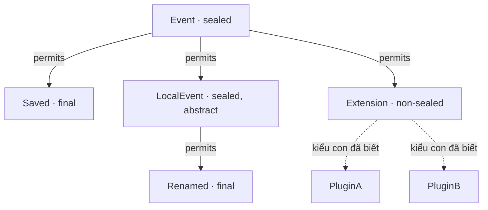

<a id="back-to-top"></a>

# Sealed và phân cấp

## Menu
- [isSealed và getPermittedSubclasses](#sealed-hierarchies-001)
- [Các lớp hoặc interface con trực tiếp được phép](#sealed-hierarchies-002)
- [Phân biệt metadata permits với mọi kiểu con đang tồn tại](#sealed-hierarchies-003)
- [Trường hợp không sealed và kết quả API tương ứng](#sealed-hierarchies-004)
- [Phân cấp kết hợp sealed, non-sealed, final, enum và record](#sealed-hierarchies-005)
- [Phân biệt đọc metadata, nạp lớp và kích hoạt khởi tạo](#sealed-hierarchies-006)
- [Giới hạn dùng danh sách permits để quyết định toàn bộ cách khởi tạo](#sealed-hierarchies-007)

## <a id="sealed-hierarchies-001">isSealed và getPermittedSubclasses</a>

<details>
<summary>Xem chi tiết</summary>

# isSealed và getPermittedSubclasses trong Java Reflection

## 1. Quan sát ranh giới kế thừa khi chỉ biết Class lúc chạy

Một kiểu `sealed` giới hạn những kiểu được phép kế thừa hoặc triển khai nó **trực tiếp**. Điều này giúp tác giả mô hình kiểm soát các nhánh đầu tiên của phân cấp, thay vì cho bất kỳ lớp nào tự bổ sung một nhánh trực tiếp mới.

Khi viết công cụ xem cấu trúc kiểu, tạo tài liệu hoặc kiểm tra mô hình lúc chạy, ta có thể chỉ nhận một `Class<?>`. Từ Java 17, hai API của `Class` hỗ trợ nhu cầu này:

- `isSealed()`: lớp hoặc interface đang xét có phải kiểu sealed hay không?
- `getPermittedSubclasses()`: những lớp hoặc interface con trực tiếp nào được phép, và có thể thu được dưới dạng đối tượng `Class` ở môi trường chạy?

Hai câu hỏi này mô tả **cấu trúc kiểu**. Chúng không tạo đối tượng, không gọi constructor và không tự tìm mọi đối tượng hoặc mọi lớp triển khai đang tồn tại.

## 2. Hợp đồng của hai phương thức

| API | Kết quả |
| --- | --- |
| `type.isSealed()` | `true` khi type là lớp hoặc interface sealed |
| `type.getPermittedSubclasses()` | `Class<?>[]` cho kiểu sealed; `null` nếu type không sealed |

Cần giữ các trường hợp khác nhau:

- **Không sealed:** `isSealed()` là `false`, `getPermittedSubclasses()` là `null`.
- **Sealed:** `isSealed()` là `true`, kết quả danh sách khác `null`.
- **Sealed với kết quả rỗng:** có thể nhận một mảng độ dài 0 theo hợp đồng API; không dùng độ dài lớn hơn 0 làm điều kiện nhận diện sealed.

Đối với kiểu nguyên thủy, `void` và kiểu mảng, `isSealed()` trả `false`, còn `getPermittedSubclasses()` trả `null`.

Tên `getPermittedSubclasses` không có nghĩa API chỉ dùng cho lớp. Khi nhận một sealed interface, nó có thể trả cả lớp triển khai trực tiếp và interface con trực tiếp.

Thứ tự các phần tử trong mảng không được quy định. Nếu cần đầu ra ổn định để in, hiển thị hoặc so sánh, hãy tự sắp xếp.

## 3. Ví dụ hoàn chỉnh: sealed interface, interface con và nhánh mở

Lưu thành `SealedInspectionDemo.java`:

~~~java
import java.lang.reflect.Modifier;
import java.util.Arrays;
import java.util.stream.Collectors;

public class SealedInspectionDemo {
    sealed interface Event
            permits DataEvent, Command, Extension {
    }

    record DataEvent(String text) implements Event {
    }

    sealed interface Command extends Event permits Start, Stop {
    }

    record Start() implements Command {
    }

    record Stop() implements Command {
    }

    non-sealed interface Extension extends Event {
    }

    static final class PluginEvent implements Extension {
    }

    private static void show(Class<?> type) {
        Class<?>[] permitted = type.getPermittedSubclasses();

        System.out.println(type.getSimpleName()
                + ".isSealed=" + type.isSealed());

        String names = permitted == null
                ? "null"
                : Arrays.stream(permitted)
                      .map(Class::getSimpleName)
                      .sorted()
                      .collect(Collectors.joining(","));

        System.out.println(type.getSimpleName()
                + ".permitted=" + names);
    }

    public static void main(String[] args) {
        show(Event.class);
        show(Command.class);
        show(Extension.class);
        show(DataEvent.class);

        System.out.println("Event.directHasStart="
                + Arrays.asList(Event.class.getPermittedSubclasses())
                      .contains(Start.class));
        System.out.println("Event.assignableFromStart="
                + Event.class.isAssignableFrom(Start.class));
        System.out.println("Extension.assignableFromPluginEvent="
                + Extension.class.isAssignableFrom(PluginEvent.class));
        System.out.println("DataEvent.final="
                + Modifier.isFinal(DataEvent.class.getModifiers()));
    }
}
~~~

Biên dịch và chạy bằng JDK 17 trở lên; không cần bật preview:

~~~bash
javac --release 17 SealedInspectionDemo.java
java SealedInspectionDemo
~~~

Kết quả:

~~~text
Event.isSealed=true
Event.permitted=Command,DataEvent,Extension
Command.isSealed=true
Command.permitted=Start,Stop
Extension.isSealed=false
Extension.permitted=null
DataEvent.isSealed=false
DataEvent.permitted=null
Event.directHasStart=false
Event.assignableFromStart=true
Extension.assignableFromPluginEvent=true
DataEvent.final=true
~~~

Ví dụ cho thấy:

1. `Event` cho phép trực tiếp ba nhánh: `DataEvent`, `Command`, `Extension`.
2. `Command` lại là sealed interface với hai kiểu con trực tiếp riêng.
3. `Start` là một loại `Event`, nhưng nó đi qua `Command`, nên không nằm trong danh sách trực tiếp của `Event`.
4. `Extension` là `non-sealed`. Nó vẫn có thể có lớp triển khai như `PluginEvent`, dù `getPermittedSubclasses()` của nó trả `null`.
5. `DataEvent` là record, có tính `final` ngầm định. Nó không sealed, và không cho kế thừa tiếp.

Các khai báo được đặt trong cùng một lớp ngoài để có thể biên dịch gọn trong một tệp. Trong dự án có module/package, các quy tắc về nơi khai báo kiểu con trực tiếp vẫn phải được thỏa mãn.

## 4. Danh sách trực tiếp khác toàn bộ phân cấp

`getPermittedSubclasses()` đọc ranh giới trực tiếp của đúng kiểu đang xét. Nó không tự trả về toàn bộ các kiểu ở mọi độ sâu.

Với ví dụ trên, có thể đọc các quan hệ như sau:

~~~text
Event [sealed]
  Command [sealed]
    Start [final record]
    Stop [final record]
  DataEvent [final record]
  Extension [non-sealed]
    PluginEvent [một ví dụ triển khai]
~~~

Các nhánh ngay dưới một nút sealed là nơi ta có thể tiếp tục dùng `getPermittedSubclasses()`. Quan hệ từ `Extension` đến `PluginEvent` không được khám phá bằng API này; chương trình ví dụ biết nó vì lớp đó có trong mã nguồn.

Nếu cần khảo sát sâu hơn, phải gọi lại API trên từng nút sealed. Khi gặp một nhánh không sealed và không final, phải ghi nhận rằng nhánh ấy có thể tiếp tục mở rộng. Không biến nó thành một “lá cuối cùng” chỉ vì API không trả danh sách con.

`isAssignableFrom` trả lời một câu hỏi khác: kiểu đích có nhận giá trị thuộc kiểu nguồn theo quan hệ kiểu hay không? Nó bao gồm quan hệ gián tiếp. Vì vậy, `Event.class.isAssignableFrom(Start.class)` là `true` trong khi `Start.class` không có trong mảng permitted trực tiếp của `Event`.

Cũng không dùng `getSuperclass()` để tìm ngược mọi quan hệ của interface. Một lớp chỉ có một lớp cha trực tiếp, nhưng có thể triển khai nhiều interface. Cấu trúc quan hệ kiểu cần được đọc theo đúng loại quan hệ.

## 5. final, sealed và non-sealed không có cùng ý nghĩa

| Loại khai báo | Ý nghĩa đối với việc mở rộng |
| --- | --- |
| `final class` | Không có lớp con |
| `sealed class/interface` | Chỉ các kiểu con trực tiếp được phép |
| `non-sealed class/interface` | Mở lại quyền mở rộng ở nhánh ấy |
| Lớp/interface thông thường không sealed | Không mang ràng buộc sealed của chính kiểu đó |

`isSealed() == false` không chứng minh mã nguồn đã dùng từ khóa `non-sealed`. Một lớp final, một lớp thông thường hoặc một interface thông thường cũng có thể cho kết quả ấy.

Trên Java 17, không có phương thức `Class.isNonSealed()`. Nếu đang đứng ở một kiểu con trực tiếp đã biết của một sealed type, có thể dùng thêm loại kiểu và cờ final để giải thích tình trạng của nhánh theo mô hình. Nhưng không đặt nhãn “được khai báo non-sealed” cho mọi lớp không sealed và không final trên toàn hệ thống.

Cũng không nhận diện sealed bằng cách tìm chuỗi `sealed` trong kết quả `Modifier.toString`. Dùng `Class.isSealed()` cho câu hỏi sealed và `Modifier.isFinal` cho câu hỏi final tương ứng.

Một lớp sealed không bắt buộc là abstract. Việc được phép xuất hiện trong danh sách permitted cũng không bảo đảm kiểu đó khởi tạo trực tiếp được: nó có thể là interface hoặc lớp abstract, hoặc cần các đối số constructor cụ thể.

## 6. Ví dụ duyệt các nhánh sealed và đánh dấu điểm mở

Lưu thành `SealedBranchWalkDemo.java`:

~~~java
import java.lang.reflect.Modifier;
import java.util.Arrays;
import java.util.Comparator;

public class SealedBranchWalkDemo {
    static abstract sealed class Result
            permits Success, Failure, Extensible {
    }

    static final class Success extends Result {
    }

    static abstract sealed class Failure extends Result
            permits Invalid, Timeout {
    }

    static final class Invalid extends Failure {
    }

    static final class Timeout extends Failure {
    }

    static non-sealed class Extensible extends Result {
    }

    static final class Custom extends Extensible {
    }

    private static void showBranch(Class<?> type, int depth) {
        String state = type.isSealed()
                ? "sealed"
                : Modifier.isFinal(type.getModifiers()) ? "final" : "open";

        System.out.println("  ".repeat(depth)
                + type.getSimpleName() + " [" + state + "]");

        if (!type.isSealed()) {
            return;
        }

        Class<?>[] children = type.getPermittedSubclasses();
        Arrays.sort(children, Comparator.comparing(Class::getName));
        for (Class<?> child : children) {
            showBranch(child, depth + 1);
        }
    }

    public static void main(String[] args) {
        showBranch(Result.class, 0);
    }
}
~~~

Biên dịch và chạy:

~~~bash
javac --release 17 SealedBranchWalkDemo.java
java SealedBranchWalkDemo
~~~

Kết quả:

~~~text
Result [sealed]
  Extensible [open]
  Failure [sealed]
    Invalid [final]
    Timeout [final]
  Success [final]
~~~

Từ `open` ở đây là nhãn hiển thị của công cụ cho nút không sealed và không final. Trong mô hình cụ thể, `Extensible` được khai báo `non-sealed`.

`Custom` không được in. Nó vẫn tồn tại trong ví dụ, nhưng không thể được liệt kê bằng `Extensible.class.getPermittedSubclasses()`. Bản in phải được hiểu là **các nhánh đi được bằng metadata sealed**, không phải bản quét đầy đủ mọi lớp của ứng dụng.

Ví dụ dùng kế thừa lớp đơn để tập trung vào API. Nếu mở rộng công cụ cho đồ thị interface, cùng một kiểu có thể xuất hiện theo nhiều đường; cần quyết định có hiển thị lại theo đường hay dùng tập `Class` đã thăm để tránh xử lý lặp.

## 7. Những giới hạn của kết quả lúc chạy

API cố gắng lấy các đối tượng `Class` cho các kiểu được ghi nhận là permitted trực tiếp, sử dụng bộ nạp định nghĩa của kiểu đang xét. Nếu không lấy được một đối tượng `Class`, mục tương ứng có thể bị bỏ qua âm thầm theo hợp đồng API.

Vì vậy:

- Không coi mảng kết quả như một bản chép chắc chắn đầy đủ của mọi tên đã ghi trong class file ở mọi môi trường.
- Một mảng rỗng không đồng nghĩa với `isSealed() == false`.
- Nếu công cụ kiểm toán cần đối chiếu mọi tên trong metadata nhị phân, phải có quy trình kiểm tra class file và môi trường nạp phù hợp; riêng hai API này không cung cấp báo cáo từng mục đã bị bỏ qua.
- Những kiểm tra quyền truy cập được API quy định vẫn có thể gây lỗi, chẳng hạn `SecurityException` trong môi trường có chính sách tương ứng.

Ví dụ có đầy đủ các lớp đã biên dịch trong cùng thư mục nên thu được các kiểu như bản in. Khi triển khai, không nên chữa một kết quả thiếu bằng cách tự đoán tên lớp hoặc bỏ qua việc đóng gói sai.

Lời gọi lấy metadata cũng không phải tuyên bố rằng JVM không làm việc gì: nó có thể liên quan đến việc nạp các kiểu cần thiết. Hai API không tạo instance hay thực hiện constructor của các kiểu được liệt kê. Không cần khởi tạo thử từng kiểu chỉ để hiển thị tên và quan hệ permitted.

## 8. Ứng dụng và ranh giới suy luận

**Trình xem mô hình:** hiển thị các nhánh trực tiếp, đánh dấu nút sealed, nút final và điểm mở. Nếu gặp mảng rỗng hoặc lỗi nạp, cần diễn tả đúng mức độ thông tin có được.

**Kiểm tra kiến trúc:** xác nhận những kiểu trực tiếp mong đợi có mặt, hoặc phát hiện thay đổi của mô hình đã triển khai. So sánh theo một tập/khóa có quy tắc, không phụ thuộc thứ tự mảng API.

**Công cụ tài liệu:** liên kết từng kiểu với mô tả của nó. Khi có nhánh non-sealed, ghi nhận rằng các lớp con sâu hơn có thể đến từ nơi khác.

**Công cụ tạo đối tượng:** danh sách permitted chỉ là bước khám phá cấu trúc. Nó không thay thế việc chọn kiểu nghiệp vụ, kiểm tra quyền dùng kiểu ấy, chuẩn bị dữ liệu hay tìm constructor hợp lệ.

Không tự suy ra rằng một root sealed luôn tạo thành một tập hữu hạn các lớp cụ thể ở mọi độ sâu. Nhánh non-sealed có thể tiếp tục mở rộng. Ngay cả một cây không có điểm mở cũng cần được đọc đúng với lớp abstract, kiểu có thể khởi tạo và mức độ đầy đủ của metadata đang thu được.

Danh sách permitted cũng không phải danh sách các đối tượng đang sống, các bean đã đăng ký hoặc các plugin đã kích hoạt. Những hệ thống đó có vòng đời và nguồn đăng ký riêng.

## 9. Những lỗi thường gặp

| Sai lầm | Cách hiểu hoặc xử lý đúng |
| --- | --- |
| Duyệt ngay `getPermittedSubclasses()` với mọi Class | Kiểm tra sealed hoặc xử lý trường hợp `null` |
| Dùng độ dài mảng lớn hơn 0 để nhận diện sealed | Dùng `isSealed()`; mảng sealed có thể rỗng |
| Cho rằng API trả mọi kiểu con gián tiếp | Chỉ gồm các kiểu con trực tiếp thu được |
| Cho rằng mọi phần tử là lớp cụ thể | Có thể có interface hoặc lớp abstract |
| Gọi `getPermittedSubclasses()` trên non-sealed để tìm triển khai | API trả `null`; cần nguồn khám phá khác nếu thực sự có nhu cầu |
| Dùng thứ tự mảng làm thứ tự nguồn | Tự sắp xếp đầu ra; thứ tự API không được quy định |
| Đồng nhất không sealed với từ khóa non-sealed | Phân biệt final, kiểu thông thường và nhánh được mở lại |
| Coi mảng trả về là bằng chứng đủ về mọi mục trong class file | Xét việc API có thể bỏ qua mục không lấy được Class |
| Tạo thử instance của mọi kiểu được phép | Metadata permitted không cung cấp hợp đồng khởi tạo đối tượng |

Khi viết một hàm tiện ích, hãy quyết định có cần giữ sự khác nhau giữa “không sealed” và “sealed nhưng kết quả rỗng” hay không. Trả một danh sách rỗng cho cả hai có thể tiện cho vòng lặp, nhưng làm mất thông tin nếu phía gọi cần phân loại mô hình.

## 10. Tự kiểm tra

1. Vì sao `Start` không có trong permitted trực tiếp của `Event`, dù `Start` là một loại `Event`?
2. `Extension.class.getPermittedSubclasses()` trả `null` có nghĩa là không thể có `PluginEvent` không?
3. `isSealed() == false` có đủ để khẳng định kiểu được khai báo `non-sealed` không?
4. API có bảo đảm thứ tự giống danh sách `permits` trong nguồn không?
5. Với một Class không sealed, có nên gọi trực tiếp `getPermittedSubclasses().length` không?
6. Một phần tử trong mảng permitted có nhất thiết tạo được bằng constructor không tham số không?

Đáp án:

1. `Start` triển khai trực tiếp `Command`; quan hệ với `Event` là gián tiếp.
2. Không. `null` ở đây có nghĩa kiểu đang xét không sealed; nó không phải bản liệt kê triển khai.
3. Không; kiểu final hoặc thông thường cũng có thể không sealed.
4. Không. Nếu cần ổn định, phải sắp xếp theo quy tắc của công cụ.
5. Không; kết quả là `null`, nên truy cập độ dài sẽ gây `NullPointerException`.
6. Không. Nó có thể là interface, lớp abstract hoặc lớp có yêu cầu constructor khác.

## Tài liệu đối chiếu

- [Java 17 — Class.isSealed](https://docs.oracle.com/en/java/javase/17/docs/api/java.base/java/lang/Class.html#isSealed()).
- [Java 17 — Class.getPermittedSubclasses](https://docs.oracle.com/en/java/javase/17/docs/api/java.base/java/lang/Class.html#getPermittedSubclasses()).
- [JLS 17 — sealed, non-sealed và final class](https://docs.oracle.com/javase/specs/jls/se17/html/jls-8.html#jls-8.1.1.2).
- [JLS 17 — sealed và non-sealed interface](https://docs.oracle.com/javase/specs/jls/se17/html/jls-9.html#jls-9.1.1.4).


</details>

- [Quay lại đầu trang](#back-to-top)

---

## <a id="sealed-hierarchies-002">Các lớp hoặc interface con trực tiếp được phép</a>

<details>
<summary>Xem chi tiết</summary>

# Các lớp hoặc interface con trực tiếp được phép trong phân cấp sealed

## 1. “Trực tiếp” là một quan hệ, không phải mọi kiểu con

Một kiểu sealed kiểm soát những lớp hoặc interface được phép nằm **ngay dưới nó** trong quan hệ kế thừa. Các kiểu ở sâu hơn chịu ràng buộc của nhánh trung gian tương ứng.

Ví dụ, nếu `MobileWallet` triển khai `Wallet`, còn `Wallet` mở rộng `PaymentMethod`, thì `MobileWallet` là một loại `PaymentMethod` nhưng không phải kiểu con trực tiếp của `PaymentMethod`.

Phân biệt này rất quan trọng khi đọc:

~~~java
Class<?>[] children = parent.getPermittedSubclasses();
~~~

Đây là đoạn minh họa trong một phương thức có biến `Class<?> parent`. Kết quả, khi parent là sealed, mô tả các kiểu con **trực tiếp được phép** có thể thu được ở môi trường chạy. Nó không tự làm phẳng toàn bộ phân cấp thành một danh sách.

Một công cụ hiển thị mô hình, kiểm tra kiến trúc hoặc chọn các nhánh xử lý cần giữ đúng quan hệ này. Nếu coi mọi kiểu con gián tiếp là một mục trực tiếp, công cụ đã thay đổi ý nghĩa của mô hình.

## 2. permits và extends/implements đảm nhiệm hai phần khác nhau

`permits` chỉ ra ai được phép là kiểu con trực tiếp. `extends` hoặc `implements` khai báo quan hệ kiểu thực tế từ phía kiểu con.

| Kiểu cha sealed | Kiểu con trực tiếp hợp lệ | Cách kiểu con khai báo quan hệ |
| --- | --- | --- |
| Một class | Một class | `extends Parent` |
| Một interface | Một class | `implements Parent` |
| Một interface | Một interface | `extends Parent` |

Một interface không thể kế thừa một class, nên danh sách permitted của một sealed class không trở thành danh sách interface triển khai nó.

Chỉ liệt kê một tên trong `permits` không tự làm lớp ấy kế thừa hoặc triển khai kiểu cha. Ngược lại, một kiểu không được cho phép không thể tự bổ sung quan hệ trực tiếp với một kiểu sealed bằng cách chỉ viết `extends` hoặc `implements`.

Kiểu con trực tiếp cũng cần xác định khả năng mở rộng tiếp:

- Class `final`: dừng kế thừa ở class ấy.
- Class hoặc interface `sealed`: tiếp tục kiểm soát các kiểu con trực tiếp của chính nó.
- Class hoặc interface `non-sealed`: mở lại việc mở rộng ở nhánh ấy.
- Một số dạng khai báo có tính chất ngầm định phù hợp, chẳng hạn record là final.

Interface không dùng `final`. Nếu là interface con trực tiếp của sealed interface, nó tiếp tục theo hướng sealed hoặc non-sealed.

## 3. Ví dụ chạy được: danh sách có cả class và interface

Lưu thành `DirectPermittedTypesDemo.java`:

~~~java
import java.util.Arrays;
import java.util.Comparator;
import java.util.stream.Collectors;

public class DirectPermittedTypesDemo {
    sealed interface PaymentMethod
            permits Card, Wallet, ExternalPayment {
    }

    record Card(String network) implements PaymentMethod {
    }

    sealed interface Wallet extends PaymentMethod
            permits MobileWallet, BrowserWallet {
    }

    record MobileWallet(String account) implements Wallet {
    }

    record BrowserWallet(String account) implements Wallet {
    }

    static non-sealed class ExternalPayment implements PaymentMethod {
    }

    static final class VendorPayment extends ExternalPayment {
    }

    private static boolean hasDirectRelation(
            Class<?> parent, Class<?> candidate) {
        if (parent.isInterface()) {
            return Arrays.asList(candidate.getInterfaces()).contains(parent);
        }
        return candidate.getSuperclass() == parent;
    }

    private static String childNames(Class<?> sealedType) {
        return Arrays.stream(sealedType.getPermittedSubclasses())
                .map(Class::getSimpleName)
                .sorted()
                .collect(Collectors.joining(","));
    }

    public static void main(String[] args) {
        Class<?> root = PaymentMethod.class;
        Class<?>[] children = root.getPermittedSubclasses();
        Arrays.sort(children, Comparator.comparing(Class::getName));

        System.out.println("PaymentMethod.children="
                + childNames(root));

        for (Class<?> child : children) {
            System.out.println(child.getSimpleName()
                    + ": kind=" + (child.isInterface() ? "interface" : "class")
                    + ", direct=" + hasDirectRelation(root, child));
        }

        System.out.println("Wallet.children=" + childNames(Wallet.class));
        System.out.println("MobileWallet.directToRoot="
                + hasDirectRelation(root, MobileWallet.class));
        System.out.println("MobileWallet.assignableToRoot="
                + root.isAssignableFrom(MobileWallet.class));
        System.out.println("VendorPayment.directToRoot="
                + hasDirectRelation(root, VendorPayment.class));
        System.out.println("VendorPayment.assignableToRoot="
                + root.isAssignableFrom(VendorPayment.class));
    }
}
~~~

Biên dịch và chạy bằng JDK 17 trở lên:

~~~bash
javac --release 17 DirectPermittedTypesDemo.java
java DirectPermittedTypesDemo
~~~

Kết quả:

~~~text
PaymentMethod.children=Card,ExternalPayment,Wallet
Card: kind=class, direct=true
ExternalPayment: kind=class, direct=true
Wallet: kind=interface, direct=true
Wallet.children=BrowserWallet,MobileWallet
MobileWallet.directToRoot=false
MobileWallet.assignableToRoot=true
VendorPayment.directToRoot=false
VendorPayment.assignableToRoot=true
~~~

Ba điểm quan trọng:

1. `getPermittedSubclasses()` trên một interface có thể trả một interface con như `Wallet`, dù tên API chứa chữ “Subclasses”.
2. `MobileWallet` thuộc nhánh `Wallet`, còn `VendorPayment` thuộc nhánh `ExternalPayment`. Cả hai không có trong danh sách trực tiếp của root.
3. `isAssignableFrom` chấp nhận quan hệ gián tiếp, nên hai kiểu ấy vẫn gán được về `PaymentMethod`.

Hàm `childNames` trong ví dụ chỉ được gọi với các kiểu đã biết là sealed. Nếu dùng cho một Class bất kỳ, phải xử lý trường hợp `getPermittedSubclasses()` trả `null`.

Việc sắp xếp được thực hiện để bản in ổn định. Không lấy thứ tự mảng Reflection trả về làm thứ tự bắt buộc của danh sách trong mã nguồn.

## 4. Kiểm chứng một cạnh trực tiếp bằng Reflection

Có thể quan sát quan hệ từ phía kiểu con:

- Với cha là class, `candidate.getSuperclass() == parent` kiểm tra lớp cha trực tiếp.
- Với cha là interface, `candidate.getInterfaces()` cho các interface trực tiếp mà candidate triển khai hoặc mở rộng.
- `parent.isAssignableFrom(candidate)` trả lời quan hệ kiểu rộng hơn, bao gồm gián tiếp.

Ví dụ `VendorPayment` kế thừa `ExternalPayment`. Nó nhận quan hệ với `PaymentMethod` qua lớp cha, nhưng không có `PaymentMethod` trong danh sách interface trực tiếp của chính nó.

Một lớp có thể trực tiếp triển khai nhiều interface. Nếu nhiều interface ấy đều sealed, quan hệ trực tiếp phải hợp lệ đối với từng interface tương ứng. Vì vậy, phân cấp interface có thể là một đồ thị, không luôn là một cây có đúng một cha.

Hàm `hasDirectRelation` ở trên minh họa cách đọc các cạnh. Nó không phải cách cấp phép mới hoặc cách vượt qua quy tắc sealed. Với kết quả hợp lệ trả từ `getPermittedSubclasses()`, API đã dùng khái niệm kiểu con trực tiếp; công cụ có thể đọc cạnh ngược để giải thích và kiểm tra dữ liệu của mình.

Nếu cần duyệt sâu hơn, hãy giữ riêng từng cạnh cha–con và gọi tiếp trên nhánh sealed. Không đưa mọi hậu duệ vào cùng danh sách con trực tiếp của root chỉ để làm giao diện đơn giản hơn.

## 5. Danh sách có thể được suy ra mà không viết permits

Một khai báo sealed có thể không viết mệnh đề `permits` nếu trình biên dịch suy ra được các kiểu con trực tiếp theo quy tắc trong cùng đơn vị biên dịch. Với class sealed thông thường, các class có tên chuẩn phù hợp, được khai báo trong cùng đơn vị biên dịch và trực tiếp `extends` class ấy được dùng để suy ra danh sách.

Reflection vẫn đọc được danh sách permitted đã được ghi trong kết quả biên dịch. Nó không yêu cầu ứng dụng phân tích lại văn bản nguồn để tìm từ khóa `permits`.

Lưu thành `InferredDirectChildrenDemo.java`:

~~~java
import java.util.Arrays;
import java.util.stream.Collectors;

public class InferredDirectChildrenDemo {
    static abstract sealed class Document {
    }

    static final class Invoice extends Document {
    }

    static abstract sealed class Report extends Document
            permits SummaryReport {
    }

    static final class SummaryReport extends Report {
    }

    private static String childNames(Class<?> type) {
        return Arrays.stream(type.getPermittedSubclasses())
                .map(Class::getSimpleName)
                .sorted()
                .collect(Collectors.joining(","));
    }

    public static void main(String[] args) {
        System.out.println("Document.children="
                + childNames(Document.class));
        System.out.println("Report.children="
                + childNames(Report.class));
        System.out.println("Document.memberClasses="
                + Document.class.getDeclaredClasses().length);
        System.out.println("SummaryReport.directToDocument="
                + (SummaryReport.class.getSuperclass() == Document.class));
        System.out.println("Document.assignableFromSummaryReport="
                + Document.class.isAssignableFrom(SummaryReport.class));
        System.out.println("Invoice.superclass="
                + Invoice.class.getSuperclass().getSimpleName());
    }
}
~~~

Biên dịch và chạy:

~~~bash
javac --release 17 InferredDirectChildrenDemo.java
java InferredDirectChildrenDemo
~~~

Kết quả:

~~~text
Document.children=Invoice,Report
Report.children=SummaryReport
Document.memberClasses=0
SummaryReport.directToDocument=false
Document.assignableFromSummaryReport=true
Invoice.superclass=Document
~~~

`Document` không viết `permits`, nhưng hai lớp `Invoice` và `Report` trực tiếp kế thừa nó trong cùng tệp. Danh sách của `Document` không chứa `SummaryReport`, vì lớp ấy có cha trực tiếp là `Report`.

Các lớp đều được lồng trong lớp ngoài `InferredDirectChildrenDemo` để ví dụ nằm gọn trong một tệp. Chúng là các thành viên của lớp ngoài; không phải các lớp thành viên được khai báo bên trong `Document`.

Vì thế, `Document.class.getDeclaredClasses()` trả mảng rỗng trong ví dụ. **Lớp thành viên** và **lớp con kế thừa** là hai loại quan hệ khác nhau. `getDeclaredClasses()` không phải API thay thế cho danh sách permitted.

## 6. Ranh giới khai báo của các kiểu trực tiếp

Việc đặt các kiểu trong ví dụ không chỉ nhằm thuận tiện cho việc đọc. Java áp dụng ràng buộc về nơi khai báo các kiểu con trực tiếp được phép:

- Với kiểu sealed trong một named module, các kiểu trực tiếp được phép phải thuộc cùng module.
- Với kiểu sealed trong unnamed module, chúng phải thuộc cùng package.

Trong named module, cùng module không nhất thiết đồng nghĩa cùng package; những quy tắc truy cập và tham chiếu kiểu liên quan vẫn cần được thỏa mãn.

Mục đích là giữ ranh giới mở rộng trực tiếp trong phạm vi quản lý của mô hình. Một lớp ở ngoài không thể tự trở thành nhánh trực tiếp mới chỉ bằng việc xuất hiện trên classpath.

Đối với nhánh `non-sealed`, các kiểu ở sâu hơn không phải được thêm từng tên vào permitted của root. Trong ví dụ đầu, `VendorPayment` mở rộng `ExternalPayment`; nó không cần và không nên được coi là một phần tử trực tiếp của `PaymentMethod`.

Nếu muốn thay đổi ai là kiểu con trực tiếp, đó là thay đổi khai báo kiểu và kết quả biên dịch tương ứng. Sửa một mảng `Class<?>[]` đã nhận từ Reflection không cập nhật quyền kế thừa của JVM.

## 7. Điều kết quả permitted có và không có

Một phần tử trong danh sách cho biết quan hệ kiểu trực tiếp được phép; nó chưa trả lời toàn bộ các câu hỏi khác:

| Câu hỏi | Có được suy ra chỉ từ việc có trong danh sách không? |
| --- | --- |
| Đây là nhánh trực tiếp của kiểu sealed đang xét? | Có, đối với phần tử hợp lệ được API trả về |
| Đây chắc chắn là class? | Không; với cha là interface, có thể là interface |
| Đây chắc chắn là kiểu cụ thể có thể tạo instance? | Không; có thể là abstract hoặc interface |
| Có constructor public không tham số? | Không |
| Có đối tượng của kiểu ấy đang sống? | Không |
| Kiểu ấy đã được đăng ký làm bean/plugin trong ứng dụng? | Không |
| Mọi kiểu con sâu hơn đều nằm trong mảng này? | Không |

API cố gắng lấy các đối tượng `Class` cho những kiểu permitted bằng bộ nạp định nghĩa của kiểu cha. Mục không lấy được Class có thể bị bỏ qua theo hợp đồng API. Vì vậy, khi cần một báo cáo kiểm toán đầy đủ mọi tên trong metadata nhị phân, phải xét thêm class file và môi trường nạp, không chỉ nhìn mảng kết quả.

Với kiểu không sealed, phương thức trả `null`. Với kiểu sealed, nó trả một mảng khác null nhưng có thể rỗng theo hợp đồng. Giữ nguyên sự phân biệt này nếu công cụ cần biết kiểu đang mở hay sealed nhưng chưa thu được phần tử.

Việc lấy danh sách không phải bước tạo đối tượng. Một công cụ xem quan hệ kiểu có thể làm việc với tên, loại kiểu và cạnh trực tiếp mà không gọi constructor của các kiểu trong mảng.

## 8. Cách trình bày và kiểm tra mô hình cho đúng

Khi xây công cụ dùng danh sách permitted, một quy trình rõ ràng là:

1. Xác nhận kiểu cha và tình trạng sealed.
2. Lấy các phần tử trực tiếp.
3. Phân loại mỗi phần tử là class hay interface.
4. Giữ quan hệ trực tiếp và đối tượng `Class` làm danh tính kiểu trong JVM.
5. Nếu cần, mở rộng riêng các nút sealed, đánh dấu rõ nhánh non-sealed hoặc điểm chưa đủ thông tin.
6. Sắp xếp cách trình bày theo quy tắc tường minh.

Tên đơn giản phù hợp cho các ví dụ ngắn, nhưng không phải khóa duy nhất của mọi kiểu trong một ứng dụng. Các package hoặc bộ nạp lớp khác nhau có thể tạo những kiểu có tên hiển thị giống nhau. Không ghép nhầm hai nút chỉ vì `getSimpleName()` trùng nhau.

Nếu kiểm tra mô hình trong một bài kiểm thử, nên so sánh tập kiểu trực tiếp mong đợi, hoặc các quan hệ cần thiết. Không đóng cứng thứ tự mảng do API trả về. Nếu ứng dụng cần bảo đảm các lớp được đóng gói đầy đủ, hãy xác minh môi trường cung cấp chúng thay vì tự coi một mục bị thiếu là bằng chứng rằng mã nguồn không từng cho phép mục ấy.

Cũng không tự khởi tạo từng class chỉ để “xác nhận nó được phép”. Việc nằm trong phân cấp và việc tạo đối tượng hợp lệ là các bước có hợp đồng khác nhau.

## 9. Tự kiểm tra

1. `MobileWallet` là một loại `PaymentMethod`; vì sao nó không ở danh sách trực tiếp của `PaymentMethod`?
2. Tên API chứa “Subclasses” có loại trừ interface con không?
3. Một class được liệt kê trong `permits` có thể bỏ `extends`/`implements` rồi tự nhận quan hệ nhờ danh sách ấy không?
4. `getDeclaredClasses()` có thể dùng để tìm mọi kiểu con permitted không?
5. Không thấy mệnh đề `permits` trong nguồn có đủ để kết luận Reflection không thể trả danh sách không?
6. Một lớp con của nhánh non-sealed có phải được đưa vào permitted trực tiếp của root không?

Đáp án:

1. Nó triển khai trực tiếp `Wallet`; quan hệ với `PaymentMethod` đi qua nhánh ấy.
2. Không. Sealed interface có thể cho phép cả class triển khai trực tiếp và interface mở rộng trực tiếp.
3. Không. Danh sách cấp phép và khai báo quan hệ phải phù hợp với nhau.
4. Không. Đó là API về kiểu thành viên được khai báo bên trong một kiểu.
5. Không. Trình biên dịch có thể suy ra danh sách theo các quy tắc tương ứng.
6. Không. Nó nằm sâu hơn trong nhánh; không tự trở thành cạnh trực tiếp của root.

## Tài liệu đối chiếu

- [Java 17 — Class.getPermittedSubclasses](https://docs.oracle.com/en/java/javase/17/docs/api/java.base/java/lang/Class.html#getPermittedSubclasses()).
- [Java 17 — Class.getInterfaces](https://docs.oracle.com/en/java/javase/17/docs/api/java.base/java/lang/Class.html#getInterfaces()).
- [JLS 17 — Các lớp con trực tiếp được phép](https://docs.oracle.com/javase/specs/jls/se17/html/jls-8.html#jls-8.1.6).
- [JLS 17 — Class và interface con trực tiếp của sealed interface](https://docs.oracle.com/javase/specs/jls/se17/html/jls-9.html#jls-9.1.4).


</details>

- [Quay lại đầu trang](#back-to-top)

---

## <a id="sealed-hierarchies-003">Phân biệt metadata permits với mọi kiểu con đang tồn tại</a>

<details>
<summary>Xem chi tiết</summary>

# Metadata `permits` khác gì mọi kiểu con đang tồn tại?

`getPermittedSubclasses()` thường bị hiểu nhầm là cách “lấy tất cả kiểu con” của một lớp hoặc interface. Thực ra, nó đọc một phần metadata của **phân cấp sealed**: các kiểu con **trực tiếp được cho phép** của kiểu đang xét.

Đó là câu hỏi khác với “có những hậu duệ nào”, “JVM đã nạp những lớp nào” hoặc “đang có những đối tượng nào”. Phân biệt các câu hỏi này giúp công cụ phân tích kiểu, ánh xạ dữ liệu hoặc xử lý plugin tránh kết luận rằng một danh sách đã đầy đủ khi nó chưa đủ căn cứ.

Các API sealed trong bài có từ Java 17. Ví dụ chạy bằng Java 17 trở lên, không cần tính năng preview.

## 1. Bốn tập thông tin không nên gộp lại

| Câu hỏi | Phạm vi thông tin |
| --- | --- |
| Gốc sealed cho phép những kiểu con trực tiếp nào? | Metadata `permits` của chính gốc |
| Những kiểu nào là hậu duệ trực tiếp hoặc gián tiếp? | Quan hệ kiểu trên một phạm vi kiểu cần xác định |
| JVM hiện đã nạp những lớp nào? | Trạng thái nạp lớp tại thời điểm quan sát |
| Những đối tượng nào đang được giữ hoặc đang sống? | Trạng thái đối tượng; không phải danh sách khai báo kiểu |

Một lớp có thể là hậu duệ gián tiếp nhưng không nằm trong danh sách trực tiếp của gốc. Một kiểu được cho phép cũng không cần có đối tượng được tạo ra mới xuất hiện trong metadata.

`Class.isAssignableFrom(candidate)` kiểm tra quan hệ với **một ứng viên đã có**. Nó không tự tìm hay liệt kê tất cả ứng viên trong môi trường.

## 2. Ý nghĩa của metadata sealed

Trong Java, `sealed` giới hạn các kiểu con trực tiếp. Với một interface sealed, các mục được cho phép có thể là lớp triển khai hoặc interface con. Quy tắc này thuộc [phân cấp sealed của lớp](https://docs.oracle.com/javase/specs/jls/se21/html/jls-8.html#jls-8.1.6) và [interface](https://docs.oracle.com/javase/specs/jls/se21/html/jls-9.html#jls-9.1.4).

Ở mức tệp `.class`, thuộc tính [`PermittedSubclasses`](https://docs.oracle.com/javase/specs/jvms/se21/html/jvms-4.html#jvms-4.7.31) ghi các kiểu được phép trực tiếp mở rộng hoặc triển khai kiểu hiện tại. Nó không phải một bộ đăng ký đối tượng, cũng không lưu toàn bộ cây hậu duệ.

Tên của API có chữ `Subclasses`, nhưng khi dùng với interface, kết quả vẫn có thể chứa interface con. Một mục trong kết quả cũng có thể là lớp trừu tượng; không được coi mọi mục là lớp có thể khởi tạo.

### Không nhất thiết phải có chữ `permits` trong mã nguồn

Khi các điều kiện ngôn ngữ cho phép, trình biên dịch suy ra tập kiểu con được cho phép từ cùng đơn vị biên dịch. Vì vậy, một khai báo không viết tường minh mệnh đề `permits` vẫn có metadata sealed.

Reflection đọc cấu trúc kiểu đã biên dịch; nó không đang tìm chuỗi chữ `permits` trong tệp nguồn.

## 3. Phân cấp dùng trong thí nghiệm



Các đường `permits` là quan hệ metadata trực tiếp. Hai đường nét đứt minh họa kiểu con của nhánh mở mà chương trình đã biết qua cách khác; chúng không được lấy từ `Extension.getPermittedSubclasses()`.

## 4. Ví dụ Java 17+ chạy độc lập

Lưu toàn bộ vào **`SealedPermitsDemo.java`**:

```java
import java.lang.reflect.Modifier;
import java.util.Arrays;
import java.util.HashSet;
import java.util.List;
import java.util.Set;

public class SealedPermitsDemo {
    public sealed interface Event permits Saved, LocalEvent, Extension {
    }

    public record Saved(String id) implements Event {
    }

    public abstract static sealed class LocalEvent implements Event
            permits Renamed {
    }

    public static final class Renamed extends LocalEvent {
    }

    public non-sealed interface Extension extends Event {
    }

    public static final class PluginA implements Extension {
    }

    public static final class PluginB implements Extension {
    }

    public sealed interface Inferred {
    }

    public static final class InferredLeaf implements Inferred {
    }

    private static String names(Class<?>[] types) {
        return Arrays.stream(types)
                .map(Class::getSimpleName)
                .sorted()
                .toList()
                .toString();
    }

    private static String permittedNames(Class<?> type) {
        Class<?>[] permitted = type.getPermittedSubclasses();
        return permitted == null ? "null" : names(permitted);
    }

    private static boolean isDirectPermitted(Class<?> parent, Class<?> candidate) {
        Class<?>[] permitted = parent.getPermittedSubclasses();
        return permitted != null
                && Arrays.asList(permitted).contains(candidate);
    }

    private static void collectByPermits(Class<?> type, Set<Class<?>> visited) {
        if (!visited.add(type)) {
            return;
        }
        Class<?>[] permitted = type.getPermittedSubclasses();
        if (permitted != null) {
            for (Class<?> child : permitted) {
                collectByPermits(child, visited);
            }
        }
    }

    public static void main(String[] args) {
        System.out.println("Event permits = " + permittedNames(Event.class));
        System.out.println("LocalEvent permits = " + permittedNames(LocalEvent.class));
        System.out.println("Extension isSealed = " + Extension.class.isSealed());
        System.out.println("Extension permits = " + permittedNames(Extension.class));
        System.out.println("Saved isFinal = "
                + Modifier.isFinal(Saved.class.getModifiers()));
        System.out.println("Saved permits = " + permittedNames(Saved.class));

        System.out.println("Renamed fits Event = "
                + Event.class.isAssignableFrom(Renamed.class));
        System.out.println("Renamed directly permitted by Event = "
                + isDirectPermitted(Event.class, Renamed.class));
        System.out.println("PluginA fits Event = "
                + Event.class.isAssignableFrom(PluginA.class));
        System.out.println("PluginA directly permitted by Event = "
                + isDirectPermitted(Event.class, PluginA.class));

        Set<Class<?>> reached = new HashSet<>();
        collectByPermits(Event.class, reached);
        reached.remove(Event.class);
        System.out.println("Reached through permits = "
                + names(reached.toArray(Class<?>[]::new)));

        Class<?>[] candidates = {
                Saved.class, LocalEvent.class, Renamed.class,
                Extension.class, PluginA.class, PluginB.class, String.class
        };
        System.out.println("Matching supplied candidates = "
                + Arrays.stream(candidates)
                        .filter(Event.class::isAssignableFrom)
                        .map(Class::getSimpleName)
                        .sorted()
                        .toList());

        List<Event> objects = List.of(new Saved("S1"), new PluginA());
        System.out.println("Types in supplied objects = "
                + objects.stream().map(Object::getClass)
                        .map(Class::getSimpleName)
                        .distinct()
                        .sorted()
                        .toList());
        System.out.println("Event permits after creating objects = "
                + permittedNames(Event.class));
        System.out.println("Inferred permits = "
                + permittedNames(Inferred.class));
        System.out.println("Object permits = " + permittedNames(Object.class));
    }
}
```

Biên dịch và chạy:

```bash
javac -encoding UTF-8 --release 17 -Xlint:all -Werror SealedPermitsDemo.java
java SealedPermitsDemo
```

Kết quả:

```text
Event permits = [Extension, LocalEvent, Saved]
LocalEvent permits = [Renamed]
Extension isSealed = false
Extension permits = null
Saved isFinal = true
Saved permits = null
Renamed fits Event = true
Renamed directly permitted by Event = false
PluginA fits Event = true
PluginA directly permitted by Event = false
Reached through permits = [Extension, LocalEvent, Renamed, Saved]
Matching supplied candidates = [Extension, LocalEvent, PluginA, PluginB, Renamed, Saved]
Types in supplied objects = [PluginA, Saved]
Event permits after creating objects = [Extension, LocalEvent, Saved]
Inferred permits = [InferredLeaf]
Object permits = null
```

Hàm `names()` và các đoạn in danh sách chủ động sắp xếp tên. Chương trình không dựa vào thứ tự trả về của mảng để quyết định quan hệ kiểu.

## 5. Trực tiếp không có nghĩa là toàn bộ hậu duệ

`Event` trực tiếp cho phép `Saved`, `LocalEvent`, `Extension`. `Renamed` lại được `LocalEvent` trực tiếp cho phép.

Vì thế, hai kết quả sau không mâu thuẫn:

- `Event.class.isAssignableFrom(Renamed.class)` là `true`: `Renamed` có quan hệ kiểu phù hợp với `Event` qua `LocalEvent`.
- `Renamed` không nằm trong danh sách trực tiếp của `Event`.

Muốn đi sâu trong phần sealed, cần truy vấn tiếp từng kiểu con sealed. Hàm `collectByPermits` thực hiện bước đó và tìm thêm `Renamed`.

Tuy nhiên, kết quả `[Extension, LocalEvent, Renamed, Saved]` chỉ là những nút đi tới được bằng các cạnh metadata mà hàm đã duyệt. Nó không phải chứng minh rằng không còn kiểu con nào khác trong toàn bộ phân cấp.

Tập `visited` dùng `Class<?>` để tránh xử lý lặp nếu cùng một kiểu được tiếp cận qua nhiều nhánh interface. Mã in tên ngắn chỉ để dễ đọc; công cụ thực tế không nên nhận diện kiểu chỉ bằng `getSimpleName()`.

## 6. `non-sealed` là ranh giới mở

`Extension` được phép trực tiếp mở rộng `Event`, nhưng bản thân nó là `non-sealed`. Do đó, các lớp có thể triển khai `Extension` theo các quy tắc thông thường về truy cập và quan hệ kiểu.

`PluginA` và `PluginB` là những ví dụ hợp lệ của nhánh đó. Chúng phù hợp với `Event`, nhưng không cần xuất hiện trong `Event.permits` vì không trực tiếp triển khai `Event`.

`Extension.class.getPermittedSubclasses()` cho `null`. Điều này có nghĩa **`Extension` không phải kiểu sealed**, không có nghĩa **`Extension` không có lớp triển khai**.

Trong cùng thí nghiệm, `Saved` là record `final`, cũng cho kết quả `null`. Nhưng `Saved` không có kiểu con hợp lệ, trong khi `Extension` là một nhánh mở. Vì vậy, chỉ nhìn `null` không đủ để kết luận phân cấp đã kết thúc theo cùng một nghĩa.

Ngay cả `Object.class.getPermittedSubclasses()` cũng cho `null`, dù rõ ràng có rất nhiều lớp kế thừa `Object`.

### Khi nào có thể xem cây kiểu là đóng?

Bạn có thể phân tích một phân cấp theo các nhánh sealed và final khi đã xác minh metadata và các kiểu cần thiết được cung cấp đầy đủ. Nếu gặp nhánh `non-sealed`, việc chỉ duyệt `permits` không đủ để liệt kê hết các hậu duệ của nhánh đó.

Cũng đừng chỉ thu các lá `final` rồi gọi đó là “mọi lớp có thể có đối tượng”. Một lớp sealed vẫn có thể là lớp cụ thể, không trừu tượng; việc nó có kiểu con không cấm tạo đối tượng của chính lớp đó. `LocalEvent` trong thí nghiệm được khai báo trừu tượng một cách tường minh.

## 7. Tập ứng viên và tập đối tượng là những nguồn khác

### Lọc những ứng viên đã cung cấp

Chương trình có một mảng `candidates` được viết rõ trong mã. Lọc nó bằng `Event.class::isAssignableFrom` tìm thấy cả `PluginA` và `PluginB`.

Đây là **lọc một tập đã biết**, không phải tự phát hiện mọi kiểu con trong JVM. Nếu không cung cấp một lớp trong tập ứng viên, bộ lọc không tự tìm ra nó.

Kết quả còn chứa `Extension` và `LocalEvent`, vì quan hệ kiểu áp dụng cho cả interface con và lớp trừu tượng. Muốn danh sách các lớp cụ thể có thể tạo đối tượng, cần đặt thêm tiêu chí; muốn biết constructor phù hợp, còn cần kiểm tra điều kiện khác nữa.

### Quan sát những đối tượng trong một danh sách

Mảng metadata của `Event` có ba nhánh trực tiếp, nhưng danh sách `objects` chỉ chứa một `Saved` và một `PluginA`. Kết quả `[PluginA, Saved]` mô tả các lớp của **những đối tượng trong chính danh sách đó**.

Nó không mô tả mọi đối tượng đang sống trong toàn JVM, cũng không mô tả mọi kiểu hợp lệ. Tạo thêm hoặc bớt đối tượng trong danh sách không sửa metadata sealed của `Event`.

Trong ứng dụng, danh sách đăng ký plugin, dữ liệu cấu hình hoặc một phạm vi tệp lớp được quét có thể cung cấp tập ứng viên. Mỗi nguồn có phạm vi và quy tắc riêng; không tự biến kết quả của nó thành một khẳng định toàn cục.

## 8. Việc lấy `Class` và giới hạn tính đầy đủ

[Hợp đồng `getPermittedSubclasses()`](https://docs.oracle.com/en/java/javase/21/docs/api/java.base/java/lang/Class.html#getPermittedSubclasses()) nêu rằng API cố lấy `Class` cho các mục được ghi trong metadata bằng bộ nạp định nghĩa kiểu hiện tại. Mục không lấy được `Class` bị bỏ qua, không có trong mảng kết quả. Thứ tự phần tử không được bảo đảm; kiểu không sealed trả `null`, còn kiểu sealed trả mảng khác `null`, có thể rỗng.

Điều đó có hai hệ quả cần ghi rõ trong công cụ:

- Kết quả không phải ảnh chụp thụ động của danh sách lớp đã được nạp trước khi gọi; API có hoạt động lấy các đối tượng `Class` cần thiết.
- Không nên dùng riêng độ dài mảng để khẳng định rằng mọi mục dự kiến trong bộ dữ liệu triển khai đều đã được giải quyết thành công.

Nếu công cụ phải chứng minh danh sách đầy đủ so với metadata trong tệp lớp hoặc với bộ phát hành, cần đối chiếu thêm nguồn tương ứng và việc phân giải kiểu. Không lặng lẽ coi một mục vắng mặt là bằng chứng rằng kiểu đó chưa từng được cho phép.

Trong thí nghiệm, các tệp lớp đều được cung cấp đầy đủ cùng nhau, nên các kết quả cụ thể có thể được đối chiếu với mã nguồn. Bài không giả định rằng mọi môi trường plugin hay bộ nạp tùy biến đều có cùng điều kiện đó.

### Khác với danh sách lớp đã nạp

Trong bối cảnh có Java agent, [`Instrumentation.getAllLoadedClasses()`](https://docs.oracle.com/en/java/javase/21/docs/api/java.instrument/java/lang/instrument/Instrumentation.html#getAllLoadedClasses()) cung cấp các lớp hiện đã được nạp trong JVM tại thời điểm quan sát. Đó vẫn là một nguồn dữ liệu khác: có thể lọc các lớp đó theo quan hệ kiểu, nhưng không suy ra những lớp chưa nạp hoặc những đối tượng đang sống từ danh sách ấy.

Việc thiết lập agent là chủ đề riêng; ví dụ trong bài không dùng agent và không tuyên bố đo thời điểm JVM nạp từng lớp.

## 9. Cách chọn câu hỏi đúng khi thiết kế công cụ

| Nhu cầu | Cách tiếp cận phù hợp |
| --- | --- |
| Hiển thị nhánh trực tiếp của một kiểu sealed | `getPermittedSubclasses()` và diễn giải đúng phạm vi |
| Duyệt phần phân cấp còn đóng bằng sealed | Truy vấn tiếp từng nhánh, ghi nhận các ranh giới mở và giới hạn phân giải kiểu |
| Kiểm tra một ứng viên có thể dùng ở vị trí kiểu gốc không | `isAssignableFrom` trên đúng hai đối tượng `Class` |
| Liệt kê plugin ứng dụng chấp nhận | Nguồn đăng ký hoặc khám phá plugin có phạm vi được định nghĩa |
| Phân tích các lớp đã nạp | Nguồn quan sát nạp lớp thích hợp, không dùng metadata `permits` thay thế |
| Đếm đối tượng ứng dụng đang quản lý | Dữ liệu quản lý đối tượng hoặc công cụ quan sát phù hợp với yêu cầu |

Chỉ dựa vào metadata sealed để chấp nhận hoặc từ chối mọi đối tượng cũng có thể sai ở nhánh mở. Ví dụ, một chính sách cho phép mọi giá trị của `Event` cần hiểu rằng `PluginA` hợp lệ dù không nằm trong danh sách trực tiếp của gốc.

Ngược lại, nếu ứng dụng chỉ cho phép đúng một tập lớp được đăng ký, đó là một chính sách riêng của ứng dụng. Không đồng nhất nó với quy tắc kế thừa hợp lệ của Java.

## 10. Lỗi thường gặp và tự kiểm tra

| Suy luận sai | Điều cần phân biệt |
| --- | --- |
| Danh sách `permits` là mọi hậu duệ | Trực tiếp so với gián tiếp |
| Duyệt đệ quy là luôn đầy đủ | Nhánh đóng so với nhánh `non-sealed` |
| `null` nghĩa là không có kiểu con | Không sealed so với không thể có kiểu con |
| Mỗi mục là lớp tạo đối tượng được | Interface, lớp trừu tượng và lớp cụ thể |
| Kiểu được liệt kê phải có instance | Metadata kiểu so với trạng thái đối tượng |
| Kết quả là danh sách lớp đã nạp trước lời gọi | Quy trình lấy `Class` so với quan sát nạp lớp |
| Không viết mệnh đề `permits` thì không có metadata | Khai báo tường minh so với tập được trình biên dịch suy ra |
| Lọc một mảng ứng viên tìm ra mọi lớp trong môi trường | Phạm vi ứng viên được cung cấp |

Tự kiểm chứng bằng các thay đổi nhỏ:

1. Thêm một lớp `PluginC implements Extension`: có phải sửa danh sách trực tiếp của `Event` không?
2. Thêm một hậu duệ final mới cho `LocalEvent`: kết quả nào thay đổi ở gốc và ở nhánh?
3. Không tạo `Saved` trong danh sách `objects`: vì sao metadata của `Event` vẫn có `Saved`?
4. Nếu chỉ lấy các lớp final trong kết quả duyệt, có đủ để mô tả mọi kiểu con hay mọi lớp có thể tạo đối tượng không?
5. Khi bộ triển khai thiếu một tệp lớp được ghi trong metadata, vì sao không nên coi mảng trả về là bản sao đầy đủ của danh sách trong tệp `.class`?

Hãy diễn giải đúng phạm vi: **`permits` mô tả quyền tạo quan hệ kiểu trực tiếp của sealed; mọi hậu duệ, các lớp đã nạp và các đối tượng đang tồn tại là những câu hỏi khác.**


</details>

- [Quay lại đầu trang](#back-to-top)

---

## <a id="sealed-hierarchies-004">Trường hợp không sealed và kết quả API tương ứng</a>

<details>
<summary>Xem chi tiết</summary>

# Trường hợp không sealed và kết quả API tương ứng

## 1. False không mô tả đầy đủ khả năng kế thừa

Khi khảo sát một kiểu bằng Reflection, câu hỏi:

~~~java
type.isSealed()
~~~

chỉ xác định kiểu đó có phải lớp hoặc interface sealed hay không.

Nếu kết quả là `false`, chưa thể kết luận rằng:

- Kiểu đó được khai báo bằng từ khóa `non-sealed`.
- Kiểu đó có thể được kế thừa tự do.
- Kiểu đó không có lớp con.
- Kiểu đó là một lớp có thể tạo đối tượng.
- Có thể gọi `getPermittedSubclasses()` rồi dùng kết quả như một mảng khác `null`.

Ví dụ, một lớp `final` không sealed nhưng cũng không cho tạo lớp con. Một lớp thường không final cũng không sealed, song có thể có nhiều lớp con. Interface thường, record, mảng và token primitive lại có những đặc điểm riêng.

Để hiểu đúng, cần tách **trạng thái sealed**, **các quy tắc kế thừa khác** và **danh sách các kiểu con được cho phép trực tiếp**.

## 2. Hai API và hợp đồng false/null

Các API trên `Class<?>`:

~~~java
public boolean isSealed();
public Class<?>[] getPermittedSubclasses();
~~~

Đây là các chữ ký rút gọn để minh họa; hai phương thức có trong Java 17 trở lên.

Hợp đồng quan trọng:

| Trạng thái kiểu đang xét | `isSealed()` | `getPermittedSubclasses()` |
| --- | --- | --- |
| Lớp hoặc interface sealed | `true` | Mảng khác `null`, có thể rỗng theo hợp đồng API |
| Lớp hoặc interface không sealed | `false` | `null` |
| Mảng, primitive hoặc `void` | `false` | `null` |

Vì vậy, với kiểu không sealed, **kết quả API là `null`, không phải mảng rỗng**. Đây là hành vi bình thường, không phải lỗi tải kiểu chỉ vì giá trị trả về bằng `null`.

Tài liệu [Class.isSealed](https://docs.oracle.com/en/java/javase/21/docs/api/java.base/java/lang/Class.html#isSealed()) và [Class.getPermittedSubclasses](https://docs.oracle.com/en/java/javase/21/docs/api/java.base/java/lang/Class.html#getPermittedSubclasses()) nêu sự phân biệt này.

Điểm đối chiếu cần nhớ:

~~~text
null
    -> kiểu đang xét không sealed

mảng khác null
    -> kiểu đang xét sealed
    -> đọc các phần tử để biết các kiểu con trực tiếp mà API thu được
~~~

Không dùng riêng `permitted.length == 0` làm phép kiểm tra “không sealed”. Với kết quả `null`, biểu thức đó còn gây `NullPointerException`.

## 3. “Không sealed” khác với từ khóa non-sealed

Trong cách nói thông thường, “không sealed” có nghĩa `isSealed() == false`. Đây là một nhóm rộng.

Từ khóa `non-sealed` có ý nghĩa cụ thể trong ngôn ngữ Java: nó được dùng ở một nhánh trực tiếp của phân cấp sealed để cho phép nhánh đó tiếp tục mở rộng mà không giữ danh sách `permits` ở chính nhánh đó.

Ví dụ:

~~~java
sealed interface Root permits OpenBranch, End {
}

non-sealed class OpenBranch implements Root {
}

final class End implements Root {
}
~~~

Đây là một nhóm khai báo có thể đặt cùng tệp trong cùng package.

Cả `OpenBranch.class.isSealed()` và `End.class.isSealed()` đều trả về `false`, nhưng:

- `OpenBranch` cho phép tiếp tục tạo lớp con theo các quy tắc Java thông thường.
- `End` là lớp final nên không có lớp con.

Một lớp thường độc lập cũng có thể cho `false` mà không hề khai báo `non-sealed`.

Do đó, **không đổi tên kết quả `!type.isSealed()` thành “có modifier non-sealed”** trong công cụ phân tích. Các API `Class` dùng trong Java 17/21 của bài không có một phương thức `isNonSealed()` để đọc nguyên văn từ khóa đó.

Quy tắc về lớp sealed, final và non-sealed được mô tả tại [JLS §8.1.1.2](https://docs.oracle.com/javase/specs/jls/se21/html/jls-8.html#jls-8.1.1.2).

## 4. Chương trình đầy đủ: đối chiếu các nhóm không sealed

Lưu chương trình sau vào `NotSealedApiDemo.java`:

~~~java
import java.lang.reflect.Modifier;
import java.util.Arrays;

public class NotSealedApiDemo {
    public sealed interface Root permits OpenBranch, OpenApi, End {
    }

    public static non-sealed class OpenBranch implements Root {
    }

    public non-sealed interface OpenApi extends Root {
    }

    public static final class End implements Root {
    }

    public static class Extension extends OpenBranch {
    }

    public static class Plain {
    }

    public static final class Closed {
    }

    public interface OrdinaryInterface {
    }

    public record Point(int x, int y) {
    }

    public enum Light {
        RED, GREEN
    }

    static void inspect(String label, Class<?> type) {
        Class<?>[] permitted = type.getPermittedSubclasses();
        String result = permitted == null ? "null"
                : Arrays.stream(permitted)
                        .map(Class::getSimpleName)
                        .sorted()
                        .toList()
                        .toString();
        System.out.println(label
                + " -> sealed=" + type.isSealed()
                + "; permitted=" + result);
    }

    public static void main(String[] args) {
        inspect("sealed root", Root.class);
        inspect("non-sealed class", OpenBranch.class);
        inspect("non-sealed interface", OpenApi.class);
        inspect("permitted final leaf", End.class);
        inspect("indirect extension", Extension.class);
        inspect("ordinary class", Plain.class);
        inspect("ordinary final class", Closed.class);
        inspect("ordinary interface", OrdinaryInterface.class);
        inspect("record", Point.class);
        inspect("enum without constant bodies", Light.class);
        inspect("String array", String[].class);
        inspect("sealed-root array", Root[].class);
        inspect("primitive int", int.class);
        inspect("void", void.class);

        System.out.println("Closed is final: "
                + Modifier.isFinal(Closed.class.getModifiers()));
        System.out.println("Plain is final: "
                + Modifier.isFinal(Plain.class.getModifiers()));
        System.out.println("Root accepts Extension: "
                + Root.class.isAssignableFrom(Extension.class));
        System.out.println("Extension is directly permitted by Root: "
                + Arrays.asList(Root.class.getPermittedSubclasses())
                        .contains(Extension.class));
    }
}
~~~

Biên dịch và chạy với JDK 17 trở lên, không cần preview:

~~~bash
javac --release 17 -encoding UTF-8 NotSealedApiDemo.java
java NotSealedApiDemo
~~~

Kết quả chính xác:

~~~text
sealed root -> sealed=true; permitted=[End, OpenApi, OpenBranch]
non-sealed class -> sealed=false; permitted=null
non-sealed interface -> sealed=false; permitted=null
permitted final leaf -> sealed=false; permitted=null
indirect extension -> sealed=false; permitted=null
ordinary class -> sealed=false; permitted=null
ordinary final class -> sealed=false; permitted=null
ordinary interface -> sealed=false; permitted=null
record -> sealed=false; permitted=null
enum without constant bodies -> sealed=false; permitted=null
String array -> sealed=false; permitted=null
sealed-root array -> sealed=false; permitted=null
primitive int -> sealed=false; permitted=null
void -> sealed=false; permitted=null
Closed is final: true
Plain is final: false
Root accepts Extension: true
Extension is directly permitted by Root: false
~~~

Danh sách permitted của `Root` được sắp xếp theo tên khi in. API không cam kết thứ tự các phần tử; việc sắp xếp làm kết quả trình bày ổn định.

### 4.1. Lớp thường và lớp final cùng cho false/null

Hai dòng:

~~~text
ordinary class -> sealed=false; permitted=null
ordinary final class -> sealed=false; permitted=null
~~~

có cùng cặp kết quả sealed, dù đặc điểm kế thừa khác nhau.

Nếu công cụ muốn biết một **lớp** có modifier final hay không, phải xem thuộc tính phù hợp như `Modifier.isFinal(type.getModifiers())`. Trong chương trình, `Closed` là final còn `Plain` không final.

Không suy “không sealed nghĩa là mở cho kế thừa” từ một giá trị boolean duy nhất. Việc kế thừa còn phụ thuộc loại kiểu, final, khả năng truy cập và các quy tắc ngôn ngữ khác.

### 4.2. Interface thường và interface non-sealed đều cho false/null

`OrdinaryInterface` không thuộc một khai báo sealed nào. `OpenApi` là interface non-sealed mở rộng trực tiếp `Root`.

Hai interface có bối cảnh khai báo khác nhau, nhưng đều không sealed ở chính kiểu đang xét, nên `getPermittedSubclasses()` đều trả về `null`.

`null` không phải danh sách rỗng các lớp đang triển khai interface. API này không có nhiệm vụ quét mọi lớp triển khai một interface mở.

### 4.3. Một kiểu con của sealed không nhất thiết sealed

`Root` sealed không làm mọi hậu duệ của nó cùng sealed.

Trong chương trình:

- `Root` có `isSealed() == true`.
- `OpenBranch`, `OpenApi` và `End` đều có `isSealed() == false`.
- Mỗi lần gọi API hỏi trạng thái của đúng token lớp hoặc interface nhận lời gọi.

Nếu cần xem trạng thái của cha, hãy lấy đúng token cha. Không kỳ vọng `OpenBranch.class.getPermittedSubclasses()` trả về danh sách khai báo trong `Root`.

### 4.4. Có lớp con thực tế nhưng permitted vẫn null

`Extension` là lớp con của `OpenBranch`. Tuy nhiên `OpenBranch` không sealed nên API permitted vẫn trả về `null`.

Hai dòng cuối chương trình còn cho thấy:

~~~text
Root accepts Extension: true
Extension is directly permitted by Root: false
~~~

`Extension` là một kiểu con gián tiếp của `Root`, thông qua `OpenBranch`. Nó không phải một phần tử trong danh sách kiểu con **trực tiếp** được `Root` cho phép.

Từ `getPermittedSubclasses() == null` không thể suy ra “không có lớp con”. API không liệt kê toàn bộ hậu duệ thực tế hoặc toàn bộ các lớp đã được nạp.

## 5. Record, enum, mảng, primitive và void

### 5.1. Record không sealed

Record là lớp final một cách ngầm định. Với `Point` trong chương trình:

~~~text
record -> sealed=false; permitted=null
~~~

Đây không phải một nhánh mở của phân cấp. Record không cho tạo lớp con, nhưng đặc điểm đó đến từ tính final, không phải trạng thái sealed.

Ngay cả khi record triển khai một interface sealed và được phép làm một nhánh trực tiếp, bản thân record vẫn là final, không tự trở thành sealed.

### 5.2. Enum cần xem cấu trúc khai báo

Enum `Light` không có hằng nào kèm phần thân lớp riêng. Nó là final ngầm định và cho:

~~~text
enum without constant bodies -> sealed=false; permitted=null
~~~

Tuy nhiên, không được suy rộng rằng mọi enum đều không sealed. Nếu ít nhất một hằng có phần thân riêng, lớp enum được sealed ngầm định; các lớp vô danh của phần thân hằng là các lớp con trực tiếp được phép.

Do đó, “không thấy chữ sealed trong mã nguồn” không đủ để kết luận `isSealed() == false`.

### 5.3. Mảng không nhận trạng thái sealed của phần tử

Cả hai token sau đều biểu diễn kiểu mảng:

~~~java
String[].class
Root[].class
~~~

Ngay cả khi `Root.class.isSealed()` là `true`, `Root[].class.isSealed()` vẫn là `false` và permitted của kiểu mảng là `null`.

Quan hệ giữa một mảng và kiểu phần tử không phải quan hệ một lớp con trong danh sách `permits`. Nếu muốn khảo sát trạng thái của kiểu phần tử, hãy lấy `getComponentType()` rồi hỏi trên token đó.

### 5.4. Primitive và void cũng có token Class

`int.class` và `void.class` là các token hợp lệ để gọi hai API. Chúng cho `false` và `null`, không ném lỗi chỉ vì không phải lớp đối tượng thông thường.

Điều đó không có nghĩa primitive hoặc `void` là các lớp có thể được kế thừa. Cần dùng các truy vấn như `isPrimitive()`, `isArray()` và `isInterface()` theo mục đích phân loại.

Cũng phân biệt token `void.class` với một biến `Class<?>` có giá trị `null`. Biến tham chiếu `null` không phải token kiểu; gọi phương thức trên nó sẽ gây `NullPointerException`.

## 6. Thí nghiệm đối chiếu: enum sealed ngầm định

Để tránh phân loại chỉ theo sự có mặt của từ khóa trong mã nguồn, tạo tệp `ImplicitSealedEnumDemo.java`:

~~~java
import java.lang.reflect.Modifier;

public class ImplicitSealedEnumDemo {
    public enum Mode {
        NORMAL,
        SPECIAL {
            @Override
            public String toString() {
                return "special";
            }
        }
    }

    public static void main(String[] args) {
        Class<?>[] permitted = Mode.class.getPermittedSubclasses();
        Class<?> bodyClass = Mode.SPECIAL.getClass();

        System.out.println("enum is sealed: " + Mode.class.isSealed());
        System.out.println("permitted count: " + permitted.length);
        System.out.println("contains constant body class: "
                + java.util.Arrays.asList(permitted).contains(bodyClass));
        System.out.println("body class is final: "
                + Modifier.isFinal(bodyClass.getModifiers()));
        System.out.println("body class is sealed: " + bodyClass.isSealed());
        System.out.println("body permitted is null: "
                + (bodyClass.getPermittedSubclasses() == null));
    }
}
~~~

Biên dịch và chạy:

~~~bash
javac --release 17 -encoding UTF-8 ImplicitSealedEnumDemo.java
java ImplicitSealedEnumDemo
~~~

Kết quả:

~~~text
enum is sealed: true
permitted count: 1
contains constant body class: true
body class is final: true
body class is sealed: false
body permitted is null: true
~~~

Ở đây:

- `Mode` là sealed ngầm định vì `SPECIAL` có phần thân riêng.
- Lớp thực tế riêng của hằng `SPECIAL` là một lớp con final của `Mode`.
- Khi hỏi trên chính lớp con đó, kết quả lại là `false/null`.

Ví dụ làm rõ rằng trạng thái được quan sát trên **từng token kiểu**, không lan tự động từ enum sang lớp con của hằng hay ngược lại.

Quy tắc final hoặc sealed ngầm định của enum nằm tại [JLS §8.9](https://docs.oracle.com/javase/specs/jls/se21/html/jls-8.html#jls-8.9).

## 7. Null và mảng rỗng không thể tùy tiện đổi nghĩa cho nhau

Một đoạn mã dễ gây lỗi là:

~~~java
// Minh họa cách gọi thiếu kiểm tra; có thể gây NullPointerException.
for (Class<?> child : type.getPermittedSubclasses()) {
    System.out.println(child.getName());
}
~~~

Đoạn trên chỉ an toàn khi đã biết `type` sealed và việc gọi API hoàn tất bình thường. Nếu `type` là lớp thường, kết quả `null` khiến vòng lặp thất bại.

Có hai cách xử lý tùy hợp đồng của công cụ.

### 7.1. Chỉ xử lý kiểu sealed

Có thể kiểm tra trạng thái trước:

~~~java
// Đoạn minh họa trong một phương thức, với type khác null.
if (type.isSealed()) {
    for (Class<?> child : type.getPermittedSubclasses()) {
        System.out.println(child.getName());
    }
} else {
    System.out.println("NOT_SEALED");
}
~~~

Nhánh `else` cho biết API danh sách permitted không áp dụng theo cùng cách với một kiểu sealed. Nó không nói kiểu đó có hay không có hậu duệ.

### 7.2. Chuẩn hóa để tiện dùng nhưng giữ cờ trạng thái

Nếu tầng trình bày muốn luôn có một danh sách khác `null`, hãy giữ riêng trạng thái sealed.

Ví dụ các khai báo hỗ trợ dưới đây đặt trong một lớp; cần import `java.util.Arrays`, `java.util.List` và `java.util.Objects`:

~~~java
record SealedInfo(boolean sealed, List<Class<?>> permitted) {
}

static SealedInfo inspectSealing(Class<?> type) {
    Objects.requireNonNull(type, "type");

    Class<?>[] permitted = type.getPermittedSubclasses();
    List<Class<?>> children = permitted == null
            ? List.of()
            : List.copyOf(Arrays.asList(permitted));

    return new SealedInfo(type.isSealed(), children);
}
~~~

Cách gọi minh họa trong chương trình đầu:

~~~java
SealedInfo root = inspectSealing(Root.class);
SealedInfo open = inspectSealing(OpenBranch.class);
SealedInfo closed = inspectSealing(Closed.class);

System.out.println(root.sealed() + "/" + root.permitted().size());
System.out.println(open.sealed() + "/" + open.permitted().size());
System.out.println(closed.sealed() + "/" + closed.permitted().size());
~~~

Kết quả của riêng đoạn gọi:

~~~text
true/3
false/0
false/0
~~~

Danh sách đã chuẩn hóa rỗng cho `open` và `closed` là **quy ước của hàm hỗ trợ**, không phải kết quả nguyên bản của `Class.getPermittedSubclasses()`.

Giữ cờ `sealed` tránh làm mất khác biệt giữa “không sealed” và “sealed nhưng API trả một danh sách không có phần tử”. Nếu công cụ cần phân biệt thêm final hoặc các loại token khác, hãy bổ sung đúng thông tin phân loại cần thiết.

## 8. Vì sao API vẫn cho phép mảng rỗng với kiểu sealed?

Khai báo Java sealed thông thường phải đáp ứng các quy tắc về kiểu con được phép. Không nên từ câu chữ “mảng có thể rỗng” của Reflection mà suy ra người viết Java có thể tùy ý khai báo một lớp sealed không có nhánh hợp lệ.

Ở mức API, `getPermittedSubclasses()` cố lấy các đối tượng `Class` được ghi trong metadata và chỉ đưa vào kết quả những kiểu mà nó thu được, phù hợp quan hệ trực tiếp. Nếu không lấy được một đối tượng `Class` tương ứng, mục đó có thể bị bỏ qua theo hợp đồng phương thức.

Vì vậy, trong môi trường tải lớp hoặc đóng gói không đầy đủ, số phần tử quan sát được không nên bị coi là bản kiểm kê tuyệt đối mọi tên trong metadata class file.

Sự phân biệt vẫn là:

- `null`: kiểu không sealed.
- Mảng rỗng khác `null`: kiểu sealed nhưng không có phần tử được trả về trong lần truy vấn đó.

Không phân loại trạng thái sealed bằng cách chỉ kiểm tra số lượng phần tử. Cũng không gọi một nhánh `non-sealed` là “sealed với danh sách rỗng”.

## 9. Không suy trạng thái từ chuỗi modifier hay tên lớp

Trong class file, sealed được biểu diễn bằng thuộc tính `PermittedSubclasses`, không phải một cờ `ACC_SEALED` tương tự `ACC_FINAL`. Điều này được mô tả tại [JVMS §4.7.31](https://docs.oracle.com/javase/specs/jvms/se21/html/jvms-4.html#jvms-4.7.31).

Vì vậy, công cụ nên dùng `Class.isSealed()`, không tự tìm chữ `sealed` trong chuỗi do `Modifier.toString(...)` tạo.

Tương tự, tên lớp, việc lớp là lồng hay ở cấp cao nhất, hoặc việc có một lớp cha sealed không thay cho việc hỏi đúng trạng thái trên token hiện tại.

`getDeclaredClasses()` cũng không thay thế `getPermittedSubclasses()`: một API khảo sát các lớp thành viên được khai báo, API kia khảo sát các nhánh trực tiếp được sealed cho phép. Một lớp con có thể được khai báo ở nơi khác, và một lớp thành viên không nhất thiết là lớp con.

Khi gặp kiểu không sealed, nếu công cụ cần tìm mọi lớp con thực tế, đó là một bài toán khám phá kiểu riêng. Kết quả `null` không tự cung cấp một danh sách những lớp đó.

## 10. Tự kiểm tra

1. Một lớp `final` cho `isSealed() == false`. `getPermittedSubclasses()` trả mảng rỗng hay `null`?
2. Có thể kết luận một lớp có từ khóa `non-sealed` chỉ từ `!type.isSealed()` không?
3. `OpenBranch` có lớp con `Extension`. Vì sao permitted của `OpenBranch` vẫn bằng `null`?
4. Nếu `Root` sealed, `Root[].class.isSealed()` có tự cho `true` không?
5. Enum không có từ khóa sealed trong mã nguồn có nhất thiết cho `isSealed() == false` không?
6. Tại sao không dùng `getPermittedSubclasses().length == 0` để nhận diện kiểu không sealed?
7. Kiểu con gián tiếp của một root sealed có nhất thiết có mặt trong danh sách permitted của root không?
8. Khi hàm hỗ trợ chuẩn hóa `null` thành danh sách rỗng, vì sao nên giữ riêng cờ sealed?

Đáp án:

1. Trả về `null`.
2. Không. Nhiều kiểu khác như lớp final, lớp thường, interface thường và record cũng cho `false`.
3. Nó không sealed; API không có nhiệm vụ liệt kê các lớp con thực tế của nhánh mở.
4. Không. Kiểu mảng cho `false`; token phần tử và token mảng là hai kiểu khác nhau.
5. Không. Enum có hằng kèm phần thân riêng được sealed ngầm định.
6. Với kiểu không sealed, kết quả là `null` và truy cập `length` gây lỗi; mảng rỗng khác `null` còn có ý nghĩa API khác.
7. Không. Danh sách chỉ mô tả các kiểu con trực tiếp được phép mà API thu được.
8. Để giữ khác biệt giữa trạng thái không sealed và trạng thái sealed có danh sách trả về rỗng.


</details>

- [Quay lại đầu trang](#back-to-top)

---

## <a id="sealed-hierarchies-005">Phân cấp kết hợp sealed, non-sealed, final, enum và record</a>

<details>
<summary>Xem chi tiết</summary>

# Phân cấp kết hợp sealed, non-sealed, final, enum và record

## 1. Nhiều dạng kiểu có thể cùng biểu diễn một mô hình

Một mô hình lệnh có thể cần nhiều cách biểu diễn:

- Một record mang dữ liệu của lệnh.
- Một enum biểu diễn các lựa chọn cố định.
- Một class final có phần thực hiện riêng.
- Một nhánh sealed tiếp tục chia thành các trường hợp nhỏ hơn.
- Một nhánh non-sealed cho phép hệ thống mở rộng thêm.

Khi đọc mô hình bằng Reflection, không nên chia mọi kiểu thành hai nhóm “sealed” và “không sealed” rồi dừng lại. Cần kết hợp các thông tin `isSealed()`, `isEnum()`, `isRecord()`, modifier final và các quan hệ trực tiếp.

Một kiểu có thể đồng thời thỏa nhiều thuộc tính: record là class final; enum có thể là final hoặc sealed ngầm định. Các thuộc tính ấy mô tả những khía cạnh khác nhau, không phải các nhãn luôn loại trừ nhau.

## 2. Vì sao thường chọn sealed interface làm gốc chung?

Record có lớp cha trực tiếp là `java.lang.Record`. Enum có lớp cha trực tiếp là `java.lang.Enum` với tham số kiểu tương ứng. Chúng không thể chọn một class nghiệp vụ khác làm lớp cha trực tiếp.

Cả record và enum đều có thể triển khai interface. Vì vậy, nếu muốn một gốc chung chứa trực tiếp cả record, enum và class thông thường, sealed interface là lựa chọn phù hợp.

Ví dụ ý tưởng:

~~~text
Command — sealed interface
  Payload — record, final
  Halt — enum, final ngầm định
  Policy — enum, sealed ngầm định
  SystemCommand — sealed interface
    Reset — final class
    Trace — record, final
  Extension — non-sealed class
    PluginCommand — một ví dụ mở rộng
~~~

Sơ đồ này giữ các quan hệ trực tiếp. `Reset` và `Trace` thuộc nhánh `SystemCommand`; `PluginCommand` thuộc nhánh `Extension`, không phải các mục trực tiếp của `Command`.

Các kiểu con trực tiếp được cho phép của một sealed interface phải phù hợp quy tắc mở rộng: class là final, sealed hoặc non-sealed, kể cả tính chất ngầm định của enum/record; interface con tiếp tục là sealed hoặc non-sealed.

## 3. Record và enum có quy tắc ngầm định riêng

| Dạng kiểu | Final? | Sealed? | Ý nghĩa đối với phân cấp |
| --- | --- | --- | --- |
| Record | Luôn final | Không sealed | Không có lớp con |
| Enum không có hằng nào mang thân lớp riêng | Final ngầm định | Không sealed | Không có lớp con riêng của hằng |
| Enum có ít nhất một hằng mang thân lớp riêng | Không final | Sealed ngầm định | Cho phép các lớp con ẩn danh tương ứng với các thân hằng |
| Class final thông thường | Có | Không sealed | Dừng kế thừa ở class ấy |
| Class/interface sealed | Không phải final đồng thời | Có | Kiểm soát kiểu con trực tiếp |
| Class/interface non-sealed | Không final | Không sealed | Mở lại việc mở rộng ở nhánh ấy |

Với record, không cần viết thêm final để đáp ứng quy tắc của một sealed interface; tính final đã có sẵn. Record không được khai báo sealed hoặc non-sealed.

Với enum, không tự thêm các modifier final, sealed hoặc non-sealed vào khai báo. Java quyết định tính final/sealed từ việc các hằng có thân lớp riêng hay không.

Do đó, chỉ nhìn xem mã nguồn có từ khóa `sealed` ở đầu enum không là chưa đủ. `Class.isSealed()` có thể trả `true` cho enum mà tác giả không viết từ khóa ấy.

## 4. Ví dụ hoàn chỉnh: quan sát cả mô hình bằng Reflection

Lưu thành `MixedSealedHierarchyDemo.java`:

~~~java
import java.lang.reflect.Modifier;
import java.util.Arrays;
import java.util.Comparator;
import java.util.stream.Collectors;

public class MixedSealedHierarchyDemo {
    sealed interface Command
            permits Payload, Halt, Policy, SystemCommand, Extension {
    }

    record Payload(String text) implements Command {
    }

    enum Halt implements Command {
        INSTANCE
    }

    enum Policy implements Command {
        STRICT {
            @Override
            int limit() {
                return 1;
            }
        },
        LENIENT;

        int limit() {
            return 10;
        }
    }

    sealed interface SystemCommand extends Command
            permits Reset, Trace {
    }

    static final class Reset implements SystemCommand {
    }

    record Trace(String area) implements SystemCommand {
    }

    static abstract non-sealed class Extension implements Command {
    }

    static final class PluginCommand extends Extension {
    }

    private static String role(Class<?> type) {
        if (type.isEnum()) {
            return "ENUM";
        }
        if (type.isRecord()) {
            return "RECORD";
        }
        if (type.isSealed()) {
            return "SEALED_BRANCH";
        }
        if (Modifier.isFinal(type.getModifiers())) {
            return "FINAL_CLASS";
        }
        return "OPEN_TYPE";
    }

    private static void show(Class<?> type) {
        System.out.println(type.getSimpleName()
                + " role=" + role(type)
                + " sealed=" + type.isSealed()
                + " final=" + Modifier.isFinal(type.getModifiers()));
    }

    private static String directNames(Class<?> sealedType) {
        return Arrays.stream(sealedType.getPermittedSubclasses())
                .map(Class::getSimpleName)
                .sorted()
                .collect(Collectors.joining(","));
    }

    public static void main(String[] args) {
        show(Command.class);
        Arrays.stream(Command.class.getPermittedSubclasses())
                .sorted(Comparator.comparing(Class::getName))
                .forEach(MixedSealedHierarchyDemo::show);

        show(Reset.class);
        show(Trace.class);
        show(PluginCommand.class);

        System.out.println("Command.direct=" + directNames(Command.class));
        System.out.println("SystemCommand.direct="
                + directNames(SystemCommand.class));

        Class<?>[] policyChildren = Policy.class.getPermittedSubclasses();
        System.out.println("Policy.permitted=" + policyChildren.length);
        System.out.println("Policy.anonymousChild="
                + policyChildren[0].isAnonymousClass());
        System.out.println("STRICT.runtimeEnum="
                + Policy.STRICT.getClass().isEnum());
        System.out.println("STRICT.declaring="
                + Policy.STRICT.getDeclaringClass().getSimpleName());

        System.out.println("Extension.permitted="
                + Extension.class.getPermittedSubclasses());
        System.out.println("PluginCommand.isCommand="
                + Command.class.isAssignableFrom(PluginCommand.class));
    }
}
~~~

Biên dịch và chạy bằng JDK 17 trở lên:

~~~bash
javac --release 17 MixedSealedHierarchyDemo.java
java MixedSealedHierarchyDemo
~~~

Kết quả với JDK 17:

~~~text
Command role=SEALED_BRANCH sealed=true final=false
Extension role=OPEN_TYPE sealed=false final=false
Halt role=ENUM sealed=false final=true
Payload role=RECORD sealed=false final=true
Policy role=ENUM sealed=true final=false
SystemCommand role=SEALED_BRANCH sealed=true final=false
Reset role=FINAL_CLASS sealed=false final=true
Trace role=RECORD sealed=false final=true
PluginCommand role=FINAL_CLASS sealed=false final=true
Command.direct=Extension,Halt,Payload,Policy,SystemCommand
SystemCommand.direct=Reset,Trace
Policy.permitted=1
Policy.anonymousChild=true
STRICT.runtimeEnum=false
STRICT.declaring=Policy
Extension.permitted=null
PluginCommand.isCommand=true
~~~

Các tên được sắp xếp trước khi in. Thứ tự mảng do `getPermittedSubclasses()` trả về không được dùng làm thứ tự bắt buộc.

Hàm `directNames` chỉ được gọi với các kiểu đã biết là sealed. Trong công cụ tổng quát, cần kiểm tra sealed hoặc xử lý kết quả null trước khi duyệt.

## 5. Đọc từng loại nút trong kết quả

### 5.1. Record là một kiểu dữ liệu đóng về kế thừa

`Payload` và `Trace` được nhận diện bằng `isRecord()`, đồng thời có modifier final. Chúng không cần từ khóa final trong ví dụ.

“Đóng về kế thừa” không có nghĩa là chỉ có một giá trị. Một record `Payload(String text)` có thể có nhiều instance với dữ liệu khác nhau. Nó chỉ không cho phép một class khác kế thừa để tạo thêm dạng lớp con.

Các kiểu của component bên trong record cũng không tự trở thành cạnh kế thừa. `Payload` có một component `String` không có nghĩa `String` là nhánh con của `Payload`.

### 5.2. Enum đơn giản là final, nhưng có thể có nhiều hằng

`Halt` không có thân lớp riêng trên bất kỳ hằng nào nên final ngầm định. Ví dụ dùng một hằng `INSTANCE`, nhưng enum có nhiều hằng mà không có thân riêng vẫn có tính chất final ấy.

Số hằng enum và số lớp con là hai số khác nhau. Muốn lấy các giá trị enum, dùng `getEnumConstants()`; không dùng mảng permitted để đếm các hằng.

### 5.3. Enum có thân riêng tạo một tầng lớp kỹ thuật

`Policy.STRICT` có thân riêng để ghi đè `limit()`. Java tạo lớp con ẩn danh của `Policy` cho thân ấy, và `Policy` trở thành sealed ngầm định.

Trong ví dụ chỉ `STRICT` có thân riêng, nên danh sách permitted của `Policy` có một lớp. `LENIENT` không tạo một lớp riêng tương ứng.

Đối tượng `Policy.STRICT` có lớp thực tế là lớp con ẩn danh, nên `getClass().isEnum()` là false. `getDeclaringClass()` vẫn trả `Policy.class`, là lớp enum khai báo hằng.

Không dùng tên lớp ẩn danh do compiler tạo làm tên biến thể nghiệp vụ. Quan hệ ấy là metadata lớp hợp lệ, nhưng cần được diễn giải theo mục đích của công cụ.

### 5.4. Nhánh sealed tiếp tục cung cấp các nhánh trực tiếp

`SystemCommand` tiếp tục sealed, nên nó có danh sách trực tiếp riêng gồm `Reset` và `Trace`.

`Reset` là class final thông thường. `Trace` là record final. Hai nút cùng dừng kế thừa nhưng có kiểu khai báo và metadata dữ liệu khác nhau.

Không chỉ kiểm tra final rồi làm mất thông tin record, nếu công cụ còn cần hiển thị component hoặc constructor chuẩn của record.

### 5.5. Nhánh non-sealed mở lại khả năng mở rộng

`Extension` là class abstract non-sealed. Nó không tạo instance trực tiếp vì abstract, nhưng cho phép các class khác mở rộng nhánh.

`PluginCommand` là một ví dụ. Nó là một loại `Command` gián tiếp, nhưng không nằm trong permitted trực tiếp của `Command`.

`Extension.getPermittedSubclasses()` trả null vì Extension không sealed. Null không có nghĩa không tồn tại lớp con; nó không cung cấp một danh sách lớp con cho nhánh mở.

Nhãn `OPEN_TYPE` của hàm `role` chỉ có nghĩa kỹ thuật “không enum/record/sealed/final theo các bước kiểm tra ấy”. Nó không phải bằng chứng tổng quát rằng mọi kiểu nhận nhãn này đều được khai báo bằng từ khóa non-sealed. Trong mô hình cụ thể, ta biết Extension là nhánh non-sealed từ khai báo và vị trí trực tiếp dưới kiểu sealed.

## 6. Phân cấp lớp của JVM và cách trình bày mô hình nghiệp vụ

Cùng metadata có thể được trình bày theo hai mục đích:

**Công cụ xem lớp đã biên dịch:** có thể mở rộng `Policy` để hiển thị lớp con ẩn danh của hằng `STRICT`. Điều này phù hợp khi chẩn đoán hành vi ghi đè hoặc quan hệ lớp.

**Công cụ xem các loại lệnh:** có thể trình bày `Policy` là một loại enum, với các hằng `STRICT`, `LENIENT` là lựa chọn giá trị. Không cần biến lớp ẩn danh của `STRICT` thành một loại lệnh mới có tên nghiệp vụ.

Đó là một chính sách trình bày cần nói rõ, không phải sửa metadata để làm enum hết sealed.

Hàm `role` kiểm tra enum và record trước những thuộc tính tổng quát hơn:

1. Enum: giữ thông tin đó là enum, kể cả khi enum sealed.
2. Record: giữ thông tin component, dù record cũng final.
3. Sealed còn lại: có thể duyệt tiếp các kiểu permitted trực tiếp.
4. Final còn lại: một class kết thúc kế thừa.
5. Kiểu còn lại: đánh dấu điểm mở hoặc cần thêm thông tin.

Nếu kiểm tra `isSealed()` trước và luôn đệ quy như một nhánh nghiệp vụ, công cụ có thể đi vào lớp ẩn danh của enum mà không có ý định đó. Nếu chỉ kiểm tra final trước, record và enum final có thể mất nhãn chuyên biệt.

Không có một thứ tự phân loại duy nhất bắt buộc cho mọi công cụ. Thứ tự trên phục vụ cách trình bày loại lệnh trong bài; một trình xem bytecode có thể giữ đồng thời tất cả cờ và quan hệ thay vì chọn một nhãn chính.

## 7. “Root sealed” không bảo đảm toàn bộ mô hình đóng ở mọi độ sâu

Root kiểm soát các nhánh trực tiếp. Nhánh non-sealed có thể tiếp tục mở rộng bằng các kiểu chưa được công cụ biết trước.

Vì thế, không thể chỉ lấy permitted của `Command` rồi kết luận đã biết mọi class cụ thể có thể là Command. Ít nhất nhánh `Extension` đã khiến suy luận ấy không đúng trong mô hình này.

Ngay cả khi các nhánh đều final hoặc sealed, vẫn phải phân biệt:

- Số kiểu được khai báo với số giá trị/instance.
- Class cụ thể với class abstract và interface.
- Class enum với các hằng enum.
- Class record với dữ liệu có thể mang trong các component.
- Cấu trúc permitted thu được với mức độ đầy đủ của môi trường nạp lớp.

`getPermittedSubclasses()` chỉ trả trực tiếp và có thể bỏ qua mục không lấy được đối tượng Class theo hợp đồng API. Công cụ kiểm toán cần mức bảo đảm cao hơn phải đối chiếu thêm dữ liệu và môi trường phù hợp.

Một danh sách permitted cũng không cung cấp constructor, dữ liệu đầu vào hay quyền tạo đối tượng. Không cố tạo thử mọi nút của sơ đồ chỉ để kiểm tra rằng nó nằm trong phân cấp.

## 8. Những thiết kế và giả định cần tránh

| Giả định hoặc cách làm | Vấn đề |
| --- | --- |
| Dùng một sealed class nghiệp vụ làm cha trực tiếp của cả record và enum | Record và enum đã có lớp cha trực tiếp do Java quy định; dùng interface chung khi cần |
| Tự thêm sealed/final/non-sealed vào khai báo enum | Các modifier ấy không được khai báo tường minh trên enum; tính chất được suy ra theo quy tắc enum |
| Cho rằng record không viết final thì có thể kế thừa | Record final ngầm định |
| Dùng `isSealed() == false` để kết luận không có lớp con | Nhánh non-sealed và lớp thông thường có thể có lớp con |
| Đếm permitted của enum để đếm các hằng | Chỉ phản ánh lớp con của các thân hằng, không phải toàn bộ giá trị enum |
| Dùng `constant.getClass()` làm kiểu enum chung | Hằng có thân riêng có lớp con ẩn danh; dùng `getDeclaringClass()` |
| Mọi nút final đều có cùng cách hiển thị | Record, enum và class final thông thường có metadata và ngữ nghĩa khác nhau |
| Mở rộng mọi enum sealed thành các “loại nghiệp vụ” mới | Lẫn lớp thực hiện của hằng với loại enum trong mô hình |
| Một lần lấy permitted ở root đã liệt kê mọi hậu duệ | Danh sách trực tiếp và nhánh mở không cho phép suy luận ấy |

Khi mô hình có cả class và interface, cũng cần giữ danh tính `Class` thay vì gộp theo tên đơn giản. Các tên dùng trong ví dụ đủ phân biệt trong một tệp; một ứng dụng có nhiều package hoặc bộ nạp lớp có thể phức tạp hơn.

## 9. Tự kiểm tra

1. Vì sao sealed interface là gốc chung phù hợp cho cả record và enum?
2. Một enum không có thân riêng trên hằng là final hay sealed?
3. Nếu chỉ một trong ba hằng enum có thân riêng, số lớp permitted của enum có nhất thiết bằng ba không?
4. Vì sao `Policy` vẫn nhận nhãn enum dù `isSealed()` trả true?
5. `PluginCommand` có cần xuất hiện trong permitted trực tiếp của `Command` không?
6. Record final có nghĩa chỉ có một instance record hay không?
7. Khi viết trình xem bytecode, có thể giữ lớp con ẩn danh của enum trong sơ đồ không?

Đáp án:

1. Record và enum có thể triển khai interface nhưng không thể chọn một class nghiệp vụ khác làm lớp cha trực tiếp.
2. Final ngầm định.
3. Không. Các lớp permitted tương ứng với các thân hằng; trong tình huống ấy chỉ có một thân.
4. “Enum” mô tả dạng kiểu, còn sealed mô tả quan hệ mở rộng; hai thông tin có thể cùng đúng.
5. Không. Nó kế thừa qua nhánh `Extension`.
6. Không. Final chỉ đóng kế thừa; dữ liệu và số instance là chuyện khác.
7. Có. Đó là metadata lớp thực tế; cần ghi rõ mục đích và không tự coi nó là loại nghiệp vụ mới.

## Tài liệu đối chiếu

- [JLS 17 — sealed, non-sealed, final và kiểu con trực tiếp](https://docs.oracle.com/javase/specs/jls/se17/html/jls-8.html#jls-8.1.1.2).
- [JLS 17 — Enum final hoặc sealed ngầm định](https://docs.oracle.com/javase/specs/jls/se17/html/jls-8.html#jls-8.9).
- [JLS 17 — Record final và lớp cha trực tiếp](https://docs.oracle.com/javase/specs/jls/se17/html/jls-8.html#jls-8.10).
- [Java 17 — Class.getPermittedSubclasses](https://docs.oracle.com/en/java/javase/17/docs/api/java.base/java/lang/Class.html#getPermittedSubclasses()).


</details>

- [Quay lại đầu trang](#back-to-top)

---

## <a id="sealed-hierarchies-006">Phân biệt đọc metadata, nạp lớp và kích hoạt khởi tạo</a>

<details>
<summary>Xem chi tiết</summary>

# Đọc metadata, nạp lớp và kích hoạt khởi tạo

Khi Reflection trả về một đối tượng `Class<?>`, điều đó không tự chứng minh bộ khởi tạo `static` của lớp đã chạy. Ngược lại, một thao tác có tên nghe giống “chỉ đọc”, như đọc giá trị trường tĩnh, vẫn có thể kích hoạt khởi tạo lớp.

Trong phân cấp sealed, `getPermittedSubclasses()` còn có thể yêu cầu lấy các đối tượng `Class` của những kiểu được cho phép. Vì vậy, cần phân biệt **quan sát metadata**, **nạp hoặc phân giải kiểu** và **thực thi bộ khởi tạo lớp**.

Bài dùng Java 17 trở lên để quan sát ba việc này qua một bộ nạp riêng, thay vì suy đoán trạng thái từ việc đã thấy tên lớp.

## 1. Các khái niệm cần tách riêng

| Khái niệm | Điều đang diễn ra | Không nên suy ra |
| --- | --- | --- |
| Nạp lớp (*loading*) | Tìm và tạo biểu diễn runtime của một lớp từ định nghĩa lớp | Chưa đủ để kết luận mã `static` đã chạy |
| Liên kết (*linking*) | Kiểm tra, chuẩn bị và phân giải các tham chiếu cần thiết | Không đồng nhất với thực hiện các biểu thức khởi tạo tĩnh |
| Khởi tạo lớp (*initialization*) | Thực hiện các biểu thức khởi tạo trường tĩnh và khối `static` theo quy tắc Java | Không phải tạo một đối tượng mới mỗi lần |
| Khởi tạo đối tượng | Tạo một instance và chạy chuỗi constructor của nó | Không có nghĩa bộ khởi tạo lớp chạy lại |

Đây là những giai đoạn được phân biệt trong [JLS về quá trình thực thi Java](https://docs.oracle.com/javase/specs/jls/se21/html/jls-12.html). Việc phân giải tham chiếu có thể được thực hiện theo cách sớm hoặc muộn mà đặc tả cho phép; đừng suy ra toàn bộ tiến trình liên kết chỉ từ vài dòng log của chương trình.

Bộ khởi tạo lớp thường được nói tới bằng tên đặc biệt `<clinit>` trong bytecode. Nó khác các constructor tạo instance mà bạn lấy qua `getConstructor()`.

## 2. Metadata là thông tin; sử dụng thành viên là hành động khác

Với một lớp thông thường đã xác định:

| Thao tác | Ý nghĩa chính | Có yêu cầu chạy khởi tạo lớp đích không? |
| --- | --- | --- |
| Lấy class literal như `SomeType.class` | Lấy đối tượng mô tả kiểu | Không chỉ vì class literal |
| `Class.forName(name, false, loader)` | Tìm và nạp kiểu qua bộ nạp đã chọn | Không yêu cầu khởi tạo lớp được chỉ tên |
| `Class.forName(name, true, loader)` | Tìm kiểu và yêu cầu khởi tạo | Có, nếu chưa khởi tạo |
| `Class.forName(name)` với tên lớp thông thường | Biến thể có yêu cầu khởi tạo | Có |
| Tìm `Field`, `Method`, `Constructor` | Lấy metadata thành viên | Chưa phải đọc giá trị, gọi phương thức hay tạo instance |
| `Field.get(null)` trên trường tĩnh | Đọc giá trị trường | Có thể khởi tạo lớp khai báo trường |
| `Method.invoke(null, ...)` trên phương thức tĩnh | Thực thi phương thức | Có thể khởi tạo lớp khai báo phương thức |
| `Constructor.newInstance(...)` | Tạo đối tượng qua constructor | Khởi tạo lớp cần thiết trước khi tạo đối tượng nếu chưa có |

Quy tắc của tham số `initialize` và biến thể một tham số nằm trong [API `Class.forName`](https://docs.oracle.com/en/java/javase/21/docs/api/java.base/java/lang/Class.html#forName(java.lang.String,boolean,java.lang.ClassLoader)). Tên “Reflection” không quyết định hành vi; thao tác cụ thể mới quyết định.

Ví dụ, `getField("VALUE")` hỏi trường nào tồn tại; `field.get(null)` hỏi giá trị của trường đó. Hai bước liên tiếp nhưng có hệ quả khác nhau.

## 3. Thí nghiệm tách bộ nạp và bộ khởi tạo

Ví dụ có một lớp sealed `Root` và ba lớp con được cho phép. Các dòng bắt đầu bằng `INIT` do mã khởi tạo tĩnh in ra; các dòng `CTOR` do constructor của đối tượng in ra.

Bộ nạp `TrackingLoader` ghi lại những lớp `probe.*` mà chính nó đã định nghĩa thành công. Nó dùng bộ nạp nền tảng làm cha để các lớp thử nghiệm được nạp qua bộ nạp riêng, thay vì được bộ nạp ứng dụng nhận trước.

Tạo năm tệp với cấu trúc:

```text
LifecycleDemo.java
probe/
  Root.java
  LeafA.java
  LeafB.java
  LeafC.java
```

### Tệp `LifecycleDemo.java`

```java
import java.io.IOException;
import java.lang.reflect.Constructor;
import java.lang.reflect.Field;
import java.lang.reflect.Method;
import java.net.URL;
import java.net.URLClassLoader;
import java.util.Arrays;
import java.util.HashSet;
import java.util.List;
import java.util.Set;

public class LifecycleDemo {
    private static final class TrackingLoader extends URLClassLoader {
        private final Set<String> defined = new HashSet<>();

        TrackingLoader(URL location) {
            super(new URL[]{location}, ClassLoader.getPlatformClassLoader());
        }

        @Override
        protected Class<?> findClass(String name) throws ClassNotFoundException {
            Class<?> result = super.findClass(name);
            if (name.startsWith("probe.")) {
                defined.add(name);
            }
            return result;
        }

        List<String> definedNames() {
            return defined.stream().sorted().toList();
        }
    }

    private static Class<?> find(Class<?>[] types, String name) {
        return Arrays.stream(types)
                .filter(type -> type.getName().equals(name))
                .findFirst()
                .orElseThrow();
    }

    public static void main(String[] args)
            throws ReflectiveOperationException, IOException {
        URL location = LifecycleDemo.class.getProtectionDomain()
                .getCodeSource().getLocation();
        try (TrackingLoader loader = new TrackingLoader(location)) {
            System.out.println("1. Acquire Root Class without initialization");
            Class<?> root = Class.forName("probe.Root", false, loader);
            System.out.println("Root Class ready");

            System.out.println("2. Read metadata");
            System.out.println("Root sealed = " + root.isSealed());
            Class<?>[] permitted = root.getPermittedSubclasses();
            System.out.println("Permitted = " + Arrays.stream(permitted)
                    .map(Class::getName).sorted().toList());
            System.out.println("Defined after metadata = " + loader.definedNames());

            Field value = root.getField("VALUE");
            Class<?> leafB = find(permitted, "probe.LeafB");
            Class<?> leafC = find(permitted, "probe.LeafC");
            Method ping = leafB.getMethod("ping");
            Constructor<?> constructor = leafC.getConstructor();
            System.out.println("Member metadata ready");

            System.out.println("3. Read static field");
            System.out.println("VALUE = " + value.get(null));

            System.out.println("4. Initialize LeafA explicitly");
            Class.forName("probe.LeafA", true, loader);
            System.out.println("Repeat initialization request");
            Class.forName("probe.LeafA", true, loader);
            System.out.println("Repeat complete");

            System.out.println("5. Invoke static method");
            ping.invoke(null);

            System.out.println("6. Construct LeafC twice");
            constructor.newInstance();
            constructor.newInstance();
        }
    }
}
```

### Tệp `probe/Root.java`

```java
package probe;

public sealed class Root permits LeafA, LeafB, LeafC {
    public static int VALUE = initialize();

    private static int initialize() {
        System.out.println("INIT Root");
        return 42;
    }

    public Root() {
        System.out.println("CTOR Root");
    }
}
```

### Tệp `probe/LeafA.java`

```java
package probe;

public final class LeafA extends Root {
    static {
        System.out.println("INIT LeafA");
    }
}
```

### Tệp `probe/LeafB.java`

```java
package probe;

public final class LeafB extends Root {
    static {
        System.out.println("INIT LeafB");
    }

    public static void ping() {
        System.out.println("CALL LeafB.ping");
    }
}
```

### Tệp `probe/LeafC.java`

```java
package probe;

public final class LeafC extends Root {
    static {
        System.out.println("INIT LeafC");
    }

    public LeafC() {
        System.out.println("CTOR LeafC");
    }
}
```

### Biên dịch và chạy

Tạo thư mục `out`, rồi chạy các lệnh tại thư mục chứa `LifecycleDemo.java`:

```bash
javac -encoding UTF-8 --release 17 -Xlint:all -Werror -d out LifecycleDemo.java probe/Root.java probe/LeafA.java probe/LeafB.java probe/LeafC.java
java -cp out LifecycleDemo
```

Kết quả:

```text
1. Acquire Root Class without initialization
Root Class ready
2. Read metadata
Root sealed = true
Permitted = [probe.LeafA, probe.LeafB, probe.LeafC]
Defined after metadata = [probe.LeafA, probe.LeafB, probe.LeafC, probe.Root]
Member metadata ready
3. Read static field
INIT Root
VALUE = 42
4. Initialize LeafA explicitly
INIT LeafA
Repeat initialization request
Repeat complete
5. Invoke static method
INIT LeafB
CALL LeafB.ping
6. Construct LeafC twice
INIT LeafC
CTOR Root
CTOR LeafC
CTOR Root
CTOR LeafC
```

Danh sách lớp được sắp xếp trước khi in để không phụ thuộc thứ tự phần tử của `getPermittedSubclasses()`. Ví dụ quan sát các mốc cần thiết, không cố ghi log mọi lần JVM thực hiện từng bước phân giải nội bộ.

## 4. Đọc từng mốc trong kết quả

### Mốc 1: có `Class` nhưng chưa có `INIT`

`Class.forName("probe.Root", false, loader)` trả đối tượng `Class` cho `Root`. Chương trình in `Root Class ready`, nhưng chưa có `INIT Root`.

Như vậy, “đã có đối tượng `Class`” khác với “bộ khởi tạo lớp đã chạy”. Đây là cơ sở cho công cụ cần kiểm tra cấu trúc trước khi chủ động kích hoạt hành vi của lớp.

`false` cũng không có nghĩa tên lớp chắc chắn hợp lệ hoặc không thể xảy ra lỗi. Việc tìm, nạp và liên kết vẫn có thể gặp lỗi riêng, dù chưa yêu cầu chạy bộ khởi tạo.

### Mốc 2: đọc sealed metadata có thể cần thêm lớp

`getPermittedSubclasses()` trả các kiểu được cho phép của `Root`. Sau bước này, bộ nạp đã định nghĩa `Root`, `LeafA`, `LeafB`, `LeafC`, nhưng không có dòng `INIT` nào của chúng trong kết quả trước mốc 3.

Điều quan sát được là **các lớp đã được định nghĩa để phục vụ việc lấy metadata**, trong khi phần mã khởi tạo tĩnh của chúng chưa thực hiện.

[API `getPermittedSubclasses()`](https://docs.oracle.com/en/java/javase/21/docs/api/java.base/java/lang/Class.html#getPermittedSubclasses()) mô tả việc cố lấy `Class` của các mục bằng bộ nạp định nghĩa kiểu hiện tại. Vì vậy, không xem lời gọi này như việc chỉ sao chép một danh sách các lớp vốn đã được nạp trước đó.

Sau đó, chương trình lấy `Field`, `Method` và `Constructor`. Dòng `Member metadata ready` vẫn xuất hiện trước mọi dòng `INIT`. Chưa có giá trị trường được đọc, phương thức đích được gọi hay đối tượng thử nghiệm được tạo.

### Mốc 3: đọc giá trị trường tĩnh

Lời gọi `value.get(null)` làm `Root` khởi tạo, nên `INIT Root` xuất hiện trước `VALUE = 42`.

`null` ở đây là đối tượng nhận không cần dùng cho trường `static`; nó không có nghĩa giá trị trường bằng `null`.

Quy tắc khởi tạo lớp khai báo trường khi đọc giá trị tĩnh qua Reflection được nêu trong [API `Field.get`](https://docs.oracle.com/en/java/javase/21/docs/api/java.base/java/lang/reflect/Field.html#get(java.lang.Object)). Ví dụ dùng trường `int VALUE` được khởi tạo qua một lời gọi phương thức để việc quan sát không bị nhầm với hằng biên dịch.

### Mốc 4: yêu cầu khởi tạo tường minh

`Class.forName("probe.LeafA", true, loader)` chạy khởi tạo `LeafA`. `Root` đã khởi tạo thành công ở mốc 3 nên không chạy lại.

Lặp lại cùng yêu cầu không tạo thêm dòng `INIT LeafA`. Với chính định nghĩa lớp đó, khởi tạo thành công không được thực hiện lại mỗi khi chương trình yêu cầu sử dụng.

### Mốc 5: gọi phương thức tĩnh

Tìm `Method ping` trước đó chưa chạy nội dung của `ping`. Đến `ping.invoke(null)`, chương trình khởi tạo `LeafB`, rồi mới in `CALL LeafB.ping` từ phần thân phương thức.

Đó là hai hành động khác nhau có thể diễn ra trong cùng lời gọi: bảo đảm lớp được khởi tạo rồi thực thi phương thức. [API `Method.invoke`](https://docs.oracle.com/en/java/javase/21/docs/api/java.base/java/lang/reflect/Method.html#invoke(java.lang.Object,java.lang.Object...)) quy định hành vi này đối với phương thức tĩnh.

### Mốc 6: tạo hai đối tượng

Lần `newInstance()` đầu tiên chạy `INIT LeafC`, sau đó chạy constructor của `Root` và `LeafC`. Lần thứ hai chỉ chạy hai constructor đối tượng; không có thêm `INIT LeafC`.

Đây là khác biệt giữa **khởi tạo một lớp** và **khởi tạo từng instance**. [API `Constructor.newInstance`](https://docs.oracle.com/en/java/javase/21/docs/api/java.base/java/lang/reflect/Constructor.html#newInstance(java.lang.Object...)) nêu việc khởi tạo lớp khai báo constructor trước khi tạo instance nếu cần.

## 5. Lớp cha, interface và nơi thực sự khai báo thành viên

Nếu một lớp con cần được khởi tạo trước khi lớp cha đã hoàn tất khởi tạo, Java khởi tạo lớp cha theo quy tắc tương ứng trước. Trong thí nghiệm, `Root` được khởi tạo sớm bởi việc đọc `VALUE`, nên các mốc sau không cần chạy lại phần đó.

Không mở rộng máy móc thành kết luận rằng “khởi tạo một interface luôn khởi tạo mọi superinterface”. Quy tắc interface và các interface có phương thức mặc định có những điều kiện riêng trong đặc tả.

Với thành viên tĩnh kế thừa, cần chú ý lớp **thực sự khai báo** thành viên. Việc tra cứu một trường qua kiểu con không tự biến trường đó thành trường do kiểu con khai báo. Có thể dùng `getDeclaringClass()` trên `Field` hoặc `Method` để giữ thông tin này trong báo cáo.

Những chi tiết này giúp giải thích vì sao log `INIT` không nhất thiết xuất hiện ở kiểu mà người đọc mã đang nhìn bằng mắt đầu tiên.

## 6. Không biến “không khởi tạo” thành “không có tác động”

Tham số `false` kiểm soát yêu cầu khởi tạo đối với lớp được chỉ tên. Nó không biến một bộ nạp tùy biến thành mã thuần túy chỉ đọc bộ nhớ.

Bộ nạp có thể tìm tệp, đọc tài nguyên hoặc thực hiện logic của chính nó. Việc phân giải metadata cũng có thể cần những kiểu khác. Vì vậy, một công cụ nên nói rõ nó tránh **chủ động khởi tạo lớp đích**, thay vì tuyên bố rằng mọi bước khám phá đều không thể thực thi bất kỳ mã hay thao tác nào.

Cũng không thể đo trạng thái khởi tạo chỉ bằng việc một lớp đã xuất hiện trong danh sách của bộ nạp hoặc danh sách các lớp đã nạp. Thí nghiệm có một mốc mà cả bốn lớp đã được định nghĩa nhưng chưa lớp thử nghiệm nào in `INIT`.

Ngược lại, đọc giá trị một trường tĩnh hoặc gọi một phương thức để “thử xem lớp đã khởi tạo chưa” có thể chính là hành động kích hoạt khởi tạo, làm thay đổi điều bạn định quan sát.

## 7. Lỗi và thời điểm quan sát

Nên phân biệt các nhóm lỗi:

| Bước | Ví dụ vấn đề |
| --- | --- |
| Tìm và nạp lớp | Không tìm thấy lớp qua bộ nạp đã chọn |
| Liên kết hoặc phân giải | Định nghĩa lớp hay phụ thuộc không phù hợp |
| Khởi tạo lớp | Biểu thức trường tĩnh hoặc khối `static` thất bại |
| Gọi thành viên sau đó | Sai quyền truy cập, sai đối số hoặc phần thân đích ném ngoại lệ |

Lỗi trong quá trình khởi tạo tĩnh có thể xuất hiện dưới dạng `ExceptionInInitializerError`. Sau một lần khởi tạo thất bại, lần sử dụng tiếp theo còn có thể báo `NoClassDefFoundError` do lớp ở trạng thái lỗi; không phải mọi lỗi mang tên này đều chỉ là thiếu một tệp `.class`.

Đừng đồng nhất lỗi khởi tạo lớp với ngoại lệ được ném từ phần thân phương thức hoặc constructor đích. Với lời gọi Reflection, thời điểm thất bại ảnh hưởng đến cách ngoại lệ được đưa ra hoặc bọc lại; cần giữ nguyên nguyên nhân khi phân tích.

Khởi tạo thành công là trạng thái của một định nghĩa lớp cụ thể. Hai bộ nạp khác nhau có thể định nghĩa hai lớp cùng tên nhị phân nhưng có trạng thái khởi tạo riêng. Trong thí nghiệm, bộ nạp riêng giúp giữ bối cảnh quan sát rõ ràng.

`close()` của `URLClassLoader` dùng để đóng tài nguyên do bộ nạp quản lý; nó không có nghĩa JVM lập tức dỡ mọi lớp đã được định nghĩa hoặc đặt lại bộ khởi tạo của chúng.

## 8. Cách tổ chức công cụ Reflection

Một luồng xử lý dễ kiểm chứng là:

1. Chọn đúng bộ nạp và lấy `Class` với chính sách khởi tạo phù hợp.
2. Đọc metadata cần thiết, như sealed, thành viên và chữ ký.
3. Xác minh điều kiện của công cụ mà chưa dùng việc gọi thử thành viên làm phép kiểm tra cấu trúc.
4. Chỉ ở bước cần thực thi mới đọc giá trị tĩnh, gọi phương thức hoặc tạo đối tượng.
5. Báo lỗi theo đúng bước để không nhầm thiếu metadata với lỗi khởi tạo.

Cách phân chia này đặc biệt hữu ích khi xây danh mục kiểu, kiểm tra phân cấp sealed hoặc chuẩn bị bộ chuyển đổi dữ liệu. Nó giúp giải thích hành động nào có thể làm mã ứng dụng bắt đầu chạy.

## 9. Lỗi thường gặp và tự kiểm tra

| Suy luận sai | Phân biệt cần giữ |
| --- | --- |
| Có `Class<?>` là static initializer đã chạy | Biểu diễn kiểu so với trạng thái khởi tạo |
| Chỉ đọc metadata nên không thể nạp thêm lớp | Metadata có thể cần lấy hoặc phân giải kiểu liên quan |
| `Class.forName(name)` giống biến thể truyền `false` | Chính sách khởi tạo của từng overload |
| Lấy được `Method` nghĩa là đã gọi phương thức | Metadata so với `invoke` |
| Tìm `Field` giống đọc giá trị trường | `getField` so với `Field.get` |
| Mỗi `newInstance()` chạy lại bộ khởi tạo tĩnh | Khởi tạo lớp so với constructor từng đối tượng |
| `false` bảo đảm không có tác động nào từ bộ nạp | Khởi tạo lớp đích so với logic nạp lớp |
| Đọc thành viên qua lớp con luôn khởi tạo chính lớp con | Kiểu dùng để tra cứu so với lớp khai báo thành viên |

Hãy thử thay đổi từng mốc trong thí nghiệm:

1. Bỏ bước đọc `VALUE`: trước khi `INIT LeafA`, phần khởi tạo nào cần được thực hiện?
2. Giữ việc tìm `ping` nhưng bỏ `ping.invoke(null)`: tại sao `INIT LeafB` không xuất hiện chỉ vì đã có `Method`?
3. Chỉ tạo một đối tượng `LeafC`: số dòng `INIT` và `CTOR` thay đổi thế nào?
4. Đổi lần `Class.forName` đầu tiên từ `false` sang `true`: `INIT Root` chuyển tới vị trí nào?
5. Tại sao không thể dùng `value.get(null)` làm một phép hỏi thụ động rằng lớp đã khởi tạo chưa?

Hãy theo dõi riêng **đối tượng `Class` đã có**, **những kiểu được nạp hoặc phân giải**, và **mã khởi tạo đã được kích hoạt**. Ba thông tin này liên quan với nhau nhưng không thay thế cho nhau.


</details>

- [Quay lại đầu trang](#back-to-top)

---

## <a id="sealed-hierarchies-007">Giới hạn dùng danh sách permits để quyết định toàn bộ cách khởi tạo</a>

<details>
<summary>Xem chi tiết</summary>

# Giới hạn dùng danh sách permits để quyết định toàn bộ cách khởi tạo

## 1. Permits trả lời về quan hệ kiểu, không phải công thức tạo đối tượng

Một kiểu sealed khai báo những lớp hoặc interface được phép làm kiểu con trực tiếp. Reflection có thể đọc các nhánh đó bằng:

~~~java
Class<?>[] direct = root.getPermittedSubclasses();
~~~

Thông tin này rất hữu ích khi vẽ sơ đồ phân cấp, khảo sát một mô hình miền dữ liệu hoặc kiểm tra quan hệ giữa các kiểu.

Nhưng từ danh sách đó chưa thể trả lời đầy đủ:

- Cần chọn nhánh nào cho một dữ liệu đầu vào?
- Nhánh đó có phải một lớp cụ thể có thể tạo instance không?
- Cần constructor, factory, builder hay một đối tượng đã tồn tại?
- Các đối số khởi tạo lấy từ đâu và phải qua kiểm tra gì?
- Có đủ quyền truy cập và các phụ thuộc cần thiết không?
- Một nhánh `non-sealed` còn có những cách triển khai nào ngoài danh sách trực tiếp?

**Được phép làm kiểu con** không đồng nghĩa với **được chọn cho dữ liệu này**, và cũng không đồng nghĩa với **có thể gọi constructor không tham số để tạo ngay**.

Cách thiết kế rõ ràng là tách ba việc:

~~~text
Khảo sát phân cấp
    -> hiểu các quan hệ kiểu

Chọn biến thể
    -> xác định kiểu hoặc ý nghĩa cần có từ dữ liệu/ngữ cảnh

Tạo hoặc lấy đối tượng
    -> thực thi chiến lược phù hợp với biến thể đã chọn
~~~

Không gộp cả ba việc vào một vòng lặp trên mảng permitted.

## 2. Chính xác thì API cung cấp những gì?

`Class.getPermittedSubclasses()` trả về các lớp hoặc interface con **trực tiếp** được một kiểu sealed cho phép mà API thu được.

Những thuộc tính quan trọng của kết quả:

- Chỉ là các đối tượng `Class<?>`, không phải các instance.
- Có thể chứa interface hoặc lớp trừu tượng.
- Không tự mở rộng thành toàn bộ hậu duệ gián tiếp.
- Không cam kết thứ tự phần tử.
- Với kiểu không sealed, kết quả là `null`.
- Nếu một kiểu ghi trong metadata không lấy được đối tượng `Class` phù hợp, nó có thể bị bỏ qua theo hợp đồng API.

Tài liệu [Class.getPermittedSubclasses](https://docs.oracle.com/en/java/javase/21/docs/api/java.base/java/lang/Class.html#getPermittedSubclasses()) mô tả phạm vi này.

Vì vậy, danh sách permitted không phải:

~~~text
Danh sách mọi lớp cụ thể có thể tạo
    +
Constructor nên dùng
    +
Dữ liệu đối số
    +
Thứ tự ưu tiên chọn nhánh
~~~

Một kiểu sealed có thể có nhiều kiểu con hợp lệ về mặt ngôn ngữ nhưng ứng dụng chỉ công bố một số biến thể trong giao thức của nó. Phân cấp Java và danh mục biến thể ứng dụng có quan hệ, nhưng không tự là một danh sách duy nhất.

## 3. Những điều không suy ra được chỉ từ một Class trong permits

| Kiểu nhánh hoặc thiết kế | Vì sao danh sách permits chưa đủ? |
| --- | --- |
| Interface | Không thể tạo instance trực tiếp bằng constructor |
| Lớp trừu tượng | Có thể có constructor nhưng không tạo trực tiếp instance của chính lớp đó |
| Lớp final | Chỉ cấm tạo lớp con; không bảo đảm có constructor không tham số |
| Record | Cần constructor phù hợp với các thành phần, thường kèm kiểm tra dữ liệu |
| Lớp dùng factory | API tạo có thể là một phương thức tĩnh; constructor riêng tư không phải hợp đồng dành cho người gọi |
| Enum | Cần chọn một hằng hiện có; `Constructor.newInstance()` không cho tạo thêm instance enum |
| Nhánh non-sealed | Tập triển khai tiếp theo mở rộng; permitted của chính nhánh đó không liệt kê toàn bộ hậu duệ |
| Lớp thành viên không static | Khi gọi constructor bằng Reflection có thể cần đối tượng bao quanh |
| Kiểu cần phụ thuộc bên ngoài | Metadata không tự cung cấp cấu hình, dịch vụ, tài nguyên hoặc ngữ cảnh cần thiết |

Ngay cả khi một lớp cụ thể có một constructor gọi được, việc chọn constructor đó còn phải theo ý nghĩa mô hình. Một constructor “không ném lỗi ở lần thử này” không tự là constructor đúng cho ánh xạ dữ liệu.

Hợp đồng [Constructor.newInstance](https://docs.oracle.com/en/java/javase/21/docs/api/java.base/java/lang/reflect/Constructor.html#newInstance(java.lang.Object...)) phân biệt các điều kiện như lớp trừu tượng, enum, quyền truy cập, kiểu đối số và ngoại lệ trong thân constructor.

## 4. Chương trình đầy đủ: cùng một phân cấp, nhiều cách tạo

Ví dụ dưới đây có năm nhánh trực tiếp của `Message`:

- `Ping`: record có một thành phần.
- `Data`: lớp có constructor riêng tư và factory tĩnh.
- `Failure`: lớp trừu tượng sealed, dù có constructor công khai không tham số.
- `Provider`: interface non-sealed.
- `Mode`: enum có các hằng sẵn có.

Hai kiểu `NotFound` và `PluginMessage` là hậu duệ gián tiếp của `Message`.

Lưu mã vào `PermitsAndCreationDemo.java`:

~~~java
import java.lang.reflect.Modifier;
import java.util.Arrays;
import java.util.Comparator;
import java.util.Map;
import java.util.Objects;
import java.util.function.Function;

public class PermitsAndCreationDemo {
    public sealed interface Message
            permits Ping, Data, Failure, Provider, Mode {
        String describe();
    }

    public record Ping(String trace) implements Message {
        public Ping {
            trace = Objects.requireNonNull(trace, "trace").strip();
            if (trace.isEmpty()) {
                throw new IllegalArgumentException("Empty trace");
            }
        }

        @Override
        public String describe() {
            return "ping:" + trace;
        }
    }

    public static final class Data implements Message {
        private final String payload;

        private Data(String payload) {
            this.payload = payload;
        }

        public static Data of(String payload) {
            String normalized = Objects.requireNonNull(payload).strip();
            if (normalized.isEmpty()) {
                throw new IllegalArgumentException("Empty payload");
            }
            return new Data(normalized);
        }

        @Override
        public String describe() {
            return "data:" + payload;
        }
    }

    public static abstract sealed class Failure
            implements Message permits NotFound {
        public Failure() {
        }
    }

    public static final class NotFound extends Failure {
        private final String resource;

        public NotFound(String resource) {
            this.resource = Objects.requireNonNull(resource);
        }

        @Override
        public String describe() {
            return "missing:" + resource;
        }
    }

    public non-sealed interface Provider extends Message {
    }

    public static final class PluginMessage implements Provider {
        private final String payload;

        public PluginMessage(String payload) {
            this.payload = Objects.requireNonNull(payload);
        }

        @Override
        public String describe() {
            return "plugin:" + payload;
        }
    }

    public enum Mode implements Message {
        ON, OFF;

        @Override
        public String describe() {
            return "mode:" + name();
        }
    }

    static final Map<String, Function<Map<String, String>, Message>>
            FACTORIES = Map.of(
                    "ping", fields -> new Ping(required(fields, "trace")),
                    "data", fields -> Data.of(required(fields, "payload")),
                    "missing", fields ->
                            new NotFound(required(fields, "resource")),
                    "plugin", fields ->
                            new PluginMessage(required(fields, "payload")),
                    "mode", fields ->
                            Enum.valueOf(Mode.class, required(fields, "name")));

    static String required(Map<String, String> fields, String key) {
        String value = fields.get(key);
        if (value == null || value.isBlank()) {
            throw new IllegalArgumentException("Missing field: " + key);
        }
        return value;
    }

    static Message create(String kind, Map<String, String> fields) {
        Objects.requireNonNull(kind, "kind");
        Objects.requireNonNull(fields, "fields");
        Function<Map<String, String>, Message> factory = FACTORIES.get(kind);
        if (factory == null) {
            throw new IllegalArgumentException("Unknown kind: " + kind);
        }
        return Objects.requireNonNull(
                factory.apply(Map.copyOf(fields)), "factory result");
    }

    static String kind(Class<?> type) {
        if (type.isInterface()) {
            return "interface";
        }
        if (type.isEnum()) {
            return "enum";
        }
        if (type.isRecord()) {
            return "record";
        }
        if (Modifier.isAbstract(type.getModifiers())) {
            return "abstract class";
        }
        return "class";
    }

    static boolean hasPublicNoArg(Class<?> type) {
        try {
            type.getConstructor();
            return true;
        } catch (NoSuchMethodException expected) {
            return false;
        }
    }

    static void showFailure(String label, Runnable action) {
        try {
            action.run();
            throw new AssertionError("Expected failure");
        } catch (IllegalArgumentException expected) {
            System.out.println(label + ": " + expected.getMessage());
        }
    }

    public static void main(String[] args)
            throws ReflectiveOperationException {
        Class<?>[] direct = Message.class.getPermittedSubclasses();
        Arrays.sort(direct, Comparator.comparing(Class::getSimpleName));
        for (Class<?> type : direct) {
            System.out.println(type.getSimpleName()
                    + " -> " + kind(type)
                    + "; publicNoArg=" + hasPublicNoArg(type));
        }

        System.out.println("Failure direct: "
                + Arrays.stream(Failure.class.getPermittedSubclasses())
                        .map(Class::getSimpleName)
                        .sorted()
                        .toList());
        System.out.println("Provider permitted is null: "
                + (Provider.class.getPermittedSubclasses() == null));
        System.out.println("PluginMessage is a Message: "
                + Message.class.isAssignableFrom(PluginMessage.class));
        System.out.println("PluginMessage directly permitted: "
                + Arrays.asList(direct).contains(PluginMessage.class));

        try {
            Failure.class.getConstructor().newInstance();
            throw new AssertionError("Abstract class instantiated");
        } catch (InstantiationException expected) {
            System.out.println("abstract newInstance: InstantiationException");
        }

        System.out.println("factory ping: "
                + create("ping", Map.of("trace", "T-1")).describe());
        System.out.println("factory data: "
                + create("data", Map.of("payload", " hello ")).describe());
        System.out.println("factory missing: "
                + create("missing", Map.of("resource", "/docs")).describe());
        System.out.println("factory plugin: "
                + create("plugin", Map.of("payload", "custom")).describe());
        Message mode = create("mode", Map.of("name", "ON"));
        System.out.println("factory mode: " + mode.describe());
        System.out.println("mode uses existing constant: " + (mode == Mode.ON));

        showFailure("unknown", () -> create("other", Map.of()));
        showFailure("missing input", () -> create("ping", Map.of()));
    }
}
~~~

Biên dịch và chạy với JDK 17 trở lên:

~~~bash
javac --release 17 -encoding UTF-8 PermitsAndCreationDemo.java
java PermitsAndCreationDemo
~~~

Kết quả chính xác:

~~~text
Data -> class; publicNoArg=false
Failure -> abstract class; publicNoArg=true
Mode -> enum; publicNoArg=false
Ping -> record; publicNoArg=false
Provider -> interface; publicNoArg=false
Failure direct: [NotFound]
Provider permitted is null: true
PluginMessage is a Message: true
PluginMessage directly permitted: false
abstract newInstance: InstantiationException
factory ping: ping:T-1
factory data: data:hello
factory missing: missing:/docs
factory plugin: plugin:custom
factory mode: mode:ON
mode uses existing constant: true
unknown: Unknown kind: other
missing input: Missing field: trace
~~~

Khi in thông tin nhánh trực tiếp, chương trình chủ động sắp xếp tên. Nó không dùng thứ tự mảng permitted làm thứ tự ưu tiên tạo đối tượng.

## 5. Đọc các giới hạn qua thí nghiệm

### 5.1. Có constructor công khai không tham số vẫn chưa đủ

Dòng:

~~~text
Failure -> abstract class; publicNoArg=true
~~~

cho biết `Failure` có một constructor công khai không tham số.

Tuy nhiên:

~~~java
Failure.class.getConstructor().newInstance();
~~~

ném `InstantiationException`, vì `Failure` là lớp trừu tượng. Constructor tồn tại để phục vụ việc khởi tạo phần lớp cha trong các đối tượng lớp con; nó không làm bản thân lớp trừu tượng trở thành lớp cụ thể.

Vì thế, kiểm tra “có constructor không tham số” không thể thay thế kiểm tra bản chất của kiểu và lựa chọn một lớp cụ thể.

### 5.2. Record cần dữ liệu thành phần

`Ping` không có constructor không tham số trong ví dụ. Nó cần `trace`.

Compact constructor còn chuẩn hóa và kiểm tra giá trị:

~~~java
public Ping {
    trace = Objects.requireNonNull(trace, "trace").strip();
    if (trace.isEmpty()) {
        throw new IllegalArgumentException("Empty trace");
    }
}
~~~

Đây là phần trích từ chương trình đầy đủ.

Permitted cho biết `Ping` là một nhánh trực tiếp hợp lệ. Nó không tự cho biết chuỗi `trace` trong yêu cầu lấy từ đâu hoặc chính sách khi chuỗi bị thiếu.

Nếu công cụ tạo record qua Reflection, nó cần xác định canonical constructor từ các thành phần, chuẩn bị đúng thứ tự và chuyển đổi đối số, rồi giữ logic kiểm tra của constructor. Quy tắc constructor record được mô tả tại [JLS §8.10.4](https://docs.oracle.com/javase/specs/jls/se21/html/jls-8.html#jls-8.10.4).

### 5.3. Lớp có thể công bố factory thay vì constructor

`Data` có constructor riêng tư và factory `Data.of(...)`. Factory chuẩn hóa payload bằng `strip()` và từ chối payload rỗng.

Danh sách permitted không đánh dấu rằng `of` là phương thức tạo cần dùng. Cũng không xác định được một factory chỉ bằng cách tìm phương thức tĩnh đầu tiên trả về kiểu phù hợp: một lớp có thể có nhiều phương thức tĩnh với vai trò khác nhau.

Trong ví dụ, chiến lược `data` đăng ký tường minh việc gọi `Data.of(...)`. Kết quả:

~~~text
factory data: data:hello
~~~

cho thấy chuỗi `" hello "` đã được xử lý qua factory.

Việc có thể tìm thấy một constructor riêng tư bằng Reflection không tự làm constructor đó thành hợp đồng khởi tạo mà công cụ nên chọn. Quyền truy cập và ý nghĩa API của mô hình cần được xem riêng.

### 5.4. Enum cần chọn hằng, không tạo một hằng mới

`Mode` là một kiểu con trực tiếp của `Message`, nhưng không phải một lớp để tạo instance mới theo cách thông thường.

Factory `mode` dùng:

~~~java
Enum.valueOf(Mode.class, required(fields, "name"))
~~~

để chọn hằng có tên khai báo tương ứng. Dòng kiểm tra:

~~~text
mode uses existing constant: true
~~~

xác nhận kết quả là chính `Mode.ON`, không phải một đối tượng enum mới.

Tài liệu [Enum.valueOf](https://docs.oracle.com/en/java/javase/21/docs/api/java.base/java/lang/Enum.html#valueOf(java.lang.Class,java.lang.String)) quy định việc tra cứu hằng hiện có theo tên. Nếu không có hằng mang tên đó, đây là lỗi tra cứu; không nên dùng constructor Reflection làm nhánh “tạo bù”.

### 5.5. Nhánh gián tiếp vẫn thuộc họ kiểu

`Message` cho phép trực tiếp `Provider`; `Provider` là non-sealed. `PluginMessage` triển khai `Provider`, nên là một `Message` hợp lệ.

Kết quả:

~~~text
PluginMessage is a Message: true
PluginMessage directly permitted: false
~~~

không mâu thuẫn. Hai phép kiểm tra hỏi hai quan hệ khác nhau:

- `Message.class.isAssignableFrom(PluginMessage.class)` xét khả năng dùng một đối tượng kiểu đó như `Message`.
- Kiểm tra thành viên trong permitted của `Message` chỉ xét các nhánh trực tiếp được liệt kê.

Nếu một công cụ yêu cầu mọi kiểu tạo được phải nằm **trực tiếp** trong permitted của gốc, nó sẽ từ chối nhầm những hậu duệ gián tiếp như `NotFound` hoặc `PluginMessage`.

Ngược lại, chỉ có quan hệ assignable cũng chưa có nghĩa ứng dụng muốn công bố mọi hậu duệ đó cho người dùng. Chính sách đăng ký biến thể vẫn cần tồn tại.

## 6. Vì sao không chọn nhánh bằng thứ tự hoặc hình dạng dữ liệu?

Một cách làm dễ sai là duyệt permitted rồi thử tạo lần lượt:

~~~java
// Minh họa thuật toán không đủ điều kiện, không phải factory hoàn chỉnh.
for (Class<?> candidate : Message.class.getPermittedSubclasses()) {
    Object value = candidate.getDeclaredConstructor().newInstance();
}
~~~

Các vấn đề không chỉ là cần thêm một khối `try/catch`:

- Mảng permitted không có thứ tự ưu tiên được API cam kết.
- Interface và lớp trừu tượng không phải đích tạo trực tiếp.
- Một số lớp không có constructor không tham số.
- Enum không được tạo theo cách đó.
- Lớp dùng factory có quy tắc khởi tạo riêng.
- Thử chạy nhiều constructor có thể gây tác động phụ trước khi có kết quả cuối cùng.

Ngay cả khi dựa vào tên trường để đoán, dữ liệu vẫn có thể mơ hồ. Trong chương trình, cả biến thể `data` và `plugin` đều nhận khóa `payload`, nhưng có ý nghĩa và cách tạo khác nhau.

Không có đủ thông tin để quyết định chỉ từ:

~~~text
{payload: "..."}
~~~

Nếu chọn `Data` chỉ vì tên lớp được sắp trước `PluginMessage`, kết quả là một quy tắc tình cờ, không phải ý nghĩa mà dữ liệu yêu cầu.

Một giao thức có thể dùng **nhãn phân biệt biến thể (discriminator)**, chẳng hạn `kind = "data"` hoặc `kind = "plugin"`. Một hệ thống khác có thể chọn bằng ngữ cảnh hoặc cấu hình tường minh. Dù chọn cách nào, đó là một phần hợp đồng ứng dụng, không được suy ra đầy đủ từ `permits`.

## 7. Danh mục factory tường minh giải quyết phần còn thiếu

`FACTORIES` trong chương trình ánh xạ:

~~~text
nhãn biến thể -> chiến lược đọc đầu vào và trả về Message
~~~

| Nhãn | Chiến lược |
| --- | --- |
| `ping` | Đọc `trace`, gọi constructor record |
| `data` | Đọc `payload`, gọi factory tĩnh |
| `missing` | Đọc `resource`, tạo lớp cụ thể dưới nhánh trừu tượng |
| `plugin` | Đọc `payload`, tạo triển khai dưới nhánh non-sealed |
| `mode` | Đọc `name`, trả về hằng enum có sẵn |

Mỗi hàm được khai báo trả về `Message`, nên việc lắp ghép trong ví dụ đã được compiler kiểm tra về họ kiểu.

Lợi ích của cách tách này:

1. Nhãn có ý nghĩa đối với giao thức, không phụ thuộc tên nhị phân lớp Java.
2. Một biến thể có một chiến lược rõ ràng.
3. Dữ liệu thiếu được báo tại factory liên quan.
4. Biến thể không đăng ký bị từ chối rõ ràng.
5. Các hậu duệ gián tiếp có thể được hỗ trợ khi ứng dụng chủ động đăng ký.
6. Một chiến lược có thể tạo mới, gọi factory hoặc trả về đối tượng đã có.

Ví dụ không lấy một tên lớp tùy ý từ đầu vào rồi tự gọi `Class.forName` và thử mọi constructor. Danh mục trong mã xác định những biến thể mà ứng dụng hỗ trợ.

Ở công cụ có cơ chế đăng ký động, cần kiểm tra quan hệ kiểu khi đăng ký, chẳng hạn bằng `root.isAssignableFrom(candidate)` hoặc `candidate.asSubclass(root)`. Sau đó vẫn cần một chiến lược tạo cụ thể; quan hệ kiểu không thay thế chiến lược đó.

## 8. Permits vẫn có vai trò hữu ích

Không nên bỏ metadata sealed chỉ vì nó không giải quyết toàn bộ khởi tạo. Nó có thể hỗ trợ:

- Tạo tài liệu về các nhánh trực tiếp.
- Phát hiện một kiểu được đăng ký có quan hệ phân cấp ngoài dự kiến.
- Tổ chức các nhóm biến thể trong giao diện chọn.
- Kiểm tra độ bao phủ của một danh mục theo một chính sách đã được xác định.
- Phát hiện rằng một nhánh là sealed tiếp, final hoặc đã mở bằng non-sealed.

Tuy nhiên, khi nói “đã hỗ trợ đủ mọi biến thể”, phải xác định rõ phạm vi:

- Chỉ các nhánh trực tiếp hay các lớp cụ thể ở sâu hơn?
- Có tính một lớp trừu tượng là một biến thể tạo được không?
- Có đi tiếp vào nhánh sealed con không?
- Với nhánh non-sealed, danh mục là cố định theo cấu hình hay cho phép đăng ký thêm?
- Enum được tính theo kiểu enum hay theo các hằng của nó?
- Một lớp có nhiều factory hoặc nhiều chế độ cấu hình được tính thế nào?

Ngay cả khi mọi nhánh đều đóng và có thể duyệt hết một phân cấp hữu hạn, danh sách lớp vẫn không chứa đầy đủ dữ liệu đối số hoặc hợp đồng chọn factory.

Trong môi trường đóng gói hoặc class loader không cung cấp đủ các kiểu ghi trong metadata, cũng không nên xem một mảng Reflection ngắn hơn là bằng chứng rằng các nhánh còn lại không tồn tại trong bản thiết kế. Phải tách kết quả quan sát lúc chạy với hợp đồng phân cấp và cấu hình mà ứng dụng kỳ vọng.

## 9. Thiết kế quy trình tạo đối tượng theo từng trách nhiệm

Một quy trình cho công cụ ánh xạ hoặc đọc dữ liệu đa hình có thể là:

~~~text
1. Nhận kiểu gốc và dữ liệu
2. Đọc nhãn biến thể hoặc ngữ cảnh lựa chọn
3. Tìm chiến lược đã đăng ký
4. Kiểm tra schema và chuyển đổi dữ liệu
5. Chuẩn bị phụ thuộc hoặc đối số
6. Gọi constructor/factory hoặc lấy đối tượng hiện có
7. Kiểm tra kết quả và trả về theo kiểu gốc
~~~

Metadata sealed có thể được dùng khi lập kế hoạch hoặc kiểm tra quan hệ ở các bước trên. Nó không tự thực hiện những bước còn thiếu.

Trong ví dụ, `required(...)` kiểm tra các trường bắt buộc mà từng factory đọc. Những chính sách như từ chối trường dư, xử lý giá trị `null`, chuyển chuỗi thành số hoặc xác minh cấu trúc lồng nhau cần được bổ sung vào hợp đồng schema khi ứng dụng cần chúng.

Nếu lời gọi được thực hiện qua Reflection:

- Lấy đúng chữ ký constructor hoặc phương thức factory.
- Xem đúng quy tắc truy cập của lớp, package và module.
- Không coi `setAccessible(true)` là cách thay thế toàn bộ thiết kế tạo đối tượng.
- Giữ nguyên nhân khi constructor hoặc factory ném lỗi, thay vì thử nhánh khác một cách âm thầm.
- Không công bố đối tượng hợp lệ giả tạo khi dữ liệu chưa đáp ứng điều kiện của mô hình.

Lỗi thiếu dữ liệu và lỗi chọn biến thể nên được phát hiện trước khi chạy mã khởi tạo. Lỗi do mã khởi tạo thực thi vẫn có thể xảy ra; metadata không chứng minh rằng một constructor hoặc factory sẽ luôn thành công.

## 10. Tự kiểm tra

1. Một lớp có mặt trong permitted và có constructor công khai không tham số. Điều đó đủ để khẳng định tạo instance thành công chưa?
2. Vì sao `Failure` trong chương trình có `publicNoArg=true` nhưng `newInstance()` thất bại?
3. Vì sao `Ping` không có constructor không tham số vẫn là một biến thể hợp lệ?
4. Nếu `Data` công bố `Data.of(...)`, permitted có tự chỉ ra phương thức đó không?
5. `PluginMessage` không nằm trực tiếp trong permitted của `Message`. Vì sao nó vẫn là một `Message`?
6. Với enum `Mode`, chiến lược `mode` tạo một đối tượng mới hay chọn hằng hiện có?
7. Nếu hai biến thể cùng nhận khóa `payload`, có thể chọn đúng chỉ bằng cách sắp xếp tên lớp không?
8. Nếu mọi nhánh của phân cấp đều đóng, có thể bỏ hoàn toàn schema đối số và chính sách factory không?
9. Vì sao không nên bắt mọi lỗi khởi tạo rồi tự thử nhánh tiếp theo?
10. Kiểm tra assignable có tự có nghĩa là ứng dụng phải cho phép công bố kiểu đó qua giao thức không?

Đáp án:

1. Chưa. Còn bản chất kiểu, quyền truy cập, điều kiện khởi tạo và hành vi constructor.
2. Nó là lớp trừu tượng; constructor tồn tại không cho phép tạo trực tiếp instance của chính lớp đó.
3. Nó được khai báo là nhánh hợp lệ; việc tạo cần đối số `trace` cho constructor record.
4. Không. Factory cần được xác định bằng cấu hình, đăng ký hoặc hợp đồng rõ ràng.
5. Nó triển khai `Provider`, là một nhánh non-sealed trực tiếp của `Message`.
6. Chọn hằng hiện có; chương trình xác nhận kết quả là chính `Mode.ON`.
7. Không. Cần nhãn phân biệt hoặc một quy tắc chọn có ý nghĩa.
8. Không. Đóng phân cấp không cung cấp đầy đủ dữ liệu hay ý nghĩa khởi tạo.
9. Có thể chọn sai biến thể, che mất lỗi dữ liệu và gây tác động phụ từ các lần thử trước.
10. Không. Quan hệ kiểu và danh mục biến thể được ứng dụng hỗ trợ là hai quyết định khác nhau.


</details>

- [Quay lại đầu trang](#back-to-top)
