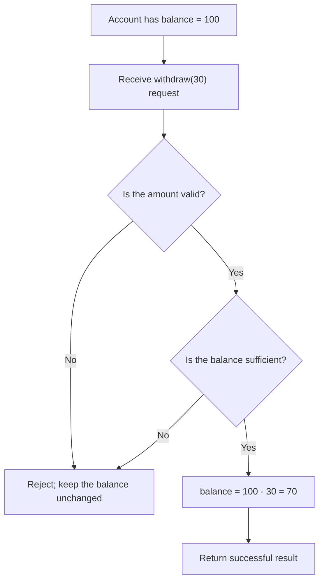
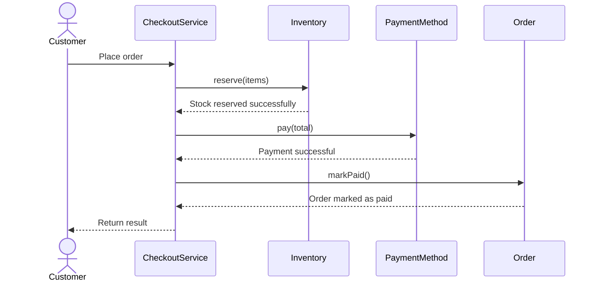
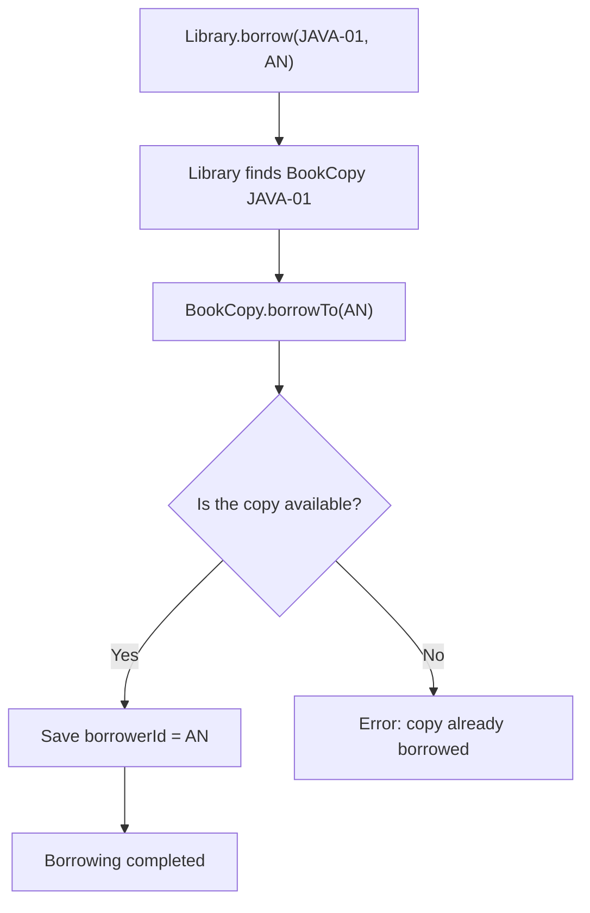
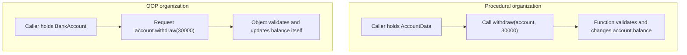
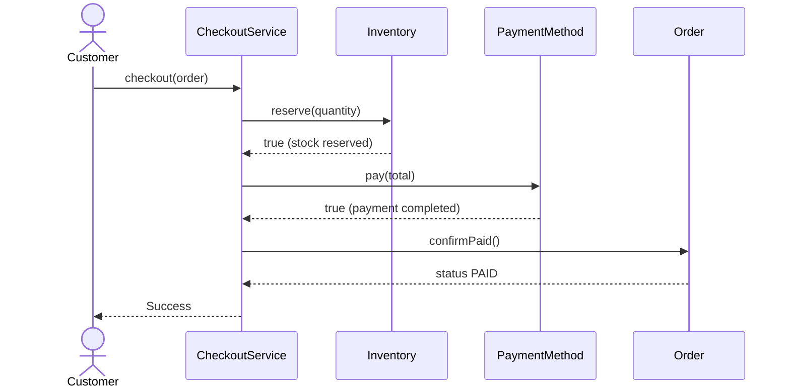

<a id="back-to-top"></a>

# Getting Started with OOP — What Problems Does It Solve?

## Menu
- [1.1 What Is Object-Oriented Programming (OOP)?](#oop-1-1)
- [1.2 Why Do We Need OOP as Programs Grow Larger?](#oop-1-2)
- [1.3 How Does OOP Differ from Organizing a Program Procedurally?](#oop-1-3)
- [1.4 How Do Objects Collaborate to Form an Application?](#oop-1-4)

## <a id="oop-1-1">1.1 What Is Object-Oriented Programming (OOP)?</a>

<details>
<summary>Click for details</summary>

**OOP (Object-Oriented Programming)** is a way of **thinking about and organizing a program** around **objects** with clearly defined responsibilities. Each object offers behaviors that other parts of the program can ask it to perform; the object may also manage the state associated with those responsibilities.

Imagine building a banking application. The program needs to know how much money an account holds, handle withdrawals, and reject a withdrawal that exceeds the available balance.

With an object-oriented design, we can create an `Account` object. Instead of allowing every part of the application to recalculate `balance` for itself, we make a request:

```java
account.withdraw(30);
```

The `account` object receives the request, checks the conditions, and decides whether its balance should change.

> **The most important idea:** In OOP, we ask **who holds the information, who is responsible for handling a request, and how the objects need to work together** to get the job done.

### What Does an OOP Object Look Like?

Suppose An has an account holding 100 units of money. We can examine that object from four perspectives:

| Aspect | Explanation | Example using `Account` |
|---|---|---|
| **Identity** | Which particular object are we talking about? | An's account is different from Binh's account |
| **State** | The object's information at this moment | The current balance is `100` |
| **Behavior** | Operations we can ask the object to carry out | `withdraw(30)`, `deposit(20)` |
| **Responsibility** | What the object manages and which rules it must uphold | Reject withdrawals that exceed the balance |

**State** answers, “What condition is this object currently in?” **Behavior** answers, “What can we ask it to do?” **Responsibility** answers, “Why should this particular object handle the work?”

For example, sending a transaction-confirmation email can be entrusted to a `Notifier` object. We do not need to make `Account` send emails, read configuration files, and display screens as well.

#### Follow One Behavior from Start to Finish

The account initially holds 100. The user requests a withdrawal of 30.



From beginning to end, we can describe the process in everyday language:

1. **Before the request:** the account has 100.
2. **Receive the request:** withdraw 30.
3. **Validate:** the amount is positive and does not exceed 100.
4. **Perform the operation:** update the balance to 70.
5. **Observable result:** the request succeeds and the account has 70 left.

If **another account also started with 100** and received a request to withdraw 120, validation would fail, and that account **would still have 100**. An object must not change its state in response to an invalid request.

The important OOP idea is that **the validation rule belongs to the account**. Code that uses the account therefore does not have to duplicate those conditions in many places.

### Classes and Objects: The Definition and the Actual Instances

In Java, we normally write a **class** to describe the structure and behaviors of a kind of object, then create specific **objects** from that class.

```text
                    CLASS Account
              +-----------------------+
              | owner                 |
              | balance               |
              | withdraw(amount)      |
              | getBalance()          |
              +-----------------------+
                    |          |
                 creates     creates
                    v          v
              Object An    Object Binh
              balance=100  balance=100
```

- **`Account` (class):** the general definition of an account.
- **`an` (object):** a specific account with its own balance.
- **`binh` (object):** a different account with its own balance.
- **Instance:** another way to refer to an object when emphasizing the class from which it was created.

Two objects can each have a balance of 100 without **being the same object**. When An withdraws money, Binh's balance does not change as a consequence.

**A class declaration alone does not define the essence of OOP.** What makes an object-oriented model meaningful is that its objects have appropriate behaviors and responsibilities—not merely that the program contains the keyword `class`.

### Complete Java Example: An Account Manages Its Own Balance

Save the following code as `Main.java` and run it:

```java
public class Main {
    public static void main(String[] args) {
        Account an = new Account("An", 100);
        Account binh = new Account("Binh", 100);

        boolean anSuccess = an.withdraw(30);
        boolean binhSuccess = binh.withdraw(120);

        System.out.println("An withdrawal successful? " + anSuccess);
        System.out.println("An remaining: " + an.getBalance());
        System.out.println("Binh withdrawal successful? " + binhSuccess);
        System.out.println("Binh remaining: " + binh.getBalance());
        System.out.println("Same object? " + (an == binh));
    }
}

class Account {
    private final String owner;
    private int balance;

    public Account(String owner, int openingBalance) {
        if (owner == null || owner.isBlank()) {
            throw new IllegalArgumentException("Account owner is required");
        }
        if (openingBalance < 0) {
            throw new IllegalArgumentException("Opening balance must be >= 0");
        }
        this.owner = owner;
        this.balance = openingBalance;
    }

    public boolean withdraw(int amount) {
        if (amount <= 0 || amount > balance) {
            return false;
        }
        balance -= amount;
        return true;
    }

    public int getBalance() {
        return balance;
    }

    public String getOwner() {
        return owner;
    }
}
```

Result:

```text
An withdrawal successful? true
An remaining: 70
Binh withdrawal successful? false
Binh remaining: 100
Same object? false
```

#### Reading Each Part of the Example

| Java expression or component | Role |
|---|---|
| `class Account` | Describes the account object type |
| `new Account("An", 100)` | Creates a specific account with initial data |
| `private int balance` | Keeps the balance inside the account, preventing direct assignments by outside code |
| `withdraw(int amount)` | The withdrawal behavior for which the account is responsible |
| `getBalance()` | Provides balance information to callers that need to read it |
| `an.withdraw(30)` | Sends a request to the specific object `an` |
| `an == binh` | Checks whether two variables refer to the same object; here they do not |

Notice that **the caller never writes `an.balance = 70`**. It simply says, “An, withdraw 30.” `Account` checks the request, changes its state, and returns `true` or `false`.

If the application later adds an ATM screen, a mobile app, and an over-the-counter withdrawal feature, all of them can use `withdraw(...)`. Each interface does not need to invent its own way of subtracting money.

The example uses `int` as a **simplified unit of money** to teach object organization. A real banking system also needs proper monetary representation, database transactions, and concurrency controls. OOP alone does not make financial operations transaction-safe.

### An Application Usually Has Multiple Collaborating Objects

One account cannot perform every function in an application. For example, an ordering application might divide responsibilities as follows:

| Object | Typical responsibility |
|---|---|
| `ShoppingCart` | Manage selected products and the total |
| `Inventory` | Check and reserve stock |
| `PaymentMethod` | Carry out a particular payment method |
| `Order` | Manage the order's status |
| `Notifier` | Send notifications about the result |

When the customer clicks **Place Order**, a collaboration might look like this:



This diagram is simplified to illustrate the idea; it does not yet show failure cases, releasing reserved stock, or transaction handling.

`CheckoutService` coordinates the work, while each object fulfills its own responsibility. `Inventory` decides whether stock is available; `PaymentMethod` performs payment; and `Order` maintains the order's state. **Objects communicate through behavioral method calls**, rather than one object arbitrarily modifying all the data held by the others.

An object does not have to represent a physical “thing” from the real world. Concepts such as `DiscountPolicy` (a discount rule), `PaymentMethod` (a way to pay), and `Notification` can also be modeled as objects when doing so makes the problem clearer.

### Why Is This Way of Organizing Code Useful?

For a program that only adds two numbers, creating many objects may offer no benefit. But as a problem grows to involve dozens of entities, states, and rules governing interactions, assigning clear responsibilities helps developers find the right place to make changes.

Suppose the application adds a new payment method. If payment handling is organized around a common contract, the order-processing code can continue requesting payment without having to understand every detail of the new implementation.

When designed well, OOP **can** provide several benefits:

- **Express business intent:** a statement such as `account.withdraw(30)` clearly communicates the intended action.
- **Protect state:** an object offers a centralized place to validate operations before changing its data.
- **Divide responsibilities:** look in `Account` to change balance rules and in `Notifier` to change notification delivery.
- **Manage change:** callers use clear behavioral contracts and become less dependent on internal details.
- **Test components independently:** construct an `Account` with 100 and test withdrawals of 30 or 120 separately.

However, **OOP does not automatically make code better**. A class that handles payment, inventory, email, and reporting can still be very difficult to maintain. Good design requires sensible boundaries of responsibility, not simply more classes.

### Four Common Concepts in OOP

As you continue studying OOP, you will encounter four important concepts:

| Concept | Short explanation | Connection to the example |
|---|---|---|
| **Encapsulation** | Keep related state and behavior together and control how external code can affect that state | `Account` protects `balance` through `withdraw()` |
| **Abstraction** | Expose the capabilities callers need without requiring knowledge of every implementation detail | A caller invokes `withdraw(30)` without writing every validation step |
| **Inheritance** | Define a specialized type based on a more general type when the relationship genuinely fits | A specific kind of notification might inherit from a general notification type |
| **Polymorphism** | Allow different implementations to fulfill a shared behavioral contract | Different payment methods support `pay(...)` but handle it differently |

These are **tools for designing objects**, not a rule requiring every class to use all four. In particular, inheritance makes sense only when the relationship between the types is appropriate; if one object merely needs to use another, object composition can often be a better fit.

### Misconceptions Beginners Commonly Have

**“Does OOP just mean adding `class` declarations to a program?”** No. Classes are tools for describing object types. If every part of the program still changes data directly and nobody has clear responsibility, the design may not be taking advantage of object-oriented thinking.

**“Must every object contain mutable data?”** No. Some objects are **immutable**: their state does not change after creation. Such an object can still provide calculations or information.

**“Are two objects with identical data the same object?”** No. Two accounts with balances of 100 can be independent objects. In the example, `an == binh` evaluates to `false`, even though both were initially created with a balance of 100.

**“Is OOP better than procedural programming in every situation?”** No. Pure functions and procedural organization remain very useful. OOP is a good choice when modeling objects, responsibilities, and collaboration helps explain the problem.

#### Check Your Understanding with a Scenario

An account currently has 100. External code calls `account.withdraw(30)` and receives a successful result.

Try answering:

1. **What is the state after the call?** — The balance is 70.
2. **Who decides whether the request is accepted?** — The `account` object itself, through its `withdraw` behavior.
3. **Will another independent account that also started with 100 change?** — No, provided it is a separate object.
4. **Why does `withdraw(30)` express OOP thinking better than an external assignment `balance = 70`?** — It states the intended action and gives the correct object responsibility for validation and updating.

When you can explain **which objects exist, what state they hold, what behaviors they provide, and which rules they are responsible for**, you have understood the central idea of **object-oriented programming**.

</details>

- [Back to top](#back-to-top)

---

## <a id="oop-1-2">1.2 Why Do We Need OOP as Programs Grow Larger?</a>

<details>
<summary>Click for details</summary>

### 1. What Becomes Difficult as a Program Grows?

When you first learn programming, a problem is often compact: receive input, check conditions, process the data, and print a result. To let someone borrow a book, for instance, you might only check whether the book is available and mark it as borrowed.

For a few dozen lines of code, a handful of functions can be enough. But now imagine that the library actually opens for business:

- One book title has multiple **physical copies**, each with its own identifier.
- Each copy can be borrowed by only one person at a time.
- A returned book must be returned by the person who borrowed it.
- Each member has a limit on how many books they may borrow.
- The library tracks due dates, renewals, reservations, and overdue fees.
- A web application, a mobile app, and an administration program all use the same system.

The challenge is no longer simply **having more lines of code**. It is that **the rules keep changing** and many parts of the program interact with the same data.

If every feature independently checks “is this book already borrowed?”, forgetting that check in just one place can lead to incorrect behavior. When a new policy is introduced, developers must search for and edit many locations. Fixing one feature can inadvertently break another.

**OOP (Object-Oriented Programming)** offers a way to organize a program to deal with that complexity. Instead of scattering related data and operations throughout the system, we group them into objects with **clear state, responsibilities, and behaviors**, then let those objects collaborate.

OOP does not make a large system automatically simple. It provides a way to divide the problem into parts that people can understand, change, and extend more easily.

### 2. When Logic Is Scattered: A Concrete Example

Suppose we initially use a `Map` to store borrowing information: the key is a physical copy's ID, and the value is the ID of the person currently borrowing it.

```java
import java.util.HashMap;
import java.util.Map;

class BorrowingExample {
    static final Map<String, String> borrowerByCopy = new HashMap<>();

    static void borrow(String copyId, String memberId) {
        if (borrowerByCopy.containsKey(copyId)) {
            throw new IllegalStateException("Book copy is already borrowed");
        }
        borrowerByCopy.put(copyId, memberId);
    }

    static void returnBook(String copyId) {
        borrowerByCopy.remove(copyId);
    }
}
```

This is easy to understand in a small exercise. It can also work correctly for the simple case:

```java
BorrowingExample.borrow("JAVA-01", "AN");
BorrowingExample.returnBook("JAVA-01");
```

But consider some questions that arise:

1. Should `borrow("UNKNOWN", "AN")` be allowed if that copy ID was never registered?
2. Who checks that `memberId` is not blank?
3. If someone else calls `returnBook("JAVA-01")`, does the program verify that they are the original borrower?
4. If other features directly modify `borrowerByCopy`, will they follow the same rules?

In this version, `returnBook` removes the borrower information without establishing who is returning the book. Worse, because the data is held in a `Map` that accessible code can modify directly, another piece of code may update or clear the state without following any rule.

**Note:** This flaw does not mean that using functions or a `Map` is inherently wrong. We can add checks, split the program into modules, hide variables, and write excellent procedural code. The point is that, as features multiply, **deciding which code may change the data and which component is responsible for validation** becomes particularly important.

### 3. OOP Assigns Responsibility to the Right Object

In the library example, choose one specific object: **the physical book copy identified by `JAVA-01`**.

That copy has information to manage:
- Its own unique copy ID.
- The current borrower; if nobody has borrowed it, the copy is available.

And it provides behaviors:
- Lend itself to a member if it is currently available.
- Accept a return only from its current borrower.
- Report whether it is currently available for borrowing.

We design `BookCopy` to be **responsible for protecting these rules**. Meanwhile, `Library` is responsible for maintaining the collection of copies and locating the correct copy when a request arrives.

The following example runs as **a single `LibraryDemo.java` file** with Java 11 or later:

```java
import java.util.HashMap;
import java.util.Map;
import java.util.Objects;

public class LibraryDemo {
    public static void main(String[] args) {
        Library library = new Library();
        library.add(new BookCopy("JAVA-01"));

        library.borrow("JAVA-01", "AN");
        System.out.println(library.isAvailable("JAVA-01")); // false

        try {
            library.borrow("JAVA-01", "BINH");
        } catch (IllegalStateException ex) {
            System.out.println(ex.getMessage()); // Book is already borrowed
        }

        try {
            library.returnCopy("JAVA-01", "BINH");
        } catch (IllegalStateException ex) {
            System.out.println(ex.getMessage()); // Not the current borrower
        }

        library.returnCopy("JAVA-01", "AN");
        System.out.println(library.isAvailable("JAVA-01")); // true
    }
}

class BookCopy {
    private final String code;
    private String borrowerId; // null: nobody has borrowed this copy

    BookCopy(String code) {
        if (code == null || code.isBlank()) {
            throw new IllegalArgumentException("Invalid book copy ID");
        }
        this.code = code;
    }

    String code() {
        return code;
    }

    boolean isAvailable() {
        return borrowerId == null;
    }

    void borrowTo(String memberId) {
        requireMemberId(memberId);

        if (!isAvailable()) {
            throw new IllegalStateException("Book copy is already borrowed");
        }

        borrowerId = memberId;
    }

    void returnFrom(String memberId) {
        requireMemberId(memberId);

        if (isAvailable()) {
            throw new IllegalStateException("Book copy is not currently borrowed");
        }
        if (!borrowerId.equals(memberId)) {
            throw new IllegalStateException("Borrower does not match");
        }

        borrowerId = null;
    }

    private void requireMemberId(String memberId) {
        if (memberId == null || memberId.isBlank()) {
            throw new IllegalArgumentException("Invalid member ID");
        }
    }
}

class Library {
    private final Map<String, BookCopy> copies = new HashMap<>();

    void add(BookCopy copy) {
        Objects.requireNonNull(copy, "Book copy must not be null");

        if (copies.putIfAbsent(copy.code(), copy) != null) {
            throw new IllegalArgumentException("Duplicate book copy ID");
        }
    }

    void borrow(String copyId, String memberId) {
        findCopy(copyId).borrowTo(memberId);
    }

    void returnCopy(String copyId, String memberId) {
        findCopy(copyId).returnFrom(memberId);
    }

    boolean isAvailable(String copyId) {
        return findCopy(copyId).isAvailable();
    }

    private BookCopy findCopy(String copyId) {
        BookCopy copy = copies.get(copyId);

        if (copy == null) {
            throw new IllegalArgumentException("Book copy not found");
        }

        return copy;
    }
}
```

Here, `borrowerId` is `private`; other classes cannot assign it directly. To borrow or return a copy, code must go through the behaviors provided by `BookCopy`.

Notice how **each class answers a different question**:

| Object | What does it know? | What is it responsible for? |
|---|---|---|
| `BookCopy` | Its copy ID and current borrower | Keep the borrowing/return state consistent for this copy |
| `Library` | Which physical copies exist | Find the correct copy and forward requests to that object |
| `LibraryDemo` | The scenario to execute | Send requests and display results |

This example does not yet implement due dates, borrowing limits, or database persistence. It only illustrates how to **place a rule with the component responsible for it**. A real system also needs to address durable storage, transactions, and concurrent access.

### 4. Trace One Request to See the Difference

Suppose nobody has borrowed copy `JAVA-01` initially.



After An borrows the copy, Binh makes the same request. This time, `BookCopy` knows it is already borrowed, so it rejects the request without changing the state. If Binh tries to return that copy, `returnFrom("BINH")` also rejects it because the current borrower is `AN`.

What matters is that **outside callers do not have to duplicate the borrowing and return rules**. Code for a web interface, a command-line tool, or an administrative feature can send requests through `Library`; `BookCopy` remains the final authority on whether its state may change.

When the policy for a physical copy changes, the development team has a central place to inspect and update. This is a direct benefit of assigning **ownership of state and rules** to an object.

### 5. Benefits That Become Most Visible as the Program Grows

#### 5.1. Clearer Responsibility Boundaries Make Code Easier to Understand

A large program always contains many kinds of work: signing in, searching, borrowing books, returning books, reporting, paying overdue fees, and more.

If everything is in one gigantic `Application` class, a developer who wants to change a borrowing rule may have to read payment and reporting code just to learn what is related.

With a sensible division of responsibilities, readers can start with the class or object responsible for the problem they are investigating.

For example, the answer to “why can't someone else return An's book?” can be found in `BookCopy.returnFrom(...)`. Readers do not yet need to understand report generation or how the list of copies is stored in the database.

**Reducing the amount of information a developer must hold in mind at once** becomes especially valuable as the codebase grows.

#### 5.2. A Change May Affect Fewer Locations

Suppose the library changes its return policy: the system must verify the borrower and record the return time.

If borrowing and returning logic has been rewritten in several controllers or screens, each may need to change. The more features there are, the greater the risk of missing one.

When one component owns the return behavior, we can extend the model—for instance, by introducing a `Loan` object to record the borrower, loan date, due date, and return date. The other parts can continue requesting “return this copy” through the designed interface.

Of course, **not every change can be isolated completely**. A new rule that changes inputs, results, or communication contracts may require updates elsewhere. OOP helps us design controlled points of change; it does not eliminate dependencies.

#### 5.3. Protect Data and Business Rules

If any part of the program could write:

```java
// Suppose borrowerId were publicly accessible:
copy.borrowerId = null;
```

then any feature could “return a book” while skipping the borrower verification.

By making the state `private`, we intentionally expose **meaningful behaviors** such as `borrowTo(...)` and `returnFrom(...)`. Requests must obey the rules managed by the object.

This is the practical meaning of **encapsulation**: the data and the operations that protect it are placed together. It reduces the chance that other components will accidentally corrupt the state.

Remember, `private` alone is not enough. If we add `public void setBorrowerId(String id)` and let callers use it freely, the rules can still be bypassed. **Designing appropriate behaviors** matters more than merely adding access modifiers.

#### 5.4. Test Each Responsibility More Easily

When we need to check whether `BookCopy` preserves its state correctly, we can create one copy and test it independently:

```java
BookCopy copy = new BookCopy("JAVA-02");

assert copy.isAvailable();

copy.borrowTo("AN");
assert !copy.isAvailable();

try {
    copy.borrowTo("BINH");
    throw new AssertionError("Expected the request to be rejected");
} catch (IllegalStateException expected) {
    // Correct: do not allow two people to borrow the same copy
}

copy.returnFrom("AN");
assert copy.isAvailable();
```

The example uses Java's `assert` for illustration; to run it yourself, enable assertions with `-ea`. In a real project, these cases can be covered by JUnit unit tests.

The main point is that we **can test one object's rules** without first setting up a web interface, database connection, or HTTP request. This makes the cause of a defect easier to locate and reduces the effort needed to retest the entire system after a localized change.

#### 5.5. Add Alternative Implementations When There Is a Real Need

Later, the library may impose different borrowing limits on students and lecturers:

- Students: at most 5 books.
- Lecturers: at most 10 books.

We could separate the **borrowing-limit policy** from the object representing a physical book copy:

```java
interface BorrowLimitPolicy {
    boolean canBorrow(int currentBorrowedCount);
}

class StudentBorrowLimit implements BorrowLimitPolicy {
    @Override
    public boolean canBorrow(int currentBorrowedCount) {
        return currentBorrowedCount < 5;
    }
}

class LecturerBorrowLimit implements BorrowLimitPolicy {
    @Override
    public boolean canBorrow(int currentBorrowedCount) {
        return currentBorrowedCount < 10;
    }
}
```

This illustrates a **replaceable policy**; it has not been integrated into the preceding `LibraryDemo`. In a complete system, the component coordinating loans would need to check each member's policy and consistently update their active loans.

When the rules become sufficiently varied, the program can use `BorrowLimitPolicy` and select the appropriate implementation. We no longer have to cram every variation into an `if-else` chain everywhere the limit is checked.

However, **create an interface or additional classes only when there is a reason to do so**. For a simple, rarely changing rule, an ordinary method may be perfectly good. Introducing layers of abstraction too early can make a program harder to understand.

### 6. How Does OOP Help Teams Work Together?

Imagine three developers or teams working on the library system:

| Owner | Work area | Shared understanding needed |
|---|---|---|
| Borrowing/returns team | `BookCopy` and loan management | How to request loans and returns, and how errors are reported |
| UI team | Search page and borrow/return controls | How to call the published behaviors correctly |
| Reporting team | Borrowed copies and overdue statistics | How to use the legitimately exposed data and results |

When each part has **clear responsibilities and communication interfaces**, teams need to interfere less with one another's internal logic.

For instance, the borrowing team might change its representation of the current borrower from a `borrowerId` string to a `Loan` object. If the behaviors consumed by other components continue to satisfy the same contract, those components may not need to change.

This matters greatly for long-term maintenance: code will be read and modified by many people at different times. A class with a clear name, state, and responsibility is easier to approach than a set of operations whose ultimate owner is unclear.

### 7. What Does OOP Solve—and What Does It Not Solve Automatically?

A common belief is “the larger the program, the more classes we should create.” In reality, **having more classes does not necessarily mean better design**.

| What well-designed OOP can help with | What OOP does not automatically guarantee |
|---|---|
| Group related state and behavior with their responsible owner | Algorithms are always correct |
| Limit which code may change the state | Data is safe under concurrent access by multiple threads |
| Express collaboration among components | Multi-object or multi-database operations are automatically transactional |
| Substitute implementations that fulfill a shared contract | The system automatically runs faster |
| Reduce dependence on internal implementation details | Every system should use deep inheritance or many interfaces |
| Narrow the scope of understanding, changes, and testing | Requirements never force changes to multiple components |

For example, `LibraryDemo` only manages data **in memory under a simple single-threaded usage scenario**. With simultaneous borrowing requests or multiple servers, the check “is this copy available?” followed by an update needs an appropriate consistency mechanism, such as a database transaction and concurrency control. Merely creating a `BookCopy` object does not solve that problem.

OOP is also not the only way to structure large programs. Code based on pure functions, modules, immutable data types, or a functional style can be highly maintainable too. Real-world Java often **combines** these styles. OOP is valuable when a problem includes objects, state, and responsibilities that need to be managed over time.

### 8. When Should You Start Applying OOP?

The following signals can help you decide:

1. **Is the same data being changed in many places?** Identify who truly owns it and which operations should be allowed to modify it.
2. **Is one business rule repeated across multiple features?** Give that rule a clear responsible home.
3. **Does every new feature require editing conditional branches throughout the program?** Consider which behaviors could be separated and substituted through a shared contract.
4. **Is it difficult to test one feature without running the entire application?** Divide responsibilities so that important logic can be tested independently.
5. **Does one class know too much?** Consider separating responsibilities instead of continuing to pack methods into that class.

These questions are more useful than counting classes or trying to apply every OOP concept from day one.

#### A Thought Exercise

Suppose the library adds **loan renewal** and a rule that “a loan cannot be renewed when another member has reserved the copy.”

Where would you put that validation?

Looking only at the current example, do not rush to introduce many new classes. First determine:
- Which object knows whether a **loan** is active and what its due date is?
- Which component knows whether the copy has an outstanding **reservation**?
- Who should coordinate renewal so neither condition is overlooked?

Once the owners of each piece of information are clear, the object structure starts to make sense. You might eventually need a `Loan` class and a coordinating service, but that choice follows from **the new requirement**, not from a belief that every noun needs to become a class.

### 9. What to Remember When Learning OOP

“Why do we need OOP as programs grow larger?” can be answered through three practical difficulties:

**Hard to understand:** Too much data and processing are intertwined, so the developer does not know where to start.

**Hard to change:** One rule lives in many places, and adding features can introduce errors into previously stable behavior.

**Hard to control:** Many components modify state, making it difficult to ensure that every operation follows the business rules.

OOP helps address these challenges by associating **state with behaviors responsible for protecting it**, defining **boundaries and communication contracts** among objects, and letting those objects collaborate to complete tasks.

In the library example, `Library` finds a physical copy, `BookCopy` manages borrowing and returning state, and the application sends requests through the designed behaviors. As rules evolve, each part has a clear place to inspect and extend.

**The most important habit:** before asking “How many classes should I create?”, ask **“Who is responsible for this data and rule, and what do other parts need to ask that owner to do?”** That is why OOP is useful as software becomes larger and must keep changing.

</details>

- [Back to top](#back-to-top)

---

## <a id="oop-1-3">1.3 How Does OOP Differ from Organizing a Program Procedurally?</a>

<details>
<summary>Click for details</summary>

Suppose you are writing a bank-account management program. It must maintain balances, accept deposits, process withdrawals, and reject transactions when their amounts are invalid.

There are at least two familiar ways to organize the source code:

- **Procedural organization:** place the processing steps in functions or procedures. Pass account data to those functions for processing.
- **Object-oriented organization (OOP):** represent an account as an object responsible for managing its state and offering valid operations on that state.

Both approaches can solve the same problem correctly. **The fundamental difference is how responsibilities are assigned: who owns the data, who may change it, and what outside code must know to perform a task.**

We will start with a concrete example and then examine why this distinction becomes more important as a program grows.

### 1. One Problem, Two Ways of Asking Questions

The user requests: “Withdraw VND 30,000 from an account holding VND 100,000; reject a withdrawal that exceeds the balance.”

With procedural organization, we tend to ask:

> What steps are needed to process this request? Which function takes the data, validates it, and updates it?

With OOP, we tend to ask:

> Which object is responsible for the balance? What actions may outside code ask that object to perform?

Here are representative calls in the two styles:

| Organization | Typical calling code | Who decides the withdrawal rules? |
| --- | --- | --- |
| Procedural | `AccountOperations.withdraw(account, 30_000)` | The `withdraw` function that receives account data |
| OOP | `account.withdraw(30_000)` | The `account` object itself, through its method |

The dot `.` alone does not distinguish these approaches. In Java, both `static` functions and instance methods can be called with dot notation. What matters is **where the rules live, how data is made available, and who controls the right to change it**.

### 2. Procedural Organization: Functions Operate on Supplied Data

The following is a complete Java program. Save it as `ProceduralDemo.java` and run it:

```java
class AccountData {
    final String owner;
    long balance;

    AccountData(String owner, long initialBalance) {
        if (owner == null || owner.isBlank()) {
            throw new IllegalArgumentException("Owner is required");
        }
        if (initialBalance < 0) {
            throw new IllegalArgumentException("Balance must be >= 0");
        }

        this.owner = owner;
        this.balance = initialBalance;
    }
}

final class AccountOperations {
    private AccountOperations() {
        // Utility class: no instance is needed.
    }

    static void deposit(AccountData account, long amount) {
        if (amount <= 0) {
            throw new IllegalArgumentException("Amount must be positive");
        }
        account.balance = Math.addExact(account.balance, amount);
    }

    static void withdraw(AccountData account, long amount) {
        if (amount <= 0) {
            throw new IllegalArgumentException("Amount must be positive");
        }
        if (amount > account.balance) {
            throw new IllegalStateException("Insufficient funds");
        }
        account.balance -= amount;
    }
}

public class ProceduralDemo {
    public static void main(String[] args) {
        AccountData account = new AccountData("An", 100_000);

        AccountOperations.withdraw(account, 30_000);
        System.out.println(account.balance); // 70000

        try {
            AccountOperations.withdraw(account, 120_000);
        } catch (IllegalStateException ex) {
            System.out.println(ex.getMessage()); // Insufficient funds
        }

        System.out.println(account.balance); // Still 70000
    }
}
```

The program still performs appropriate data validation and error handling for operations made through `AccountOperations`. Specifically:

1. `main` holds an `AccountData` instance whose `balance = 100_000`.
2. `main` passes that data into `AccountOperations.withdraw(account, 30_000)`.
3. The function checks the requested amount and changes `account.balance` to `70_000`.
4. The request to withdraw `120_000` fails the balance check before subtraction takes place.
5. The balance remains `70_000`.

Notice that **`AccountData` only holds information, while `AccountOperations` contains the main operations**. To withdraw money, the caller must choose the appropriate function and provide the right data.

This style has practical advantages:

- Processing functions are grouped by task and are easy to follow step by step.
- For calculations or clearly defined data-processing flows, a sequence of small functions can be simple and easy to test.
- There is no need to create numerous domain object types merely to carry out a few fixed operations.

But note one issue in **this particular design**: `balance` has package-private access. Other code in the same package could do this:

```java
account.balance = -500_000;
```

That entirely bypasses `AccountOperations.withdraw(...)`. This is an encapsulation weakness **in the example**, not a flaw inherent in all procedural programs. Procedural code can still protect data using modules, validated access functions, immutable data types, and appropriate access conventions.

The important point is that when data and operations are organized separately, the designer must carefully control **which parts are allowed to modify the data**.

### 3. OOP Organization: The Object Manages Its State and Behavior

For the same problem, we can design `BankAccount` as an object with `balance` state and `deposit` and `withdraw` behaviors. Save this as a separate `OopDemo.java` file:

```java
final class BankAccount {
    private final String owner;
    private long balance;

    BankAccount(String owner, long initialBalance) {
        if (owner == null || owner.isBlank()) {
            throw new IllegalArgumentException("Owner is required");
        }
        if (initialBalance < 0) {
            throw new IllegalArgumentException("Balance must be >= 0");
        }

        this.owner = owner;
        this.balance = initialBalance;
    }

    public long getBalance() {
        return balance;
    }

    public void deposit(long amount) {
        if (amount <= 0) {
            throw new IllegalArgumentException("Amount must be positive");
        }
        balance = Math.addExact(balance, amount);
    }

    public void withdraw(long amount) {
        if (amount <= 0) {
            throw new IllegalArgumentException("Amount must be positive");
        }
        if (amount > balance) {
            throw new IllegalStateException("Insufficient funds");
        }
        balance -= amount;
    }
}

public class OopDemo {
    public static void main(String[] args) {
        BankAccount account = new BankAccount("An", 100_000);

        account.withdraw(30_000);
        System.out.println(account.getBalance()); // 70000

        try {
            account.withdraw(120_000);
        } catch (IllegalStateException ex) {
            System.out.println(ex.getMessage()); // Insufficient funds
        }

        System.out.println(account.getBalance()); // Still 70000
    }
}
```

The business outcome is **the same as in the previous example**. The difference is in the design:

- `BankAccount` is responsible for keeping `balance` valid.
- The `balance` field is `private`, so other code cannot directly assign a new balance.
- To change the balance, outside code must request the `deposit(...)` or `withdraw(...)` behavior.
- The object checks its own rules before updating state and rejects invalid requests.

For example:

```java
account.withdraw(30_000); // Ask the account to withdraw money
account.getBalance();      // Query the current balance

// account.balance = -10;  // Compilation error: balance is private
```

This is one way to implement **encapsulation** in OOP: the object groups state with the behaviors responsible for that state, while exposing a controlled interface for callers.

A rule such as “an account's balance must never be negative” is called an **object invariant**. Locating `withdraw(...)` inside the object centralizes responsibility for maintaining it.

Note that `private` does not automatically produce a good OOP design. If we expose `setBalance(long anyValue)` and allow arbitrary assignments, the business rule can still be broken. The important thing is that **the object's API expresses the actions that are permitted**.

Both programs are simplified teaching models. Real banking software also needs transaction history, persistence-error handling, consistency guarantees, and concurrent transaction control. Those problems do not disappear merely because we use OOP.

### 4. Comparing the Processing Flows

For the same request, “Withdraw VND 30,000,” we can visualize:



The following table compares more precisely what each organizational style encourages:

| Perspective | Procedural organization | OOP organization |
| --- | --- | --- |
| Central unit of thought | Tasks, functions, sequences of processing steps | Objects, responsibilities, interactions |
| Where is data held? | It may be separate structures passed among functions | Often state owned or managed by an object |
| How is data operated on? | Call a function and pass the data it needs | Call a method on the responsible object |
| Source-code organization | By features or processes | By entities/responsibilities and contracts among objects |
| Controlling state changes | Through designed functions and modules | Through an object's API, potentially hiding state details |
| Extending functionality | Add or modify functions, processes, or modules | Add or modify behaviors or objects implementing shared contracts |
| Risks of poor design | Data may be modified from uncontrolled locations | Classes may take on too many responsibilities or develop complex inheritance/relationships |
| Commonly suitable for | Linear workflows, data transformations, scripts, algorithms | Multiple entities with their own states and rules, interacting over time |

These characteristics **are not absolute boundaries**. Procedural programs can still use modules, protect data, and provide excellent contracts. OOP programs still contain ordinary sequential functions; many OOP methods actually consist of step-by-step procedural logic.

Therefore, looking only at the number of classes, the `.` operator, or the `private` keyword cannot tell you how a program is truly designed.

### 5. The Difference Becomes Clearer When Requirements Change

Initially, the application supports only standard bank accounts. Now it must add **student accounts** with a maximum withdrawal of VND 50,000 per transaction.

With procedural organization, one choice is to pass account-type information and check it inside the function:

```java
static void withdraw(AccountData account, long amount, boolean studentAccount) {
    if (amount <= 0) {
        throw new IllegalArgumentException("Amount must be positive");
    }
    if (studentAccount && amount > 50_000) {
        throw new IllegalStateException("Student withdrawal limit exceeded");
    }
    if (amount > account.balance) {
        throw new IllegalStateException("Insufficient funds");
    }
    account.balance -= amount;
}
```

This is **one design choice**, not the only procedural solution. If numerous account types and rules accumulate in a single function as `if/else` branches, that function may become hard to maintain.

In OOP, if withdrawal rules belong to the account's responsibility, we can represent behavioral variations through objects sharing a contract:

```java
interface WithdrawableAccount {
    void withdraw(long amount);
    long getBalance();
}
```

One implementation might represent a standard account, while another applies student-account rules. Calling code only needs to know the `WithdrawableAccount` contract to request a withdrawal.

Using an interface **does not require** inheriting from a concrete class. Some cases are better modeled by passing a policy object into the account. Likewise, a procedurally organized program could pass a validation function or strategy to `withdraw` rather than create a long `if/else` chain.

The lesson is not “every account type must have its own subclass.” The lesson is that **OOP often organizes behavioral variations around objects and contracts**, allowing callers to work with common capabilities without personally coordinating every implementation detail.

Consider another requirement: **printing account statements**. If this feature only produces a report from transaction history, we do not necessarily need to put the entire PDF-generation implementation inside `BankAccount`. A `StatementService` or a separate export component may be more appropriate. Good OOP assigns **the right responsibilities**; it does not demand that everything related to an entity live in one enormous class.

### 6. Does “Procedural Program” Mean a Program Without Classes?

**No.** This is particularly easy to misunderstand in Java because Java normally places code inside classes.

For example:

```java
class PriceCalculator {
    static long total(long unitPrice, int quantity) {
        if (unitPrice < 0 || quantity < 0) {
            throw new IllegalArgumentException();
        }
        return Math.multiplyExact(unitPrice, quantity);
    }
}
```

It is a Java class, but it organizes a **calculation function**; we do not need a `PriceCalculator` object with its own state. Putting a method inside a class does not, by itself, transform the solution into an object-oriented design with collaborating objects and managed responsibilities.

Conversely, an OOP method still contains procedural statements:

```java
public void withdraw(long amount) {
    if (amount <= 0) {
        throw new IllegalArgumentException();
    }
    if (amount > balance) {
        throw new IllegalStateException();
    }
    balance -= amount;
}
```

The method has a clear sequence of validation and updating. **OOP does not eliminate programming through sequential steps.**

Two terms are also worth distinguishing:

- **Imperative programming** emphasizes describing the operations by which a program's state changes.
- **Procedural programming** organizes work into reusable procedures or functions, typically within the imperative family of approaches.

An OOP program written in Java also often contains imperative statements inside its methods. So “procedural” and “OOP” should not be treated as entirely separate or mutually exclusive worlds.

### 7. Does OOP Solve Problems Encountered in Procedural Organization?

In a small system with only a few functions and pieces of data, it is easy to know which variables are being changed. As the software grows—with dozens of screens, APIs, and processes sharing account information—difficulties begin to arise.

**First: who is responsible for keeping the data valid?**

Suppose three places in the application directly modify `balance`:

```java
account.balance -= amount;
account.balance += refund;
account.balance = importedValue;
```

Every location must remember every relevant rule. If one misses a check, the data may become invalid. Moving meaningful operations into `BankAccount` provides clearly designated entry points for state changes:

```java
account.withdraw(amount);
account.deposit(refund);
```

But **we cannot conclude that procedural code necessarily creates this problem**. A procedural module that keeps its data private and permits changes only through controlled functions can also maintain invariants consistently.

**Second: who needs to know the internal details?**

If outside code repeatedly depends on every field, changing how the balance is represented may force changes in many places. When callers know only operations such as `withdraw` and `getBalance`, the object can change its implementation while keeping its public contract.

**Third: how do we coordinate the various parts of the system?**

An order-processing flow may need a cart, payment, and notification. With OOP, each object or service has its own responsibility and communicates through methods and contracts. We can describe:

```text
CheckoutService asks Order to validate its data
CheckoutService asks PaymentGateway to process payment
CheckoutService asks Notifier to send a notification
```

However, **dividing a program into objects does not guarantee good architecture**. If classes depend on one another cyclically, are split into too many tiny pieces, or put all logic into `CheckoutService`, an OOP system can still be difficult to understand.

### 8. Which Approach Should You Choose for Real Work?

Not every problem requires a rich object model. The decision should follow the kinds of changes and rules the program must handle.

| Need | Often reasonable choice | Why |
| --- | --- | --- |
| Sum a list of numbers | A procedural or pure function | Simple inputs and outputs; no separate business state |
| Read a CSV, filter data, and export a report | A sequence of functions or a pipeline | The work has clearly defined processing stages |
| Manage orders with valid state transitions | An `Order` object with controlled behaviors | Rules are tied to an individual order's state |
| Manage a shopping cart, quantities, and totals | A `Cart` object and related services | Several pieces of information must stay consistent within one responsibility |
| Make a simple external API call | A suitable service or function | An entire class hierarchy is not necessarily needed |
| Support multiple payment methods with the same communication behavior | Implementations of a common interface | The caller uses a shared contract rather than every payment technology directly |

In Java/Spring Boot applications, the two organizational styles often appear **together**:

- An `OrderService` coordinates use-case steps: find an order, request payment, store the result, notify someone. That coordination resembles procedural thinking.
- An `Order` is responsible for its own rules: `cancel()`, `markPaid(...)`, and rejecting cancellation of an already completed order.
- A `PaymentGateway` defines a contract through which a service can invoke different implementations.
- Pure calculations such as `calculateTax(...)` and data-conversion functions can remain simple functions.

There is no need to take sides and ban the other style. The practical question is **where each responsibility should live so that the code is easiest to understand, safest to change, and least likely to introduce errors**.

### 9. A Common Mistake: Changing Syntax Without Changing the Design

Suppose the original procedural code is:

```java
withdraw(account, amount);
```

Then someone changes it to:

```java
account.setBalance(account.getBalance() - amount);
```

The new syntax includes an object and methods, but **the caller still computes the balance and chooses the subtraction**. It may still forget to check `amount > 0` or whether sufficient funds are available.

An API that better reflects responsibility is:

```java
account.withdraw(amount);
```

Now the caller states **what it wants to accomplish**, and the object decides **whether the action is allowed and how its state should be updated**.

This does not mean that all `getX()/setX()` methods are bad. Getters and setters are suitable for many DTOs, configuration objects, or properties that can legitimately change independently. The point is to avoid turning every domain object into a bag of data that any service can modify arbitrarily.

### 10. Check Your Understanding

**Scenario A.** You have a `static int sum(int a, int b)` function inside a `Calculator` class. Does the mere fact that it resides in a class make it a “complete OOP design”?

**Answer:** No. It is simply a calculation function placed in a class to follow Java syntax. What matters for identifying OOP design is how objects own responsibilities and collaborate, not how many classes exist.

**Scenario B.** A procedural program tightly manages state and requires all changes to go through validated functions. Is it necessarily less safe than an OOP program?

**Answer:** There is no such general conclusion. Procedural programs can encapsulate data through modules and APIs. Quality depends on the design and whether its rules are followed.

**Scenario C.** A `BankAccount` class has `private balance` but exposes `setBalance(long balance)` for arbitrary values. Does it properly protect the nonnegative-balance rule?

**Answer:** Not yet. The `private` field prevents direct access, but the public setter still allows arbitrary updates. Meaningful business operations and their checks should be placed with the appropriate owner.

**Scenario D.** A `CheckoutService` consists of a sequence of calls to `validate()`, `charge()`, `save()`, and `notify()`. Does that mean the program is “no longer OOP” because it still processes steps sequentially?

**Answer:** No. Objects can collaborate through a sequence of steps. Object-based responsibility boundaries and procedural coordination of a workflow can complement one another.

When facing a new problem, ask yourself two questions: **“What steps does this process require?”** and **“Who owns this information and is responsible for maintaining its rules?”** The first helps identify the workflow; the second helps identify object boundaries. That is the most important practical difference when moving from merely organizing functions and procedures toward object-oriented design.

</details>

- [Back to top](#back-to-top)

---

## <a id="oop-1-4">1.4 How Do Objects Collaborate to Form an Application?</a>

<details>
<summary>Click for details</summary>

When learning OOP (Object-Oriented Programming), we often start with a single object: `Account` knows its balance and provides a `withdraw()` method. But a real application cannot accomplish everything with just one object. When a customer **places an order**, the system must also check that enough products are available, process payment, update the order, and communicate the outcome.

**In OOP, an application consists of multiple objects with distinct responsibilities, exchanging requests and results through their defined behaviors (methods).** Each object handles its portion of the work. A component may serve as a **coordinator**, determining the order in which the steps occur.

Think of a restaurant: the person taking the order does not have to go to the storeroom, cook the meal, and collect the payment personally. Instead, they pass requests to the appropriate team and track the outcome. Nor do the different teams arbitrarily change one another's records.

> OOP is not just about having many `class` declarations. What matters is **who is responsible for what, who may ask whom to do something, and how the results are used**.

### 1. From One User Request to Multiple Objects

Let's build a sales application with a simple feature:

> A customer wants to buy **one product costing 60 units of money**. The inventory has 2 units in stock. The customer's wallet contains 100 units of money. The customer clicks **Pay**.

To fulfill this request, the system must answer several different questions.

| Business question | Appropriate object | Object's responsibility |
|---|---|---|
| How many units is the customer buying, and what is the order's status? | `Order` | Manage order information and status |
| Is there enough stock to fulfill the purchase? | `Inventory` | Manage and reserve remaining stock |
| Can the customer complete payment? | `PaymentMethod` / `WalletPayment` | Handle the payment request |
| Which step should come first, and which should follow? | `CheckoutService` | Coordinate the overall checkout process |

Each object can have its own **state** and **behavior**:

- `Inventory` holds the stock count `stock` and offers `reserve(quantity)` to attempt a reservation.
- `WalletPayment` holds `balance` and offers `pay(amount)` to attempt payment.
- `Order` holds `status` and accepts only valid state transitions.
- `CheckoutService` uses these objects in the required sequence to fulfill the request.

Notice that `CheckoutService` is not a “magical” object containing all the data. It **knows whom to ask** and **how to act on their replies**.

### 2. Diagram: How Do the Objects Communicate?

In Java, an object “sending a request” to another object is usually expressed as a **method call**.



This is a **sequence diagram**: read it from top to bottom to follow method calls and responses over time.

For example, calling `inventory.reserve(1)` does not mean that `CheckoutService` reaches into the `stock` field and changes it. The service only sends a request. `Inventory` itself checks the quantity before updating.

Likewise, `payment.pay(60)` tells the payment object **what needs to be done**; checking the wallet and updating its balance are the payment object's own responsibility.

#### How Does the Successful Flow Change State?

| Moment | `Inventory.stock` | `WalletPayment.balance` | `Order.status` |
|---|---:|---:|---|
| Before checkout | 2 | 100 | `NEW` |
| Inventory reserves one unit | 1 | 100 | `NEW` |
| Payment of 60 succeeds | 1 | 40 | `NEW` |
| Order confirms payment | 1 | 40 | `PAID` |

These three objects have **different states**. Each updates what it manages; the final result is achieved through their collaboration.

### 3. Runnable Java Example: Order, Inventory, PaymentMethod, and CheckoutService

The following example simulates the system in memory. Save all the code in `Main.java`. We deliberately use **one product type** and integer monetary units to focus on OOP.

```java
public class Main {
    public static void main(String[] args) {
        Inventory inventory = new Inventory(2);
        WalletPayment wallet = new WalletPayment(100);
        CheckoutService checkout = new CheckoutService(inventory);

        // Case 1: stock is available and the wallet has enough funds.
        Order first = new Order(1, 60);
        checkout.checkout(first, wallet);
        printResult("Order 1", first, inventory, wallet);

        // Case 2: one unit remains in stock, but the wallet has only 40.
        Order second = new Order(1, 50);
        checkout.checkout(second, wallet);
        printResult("Order 2", second, inventory, wallet);

        // Case 3: the order needs two units, but only one remains.
        Order third = new Order(2, 10);
        checkout.checkout(third, wallet);
        printResult("Order 3", third, inventory, wallet);
    }

    private static void printResult(
            String name, Order order,
            Inventory inventory, WalletPayment wallet) {
        System.out.println(name + ": " + order.getStatus()
                + " | stock: " + inventory.getAvailable()
                + " | wallet: " + wallet.getBalance());
    }
}

enum OrderStatus {
    NEW, PAID, PAYMENT_FAILED, OUT_OF_STOCK
}

// Order manages the data and state of an order.
class Order {
    private final int quantity;
    private final int unitPrice;
    private OrderStatus status = OrderStatus.NEW;

    Order(int quantity, int unitPrice) {
        if (quantity <= 0 || unitPrice <= 0) {
            throw new IllegalArgumentException("Invalid order");
        }
        this.quantity = quantity;
        this.unitPrice = unitPrice;
    }

    int getQuantity() {
        return quantity;
    }

    int getTotal() {
        return Math.multiplyExact(quantity, unitPrice);
    }

    OrderStatus getStatus() {
        return status;
    }

    void confirmPaid() {
        changeStatus(OrderStatus.PAID);
    }

    void rejectOutOfStock() {
        changeStatus(OrderStatus.OUT_OF_STOCK);
    }

    void rejectPayment() {
        changeStatus(OrderStatus.PAYMENT_FAILED);
    }

    private void changeStatus(OrderStatus next) {
        if (status != OrderStatus.NEW) {
            throw new IllegalStateException("Order has already been processed");
        }
        status = next;
    }
}

// Inventory owns and controls the stock quantity.
class Inventory {
    private int available;

    Inventory(int initialStock) {
        if (initialStock < 0) {
            throw new IllegalArgumentException("Invalid inventory quantity");
        }
        available = initialStock;
    }

    boolean reserve(int quantity) {
        if (quantity <= 0) {
            throw new IllegalArgumentException("Quantity must be positive");
        }
        if (quantity > available) {
            return false;
        }
        available -= quantity;
        return true;
    }

    void release(int quantity) {
        if (quantity <= 0) {
            throw new IllegalArgumentException("Quantity must be positive");
        }
        available = Math.addExact(available, quantity);
    }

    int getAvailable() {
        return available;
    }
}

// A common contract for payment methods.
interface PaymentMethod {
    boolean pay(int amount);
}

// Wallet payment: validates and updates its own balance.
class WalletPayment implements PaymentMethod {
    private int balance;

    WalletPayment(int initialBalance) {
        if (initialBalance < 0) {
            throw new IllegalArgumentException("Invalid balance");
        }
        balance = initialBalance;
    }

    @Override
    public boolean pay(int amount) {
        if (amount <= 0) {
            throw new IllegalArgumentException("Amount must be positive");
        }
        if (amount > balance) {
            return false;
        }
        balance -= amount;
        return true;
    }

    int getBalance() {
        return balance;
    }
}

// CheckoutService determines the sequence of object collaboration.
class CheckoutService {
    private final Inventory inventory;

    CheckoutService(Inventory inventory) {
        this.inventory = inventory;
    }

    void checkout(Order order, PaymentMethod payment) {
        if (order.getStatus() != OrderStatus.NEW) {
            throw new IllegalStateException("Order is no longer NEW");
        }

        int quantity = order.getQuantity();
        int total = order.getTotal();

        if (!inventory.reserve(quantity)) {
            order.rejectOutOfStock();
            return;
        }

        if (!payment.pay(total)) {
            inventory.release(quantity);
            order.rejectPayment();
            return;
        }

        order.confirmPaid();
    }
}
```

Expected output:

```text
Order 1: PAID | stock: 1 | wallet: 40
Order 2: PAYMENT_FAILED | stock: 1 | wallet: 40
Order 3: OUT_OF_STOCK | stock: 1 | wallet: 40
```

The example uses `int` for simplified monetary amounts. A real payment system needs proper monetary representation, transactions, security, service-error handling, and concurrency controls. Here, `release()` simplifies the act of returning reserved stock and assumes that only `CheckoutService` calls it with quantities that were successfully reserved.

### 4. Read the Code as Conversations Between Objects

To understand OOP, trace **one request** instead of simply reading every code line from beginning to end.

#### Case A: An Order Succeeds

```java
Order first = new Order(1, 60);
checkout.checkout(first, wallet);
```

- `Main` creates an `Order` object with one product costing 60 and status `NEW`.
- `Main` sends a request to the `checkout` object.
- `CheckoutService` asks `first` for its quantity and total through `Order` methods.
- `CheckoutService` calls `inventory.reserve(1)`. There are 2 units in stock, so inventory returns `true` and decreases to 1.
- `CheckoutService` calls `wallet.pay(60)`. The wallet has 100, so it returns `true` and decreases to 40.
- `CheckoutService` calls `first.confirmPaid()`. `Order` checks that it is in status `NEW`, then transitions to `PAID`.

Result: inventory has 1 item left, the wallet has 40, and the order's status is `PAID`.

**Who changes which data?** `Inventory` changes `available`; `WalletPayment` changes `balance`; `Order` changes `status`. `CheckoutService` does not directly assign any of those fields in the three objects.

#### Case B: Enough Stock, but Payment Fails

The second order needs one product costing 50. Inventory has 1 unit left, while the wallet contains only 40.

```text
CheckoutService
     |
     v
Inventory.reserve(1) ----> true   (stock temporarily becomes 0)
     |
     v
WalletPayment.pay(50) ---> false  (wallet still has 40)
     |
     v
Inventory.release(1)             (stock returns to 1)
     |
     v
Order.rejectPayment()            (PAYMENT_FAILED)
```

The payment call returns `false`, so the coordinator **does not mark the order as paid**. Because stock was already reserved, the coordinator asks `Inventory` to **release the reservation**.

This is a critical part of collaboration: **a later failure may require compensating for an earlier successful action**. Collaboration is not simply a straight line of method calls.

In the example, `CheckoutService` manages the sequence “reserve stock → pay → confirm” and handles a rejected payment. `Inventory` remains the only component that actually decides how its stock count is increased or decreased.

#### Case C: Insufficient Stock

The third order needs 2 units, but only 1 remains in inventory.

```text
Inventory.reserve(2) --> false
                            |
                            v
                Order.rejectOutOfStock()
                            |
                            v
                 Do not call payment.pay()
```

Because the first step failed, checkout has **no reason to continue to payment**. The wallet therefore remains at 40 and inventory remains at 1.

All three cases show that **the outcome is produced by collaborating objects**, while **each object remains responsible for its own part**.

### 5. How Does One Object Know How to Call Another?

In Java, objects often collaborate through **reference variables**.

For example:

```java
class CheckoutService {
    private final Inventory inventory;

    CheckoutService(Inventory inventory) {
        this.inventory = inventory;
    }

    // Methods use this.inventory...
}
```

When creating `CheckoutService`:

```java
Inventory inventory = new Inventory(2);
CheckoutService checkout = new CheckoutService(inventory);
```

We **pass a reference** to the inventory object into the constructor. After that, `checkout` can call `inventory.reserve(...)`. This is a simple form of **constructor dependency injection**: an object receives the collaborator it needs from the outside.

`PaymentMethod`, on the other hand, is passed as a method argument:

```java
void checkout(Order order, PaymentMethod payment) {
    // ...
    payment.pay(order.getTotal());
}
```

`CheckoutService` only needs to know the `PaymentMethod.pay(...)` contract; it does not have to know in advance whether the concrete object is a wallet, a card, or another way of paying.

| How an object obtains a collaborator | Example | When useful |
|---|---|---|
| Through a **constructor** | `new CheckoutService(inventory)` | The object uses a stable collaborator during its lifetime |
| Through a **method parameter** | `checkout(order, payment)` | Each invocation may use a different object |
| Through a **return value** | `Order order = factory.createOrder(...)` | One object provides another object to the caller |

In all three cases, objects communicate using references and methods. There is no need to combine every piece of logic in one enormous class.

### 6. Collaboration Is Not the Same as Arbitrarily Changing One Another's Data

Imagine that every field were public:

```java
// Example of an inappropriate design:
checkout.inventory.available--;
checkout.wallet.balance -= total;
order.status = "PAID";
```

This forces `CheckoutService` to know far too much about the internals of `Inventory`, `WalletPayment`, and `Order`. It could forget to check stock, fail to verify that the customer has enough money, or change the order's status in the wrong sequence.

A more responsible set of calls is:

```java
boolean reserved = inventory.reserve(quantity);
boolean paid = payment.pay(total);
order.confirmPaid();
```

These three statements only illustrate the operations. A real checkout flow must inspect each result before invoking the next step, as shown in `CheckoutService.checkout()`.

| Design | Who owns the rules? | Consequence |
|---|---|---|
| External code directly modifies all fields | Rules are scattered outside their owners | Invalid states are easier to create, and bugs harder to locate |
| Objects expose meaningful behaviors | The object owning the data checks the rules | Responsibilities are clearer, and testing is easier |
| A coordinator is present | The coordinator decides sequence and processes results | The business workflow has a clear place to inspect and change |

This division is related to **encapsulation**: each object controls its state. It is also related to **abstraction**: the caller only needs to know the capabilities offered. When different payment methods implement `PaymentMethod`, the shared contract also enables **polymorphism**.

All these ideas serve a practical purpose: **objects should collaborate without undermining one another's responsibilities**.

### 7. Who Coordinates the Process? Do We Always Need a Service?

There is no OOP rule requiring every action to pass through a class whose name ends with `Service`. We use `CheckoutService` here because checkout involves **several responsibilities and several steps that must be coordinated**.

If a behavior belongs entirely to one object, let that object perform it. For example, `Account.withdraw(amount)` should be handled by the account; there is no need for an `AccountService` to read the balance and directly assign its new value.

If a business operation involves several objects, it may need a coordinating component:

- **Domain objects** maintain their own internal rules.
- **Coordinators** decide which objects to call, in what order, and how to handle the results.
- **Integration objects** connect to external systems when needed.

The exact names depend on the application's design. The important part is to avoid turning the coordinator into the place where **all rules for all objects** are implemented.

#### Signs That Responsibilities Have Been Divided Poorly

**One object does everything:** a `GodObject` manages inventory, payment, email, taxes, and database connections itself. That makes it difficult to change and test.

**Objects know too much about one another:** `Order` navigates deeply nested fields inside `PaymentMethod` to modify its data directly.

**Too many meaningless forwarding objects:** a single request passes through five classes that merely forward a simple method call, making the execution flow difficult to follow.

**Nobody owns failure handling:** stock has been reduced but payment is rejected, and no component releases the reservation. Coordination must cover failure paths too.

### 8. Misconceptions Beginners Often Have

**“Does object collaboration mean the objects run concurrently?”**  
No. The Java method calls in this example are **synchronous and sequential**: `reserve()` completes before `pay()` is called. OOP organizes responsibilities; it is not synonymous with multithreaded programming.

**“Does each object always correspond to one database table?”**  
No. `CheckoutService` might coordinate work without needing its own table; `PaymentMethod` can be a contract; and `Order` may be persisted depending on the design.

**“When one object calls another's method, does that mean it sends an HTTP request?”**  
No. `wallet.pay(60)` in this example is an ordinary method call within one program. A real implementation might call an external API, but **method invocation** and **network communication** are different mechanisms.

**“If Order has a PaymentMethod, must Order inherit from PaymentMethod?”**  
No. `Order` **uses** `PaymentMethod`, which is a *has-a* relationship. It is not a kind of payment method, which would be an *is-a* relationship. Using a reference or composition usually makes more sense.

**“Does this example guarantee safe real-world payments?”**  
Not yet. If checkout requests happen concurrently or processing is distributed across databases and payment services, the application also needs transactions, concurrency control, timeout handling, retries, or compensation mechanisms. OOP helps divide responsibilities; transaction reliability depends on additional mechanisms.

### 9. Check Your Understanding: Can You Follow the Collaboration?

Suppose inventory has 3 units, the customer's wallet holds 80, and an order requests 2 products priced at 30 each.

| Step | Question | Answer |
|---|---|---|
| 1 | Who decides whether inventory has enough for 2 products? | `Inventory.reserve(2)` |
| 2 | What total must be paid? | `Order.getTotal()` returns 60 |
| 3 | Who checks whether the wallet can pay 60? | The object implementing `PaymentMethod`, here `WalletPayment` |
| 4 | When payment succeeds, who changes the order's status? | `Order.confirmPaid()` |
| 5 | Who determines the order of stock reservation, payment, and order confirmation? | `CheckoutService` |

If payment fails after stock has been reserved, **who should request that the reservation be released?** In this example's design, that is `CheckoutService`. **Who actually updates the stock quantity?** Still `Inventory`.

These two answers illustrate the difference between **coordinating a process** and **owning state**.

When reading an OOP application, imagine a conversation: **Where does the request begin → which object receives it → which other objects does it ask → what replies come back → which states change → how is the final result returned?** If you can answer that chain of questions, you understand how **an application is assembled from collaborating objects**, not merely a list of classes.

</details>

- [Back to top](#back-to-top)
