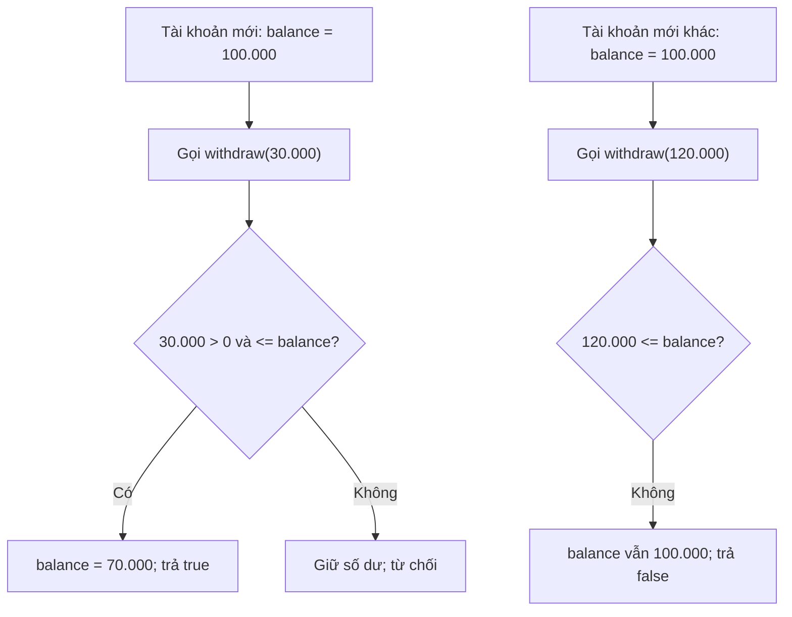
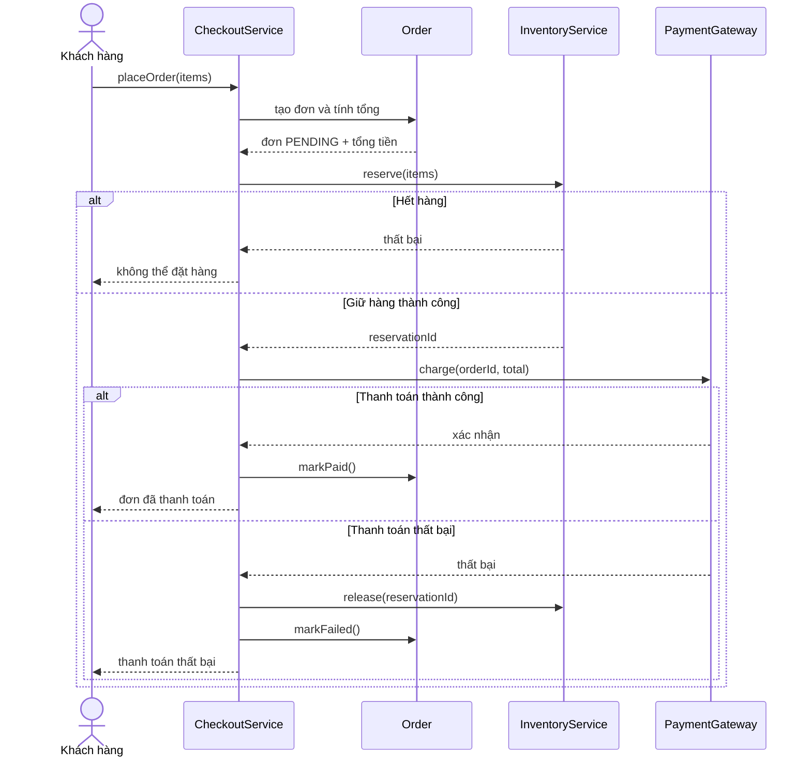
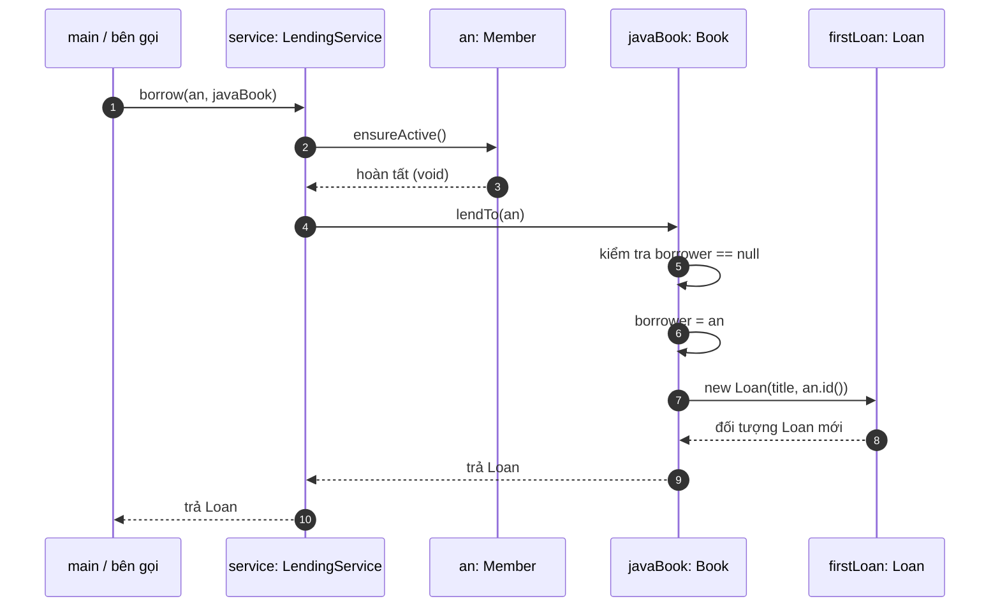
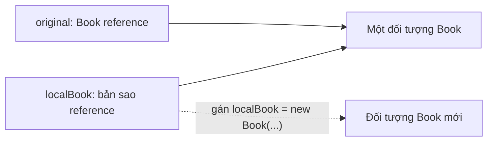
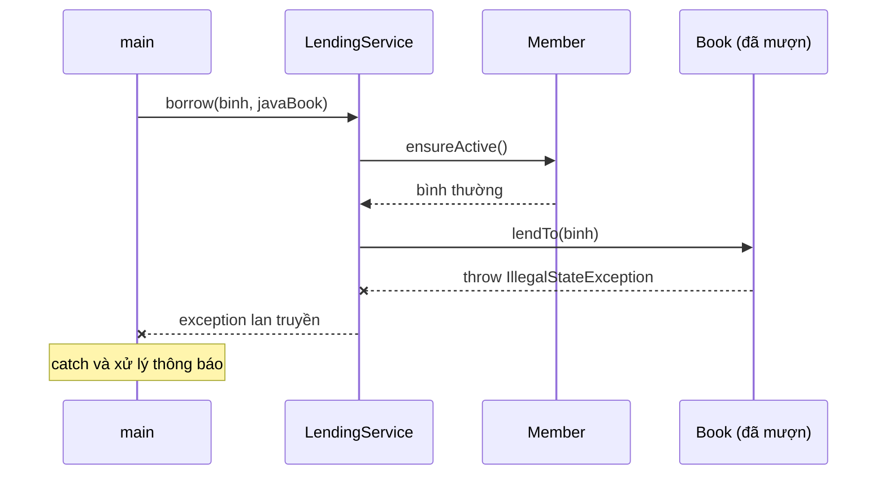
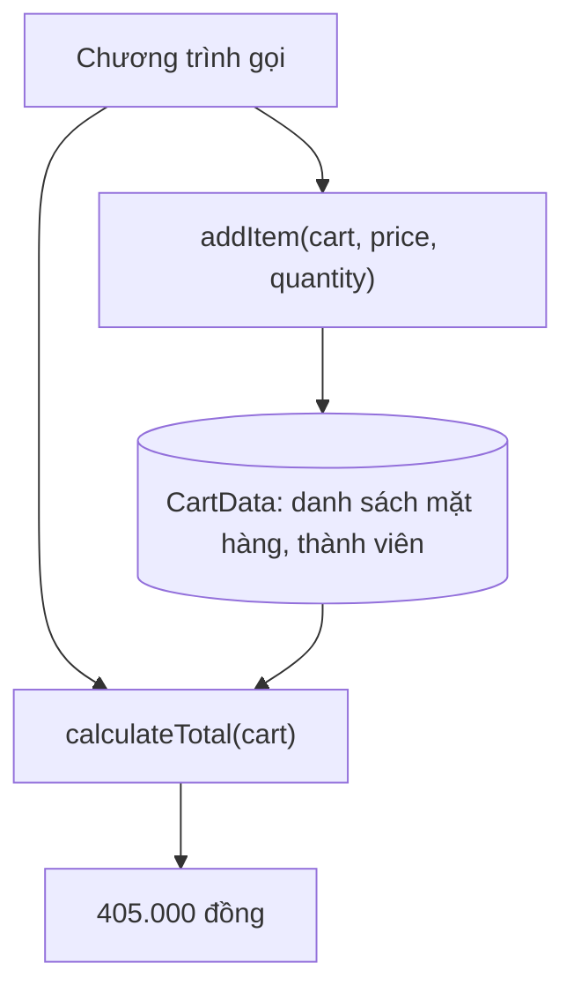
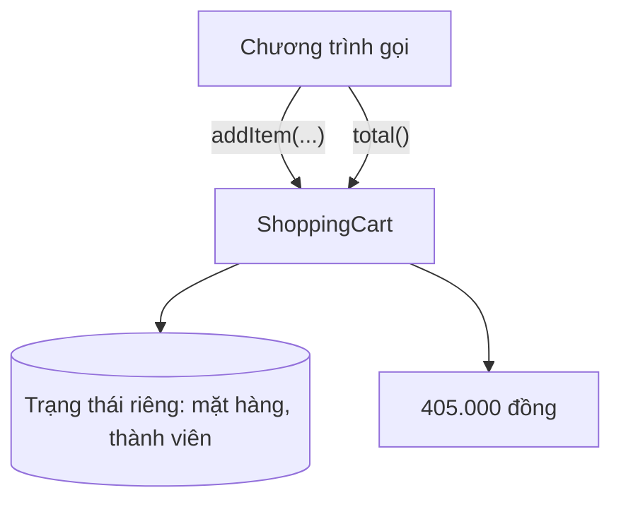
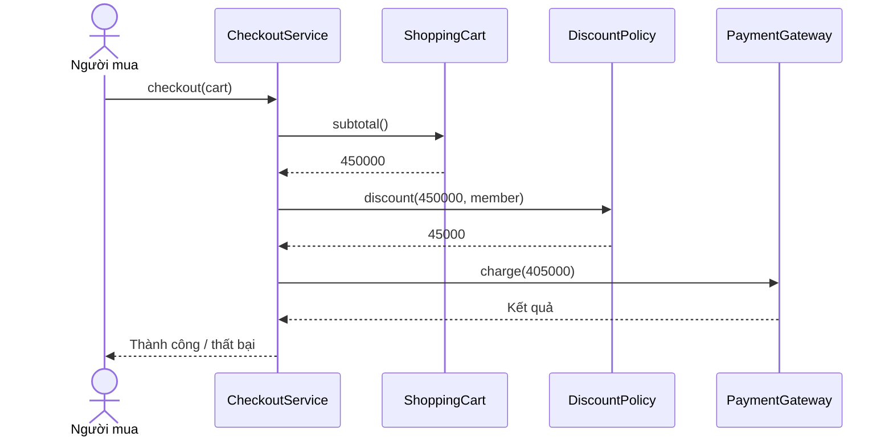
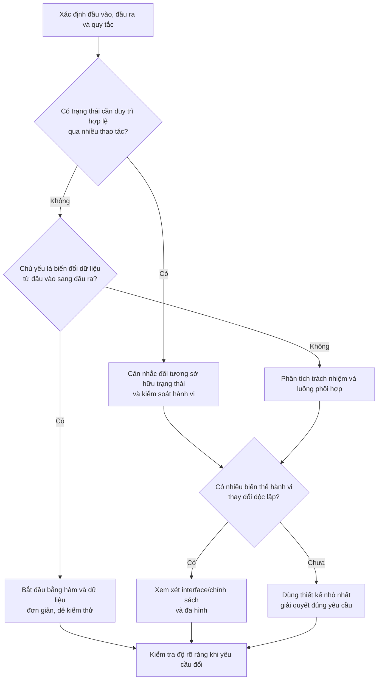

<a id="back-to-top"></a>

# Thinking in OOP

## Menu
- [What OOP Is and the Problem of Organizing Programs](#oop-basic-001)
- [Objects, State, Behavior, and Responsibility](#oop-basic-002)
- [Classes, Types, and Instances: Foundational Concepts](#oop-basic-003)
- [Object Interactions and Method Calls](#oop-basic-004)
- [Encapsulation, Abstraction, Inheritance, and Polymorphism](#oop-basic-005)
- [OOP and Procedural Programming: Decomposing a Problem](#oop-basic-006)
- [Class-Based and Prototype-Based OOP](#oop-basic-007)
- [When to Use OOP and When Not To](#oop-basic-008)

## <a id="oop-basic-001">What OOP Is and the Problem of Organizing Programs</a>

<details>
<summary>View details</summary>

# What Is OOP, and Why Does Program Organization Matter?

When a program has only a few dozen lines, it is usually easy to tell where data lives, which function handles which task, and what needs to change when requirements evolve. Now imagine an application with accounts, orders, inventory, payments, multiple developers, and hundreds of new requirements. The hard question gradually shifts from “How do I write this loop?” to **“How should I organize the program so that data, behavior, and business rules each have a clearly defined place?”**

**Object-oriented programming (OOP)** is a way of thinking about and organizing programs around **objects**. Each object represents an entity or concept with a specific responsibility; it can hold state, perform behavior, and collaborate with other objects to accomplish a task.

This lesson focuses on two questions: **What is OOP?** And **what challenges in organizing programs make OOP useful?** Techniques such as inheritance, polymorphism, and SOLID will be mentioned where relevant, but they are not the focus yet.

## 1. Why Is “Organizing a Program” a Problem Worth Solving?

Suppose you are implementing a cash withdrawal feature. At first, the problem seems simple:

1. Read the current balance.
2. Receive the requested withdrawal amount.
3. Check that the amount is valid and the balance is sufficient.
4. Deduct the money if the withdrawal is allowed.
5. Return the result.

If the program handles only one account, a few functions and variables might suffice. But a larger system brings additional requirements: thousands of accounts; transaction histories; daily withdrawal limits; account freezing; access control; suspicious-transaction alerts; concurrent transactions; testing; and changes to rules without breaking existing functionality.

Some notable challenges are:

| Problem | Signs in the source code | Possible consequence |
|---|---|---|
| Data and operations are separated | Many places directly modify `balance` | One place skips validation, leaving the data invalid |
| Responsibilities are scattered | Withdrawal rules are spread across controllers, services, and utilities | Changing one business operation requires finding and updating many locations |
| Dependencies are tangled | Changing a payment method forces changes in unrelated components | Changes are difficult and can introduce unintended bugs |
| Control flow is hard to understand | It is unclear who is allowed to do what with the data | New developers struggle to read and maintain the code |
| Testing is difficult | One function reads data, calculates, writes to the database, and sends notifications | Testing one rule requires setting up the entire system |

**OOP offers an approach to organization:** identify the objects responsible for parts of the problem, assign appropriate behaviors to them, and let them collaborate through well-defined interfaces and methods. OOP **does not automatically** solve every problem in the table; an object-oriented design can still be poor if responsibilities are assigned incorrectly.

## 2. What Exactly Is an “Object”?

Consider a bank account from the perspective of a software model:

- **Identity:** which account it is, for example the business identifier `ACC-01`.
- **State:** its balance, active status, limits, and so on at the current point in time.
- **Behavior:** depositing money, withdrawing money, freezing an account, and so on, subject to the conditions under which those actions are permitted.
- **Responsibility:** enforcing rules that belong to the account, such as disallowing a negative balance under the chosen policy.

For example, account `ACC-01` has a balance of 100.000 VND. When asked to withdraw 30.000 VND, it checks the request and updates the balance to 70.000 VND. If asked to withdraw 120.000 VND while its balance is 100.000 VND, it rejects the request and keeps the balance at 100.000 VND.

**An object is more than “a bag of data.”** A well-designed object also defines the valid operations on the data it is responsible for. At the same time, not every object has mutable state: an immutable value object, such as `Money` representing an amount and currency, also fits OOP perfectly well.

### Distinguishing Classes from Objects

| Concept | Role | Example |
|---|---|---|
| `class` | A description of shared structure and behavior | `BankAccount` |
| `object` | An instance created from a class that exists at runtime | Account A and account B |
| Attribute / field | Data belonging to an instance or a class, depending on its declaration | An account's `balance` |
| Method | Behavior provided by an object or a class | `withdraw(amount)` |
| Reference | A value used in Java to refer to an object | `accountA` |

Two accounts created from the same class can have **different balances**. Each object has its own state when that state is stored in instance fields. A “business identifier” such as `accountNumber` also differs from “object identity” in Java: two objects can have the same account number if the program allows them to be created that way.

## 3. The Procedural Approach and Where Organizational Problems Arise

A program can be organized around separate data and functions. The following example deliberately leaves the data exposed:

```java
class AccountData {
    String accountNumber;
    long balance;
}

class AccountFunctions {
    static boolean withdraw(AccountData account, long amount) {
        if (amount <= 0 || amount > account.balance) {
            return false;
        }
        account.balance -= amount;
        return true;
    }
}

// Trong cùng package:
AccountData account = new AccountData();
account.balance = 100_000;
AccountFunctions.withdraw(account, 30_000); // còn 70_000

account.balance = -999_000; // vẫn sửa được, bỏ qua quy tắc rút tiền
```

Here, `withdraw` performs validation, but `balance` can still be modified directly elsewhere in the same package. As the program grows, it becomes difficult to ensure that **every place modifying the balance follows the same rule**. This is a problem with **the design of this particular example**, not proof that every procedural program is unsafe: procedural approaches can also protect data through functions, modules, immutable data types, and access control.

The object-oriented approach places protected data and the behaviors that enforce its rules together under one responsible component.

## 4. A Runnable Java OOP Example

Create a file named `Main.java` as follows (Java 11+):

```java
public class Main {
    static final class BankAccount {
        private final String accountNumber;
        private long balance;

        public BankAccount(String accountNumber, long openingBalance) {
            if (accountNumber == null || accountNumber.isBlank()) {
                throw new IllegalArgumentException("Account number is required");
            }
            if (openingBalance < 0) {
                throw new IllegalArgumentException("Opening balance cannot be negative");
            }
            this.accountNumber = accountNumber;
            this.balance = openingBalance;
        }

        public String getAccountNumber() {
            return accountNumber;
        }

        public long getBalance() {
            return balance;
        }

        public void deposit(long amount) {
            requirePositive(amount);
            balance = Math.addExact(balance, amount);
        }

        public boolean withdraw(long amount) {
            requirePositive(amount);
            if (amount > balance) {
                return false;
            }
            balance -= amount;
            return true;
        }

        private void requirePositive(long amount) {
            if (amount <= 0) {
                throw new IllegalArgumentException("Amount must be positive");
            }
        }
    }

    public static void main(String[] args) {
        BankAccount a = new BankAccount("ACC-01", 100_000);
        System.out.println(a.getBalance()); // 100000

        boolean success = a.withdraw(30_000);
        System.out.println(success);         // true
        System.out.println(a.getBalance()); // 70000

        BankAccount b = new BankAccount("ACC-02", 100_000);
        boolean rejected = b.withdraw(120_000);
        System.out.println(rejected);        // false
        System.out.println(b.getBalance()); // 100000

        b.deposit(5_000);
        System.out.println(b.getBalance()); // 105000
    }
}
```

Commands to run it:

```bash
javac Main.java
java Main
```

In this example:

- `private long balance`: external code cannot write `a.balance = -10` through ordinary Java access; changes must go through methods permitted by the class.
- `withdraw`: validates the amount before changing the balance. If funds are insufficient, it returns `false` and **does not modify the state**.
- `deposit`: requires a positive amount; `Math.addExact` signals an error if adding two `long` values overflows, preventing an incorrect balance caused by overflow.
- `accountNumber`: is assigned during construction and has no method for changing it; in this example it is an immutable business identifier.
- `a` and `b`: are separate objects; operations on `a` do not change `b`'s balance.

### Reading Code as a Chain of Cause and Effect



**Note:** the two branches start with **two new accounts, each with a balance of 100.000**, so their states must not be confused. If you attempt to withdraw 120.000 *after* withdrawing 30.000 from the same account `a`, that attempt also fails, but the balance remains **70.000** at that point; it does not return to 100.000.

This model illustrates the value of making an object **responsible for maintaining valid state**, while also showing its limitations: `BankAccount` demonstrates in-memory logic within one process; it is **not yet** a secure money-transfer system. With multiple threads or servers updating data concurrently, you also need database transactions, locking/concurrency control, duplicate-processing prevention, security, auditing, and more. `private` does not make code thread-safe by itself.

## 5. How Does OOP Organize *an Entire Program*?

A single `BankAccount` class does not convey the entire idea. Suppose a sales application must let a customer order two products; the system must check prices and availability, record the order, and request payment.

If every step lives in one enormous function such as `processEverything()`, that function can easily balloon to include database queries, total calculations, inventory checks, payment gateway calls, logging, sending emails, and more. Adding “cash on delivery” or “order cancellation” then means editing a function with too many reasons to change.

Instead, we can assign tasks according to responsibility:

| Component | Primary responsibility | Should not handle on its own |
|---|---|---|
| `Order` | Manage order items, order status, and valid state transitions | Make HTTP calls to the payment gateway |
| `OrderItem` | Hold the product, quantity, and unit price at the time of ordering | Update all inventory records |
| `InventoryService` | Check and reserve stock according to inventory rules | Decide payment status |
| `PaymentGateway` | Define the contract for sending payment requests and receiving results | Directly change stock quantities |
| `CheckoutService` | Coordinate order creation, stock reservation, and payment requests | Contain every other object's internal business rules |

One possible interaction flow looks like this:



The diagram shows **responsibilities and messages** exchanged between objects; it is an instructional model that does not yet address timeouts, network failures, or refunds in detail. In a real system, a `charge` operation might succeed even when its response is lost; therefore, persistent state, idempotency, controlled retries, and reconciliation/compensation mechanisms are needed before the flow is complete.

Here, `CheckoutService` **knows which component to ask to do which task**. `Order` enforces its own order-state rules; the inventory component is responsible for reservations; `PaymentGateway` is a communication contract. Each component has one primary reason to change, making it easier for readers to find the right place to work.

It is also important to distinguish **objects with meaningful responsibilities** from **creating large numbers of classes**. If a feature merely performs simple addition, splitting it into seven classes and ten interfaces creates more confusion than value.

## 6. What Does It Mean for “Objects to Collaborate”?

In Java, objects commonly work together through **method calls**. A conceptual example:

```java
interface PaymentGateway {
    PaymentResult charge(String orderId, long amount);
}

class CheckoutService {
    private final PaymentGateway paymentGateway;

    CheckoutService(PaymentGateway paymentGateway) {
        this.paymentGateway = paymentGateway;
    }

    PaymentResult requestPayment(String orderId, long amount) {
        if (amount <= 0) {
            throw new IllegalArgumentException("Amount must be positive");
        }
        return paymentGateway.charge(orderId, amount);
    }
}

// PaymentResult là kiểu kết quả do ứng dụng định nghĩa.
// Đoạn này minh họa cách phối hợp, không phải file Java độc lập.
```

`CheckoutService` needs the ability to “collect payment,” so it depends on the `PaymentGateway` contract. One class might implement a real payment gateway, while another simulates results for tests. This reduces coupling to specific implementation details.

This is a major benefit of OOP when building systems: **you can change an implementation while reducing the need to modify the code that uses it**. But introducing an interface should have a purpose, such as supporting multiple implementations, substituting a test implementation, or establishing a dependency boundary; not every class needs its own matching interface.

## 7. How Does OOP Differ from Procedural Programming?

The comparison should focus on **how responsibilities are divided and managed**, rather than labeling one approach “old” or “inferior”:

| Question | Procedural / function-oriented organization | Object-oriented organization |
|---|---|---|
| Main way of thinking | Which steps/functions transform input into output? | Which objects hold responsibilities, and what must they exchange? |
| Data and behavior | Can reside in separate modules/functions | Related state and behavior are often grouped within objects |
| Natural strengths | Linear processing flows, algorithms, data transformations | Models with state and rules; collaboration among components |
| Managing change | Through modules, function contracts, and data types | Through object boundaries, methods, and interfaces |
| Risks of poor application | Overlong functions and uncontrolled shared state | Oversized classes, tangled relationships, unnecessary layers |

Both approaches can **coexist in one application**: an `Order` object can use a pure function to calculate tax; a service can call an object's methods; a data-processing pipeline can use functions or streams instead of creating an object for every step. Java supports object-oriented programming, but writing Java code alone does not guarantee a good OOP design.

### A Practical Scenario for Comparison

When the requirement changes to “withdrawals must be blocked for frozen accounts,” OOP thinking suggests placing the rule in `BankAccount.withdraw()` or another clearly responsible domain component. The web interface, mobile application, and background jobs all invoke the same behavior, avoiding separate, inconsistent checks in each client.

If three controllers each access the database and deduct a balance directly for convenience, creating a `BankAccount` class helps little: **the rules remain scattered**. The benefit comes from the design and disciplined use of object boundaries, not from class names.

## 8. How Do You Identify Objects from Requirements?

Do not rush to create a class for every noun in a sentence. Start with actual behaviors and rules.

**Example requirement:** “A customer can cancel an order before it is handed over to the shipping carrier; once handed over, it cannot be canceled directly.”

You can ask the following questions in order:

1. **What information must be kept?** An order has an identifier, items, and statuses such as `CREATED`, `PAID`, `SHIPPED`, and `CANCELLED`.
2. **Which rules must always hold?** Once an order is `SHIPPED`, an ordinary `cancel()` operation must not transition it directly to `CANCELLED`.
3. **Who should enforce the rule?** `Order` is a natural candidate because it owns the state and determines valid transitions.
4. **Which other components must collaborate?** `OrderService` might retrieve the order from storage; shipping or refund mechanisms have their own rules.
5. **What should be able to change independently?** Switching carriers should not require `Order` to rewrite all its HTTP logic.

A very brief sketch:

```java
enum OrderStatus { CREATED, PAID, SHIPPED, CANCELLED }

class Order {
    private OrderStatus status = OrderStatus.CREATED;

    void cancel() {
        if (status == OrderStatus.SHIPPED) {
            throw new IllegalStateException("Shipped order cannot be cancelled here");
        }
        if (status == OrderStatus.CANCELLED) {
            return; // ví dụ chọn hành vi gọi lặp không làm thay đổi trạng thái
        }
        status = OrderStatus.CANCELLED;
    }
}
```

This models just one small rule. In a real product, cancellation may be restricted to a more specific set of states; refunds, restocking, event history, and user permissions are responsibilities that must be analyzed separately. The key point is that **state rules have a clear “home”**: other code calls `cancel()` instead of changing `status` arbitrarily.

## 9. How Does OOP Relate to Encapsulation, Abstraction, Inheritance, and Polymorphism?

OOP is often introduced through its “four pillars.” These are tools for building and extending designs, but **memorizing the names of the four pillars alone is not enough to understand OOP**.

| Concept | What question does it answer? | Connection to this lesson |
|---|---|---|
| **Encapsulation** | Who may change data, and through which operations? | `balance` is `private`; withdrawals go through `withdraw()` |
| **Abstraction** | What does the outside world need to know, and which details can be hidden? | Callers only need to know whether `withdraw(amount)` succeeds or fails |
| **Inheritance** | When is a parent–child type relationship appropriate for reuse or extension? | Not needed for the account example; inheritance is not always appropriate |
| **Polymorphism** | How can different implementations share one contract? | Different implementations of `PaymentGateway` |

**Encapsulation and abstraction are not the same thing.** Using `private` to restrict access is an encapsulation technique; choosing a compact interface that hides implementation details is an abstraction decision. A class with many `private` fields but all its business logic in a controller still does not have a sound division of responsibilities.

## 10. When Is OOP Useful, and When Should You Avoid Forcing It?

OOP is especially useful when a program has **many interacting entities, state and rules that evolve over time**, multiple development teams that need agreed boundaries, or behaviors requiring different implementations.

Conversely, a CSV conversion script, a pure arithmetic calculation, batch processing in a pipeline, or a small program may be clearer with simple functions and data structures. No rule requires every operation to create a new object. Many real applications combine object-oriented, procedural, and functional approaches.

Some warning signs that a design should be reconsidered:

- **God object:** one class handles everything from business logic to SQL, HTTP, and email.
- **Anemic domain model:** objects mostly contain getters/setters, while the rules governing their state are scattered elsewhere. For DTOs or data-transfer structures, data-only objects can still be entirely appropriate.
- **Overuse of inheritance:** using `extends` merely to reuse a few lines of code, making subclasses heavily dependent on their parent classes.
- **Too many intermediary classes:** a simple operation passes through a string of interfaces, managers, and helpers without meaningful boundaries.
- **Ignoring concurrency and persistence:** assuming that hiding a field or using `synchronized` within one object automatically protects data across multiple application instances.

In **Spring Boot**, `@Service`, `@Controller`, and `@Repository` commonly mark application-layer roles. They can be used in an OOP design, but adding annotations does not automatically make a class a good domain model. For example, a controller should receive and validate data at the boundary and delegate to domain components; domain objects can enforce state-transition rules. With JPA, transactions and optimistic/pessimistic locking must be considered separately for concurrent updates.

## 11. Check Your Understanding

Try answering before reading the hints:

**Scenario A.** A `Wallet` class has `public long balance` and a very strict `withdraw()` method. Other code can still write `wallet.balance = -1`. What is wrong?  
**Hint:** the class does not enforce the balance rule because there is still a way to modify state without passing through the validation behavior.

**Scenario B.** Two `BankAccount` objects both have `balance = 100000`. Must they be the same object?  
**Hint:** no. Equal state values do not imply equal identity or the same reference; nor do they mean the business account identifiers are equal.

**Scenario C.** Every time a new payment method is added, developers must modify numerous `if/else` branches in `CheckoutService`. What design approach could help?  
**Hint:** define a shared payment contract and separate concrete implementations if the system genuinely needs multiple payment methods.

**Scenario D.** An `Order` class calculates totals, calls a bank over HTTP, sends emails, executes SQL, writes logs, and manages inventory. Is this good because “everything is in one object”?  
**Hint:** no; good encapsulation also requires **assigning responsibilities appropriately**, so changes in one area have less impact on others.

## 12. What Should You Remember from This Lesson?

OOP is a way to **divide a system into objects with state, behavior, and clear responsibilities that collaborate through contracts**. It is useful because, as a project grows, we need to know **who owns the data, where the rules live, who may request which operations, and which parts are affected by a change**.

To practice, choose a familiar business concept such as an account or order and write down 3 things: **the state it must maintain, its valid behaviors, and the rules that must never be violated**. Then try writing a class that enforces those rules and check its state before and after each call. When you add a second object, identify the messages and responsibilities of each participant. This is a first step from “writing code that runs” toward **designing a program that can be understood, tested, and changed**.


</details>

- [Back to top](#back-to-top)

---

## <a id="oop-basic-002">Objects, State, Behavior, and Responsibility</a>

<details>
<summary>View details</summary>

# Objects, State, Behavior, and Responsibility in OOP

When learning object-oriented programming (OOP), we often hear: “An object has state and behavior.” This is true, but it is not enough to design software. We also need to understand **what the object is responsible for**, because that responsibility determines which data belongs to it and which behaviors should reside within it.

Imagine an order being created: it has an order ID, a list of products, and a draft status; the buyer can add products and then confirm it. The order must enforce the rule “once confirmed, the product list cannot be modified arbitrarily.” This illustrates the connection among **object → state → behavior → responsibility**.

## 1. How Are These Four Concepts Related?

| Concept | Question to answer | Order example |
| --- | --- | --- |
| **Object** | Who or what participates in the system? | A specific order with an `orderId` |
| **State** | What data does the object currently hold, and what condition is it in? | Order lines; `DRAFT`, `CONFIRMED`, or `CANCELLED` |
| **Behavior** | What meaningful operations can the object perform? | `addLine()`, `confirm()`, `cancel()`, `total()` |
| **Responsibility** | What must the object know, decide, and guarantee? | Keep order lines valid and control order-state transitions |

These four elements are not independent. If an object provides a `confirm()` operation, that operation must read the current state, check conditions, and update the state in accordance with the object's own responsibility.

For example, confirming an order should not merely assign `status = CONFIRMED`. It must answer: *Has the order been canceled? Does it contain at least one product? Is confirming it again allowed?* If these rules are scattered across the codebase, the software can easily create orders in invalid states.

## 2. What Is an Object? Distinguishing Objects from Classes

An **object** is an entity within a program that has data and operations related to that data. It can represent something in the real world (an order or customer), a business concept (a shopping cart or credit limit), or a technical component (a buffer or file reader). Not every object has to correspond to a tangible physical thing.

A **class** generally describes shared structure and behavior; an **object (instance)** is a concrete instance created from that class.

~~~java
Order firstOrder = new Order(UUID.randomUUID());
Order secondOrder = new Order(UUID.randomUUID());

// Cùng kiểu Order nhưng là hai đối tượng riêng.
// Mỗi đối tượng có id, danh sách hàng và trạng thái của riêng nó.
~~~

Two orders can both be in the `DRAFT` state while remaining **two distinct objects**. Conversely, an order that moves from `DRAFT` to `CONFIRMED` is still *the same order*; only its state has changed.

Two perspectives on identity must be distinguished:

- **Identity in Java memory:** `firstOrder == secondOrder` checks whether two variables refer to the same object.
- **Business identity:** `orderId` identifies an order across persistence, loading from a database, or transmission through an API. Two different Java instances can represent the same `orderId`. Whether to compare them using `equals()` or an ID depends on the particular design; it is not determined automatically by the class name.

The essential distinction: **identity answers “Which entity is this?”; state answers “What is its current condition?”**

## 3. State: What an Object Currently Holds

State is the set of values associated with an object at a given moment. For an order, these include:

- **Unchanged throughout the business lifecycle:** the order identifier `id`.
- **May change through valid behaviors:** order lines while the order is in draft; `status` after confirmation or cancellation.
- **May be derived from other state:** `total()` is calculated from order-line quantities and unit prices. There is no requirement to store an additional `total` variable and keep it synchronized whenever an item is added.

Consider the same order at three points in time:

| Point in time | Order lines | Status | Total |
| --- | --- | --- | --- |
| Newly created | Empty | `DRAFT` | 0 |
| Add 2 books × 125.000 | 1 order line, quantity 2 | `DRAFT` | 250.000 |
| Successfully confirmed | Unchanged | `CONFIRMED` | 250.000 |

A **valid** state must satisfy business rules (invariants). In this example:

1. The quantity of each order line must be greater than 0, and its unit price cannot be negative.
2. Confirmed or canceled orders must not accept additional lines through `addLine()`.
3. The `confirm()` operation is allowed only when an order is `DRAFT` and has at least one order line.
4. The ID does not change simply because the order changes state.

Not all state must be mutable. An immutable object still has state; it simply remains fixed after creation. And a `private` field does not guarantee valid data by itself: methods that can modify data must still be controlled.

## 4. Behavior: What an Object Can Do

**Behavior** is an operation an object exposes to the rest of the program. In Java, behavior is usually represented by methods. A behavior may:

- **Change state:** `addLine()`, `confirm()`, `cancel()`.
- **Return information without changing state:** `total()`, `status()`.
- **Reject invalid operations:** `confirm()` reports an error for an empty order and leaves it in `DRAFT`.

Method names should express an intention from the problem domain. Compare:

~~~java
// Khó kiểm soát: mã gọi bên ngoài tự quyết định trạng thái.
order.setStatus(OrderStatus.CONFIRMED);

// Thể hiện ý nghĩa nghiệp vụ: Order tự kiểm tra điều kiện.
order.confirm();
~~~

`confirm()` is preferable here because the caller requests **“confirm this order”**, while **the object decides whether the request is valid**. This does not mean every setter is bad: data transfer objects (DTOs), configuration objects, and simple beans serve their own purposes. What matters is avoiding bypasses of important rules for objects with a business lifecycle.

Behaviors should have clearly defined **inputs, preconditions, results, and postconditions**. If an operation fails, it should not unintentionally leave data partially modified.

## 5. Responsibility: Which Rules Should an Object Own?

Responsibilities are what an object must know or guarantee to fulfill its role correctly. They provide the basis for deciding **where to place data and methods**.

| Component | Appropriate responsibility | Should not also handle |
| --- | --- | --- |
| **`Order`** | Manage order lines, calculate totals, validate order-state transitions | Send HTTP requests to payment gateways, construct SQL, send emails |
| **`PaymentService`** | Coordinate payments, call payment systems, and process results | Directly modify the order lines inside `Order` |
| **`OrderRepository`** | Persist and load orders | Decide whether an empty order can be confirmed |
| **`NotificationService`** | Send order-related notifications | Change `Order.status` on its own |

This division is not universal for every system. What matters is that the rule **“Can this order be confirmed?”** has one clearly responsible owner instead of being duplicated across controllers, services, and repositories with different conditions.

**Responsibility differs from behavior:** “Ensure valid order-state transitions” is a *responsibility*; `confirm()` and `cancel()` are *behaviors* that carry it out. An object can have multiple methods that serve one responsibility.

Well-defined responsibilities tend to exhibit **cohesion**: data and behavior serve the same purpose. If `Order` manages orders, validates JWTs, opens database connections, and sends emails, the reasons for changing that class no longer belong to one coherent group.

## 6. Complete Java Example: An Order That Protects Its Own State

The following example uses Java 17 or later (which supports `record`) and can be saved as `Main.java` and run. It illustrates in-memory rules without yet addressing database persistence or concurrent requests.

~~~java
import java.math.BigDecimal;
import java.util.ArrayList;
import java.util.List;
import java.util.Objects;
import java.util.UUID;

enum OrderStatus {
    DRAFT, CONFIRMED, CANCELLED
}

// Một dòng hàng là value object: chứa dữ liệu hợp lệ và bất biến.
record OrderLine(String sku, int quantity, BigDecimal unitPrice) {
    OrderLine {
        Objects.requireNonNull(sku, "sku");
        Objects.requireNonNull(unitPrice, "unitPrice");

        if (sku.isBlank() || quantity <= 0 || unitPrice.signum() < 0) {
            throw new IllegalArgumentException("Invalid order line");
        }
    }

    BigDecimal subtotal() {
        return unitPrice.multiply(BigDecimal.valueOf(quantity));
    }
}

final class Order {
    private final UUID id;
    private final List<OrderLine> lines = new ArrayList<>();
    private OrderStatus status = OrderStatus.DRAFT;

    Order(UUID id) {
        this.id = Objects.requireNonNull(id, "id");
    }

    UUID id() {
        return id;
    }

    OrderStatus status() {
        return status;
    }

    List<OrderLine> lines() {
        return List.copyOf(lines); // Không lộ List mutable bên trong.
    }

    BigDecimal total() {
        return lines.stream()
                .map(OrderLine::subtotal)
                .reduce(BigDecimal.ZERO, BigDecimal::add);
    }

    void addLine(String sku, int quantity, BigDecimal unitPrice) {
        requireDraft();
        lines.add(new OrderLine(sku, quantity, unitPrice));
    }

    void confirm() {
        requireDraft();
        if (lines.isEmpty()) {
            throw new IllegalStateException("Empty order cannot be confirmed");
        }
        status = OrderStatus.CONFIRMED;
    }

    void cancel() {
        requireDraft();
        status = OrderStatus.CANCELLED;
    }

    private void requireDraft() {
        if (status != OrderStatus.DRAFT) {
            throw new IllegalStateException(
                    "Order must be DRAFT, actual: " + status);
        }
    }
}

public class Main {
    public static void main(String[] args) {
        Order order = new Order(UUID.randomUUID());

        System.out.println(order.status()); // DRAFT
        System.out.println(order.total());  // 0

        order.addLine("BOOK-01", 2, new BigDecimal("125000"));
        System.out.println(order.total());  // 250000

        order.confirm();
        System.out.println(order.status()); // CONFIRMED

        try {
            order.addLine("PEN-01", 1, new BigDecimal("5000"));
        } catch (IllegalStateException ex) {
            System.out.println(ex.getMessage()); // Order must be DRAFT...
        }

        System.out.println(order.total()); // Vẫn 250000

        // Nhánh thất bại độc lập, không dùng lại đơn đã xác nhận.
        Order emptyOrder = new Order(UUID.randomUUID());
        try {
            emptyOrder.confirm();
        } catch (IllegalStateException ex) {
            System.out.println(ex.getMessage()); // Empty order...
        }
        System.out.println(emptyOrder.status()); // Vẫn DRAFT

        Order cancelledOrder = new Order(UUID.randomUUID());
        cancelledOrder.cancel();
        System.out.println(cancelledOrder.status()); // CANCELLED
    }
}
~~~

**Read the example from four perspectives:**

- **Object:** `order`, `emptyOrder`, and `cancelledOrder` are three instances with distinct IDs, even though all are created from `Order`.
- **State:** `id`, `lines`, and `status` make up the data managed by `Order`. `total()` derives its result from `lines`.
- **Behavior:** `addLine()` changes the list; `confirm()` and `cancel()` change state; `total()` only calculates.
- **Responsibility:** `Order` ensures that every public operation in this example preserves the state rules. It hides its mutable list using `List.copyOf(...)` and provides no unrestricted `setStatus()` method.

Run the example:

~~~bash
javac Main.java
java Main
~~~

**Note about this example:** We deliberately define cancellation as permitted only for `DRAFT` orders. A real project may allow confirmed orders to be canceled, include refunds, or introduce `PAID`/`SHIPPED` statuses; the rules and tests must then reflect those business requirements. `BigDecimal` avoids binary floating-point errors in decimal calculations, but real monetary systems also need currency-unit, rounding, tax, and fee policies.

## 7. Object Lifecycle: State Changes Through Behavior

~~~mermaid
stateDiagram-v2
    [*] --> DRAFT: tạo Order
    DRAFT --> DRAFT: addLine(...) hợp lệ
    DRAFT --> CONFIRMED: confirm() và có hàng
    DRAFT --> CANCELLED: cancel()
    CONFIRMED --> [*]
    CANCELLED --> [*]
~~~

The diagram shows **successful state transitions** in the example. Invalid requests (confirming an empty order, adding items after confirmation, or attempting cancellation again) are rejected and leave the state unchanged.

Trace one flow step by step:

| Step | Operation | Before | After | Observable result |
| --- | --- | --- | --- | --- |
| 1 | `new Order(id)` | Does not exist | `DRAFT`, empty | A new order exists |
| 2 | `addLine("BOOK-01", 2, 125000)` | `DRAFT`, empty | `DRAFT`, 1 line | `total() = 250000` |
| 3 | `confirm()` | `DRAFT`, 1 line | `CONFIRMED`, 1 line | Confirmation succeeds |
| 4 | `addLine("PEN-01", 1, 5000)` | `CONFIRMED`, 1 line | **Unchanged** | Throws `IllegalStateException`; total remains 250000 |

To test the “confirm an empty order” error, use **a second order**: `new Order(id2)` → `confirm()` fails → status remains `DRAFT`. Using separate test branches avoids confusing the first order's results with those of the second.

## 8. What Happens When Multiple Objects Collaborate?

Each object has its own responsibility, but systems often require multiple objects to collaborate.

For example, consider an order-confirmation flow in a Spring Boot application:

~~~mermaid
sequenceDiagram
    participant C as OrderController
    participant S as OrderService
    participant R as OrderRepository
    participant O as Order
    C->>S: confirmOrder(orderId)
    S->>R: findById(orderId)
    R-->>S: Order
    S->>O: confirm()
    O-->>S: Thành công hoặc exception
    S->>R: save(Order) khi thành công
    S-->>C: Kết quả
~~~

In this organization, **OrderController** receives the request, **OrderService** coordinates the use case, **OrderRepository** handles retrieval and persistence, and **Order** validates conditions and changes state. This division allows the rule “Can an empty order be confirmed?” to be changed in `Order.confirm()`, while also allowing storage details to change without placing SQL inside `Order`.

This is **an illustrative design**, not a requirement that every OOP application contain classes named `Service`/`Repository`. A simple application might need fewer classes. Systems involving payments, inventory, and transactions will have more complex coordination responsibilities.

Note: in-memory validation inside `Order` **does not resolve** concurrent requests, failed updates, or database rollbacks. Those situations require appropriate transactions, locking/versioning, and error handling in persistence and business-process layers.

## 9. Common Design Mistakes

| Common misconception | Consequence | Better way to think |
| --- | --- | --- |
| “An object is just a group of fields.” | Classes contain only getters/setters, while rules are scattered outside. | Ask what conditions the object must enforce and what behaviors it must provide. |
| “Every method is a separate responsibility.” | Classes are split arbitrarily and become hard to follow. | Multiple methods can serve one consistent responsibility. |
| “`private` means state is always safe.” | An unrestricted setter can still break rules; mutable collections may leak. | Validate rules wherever state changes and restrict modification rights. |
| “State means a status enum.” | Order lines, quantities, and other values inside the object are overlooked. | State includes all relevant data at a point in time; status is just one part. |
| “Making everything a class produces good OOP.” | Unnecessary classes proliferate; responsibilities remain unclear. | Create an object when it has a role, data, or behavior that needs managing. |
| “An object can do everything on its own.” | One class handles APIs, databases, payments, email, and business logic. | Establish responsibility boundaries and collaborate through suitable methods. |

A sign that warrants review is code like `if (order.getStatus() == DRAFT) { ... }` appearing in many places before an order is changed. The rule may belong to `Order` and should perhaps become one of its behaviors. However, rules involving **multiple objects or multiple data sources** may still require a service or coordinating component.

## 10. Test Your Understanding

**Scenario 1.** Two orders both have `status = DRAFT` and `total = 0`. Are they the same object? **Not necessarily.** Identity matters; matching data does not imply the same instance or the same business order.

**Scenario 2.** An order is confirmed and its `status` changes to `CONFIRMED`. Is this a new object? **No.** Its identity remains the same; its state changes.

**Scenario 3.** Should a controller call `order.setStatus(CONFIRMED)`? **Not in this example.** The `confirm()` method lets Order validate the conditions itself before changing state.

**Scenario 4.** `total()` does not modify data. Is it still a behavior? **Yes.** Behavior can calculate or return information without changing state.

**Scenario 5.** Should email-sending code live inside `Order.confirm()`? **Usually not.** Sending emails is an integration/notification responsibility that another component can handle after the order is successfully confirmed.

When designing your own OOP class, ask these questions in order:

1. **Which objects** exist in the problem? What identifies a particular object?
2. **Which state** must each object own? What can change, and what is merely derived?
3. **Which behaviors** are meaningful to users or the business? What are their preconditions and postconditions?
4. **Which rules** must the object always enforce? What happens when an operation fails?
5. **Which responsibilities** belong to that object, and which should belong to others?

If you can answer these five questions with a concrete example, you understand the shift from passive data to **objects with clearly defined behaviors and responsibilities**, rather than merely memorizing the definition of OOP.

</details>

- [Back to top](#back-to-top)

---

## <a id="oop-basic-003">Classes, Types, and Instances: Foundational Concepts</a>

<details>
<summary>View details</summary>

# Classes, Types, and Instances: Foundational Concepts

When reading the Java statement `CounterView view = new ClickCounter("Nút A", 10);`, beginners may call all three elements “objects.” In fact, three separate questions need to be asked:

- **Class:** which definition describes the object's data, methods, constructor, and rules?
- **Type:** which operations can a variable or expression use at compile time?
- **Instance/object:** which concrete object was created and has its own state at runtime?

Another important concept is the **reference**: in Java, a variable of a reference type typically holds a value used to access an object; the variable itself is not the object. This lesson focuses on distinguishing these concepts in code and runtime results.

## 1. A Map of the Four Concepts

| Term | Question answered | Example |
| --- | --- | --- |
| Class | How is the object defined? | `class ClickCounter` has `clicks` state and `click()` behavior |
| Type | Which operations are valid through this variable? | `CounterView` declares `value()` |
| Instance | Which concrete object exists? | The result of `new ClickCounter("Nút A", 10)` |
| Reference | Which object does the variable access? | `view` holds a reference to a `ClickCounter` |

In Java, a **class also defines a type**, but “class” and “type” are not synonymous. Other types include interface types, array types, primitive types, and more. Also, the same object can be accessed through multiple **compatible declared types**.

For example:

~~~java
CounterView view = new ClickCounter("Nút A", 10);
~~~

On the left, `CounterView` is the declared type of variable `view`. On the right, `new ClickCounter(...)` creates an instance of `ClickCounter`. Variable `view` receives a reference to that instance. Only one object is created, not two merely because two type names appear.

## 2. A Class Describes Shared Structure and Behavior

A class declares the members and rules for its objects in Java:

| Component | Example | Role |
| --- | --- | --- |
| Instance field | `private int clicks;` | Stores the click count for **each** counter |
| Final field | `private final String label;` | Counter label, assigned during initialization and not reassigned afterward |
| Constructor | `ClickCounter(String label, int initial)` | Establishes a valid initial state |
| Instance method | `void click()` | Operates on the counter receiving the call |
| Query method | `int value()` | Returns the current click count |
| Access modifier | `private`, `public` | Controls where members can be accessed |

Writing `class ClickCounter { ... }` alone **does not create** a concrete counter. Every time `new ClickCounter(...)` is evaluated, Java creates a new object and executes the corresponding constructor. Objects share the methods defined by their class but may hold different field values.

**Do not take the “class is a blueprint” analogy too literally.** In Java, classes also participate in type rules, inheritance, access control, and method selection. A blueprint is a starting analogy, not the full meaning of a class.

## 3. Standalone Runnable Program: One Object, Multiple Type Perspectives

This example uses Java 11 or later. Save all of it in `Main.java`.

~~~java
interface CounterView {
    int value();
}

final class ClickCounter implements CounterView {
    private final String label;
    private int clicks;

    ClickCounter(String label, int initial) {
        if (label == null || label.isBlank()) {
            throw new IllegalArgumentException("Label must not be blank");
        }
        if (initial < 0) {
            throw new IllegalArgumentException("Initial count must not be negative");
        }
        this.label = label;
        this.clicks = initial;
    }

    @Override
    public int value() {
        return clicks;
    }

    public String label() {
        return label;
    }

    public void click() {
        clicks = Math.addExact(clicks, 1);
    }
}

public class Main {
    public static void main(String[] args) {
        ClickCounter first = new ClickCounter("Nút A", 10);
        CounterView view = first;
        Object general = first;
        ClickCounter second = new ClickCounter("Nút A", 10);

        first.click();

        System.out.println(first.value());                  // 11
        System.out.println(view.value());                   // 11
        System.out.println(second.value());                 // 10
        System.out.println(first == view);                  // true
        System.out.println(view == general);                // true
        System.out.println(first == second);                // false
        System.out.println(view.getClass().getSimpleName()); // ClickCounter
    }
}
~~~

Run with:

~~~bash
javac Main.java
java Main
~~~

Output:

~~~text
11
11
10
true
true
false
ClickCounter
~~~

### Tracing Each Call

1. `new ClickCounter("Nút A", 10)` creates **the first instance** with `clicks = 10`. Variable `first` contains a reference to it.
2. `CounterView view = first` **copies the reference**. It does not create a second `ClickCounter`.
3. `Object general = first` also refers to the first instance; that one instance now has three reference variables pointing to it.
4. `new ClickCounter("Nút A", 10)` creates **the second instance** and assigns it to `second`. Matching labels and initial counts do not make it the first object.
5. `first.click()` changes `clicks` on the first instance from 10 to 11. `view.value()` returns 11 because it accesses the same object; `second.value()` remains 10 because it accesses a different object.
6. Both `first == view` and `view == general` are `true` because their respective references point to the same object. `first == second` is `false`.
7. `view.getClass().getSimpleName()` returns `ClickCounter` because viewing an object through an interface type does not change its runtime class.

~~~mermaid
flowchart LR
    F["first: ClickCounter"] --> C1["ClickCounter #1<br/>label=Nút A; clicks=11"]
    V["view: CounterView"] --> C1
    G["general: Object"] --> C1
    S["second: ClickCounter"] --> C2["ClickCounter #2<br/>label=Nút A; clicks=10"]
~~~

The diagram shows **four reference variables** but only **two instances**. Variables and objects must be counted separately.

## 4. A Type Determines What You Can Call Through a Variable

In the example, `first`, `view`, and `general` all refer to the same object. At compile time, however, they have **different declared types**.

| Variable | Declared type | Methods callable directly |
| --- | --- | --- |
| `first` | `ClickCounter` | `click()`, `value()`, `label()`, and other applicable methods |
| `view` | `CounterView` | `value()` and `Object` methods Java permits through an interface |
| `general` | `Object` | Methods declared by `Object`, such as `getClass()` |

For example:

~~~java
first.click();      // Hợp lệ: ClickCounter khai báo click().
view.value();       // Hợp lệ: CounterView khai báo value().
general.getClass(); // Hợp lệ: Object khai báo getClass().

// view.click();        // Không biên dịch: CounterView không khai báo click().
// general.value();     // Không biên dịch: Object không khai báo value().
~~~

These illustrative statements belong **inside a method** with the three variables already available, as in `main`; they are not a standalone Java file. The runtime object still has `click()`; the error occurs because **the type visible to the compiler at the call site** does not declare that method. To call additional capabilities, you can retain a variable of the concrete type or check the type before casting deliberately. Avoid unconditional casts when the runtime class is unknown.

**Distinguish two ideas:** the declared type restricts which operations can legally be called; for **overridden instance methods**, the runtime class determines which implementation executes. This underlies polymorphism, but assigning a reference to an interface-typed variable does not create a new object.

### Java Types Go Beyond Classes

- **Class types:** `ClickCounter`, `String`, `Object`.
- **Interface types:** `CounterView`, `Runnable`. An interface defines a contract and cannot be instantiated directly using `new CounterView()`.
- **Primitive types:** `int`, `long`, `boolean`; primitive values are not instances created using `new`.
- **Array types:** `int[]`, `String[]`; arrays are objects and have their own array types.
- **Abstract types:** An `abstract class` is still a class/type, but you cannot instantiate it directly using `new AbstractType()`.

Two variables with the same declared type may refer to different objects; conversely, two variables with different types may refer to **the same object** if their types are compatible.

## 5. How Do Instances, Identity, and State Differ?

An instance is a concrete object at runtime. We must distinguish three aspects:

| Aspect | Question | Example |
| --- | --- | --- |
| **Identity** | Is this the very same object as before? | `first == view` is `true` |
| **State** | What information does the object hold? | The `clicks` value in `first` has increased to 11 |
| **Behavior** | Which operations can it perform? | `click()` updates; `value()` queries |

An object can change state while **remaining the same object**. Conversely, two distinct objects may contain identical data without becoming one object.

~~~java
ClickCounter a = new ClickCounter("Trùng tên", 5);
ClickCounter b = new ClickCounter("Trùng tên", 5);

System.out.println(a == b);      // false
System.out.println(a.equals(b)); // false với lớp mẫu hiện tại
~~~

`a.equals(b)` returns `false` for this class because `ClickCounter` has not overridden `equals`, so it inherits identity-based comparison from `Object`. If a class defines value-based equality, two different instances may be `equals` according to that rule. Therefore:

- `==` between references checks **whether they point to the same object**.
- `equals(...)` reflects **the equality rule provided by the class**.
- Matching business data (for example, the same order ID) does not automatically make references point to one object; uniqueness of a business identifier is a separate rule.

A class can describe **immutable** objects (whose observable state does not change after initialization). Whether an object is mutable or immutable is a design choice; it does not determine whether it is an instance of a class.

## 6. Three Commonly Confused Operations: new, Reference Assignment, and State Changes

~~~java
ClickCounter x = new ClickCounter("X", 3); // Tạo đối tượng thứ nhất.
ClickCounter y = x;                        // Không tạo đối tượng mới.
x = new ClickCounter("Z", 7);              // Tạo đối tượng thứ hai rồi gán lại x.

y.click();
System.out.println(y.value()); // 4
System.out.println(x.value()); // 7
~~~

This snippet also belongs inside a method and uses the `ClickCounter` definition from the main example.

The differences:

- `new ClickCounter(...)` creates a new object with initial state validated by its constructor.
- `ClickCounter y = x` copies **the reference value**, not the object; `x` and `y` both refer to object X until one variable is reassigned.
- `x = new ClickCounter("Z", 7)` changes only the object to which **variable x** refers; it does not modify the old object still referenced by `y`.
- `y.click()` changes **the contents of object X** through variable `y`; it does not affect object Z.

A reference variable can also hold `null`:

~~~java
CounterView missing = null;
// missing.value(); // Nếu bỏ chú thích sẽ ném NullPointerException.
~~~

`null` is not an “empty instance” of `CounterView` or `ClickCounter`. A declared but unassigned local variable (`CounterView c;`) likewise cannot be read or used for a call until it has a valid assignment, as enforced by Java's definite-assignment checks.

## 7. Instance Members and Static Members Are Different

An **instance field** without the `static` keyword is stored separately for each object. In the example, `first` and `second` have independent `clicks` values. If you add a `static int createdCount` field to the class and increment it in the constructor, it becomes one shared counter for the loaded class, rather than a separate `createdCount` for every instance.

~~~java
class Sample {
    static int createdCount;
    int value;

    Sample() {
        createdCount++;
    }
}

Sample a = new Sample();
Sample b = new Sample();
a.value = 9;

System.out.println(a.value);            // 9
System.out.println(b.value);            // 0
System.out.println(Sample.createdCount); // 2
~~~

The trial statements must be placed inside a method; do not put standalone statements directly after the class declaration. `static` data belongs to the class (within the scope of the loaded class), while `instance` data belongs to an object. Sharing a type does not make all object fields shared.

Conversely, two separate instance fields containing **references** can still refer to the same other mutable object. “Each instance has its own field” does not mean that its entire object graph is automatically deep-copied.

## 8. Avoiding Common Misconceptions

| Misconception | Correct understanding |
| --- | --- |
| “Declaring a class creates an object.” | A declaration creates the definition; an object must still be created or obtained at runtime. |
| “`CounterView c;` creates a counter.” | It only declares a variable; that line creates no instance. |
| “Two type names mean two objects.” | One object can be used through multiple types and reference variables. |
| “Because `view` is interface-typed, the object has no `click()`.” | The method still belongs to the runtime class; it simply cannot be called directly through an interface type that does not declare it. |
| “Assigning `b = a` copies every field.” | Only the reference is copied; state changes made through one variable are visible through the other if both reference the same object. |
| “Objects with identical fields have identical identity.” | Equal values do not imply the same object. |
| “`null` is a default object.” | `null` does not reference any object. |
| “Every Java type can be instantiated with new.” | Primitive types, interfaces, and abstract classes cannot be instantiated directly using `new`. |
| “Every class must hold mutable state.” | Objects can be immutable, have no instance fields, or provide behavior only. |
| “Every field in a class belongs to each instance.” | A `static` field belongs to the class, not separately to each object. |

Distinguishing class, type, and instance also helps explain why code that uses only a `CounterView` variable need not know all the implementation details of `ClickCounter`. This separation between **the visible contract** and **the actual object** is especially useful when studying interfaces and polymorphism.

## 9. Test Yourself Before Running the Code

**Question 1.** Given `ClickCounter a = new ClickCounter("A", 1); ClickCounter b = a;`, after `b.click()`, what does `a.value()` return?

**Answer:** `2`. Both variables refer to the same instance, so calling through `b` increases the state visible through `a` as well.

**Question 2.** Replace `ClickCounter b = a;` with `ClickCounter b = new ClickCounter("A", 1);`. After `b.click()`, what does `a.value()` return?

**Answer:** `1`. Two uses of `new` create two objects; identical labels do not make them share state.

**Question 3.** With `CounterView view = new ClickCounter("A", 1);`, does `view.click()` compile? Can you call `view.value()`?

**Answer:** `view.click()` does not compile because type `CounterView` does not declare `click()`. `view.value()` is valid. The runtime object is still an instance of `ClickCounter`.

**Question 4.** Does writing `CounterView view = null;` create an instance? What happens when `view.value()` is called?

**Answer:** No instance is created; invoking an instance method through a null reference throws `NullPointerException`.

**Question 5.** Can an instance whose runtime type is `ClickCounter` be referenced through `Object`? Does that assignment change its runtime class?

**Answer:** You can use `Object x = first;`. The assignment does not change the object's runtime class; `x.getClass()` remains `ClickCounter.class`.

**Question 6.** Why is `ClickCounter` both a class and a type, while `CounterView` is a type but not a class?

**Answer:** A class defines a class type and its implementation; an interface declares a type contract that classes can implement. Java has several kinds of types, so “type” cannot be equated with “class.”

When reading OOP code, identify **the class that creates the object, the variable's declared type, the number of instances actually created, and which references point to the same instance**. If you can also determine which methods the compiler permits you to call and which object executes each call, you have a solid foundation for studying encapsulation, inheritance, and polymorphism.


</details>

- [Back to top](#back-to-top)

---

## <a id="oop-basic-004">Object Interactions and Method Calls</a>

<details>
<summary>View details</summary>

# Object Interactions and Method Calls in OOP

Suppose a reader visits a library and says, “I would like to borrow this book.” In real life, the reader does not enter the system and change the book's status to “borrowed.” A librarian receives the request, verifies the reader's eligibility, checks availability, and records the loan.

The same idea applies to object-oriented programs: **an object generally does not do everything itself**. It uses other objects by **calling methods** to ask them to perform the work for which they are responsible.

For example, `LendingService` receives a borrowing request, asks `Member` whether the member may borrow, then asks `Book` to record the borrower and receives a `Loan` (loan record). This is an **interaction between objects**.

This lesson helps you read a Java statement such as `book.lendTo(member)` and understand what happens: **who calls, who receives, what information is passed, where the method executes, what it returns, how state can change, and what happens on failure**.

## 1. What Is Object Interaction?

In OOP, **object interaction** means objects collaborating to carry out a behavior or process. One object can call another object's methods to retrieve information, request validation, change state, or perform a task.

Imagine the following:

```text
Người dùng
   |
   | Yêu cầu mượn sách
   v
LendingService
   |                       |
   | ensureActive()        | lendTo(member)
   v                       v
 Member                   Book
                           |
                           | tạo phiếu mượn
                           v
                          Loan
```

Not every arrow represents network traffic. In ordinary Java, `member.ensureActive()` is **a direct method call within the same process**, executed synchronously on the current thread. The term “message passing” in OOP descriptions is **conceptual**: object A requests work from object B through B's public interface. It does not necessarily involve sending a Kafka message or HTTP request, or executing asynchronously.

### Four Elements of a Method Call

Consider:

```java
Loan loan = book.lendTo(member);
```

| Element | In the example | Meaning |
|---|---|---|
| **Caller** | The code executing inside `LendingService` | Where the request originates |
| **Receiver / target object** | The object referenced by variable `book` | The object executing the `lendTo` behavior |
| **Method + arguments** | `lendTo(member)` | The requested behavior and input data |
| **Result** | A `Loan` object assigned to `loan` | The value returned after successful execution |

If the method cannot complete and throws an exception, the assignment of its result **does not complete**. Depending on its design, a method can also change state without returning a value (return type `void`), or only read data without changing anything.

## 2. Complete Java Example: A Minimal Library Lending System

The process has four roles:

- `Member` knows the member's information and active status.
- `Book` knows who currently has the book on loan.
- `LendingService` coordinates borrowing.
- `Loan` records information about a loan as the result; the example uses an immutable `record`.

Create the following `Main.java` file (Java 17 or later):

```java
import java.util.Objects;

public class Main {

    static final class Member {
        private final String id;
        private final boolean active;

        Member(String id, boolean active) {
            if (id == null || id.isBlank()) {
                throw new IllegalArgumentException("Member id is required");
            }
            this.id = id;
            this.active = active;
        }

        String id() {
            return id;
        }

        void ensureActive() {
            if (!active) {
                throw new IllegalStateException("Member is inactive");
            }
        }
    }

    static final class Book {
        private final String title;
        private Member borrower; // null nghĩa là chưa có người mượn

        Book(String title) {
            if (title == null || title.isBlank()) {
                throw new IllegalArgumentException("Title is required");
            }
            this.title = title;
        }

        boolean isAvailable() {
            return borrower == null;
        }

        Loan lendTo(Member member) {
            Objects.requireNonNull(member, "member");

            if (borrower != null) {
                throw new IllegalStateException("Book is already borrowed");
            }

            borrower = member;
            return new Loan(title, member.id());
        }
    }

    record Loan(String bookTitle, String memberId) {}

    static final class LendingService {
        Loan borrow(Member member, Book book) {
            Objects.requireNonNull(member, "member");
            Objects.requireNonNull(book, "book");

            member.ensureActive();
            return book.lendTo(member);
        }
    }

    public static void main(String[] args) {
        Member an = new Member("M01", true);
        Member binh = new Member("M02", true);
        LendingService service = new LendingService();
        Book javaBook = new Book("Java căn bản");

        // Lần 1: mượn thành công.
        Loan firstLoan = service.borrow(an, javaBook);
        System.out.println(firstLoan.bookTitle()
                + " -> " + firstLoan.memberId());
        System.out.println(javaBook.isAvailable());

        // Lần 2: thử mượn chính cuốn sách đó.
        try {
            service.borrow(binh, javaBook);
        } catch (IllegalStateException e) {
            System.out.println(e.getMessage());
        }
        System.out.println(javaBook.isAvailable());

        // Trường hợp độc lập: thành viên không hoạt động.
        Member inactive = new Member("M03", false);
        Book otherBook = new Book("Clean Code");
        try {
            service.borrow(inactive, otherBook);
        } catch (IllegalStateException e) {
            System.out.println(e.getMessage());
        }
        System.out.println(otherBook.isAvailable());
    }
}
```

Run with:

```bash
javac Main.java
java Main
```

Expected output:

```text
Java căn bản -> M01
false
Book is already borrowed
false
Member is inactive
true
```

Calls that borrow the same `javaBook` **share the state of one book object**. After the first successful loan, `javaBook` is unavailable; the second attempt throws an exception, and the original borrower remains unchanged. The `inactive` member case uses **a new `otherBook` object**, so that book remains available after the request is rejected.

This is an in-memory model for learning about interactions. It does not yet include a database, book returns, transactions, access control, or safety when multiple threads attempt to borrow the same book.

## 3. Tracing Exactly How a Method Call Works

The key line in `main` is:

```java
Loan firstLoan = service.borrow(an, javaBook);
```

Follow the steps:

1. `main` holds three **references**: `service` refers to a `LendingService`, `an` to a `Member`, and `javaBook` to a `Book`.
2. Java executes `borrow(an, javaBook)` on the object referenced by `service`. The argument values are passed into the method parameters `member` and `book`.
3. Inside `borrow`, `member.ensureActive()` calls a method **on the same member object referenced by `an`**. That object checks `active` and returns normally because the member is active.
4. `book.lendTo(member)` calls `lendTo` on **the very same `javaBook` object**. The book finds `borrower == null`, so it assigns `borrower = member`.
5. `Book` creates a `Loan` containing the book title and member ID, then returns it to `LendingService`.
6. `LendingService` uses `return` to forward the result to `main`; `main` receives a reference to the `Loan` and assigns it to `firstLoan`.



This diagram shows the order of calls, operations, and returns. Each object **is responsible for its own state**: the member checks `active`, while the book checks `borrower`.

### Which Object Is Running Code at Each Point?

While executing the body of `LendingService.borrow`, `this` refers to the `service` object. Upon entering `Member.ensureActive`, `this` refers to the `an` object. Inside `Book.lendTo`, `this` refers to `javaBook`.

```java
// Trong Book:
Loan lendTo(Member member) {
    // "this" là đối tượng Book đang được gọi.
    // "member" là tham chiếu tới đối tượng Member được truyền vào.
    // ...
}
```

Therefore, `this.borrower` and `member.id()` access **two different objects**. `this` is not “the object that started the entire process”; it is the receiver of **the current method call**.

## 4. Distinguishing Reference Variables from Actual Objects

In Java, variables of reference types such as `Book`, `Member`, and `Loan` hold **references**, not entire copies of objects.

```java
Book first = new Book("Java căn bản");
Book second = first;

System.out.println(first == second); // true
```

`first` and `second` refer to **the same `Book` object**. If a valid operation through `first` changes that object, inspecting its state through `second` will reveal the change.

```java
Book a = new Book("Java căn bản");
Book b = new Book("Java căn bản");

System.out.println(a == b); // false
```

Two books with the same title can still be **two independent objects**. The `==` operator on references checks whether they refer to the same object; it does not automatically compare contents. Comparing business values requires a suitable `equals()` rule; “same book title” must not be confused with “same physical copy of a book.”

### Java Passes Parameters by Value, Including References

This point is easy to misunderstand when a method call modifies an object.

```java
static void reassign(Book localBook) {
    localBook = new Book("Sách khác");
}

static void borrowThroughReference(Book localBook, Member member) {
    localBook.lendTo(member);
}
```

With `reassign(original)`, the method receives **a copy of the reference value** and then reassigns local variable `localBook` to a new object; the caller's `original` variable still refers to the initial book. With `borrowThroughReference(original, member)`, both `localBook` and `original` refer to the same book, so `lendTo` changes **the shared object's state**. This is fully consistent with the principle that **Java always passes parameters by value**.



After the assignment shown by the dashed arrow, `localBook` refers to the new object within the method's scope, while `original` still refers to the original object.

## 5. Reading Method-Call Syntax

Consider some familiar statements:

```java
book.isAvailable();
book.lendTo(member);
member.ensureActive();
String id = member.id();
Loan loan = service.borrow(member, book);
```

| Syntax | How to read it | What to observe |
|---|---|---|
| `book.isAvailable()` | Ask whether the book is available | Returns `boolean`; only reads state in this example |
| `book.lendTo(member)` | Ask the book to record the member as borrower | Returns `Loan`; changes book state |
| `member.ensureActive()` | Ask the member to validate its own eligibility | `void`; may throw an exception |
| `member.id()` | Retrieve the member ID | Returns `String`; does not change state |
| `service.borrow(member, book)` | Ask the service to coordinate borrowing | Calls other objects; returns `Loan` |

A method call generally has this form:

```java
receiver.methodName(argument1, argument2);
```

- **Receiver:** the target object to which the expression on the left of the dot evaluates.
- **Method name:** the behavior to be performed.
- **Arguments:** values supplied by the caller at the call site.
- **Parameters:** variables declared in the method definition that receive those values.
- **Return type:** specifies which kind of value the method may return; `void` means no value is returned.

An example distinguishing arguments from parameters:

```java
// "member" là parameter trong khai báo:
Loan lendTo(Member member) { /* ... */ }

// "an" là argument ở chỗ gọi:
Loan loan = javaBook.lendTo(an);
```

The names `an` and `member` need not match. What matters is compatibility between argument types and the method signature under Java's rules.

A call may also **omit an explicit receiver** when invoking an instance method within the same class: inside `Book`, for example, calling `isAvailable()` is interpreted as `this.isAvailable()` when there is no naming conflict. By contrast, `Math.max(4, 7)` invokes a **static method** through a class name: there is no concrete `Math` object acting as receiver.

## 6. Calls Can Return Results, Change State, or Raise Errors

### Case A — Returning Information Only

```java
boolean available = javaBook.isAvailable();
```

As written, this method **does not modify** the book's state; it only reads `borrower`. Query-like methods often have names beginning with `get...`, `is...`, `find...`, or `calculate...`, but **a name alone does not guarantee the absence of side effects**. The contract and implementation must be examined.

### Case B — Changing State and Returning a Result

```java
Loan loan = javaBook.lendTo(an);
```

If the book is available, `borrower` is assigned to `an` and a `Loan` is returned. These are two distinct things:

- **Side effect:** the `javaBook` object has changed state.
- **Return value:** the caller receives a `Loan` object for further use.

The returned `Loan` value **is not the `Book` object itself**, and it does not automatically disappear when `lendTo` finishes. If the caller retains a reference, the `Loan` object remains available for later use. The data in `record Loan` describes the loan as created; it does not automatically track every future change to the book.

### Case C — Validating and Returning `void`

```java
an.ensureActive();
```

When the member is active, the method completes normally without returning a Java value. `void` **does not mean** that nothing happens: a `void` method can write state, publish events, log information, or throw an exception.

### Case D — A Call Throws an Exception

```java
service.borrow(binh, javaBook); // sách đã có người mượn
```

`Book.lendTo` checks `borrower != null` and executes `throw new IllegalStateException(...)`. Therefore `lendTo` never reaches `return new Loan(...)`, and `LendingService.borrow` has no valid value to return either. The exception propagates back to `main`; the `catch` block handles it, and execution continues.



**An exception does not automatically undo all preceding side effects.** For example, if `LendingService` calls two methods that modify two objects and a third call then throws, the first two changes may remain. For database data, atomicity depends on the transaction and actual configuration. Do not interpret `throw` as “roll back everything.”

## 7. Sequential Calls, Nested Calls, and the Call Stack

Inside `LendingService.borrow`, the program calls `Member.ensureActive` and then `Book.lendTo` before producing the loan record. These are **nested calls**: a method invokes another method before it finishes.

Imagine the call stack while `Book.lendTo` is executing:

```text
       Đỉnh stack — lời gọi đang chạy
       +-----------------------------+
       | Book.lendTo(member)         |
       +-----------------------------+
       | LendingService.borrow(...)  |
       +-----------------------------+
       | Main.main(args)             |
       +-----------------------------+
       Đáy stack
```

Each ordinary call creates a *stack frame* that holds execution context such as local variables and the return location (with details managed by the JVM). When `lendTo` finishes, execution returns to `borrow`; when `borrow` finishes, execution returns to `main`.

This explains why:

- After `member.ensureActive()` finishes, `borrow` continues with the next statement.
- With `return book.lendTo(member)`, the result of `lendTo` becomes the result of `borrow`.
- When an exception is not handled in an inner layer, the JVM unwinds the relevant stack frames and looks for a matching exception handler.

Any method can be called from multiple places; **the actual execution order is determined by the call flow**, not by the order of class definitions in the file.

## 8. A Method Is a Contract Between Objects

If `LendingService` wants `Book` to lend a book, it must know **how to call the method and what behavior is promised**. That is the *method contract*.

For:

```java
Loan lendTo(Member member)
```

A clear contract should specify:

| Contract element | Meaning in the example |
|---|---|
| Preconditions | `member` is non-null; the book is not already borrowed |
| Result on success | Returns a `Loan` containing the book title and member ID |
| Postcondition | `Book.borrower` refers to the member who just borrowed the book |
| When the operation cannot complete | Throws `NullPointerException` for a null member or `IllegalStateException` if the book is already borrowed |
| Invariant | In this model, a `Book` object has at most one `borrower` at a time (under sequential execution) |

In Java, a **method signature** primarily involves the method name and parameter types used to resolve a call; a **method contract** is broader, encompassing business meaning, valid conditions, state changes, errors, and behavior callers can rely on. Two methods with the same signature may still violate the contract if they behave differently.

Clearly named methods such as `lendTo(member)`, `ensureActive()`, and `isAvailable()` make code read more like business-language statements. By contrast, an API that exposes only setters:

```java
book.setBorrower(member);
book.setAvailable(false);
book.setLoanCount(book.getLoanCount() + 1);
```

forces **the caller to know too many details about what to update and in which order**. Missing one line can leave the state inconsistent. A method representing the complete business operation centralizes related rules, provided that method itself is correctly designed.

## 9. Object Relationships and Control Over State

Good interaction does not mean object A may modify every field of object B. Given:

```java
private Member borrower;
```

another object cannot write `javaBook.borrower = binh` through ordinary Java access. It must use a method provided by `Book`. That gives `Book` the opportunity to enforce its own rules before changing state.

However, **`private` is only access control**. If the class still exposes unsafe methods such as `setBorrower` without validation, the model can still be broken. Conversely, some objects exist mainly to hold data, such as DTOs or this example's `record Loan`, and need not contain extensive business behavior.

### Why Should Services and Entities Not Do All of Each Other's Work?

In this example:

- `Member` owns the rule determining whether a member is active.
- `Book` owns the state indicating whether the book has a borrower.
- `LendingService` determines the order of collaboration to fulfill a borrowing request.

One subtlety of this simplified version is that `Book.lendTo` checks whether the book is already borrowed but **does not check whether the member is active**; `LendingService` performs that check. If arbitrary code can call `book.lendTo(inactiveMember)`, it may bypass the service's workflow. A real design must define **authorized business entry points** or move mandatory checks to a place that cannot be bypassed. A sound division of responsibilities balances keeping rules with their “owners” against restricting paths that can violate those rules.

That is why you must ask **“What is this object allowed to request from that object?”**, not merely “Can these two objects call each other?”

## 10. When the Same Call Has Multiple Implementations

Suppose the library sends notifications by email or through an application. The coordinating component needs only the `send` behavior:

```java
interface Notifier {
    void send(String memberId, String message);
}

class EmailNotifier implements Notifier {
    @Override
    public void send(String memberId, String message) {
        System.out.println("Email to " + memberId + ": " + message);
    }
}

class AppNotifier implements Notifier {
    @Override
    public void send(String memberId, String message) {
        System.out.println("App to " + memberId + ": " + message);
    }
}

class ReminderService {
    private final Notifier notifier;

    ReminderService(Notifier notifier) {
        this.notifier = notifier;
    }

    void remind(String memberId) {
        notifier.send(memberId, "Please return your book");
    }
}
```

This separate illustration of collaboration can be added to a project with suitable class organization, including within the same file if appropriate. `ReminderService` holds a reference whose **declared type is `Notifier`**, while the actual object may be an `EmailNotifier` or `AppNotifier`. When `notifier.send(...)` runs, Java selects the overridden method according to **the object's actual type**. This illustrates **runtime polymorphism in method calls**.

This organization is useful when notification implementations genuinely need to vary. If the project always has exactly one delivery mechanism and no need to substitute it, there is no requirement to introduce an interface merely to look “properly object-oriented.”

Distinguish the following:

- **Overloading:** methods share a name but have different parameter lists; Java selects the applicable version primarily from expression types at compile time.
- **Overriding:** a subclass or implementing class provides another implementation of a method with the corresponding contract; for an overridden instance method, the actual object determines the implementation at runtime.

Both affect method calls, but they are different mechanisms.

## 11. Common Misconceptions When Reading OOP Calls

| Claim | More accurate explanation |
|---|---|
| “Calling another object's method sends a message across the network.” | Usually it is just an in-process Java call; network communication is a separate mechanism. |
| “A `void` method has no effect.” | `void` only means there is no **return value**; the method may still change state or throw an exception. |
| “Passing an object to a function directly passes that object by reference.” | Java copies **the reference value**. You can modify the same object through the copied reference, but reassigning a parameter does not change the caller's variable. |
| “Two variables with different names always represent different objects.” | Two variables can refer to the same object. |
| “A method that reads data never changes anything.” | Look at the contract and code; even a method named `get...` may have side effects if written that way. |
| “A method throwing an exception undoes all changes.” | An exception changes control flow; undoing changes requires appropriate design or transaction mechanisms. |
| “Many methods calling one another means good OOP design.” | Quality depends on responsibility boundaries, consistency, and understandable interactions. |
| “Using `private` eliminates concurrency concerns.” | Hiding fields does not establish atomicity across threads or processes. |

### A Very Common Error: A `null` Receiver

```java
Book book = null;
book.isAvailable(); // NullPointerException
```

There is no `Book` object to receive the call. Before invoking the method, ensure that the receiver exists through initialization rules, `null` checks, or suitable API design. An ordinary instance method cannot be invoked on a `null` receiver.

### Another Error: Misreading Chained Calls

```java
service.borrow(member, book).memberId();
```

This expression performs two operations in order: `service.borrow` runs **first** and returns a `Loan` if successful; only then is `memberId()` called on that `Loan`. If `borrow` throws an exception, `memberId()` **is never called**. Chaining is concise but can obscure side effects, so separating state-changing operations into lines often makes them easier to read and debug.

## 12. Reason Through the Code Before Running It

**Question 1.** `Member an` is passed into `service.borrow(an, book)`. Inside `borrow`, the parameter is named `member`. Was a new member created?

> No. `member` receives a copy of the reference value pointing to the same object as `an`. Only `new Member(...)` (or another corresponding creation mechanism) creates an additional object.

**Question 2.** After `service.borrow(an, javaBook)` succeeds, `javaBook.isAvailable()` returns `false`. Which method changed the state?

> `Book.lendTo` executes `borrower = member`. `LendingService.borrow` only coordinates the calls; `isAvailable` observes the resulting state.

**Question 3.** When the book is already borrowed, `service.borrow(binh, javaBook)` fails. Does `new Loan(...)` execute inside `Book.lendTo`?

> No. `throw` occurs before the `Loan` creation statement. In this sequential example, `borrower` still refers to the previous borrower.

**Question 4.** Does assigning `Book other = javaBook` and attempting to borrow `other` create a second book?

> No. `other` and `javaBook` both refer to the existing book and share its state.

**Question 5.** You add a rule that “suspended members cannot borrow books.” Should validation live on every UI button or in a shared business-layer entry point?

> UI checks improve the user experience, but mandatory rules must be enforced in the business layer that controls borrowing. In this model, `Member.ensureActive()` performs the check and `LendingService.borrow` must call it. As the system grows, ensure no alternative borrowing path can bypass this condition.

## 13. Short Practice Exercise

Using the `Main.java` example above, add a **book-return** feature with these requirements:

- `Book.returnBy(Member member)` must allow only the current borrower to return the book; otherwise it must reject the request with a clear message.
- On success, update `borrower = null` so that `isAvailable()` returns `true`.
- `LendingService.returnBook(member, book)` coordinates the call into `Book`.
- In `main`, test three distinct situations: a book successfully returned by its borrower; a return attempt by someone else is rejected; and a return attempt for a book nobody has borrowed is rejected.

Before coding, answer: **“Who should own the rule that only the current borrower may return a book?”** `Book` is an appropriate owner in this model because it directly manages `borrower`.

You can draw the sequence `main → LendingService → Book → main` for both success and failure paths. Use fresh book objects for independent test cases to prevent state from one case affecting another.

## 14. Key Points to Remember

When reading an OOP call, determine the following in order:

1. **Which object is the receiver?** Does it actually exist, and what is its current state?
2. **Who is the caller?** Why does the caller need that object to perform this behavior?
3. **What information is passed?** Distinguish arguments at the call site from parameters in the method body; remember pass-by-value.
4. **What does the method guarantee?** Valid conditions, before/after states, side effects, return values, or exceptions.
5. **Where does control go afterward?** Does execution return to the caller, continue into another object, or propagate an exception upward?

**Object interaction** is how separate responsibilities combine into a complete business process. Method calls are the primary mechanism for expressing that collaboration in Java. Once you can trace `caller → receiver → hành vi → thay đổi trạng thái → kết quả` (caller → receiver → behavior → state change → result), reading and designing OOP flows becomes much clearer.


</details>

- [Back to top](#back-to-top)

---

## <a id="oop-basic-005">Encapsulation, Abstraction, Inheritance, and Polymorphism</a>

<details>
<summary>View details</summary>

# Encapsulation, Abstraction, Inheritance, and Polymorphism in OOP

The four concepts of **encapsulation, abstraction, inheritance, and polymorphism** are often called the “four pillars of object-oriented programming.” But memorizing names and definitions is insufficient: you need to understand **how they help design software, how they relate, and when to use them**.

Consider a store where a customer has a cart worth 500.000 VND. The store can offer either **a 10% discount** or **a fixed discount of 80.000 VND**. The system must keep the cart valid, calculate totals correctly, and allow new discount policies with minimal changes to checkout code.

This lesson uses that problem to explain all four concepts. No prior Spring Boot knowledge is required; the Java code can run directly.

## 1. Overview: Four Concepts Address Four Different Questions

| Concept | Question it addresses | Store example |
| --- | --- | --- |
| **Encapsulation** | Who may read or modify state, and through which paths, to keep data valid? | A cart validates quantities itself and prevents outsiders from directly modifying its order-line list. |
| **Abstraction** | *Which capabilities* must object users know, and *which details* can they ignore? | Checkout only needs to ask for the discount amount, without knowing each promotion's algorithm. |
| **Inheritance** | Which specialized type can reasonably reuse and extend a parent type? | Percentage and fixed-amount discounts are both kinds of discount policies. |
| **Polymorphism** | Why can the same call behave differently depending on the actual object? | `discountFor(500000)` returns 50.000 for a 10% policy, but 80.000 for a fixed-amount policy. |

They **are not four steps to execute in sequence**, and every class need not use all four. An immutable class can exhibit excellent encapsulation without inheriting from another domain class. An application can use abstraction and polymorphism through interfaces with little need for deep class hierarchies.

## 2. Encapsulation: An Object Protects Its Own State

Suppose you implement a cart as follows:

~~~java
class Cart {
    public List<String> items = new ArrayList<>();
}
~~~

Any code holding a `Cart` reference can modify `items` directly. If the system needs a rule such as “items with negative quantities cannot be added,” this class has no reliable enforcement point. Callers can accidentally corrupt the data even without intending to.

Encapsulated design means **placing data and the behaviors that operate on it within the same responsibility boundary**, then controlling how state can be accessed and changed.

~~~java
final class Cart {
    private final List<String> items = new ArrayList<>();

    public void addItem(String sku) {
        if (sku == null || sku.isBlank()) {
            throw new IllegalArgumentException("SKU must not be blank");
        }
        items.add(sku);
    }

    public List<String> viewItems() {
        return List.copyOf(items);
    }
}
~~~

Here:

- `items` is internal state held by `Cart`; external code cannot directly add to or remove from its internal list.
- `addItem()` is **a controlled modification path**: it validates input before updating.
- `viewItems()` returns an unmodifiable snapshot of the list that rejects operations such as `add`/`clear`. Consequently, callers cannot modify the original list through the returned reference.

**Encapsulation does not simply mean adding `private` and generating getters/setters for every field.** If `setQuantity(-5)` accepts an invalid value, the business rule is still unprotected. Behaviors such as `addItem()`, `removeItem()`, or `confirm()` are often more meaningful than generic setters because they express valid operations.

### Protecting Invariants

A cart might enforce these rules:

- Product codes must not be blank.
- Every order-line quantity must be greater than 0.
- Unit prices must not be negative.
- Totals must be calculated from valid order lines.

A well-designed operation **checks conditions before changing state** and rejects invalid input without leaving the cart partially updated.

Notice that `private final List` prevents reassignment of the `items` variable, but the `ArrayList` itself remains mutable through `add()`. Therefore, **`final` does not mean the list's contents are immutable**, and `private` does not prevent bugs within the class's own methods. Proper encapsulation requires access controls, suitable operations, and rule validation.

**When is it useful?** When state has constraints, changes from many locations could introduce inconsistencies, or you want to maintain logic without editing every caller.

## 3. Abstraction: Expose Capabilities, Hide Unnecessary Details

For the discount problem, checkout code only needs to know that a policy can:

> Accept a subtotal before discounts and return a valid discount amount.

It does not need to know whether the policy uses a percentage, a fixed amount, or a more complex calculation. We can describe the **contract** using an interface:

~~~java
interface DiscountPolicy {
    BigDecimal discountFor(BigDecimal subtotal);
}
~~~

The checkout function can work with `DiscountPolicy`:

~~~java
BigDecimal amountToPay(BigDecimal subtotal, DiscountPolicy policy) {
    return subtotal.subtract(policy.discountFor(subtotal));
}
~~~

The main idea is **separating “what must be done” from “how it is implemented.”** Callers know the behavior's name, parameters, return type, and expected rules; they do not need to inspect each policy's internal algorithm.

Abstraction also appears when we use `Cart.addItem()` without caring whether the class stores data in an `ArrayList`, an array, or another structure. Thus, **abstraction involves designing and selecting what to expose**, not just using `abstract class` or `interface` syntax.

**Do not confuse abstraction with encapsulation:**

| Perspective | Encapsulation | Abstraction |
| --- | --- | --- |
| Focus | Control access to and changes of internal state. | Expose only the capabilities/details users need. |
| Question | “Who may modify data, and under which rules?” | “What does the caller need to know to use the object?” |
| Example | `Cart` does not expose mutable `items`. | `CheckoutService` only knows `DiscountPolicy.discountFor()`. |
| Common Java tools | `private`, domain methods, immutable views, validation. | Interfaces, abstract classes, public methods with clear contracts. |

A well-designed object often **abstracts what callers need while encapsulating internal details that require protection**. The two concepts complement rather than replace one another.

### A Contract Is More Than a Method Name

For `discountFor(subtotal)`, the contract must specify that the input subtotal is nonnegative, the output discount is nonnegative and no greater than the subtotal, and the policy must not arbitrarily modify the cart. Interface syntax alone cannot enforce these conditions. The design must express them through code, validation, contract documentation, and appropriate tests.

## 4. Inheritance: Building a Sound Parent–Child Relationship

Inheritance lets a subclass acquire accessible members and behaviors from a parent class and add or change behavior while respecting its contract. In Java, `extends` expresses class inheritance.

~~~java
abstract class DiscountPolicy {
    public abstract BigDecimal discountFor(BigDecimal subtotal);
}

final class PercentageDiscount extends DiscountPolicy {
    private final int percent;

    PercentageDiscount(int percent) {
        this.percent = percent;
    }

    @Override
    public BigDecimal discountFor(BigDecimal subtotal) {
        return subtotal.multiply(BigDecimal.valueOf(percent))
                       .divide(BigDecimal.valueOf(100));
    }
}
~~~

`PercentageDiscount` is a kind of `DiscountPolicy`: anywhere a discount policy is required, a `PercentageDiscount` object can be used, provided it respects the rules promised by `DiscountPolicy`.

Inheritance commonly serves two purposes:

1. **Subtyping:** `PercentageDiscount` can be used wherever `DiscountPolicy` is required.
2. **Shared implementation:** the parent class can provide shared logic while subclasses implement only the differences.

Similar code in two classes does not automatically justify `extends`. For example, `ReportService` and `EmailService` both having a `log()` method does not mean one “is a kind of” the other. Instead, they could share the functionality through a collaborating object.

### Some Java Rules to Remember

| Syntax/concept | Meaning |
| --- | --- |
| `class B extends A` | `B` inherits from **one** parent class `A` (Java does not allow a class to extend multiple classes directly). |
| `@Override` | Marks a subclass method that overrides an overridable parent method; the compiler helps detect incorrect signatures. |
| `super(...)` | Calls an appropriate parent-class constructor from a subclass constructor. |
| `super.method()` | Invokes the parent implementation when needed, provided the method is accessible. |
| `protected` | Permits access within the same package and from subclasses under Java's rules; use carefully because it increases the dependency surface. |
| `final class` | Prevents other classes from extending the class. |
| `final method` | Prevents subclasses from overriding the method. |

Java also supports **interface inheritance**: `interface B extends A`; a class can `implements` multiple interfaces. **Implementing an interface** is not the same as inheriting a superclass's state, although it also establishes a type relationship and supports polymorphism.

### “Is a Kind Of” Is Not Enough: Substitutability Matters

A sound subclass must preserve the expectations of code using the parent type. If the parent promises a discount between 0 and the subtotal, the child should not return a negative value or one exceeding the subtotal. This is the intuition behind the **Liskov Substitution Principle (LSP)**: substituting a child type for its parent must not break the contract.

Therefore, consider inheritance when **the type relationship is meaningful and the subclass's behavior satisfies the parent's contract**. If you merely want to combine functionality, **composition** (holding and delegating to another object) is often more flexible.

## 5. Polymorphism: Same Call, Different Implementations

Consider two policies applied to the same subtotal of 500.000 VND:

- `PercentageDiscount(10)`: a discount of 50.000; the customer pays **450.000 VND**.
- `FixedDiscount(80000)`: a discount of 80.000; the customer pays **420.000 VND**.

Checkout code does not need an `if/else` chain asking “What kind of discount is this?” It simply asks the policy object to perform its behavior.

~~~java
DiscountPolicy policy = new PercentageDiscount(10);
BigDecimal first = policy.discountFor(new BigDecimal("500000"));

policy = new FixedDiscount(new BigDecimal("80000"));
BigDecimal second = policy.discountFor(new BigDecimal("500000"));
~~~

This is **runtime polymorphism** based on **method overriding**: the same call through type `DiscountPolicy` selects the implementation associated with the actual object type.

Java also supports **method overloading**: methods with the same name but different parameter lists.

~~~java
void print(String text) { /* ... */ }
void print(int value) { /* ... */ }
~~~

Overloads are selected primarily from **expression types and applicable signatures at compile time**; this differs from runtime dispatch of overridden methods. Distinguishing these mechanisms avoids the misconception that methods sharing a name always demonstrate the same kind of polymorphism.

**An important limitation:** `static` methods are not overridden via the dynamic dispatch used for instance methods; a subclass static method with the same name/signature performs *method hiding*. `private` methods likewise cannot be overridden by subclasses like accessible instance methods.

### How Does Polymorphism Support Extension?

When a new `SeasonalDiscount` appears, the application can add another class/implementation while `CheckoutService` continues calling `discountFor()`. This reduces code tied to individual concrete types. However, if each policy addition still requires editing an if/else chain inside the service, the benefit is limited.

## 6. Complete Java Example: All Four Concepts Working Together

To see them together, we use an abstract parent class `DiscountPolicy` with **shared validation logic**, two subclasses with their own algorithms, and a `Cart` that keeps its item list valid. The following code runs on **Java 17+** from one `Main.java` file and contains only one public class.

~~~java
import java.math.BigDecimal;
import java.util.ArrayList;
import java.util.List;
import java.util.Objects;

// Một dòng hàng bất biến (record, Java 16+).
record CartLine(String sku, int quantity, BigDecimal unitPrice) {
    CartLine {
        Objects.requireNonNull(sku, "sku");
        Objects.requireNonNull(unitPrice, "unitPrice");

        if (sku.isBlank() || quantity <= 0 || unitPrice.signum() < 0) {
            throw new IllegalArgumentException("Invalid cart line");
        }
    }

    BigDecimal total() {
        return unitPrice.multiply(BigDecimal.valueOf(quantity));
    }
}

// ENCAPSULATION: Cart quản lý cách thay đổi dữ liệu của mình.
final class Cart {
    private final List<CartLine> lines = new ArrayList<>();

    void addItem(String sku, int quantity, BigDecimal unitPrice) {
        // Validation chạy trước khi List bị thay đổi.
        lines.add(new CartLine(sku, quantity, unitPrice));
    }

    List<CartLine> viewItems() {
        return List.copyOf(lines);
    }

    BigDecimal subtotal() {
        return lines.stream()
                .map(CartLine::total)
                .reduce(BigDecimal.ZERO, BigDecimal::add);
    }
}

// ABSTRACTION: một hợp đồng cho mọi chính sách giảm giá.
// INHERITANCE: có thể dùng lại bước validation chung.
abstract class DiscountPolicy {
    // final: mọi subclass đều phải đi qua bước kiểm tra này.
    final BigDecimal discountFor(BigDecimal subtotal) {
        Objects.requireNonNull(subtotal, "subtotal");
        if (subtotal.signum() < 0) {
            throw new IllegalArgumentException("Negative subtotal");
        }

        BigDecimal discount = calculateDiscount(subtotal);

        if (discount == null || discount.signum() < 0
                || discount.compareTo(subtotal) > 0) {
            throw new IllegalStateException("Invalid discount");
        }
        return discount;
    }

    // Phần khác nhau để lớp con triển khai.
    protected abstract BigDecimal calculateDiscount(BigDecimal subtotal);
}

// INHERITANCE: chính sách phần trăm là một DiscountPolicy.
final class PercentageDiscount extends DiscountPolicy {
    private final int percent;

    PercentageDiscount(int percent) {
        if (percent < 0 || percent > 100) {
            throw new IllegalArgumentException("Percent must be 0..100");
        }
        this.percent = percent;
    }

    @Override
    protected BigDecimal calculateDiscount(BigDecimal subtotal) {
        return subtotal.multiply(BigDecimal.valueOf(percent))
                .divide(BigDecimal.valueOf(100));
    }
}

// INHERITANCE: chính sách giảm số tiền cố định.
final class FixedDiscount extends DiscountPolicy {
    private final BigDecimal amount;

    FixedDiscount(BigDecimal amount) {
        Objects.requireNonNull(amount, "amount");
        if (amount.signum() < 0) {
            throw new IllegalArgumentException("Negative discount amount");
        }
        this.amount = amount;
    }

    @Override
    protected BigDecimal calculateDiscount(BigDecimal subtotal) {
        // Không cho phép giảm vượt tổng tiền.
        return amount.min(subtotal);
    }
}

// POLYMORPHISM: service làm việc với kiểu cha thay vì loại cụ thể.
final class CheckoutService {
    BigDecimal amountToPay(Cart cart, DiscountPolicy policy) {
        Objects.requireNonNull(cart, "cart");
        Objects.requireNonNull(policy, "policy");

        BigDecimal subtotal = cart.subtotal();
        return subtotal.subtract(policy.discountFor(subtotal));
    }
}

public class Main {
    public static void main(String[] args) {
        Cart cart = new Cart();
        cart.addItem("BOOK", 2, new BigDecimal("200000"));
        cart.addItem("PEN", 1, new BigDecimal("100000"));
        System.out.println(cart.subtotal()); // 500000

        CheckoutService checkout = new CheckoutService();

        // Cùng lời gọi service, khác đối tượng chính sách thực tế.
        DiscountPolicy policy = new PercentageDiscount(10);
        System.out.println(checkout.amountToPay(cart, policy)); // 450000

        policy = new FixedDiscount(new BigDecimal("80000"));
        System.out.println(checkout.amountToPay(cart, policy)); // 420000

        // Trường hợp dữ liệu sai: từ chối, không thêm hàng.
        try {
            cart.addItem("ERROR", 0, new BigDecimal("1000"));
        } catch (IllegalArgumentException ex) {
            System.out.println("Rejected invalid quantity");
        }
        System.out.println(cart.subtotal()); // Vẫn 500000

        // Danh sách trả về không thể sửa trực tiếp.
        try {
            cart.viewItems().clear();
        } catch (UnsupportedOperationException ex) {
            System.out.println("Cannot modify cart through view");
        }
        System.out.println(cart.subtotal()); // Vẫn 500000

        // Giảm cố định lớn hơn subtotal vẫn cho số phải trả là 0.
        DiscountPolicy huge = new FixedDiscount(new BigDecimal("900000"));
        System.out.println(checkout.amountToPay(cart, huge)); // 0
    }
}
~~~

Run from the directory containing `Main.java`:

~~~bash
javac Main.java
java Main
~~~

Key output, in order:

~~~text
500000
450000
420000
Rejected invalid quantity
500000
Cannot modify cart through view
500000
0
~~~

### Reading the Program Through the Four Concepts

| Concept | Where it appears in the code | Why it matters |
| --- | --- | --- |
| **Encapsulation** | `Cart.lines` is `private`; `addItem()` validates through `CartLine`; `viewItems()` uses `List.copyOf`. | External code cannot directly change the internal list; invalid data is rejected before being added. |
| **Abstraction** | `CheckoutService` takes a `DiscountPolicy` parameter exposing `discountFor()`. | The service needs only the discount calculation contract, not the details of the formula. |
| **Inheritance** | `PercentageDiscount extends DiscountPolicy` and `FixedDiscount extends DiscountPolicy`. | Both subclasses are discount policies, share validation logic, and implement their own formulas. |
| **Polymorphism** | `policy.discountFor(subtotal)` calls the appropriate subclass's `calculateDiscount()`. | The checkout flow stays the same while discount calculations vary with the actual object. |

### Exactly What Happens When the Method Is Called?

Suppose `policy` is assigned `new PercentageDiscount(10)`:

1. `CheckoutService.amountToPay()` calculates `subtotal = 500000`.
2. It calls `policy.discountFor(subtotal)`.
3. Java executes the shared `discountFor()` method from parent class `DiscountPolicy` and validates that the subtotal is nonnegative.
4. Within that parent method, `calculateDiscount(subtotal)` is **dynamically dispatched** to the override in `PercentageDiscount`.
5. The discount is `50000`; the parent class validates and returns it.
6. The service calculates `500000 - 50000 = 450000`.

If `policy` refers to `new FixedDiscount(80000)`, the common steps are unchanged; only **step 4** uses the `FixedDiscount` formula. The amount payable is `420000`.

~~~mermaid
sequenceDiagram
    participant Main
    participant C as CheckoutService
    participant P as DiscountPolicy
    participant I as Chính sách thực tế
    Main->>C: amountToPay(cart, policy)
    C->>C: subtotal() = 500000
    C->>P: discountFor(500000)
    P->>P: Kiểm tra subtotal
    P->>I: calculateDiscount(500000)
    Note over I: Runtime chọn PercentageDiscount hoặc FixedDiscount
    I-->>P: 50000 hoặc 80000
    P->>P: Kiểm tra mức giảm hợp lệ
    P-->>C: Mức giảm
    C-->>Main: 450000 hoặc 420000
~~~

The diagram illustrates the logical flow. `DiscountPolicy` in the code is **the parent class of the runtime object itself**, not a separate second object created merely to forward the call. Java's dispatch selects the overridden method on the current object.

## 7. Why Use an Abstract Class Here? When Should You Use an Interface?

We saw a simpler interface example earlier, but the complete program uses an `abstract class` to enforce **shared validation rules**: every discount type must validate input and results. This is expressed using the **Template Method** pattern: `discountFor()` is `final`, while only `calculateDiscount()` can be overridden.

| Need | When an interface often fits | When an abstract class often fits |
| --- | --- | --- |
| Declare shared capabilities/contracts | Very suitable; multiple independent classes can implement it. | Possible, but forces subclasses into a class hierarchy. |
| Share instance state and constructors | Not designed for implementing classes' instance fields or constructors. | Can define shared state, constructors, and logic. |
| Share implementation code | Supports `default`/`static` methods where needed, with limitations. | Supports regular methods, `protected` helpers, and templates. |
| One class needs multiple roles | A class can implement multiple interfaces. | A class can directly extend only one class. |
| Ensure no subclass skips validation | A declaration of the contract alone usually cannot enforce the shared execution sequence. | A `final` method can call a `protected abstract` hook, as in this example. |

**Another option:** keep `DiscountPolicy` as an interface and use **composition** to separate the validation component or calculation strategy. An interface is not always better, and an abstract class is not inherently “more object-oriented.” Choose according to the contract, actual sharing needs, and necessary extension constraints.

## 8. Misconceptions That Make OOP Designs Hard to Understand

| Misconception | What to understand instead |
| --- | --- |
| “Encapsulation = private fields + full getters/setters.” | Encapsulation protects rules and limits ways to change state; unrestricted getters/setters can undermine that goal. |
| “Abstraction = using an abstract class.” | Abstraction means choosing the contract/details users need; ordinary classes also offer a level of abstraction. |
| “Inheritance enables reuse, so duplicate code means extends.” | Inheritance also commits to a type relationship and substitutability. Use composition when you only need to assemble functionality. |
| “Polymorphism = any two methods with the same name.” | Runtime polymorphism involves overriding and the actual object type; overload resolution follows different rules. |
| “You need inheritance to use polymorphism.” | Implementing interfaces also supports polymorphism without extending a shared domain superclass. |
| “A child can automatically override any parent method.” | `final`/`private` methods cannot be overridden; same-signature `static` methods are hidden, not overridden as instance methods. |
| “An abstract class always hides all implementation details.” | Abstract classes may contain extensive shared implementation; their level of abstraction depends on the public contract. |
| “Using all four pillars automatically makes a program safe.” | Real systems still require transactions, concurrency control, input validation, network-error handling, and data-boundary design. |

### A Counterexample: Inheriting Merely for Convenience

Suppose `Printer` and `InvoiceService` both need logging. Designing `InvoiceService extends Printer` merely to reuse `log()` is unreasonable: an invoice service **is not a kind of printer**. A better design gives `InvoiceService` **a `Logger` object** and lets it call that object's methods when needed.

~~~java
interface Logger {
    void info(String message);
}

final class InvoiceService {
    private final Logger logger;

    InvoiceService(Logger logger) {
        this.logger = logger;
    }

    void createInvoice() {
        logger.info("Invoice created");
    }
}
~~~

This demonstrates **composition and dependency injection** at a basic level. It also uses **abstraction** through `Logger` and allows **polymorphism** if there are several logging implementations, without inheriting from a domain superclass.

## 9. Check Your Understanding with Short Scenarios

**Question 1.** A class has `private int balance`, but `setBalance(-100)` is still accepted. Is that good encapsulation?

**Explanation:** No. Hiding a field from direct access is insufficient; a public method can still violate the “nonnegative balance” invariant unless its behavior is controlled.

**Question 2.** `CheckoutService` depends only on `DiscountPolicy` and does not import `PercentageDiscount`. What does this illustrate?

**Explanation:** Abstraction. The service relies on a contract and depends less on implementation details. With multiple implementations, this also enables polymorphism.

**Question 3.** `PercentageDiscount` extends `DiscountPolicy` but returns a discount of 700.000 on a subtotal of 500.000. What is wrong?

**Explanation:** It violates the contract that the discount must not exceed the subtotal; the complete program detects this using validation in the parent's `final` method.

**Question 4.** A `DiscountPolicy p` variable successively references a percentage policy and a fixed-amount policy, while the call remains `p.discountFor(subtotal)`. What is this?

**Explanation:** Polymorphism. The external call is the same; the overridden method executes according to the actual object type.

**Question 5.** Two classes share a `formatMoney()` method. Must you create a base class for them to inherit?

**Explanation:** No. A helper, service, or collaborating object may work. Introduce inheritance only when the child truly satisfies the parent's contract.

**Question 6.** Why does `viewItems()` in `Cart` return `List.copyOf(lines)`?

**Explanation:** To avoid exposing the internal mutable list through the return value. Note that if the list elements are mutable objects, modification through those elements still needs to be considered; here `CartLine` is a record containing immutable components.

**Question 7.** If you add a policy providing “15% off, capped at 100.000 VND,” what needs to change?

**Explanation:** You can create `CappedPercentageDiscount extends DiscountPolicy`, override `calculateDiscount()`, and leave `CheckoutService` unchanged. The discount must remain valid, and boundary inputs must be tested. In a larger system, configuration responsible for constructing or selecting policies may still need updates.

## 10. What Should You Ask When Designing an Object?

- **State and rules:** which data belongs to the object, and how can you ensure it is not modified incorrectly? → Think about **encapsulation**.
- **Contract:** what behaviors must users request without understanding internal algorithms? → Think about **abstraction**.
- **Type relationships:** do implementations genuinely have an “is a kind of” relationship, share a contract, and have reusable implementation? → Consider **inheritance**.
- **Behavior variations:** must multiple objects respond to the same call with different implementations? → Think about **polymorphism**.

In the store example, `Cart` protects data; `DiscountPolicy` defines the capabilities checkout needs; specialized discount classes inherit shared rules; and checkout invokes the same contract to obtain policy-specific results. The four concepts are useful when each addresses **a concrete design problem**, rather than when we try to force all four into every class.

</details>

- [Back to top](#back-to-top)

---

## <a id="oop-basic-006">OOP and Procedural Programming: Decomposing a Problem</a>

<details>
<summary>View details</summary>

# OOP and Procedural Programming: Decomposing a Problem

Suppose you receive this requirement: **“Build a shopping cart feature that lets customers add products and calculate the amount due. Members receive a 10% discount.”**

Where would you begin designing?

- You could list **the steps to perform**: receive data → validate → add an item → calculate the total → apply a discount → return the result.
- Or you could identify **the responsible objects**: a cart manages its items, a pricing policy determines the discount, and a checkout service coordinates payment.

These are two common ways to decompose a problem in **procedural programming** and **object-oriented programming (OOP)**. Both can satisfy the same requirement using loops, conditions, functions, and data structures. The useful difference to study is **where we place data, operations, and responsibilities**, and how that organization affects readability and future changes.

## 1. What Does “Problem Decomposition” Actually Mean?

A business requirement typically involves many smaller tasks: validating input, storing state, calculating values, reporting results, persisting data, or calling other systems. Decomposing a problem means deciding **which part of the source code is responsible for each task**, how those parts communicate, and what must change when requirements evolve.

For example, a cart must satisfy the following:

1. The cart must store a list of added items.
2. Each item's quantity must be greater than 0; its unit price cannot be negative.
3. Each line total equals unit price multiplied by quantity.
4. The subtotal before discounts is the sum of all line totals.
5. Members receive 10% off the subtotal.
6. The final amount returned must be nonnegative.

These pricing rules **remain unchanged** between the two approaches. Only the placement of code and collaboration of components differ, allowing us to see the effects of design.

| Design question | Typical procedural question | Typical OOP question |
| --- | --- | --- |
| Where does decomposition start? | “Which steps/functions are needed?” | “Which entities exist? Who is responsible for what?” |
| Where does data live? | In variables, data structures, or records passed between functions | In object state or values managed by objects |
| Where does behavior live? | In functions/procedures operating on data | In methods and collaborating objects |
| How do components collaborate? | Functions call functions, passing and receiving data | Objects invoke other objects; a coordinator can still call many methods in sequence |
| What happens when business rules change? | Find the functions implementing the rule | Find the object/policy owning the corresponding responsibility |

**These are organizational tendencies, not absolute boundaries.** Even procedural-style Java code uses `class` declarations to hold code; OOP still uses `if`, `for`, algorithms, and helper functions for calculations. Real systems often combine multiple approaches.

## 2. One Requirement, Two Ways to Assign Responsibilities

### 2.1. Procedural Decomposition: Data Flows Through Processing Steps

With this approach, we might identify:

- `CartData`: holds cart data.
- `addItem(cart, price, quantity)`: validates and adds an item.
- `calculateTotal(cart)`: reads cart data, sums amounts, and applies the discount.
- `main`: invokes the steps in the required order.

Visualize the flow:



Functions receive required data through parameters. They can return results or update data structures. This is convenient for a **clear sequential process** or for transforming input data into output.

One concern: if many parts of the application can modify `CartData` directly, they may bypass validation. A procedural design **can still protect data** through access scopes, modules, immutable types, or rules that permit updates only through functions; exposing data publicly is merely one possible design choice.

### 2.2. OOP Decomposition: Assigning Responsibilities to Objects

With OOP, we might create a `ShoppingCart` object responsible for maintaining valid cart state:

- `cart.addItem(price, quantity)`: the cart validates and adds its own item.
- `cart.total()`: the cart calculates the amount based on its items and membership status.
- Callers do not need to know whether its internal list uses an `ArrayList` or another representation.



Here, the object both **manages state** and **provides valid operations on that state**. External code interacts through the object's methods instead of controlling every internal detail itself.

This does not mean every action belongs in one enormous object. If discounts have multiple strategies, that responsibility may belong to a separate `DiscountPolicy`; `ShoppingCart` and the pricing policy then collaborate. Good OOP design depends on assigning responsibilities correctly, not on the number of classes.

## 3. Complete Java Example: Same Result, Different Structure

The following code contains **two independent versions for comparison**, each pricing two items: 2 products at 200.000 VND and 1 product at 50.000 VND; the customer is a member.

- Subtotal: `2 × 200.000 + 1 × 50.000 = 450.000` VND.
- 10% discount: `45.000` VND.
- Amount due: **405.000 VND**.

The code deliberately repeats the same business rule in both versions so you can see the organizational differences. In a real product, we would choose one appropriate design for that area.

```java
// Main.java — chạy với Java 11+
import java.util.ArrayList;
import java.util.List;

public class Main {

    // Chỉ giữ dữ liệu của một dòng sản phẩm.
    static final class ItemData {
        final long unitPrice;
        final int quantity;

        ItemData(long unitPrice, int quantity) {
            this.unitPrice = unitPrice;
            this.quantity = quantity;
        }
    }

    // PHƯƠNG ÁN A — THỦ TỤC
    // Dữ liệu và các thao tác xử lý được đặt ở hai nơi khác nhau.
    static final class CartData {
        final boolean member;
        final List<ItemData> items = new ArrayList<>();

        CartData(boolean member) {
            this.member = member;
        }
    }

    static final class CartProcedures {
        static void addItem(CartData cart, long price, int quantity) {
            if (price < 0 || quantity <= 0) {
                throw new IllegalArgumentException("Invalid item");
            }
            cart.items.add(new ItemData(price, quantity));
        }

        static long calculateTotal(CartData cart) {
            long subtotal = 0;
            for (ItemData item : cart.items) {
                long amount = Math.multiplyExact(
                    item.unitPrice, (long) item.quantity
                );
                subtotal = Math.addExact(subtotal, amount);
            }
            long discount = cart.member ? subtotal / 10 : 0;
            return subtotal - discount;
        }
    }

    // PHƯƠNG ÁN B — OOP
    // Giỏ hàng tự quản lý dữ liệu và những thao tác hợp lệ.
    static final class ShoppingCart {
        private final boolean member;
        private final List<ItemData> items = new ArrayList<>();

        ShoppingCart(boolean member) {
            this.member = member;
        }

        void addItem(long price, int quantity) {
            if (price < 0 || quantity <= 0) {
                throw new IllegalArgumentException("Invalid item");
            }
            items.add(new ItemData(price, quantity));
        }

        long total() {
            long subtotal = 0;
            for (ItemData item : items) {
                long amount = Math.multiplyExact(
                    item.unitPrice, (long) item.quantity
                );
                subtotal = Math.addExact(subtotal, amount);
            }
            long discount = member ? subtotal / 10 : 0;
            return subtotal - discount;
        }
    }

    public static void main(String[] args) {
        // A: truyền dữ liệu vào các hàm xử lý.
        CartData data = new CartData(true);
        CartProcedures.addItem(data, 200_000, 2);
        CartProcedures.addItem(data, 50_000, 1);
        System.out.println(CartProcedures.calculateTotal(data));
        // 405000

        // B: gửi yêu cầu tới chính đối tượng.
        ShoppingCart cart = new ShoppingCart(true);
        cart.addItem(200_000, 2);
        cart.addItem(50_000, 1);
        System.out.println(cart.total());
        // 405000
    }
}
```

Run with:

```bash
javac Main.java
java Main
```

Output:

```text
405000
405000
```

Using `long` lets the example represent monetary amounts as integers; real applications also need conventions for currency units, rounding, taxes, and overflow scenarios. `Math.multiplyExact` and `Math.addExact` report errors instead of silently overflowing during calculations.

### Reading the Code from Two Perspectives

**Approach A:**

```java
CartProcedures.addItem(data, 200_000, 2);
long payable = CartProcedures.calculateTotal(data);
```

The central question is **which procedures to call, in what order, and with which data**. `CartProcedures` groups functions operating on `CartData`; data flows from the item-adding step to the total-calculation step.

**Approach B:**

```java
cart.addItem(200_000, 2);
long payable = cart.total();
```

The central question is **which object owns the information and is responsible for the operation**. `ShoppingCart` keeps its item list `private`, validates added items, and calculates its own total when asked.

Notice that the summation algorithm **does not change at all**. Both versions iterate over items, multiply prices by quantities, sum line totals, and apply the discount. Switching to OOP does not automatically make calculations faster, more accurate, or shorter. The relevant benefits to evaluate are **responsibility boundaries**, the ability to maintain valid state, and ease of future changes.

## 4. What Happens When Requirements Change?

A design shows its value when new requirements arrive. Suppose the store owner adds these features:

| New requirement | Procedural-leaning organization | OOP-leaning organization |
| --- | --- | --- |
| Add receipt printing | Write a `printReceipt(cart)` function that reads data | Write a `ReceiptPrinter` component receiving cart data or a summary; it need not live in `ShoppingCart` |
| Change discount rules | Modify or add a discount-calculation function | Extract `DiscountPolicy` and assign calculations to a policy object |
| Change how the item list is stored | Review functions that directly access the data structure | If details are well encapsulated, change the representation inside `ShoppingCart` with little effect on callers |
| Add quantity-validation rules | Add checks to functions operating on data; ensure all modification paths comply | Validate within `addItem` or a dedicated validation object |
| Add another discount type | Add a function and possibly a rule-selection branch | With `DiscountPolicy`, add another policy implementation |
| Export data to CSV | A conversion function receiving data/DTOs can be natural | Use a separate export object; avoid putting every export operation inside the domain object |

This table **does not promise** that OOP always requires editing fewer files. If an OOP design spreads a small rule across too many classes, a simple change can take more effort. Conversely, procedural code with clear modules and protected data can be very maintainable.

Therefore, consider **which kinds of changes occur frequently**:

- If the problem mostly adds **new operations on a stable set of data**, a collection of independent functions may be clear and easy to test.
- If it frequently adds **new object variants or behavioral rules**, OOP interfaces and polymorphism can reduce the locations that need editing.
- If it has **state that must remain valid**, placing validation and state-changing operations behind a clear boundary is valuable; OOP supports this but is not the only way.
- If the requirement is simply **read data → transform it → output results**, a sequence of functions or pure transformations is often simpler than building an entire object system.

## 5. When Multiple OOP Objects Collaborate

In the initial example, `ShoppingCart` calculates prices and discounts itself for clarity. In a larger application, however, the cart need not know every promotion type. We can separate responsibilities:

| Component | Responsibility | Should not take over |
| --- | --- | --- |
| `ShoppingCart` | Maintain valid items in the cart | Send emails or directly query payment gateways |
| `DiscountPolicy` | Determine discount amounts according to applicable rules | Arbitrarily modify the item list |
| `CheckoutService` | Coordinate pricing, confirmation, and payment | Become a container for every object's internal rules |
| `PaymentGateway` | Communicate with payment systems | Calculate line totals or decide member discounts |

One reasonable flow:



**Note:** this is an illustrative design diagram, not complete payment code. Real systems must handle transactions, connection failures, duplicate payments, security, and many other concerns.

The diagram shows that OOP **does not eliminate process flows**. `CheckoutService` still carries out steps in order. The difference is that specialized responsibilities are assigned to components with clear interfaces while the coordinator focuses on orchestration.

The same idea can be expressed procedurally:

```text
subtotal = calculateSubtotal(cartData)
discount = calculateDiscount(subtotal, memberData)
result = chargePayment(subtotal - discount)
```

Both approaches can describe **the same business flow**. The design decision is which data and behaviors belong together, where independent boundaries lie, and whether those groupings offer practical benefits.

## 6. Four Criteria for Evaluating Decomposition

### 6.1. Cohesion: Do a Component's Parts Share a Purpose?

A `ShoppingCart` class that adds/removes items and calculates totals usually has a clear purpose. But if it also sends emails, writes system logs, queries databases, renders screens, and calls payment gateways, its responsibilities have become too broad.

Similarly, a `Utils` file with 70 unrelated functions merely “puts everything in one place”; it is not good decomposition. Function-oriented designs also need modules with coherent purposes.

### 6.2. Coupling: How Many Other Places Does One Change Affect?

If ten functions directly access `cart.items` and assume it is an `ArrayList`, changing its storage representation may require edits to many functions. A stable API such as `cart.addItem(...)` or `calculateSubtotal(cart)` reduces coupling when callers do not need to know how data is stored internally.

**A boundary is valuable when it hides details likely to change**, not merely when it increases the number of classes or forwarding functions.

### 6.3. Business Invariants: Who Ensures Valid State?

An invariant is a condition that must always hold at specified points. Simple examples: cart item quantities must always be greater than 0, and unit prices must be nonnegative.

In an OOP model, `ShoppingCart` can be designed so that external code changes the item list only through validated methods. In a procedural design, `CartData` can be read-only outside a module that exposes validated update functions. **Both can protect invariants** if data modification is fully controlled.

### 6.4. Cost of Understanding and Testing

A `calculateTotal(cart)` function with explicit inputs, a return value, and no side effects is usually easy to test. In OOP, a `cart.total()` method can be just as easy to test when the state of `cart` is set up clearly.

On the other hand, objects with tangled dependencies and state modified in many places make bugs harder to reproduce. Choose a structure that lets new developers trace **inputs, rules, state changes, and outputs** conveniently.

## 7. Commonly Misleading Comparisons

| Claim | More accurate assessment |
| --- | --- |
| “Procedural code is old; OOP is modern.” | Both approaches remain widely used; the problem and its constraints are what matter. |
| “Procedural programming has no structure or reuse.” | Functions and modules are powerful tools for organization, reuse, and testing. |
| “Using classes means applying OOP well.” | Grouping `static` utilities in a class does not automatically create responsibility boundaries or protect state. |
| “OOP means everything must have state and getters/setters.” | Objects can be immutable or expose only meaningful behavior; excessive getters/setters may reveal internal details. |
| “OOP never uses sequential steps.” | Every program executes operations in some order; OOP still coordinates process flow. |
| “Only OOP can encapsulate data.” | Modules and access scopes in other paradigms can also hide data. |
| “Procedural code is always faster than OOP,” or vice versa. | Performance depends on algorithms, data structures, allocation, the JVM, I/O, and actual workloads; labels alone prove nothing. |
| “Turning every function into a method means you have designed OOP.” | Consider whether a method really belongs to the object's responsibility or has merely changed syntactic location. |

**A frequently debated example:** `cart.getItems().add(...)` may expose the internal list, letting external code bypass validation. If a list is needed for display, returning a read-only view, a copy, or a suitable data type may be better. However, not all getters are wrong; consider what they reveal and what outsiders are permitted to change.

## 8. When Should You Start with Procedures, and When Should You Consider OOP?

No rigid rule applies to every project. Consider the following before naming classes.

| Situation | Often suitable starting approach | Why |
| --- | --- | --- |
| Read a CSV file, filter data, produce a report | Functions/modules and a data-transformation flow | Easy to express as independent steps with clear inputs and outputs |
| Compute a formula on immutable data | Pure function | Little state to manage; straightforward tests |
| Manage a cart/order through many state-changing operations | Domain objects with clear responsibilities | Keep update rules close to the data they affect |
| Multiple shipping methods with different calculations | Interfaces and OOP implementations, or a set of strategy functions | Swap calculation variants through a shared contract |
| A multistep system-integration flow | Coordinator plus specialized functions/objects | Separate execution of individual steps from orchestration |
| Small one-off script | Simple procedural structure | Avoid unnecessary types and abstraction layers |

In Java/Spring Boot, a `@Service` may coordinate `validate → calculate → save → publish` in sequence, while domain objects maintain valid state. This can still be a sound OOP design. Conversely, creating a new class for every line of code rarely establishes meaningful boundaries.

A practical starting process:

1. Write down **inputs, outputs, and rules** in business language.
2. List the **states that must remain valid** and the operations allowed to change them.
3. Identify the **processing steps**: validate, calculate, persist, and report results.
4. Decide which parts should be independent functions and which need responsible objects; identify the coordinator as well.
5. Review which requirements are likely to change. Establish boundaries where changes genuinely need isolation.
6. Test a successful case and a failure case. Can you trace execution and identify where the rule is enforced?

## 9. Test Your Design Thinking

**Exercise 1 — Exporting reports.** The system only needs to read transactions, filter by date, sum revenue, and export CSV. Would you create a `TransactionReport` object with extensive state, or functions such as `filterByDate`, `sumRevenue`, and `writeCsv`?

*Hint:* If each step is a clear transformation of data, independent functions may be easier to understand. You can group them into a module or service if needed; an object holding state for every calculation is not required.

**Exercise 2 — Protecting the cart.** External code can execute `cart.items.clear()` or `cart.items.add(new ItemData(-100, -5))`. What is the risk, and where would you enforce the boundary?

*Hint:* Outside code can change data in violation of the rules. Restrict read/write access and require updates to pass through validated operations, whether organized as object methods or module functions.

**Exercise 3 — Adding promotions.** You will later need three discount policies: membership, coupon code, and seasonal discount. Should you create a `DiscountPolicy` implementation for each variation?

*Hint:* If variants are frequently added and swapped, a shared contract (such as `discount(subtotal, context)`) may make extension clearer. If there is only one stable rule, a small function can still be a good choice.

**Exercise 4 — Identifying responsibilities.** An `OrderService` stores order lines, calculates tax, builds email HTML, calls a bank, and directly writes SQL. Is the problem its name or its division of responsibilities?

*Hint:* This suggests one component owns too many responsibilities. Separate boundaries with clear purposes, while the service can retain its coordinating role.

**Exercise 5 — Explain it in your own words.** If someone asks, “Both versions calculate the same 405.000 VND, so how is OOP different from procedural programming?”, describe **who owns the data, who applies the rules, and where callers interact**. This measures understanding better than simply counting classes or methods.

## What to Keep in Mind When Applying This to a Project

Procedural programming helps us view a problem as **a sequence of operations organized into functions/modules**. OOP helps us view it through **responsible objects, usable interfaces, and collaborations**. Neither automatically guarantees maintainability: the decisive factors are whether responsibilities are placed appropriately, data is protected, and changes are reasonably contained.

When facing a new problem, sketch both **the processing flow** and **the entities that own state/rules** before coding. This will help you see which parts suit simple functions, which warrant objects, and how the components should collaborate.


</details>

- [Back to top](#back-to-top)

---

## <a id="oop-basic-007">Class-Based and Prototype-Based OOP</a>

<details>
<summary>View details</summary>

# Class-Based vs. Prototype-Based OOP

When people hear “object-oriented programming,” many first picture a **class** containing fields and methods, followed by `new` creating **objects**. That is the **class-based OOP** model familiar to Java learners. However, organizing software around objects **does not require classes**: another model lets an object use an existing object directly as its **prototype** to find and reuse behavior.

The distinction becomes clear when we ask: *When an object is asked to execute a method that it does not declare directly, where does the program look for that method?*

- In Java, we look at the object's **class type** and methods inherited or overridden through class relationships.
- In JavaScript's prototype model, we look at **the object itself** and follow its **prototype chain** until we find the relevant property or method.

Both models can represent state, behavior, object collaboration, and polymorphism. Their difference lies in **how behavior is organized and reused**, not in whether one is “more truly object-oriented.”

## 1. Two Ways to Build Objects: Blueprints and Prototypes

The **class-based model** treats a class as the definition of a kind of object. The class describes the data instances can hold, constructors establish initial state, and methods express behavior. Two instances of the same class have their own state, while their behavior follows the class definition and related parent classes.

The **prototype-based model** allows one object to be created and another object linked to it. When a property or method is absent from the current object, the program can search its prototype. The prototype is also **an existing object**, not necessarily a “class” or an immutable copy.

| Question | Class-based: Java | Prototype-based: JavaScript |
| --- | --- | --- |
| Source of behavior | Classes and type hierarchies; interfaces define behavioral contracts. | Properties/methods on the current object or objects in its prototype chain. |
| Common object creation | `new SomeClass(...)`; factories are also available. | Object literals `{}`, `Object.create(proto)`, factories, constructors, and `class`/`new` syntax. |
| Behavior reuse | Class methods, inheritance via `extends`, interfaces, and composition. | Delegated property lookup through the prototype chain; composition is also available. |
| Changing where methods are found | Superclass relationships are defined by class types; a running Java object cannot switch its superclass. | Properties on prototype objects can change, and an object's prototype link can be reconfigured (changing links at runtime should be limited). |
| Type system | Java checks most type relationships at compile time. | JavaScript is dynamically typed; object and prototype lookup happens at runtime. |
| Polymorphism | Dynamic dispatch for overridden instance methods; polymorphism through interfaces as well. | Different objects can respond to the same call while resolving functions through their properties and prototype chains. |

**A caution about this comparison:** “class-based” does not mean “statically typed,” and “prototype-based” does not mean “dynamically typed.” These are separate conceptual dimensions. The table uses Java and JavaScript as representative examples, not because dynamically typed languages must use prototypes.

## 2. Class-Based OOP: Reading Java Structure Before Execution

Suppose a delivery application offers two services:

- **Standard**: a base fee of 20.000 VND plus 5.000 VND per kilogram.
- **Express**: a base fee of 40.000 VND plus 12.000 VND per kilogram.

Both receive a weight, both must reject invalid weights, but they calculate fees differently. In Java, we can model them with an **abstract parent class** and **subclasses**.

### Standalone Runnable Java Example

Save as `Main.java` and run using Java 17 or later (the example uses features also available in many older Java versions):

~~~java
import java.util.List;

// Class cha định nghĩa một loại phương thức giao hàng.
abstract class DeliveryMethod {
    private final String name;
    private final long baseFee;

    protected DeliveryMethod(String name, long baseFee) {
        if (name == null || name.isBlank() || baseFee < 0) {
            throw new IllegalArgumentException("Invalid delivery method");
        }
        this.name = name;
        this.baseFee = baseFee;
    }

    public final String name() {
        return name;
    }

    // Template method: phần quy tắc chung không để lớp con bỏ qua.
    public final long quote(int kilograms) {
        if (kilograms <= 0) {
            throw new IllegalArgumentException("Weight must be positive");
        }
        return Math.addExact(baseFee, variableFee(kilograms));
    }

    protected abstract long variableFee(int kilograms);
}

final class StandardDelivery extends DeliveryMethod {
    StandardDelivery() {
        super("Standard", 20_000);
    }

    @Override
    protected long variableFee(int kilograms) {
        return Math.multiplyExact(5_000L, kilograms);
    }
}

final class ExpressDelivery extends DeliveryMethod {
    ExpressDelivery() {
        super("Express", 40_000);
    }

    @Override
    protected long variableFee(int kilograms) {
        return Math.multiplyExact(12_000L, kilograms);
    }
}

public class Main {
    public static void main(String[] args) {
        List<DeliveryMethod> methods = List.of(
            new StandardDelivery(),
            new ExpressDelivery()
        );

        for (DeliveryMethod method : methods) {
            System.out.println(method.name() + ": " + method.quote(2));
        }

        try {
            methods.get(0).quote(0);
        } catch (IllegalArgumentException ex) {
            System.out.println("Rejected invalid weight");
        }
    }
}
~~~

Run:

~~~bash
javac Main.java
java Main
~~~

Output:

~~~text
Standard: 30000
Express: 64000
Rejected invalid weight
~~~

### How Are Objects Created and Methods Selected?

Given `DeliveryMethod method = new ExpressDelivery();`:

1. **`ExpressDelivery` is a class** defined with an `extends DeliveryMethod` relationship.
2. **`new ExpressDelivery()` creates an instance** of `ExpressDelivery`. The instance has its own state, including `name = "Express"` and `baseFee = 40000`, initialized by the parent constructor.
3. Variable `method` has the **declared type** `DeliveryMethod`, while the actual object has the **runtime type** `ExpressDelivery`.
4. Calling `method.quote(2)` uses the shared `quote()` method in the parent class, which validates the weight.
5. The `variableFee(2)` call within `quote()` is **dynamically dispatched** to the override in `ExpressDelivery`: `12000 × 2 = 24000`.
6. The final fee is `40000 + 24000 = 64000`.

With `StandardDelivery`, the shared logic remains unchanged; Java selects the corresponding override and returns `20000 + 5000 × 2 = 30000`.

~~~mermaid
classDiagram
    class DeliveryMethod {
      -String name
      -long baseFee
      +name() String
      +quote(int kilograms) long
      #variableFee(int kilograms) long
    }
    class StandardDelivery {
      #variableFee(int kilograms) long
    }
    class ExpressDelivery {
      #variableFee(int kilograms) long
    }
    DeliveryMethod <|-- StandardDelivery
    DeliveryMethod <|-- ExpressDelivery
~~~

In the diagram, the arrow pointing toward `DeliveryMethod` represents **class inheritance**. We define class relationships **in source code**. A Java instance can change values designed to be mutable, but it cannot start inheriting from another superclass while running.

This is only *one way* to design class-based OOP. We could instead use `interface DeliveryMethod` with two implementing classes or composition with a fee-calculation object. Class-based OOP does not require a deep inheritance tree.

## 3. Prototype-Based OOP: Finding Behavior Through Other Objects

JavaScript lets us observe prototype mechanics directly with `Object.create(proto)`. This operation **creates a new object and sets its prototype to `proto`**; it **does not copy all of `proto`'s properties and methods into the new object's own properties**.

We will reuse the delivery problem for comparison with Java.

### JavaScript Example: Creating an Object from an Existing Prototype

Save as `delivery.js` and run with a modern version of Node.js:

~~~javascript
"use strict";

// Một object chứa hành vi được chia sẻ.
const deliveryBehavior = {
  quote(kilograms) {
    if (!Number.isInteger(kilograms) || kilograms <= 0) {
      throw new Error("Weight must be a positive integer");
    }
    return this.baseFee + this.feePerKg * kilograms;
  }
};

// Standard có các thuộc tính riêng và ủy quyền tìm method cho deliveryBehavior.
const standard = Object.create(deliveryBehavior);
standard.name = "Standard";
standard.baseFee = 20_000;
standard.feePerKg = 5_000;

// Express dùng chính standard làm prototype, nhưng đặt lại giá trị riêng.
const express = Object.create(standard);
express.name = "Express";
express.baseFee = 40_000;
express.feePerKg = 12_000;

console.log(standard.quote(2));  // 30000
console.log(express.quote(2));   // 64000

console.log(Object.hasOwn(express, "quote")); // false
console.log(Object.hasOwn(express, "baseFee")); // true
console.log(Object.getPrototypeOf(express) === standard); // true
console.log(Object.getPrototypeOf(standard) === deliveryBehavior); // true

// Economy nhận name và baseFee riêng nhưng kế thừa feePerKg từ standard.
const economy = Object.create(standard);
economy.name = "Economy";
economy.baseFee = 15_000;

console.log(economy.quote(2)); // 25000

// Sửa thuộc tính trên prototype mà economy đang thừa hưởng.
standard.feePerKg = 6_000;

console.log(economy.quote(2));  // 27000
console.log(express.quote(2));  // 64000: express có feePerKg riêng

// Input không hợp lệ vẫn được từ chối bởi cùng method dùng chung.
try {
  economy.quote(0);
} catch (error) {
  console.log("Rejected invalid weight");
}
~~~

Output:

~~~text
30000
64000
false
true
true
true
25000
27000
64000
Rejected invalid weight
~~~

The crucial detail is that object `express` **does not have its own `quote` property**. Yet `express.quote(2)` works because JavaScript searches the objects along the prototype chain in order.

~~~mermaid
flowchart TD
    E["express: own name, baseFee, feePerKg"]
    S["standard: own name, baseFee, feePerKg"]
    B["deliveryBehavior: own quote()"]
    O["Object.prototype"]
    N["null: kết thúc chuỗi"]
    E -->|"[[Prototype]]"| S
    S -->|"[[Prototype]]"| B
    B -->|"[[Prototype]]"| O
    O -->|"[[Prototype]]"| N
~~~

Follow the chain upward from `express`:

1. JavaScript looks for `quote` on `express` itself: **it is absent**.
2. It follows the prototype link to `standard`: **that object also has no own `quote`**.
3. It continues to `deliveryBehavior`: **that object has `quote`**, so JavaScript uses the function.
4. When called as `express.quote(2)`, `this` inside the method is **`express`**. Thus, `this.baseFee` reads `40000` and `this.feePerKg` reads `12000` from `express` itself.

This is a particularly common misunderstanding: **finding a method on a prototype does not mean `this` points to that prototype**. With an ordinary method call `receiver.method()`, `this` depends on the object acting as the call's *receiver* (subject to separate rules for arrow functions, binding, and so on).

### Same Method, but Data Is Looked Up from the Receiving Object

| Expression | Where `quote` is found | `this` during execution | Fee for 2 kg |
| --- | --- | --- | --- |
| `standard.quote(2)` | `deliveryBehavior` | `standard` | 30.000 |
| `express.quote(2)` | `deliveryBehavior` via `standard` | `express` | 64.000 |
| `economy.quote(2)` initially | `deliveryBehavior` via `standard` | `economy` | 25.000 |
| `economy.quote(2)` after changing `standard.feePerKg` | Still `deliveryBehavior` | `economy` | 27.000 |

`economy` has no own `feePerKg`, so it reads the value from `standard`. When `standard.feePerKg` changes from 5.000 to 6.000, `economy`'s result changes too. Meanwhile, `express` has its own `feePerKg` property, which **shadows** the value on `standard` for `express`.

This **delegation** is characteristic of prototype-based models: an object can look to other objects for behavior and data it does not own.

## 4. A “Prototype” Is a Linked Object, Not Automatically a Copy

The term *prototype* can suggest a physical model, leading learners to assume a new object receives copies of all the model's data. With `Object.create(proto)`, that assumption is **incorrect**.

Consider this short example:

~~~javascript
const prototypeUser = { role: "viewer" };
const alice = Object.create(prototypeUser);
const bob = Object.create(prototypeUser);

console.log(alice.role); // "viewer": tìm thấy trên prototype

alice.role = "admin";     // Tạo own property trên alice.
console.log(alice.role); // "admin"
console.log(bob.role);   // "viewer"

prototypeUser.role = "editor";
console.log(bob.role);   // "editor": bob đọc từ prototype.
console.log(alice.role); // "admin": own property che khuất prototype.

delete alice.role;       // Xóa own property.
console.log(alice.role); // "editor": lookup lại tiếp tục đi tới prototype.
~~~

What actually happens:

- `Object.create(prototypeUser)` establishes **a prototype link**; it does not make a deep copy of `prototypeUser`.
- Reading `alice.role` can reach the prototype's value if `alice` has no own property.
- Assigning `alice.role = "admin"` ordinarily creates an **own property** rather than changing `prototypeUser.role`. Getters/setters, read-only descriptors, and proxies follow their own rules.
- `delete alice.role` deletes only the own property (if deletion is permitted), not the property on the prototype.

If the goal is **to copy data into another object**, consider `Object.assign`, spread syntax, or another suitable copying technique. Shallow versus deep copying is a separate choice from setting a prototype.

## 5. Per-Object State and the Risk of Shared State Through Prototypes

Sharing methods is often desirable. But placing **mutable arrays or objects** on a prototype can cause multiple instances to share the same data accidentally.

~~~javascript
const userBehavior = {
  tags: [], // Một mảng nằm trên chính prototype.

  addTag(tag) {
    this.tags.push(tag);
  }
};

const alice = Object.create(userBehavior);
const bob = Object.create(userBehavior);

alice.addTag("vip");
console.log(bob.tags); // ["vip"] — ngoài mong đợi!
~~~

Why? `alice` has no own `tags`, so `this.tags` finds **the same array** on `userBehavior`. Calling `push()` modifies *the referenced array's contents*; it does not create a new own property on `alice`.

The fix is to **initialize mutable state separately for each object**:

~~~javascript
function createUser() {
  const user = Object.create(userBehavior);
  user.tags = []; // Mỗi user có một mảng riêng.
  return user;
}

const user1 = createUser();
const user2 = createUser();

user1.addTag("vip");
console.log(user1.tags); // ["vip"]
console.log(user2.tags); // []
~~~

The design lesson: with prototypes, distinguish **shareable behavior** (methods) from **state each object must own** (arrays, mutable objects, business data). A similar distinction matters in class-based OOP when comparing **instance fields** with **static fields** or shared referenced objects.

## 6. How Does Overriding Work in the Two Models?

In Java, a subclass can **override an instance method** of its parent. Selecting the actual implementation through a parent type uses **dynamic method dispatch**. For example, `ExpressDelivery` overrides `variableFee()` from `DeliveryMethod`. In ordinary Java syntax, an object cannot simply assign a new function to `object.variableFee` to replace the method implementation for that particular instance.

In JavaScript, an object can **shadow** a prototype method with an **own property** of the same name containing a function:

~~~javascript
const formatter = {
  format(value) {
    return String(value);
  }
};

const simple = Object.create(formatter);
const upper = Object.create(formatter);

upper.format = function (value) {
  return String(value).toUpperCase();
};

console.log(simple.format("hello")); // "hello"
console.log(upper.format("hello"));  // "HELLO"
console.log(Object.hasOwn(upper, "format")); // true
~~~

Both `simple` and `upper` share prototype `formatter`, but `upper` has its own `format`, so property lookup **stops at `upper`**.

Describing this behavior as **“overriding a method”** is reasonable at a behavioral level, but mechanically, prototype-based OOP is **using an own property to shadow an inherited property**. This differs from Java class overriding rules involving signatures, accessibility, and type relationships.

In particular, remember that **JavaScript arrow functions do not have their own `this`**. Writing `upper.format = (value) => this...` while expecting `this` to be `upper` can fail because an arrow function captures `this` lexically. Use an ordinary method or function when `this` should be the receiver.

## 7. If JavaScript Has `class`, Is It Still Prototype-Based?

**Yes.** Modern JavaScript supports `class`/`extends`/`new` syntax to declare constructors, methods, and inheritance relationships more clearly. Nevertheless, instance-method lookup still involves **the prototype chain**.

For example:

~~~javascript
class StandardDelivery {
  constructor() {
    this.baseFee = 20_000;
    this.feePerKg = 5_000;
  }

  quote(kilograms) {
    return this.baseFee + this.feePerKg * kilograms;
  }
}

const standard = new StandardDelivery();

console.log(standard.quote(2)); // 30000
console.log(
  Object.getPrototypeOf(standard) === StandardDelivery.prototype
); // true
console.log(
  Object.hasOwn(standard, "quote")
); // false
console.log(
  Object.hasOwn(StandardDelivery.prototype, "quote")
); // true
~~~

The `quote` method defined in the class body above lives on **`StandardDelivery.prototype`**, while `baseFee` and `feePerKg` are created on each instance by the constructor. When `standard.quote(2)` runs, JavaScript can find the method through the prototype.

Three names are easy to confuse:

| Syntax/concept | Role |
| --- | --- |
| `Object.getPrototypeOf(standard)` | Returns the object that is the **internal `[[Prototype]]`** of instance `standard`. |
| `StandardDelivery.prototype` | The `prototype` property of the constructor function/class; typically the object used as `[[Prototype]]` for instances created with `new`. |
| `Object.create(proto)` | Creates a new object whose `[[Prototype]]` is explicitly set to `proto`. |

**`[[Prototype]]` and the property named `prototype` are not the same thing.** Most objects have an internal prototype link (possibly `null`), whereas not every object has its own property named `prototype`. The `Object.getPrototypeOf()` method is generally clearer than legacy `__proto__` access.

A subtle point: saying “`class` is just syntactic sugar” helps recall the underlying prototype mechanism, but does **not mean that every `class` feature is exactly interchangeable with old constructor syntax**. Classes also have distinct semantics, including requiring `new`, rules for `super`, private fields such as `#field`, and other features.

## 8. Side-by-Side Diagrams to Distinguish the Relationships

### Java: Instances Have Classes; Classes Have Inheritance Relationships

~~~mermaid
flowchart TD
    J1["standard : StandardDelivery"] -. "instance of" .-> J2["class StandardDelivery"]
    J3["express : ExpressDelivery"] -. "instance of" .-> J4["class ExpressDelivery"]
    J2 -->|"extends"| J5["abstract class DeliveryMethod"]
    J4 -->|"extends"| J5
~~~

The class determines which methods are available; an override can be selected according to the object's runtime class.

### JavaScript: Objects Look Up Properties Along the Prototype Chain

~~~mermaid
flowchart TD
    P1["express (object)"] -->|"[[Prototype]]"| P2["standard (object)"]
    P2 -->|"[[Prototype]]"| P3["deliveryBehavior (object)"]
    P3 -->|"[[Prototype]]"| P4["Object.prototype"]
    P4 -->|"[[Prototype]]"| P5["null"]
~~~

The `express`, `standard`, and `deliveryBehavior` nodes are all **concrete objects**. With `Object.create`, links between them can be specified without declaring a new class.

The diagrams illustrate **characteristic mechanisms of each model**; they do not mean Java cannot delegate to other objects or JavaScript lacks class syntax.

## 9. Both Support Polymorphism, but Method Lookup Differs

Polymorphism lets a program work with multiple objects through a consistent kind of request.

In Java:

~~~java
DeliveryMethod method = new ExpressDelivery();
long fee = method.quote(2);
~~~

The compiler verifies that `quote(int)` is available on declared type `DeliveryMethod`. When a method is overridden or invokes an overridden hook, the runtime selects the implementation appropriate for the actual object.

In JavaScript:

~~~javascript
function printFee(method, kilograms) {
  console.log(method.quote(kilograms));
}

printFee(standard, 2);
printFee(express, 2);
~~~

The `printFee` function simply invokes the received object's `quote` property. The object may have its own method or find one through the prototype chain. JavaScript commonly describes this style as **duck typing** at the interaction level: an object is usable if it provides the expected behavior. If its `quote` property is not a callable function, the call fails at runtime.

Therefore, **the difference between class-based and prototype-based OOP is not that only one supports polymorphism**. Both can support it; they differ in how behavior is represented, located, and checked.

## 10. Strengths, Limitations, and Choosing an Approach

| Aspect | Class-based OOP | Prototype-based OOP |
| --- | --- | --- |
| **Representing the business model** | Classes/interfaces explicitly express types, contracts, and inheritance relationships. | You can start with concrete objects and shareable behaviors, with less need to define types up front. |
| **Checking before execution** | In Java, the compiler detects many type and method-signature errors. | In plain JavaScript, many invalid property accesses/calls are detected at runtime; TypeScript can add static checking. |
| **Per-object flexibility** | Behavior is generally organized through classes, interfaces, or strategy objects. | Each object can have its own methods/properties and prototype chain. |
| **Predictability** | Type relationships are relatively explicit; too many classes or extends relationships can still be complex. | Dynamic lookup is flexible but may be surprising when prototypes change or mutable state is shared. |
| **Reuse** | Inheritance, composition, and interfaces. | Delegation via prototypes, composition, functions, and factories. |
| **Maintenance** | Deep inheritance trees can create tight coupling and hard-to-follow overrides. | Deep prototype chains, runtime prototype changes, and multi-level shadowing can be confusing. |

**In Java/Spring Boot projects**, you generally define types using classes and interfaces, then establish each type's responsibilities. Not all reuse needs to go through `extends`: composition, strategies, dependency injection, and small interfaces often suit systems with changing requirements better.

**In JavaScript/Node.js projects**, prototypes remain the foundation of JavaScript's object system even when you use `class` syntax. You can use object literals/factories for small objects or classes when you need explicit structure, initialization, private fields, and readable hierarchies. There is no universal rule that “JavaScript must avoid classes” or that “raw prototypes are always better than classes.”

A sound choice depends on **model clarity, invariants to protect, expected changes, and team experience**, rather than the paradigm's name alone.

## 11. Do Not Confuse Prototype-Based OOP with the Prototype Design Pattern

The term **Prototype** also appears among the GoF *creational design patterns*. The two ideas share terminology but **are not the same concept**:

- **Prototype-based OOP** is an *object model*: an object can delegate property/behavior lookup through another prototype object.
- The **Prototype Design Pattern** is a *creational design pattern* that often creates new objects by **copying an existing object**; it can be used in class-based languages such as Java.

Java example:

~~~java
final class ReportConfig {
    private final String format;

    ReportConfig(String format) {
        this.format = format;
    }

    ReportConfig copy() {
        return new ReportConfig(this.format);
    }
}
~~~

`copy()` illustrates creating a new configuration from an existing one. It **does not make Java a prototype-based language**, because instances still belong to class `ReportConfig` and do not perform property lookup through a prototype object as with JavaScript's `Object.create`.

When objects contain collections or mutable references, copy design must also decide between **shallow and deep copying**, which is entirely separate from prototype chains.

## 12. Check Your Understanding with Concrete Scenarios

**Scenario 1.** Are two Java objects constructed with `new StandardDelivery()` the same instance?

**Answer:** No. They are separate instances of the same class. Their class-defined structure and behavior may match, but their object identities differ.

**Scenario 2.** After `const child = Object.create(parent)`, does `child` automatically own copies of all of `parent`'s properties?

**Answer:** No. `child` is linked to `parent` as its prototype. It can *read* properties from `parent` through lookup without owning those properties.

**Scenario 3.** Given `const x = Object.create(proto)` and `proto.say = function() { return this.name; }`, when `x.say()` is called, what does `this` refer to?

**Answer:** `this` is `x` in an ordinary method call. Where the method is found does not determine its receiver.

**Scenario 4.** Why does `economy.quote(2)` change from 25.000 to 27.000 when `standard.feePerKg` changes?

**Answer:** Because `economy` has no own `feePerKg`, lookup reaches `standard`. This demonstrates **reading an inherited value through the prototype**.

**Scenario 5.** Why does `express.quote(2)` remain 64.000 in the same situation?

**Answer:** Because `express` has its own `feePerKg = 12000` property, which shadows the corresponding property on `standard`.

**Scenario 6.** JavaScript has `class` and `extends` syntax. Does that mean it is no longer prototype-based?

**Answer:** No. Instance methods declared with class syntax are generally placed on `Constructor.prototype`, and lookup still uses the prototype chain.

**Scenario 7.** Each object needs its own `tags` list. Is it safe to place `tags: []` on the prototype and call `this.tags.push(...)`?

**Answer:** No. Multiple objects can mutate the same inherited array. Initialize a separate array for each object or use an appropriate immutable structure.

**Scenario 8.** Java uses the Prototype Design Pattern to copy a configuration; is that the same mechanism as `Object.create(proto)`?

**Answer:** No. Copying an object is a creation technique, whereas `Object.create(proto)` primarily establishes *a prototype link* without copying all properties.

## 13. Explaining the Concepts Without Memorizing Definitions

Use a practical question: “Why can two objects both call `quote(2)` but produce different results?”

In **Java**, trace: *Which class created the instance → what type relationships does that class have → which shared method and runtime override are selected → how does the instance's own state contribute to the result?*

In **JavaScript**, trace: *Does the current object have its own `quote` property → if not, which prototypes are visited → where is the method found → which object is receiver `this` → where are the `baseFee` and `feePerKg` values looked up?*

If you can explain that process and predict results before and after modifying a prototype property, you understand **the essential difference between class-based and prototype-based OOP**.

</details>

- [Back to top](#back-to-top)

---

## <a id="oop-basic-008">When to Use OOP and When Not To</a>

<details>
<summary>View details</summary>

# When to Use OOP and When Not To

**Should you use object-oriented programming (OOP) for every Java problem?** No. OOP is a useful way to organize programs when managing state, responsibilities, and collaboration among components. But some tasks need only a few clear functions; introducing many extra classes often makes such code harder to read.

For example, both of these requirements can be implemented in Java:

- **Requirement A:** Read a day's sales records, validate the data, calculate the sum, and output the result. Data passes through a transformation, and the process ends.
- **Requirement B:** Manage an order through the states `DRAFT → SUBMITTED → PAID`. Items must not be edited after submission; an unsubmitted order must not be marked as paid; several operations can affect the same order.

Requirement A is a good candidate for **functions operating on data**. Requirement B often benefits from an **`Order` object that enforces its own state rules**. Both approaches can coexist within one application.

This lesson offers practical signs for deciding **when OOP provides value, when it adds costs, and how much OOP is appropriate**.

## 1. First, Understand What “Using OOP” Means

In Java, we encounter `class` almost everywhere: even a program containing only `public static void main` resides inside a class. Therefore, **having classes in source code does not prove that a design uses OOP meaningfully**.

When discussing “OOP design,” we usually consider three things:

1. **Responsibility:** which object has the necessary information and a sound reason to perform a behavior?
2. **Boundary:** what can callers ask an object to do, and which details should the object manage internally?
3. **Collaboration:** through which contracts do objects work together to complete business tasks without knowing all of one another's details?

A well-designed object does not have to change state. For example, an immutable `Money` object may contain an amount and currency and offer addition with currency validation. An interface need not have multiple implementations from day one. OOP is **about assigning and protecting responsibilities**, not competing to create the most classes.

Similarly, **“do not use OOP for this part”** does not mean abandoning Java or all classes. We can still write `static` functions, records, immutable data, `Stream` transformations, and simple modules inside a project that uses OOP elsewhere.

## 2. Five Questions to Help You Decide

Before designing a class or interface, answer these questions in order:

| Question | When the answer favors OOP | When the answer favors simple functions/processes |
| --- | --- | --- |
| **Does state persist across multiple operations?** | An order exists and changes state as several features operate on it throughout its lifecycle | Input arrives, is transformed, and produces output without remembering previous operations |
| **Must rules be enforced on every change?** | Withdrawals cannot exceed the balance; submitted orders cannot be edited; status cannot change arbitrarily | Rules only validate input to an independent calculation |
| **Do entities own distinct responsibilities and collaborate?** | `Order`, `Inventory`, and `PaymentGateway` have different obligations | Filtering, summing, normalizing strings, or mapping data |
| **Are there behavioral variants that need substitution or extension?** | Discount, payment, or shipping policies vary independently behind a shared contract | Two rarely changing branches do not yet need an extension mechanism |
| **Do change-management benefits outweigh design costs?** | Long-lived code has many callers and needs to hide internal decisions | A one-off script, small calculation, or stable requirement where abstraction costs more than the problem itself |

These are **signals for discussion**, not a formula such as “three checkmarks mean you must use OOP.” What matters most is **the kinds of changes and risks in the actual software being built**.

One possible decision process looks like this:



The diagram is a guide for organizing your thinking. For instance, a stateless operation may still benefit from an interface when several external integrations must be interchangeable; conversely, simple state does not automatically require a complex object system.

## 3. When OOP Is Especially Useful: State and Business Lifecycles

Consider an order: while it is being created, customers can add products. Once submitted, its item list must be locked. After successful payment, the system transitions to `PAID`.

If each feature reads and modifies `status` and `items` directly, bugs are likely: cart updates might accidentally modify a paid order, or some code might assign `PAID` while the order is still `DRAFT`.

We can make `Order` responsible for **enforcing the rules whenever state transitions occur**:

```java
// File: OrderDemo.java — Java 17+
import java.util.ArrayList;
import java.util.List;

public class OrderDemo {
    enum Status { DRAFT, SUBMITTED, PAID }

    record Line(long unitPrice, int quantity) {
        Line {
            if (unitPrice < 0 || quantity <= 0) {
                throw new IllegalArgumentException("Invalid line");
            }
        }

        long amount() {
            return Math.multiplyExact(unitPrice, (long) quantity);
        }
    }

    static final class Order {
        private final String id;
        private final List<Line> lines = new ArrayList<>();
        private Status status = Status.DRAFT;

        Order(String id) {
            if (id == null || id.isBlank()) {
                throw new IllegalArgumentException("Invalid order id");
            }
            this.id = id;
        }

        void addLine(long price, int quantity) {
            require(Status.DRAFT);
            lines.add(new Line(price, quantity));
        }

        long total() {
            long result = 0;
            for (Line line : lines) {
                result = Math.addExact(result, line.amount());
            }
            return result;
        }

        void submit() {
            require(Status.DRAFT);
            if (lines.isEmpty()) {
                throw new IllegalStateException("Empty order");
            }
            status = Status.SUBMITTED;
        }

        // Chỉ gọi khi hệ thống thanh toán đã xác nhận thành công.
        void confirmPaid() {
            require(Status.SUBMITTED);
            status = Status.PAID;
        }

        Status status() {
            return status;
        }

        String id() {
            return id;
        }

        private void require(Status expected) {
            if (status != expected) {
                throw new IllegalStateException(
                    "Expected " + expected + ", actual " + status
                );
            }
        }
    }

    public static void main(String[] args) {
        Order order = new Order("ORD-001");

        order.addLine(100_000, 2);
        order.addLine(50_000, 1);
        System.out.println(order.total()); // 250000

        order.submit();
        System.out.println(order.status()); // SUBMITTED

        try {
            order.addLine(10_000, 1);
        } catch (IllegalStateException ex) {
            System.out.println("Rejected"); // Rejected
        }

        order.confirmPaid();
        System.out.println(order.status()); // PAID
    }
}
```

Run with `javac OrderDemo.java` followed by `java OrderDemo`.

### What Makes an Object Useful Here?

The `order` object has **identity** (`ORD-001`), **its own state** (`DRAFT`, `SUBMITTED`, `PAID`), and **state-appropriate behavior**. The `addLine`, `submit`, and `confirmPaid` methods control valid transitions.

| Situation | Result |
| --- | --- |
| Add an item while the order is `DRAFT` | Valid; the list grows |
| Submit an empty order | Rejected |
| Submit an order containing items | Transitions to `SUBMITTED` |
| Add an item after submission | Rejected |
| Confirm payment while still `DRAFT` | Rejected |
| Confirm payment after `SUBMITTED` | Transitions to `PAID` |

If `status` and `lines` were exposed for arbitrary modification, these checks could be bypassed. In this design, state changes must go through the provided behaviors. **OOP helps keep rules alongside the state they protect.**

This is only an in-memory model for explaining responsibilities. In a real application, data may be updated concurrently by several requests or service instances. `private` **does not resolve concurrent-update conflicts**: transactions, optimistic/pessimistic locking, database state checks, and safe payment confirmation may be required. Also, `confirmPaid()` merely illustrates a boundary; `Order` does not independently verify a bank transaction.

Another detail: `Line` is an **immutable record**. Object-oriented programming does not imply that every field must be mutable.

## 4. When OOP Helps: Behavioral Variants Sharing One Contract

Suppose shipping fees have two possible calculations:

- Standard delivery: always 30.000 VND.
- Promotional delivery: free for subtotals of at least 200.000 VND; otherwise 30.000 VND.

If these rules change frequently or many flows need them, we can define a `ShippingPolicy` contract with separate calculations:

```java
// File: ShippingDemo.java — Java 17+
public class ShippingDemo {

    interface ShippingPolicy {
        long fee(long subtotal);
    }

    static final class FlatShipping implements ShippingPolicy {
        private final long amount;

        FlatShipping(long amount) {
            if (amount < 0) throw new IllegalArgumentException();
            this.amount = amount;
        }

        @Override
        public long fee(long subtotal) {
            if (subtotal < 0) throw new IllegalArgumentException();
            return amount;
        }
    }

    static final class FreeAboveThreshold implements ShippingPolicy {
        private final long threshold;
        private final long regularFee;

        FreeAboveThreshold(long threshold, long regularFee) {
            if (threshold < 0 || regularFee < 0) {
                throw new IllegalArgumentException();
            }
            this.threshold = threshold;
            this.regularFee = regularFee;
        }

        @Override
        public long fee(long subtotal) {
            if (subtotal < 0) throw new IllegalArgumentException();
            return subtotal >= threshold ? 0 : regularFee;
        }
    }

    static long finalAmount(long subtotal, ShippingPolicy policy) {
        return Math.addExact(subtotal, policy.fee(subtotal));
    }

    public static void main(String[] args) {
        ShippingPolicy standard = new FlatShipping(30_000);
        ShippingPolicy promotion =
            new FreeAboveThreshold(200_000, 30_000);

        System.out.println(finalAmount(250_000, standard));  // 280000
        System.out.println(finalAmount(250_000, promotion)); // 250000
        System.out.println(finalAmount(100_000, promotion)); // 130000
    }
}
```

The `finalAmount` function only needs to know **the `ShippingPolicy` contract**; it does not need to know a policy's concrete class. Different calculations can be supplied through the same parameter. This demonstrates the value of **polymorphism** when changeable behavior is behind a stable interface.

However, if the application has only one fixed-fee rule, a `calculateShippingFee(subtotal)` function may be sufficient. An interface and implementing classes are worthwhile only when they reduce coupling or meet a **real** need for extension.

Even when behavior must vary, Java can use **functional interfaces, lambdas, or functions passed as arguments** instead of many classes, especially when the behavior is a short calculation:

```java
import java.util.function.LongUnaryOperator;

LongUnaryOperator shippingFee =
    subtotal -> subtotal >= 200_000 ? 0 : 30_000;

long amount = Math.addExact(250_000, shippingFee.applyAsLong(250_000));
// amount == 250000
```

The statements above belong inside a Java method (such as `main`). Both options have the same computational meaning; a custom interface is appropriate when you need a domain name, a clear contract, or multiple methods, while a lambda is usually more concise for one behavior.

## 5. When **Not to Force OOP**: Short, Independent Data Transformations

Many problems follow **input → validation → transformation → output**, without an entity that needs management across multiple stages. For example: receive a list of valid sales lines and calculate their total.

An independent function can express this clearly:

```java
// File: RevenueDemo.java — Java 17+
import java.util.List;

public class RevenueDemo {
    record Sale(long unitPrice, int quantity) {
        Sale {
            if (unitPrice < 0 || quantity <= 0) {
                throw new IllegalArgumentException("Invalid sale");
            }
        }
    }

    static long totalRevenue(List<Sale> sales) {
        long total = 0;
        for (Sale sale : sales) {
            long line = Math.multiplyExact(
                sale.unitPrice(), (long) sale.quantity()
            );
            total = Math.addExact(total, line);
        }
        return total;
    }

    public static void main(String[] args) {
        List<Sale> sales = List.of(
            new Sale(100_000, 2),
            new Sale(50_000, 1)
        );
        System.out.println(totalRevenue(sales)); // 250000
    }
}
```

The `totalRevenue` function receives data, calculates a value, and returns a result. It does not store the total in a stateful object or modify its input list. This makes its result easy to verify: **the same input produces the same output**, assuming no arithmetic error.

You could create a `RevenueCalculator` class with a `calculate` method, but if that class merely forwards an addition and has no other responsibility, ask: **what useful complexity does the abstraction hide?**

Avoid prematurely designing something like:

```java
// Ví dụ về sự phức tạp chưa cần thiết:
RevenueCalculatorFactory factory = ...;
RevenueCalculator calculator = factory.create();
RevenueResult result = calculator.execute(request);
```

for a problem already expressed clearly by `long total = totalRevenue(sales);`. This illustration is **pseudocode** for a design with unnecessary classes, not complete compilable code.

### Situations Often Better Suited to Functions or Procedures

- One-off file-processing scripts: read CSV, discard invalid records, normalize columns, and export another CSV.
- Pure converters: parse strings, format dates, and calculate independent formulas.
- Data pipelines with clearly named steps: `parse → validate → transform → export`.
- Numerical algorithms or array processing with well-defined inputs and outputs.
- Small prototypes testing algorithms before complex domain rules exist.

Functions can still be grouped into modules/classes for naming and scoping, and records can represent data. The question is not “Does the code contain a class?” but “**Does it need multiple objects with lifecycles and interactions?**”

## 6. Common Choices in Java/Spring Boot Projects

| Problem | Reasonable starting approach | When to consider more OOP |
| --- | --- | --- |
| Validate an email using a simple rule | Validation function or small validator component | Multiple configurable rules, strategies, or a need to attach behavior to a value |
| Aggregate nightly logs into a report | Pipeline of independent functions/steps | Data sources, report formats, or processing strategies must vary independently |
| Bank account supporting deposits, withdrawals, freezing | Account object enforcing state rules; coordinating service | Objects are often justified from the start; concurrent-data protection is still needed |
| Order moving through multiple statuses | Domain object with valid state-transition methods | As rules become complex, consider extracting policies and collaborators |
| Call one fixed REST API for data | Clearly named client or service function | With multiple providers, a client contract and implementations may help |
| Send notifications by email, SMS, or push | A notification component with a clear responsibility | When multiple channels actually exist, interfaces and implementations can reduce coupling |
| Fixed tax formula expressed in one operation | A clearly named function with explicit input | Multiple countries/scenarios, versioning, or independently replaceable policies |
| Query a database using Spring Data JPA | Repository using the framework's abstraction | No need to wrap every `findById` in a layer that merely forwards the call |

In Spring Boot in particular, `@Service`, `@Component`, and `@Repository` help organize and manage components, but **the number of annotations or layers is not a measure of OOP quality**.

For example, an `OrderService` may coordinate loading an order, invoking domain operations on `Order`, and saving it. If the rule “Which order statuses permit editing?” is duplicated in five controllers and services, the business boundary is weakened. Conversely, do not force a JPA entity to make HTTP calls or manage transactions itself just to satisfy the idea that “all behavior must live in an object.”

## 7. Why Can Overusing OOP Backfire?

### 7.1. Too Many Classes That Merely Forward Calls

For example:

```text
Controller
  → RequestHandler
    → Manager
      → Facade
        → Coordinator
          → Service
            → Calculator
```

If each layer merely calls `return next.calculate(input);` without adding responsibilities, boundaries, error handling, or substitutability, investigating a bug requires navigating many files. **An abstraction should solve a concrete problem**, rather than simply creating the appearance of a “multi-layer architecture.”

### 7.2. Data-Holding Classes Completely Separated from Their Rules

For example, `Order` exposes public `getStatus()` and `setStatus(...)` methods while all rules are scattered across services. Any caller can assign `PAID` before submission. This indicates an *anemic domain model* **when the problem genuinely requires state protection**.

However, a DTO that transports data from an API to a service can be entirely appropriate as a value-only container. A DTO need not be forced into a behavior-rich domain object.

### 7.3. Creating Interfaces for One Implementation Without a Useful Boundary

`UserService` and `UserServiceImpl` can make sense when an interface defines a contract shared across modules or supports provider replacement. If the entire system has one implementation with no substitution requirement or dependency to invert, that interface may merely add another file to open without providing value.

**Even one implementation can justify an interface** when the contract defines an important technical boundary; the current number of implementations is only a signal, not a prohibition.

### 7.4. Overusing Inheritance

With a chain such as `BaseService → AbstractBaseService → AbstractConfiguredService → ConcreteService`, each change can require understanding several parent classes, and behavior may depend on overrides that are difficult to trace.

Use inheritance only when the *is-a* relationship holds in both behavior and contract. In many situations, **composition**—an object holding another component and delegating appropriate responsibilities—is easier to modify than deep inheritance.

### 7.5. Anticipating Too Many Requirements That Do Not Yet Exist

Prebuilding ten `Strategy` classes, three `Factory` classes, a plugin registry, and selection configuration for a problem with one policy creates maintenance costs today while benefits may never materialize. Let current requirements and credible future changes guide design.

## 8. Does OOP Make Programs Slower?

There is no universally correct answer. Some OOP designs can create extra objects, allocate memory, and add calls through interfaces. But the JVM offers optimizations such as JIT inlining, escape analysis, and allocation optimizations in suitable cases. Conversely, a procedural loop using a poor algorithm may be much slower than a reasonable OOP design.

**Distinguish three concerns:**

| Concern | How to evaluate it |
| --- | --- |
| Business correctness | Verify invariants, results, and failure cases |
| Maintainability | Check how many places a requirement change affects and whether responsibilities are understandable |
| Performance | Measure using realistic data and workloads; benchmark before optimizing |

For example, a loop processing millions of elements may benefit from fewer intermediate objects to save memory. But in a request whose database call takes tens of milliseconds, a few method calls are usually not the main bottleneck. Use profiling and benchmarks instead of guessing based on whether the code uses OOP.

For Java, microbenchmarks should use a suitable methodology (often JMH) to avoid misleading results from JVM warmup, compiler optimizations, and garbage collection.

## 9. Does OOP Automatically Solve Concurrency, Microservices, or Business Changes?

**No.** These three concerns require broader design:

- **Concurrency:** An object with a `private int balance` field can still have race conditions if multiple threads update it without proper synchronization. Encapsulation helps control update locations but does not guarantee thread safety.
- **Microservices:** Each service may be written using OOP, but network boundaries, timeouts, distributed data, transactions, and idempotency still require separate handling. Splitting code into classes is not the same as splitting it into microservices.
- **Business changes:** Interfaces help replace one kind of behavior when boundaries are well designed, but changing a fundamental rule across a system can still require modifying many components.

Choosing OOP appropriately improves **the organization and protection of responsibilities in source code**. It cannot replace measures ensuring correctness and operational reliability across the system.

## 10. Evaluating a Scenario Through Two Implementations

Suppose you are asked to “calculate customer loyalty points.” Compare two versions of the requirement:

**Version 1 — one-time calculation.** Each transaction has an `amount`. Reward points equal the amount divided by 10.000 using integer division. The program receives a list of transactions, sums the points, and outputs the result. The rule is fixed; no persistent point wallet is managed.

You could start with:

```java
static long pointsFor(long amount) {
    if (amount < 0) throw new IllegalArgumentException();
    return amount / 10_000;
}
```

This is a simple, easily tested function. Introducing `PointContext`, `PointCalculatorFactory`, and `AbstractPointStrategy` from the outset might add no value.

**Version 2 — a loyalty account with a lifecycle.** Points can be earned after transactions, redeemed for gifts, expire, have a history, be subject to usage limits, and must not go negative. Multiple operations can change the same points account.

Now a `LoyaltyAccount` object with `earn(...)` and `redeem(...)` operations and rules protecting its state may define a useful boundary. However, real points transactions still need consistency mechanisms in persistence, concurrency control, and duplicate-processing prevention.

**Lesson:** The same business-domain name does not determine the design style. **State complexity, interaction frequency, and kinds of change** drive that decision.

## 11. Checklist Before Creating Another Class or Interface

Instead of asking “Am I using enough OOP?”, answer these questions:

1. **Can I describe the class's responsibility in one clear sentence?** For example: “`Order` controls which operations are valid in each order status.”
2. **Which data belongs to that responsibility?** Who may update it? Which rules must always hold?
3. **What do callers actually need to know?** Can internal structures be hidden behind more meaningful operations than getters/setters?
4. **Why is an interface needed?** Are there multiple implementations, module boundaries, integration contracts, or real substitution requirements?
5. **If requirements change next week, how many places must I edit?** Will the new class isolate changes or just lengthen the call chain?
6. **Would a pure function express the solution more clearly?** If so, using a function is a valid design choice even in an OOP project.
7. **Where can I test it?** Can I establish initial state, execute behavior, and verify results or error conditions without running the whole application?

If you cannot answer these questions yet, start with a small, clear structure, observe frequently changing areas, and separate responsibilities when justified. Evidence-based refactoring is often more effective than prebuilding an abstraction layer with no users.

## 12. Self-Assessment Questions

**Question 1.** You write a CLI program that reads a file, normalizes phone numbers, and writes a new file. Do you need a `PhoneNumberNormalizationManagerFactory` class and multiple interface layers?

**Hint:** There is no clear need yet. A normalization function and a file-processing function are usually sufficient, provided errors and boundary cases are handled and tested.

**Question 2.** A `BankAccount` object has `deposit` and `withdraw` methods but also exposes `setBalance` publicly. Is using a class enough to protect the business rules?

**Hint:** No. `setBalance` can bypass deposit/withdrawal checks and violate invariants. The design must control every path that updates state.

**Question 3.** All reports currently export CSV, but the team is certain it will add PDF and Excel exports in the same quarter. Is a `ReportExporter` interface worth considering?

**Hint:** Yes, there is a clear basis because different exporters share a purpose, but establish the contract and real differences before adding classes.

**Question 4.** A colleague says, “Splitting a payment-calculation function into four classes will definitely improve performance.” How would you respond?

**Hint:** Class count does not guarantee performance. Examine algorithms, I/O, allocation, and representative measurements. Maintainability and performance are separate criteria.

**Question 5.** An order needs `addItem`, `submit`, and `cancel`, and cancellation rules depend on status. Would you put the rule in a controller, scattered functions, or the boundary responsible for order state? Why?

**Hint:** Prefer centralizing the rule within a boundary that consistently controls state. `Order` is a natural choice, while a service can coordinate persistence and integrations. Different systems may still have different appropriate boundaries.

---

**Practical principle:** Choose the simplest structure that expresses responsibilities, protects rules, and accommodates credible changes. **Use OOP when objects and contracts make the problem clearer; use functions and procedures when they express it more directly.** In a well-designed Java application, the two approaches often complement each other.


</details>

- [Back to top](#back-to-top)
