<a id="back-to-top"></a>

# Polymorphism

## Menu
- [Polymorphism and Multiple Implementations of the Same Operation](#polymorphism-001)
- [Subtype Polymorphism Through an Interface or Parent Class](#polymorphism-002)
- [Static Method Resolution and Dynamic Dispatch](#polymorphism-003)
- [Method Overriding and Runtime Method Selection](#polymorphism-004)
- [Distinguishing Overriding from Overloading](#polymorphism-005)
- [Distinguishing Member Hiding from Overriding](#polymorphism-006)
- [Scope of Polymorphism for Methods and Fields](#polymorphism-007)
- [Duck Typing and Capability-Based Polymorphism](#polymorphism-008)
- [Using Polymorphism Instead of Type-Based Conditionals](#polymorphism-009)
- [Multiple Payment Methods: A Practical Example](#polymorphism-010)

## <a id="polymorphism-001">Polymorphism and Multiple Implementations of the Same Operation</a>

<details>
<summary>View details</summary>

# Polymorphism and Multiple Implementations of the Same Operation in Java

In object-oriented programming (OOP), **polymorphism** allows the same code to issue **the same method call** to different objects while each object performs the operation in a way appropriate to its type.

For example, an e-commerce system must calculate shipping fees. For the same parcel, standard, express, and economy delivery may have different pricing formulas and estimated delivery times. Instead of having the checkout screen test `if (loaiGiaoHang == ...)` and calculate each formula, we define a `ShippingPolicy.quote(parcel)` contract and let **each implementation take responsibility** for its own calculation.

Key points:

- **Shared operation**: `quote(Parcel)` — requests a shipping quote.
- **Different implementations**: `StandardShipping`, `ExpressShipping`, `EconomyShipping`.
- **Shared consuming code**: depends only on `ShippingPolicy` without knowing the pricing formulas.
- **At runtime**: Java invokes the implementation appropriate to the **actual type of the object** referenced.

## 1. One Operation, Multiple Behaviors

The contract can be expressed as an interface:

~~~java
interface ShippingPolicy {
    ShippingQuote quote(Parcel parcel);
}
~~~

Three shipping types implement the same method:

~~~java
class StandardShipping implements ShippingPolicy {
    @Override
    public ShippingQuote quote(Parcel parcel) {
        // Tính phí tiêu chuẩn.
        // ...
        return null; // Chỉ là đoạn khung minh họa, không phải code hoàn chỉnh.
    }
}

class ExpressShipping implements ShippingPolicy {
    @Override
    public ShippingQuote quote(Parcel parcel) {
        // Tính phí hỏa tốc.
        // ...
        return null; // Đoạn khung.
    }
}
~~~

The shared consuming code:

~~~java
ShippingPolicy policy = /* một đối tượng triển khai ShippingPolicy */;
ShippingQuote result = policy.quote(parcel);
~~~

The call **does not change** when `policy` refers to an `StandardShipping` instead of an `ExpressShipping`. The difference lies in **which method implementation** runs.

Polymorphism based on overridden or implemented instance methods is commonly called **dynamic polymorphism** (*runtime polymorphism*). Java does not select behavior by looking at the variable name `policy`; it uses the **actual referenced object**.

## 2. Complete Java Example: Multiple Shipping-Fee Strategies

Suppose the system supports three service plans:

| Plan | Inner-city base fee | Outer-city base fee | Weight surcharge | Estimated delivery time |
| --- | ---: | ---: | --- | --- |
| Economy | 18.000 VND | 28.000 VND | 2.000 VND for each started kilogram **after the first kilogram** | 4–6 days |
| Standard | 20.000 VND | 35.000 VND | 5.000 VND for each started kilogram **after the first kilogram** | 2–4 days |
| Express | 50.000 VND | 70.000 VND | 15.000 VND per started 500 g, **including the first 500 g** | 1 day |

These are **hypothetical figures** for practicing Java, not an actual carrier's rates. Each policy supports both zones so implementations remain substitutable under the shared contract.

Save the following code as **`ShippingPolymorphismDemo.java`**. It runs standalone with **Java 11+** and requires only a JDK.

~~~java
import java.math.BigDecimal;
import java.util.List;
import java.util.Objects;

public class ShippingPolymorphismDemo {

    enum Zone {
        INNER_CITY, OUTER_CITY
    }

    // Dữ liệu kiện hàng: không sửa được sau khi tạo.
    static final class Parcel {
        private final String trackingCode;
        private final int weightGrams;
        private final Zone zone;

        Parcel(String trackingCode, int weightGrams, Zone zone) {
            String code = Objects.requireNonNull(
                    trackingCode, "trackingCode").trim();
            if (code.isEmpty()) {
                throw new IllegalArgumentException("Mã kiện hàng bị rỗng");
            }
            if (weightGrams <= 0) {
                throw new IllegalArgumentException(
                        "Khối lượng phải lớn hơn 0");
            }
            this.trackingCode = code;
            this.weightGrams = weightGrams;
            this.zone = Objects.requireNonNull(zone, "zone");
        }

        int getWeightGrams() {
            return weightGrams;
        }

        Zone getZone() {
            return zone;
        }
    }

    // Kết quả dùng chung, bất kể cách tính phí.
    static final class ShippingQuote {
        private final String serviceName;
        private final BigDecimal feeVnd;
        private final int estimatedDays;

        ShippingQuote(String serviceName, BigDecimal feeVnd,
                      int estimatedDays) {
            this.serviceName = Objects.requireNonNull(
                    serviceName, "serviceName");
            this.feeVnd = Objects.requireNonNull(feeVnd, "feeVnd");
            if (feeVnd.signum() < 0 || estimatedDays <= 0) {
                throw new IllegalArgumentException(
                        "Báo giá hoặc thời gian không hợp lệ");
            }
            this.estimatedDays = estimatedDays;
        }

        String getServiceName() {
            return serviceName;
        }

        BigDecimal getFeeVnd() {
            return feeVnd;
        }

        int getEstimatedDays() {
            return estimatedDays;
        }
    }

    // Hợp đồng chung cho MỌI chính sách giao hàng.
    interface ShippingPolicy {
        ShippingQuote quote(Parcel parcel);
    }

    static final class EconomyShipping implements ShippingPolicy {
        @Override
        public ShippingQuote quote(Parcel parcel) {
            Objects.requireNonNull(parcel, "parcel");

            long extraKg = (parcel.getWeightGrams() - 1L) / 1000L;
            long base = parcel.getZone() == Zone.INNER_CITY
                    ? 18_000L : 28_000L;
            long fee = base + extraKg * 2_000L;
            int days = parcel.getZone() == Zone.INNER_CITY ? 4 : 6;

            return new ShippingQuote(
                    "Tiết kiệm", BigDecimal.valueOf(fee), days);
        }
    }

    static final class StandardShipping implements ShippingPolicy {
        @Override
        public ShippingQuote quote(Parcel parcel) {
            Objects.requireNonNull(parcel, "parcel");

            long extraKg = (parcel.getWeightGrams() - 1L) / 1000L;
            long base = parcel.getZone() == Zone.INNER_CITY
                    ? 20_000L : 35_000L;
            long fee = base + extraKg * 5_000L;
            int days = parcel.getZone() == Zone.INNER_CITY ? 2 : 4;

            return new ShippingQuote(
                    "Tiêu chuẩn", BigDecimal.valueOf(fee), days);
        }
    }

    static final class ExpressShipping implements ShippingPolicy {
        @Override
        public ShippingQuote quote(Parcel parcel) {
            Objects.requireNonNull(parcel, "parcel");

            long unitsOf500g =
                    (parcel.getWeightGrams() + 499L) / 500L;
            long base = parcel.getZone() == Zone.INNER_CITY
                    ? 50_000L : 70_000L;
            long fee = base + unitsOf500g * 15_000L;

            return new ShippingQuote(
                    "Hỏa tốc", BigDecimal.valueOf(fee), 1);
        }
    }

    // Mã sử dụng chỉ phụ thuộc vào hợp đồng ShippingPolicy.
    static final class CheckoutService {
        private final ShippingPolicy policy;

        CheckoutService(ShippingPolicy policy) {
            this.policy = Objects.requireNonNull(policy, "policy");
        }

        ShippingQuote estimate(Parcel parcel) {
            return policy.quote(parcel);
        }
    }

    public static void main(String[] args) {
        Parcel parcel = new Parcel(
                "PK-001", 1500, Zone.INNER_CITY);

        List<ShippingPolicy> policies = List.of(
                new EconomyShipping(),
                new StandardShipping(),
                new ExpressShipping());

        for (ShippingPolicy policy : policies) {
            CheckoutService checkout = new CheckoutService(policy);
            ShippingQuote quote = checkout.estimate(parcel);

            System.out.println(
                    quote.getServiceName() + ": "
                    + quote.getFeeVnd().toPlainString() + " VND"
                    + ", dự kiến " + quote.getEstimatedDays() + " ngày");
        }
    }
}
~~~

Run:

~~~bash
javac ShippingPolymorphismDemo.java
java ShippingPolymorphismDemo
~~~

Output:

~~~text
Tiết kiệm: 20000 VND, dự kiến 4 ngày
Tiêu chuẩn: 25000 VND, dự kiến 2 ngày
Hỏa tốc: 95000 VND, dự kiến 1 ngày
~~~

### Checking the Calculations

The parcel weighs **1.500 g** and is in the **inner-city** zone:

- **Economy**: 18.000 + 1 × 2.000 = **20.000 VND**, because 1 additional kilogram begins after the first.
- **Standard**: 20.000 + 1 × 5.000 = **25.000 VND**.
- **Express**: 50.000 + 3 × 15.000 = **95.000 VND**, because 1.500 g comprises three 500 g units.

All methods return `ShippingQuote`, so checkout code can receive and display a quote **without changing the data structure** for each plan.

### Why Is This Polymorphism Rather Than Just Three Different Functions?

The commonality is not merely that all three classes have a method named `quote`. All three **`implements ShippingPolicy`**, establishing a clear shared type contract.

Inside the loop:

~~~java
for (ShippingPolicy policy : policies) {
    ShippingQuote quote = policy.quote(parcel);
}
~~~

On each iteration:

| Iteration | Declared type of `policy` | Actual object | `quote` implementation invoked |
| --- | --- | --- | --- |
| 1 | `ShippingPolicy` | `EconomyShipping` | `EconomyShipping.quote` |
| 2 | `ShippingPolicy` | `StandardShipping` | `StandardShipping.quote` |
| 3 | `ShippingPolicy` | `ExpressShipping` | `ExpressShipping.quote` |

**One call in the consuming code, multiple behaviors in the implementations**: this is a typical example of dynamic polymorphism.

## 3. Type Relationships and How Java Selects Behavior

~~~mermaid
classDiagram
    class ShippingPolicy {
        <<interface>>
        +quote(Parcel) ShippingQuote
    }
    class EconomyShipping {
        +quote(Parcel) ShippingQuote
    }
    class StandardShipping {
        +quote(Parcel) ShippingQuote
    }
    class ExpressShipping {
        +quote(Parcel) ShippingQuote
    }
    class CheckoutService {
        -policy ShippingPolicy
        +estimate(Parcel) ShippingQuote
    }
    ShippingPolicy <|.. EconomyShipping
    ShippingPolicy <|.. StandardShipping
    ShippingPolicy <|.. ExpressShipping
    CheckoutService --> ShippingPolicy : depends on
~~~

The dashed triangle arrows represent **implements** relationships. `CheckoutService` holds a reference of type `ShippingPolicy`; it does not need three separate fields for the three plans.

When one quote is calculated:

~~~mermaid
sequenceDiagram
    actor App as Main
    participant Checkout as CheckoutService
    participant Policy as ShippingPolicy
    participant Express as ExpressShipping

    App->>Checkout: estimate(parcel)
    Checkout->>Policy: quote(parcel)
    Note over Policy,Express: Tham chiếu có kiểu ShippingPolicy<br/>nhưng object thực là ExpressShipping
    Policy->>Express: Dispatch tới ExpressShipping.quote()
    Express-->>Policy: ShippingQuote(95000, 1)
    Policy-->>Checkout: ShippingQuote
    Checkout-->>App: ShippingQuote
~~~

The diagram uses `ShippingPolicy` as a **contract role**; it does not imply that Java creates an instance of the interface. In an actual execution, the call is performed on the `ExpressShipping` instance referenced by `CheckoutService.policy`.

### Distinguishing Static Types from Runtime Types

~~~java
ShippingPolicy policy = new ExpressShipping();
~~~

- The variable `policy` has the **static type** `ShippingPolicy`: the compiler allows calls to methods declared in the interface, such as `quote`.
- The object's **actual type** is `ExpressShipping`: calling `policy.quote(...)` invokes the `ExpressShipping` implementation.

If a concrete class has a method not declared by the interface:

~~~java
class DebugShipping implements ShippingPolicy {
    @Override
    public ShippingQuote quote(Parcel parcel) {
        return new ShippingQuote("Debug", BigDecimal.ZERO, 1);
    }

    public void resetDebugCounters() {
        System.out.println("Đã reset");
    }
}
~~~

~~~java
ShippingPolicy policy = new DebugShipping();
policy.quote(parcel); // Hợp lệ.

// policy.resetDebugCounters(); // Lỗi biên dịch: interface không khai báo.
~~~

The compiler uses the **reference type** to determine which operations are callable; once an implemented or overridden instance method is invoked, the **runtime type** determines how it executes.

## 4. Replace "What Type Is This?" with "Perform the Operation"

If checkout repeatedly checks `"ECONOMY"`, `"STANDARD"`, and `"EXPRESS"` and duplicates their formulas, adding a new policy requires changes in many places. Instead, consuming code simply requests:

~~~java
ShippingQuote quote = policy.quote(parcel);
~~~

The location that selects a delivery plan **may still use** `switch`, `Map<String,ShippingPolicy>`, or configuration:

~~~java
Map<String, ShippingPolicy> options = Map.of(
    "economy", new EconomyShipping(),
    "express", new ExpressShipping()
);
ShippingPolicy selected = options.get("express");
if (selected == null) throw new IllegalArgumentException("Gói không hợp lệ");
ShippingQuote quote = selected.quote(parcel);
~~~

This illustration requires `import java.util.Map;` and must be placed in an appropriate Java method. **Selecting a strategy at the boundary** does not mean duplicating its pricing formula in every service. The lesson *Using Polymorphism Instead of Type-Based Conditionals* covers step-by-step refactoring, regression tests, and cases where `if/switch` remains appropriate.

## 5. `@Override` Confirms the Link Between Contract and Implementation

Each concrete `ShippingPolicy` must provide `public ShippingQuote quote(Parcel)`. The `@Override` annotation lets the compiler catch misspellings or incorrect parameter lists:

~~~java
class ExampleShipping implements ShippingPolicy {
    @Override
    public ShippingQuote quote(Parcel parcel) {
        return new ShippingQuote("Mẫu", BigDecimal.ZERO, 1);
    }
}
~~~

This example places `ExampleShipping` **inside** `ShippingPolymorphismDemo` so it can directly use nested types from the main program (and `BigDecimal` is already imported). If moved to a top-level class, nested type names must be qualified correctly. Changing `quote(Parcel)` to `quote(String)` no longer implements the required signature. The compiler checks compatible types, access, return types, and checked exceptions; it **cannot prove** nonnegative fees, valid delivery times, side effects, or correct business results. The lesson *Method Overriding and Runtime Method Selection* examines overriding rules, `final`, and `super` calls in greater depth.

## 6. Overriding Is Not Overloading

~~~java
class Animal {
    String sound() { return "Âm thanh"; }
}
class Dog extends Animal {
    @Override String sound() { return "Gâu"; }
}
Animal a = new Dog();
System.out.println(a.sound()); // Gâu
~~~

This is an **override**: the same `sound()` signature is implemented according to the runtime `Dog` object. By contrast, `print(Object)` and `print(String)` are **overloads**, meaning signatures with different parameters; the compiler selects one based on the static types at the call site. Thus `Object text = "Java"; print(text)` selects the `Object` overload when both exist, even though the actual object is a `String`.

A Java call may involve **two stages**: selecting an overload at compile time and then dispatching to an override of the selected signature at runtime. The lesson *Static Method Resolution and Dynamic Dispatch* explains these two stages; *Distinguishing Overriding from Overloading* offers concrete tests.

## 7. A Shared Contract May Be an Interface or Parent Class

`ShippingPolicy` represents a capability, so an `interface` is appropriate for the primary example. If several shipping types genuinely share constructors, state, and part of the pricing algorithm, an abstract class that `implements ShippingPolicy` can share the common calculation. Concrete subclasses may then override only a designated hook.

Do not introduce an abstract superclass just because two methods coincidentally share a few lines: inheritance creates obligations between parents and children. For independently replaceable strategies, an interface plus composition is often easier to maintain. Either way, classes must preserve the same `quote(Parcel)` contract.

## 8. Selecting Implementations at the Application Composition Boundary

~~~java
CheckoutService standard =
    new CheckoutService(new StandardShipping());
CheckoutService express =
    new CheckoutService(new ExpressShipping());
~~~

Two different `CheckoutService` objects depend on the same `ShippingPolicy` type. Every `estimate(parcel)` call forwards to the supplied policy's `quote` method, so checkout needs to know neither the formula nor the concrete class.

This is simple constructor injection using plain Java. It supports substitution and testing when the contract is genuinely clear; adding a policy may still require registration at the selection point, UI updates, and tests for the new formula.

## 9. Misconceptions to Recognize Before Going Deeper

| Claim | What Is True in Java |
|---|---|
| Two classes with the same `quote(Parcel)` automatically work as `ShippingPolicy` | A valid `implements`/`extends` relationship or adapter is required; Java uses nominal typing |
| Adding an overload `quote(String)` in a subclass changes `quote(Parcel)` behavior | No; an override requires the matching signature |
| Same-named static methods or public fields are dynamically polymorphic | No; static methods and fields follow hiding and compile-time lookup rules |
| `instanceof` checks are required everywhere to select a concrete class | If `ShippingPolicy.quote` exists, call that method directly |
| All implementations compile, so substitution is guaranteed safe | They must also preserve the contract's preconditions, results, errors, and side effects |

The lessons *Distinguishing Member Hiding from Overriding* and *Scope of Polymorphism for Methods and Fields* separately illustrate fields, static methods, private methods, and getters. For now, remember the basic rule: **dynamic polymorphism applies when a contract's instance method is invoked and an appropriate implementation is selected from the runtime object**.

## 10. Testing One Contract Across Multiple Implementations

When several classes implement `ShippingPolicy`, test their **shared contract** in addition to each pricing formula. The following example uses **JUnit 5**, which requires a JUnit Jupiter dependency and suitable test runner.

~~~java
import static org.junit.jupiter.api.Assertions.*;
import java.util.List;
import org.junit.jupiter.api.Test;

class ShippingPolicyContractTest {

    @Test
    void everyPolicyReturnsAValidQuote() {
        ShippingPolymorphismDemo.Parcel parcel =
                new ShippingPolymorphismDemo.Parcel(
                        "PK-TEST", 1500,
                        ShippingPolymorphismDemo.Zone.INNER_CITY);

        List<ShippingPolymorphismDemo.ShippingPolicy> policies =
                List.of(
                        new ShippingPolymorphismDemo.EconomyShipping(),
                        new ShippingPolymorphismDemo.StandardShipping(),
                        new ShippingPolymorphismDemo.ExpressShipping());

        for (ShippingPolymorphismDemo.ShippingPolicy policy : policies) {
            ShippingPolymorphismDemo.ShippingQuote quote =
                    policy.quote(parcel);

            assertNotNull(quote);
            assertTrue(quote.getFeeVnd().signum() >= 0);
            assertTrue(quote.getEstimatedDays() > 0);
        }
    }
}
~~~

Additional tests should cover **boundary cases**: 1 g, 500 g, 501 g, 1.000 g, 1.001 g, inner-city/outer-city, `null`, and large values. The example uses `long` arithmetic to reduce overflow risk when adding weight units to constants.

To test `CheckoutService` independently of the pricing formula, use a fake `ShippingPolicy` implementation that returns a predetermined `ShippingQuote`. If `CheckoutService.estimate` returns the expected value and calls the policy correctly, orchestration honors the contract without depending on `ExpressShipping`.

## 11. Self-Check Questions with Answers

**1.** If `ShippingPolicy p = new ExpressShipping();`, which class supplies the formula for `p.quote(parcel)`?

**Answer:** `ExpressShipping`, because the runtime object is `ExpressShipping`. The `ShippingPolicy` variable type only controls which API can be called.

**2.** Does adding `SameDayShipping implements ShippingPolicy` require changes to `CheckoutService.estimate`?

**Answer:** Usually not, provided the new implementation honors the contract. The new strategy must be registered or selected in the appropriate configuration location; code calling `policy.quote(parcel)` stays unchanged.

**3.** A `class LegacyShipping` class has the same `quote(Parcel)` signature but does not `implements ShippingPolicy`. Can it be passed to the `CheckoutService(ShippingPolicy)` constructor?

**Answer:** Not under ordinary Java typing rules. Have the class implement the contract if its source can be changed, or use an appropriate adapter otherwise.

**4.** Why do `Printer.print(Object)` and `Printer.print(String)` illustrate overloading rather than runtime selection?

**Answer:** The compiler selects a signature based on the **static type of the argument** at the call site. It does not automatically select the `String` overload just because an `Object` reference points to a string.

**5.** Why might sharing a method name `quote` be insufficient to substitute implementations in an e-commerce system?

**Answer:** Valid type relationships and a shared semantic contract are required: input data, currency units, results, error rules, and side effects. If an implementation unexpectedly modifies `Parcel` or returns a negative fee, substitutability is broken.

**6.** For the 1.500 g inner-city parcel, why does the example quote 20.000 VND for economy, 25.000 VND for standard, and 95.000 VND for express?

**Answer:** Each policy uses different rates and weight increments despite accepting the same `Parcel` and returning the same `ShippingQuote`.

**7.** If a subclass has a `static` method sharing a name with a parent static method, is that runtime polymorphism?

**Answer:** No. This is method hiding; static calls are bound to the class name or expression type, not dynamically dispatched instance methods.

**8.** Can a `Map` or `switch` be used to select a policy based on the UI choice?

**Answer:** Yes. This is **the object-selection step**. Avoid repeating every policy's entire fee formula in every consuming component; delegate to `quote` instead.

## Conclusion

Polymorphism does not make objects identical; it allows **using them through the same contract** while each object retains its appropriate implementation.

For Java, remember this conceptual model:

**An interface or parent class defines "what can be requested" → concrete classes define "how to do it" → consuming code calls the shared method → runtime selects the implementation based on the actual object.**

When reading OOP code, look for a parent/interface-typed reference, an instance method call, and several classes that override or implement that method. That is often where polymorphism eliminates type-checking branches and makes the system more extensible.


</details>

- [Back to top](#back-to-top)

---

## <a id="polymorphism-002">Subtype Polymorphism Through an Interface or Parent Class</a>

<details>
<summary>View details</summary>

# Subtype Polymorphism Through Interfaces or Parent Classes in Java

**Subtype polymorphism (subtype polymorphism)** lets code use multiple objects of **different subtypes** through **the same parent type or interface**, while actual behavior may vary with the runtime object.

For example, a notification system can send messages by email, push notification, or another channel. The coordinator only needs to request "send this content" through a shared contract rather than writing its own `if/else` for every concrete class.

In Java, subtype polymorphism commonly relies on two relationships:

- **Implement interface**: `EmailSender implements NotificationSender`.
- **Class inheritance**: `SalesReport extends Report`.

The most important distinction is between the **declared type of a variable** and the **actual type of its object**. This explains what calls Java checks at compile time and what implementation it selects at runtime.

## 1. Parent-Typed Variables Can Refer to Subtype Objects

```java
interface Animal {
    String sound();
}

class Dog implements Animal {
    @Override
    public String sound() {
        return "Gâu";
    }
}

class Cat implements Animal {
    @Override
    public String sound() {
        return "Meo";
    }
}
```

The same declared type `Animal` can refer to two different objects:

```java
Animal a = new Dog();
Animal b = new Cat();

System.out.println(a.sound()); // Gâu
System.out.println(b.sound()); // Meo
```

Here:

| Variable | Declared type (*compile-time type*) | Actual object type (*runtime class*) | Method executed |
|---|---|---|---|
| `a` | `Animal` | `Dog` | `Dog.sound()` |
| `b` | `Animal` | `Cat` | `Cat.sound()` |

The compiler accepts both `sound()` calls because `Animal` declares that behavior. At runtime, Java uses **dynamic dispatch** for overridable instance methods to select the implementation associated with the actual object.

The variable `a` has not itself become a `Dog`. Its declared type remains `Animal`; it simply refers to a `Dog` object.

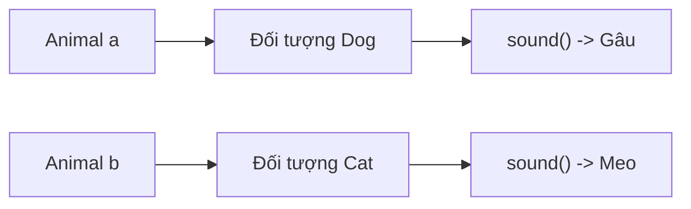

Replacing `new Dog()` with `new Cat()` makes the same `a.sound()` call behave differently, provided the surrounding code permits reassignment.

## 2. Practical Example: An Interface for Interchangeable Notification Channels

Suppose the system sends customer notifications through email and push notifications. To focus on OOP, the example **simulates delivery results** without connecting to SMTP or a real push service.

The contract states:

- Callers provide a valid `Notification` containing a customer ID and message.
- Every `NotificationSender` implementation supports `send(notification)` and returns a `DeliveryResult`.
- Orchestration code need not know how each channel works.

File `NotificationPolymorphismDemo.java` (Java 17+):

```java
import java.util.List;
import java.util.Objects;

public class NotificationPolymorphismDemo {

    record Notification(String customerId, String message) {
        Notification {
            if (customerId == null || customerId.isBlank()) {
                throw new IllegalArgumentException("Thiếu customerId");
            }
            if (message == null || message.isBlank()) {
                throw new IllegalArgumentException("Nội dung rỗng");
            }
        }
    }

    record DeliveryResult(String channel, String status) {}

    // Hợp đồng chung cho mọi kênh gửi.
    interface NotificationSender {
        DeliveryResult send(Notification notification);
    }

    static final class EmailSender implements NotificationSender {
        @Override
        public DeliveryResult send(Notification notification) {
            Objects.requireNonNull(notification, "notification");

            System.out.println(
                "EMAIL -> " + notification.customerId()
            );
            return new DeliveryResult("EMAIL", "SIMULATED");
        }
    }

    static final class PushSender implements NotificationSender {
        @Override
        public DeliveryResult send(Notification notification) {
            Objects.requireNonNull(notification, "notification");

            System.out.println(
                "PUSH -> " + notification.customerId()
            );
            return new DeliveryResult("PUSH", "SIMULATED");
        }
    }

    static final class NotificationDispatcher {
        private final NotificationSender sender;

        NotificationDispatcher(NotificationSender sender) {
            this.sender = Objects.requireNonNull(sender, "sender");
        }

        DeliveryResult dispatch(Notification notification) {
            return sender.send(notification);
        }
    }

    public static void main(String[] args) {
        Notification notification =
            new Notification("CUS-01", "Đơn hàng đã sẵn sàng");

        List<NotificationSender> senders =
            List.of(new EmailSender(), new PushSender());

        for (NotificationSender sender : senders) {
            NotificationDispatcher dispatcher =
                new NotificationDispatcher(sender);

            DeliveryResult result =
                dispatcher.dispatch(notification);

            System.out.println(
                "Result: " + result.channel() + "/"
                    + result.status()
            );
        }
    }
}
```

Run:

```bash
javac NotificationPolymorphismDemo.java
java NotificationPolymorphismDemo
```

Output:

```text
EMAIL -> CUS-01
Result: EMAIL/SIMULATED
PUSH -> CUS-01
Result: PUSH/SIMULATED
```

Notice three places where polymorphism appears:

1. `List<NotificationSender>` contains different `EmailSender` and `PushSender` objects.
2. `NotificationDispatcher` receives a `NotificationSender` through its constructor. It **depends on the contract**, not directly on the email or push class.
3. When `sender.send(notification)` executes, the matching implementation is selected from the object referenced by `sender`.

If we add `SmsSender implements NotificationSender`, we can pass it to `NotificationDispatcher` without changing the dispatcher's source, **provided** the new implementation actually honors the `send` contract.

### Dependency Diagram

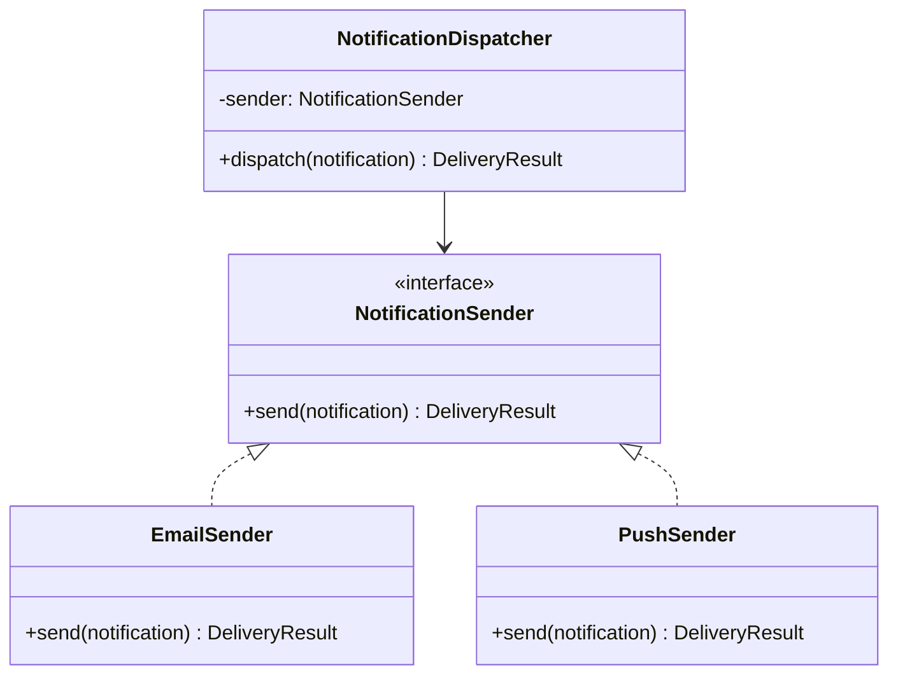

**Design benefit:** channel selection belongs at object construction or configuration; the dispatcher only knows the sending contract. Swapping implementations does not require `if (sender instanceof EmailSender)` branches inside it.

In a real system, the contract must also define behavior for errors, timeouts, retries, successful delivery, and merely accepted requests. Implementations should not use the same `SUCCESS` label with inconsistent meanings.

## 3. Polymorphism Through a Parent Class: Inheritance and Overriding

Interfaces are not the only option. A superclass-typed variable can also refer to subclass objects.

Consider a report-display system. Every report has a title and a shared preview workflow, but its preview content differs.

File `ReportPolymorphismDemo.java`:

```java
public class ReportPolymorphismDemo {

    static abstract class Report {
        private final String title;

        protected Report(String title) {
            if (title == null || title.isBlank()) {
                throw new IllegalArgumentException("Tiêu đề rỗng");
            }
            this.title = title;
        }

        // Thuật toán chung cố định ở lớp cha.
        public final String preview() {
            return "[" + title + "] " + content();
        }

        // Điểm mở rộng mà lớp con phải triển khai.
        protected abstract String content();
    }

    static final class SalesReport extends Report {
        private final long revenueVnd;

        SalesReport(long revenueVnd) {
            super("Doanh thu");
            if (revenueVnd < 0) {
                throw new IllegalArgumentException("Doanh thu âm");
            }
            this.revenueVnd = revenueVnd;
        }

        @Override
        protected String content() {
            return revenueVnd + " VND";
        }
    }

    static final class AuditReport extends Report {
        private final int eventCount;

        AuditReport(int eventCount) {
            super("Kiểm toán");
            if (eventCount < 0) {
                throw new IllegalArgumentException("Số sự kiện âm");
            }
            this.eventCount = eventCount;
        }

        @Override
        protected String content() {
            return eventCount + " sự kiện";
        }
    }

    static void display(Report report) {
        System.out.println(report.preview());
    }

    public static void main(String[] args) {
        Report sales = new SalesReport(200_000L);
        Report audit = new AuditReport(3);

        display(sales);
        display(audit);
    }
}
```

Output:

```text
[Doanh thu] 200000 VND
[Kiểm toán] 3 sự kiện
```

In this example:

- `Report` is the parent type and holds the shared `title` state.
- `SalesReport` and `AuditReport` are subtypes.
- `Report.preview()` contains the shared workflow but calls `content()`, which is overridden.
- When `preview()` runs on a `SalesReport` object, its `content()` call dispatches to `SalesReport.content()`; the same applies to `AuditReport`.

This shows that **code executing in a parent class can still trigger behavior specific to the actual subclass object**.

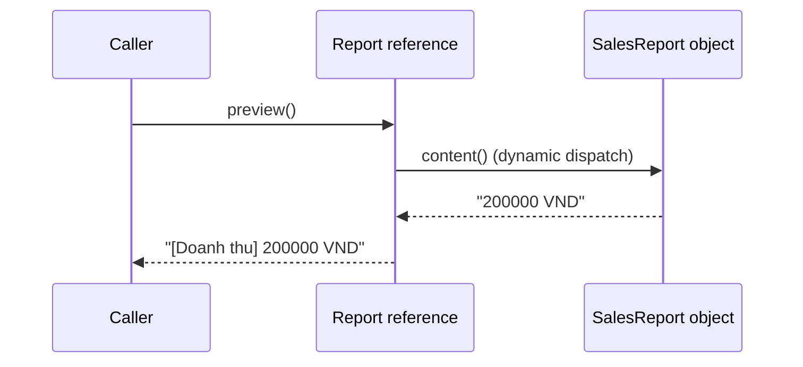

The diagram shows the logical call order. `Report` and `SalesReport` refer to **one runtime object** in this situation, not two independent objects communicating across a network.

### Why Not Override Every Method?

`preview()` is marked `final` so subclasses cannot alter the preview framework; they can customize only `content()`. This design choice protects a shared rule. Not every superclass method needs to be overridable.

Also avoid calling overridable methods from a superclass constructor, because subclass state may not yet be fully initialized.

## 4. Upcasting: From Subtype to Parent Type

**Upcasting** means viewing a subtype object through a reference of a parent type or an interface it implements. This is a valid type conversion and is usually performed implicitly by the compiler.

```java
class Device {}

class Printer extends Device {
    void printPage() {
        System.out.println("Printing...");
    }
}

Printer printer = new Printer();
Device device = printer; // Upcasting ngầm định
```

`device` and `printer` refer to **the same Printer object**; no object copy is created.

Because `device` is declared as `Device`, it cannot invoke methods available only in `Printer`:

```java
printer.printPage(); // Hợp lệ
// device.printPage(); // Lỗi biên dịch
```

This does not contradict polymorphism. Java performs **two different tasks**:

1. **Check whether a call is valid:** based on the declared type, available members, Java access rules, and overload rules.
2. **Select the implementation of an overridable instance call:** based on the actual object type at runtime.

If `Device` declares `public void start()` and `Printer` overrides it, `device.start()` invokes the `Printer` version. But `device.printPage()` is invalid if `Device` does not declare `printPage()`.

## 5. Downcasting and instanceof: Use Only When Necessary

**Downcasting** converts a parent-typed reference to a particular subtype. Since not every `Device` is a `Printer`, Java requires an explicit cast and performs a runtime check.

```java
class Device {}

class Printer extends Device {
    void printPage() {
        System.out.println("Printing...");
    }
}

class Scanner extends Device {}

Device first = new Printer();
Printer printer = (Printer) first; // Hợp lệ lúc chạy
printer.printPage();

// Device second = new Scanner();
// Printer wrong = (Printer) second; // ClassCastException
```

If the runtime type is incompatible with the target type, Java throws `ClassCastException`.

Java 16+ supports pattern matching with `instanceof`; the following example uses Java 17:

```java
static void tryPrinting(Device device) {
    if (device instanceof Printer printer) {
        printer.printPage();
    } else {
        System.out.println("Thiết bị không hỗ trợ in");
    }
}
```

This pattern is appropriate when **an operation truly belongs only to a particular subtype**. However, if application code repeatedly looks like:

```java
if (sender instanceof EmailSender) {
    // Gửi email
} else if (sender instanceof PushSender) {
    // Gửi push
}
```

consider whether the shared behavior belongs in `NotificationSender` so callers can simply invoke `send(...)`. When the capability can be expressed through a clear common contract, **polymorphism is usually preferable to chains of concrete-type checks**.

## 6. Members That Do Not Use Subtype Dynamic Dispatch

`Animal a = new Dog()` allows polymorphic `a.sound()` calls **when that method is an overridable instance method**. This does not automatically apply to every member. Consider the snippets below; place the calls inside a Java method such as `main`:

~~~java
class Parent {
    String field = "Parent field";
    String who() { return "Parent method"; }
    static String category() { return "Parent static"; }
}
class Child extends Parent {
    String field = "Child field";
    @Override String who() { return "Child method"; }
    static String category() { return "Child static"; }
}
Parent value = new Child();
System.out.println(value.who());       // Child method
System.out.println(value.field);       // Parent field
System.out.println(Parent.category()); // Parent static
~~~

| Member | Rule When Accessed Through Parent Type |
|---|---|
| Overridden instance method | Selects implementation by runtime object |
| Same-named parent/child field | Selects the field by the expression's static type |
| Same-signature static method | Hiding; selects by class name/static type |
| Private/final instance method | Cannot be overridden by a subclass |
| Multiple same-named overloads | Compiler selects the signature by static types; any override of that signature is then selected at runtime |

The distinction between **compile-time overloading and runtime overriding** is covered in *Static Method Resolution and Dynamic Dispatch*. Field hiding, static hiding, and getters are examined in *Distinguishing Member Hiding from Overriding* and *Scope of Polymorphism for Methods and Fields*.

## 7. Comparing Interface and Parent-Class Polymorphism

| Criterion | Through an interface | Through a superclass |
|---|---|---|
| Type relationship | Class `implements` interface | Class `extends` superclass |
| What callers depend on | Behavioral contract exposed by the interface | Shared superclass API |
| Shared instance state inherited from the common type | Interfaces do not provide instance fields | Superclasses can manage shared fields |
| Shared constructor | Interfaces have no constructors | Superclasses may provide constructors invoked by subclasses |
| Number of direct relationships | A class may implement multiple interfaces | A class directly extends only one superclass |
| Coupling to implementation | Often suitable for types from unrelated inheritance families | Suitable when there is an is-a relationship and common structure/behavior |
| Shared principle | Both allow a common-type reference to hold subtype objects and invoke suitable overridden methods | The same subtype-polymorphism mechanism |

A class can **both extend a superclass and implement interfaces**; the choices are not mutually exclusive.

For example:

```java
interface Identifiable {
    String id();
}

abstract class BaseEntity implements Identifiable {
    private final String id;

    protected BaseEntity(String id) {
        this.id = java.util.Objects.requireNonNull(id);
    }

    @Override
    public final String id() {
        return id;
    }
}

final class Customer extends BaseEntity {
    Customer(String id) {
        super(id);
    }
}

Identifiable a = new Customer("C01");
BaseEntity b = new Customer("C02");

System.out.println(a.id()); // C01
System.out.println(b.id()); // C02
```

`Customer` is a subtype of both `BaseEntity` and `Identifiable`. These two common reference types expose different portions of the API to different consumers as needed.

## 8. The Shared Contract Must Support Safe Substitution

Matching method signatures alone does not make polymorphism useful. When callers use a parent type, all subtypes must preserve **the expectations of the parent-type contract** (*substitutability*, commonly associated with the Liskov Substitution Principle).

For example, suppose `NotificationSender.send(notification)` specifies:

- `notification` must not be `null`.
- The result must not be `null`.
- `DeliveryResult.status` has consistent meaning.
- On failure, a reporting convention must be used that callers can handle.

Then one implementation should not arbitrarily return `null` while others return valid objects; nor should `"SIMULATED"` mean "request submitted" in one implementation but "read by recipient" in another.

### Example of Violating Expectations

```java
interface DiscountPolicy {
    // Hợp đồng: trả phần trăm trong khoảng 0..100.
    int discountPercent();
}

class StandardDiscount implements DiscountPolicy {
    public int discountPercent() {
        return 10;
    }
}

class InvalidDiscount implements DiscountPolicy {
    public int discountPercent() {
        return 250; // Phá vỡ hợp đồng về khoảng giá trị
    }
}
```

The compiler accepts this because `InvalidDiscount` implements the required signature. But a caller using `DiscountPolicy` to calculate monetary amounts may receive nonsense.

Therefore, verify **input/output semantics, state constraints, and failure behavior**, not just `implements` or `extends` declarations.

### Polymorphism Does Not Automatically Make Code Extensible

Adding an interface to replace a class that has only one implementation is not always useful. Apply subtype polymorphism when there is **a genuine need to substitute implementations**, a useful contract shared by multiple object types, or an API boundary that should not depend on concrete classes.

Conversely, an abstract class can appropriately share a stable algorithm among subtypes, but inheritance couples subclasses to the parent API and its changes. When combining independent capabilities, **composition** usually creates less coupling.

## 9. Polymorphic Collections and Generics

A common type allows different objects to be processed in the same list:

```java
List<NotificationSender> senders = List.of(
    new EmailSender(),
    new PushSender()
);

for (NotificationSender sender : senders) {
    sender.send(notification);
}
```

Here, `EmailSender` and `PushSender` are classes from the complete example above. Each iteration holds a `NotificationSender` variable but dispatches to the appropriate implementation.

However, note the following:

```java
List<EmailSender> emailSenders = new ArrayList<>();

// List<NotificationSender> all = emailSenders; // Không hợp lệ.
```

Java generics are **invariant in their type parameters** (*invariant*): although `EmailSender` is a subtype of `NotificationSender`, `List<EmailSender>` is not a subtype of `List<NotificationSender>`.

If the list only needs to be read through the contract, use a wildcard:

```java
static void runAll(
        List<? extends NotificationSender> senders,
        Notification notification) {

    for (NotificationSender sender : senders) {
        sender.send(notification);
    }
}
```

`List<? extends NotificationSender>` accepts a list whose elements belong to some subtype of `NotificationSender`. However, you cannot freely add `new EmailSender()` to it because the list's precise type argument is unknown.

**Subtype polymorphism of objects** and **variance rules for generic collections** are related but distinct concepts.

## 10. Common Design Errors

| Symptom | Cause | Remedy |
|---|---|---|
| Assuming `Animal a = new Dog()` can invoke all `Dog`-specific methods | Declared type restricts API available at compile time | Expose a shared contract or cast/check if genuinely necessary |
| Writing many `if (obj instanceof X)` branches to invoke subtype-specific behavior | Callers depend on concrete classes | Move shared behavior into an interface/superclass and override it |
| Expecting fields to dispatch like overridden methods | Field hiding differs from method overriding | Keep fields private and expose behavior through contracted methods |
| Assuming overload selection uses parameter runtime types | Overload resolution occurs primarily at compile time | Distinguish overloading from overriding |
| Unconditionally casting to a subtype | Not every parent-type object belongs to that subtype | Avoid casting or use `instanceof` when justified |
| Subtypes returning results that violate the shared contract | Signature matches, but semantics differ | Specify and test the contract for every implementation |
| Assuming `List<Dog>` is `List<Animal>` | Generic types are invariant | Use an appropriate wildcard or declare the collection with a common element type |
| Running customizable algorithms in superclass constructors | Dynamic dispatch might call an incompletely initialized subclass | Avoid overridable method calls from constructors |

## 11. Self-Check Exercises

### Exercise 1 — Predict the Polymorphic Result

```java
interface Shape {
    int area();
}

class Square implements Shape {
    private final int side;

    Square(int side) {
        this.side = side;
    }

    public int area() {
        return side * side;
    }
}

class Rectangle implements Shape {
    public int area() {
        return 12;
    }
}

Shape first = new Square(3);
Shape second = new Rectangle();

System.out.println(first.area());
System.out.println(second.area());
```

**Answer:**

```text
9
12
```

Both variables have the declared type `Shape`. The `area()` call runs the actual object's implementation. `Rectangle` returns a constant value merely to keep the exercise short; it is not a complete geometric model.

### Exercise 2 — Calling a Subtype-Only Method

```java
class Vehicle {
    void move() {
        System.out.println("Moving");
    }
}

class Bike extends Vehicle {
    void ringBell() {
        System.out.println("Ring!");
    }
}

Vehicle v = new Bike();
v.move();
// v.ringBell(); // Có biên dịch không?
```

**Answer:** `v.ringBell()` fails compilation because `Vehicle` does not declare `ringBell()`. When a feature genuinely belongs only to `Bike`, Java 17 can use `if (v instanceof Bike bike) { bike.ringBell(); }`.

### Exercise 3 — Declared Type or Runtime Type?

```java
class Parent {
    String value(Object x) {
        return "Parent/Object";
    }

    String value(String x) {
        return "Parent/String";
    }
}

class Child extends Parent {
    @Override
    String value(Object x) {
        return "Child/Object";
    }
}

Parent p = new Child();
Object item = "hello";

System.out.println(p.value(item));
System.out.println(p.value("hello"));
```

**Answer:**

```text
Child/Object
Parent/String
```

In the first call, the `value(Object)` overload is selected because `item` is declared as `Object`, then dispatch reaches `Child.value(Object)`. In the second call, the `value(String)` overload is selected and is not overridden by `Child`, so `Parent` runs.

### Exercise 4 — Design Your Own Solution

A payment system supports `CardPayment` and `BankTransferPayment`. Design:

1. An `PaymentMethod` interface exposing `PaymentReceipt pay(long amountVnd)`.
2. Two implementing classes that both reject `amountVnd <= 0` and return results under one consistent contract.
3. A `Checkout` class accepting `PaymentMethod` in its constructor and invoking `pay` without checking concrete classes.
4. Construct two `Checkout` objects with different implementations and verify that the same `checkout(...)` call works.

For a robust solution, specify what success and failure mean, how asynchronous transactions are represented, and whether idempotency is required. These are **parts of the contract** that polymorphism must keep consistent; sharing a method name `pay` alone is not enough.

---

**Remember:** Subtype polymorphism lets **one interface- or parent-typed reference work with many subtype objects**. The compiler checks calls against the **declared type's API**; for overridable instance methods, the JVM chooses an implementation using the **runtime type**. Use this so callers depend on contracts rather than concrete classes, while ensuring each subtype truly fulfills the shared contract.


</details>

- [Back to top](#back-to-top)

---

## <a id="polymorphism-003">Static Method Resolution and Dynamic Dispatch</a>

<details>
<summary>View details</summary>

# Static Method Resolution and Dynamic Dispatch in Java

One of the most important aspects of understanding Java **polymorphism** is distinguishing **which method signature is selected at compile time** from **which implementation runs at runtime**.

These two questions do not always have the same answer for a method-call expression:

1. **Static resolution (*compile-time method resolution*):** uses **types known to the compiler**, method names, argument counts/types, access rules, and other information to select a valid method signature. This matters especially for **overloading**.
2. **Dynamic resolution (*runtime method dispatch*):** after a signature has been selected, the JVM selects the appropriate (*override*) implementation for an **overridable instance method** based on the **actual class of the receiver object**.

Thus neither "Java always chooses methods at compile time" nor "Java always chooses them by runtime object" is universally correct. **One call may involve both steps**, depending on the kind of method.

## 1. Two Concepts in a Short Example

```java
class Animal {}

class Dog extends Animal {}

class Handler {
    String process(Animal value) {
        return "Handler/Animal";
    }

    String process(Dog value) {
        return "Handler/Dog";
    }
}

class SpecialHandler extends Handler {
    @Override
    String process(Animal value) {
        return "SpecialHandler/Animal";
    }

    @Override
    String process(Dog value) {
        return "SpecialHandler/Dog";
    }
}
```

Now consider:

```java
Handler handler = new SpecialHandler();
Animal animal = new Dog();

System.out.println(handler.process(animal));
```

The result is:

```text
SpecialHandler/Animal
```

**Why not `SpecialHandler/Dog`?**

- **At compile time:** `animal` is declared as `Animal`. The compiler selects the **`process(Animal)`** overload rather than `process(Dog)`, even though the actual object is a `Dog`.
- **At runtime:** `handler` refers to a `SpecialHandler` object. The JVM invokes the **`SpecialHandler.process(Animal)`** override.

Here is the key idea:

> **Overloading selects a signature using compile-time type information; overriding selects an implementation of that signature based on the runtime receiver object.**

## 2. Complete Java Example: Combining Overloading and Overriding

Save the entire snippet as **`Main.java`**. It runs with Java 17 or Java 21 and requires no external library.

```java
class Event {}

class EmailEvent extends Event {}

class SmsEvent extends Event {}

class Dispatcher {
    String dispatch(Event event) {
        return "Dispatcher/Event";
    }

    String dispatch(EmailEvent event) {
        return "Dispatcher/EmailEvent";
    }

    static String source() {
        return "Dispatcher/static";
    }
}

class SmartDispatcher extends Dispatcher {
    @Override
    String dispatch(Event event) {
        return "SmartDispatcher/Event";
    }

    @Override
    String dispatch(EmailEvent event) {
        return "SmartDispatcher/EmailEvent";
    }

    // Overload mới chỉ có trên SmartDispatcher.
    String dispatch(SmsEvent event) {
        return "SmartDispatcher/SmsEvent";
    }

    // Đây là static method hiding, không phải overriding.
    static String source() {
        return "SmartDispatcher/static";
    }
}

public class Main {
    public static void main(String[] args) {
        Dispatcher general = new SmartDispatcher();
        SmartDispatcher specific = new SmartDispatcher();

        Event emailAsEvent = new EmailEvent();
        EmailEvent email = new EmailEvent();
        SmsEvent sms = new SmsEvent();

        System.out.println(general.dispatch(emailAsEvent));
        System.out.println(general.dispatch(email));
        System.out.println(general.dispatch(sms));
        System.out.println(specific.dispatch(sms));
        System.out.println(((Dispatcher) specific).dispatch(sms));

        System.out.println(Dispatcher.source());
        System.out.println(SmartDispatcher.source());
        System.out.println(general.getClass().getSimpleName());
    }
}
```

Compile and run:

```bash
javac Main.java
java Main
```

Exact output:

```text
SmartDispatcher/Event
SmartDispatcher/EmailEvent
SmartDispatcher/Event
SmartDispatcher/SmsEvent
SmartDispatcher/Event
Dispatcher/static
SmartDispatcher/static
SmartDispatcher
```

### Analyzing Each Call

| Call | Overload selected **at compile time** | Implementation run **at runtime** |
| --- | --- | --- |
| `general.dispatch(emailAsEvent)` | `dispatch(Event)` | `SmartDispatcher.dispatch(Event)` |
| `general.dispatch(email)` | `dispatch(EmailEvent)` | `SmartDispatcher.dispatch(EmailEvent)` |
| `general.dispatch(sms)` | `dispatch(Event)` because the `Dispatcher` type does not expose the `SmsEvent` overload | `SmartDispatcher.dispatch(Event)` |
| `specific.dispatch(sms)` | `dispatch(SmsEvent)` | `SmartDispatcher.dispatch(SmsEvent)` |
| `((Dispatcher) specific).dispatch(sms)` | `dispatch(Event)` because the post-cast expression has type `Dispatcher` | `SmartDispatcher.dispatch(Event)` |

Compare the following two calls:

```java
specific.dispatch(sms);                 // SmartDispatcher/SmsEvent
((Dispatcher) specific).dispatch(sms); // SmartDispatcher/Event
```

**Both use the same `specific` object and the same `sms` argument**. What changes is **the receiver expression's compile-time reference type**, so the compiler sees a different set of overloads. Dynamic dispatch then selects the implementation based on the actual object for each selected signature.

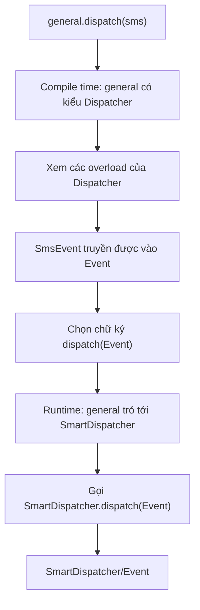

## 3. Static Resolution: How Does Java Select Overloads?

**Overloading** means multiple methods share a name but have **different parameter lists** (parameter counts or types):

```java
class Formatter {
    String format(Object value) {
        return "Object";
    }

    String format(Number value) {
        return "Number";
    }

    String format(Integer value) {
        return "Integer";
    }
}
```

Given this code:

```java
Formatter formatter = new Formatter();
Integer integer = 10;
Number number = integer;
Object object = integer;

System.out.println(formatter.format(integer)); // Integer
System.out.println(formatter.format(number));  // Number
System.out.println(formatter.format(object));  // Object
```

Although all three variables may refer to the same `Integer` object, their argument expressions have different declared types. The compiler uses those types to find an **applicable, most-specific method** under Java's rules.

### It Is Not Simply "Pick the Closest-Sounding Parameter"

Java has detailed rules for applicable methods, primitive conversions, boxing/unboxing, and varargs. Consider this important example:

```java
class Choice {
    void choose(long value) {
        System.out.println("long");
    }

    void choose(Integer value) {
        System.out.println("Integer");
    }

    void choose(int... values) {
        System.out.println("varargs");
    }
}

new Choice().choose(5); // long
```

For the literal `5` of type `int`, the `choose(long)` overload applies through **widening primitive conversion** in a method-selection phase that does not require boxing. Java does not automatically choose `choose(Integer)` or `choose(int...)` just because other conversions could make them accept the value.

At a high level, remember that Java first searches for applicable overloads without boxing or varargs, then considers boxing/unboxing cases, and finally variable-arity invocation if earlier phases fail. The final choice still follows "most specific" rules; no single priority table correctly describes every pair of types.

### Overloads Can Be Ambiguous

```java
class Ambiguous {
    void send(String message) {}
    void send(Integer code) {}
}

// new Ambiguous().send(null); // Lỗi biên dịch: ambiguous
```

`null` can be assigned to `String` or `Integer`; neither type is a subtype of the other, so the compiler cannot choose one overload.

You can make the intent explicit:

```java
new Ambiguous().send((String) null);
```

**Note:** The cast resolves overload selection; it does not mean that the implementation handles `null` safely. Each method's contract must still validate inputs where necessary.

## 4. Dynamic Dispatch: Overriding Methods by Object Type

**Overriding** occurs when a subclass supplies a new implementation of an **overridable instance method** inherited from its superclass or defined by an interface contract.

```java
class Payment {
    String status() {
        return "Payment";
    }
}

class CardPayment extends Payment {
    @Override
    String status() {
        return "CardPayment";
    }
}

Payment p = new CardPayment();
System.out.println(p.status()); // CardPayment
```

The compiler checks that the `p` variable of type `Payment` has a `status()` method. At runtime, the JVM sees that the actual object is `CardPayment` and invokes `CardPayment.status()`.

This lets us write logic accepting a parent type:

```java
static void printStatus(Payment payment) {
    System.out.println(payment.status());
}
```

Pass `new Payment()`, `new CardPayment()`, or another subtype to `printStatus` without checking `instanceof` for each type. This is **runtime polymorphism**.

### Calls Through Interfaces Can Also Dispatch Dynamically

```java
interface Notifier {
    void notifyUser();
}

class EmailNotifier implements Notifier {
    @Override
    public void notifyUser() {
        System.out.println("Email");
    }
}

class SmsNotifier implements Notifier {
    @Override
    public void notifyUser() {
        System.out.println("SMS");
    }
}

Notifier n = new EmailNotifier();
n.notifyUser(); // Email
n = new SmsNotifier();
n.notifyUser(); // SMS
```

`Notifier` defines **the capability being invoked**. `EmailNotifier` or `SmsNotifier` determines **the actual implementation**. Choosing an interface in the design does not remove compile-time type checking: `n` can still call only suitable methods exposed through `Notifier` and `Object`.

## 5. `static` Methods: Hiding, Not Overriding

A major source of confusion is methods declared `static`. In Java, static methods **belong to classes** and cannot be overridden through instance polymorphism. A corresponding static method in a subclass causes **method hiding**.

```java
class Parent {
    static String typeName() {
        return "Parent";
    }
}

class Child extends Parent {
    static String typeName() {
        return "Child";
    }
}

Parent ref = new Child();
System.out.println(Parent.typeName()); // Parent
System.out.println(Child.typeName());  // Child

// System.out.println(ref.typeName()); // Nếu viết sẽ trả Parent,
// nhưng nên tránh gọi static qua biến tham chiếu.
```

Calling `ref.typeName()` is syntactically allowed (though IDEs often warn against it), but the method is selected using the reference expression's **`Parent` type**, not the object's actual `Child` class.

Therefore, use `Parent.typeName()` or `Child.typeName()` for static calls to avoid misleading readers about dynamic dispatch.

| Method Type | Runtime Object-Based Overriding? | Notes |
| --- | --- | --- |
| Overridable instance method | **Yes** | A subclass may replace the implementation |
| `final` instance method | **Cannot override** | No valid subclass override can replace it |
| `private` instance method | **Cannot override** | Not inherited in the usual overriding sense |
| `static` method | **No** | May be *hidden* by a corresponding static method |
| Constructor | **No** | Not inherited or overridden |
| `super.method()` call | Invokes the designated parent-class implementation | Does not dispatch to the subclass's own override of that call |

**Do not assume that "`final` always compiles into a static invocation opcode".** At the language level, `final` prevents overriding; the JVM/JIT may optimize calls appropriately. That is different from Java's compile-time overload-resolution process.

## 6. Field Access Is Not the Same as Calling Instance Methods

Polymorphism applies to overridden instance methods, **not to fields in the same way**.

```java
class Base {
    String name = "Base";

    String getName() {
        return name;
    }
}

class Derived extends Base {
    String name = "Derived";

    @Override
    String getName() {
        return name;
    }
}

Base ref = new Derived();

System.out.println(ref.name);      // Base
System.out.println(ref.getName()); // Derived
```

`ref.name` uses a field selected by the **`Base` reference type**, whereas `ref.getName()` invokes the `Derived` override on the actual object.

This is a reason to avoid redeclaring the same field name in parent and child classes (*field hiding*). Prefer encapsulating fields with `private` and exposing behavior or values through methods with explicit contracts.

## 7. Overloads Are Selected First, but Overrides Can Still Execute

Put the two stages side by side to avoid confusion:

```java
class Converter {
    String convert(Object x) {
        return "Converter/Object";
    }

    String convert(String x) {
        return "Converter/String";
    }
}

class LoggingConverter extends Converter {
    @Override
    String convert(Object x) {
        return "LoggingConverter/Object";
    }

    @Override
    String convert(String x) {
        return "LoggingConverter/String";
    }
}
```

Given:

```java
Converter converter = new LoggingConverter();
Object textAsObject = "hello";

System.out.println(converter.convert(textAsObject));
// LoggingConverter/Object

System.out.println(converter.convert("hello"));
// LoggingConverter/String
```

**First call:** the argument is of type `Object`, so Java selects the `convert(Object)` signature; the receiver is a `LoggingConverter`, so the `LoggingConverter.convert(Object)` override executes.

**Second call:** the literal `"hello"` has type `String`, so the `convert(String)` signature is selected; runtime executes the `LoggingConverter.convert(String)` override.

Java primarily uses **single dispatch** for instance methods: dynamic dispatch depends on the receiver, **not** on automatically reselecting an overload using each argument's runtime class. For behavior dependent on multiple runtime types, consider Visitor/double dispatch, pattern matching, or type-based handler tables as appropriate. These are different design decisions, not Java's default overloading mechanism.

## 8. How `this`, `super`, and Parent-Class Calls Relate

Inside an instance method, when you write:

```java
this.run();
```

A normal `run()` call can still use dynamic dispatch because `this` is the actual receiver object. If it belongs to a subclass overriding `run()`, the subclass implementation can run.

By contrast:

```java
super.run();
```

is used within a subclass to invoke the corresponding accessible parent-class implementation rather than reentering that subclass's own override.

For example:

```java
class Parent {
    void greet() {
        System.out.println("Xin chào");
    }
}

class Child extends Parent {
    @Override
    void greet() {
        super.greet();
        System.out.println("Từ lớp con");
    }
}

Parent value = new Child();
value.greet();
```

Output:

```text
Xin chào
Từ lớp con
```

The sequence is: `value.greet()` dispatches to `Child.greet()`, then `super.greet()` invokes the `Parent` implementation before the remainder of `Child.greet()` executes.

**Constructor pitfall:** avoid calling overridable methods from a superclass constructor because they may dispatch to a subclass **before subclass fields have finished initialization**. Dynamic dispatch still applies during construction, which can cause `null` values or incomplete state.

## 9. JVM Bytecode Connections (Just Enough Detail)

The Java Virtual Machine provides invocation instructions with different semantics. At a high level:

| JVM Instruction | Typical Call Category |
| --- | --- |
| `invokestatic` | Invokes `static` methods |
| `invokevirtual` | Invokes ordinary instance methods on objects |
| `invokeinterface` | Invokes instance methods through interface contracts |
| `invokespecial` | Certain special calls, such as constructors, `super.method()`, and private methods |
| `invokedynamic` | JVM-level dynamic call-site linkage, including some lambda and string-concatenation implementations |

**Be careful with names:** `invokedynamic` in bytecode is **not synonymous** with ordinary OOP dynamic dispatch of overridden methods. Instance-method dispatch mainly involves instructions such as `invokevirtual` and `invokeinterface`; `invokedynamic` serves dynamically linked call sites with a *bootstrap method*.

A simple way to inspect a compiled example:

```bash
javac Main.java
javap -c Main
```

The `javap -c` command displays bytecode for the specified class. To inspect methods in other classes from the example, specify their correct class names. Bytecode helps reveal the mechanism, but for OOP learning and design, first master **signature selection at compile time** and **implementation selection at runtime**.

## 10. Common Mistakes

| Incorrect Assumption or Code | Why It Is Wrong | What to Remember |
| --- | --- | --- |
| "The runtime argument is `EmailEvent`, so Java must choose `dispatch(EmailEvent)`" | Overloads are selected from compile-time expression types | An `Event` variable selects the `Event` overload |
| "The variable type is `Dispatcher`, so `Dispatcher` code always executes" | Overrides execute based on the actual object class | `new SmartDispatcher()` may invoke an override |
| "A subclass static method overrides its parent's static method" | This is method hiding | Invoke static methods through class names |
| "The `name` field dispatches dynamically too" | Fields are resolved from the reference type | Distinguish `ref.name` from `ref.getName()` |
| "Casting the receiver does not affect overloads" | The receiver expression type can change the available overload set | Compare `specific.dispatch(sms)` with `((Dispatcher)specific).dispatch(sms)` |
| "A different parameter list still allows `@Override`" | Different parameters may form an overload instead | Add `@Override` to let the compiler detect mistakes |
| "`send(null)` can choose any overload automatically" | Unrelated reference-type overloads may be ambiguous | Cast explicitly when truly necessary |
| "`invokedynamic` means overriding" | These are different JVM-level concepts | Do not infer behavior from opcode names |
| "A `final` method can be overridden but not called" | `final` prevents overriding, not normal calls | Use `final` to fix behavior when justified |

## 11. When Is This Distinction Useful?

- **API design:** with multiple overloads, make parameter types clear so callers do not accidentally select the wrong method merely because a variable is declared as a supertype.
- **Debugging:** if results differ from expectations, identify **which signature the compiler selected** before checking **which override executed**.
- **Dependency injection:** interface-typed variables still invoke runtime implementations correctly; this underpins polymorphism in service and adapter layers.
- **Refactoring:** adding an overload can change the selected method when call sites are recompiled, even if existing overrides remain unchanged.
- **Testing:** test combinations of reference types, argument types, and actual object classes when an API mixes overloading and inheritance.
- **Performance:** the JVM can inline, devirtualize, and optimize appropriate calls; do not assume all polymorphic calls incur one fixed performance penalty. Use profiling and benchmarks when performance matters.

## 12. Self-Check

**Question 1.** What does the following code print?

```java
Dispatcher dispatcher = new SmartDispatcher();
Event event = new EmailEvent();
System.out.println(dispatcher.dispatch(event));
```

**Answer:** `SmartDispatcher/Event`. The compiler selects `dispatch(Event)`, and runtime executes the override from `SmartDispatcher`.

**Question 2.** Why does `specific.dispatch(sms)` differ from `((Dispatcher) specific).dispatch(sms)`?

**Answer:** Their compile-time reference types differ. `SmartDispatcher` exposes `dispatch(SmsEvent)`, while `Dispatcher` only exposes `dispatch(Event)` and `dispatch(EmailEvent)`; with `SmsEvent`, it selects `Event`.

**Question 3.** Given `Parent ref = new Child();`, which method is used for `ref.typeName()` when both classes declare same-named `static` methods?

**Answer:** The static method associated with type `Parent`. Prefer spelling it `Parent.typeName()` to avoid confusion.

**Question 4.** Why does `format(number)` choose `format(Number)` when `number` has declared type `Number` but points to `Integer`?

**Answer:** Overload resolution uses the compile-time expression type; it does not automatically choose an overload using the argument's runtime class.

**Question 5.** If a subclass overrides `greet()`, does `super.greet()` in the override call the subclass's own override again?

**Answer:** No. It invokes the corresponding parent-class implementation according to `super` semantics, allowing the subclass to reuse parent behavior.

**Question 6.** A `List<Payment>` contains `new CardPayment()`; which implementation does `payment.status()` invoke in a loop?

**Answer:** For a `CardPayment` element, if `status()` is overridden, `CardPayment.status()` executes. The declared `Payment` element type only determines the callable contract.

**Remember:** To predict a Java method call, ask in order: **"Which signature does the compiler select from visible types?"** and **"Does the actual receiver object override that signature?"** Overloading is primarily static resolution; overriding uses dynamic dispatch. `static` methods, fields, constructors, and `super` calls have separate rules. Understanding this boundary clarifies polymorphism and prevents subtle inheritance bugs.


</details>

- [Back to top](#back-to-top)

---

## <a id="polymorphism-004">Method Overriding and Runtime Method Selection</a>

<details>
<summary>View details</summary>

# Method Overriding and Runtime Method Selection in Java

> **OOP → Polymorphism.** When a parent-typed variable refers to a subclass object, a call to an **overridable instance method** runs the implementation appropriate to the object's **actual runtime type**. This is called **dynamic dispatch** (runtime method selection). It lets one piece of code handle multiple object types without `if/else` checks for each class.

## 1. Two Types to Distinguish in a Method Call

```java
Animal animal = new Dog();
animal.speak();
```

The first line contains **two different types**:

- **Declared type (compile-time type):** `Animal`. The compiler uses it to check which methods are available and how a valid call is selected.
- **Actual type (runtime class):** `Dog`. When `Dog` overrides `speak()`, the JVM invokes the `Dog` implementation of that instance method.

A short example:

```java
class Animal {
    void speak() {
        System.out.println("Âm thanh động vật");
    }
}

class Dog extends Animal {
    @Override
    void speak() {
        System.out.println("Gâu gâu");
    }
}

// Đặt trong một phương thức như main():
Animal animal = new Dog();
animal.speak(); // Gâu gâu
```

Although the variable is declared `Animal`, the actual object is a `Dog`. `speak()` in `Dog` **overrides** the inherited `speak()` from `Animal`, so Java selects the `Dog` implementation at runtime.

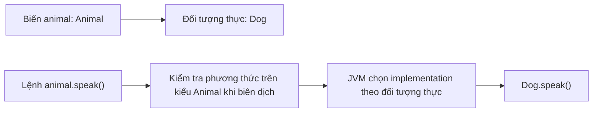

**Key point:** seeing `new Dog()` does not mean the compiler simply rewrites every call to use `Dog`. **Signature selection** and **access checks** still use compile-time type information. Only eligible instance-method calls use the runtime object to choose an implementation.

## 2. Complete Example: Multiple Delivery Plans, One `quote()` Call

A shipping system offers standard and express plans. Both calculate the total fee after validating distance, but their distance surcharges may differ.

Save all code as `RuntimeDispatchDemo.java` (**Java 17+**):

```java
import java.util.List;

public class RuntimeDispatchDemo {

    static class DeliveryPlan {
        private final long baseFeeVnd;

        protected DeliveryPlan(long baseFeeVnd) {
            if (baseFeeVnd < 0) {
                throw new IllegalArgumentException("Phí cơ bản không thể âm");
            }
            this.baseFeeVnd = baseFeeVnd;
        }

        public String name() {
            return "Gói giao hàng";
        }

        protected long distanceFee(int distanceKm) {
            return Math.multiplyExact(2_000L, distanceKm);
        }

        // Quy trình chung: lớp con không được ghi đè toàn bộ quy trình này.
        public final long quote(int distanceKm) {
            if (distanceKm <= 0) {
                throw new IllegalArgumentException("Khoảng cách phải dương");
            }

            long extra = distanceFee(distanceKm);
            if (extra < 0) {
                throw new IllegalStateException("Phụ phí không thể âm");
            }

            return Math.addExact(baseFeeVnd, extra);
        }
    }

    static final class StandardPlan extends DeliveryPlan {
        StandardPlan() {
            super(10_000L);
        }

        @Override
        public String name() {
            return "Thông thường";
        }
        // Giữ nguyên distanceFee() do lớp cha định nghĩa.
    }

    static final class ExpressPlan extends DeliveryPlan {
        ExpressPlan() {
            super(15_000L);
        }

        @Override
        public String name() {
            return "Hỏa tốc";
        }

        @Override
        protected long distanceFee(int distanceKm) {
            long normalDistanceFee = super.distanceFee(distanceKm);
            return Math.addExact(normalDistanceFee, 5_000L);
        }
    }

    public static void main(String[] args) {
        List<DeliveryPlan> plans = List.of(
            new StandardPlan(),
            new ExpressPlan()
        );

        for (DeliveryPlan plan : plans) {
            System.out.println(plan.name() + ": "
                    + plan.quote(3) + " VND");
        }

        DeliveryPlan selected = new ExpressPlan();
        System.out.println("Đối tượng thực: "
                + selected.getClass().getSimpleName());
    }
}
```

Compile and run:

```bash
javac RuntimeDispatchDemo.java
java RuntimeDispatchDemo
```

Output:

```text
Thông thường: 16000 VND
Hỏa tốc: 26000 VND
Đối tượng thực: ExpressPlan
```

Calculations for 3 km:

| Actual Object Type | Base Fee | Surcharge | Total |
|---|---:|---:|---:|
| `StandardPlan` | 10.000 VND | 3 × 2.000 = 6.000 VND | **16.000 VND** |
| `ExpressPlan` | 15.000 VND | 3 × 2.000 + 5.000 = 11.000 VND | **26.000 VND** |

The same `plan.name()` or `plan.quote(3)` call behaves according to the object referenced by `plan`:

- `StandardPlan` **overrides `name()`** but not `distanceFee()`, so it uses the parent class's distance-surcharge formula.
- `ExpressPlan` **overrides both `name()` and `distanceFee()`**. Inside `distanceFee()`, the `super.distanceFee(...)` call uses the parent formula before adding 5.000 VND.
- `quote()` is `final`, so subclasses cannot override it. However, inside `quote()` it invokes the **instance method** `distanceFee()`, which **still dispatches dynamically** to the appropriate implementation.
- `getClass()` reports the object's runtime class, not the variable's declared type.

The `for` loop needs no subclass-name checks to calculate fees. A new plan type can be added later with minimal changes to shared calling code.

### Tracing the Call

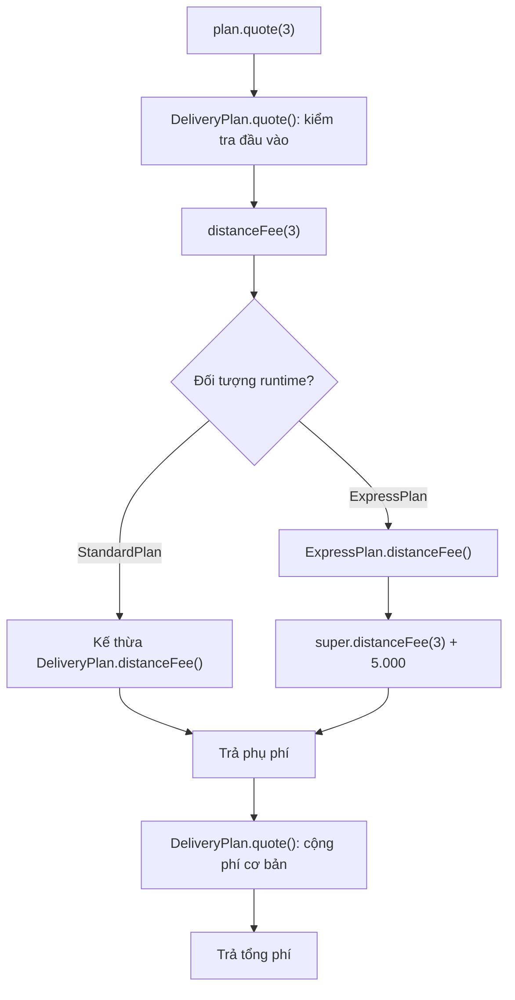

This combines **overriding**, **polymorphism**, and **shared methods**. `DeliveryPlan` need not be `abstract` for overriding to work: concrete classes can also have overridable instance methods.

## 3. What Conditions Must Overriding Satisfy?

Two methods with the same name **do not necessarily** constitute overriding.

```java
class Parent {
    public Number value() {
        return 10;
    }
}

class Child extends Parent {
    @Override
    public Integer value() {
        return 20;
    }
}
```

This is valid overriding. The `Integer` return type is **covariant** with `Number` because it is a subtype of `Number`. If a `Parent`-typed variable holds a `Child`, `value()` still returns an object produced by the `Child` implementation.

Main rules:

| Aspect | Rule |
|---|---|
| Name and parameters | Must match a compatible override signature; changing parameters usually creates an **overload** |
| Return type | Must be compatible; reference types may use a subtype (covariant return) |
| Access level | Must not be narrowed, such as `public` to `protected` |
| Checked exceptions | Must not broaden checked exceptions beyond the parent's method contract |
| `final` instance method | Cannot be overridden |
| `private` method | Not inherited in a way that permits overriding |
| `static` method | May be **hidden (method hiding)**, not dynamically overridden |
| Constructor | Not inherited or overridden |
| `@Override` | Recommended: the compiler verifies that a declaration truly overrides or implements an eligible method |

A common incorrect example:

```java
class Parent {
    public void execute(String task) {}
}

class Child extends Parent {
    // @Override // Nếu thêm @Override, trình biên dịch sẽ báo lỗi.
    public void execute(int task) {}
}
```

`execute(int)` does not override `execute(String)`: their parameter lists differ, so the former is an **overload**. Calling `execute("task")` still uses `Parent.execute(String)` if `Child` has not overridden that signature.

An abstract method or interface method may also be overridden by an implementation. Overriding is not limited to concrete parent-class methods.

## 4. Runtime Selects an Implementation **After** the Compiler Selects a Signature

If the parent class declares `process(Object)`, the child overrides it and adds `process(String)`, these two calls may differ:

~~~java
class Parent {
    String process(Object value) { return "Parent/Object"; }
}
class Child extends Parent {
    @Override String process(Object value) { return "Child/Object"; }
    String process(String value) { return "Child/String"; }
}

Parent parentView = new Child();
Child childView = new Child();

System.out.println(parentView.process("hi")); // Child/Object
System.out.println(childView.process("hi"));  // Child/String
~~~

For the first call, the compiler sees only `process(Object)` through `Parent`, then dispatches to `Child.process(Object)`. For the second, the compiler sees `process(String)` on `Child` and selects the more specific signature. **Overloading uses static types; overriding uses the runtime receiver**. The lesson *Distinguishing Overriding from Overloading* discusses the full rules, including `null`, boxing, and varargs.

## 5. `static`, `private`, `final`, and Fields Have Different Rules

| Member | What to Remember |
|---|---|
| Static method | Matching subclass signature causes *hiding*; call via the class name for clarity |
| Field | Cannot be overridden; access uses the expression's static type |
| Private method | Not inherited for overriding |
| Final instance method | Cannot be overridden, but **can still call an overridable hook** |
| Constructor | Can be overloaded, not overridden |

That is why `DeliveryPlan.quote()` can be `final` while its internal `distanceFee()` call still dispatches by subtype. For precise examples of field hiding, static hiding, and getters, see *Distinguishing Member Hiding from Overriding* and *Scope of Polymorphism for Methods and Fields*.

## 6. What Does `super.method()` Mean?

Within a subclass, `super.method()` invokes the corresponding inherited parent-class implementation under Java's rules; it **does not** "turn the object into the parent class".

For example, in `ExpressPlan.distanceFee()`:

```java
@Override
protected long distanceFee(int distanceKm) {
    long base = super.distanceFee(distanceKm);
    return Math.addExact(base, 5_000L);
}
```

`super.distanceFee(...)` invokes the `DeliveryPlan` calculation, after which the subclass adds its surcharge. The `this` reference is still **the same `ExpressPlan` object**.

A subclass can also replace the behavior completely without calling `super`:

```java
@Override
protected long distanceFee(int distanceKm) {
    return Math.multiplyExact(4_000L, distanceKm);
}
```

Whether to extend or replace behavior depends on the parent contract. Blindly calling `super` may duplicate side effects; failing to call `super` when the parent requires invariants can also cause bugs. Base classes should clearly specify which hooks may be overridden and which conditions remain mandatory.

## 7. Managing Dynamic-Dispatch Risks in Constructors

A common trap is a superclass constructor calling a method overridden by a subclass.

```java
public class ConstructorDispatchTrap {
    static class Parent {
        Parent() {
            System.out.println("Trong Parent(): " + describe());
        }

        String describe() {
            return "Parent";
        }
    }

    static final class Child extends Parent {
        private String name = "Sẵn sàng";

        @Override
        String describe() {
            return name;
        }
    }

    public static void main(String[] args) {
        Child child = new Child();
        System.out.println("Sau khi tạo: " + child.describe());
    }
}
```

Output:

```text
Trong Parent(): null
Sau khi tạo: Sẵn sàng
```

When the `Parent` constructor runs, the `name` field in `Child` has not yet received its initializer `"Sẵn sàng"`. Even so, Java dispatches `describe()` to `Child.describe()`, and the subclass observes `name == null`.

**Avoid calling overridable methods from constructors**, especially when subclasses need fully initialized fields. Use suitable `private` or `final` helpers during construction, or move extension hooks until after initialization. The problem is not the `@Override` syntax but the timing of object construction.

## 8. When Is Overriding a Good Design?

Subclasses must preserve the **parent-class contract**. For example, every `DeliveryPlan.quote(km)` should return a nonnegative fee for positive distance; a subclass must not silently produce a negative fee or change the meaning of the `km` unit.

Guidelines:

| Situation | Choice |
|---|---|
| Objects are genuine variants of the same type | Inheritance plus overriding may fit |
| A mandatory shared workflow has one variable step | Base class keeps the `final` method and calls an overridable hook |
| Types are not in an is-a relationship but share a capability | Interface plus separate implementations |
| Several independent rules must be combined (surcharges, discounts, etc.) | Composition/strategy is often more extensible than deep inheritance |
| A subclass cannot honor the parent contract | Reconsider the inheritance relationship |

To protect the shared workflow, `quote()` is `final` in the example, while `distanceFee()` is the extension point. This preserves distance validation and overflow handling in the base class while allowing subclasses to calculate surcharges differently.

**Performance note:** dynamic dispatch does not automatically mean "every call is very slow". The JVM/JIT can optimize and inline many virtual calls when it has enough information. Measure actual cost through profiling or benchmarks; prioritize correctness and maintainability over micro-optimization.

## 9. Common Errors When Designing Overridable Hooks

- **Misspelling the signature** and assuming the subclass replaced behavior: add `@Override` for compiler checks and verify parameter types and names.
- **Making an extension point `static`** and expecting dynamic polymorphism: use an instance method with a clear contract.
- **Calling overridable hooks in constructors** before subclasses finish initialization: use non-overridable methods during setup or move activation after construction.
- **Allowing subclasses to violate invariants**: if `quote(km)` requires positive distance and nonnegative fees, a subclass's `distanceFee(km)` hook must honor those constraints.
- **Overusing `super`**: invoke parent behavior only when the contract permits combining it; avoid duplicate side effects.

With Template Method, keep the invariant workflow in a `final` method and expose only the smallest necessary extension hook. This reduces risk compared with letting every subclass override all validation and pricing steps.

## 10. Self-Check

### Exercise 1: Predict the Output

```java
class A {
    String message() { return "A"; }
}
class B extends A {
    @Override String message() { return "B"; }
}
class C extends B {
    @Override String message() { return "C"; }
}

// Trong main():
A x = new C();
B y = new C();
System.out.println(x.message());
System.out.println(y.message());
```

**Answer:** both lines print `C`. Despite the different variable declarations, both refer to actual `C` objects, and the instance-method implementation comes from `C`.

### Exercise 2: Distinguish the Two Stages

```java
class Base {
    String send(Object value) { return "Base:Object"; }
}
class Derived extends Base {
    @Override
    String send(Object value) { return "Derived:Object"; }

    String send(String value) { return "Derived:String"; }
}

Base base = new Derived();
Derived derived = new Derived();
Object text = "Java";

System.out.println(base.send("Java"));
System.out.println(derived.send("Java"));
System.out.println(derived.send(text));
```

**Answer:** `Derived:Object`, `Derived:String`, `Derived:Object`. Identify the signature chosen by the compiler in each call and the runtime class providing its implementation.

### Exercise 3: Add a Delivery Plan

Starting from `RuntimeDispatchDemo`, add `SameDayPlan extends DeliveryPlan` with a base fee of 20.000 VND and a surcharge of 4.000 VND per kilometer. Add an instance to `List<DeliveryPlan>`. Verify that the loop in `main` needs no structural changes to call `name()` and `quote()`.

### Exercise 4: Check an Override Boundary

Try adding `@Override` before a subclass's `quote(int)` method. Why does the compiler reject it? Explain the purpose of `final` in the base-class design.

### Exercise 5: Static Methods

In `StaticHidingDemo`, replace `Parent reference = new Child()` with `Child reference = new Child()`. Predict `reference.type()` and `reference.describe()`. Explain the difference between method hiding and dynamic dispatch.

---

**Remember:** In Java, **overloading determines a signature at compile time**, whereas **overriding selects an instance-method implementation based on the actual object class at runtime**. Declared types determine callable methods; runtime types determine which override executes. Understanding this distinction helps read polymorphic code and prevents confusing `static` methods, fields, and constructors with instance methods.


</details>

- [Back to top](#back-to-top)

---

## <a id="polymorphism-005">Distinguishing Overriding from Overloading</a>

<details>
<summary>View details</summary>

# Distinguishing Method Overriding from Overloading in Java

**Method overriding** and **method overloading** both allow multiple methods to share a name, but they are **two different mechanisms**. Knowing the distinction is fundamental to Java polymorphism: *which method the compiler selects*, *which body the JVM executes*, and *how reference-variable types affect the outcome*.

A useful rule of thumb:

- **Overloading:** *Same name, different parameter lists*. The compiler chooses an applicable signature from the **argument types at the call site**.
- **Overriding:** *A subclass redefines an inherited instance method with a compatible signature*. The JVM selects **the actual object's implementation** when invoked.

Both mechanisms can occur **within a single call**, so merely looking at a method name is not enough to predict the result.

## 1. Quick Comparison

| Feature | Overloading | Overriding |
| --- | --- | --- |
| Purpose | Offer multiple same-named call forms with different inputs | Allow a subclass to change how an inherited behavior is implemented |
| Inheritance relationship | Not required; can occur in one class | Involves inheritance or implementing a supertype's method contract |
| Method name | The same | The same |
| Parameter list | **Must differ** in number, type, or type order | Must have a signature compatible with overriding |
| Return type | Cannot alone distinguish overloads | Must be compatible; may return a more specific reference type (*covariant return*) |
| Primary selection time | **Compile time**: overload signature | **Runtime**: implementation of the selected instance method |
| Role of variable type | Very important for overload selection | Static type controls available calls; runtime type controls overriding |
| `@Override` | Not used to mark a pure overload | Recommended for compiler verification |
| `static` | Static methods can be overloaded | Static methods **cannot override**; same-signature subclass methods hide them |
| `private` | Can be overloaded within its access scope | Private methods are not inherited for overriding |
| `final` | A final method name can be overloaded with different parameters | Final instance methods cannot be overridden |

**Key point:** Java does not "select overloads by the runtime type of an argument". If a variable is declared `Animal` but holds `Dog`, an ordinary overload call still sees the expression as type `Animal` at compile time.

## 2. Overloading: Same Name, Different Parameters

For example, a class offers two addition operations:

```java
public class Calculator {
    public int add(int a, int b) {
        return Math.addExact(a, b);
    }

    public double add(double a, double b) {
        return a + b;
    }

    public int add(int a, int b, int c) {
        return Math.addExact(Math.addExact(a, b), c);
    }
}
```

Using the class:

```java
Calculator calculator = new Calculator();

System.out.println(calculator.add(2, 3));       // 5
System.out.println(calculator.add(1.5, 2.25));  // 3.75
System.out.println(calculator.add(2, 3, 4));    // 9
```

Methods named `add` are distinguished by their **parameter lists**:

- `add(int, int)`
- `add(double, double)`
- `add(int, int, int)`

In Java, a *method signature* primarily consists of the name and parameter types, not the return type. Thus this example is **invalid**:

```java
class InvalidCalculator {
    int calculate(int a) {
        return a;
    }

    // LỖI biên dịch: chỉ đổi kiểu trả về không tạo overload.
    // double calculate(int a) {
    //     return a;
    // }
}
```

Parameter variable names do not change a signature either: `sum(int left)` and `sum(int right)` still have identical signatures.

### How Does the Compiler Select an Overload?

The compiler considers **applicable** calls given the argument types, legal conversions (`widening`, boxing/unboxing, varargs, etc.), and rules for selecting the **most specific** of the applicable candidates.

For example:

```java
class Printer {
    void print(int value) {
        System.out.println("int: " + value);
    }

    void print(long value) {
        System.out.println("long: " + value);
    }
}

Printer printer = new Printer();
printer.print(5);   // int: 5
printer.print(5L);  // long: 5
```

`print(5)` exactly matches `print(int)`, while `print(5L)` has type `long`. If only `print(long)` exists, Java can widen `int` to `long` to make the call valid.

Do not memorize one simplistic priority order for every situation: specificity, generics, boxing, varargs, and parameter types can interact to create complex or **ambiguous** cases.

## 3. Overriding: A Subclass Replaces the Parent Implementation

Suppose a class defines a message-sending behavior:

```java
class MessageSender {
    public String send(String message) {
        return "Mặc định: " + message;
    }
}

class EmailSender extends MessageSender {
    @Override
    public String send(String message) {
        return "Email: " + message;
    }
}
```

When called:

```java
MessageSender sender = new EmailSender();
System.out.println(sender.send("Xin chào")); // Email: Xin chào
```

The `sender` reference has the **declared type** `MessageSender` but holds an `EmailSender` object. `send(String)` is available through the reference type; then the JVM invokes the `EmailSender` override. This is **runtime polymorphism**.

`@Override` is especially helpful when writing:

```java
@Override
public String send(String message) {
    return "Email: " + message;
}
```

If you accidentally change the parameter to `Object` or misspell the method name, the annotation makes the compiler report that the method **does not actually override** the intended method. It does not alter runtime dispatch.

### Requirements for Valid Overriding

Some basic rules:

1. A method must override an inherited instance method or implement a corresponding supertype method; constructors cannot be overridden.
2. Signatures must be compatible under Java's rules; differing parameter names are irrelevant.
3. Access must not be narrowed; for example, if a parent method is `public`, the child method must also be `public`.
4. Return types must be compatible. Reference types may be **covariant**, such as a parent returning `Animal` and a child returning `Dog`; primitive returns cannot arbitrarily change from `int` to `long`.
5. Declared checked exceptions must not be broadened incompatibly relative to the parent method.
6. A `final` method cannot be overridden; `static` and `private` methods do not participate in ordinary overriding.

A class *extending* another does not automatically make every same-named method an override.

## 4. Most Important Example: Overloading and Overriding Together

Create a single file named **`DispatchDemo.java`**:

```java
public class DispatchDemo {

    static class Animal {
    }

    static class Dog extends Animal {
    }

    static class Formatter {
        public String format(Animal value) {
            return "Formatter: Animal";
        }

        public String format(Dog value) {
            return "Formatter: Dog";
        }
    }

    static class SpecialFormatter extends Formatter {
        @Override
        public String format(Animal value) {
            return "SpecialFormatter: Animal";
        }

        // Không override format(Dog), nên vẫn kế thừa bản cha.
    }

    public static void main(String[] args) {
        Dog dog = new Dog();
        Animal animalReference = dog;
        Formatter formatter = new SpecialFormatter();

        System.out.println(formatter.format(animalReference));
        System.out.println(formatter.format(dog));
        System.out.println(formatter.format((Animal) dog));
        System.out.println(formatter.format(new Animal()));

        Formatter base = new Formatter();
        System.out.println(base.format(dog));
    }
}
```

Compile and run with JDK 11+:

```bash
javac DispatchDemo.java
java DispatchDemo
```

The **exact** output:

```text
SpecialFormatter: Animal
Formatter: Dog
SpecialFormatter: Animal
SpecialFormatter: Animal
Formatter: Dog
```

### Analyzing Each Call

| Call | Argument Static Type | Compiler-Selected Overload | Executed Implementation |
| --- | --- | --- | --- |
| `formatter.format(animalReference)` | `Animal` | `format(Animal)` | `SpecialFormatter.format(Animal)` |
| `formatter.format(dog)` | `Dog` | `format(Dog)` | `Formatter.format(Dog)` (inherited) |
| `formatter.format((Animal) dog)` | `Animal` after casting | `format(Animal)` | `SpecialFormatter.format(Animal)` |
| `formatter.format(new Animal())` | `Animal` | `format(Animal)` | `SpecialFormatter.format(Animal)` |
| `base.format(dog)` | `Dog` | `format(Dog)` | `Formatter.format(Dog)` |

There are two successive steps:

1. **Select an overload:** the name `format`, the argument's **static type**, and the methods visible through the receiver's static type allow the compiler to select a signature such as `format(Animal)`.
2. **Select an override:** for the selected signature, the JVM examines **the actual receiver object type** `formatter`. Since it is `SpecialFormatter`, `format(Animal)` executes the subclass override. If `format(Dog)` was selected instead, the subclass does not override it, so Java uses the inherited implementation from `Formatter`.

This is why:

```java
Dog dog = new Dog();
Animal reference = dog;
```

Two variables can refer to **the same Dog object** while `format(dog)` and `format(reference)` select **different overloads**. The runtime type of `reference` does not cause the compiler to switch to `format(Dog)`.

### Method-Call Resolution Diagram

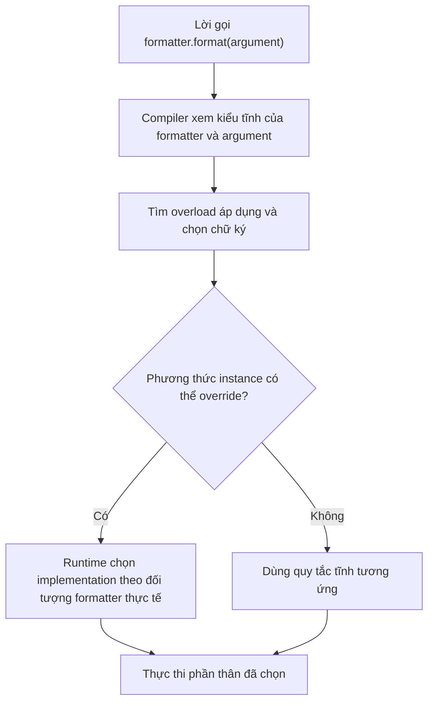

This diagram summarizes ordinary method calls. `super.method()`, constructor calls, and static methods have separate rules.

## 5. Both Receiver and Argument Types Matter

Not only argument types but also **the declared type of the receiver expression** affects which overloads are visible at compile time.

```java
class BaseHandler {
    void handle(Object value) {
        System.out.println("Base: Object");
    }
}

class ChildHandler extends BaseHandler {
    void handle(String value) {
        System.out.println("Child: String");
    }
}
```

Consider:

```java
BaseHandler baseRef = new ChildHandler();
ChildHandler childRef = new ChildHandler();

baseRef.handle("hi");   // Base: Object
childRef.handle("hi");  // Child: String
```

For `baseRef`, the compiler sees only `handle(Object)` through the `BaseHandler` API; it does not discover the new `handle(String)` overload declared only in `ChildHandler`. `ChildHandler` also **does not override** `handle(Object)` because it only declares `handle(String)`.

If a subclass needs to change how existing `BaseHandler` calls behave, it must override the exact `handle(Object)` method:

```java
class AnotherHandler extends BaseHandler {
    @Override
    void handle(Object value) {
        System.out.println("Another: Object");
    }
}
```

Therefore, overloading is **not** a substitute for overriding when polymorphism through a parent type or interface is needed.

## 6. Overload Resolution and `null`

A potentially confusing case:

```java
class NullExample {
    void show(Object value) {
        System.out.println("Object");
    }

    void show(String value) {
        System.out.println("String");
    }
}

new NullExample().show(null); // String
```

Both `Object` and `String` can accept `null`, but `String` is more specific than `Object`, so `show(String)` is chosen.

By contrast:

```java
class AmbiguousExample {
    void show(String value) {
    }

    void show(Integer value) {
    }
}

// new AmbiguousExample().show(null); // LỖI: ambiguous
```

`String` and `Integer` are unrelated subtypes, so `null` alone cannot determine which overload is more specific. An explicit cast can disambiguate:

```java
new AmbiguousExample().show((String) null);
```

**Caution:** Java may select an overload accepting `null`, but its body may throw `NullPointerException` if it dereferences that argument. Overload selection and input safety are separate concerns.

## 7. Overloading: Widening, Boxing, and Varargs

An example showing compile-time precedence:

```java
class NumberExample {
    void show(long value) {
        System.out.println("long");
    }

    void show(Integer value) {
        System.out.println("Integer");
    }

    void show(int... values) {
        System.out.println("varargs");
    }
}

NumberExample numbers = new NumberExample();
numbers.show(10);   // long
numbers.show(10L);  // long
```

For `10` of type `int`, `show(long)` is applicable through **primitive widening**; the compiler prefers a phase without boxing over `show(Integer)`. `varargs` is a separate mechanism considered when no applicable method was selected in earlier phases.

The important point is not that "`long` always beats `Integer`" in every program, but rather:

- Overloads are selected according to **compile-time rules**.
- Legal type conversions affect candidate methods.
- Overload sets with too many nearly identical parameter types can become confusing or ambiguous.

**Design tip:** when two methods perform semantically different operations, distinct, descriptive names are often better than overloading just to reduce the number of API names.

## 8. `static`, `private`, `final`: Do Not Confuse Them with Overriding

### Static Method Hiding Is Not Overriding

```java
class Base {
    static String category() {
        return "Base";
    }
}

class Child extends Base {
    static String category() {
        return "Child";
    }
}

Base value = new Child();
System.out.println(Base.category());  // Base
System.out.println(Child.category()); // Child
```

`static` methods belong to classes. Declaring the same signature in a subclass produces **method hiding**, not dynamic dispatch. Prefer calling them through **class names** for clarity. Do not place `@Override` on `static` methods intending to override.

### Private Methods Are Not Inherited for Overriding

```java
class Base {
    private String internal() {
        return "base internal";
    }

    public String run() {
        return internal();
    }
}

class Child extends Base {
    public String internal() {
        return "child internal";
    }
}

System.out.println(new Child().run()); // base internal
```

`Child.internal()` is a method of the subclass, not an override of `Base.internal()` because the parent method is `private`. Calls within `Base.run()` still use `Base.internal()`.

### Final Methods Cannot Be Overridden

```java
class Base {
    public final void validate() {
        System.out.println("Kiểm tra chung");
    }
}

class Child extends Base {
    // @Override
    // public void validate() { } // LỖI: final
}
```

A subclass may still declare an overload `validate(String context)` because it has a **different signature**, leaving the parent's final `validate()` unchanged.

### Constructors Can Be Overloaded but Not Overridden

```java
class Account {
    Account() {
        this("DEFAULT");
    }

    Account(String id) {
        System.out.println(id);
    }
}
```

`Account()` and `Account(String)` are **overloaded constructors**. Constructors are not inherited like ordinary methods, so Java has no "constructor overriding". `this(...)` selects another constructor in the same class; `super(...)` invokes a superclass constructor, not an override.

## 9. `@Override` and Compatibility Rules

Use `@Override` when **actually implementing or overriding a contract**:

```java
interface Describable {
    String describe();
}

class Product implements Describable {
    @Override
    public String describe() {
        return "Sản phẩm";
    }

    public String describe(String language) {
        return "vi".equals(language)
                ? "Sản phẩm"
                : "Product";
    }
}
```

`describe()` implements an interface method; `describe(String)` is an overload in the same class. Both are valid and can coexist.

### Covariant Return Types in Overriding

```java
class Animal {
}

class Cat extends Animal {
}

class Shelter {
    Animal adopt() {
        return new Animal();
    }
}

class CatShelter extends Shelter {
    @Override
    Cat adopt() {
        return new Cat();
    }
}
```

The child method `adopt()` returns `Cat`, a subtype of `Animal`, which is valid. By contrast, **only changing the return type** can never create a new overload with an otherwise identical signature.

### Exception and Access Rules

- If a superclass method is `public`, its override cannot be `protected` or package-private.
- If the parent declares the checked exception `IOException`, its override can declare `FileNotFoundException` (a subtype of `IOException`) or no checked exception; it cannot arbitrarily broaden that exception to an incompatible checked type.
- Unchecked exceptions have different declaration rules, but subtypes must still preserve the behavioral contract on which callers rely.
- A method returning `void` cannot be overridden with a `String` return type when the name and parameters are identical.

The compiler verifies syntax and type compatibility; business contracts still require separate tests.

## 10. Overriding and the Liskov Substitution Principle

Overriding is commonly used when clients hold parent-typed references:

```java
AnimalHandler handler = new DogHandler();
handler.handle();
```

When types are related by subtyping, overrides must preserve the parent API's promises: do not strengthen valid preconditions, weaken postconditions, violate invariants, or introduce side effects contrary to the contract.

For example, if the `PaymentCalculator` interface promises nonnegative fees for valid monetary amounts, an override of `calculate` returning negative fees violates behavior even if it compiles.

Overloading, in contrast, is a decision to **offer an additional calling form**, not a polymorphic guarantee. If a client only knows a parent's `calculate(int)`, adding `calculate(String)` in the child does not suddenly redirect `calculate(int)` calls to the new body.

Therefore, to change behavior through an abstraction, override the exact published method. Use an overload to support additional parameter forms, but specify each overload's behavior to avoid surprising results.

## 11. Practical Test: Distinguish the Two Resolution Phases

Create another standalone file, **`DispatchContractCheck.java`**:

```java
public class DispatchContractCheck {
    static class Parent {
        String call(Object value) {
            return "Parent:Object";
        }

        String call(String value) {
            return "Parent:String";
        }
    }

    static class Child extends Parent {
        @Override
        String call(Object value) {
            return "Child:Object";
        }
    }

    public static void main(String[] args) {
        Parent receiver = new Child();

        Object stringAsObject = "Java";
        String stringAsString = "Java";

        check("Child:Object".equals(receiver.call(stringAsObject)));
        check("Parent:String".equals(receiver.call(stringAsString)));
        check("Child:Object".equals(receiver.call((Object) stringAsString)));

        System.out.println("PASS: overload và override được phân biệt");
    }

    static void check(boolean ok) {
        if (!ok) {
            throw new AssertionError("Sai quy tắc phân giải method");
        }
    }
}
```

Compile and run:

```bash
javac DispatchContractCheck.java
java DispatchContractCheck
```

Output:

```text
PASS: overload và override được phân biệt
```

**Reason:**

- `stringAsObject` has static type `Object`, so the compiler selects `call(Object)`; the actual receiver is `Child`, so `Child.call(Object)` executes.
- `stringAsString` has static type `String`, so the compiler selects `call(String)`; `Child` does not override this method, so the inherited version from `Parent` runs.
- Casting `(Object) stringAsString` changes the call-site expression type and selects the `call(Object)` overload, even though the actual string object is unchanged.

This is the most memorable test of **"overload first, override second"**.

## 12. Practice Exercises

**Exercise 1 — Predict the Result**

```java
class Parent {
    String test(Number n) { return "Parent-Number"; }
    String test(Integer n) { return "Parent-Integer"; }
}
class Child extends Parent {
    @Override
    String test(Number n) { return "Child-Number"; }
}

Parent p = new Child();
Number n = Integer.valueOf(7);
Integer i = Integer.valueOf(7);

System.out.println(p.test(n)); // ?
System.out.println(p.test(i)); // ?
```

**Answer:** `Child-Number` and `Parent-Integer`. Overloading selects signatures using the static types of `n`/`i`; runtime dispatch executes an override if the selected signature is overridden.

**Exercise 2 — Only Change the Return Type**

Are `int calculate(int x)` and `double calculate(int x)` in the same class valid together? **No.** They have the same signature; return types do not distinguish overloads.

**Exercise 3 — Explain an `@Override` Error**

```java
class Base {
    void process(String s) { }
}

class Sub extends Base {
    // @Override
    void process(Object o) { }
}
```

Why is `@Override` invalid here? `process(Object)` is a new overload, not an override of `process(String)`. To override, declare `void process(String s)`.

**Exercise 4 — Static and Instance Methods**

Write parent/child classes with the same `static String type()` and an overridden instance method `String describe()`. Use a parent-typed variable referring to a child object. Predict the result of calling the static method by **class name** and the instance method through the variable.

**Exercise 5 — API Design**

You have `NotificationSender.send(String text)` and want to support sending to multiple recipients:

- Adding `send(String text, String recipient)` creates an **overload** — another signature.
- If `EmailSender` changes how the already defined `send(String text)` sends a message, that is an **override** — a different implementation of shared behavior.

Create a comparison table for both approaches: the client-visible type, selected signature, executed body, and behavioral expectations that must remain valid.

## Common Mistakes

| Misconception | Correct Understanding |
| --- | --- |
| "Overloading only occurs between inherited classes" | Overloads may exist in the same class |
| "Overriding requires only the same name" | Signatures and other override conditions must be compatible |
| "Different return types create overloads" | False; return types alone are insufficient |
| "Java automatically chooses overloads by runtime argument class" | False; static types and overload-resolution rules determine selection |
| "The compiler always selects the final override body" | The compiler selects the signature; instance-method dispatch occurs at runtime |
| "Child static methods override parent static methods" | This is method hiding |
| "Parent private methods can be overridden" | Private methods are not inherited for overriding |
| "`@Override` is required for the JVM to dispatch" | No; the annotation provides compile-time checking |
| "Adding an overload in a child class makes all parent-typed calls select it" | No; receiver static types determine visible APIs |
| "Constructors can be overridden" | Constructors can be overloaded, not overridden |

**Conclusion:** To resolve a Java call with multiple same-named methods, first ask **which overloads the compiler sees and which signature it selects using static types**. Then, for overridable instance methods, ask **what class the receiver object actually belongs to** to determine the body executed. These two steps prevent most confusion between **overloading** and **overriding**.


</details>

- [Back to top](#back-to-top)

---

## <a id="polymorphism-006">Distinguishing Member Hiding from Overriding</a>

<details>
<summary>View details</summary>

# Distinguishing Member Hiding from Overriding in Java

When a subclass declares a member with **the same name** as its parent, Java does not always perform **overriding**. Whether that member is a **field**, a **`static` method**, or an **instance method** determines which rule applies:

- **Field hiding (*field hiding*):** A subclass field shares a name with a superclass field. Access to `ref.field` primarily depends on **the reference expression's compile-time type**, not the object's runtime class.
- **Static method hiding (*static method hiding*):** A subclass declares a static method with a signature corresponding to a superclass static method. The call resolves by **the type known at compile time**, without the dynamic polymorphism of instance methods.
- **Method overriding (*method overriding*):** A subclass supplies a new implementation of an eligible **instance method** from its parent. For a call with a receiver object, Java selects an implementation at **runtime** based on the actual object type.

This distinction is especially important when reading:

~~~java
Parent ref = new Child();
~~~

`ref` has the declared type `Parent` but refers to a `Child` object. Fields, static methods, and instance methods **do not necessarily resolve using the same type**.

## 1. Quick Comparison

| Feature | Field Hiding | Static Method Hiding | Instance Method Overriding |
|---|---|---|---|
| Typical condition | Subclass declares a same-named field | Subclass declares a valid same-signature static method | Subclass declares a valid overriding instance method |
| Member selection | Reference expression's compile-time type | Call/class type selected at compile time | Actual receiver object type at runtime |
| Dynamic polymorphism? | **No** | **No** | **Yes** |
| Use `@Override`? | No | No; compiler error | Recommended |
| Is `super` useful? | `super.field` accesses the parent field | `super.method()` for static methods follows separate rules; prefer `Parent.method()` | `super.method()` invokes the superclass implementation |
| Do separate members exist? | Two same-named fields can coexist in superclass and subclass state | Two static methods are declared across the classes | Different implementations of the same method contract can exist |
| Recommendation | Avoid field hiding to prevent confusion | Call static methods using **class names** | Use it for contracted polymorphic behavior |

**Rule of thumb:** *fields and static methods depend on compile-time reference/class types; overridden instance methods depend on the runtime object.*

This is the core rule, but the compiler's call resolution also considers overloads, accessibility, and argument types. The following sections separate these mechanisms.

## 2. Complete Java Example: One Object, Three Member-Resolution Rules

Save everything to **`Demo.java`** and compile/run with Java 17 or later:

~~~java
public class Demo {
    public static void main(String[] args) {
        Parent parentView = new Child();
        Child childView = (Child) parentView;

        System.out.println("=== Field ===");
        System.out.println(parentView.label);
        System.out.println(childView.label);
        System.out.println(((Parent) childView).label);

        System.out.println("=== Static method ===");
        System.out.println(Parent.kind());
        System.out.println(Child.kind());

        // Hợp lệ về cú pháp, nhưng không nên gọi static qua instance:
        System.out.println(parentView.kind());
        System.out.println(childView.kind());

        System.out.println("=== Instance method ===");
        System.out.println(parentView.describe());
        System.out.println(childView.describe());

        System.out.println("=== Kết hợp với super ===");
        childView.inspect();
        System.out.println(parentView.report());
    }
}

class Parent {
    public String label = "Field của Parent";

    public static String kind() {
        return "Static của Parent";
    }

    public String describe() {
        return "Method của Parent";
    }

    public String report() {
        // describe() là instance method: dispatch theo object.
        return "Report: " + describe();
    }
}

class Child extends Parent {
    public String label = "Field của Child"; // Field hiding.

    public static String kind() {            // Static method hiding.
        return "Static của Child";
    }

    @Override
    public String describe() {               // Method overriding.
        return "Method của Child";
    }

    public void inspect() {
        System.out.println(this.label);
        System.out.println(super.label);
        System.out.println(this.describe());
        System.out.println(super.describe());
    }
}
~~~

Run:

~~~bash
javac Demo.java
java Demo
~~~

Output:

~~~text
=== Field ===
Field của Parent
Field của Child
Field của Parent
=== Static method ===
Static của Parent
Static của Child
Static của Parent
Static của Child
=== Instance method ===
Method của Child
Method của Child
=== Kết hợp với super ===
Field của Child
Field của Parent
Method của Child
Method của Parent
Report: Method của Child
~~~

### Analyzing Each Mechanism

**Field hiding:**

~~~java
Parent parentView = new Child();

System.out.println(parentView.label);          // Field của Parent
System.out.println(((Child) parentView).label); // Field của Child
~~~

Both expressions refer to **one `Child` object**, yet the field is selected by **the reference type** of each expression:

- `parentView` is declared `Parent` → reads `Parent.label`.
- `(Child) parentView` has type `Child` → reads `Child.label`.

In this case, casting **does not create another object or move field values**; it changes how the compiler views the expression.

**Static method hiding:**

~~~java
System.out.println(parentView.kind()); // Static của Parent
System.out.println(childView.kind());  // Static của Child
~~~

Both calls are permitted but misleadingly resemble polymorphic static calls. **Prefer writing `Parent.kind()` and `Child.kind()`** to show that the static methods belong to classes.

**Instance method overriding:**

~~~java
System.out.println(parentView.describe()); // Method của Child
~~~

The compiler confirms that `Parent` declares `describe()`, while the JVM chooses the actual object's `Child.describe()` implementation.

Notably, `Parent.report()` can also invoke `Child.describe()` when executed on a `Child` object: the parent-class method calls an **overridable instance method**, and dispatch still occurs at runtime.

## 3. Field Hiding: Same Name, Distinct Fields

When a subclass redeclares the same field name, think of a subclass object as holding state from both superclass and subclass:

~~~mermaid
flowchart TD
    R["parentView: Parent"] --> O["Object thực tế: Child"]
    S["childView: Child"] --> O
    O --> P["Phần Parent: label = Field của Parent"]
    O --> C["Phần Child: label = Field của Child"]
    R -.->|"parentView.label"| P
    S -.->|"childView.label"| C
~~~

This is a **logical** diagram, not a guarantee of physical memory layout or JVM optimization.

A modification example demonstrates **two independent fields**:

~~~java
class CounterBase {
    public int count = 1;
}

class CounterChild extends CounterBase {
    public int count = 10;
}

CounterChild obj = new CounterChild();
obj.count = 20;
((CounterBase) obj).count = 2;

System.out.println(obj.count);               // 20
System.out.println(((CounterBase) obj).count); // 2
~~~

The usage statements at the end belong inside an appropriate Java method. Assigning `obj.count = 20` **does not modify** `CounterBase.count`; assigning through a cast to `CounterBase` also leaves `CounterChild.count` unchanged.

This can cause bugs when parent-class invariants depend on its field while a child redeclares that name, causing different code to read inconsistent state.

### Do Not Use Public Fields for Polymorphism

A misleading design:

~~~java
class Configuration {
    public String environment = "default";
}

class ProductionConfiguration extends Configuration {
    public String environment = "production";
}
~~~

Consuming code:

~~~java
Configuration config = new ProductionConfiguration();
System.out.println(config.environment); // default
~~~

For results depending on the runtime object, use an **instance method**:

~~~java
class Configuration {
    public String environment() {
        return "default";
    }
}

class ProductionConfiguration extends Configuration {
    @Override
    public String environment() {
        return "production";
    }
}

Configuration config = new ProductionConfiguration();
System.out.println(config.environment()); // production
~~~

For important data, keep fields `private` and expose getters or intention-revealing operations. Overridden getters can provide contract-based polymorphism while classes maintain their invariants.

## 4. Static Method Hiding: Same Signature, No Dynamic Dispatch

In Java, static methods belong to **classes**, not to the per-instance state. A subclass may declare a matching static method to **hide** its superclass method under Java's rules.

~~~java
class Formatter {
    public static String format() {
        return "BASE";
    }
}

class JsonFormatter extends Formatter {
    public static String format() {
        return "JSON";
    }
}
~~~

Usage:

~~~java
Formatter base = new JsonFormatter();

System.out.println(Formatter.format());      // BASE
System.out.println(JsonFormatter.format());  // JSON
System.out.println(base.format());           // BASE
~~~

The final line **is allowed** but discouraged: `base.format()` looks like an object-method call, but the compiler selects `Formatter`'s static method from the expression type.

**`@Override` is invalid on `JsonFormatter.format()`**, because static methods hide rather than override.

### A Static Method Cannot Be Turned into an Instance Override

Java rejects the following:

~~~java
class Parent {
    public static void process() {}
}

class Child extends Parent {
    // public void process() {} // Lỗi biên dịch:
    // instance method không thể override/hide static method tương ứng.
}
~~~

The opposite direction is invalid too:

~~~java
class Parent {
    public void process() {}
}

class Child extends Parent {
    // public static void process() {} // Lỗi biên dịch:
    // static method không thể hide instance method tương ứng.
}
~~~

Same-signature methods in an inheritance relationship cannot freely switch between static and instance declarations.

### Interface Static Methods Are Different

Java interfaces can declare static methods:

~~~java
interface TextRules {
    static boolean hasText(String value) {
        return value != null && !value.isBlank();
    }
}

class TextService implements TextRules {}

System.out.println(TextRules.hasText("Java")); // true

// TextService.hasText("Java");  // Không hợp lệ.
// new TextService().hasText("Java"); // Không hợp lệ.
~~~

Static methods declared in an interface **are not inherited by implementing classes** as instance/default methods are. Do not mechanically apply class static-hiding rules to interface static methods.

## 5. Overriding Instance Methods Differs from Hiding

~~~java
class Notification {
    String send() { return "Gửi thông báo"; }
}
class EmailNotification extends Notification {
    @Override String send() { return "Gửi email"; }
}
Notification item = new EmailNotification();
System.out.println(item.send()); // Gửi email
~~~

`send()` is an **overridable instance method**, so Java dispatches it based on the `EmailNotification` object, unlike `item.field` field access or a hidden static call. `@Override` lets the compiler check the signature; valid overrides must also return compatible types, preserve accessibility, obey checked-exception rules, and honor behavioral contracts.

For overriding syntax, covariant returns, `final`, `super`, and constructor-hook behavior, see *Method Overriding and Runtime Method Selection*.

## 6. Can Private Methods Be Overridden?

No. Private instance methods of superclasses **are not inherited for overriding** by subclasses.

~~~java
class SecureBase {
    private String secretLabel() {
        return "Base private";
    }

    public String audit() {
        return secretLabel();
    }
}

class SecureChild extends SecureBase {
    // Phương thức riêng, không phải override private method của Base.
    public String secretLabel() {
        return "Child public";
    }
}
~~~

Usage:

~~~java
SecureBase ref = new SecureChild();
System.out.println(ref.audit()); // Base private

SecureChild child = new SecureChild();
System.out.println(child.secretLabel()); // Child public
~~~

`SecureBase.audit()` invokes its own `private secretLabel()` method declared by `SecureBase`; `SecureChild` declares a same-named method but does not replace it.

This is very different from overridable `public`/`protected` instance methods.

Note that nested classes (*nestmates*) can have special private access under Java's rules, but that does not turn a superclass private method into an overridable method.

### Subclasses Cannot Access Private Fields Through `super`

~~~java
class Parent {
    private int balance = 100;

    public int getBalance() {
        return balance;
    }
}

class Child extends Parent {
    public int readBalance() {
        // return super.balance; // Lỗi: private không được truy cập.
        return getBalance();     // Hợp lệ: gọi public method.
    }
}
~~~

`super` does not bypass `private` access restrictions; it only identifies the superclass context for accessible members.

## 7. Field Hiding and Overriding Can Coexist and Cause Inconsistent State

Consider:

~~~java
class Profile {
    protected String displayName = "Base";

    public String summary() {
        return "Tên: " + displayName;
    }
}

class PremiumProfile extends Profile {
    protected String displayName = "Premium";

    @Override
    public String summary() {
        return "Tên cao cấp: " + displayName;
    }
}
~~~

~~~java
Profile profile = new PremiumProfile();
System.out.println(profile.displayName); // Base
System.out.println(profile.summary());   // Tên cao cấp: Premium
~~~

Although both expressions reference the same object, field access and method calls produce results using **two different rules**.

That is why **external code should not depend on same-named protected/public fields** across an inheritance hierarchy. Prefer overriding methods for variable behavior. When state is shared, the parent should keep a private field and expose validated operations.

## 8. Overloading Asks a Different Question: Which Signature?

~~~java
class Printer {
    void print(Object value) { System.out.println("Object"); }
    void print(String value) { System.out.println("String"); }
}
Object text = "hello";
Printer printer = new Printer();
printer.print(text);      // Object
printer.print("hello");   // String
~~~

`print(Object)` and `print(String)` are **two overloads**; the compiler selects one from the argument's static type, not the runtime object referenced by `text`. After choosing the signature, it can dispatch an overridden instance method at runtime.

| Mechanism | Selected By |
|---|---|
| Field hiding | Static type of the expression |
| Static hiding | Static type or class name |
| Overloading | Static receiver and argument types plus overload-resolution rules |
| Instance overriding | Receiver runtime class after the signature is fixed |

Combined overloading/overriding examples, `null`, boxing, and varargs are covered separately in *Distinguishing Overriding from Overloading*.

## 9. How `super` Affects These Cases

`super` is used in an instance context to identify superclass operations and avoid ambiguity when both classes declare same-named members.

~~~java
class Vehicle {
    protected String label = "Vehicle";

    public String move() {
        return "Vehicle moves";
    }
}

class Car extends Vehicle {
    protected String label = "Car";

    @Override
    public String move() {
        return "Car moves; " + super.move();
    }

    public void inspect() {
        System.out.println(this.label);  // Car
        System.out.println(super.label); // Vehicle
        System.out.println(this.move()); // Car moves; Vehicle moves
    }
}
~~~

- `super.label` selects the superclass's `label` field.
- `super.move()` invokes the superclass implementation (without dynamically redispatching this particular `Car.move()` call to `super`).
- `this.move()` is an ordinary instance-method call on the current object, so it uses the `Car` override.

`super` does not refer to another object: we are still working on the superclass part of **the same `Car` object**.

If a superclass method calls an overridable instance method internally, that inner call can still dispatch to a subclass. Thus a path such as `super.doWork()` → parent method → `this.hook()` → subclass hook implementation is possible.

### Beware of Overridable Methods Called from Constructors

A design error related to polymorphism:

~~~java
class Base {
    Base() {
        initialize(); // Có thể gọi implementation trong subclass.
    }

    void initialize() {}
}

class Derived extends Base {
    private String configuration = "ready";

    @Override
    void initialize() {
        System.out.println(configuration);
    }
}
~~~

~~~java
new Derived();
~~~

It may print `null` because, when the `Base` constructor calls `initialize()`, the ordinary initialization of fields in `Derived` **has not completed yet**. This is not field hiding; it results from **dynamic dispatch during object construction**. Avoid calling overridable methods from constructors when subclass implementations may depend on uninitialized state.

## 10. Same-Named Interface Members Can Cause Ambiguity

Besides class inheritance, Java supports implementing multiple interfaces:

~~~java
interface Left {
    int VERSION = 1;
}

interface Right {
    int VERSION = 2;
}

class Combined implements Left, Right {
    void printVersions() {
        // System.out.println(VERSION); // Mơ hồ, không biên dịch.
        System.out.println(Left.VERSION);
        System.out.println(Right.VERSION);
    }
}
~~~

Interface fields are implicitly `public static final`. If two interfaces declare fields with the same name, qualify the source, such as `Left.VERSION`.

When two interfaces expose **default instance methods** with the same signature, the implementing class may have to override the method to resolve the conflict:

~~~java
interface LeftAction {
    default String action() {
        return "left";
    }
}

interface RightAction {
    default String action() {
        return "right";
    }
}

class CombinedAction implements LeftAction, RightAction {
    @Override
    public String action() {
        return LeftAction.super.action()
                + " + " + RightAction.super.action();
    }
}
~~~

These are two default methods supplied by interfaces, not static hiding. Default-method conflict rules belong to Java's interface-inheritance and instance-method selection mechanisms; distinguish them from compile-time field lookup.

## 11. `final` and Access Levels

### `final` on Methods Prevents the Relevant Override or Hiding

~~~java
class Service {
    public final void start() {
        System.out.println("Started");
    }
}

class SpecialService extends Service {
    // public void start() {} // Lỗi: final method không thể override.
}
~~~

A `final` static method also cannot be hidden by a matching static method of a subclass in a valid inheritance context.

### `final` on Fields Does Not Prevent Field Hiding

~~~java
class Parent {
    public final int code = 100;
}

class Child extends Parent {
    public final int code = 200;
}
~~~

This declaration is valid: `final` prevents **reassignment of that field**, not a subclass declaring a **different** same-named field.

~~~java
Parent view = new Child();
System.out.println(view.code);          // 100
System.out.println(((Child) view).code); // 200
~~~

This can be especially confusing when a field acts as a type tag. Avoid designs that use same-named fields for polymorphic behavior.

### Overrides Must Not Reduce Access

~~~java
class Parent {
    public String describe() {
        return "Parent";
    }
}

class Child extends Parent {
    @Override
    public String describe() {
        return "Child";
    }
}
~~~

Changing `Child.describe()` to `protected` causes a compilation error: an overriding method cannot narrow the access that callers had through `Parent`.

A subclass may override a superclass `protected` method as `public`, **widening** access where appropriate.

## 12. When to Use and Avoid These Mechanisms

| Need | Prefer | Avoid |
|---|---|---|
| Behavior that varies with the actual object | Instance methods plus `@Override` | Using same-named fields to "override" |
| Utility independent of instances | Call `static` methods by class name | Static calls through objects that suggest dispatch |
| State belonging to each instance | `private` fields and controlled behavior | Same-named public fields across inheritance levels |
| Extending parent behavior | Override and `super.method()` where appropriate | Treating `super` as a way to bypass access control |
| Multiple input forms with different types | Overloads with clear contracts | Confusing overloading with runtime overriding |
| New subtypes without modifying clients | Design abstractions with instance methods/interfaces | Class-based `if` chains or type/name fields driving algorithms |

The practical reason to **avoid field hiding** is maintainability: changing a variable's declared type or adding a cast may change which field is read even when the runtime object stays the same. Properly designed polymorphic methods select an implementation by the actual object, matching OOP needs more closely.

## 13. Mistakes When Reasoning from Member Names

- **"Same names always mean overriding."** Same-named fields are field hiding; same-signature static methods are static hiding; methods with different parameters are usually overloads.
- **"`new Child()` means every access uses Child."** With `Parent ref = new Child()`, only eligible overridden instance methods dispatch dynamically; fields and static methods have separate rules.
- **"`@Override` works on static methods or when only the return type differs."** No. Static methods do not override; changing only a return type does not create an overload.
- **"A getter is the same as a field."** A getter is an instance-method call and may be overridden; field lookup does not dispatch.
- **"`super` calls another parent object or bypasses `private`."** No. `super` selects accessible superclass members on the same object.
- **"A subclass method sharing the parent's private name overrides it."** No. A superclass private method is not an inherited override hook.

When debugging, first identify **what kind of member** is involved, then determine compile-time selection and runtime dispatch. The exercises below demonstrate these differences.

## 14. Exercises

### Exercise 1 — Predict Field and Method Results

~~~java
class A {
    int value = 1;
    String who() { return "A"; }
}

class B extends A {
    int value = 2;
    @Override String who() { return "B"; }
}

A obj = new B();
System.out.println(obj.value);
System.out.println(obj.who());
~~~

**Answer:** `1`, followed by `B`. Fields use the `A` reference type; overridden instance methods use the `B` object.

### Exercise 2 — Predict a Static Method Result

~~~java
class A {
    static String id() { return "A"; }
}

class B extends A {
    static String id() { return "B"; }
}

A x = new B();
System.out.println(x.id());
~~~

**Answer:** `A`. Although legal, invoking a static method through `x` is discouraged; use `A.id()` for clarity.

### Exercise 3 — Override or Overload?

~~~java
class A {
    void draw(Object value) {}
}

class B extends A {
    void draw(String value) {}
}
~~~

**Answer:** `B.draw(String)` is an **overload**, not an override of `A.draw(Object)`, because the parameters differ. `@Override` on `B.draw(String)` produces an error.

### Exercise 4 — Can Private Methods Be Overridden?

~~~java
class A {
    private void save() {}
}

class B extends A {
    public void save() {}
}
~~~

**Answer:** No override occurs. `B.save()` is a separate method; it does not replace the private implementation `A.save()`.

### Exercise 5 — Which Implementation Does `super` Select?

~~~java
class A {
    String message() { return "A"; }
}

class B extends A {
    @Override String message() {
        return super.message() + "B";
    }
}
~~~

**Answer:** `new B().message()` returns `"AB"`. `super.message()` calls the `A` implementation, then `B` appends `"B"`.

### Exercise 6 — Why Can Parent's `report()` Call Child's `describe()`?

**Answer:** `Parent.report()` runs on a receiver that is a `Child` object. Its internal `describe()` instance call within `report()` still uses dynamic dispatch, selecting `Child.describe()`.

### Exercise 7 — Improve the Design

A system uses:

~~~java
class Payment {
    public String type = "generic";
}
class CardPayment extends Payment {
    public String type = "card";
}
~~~

But `Payment p = new CardPayment();` prints `p.type == "generic"`. How would you change the design?

**Hint:** Make `type` a query behavior:

~~~java
class Payment {
    public String type() { return "generic"; }
}
class CardPayment extends Payment {
    @Override public String type() { return "card"; }
}
~~~

Now `Payment p = new CardPayment(); p.type()` returns `"card"` through overriding.

## 15. How to Read a Call in an Inheritance Hierarchy

When you see `ref.member`, check the following in order:

1. **Is `member` a field or method?** Field access does not use dynamic overriding.
2. **If it is a method, is it static?** Static methods do not use runtime dispatch.
3. **If it is an instance method, which signature does the compiler select?** Does overloading depend on argument types?
4. **Does the actual object type validly override that signature?** If so, runtime selects that implementation.
5. **Does any modifier prevent overriding?** `private`, `final`, static declarations, or access rules may alter the relationship.
6. **Is there an explicit `super` or cast?** These can affect field selection, parent methods, or expression types.
7. **Does behavior satisfy the contract?** Even when Java selects the correct implementation, overrides must still honor the supertype's requirements.

~~~mermaid
flowchart TD
    A["Gặp ref.member"] --> B{"Member là field?"}
    B -->|Có| C["Chọn field theo kiểu biểu thức<br/>Field hiding, không dynamic dispatch"]
    B -->|Không| D{"Method là static?"}
    D -->|Có| E["Chọn static method theo compile-time type<br/>Static hiding"]
    D -->|Không| F["Compiler chọn chữ ký overload phù hợp"]
    F --> G["Runtime chọn override theo object thực tế"]
~~~

**Conclusion:** In Java, **member hiding** and **overriding** differ in both OOP meaning and call resolution. Field hiding and static method hiding are determined mainly at compile time; overriding instance methods provides **dynamic polymorphism**. To vary behavior by object type, design contracted instance methods, prefer `@Override`, encapsulate state, and avoid same-named fields in inheritance hierarchies.


</details>

- [Back to top](#back-to-top)

---

## <a id="polymorphism-007">Scope of Polymorphism for Methods and Fields</a>

<details>
<summary>View details</summary>

# Scope of Polymorphism for Methods and Fields in Java

Consider this declaration:

```java
Parent value = new Child();
```

The variable `value` has the **declared type** `Parent` but refers to an object whose **actual type** is `Child`. If `Child` validly (*overrides*) an instance method, a call through `value` can execute the `Child` implementation. This is **dynamic polymorphism (runtime polymorphism)**.

Not every Java member works this way. **Fields cannot be overridden; static methods may be hidden (*hiding*) but do not dispatch dynamically; and overloads are selected using compile-time types.**

This lesson establishes exactly **which members participate in polymorphism**, how the compiler and JVM select behavior, and common traps involving superclasses, subclasses, and interfaces.

## 1. Two Stages, Two Decisions

Consider:

```java
Animal animal = new Dog();
animal.speak();
```

Java must handle two separate questions:

1. **At compile time:** Given that `animal` has type `Animal`, is calling `speak()` valid? If there are overloads, which signature applies?
2. **At runtime:** For an overridable instance method, the actual object is `Dog`, so the selected implementation can be `Dog.speak()`.

In other words: **the declared type limits which members are accessible; the runtime type determines the implementation of dynamically dispatched instance methods.**

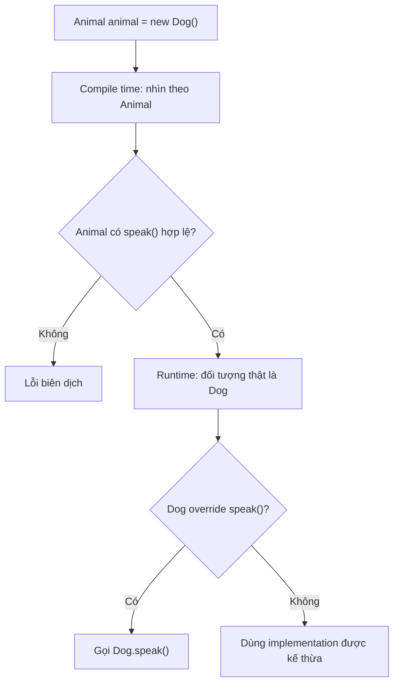

The diagram applies to **overridable instance methods**, not every field or static method.

## 2. Complete Java Example: Same Object, Different Results

File `PolymorphismScopeDemo.java`:

```java
public class PolymorphismScopeDemo {

    static class Ticket {
        // Field: thuộc tính dữ liệu, không hỗ trợ override.
        public String label = "Ticket-field";

        // Instance method: có thể được subclass override.
        public String display() {
            return "Ticket-method";
        }

        // final instance method: subclass không thể override.
        public final String code() {
            return "T-001";
        }

        // Static method: có thể bị hiding, không dynamic dispatch.
        public static String category() {
            return "Ticket-static";
        }

        // Private method: không được override ở subclass.
        private String internalNote() {
            return "Ticket-private";
        }

        public String showInternalNote() {
            return internalNote();
        }

        // Đọc field thuộc lớp khai báo phương thức này.
        public String showField() {
            return "Ticket.showField: " + label;
        }
    }

    static final class VipTicket extends Ticket {
        // Field khác, che khuất Ticket.label.
        public String label = "VIP-field";

        @Override
        public String display() {
            return "VIP-method";
        }

        // Đây là static method hiding, không phải override.
        public static String category() {
            return "VIP-static";
        }

        // Cùng tên nhưng không override private method của cha.
        private String internalNote() {
            return "VIP-private";
        }

        public String vipOnly() {
            return "Chức năng riêng của VIP";
        }

        public String bothFields() {
            return super.label + " / " + this.label;
        }
    }

    public static void main(String[] args) {
        Ticket ticket = new VipTicket();

        System.out.println(ticket.display());
        System.out.println(ticket.label);
        System.out.println(((VipTicket) ticket).label);
        System.out.println(ticket.code());

        System.out.println(Ticket.category());
        System.out.println(VipTicket.category());

        // Tránh viết ticket.category() trong code thực tế:
        // Cú pháp được Java cho phép nhưng dễ gây hiểu nhầm.
        System.out.println(ticket.category());

        System.out.println(ticket.showInternalNote());
        System.out.println(ticket.showField());

        VipTicket vip = (VipTicket) ticket;
        System.out.println(vip.bothFields());
        System.out.println(vip.vipOnly());
    }
}
```

Run:

```bash
javac PolymorphismScopeDemo.java
java PolymorphismScopeDemo
```

Output:

```text
VIP-method
Ticket-field
VIP-field
T-001
Ticket-static
VIP-static
Ticket-static
Ticket-private
Ticket.showField: Ticket-field
Ticket-field / VIP-field
Chức năng riêng của VIP
```

Why do results differ for the same `VipTicket` object?

| Expression | Result | Mechanism |
|---|---|---|
| `ticket.display()` | `VIP-method` | **Override + dynamic dispatch** |
| `ticket.label` | `Ticket-field` | Field resolution using static type `Ticket` |
| `((VipTicket) ticket).label` | `VIP-field` | The cast expression has static type `VipTicket` |
| `ticket.code()` | `T-001` | `final` instance method; cannot be overridden |
| `Ticket.category()` | `Ticket-static` | Static method of the explicitly named class |
| `VipTicket.category()` | `VIP-static` | Another static method hiding the parent's |
| `ticket.category()` | `Ticket-static` | Static method selected by expression `ticket`'s static type |
| `ticket.showInternalNote()` | `Ticket-private` | A method of `Ticket` invokes a private method of `Ticket` |
| `ticket.showField()` | `Ticket.showField: Ticket-field` | The `Ticket` implementation reads `Ticket.label` |
| `vip.bothFields()` | `Ticket-field / VIP-field` | `super.label` and `this.label` refer to two separate fields |
| `vip.vipOnly()` | Subclass-specific feature | A `VipTicket`-typed expression can invoke a method declared only by the subclass |

**Important observation:** `Ticket.label` and `VipTicket.label` are **two separate fields coexisting in one subclass object**. Redeclaring the field does not alter parent-class field access or create field polymorphism.

In production designs, avoid the public or same-named fields used in this deliberately illustrative example. They expose the language rules here but are poor design choices.

## 3. Fields Do Not Override: Changing a Reference Type Can Change Which Field Is Read

~~~java
class Base {
    String value = "base";
}
class Derived extends Base {
    String value = "derived";
}
Base ref = new Derived();
System.out.println(ref.value);             // base
System.out.println(((Derived) ref).value); // derived
~~~

A `Derived` instance contains **two different fields**, one in the `Base` portion and one in `Derived`. A valid cast changes only the expression's static type; it neither changes the object nor copies a value. Because fields do not dispatch at runtime, changing a variable type from `Base` to `Derived` can select a different member even with the same instance.

This is an important reason to avoid same-named public/protected fields and encapsulate state instead. *Distinguishing Member Hiding from Overriding* covers field hiding, `super.field`, static hiding, and access rules in detail; this lesson focuses next on **getters as polymorphic APIs**.

## 4. Getters Are Methods: Behavior Can Be Polymorphic Even When Fields Are Not

In Java, "property" sometimes means a data field, while many frameworks and libraries use **JavaBean properties** exposed via `getXxx()`/`setXxx()` methods. Distinguish:

- `obj.value`: accesses a **field** — no dynamic dispatch.
- `obj.getValue()`: calls a **method** — potentially overridable and dynamically dispatched.

For example:

```java
class Person {
    private final String name;

    Person(String name) {
        this.name = name;
    }

    public String getDisplayName() {
        return name;
    }
}

class Employee extends Person {
    private final String department;

    Employee(String name, String department) {
        super(name);
        this.department = department;
    }

    @Override
    public String getDisplayName() {
        return super.getDisplayName() + " (" + department + ")";
    }
}

Person person = new Employee("An", "Backend");

System.out.println(person.getDisplayName()); // An (Backend)
```

The `person` variable knows only the `Person` contract, but `getDisplayName()` returns a value according to the `Employee` implementation.

This **does not mean the `name` field is overridden**: `name` remains private data managed by `Person`. The getter behavior is overridden, not the field.

### Which Design Should You Choose?

When state must satisfy invariants, favor `private` fields and expose **meaningful behavior** or controlled access methods. If a subclass needs a different presentation, overriding `getDisplayName()` is clearer than declaring another `name` field with the same name.

However, if a getter is `final`, subclasses cannot override it. Polymorphism does not require every getter to be overridable.

## 5. Scope of Polymorphism by Member Type

| Member Type | Dynamic Dispatch by Runtime Object? | Explanation |
|---|---|---|
| Overridable instance method | **Yes** | The subclass implementation is selected when overriding satisfies the contract |
| `abstract` method implemented in a subclass | **Yes** | A call through the abstract type invokes the concrete implementation |
| Interface method implemented by a class | **Yes** | A call through an interface reference selects the appropriate implementation |
| Interface `default method` | **Possible** | Can be inherited or overridden; conflicts require correct resolution |
| `final` instance method | Cannot be overridden by a subclass | No subclass override can provide a different implementation |
| `private` method | Cannot override | A same-named subclass method is a separate member |
| `static` method | **No** | Can be hidden; calls resolve by static type/class name |
| Constructor | **No** | Not inherited or overridden |
| Overloaded method | Overload selected at compile time | After selecting the signature, an instance-method implementation can still be dispatched |
| Instance field | **No** | Field hiding/resolution by static type |
| `static` field | **No** | Class-level state; no field polymorphism |

Note that `final`, `private`, and `static` are not "behaviorless". They can execute ordinary code. The distinction is that **they do not cause runtime selection among instance-method overrides**.

## 6. Polymorphism Applies to the **Selected Method Signature**

~~~java
class Speaker {
    String speak(Object value) { return "Speaker/Object"; }
}
class DogSpeaker extends Speaker {
    @Override String speak(Object value) { return "DogSpeaker/Object"; }
    String speak(String value) { return "DogSpeaker/String"; }
}
Speaker caller = new DogSpeaker();
System.out.println(caller.speak("Gâu")); // DogSpeaker/Object
~~~

The compiler sees only the `speak(Object)` overload through type `Speaker`; after selecting that signature, the JVM dispatches to `DogSpeaker.speak(Object)`. The `speak(String)` overload exists only in the subclass and does not become part of the static API available through `caller`.

Remember the scope: **the receiver type determines valid calls; the actual object selects the implementation only for an eligible instance method**. The previous lessons explain overloading/overriding, `null`, boxing, and varargs in detail.

## 7. Static and Private Methods Are Not Equivalent Runtime Extension Points

`Base ref = new Derived()` does not make `ref.staticMethod()` select a static method from `Derived`: static methods belong to **classes**. Calling `Base.staticMethod()` or `Derived.staticMethod()` is clearer. A matching subclass static method causes **method hiding**.

Similarly, private superclass methods are not inherited for overriding; a same-named subclass method cannot replace the private implementation invoked by parent code. The lesson *Distinguishing Member Hiding from Overriding* provides runnable examples. These rules limit polymorphism to **instance methods that can genuinely be overridden**.

## 8. Final Methods, Abstract Methods, and Interfaces

### 8.1. final instance method

```java
class BasePolicy {
    public final boolean isEnabled() {
        return true;
    }
}

class SpecialPolicy extends BasePolicy {
    // public boolean isEnabled() { return false; }
    // Lỗi biên dịch vì isEnabled() là final.
}
```

A `BasePolicy p = new SpecialPolicy();` variable can still call `p.isEnabled()`. But because the subclass cannot override it, no subclass-specific implementation is selected for that method. `final` is useful for protecting an invariant rule or algorithmic step.

### 8.2. Abstract Methods and Interfaces Support Dynamic Dispatch

```java
abstract class Shape {
    abstract double area();
}

final class Circle extends Shape {
    private final double radius;

    Circle(double radius) {
        if (radius <= 0) {
            throw new IllegalArgumentException("Bán kính phải dương");
        }
        this.radius = radius;
    }

    @Override
    double area() {
        return Math.PI * radius * radius;
    }
}

Shape shape = new Circle(2);
System.out.println(shape.area()); // Khoảng 12.56637
```

`Shape.area()` has no implementation in the abstract class, but a `Shape`-typed variable can still call it. At runtime, Java invokes `Circle.area()`.

Likewise, when a class implements an interface method, a call through an interface reference uses the appropriate implementation:

```java
interface Formatter {
    String format(String text);
}

final class UpperFormatter implements Formatter {
    @Override
    public String format(String text) {
        return text.toUpperCase(java.util.Locale.ROOT);
    }
}

Formatter formatter = new UpperFormatter();
System.out.println(formatter.format("java")); // JAVA
```

### 8.3. Interface Default Methods Can Participate in Polymorphism

```java
interface Greeter {
    default String hello() {
        return "Hello";
    }
}

class FriendlyGreeter implements Greeter {
    @Override
    public String hello() {
        return "Xin chào";
    }
}

Greeter greeter = new FriendlyGreeter();
System.out.println(greeter.hello()); // Xin chào
```

`default` supplies an implementation when a class does not provide a more specific one. An overriding class implementation runs even through an interface-typed reference. For conflicting default methods, Java applies class-method priority, more-specific-interface rules, and sometimes requires explicit overriding to resolve ambiguity.

Conversely, **interface static methods are not inherited as instance methods** and are called through their interface names:

```java
interface Normalizer {
    static String normalize(String value) {
        return value.strip();
    }
}

System.out.println(Normalizer.normalize(" A ")); // A
```

## 9. `super` Does Not Create Another Object

If `MonthlyReport extends Report`, a `super.header()` call in the subclass invokes the appropriate superclass implementation, while `this.header()` is an ordinary instance call that may dispatch to an override.

~~~java
class Report {
    String header() { return "Báo cáo"; }
    String render() { return "[" + header() + "]"; }
}
class MonthlyReport extends Report {
    @Override String header() { return "Báo cáo tháng"; }
    String parentHeader() { return super.header(); }
}
Report report = new MonthlyReport();
System.out.println(report.render()); // [Báo cáo tháng]
~~~

Even when `render()` runs in superclass code, the receiver is a `MonthlyReport` instance, so `header()` can dynamically dispatch. `super` only changes the implementation selected for that call; it does not create another `Report` object. Avoid overridable calls in superclass constructors, where subclass state may still be uninitialized.

## 10. Do Casts and instanceof Make Fields Polymorphic?

No. A cast changes **the static type of an expression** and which member accesses the compiler permits; it does not change an object's runtime class.

```java
class Base {
    public String code = "BASE";
    public String code() {
        return "Base-method";
    }
}

class Child extends Base {
    public String code = "CHILD";

    @Override
    public String code() {
        return "Child-method";
    }

    public String childOnly() {
        return "extra";
    }
}

Base ref = new Child();

System.out.println(ref.code);          // BASE
System.out.println(ref.code());        // Child-method
System.out.println(((Child) ref).code); // CHILD
```

The object remains unchanged; only **field access** changes due to the cast expression's static type.

For variables that may reference different subclasses, check before casting:

```java
if (ref instanceof Child child) {
    System.out.println(child.childOnly()); // extra
}
```

This is pattern matching for `instanceof` (Java 16+, runnable with Java 17). An invalid downcast can throw `ClassCastException`. In particular, a `Parent` variable referencing a `Child` object **does not add every `Child`-specific method to the `Parent` API**.

## 11. Real-World Polymorphism: Prefer Behavior to Fields

An example of poor design:

```java
class Discount {
    public double percent;
}

class VipDiscount extends Discount {
    public double percent; // Field hiding gây nhầm lẫn
}
```

If a caller declares `Discount d = new VipDiscount();` and reads `d.percent`, it gets `Discount`'s field, not automatically the "VIP percentage".

A clearer design expresses the fee calculation as behavior:

```java
interface DiscountPolicy {
    long apply(long originalPriceVnd);
}

final class NoDiscount implements DiscountPolicy {
    @Override
    public long apply(long originalPriceVnd) {
        if (originalPriceVnd < 0) {
            throw new IllegalArgumentException("Giá không được âm");
        }
        return originalPriceVnd;
    }
}

final class TenPercentDiscount implements DiscountPolicy {
    @Override
    public long apply(long originalPriceVnd) {
        if (originalPriceVnd < 0) {
            throw new IllegalArgumentException("Giá không được âm");
        }
        // Quy tắc ví dụ: giảm 10%, làm tròn xuống VND nguyên.
        return originalPriceVnd - originalPriceVnd / 10;
    }
}
```

Callers need not read a potentially hidden `percent` field:

```java
DiscountPolicy policy = new TenPercentDiscount();
System.out.println(policy.apply(100_000)); // 90000

policy = new NoDiscount();
System.out.println(policy.apply(100_000)); // 100000
```

Each implementation manages its own rules while callers depend on the shared `DiscountPolicy.apply(...)` contract. This is generally more extensible and safer than depending on public fields.

## 12. Common Misconceptions

| Claim | Assessment | Explanation |
|---|---|---|
| `Parent p = new Child()` followed by `p.method()` always runs the parent method | False | An overridden instance method can execute `Child`'s implementation |
| `Parent p = new Child()` followed by `p.field` automatically reads the field in `Child` | False | Fields are resolved using static types |
| Redeclaring a same-named field in a subclass is overriding | False | This is **field hiding** |
| A getter can be overridden, making its returned behavior polymorphic | True, if the getter is an overridable instance method | Its underlying field is not automatically polymorphic |
| Static methods are selected by runtime type | False | Static method hiding uses compile-time resolution |
| Private methods can be overridden | False | A same-named subclass method is a separate member |
| A final method can be overridden by casting to a subclass | False | `final` prevents overriding |
| Overloads are selected using argument runtime classes | False | Overload resolution uses compile-time types and conversion rules |
| Interface methods can dispatch to a class implementation | True | This is interface polymorphism |
| `super.method()` calls a separate parent object | False | It is still the same object but selects the appropriate superclass implementation |
| Casting a variable changes the runtime object type | False | Only the expression's static type changes, with possible runtime type checks |

## 13. Self-Check Exercises

### Exercise 1 — Predict Three Results

```java
class A {
    int number = 1;
    String name() {
        return "A";
    }
    static String type() {
        return "A-static";
    }
}

class B extends A {
    int number = 2;
    @Override
    String name() {
        return "B";
    }
    static String type() {
        return "B-static";
    }
}

A value = new B();

System.out.println(value.number);
System.out.println(value.name());
System.out.println(value.type());
```

**Answer:** `1`, `B`, `A-static`. Fields and static methods use the `A` static type; `name()` instance calls dispatch to the `B` override. In real code, prefer `A.type()` instead of static calls through variables.

### Exercise 2 — Does Overloading Depend on Runtime Objects?

```java
class Animal {}
class Dog extends Animal {}

void examine(Animal a) {
    System.out.println("Animal");
}
void examine(Dog d) {
    System.out.println("Dog");
}

Animal argument = new Dog();
examine(argument);
```

**Answer:** `Animal`. Overload selection uses the declared type of `argument`. Casting with `examine((Dog) argument)` makes the compiler select the `Dog` overload (if the cast is runtime-compatible).

### Exercise 3 — Getter or Field?

```java
class Parent {
    String title = "Parent-field";
    String getTitle() {
        return "Parent-method";
    }
}

class Child extends Parent {
    String title = "Child-field";
    @Override
    String getTitle() {
        return "Child-method";
    }
}

Parent obj = new Child();
```

**Question:** What results do `obj.title` and `obj.getTitle()` produce?

**Answer:** `Parent-field` and `Child-method`. Fields are not overridden; the getter is.

### Exercise 4 — Redesign the API

A library uses `class Notification` with a `public String messageType` field. Subclasses `EmailNotification` and `SmsNotification` both redeclare `messageType`, causing code using `Notification` to read the wrong channel.

Try refactoring:

1. Keep essential state in `private` fields.
2. Declare `String channel()` in the parent class or a `Notification` interface.
3. Each implementation provides suitable `channel()` behavior.
4. Create a `List<Notification>` containing multiple subtypes and call `channel()` without reading fields directly.
5. Explain why method calls preserve polymorphism while same-named fields do not.

---

**Remember:** **Java's dynamic polymorphism mainly applies to overridable instance methods**, including those defined by abstract classes and interfaces. **Fields, static methods, and overload selection are not resolved by runtime objects in the same way**. Distinguishing **field hiding**, **static method hiding**, **overriding**, and **overloading** helps predict results and design APIs around behavior rather than direct state access.


</details>

- [Back to top](#back-to-top)

---

## <a id="polymorphism-008">Duck Typing and Capability-Based Polymorphism</a>

<details>
<summary>View details</summary>

# Duck Typing and Capability-Based Polymorphism in Java OOP

> **Core idea:** Instead of asking "Which class family does this object belong to?", many real problems only require asking "What **can this object do**?" A real duck, a robot duck, and a squeaky duck toy may be built very differently but can all **make a sound**. We want one operation that asks each to make its sound without checking every concrete type.

This perspective relates to **duck typing** and **capability-based polymorphism** (*capability-based polymorphism*). The concepts share a behavior-oriented viewpoint, but their language **typing mechanisms differ**: Python can invoke a matching method on an object at runtime; Java generally needs an **explicitly declared interface or parent type**, or an adapter that converts the object to the required contract.

This lesson explains that distinction, uses runnable Java examples, and shows when to choose interfaces, capability checks, or adapters.

## 1. What Is Duck Typing?

A common phrase illustrating duck typing is: *"If something walks like a duck and quacks like a duck, treat it as a duck."*

In programming, the point is not that an object **has a class named `Duck`**, but that it **provides the required behavior**.

A conceptual Python example:

~~~python
class RealDuck:
    def quack(self):
        print("Cạp cạp")

class ToyDuck:
    def quack(self):
        print("Chíp chíp")

def make_sound(thing):
    thing.quack()

make_sound(RealDuck())
make_sound(ToyDuck())
~~~

`make_sound` does not need to know whether the class of `thing` inherits from `Duck`. At runtime, Python looks up the `quack` method on that object. If it is missing or the call is incompatible, an error can arise **at runtime** (such as `AttributeError`).

This is a common form of **dynamic duck typing**: using objects according to what they can do in the current context, without requiring an explicit inheritance relationship beforehand.

**Do not confuse duck typing with structural typing:** a **structural** type system can check the shape of members at compile time, whereas dynamic duck typing often tries the behavior at runtime. Both care about "what an object offers", but differ in when and how that is checked.

## 2. Java Does Not Automatically Treat Two Classes with `quack()` as Compatible

In Java, ordinary subtype relationships between classes and interfaces are **nominal**: they must be established by `extends`, `implements`, or a valid subtype relationship already present in the hierarchy.

Consider two classes:

~~~java
class RealDuck {
    public void quack() {
        System.out.println("Cạp cạp");
    }
}

class ToyDuck {
    public void quack() {
        System.out.println("Chíp chíp");
    }
}
~~~

Although both classes declare `public void quack()`, you **cannot** write a Java method accepting `RealDuck` and pass it a `ToyDuck` merely because they have the same method:

~~~java
static void makeSound(RealDuck duck) {
    duck.quack();
}

// makeSound(new ToyDuck()); // LỖI BIÊN DỊCH
~~~

Simply declaring an interface with the same signature is not enough either:

~~~java
interface Quackable {
    void quack();
}

// Quackable q = new ToyDuck(); // Vẫn lỗi nếu ToyDuck không implements.
~~~

Therefore, saying "Java has duck typing just like Python" is **incorrect**. Java is very capable of **capability-oriented** designs, but the usual approach is to **represent capabilities as interfaces** and have classes explicitly implement those contracts.

| Question | Dynamic duck typing, as in Python | Java using interfaces |
| --- | --- | --- |
| Must the object have a particular class name? | No | No |
| Must an `implements` relationship be declared? | Not in this example | Yes, directly or through a valid subtype relationship |
| Is a matching method name/signature enough? | Can be used when suitable behavior exists at runtime | **Not enough** to establish an interface subtype |
| When are missing methods detected? | Usually when the call executes | Usually when compiling interface-typed code |
| Can callers be decoupled from concrete classes? | Yes | Yes |
| Who ensures the behavioral meaning is upheld? | Whoever writes/selects the object | Implementers and contract tests |

**Remember:** *Java can achieve the same design goal of "request a capability" without using the same mechanism as dynamic duck typing.*

## 3. Capability-Based Polymorphism: Each Interface Is a Role

We do not need to force every object into a `Duck` inheritance tree. Instead, model independent capabilities:

~~~java
interface Quackable {
    void quack();
}

interface Swimmable {
    void swim(int meters);
}

interface Rechargeable {
    void recharge(int units);
}
~~~

A **real duck** can both quack and swim; a **robot duck** can quack and recharge; a **squeaky toy** can quack but neither swim nor recharge.

Accordingly:

- `WildDuck implements Quackable, Swimmable`
- `RobotDuck implements Quackable, Rechargeable`
- An independent `SqueakyToy` has a `quack()` method; if it does not implement `Quackable`, it must be adapted to that Java contract.

The sound-recording program only needs `Quackable`. The swimming pool only needs `Swimmable`. The charging station only needs `Rechargeable`. None needs to know the complete "duck type" of an object.

~~~mermaid
classDiagram
    class Quackable {
        <<interface>>
        +quack() void
    }
    class Swimmable {
        <<interface>>
        +swim(int) void
    }
    class Rechargeable {
        <<interface>>
        +recharge(int) void
    }
    class WildDuck {
        -distanceMeters int
        +quack() void
        +swim(int) void
    }
    class RobotDuck {
        -battery int
        +quack() void
        +recharge(int) void
    }
    Quackable <|.. WildDuck
    Swimmable <|.. WildDuck
    Quackable <|.. RobotDuck
    Rechargeable <|.. RobotDuck
~~~

The diagram describes **type relationships**, not two "object halves". A `WildDuck` instance can be viewed through both interfaces while remaining **one object** with the same internal state.

## 4. Complete Java Example: Request Only the Required Capability

Save as **`DuckTypingCapabilitiesDemo.java`**. Run on Java 11 or later with no external libraries.

~~~java
import java.util.List;

public class DuckTypingCapabilitiesDemo {

    interface Quackable {
        void quack();
    }

    interface Swimmable {
        void swim(int meters);
    }

    interface Rechargeable {
        void recharge(int units);
    }

    static final class WildDuck implements Quackable, Swimmable {
        private int totalDistanceMeters;

        @Override
        public void quack() {
            System.out.println("Vịt thật: cạp cạp");
        }

        @Override
        public void swim(int meters) {
            if (meters <= 0) {
                throw new IllegalArgumentException(
                        "Quãng đường phải dương");
            }
            totalDistanceMeters = Math.addExact(
                    totalDistanceMeters, meters);
            System.out.println(
                    "Vịt thật bơi thêm " + meters
                    + " m (tổng " + totalDistanceMeters + " m)");
        }
    }

    static final class RobotDuck implements Quackable, Rechargeable {
        private int battery = 1;

        @Override
        public void quack() {
            if (battery == 0) {
                throw new IllegalStateException("Robot hết pin");
            }
            battery--;
            System.out.println(
                    "Vịt robot: quack điện tử (pin " + battery + ")");
        }

        @Override
        public void recharge(int units) {
            if (units <= 0) {
                throw new IllegalArgumentException(
                        "Năng lượng sạc phải dương");
            }
            battery = Math.addExact(battery, units);
            System.out.println(
                    "Vịt robot sạc thêm " + units
                    + " (pin " + battery + ")");
        }
    }

    // Một lớp có phương thức quack nhưng KHÔNG implements Quackable.
    static final class SqueakyToy {
        public void quack() {
            System.out.println("Đồ chơi: chíp chíp");
        }
    }

    // Chỉ yêu cầu khả năng phát tiếng.
    static void askToQuack(Quackable participant) {
        participant.quack();
    }

    // Tình huống này chọn sử dụng các khả năng tùy chọn.
    static void runActivity(Quackable participant) {
        askToQuack(participant);

        if (participant instanceof Swimmable) {
            Swimmable swimmer = (Swimmable) participant;
            swimmer.swim(10);
        }

        if (participant instanceof Rechargeable) {
            Rechargeable robot = (Rechargeable) participant;
            robot.recharge(2);
        }
    }

    public static void main(String[] args) {
        WildDuck wildDuck = new WildDuck();
        RobotDuck robotDuck = new RobotDuck();
        SqueakyToy toy = new SqueakyToy();

        // Method reference cung cấp một Quackable adapter.
        Quackable toyAsQuackable = toy::quack;

        List<Quackable> participants = List.of(
                wildDuck, robotDuck, toyAsQuackable);

        for (Quackable participant : participants) {
            runActivity(participant);
        }

        // Không hợp lệ:
        // Quackable directToy = toy;
    }
}
~~~

Compile and run:

~~~bash
javac DuckTypingCapabilitiesDemo.java
java DuckTypingCapabilitiesDemo
~~~

Output:

~~~text
Vịt thật: cạp cạp
Vịt thật bơi thêm 10 m (tổng 10 m)
Vịt robot: quack điện tử (pin 0)
Vịt robot sạc thêm 2 (pin 2)
Đồ chơi: chíp chíp
~~~

### Why Does It Produce These Results?

| Element in `participants` | Actual object or adapter | `quack()` | Additional capability detected |
| --- | --- | --- | --- |
| Element 1 | `WildDuck` | "Quack, quack" | `Swimmable` → swims 10 m |
| Element 2 | `RobotDuck` | "Electronic quack" | `Rechargeable` → recharges 2 units |
| Element 3 | Adapter from `toy::quack` | "Squeak, squeak" | Neither `Swimmable` nor `Rechargeable` is required |

When `runActivity(participant)` is invoked, `participant` has the **static type** `Quackable`, so it can always call `quack()`. For `WildDuck` and `RobotDuck`, polymorphism selects their respective implementations. For the third entry, `Quackable` is implemented by a **functional object created or represented by a method reference**, which delegates to `SqueakyToy.quack()`.

Thus `SqueakyToy` does **not suddenly become a subtype** of `Quackable`. We have created a **different value** satisfying the interface to invoke the toy's existing behavior.

The `totalDistanceMeters` and `battery` counters show that each implementation owns its own state. Sharing an interface **does not imply** identical field layouts or algorithms.

## 5. Distinguishing "Check the Type" from "Request a Capability"

These two ways of structuring code have different extensibility characteristics.

### Approach Coupled to Concrete Classes

~~~java
// Ví dụ minh họa, KHÔNG phải API khuyến nghị:
void makeNoise(Object value) {
    if (value instanceof WildDuck) {
        ((WildDuck) value).quack();
    } else if (value instanceof RobotDuck) {
        ((RobotDuck) value).quack();
    }
}
~~~

Every time a new class capable of making a sound is added, the function needs another branch and may still overlook the toy.

### Capability-Contract Approach

~~~java
void makeNoise(Quackable value) {
    value.quack();
}
~~~

The function needs no changes for a new implementation, provided the supplied object has a valid `Quackable` reference.

This is the benefit of polymorphism: **callers request behavior through a contract; receivers choose how to perform it**.

There is no need to use `instanceof` everywhere just to replace calls already supported by polymorphism. When the behavior is `quack()`, **call `participant.quack()` directly** instead of checking whether it is a `WildDuck` or `RobotDuck`.

However, `instanceof` in `runActivity` serves a different purpose: the program discovers **optional roles** (`Swimmable` or `Rechargeable`) beyond the minimum `Quackable` contract. This is reasonable when capabilities are truly optional, though not necessarily the best API design for every situation.

## 6. When Should Parameters Use an Interface Instead of `instanceof` Checks?

If an operation **requires** an object capable of swimming, declare that capability directly in the parameter type:

~~~java
static void swimmingLesson(Swimmable swimmer) {
    swimmer.swim(100);
}
~~~

The compiler then helps detect invalid calls:

~~~java
WildDuck wild = new WildDuck();
swimmingLesson(wild); // Hợp lệ.

// swimmingLesson(new RobotDuck()); // Lỗi: không có Swimmable.
~~~

Similarly:

~~~java
static void chargingStation(Rechargeable device) {
    device.recharge(5);
}
~~~

This is usually better than an API accepting `Object` and probing it with a long sequence of `instanceof` checks.

If an operation **requires two capabilities simultaneously**, define a composite interface:

~~~java
interface AmphibiousVoice extends Quackable, Swimmable {
}
~~~

A class declaring `implements AmphibiousVoice` promises both capabilities. **Note:** Java's nominal typing does not automatically treat `WildDuck implements Quackable, Swimmable` as a subtype of `AmphibiousVoice` merely because it has all the methods. If you genuinely need a composite contract type, the class must implement it (directly or indirectly), or you must use an adapter.

Comparing the options:

| Requirement | Generally Suitable Design |
| --- | --- |
| Every supplied object must quack | `Quackable` parameter |
| Every supplied object must swim | `Swimmable` parameter |
| Swimming is only an optional addition | Check `instanceof Swimmable` at an appropriate boundary |
| An object must promise several capabilities together | Composite interface or another abstraction with an explicit contract |
| A legacy library has matching methods but does not implement the contract | Adapter or suitable method reference/lambda |
| Data/behaviors belong to the same use case | Composition may be better than forcing an inheritance tree |

**Design perspective:** let parameter types express **the capabilities actually required**, not necessarily every detail about an object.

## 7. Method References: A Small Bridge, Not Automatic Duck Typing

A useful Java feature is adapting a compatible method to a **functional interface**.

~~~java
@FunctionalInterface
interface Quackable {
    void quack();
}

class SqueakyToy {
    public void quack() {
        System.out.println("Chíp chíp");
    }
}
~~~

~~~java
SqueakyToy toy = new SqueakyToy();

// Sai: SqueakyToy không khai báo implements Quackable.
// Quackable a = toy;

// Đúng: biểu thức method reference có target type Quackable.
Quackable b = toy::quack;
b.quack();
~~~

`Quackable` is a **functional interface** because it has one functional abstract method. The compiler checks whether `toy::quack` can implement the functional method `void quack()`.

An equivalent lambda in terms of behavior:

~~~java
Quackable c = () -> toy.quack();
~~~

For a contract requiring several methods, one method reference cannot "automatically implement the entire interface". Instead, write an **adapter class**:

~~~java
interface SoundEmitter {
    void emit();
    String category();
}

final class ToySoundAdapter implements SoundEmitter {
    private final SqueakyToy toy;

    ToySoundAdapter(SqueakyToy toy) {
        this.toy = java.util.Objects.requireNonNull(toy);
    }

    @Override
    public void emit() {
        toy.quack();
    }

    @Override
    public String category() {
        return "TOY";
    }
}
~~~

An adapter can bridge APIs with different method names, transform data, validate input, and translate errors. Its drawback is an additional bridging class/object. Choose the simplest approach that satisfies the contract.

**Do not confuse the mechanisms:** a method reference does not make **the source object's class** an interface subtype. It creates **a new functional object** typed as the target interface.

## 8. Can Java "Duck Type" Through Reflection?

Reflection can **find and invoke methods at runtime** even when objects do not implement a shared interface:

~~~java
import java.lang.reflect.Method;

static void invokeQuackDynamically(Object target)
        throws ReflectiveOperationException {
    Method method = target.getClass().getMethod("quack");
    method.invoke(target);
}
~~~

For example:

~~~java
invokeQuackDynamically(new SqueakyToy());
~~~

This partially imitates "try invoking a suitably named method", but keep these limitations in mind:

- `getMethod("quack")` searches for an appropriate **public** method (with no parameters here); access also depends on Java class and module rules.
- A missing method can cause `NoSuchMethodException` at runtime.
- If the invoked method throws, reflection often wraps the cause in `InvocationTargetException`.
- Parameter mismatches, access control, performance, and maintenance are more complex than with direct calls.
- The compiler does not validate this invocation against the `Quackable` contract as it does for interface-typed code.

Reflection **does not turn Java's entire type system into structural typing**. It is a runtime tool useful for some frameworks, serialization mechanisms, plugins, and specialized integrations. For ordinary application code with a known contract, interfaces and adapters are clearer and safer.

## 9. Think in Capabilities, Not Noun-Based Inheritance Trees

Suppose we define:

~~~java
abstract class Duck {
    abstract void quack();
    abstract void swim(int meters);
}
~~~

and require `RobotDuck extends Duck`. This makes everything named Duck capable of swimming, but a toy robot that quacks may **not** swim. If `swim` overrides `throw new UnsupportedOperationException(...)` by throwing `Duck`, callers accepting `Duck` may unexpectedly fail when performing an operation implied by the contract.

Separate the roles:

~~~java
interface Quackable {
    void quack();
}

interface Swimmable {
    void swim(int meters);
}
~~~

which lets us choose the right capability set:

- `WildDuck` implements both.
- `RobotDuck` implements only `Quackable` (and perhaps `Rechargeable`).
- A `SwimmingRobot` need not be named Duck to implement `Swimmable`.

This applies the **Interface Segregation Principle**: do not force classes or clients to depend on behaviors they neither support nor need.

Do not mechanically split every interface, however. Contracts must be cohesive and meaningful for real clients. If two behaviors always belong together under business rules, combining them may be more appropriate.

## 10. "Matching Method Names" Do Not Guarantee "Matching Contracts"

Imagine two objects both offering:

~~~java
void send(String target, String message)
~~~

One object sends an email while another may write audit data. Identical signatures do not guarantee that:

- `target` means the same thing.
- The same input-validation rules apply.
- Errors and timeouts are handled consistently.
- Side effects, idempotency, and safety guarantees match.
- The objects are substitutable in the same business situation.

Whether using duck typing or Java interfaces, **contract semantics** must be specified and tested.

In the sound example, `Quackable.quack()` implicitly means producing a valid sound. If `RobotDuck.quack()` secretly deletes data or always rejects the operation in a state considered valid by the contract, substitution is unsafe. This is a concern of the **Liskov Substitution Principle (LSP)** and behavior-oriented API design.

## 11. Test Implementations Against the Same Capability

An interface lets us write **one common contract test suite** for multiple implementations.

Example **JUnit 5** test (requires JUnit Jupiter and a suitable test runner; the main program in section 4 uses only the JDK):

~~~java
import static org.junit.jupiter.api.Assertions.*;
import java.util.List;
import org.junit.jupiter.api.Test;

class QuackableContractTest {

    @Test
    void implementationsCanPerformCommonOperation() {
        List<DuckTypingCapabilitiesDemo.Quackable> actors =
                List.of(
                        new DuckTypingCapabilitiesDemo.WildDuck(),
                        new DuckTypingCapabilitiesDemo.RobotDuck());

        for (DuckTypingCapabilitiesDemo.Quackable actor : actors) {
            assertDoesNotThrow(actor::quack);
        }
    }

    @Test
    void invalidSwimDistanceIsRejected() {
        DuckTypingCapabilitiesDemo.Swimmable swimmer =
                new DuckTypingCapabilitiesDemo.WildDuck();

        assertThrows(IllegalArgumentException.class,
                () -> swimmer.swim(0));
    }

    @Test
    void adapterCallsAnExistingMethod() {
        DuckTypingCapabilitiesDemo.SqueakyToy toy =
                new DuckTypingCapabilitiesDemo.SqueakyToy();
        DuckTypingCapabilitiesDemo.Quackable adapter = toy::quack;

        assertDoesNotThrow(adapter::quack);
    }
}
~~~

The first test minimally verifies that instances implementing `Quackable` can be invoked successfully in the example's initial state. Real contract tests must also cover **results, state, errors, preconditions, and postconditions**, not merely "does not throw".

Other valuable cases include depleted robot batteries, swimming distances of 0 or less, large values causing overflow, adapters to methods with differing signatures, and objects lacking optional capabilities.

## 12. Common Misconceptions

| Claim | Assessment | Explanation |
| --- | --- | --- |
| "Java automatically treats every class with `quack()` as `Quackable`" | **False** | An interface relationship must be declared or adapted through an adapter value |
| "Duck typing requires the object to be class `Duck`" | **False** | The focus is the capability used, not the class name |
| "Two objects implementing the same interface must have identical fields" | **False** | Each implementation has its own data representation and algorithms |
| "One object can implement several interfaces" | **True** | A class may implement multiple contracts |
| "`instanceof` detects a method just because its name matches" | **False** | `instanceof` checks runtime type compatibility, not dynamically discovering signatures |
| "A method reference automatically makes the source class implement an interface" | **False** | It provides a functional object/value of the target type |
| "Reflection is identical to Python duck typing" | **No** | Only some dynamic calls can be imitated, with different constraints |
| "An interface eliminates the need to test business semantics" | **False** | The compiler checks types, not business correctness |
| "Every optional capability requires `instanceof` everywhere" | **False** | Design clients to accept the required interface or use composition |

## 13. Quick Practice

**Question 1.** A `ToyDuck` class declares only `public void quack()` without `implements Quackable`. Can it be assigned to `Quackable q = new ToyDuck();`?

**Answer:** Not in Java, despite the matching signature. Declare the interface relationship or provide an appropriate adapter/method reference.

**Question 2.** Why can `WildDuck` and `RobotDuck` use `Quackable` without a common custom base class?

**Answer:** Both declare `implements Quackable`, so each instance is a subtype of the `Quackable` contract. A function accepting `Quackable` need not know concrete class names.

**Question 3.** Why can `runActivity` invoke `participant.quack()` without `instanceof Quackable` in the main example?

**Answer:** The parameter already has type `Quackable`, so the compiler guarantees the method is available. `instanceof` is only needed when checking **a different capability** that may not be supported.

**Question 4.** A function always requires a swimmer. Should it accept `void exercise(Object obj)` and cast, or declare `void exercise(Swimmable swimmer)`?

**Answer:** Prefer `Swimmable` because it expresses the mandatory capability directly and lets the compiler validate call sites.

**Question 5.** Does `WildDuck implements Quackable, Swimmable` automatically become a subtype of `interface AmphibiousVoice extends Quackable, Swimmable`?

**Answer:** No. Java relies on declared type relationships; structurally satisfying two interfaces does not automatically create a new nominal relationship with their composite interface.

**Question 6.** What is the difference between `Quackable q = toy::quack;` and `Quackable q = toy;`?

**Answer:** The first adapts a method reference to a functional interface, creating a value that invokes `toy.quack()`; the second requires the `toy` object itself to be a subtype of `Quackable`, which is false unless its class implements the interface.

**Question 7.** When should we avoid modeling "every Duck can swim"?

**Answer:** When some duck-sounding objects cannot swim. Forcing them to override `swim` just to throw an exception breaks caller expectations. Split `Quackable` and `Swimmable` into their actual capabilities.

## Key Takeaways

**Duck typing** emphasizes "what an object **can do**" instead of "what its **type is named**". Java does not infer subtype relationships from method shapes as dynamic duck typing does. For **capability-based polymorphism** in Java, model capabilities with interfaces, let classes implement the capabilities they actually support, and adapt existing objects through adapters or method references.

When designing an API, ask **"What minimum capability must an object provide for this task to work correctly?"** Declaring parameter types by that capability usually produces clear contracts, extensible code, and fewer class-name-based branches.


</details>

- [Back to top](#back-to-top)

---

## <a id="polymorphism-009">Using Polymorphism Instead of Type-Based Conditionals</a>

<details>
<summary>View details</summary>

# Using Polymorphism Instead of Type-Based Conditionals in Java

When a program supports multiple object types, the most obvious first approach is to repeatedly ask **"What kind of object is this?"**, then use `if/else`, `switch`, or `instanceof` to select behavior.

```java
if (shippingType.equals("STANDARD")) {
    // Tính phí giao tiêu chuẩn
} else if (shippingType.equals("EXPRESS")) {
    // Tính phí giao nhanh
} else if (shippingType.equals("ECO")) {
    // Tính phí giao tiết kiệm
}
```

A few branches at an input boundary are normal. The problem arises when **the same type-checking chain** is repeated across many system components: pricing, service descriptions, delivery estimates, invoicing, and more. Adding a new type then requires changes in many places, making it easy to miss a branch or introduce inconsistent behavior.

**Polymorphism** moves type-specific behavior into the classes providing it. Instead of asking *"What type of object is this?"*, consuming code requests *"Perform this operation through our shared contract"*.

> The goal is not to eliminate every `if` or `switch` statement. The goal is to avoid **repeated object-type tests controlling the same domain behaviors across many locations** when those behaviors can naturally be represented by polymorphic methods.

## 1. Recognizing Conditionals That Substitute for Polymorphism

Suppose there are three shipping options: `STANDARD`, `EXPRESS`, and `ECO`. An initial implementation:

```java
final class ShippingCalculator {
    static long calculate(String type, long baseFee, long distanceFee) {
        if ("STANDARD".equals(type)) {
            return baseFee + distanceFee;
        } else if ("EXPRESS".equals(type)) {
            return baseFee + distanceFee + 25_000;
        } else if ("ECO".equals(type)) {
            return baseFee + distanceFee - 3_000;
        }
        throw new IllegalArgumentException("Loại giao hàng không hợp lệ");
    }
}
```

This code may suit a small problem with a fixed set of choices. But consider future changes:

- Add a `SAME_DAY` service: update `calculate` and every similar `if/switch`.
- The `EXPRESS` service acquires a different weight-based formula: its branch grows longer.
- Another module needs to display a plan name: it must inspect `type` again.
- A typo such as `"EXPREES"`: the error appears only at runtime.
- If the default branch returns `0` rather than reporting an error, the software may silently calculate the wrong fee.

If behavior for each type **can evolve independently**, consider a shared contract and dedicated implementations.

## 2. Ask for Shared Behavior; Let Objects Choose How to Implement It

We move from:

```java
long fee;

if (type == STANDARD) {
    fee = calculateStandard(parcel);
} else if (type == EXPRESS) {
    fee = calculateExpress(parcel);
} else {
    fee = calculateEco(parcel);
}
```

sang:

```java
ShippingPolicy policy = ...; // Một implementation phù hợp
long fee = policy.quote(parcel);
```

Here:

```java
interface ShippingPolicy {
    String label();
    long quote(Parcel parcel);
}
```

Each shipping type implements `quote()` under its own rules. Calling code only depends on **`ShippingPolicy`**, not on a series of checks for concrete classes.

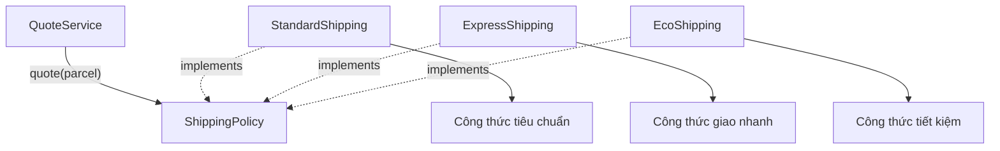

Polymorphism means `policy.quote(parcel)` retains **the same method signature** while executing **different implementations** based on which object `policy` refers to.

## 3. Complete Java Example: Refactor Branching into Polymorphism

Put the following code in a single **`Main.java`** file. It runs with Java 17 or Java 21 without external libraries.

```java
import java.util.List;
import java.util.Objects;

record Parcel(int weightGrams, int distanceKm) {
    Parcel {
        if (weightGrams <= 0) {
            throw new IllegalArgumentException(
                    "Khối lượng phải lớn hơn 0");
        }
        if (distanceKm <= 0) {
            throw new IllegalArgumentException(
                    "Khoảng cách phải lớn hơn 0");
        }
    }

    // Tính mỗi 1.000 gram bắt đầu là một kilogram tính cước.
    long billedKilograms() {
        return ((long) weightGrams + 999) / 1_000;
    }
}

interface ShippingPolicy {
    String label();
    long quote(Parcel parcel);
}

final class StandardShipping implements ShippingPolicy {
    @Override
    public String label() {
        return "STANDARD";
    }

    @Override
    public long quote(Parcel parcel) {
        Objects.requireNonNull(parcel, "parcel");
        long fee = 10_000;
        fee = Math.addExact(fee,
                Math.multiplyExact(2_000L, parcel.distanceKm()));
        fee = Math.addExact(fee,
                Math.multiplyExact(1_000L, parcel.billedKilograms()));
        return fee;
    }
}

final class ExpressShipping implements ShippingPolicy {
    @Override
    public String label() {
        return "EXPRESS";
    }

    @Override
    public long quote(Parcel parcel) {
        Objects.requireNonNull(parcel, "parcel");
        long fee = 25_000;
        fee = Math.addExact(fee,
                Math.multiplyExact(4_000L, parcel.distanceKm()));
        fee = Math.addExact(fee,
                Math.multiplyExact(2_000L, parcel.billedKilograms()));
        return fee;
    }
}

final class EcoShipping implements ShippingPolicy {
    @Override
    public String label() {
        return "ECO";
    }

    @Override
    public long quote(Parcel parcel) {
        Objects.requireNonNull(parcel, "parcel");
        long fee = 7_000;
        fee = Math.addExact(fee,
                Math.multiplyExact(1_500L, parcel.distanceKm()));
        fee = Math.addExact(fee,
                Math.multiplyExact(500L, parcel.billedKilograms()));
        return fee;
    }
}

// Service chỉ biết hợp đồng; không biết ba lớp cụ thể.
final class QuoteService {
    private final ShippingPolicy policy;

    QuoteService(ShippingPolicy policy) {
        this.policy = Objects.requireNonNull(policy, "policy");
    }

    long calculate(Parcel parcel) {
        return policy.quote(parcel);
    }
}

public class Main {
    public static void main(String[] args) {
        Parcel parcel = new Parcel(1_500, 3);

        List<ShippingPolicy> policies = List.of(
                new StandardShipping(),
                new ExpressShipping(),
                new EcoShipping()
        );

        for (ShippingPolicy policy : policies) {
            long fee = new QuoteService(policy).calculate(parcel);
            System.out.println(policy.label() + ": " + fee + " VND");
        }

        ShippingPolicy selected = new ExpressShipping();
        QuoteService service = new QuoteService(selected);
        System.out.println("Đã chọn: " + service.calculate(parcel) + " VND");
    }
}
```

Compile and run:

```bash
javac Main.java
java Main
```

Output:

```text
STANDARD: 18000 VND
EXPRESS: 41000 VND
ECO: 12500 VND
Đã chọn: 41000 VND
```

### Explaining the Output

The parcel weighs 1.500 grams, billed as **2 kg**, and travels **3 km**:

| Policy | Fixed Fee | Distance Charge | Billable-Kg Charge | Total |
| --- | ---: | ---: | ---: | ---: |
| `STANDARD` | 10.000 | 2.000 × 3 = 6.000 | 1.000 × 2 = 2.000 | **18.000 VND** |
| `EXPRESS` | 25.000 | 4.000 × 3 = 12.000 | 2.000 × 2 = 4.000 | **41.000 VND** |
| `ECO` | 7.000 | 1.500 × 3 = 4.500 | 500 × 2 = 1.000 | **12.500 VND** |

What matters is not the formula but **the dependency relationship**:

- `QuoteService` declares only a `ShippingPolicy` field.
- `Main` can provide any object implementing the interface.
- Calling `policy.quote(parcel)` executes the appropriate method from `StandardShipping`, `ExpressShipping`, or `EcoShipping`.
- Adding a shipping type does not necessarily require modifying `QuoteService`; create a new implementation and register it at the policy-selection boundary.
- `Parcel` enforces shared input requirements. `Math.addExact`/`Math.multiplyExact` detect overflow instead of silently producing incorrect results.

**These formulas are illustrative, not actual carrier rates.**

## 4. Why Is This Runtime Polymorphism?

Consider:

```java
ShippingPolicy policy = new ExpressShipping();
long fee = policy.quote(new Parcel(1_500, 3));
```

The same variable has two perspectives:

| Component | Value |
| --- | --- |
| Variable `policy`'s **declared type** | `ShippingPolicy` |
| **Actual object** | `ExpressShipping` |
| Method permitted by the compiler | `quote(Parcel)` from the `ShippingPolicy` contract |
| Implementation chosen at runtime | `ExpressShipping.quote(Parcel)` |

In Java, an overridden **instance** method from an interface or parent class usually dispatches according to the actual object. This lets `QuoteService` invoke a shared method without checking `instanceof ExpressShipping`.

This differs from overloading:

```java
void print(Object value) {}
void print(String value) {}
```

Choosing `print(Object)` or `print(String)` depends primarily on **argument types visible to the compiler**, not runtime classes used to pick an overload. Replacing `if/else` checks here relies on **overriding and dynamic dispatch**, not merely adding more overloads.

## 5. The Clearest Smell: Repeated `instanceof` Checks

Suppose legacy code accepts an object:

```java
static long fee(Object strategy, Parcel parcel) {
    if (strategy instanceof StandardShipping) {
        // Công thức Standard
    } else if (strategy instanceof ExpressShipping) {
        // Công thức Express
    } else if (strategy instanceof EcoShipping) {
        // Công thức Eco
    }
    throw new IllegalArgumentException("Loại không hỗ trợ");
}
```

This snippet only illustrates the conditional pattern; it is not a complete compilable method because the branches have no `return` statements.

Replace it with:

```java
static long fee(ShippingPolicy strategy, Parcel parcel) {
    return strategy.quote(parcel);
}
```

This yields the following improvements:

| With Type-Based Checks | With Polymorphism |
| --- | --- |
| Calling code must know `StandardShipping`, `ExpressShipping`, `EcoShipping` | Calling code only needs `ShippingPolicy` |
| New types usually require branches at every type-handling location | New types add another implementation of the same contract |
| Missing branches or dangerous default `else` branches | Compiler requires concrete implementations to provide mandatory methods |
| Formulas for different types are interleaved in one long block | Each implementation owns its own rules |
| Mocking/faking is difficult when logic is tightly coupled to concrete-class checks | Supply a dedicated test implementation |

However, **an interface does not guarantee business correctness**. An implementation of `quote()` that returns a negative fee still compiles. A clear contract and tests must enforce consistent semantics across implementations.

## 6. What If Initial Selection Still Needs a `switch`?

Polymorphism does not eliminate the need to choose options from external data: users may submit `"express"`, configuration may specify `"eco"`, or an application may provide a selection list.

A branch at the **object-construction boundary** is perfectly reasonable:

```java
static ShippingPolicy selectPolicy(String code) {
    if (code == null) {
        throw new IllegalArgumentException("Thiếu mã dịch vụ");
    }

    return switch (code.toLowerCase(java.util.Locale.ROOT)) {
        case "standard" -> new StandardShipping();
        case "express" -> new ExpressShipping();
        case "eco" -> new EcoShipping();
        default -> throw new IllegalArgumentException(
                "Không hỗ trợ dịch vụ: " + code);
    };
}
```

This can be a `static` method of `Main` in the example. The **switch expression** syntax is valid in Java 17.

The difference is that **conditions are centralized in the selection step**; subsequent workflows use `ShippingPolicy`. Adding a new type may require updating this factory/registry, but not every service that invokes `quote()`.

For many implementations loaded through dependency injection or plugins, a **registry** such as `Map<String, ShippingPolicy>` can replace a `switch` factory. A registry is not inherently better: with two stable choices, a clear `switch` may be simpler and easier to maintain.

## 7. Adding a New Type Without Modifying the Service

Suppose `SameDayShipping` is introduced with a fixed fee of 40.000 VND plus 6.000 VND per kilometer. We only need another implementation of the shared contract:

```java
final class SameDayShipping implements ShippingPolicy {
    @Override
    public String label() {
        return "SAME_DAY";
    }

    @Override
    public long quote(Parcel parcel) {
        java.util.Objects.requireNonNull(parcel, "parcel");
        return Math.addExact(
                40_000L,
                Math.multiplyExact(6_000L, parcel.distanceKm())
        );
    }
}
```

Place this class alongside the main example's classes, then:

```java
QuoteService service = new QuoteService(new SameDayShipping());
System.out.println(service.calculate(new Parcel(1_500, 3)));
// 58000
```

**`QuoteService` does not change.** The UI or selection component may still need updates to expose `SAME_DAY`, along with related configuration and tests. That is what "extend while minimizing changes to existing clients" means; it does not promise zero changes anywhere in the system.

## 8. Where Do Shared Rules Belong?

One danger of moving behavior into classes is **duplicating or drifting shared rules**.

In this example:

- `Parcel` validates `weightGrams > 0` and `distanceKm > 0`.
- Each `ShippingPolicy` selects its **own formula**.
- `QuoteService` only coordinates calls without knowing formulas.
- The policy-selection component maps a service code to an implementation.

If all policies must return nonnegative amounts, specify that in the contract and check it at the result boundary:

```java
static long validatedQuote(ShippingPolicy policy, Parcel parcel) {
    long fee = policy.quote(parcel);
    if (fee < 0) {
        throw new IllegalStateException("Phí vận chuyển không hợp lệ");
    }
    return fee;
}
```

This does not mean every service must duplicate validation. Depending on requirements, use a decorator, immutable `Money` value, or shared coordinating service to enforce invariants.

**Be careful with Template Method inheritance:** it can centralize validation while letting subclasses override pricing hooks, but introduces a single-superclass inheritance hierarchy. When you only need a replaceable capability, interfaces plus composition are often more flexible.

## 9. When Should You—or Should You Not—Replace Conditions with Polymorphism?

| Situation | Generally Appropriate Approach |
| --- | --- |
| Many object types share a capability but use different algorithms | Interface/abstract class with overrides |
| Many services repeatedly use `if (x instanceof TypeA)` / `TypeB` for the same behaviors | Consider moving behavior into the type or a strategy |
| Service types selected from requests/configuration | Factory, `switch`, registry, or DI at the boundary |
| A simple business condition not tied to object type | An ordinary `if` is usually clearer |
| Simple states such as `active`, `expired` | Use conditions when they represent states; do not invent a subclass for every state |
| A small, fixed set of variants requiring exhaustive treatment | An `enum` or `sealed` hierarchy with pattern matching may fit |
| New behavior that a type should not know about (for example, serializing to many external formats) | Consider a separate Visitor, adapter, or service instead of overloading domain objects with responsibilities |
| Behavior depends on several independent dimensions (payment method, country, promotion, etc.) | Composition/Strategy can avoid a combinatorial explosion of subclasses |

### An `instanceof` Check Is Not Always Wrong

One `instanceof` check at an unclassified-input or existing-library integration boundary **is not necessarily bad design**. In Java 17, pattern matching can make it clearer:

```java
static String describe(Object value) {
    if (value instanceof String text) {
        return "Chuỗi có độ dài " + text.length();
    }
    if (value instanceof Integer number) {
        return "Số nguyên " + number;
    }
    return "Loại khác";
}
```

This can be suitable at a mixed-input processing boundary. But if domain code repeatedly classifies `ShippingPolicy` implementations using `instanceof` just to calculate fees, despite all implementing `quote()`, consider polymorphism instead.

Also remember that Java 21 supports pattern matching in `switch` over object types. This improves the expression of branches but **does not by itself remove dependence on lists of concrete types**. For a truly exhaustive *closed set* of types, a `sealed` class/interface and exhaustive `switch` may be intentional.

## 10. Polymorphism and Design Principles

### Open/Closed Principle (OCP)

A module should be **extensible with new behavior** while minimizing edits to stable consuming logic. `QuoteService` achieves that within its design scope by accepting `ShippingPolicy` and calling `quote()` without enumerating concrete types.

### Dependency Inversion Principle (DIP)

`QuoteService` depends on the `ShippingPolicy` contract, not directly on `StandardShipping` or `ExpressShipping`. An external component provides the concrete implementation when constructing the service—**constructor-based dependency injection**.

### Liskov Substitution Principle (LSP)

Every implementation must satisfy its contract: valid input is accepted, results have the correct meaning, and errors follow a consistent policy. If an implementation silently changes the currency from VND to USD or returns an undefined negative fee, substitution can fail even with identical interfaces.

### Single Responsibility Principle (SRP)

Each policy owns its pricing rules; `QuoteService` coordinates calls; the factory selects implementations. This separation of concerns reduces long, dispersed conditional blocks.

These principles support polymorphism but **do not require creating many interfaces or classes**. Abstraction levels should match the system's actual need to change.

## 11. Refactoring an Existing `if/else` Chain

In real systems, proceed incrementally to avoid unintentionally changing results:

1. **Identify branches that vary by type.** Find the behaviors currently scattered across the system, such as fee calculation, discounts, and eligibility checks.
2. **Write characterization tests.** Record expected outputs for valid and invalid input, boundary cases, unknown types, and each formula.
3. **Design a shared contract.** For example, `ShippingPolicy.quote(Parcel)` specifying units, nonnegative fees, and exceptions.
4. **Move each branch into an implementation.** Preserve calculations and compare outputs before and after refactoring.
5. **Centralize implementation selection.** A factory or registry maps configuration codes to the appropriate object instead of making each service decide independently.
6. **Replace client conditions with one polymorphic call.** Clients use `ShippingPolicy`; remove old branches after checking equivalence.
7. **Add contract tests for every implementation.** Classes can differ in formulas while satisfying shared requirements.

Avoid a sweeping refactor across financial or transactional logic: verify calculations, rounding rules, errors, and effect ordering before changing structures.

## 12. Testing Shared and Specialized Behavior

You can tabulate each policy's expected results:

| Input `Parcel(1500, 3)` | Expected `quote()` |
| --- | ---: |
| `new StandardShipping()` | `18000` |
| `new ExpressShipping()` | `41000` |
| `new EcoShipping()` | `12500` |

A simple framework-free test inside a method of `Main`, after the example's classes are defined:

```java
static void assertFee(ShippingPolicy policy, Parcel parcel, long expected) {
    long actual = policy.quote(parcel);
    if (actual != expected) {
        throw new AssertionError(
                policy.label() + ": expected=" + expected
                        + ", actual=" + actual);
    }
}
```

Invoke:

```java
Parcel input = new Parcel(1_500, 3);
assertFee(new StandardShipping(), input, 18_000);
assertFee(new ExpressShipping(), input, 41_000);
assertFee(new EcoShipping(), input, 12_500);
```

In real projects, JUnit can organize parameterized tests and dedicated failure tests. Shared contracts allow **common test suites**; each policy's specialized rules also need their own tests.

## 13. Common Mistakes When Applying Polymorphism

| Mistake | Consequence | Correction |
| --- | --- | --- |
| Replacing `if/else` with an interface but still using `instanceof` inside services | Still coupled to concrete classes; loses polymorphism benefits | Put variation behind contract methods |
| Creating a class for each choice even when logic is a small, stable condition | Many files/classes without value | Keep `if` or `enum` when simpler |
| Overly large interfaces requiring unsupported methods | Many `UnsupportedOperationException` failures | Separate interfaces by role |
| Every implementation invents its own units and error rules | Violates substitutability | Document invariants and test the contract |
| Introducing a `switch` factory then copying the switch across services | Change points remain dispersed | Centralize selection at the boundary; use the interface for behavior |
| Deep inheritance just to reuse a few lines | Complex class tree and fragile coupling | Consider composition/delegation |
| Skipping input validation because "polymorphism handles it" | Runtime may produce invalid results | Validate in value objects/services and policies under their contracts |
| Sharing mutable objects among threads without synchronization | Race conditions despite interfaces | Manage concurrency separately; polymorphism is not a locking mechanism |

## 14. Self-Check Exercises

**Question 1.** Why can `QuoteService` calculate fees for `SameDayShipping` without knowing its class name?

**Answer:** `SameDayShipping` implements `ShippingPolicy`. `QuoteService` only calls `policy.quote(parcel)`; dynamic dispatch selects the concrete object's implementation.

**Question 2.** Does `switch (serviceCode)` in the factory violate polymorphism?

**Answer:** No. The factory translates input codes into implementations. The problem is repeating `switch` per type across components where each implementation can provide the behavior itself.

**Question 3.** A `ExpressShipping` class implements `ShippingPolicy` but always returns `-100`. Does it satisfy the contract?

**Answer:** No, if nonnegative fees are required. `implements` only enforces signature compatibility, not business correctness.

**Question 4.** If a requirement only has the state `isGift = true/false` and a small conditional, does it need `GiftOrder` and `RegularOrder` subclasses?

**Answer:** Not necessarily. A direct condition can be simpler. Extract strategies when there is **meaningful behavioral variation** and a genuine need for independent extension or testing.

**Question 5.** Is `instanceof` always wrong for distinguishing mixed data objects while parsing input?

**Answer:** No. It may be appropriate at a data-processing boundary. Consider whether the branched behavior can and should live with the object type instead.

**Question 6.** Why test all implementations after replacing an `if/else` chain?

**Answer:** Structural refactoring must preserve required existing outputs. Shared contracts must still hold, and each type also has its own formula and boundary conditions.

**Remember:** When an object's type is checked repeatedly to choose *how a behavior is performed*, consider **moving that behavior behind a shared contract and letting implementations respond polymorphically**. Conditionals still belong at selection boundaries, state checks, and closed type sets; the goal is to reduce concrete-type dependencies in domain code.


</details>

- [Back to top](#back-to-top)

---

## <a id="polymorphism-010">Multiple Payment Methods: A Practical Example</a>

<details>
<summary>View details</summary>

# Multiple Payment Methods Using Polymorphism in Java

> **Topic:** OOP → Polymorphism → Multiple Payment Methods Example.
>
> A sales system can let customers choose **cards**, **digital wallets**, or **bank transfers**. Each method processes payments differently, but the application's checkout logic should invoke them through **a shared contract**. This illustrates polymorphism: **one call, different object types performing different implementations**.

## 1. The Problem with Checking Every Type Using `if/else`

Suppose payment processing is written like this:

```java
// Minh họa cách thiết kế khó mở rộng, không phải API hoàn chỉnh.
if ("CARD".equals(method)) {
    // Xử lý thẻ
} else if ("WALLET".equals(method)) {
    // Xử lý ví
} else if ("BANK".equals(method)) {
    // Xử lý chuyển khoản
} else {
    throw new IllegalArgumentException("Phương thức không hỗ trợ");
}
```

Adding a new payment method requires editing the coordinator's conditional chain. If that logic is scattered across multiple services, missed updates become more likely. Card charges, wallet debits, and pending bank transfers also have very different lifecycles; squeezing everything into one large method makes testing and debugging harder.

The OOP solution is to standardize **inputs and outputs** while letting each class decide **how to implement the operation**.

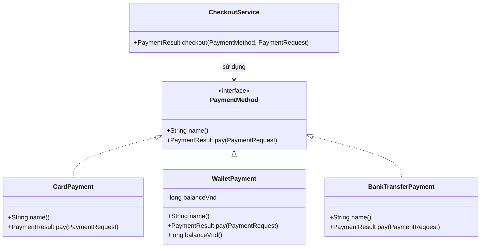

In the diagram, `CheckoutService` depends only on `PaymentMethod`, and the three concrete classes **implement** that interface.

## 2. What Does the Shared Contract Include?

A compact contract for this example:

```java
interface PaymentMethod {
    String name();
    PaymentResult pay(PaymentRequest request);
}
```

Here:

- `name()`: display name of the payment method.
- `pay(request)`: accepts a payment request and returns a structured result.
- Every implementation must provide both methods with the required signatures and behavior.
- Interface consumers need not know whether the implementation handles cards, wallets, or transfers.

We define three result statuses:

| Status | Meaning in This Example | May the Order Be Marked Paid? |
|---|---|---|
| `PAID` | The simulated method has confirmed success | Yes, **within the simulation** |
| `DECLINED` | The request was declined | No |
| `PENDING` | Instructions or a request were created; confirmation is still pending | **No** |

**Important:** `PENDING` is not `PAID`. The transfer example only returns transfer instructions; it must not record payment as received by the bank.

## 3. Complete Java Example: Three Methods, One CheckoutService

Save all the following code as **`MultiPaymentDemo.java`**. It runs with **Java 17+**, needs no third-party libraries, does not process real money, and stores no sensitive card data.

```java
import java.util.List;
import java.util.Objects;

public class MultiPaymentDemo {

    enum PaymentStatus {
        PAID, DECLINED, PENDING
    }

    record PaymentRequest(String orderId, long amountVnd) {
        PaymentRequest {
            if (orderId == null || orderId.isBlank()) {
                throw new IllegalArgumentException("Mã đơn hàng không hợp lệ");
            }
            if (amountVnd <= 0) {
                throw new IllegalArgumentException("Số tiền phải dương");
            }
        }
    }

    record PaymentResult(PaymentStatus status, String message) {
        PaymentResult {
            Objects.requireNonNull(status, "status");
            Objects.requireNonNull(message, "message");
        }
    }

    interface PaymentMethod {
        String name();
        PaymentResult pay(PaymentRequest request);
    }

    // 1. Thẻ: mô phỏng việc duyệt hoặc từ chối theo hạn mức.
    static final class CardPayment implements PaymentMethod {
        private final String lastFourDigits;

        CardPayment(String lastFourDigits) {
            if (lastFourDigits == null
                    || !lastFourDigits.matches("[0-9]{4}")) {
                throw new IllegalArgumentException(
                    "Chỉ nhập 4 chữ số cuối để minh họa"
                );
            }
            this.lastFourDigits = lastFourDigits;
        }

        @Override
        public String name() {
            return "Thẻ **** " + lastFourDigits;
        }

        @Override
        public PaymentResult pay(PaymentRequest request) {
            Objects.requireNonNull(request, "request");

            // Quy tắc mô phỏng, KHÔNG phải hạn mức thẻ thực tế.
            if (request.amountVnd() > 200_000) {
                return new PaymentResult(
                    PaymentStatus.DECLINED,
                    "Vượt hạn mức mô phỏng của thẻ"
                );
            }
            return new PaymentResult(
                PaymentStatus.PAID,
                "Thẻ mô phỏng đã được duyệt"
            );
        }
    }

    // 2. Ví: giữ số dư của instance, chỉ trừ khi đủ tiền.
    static final class WalletPayment implements PaymentMethod {
        private long balanceVnd;

        WalletPayment(long openingBalanceVnd) {
            if (openingBalanceVnd < 0) {
                throw new IllegalArgumentException("Số dư không thể âm");
            }
            this.balanceVnd = openingBalanceVnd;
        }

        @Override
        public String name() {
            return "Ví điện tử";
        }

        @Override
        public synchronized PaymentResult pay(PaymentRequest request) {
            Objects.requireNonNull(request, "request");

            if (request.amountVnd() > balanceVnd) {
                return new PaymentResult(
                    PaymentStatus.DECLINED,
                    "Ví không đủ số dư"
                );
            }

            balanceVnd -= request.amountVnd();
            return new PaymentResult(
                PaymentStatus.PAID,
                "Đã trừ " + request.amountVnd() + " VND từ ví mô phỏng"
            );
        }

        synchronized long balanceVnd() {
            return balanceVnd;
        }
    }

    // 3. Chuyển khoản: chỉ tạo thông tin, chờ ngân hàng xác nhận.
    static final class BankTransferPayment implements PaymentMethod {
        private final String bankAccount;

        BankTransferPayment(String bankAccount) {
            if (bankAccount == null || bankAccount.isBlank()) {
                throw new IllegalArgumentException("Tài khoản không hợp lệ");
            }
            this.bankAccount = bankAccount;
        }

        @Override
        public String name() {
            return "Chuyển khoản";
        }

        @Override
        public PaymentResult pay(PaymentRequest request) {
            Objects.requireNonNull(request, "request");

            return new PaymentResult(
                PaymentStatus.PENDING,
                "Chờ chuyển " + request.amountVnd()
                    + " VND tới " + bankAccount
                    + ", nội dung " + request.orderId()
            );
        }
    }

    // Service chỉ gọi hợp đồng chung, không kiểm tra instanceof.
    static final class CheckoutService {
        PaymentResult checkout(
                PaymentMethod method,
                PaymentRequest request) {

            Objects.requireNonNull(method, "method");
            Objects.requireNonNull(request, "request");

            return Objects.requireNonNull(
                method.pay(request),
                "Phương thức thanh toán không được trả null"
            );
        }
    }

    public static void main(String[] args) {
        WalletPayment wallet = new WalletPayment(150_000);

        List<PaymentMethod> methods = List.of(
            new CardPayment("4242"),
            wallet,
            new BankTransferPayment("DEMO-ACCOUNT")
        );

        CheckoutService checkout = new CheckoutService();

        // Mỗi lần là một đơn hàng KHÁC NHAU để minh họa từng lựa chọn.
        for (int i = 0; i < methods.size(); i++) {
            PaymentMethod method = methods.get(i);
            PaymentRequest request =
                new PaymentRequest("ORD-" + (i + 1), 120_000);

            PaymentResult result = checkout.checkout(method, request);

            System.out.println(method.name() + " -> "
                    + result.status());
            System.out.println("  " + result.message());
        }

        System.out.println("Số dư ví còn: " + wallet.balanceVnd());

        PaymentResult notEnough = checkout.checkout(
            wallet,
            new PaymentRequest("ORD-4", 40_000)
        );
        System.out.println("Ví thanh toán lần nữa -> "
                + notEnough.status());
        System.out.println("Số dư ví cuối: " + wallet.balanceVnd());
    }
}
```

Compile and run from the file's directory:

```bash
javac MultiPaymentDemo.java
java MultiPaymentDemo
```

Expected output:

```text
Thẻ **** 4242 -> PAID
  Thẻ mô phỏng đã được duyệt
Ví điện tử -> PAID
  Đã trừ 120000 VND từ ví mô phỏng
Chuyển khoản -> PENDING
  Chờ chuyển 120000 VND tới DEMO-ACCOUNT, nội dung ORD-3
Số dư ví còn: 30000
Ví thanh toán lần nữa -> DECLINED
Số dư ví cuối: 30000
```

The first three iterations represent **three distinct orders** (`ORD-1`, `ORD-2`, `ORD-3`) to demonstrate three implementations. In a real purchase, **the customer selects one payment method for one payment attempt**; do not automatically invoke every method to charge a single order.

## 4. Which Line Demonstrates Polymorphism?

The key is:

```java
PaymentMethod method = methods.get(i);
PaymentResult result = checkout.checkout(method, request);
```

And inside `CheckoutService`:

```java
return method.pay(request);
```

The service code contains just one `pay` call. Its result varies according to the supplied object:

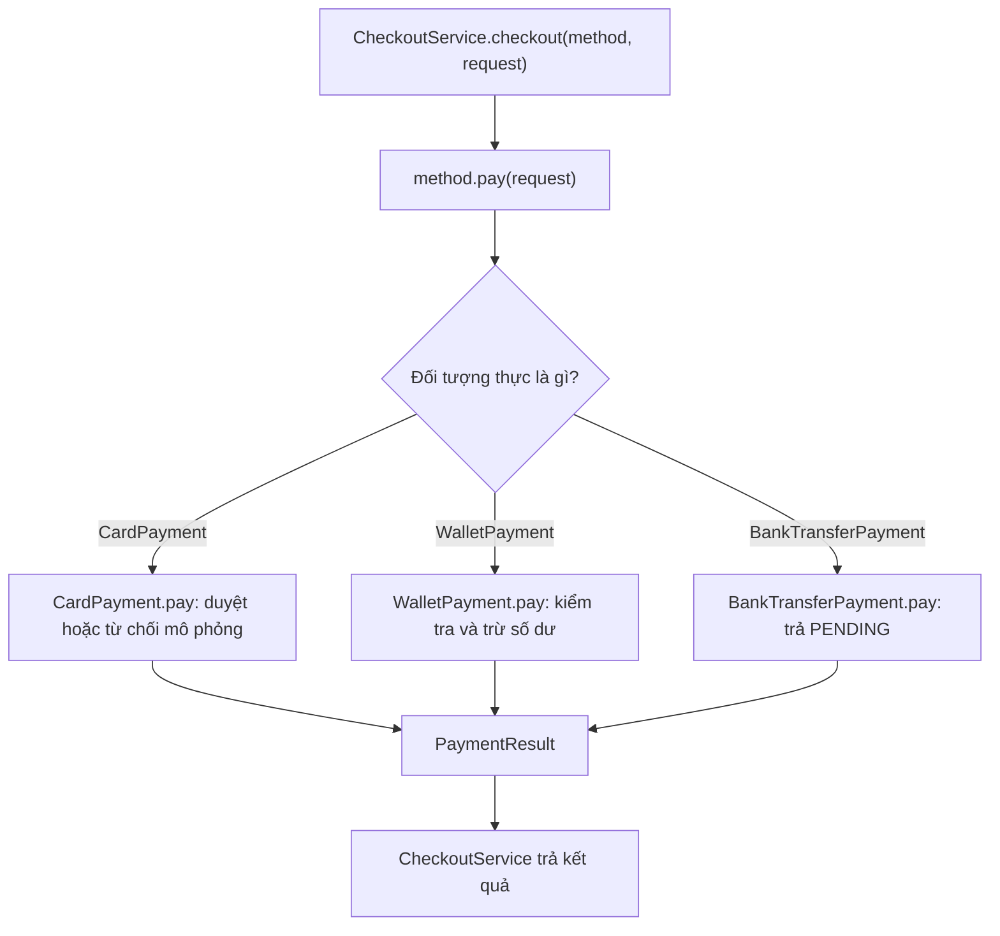

That is **runtime polymorphism**.

| Aspect | In Calling Code | In the Actual Object |
|---|---|---|
| Declared variable `method` | `PaymentMethod` | Any class implementing the contract |
| Callable methods | `name()`, `pay(...)` exposed by the interface | Implementations may expose additional APIs |
| `pay` signature | Checked at compile time | Must be honored by implementing classes |
| Executed `pay` body | Not fixed in the service | Selected from runtime class |
| Result | Same `PaymentResult` type | May be PAID, DECLINED, or PENDING |

**The runtime object selects the implementation**, not the string returned by `name()`, not the variable name, and not a cast inside `CheckoutService`.

Note that `PaymentMethod` is an interface and cannot be directly instantiated with `new PaymentMethod()`. You can declare an **interface-typed variable** and assign an instance of an implementation class:

```java
PaymentMethod selected = new WalletPayment(100_000);
PaymentResult result = selected.pay(
    new PaymentRequest("ORD-5", 60_000)
);
System.out.println(result.status()); // PAID
```

## 5. `@Override`, Signatures, and Interface Constraints

When a class `implements PaymentMethod`, it must implement the interface's instance methods with appropriate accessibility:

```java
@Override
public PaymentResult pay(PaymentRequest request) {
    // ...
}
```

Because `pay` in the interface is `public`, its implementation cannot narrow access to `protected`, package-private, or `private`.

A common mistake:

```java
class IncorrectPayment implements PaymentMethod {
    @Override
    public PaymentResult pay(long amount) {
        // Sai: pay(long) không phải pay(PaymentRequest).
        return null;
    }

    @Override
    public String name() {
        return "Sai chữ ký";
    }
}
```

The class above fails compilation: `pay(long)` has different parameters and does not implement `pay(PaymentRequest)`; `@Override` helps detect this immediately.

**Do not confuse overriding with overloading:**

- `pay(PaymentRequest)` in the implementing classes **overrides** a contract with the same signature; the implementation is dynamically selected.
- Adding `pay(String orderId, long amount)` alongside `pay(PaymentRequest)` creates an **overload** (same name, different parameters). Its signature is selected using compile-time types; it does not itself select a payment class at runtime.

`static` methods also do not dispatch dynamically like instance methods; do not model multiple payment implementations as same-named static methods and expect the JVM to select one based on an object.

## 6. Add a Payment Method Without Modifying CheckoutService

Suppose we add **cash on delivery (COD)**. Create another class `implements PaymentMethod`:

```java
// Thêm vào bên trong MultiPaymentDemo nếu muốn chạy cùng ví dụ:
static final class CashOnDeliveryPayment implements PaymentMethod {
    @Override
    public String name() {
        return "Thanh toán khi nhận hàng";
    }

    @Override
    public PaymentResult pay(PaymentRequest request) {
        Objects.requireNonNull(request, "request");
        return new PaymentResult(
            PaymentStatus.PENDING,
            "Chỉ thu tiền khi giao đơn " + request.orderId()
        );
    }
}
```

Then use it with the existing service:

```java
PaymentMethod cod = new CashOnDeliveryPayment();
PaymentResult result = new CheckoutService().checkout(
    cod,
    new PaymentRequest("ORD-COD", 80_000)
);
System.out.println(result.status()); // PENDING
```

`CheckoutService` needs no new `if ("COD")` or `instanceof CashOnDeliveryPayment` branch. This is a clear benefit of contract-based extensibility.

However, the **user interface or payment-method registration configuration** may still need updating to make COD selectable. "No changes to `CheckoutService`" does not mean no code anywhere needs to change.

## 7. Return Values Express More Than a `boolean`

If `pay` returns only a `boolean`, it is hard to distinguish:

- Payment was declined.
- The customer has not completed the transfer.
- The provider is slow to respond.
- Funds were successfully collected.

A `PaymentResult` result with `PaymentStatus` makes these states explicit. Post-payment domain logic can branch **on a business result** rather than **on an implementation class**:

```java
PaymentResult result = checkout.checkout(selected, request);

switch (result.status()) {
    case PAID -> System.out.println("Có thể ghi nhận đã thanh toán");
    case DECLINED -> System.out.println("Báo khách chọn cách thanh toán khác");
    case PENDING -> System.out.println("Chờ xác nhận trước khi hoàn tất");
}
```

This is **appropriate branching**: payment state is information exposed by every implementation through its contract. Avoid checking `selected instanceof CardPayment` and duplicating card-specific logic in the service.

A real application also needs a state or information for cases where **payment success is unknown**. A network timeout does not prove that no funds were debited. The three-status model is only for illustrating polymorphism and is not a complete production payment system.

## 8. Test Polymorphism with a Fake Payment Method

You can verify that `CheckoutService` calls `PaymentMethod.pay` and forwards results without connecting to a real payment provider.

Add the following class **inside** `MultiPaymentDemo`:

```java
static final class RecordingPayment implements PaymentMethod {
    int calls;
    PaymentRequest lastRequest;

    @Override
    public String name() {
        return "Fake cho kiểm thử";
    }

    @Override
    public PaymentResult pay(PaymentRequest request) {
        calls++;
        lastRequest = request;
        return new PaymentResult(PaymentStatus.PAID, "fake-ok");
    }
}
```

You can place a check in `main`:

```java
RecordingPayment fake = new RecordingPayment();
CheckoutService service = new CheckoutService();
PaymentRequest testRequest = new PaymentRequest("TEST-1", 10_000);

PaymentResult actual = service.checkout(fake, testRequest);

if (fake.calls != 1
        || fake.lastRequest != testRequest
        || actual.status() != PaymentStatus.PAID) {
    throw new AssertionError("CheckoutService gọi sai PaymentMethod");
}
System.out.println("PASS");
```

The fake verifies **which implementation was invoked** and **which request was passed**, independently of banks or wallets. This test does not prove the security of a real payment gateway; production adapters require their own contract and integration tests.

## 9. Benefits and Limits of This Design

| Benefit | Demonstration |
|---|---|
| Polymorphism | One `pay` call invokes three different implementations |
| Extensibility | Adding `CashOnDeliveryPayment` requires no checkout-code changes |
| Separation of responsibilities | Each class manages its own payment processing |
| Testability | Use `RecordingPayment` instead of a real service |
| Reduced coupling | `CheckoutService` only knows `PaymentMethod` |
| Maintainability | Wallet rules can change without changing card rules |

But polymorphism **does not automatically solve** production payment concerns:

1. **Retries/idempotency:** if a customer retries a request after a network failure, do not charge twice. Real payment processors require transaction IDs and a deduplication contract.
2. **Persistence:** the example wallet stores its balance only in RAM. Restarting loses it; real systems need durable storage and appropriate transactions.
3. **Concurrency:** `synchronized` in `WalletPayment` protects one instance within one JVM, not multiple instances or machines concurrently accessing the same account.
4. **Security:** never store full card numbers, CVV, or secret keys in example code/logs; production integrations must meet provider requirements and applicable regulations.
5. **Failure handling:** a `PENDING` result needs a separate confirmation flow (webhook, status query, reconciliation, etc.) before the transaction is considered complete.

These are responsibilities of payment architecture and integration contracts, **not features that appear automatically when using interfaces**.

## 10. Practice Exercises

**Exercise 1 — Predict the Result.** Use `PaymentMethod method = new BankTransferPayment("DEMO-02")` and call `method.pay(new PaymentRequest("ORD-7", 90_000))`. Is the result `PAID` or `PENDING`? Why does Java not need the class name in `CheckoutService`?

**Exercise 2 — Add a Method.** Implement `CashOnDeliveryPayment` from section 6, add an instance to the selection list, and verify the program still calls `method.pay(...)` through the interface.

**Exercise 3 — Test a Decline.** Create `WalletPayment(20_000)`, request `30_000` VND, and assert `DECLINED` with a remaining balance of `20_000`. Then request `10_000` and verify the new balance.

**Exercise 4 — Distinguish Statuses.** Explain why `PENDING` is more accurate than `PAID` for transfers and COD before confirmation that money was collected.

**Exercise 5 — Choose the Abstraction Level.** If each payment method displays different instructions, should you extend `PaymentResult`, add a UI-specific interface, or let the UI decide? Identify the data the domain layer truly needs and avoid making the UI depend on `instanceof` of each payment class.

**Remember:** Polymorphism lets `CardPayment`, `WalletPayment`, and `BankTransferPayment` **all honor `PaymentMethod` but implement `pay()` differently**. When a service depends on the shared interface, Java selects the implementation by **the actual runtime object**, while orchestration stays compact, extensible, and testable.


</details>

- [Back to top](#back-to-top)
