<a id="back-to-top"></a>

# Composition

## Menu
- [Composing Objects to Build Behavior](#composition-001)
- [Has-a and Is-a Relationships](#composition-002)
- [Delegating Work to Other Objects](#composition-003)
- [Reusing Behavior Through Composition and Inheritance](#composition-004)
- [Changing Collaborating Objects at Runtime](#composition-005)
- [Dependency Injection Through Constructors or Methods](#composition-006)
- [Ownership and Lifecycle of Contained Objects](#composition-007)
- [Refactoring from Inheritance to Composition](#composition-008)

## <a id="composition-001">Composing Objects to Build Behavior</a>

<details>
<summary>View details</summary>

# Composing Objects to Build Behavior in Java OOP

An object does not need to implement every capability it provides on its own. In OOP, we can **combine several small objects, each with a distinct responsibility**, to produce more complex behavior. This approach is called **object composition**; when object A hands part of its work to object B, that is **delegation**.

For example, the feature "notify a customer that an order has been paid" can consist of three parts:

1. An object that **formats the notification content**.
2. An object that **sends** the notification through the selected channel.
3. An object that **coordinates** those two steps in the correct order.

Each part has a clear job. To switch from email to SMS, or from a detailed message to a short one, we **replace a component object** instead of rewriting the entire coordinating class.

> **Lesson objective:** Understand how to build behavior through **having or using another object** (*has-a / uses-a*) relationships, how objects communicate through interfaces, how they delegate responsibilities, and when composition is preferable to *inheritance*.

## 1. What Is Wrong with a Class That Does Everything?

Consider this initial design:

```java
class OrderNotification {
    void notifyCustomer(
            String channel,
            String recipient,
            String orderId,
            long totalVnd) {

        String content = "Đơn " + orderId
                + " đã thanh toán: " + totalVnd + " VND";

        if ("email".equals(channel)) {
            System.out.println("[EMAIL] " + recipient + ": " + content);
        } else if ("sms".equals(channel)) {
            System.out.println("[SMS] " + recipient + ": " + content);
        } else {
            throw new IllegalArgumentException("Kênh không hỗ trợ");
        }
    }
}
```

This short example works. But adding push notifications, channel-specific formatting, logging, or retries after a failed send would gradually burden the class with too many responsibilities. A change to email delivery could also affect the logic that builds SMS content.

Instead of having one method know every detail, we separate the following roles:

| Role | Responsibility | Does not need to know |
| --- | --- | --- |
| `MessageFormatter` | Converts order data into message content | Which channel sends it |
| `Transport` | Receives a recipient and content and performs delivery | Which order rules produced the content |
| `OrderNotifier` | Validates the request, invokes the formatter, and passes the result to the transport | Formatting details and delivery mechanics |
| `AuditedTransport` (optional) | Wraps a transport to add a logging step after sending | How the underlying transport sends |

The complete behavior therefore comes from **deliberate collaboration among objects**, rather than from one enormous class.

## 2. Designing Relationships Between Objects

We start with two small interfaces:

```java
interface MessageFormatter {
    String format(String orderId, long totalVnd);
}

interface Transport {
    void send(String recipient, String content);
}
```

Next, `OrderNotifier` has two fields:

```java
private final MessageFormatter formatter;
private final Transport transport;
```

This is a typical **has-a** relationship: an `OrderNotifier` **has** (holds references to) a formatter and a transport and asks them to perform work. It does not need `extends EmailTransport` or `extends PlainFormatter`.

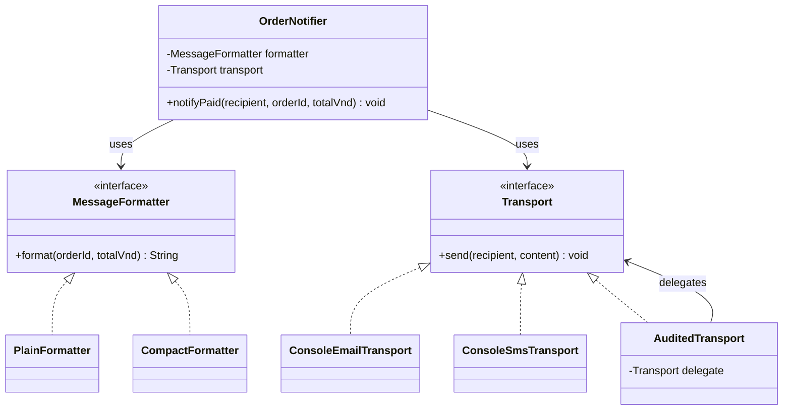

**Reading the diagram:** A dashed realization arrow from a class to an interface represents `implements`; a `uses` relationship means one object holds and uses a reference to another.

In UML, a filled diamond (composition in the *whole–part* lifecycle-ownership sense) implies stronger ownership. The example below receives dependencies from the application's assembly code, so we use reference/delegation relationships rather than claiming that `OrderNotifier` exclusively owns its components' lifecycles. In everyday programming, "composition over inheritance" often refers more broadly to **assembling behavior from objects**, as in this design.

## 3. Complete Java Example: Building Behavior from Multiple Objects

Create a file named **`CompositionDemo.java`**. The example uses no framework and is compatible with Java 11+.

```java
import java.util.Objects;

public class CompositionDemo {

    // 1) Hợp đồng định dạng.
    interface MessageFormatter {
        String format(String orderId, long totalVnd);
    }

    // 2) Hợp đồng gửi.
    interface Transport {
        void send(String recipient, String content);
    }

    // 3) Hai cách định dạng có thể thay thế.
    static final class PlainFormatter implements MessageFormatter {
        @Override
        public String format(String orderId, long totalVnd) {
            return "Đơn " + orderId
                    + " đã thanh toán: " + totalVnd + " VND";
        }
    }

    static final class CompactFormatter implements MessageFormatter {
        @Override
        public String format(String orderId, long totalVnd) {
            return orderId + " | PAID | " + totalVnd + " VND";
        }
    }

    // 4) Hai cách gửi có cùng interface.
    // Chỉ mô phỏng gửi bằng console, không gửi email/SMS thật.
    static final class ConsoleEmailTransport implements Transport {
        @Override
        public void send(String recipient, String content) {
            System.out.println(
                    "[EMAIL -> " + recipient + "] " + content);
        }
    }

    static final class ConsoleSmsTransport implements Transport {
        @Override
        public void send(String recipient, String content) {
            System.out.println(
                    "[SMS -> " + recipient + "] " + content);
        }
    }

    // 5) Một transport "bọc" transport khác để thêm hành vi.
    static final class AuditedTransport implements Transport {
        private final Transport delegate;

        AuditedTransport(Transport delegate) {
            this.delegate = Objects.requireNonNull(
                    delegate, "delegate");
        }

        @Override
        public void send(String recipient, String content) {
            delegate.send(recipient, content);
            System.out.println(
                    "[AUDIT] Đã thực hiện thao tác gửi tới " + recipient);
        }
    }

    // 6) Đối tượng cấp cao chỉ điều phối.
    static final class OrderNotifier {
        private final MessageFormatter formatter;
        private final Transport transport;

        OrderNotifier(MessageFormatter formatter, Transport transport) {
            this.formatter = Objects.requireNonNull(
                    formatter, "formatter");
            this.transport = Objects.requireNonNull(
                    transport, "transport");
        }

        void notifyPaid(
                String recipient,
                String orderId,
                long totalVnd) {

            requireText(recipient, "recipient");
            requireText(orderId, "orderId");

            if (totalVnd < 0) {
                throw new IllegalArgumentException(
                        "Tổng tiền không được âm");
            }

            String content = formatter.format(orderId, totalVnd);
            transport.send(recipient, content);
        }

        private static void requireText(String value, String field) {
            if (value == null || value.isBlank()) {
                throw new IllegalArgumentException(
                        field + " không được rỗng");
            }
        }
    }

    public static void main(String[] args) {
        // Tổ hợp A: nội dung đầy đủ, email và audit.
        OrderNotifier emailNotifier = new OrderNotifier(
                new PlainFormatter(),
                new AuditedTransport(new ConsoleEmailTransport())
        );

        // Tổ hợp B: nội dung ngắn, SMS và không audit.
        OrderNotifier smsNotifier = new OrderNotifier(
                new CompactFormatter(),
                new ConsoleSmsTransport()
        );

        emailNotifier.notifyPaid(
                "an@example.test", "ORD100", 150_000);

        smsNotifier.notifyPaid(
                "0900000000", "ORD101", 200_000);

        try {
            smsNotifier.notifyPaid("0900000000", "ORD102", -1);
        } catch (IllegalArgumentException ex) {
            System.out.println("Từ chối: " + ex.getMessage());
        }
    }
}
```

Run:

```bash
javac CompositionDemo.java
java CompositionDemo
```

Output:

```text
[EMAIL -> an@example.test] Đơn ORD100 đã thanh toán: 150000 VND
[AUDIT] Đã thực hiện thao tác gửi tới an@example.test
[SMS -> 0900000000] ORD101 | PAID | 200000 VND
Từ chối: Tổng tiền không được âm
```

From a single `OrderNotifier` class, we create two behavior configurations:

| Configuration | Formatter | Transport | Observed behavior |
| --- | --- | --- | --- |
| Email with audit logging | `PlainFormatter` | `AuditedTransport(ConsoleEmailTransport)` | Produces detailed content, "sends" it through console email, then logs the action |
| Short SMS | `CompactFormatter` | `ConsoleSmsTransport` | Produces short content, then "sends" it through console SMS |
| Call with a negative total | Any | Any | Rejected before the formatter or transport is invoked |

**No change to `OrderNotifier` is needed** to switch from configuration A to B. The difference lies in **the component objects passed to its constructor**.

This is composition's core flexibility: a few small objects can be combined into many behaviors to meet different needs.

## 4. Delegation: Who Actually Performs the Work?

Consider the coordinating method:

```java
void notifyPaid(String recipient, String orderId, long totalVnd) {
    requireText(recipient, "recipient");
    requireText(orderId, "orderId");

    if (totalVnd < 0) {
        throw new IllegalArgumentException(
                "Tổng tiền không được âm");
    }

    String content = formatter.format(orderId, totalVnd);
    transport.send(recipient, content);
}
```

`OrderNotifier` is responsible for **coordination**, but:

- It **delegates** content creation to `formatter`.
- It **delegates** delivery to `transport`.
- It directly validates only the basic inputs required by the business operation.
- It need not know how the formatter builds strings or which protocol the transport uses.

Call sequence:

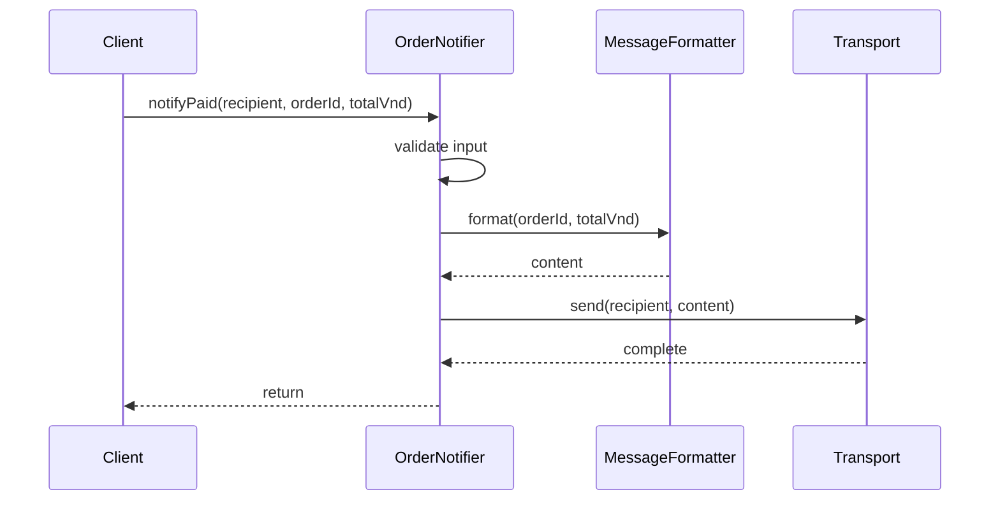

Coordination and delegation help **divide responsibilities**; they do not automatically make the program asynchronous. Calls in this example are synchronous and execute sequentially on the same thread.

In a real application, `Transport.send` may encounter network errors, timeouts, or asynchronous processing results. Its contract must then specify whether the method merely accepts a request or confirms successful delivery, how errors are reported, and whether retries and idempotency are supported. The console example only simulates sending so we can focus on OOP design.

## 5. Constructor Injection: Assembling Components Where Objects Are Created

Why does `OrderNotifier` receive two dependencies through its constructor instead of creating them itself?

```java
// Cách gắn chặt vào chi tiết implementation:
private final Transport transport = new ConsoleEmailTransport();
```

If it creates its own dependencies, each `OrderNotifier` chooses a specific transport. Changing the delivery channel could require editing the coordinating class or adding conditional branches within it.

Constructor injection:

```java
OrderNotifier(MessageFormatter formatter, Transport transport) {
    this.formatter = Objects.requireNonNull(formatter);
    this.transport = Objects.requireNonNull(transport);
}
```

offers these benefits:

1. **Separates assembly from execution:** `main` or a composition root decides which components to use; `OrderNotifier` only uses them.
2. **Creates valid objects:** The constructor rejects `null` dependencies immediately.
3. **Simplifies test substitution:** A fake transport can be injected to observe calls without real delivery.
4. **Reduces coupling:** `OrderNotifier` depends only on two small interfaces.
5. **Makes required dependencies explicit:** A notifier cannot operate correctly without a formatter and a transport.

Using `final` on fields means their references cannot be reassigned after construction. It **does not make the referenced objects immutable**. For mutable or shared dependencies, ownership and concurrency constraints still matter.

Constructor injection does not require Spring or any other DI framework. A framework can simply automate object creation and wiring.

## 6. Extending Behavior by Replacing Components

Suppose the system gains a requirement to **append a campaign code** to messages. We can create a new formatter that fulfills the same contract:

```java
final class CampaignFormatter
        implements CompositionDemo.MessageFormatter {

    private final CompositionDemo.MessageFormatter base;
    private final String campaign;

    CampaignFormatter(
            CompositionDemo.MessageFormatter base,
            String campaign) {

        this.base = java.util.Objects.requireNonNull(base);
        this.campaign = java.util.Objects.requireNonNull(campaign);
    }

    @Override
    public String format(String orderId, long totalVnd) {
        return base.format(orderId, totalVnd)
                + " | Campaign: " + campaign;
    }
}
```

Here, one formatter **holds another formatter** to extend its behavior. This is also composition and resembles the **Decorator** pattern because the wrapper implements the same interface as the wrapped object.

Example usage in the same package:

```java
CompositionDemo.MessageFormatter format =
        new CampaignFormatter(
                new CompositionDemo.PlainFormatter(), "SALE");

CompositionDemo.OrderNotifier notifier =
        new CompositionDemo.OrderNotifier(
                format, new CompositionDemo.ConsoleEmailTransport());

notifier.notifyPaid("an@example.test", "ORD103", 300_000);
```

Output:

```text
[EMAIL -> an@example.test] Đơn ORD103 đã thanh toán: 300000 VND | Campaign: SALE
```

When adding multiple wrappers, consider the order in which they run. For example, "normalize input before formatting" differs from "format first, then filter content." Composition provides flexibility, but the **contract and order of collaboration** must still be designed explicitly.

> `CampaignFormatter` is an illustrative extension placed alongside the main example's classes in the same package. A real project can put each class in its own file with appropriate access modifiers.

## 7. Strategy and Decorator: Two Familiar Ways to Compose Behavior

The two configurations in the main program demonstrate two common ideas:

**Strategy:** `MessageFormatter` has multiple implementations, such as `PlainFormatter` and `CompactFormatter`. `OrderNotifier` receives the desired behavior through a supplied object instead of containing an `if/else` for every formatting option.

**Decorator:** `AuditedTransport` also `implements Transport` and contains another `Transport`. It performs additional work before or after delegation while remaining usable as a `Transport`.

```java
Transport transport =
        new AuditedTransport(new ConsoleEmailTransport());
```

What this means:

- `ConsoleEmailTransport` performs the underlying operation.
- `AuditedTransport` wraps that operation and logs it after `delegate.send(...)` returns normally.
- `OrderNotifier` does not know whether the current transport is wrapped.

Avoid overinterpreting the output: the `[AUDIT]` line only indicates that the console call did not report an error. It is **not a durably stored transaction audit record**, nor does it prove that an email or SMS reached the recipient's device. Real auditing requires defined storage, safeguards against missing or duplicate records, and failure handling.

Not every composition design needs a complex design pattern. If a straightforward helper is sufficient, one field and one delegated call may be all that is needed.

## 8. How Does Composition Differ from Inheritance?

Compare these two approaches:

**Inheritance approach:**

```java
class EmailSender {
    void sendEmail(String recipient, String content) {
        System.out.println(recipient + ": " + content);
    }
}

// Không nên kế thừa chỉ để mượn method sendEmail.
class OrderNotifierByInheritance extends EmailSender {
    void notifyPaid(String recipient, String content) {
        sendEmail(recipient, content);
    }
}
```

`OrderNotifierByInheritance extends EmailSender` establishes a relationship in which a notifier **is a type of** email sender. From a business perspective, that is usually incorrect: a notifier **uses** a sender; it **is not** a sender.

**Composition approach:**

```java
class OrderNotifierByComposition {
    private final EmailSender sender;

    OrderNotifierByComposition(EmailSender sender) {
        this.sender = sender;
    }

    void notifyPaid(String recipient, String content) {
        sender.sendEmail(recipient, content);
    }
}
```

The second approach accurately represents a notifier that **has/uses** a sender. By changing the field to the `Transport` interface, we can also switch from email to SMS without modifying the notifier class.

| Criterion | Inheritance | Object composition |
| --- | --- | --- |
| Primary relationship | `is-a`: a subtype is a kind of its supertype | `has-a / uses-a`: an object holds and uses another object |
| Reuse | Inherits implementation and/or the superclass contract | Calls/delegates to a component object |
| Coupling to details | A subclass may depend on protected APIs, execution order, and superclass invariants | Details can be hidden behind a small interface |
| Changing behavior | Overrides at permitted extension points | Replaces dependencies or combines decorators/strategies |
| Runtime changes | An existing object's concrete type does not change on its own | A new configuration can be created, or a deliberately designed mechanism can update a dependency |
| Risks | Inheriting merely to borrow code and violating subtype relationships | Too many intermediary classes and complex configuration |
| Appropriate when | A genuine subtype relationship exists and preserves the superclass contract | Collaboration or reuse is needed without coupling to a superclass |

The principle "**favor composition over inheritance**" is a **design guideline**, not a ban on `extends`. If `ElectricCar` truly is a kind of `Vehicle` and satisfies its contract, inheritance can still make sense. If an object merely needs another object's functionality, composition usually expresses that relationship more clearly.

## 9. Composition Does Not Imply Exclusive Ownership

This is a subtle but important distinction.

```java
Transport shared = new ConsoleEmailTransport();

OrderNotifier first =
        new OrderNotifier(new PlainFormatter(), shared);
OrderNotifier second =
        new OrderNotifier(new CompactFormatter(), shared);
```

`first` and `second` **both hold references** to `shared`, so both can use it. Java does not automatically clone the transport, close it when one notifier stops using it, or guarantee that each notifier exclusively owns its dependency.

When components contain state, such as caches, I/O connections, or queues:

- Determine **who creates, closes, and may modify** the dependency.
- Specify whether instances may be shared.
- Consider thread safety when sharing between threads.
- Use defensive copies or suitable value objects if independent snapshots of mutable data are needed.

Having a `private final Transport transport` field does not necessarily represent strong-ownership composition in UML or make the dependency immutable. **A `final` field only fixes the reference**; the referenced object's internal state may still change.

When a component strongly owns a child object's lifecycle, make that ownership explicit in its API and resource-cleanup rules. For example, a service might create a private buffer, never expose it externally, and release it when the service closes. A tighter *whole–part* model can be appropriate in that case.

## 10. Testing a Composition Without Sending Real Notifications

A practical benefit of composition is replacing a real sender with a **test double** to observe how the coordinating class behaves.

Create **`CompositionTest.java`** in the same directory as `CompositionDemo.java`:

```java
public class CompositionTest {

    static final class RecordingTransport
            implements CompositionDemo.Transport {

        int calls;
        String lastRecipient;
        String lastContent;

        @Override
        public void send(String recipient, String content) {
            calls++;
            lastRecipient = recipient;
            lastContent = content;
        }
    }

    public static void main(String[] args) {
        RecordingTransport transport = new RecordingTransport();

        CompositionDemo.OrderNotifier notifier =
                new CompositionDemo.OrderNotifier(
                        new CompositionDemo.PlainFormatter(),
                        transport);

        notifier.notifyPaid("lan@example.test", "ORD200", 75_000);

        check(transport.calls == 1,
                "Phải gọi transport đúng một lần");
        check("lan@example.test".equals(transport.lastRecipient),
                "Sai người nhận");
        check("Đơn ORD200 đã thanh toán: 75000 VND"
                .equals(transport.lastContent),
                "Sai nội dung đã định dạng");

        try {
            notifier.notifyPaid("lan@example.test", "ORD201", -5);
            throw new AssertionError("Phải từ chối tổng tiền âm");
        } catch (IllegalArgumentException expected) {
            // Đúng: không gọi Transport cho yêu cầu sai.
        }

        check(transport.calls == 1,
                "Lỗi validation không được tạo thêm lời gọi gửi");

        System.out.println("PASS: composition và delegation");
    }

    static void check(boolean condition, String message) {
        if (!condition) {
            throw new AssertionError(message);
        }
    }
}
```

Run:

```bash
javac CompositionDemo.java CompositionTest.java
java CompositionTest
```

Expected output:

```text
PASS: composition và delegation
```

This test does not rely on actual email or SMS services. It demonstrates that:

1. `OrderNotifier` invokes the correct injected dependency.
2. The formatter's result is passed unchanged to the transport.
3. Invalid inputs are rejected before any delivery side effect occurs.
4. We can test **an object's behavior** without starting the entire external infrastructure.

In a JUnit application, `RecordingTransport` can remain a fake or be replaced with a mock, depending on the test's objective. Not every test needs a mocking framework.

### Testing Dependency Failures

Suppose `Transport.send(...)` throws an exception while sending. With this `OrderNotifier` implementation, the exception propagates to the caller; no retry, rollback, or transaction guarantee is implicitly added.

If the system needs "exactly once" or "at least once" delivery, additional mechanisms are needed for idempotency, queues, request-state persistence, and infrastructure failures. **Composition only organizes responsibilities**; it does not guarantee reliability in a distributed system.

## 11. Common Mistakes

| Mistake | Why it is a problem | How to fix it |
| --- | --- | --- |
| Inheriting from `EmailSender` just to reuse a send method | Introduces an incorrect `is-a` relationship | Hold a `Transport` and delegate to it |
| Using one `OrderNotifier` with `if`/`switch` for every channel and format | Each new variant requires changing the coordinating class | Move implementations behind suitable interfaces |
| Calling `new ConsoleEmailTransport()` inside a service | Makes channel switching and testing difficult | Assemble dependencies in a constructor/composition root |
| Accidentally exposing an internal mutable reference | Callers can alter state without control | Define ownership, return a copy, or restrict the API |
| Assuming `final` makes dependencies immutable | `final` only prevents field reassignment | Check whether the referenced object is mutable |
| Creating dozens of interfaces for a few lines of logic | Makes code harder to read and maintain | Split only when responsibilities or substitution needs are clear |
| Changing error semantics in a decorator without telling clients | Makes the contract unpredictable | Document and preserve the published error behavior |
| Treating console logs as real transaction audits | Provides neither durable storage nor reconciliation | Design auditing separately when the business requires it |
| Assuming every combined object shares one lifecycle | Dependencies may be shared or externally owned | Define who creates, holds, and releases each object |

## 12. Practice Exercises

**Exercise A — change formatting without editing the notifier.** Write `UppercaseFormatter implements MessageFormatter`, have it use another formatter internally, and convert the result to uppercase with `toUpperCase(Locale.ROOT)`. Use it with `ConsoleSmsTransport` and explain how composition/decorator adds behavior.

**Exercise B — switch delivery channels.** Write `ConsolePushTransport implements Transport` that prints `[PUSH -> recipient] content`. Combine it with `PlainFormatter`. Must any line in `OrderNotifier` change? **No**, provided the transport honors the `send` contract.

**Exercise C — behavior ordering.** Write a `PrefixFormatter` and a `SuffixFormatter` that each wrap `MessageFormatter`. Compare the outputs of `Prefix(Suffix(base))` and `Suffix(Prefix(base))`, then analyze when decorator order makes a difference.

**Exercise D — test failures.** Create a `FailingTransport` that always throws `IllegalStateException`. Use `RecordingTransport` or another test to verify that the example's notifier **does not suppress exceptions**, and discuss the retry contract if recovery is required.

**Exercise E — design a checkout service.** Sketch a `CheckoutService` with `DiscountPolicy`, `ShippingFeePolicy`, and `PaymentGateway`. Specify its inputs, result, call order, and monetary invariants. Discuss why a hierarchy such as `CheckoutService extends PaymentGateway` should not be used merely to reuse a payment method.

## Conclusion

**Composing objects to build behavior** lets a higher-level object work through components with clearly defined responsibilities. Components can be wired through constructors, interact through interfaces, and delegate to one another, producing different behavior combinations without putting all logic in one class or overusing inheritance.

When designing a composition, define **what each component does**, **which contracts connect them**, **the order in which they collaborate**, and **who owns their lifecycles and state**. A good composition reduces coupling and makes behavior easier to replace and test at each boundary.


</details>

- [Back to top](#back-to-top)

---

## <a id="composition-002">Has-a and Is-a Relationships</a>

<details>
<summary>View details</summary>

# Has-a and Is-a Relationships in Java OOP

When designing classes, one of the most important decisions is **which relationships should connect them**. Two common relationships are:

- **Is-a:** An object belongs to a more general type. For example, *a car is a kind of vehicle*. In Java, subtype relationships are usually expressed with `extends` or `implements`.
- **Has-a:** An object holds or uses another object as part of its structure or capabilities. For example, *a car has a powertrain*. In Java, this is commonly expressed through **reference fields**, object *composition*, or appropriate forms of association/aggregation.

These relationships are not mutually exclusive: **the `Car` declaration can use `extends Vehicle` while also containing a `PowerSource`**.

The goal is not to choose the shortest syntax but to represent **business meaning, state ownership, substitutability, and lifecycles** accurately.

## 1. Direct Comparison of Is-a and Has-a

| Question | Is-a | Has-a |
|---|---|---|
| Nature | Classification, specialization, or fulfilling a type contract | Linking to, containing, or using a component |
| Description | "Every `Car` is a `Vehicle`" | "Every `Car` has/is given a `PowerSource`" |
| Common Java mechanism | `extends`, `implements` | Fields, constructor injection, internally created components |
| Goal | Use a subtype where a supertype/contract is required | Build behavior by coordinating objects with separate responsibilities |
| Runtime objects | A subclass instance includes the superclass portion of its state | Components are separate objects connected by references |
| Reuse | Inherit valid behavior or provide the same API | Delegate to components |
| Coupling | Subclasses depend more tightly on the superclass contract | Components can be substituted through interfaces |
| Common mistake | Inheriting merely to "borrow" a utility method | Assuming every reference field implies exclusive ownership |

**Quick decision rules:**

- If **"X is a kind of Y"** is true in the business domain **and X can substitute for Y without violating its contract**, consider is-a.
- If **"X uses/holds a Y to perform X's work"** is true, consider has-a.
- A few similar lines of code in two classes are **not sufficient** to justify an is-a relationship.

## 2. Complete Java Example: A Car Both Is-a and Has-a

We will build a small model:

- Every vehicle has an identifier and a `move()` behavior.
- `Car` and `Bicycle` are kinds of `Vehicle`.
- `Car` has a `PowerSource` component; the type of power source is supplied when the car is created.
- `Bicycle` does not need a `PowerSource` in this model.

File `RelationsDemo.java` (Java 11+):

```java
import java.util.List;
import java.util.Objects;

public class RelationsDemo {

    // Hợp đồng cho thành phần cung cấp động lực.
    interface PowerSource {
        String activate();
    }

    static final class ElectricMotor implements PowerSource {
        @Override
        public String activate() {
            return "mô-tơ điện đã sẵn sàng";
        }
    }

    static final class PetrolEngine implements PowerSource {
        @Override
        public String activate() {
            return "động cơ xăng đã khởi động";
        }
    }

    // Lớp tổng quát: thể hiện quan hệ is-a của các phương tiện.
    static abstract class Vehicle {
        private final String id;

        protected Vehicle(String id) {
            if (id == null || id.isBlank()) {
                throw new IllegalArgumentException("Mã phương tiện rỗng");
            }
            this.id = id.strip();
        }

        public final String id() {
            return id;
        }

        public abstract String move();
    }

    static final class Car extends Vehicle {
        // Has-a: Car giữ một tham chiếu PowerSource.
        private final PowerSource powerSource;

        public Car(String id, PowerSource powerSource) {
            super(id);
            this.powerSource =
                    Objects.requireNonNull(powerSource, "powerSource");
        }

        @Override
        public String move() {
            // Car ủy quyền một phần công việc cho thành phần.
            return "Car " + id() + ": " + powerSource.activate()
                    + " -> di chuyển";
        }
    }

    static final class Bicycle extends Vehicle {
        public Bicycle(String id) {
            super(id);
        }

        @Override
        public String move() {
            return "Bicycle " + id() + ": đạp bằng sức người";
        }
    }

    public static void main(String[] args) {
        Vehicle electricCar =
                new Car("CAR-01", new ElectricMotor());

        Vehicle petrolCar =
                new Car("CAR-02", new PetrolEngine());

        Vehicle bicycle = new Bicycle("BIKE-01");

        List<Vehicle> fleet = List.of(
                electricCar, petrolCar, bicycle
        );

        for (Vehicle vehicle : fleet) {
            System.out.println(vehicle.move());
        }
    }
}
```

Run:

```bash
javac RelationsDemo.java
java RelationsDemo
```

Output:

```text
Car CAR-01: mô-tơ điện đã sẵn sàng -> di chuyển
Car CAR-02: động cơ xăng đã khởi động -> di chuyển
Bicycle BIKE-01: đạp bằng sức người
```

### Identifying Both Relationships in the Same Program

**Is-a:**

```java
static final class Car extends Vehicle { ... }
static final class Bicycle extends Vehicle { ... }
```

A variable declared as `Vehicle` can refer to either a `Car` or a `Bicycle`:

```java
Vehicle vehicle = new Car("CAR-03", new ElectricMotor());
System.out.println(vehicle.move());
```

`Vehicle` specifies that vehicles have a `move()` behavior. Java selects the `Car.move()` implementation based on the actual object type. This is **polymorphism** through an is-a relationship.

**Has-a:**

```java
private final PowerSource powerSource;
```

`Car` **holds a component** that fulfills the `PowerSource` contract. When moving, `Car` calls `powerSource.activate()`, **delegating** work to another object.

Replacing `ElectricMotor` with `PetrolEngine` does not require `Car` to change its superclass or copy each engine's startup algorithm. Nor is `Car` itself a `PowerSource`: the car **uses** a power source; it is not a type of engine in this model.

### Relationship Diagram

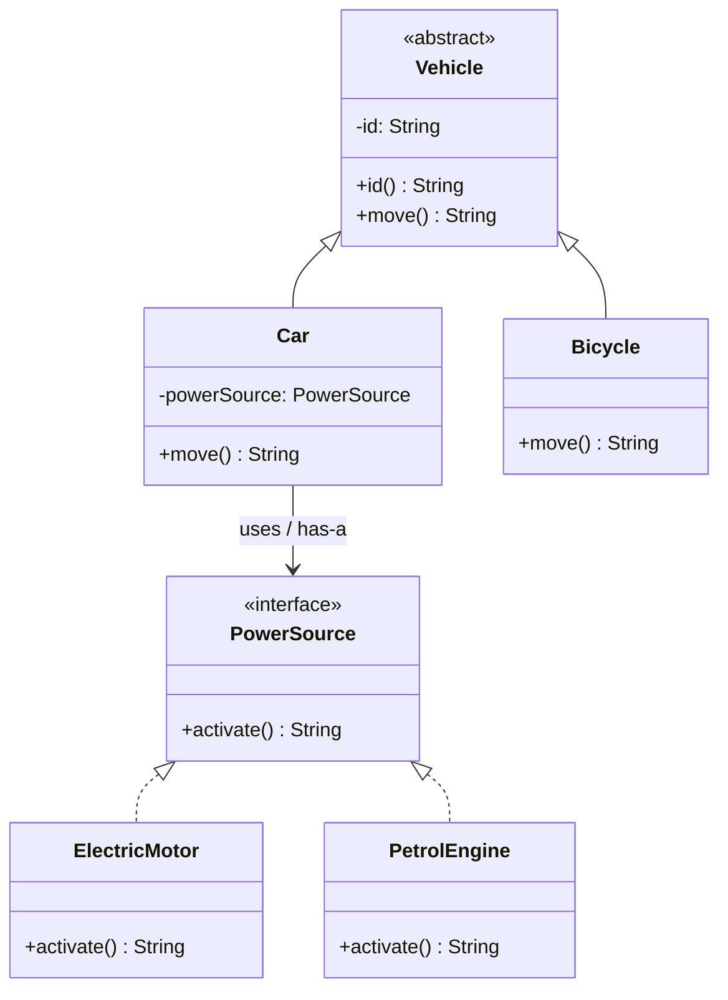

In the diagram:

- The inheritance arrow `Vehicle <|-- Car` indicates that **Car is a Vehicle**.
- The line `Car --> PowerSource` indicates that **Car holds and uses PowerSource**.
- The lines from `ElectricMotor` and `PetrolEngine` to `PowerSource` show that **each engine type implements the PowerSource contract**.

The diagram deliberately uses a **directed association** between `Car` and `PowerSource`, without asserting that the car exclusively owns the power source's entire lifecycle. We will distinguish these cases later.

## 3. Is-a Must Match the Contract, Not Just the Name

Writing `extends` makes Java accept a subtype relationship syntactically (if the superclass permits inheritance), but **does not prove that the domain model is correct**.

Example of a flawed design:

```java
class Engine {
    void ignite() {
        System.out.println("Ignite");
    }
}

// Không nên:
// class Car extends Engine { ... }
```

A car needing an engine does not mean **a car is an engine**. Inheriting solely to call `ignite()` makes `Car` expose the `Engine` API as though callers could substitute an entire car for an engine. That is an invalid classification.

Similarly:

```java
// Các quan hệ thường không phản ánh đúng nghiệp vụ:
// class Order extends Customer { ... }
// class Library extends Book { ... }
// class House extends Door { ... }
```

In these examples, fields express the relationships more accurately:

```java
class Order {
    private final Customer customer;

    Order(Customer customer) {
        this.customer =
            java.util.Objects.requireNonNull(customer, "customer");
    }
}
```

An order **belongs to/is associated with a customer**; it **is not a customer**.

### Testing Substitutability

Suppose some code handles any `Vehicle`:

```java
static void startTrip(Vehicle vehicle) {
    System.out.println(vehicle.move());
}
```

Both `Car` and `Bicycle` implement `move()` according to the defined contract, so they can substitute for one another here:

```java
startTrip(new Car("CAR-04", new ElectricMotor()));
startTrip(new Bicycle("BIKE-02"));
```

This is the idea behind the **Liskov Substitution Principle**: code expecting a supertype should be able to work with a subtype without violating important expectations about inputs, outputs, or invariants.

For example, if `Vehicle.move()` promises a nonempty description for a ready vehicle, a subclass should not unexpectedly return `null` merely because its internal algorithm differs. **Syntactically valid inheritance** is not enough; subtypes must respect behavioral contracts.

## 4. Has-a Takes Several Forms

In everyday language, has-a broadly describes an object **having or using** another. UML and OOP often make finer distinctions:

| Relationship | Design meaning | Example | Representation |
|---|---|---|---|
| **Association** | One object knows or interacts with another | `Order` is associated with `Customer` | Fields/parameters or ID-based relations, depending on the model |
| **Aggregation** (loose whole–part relationship) | Components may exist independently or be shared | `Team` has many `Player` objects | Usually stored references/collections; a hollow UML diamond when appropriate |
| **Composition** (strong ownership) | A part is modeled as belonging to a whole and depends on the whole's ownership/lifecycle | `Order` owns `OrderLine` objects in a particular design | APIs prevent arbitrary sharing; a filled UML diamond when ownership is guaranteed |
| **Dependency** (uses relationship) | A component is only needed to perform an operation and need not be stored long term | A method accepts `Formatter` as a parameter | Parameters or local variables; UML dependency line |

Not every reference field represents **composition in the strong-ownership sense**. For example, `Car` receives a `PowerSource` from outside: another part of the program may also hold a reference to and manage it. Thus we cannot infer that "Car exclusively owns the motor" merely from:

```java
private final PowerSource powerSource;
```

The `final` keyword only prevents reassignment of **the reference field** after valid initialization. It does not prevent outside references to the same object, make the component immutable, or establish ownership automatically.

### Association Versus Composition: An Order Example

A design may specify that **an order owns the line items finalized when it is placed**. Those items are then data snapshots managed by the order, with no API that lets callers modify them independently.

File `OrderCompositionDemo.java` (Java 17+):

```java
import java.util.List;
import java.util.Objects;

public class OrderCompositionDemo {
    record OrderLine(String sku, int quantity, long unitPriceVnd) {
        OrderLine {
            if (sku == null || sku.isBlank()) {
                throw new IllegalArgumentException("sku rỗng");
            }
            if (quantity <= 0) {
                throw new IllegalArgumentException("quantity phải dương");
            }
            if (unitPriceVnd < 0) {
                throw new IllegalArgumentException("Giá không được âm");
            }
            sku = sku.strip();
        }

        long subtotalVnd() {
            return Math.multiplyExact(unitPriceVnd, quantity);
        }
    }

    static final class Order {
        private final String id;
        private final List<OrderLine> lines;

        Order(String id, List<OrderLine> lines) {
            if (id == null || id.isBlank()) {
                throw new IllegalArgumentException("id rỗng");
            }

            this.id = id.strip();
            this.lines =
                List.copyOf(Objects.requireNonNull(lines, "lines"));

            if (this.lines.isEmpty()) {
                throw new IllegalArgumentException("Đơn hàng phải có hàng");
            }
        }

        long totalVnd() {
            long total = 0;
            for (OrderLine line : lines) {
                total = Math.addExact(total, line.subtotalVnd());
            }
            return total;
        }

        int lineCount() {
            return lines.size();
        }
    }

    public static void main(String[] args) {
        Order order = new Order("O-001", List.of(
            new OrderLine("BOOK-01", 2, 70_000L),
            new OrderLine("PEN-01", 3, 10_000L)
        ));

        System.out.println(order.lineCount()); // 2
        System.out.println(order.totalVnd());  // 170000
    }
}
```

In this model:

- `Order` **has many** `OrderLine` objects; an order is not a line item.
- `List.copyOf(...)` creates or reuses a list that cannot be modified through the `List` API and rejects `null` elements.
- `OrderLine` is a `record` containing only `String` and primitives; its data is immutable in this example. Sharing references to individual records therefore does not let callers change line-item content.
- `Order` does not expose a mutable collection or provide a setter for its line items.

This **expresses the Order's control over its data** and fits the idea of composition at the domain level. However, Java has no mechanism to "immediately delete every `OrderLine` when an Order is released," and immutable records can safely be shared. **Domain-model ownership does not imply C++-style memory-lifecycle management**.

If `OrderLine` were a mutable class, `List.copyOf` alone would **not be enough** to isolate each element's state: deeper defensive copying, a different immutable value object, or an API restricting changes would be needed.

## 5. Object Lifecycles and Ownership: Do Not Infer Them from Garbage Collection

Consider:

```java
Engine engine = new Engine();
Car car = new Car(engine);
```

With compatible `Engine` and `Car` classes, both the `engine` variable and the `car.engine` field may reference **the same object**.

If the `car` variable is no longer used, we cannot conclude that `engine` immediately disappears. The component may still have other references, and the garbage collector determines when memory is reclaimed.

Conversely, if a component represents a resource such as a socket, file handle, or database connection, it needs an explicit **resource-closing contract**. Do not assume that "when the parent disappears, the child automatically closes."

A resource-owning class can implement `AutoCloseable` and close its components according to its contract:

```java
interface Connection extends AutoCloseable {
    void send(String text);

    @Override
    void close();
}

final class Client implements AutoCloseable {
    private final Connection connection;

    Client(Connection connection) {
        this.connection =
            java.util.Objects.requireNonNull(connection);
    }

    void send(String message) {
        connection.send(message);
    }

    @Override
    public void close() {
        connection.close();
    }
}
```

**Important:** The `Client.close()` method above implies that `Client` **owns and is authorized to close** the connection. If the connection is shared or managed by the caller, automatically closing it in `Client.close()` can cause failures. Decide and document who is responsible for closing resources; ownership cannot be inferred from a reference field alone.

## 6. Composition and Delegation: Reuse Without Extends

Inheritance lets a subclass use and override inherited methods. Composition lets an object **call another component to perform part of its work**.

In the example, `Car.move()` calls `powerSource.activate()`. This is delegation:

```java
final class Car extends Vehicle {
    private final PowerSource powerSource;

    // Constructor nhận PowerSource...

    @Override
    public String move() {
        return powerSource.activate() + " -> xe di chuyển";
    }
}
```

This collaboration provides several benefits:

- **Independent implementation substitution:** `ElectricMotor` or `PetrolEngine` can fulfill the same `PowerSource` contract.
- **Easier testing:** A fake implementation can verify that `Car` calls the intended component.
- **Narrower responsibilities:** `Car` describes how the car moves, while `PowerSource` describes how its power source is activated.
- **No superclass slot consumed:** `Car` can still `extends Vehicle` while using many other components.

Example of a simple test double:

```java
PowerSource fake = () -> "nguồn giả lập sẵn sàng";
Vehicle testCar = new Car("TEST-01", fake);

System.out.println(testCar.move());
// Car TEST-01: nguồn giả lập sẵn sàng -> di chuyển
```

`PowerSource` is a functional interface in this example because it has only one abstract method, `activate()`. Injecting a lambda tests **collaboration between objects** without requiring a dedicated superclass solely for testing.

### What Does "Favor Composition over Inheritance" Mean?

This is **context-dependent advice**, not a rule against inheritance. When the primary goal is reusing behavior or selecting algorithms, composition usually reduces coupling. When a genuine is-a relationship exists and substitutability through a superclass or interface is required, inheritance/subtyping remains appropriate.

Do not turn every is-a relationship into a field simply "to avoid extends," and do not turn every has-a relationship into inheritance just to call a method.

## 7. Does an Interface Represent an Is-a Relationship?

In Java's type system, if:

```java
interface Payable {
    long amountDueVnd();
}

class Invoice implements Payable {
    @Override
    public long amountDueVnd() {
        return 150_000L;
    }
}
```

then an `Invoice` object can be used wherever a `Payable` is required:

```java
Payable item = new Invoice();
System.out.println(item.amountDueVnd()); // 150000
```

`Invoice` is a **subtype of `Payable`** in terms of type and contract. But in natural language, "Invoice **can be paid**" or "Invoice **fulfills the Payable contract**" is clearer than forcing an awkward real-world classification such as "an invoice is a payable thing."

We should therefore distinguish:

- **Is-a as domain classification**: `Car extends Vehicle`.
- **Capability/contract-based subtyping**: `Invoice implements Payable`.

Both support type-based polymorphism, but they express different design meanings. When unrelated kinds of objects share a capability, an interface often expresses that better than a superclass with forced shared state.

## 8. When Should an Object Have Multiple Components?

An organization can have many employees, an order can have many line items, and a playlist can have many songs. Has-a is not limited to exactly one object:

```java
class Playlist {
    private final java.util.List<Song> songs;

    Playlist(java.util.List<Song> songs) {
        this.songs = java.util.List.copyOf(songs);
    }
}
```

One-to-many relationships are represented with collections. But **a collection alone does not establish ownership semantics**:

- A playlist may merely **reference** songs that exist independently.
- An order may **own a snapshot** of its line items when it is placed.
- A team may hold a player list even though players can transfer to another team.
- An object may use an injected shared service without owning it.

When documenting relationships, also specify:

1. **Multiplicity:** One or many? Is at least one element required?
2. **Ownership:** Who creates, updates, and releases the resource?
3. **Mutability:** Can the component change state, and can it be shared?
4. **Lifecycle:** Can the component exist independently of its container?
5. **Direction:** Which side needs to know about the other? Is a bidirectional relationship really necessary?

## 9. Common Relationship-Selection Mistakes

| Design | Problem | Better approach |
|---|---|---|
| `Car extends Engine` | A car is not an engine | `Car` has/uses an `Engine` |
| `Order extends Customer` | An order is not a customer | `Order` is associated with `Customer` |
| `PaymentService extends DatabaseClient` merely to call `save()` | Confuses business responsibilities with infrastructure | Give the service a repository field or inject one |
| Every class using a utility `extends BaseUtil` | Uses inheritance to reuse functionality | Use utilities, composition, or suitable interfaces |
| `Team` holds `List<Player>` and claims exclusive ownership of `Player` | Reference fields do not establish ownership | Define sharing and lifecycle rules |
| Assuming `private final Engine` makes Engine immutable | `final` fixes only the field reference | Examine Engine's mutability and external access paths |
| Assuming a component is destroyed when its container loses its reference | Java has no such ownership-based memory destructor | Distinguish domain lifecycle, GC, and resource management |
| A subclass violates the superclass contract | Syntactically valid is-a without safe substitution | Redesign the hierarchy or use composition |
| Using extends whenever two classes are related | Association need not mean classification | Ask whether it is an "is-a" or "has-a/uses-a" relationship |

### A Behavioral Test for Is-a

If the system requires:

```java
void moveAnyVehicle(Vehicle vehicle) {
    System.out.println(vehicle.move());
}
```

can a `Car` object be passed in while still honoring the `Vehicle.move()` contract? If so, the is-a relationship is meaningful.

Conversely, if the system requires:

```java
void activateSource(PowerSource source) {
    System.out.println(source.activate());
}
```

passing a `Car` makes no sense unless `Car` **itself fulfills the `PowerSource` contract**, which is different from **holding a `PowerSource`** in a field. Using a component **does not make the containing class a subtype of that component**.

## 10. Making the Choice in Real Designs

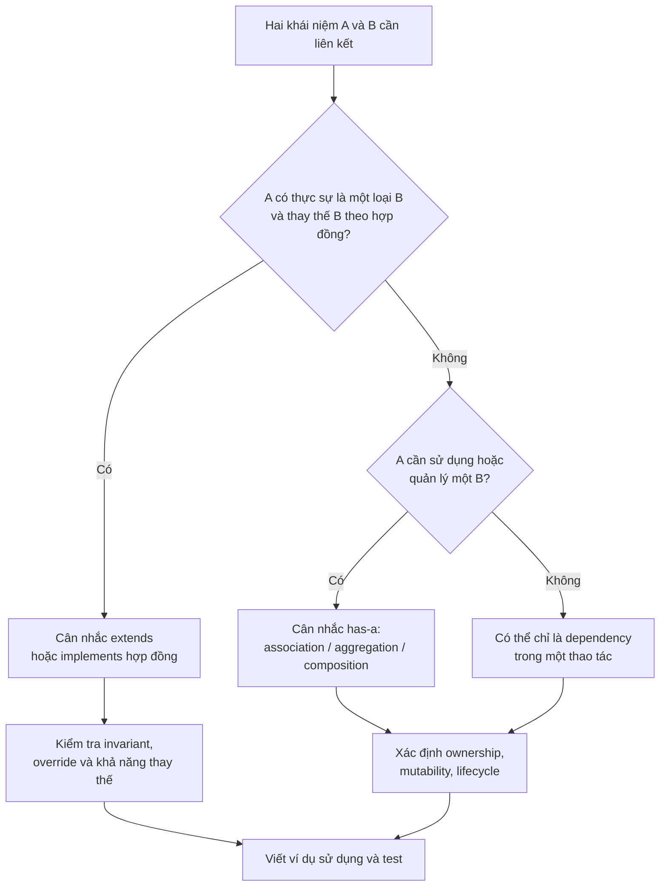

A short set of code-review questions:

- **Would removing `extends` lose an essential classification?** If not, inheritance may be used only for code reuse.
- **Does class A need to swap component B for another implementation?** If so, an interface-typed field and constructor injection may help.
- **Who ensures a component is valid?** The containing class's constructor should check required references; the component should protect its own invariants.
- **If a component is shared, which objects are affected by changes to it?** Define sharing, defensive-copy, or immutability policies.
- **If the component owns a resource, who closes it?** Document the ownership contract; consider `AutoCloseable` when appropriate.
- **When a subclass replaces a superclass, can any behavior unexpectedly break?** Check the contract/LSP instead of relying only on `extends` syntax.

## 11. Review Exercises

### Exercise 1 — Choose Is-a or Has-a

Classify the following relationships:

| Relationship | Suggested answer |
|---|---|
| `Dog` and `Animal` | Is-a if `Dog` fulfills the `Animal` contract |
| `Library` and `Book` | Has-a (a library contains books); a book is not a library |
| `Invoice` and `Customer` | Has-a/association (an invoice is related to a customer) |
| `Teacher` and `Employee` | Possibly is-a, depending on the business model |
| `MusicPlayer` and `AudioDecoder` | Has-a/uses-a: the player uses a decoder |
| `CreditCardPayment` and `PaymentMethod` | Subtyping through `implements` if `PaymentMethod` is a contract interface |

Class names alone cannot determine the answer in every system: state the business assumptions and corresponding responsibilities.

### Exercise 2 — Will It Compile?

```java
interface Engine {
    void start();
}

class PetrolEngine implements Engine {
    @Override
    public void start() {}
}

class Car {
    private final Engine engine;

    Car(Engine engine) {
        this.engine = engine;
    }
}

Car car = new Car(new PetrolEngine());
// Engine engine = car; // Có hợp lệ không?
```

**Answer:** No. `Car` **has an** `Engine` but is not a subtype of `Engine`. To use the engine, `Car` must expose suitable delegated behavior, or the caller must use the engine directly as the design specifies.

### Exercise 3 — One Object or Two?

```java
Vehicle vehicle = new Car("CAR-05", new ElectricMotor());
```

In the `RelationsDemo` example, what objects does this code involve?

**Answer:** There is one runtime `Car` object and a separate `ElectricMotor` object passed into it. The `Vehicle` state belongs to **the Car object itself**; a second independent `Vehicle` instance is not created. The `vehicle` variable merely holds a reference declared as type `Vehicle`.

### Exercise 4 — Refactor a Flawed Design

Initially:

```java
class DatabaseClient {
    void save(String data) {}
}

class UserService extends DatabaseClient {
    void register(String userName) {
        save(userName);
    }
}
```

Refactor it using has-a:

```java
import java.util.Objects;

class UserService {
    private final DatabaseClient db;

    UserService(DatabaseClient db) {
        this.db = Objects.requireNonNull(db);
    }

    void register(String userName) {
        if (userName == null || userName.isBlank()) {
            throw new IllegalArgumentException("Tên người dùng rỗng");
        }
        db.save(userName);
    }
}
```

The revised design shows `UserService` **using** `DatabaseClient` instead of **being a type of database client**. If multiple storage implementations must be swapped or faked in tests, `DatabaseClient` can be replaced by an interface such as `UserRepository`. Add an interface only when it provides real design value.

---

## Key Takeaways

- **Is-a:** An object is a subtype that can substitute for a supertype/contract according to substitutability rules; Java commonly uses `extends` or `implements`.
- **Has-a:** An object **holds, owns, or uses** another component, commonly through fields and delegation.
- An object can **simultaneously be an instance of one type and have other components**.
- **Has-a alone does not establish exclusive ownership or a dependent lifecycle**; consider association, aggregation, composition, sharing, and resource management.
- Choose inheritance for **valid classification relationships** and composition for **the need to combine behavior/state**. Do not use `extends` simply to avoid writing a field.


</details>

- [Back to top](#back-to-top)

---

## <a id="composition-003">Delegating Work to Other Objects</a>

<details>
<summary>View details</summary>

# Delegating Work to Other Objects in Java OOP

When an object receives a request, it can **retain responsibility for the workflow** while asking other objects to perform specialized steps. That is **delegation**. Java has no dedicated keyword for delegation: this technique is implemented through **method calls to collaborators**.

For example, a support-request coordinator receives tickets from customers. It does not necessarily need to classify their severity or store them in queues itself:

- `TicketRouter` validates input, determines **the processing order**, and returns the final result.
- `TicketClassifier` classifies tickets according to a set of rules.
- `AssignmentPort` records tickets in the selected queue.
- The client only needs to call `router.route(ticket)` and receive an `Assignment`.

This lesson examines **who delegates to whom, which boundaries data crosses, and who is accountable for success or failure**, distinguishing delegation from object composition in general.

## 1. Understanding a Delegation Flow

~~~mermaid
sequenceDiagram
    actor Caller
    participant R as TicketRouter
    participant C as TicketClassifier
    participant P as AssignmentPort
    Caller->>R: route(ticket)
    R->>R: validate ticket
    R->>C: classify(ticket)
    C-->>R: Queue
    R->>P: assign(ticket.id, queue)
    P-->>R: Assignment
    R-->>Caller: Assignment
~~~

In the diagram, `TicketRouter` is the **delegator** because it accepts responsibility for coordination from the caller. `TicketClassifier` and `AssignmentPort` are **delegates** for their assigned steps. A collaborator may delegate further internally; "delegator" and "delegate" describe **roles in a call**, not special Java class types.

The boundaries to identify are:

| Step | Responsible object | What must be explicit |
| --- | --- | --- |
| Receive request | `TicketRouter` | Input validity and processing order |
| Determine queue | `TicketClassifier` | Classification rules and `Queue` code |
| Record assignment | `AssignmentPort` | Assignment result, errors, and what "accepted" means |
| Return result to client | `TicketRouter` | Never invent a result if a delegate fails |

**Delegation does not mean abandoning responsibility.** The router is still accountable for calling the right steps, handling or propagating errors appropriately, and avoiding fabricated results. It simply does not own the classification algorithm or queue-storage mechanism.

## 2. Standalone Program: Replace Delegates Without Changing the Router

Save as `TicketDelegationDemo.java` (Java 17 or later). This example models an **in-memory** queue and uses no database or remote service.

~~~java
import java.util.ArrayList;
import java.util.List;
import java.util.Locale;
import java.util.Objects;

public class TicketDelegationDemo {
    enum Queue { STANDARD, URGENT, BILLING }

    record Ticket(String id, String summary, int severity) {
        Ticket {
            if (id == null || id.isBlank()
                    || summary == null || summary.isBlank()) {
                throw new IllegalArgumentException("Thiếu thông tin phiếu");
            }
            if (severity < 1 || severity > 5) {
                throw new IllegalArgumentException("Severity phải từ 1 đến 5");
            }
        }
    }

    record Assignment(String ticketId, Queue queue) {
        Assignment {
            if (ticketId == null || ticketId.isBlank()) {
                throw new IllegalArgumentException("Thiếu mã phiếu");
            }
            Objects.requireNonNull(queue, "queue");
        }
    }

    interface TicketClassifier {
        Queue classify(Ticket ticket);
    }

    interface AssignmentPort {
        // Chỉ mô tả hành vi "ghi nhận"; chưa cam kết lưu bền vững.
        Assignment assign(String ticketId, Queue queue);
    }

    static final class SeverityClassifier implements TicketClassifier {
        @Override
        public Queue classify(Ticket ticket) {
            Objects.requireNonNull(ticket, "ticket");
            return ticket.severity() >= 4 ? Queue.URGENT : Queue.STANDARD;
        }
    }

    static final class BillingKeywordClassifier
            implements TicketClassifier {
        @Override
        public Queue classify(Ticket ticket) {
            Objects.requireNonNull(ticket, "ticket");
            return ticket.summary()
                    .toLowerCase(Locale.ROOT)
                    .contains("thanh toán")
                    ? Queue.BILLING : Queue.STANDARD;
        }
    }

    static final class MemoryAssignmentPort implements AssignmentPort {
        private final List<Assignment> history = new ArrayList<>();

        @Override
        public Assignment assign(String ticketId, Queue queue) {
            Assignment result = new Assignment(ticketId, queue);
            history.add(result);
            return result;
        }

        List<Assignment> history() {
            return List.copyOf(history);
        }
    }

    static final class TicketRouter {
        private final TicketClassifier classifier;
        private final AssignmentPort assignments;

        TicketRouter(TicketClassifier classifier,
                     AssignmentPort assignments) {
            this.classifier =
                    Objects.requireNonNull(classifier, "classifier");
            this.assignments =
                    Objects.requireNonNull(assignments, "assignments");
        }

        Assignment route(Ticket ticket) {
            Objects.requireNonNull(ticket, "ticket");

            Queue queue = Objects.requireNonNull(
                    classifier.classify(ticket),
                    "Classifier không được trả null"
            );

            return Objects.requireNonNull(
                    assignments.assign(ticket.id(), queue),
                    "AssignmentPort không được trả null"
            );
        }
    }

    public static void main(String[] args) {
        MemoryAssignmentPort sharedPort = new MemoryAssignmentPort();

        TicketRouter bySeverity = new TicketRouter(
                new SeverityClassifier(), sharedPort
        );
        TicketRouter byTopic = new TicketRouter(
                new BillingKeywordClassifier(), sharedPort
        );

        Assignment first = bySeverity.route(
                new Ticket("T-17", "Không đăng nhập", 2)
        );
        Assignment second = byTopic.route(
                new Ticket("T-18", "Thanh toán lỗi", 5)
        );

        System.out.println(first);
        System.out.println(second);
        System.out.println("Số phân công: " + sharedPort.history().size());
    }
}
~~~

Run:

~~~bash
javac TicketDelegationDemo.java
java TicketDelegationDemo
~~~

Output:

~~~text
Assignment[ticketId=T-17, queue=STANDARD]
Assignment[ticketId=T-18, queue=BILLING]
Số phân công: 2
~~~

**Step-by-step behavior:**

1. `bySeverity` receives ticket `T-17` with severity 2. It **delegates classification** to `SeverityClassifier`; the `STANDARD` result is passed to `MemoryAssignmentPort`.
2. `byTopic` receives ticket `T-18` with severity 5 but uses a **topic-based** classifier. The text "Thanh toán lỗi" matches its keyword, producing `BILLING`. This is not a bug: the contract permits different classification strategies to use their own policies.
3. Both routers use **the same instance** of `sharedPort`, supplied by the application's assembly code. Therefore, the in-memory history contains exactly two records.
4. No object actually sends email or creates a real support ticket. `Assignment` only confirms that **the example's in-memory adapter recorded the request**; it does not represent a real support-service SLA.

Note: `BillingKeywordClassifier` deliberately ignores `severity`. If a real requirement says "every severity-5 ticket must go to URGENT," that must be **a shared rule published in the contract** and honored by every implementation, or enforced by an additional priority layer. Do not infer such a rule from the field name without a specification.

## 3. Composed Objects and Delegated Calls Answer Different Questions

~~~java
private final TicketClassifier classifier;
private final AssignmentPort assignments;
~~~

The two fields show that the router **holds references** to two collaborators. That is an association/object-composition structure (*has-a / uses-a*). Actual delegation happens only when the router calls:

~~~java
Queue queue = classifier.classify(ticket);
Assignment result = assignments.assign(ticket.id(), queue);
~~~

| Concept | Key question | What the example shows |
| --- | --- | --- |
| Composition / association | Which objects does the router use? | Two fields populated through the constructor |
| Delegation | Which work is handed to another object? | Classification and assignment |
| Polymorphism | Which implementation handles the same call? | Severity-based or keyword-based classifier |
| Dependency injection | Who supplies the collaborators? | `main` creates them and passes them to the constructor |
| Encapsulation | Who may modify the assignment history? | `MemoryAssignmentPort` keeps the list private |

A reference field may be used only for lookup or observation, without delegating any work from the public API. Do not label every field a "delegation pattern." Conversely, a method can **receive a delegate as a call-time argument** without storing it in a field.

~~~java
static Queue classifyOnce(
        Ticket ticket, TicketClassifier temporaryClassifier) {
    Objects.requireNonNull(temporaryClassifier, "temporaryClassifier");
    return temporaryClassifier.classify(
            Objects.requireNonNull(ticket, "ticket"));
}
~~~

This is an additional illustrative method: placing it inside `TicketDelegationDemo` makes the example's types available. It shows that delegation **does not require constructor injection**, although constructor injection fits a router that needs both collaborators throughout its lifetime.

## 4. The Router Relies on Delegate Contracts

Java checks the signatures of `classify(Ticket)` and `assign(String, Queue)`; it does not verify the behavior of each implementation.

| Required contract | Implication for the router |
| --- | --- |
| `TicketClassifier` returns a non-null `Queue` for a valid ticket | Its result can be passed to the adapter |
| Classification does not record or modify tickets itself | Easier testing and no hidden side effects |
| `AssignmentPort` returns an `Assignment` with the correct ticketId/queue, or reports an error | Callers know which adapter processed the ticket |
| Errors must not become fake "assigned" results | Preserves accurate business outcomes |
| Durability/timeouts/thread safety | Must be defined for each implementation and real-world requirement |

Example of a faulty `TicketClassifier`:

~~~java
static final class BrokenClassifier implements TicketClassifier {
    @Override
    public Queue classify(Ticket ticket) {
        return null;
    }
}
~~~

This class **compiles** but violates the non-null guarantee. `TicketRouter` rejects its result with a `NullPointerException` containing a clear message. However, a check in the router is not a substitute for contract tests of every classifier.

**Failure order:** If the `Ticket` constructor rejects input, the router is never invoked. If the classifier throws, the adapter is not called. If the adapter fails **after partially writing**, the router does not automatically roll back memory, files, or external transactions. The real adapter's contract must define its failure semantics.

## 5. Delegation Versus Forwarding: When Does an Intermediate Layer Add Value?

Consider pure forwarding:

~~~java
class BareRouter {
    private final AssignmentPort port;

    BareRouter(AssignmentPort port) {
        this.port = port;
    }

    Assignment assign(String id, Queue queue) {
        return port.assign(id, queue);
    }
}
~~~

If `BareRouter` adds no contract, validation, access control, or dependency isolation, it may only lengthen the call chain. Calling another object's method does not always justify creating a new class.

The main `TicketRouter` has a reason to exist: it **coordinates two specialized capabilities**, enforces "classify first → record second," and exposes a `route(Ticket)` API so callers do not have to invoke each component themselves.

A delegation layer is often useful when it:

- Defines a clear **business responsibility** for the caller.
- Centralizes validation or orchestration at the appropriate boundary.
- Hides infrastructure details the caller does not need.
- Allows **implementation substitution** without changing coordination logic.
- Makes it possible to test one boundary without starting the entire system.

On the other hand, multiple classes that each forward the same method call can become unnecessary **pass-through layers**. Evaluate the benefit of each layer before adding it.

## 6. Changing Delegates Does Not Require Inheritance

If the router inherits from the classifier merely to reuse its algorithm:

~~~java
// Thiết kế sai ý nghĩa trách nhiệm:
// class TicketRouter extends SeverityClassifier { ... }
~~~

we are claiming that "the router is a kind of classifier." But the router **uses a classifier** and is responsible for coordination. This relationship is better modeled as **has-a / uses-a**.

In the actual example, `SeverityClassifier` is marked `final` and cannot be subclassed even syntactically. The line above is deliberately commented out to illustrate an incorrect model; it is not valid demo code.

~~~mermaid
classDiagram
    class TicketRouter {
        -TicketClassifier classifier
        -AssignmentPort assignments
        +route(Ticket) Assignment
    }
    class TicketClassifier {
        <<interface>>
        +classify(Ticket) Queue
    }
    class AssignmentPort {
        <<interface>>
        +assign(String, Queue) Assignment
    }
    class SeverityClassifier
    class BillingKeywordClassifier
    class MemoryAssignmentPort
    TicketRouter --> TicketClassifier : classify
    TicketRouter --> AssignmentPort : assign
    TicketClassifier <|.. SeverityClassifier
    TicketClassifier <|.. BillingKeywordClassifier
    AssignmentPort <|.. MemoryAssignmentPort
~~~

**Inheritance remains appropriate** when a subclass truly is a subtype and honors its superclass contract. Delegation is an alternative when we need another object's **capability** without a genuine is-a relationship. The comparison between inheritance and composition can examine designs with several independent dimensions of variation in more detail.

## 7. Distinguishing Delegation from Related Patterns

Delegation is a building block of many design patterns, but each pattern serves a different purpose:

| Technique/pattern | Main purpose | Application in the ticket domain |
| --- | --- | --- |
| **Strategy** | Select a replaceable algorithm | `SeverityClassifier` or `BillingKeywordClassifier` |
| **Adapter** | Bridge an application contract to another technology's API | `AssignmentPort` → a task-management SDK |
| **Decorator** | Wrap an object with the same interface to add behavior | Log before/after `assign` |
| **Proxy** | Control access, lazy loading, or remote invocation | Reject assignments when the caller lacks permission |
| **Facade** | Provide clients a simple API across several components | `TicketRouter.route` coordinates the steps |

Decorator example, implemented as a nested class in `TicketDelegationDemo`:

~~~java
static final class LoggingAssignmentPort implements AssignmentPort {
    private final AssignmentPort delegate;

    LoggingAssignmentPort(AssignmentPort delegate) {
        this.delegate = Objects.requireNonNull(delegate, "delegate");
    }

    @Override
    public Assignment assign(String ticketId, Queue queue) {
        System.out.println("Gọi phân công: " + ticketId);
        Assignment result = delegate.assign(ticketId, queue);
        System.out.println("Adapter đã trả kết quả");
        return result;
    }
}
~~~

This decorator **does not guarantee** durable persistence just because its delegate returns. It also does not manage transactions automatically. Avoid applying a pattern label automatically when one field and a simple call are sufficient.

## 8. Testing Collaboration and Failure Paths

We can add a fake that records calls as a nested class in the demo:

~~~java
static final class RecordingAssignments implements AssignmentPort {
    int calls;
    String lastTicketId;
    Queue lastQueue;

    @Override
    public Assignment assign(String id, Queue queue) {
        calls++;
        lastTicketId = id;
        lastQueue = queue;
        return new Assignment(id, queue);
    }
}
~~~

Then add the following to the demo's `main`:

~~~java
RecordingAssignments recorder = new RecordingAssignments();
TicketRouter router = new TicketRouter(new SeverityClassifier(), recorder);
Assignment result = router.route(new Ticket("T-99", "Lỗi đăng nhập", 5));

if (recorder.calls != 1 || recorder.lastQueue != Queue.URGENT
        || !"T-99".equals(recorder.lastTicketId)
        || result.queue() != Queue.URGENT) {
    throw new AssertionError("Ủy quyền không đúng");
}
~~~

This test confirms that the router forwards the correct ID and queue, calls the adapter **exactly once**, and returns the adapter's result. In addition to testing the delegator, we need:

- **Classifier tests:** Check each strategy against known severity levels/keywords.
- **Contract tests:** Verify that every implementation returns non-null permitted results without modifying the ticket.
- **Integration tests:** Check that real HTTP/database adapters write correctly, report errors accurately, and close resources properly.
- **Failure tests:** An adapter must not be called when classification fails; the router must not return false success when the adapter fails.

These short tests do not require a mocking framework. Fakes help isolate boundaries but do not prove that external systems work correctly.

## 9. Lifecycles, Concurrency, and Delegated Outcomes

Both routers in `main` reference `sharedPort`. Holding a shared reference does not grant **exclusive ownership** to either router. If the port holds a socket or database client, its creator will usually manage its lifecycle unless an explicit ownership-transfer contract says otherwise.

`MemoryAssignmentPort` uses `ArrayList` and is **not thread-safe**. Two concurrent requests calling `assign` on the same port can cause a race condition. A `final` field in the router only fixes the reference; it does not make the port's mutable list safe for concurrent use.

For a real adapter, also distinguish:

1. Was the request **accepted**, or was it **durably recorded**?
2. Did the API call merely finish, or was the ticket **actually assigned** to someone?
3. Could failure and retry produce **duplicate assignments**?
4. If the classifier and port read data at different times, do they require **versioned rules** or a transaction?
5. After a delegate changes, do existing requests still use the old port/classifier or switch to the new one?

If the system requires idempotency, auditing, or transactions, those mechanisms must be designed and tested separately. Delegation **only organizes responsibilities and call paths**; it does not create these operational guarantees.

## 10. Self-Check Exercises

**1. Who is the delegator?** In `TicketRouter.route`, which component classifies and which records assignments?

**Answer:** The router is the delegator. `TicketClassifier` classifies; `AssignmentPort` records assignments. The router still controls the order and returns the result.

**2. If two routers share one `MemoryAssignmentPort`, are there two histories or one?**

**Answer:** One history in the shared instance. Provide two separate ports to isolate state, or define a safe sharing mechanism for concurrent use.

**3. If the classifier returns `null`, can the router proceed to `assign`?**

**Answer:** Not in this example. `Objects.requireNonNull` stops execution before assignment, so no new assignment occurs.

**4. Why does replacing `SeverityClassifier` with `BillingKeywordClassifier` require no change to `TicketRouter`?**

**Answer:** The router only depends on `TicketClassifier.classify`. The chosen implementation is supplied through constructor-based polymorphism.

**5. Can delegation work without a reference field?**

**Answer:** Yes. Accepting a classifier as a method parameter and invoking it is delegation when specialized work is being handed off.

**6. If `AssignmentPort.assign` partially persists data and then throws, does the router roll back automatically?**

**Answer:** No. Failures and side effects must be handled at the adapter or transaction boundary; avoid returning false success.

**7. Does delegation always improve a design?**

**Answer:** No. A wrapper layer that adds no meaningful boundary, validation, or responsibility may only make code harder to read. Introduce a delegate when there is a genuine division of work.

**Key takeaway:** Delegation means **assigning the right portion of work to an object equipped to perform it**. The coordinating object remains responsible for the flow and outcome; collaborators carry out specialized steps. A sound design needs clear contracts, meaningful results, controlled failure paths, and managed lifecycles—not merely another method call on a field.


</details>

- [Back to top](#back-to-top)

---

## <a id="composition-004">Reusing Behavior Through Composition and Inheritance</a>

<details>
<summary>View details</summary>

# Reusing Behavior Through Composition and Inheritance in Java OOP

In a Java application, many features can share code for formatting reports, sending notifications, validating data, logging, or storing results. Two common OOP approaches to reuse are:

- **Inheritance:** Create a *subclass* based on a *superclass*, reuse inherited behavior/state, and potentially override designed extension points. The relationship must represent a meaningful **is-a**: "the child object is a kind of parent object."
- **Composition:** An object **has or uses** other objects to perform work and **delegates** part of its behavior to them. The relationship is often described as **has-a / uses-a**. Reuse comes from assembling components with clear responsibilities, without requiring them to share an inheritance hierarchy.

The important question is not "which approach uses fewer lines of code?" but **whether the relationships make sense in the business domain, which parts must vary independently, and how evolving requirements will affect callers**.

## 1. Everyday Example: Is-a and Has-a

An `ElectricCar` is a kind of `Car`. If all behavior promised by `Car` remains meaningful for `ElectricCar`, inheritance may fit:

~~~java
class Car {
    void drive() {
        System.out.println("Xe đang chạy");
    }
}

class ElectricCar extends Car {
    void charge() {
        System.out.println("Đang sạc");
    }
}
~~~

However, a car **has a battery**; it **is not a battery**. Writing `class ElectricCar extends Battery` just to reuse `charge` would misrepresent the model.

A more accurate composition:

~~~java
class Battery {
    void charge() {
        System.out.println("Pin đang sạc");
    }
}

class ElectricCar {
    private final Battery battery;

    ElectricCar(Battery battery) {
        this.battery = battery;
    }

    void chargeCar() {
        battery.charge(); // Ủy quyền cho thành phần.
    }
}
~~~

Here, `ElectricCar` has a `Battery`. Calling `battery.charge()` is **delegation**, a common technique for reuse through composition.

| Question | Inheritance | Composition |
| --- | --- | --- |
| Core relationship | "A **is a kind of** B" | "A **has/uses** B" |
| Typical Java code | `class A extends B` | Reference field `B b`, call `b.doWork()` |
| Source of reused behavior | Inherited methods/state | Methods of collaborating objects |
| Shared superclass required? | A parent–child class relationship | No |
| Changing behavior | Override designed extension points | Replace collaborators or configuration |
| Degree of coupling | A subclass depends on the superclass contract and some implementation details | The caller may depend only on component interfaces |
| Typical risks | Artificial is-a relationships and superclass changes affecting subclasses | Too many intermediary objects or meaningless delegation |

**Terminology note:** In programming, "favor composition" is sometimes used broadly for *assembling objects through fields and delegation*. In strict UML, **composition** with a filled diamond also expresses strong *whole–part* lifecycle ownership. A dependency **injected from outside through a constructor** may be an association/aggregation rather than lifecycle-owning UML composition. This lesson uses "composition" in the broader OOP design sense and will not assign a filled diamond to every object reference.

## 2. Scenario: Generating and Distributing Reports

Suppose a system needs to:

1. Generate sales-report content.
2. Format the report as **plain text** or **Markdown**.
3. Output the report to the **console** or an **in-memory archive**.

Two reasonable reuse approaches address different kinds of change.

### Approach A: Inheritance to Share a Report Template

An `AbstractReport` contains the title and the `render()` template. Each concrete report class provides only the body:

~~~java
abstract class AbstractReport {
    private final String title;

    protected AbstractReport(String title) {
        this.title = title;
    }

    public final String render() {
        return title + "\n" + buildBody();
    }

    protected abstract String buildBody();
}

class SalesReport extends AbstractReport {
    SalesReport(String title) {
        super(title);
    }

    @Override
    protected String buildBody() {
        return "Tổng doanh thu: 1500000 VND";
    }
}
~~~

`SalesReport extends AbstractReport` makes sense because **a sales report is a kind of report**. The rendering template is reused. `render()` is `final` so subclasses cannot bypass the shared template; `buildBody()` is the intended extension point.

Problems arise when each subclass must determine **the content type, format, and output destination**. A hierarchy containing `SalesMarkdownConsoleReport`, `SalesPlainTextConsoleReport`, `SalesMarkdownArchiveReport`, and so on can grow rapidly when these options vary independently.

### Approach B: Composition to Assemble Independent Responsibilities

Separate these roles:

- `ReportData`: The report data to present.
- `Formatter`: Converts the report into a displayable string.
- `Destination`: Receives the string and delivers it to the output target.
- `ReportPublisher`: **Owns the coordination workflow** and calls components in the correct order.

~~~mermaid
flowchart LR
    R["ReportData"] --> P["ReportPublisher"]
    F["Formatter\nPlainText hoặc Markdown"] --> P
    P --> D["Destination\nConsole hoặc Archive"]
~~~

`ReportPublisher` is **neither a kind of** formatter **nor a kind of** destination. It **uses** both to achieve its goal. This is a natural example of composition.

## 3. Complete Java Code: Comparing Both Approaches in One Program

Save as **`ReuseComparisonDemo.java`** and run with **Java 11 or later**; no external libraries are needed.

~~~java
import java.math.BigDecimal;
import java.util.ArrayList;
import java.util.List;
import java.util.Objects;

public class ReuseComparisonDemo {

    private static String requireText(String value, String field) {
        String checked = Objects.requireNonNull(value, field).trim();
        if (checked.isEmpty()) {
            throw new IllegalArgumentException(field + " không được rỗng");
        }
        return checked;
    }

    // ----- PHẦN 1: TÁI SỬ DỤNG BẰNG KẾ THỪA -----

    static abstract class AbstractReport {
        private final String title;

        protected AbstractReport(String title) {
            this.title = requireText(title, "title");
        }

        public final String render() {
            return title + "\n" + buildBody();
        }

        // Điểm mở rộng: lớp con cung cấp phần thân báo cáo.
        protected abstract String buildBody();
    }

    static final class SalesReport extends AbstractReport {
        private final BigDecimal revenue;

        SalesReport(String title, BigDecimal revenue) {
            super(title);
            this.revenue = Objects.requireNonNull(revenue, "revenue");
            if (revenue.signum() < 0) {
                throw new IllegalArgumentException(
                        "Doanh thu không được âm");
            }
        }

        @Override
        protected String buildBody() {
            return "Tổng doanh thu: "
                    + revenue.toPlainString() + " VND";
        }
    }

    // ----- PHẦN 2: TÁI SỬ DỤNG BẰNG KẾT HỢP -----

    static final class ReportData {
        private final String title;
        private final String body;

        ReportData(String title, String body) {
            this.title = requireText(title, "title");
            this.body = requireText(body, "body");
        }

        String getTitle() {
            return title;
        }

        String getBody() {
            return body;
        }
    }

    interface Formatter {
        String format(ReportData report);
    }

    static final class PlainTextFormatter implements Formatter {
        @Override
        public String format(ReportData report) {
            Objects.requireNonNull(report, "report");
            return report.getTitle() + "\n" + report.getBody();
        }
    }

    static final class MarkdownFormatter implements Formatter {
        @Override
        public String format(ReportData report) {
            Objects.requireNonNull(report, "report");
            return "# " + report.getTitle() + "\n\n"
                    + report.getBody();
        }
    }

    interface Destination {
        void deliver(String formattedReport);
    }

    static final class ConsoleDestination implements Destination {
        @Override
        public void deliver(String formattedReport) {
            System.out.println(formattedReport);
        }
    }

    static final class MemoryArchive implements Destination {
        private final List<String> stored = new ArrayList<>();

        @Override
        public void deliver(String formattedReport) {
            stored.add(Objects.requireNonNull(
                    formattedReport, "formattedReport"));
        }

        List<String> readAll() {
            return List.copyOf(stored);
        }
    }

    // Quy trình chung chỉ biết các vai trò, không biết lớp cụ thể.
    static final class ReportPublisher {
        private final Formatter formatter;
        private final Destination destination;

        ReportPublisher(Formatter formatter, Destination destination) {
            this.formatter = Objects.requireNonNull(
                    formatter, "formatter");
            this.destination = Objects.requireNonNull(
                    destination, "destination");
        }

        void publish(ReportData report) {
            Objects.requireNonNull(report, "report");
            String rendered = Objects.requireNonNull(
                    formatter.format(report), "rendered");
            destination.deliver(rendered);
        }
    }

    public static void main(String[] args) {
        // Kế thừa: dùng một lớp con thay cho lớp cha trừu tượng.
        AbstractReport inherited = new SalesReport(
                "Doanh thu tháng", new BigDecimal("1500000"));

        System.out.println("KẾ THỪA:");
        System.out.println(inherited.render());

        // Kết hợp: lắp Formatter và Destination khác nhau.
        ReportData report = new ReportData(
                "Doanh thu tháng",
                "Tổng doanh thu: 1500000 VND");

        ReportPublisher consolePublisher = new ReportPublisher(
                new MarkdownFormatter(), new ConsoleDestination());

        System.out.println("KẾT HỢP:");
        consolePublisher.publish(report);

        MemoryArchive archive = new MemoryArchive();
        ReportPublisher archivePublisher = new ReportPublisher(
                new PlainTextFormatter(), archive);

        archivePublisher.publish(report);
        System.out.println("Đã lưu: " + archive.readAll().size()
                + " báo cáo");
        System.out.println("Nội dung lưu:");
        System.out.println(archive.readAll().get(0));
    }
}
~~~

Run:

~~~bash
javac ReuseComparisonDemo.java
java ReuseComparisonDemo
~~~

Output:

~~~text
KẾ THỪA:
Doanh thu tháng
Tổng doanh thu: 1500000 VND
KẾT HỢP:
# Doanh thu tháng

Tổng doanh thu: 1500000 VND
Đã lưu: 1 báo cáo
Nội dung lưu:
Doanh thu tháng
Tổng doanh thu: 1500000 VND
~~~

In this example, `MemoryArchive` **stores data only in RAM**, not durably. `ConsoleDestination` only prints to the console; it does not send data over a network or create files. These implementations clarify **which code is reused** without adding unrelated dependencies.

### Exactly Where Is Code Reused?

**Inheritance approach:**

~~~java
AbstractReport report = new SalesReport(...);
String output = report.render();
~~~

`SalesReport` **inherits** the `render()` implementation from `AbstractReport`. It only overrides `buildBody()`, and the call from `render()` dispatches to the actual subclass implementation.

**Composition approach:**

~~~java
ReportPublisher publisher =
        new ReportPublisher(new MarkdownFormatter(),
                            new ConsoleDestination());
publisher.publish(reportData);
~~~

`ReportPublisher` **does not inherit from** `MarkdownFormatter` or `ConsoleDestination`. It holds **references** to collaborating objects. The code in `publish()` is reused for any formatter/destination pair satisfying the two interfaces.

Switch the use case without changing `ReportPublisher`:

~~~java
new ReportPublisher(
        new PlainTextFormatter(), new ConsoleDestination());

new ReportPublisher(
        new MarkdownFormatter(), new MemoryArchive());
~~~

`ReportPublisher` executes the same "format, then deliver" algorithm while the components responsible for details can be replaced independently.

## 4. UML Diagrams: Making Relationship Types Clear

### Inheritance: Relationships Between Types

~~~mermaid
classDiagram
    class AbstractReport {
        <<abstract>>
        -title String
        +render() String
        #buildBody() String
    }
    class SalesReport {
        -revenue BigDecimal
        #buildBody() String
    }
    AbstractReport <|-- SalesReport
~~~

A hollow triangle pointing toward the superclass represents **`extends`**. The subclass becomes a subtype; `AbstractReport report = new SalesReport(...)` is a valid assignment.

### Composition: Relationships with Collaborating Objects

~~~mermaid
classDiagram
    class ReportPublisher {
        -formatter Formatter
        -destination Destination
        +publish(ReportData) void
    }
    class Formatter {
        <<interface>>
        +format(ReportData) String
    }
    class Destination {
        <<interface>>
        +deliver(String) void
    }
    class PlainTextFormatter
    class MarkdownFormatter
    class ConsoleDestination
    class MemoryArchive
    ReportPublisher --> Formatter : uses
    ReportPublisher --> Destination : uses
    Formatter <|.. PlainTextFormatter
    Formatter <|.. MarkdownFormatter
    Destination <|.. ConsoleDestination
    Destination <|.. MemoryArchive
~~~

`ReportPublisher` is not a subtype of `Formatter` or `Destination`. Because these objects are **supplied externally** and may be shared, the diagram uses reference/dependency relationships and **does not assume** their entire lifecycles belong to `ReportPublisher`.

If `ReportPublisher` actually creates and owns a dedicated component and manages its lifecycle according to *whole–part* rules, stronger UML composition may be appropriate. A class having a reference field **is not enough** to establish that lifecycle relationship.

## 5. Key Difference: Reusing Implementations or Assembling Behavior

**Inheritance for implementation reuse** is valuable when object types genuinely share a nature and a stable implementation.

In the example, every `AbstractReport` has a title and `render()` behavior. If shared validation must be added to `render()`, the superclass can change once for all subclasses.

But the coupling is also deeper:

- Subclasses must follow the superclass's structure and contract.
- Changes to the superclass's protected API or internal assumptions may affect subclasses.
- Java does not allow a class to `extends` multiple classes directly, so separate functionality cannot be inherited independently from multiple superclasses.
- A subclass overriding a hook may violate invariants or preconditions/postconditions expected by the superclass.

**Composition for behavior reuse** is suitable when capabilities can vary independently.

For example, formatting and storage **are not the same kind of thing** and vary along two distinct dimensions:

| | ConsoleDestination | MemoryArchive |
| --- | --- | --- |
| PlainTextFormatter | Plain text to console | Plain text to archive |
| MarkdownFormatter | Markdown to console | Markdown to archive |

We need only **two formatters, two destinations, and one publisher** for four combinations. If every concrete subclass combines a format and destination, the number of classes can grow rapidly as options are added.

However, **composition does not always use fewer classes**. It may introduce interfaces, adapters, and delegated calls. Its benefit is separating **independent dimensions of change** instead of tying them to a rigid inheritance hierarchy.

## 6. Is "Composition over Inheritance" Always Right?

The advice "**favor composition over inheritance**" is a **design guideline**, not a ban on `extends`.

Consider **inheritance** when:

- There is a genuine *is-a* relationship: `SalesReport` is an `AbstractReport`.
- The superclass provides a consistent contract with well-defined extension points.
- Shared behavior/state is **stable** and can be specialized without violating the contract.
- A subclass object can **substitute for** a superclass object in every relevant situation without surprising behavior.

Consider **composition** when:

- Capabilities must cooperate but are not kinds of one another.
- Several independent dimensions vary: formatting, data source, output destination, retry policy.
- Components need to be replaceable, easily tested with fakes, or injected.
- Subclasses should not depend on too many protected/internal superclass details.
- The requirement is merely to **use another object's functionality**, without a meaningful is-a relationship.

A useful self-check question:

> **"If we removed every duplicated line of code, would A still truly be a kind of B?"**

If the answer is no and the goal is simply to reuse a few methods, **composition/delegation** is usually a better fit than inheritance.

## 7. Is-a Relationships and the Liskov Substitution Principle

A subclass must do more than syntactically "look like" its superclass. It must honor the promises on which superclass clients depend.

Example of a problematic design:

~~~java
class Bird {
    void fly() {
        System.out.println("Bay");
    }
}

class Penguin extends Bird {
    @Override
    void fly() {
        throw new UnsupportedOperationException("Không biết bay");
    }
}
~~~

A function accepting `Bird` and expecting `fly()` to work fails when given a `Penguin`. The category "a penguin is a bird" is valid, but **this Bird class contract is wrong for flightless birds**.

A better design:

~~~java
interface Flyable {
    void fly();
}

abstract class Bird {
    abstract void move();
}

class Sparrow extends Bird implements Flyable {
    @Override
    void move() {
        System.out.println("Chim sẻ di chuyển");
    }

    @Override
    public void fly() {
        System.out.println("Chim sẻ bay");
    }
}

class Penguin extends Bird {
    @Override
    void move() {
        System.out.println("Chim cánh cụt đi hoặc bơi");
    }
}
~~~

Separating **shared identity** from **optional capabilities** avoids turning a method into a runtime error in a subtype. This reflects the **Liskov Substitution Principle (LSP)**: code that uses a superclass should not have valid expectations broken by a subclass.

LSP also matters in composition: a replacement `Destination` must honor the `deliver(...)` contract expected by clients, such as not arbitrarily changing reports or claiming success prematurely if the contract forbids it.

## 8. Changing Behavior at Runtime with Composition

The original example uses **constructor injection**: `ReportPublisher` receives dependencies from outside:

~~~java
ReportPublisher publisher =
        new ReportPublisher(formatter, destination);
~~~

Creating different instances lets us select configurations at runtime:

~~~java
Formatter formatter =
        useMarkdown ? new MarkdownFormatter() : new PlainTextFormatter();

Destination destination =
        keepArchive ? new MemoryArchive() : new ConsoleDestination();

ReportPublisher publisher =
        new ReportPublisher(formatter, destination);
~~~

Here, `useMarkdown` and `keepArchive` are configuration choices. The **`ReportPublisher.publish` algorithm remains unchanged**.

Another option is a setter that replaces the strategy on an existing publisher, but concurrency, lifecycle, and invariant concerns must be considered. Here, `final` fields and constructor injection give each `ReportPublisher` a clearly defined set of dependencies **whose references cannot be replaced after construction**.

**Important:** `final Formatter formatter` prevents only field reassignment; it does not guarantee that the formatter object is immutable or thread-safe. If components hold mutable state and are shared across threads, appropriate synchronization/execution design is required.

### Composition and Dependency Inversion

`ReportPublisher` depends on the **`Formatter` and `Destination` abstractions** rather than directly on `MarkdownFormatter` or `MemoryArchive`. This applies Dependency Inversion: higher-level logic is not tied to a specific implementation.

However, **composition does not require interfaces**. If a component has only one use and does not need substitution, a concrete class field may be reasonable. Avoid creating many interfaces before they solve a clear requirement.

## 9. Reuse Through Composition, Strategy, and Decorator

Two patterns commonly used with object composition:

### Strategy: Switching Algorithms

The `Formatter` interface above defines a **strategy contract**. `PlainTextFormatter` and `MarkdownFormatter` are different formatting algorithms. `ReportPublisher` can use either compatible implementation.

~~~java
Formatter formatter = new MarkdownFormatter();
String content = formatter.format(reportData);
~~~

### Decorator: Wrapping Additional Behavior

Suppose every destination must log before delivery. Instead of subclassing each destination, we can **wrap** one:

~~~java
class LoggingDestination implements Destination {
    private final Destination target;

    LoggingDestination(Destination target) {
        this.target = java.util.Objects.requireNonNull(target);
    }

    @Override
    public void deliver(String formattedReport) {
        System.out.println("[LOG] Đang xuất báo cáo");
        target.deliver(formattedReport);
    }
}
~~~

~~~java
Destination wrapped =
        new LoggingDestination(new ConsoleDestination());

new ReportPublisher(new MarkdownFormatter(), wrapped).publish(reportData);
~~~

`LoggingDestination` **implements the same interface** but reuses behavior by **delegating** to `target`. It can wrap another destination without subclasses such as `LoggedConsoleDestination`, `LoggedMemoryArchive`, and so on.

**Note:** The logging wrapper runs before `deliver`, but this does not prove delivery succeeded. For real audit requirements, define logging timing, failures, and record-keeping obligations explicitly.

## 10. Testing Reuse Through Composition

One strength of composition is **the ability to replace a dependency with a fake**. We can test `ReportPublisher` in isolation without writing files or calling external systems.

JUnit 5 example (requires the JUnit Jupiter dependency; the main demo does not require JUnit):

~~~java
import static org.junit.jupiter.api.Assertions.*;
import org.junit.jupiter.api.Test;

class ReportPublisherTest {

    @Test
    void publisherFormatsBeforeDelivering() {
        final String[] delivered = new String[1];

        ReuseComparisonDemo.Formatter formatter =
                report -> "[" + report.getTitle() + "]";

        ReuseComparisonDemo.Destination fakeDestination =
                text -> delivered[0] = text;

        ReuseComparisonDemo.ReportPublisher publisher =
                new ReuseComparisonDemo.ReportPublisher(
                        formatter, fakeDestination);

        publisher.publish(new ReuseComparisonDemo.ReportData(
                "Doanh thu", "Nội dung"));

        assertEquals("[Doanh thu]", delivered[0]);
    }

    @Test
    void archiveDoesNotExposeMutableList() {
        ReuseComparisonDemo.MemoryArchive archive =
                new ReuseComparisonDemo.MemoryArchive();
        archive.deliver("Một báo cáo");

        assertThrows(UnsupportedOperationException.class,
                () -> archive.readAll().clear());

        assertEquals(1, archive.readAll().size());
    }
}
~~~

`Formatter` and `Destination` are both **functional interfaces** (one abstract method each), so lambdas can act as fakes. This is an advantage of depending on abstractions.

Subclasses can certainly be tested when using inheritance, but tests may depend on inherited workflows or protected hooks. If the superclass holds complex state, setting up fixtures and verifying side effects can be harder than assembling small independent components.

## 11. Lifecycles, State, and Exceptions

Code reuse **does not automatically guarantee** correct state updates or error handling.

### Mutable Components Can Be Shared

~~~java
MemoryArchive shared = new MemoryArchive();

ReportPublisher a = new ReportPublisher(
        new MarkdownFormatter(), shared);

ReportPublisher b = new ReportPublisher(
        new PlainTextFormatter(), shared);
~~~

Both publishers **reference the same `MemoryArchive`**. When each calls `publish`, both reports go into **the same `stored` list** in the archive. To maintain separate archives, supply two distinct `MemoryArchive` instances.

### Exceptions Do Not Roll Back Changes Automatically

In `ReportPublisher.publish`, the formatter runs before the destination:

~~~java
String text = formatter.format(report);
destination.deliver(text);
~~~

If the formatter throws, the destination is not called. If the destination writes partially and then throws, composition does not automatically roll back the write. Files, databases, queues, and networks require appropriate transaction, retry, and idempotency rules.

### Thread Safety Does Not Come from `final` or `private`

`MemoryArchive` uses `ArrayList`, which is **not thread-safe** when concurrently updated by multiple threads. `ReportPublisher` holds two `final` fields, but that does not make the referenced mutable components thread-safe. Multithreaded systems need synchronization or an appropriate data structure/architecture.

These issues can arise with either inheritance or composition; do not confuse a code-reuse decision with guarantees about lifecycles, data, or concurrency.

## 12. When Inheritance Is Better Than Many Delegation Layers

Using composition "everywhere, all the time" can produce an overly complex system: operations pass through several meaningless wrappers, every contract has just one implementation, and nothing varies independently.

In the inheritance example, `SalesReport` truly is a report and shares a stable `render()` template with other reports. If the only requirement is **specializing the report body**, with no independently varying formatter/destination, `AbstractReport` may be an excellent abstraction.

Conversely, if tomorrow the system must output **every type of report** as PDF, email, console output, or archived content, embedding output logic in each subclass makes extension harder. Separating `Formatter` and `Destination` makes sense once they become independent dimensions of variation.

You can **combine both approaches**: use `SalesReport extends AbstractReport` to generate content, then pass it to a `ReportPublisher` assembled with a formatter and destination. "Favor composition" does not mean choosing one approach and discarding the other entirely.

## 13. Choosing an Approach in a Project

~~~mermaid
flowchart TD
    A["Muốn tái sử dụng chức năng"] --> B{"Có quan hệ is-a đúng<br/>và hợp đồng cha ổn định?"}
    B -->|Không| C["Ưu tiên kết hợp/delegation"]
    B -->|Có| D{"Subclass chỉ thay vài<br/>điểm mở rộng được thiết kế?"}
    D -->|Có| E["Cân nhắc kế thừa"]
    D -->|Không| F["Tách các chiều thay đổi<br/>thành thành phần"]
    F --> C
    E --> G["Kiểm tra LSP, invariant,<br/>quyền truy cập, coupling"]
    C --> H["Định nghĩa interface khi hữu ích,<br/>inject và test thành phần"]
~~~

Practical questions:

1. **Is-a or has-a?** "A report publisher has a formatter" is more natural than "a report publisher is a formatter."
2. **Which parts have independent reasons to change?** A formatter can vary independently of a destination.
3. **How much must callers know?** `ReportPublisher` only needs `Formatter` and `Destination`.
4. **Are there lifecycle constraints?** Are components privately owned or injected so they can be shared?
5. **Is substitution or faking needed for tests?** Put variable behavior behind an interface when that provides value.
6. **Would this violate the superclass contract?** Must the subclass override a normally valid operation to throw `UnsupportedOperationException`?
7. **Is the structural overhead justified?** A simple class need not become ten interfaces without a real need.

## 14. Common Mistakes

| Mistake | Symptom | Remedy |
| --- | --- | --- |
| Inheriting just to reuse a few methods | `Car extends Engine` | Make `Engine` a component and delegate |
| A subclass violates its superclass promises | Overrides an operation to throw "unsupported" | Reconsider is-a; move optional capabilities into interfaces |
| Making subclasses for every option pair | `CsvEmail`, `CsvFile`, `PdfEmail`, etc. | Separate `Formatter` and `Destination` |
| Composition with overly rigid dependencies | `new EmailClient()` buried inside `ReportPublisher` | Consider role-based constructor injection |
| Wrapping every class in unnecessary interfaces | Many wrappers with no added behavior or substitution | Keep the design appropriately simple |
| Confusing a field with UML lifecycle ownership | Drawing filled diamonds for injected dependencies | Distinguish association/aggregation from strict composition |
| Replacing a component while assuming isolated state | Two publishers share one archive | Define whether an instance is shared or privately owned |
| Assuming composition guarantees atomicity/thread safety | A mutable list is updated concurrently | Design transactions/synchronization separately |
| Confusing type contracts with business contracts | Two strategies share an interface but one returns incorrect results | Write contract tests and valid postconditions |

## 15. Self-Check Exercises

**Question 1.** Does `class PaymentService extends EmailClient` make sense merely to call `sendMail()`?

**Answer:** Usually not. `PaymentService` **uses** email-sending functionality; it **is not a kind of EmailClient**. It should receive a suitable dependency through its constructor or another composition approach.

**Question 2.** A `ReportPublisher` currently uses `MarkdownFormatter`. How can it switch to `PlainTextFormatter` without changing `publish`?

**Answer:** Create/configure `ReportPublisher` with `new PlainTextFormatter()` through the constructor. `publish` still calls `formatter.format(report)` through the interface.

**Question 3.** What is the benefit of `SalesReport extends AbstractReport`?

**Answer:** `SalesReport` reuses the superclass's title validation and `render()` template; it only provides `buildBody()`. This is appropriate if the report subtype relationship and superclass contract are meaningful.

**Question 4.** If two publishers receive the same `MemoryArchive`, how many archives are created?

**Answer:** One `MemoryArchive` is created by the corresponding `new` operation and shared through two reference fields; composition does not clone objects automatically. Each publisher is a separate object, but both share the archive.

**Question 5.** Why avoid creating `SalesMarkdownConsoleReport` and `SalesPlainTextArchiveReport` for every combination?

**Answer:** Report content, formatting, and destination are independent dimensions of variation. Inheritance for every combination creates many interdependent classes; assembling formatters and destinations enables independent reuse.

**Question 6.** `ReportPublisher` holds a `final Destination destination` field. Does that immediately make `MemoryArchive` thread-safe or immutable?

**Answer:** No. `final` prevents reassignment of the field reference; it does not lock the `Destination` object's internal state. Synchronization, immutability, or concurrency controls must be designed separately when needed.

**Question 7.** Should an interface be used for a single class that never changes?

**Answer:** Not necessarily. Interfaces help define independent contracts, facilitate test fakes, or support implementation substitution. Without these needs, a concrete class can be simpler.

**Question 8.** A subclass inherits utility code but cannot meet its superclass's behavioral expectations. What went wrong?

**Answer:** The *is-a* relationship and substitutability principle may be violated. Reconsider the model; composition with a helper/collaborator is often more appropriate.

## Conclusion

**Inheritance** supports reuse through "is a kind of": a subclass receives common superclass behavior and specializes valid extension points. **Composition** supports reuse through "has or uses": an object coordinates components with separate responsibilities and delegates work to them.

There is no formula requiring composition everywhere or inheritance everywhere. Choose **inheritance when the is-a relationship and superclass contract are sound**, and **composition when capabilities must be assembled or varied independently**. Good Java designs often use both appropriately to avoid forced inheritance hierarchies and keep code testable and extensible.


</details>

- [Back to top](#back-to-top)

---

## <a id="composition-005">Changing Collaborating Objects at Runtime</a>

<details>
<summary>View details</summary>

# Changing Collaborating Objects at Runtime in Java

With **composition**, an object performs work by holding references to other objects, called **collaborators** (*collaborator/dependency*), and delegating part of its behavior to them.

For example, a checkout service can use a `DiscountPolicy` object to determine discounts. With a well-designed contract, we can **change the discount policy while the program is running** without recreating the checkout service or rewriting its logic.

```java
checkout.setDiscountPolicy(new PercentageDiscount("VIP10", 10));
```

This is a major benefit of composition: we can change **how an object receives help performing its work** by replacing a collaborator instead of hardwiring every variant into an inheritance hierarchy.

> In this lesson, "changing at runtime" means replacing **a reference to an object that fulfills the same contract**. It does not mean editing Java source code or automatically loading new plugins. Concurrency, resource management, and ownership must be handled separately where relevant.

## 1. What Is a Collaborating Object?

Consider a service that accepts a fee policy:

```java
interface FeePolicy {
    long calculate(long subtotal);
}

final class OrderService {
    private FeePolicy feePolicy;

    OrderService(FeePolicy feePolicy) {
        this.feePolicy = feePolicy;
    }

    long total(long subtotal) {
        return feePolicy.calculate(subtotal);
    }
}
```

Here:

- `OrderService` is the **owning/coordinating object**, responsible for coordinating the fee calculation.
- `FeePolicy` is the **collaborator contract**.
- An object implementing `FeePolicy` performs the specific calculation.
- The `feePolicy` field stores a **reference** to the collaborator without knowing its concrete class.

If a controlled API permits replacing that reference, `OrderService` can behave differently on subsequent calls.

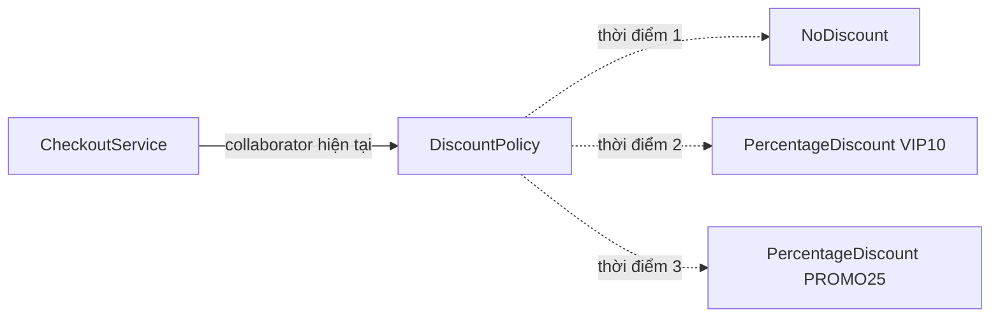

The diagram shows **the same `CheckoutService`** referencing different policy objects over time. It does not show three policies processing one order simultaneously; each operation uses the current collaborator according to the design.

## 2. Complete Java Example: Switching Discount Policies at Runtime

Business requirements:

1. Initially, checkout applies no discount.
2. When the VIP program is enabled, the service uses a 10% discount.
3. When switching to a promotion, the service uses a 25% discount.
4. The no-discount policy can be restored.
5. The checkout service **remains the same object**; only its collaborator changes.

Save all the following code in **`Main.java`** and run it with Java 17 or Java 21.

```java
import java.util.Objects;

record Order(long subtotalVnd) {
    Order {
        if (subtotalVnd < 0) {
            throw new IllegalArgumentException("Tiền hàng không được âm");
        }
    }
}

record Receipt(String policyCode, long subtotalVnd,
               long discountVnd, long totalVnd) {
}

// Hợp đồng mà CheckoutService cần từ collaborator.
interface DiscountPolicy {
    String code();

    // Phải trả giá trị trong khoảng [0, subtotalVnd].
    long discount(long subtotalVnd);
}

final class NoDiscount implements DiscountPolicy {
    @Override
    public String code() {
        return "NONE";
    }

    @Override
    public long discount(long subtotalVnd) {
        if (subtotalVnd < 0) {
            throw new IllegalArgumentException("Tiền hàng không hợp lệ");
        }
        return 0;
    }
}

final class PercentageDiscount implements DiscountPolicy {
    private final String code;
    private final int percent;

    PercentageDiscount(String code, int percent) {
        if (code == null || code.isBlank()) {
            throw new IllegalArgumentException("Mã chính sách không hợp lệ");
        }
        if (percent < 0 || percent > 100) {
            throw new IllegalArgumentException("Phần trăm phải từ 0 đến 100");
        }
        this.code = code;
        this.percent = percent;
    }

    @Override
    public String code() {
        return code;
    }

    @Override
    public long discount(long subtotalVnd) {
        if (subtotalVnd < 0) {
            throw new IllegalArgumentException("Tiền hàng không hợp lệ");
        }
        // Ví dụ tính trên VND nguyên, làm tròn xuống.
        return Math.multiplyExact(subtotalVnd, percent) / 100;
    }
}

final class CheckoutService {
    // Không final vì thiết kế này chủ ý cho phép thay collaborator.
    private DiscountPolicy discountPolicy;

    CheckoutService(DiscountPolicy initialPolicy) {
        this.discountPolicy =
                Objects.requireNonNull(initialPolicy, "initialPolicy");
    }

    // Điểm thay thế collaborator, có kiểm tra null.
    void setDiscountPolicy(DiscountPolicy nextPolicy) {
        this.discountPolicy =
                Objects.requireNonNull(nextPolicy, "nextPolicy");
    }

    Receipt checkout(Order order) {
        Objects.requireNonNull(order, "order");

        // Lấy một tham chiếu cho toàn bộ lần thanh toán.
        DiscountPolicy selected = discountPolicy;
        long subtotal = order.subtotalVnd();
        long reduction = selected.discount(subtotal);

        // Không tin mù quáng mọi implementation.
        if (reduction < 0 || reduction > subtotal) {
            throw new IllegalStateException(
                    "Chính sách trả giá trị giảm giá không hợp lệ");
        }

        return new Receipt(
                selected.code(),
                subtotal,
                reduction,
                subtotal - reduction
        );
    }
}

public class Main {
    private static void printReceipt(Receipt receipt) {
        System.out.printf("%s: %d VND%n",
                receipt.policyCode(), receipt.totalVnd());
    }

    public static void main(String[] args) {
        Order order = new Order(100_000);

        CheckoutService checkout = new CheckoutService(new NoDiscount());

        printReceipt(checkout.checkout(order));

        checkout.setDiscountPolicy(
                new PercentageDiscount("VIP10", 10));
        Receipt vipReceipt = checkout.checkout(order);
        printReceipt(vipReceipt);

        checkout.setDiscountPolicy(
                new PercentageDiscount("PROMO25", 25));
        printReceipt(checkout.checkout(order));

        checkout.setDiscountPolicy(new NoDiscount());
        printReceipt(checkout.checkout(order));

        // Biên lai cũ là dữ liệu riêng; đổi policy không sửa quá khứ.
        System.out.println("Biên lai VIP cũ: "
                + vipReceipt.totalVnd() + " VND");
    }
}
```

Compile and run:

```bash
javac Main.java
java Main
```

Output:

```text
NONE: 100000 VND
VIP10: 90000 VND
PROMO25: 75000 VND
NONE: 100000 VND
Biên lai VIP cũ: 90000 VND
```

**Analyzing the result:**

- `CheckoutService` is created **only once**.
- `setDiscountPolicy(...)` replaces the object referenced by the `discountPolicy` field; it does not replace the `Order` or the `CheckoutService` itself.
- Every `DiscountPolicy` has the same `discount(long)` method but applies different rules. The call `selected.discount(subtotal)` uses **polymorphism** to execute the current object's implementation.
- `vipReceipt` stores the computed result. Switching to `PROMO25` does not recalculate or modify the earlier receipt.
- `selected` is a local variable holding the collaborator chosen for one call. This makes `code()` and `discount()` use **the same policy object** instead of rereading the field multiple times.
- Neither example implementation changes internal state during checkout, so both can be reused without separate counters or sessions.

This monetary example uses integer VND amounts for clarity. Real financial systems need consistent currency units, rounding, taxes, and numeric bounds; `Math.multiplyExact` throws if multiplication overflows a `long`.

## 3. Why Does Composition Allow Collaborator Replacement?

The key is a field typed to a **shared contract**, rather than a fixed concrete class:

```java
private DiscountPolicy discountPolicy;
```

If we write:

```java
private PercentageDiscount discountPolicy;
```

we cannot assign `new NoDiscount()` to that field because `NoDiscount` is not a subtype of `PercentageDiscount`.

If we write:

```java
// Mã giả về hướng kế thừa trong một thiết kế khác:
// class VipCheckoutService extends BaseCheckoutService { ... }
```

This is **a conceptual illustration**, not a standalone runnable snippet. In the main example, `CheckoutService` is declared `final`, so Java **does not allow extending CheckoutService**.

If every policy variant is represented by a service subclass, switching policies may require creating **a new service** or adding branches in each subclass. The example instead uses composition to select discounts: `CheckoutService` **has a** `DiscountPolicy`; `CheckoutService` **is not a** kind of policy.

| Design approach | Where variants are represented | Runtime policy replacement |
| --- | --- | --- |
| `if/else` inside `CheckoutService` | Conditional branches and type codes | Requires changing code/state and branching accordingly |
| Subclasses `VipCheckoutService`, `PromoCheckoutService` | Service inheritance | Usually requires replacing the service object or more design work |
| Composition with `DiscountPolicy` | Objects implementing the interface | Replace the collaborator reference through a controlled API |
| Composition with a `final DiscountPolicy` field | Objects implementing the interface | Chosen at construction; cannot be changed with a setter |
| Composition + registry/factory | Configuration-based implementation selection | A new policy can be selected at a designated boundary |

**Composition does not automatically mean "replaceable at any time."** It depends on whether the reference field can change and whether the class exposes a replacement operation consistent with its contract.

## 4. Three Common Collaborator Lifecycle Choices

### 4.1. Select at Construction and Keep Fixed

```java
final class FixedCheckoutService {
    private final DiscountPolicy policy;

    FixedCheckoutService(DiscountPolicy policy) {
        this.policy = Objects.requireNonNull(policy);
    }

    Receipt checkout(Order order) {
        long reduction = policy.discount(order.subtotalVnd());
        // Xây Receipt và kiểm tra hợp đồng tương tự ví dụ chính.
        return new Receipt(
                policy.code(),
                order.subtotalVnd(),
                reduction,
                order.subtotalVnd() - reduction);
    }
}
```

This is the usual approach with **constructor injection**. It is simple: the field is never reassigned, and the service's dependency stays stable. In this shortened example, `FixedCheckoutService` does not yet validate the `reduction` range; production code would need validation like `CheckoutService`.

### 4.2. Replace Through a Setter or Business Method

```java
checkout.setDiscountPolicy(new PercentageDiscount("VIP10", 10));
```

This is useful when the owning/coordinating object is long-lived but a collaborator must change with sessions, operating conditions, or configuration.

The drawback is that the service gains more mutable state; callers must understand **who may replace the collaborator and when**. If replacement is unnecessary, keeping the dependency `final` is usually easier to reason about.

### 4.3. Select a Collaborator for Each Call

If policies differ **for each order**, there is no need to store them in a mutable field on a singleton service. Instead, pass one directly:

```java
final class PerRequestCheckout {
    Receipt checkout(Order order, DiscountPolicy policy) {
        Objects.requireNonNull(order, "order");
        Objects.requireNonNull(policy, "policy");

        long subtotal = order.subtotalVnd();
        long reduction = policy.discount(subtotal);
        if (reduction < 0 || reduction > subtotal) {
            throw new IllegalStateException("Giảm giá ngoài giới hạn");
        }

        return new Receipt(
                policy.code(), subtotal, reduction, subtotal - reduction);
    }
}
```

This avoids sharing a mutable policy field across requests. Per-request selection is especially useful in web applications where many users may need different policies **concurrently**.

| Requirement | Suitable organization |
| --- | --- |
| Policy selected only when the service is created | Constructor injection + `final` field |
| Administrative policy updates affect new calls | Controlled `set/replacePolicy` API |
| Every request has its own policy | Pass a policy parameter or resolve one through a request-scoped component |
| Policy selected from a configuration code | Factory/registry mapping codes to implementations |
| Policy owns resources that need closing | Define ownership and lifecycle management before replacing it |

## 5. Replacing an Object Versus Mutating Its State

These two operations have different meanings:

```java
DiscountPolicy selected = new PercentageDiscount("VIP10", 10);
checkout.setDiscountPolicy(selected);
```

Here, `CheckoutService` holds **a new reference**.

By contrast, if the collaborator is mutable:

```java
// Ví dụ khái niệm:
// mutablePolicy.setPercent(10);
```

we still have **the same collaborator**, but its internal state changes. Every other object referencing `mutablePolicy` may also observe that change.

This distinction matters in systems with multiple components:

- **Replacing the reference:** The service switches from policy A to B; other components still holding A do not automatically switch to B.
- **Mutating policy A:** Everyone sharing A may be affected.
- **Replacing the service:** A `new CheckoutService(...)` creates another coordinating object, which is different from the two cases above.

An immutable policy such as `PercentageDiscount` has an advantage: after construction, `percent` and `code` do not change. Switching policies by **creating a new object and replacing the reference** is often easier to reason about than mutating many fields on a shared collaborator.

## 6. Runtime Collaborator Replacement: Concurrency Considerations

The initial `CheckoutService` example mainly demonstrates sequential use. In a concurrent application, one thread might call `checkout()` while another calls `setDiscountPolicy()`.

An ordinary mutable field:

```java
private DiscountPolicy discountPolicy;
```

**does not guarantee visibility of updates across threads**. Depending on requirements, `volatile`, `synchronized`, or `AtomicReference` can publish a new collaborator safely.

### A Safe Way to Replace References: `AtomicReference`

The following standalone illustration focuses on selecting the current policy; it reuses the `Order`, `Receipt`, `DiscountPolicy`, `NoDiscount`, and `PercentageDiscount` types from the main example:

```java
import java.util.Objects;
import java.util.concurrent.atomic.AtomicReference;

final class ConcurrentCheckoutService {
    private final AtomicReference<DiscountPolicy> current;

    ConcurrentCheckoutService(DiscountPolicy initial) {
        this.current = new AtomicReference<>(
                Objects.requireNonNull(initial, "initial"));
    }

    void replacePolicy(DiscountPolicy next) {
        current.set(Objects.requireNonNull(next, "next"));
    }

    Receipt checkout(Order order) {
        Objects.requireNonNull(order, "order");

        // Một snapshot tham chiếu tại đầu lời gọi.
        DiscountPolicy selected = current.get();

        long subtotal = order.subtotalVnd();
        long reduction = selected.discount(subtotal);

        if (reduction < 0 || reduction > subtotal) {
            throw new IllegalStateException("Policy không hợp lệ");
        }

        return new Receipt(
                selected.code(), subtotal, reduction, subtotal - reduction);
    }
}
```

The guarantees here are:

1. `current.set(next)` updates the **reference** atomically with `AtomicReference` visibility semantics.
2. `current.get()` obtains **one** specific collaborator for the entire checkout calculation.
3. A call starting just before or during replacement may continue using **the old policy** it already obtained. Calls starting after `replacePolicy()` completes will read the new policy if no other update occurs.
4. `AtomicReference` **does not make a collaborator's internal state thread-safe**. If a policy modifies collections/counters inside `discount()`, that work requires separate synchronization.
5. `AtomicReference` also does not turn multiple business effects (calculating fees, writing to a database, publishing events) into one atomic transaction.

A simpler option when only whole-reference reads and writes are needed is:

```java
private volatile DiscountPolicy currentPolicy;
```

`volatile` may suffice for visibility and atomic reference reads/writes. `AtomicReference` also supports `compareAndSet`, `getAndSet`, and other conditional updates.

**Consistency scope must be explicit:** "After configuration changes, every in-progress request must immediately use the new policy" is **different** from "new requests use the new policy while in-progress requests finish with their old snapshot." The `AtomicReference` example supports per-call snapshots; it does not cancel already-started requests.

## 7. Collaborator Ownership and Lifecycle

Not every collaborator is an immutable object without resources. Some hold:

- Sockets or connections.
- Executors, worker threads, or off-heap memory.
- Sessions or clients that must be closed after use.
- Caches that need warming before a switch.
- State that must be synchronized or flushed.

For example, if a `Gateway` has a `close()` method, replacing it with:

```java
gateway = newGateway;
oldGateway.close();
```

**can be dangerous** if an in-progress request still uses `oldGateway`. Replacing the reference does not mean all existing calls have finished.

Before replacing a resource-owning collaborator, determine:

1. **Who owns it?** The service, DI container, or another component? A non-owner should generally not close it unilaterally.
2. **When is it ready?** Must the new connection be initialized and checked before publication?
3. **When can the old object close?** Are in-flight request counts, draining, timeouts, or transition periods needed?
4. **What if initialization fails?** Should the old policy/adapter continue serving requests?
5. **What if switching fails partway through?** Is there a clear rollback and error-reporting path?

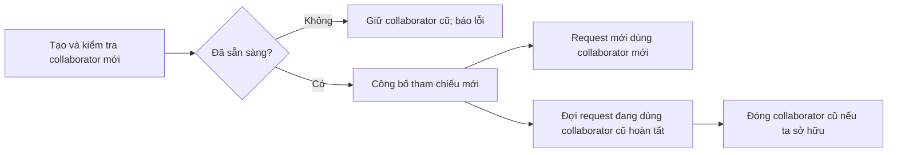

This diagram illustrates **the required lifecycle-management process**; a setter or `AtomicReference.set()` does not implement every step automatically. Replacing a stateless, computation-only `DiscountPolicy` is usually much simpler.

## 8. A New Policy Must Honor the Existing Contract

When collaborators are replaceable, every implementation must honor the same **contract semantics**, not merely share method signatures.

In the example, `DiscountPolicy.discount(subtotalVnd)` must:

- Accept the subtotal as **integer VND**.
- Return a discount between `0` and `subtotalVnd`.
- Not arbitrarily switch units to percentages or another currency.
- Define clear behavior for invalid input.
- Be compatible with the documented concurrency model if used concurrently.

An implementation such as:

```java
final class BrokenDiscount implements DiscountPolicy {
    @Override
    public String code() {
        return "BROKEN";
    }

    @Override
    public long discount(long subtotalVnd) {
        return -100;
    }
}
```

**still compiles**, but `CheckoutService` throws `IllegalStateException` because the result violates the contract. Interfaces enable substitution at the **type level**, while the **Liskov Substitution Principle** requires new implementations to preserve behavior on which clients rely.

This matters especially for hot swapping: an incompatible implementation can cause subsequent requests to fail even if the reference switch succeeds.

## 9. Selecting Collaborators from a Factory or Registry

In real systems, administrators or requests often supply policy codes as `String` values, such as `"VIP10"`. A selection boundary can use a registry:

```java
import java.util.Map;

final class DiscountCatalog {
    private final Map<String, DiscountPolicy> policies = Map.of(
            "NONE", new NoDiscount(),
            "VIP10", new PercentageDiscount("VIP10", 10),
            "PROMO25", new PercentageDiscount("PROMO25", 25)
    );

    DiscountPolicy findRequired(String code) {
        DiscountPolicy policy = policies.get(code);
        if (policy == null) {
            throw new IllegalArgumentException(
                    "Mã chính sách không hỗ trợ: " + code);
        }
        return policy;
    }
}
```

Then:

```java
DiscountCatalog catalog = new DiscountCatalog();
checkout.setDiscountPolicy(catalog.findRequired("PROMO25"));
```

The snippet assumes `checkout` is the `CheckoutService` object created in the example. A registry separates **finding the correct implementation** from **using the collaborator**. `CheckoutService` need not know which class `"VIP10"` represents.

Depending on scale, `Map` can be replaced by `switch`, dependency injection, or another factory. If a policy is stateful and request-specific, the registry can hold **factories that create instances** rather than sharing one policy object.

**Do not let untrusted input choose arbitrary classes by name and instantiate them through reflection** without explicit restrictions and validation. An explicit registry permits only approved implementations.

## 10. When Is Collaborator Replacement Better Than Inheritance or Conditionals?

| Requirement | Approach to consider | Reason |
| --- | --- | --- |
| Change the discount formula but keep the checkout service | Composition + `DiscountPolicy` | Behavior can vary independently |
| A fixed workflow with a few extensible steps | Template Method / controlled inheritance | An inheritance contract may fit |
| Two fixed cases differ by one small condition | A clear `if` or `switch` | Avoids an unnecessary class hierarchy |
| Many concurrent requests need different policies | Select collaborators per call | Avoids conflicting shared mutable state |
| Shared configuration changes at runtime | Setter/replace API with `volatile` or `AtomicReference` for concurrency | Publishes new configuration for subsequent calls |
| Collaborators have their own state and resources | Composition + explicit lifecycle management | Avoids closing objects while in use |
| Combine auxiliary behaviors such as retry, caching, logging | Decorator/delegation | Allows flexible wrapper combinations |

Runtime collaborator replacement is often a variation of the **Strategy Pattern**: algorithms are encapsulated behind an interface, and strategies can be interchanged. Composition is the structure through which an object holds a collaborator; Strategy describes using that structure to replace an **algorithm or behavior**.

Not every collaborator is a Strategy. A repository, clock, event publisher, or HTTP client may also be swapped for testing or configuration, even if its role is not described as a "strategy."

## 11. Testing Collaborator Replacement

Test both **behavior before and after replacement** and whether existing objects remain unchanged as expected.

Example of a plain Java test, placed in a method where the classes from the main example are available:

```java
CheckoutService service = new CheckoutService(new NoDiscount());
Order order = new Order(100_000);

Receipt before = service.checkout(order);

service.setDiscountPolicy(new PercentageDiscount("VIP10", 10));
Receipt after = service.checkout(order);

if (before.totalVnd() != 100_000) {
    throw new AssertionError("Chính sách ban đầu sai");
}
if (after.totalVnd() != 90_000) {
    throw new AssertionError("Chính sách mới chưa có hiệu lực");
}
if (!"NONE".equals(before.policyCode())) {
    throw new AssertionError("Biên lai cũ bị thay đổi");
}
```

Other useful test cases:

- `setDiscountPolicy(null)` must be rejected so the service does not end up without a policy.
- A new policy returning a negative discount or more than the subtotal must be detected.
- Switching from A to B and back to A must produce correct results on each call.
- In a multithreaded system, each request must see a consistent collaborator under the chosen snapshot contract.
- When collaborators hold resources, replacement must not close resources still used by active requests.
- If a new policy fails to initialize, an unready object must not be published.

JUnit tests can use `assertEquals`, `assertThrows`, and fake `DiscountPolicy` implementations. The most valuable tests verify **business behavior after selecting a new collaborator**, not merely whether the setter was called.

## 12. Common Mistakes

| Mistake | Consequence | Remedy |
| --- | --- | --- |
| Typing a collaborator field to a concrete class instead of a needed interface | Cannot substitute unrelated implementations | Use a meaningful shared contract |
| Setter allows `null` | The next request may throw `NullPointerException` | Use `Objects.requireNonNull` or an explicit absence policy |
| Changing a shared singleton field for every request | One user's request can use another user's policy | Pass policies per request |
| Reading the collaborator repeatedly during an operation | Mid-call replacement can mix policy versions | Capture one local reference per operation |
| Assuming an ordinary reference swap is fully thread-safe | No guaranteed visibility or internal-state safety | Use correct synchronization/atomic publication and safe policies |
| Closing the old collaborator immediately after replacement | In-progress requests use a closed resource | Manage in-flight operations and ownership |
| New implementation changes units or returns invalid values | Violates substitutability | Contract tests and validation |
| Making every collaborator a Strategy without a replacement need | Unnecessary classes and complexity | Use a `final` field for fixed dependencies |
| Using reflection with a client-supplied class name | Configuration and security risks | Maintain an allowlist of implementations |
| Assuming a setter updates previously created results | Confuses current state with history | Store suitable values/versions in receipts |

## 13. Self-Check Questions

**Question 1.** After calling `checkout.setDiscountPolicy(new NoDiscount())`, is the `CheckoutService` object recreated?

**Answer:** No. Only the internal collaborator reference changes. The coordinating object remains the same.

**Question 2.** Why is `DiscountPolicy selected = discountPolicy;` assigned at the start of `checkout()`?

**Answer:** So `discount()` and `code()` use **one** selected policy. Changing the field at another moment will not accidentally make that call use two different collaborators.

**Question 3.** When a singleton `CheckoutService` serves users with individual discounts, should it call `setDiscountPolicy(...)` for every request?

**Answer:** Usually not; requests may overwrite one another's policies. Select policies through request parameters or an appropriate data scope.

**Question 4.** Does `AtomicReference<DiscountPolicy>` make every method in `DiscountPolicy` thread-safe?

**Answer:** No. It guarantees atomicity/visibility for **the reference**; the policy object's logic and state still require their own thread-safety design.

**Question 5.** If an old HTTP client is still processing requests, should `close()` be called immediately after switching to a new client?

**Answer:** Not by default. Determine who owns the client and when its active requests finish. Draining or a separate lifecycle-management mechanism may be necessary.

**Question 6.** Must composition always support runtime collaborator replacement?

**Answer:** No. Composition with a `final` collaborator fixed for its entire lifecycle is valid and usually simpler when replacement is unnecessary.

**Key takeaway:** Composition lets a coordinating object **delegate** to collaborators through clear contracts. When business needs require it, the object can **replace collaborators at runtime** to change its behavior without replacing itself. A sound design must also define *which calls a replacement affects*, *cross-thread consistency*, *implementation contracts*, and *resource lifecycles*—not merely add a setter.


</details>

- [Back to top](#back-to-top)

---

## <a id="composition-006">Dependency Injection Through Constructors or Methods</a>

<details>
<summary>View details</summary>

# Dependency Injection Through Constructors or Methods in Java

> **OOP → Composition.** An object often needs other objects to do its job: an order service needs a notification sender, a report exporter needs a formatter, and business logic needs data storage. **Dependency Injection (DI)** means *supplying* these collaborators from outside instead of having the consuming class create fixed implementations itself. Two direct Java techniques are **constructor injection** (passing dependencies through constructors) and **method injection** (passing dependencies as method parameters).

## 1. Why Use Dependency Injection?

Suppose an order-notification class creates its own email sender:

```java
class OrderNotifier {
    private final EmailSender sender = new EmailSender();

    void notifyPaid(String recipient) {
        sender.send(recipient, "Đơn hàng đã thanh toán");
    }
}
```

`EmailSender` is a hypothetical class name here. This approach forces `OrderNotifier` to know **the exact implementation** and how to instantiate it. Switching to SMS, changing email providers, or testing without sending real notifications would require modifying or somehow replacing that internal dependency.

Extract a notification-sending contract:

```java
interface NotificationSender {
    DeliveryResult send(String recipient, String message);
}
```

Then have the notification class **receive** a `NotificationSender`:

```java
class OrderNotifier {
    private final NotificationSender sender;

    OrderNotifier(NotificationSender sender) {
        this.sender = java.util.Objects.requireNonNull(sender);
    }
}
```

`OrderNotifier` **has a** notification sender (*has-a*), but it does not decide whether to use email or SMS. This is composition through a contract and a straightforward example of DI.

| Without dependency injection | With dependency injection |
|---|---|
| The class calls `new EmailSender()` within its logic | External code creates a sender and passes it in |
| Business logic is tied to one concrete implementation | Business logic depends on the `NotificationSender` contract |
| Replacing the sender during tests is difficult | A fake `RecordingSender` can be injected |
| Changing technology may require editing the business class | Implementations can be swapped at application assembly |

**Note:** DI does not require Spring or a DI container. Plain Java constructors and method parameters are sufficient.

## 2. Constructor Injection: Dependencies Needed Throughout an Object's Lifecycle

**Constructor injection** is suitable when a dependency is **required** and will be used by multiple methods throughout an object's lifetime.

```java
final class OrderNotifier {
    private final NotificationSender sender;

    OrderNotifier(NotificationSender sender) {
        this.sender = Objects.requireNonNull(sender, "sender");
    }

    DeliveryResult notifyPaid(String recipient, String orderId) {
        return sender.send(
            recipient,
            "Đơn hàng " + orderId + " đã thanh toán"
        );
    }
}
```

At the construction site:

```java
NotificationSender sender = new ConsoleEmailSender();
OrderNotifier notifier = new OrderNotifier(sender);
```

Key observations:

1. `sender` is required **when `OrderNotifier` is created**. If `null` is passed, the constructor rejects it before producing a valid object.
2. A `private final` field prevents reassignment of the sender reference after construction. It **does not make the sender object immutable or thread-safe**.
3. Business methods call only the `NotificationSender` contract; they do not need to know the concrete class.
4. External code determines the dependency's **configuration and lifecycle**. Do not unilaterally close a caller-owned dependency unless the contract permits it.

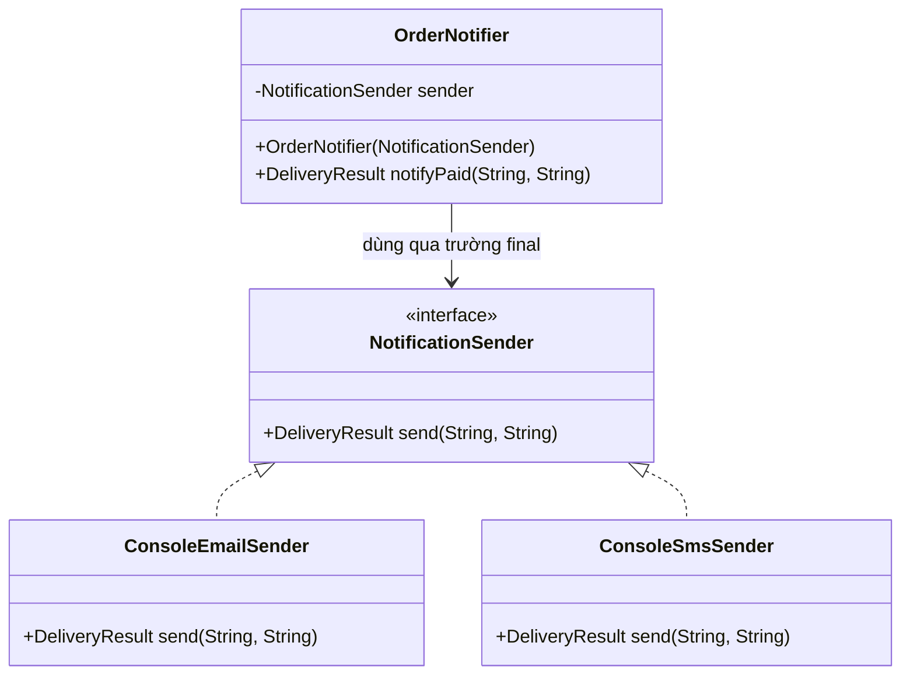

The `OrderNotifier → NotificationSender` arrow shows that **the source-code dependency points to an abstraction**. The two sender classes provide implementations and can substitute for each other as long as they honor the same contract.

## 3. Method Injection: Dependencies Chosen Per Call

**Method-parameter injection** is appropriate when behavior depends on **the context of each call** and the dependency need not be stored in a field.

For example, an alert-sending operation may select a different channel for each request:

```java
final class AlertService {
    DeliveryResult sendAlert(
            String recipient,
            String message,
            NotificationSender sender) {

        Objects.requireNonNull(sender, "sender");
        return sender.send(recipient, message);
    }
}
```

Usage:

```java
AlertService alerts = new AlertService();

alerts.sendAlert(
    "an@example.test",
    "Đơn hàng cần xác nhận",
    new ConsoleEmailSender()
);

alerts.sendAlert(
    "0900000000",
    "Mã xác nhận 123456",
    new ConsoleSmsSender()
);
```

With this approach, `AlertService` does not need a `NotificationSender` field. Every call supplies the dependency selected at that moment. This is **dependency injection through method parameters**; it is distinct from Spring's specialized `@Lookup` method-injection mechanism.

**Lifecycle differences:**

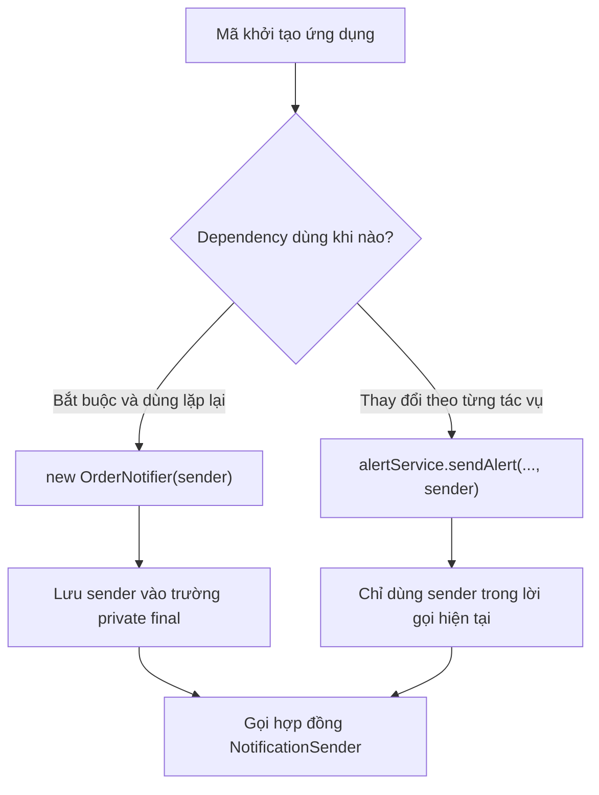

If the same sender must be passed through dozens of methods just to invoke it, constructor injection is usually more concise. Conversely, if a service selects independent sending channels for each request, storing one fixed sender may make the API less flexible.

## 4. Complete Java Example: Using Both Injection Approaches

The following example runs independently on **Java 17+** without Spring or real email/SMS services. The senders only print to the console to illustrate polymorphism and dependency flow.

Save as `DependencyInjectionDemo.java`:

```java
import java.util.Objects;

public class DependencyInjectionDemo {

    record DeliveryResult(String channel, boolean accepted) {
        DeliveryResult {
            Objects.requireNonNull(channel, "channel");
        }
    }

    interface NotificationSender {
        DeliveryResult send(String recipient, String message);
    }

    static String requireText(String value, String field) {
        if (value == null || value.isBlank()) {
            throw new IllegalArgumentException(field + " không hợp lệ");
        }
        return value;
    }

    // Implementation A: chỉ mô phỏng email bằng log console.
    static final class ConsoleEmailSender implements NotificationSender {
        @Override
        public DeliveryResult send(String recipient, String message) {
            requireText(recipient, "recipient");
            requireText(message, "message");
            System.out.println("[EMAIL] " + recipient + " <- " + message);
            return new DeliveryResult("EMAIL", true);
        }
    }

    // Implementation B: chỉ mô phỏng SMS bằng log console.
    static final class ConsoleSmsSender implements NotificationSender {
        @Override
        public DeliveryResult send(String recipient, String message) {
            requireText(recipient, "recipient");
            requireText(message, "message");
            System.out.println("[SMS] " + recipient + " <- " + message);
            return new DeliveryResult("SMS", true);
        }
    }

    // Constructor injection: dùng sender cố định trong vòng đời notifier.
    static final class OrderNotifier {
        private final NotificationSender sender;

        OrderNotifier(NotificationSender sender) {
            this.sender = Objects.requireNonNull(sender, "sender");
        }

        DeliveryResult notifyPaid(String recipient, String orderId) {
            requireText(recipient, "recipient");
            requireText(orderId, "orderId");
            return sender.send(
                recipient,
                "Đơn hàng " + orderId + " đã thanh toán"
            );
        }
    }

    // Method injection: sender có thể thay đổi theo từng lần gọi.
    static final class AlertService {
        DeliveryResult sendAlert(
                String recipient,
                String message,
                NotificationSender sender) {
            requireText(recipient, "recipient");
            requireText(message, "message");
            Objects.requireNonNull(sender, "sender");
            return sender.send(recipient, message);
        }
    }

    // Fake dùng để kiểm thử, không gửi email hoặc SMS thật.
    static final class RecordingSender implements NotificationSender {
        private int calls;
        private String lastRecipient;
        private String lastMessage;

        @Override
        public DeliveryResult send(String recipient, String message) {
            calls++;
            lastRecipient = recipient;
            lastMessage = message;
            return new DeliveryResult("FAKE", true);
        }

        int calls() {
            return calls;
        }

        String lastRecipient() {
            return lastRecipient;
        }

        String lastMessage() {
            return lastMessage;
        }
    }

    public static void main(String[] args) {
        // Tiêm qua constructor.
        OrderNotifier notifier =
            new OrderNotifier(new ConsoleEmailSender());

        DeliveryResult email = notifier.notifyPaid(
            "an@example.test",
            "ORD-101"
        );
        System.out.println("Email accepted: " + email.accepted());

        // Tiêm qua tham số của phương thức.
        AlertService alerts = new AlertService();
        DeliveryResult sms = alerts.sendAlert(
            "0900000000",
            "Mã xác nhận 123456",
            new ConsoleSmsSender()
        );
        System.out.println("SMS accepted: " + sms.accepted());

        // Thay dependency bằng fake mà không sửa OrderNotifier.
        RecordingSender fake = new RecordingSender();
        OrderNotifier testNotifier = new OrderNotifier(fake);
        testNotifier.notifyPaid("test@example.test", "ORD-TEST");

        if (fake.calls() != 1
                || !fake.lastRecipient().equals("test@example.test")
                || !fake.lastMessage().contains("ORD-TEST")) {
            throw new AssertionError("OrderNotifier dùng sai dependency");
        }
        System.out.println("Fake calls: " + fake.calls());
    }
}
```

Run:

```bash
javac DependencyInjectionDemo.java
java DependencyInjectionDemo
```

Expected output:

```text
[EMAIL] an@example.test <- Đơn hàng ORD-101 đã thanh toán
Email accepted: true
[SMS] 0900000000 <- Mã xác nhận 123456
SMS accepted: true
Fake calls: 1
```

This is **a console simulation**. `accepted=true` in the example only means the simulated implementation accepted the call; it does not prove a real email/SMS was sent or read. For real services, the contract should distinguish sent, pending, rejected, and connection-error states whenever they matter.

### Tracing One Call

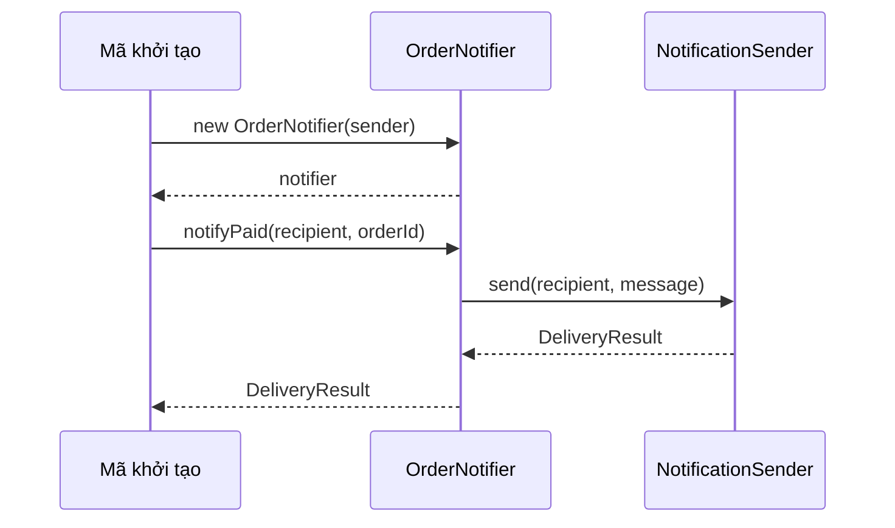

`OrderNotifier` does not instantiate `ConsoleEmailSender`; `main` does that. Therefore, we can inject `RecordingSender` for testing without modifying `OrderNotifier` code.

## 5. Comparing Constructor, Method, and Setter Injection

Some documentation uses **method injection** to mean **setter injection** (injecting through a setter method), while other sources distinguish **method parameter injection** (passing a dependency directly to an operation). Specify which form you mean.

| Criterion | Constructor injection | Method parameter injection | Setter injection |
|---|---|---|---|
| Example | `new Service(repo)` | `service.run(repo)` | `service.setRepo(repo)` |
| When is the dependency received? | During object construction | On each method call | When the setter is called |
| Stored as a field? | Usually, optionally `final` | Usually unnecessary | Usually, typically not `final` |
| Best suited for | Required, stable dependencies | Per-request/per-task dependencies | Optional or reconfigurable dependencies |
| Risks | Too many constructor parameters | Repeating parameters across calls | An object may be unconfigured or changed mid-operation |
| Easy to fake in tests? | Yes | Yes | Yes, but configuration order must be controlled |

Setter injection can look like this:

```java
final class ConfigurableNotifier {
    private NotificationSender sender;

    void setSender(NotificationSender sender) {
        this.sender = Objects.requireNonNull(sender, "sender");
    }

    DeliveryResult notify(String recipient, String message) {
        if (sender == null) {
            throw new IllegalStateException("Chưa cấu hình sender");
        }
        return sender.send(recipient, message);
    }
}
```

This approach carries risks: if `notify()` is called before `setSender()`, the object is not ready. If multiple threads call the setter and notification method concurrently, synchronization and configuration-change rules also matter. Therefore, **prefer constructor injection for required dependencies**; use setters when replacement or an unconfigured state is a genuine requirement.

## 6. How Does Composition Differ from Inheritance Here?

In the example, the notifier/sender relationship is:

```text
OrderNotifier có một NotificationSender.
```

Not:

```text
OrderNotifier là một loại NotificationSender.
```

`OrderNotifier` **uses** a sender to fulfill its own responsibility. It does not need `extends ConsoleEmailSender` or `extends ConsoleSmsSender`. This is composition: collaborating objects perform independent responsibilities.

```java
// Đúng hướng: sử dụng một thành phần thông qua hợp đồng.
class OrderNotifier {
    private final NotificationSender sender;
    OrderNotifier(NotificationSender sender) {
        this.sender = sender;
    }
}

// Không nên kế thừa chỉ để tái sử dụng hàm send:
// class OrderNotifier extends ConsoleEmailSender { ... }
```

Composition allows notification delivery to change without distorting an inheritance hierarchy. It also suits objects with different lifecycles: a notifier may be long-lived while its sender is shared or has connection-closing rules defined by its API.

**Important:** Passing a dependency into an object does not guarantee correct concurrency or resource lifecycles. If a sender uses a connection or thread pool, decide who creates, owns, and closes those resources.

## 7. Injecting Interfaces Instead of Tying Code to Concrete Implementations

Both constructors below receive a dependency from outside:

```java
OrderNotifier(ConsoleEmailSender sender) { /* ... */ }
OrderNotifier(NotificationSender sender) { /* ... */ }
```

The second approach is more flexible because it accepts any implementation honoring `NotificationSender`.

When a business class only needs `send` behavior, it should not require provider-specific methods. The more closely a contract matches the caller's actual needs, the less coupling it introduces.

However, **not every class needs an interface**. If a component has one stable implementation and no useful substitution boundary, injecting a concrete class may be reasonable. What matters is who decides how the dependency is created and whether it is hardwired into business logic.

### Dependency Injection, Dependency Inversion, and IoC

These three related concepts are not interchangeable:

- **Dependency Injection (DI):** Supplies dependencies externally through constructors, methods, or setters.
- **Dependency Inversion Principle (DIP):** Higher-level code and implementations both depend on appropriate abstractions rather than higher-level code directly depending on low-level details.
- **Inversion of Control (IoC):** Moves control over object creation/provision or control-flow coordination to an external component; DI is a common technique for applying IoC.

DI does not require a DI container. In the example's `main`, the application initialization code acts as the **composition root**—the place where implementations are selected and assembled.

## 8. Choosing Injection Approaches Based on Requirements

Some illustrative situations:

| Situation | Typical approach | Reason |
|---|---|---|
| `OrderService` always needs `OrderRepository` to process requests | Constructor injection | Required and stable throughout the service lifecycle |
| `CheckoutService` always uses a configured `PaymentGateway` | Constructor injection | The service cannot operate correctly without a gateway |
| Export each report with a different `Formatter` | Method parameter injection | The formatter is a per-task strategy |
| A testing utility selects a notification channel on each call | Method parameter injection | The dependency varies with the call input |
| An optional feature can be configured later | Controlled setter injection | The dependency is not required from construction |
| Centralize creation and connection of application services | Composition root or DI container | One place manages assembly and lifecycles |

**Quick decision rule:** If a missing dependency makes an object **invalid or unusable**, put it in the constructor. If a dependency **is needed only for a specific operation and varies per operation**, consider a method parameter. If a dependency is truly **optional or reconfigurable**, a setter may fit, but define the object's state before and after configuration.

## 9. Common Mistakes

### Mistake 1 — Accepting a Dependency but Creating Another Internally

```java
class BadNotifier {
    private final NotificationSender sender;

    BadNotifier(NotificationSender sender) {
        this.sender = sender;
    }

    void notifyUser(String recipient, String message) {
        // Sai ý đồ injection: bỏ qua this.sender.
        new ConsoleEmailSender().send(recipient, message);
    }
}
```

Although the constructor accepts a parameter, the class remains hardwired to email. Fix it by calling `this.sender.send(...)`.

### Mistake 2 — Allowing a Required Dependency to Be Null

```java
class BadService {
    private NotificationSender sender;
    // Không có constructor/setter bảo đảm sender được gán.
}
```

Calling a method that uses the sender can then trigger `NullPointerException`. Prefer a constructor with `Objects.requireNonNull` or a controlled-state design if the dependency is genuinely optional.

### Mistake 3 — Constructors with Too Many Dependencies

```java
// Ví dụ minh họa dấu hiệu cần xem lại trách nhiệm:
Service(A a, B b, C c, D d, E e, F f, G g) { /* ... */ }
```

There is no universal parameter-count limit. But if a constructor has many unrelated dependencies, the class may have too many responsibilities. Revisit its responsibilities and separate services appropriately instead of automatically packing everything into a hard-to-manage `Dependencies` object.

### Mistake 4 — Method Injection Causes Dependencies to Spread Through APIs

If multiple calling layers all accept `NotificationSender` but intermediate layers only forward it, the dependency may have the wrong scope. Consider injecting it through the constructor of the component that actually uses it.

### Mistake 5 — Unclear Resource Ownership

An injected dependency may own network connections, executors, or streams. Code receiving a dependency **must not unilaterally close** externally managed resources unless the contract specifies it; if ownership is transferred, resources must be closed at the proper lifecycle endpoint. DI does not replace resource-management policies.

### Mistake 6 — Assuming Constructor Injection Guarantees Thread Safety

`private final NotificationSender sender` does not make `sender.send(...)` thread-safe. If multiple threads share a mutable sender, its implementation still needs thread-safety guarantees or an appropriate usage scope.

## 10. Practice Exercises

**Exercise 1 — Switch implementations.** Add `ConsolePushSender implements NotificationSender` that prints `[PUSH]`. Inject it into `OrderNotifier` instead of `ConsoleEmailSender` without editing `OrderNotifier`. Observe the output.

**Exercise 2 — Choose injection scopes.** A `ReportService` needs `DocumentRepository` on every call and a `ReportFormatter` that varies per report. Design a constructor accepting the repository and an `export(formatter)` method accepting the formatter. Explain the different scopes.

**Exercise 3 — Test with a fake.** Use `RecordingSender` to verify that `OrderNotifier.notifyPaid` passes the correct recipient and order ID and invokes `send` only once. Then pass `RecordingSender` to `AlertService.sendAlert` to test method injection.

**Exercise 4 — Unconfigured state.** Call `notify` on `ConfigurableNotifier` before `setSender`. Explain why setter injection can create an invalid/unready state and write a test for it.

**Exercise 5 — Dependency ownership.** A `SmtpSender` holds a connection that needs closing. When `OrderNotifier` receives a sender from the composition root, who should close the connection? Propose an explicit ownership contract instead of having every class using the sender close it.

**Key takeaway:** With composition, an object **receives and uses** collaborators instead of hardwiring their construction. **Constructor injection** works best for required, stable dependencies; **method parameter injection** suits per-task dependencies; and **setter injection** is appropriate only when later configuration or replacement is required and the unready state is managed. In each case, business logic only needs to know the required contract, making implementations easier to replace and test.


</details>

- [Back to top](#back-to-top)

---

## <a id="composition-007">Ownership and Lifecycle of Contained Objects</a>

<details>
<summary>View details</summary>

# Ownership and Lifecycle of Contained Objects in Java Composition

> **Context:** OOP → Composition. When an object contains other objects, the important design question is not just "what fields does it have?" but **who controls the creation, modification, sharing, and end of use of those components?**

## 1. Learning Objectives

After this lesson, you should be able to:

- Distinguish **ownership in object design**, **access through Java references**, and **responsibility for system resources**.
- Determine whether components may be shared among objects or must be managed by one parent object.
- Design APIs that preserve invariants when contained objects change.
- Use `AutoCloseable` and `try-with-resources` to control resource lifecycles when the containing object owns those resources.
- Avoid confusing garbage collection with closing files, connections, or execution workflows.

## 2. What Does Ownership Mean?

In **composition**, a containing object (*whole/owner*) manages its components (*parts*) to provide functionality and preserve the whole's valid state.

For example, `DonHang` manages its `DongHang` objects. The order determines when line items are added or removed, which quantities and prices are valid, and how the total is calculated. Code using `DonHang` must not modify its internal list to bypass those rules.

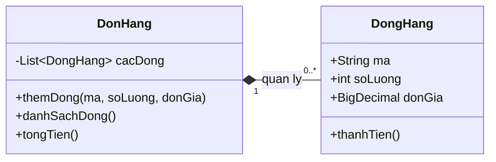

The filled diamond symbol (`*--`) in UML represents **composition**: a component is within the whole's lifecycle and management boundary according to **the domain model**.

However, Java **has no ownership keyword**. A `private DongHang dongHang;` field holds only **a reference** and does not automatically guarantee that the parent is the sole owner. Ownership must be enforced through constructor and method design, access control, and usage conventions.

### Three Easily Confused Concepts

| Concept | Key question | In Java |
|---|---|---|
| Domain-model ownership | Who decides to create, modify, or remove components? | APIs, invariants, encapsulation; not enforced by the JVM |
| Object references | Who has access paths to the same object? | Many variables may point to one instance; `private` and `final` do not prevent aliasing |
| Resource ownership | Who must close files/sockets/streams, and when? | API contracts, `AutoCloseable`, `try-with-resources` |

A child object may cease to belong to an order while remaining referenced elsewhere in the program. This **does not** mean Java immediately removes it from memory.

## 3. Decide Ownership Before Writing Code

For each field containing another object, answer:

1. **Who creates it?** Does the parent create it internally, receive data to copy, or accept an external instance?
2. **Who may modify it?** Must all changes pass through the parent's API, or may other classes modify it directly?
3. **Can it be shared?** Can a component serve multiple whole objects simultaneously?
4. **When does its use end?** When the parent leaves the domain, calls `close()`, or the entire application stops?
5. **Who cleans it up?** Define responsibility for limited resources such as connections, files, and threads.

| Situation | Typical design | Consideration |
|---|---|---|
| `DonHang` and its `DongHang` list | Composition; the parent controls adding/removing lines | Prevent list modification through getters |
| `HoaDon` and immutable `Money` values | Value objects may be shared safely | Copies are unnecessary if truly immutable |
| `NhanVien` and `PhongBan` | Association/aggregation often fits better | The department remains after an employee leaves |
| `ExportJob` opens its own `BufferedWriter` | The job owns the writer and must close it | Close using `try-with-resources` |
| Service supplied by a dependency-injection container | The container usually manages its lifecycle | Consumers must not close shared dependencies themselves |

**Practical rule:** The stronger the ownership, the more the component should be created/managed through the parent's API rather than freely replaced or modified externally.

## 4. Complete Example: An Order Manages Its Line Items

Save as `CompositionDemo.java` and run with **Java 17+**:

```java
import java.math.BigDecimal;
import java.util.ArrayList;
import java.util.List;
import java.util.Objects;

public class CompositionDemo {
    public static void main(String[] args) {
        Order order = new Order("DH-001");

        order.addLine("BOOK", 2, new BigDecimal("125000"));
        List<Order.Line> snapshot = order.lines();

        order.addLine("PEN", 3, new BigDecimal("10000"));

        System.out.println(snapshot.size());       // 1
        System.out.println(order.lines().size());   // 2
        System.out.println(order.total());          // 280000

        try {
            snapshot.clear();
        } catch (UnsupportedOperationException expected) {
            System.out.println("Khong the sua danh sach tu ben ngoai");
        }
    }

    static final class Order {
        private final String id;
        private final List<Line> lines = new ArrayList<>();

        Order(String id) {
            if (id == null || id.isBlank()) {
                throw new IllegalArgumentException("Ma don hang khong hop le");
            }
            this.id = id;
        }

        public void addLine(String sku, int quantity, BigDecimal unitPrice) {
            // Cha tao va kiem soat thanh phan con.
            lines.add(new Line(sku, quantity, unitPrice));
        }

        public List<Line> lines() {
            // Ban chup khong sua duoc; khong lo danh sach noi bo.
            return List.copyOf(lines);
        }

        public BigDecimal total() {
            return lines.stream()
                    .map(Line::amount)
                    .reduce(BigDecimal.ZERO, BigDecimal::add);
        }

        // Gia tri bat bien: String va BigDecimal cung bat bien.
        record Line(String sku, int quantity, BigDecimal unitPrice) {
            Line {
                if (sku == null || sku.isBlank()) {
                    throw new IllegalArgumentException("SKU khong hop le");
                }
                if (quantity <= 0) {
                    throw new IllegalArgumentException("So luong phai > 0");
                }
                Objects.requireNonNull(unitPrice, "unitPrice");
                if (unitPrice.signum() < 0) {
                    throw new IllegalArgumentException("Don gia am");
                }
            }

            BigDecimal amount() {
                return unitPrice.multiply(BigDecimal.valueOf(quantity));
            }
        }
    }
}
```

Run:

```bash
javac CompositionDemo.java
java CompositionDemo
```

Output:

```text
1
2
280000
Khong the sua danh sach tu ben ngoai
```

**How does this example actually manage its components?**

- `Order` creates each `Line` after validating its data. Every line-item addition goes through `addLine(...)`.
- The `lines` list is `private`; `lines()` returns a **list-level immutable snapshot**, so external calls to `clear()` or `add()` are rejected.
- `Line` is a `record` containing immutable values in this example. Exposing `Line` objects in the snapshot therefore does not leak mutable order state.
- `total()` is always calculated from data under `Order`'s control.

**Important limitation:** `List.copyOf(...)` makes only a *shallow* copy of the list structure. If elements are `MutableLine` objects with setters, snapshot recipients can still mutate those elements. Use appropriate deep copies, immutable DTOs, or an API exposing only necessary read operations.

Also, `final List<Line>` only prevents **reassigning the field**; it does not prevent `lines.add(...)`. Preserving invariants requires designing both the data structure and its access paths.

## 5. How Does a Child Object's Lifecycle Work?

We can distinguish the **domain lifecycle** from the **memory lifecycle** as follows:

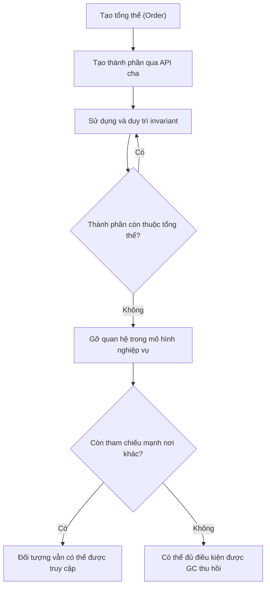

For ordinary Java objects:

- **Creation:** A constructor or factory allocates the object and links it to the whole according to the API.
- **Use:** The whole manages modification rights; avoid aliases that let external code make unauthorized changes.
- **End of membership:** When a line item is removed or an order's domain lifecycle ends, the composition relationship ends according to domain rules.
- **Memory reclamation:** The JVM may collect the object when it is no longer reachable from GC roots. **The timing cannot be predicted**, and dropping a reference does not call `close()`.

If someone retains a `Line` from a snapshot, that `Line` still exists and can be read; however, it is no longer a current component of `Order` if the `Order` has removed it. This distinguishes **the modeled lifecycle** from **the lifecycle of an instance on the heap**.

## 6. Resource Lifecycle: The Creator Owns Cleanup

Another strong-ownership scenario is an object creating its own operating-system resource, such as one for CSV export. Java memory has a garbage collector, but **file handles must be closed explicitly**.

Save as `ExportDemo.java` (Java 17+):

```java
import java.io.BufferedWriter;
import java.io.IOException;
import java.nio.charset.StandardCharsets;
import java.nio.file.Files;
import java.nio.file.Path;

public class ExportDemo {
    public static void main(String[] args) throws IOException {
        Path output = Path.of("orders.csv");

        try (CsvExporter exporter = new CsvExporter(output)) {
            exporter.writeRow("DH-001", "280000");
            exporter.writeRow("DH-002", "50000");
        } // close() tu dong duoc goi, ke ca khi trong khoi co loi.

        System.out.println(Files.readString(output));
    }

    static final class CsvExporter implements AutoCloseable {
        private final BufferedWriter writer;
        private boolean closed;

        CsvExporter(Path output) throws IOException {
            // Exporter tu mo writer => exporter chiu trach nhiem dong.
            writer = Files.newBufferedWriter(output, StandardCharsets.UTF_8);
        }

        void writeRow(String id, String total) throws IOException {
            if (closed) {
                throw new IllegalStateException("Exporter da dong");
            }
            writer.write(id + "," + total);
            writer.newLine();
        }

        @Override
        public void close() throws IOException {
            if (!closed) {
                closed = true;
                writer.close();
            }
        }
    }
}
```

`CsvExporter` owns `BufferedWriter` because it **opens the writer itself**. From successful creation until `close()` completes, the exporter is responsible for cleanup. The `closed` flag prevents repeated closing in this sequential example; it **does not** make the class thread-safe. Multithreaded code needs a separate synchronization contract.

If the exporter **receives a `Writer` externally**, it should not close the writer unless the API explicitly transfers ownership:

```java
void renderPreview(java.io.Writer borrowedWriter) throws java.io.IOException {
    borrowedWriter.write("preview");
    borrowedWriter.flush();
    // Ben goi so huu borrowedWriter; phuong thuc nay khong close().
}
```

The key point is that **holding a resource reference does not imply permission to close it**. If two objects both close a shared connection or stream, one may disrupt the other's operation.

> In Spring applications, container-managed beans generally have lifecycles coordinated by the container (for example, a `@PreDestroy` callback). Components receiving beans through dependency injection must respect the container's lifecycle contract; a field reference alone does not grant permission to close the bean.

## 7. Three Common Mistakes and Their Fixes

### Mistake 1 — Exposing the Parent's Mutable State

```java
// Nguy hiem: nguoi goi co the them/xoa phan tu khong qua kiem tra.
public List<Line> getLines() {
    return lines;
}
```

If callers need read-only access, return `List.copyOf(lines)`. If children are mutable, also use a copying strategy or immutable DTO view; a shallow copy is insufficient.

### Mistake 2 — Retaining a Caller-Supplied Mutable Alias

```java
// Nguy hiem: caller van giu danh sach va co the sua truc tiep.
this.lines = incomingLines;
```

The fix depends on the contract:

```java
// Khi Line la value object bat bien:
this.lines = List.copyOf(incomingLines);
```

If the internal structure must remain mutable, `new ArrayList<>(incomingLines)` can be used, but each element's mutability must still be considered. Copying does not replace data validation.

### Mistake 3 — Equating All Lifecycles with Garbage Collection

```java
writer = Files.newBufferedWriter(path);
// Bo tham chieu va mong GC tu dong dong file: sai hop dong quan ly tai nguyen.
writer = null;
```

Fix it by using `try-with-resources` within the resource-owning scope. Do not rely on `finalize()` (an obsolete mechanism with no guaranteed execution time) to close files, sockets, or connections.

## 8. Composition Design Review Checklist

| Review question | Sign of good design |
|---|---|
| Who creates or receives components? | Constructor/factory documents ownership and validity conditions |
| Does a getter expose internals? | It does not grant unintended modification rights |
| Are there external mutable aliases? | Copy, use immutable types, or explicitly transfer ownership |
| Can components be shared with another owner? | Share only when lifecycle/contracts allow it |
| Can removing a component violate invariants? | Use domain methods and update state consistently |
| Does it contain `Closeable` objects/streams/sockets? | Exactly one clear closing responsibility; cleanup also handles failures |
| Is GC expected to trigger cleanup? | No; GC only concerns memory management |
| Is concurrency required? | Define thread confinement or separate synchronization |

## 9. Practice Exercises

**Exercise 1 — Design a shopping cart:** Build a `ShoppingCart` containing multiple `CartItem` objects. Allow additions only through `addItem(productId, quantity, price)`; reject negative/zero quantities; provide `items()` for reading and `total()` for calculating the amount. Explain why immutable `CartItem` objects help preserve ownership boundaries.

**Exercise 2 — Find the bug:** A constructor receives `List<MutableItem>`, stores it directly in a field, and returns that same field from a getter. Identify **two external paths** that can violate invariants. Propose fixes for both the list structure and its elements.

**Exercise 3 — Resource-closing rights:** Design two constructors or factories: `openOwned(Path)` creates its own writer, and `useBorrowed(Writer)` uses a caller-supplied writer. How do their `close()` contracts differ? Clearly describe ownership transfer if the exporter is expected to close a supplied writer.

### Key Takeaways

- **Composition is a design decision about boundaries and domain lifecycles.** Java does not require a child to have only one reference or destroy it automatically when the parent stops using it.
- **Encapsulation protects ownership:** Route changes through the owner and avoid exposing mutable lists or uncontrolled aliases.
- **GC does not replace cleanup:** Owned resources require explicit closing policies; `try-with-resources` is the standard mechanism with `AutoCloseable`.


</details>

- [Back to top](#back-to-top)

---

## <a id="composition-008">Refactoring from Inheritance to Composition</a>

<details>
<summary>View details</summary>

# Refactoring from Inheritance to Composition in Java

> **Objective:** Recognize when `extends` is used merely for code reuse, replace that inheritance relationship with collaborators connected through fields and method calls (composition + delegation), preserve behavior, and manage the impact on existing callers.

## 1. Why Refactor?

**Inheritance** says that a subclass is a valid kind of its superclass (*is-a*). In Java, `class Child extends Parent` inherits methods, accessible state, and the behavioral contract of `Parent`; `Child` objects can also be used where `Parent` is required.

**Composition** says that an object **uses** another object to accomplish its work (*has-a / uses-a*). Instead of using `extends`, the business class holds a reference to a collaborator and **delegates** the appropriate work to it.

For example, `OrderService` **is not** an order store; it **uses** `OrderRepository` to persist orders. Defining `OrderService extends OrderStore` just to reuse `save()` indicates a modeling problem.

Signs that refactoring may be worthwhile:

- A subclass calls a few superclass methods but has no meaningful *is-a* relationship.
- A subclass unintentionally exposes superclass operations such as `deleteAll()` or `resetConnection()`.
- A superclass change breaks many subclasses even though they need only part of its functionality.
- Faking dependencies in tests requires inheritance, overrides, or real infrastructure objects.
- Switching algorithms, storage implementations, or notification services at runtime requires more and more subclasses.
- Methods must be overridden with preconditions or postconditions that no longer match the superclass contract (risking violation of the **Liskov Substitution Principle – LSP**).

**There is no rule that "all inheritance is bad."** Keep inheritance when classification is genuinely valid and subclasses fully honor the superclass contract. Refactor when inheritance is mainly used to borrow implementation or creates excessive coupling.

## 2. Before Refactoring: Business Logic Inherits from Storage

The following Java 17+ example uses in-memory storage to focus on design. In a real system, `OrderStore` might access JDBC, JPA, or a remote API.

~~~java
import java.util.HashMap;
import java.util.Map;

record Order(long id, long totalCents) {}

class OrderStore {
    private final Map<Long, Order> data = new HashMap<>();

    public void save(Order order) {
        data.put(order.id(), order);
    }

    public Order find(long id) {
        return data.get(id);
    }

    public void deleteAll() {
        data.clear();
    }
}

// Thiết kế cũ: quan hệ "OrderService is-a OrderStore" không đúng.
class OrderService extends OrderStore {
    public void place(Order order) {
        if (order == null || order.totalCents() <= 0) {
            throw new IllegalArgumentException("Invalid order");
        }
        save(order); // Kế thừa để tái sử dụng phương thức lưu
    }
}
~~~

The problem is not Java syntax but the **public contract**: any code holding an `OrderService` can call `deleteAll()`, `find()`, and `save()` even though those are storage-layer operations. Changes to `OrderStore` may directly affect `OrderService`. Supporting different storage types through `OrderService` subclasses can also multiply the inheritance classes.

Distinguish two kinds of compatibility during refactoring:

1. **Business behavior:** `place()` must still validate the order and save it exactly once; order data must still be retrievable.
2. **API and static typing:** Existing code may pass `OrderService` to an `OrderStore` parameter or call `deleteAll()` directly. Removing `extends` makes such code fail to compile. This may be an intentional design improvement, but callers must be identified and a migration path prepared.

## 3. After Refactoring: Depend on a Small Contract

Separate four independent roles: data model, storage port (`OrderRepository`), storage implementation, and business service.

**Order.java**

~~~java
public record Order(long id, long totalCents) {}
~~~

**OrderRepository.java**

~~~java
import java.util.Optional;

public interface OrderRepository {
    void save(Order order);
    Optional<Order> findById(long id);
}
~~~

**InMemoryOrderRepository.java**

~~~java
import java.util.Map;
import java.util.Optional;
import java.util.concurrent.ConcurrentHashMap;

public final class InMemoryOrderRepository implements OrderRepository {
    private final Map<Long, Order> data = new ConcurrentHashMap<>();

    @Override
    public void save(Order order) {
        data.put(order.id(), order);
    }

    @Override
    public Optional<Order> findById(long id) {
        return Optional.ofNullable(data.get(id));
    }
}
~~~

**OrderService.java**

~~~java
import java.util.Objects;
import java.util.Optional;

public final class OrderService {
    private final OrderRepository repository;

    // Constructor injection: phụ thuộc được cấp từ ngoài.
    public OrderService(OrderRepository repository) {
        this.repository = Objects.requireNonNull(repository, "repository");
    }

    public void place(Order order) {
        if (order == null || order.totalCents() <= 0) {
            throw new IllegalArgumentException("Invalid order");
        }
        repository.save(order); // Ủy quyền đúng trách nhiệm
    }

    public Optional<Order> find(long id) {
        return repository.findById(id);
    }
}
~~~

**Main.java**

~~~java
public class Main {
    public static void main(String[] args) {
        OrderRepository repository = new InMemoryOrderRepository();
        OrderService service = new OrderService(repository);

        service.place(new Order(101L, 125_000L));
        System.out.println(service.find(101L));
        // Optional[Order[id=101, totalCents=125000]]
    }
}
~~~

Create the five files in one directory and run Java 17+: `javac Order.java OrderRepository.java InMemoryOrderRepository.java OrderService.java Main.java` followed by `java Main` (in a terminal with the Java SDK). The example represents `totalCents` as an integer to avoid floating-point currency errors from `double`.

**Result of the refactor:** `OrderService` exposes only the necessary business operations. Persistence can change to JDBC/JPA by replacing the `OrderRepository` implementation without modifying the `place()` algorithm. `OrderService` collaborates with a repository instead of subclassing one.

~~~mermaid
classDiagram
    class OrderService {
        -OrderRepository repository
        +place(Order)
        +find(long)
    }
    class OrderRepository {
        <<interface>>
        +save(Order)
        +findById(long)
    }
    class InMemoryOrderRepository {
        -Map data
        +save(Order)
        +findById(long)
    }
    OrderService --> OrderRepository : ủy quyền
    InMemoryOrderRepository ..|> OrderRepository : triển khai
~~~

In the diagram, the arrow from `OrderService` to `OrderRepository` represents dependency/delegation. With **constructor injection**, a repository's lifecycle may be externally managed, and it may be shared; a filled diamond (*strong ownership composition* in UML) is not necessarily appropriate. The design here is about **assembling objects**, not claiming that the service exclusively owns the repository's lifecycle.

## 4. Direct Comparison

| Criterion | `OrderService extends OrderStore` | `OrderService` contains `OrderRepository` |
|---|---|---|
| Modeled relationship | Implicitly claims the service **is** a storage component | The service **uses** storage |
| Reuse mechanism | Through inherited methods | Through calls to `repository.save(...)` |
| Public API | May inherit technical infrastructure operations | Exposes only explicitly defined service operations |
| Changing storage implementation | Can depend heavily on superclass structure | Replace the interface implementation |
| Unit testing | May depend on superclass behavior and infrastructure state | Inject a fake/stub/spy through the constructor |
| Coupling | Tight to implementation and `extends` type relationship | Limited to the small `OrderRepository` contract |
| Cost | Fewer fields and delegated calls | Adds an abstraction and dependency wiring |

**Note:** `implements OrderRepository` in the storage class still enables polymorphism through a Java interface. "Favor composition over inheritance" mainly addresses **inappropriate implementation inheritance**; it does not prohibit interfaces.

## 5. A Safe Refactoring Process for Running Code

1. **Identify the inheritance relationship:** Find the subclass to refactor, calls to `super.method()`, `protected` methods, superclass fields, constructors, and places that use a supertype variable. Do not infer relationships from class names alone.
2. **Define the behavioral contract:** List valid/invalid inputs, exceptions, call order, data operations, transactions, and outcomes. Capture valuable test cases before restructuring.
3. **Separate responsibilities:** Choose the component that really performs each task (repository, formatter, sender, policy, etc.). Create small interfaces when implementations must be swappable or test doubles are needed. A stable concrete collaborator is reasonable if no abstraction is necessary.
4. **Inject components:** Add a `private final` field and supply it through the constructor; prefer dependency injection over calling `new ConcreteRepository()` inside the service.
5. **Migrate calls individually:** Replace `save(order)` or `super.save(order)` with `repository.save(order)`. Add forwarding methods to the service only when they genuinely belong to its business API.
6. **Migrate callers:** Update code that relies on the service being a repository subtype or on inherited methods. For publicly consumed APIs, define a compatibility strategy and release-version plan.
7. **Remove `extends`:** Once no superclass state or methods are accessed and all supertype call sites have been addressed, remove the inheritance relationship and overrides used only by the old design.
8. **Test and review:** Run unit and integration tests, including real-data cases. Review lifecycles, concurrency, transactions, logging, and object-creation costs.

~~~mermaid
flowchart TD
    A[Nhận diện extends sai trách nhiệm] --> B[Liệt kê hợp đồng và caller]
    B --> C[Tách thành phần và interface khi cần]
    C --> D[Tiêm phụ thuộc qua constructor]
    D --> E[Thay lời gọi kế thừa bằng ủy quyền]
    E --> F[Di chuyển caller và gỡ extends]
    F --> G{Test hành vi và API đạt?}
    G -->|Có| H[Hoàn tất refactor]
    G -->|Chưa| I[Sửa chênh lệch rồi kiểm thử lại]
    I --> G
~~~

In large projects, **caller migration** and **inheritance removal** may span multiple commits or releases. Do not claim a change is compatible if method signatures or type assignability have changed.

## 6. Testing the Behavior That Must Be Preserved

With composition, a call-recording object can stand in for a database. The following example assumes the `Order.java`, `OrderRepository.java`, and `OrderService.java` files already exist and uses JUnit Jupiter 5.

**OrderServiceTest.java**

~~~java
import static org.junit.jupiter.api.Assertions.*;
import org.junit.jupiter.api.Test;
import java.util.Optional;

class OrderServiceTest {
    static final class RecordingRepository implements OrderRepository {
        Order saved;
        int saveCount;

        @Override
        public void save(Order order) {
            saved = order;
            saveCount++;
        }

        @Override
        public Optional<Order> findById(long id) {
            return Optional.ofNullable(saved)
                    .filter(order -> order.id() == id);
        }
    }

    @Test
    void validOrderIsSavedOnce() {
        RecordingRepository repository = new RecordingRepository();
        OrderService service = new OrderService(repository);
        Order order = new Order(7L, 50_000L);

        service.place(order);

        assertSame(order, repository.saved);
        assertEquals(1, repository.saveCount);
        assertEquals(Optional.of(order), service.find(7L));
    }

    @Test
    void invalidOrderDoesNotReachRepository() {
        RecordingRepository repository = new RecordingRepository();
        OrderService service = new OrderService(repository);

        assertThrows(IllegalArgumentException.class,
                () -> service.place(new Order(7L, 0L)));
        assertThrows(IllegalArgumentException.class,
                () -> service.place(null));
        assertEquals(0, repository.saveCount);
    }

    @Test
    void nullDependencyIsRejectedImmediately() {
        assertThrows(NullPointerException.class,
                () -> new OrderService(null));
    }
}
~~~

These tests verify **business outcomes and interactions at boundaries**: a valid order is saved exactly once, invalid orders do not affect the repository, and required dependencies are validated. There is no need to test whether the class has a field named `repository` or contains the source line `repository.save(...)`; those are implementation details.

Alongside these tests, retain an **integration test** with a real repository if the change affects a database: verify persistence, rollback, transaction boundaries, and data reads, since a fake cannot prove those behaviors.

## 7. Easily Overlooked Risks

| Situation | Risk when removing `extends` | Mitigation |
|---|---|---|
| A caller assigns `OrderService` to `OrderStore` | Compile error because the subtype relationship is gone | Migrate callers to `OrderRepository` or an appropriate business API |
| A caller invokes inherited methods | Public API changes | Inventory usages; decide whether to migrate, retain an intentional façade, or version the API |
| Overrides a `protected` hook or uses `super` | Extension points and execution order are lost | Express behavior as a named policy/strategy or callback |
| A superclass owns `protected` state | State no longer resides in the same object | Define state ownership and synchronization; avoid unintentional duplication |
| Calling `new` for a repository on every operation | Lifecycle control is lost, and resources are wasted | Inject a correctly scoped dependency; close resources at the lifecycle owner |
| Frameworks treat subclasses specially | Metadata/proxy/ORM mappings may change | Check JPA inheritance, Spring AOP, serialization, and project-specific lifecycles |
| A wrapper service re-exposes every component method | Infrastructure API still leaks through the design | Delegate only operations belonging to the service's responsibility |
| A shared repository has mutable state | Concurrent calls may cause race conditions | Ensure appropriate thread safety; the example uses `ConcurrentHashMap` for in-memory storage |
| Overly broad interfaces or one interface per class | Boilerplate and artificial abstractions | Design interfaces around client needs; extract them only for useful substitution or boundaries |

In transactional code, pay particular attention to where `@Transactional` is applied: moving methods between beans can change how Spring proxies intercept calls. For JPA entities, `extends` may represent genuine inheritance mapping; do not remove it mechanically without checking the schema and migration requirements.

## 8. When Is Composition Not the Best Choice?

- **Valid, stable classification:** `Circle extends Shape` may fit if `Shape` defines a genuine geometric contract that every `Circle` honors.
- **A framework requires a base class:** Some adapters/frameworks use template methods and specific hooks; understand supported extension points before removing inheritance.
- **An object only wraps a small behavior without needing multiple implementations:** A concrete dependency may be used directly; not every class needs an interface.
- **Behavior is better expressed with function parameters:** For small variations, passing a `Function`/`Predicate` can be simpler than a hierarchy or separate Strategy.

The deciding question is: **"Can every subclass object replace a superclass object while honoring all the superclass's promises?"** If not, and the real goal is simply to use some functionality, prefer composition.

## 9. Practice Exercise

A `ReportService extends CsvFormatter` currently calls `format(report)` to produce CSV. Now JSON and XML are also required.

Sketch a refactor in which `ReportService` contains a `ReportFormatter` collaborator. The `ReportFormatter` contract exposes `String format(Report report)`. Implement `CsvReportFormatter` and `JsonReportFormatter` through the interface, and supply the implementation via the constructor. Verify that `ReportService` no longer inherits any CSV configuration methods and that tests can inject a fake formatter to check returned content.

**Self-assessment:** Have you removed the artificial *is-a* relationship? Is the business contract still clear? Can formatters be replaced without editing `ReportService`? Have callers that previously depended on `CsvFormatter` been addressed?

---

**Key takeaway:** Refactoring from inheritance to composition involves more than replacing `extends` with an object field. It requires **assigning responsibilities correctly, separating contracts, delegating transparently, migrating callers, and preserving behavior through verification**.

</details>

- [Back to top](#back-to-top)
