<a id="back-to-top"></a>

# Relationships

## Menu
- [Links between objects](#relationships-001)
- [Temporary dependencies and long-lived associations](#relationships-002)
- [Aggregation and composition](#relationships-003)
- [Multiplicity: one-to-one, one-to-many, and many-to-many](#relationships-004)
- [Association direction and navigability](#relationships-005)
- [Bidirectional relationships and data consistency](#relationships-006)
- [Circular dependencies and how to break them](#relationships-007)
- [Reading relationship notation in class diagrams](#relationships-008)

## <a id="relationships-001">Links between objects</a>

<details>
<summary>View details</summary>

# Links between objects in OOP (Association)

## 1. What is a link between objects?

In object-oriented programming, a **link** is a concrete relationship between **existing objects** in a program. At the class-design level, this kind of relationship is commonly called an **association**.

For example, in a customer support system:

- A `Ticket` can be assigned to an `Agent` (support representative).
- An `Agent` can be assigned multiple `Ticket` objects.
- A ticket may exist without an assignee, and an agent may exist without any tickets.

If ticket `SUP-42` is currently assigned to Lan, that is a **specific link at runtime**. Reassigning the ticket to Minh changes the link without recreating the class or either object.

Distinguish two levels:

| Level | Question | Example |
|---|---|---|
| **Relationship between classes** | How *can* instances of the two classes relate? | `Ticket` may reference `Agent`. |
| **Link between objects** | *Which particular objects* are currently related? | Ticket `SUP-42` is assigned to the Lan object. |

Java commonly represents links through **object references** stored in fields, `List`/`Set` elements, or structures that manage relationships. Two variables referring to the same object **do not create two objects**.

## 2. Reading an association: navigability and multiplicity

An **association** answers "who is related to whom?" Two additional properties to define are **navigability** and **multiplicity**.

- **Unidirectional:** `Ticket` holds `Agent assignee`, but `Agent` does not store a list of tickets. A repository can be queried to find Lan's tickets.
- **Bidirectional:** In addition to `Ticket.assignee`, `Agent` holds a `Set<Ticket>`. Both directions must be synchronized when assigning, reassigning, or unassigning a ticket.

| Multiplicity | Meaning in the support model |
|---|---|
| `0..1` near `Agent` | A ticket may have no assignee or one agent |
| `0..*` near `Ticket` | An agent may handle zero or more tickets |

The multiplicity **written near an endpoint counts how many objects at that endpoint can relate to one object at the opposite end**. Other constraints such as `1`, `1..*`, `m..n`, and ways to implement 1–1/1–N/N–N are covered in **Multiplicity: one-to-one, one-to-many, and many-to-many**.

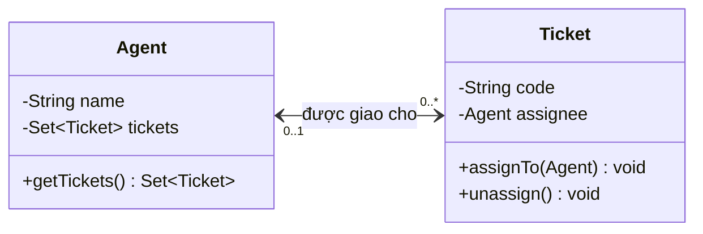

The diagram and bidirectional example below are consistent: `Ticket` can find its assignee, while `Agent` can find its assigned tickets. **Bidirectionality does not imply lifecycle ownership**: unassigning a ticket from Lan does not make the Lan object disappear.

## 3. Runnable Java example: a mutable bidirectional association

Create a file named `AssociationDemo.java`:

```java
import java.util.Collections;
import java.util.LinkedHashSet;
import java.util.Objects;
import java.util.Set;

public class AssociationDemo {

    static final class Agent {
        private final String name;
        private final Set<Ticket> tickets = new LinkedHashSet<>();

        Agent(String name) {
            this.name = Objects.requireNonNull(name, "name");
            if (name.isBlank()) {
                throw new IllegalArgumentException("name must not be blank");
            }
        }

        String getName() {
            return name;
        }

        // Trả về bản sao chỉ đọc để bên ngoài không phá quan hệ.
        Set<Ticket> getTickets() {
            return Collections.unmodifiableSet(
                    new LinkedHashSet<>(tickets));
        }
    }

    static final class Ticket {
        private final String code;
        private Agent assignee; // null: chưa có người phụ trách

        Ticket(String code) {
            this.code = Objects.requireNonNull(code, "code");
            if (code.isBlank()) {
                throw new IllegalArgumentException("code must not be blank");
            }
        }

        String getCode() {
            return code;
        }

        Agent getAssignee() {
            return assignee;
        }

        void assignTo(Agent next) {
            changeAssignee(Objects.requireNonNull(next, "next"));
        }

        void unassign() {
            changeAssignee(null);
        }

        private void changeAssignee(Agent next) {
            if (assignee == next) {
                return; // Giao lại cùng người: không làm gì.
            }

            Agent previous = assignee;
            if (previous != null) {
                previous.tickets.remove(this);
            }

            assignee = next;

            if (next != null) {
                next.tickets.add(this);
            }
        }
    }

    public static void main(String[] args) {
        Agent lan = new Agent("Lan");
        Agent minh = new Agent("Minh");
        Ticket ticket = new Ticket("SUP-42");

        ticket.assignTo(lan);
        System.out.println(ticket.getAssignee().getName()); // Lan
        System.out.println(lan.getTickets().contains(ticket)); // true

        ticket.assignTo(minh);
        System.out.println(lan.getTickets().contains(ticket)); // false
        System.out.println(minh.getTickets().contains(ticket)); // true

        ticket.unassign();
        System.out.println(ticket.getAssignee() == null); // true
        System.out.println(minh.getTickets().isEmpty()); // true
    }
}
```

Run with JDK 11 or later:

```bash
javac AssociationDemo.java
java AssociationDemo
```

Output:

```text
Lan
true
false
true
true
true
```

The key is `changeAssignee()`: when changing the assignee, we **remove the ticket from the previous agent's set**, update the reference, and then **add it to the new agent's set**. This preserves the rule:

```text
agent.getTickets().contains(ticket)
    == (ticket.getAssignee() == agent)
```

The example nests the two classes inside `AssociationDemo` so that the code fits in one file and the collections remain `private`. In a real project, they can be placed in separate files, with relationship updates coordinated through an internal API or domain service. External callers should not be allowed to call `getTickets().add(...)` to change only one side.

**Identity note:** The example stores `Ticket` objects in a `Set` using object identity because `Ticket` does not override `equals()/hashCode()`. If identity must be based on the ticket code, that code must remain stable and the equality/hash rules must be consistent; changing a property used for hashing after an object has been inserted into a `HashSet`/`LinkedHashSet` can break lookup and removal.

## 4. Unidirectional association: when is one reference enough?

If the only requirement is to "see who is assigned to a ticket," we can remove `Set<Ticket>` from `Agent`. Then:

```java
final class Agent {
    private final String name;
    Agent(String name) { this.name = name; }
    String getName() { return name; }
}

final class Ticket {
    private Agent assignee;

    void assignTo(Agent agent) {
        assignee = Objects.requireNonNull(agent);
    }

    Agent getAssignee() {
        return assignee;
    }
}
```

This version is simpler, but we cannot call `agent.getTickets()` directly. To find all of Lan's tickets, the application must scan its tickets or query a repository or database.

Choose a **unidirectional** association when reverse navigation is unnecessary; choose a **bidirectional** association when the business needs both directions and there is a clear owner for synchronization. "There is a business relationship" does not mean "both classes must have reference fields pointing to each other."

## 5. When links involve multiple objects or have their own data

- **One-to-one:** An `Employee` may have at most one `AccessCard` and vice versa, if policy requires it.
- **One-to-many:** An `Agent` can handle many `Ticket` objects, but each ticket has at most one assignee.
- **Many-to-many:** A `Student` takes many `Course` objects; a `Course` has many students.

When **the relationship itself** has an enrollment date, status, grade, or permissions, consider an intermediate `Enrollment(student, course, enrolledAt, status)` object instead of two separate `Set` collections. Each `Enrollment` connects exactly one `Student` and one `Course` while holding the data for that enrollment.

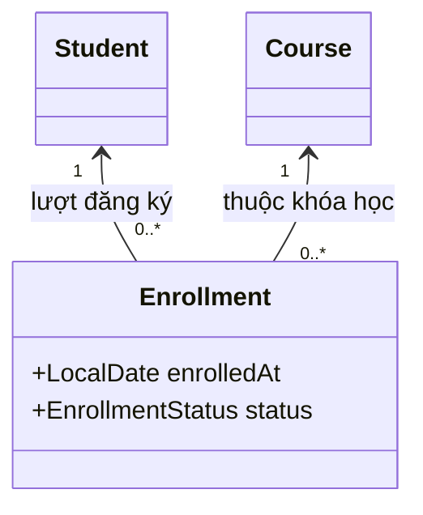

Do not infer multiplicity merely from the presence of a `List` or `Set`: define **both ends** and enforce limits through the API/database when necessary. The multiplicity lesson builds a runnable registry and checks for duplicate enrollments.

## 6. Distinguishing commonly confused relationships

| Concept | Diagnostic question | Example |
|---|---|---|
| **Association** | Does object A know object B or maintain an ongoing relationship with it? | A Ticket is assigned to an Agent. |
| **Dependency** | Does A use B only temporarily, for example as a method parameter? | `ReportService.export(Formatter formatter)`. |
| **Aggregation** | Does one object group other objects that can still exist independently? | A support team contains employees. |
| **Composition** | Is a part owned exclusively by a whole, with a tightly coupled lifecycle? | An order owns its order lines in the domain model. |
| **Inheritance** | Is B truly a kind of A (`is-a`)? | `EmailTicket extends Ticket`. |

Aggregation and composition model whole–part relationships; **a reference field or collection alone does not establish ownership and lifecycle rules**. Those are business rules that must be designed, enforced, and tested.

Do not use inheritance merely because one object "has" another: `Ticket extends Agent` is conceptually wrong because a ticket **is assigned to** an agent; it **is not** an agent.

## 7. Common association-design mistakes

**Updating only one side.** If you change `ticket.assignee` without updating `agent.tickets`, the two directions disagree. Use one controlled entry point for relationship updates.

**Returning a directly mutable collection.** If `getTickets()` exposes the internal `Set`, callers can break invariants by calling `clear()`. Use a read-only copy, a controlled add/remove API, or a unidirectional association.

**Leaving `null` and multiplicity undefined.** `0..1` allows no assignee; `1` requires rejecting missing values or ensuring an assignment is made before the object is considered valid.

**Maintaining both directions unnecessarily.** This increases memory usage, coupling between classes, and the number of places requiring updates. Start with actual queries and operations.

**Confusing an object in RAM with a database row.** Java references represent in-memory relationships; foreign keys represent relationships in a database. ORM tools (such as JPA) have their own loading, owning-side, cascade, and transaction rules. Do not assume that "both Java fields exist" means the two database sides synchronize automatically.

**Ignoring concurrency.** The example illustrates invariants in one thread. If several threads assign the same ticket concurrently, appropriate synchronization/transaction design is necessary; the `remove → assign → add` steps are not automatically atomic in a multithreaded environment.

## 8. Check your understanding

1. If `Ticket` has only `assignee` and `Agent` has no `tickets`, does the "ticket assigned to agent" relationship still exist? **Yes**: it is a unidirectional association.
2. When reassigning a ticket from Lan to Minh in the bidirectional example, what must change? **Remove it from Lan's set, change `assignee`, and add it to Minh's set.**
3. Does a ticket without an assignee violate `0..1`? **No**: zero is permitted.
4. When should you introduce `Enrollment` instead of two `Set` collections? **When each enrollment has its own properties, behavior, or rules**, such as a date, status, or grade.
5. Does declaring `private Agent assignee;` prove that `Agent` owns the lifecycle of `Ticket`? **No**: it is only a reference; lifecycle ownership is a separate modeling decision.

**Remember:** Association describes *who relates to whom*; multiplicity specifies *how many*; navigability specifies *which direction you can traverse*. In Java, encapsulate the creation, modification, and removal of links to ensure those rules always hold.


</details>

- [Back to top](#back-to-top)

---

## <a id="relationships-002">Temporary dependencies and long-lived associations</a>

<details>
<summary>View details</summary>

# Temporary dependencies and long-lived associations in OOP

## 1. Two different ways one object can "use" another

Consider a support-ticket management system:

- A ticket **is assigned to** a support agent. The system needs to remember the assignee for later queries, reassignments, and status displays.
- When sending an assignment notification, the system **uses** a message sender during that send operation. Once the notification is sent, the processing object does not necessarily retain the sender.

Both involve one object using another, but their **design implications differ**:

- A **temporary dependency** (in this example, a *method-level dependency*) arises when one class needs another to perform an operation, such as receiving a parameter, creating a local variable, or calling a static method. The user object need not retain that reference as long-lived state.
- A **long-lived association** models a relationship between objects, often represented by a reference or collection stored in a field. The link can be accessed at different points during an object's lifetime until it is changed or removed.

**"Temporary" and "long-lived" describe how an object uses or stores a relationship; they do not mean the referenced object must be created anew or destroyed when a method returns.** A message sender passed as a parameter could be an application-wide singleton; an association held in a field might change after only one second.

## 2. Recognizing them in UML and Java code

| Criterion | Temporary dependency | Long-lived association |
|---|---|---|
| Main question | "What does class A need B to **do**?" | "Which object B is object A **currently related to**?" |
| Common Java indicators | Method parameters, local variables, static method calls | Reference fields, collections of objects, link-management structures |
| When the reference is needed | While executing the relevant operation | Across multiple operations while the relationship remains in effect |
| UML | **Dashed arrow** from the using class to the used class | **Solid line**, optionally with multiplicities and navigability |
| Example | `TicketService` calls `MessageSender.send(...)` | `Ticket` holds `Agent assignee` |
| Typical consequence | Changing a parameter or implementation may change processing behavior | Changing the link changes business state |
| What must be designed | Inputs, API contract, call-time errors | Multiplicity, replacement/removal, consistency, business lifecycle |

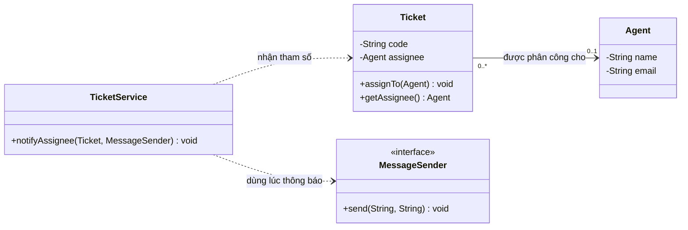

Reading the diagram:

1. The **solid line** from `Ticket` to `Agent`: a ticket may retain a reference to its assignee; each ticket has `0..1` agents, and each agent may handle `0..*` tickets.
2. The **dashed line** from `TicketService` to `MessageSender`: the service needs to know *how to call* the sender while executing `notifyAssignee(...)`, but does not have to store it in a field.
3. `TicketService` also depends on `Ticket` through its method signature. A dependency does not necessarily imply a stored, long-lived association.

## 3. Runnable Java example

Create `RelationshipDemo.java` with the following contents (Java 11+):

```java
import java.util.Objects;

public class RelationshipDemo {

    // Đối tượng nghiệp vụ độc lập: một nhân viên có thể phụ trách nhiều ticket.
    static final class Agent {
        private final String name;
        private final String email;

        Agent(String name, String email) {
            this.name = Objects.requireNonNull(name, "name");
            this.email = Objects.requireNonNull(email, "email");
        }

        String getName() {
            return name;
        }

        String getEmail() {
            return email;
        }
    }

    static final class Ticket {
        private final String code;
        private Agent assignee; // Association: giữ tham chiếu sau khi assignTo() kết thúc.

        Ticket(String code) {
            this.code = Objects.requireNonNull(code, "code");
        }

        String getCode() {
            return code;
        }

        Agent getAssignee() {
            return assignee;
        }

        void assignTo(Agent agent) {
            assignee = Objects.requireNonNull(agent, "agent");
        }

        void unassign() {
            assignee = null;
        }
    }

    interface MessageSender {
        void send(String destination, String message);
    }

    static final class ConsoleSender implements MessageSender {
        @Override
        public void send(String destination, String message) {
            System.out.println("To: " + destination + " | " + message);
        }
    }

    static final class TicketService {
        void notifyAssignee(Ticket ticket, MessageSender sender) {
            Objects.requireNonNull(ticket, "ticket");
            Objects.requireNonNull(sender, "sender");

            Agent assignee = ticket.getAssignee();
            if (assignee == null) {
                throw new IllegalStateException("Ticket has no assignee");
            }

            // Dependency tạm thời: chỉ dùng sender trong lời gọi hiện tại.
            sender.send(
                    assignee.getEmail(),
                    "Bạn được giao ticket " + ticket.getCode()
            );
            // Service không lưu sender hoặc ticket vào field.
        }
    }

    public static void main(String[] args) {
        Agent lan = new Agent("Lan", "lan@example.test");
        Agent minh = new Agent("Minh", "minh@example.test");
        Ticket ticket = new Ticket("SUP-42");
        TicketService service = new TicketService();

        ticket.assignTo(lan);
        service.notifyAssignee(ticket, new ConsoleSender());

        // Liên kết Ticket -> Agent vẫn còn sau lần gửi thông báo.
        System.out.println("Phụ trách: " + ticket.getAssignee().getName());

        // Đổi liên kết nghiệp vụ; không thay code gửi thông báo.
        ticket.assignTo(minh);
        service.notifyAssignee(ticket, new ConsoleSender());

        ticket.unassign();
        System.out.println("Chưa phân công: " + (ticket.getAssignee() == null));
    }
}
```

Compile and run:

```bash
javac RelationshipDemo.java
java RelationshipDemo
```

Output:

```text
To: lan@example.test | Bạn được giao ticket SUP-42
Phụ trách: Lan
To: minh@example.test | Bạn được giao ticket SUP-42
Chưa phân công: true
```

### Analysis at each point in time

| Point in time | State of `ticket.assignee` | `sender` in `notifyAssignee` |
|---|---|---|
| Before `assignTo(lan)` | `null` | Not called yet |
| After `assignTo(lan)` | References the Lan object | Not called yet |
| During the first `notifyAssignee(...)` call | Still references Lan | Parameter holds a reference to `ConsoleSender` |
| After the first call | Still references Lan | `TicketService` does not retain a sender reference |
| After `assignTo(minh)` | References Minh | Dependency type is unaffected |
| After `unassign()` | `null` | Sender is unaffected |

Note: returning from a method **does not guarantee** that the `ConsoleSender` object is garbage-collected immediately. Other code may still hold references to it. The important point is that **`TicketService` does not store it for later calls**.

## 4. Three variations that clarify the difference

### A. Dependency through a method parameter

```java
void sendReceipt(Receipt receipt, MailGateway gateway) {
    gateway.send(receipt.email(), receipt.body());
}
```

`MailGateway` is called during one operation. The caller needs no `gateway` field. This is a straightforward method-level dependency. (The snippet assumes `Receipt` and `MailGateway` have already been declared.)

### B. An association stored as state

```java
final class ProjectTask {
    private final String code;
    private Agent owner;

    ProjectTask(String code) {
        this.code = code;
    }

    void assign(Agent newOwner) {
        owner = Objects.requireNonNull(newOwner);
    }

    Agent getOwner() {
        return owner;
    }
}
```

`ProjectTask` retains the `owner` reference after `assign(...)` returns. The owner can be accessed across different operations. This is a unidirectional object-level association.

### C. Constructor dependency injection: a design dependency with a field

```java
final class NotificationService {
    private final MessageSender sender;

    NotificationService(MessageSender sender) {
        this.sender = Objects.requireNonNull(sender);
    }

    void notify(String email) {
        sender.send(email, "Có thông báo mới");
    }
}
```

Here, `NotificationService` **depends on the `MessageSender` contract** and stores the reference injected through its constructor. Because it has a field, the reference relationship persists across method calls. In UML, depending on the diagram's level of detail, this may be shown as an association to the interface or a dependency on the abstraction.

Therefore, **do not mechanically apply "dependencies only last for one method" or "having a field means it is not a dependency."** Dependency is a broader concept: changing a class or interface definition can affect its users. Association describes a structural relationship between objects and is usually more specific.

## 5. Which representation should you choose in real designs?

Ask yourself:

1. **Will the relationship be queried after the current operation ends?** If you need to remember "who currently owns the ticket," model an association in object state or persistent storage.
2. **Is this business data or a tool for doing work?** A ticket's assignee is a business relationship; formatters, exporters, and senders are often collaborators used for operations.
3. **What does replacing the referenced object mean?** Changing `Agent` changes responsibility for the ticket; changing `MessageSender` from email to SMS mainly changes the notification channel.
4. **Who maintains the link?** A bidirectional association or a relationship with multiplicity constraints needs a consistent update mechanism. A parameter dependency does not require synchronizing two sides merely because a method uses the object.
5. **How frequent are calls, and what is the cost of passing parameters?** If most service methods need a stable collaborator, constructor injection may be more appropriate than repeatedly passing it. This is an API/DI choice, not necessarily a long-lived business relationship.

There is no rule that "long-lived associations are always better" or "short-lived dependencies always reduce coupling." Choose based on the data to retain, class responsibilities, access patterns, and testability.

## 6. Multiplicity, unlinking, and lifecycle

For the example's `Ticket -> Agent` relationship:

- `0..1` at the `Agent` end: a ticket has no assignee or exactly one.
- `0..*` at the `Ticket` end: multiple tickets may refer to the same agent.
- `assignTo(...)` changes the assignee; `unassign()` removes the link. **The Agent object is not deleted** when a ticket is unassigned.
- A Java field stores only **an object reference**, not a "copy" of the object, and does not automatically create a database constraint.

If only `Ticket` stores a field, the association is **unidirectional**. To retrieve tickets from `Agent`, query another data source or introduce reverse navigation. If both sides are stored, every assignment, reassignment, and removal must be synchronized to avoid:

```text
ticket.getAssignee() == lan
nhưng !lan.getTickets().contains(ticket)
```

Association is not the same as **composition**: a ticket referencing an agent does not make the ticket the owner of the agent's lifecycle. When a component's lifecycle belongs to a "whole," explicitly represent that ownership rule in the model and code.

## 7. Why is this distinction useful for testing and maintenance?

**Testing an operation-level dependency:** implement a fake/stub interface and pass it to the method to verify that a notification reaches the right destination without calling a real service. For example:

```java
// Minh họa bên trong phương thức kiểm thử cùng phạm vi các lớp demo.
class CapturingSender implements MessageSender {
    String destination;
    String message;

    @Override
    public void send(String destination, String message) {
        this.destination = destination;
        this.message = message;
    }
}

Ticket ticket = new Ticket("SUP-42");
ticket.assignTo(new Agent("Lan", "lan@example.test"));
CapturingSender sender = new CapturingSender();

new TicketService().notifyAssignee(ticket, sender);

if (!"lan@example.test".equals(sender.destination)) {
    throw new AssertionError("Wrong notification destination");
}
if (!sender.message.contains("SUP-42")) {
    throw new AssertionError("Missing ticket code");
}
```

**Testing an association across operations:** create a ticket, assign it to A, reassign it to B, then remove the assignment. Check `getAssignee()` after *each* step; maintaining or removing the link is business state that must be verified independently of notification success.

**Impact of design changes:** changing the `MessageSender` API may require changes to `TicketService` because of source-level dependency. Changing multiplicity or assignment rules affects the `Ticket` model, assignment API, storage, and business scenarios. These changes require different testing scopes.

## 8. Common mistakes

| Mistake | Consequence | Remedy |
|---|---|---|
| Storing every used object in a field | Redundant state and unclear relationships/lifecycles | Use parameters or locals for collaborators needed only during an operation |
| Passing a business object only as a parameter even when it must be remembered across operations | Relationship state is lost on subsequent operations | Store the link in an aggregate/domain model or repository |
| Assuming the end of a method destroys its argument object | Misunderstanding Java GC and shared references | Distinguish reference-variable scope from object lifecycle |
| Confusing a DI field with a business ownership relationship | Applying inappropriate composition/cascade rules | Separate service dependencies from domain associations |
| Storing a bidirectional association but updating only one end | Navigation in the two directions yields inconsistent results | Encapsulate assignment, reassignment, and unlinking |
| Treating dependency as identical to unidirectional UML association | Ambiguous diagrams missing multiplicity and state | Use dashed lines for usage dependencies and solid lines for modeled associations |

### Practice exercises

Design an invoice-export feature involving `Invoice`, `Customer`, and `PdfExporter`.

1. Each invoice belongs to one customer, whose information must be retrieved during later views. Which relationship is this? **Association** between `Invoice` and `Customer`.
2. On clicking Export PDF, a method receives `PdfExporter` to build the file but does not retain it. Which relationship is this? **Method-level dependency**.
3. What if `InvoiceService` receives `PdfExporter` in its constructor and stores it for repeated use? The service **depends on the exporter abstraction** while also keeping **a structural reference longer than one call**.
4. Does replacing the PDF exporter change the invoice's customer? **No**: these relationships serve different responsibilities.
5. Does removing the invoice–customer link imply deleting the customer object? **No**: association alone does not determine ownership or lifecycle.

**The essential distinction:** dependency answers "**who is needed to perform this operation?**" while association answers "**who is related as part of the model or state?**" In Java, examine where references are stored, their business purpose, and how long relationships must remain accessible; do not draw conclusions solely from an object's lifetime or the appearance of a type in source code.


</details>

- [Back to top](#back-to-top)

---

## <a id="relationships-003">Aggregation and composition</a>

<details>
<summary>View details</summary>

# Aggregation and composition in Java OOP

**Topic:** Two ways of representing **whole–part relationships** between objects: **aggregation** and **composition**. This lesson focuses on choosing the appropriate relationship, identifying **ownership**, designing object lifecycles, and representing relationships in Java/UML.

> **Terminology:** "Aggregation" here means **aggregation in object modeling/UML**, not the `Collection`, `List`, or `Set` types of the Java Collections Framework. A field of type `List<T>` alone does not tell you whether the relationship is aggregation or composition.

## 1. Foundations: a "has/contains" relationship is not enough

Suppose a `Team` has multiple `Employee` objects, and an `Order` has multiple `OrderLine` objects. Both can be represented using reference fields or Java lists:

~~~java
class Team {
    private java.util.List<Employee> employees;
}

class Order {
    private java.util.List<OrderLine> lines;
}
~~~

The syntax above **does not prove** that either relationship is composition. To choose a model, ask:

1. **Does the part have an identity and meaning outside the whole?** An employee remains an employee after leaving a team; an order line usually has meaning only within its particular order.
2. **Who owns and controls the creation, attachment, removal, and destruction of the part?** An order typically manages its own lines, while a team merely groups participating employees.
3. **Can one part belong to several wholes simultaneously?** An employee may join two teams if the business allows it; a particular order line should not belong to two orders at the same time.
4. **What happens when the whole is deleted according to business rules?** Dissolving a team does not mean deleting its employees from the system; deleting a draft order may delete its lines.

These are business rules, not automatic properties of `List`, `new`, `final`, or garbage collection.

## 2. Three commonly confused relationships

| UML relationship | Basic meaning | Example | Notation at the whole end |
|---|---|---|---|
| **Association** | Objects know or interact with one another; not necessarily a whole–part relationship | A `Doctor` examines a `Patient` | Ordinary connecting line |
| **Aggregation** (shared aggregation) | An object groups/contains other objects; the parts can exist independently | A `Team` consists of `Employee` objects | **Hollow** diamond |
| **Composition** | Whole–part relationship with **strong ownership**; each part belongs to at most one whole at a time | An `Order` owns its `OrderLine` objects | **Filled** diamond |

**An important distinction:** UML defines *shared aggregation* (the hollow diamond) loosely, without assigning any specific lifecycle rule. Thus, in a rigorous design document, if all you mean is "the team references employees," an ordinary **association** may be clearer than a hollow diamond. **Composition** has stronger semantics: a part is owned by one composite at a time; when the whole is destroyed in the model, its parts are also destroyed according to the ownership contract.

~~~mermaid
classDiagram
    class Team
    class Employee
    class PurchaseOrder
    class OrderLine
    Team "1" o-- "0..*" Employee : tập hợp / tham gia
    PurchaseOrder "1" *-- "0..*" OrderLine : sở hữu
~~~

In a class diagram, **the diamond always appears at the whole end**: the `Team` or `PurchaseOrder` side, not the part side. The `0..*` multiplicity is specific to this example: a team may have no members yet, and a draft order may have no lines. If a confirmed order must have at least one line, model and enforce that constraint in the appropriate state.

## 3. Aggregation: a team grouping independent employees

Suppose employees may join multiple work teams. `Team` holds references to `Employee` objects, but each `Employee` is created and managed independently. Removing an employee from a team leaves the employee object available for other teams.

**File `AggregationDemo.java` — Java 17+:**

~~~java
import java.util.LinkedHashSet;
import java.util.Objects;
import java.util.Set;

record Employee(String id, String name) {
    Employee {
        Objects.requireNonNull(id, "id");
        Objects.requireNonNull(name, "name");
        if (id.isBlank() || name.isBlank()) {
            throw new IllegalArgumentException("Employee id/name must not be blank");
        }
    }
}

final class Team {
    private final String name;
    private final Set<Employee> members = new LinkedHashSet<>();

    Team(String name) {
        this.name = Objects.requireNonNull(name, "name");
    }

    void addMember(Employee employee) {
        members.add(Objects.requireNonNull(employee, "employee"));
    }

    boolean removeMember(Employee employee) {
        return members.remove(employee);
    }

    Set<Employee> members() {
        return Set.copyOf(members); // Trả về bản xem không sửa được.
    }

    String name() {
        return name;
    }
}

public class AggregationDemo {
    public static void main(String[] args) {
        Employee lan = new Employee("E01", "Lan"); // Tồn tại độc lập
        Team backend = new Team("Backend");
        Team mentoring = new Team("Mentoring");

        backend.addMember(lan);
        mentoring.addMember(lan); // Cùng một Employee ở hai Team

        backend.removeMember(lan);

        System.out.println(backend.members().contains(lan));  // false
        System.out.println(mentoring.members().contains(lan)); // true
        System.out.println(lan.name());                        // Lan
    }
}
~~~

Compile and run: `javac AggregationDemo.java`, then `java AggregationDemo`.

**Important design points:**

- `Employee` is created **before and independently of** `Team`. Leaving a team does not eliminate the employee entity.
- Under the assumed business rules, one employee may belong to multiple teams. If the system allows only one team per employee, add a domain constraint; UML aggregation neither imposes nor checks that rule automatically.
- `Set.copyOf(members)` produces an unmodifiable set, preventing callers from corrupting internal state through `team.members().clear()`. Here, `Employee` is an immutable `record`; if elements were mutable, returning `Set.copyOf` alone would **not** make them immutable.
- `Set` detects duplicates through `equals()/hashCode()`. For `record Employee`, both `id` and `name` take part in equality; a real system might enforce uniqueness by employee ID instead.

**Do not misinterpret lifecycles:** Deleting a `Team` variable or calling `removeMember` does not trigger a "delete Employee object" operation in the JVM. Java has no manual `delete object` operation like C++; an object becomes eligible for GC only when no strong-reference path keeps it reachable, and garbage-collection timing is not guaranteed.

## 4. Composition: an order owning its line items

An `OrderLine` describes the quantity and unit price of an item **within one particular order**. In this model, a line item is created through `Order`, is not shared between orders, and is not managed as an independent entity.

The example uses **private child objects** and behavior-oriented methods rather than exposing a `List<OrderLine>`. This expresses ownership better than merely declaring `private final List<...>`.

**File `CompositionDemo.java` — Java 17+:**

~~~java
import java.math.BigDecimal;
import java.util.ArrayList;
import java.util.List;
import java.util.Objects;

final class Order {
    private final String orderId;
    private final List<LineItem> lines = new ArrayList<>();
    private boolean submitted;

    // Chỉ Order có thể tạo và truy cập kiểu nội bộ này.
    private static final class LineItem {
        private final String sku;
        private final int quantity;
        private final BigDecimal unitPrice;

        private LineItem(String sku, int quantity, BigDecimal unitPrice) {
            this.sku = sku;
            this.quantity = quantity;
            this.unitPrice = unitPrice;
        }

        private BigDecimal subtotal() {
            return unitPrice.multiply(BigDecimal.valueOf(quantity));
        }
    }

    Order(String orderId) {
        this.orderId = Objects.requireNonNull(orderId, "orderId");
        if (orderId.isBlank()) {
            throw new IllegalArgumentException("Order id must not be blank");
        }
    }

    void addLine(String sku, int quantity, BigDecimal unitPrice) {
        if (submitted) {
            throw new IllegalStateException("Submitted order is locked");
        }
        Objects.requireNonNull(sku, "sku");
        Objects.requireNonNull(unitPrice, "unitPrice");
        if (sku.isBlank() || quantity <= 0 || unitPrice.signum() < 0) {
            throw new IllegalArgumentException("Invalid order line");
        }

        // LineItem được tạo và giữ hoàn toàn bên trong Order.
        lines.add(new LineItem(sku, quantity, unitPrice));
    }

    BigDecimal total() {
        return lines.stream()
                .map(LineItem::subtotal)
                .reduce(BigDecimal.ZERO, BigDecimal::add);
    }

    int lineCount() {
        return lines.size();
    }

    void submit() {
        if (submitted) {
            throw new IllegalStateException("Already submitted");
        }
        if (lines.isEmpty()) {
            throw new IllegalStateException("Cannot submit an empty order");
        }
        submitted = true;
    }

    String id() {
        return orderId;
    }
}

public class CompositionDemo {
    public static void main(String[] args) {
        Order first = new Order("ORD-100");
        Order second = new Order("ORD-101");

        first.addLine("JAVA-BOOK", 2, new BigDecimal("125000"));
        second.addLine("JAVA-BOOK", 1, new BigDecimal("125000"));

        first.submit();
        System.out.println(first.total());     // 250000
        System.out.println(second.total());    // 125000
        System.out.println(first.lineCount()); // 1
        System.out.println(second.lineCount());// 1
    }
}
~~~

Compile and run: `javac CompositionDemo.java`, then `java CompositionDemo`.

Two orders may reference the same **product code** `"JAVA-BOOK"`, but each owns a distinct `LineItem` object. This distinguishes **sharing product information** from **sharing the actual part that makes up an order**. A catalog product has its own lifecycle; `LineItem` represents price and quantity in one order.

In the example, `LineItem` is a `private` nested class created by `Order.addLine()` and never exposed through the API. `BigDecimal` is immutable, and the internal list is not exposed. This supports the business invariant that a line cannot be taken from order A and directly attached to order B. `final` on the list reference only prevents reassigning `lines`; **encapsulation and API control** are what protect the list's contents.

**Distinguish the different lifecycle layers:**

- **Domain/UML layer:** if an order is destroyed in the model, its lines are destroyed with it according to business ownership rules; they cannot remain as lines of another order.
- **Java runtime layer:** the JVM does not recursively delete objects at the exact moment you "destroy an order." GC is based on reference reachability; composition must be expressed through APIs and domain rules. If references to parts have escaped, those parts may still exist in memory.
- **Database layer:** deleting an `orders` row does not automatically delete `order_lines` rows; appropriate mechanisms are needed, such as a transaction, a foreign key with `ON DELETE CASCADE`, or correctly configured ORM cascade/orphan removal.

## 5. Recognizing relationships from business requirements

| Question | Suggests aggregation / association | Suggests composition |
|---|---|---|
| Does the part have independent meaning? | Yes: employee, doctor, account | No, or closely tied to the whole: order line |
| Can it simultaneously belong to several wholes? | Possibly, depending on the model | **No**, under UML composition semantics |
| Who manages the part's creation and deletion? | An independent entity/service | Usually the whole |
| Does deleting the whole delete the part in the model? | Usually not | Yes, according to the ownership contract |
| Can two wholes share a reference to the same part? | Potentially valid | Violates exclusivity if both wholes own it |
| Common Java implementation | References/collections pointing to external objects | Create children through owner methods, hide modification APIs, or enforce owner constraints |

**Be cautious with classic examples:** You cannot decide whether `Car` – `Engine` or `House` – `Room` is composition from the words alone. If an engine can be removed and fitted into another car, or rooms are modeled independently in a property-management system, the business requirements differ. In composition, a part may move from composite A to B, but **its old ownership must end before the new ownership begins**; it cannot belong to both at once.

## 6. UML: notation, direction, multiplicity, and navigability

~~~mermaid
classDiagram
    direction LR
    class Organization {
        +name: String
    }
    class Department {
        +name: String
    }
    class Employee {
        +id: String
    }
    class PurchaseOrder {
        +id: String
        +addLine(...)
        +submit()
    }
    class OrderLine {
        +sku: String
        +quantity: int
    }

    Organization "1" o-- "0..*" Department : nhóm các phòng ban
    Department "0..*" -- "0..*" Employee : phân công
    PurchaseOrder "1" *-- "0..*" OrderLine : các dòng riêng
~~~

- A **hollow diamond (`o--`)** denotes shared aggregation; a **filled diamond (`*--`)** denotes composition. The symbol appears at the **whole** end.
- **Multiplicity** indicates the valid number of related objects at each end. For example, `PurchaseOrder "1" *-- "0..*" OrderLine` means each `OrderLine` belongs to exactly one `PurchaseOrder`, while a draft order may have multiple lines. If deleting/moving lines is supported, valid transition states must be defined.
- **Navigability** indicates which object can navigate to the other; it is not the same as ownership. A composition may or may not allow a part to navigate back to its owner through an `order` reference.
- **Aggregation does not automatically define sharing or longevity:** do not assume that every shared aggregation *must* permit joint ownership. Business requirements determine such constraints. If explicit whole–part semantics are unnecessary, an association is often enough.
- Composition **does not always require child objects to exist at initialization**. A draft with no lines is valid if the "submitted" state requires `lineCount >= 1` and that constraint is checked by `submit()`.

## 7. Practical implementation rules in Java

**To model aggregation as intended:**

1. Pass externally created elements to the group's constructor or `addMember()`.
2. When removing an element from a group, change only **its membership relationship**; do not accidentally delete the original element.
3. Return a collection that does not let callers modify internal state; consider snapshots or immutable collections as appropriate.
4. Specify whether elements can be shared among groups or belong to only one; this is a domain rule, not a feature of the diamond symbol.

**To model composition clearly:**

1. Identify the **owner** and whether each part can exist independently.
2. Let the owner create/add/modify/delete parts through business-oriented methods; prevent a part from being attached to multiple owners simultaneously.
3. Do not expose a directly mutable collection or a part whose owner can be reassigned arbitrarily. If parts must be returned, use immutable values, DTOs/snapshots, or owner validation.
4. Check invariants at aggregate boundaries: positive quantities, nonnegative prices, no editing locked orders, and at least one line in submitted orders.
5. Define persistence policy explicitly: which parts are removed when the owner is deleted, and within which transaction. This **does not happen automatically** because of a Java relationship.

Another common form of composition initializes a part once in the constructor:

~~~java
final class Computer {
    private final Motherboard motherboard;

    Computer() {
        this.motherboard = new Motherboard();
    }
}
~~~

This suggests ownership but **does not prove** composition if `Computer` exposes the part reference, allows outside code to change its owner, or permits sharing. The semantics come from domain rules and API design, not from where `new` appears.

## 8. Working with Spring/JPA

Java object graphs, UML, and relationship persistence are three different layers. An `@OneToMany` association **is not enough** to guarantee composition. A deliberate design in which `PurchaseOrderEntity` manages `OrderLineEntity` objects might use:

~~~java
// Minh họa trường ánh xạ trong PurchaseOrderEntity (không phải lớp đầy đủ)
@OneToMany(mappedBy = "order",
           cascade = CascadeType.ALL,
           orphanRemoval = true)
private List<OrderLineEntity> lines = new ArrayList<>();
~~~

Add suitable `@ManyToOne` and `@JoinColumn` fields on the `OrderLineEntity` side, synchronize **both sides** of the association through `addLine/removeLine` methods, and place transactions appropriately. With orphan removal enabled, removing a line from a managed association may delete that line when changes are flushed; ensure that this is the intended business behavior. `CascadeType.ALL` includes REMOVE and is therefore dangerous when the part is a shared entity, such as an `Employee` referenced by multiple teams.

For `Team` – `Employee` aggregation, you generally should not configure cascade REMOVE from Team to Employee. Deleting a team should remove only its memberships (for example, rows in a join table) if employees remain independent. Whether to use `@ManyToMany`, a `Membership` entity, or a join table with its own constraints depends on whether you need to store joining dates, roles, or change history.

## 9. Test behavior rather than code structure

Useful cases for `AggregationDemo` include:

- An `Employee` joining two `Team` objects when allowed by policy.
- Removing the employee from team A without deleting the employee record or affecting membership in team B.
- Ensuring callers cannot modify internal `members` through the returned collection.
- Rejecting blank/null values according to the contract.

For `CompositionDemo`:

- Two `Order` objects adding the same `sku` while keeping **separate line items** and calculating totals independently.
- Rejecting a line with zero quantity or a negative unit price.
- Ensuring `submit()` rejects empty orders and locks modifications after successful submission.
- Preventing external APIs from taking a `LineItem` from order A and attaching it directly to order B.
- Using integration tests to confirm that an order's lines are transactionally deleted when the order is deleted from the database, if required by policy.

Reflection tests are not needed merely to confirm that a `List<LineItem>` field exists or a constructor calls `new LineItem()`; what matters is protecting **ownership rules and observable behavior**.

## 10. Common misconceptions

| Misconception | Why it is wrong | Correction |
|---|---|---|
| "A `List` always means aggregation" | A collection is just a reference-storage structure | Base the choice on domain meaning and lifecycle |
| "A `new` in a constructor always means composition" | Child objects may still be shared or assigned another owner | Enforce ownership through APIs/invariants |
| "Composition means Java immediately deletes children when a parent is deleted" | GC is not a domain cascade mechanism | Separate domain rules, references, and persistence |
| "Aggregation always permits sharing across multiple wholes" | UML shared aggregation does not impose fixed sharing rules | State specific business constraints |
| "The hollow diamond has as strict a definition as the filled diamond" | UML leaves many shared-aggregation details to the modeler | Use association if ownership semantics are unnecessary |
| "A `final List` cannot be modified" | `final` only fixes the reference | Encapsulate the list; return a snapshot/read-only view |
| "`CascadeType.ALL` works for any has-a relationship" | REMOVE may delete shared data | Choose cascades based on actual ownership |

## 11. Application exercises

**Scenario:** A learning platform has `Course`, `Student`, `Enrollment`, `Quiz`, and `Question`.

Decide which relationships are association, aggregation, or composition based on these requirements:

1. A `Student` enrolls in many `Course` objects; deleting a course must not delete its students.
2. `Enrollment` stores the student, course, enrollment date, and status; it exists only for a valid enrollment, but its history must be retained even after the course closes.
3. Each `Quiz` has its own `Question` objects; discarding a draft quiz discards its draft questions. The original question bank (if any) remains independent and may be used to create copies for another quiz.

**Design guidance:** `Course` – `Student` is related through `Enrollment` rather than direct composition; `Enrollment` has its own lifecycle governed by history-retention rules; `Quiz` and its individually owned `Question` copies may form a composition, while `QuestionBankEntry` is an independent entity that is referenced or copied. The diagram is correct only when its stated constraints are enforced.

**Self-check:** Can you identify who may create/delete a part, which data must be retained when the whole is deleted, and how many wholes a part may belong to at one time?

---

**Remember:** *Aggregation* describes a loose whole–part relationship whose parts can exist independently; *composition* represents **strong, exclusive ownership at any given time**. The distinction lies in the **domain contract** and how it is enforced, not in whether Java uses fields, collections, or `new`.

</details>

- [Back to top](#back-to-top)

---

## <a id="relationships-004">Multiplicity: one-to-one, one-to-many, and many-to-many</a>

<details>
<summary>View details</summary>

# Multiplicity in OOP relationships: one-to-one, one-to-many, and many-to-many

**Scope:** Relationships between objects in object-oriented programming (OOP), expressing their cardinalities using UML (*multiplicity/cardinality*), and implementing and maintaining business rules in Java.

A relationship such as "students take courses" is not enough to design classes. You must also ask: **how many courses may each student take, and how many students may take each course?** The cardinality at both ends determines data structures, update APIs, consistency safeguards, and sometimes persistence design.

## 1. Reading relationship multiplicity correctly

In UML, multiplicity appears **at the end near the class whose instances it counts**. For example, `Department "1" -- "0..*" Employee` means:

- A `Department` may be linked to **zero or more** `Employee` objects.
- Each `Employee` is linked to **exactly one** `Department` in this model.

| UML notation | Meaning | Example |
| --- | --- | --- |
| `1` | Exactly one | Each warranty record belongs to exactly one product in the chosen system |
| `0..1` | Zero or one | A user may not yet have created an extended profile |
| `0..*` (or `*`) | Zero or many | A new project may have no tasks |
| `1..*` | At least one | A team must have at least one member |
| `2..5` | From two to five | A table reservation covers 2–5 people under the application's booking rules |

`1`, `0..1`, and `0..*` are **cardinality constraints** in the model, not Java data types. A single field (`User owner`) or collection (`List<Task>`) is just an implementation choice; neither automatically enforces those constraints.

### Three familiar relationship types

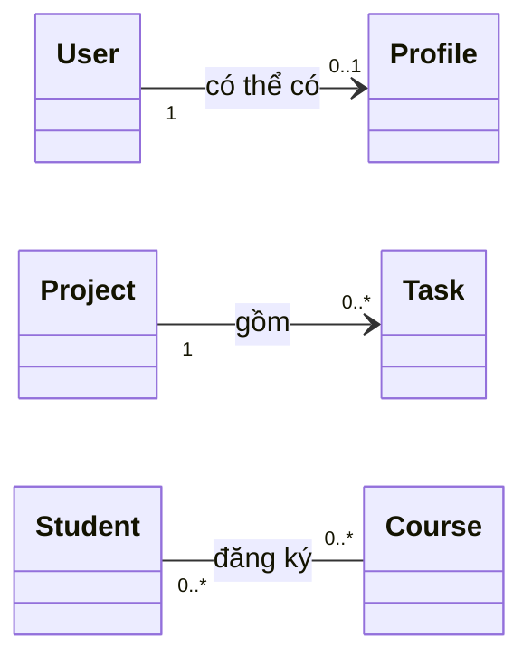

| Type | From A's perspective | From B's perspective | Practical example |
| --- | --- | --- | --- |
| One-to-one (1–1) | Each A has at most/exactly one B, depending on the constraint | Each B has at most/exactly one A | An account has one profile issued by the system |
| One-to-many (1–N) | One A has many B objects | Each B belongs to one A within the model | A project has many tasks |
| Many-to-many (N–N) | One A relates to many B objects | One B relates to many A objects | Students enroll in multiple courses, each taken by many students |

**Note:** 1–1 does not always require `1` at both ends. `1`–`0..1` is often described as a one-to-one relationship that is *optional* at one end. Similarly, 1–N may mean `1`–`0..*` or `1`–`1..*`, depending on business rules.

## 2. One-to-one: exactly one or at most one?

For example, every `User` always has a `Profile` created at the same time. The intended relationship is `User (1) -> Profile (1)`. A reference variable conveniently represents one end:

```java
final class User {
    private final Profile profile;

    User(String displayName) {
        this.profile = new Profile(displayName);
    }

    Profile profile() {
        return profile;
    }
}

record Profile(String displayName) { }
```

Here, the `User` constructor always creates a `Profile`; after successful construction, `profile` cannot be reassigned. If the constructor instead accepts an external `Profile`, it must check for `null` and establish whether that `Profile` may be shared.

A `Profile profile` reference variable **does not guarantee system-wide uniqueness**. For example:

```java
Profile shared = new Profile("An");
// Hai object khác nhau vẫn có thể trỏ tới cùng shared
// nếu API cho phép truyền shared vào constructor.
```

If the rule is "each profile belongs to only one person," enforce it through APIs/domain services, a registry, or uniqueness constraints in storage. `private` and `final` only restrict access and reassignment at a particular location; they do not establish a global one-to-one rule.

**Optional `0..1` variation:** an account may not yet have a completed profile. You can allow `Profile profile` to be `null` under a clear contract, or use `Optional<Profile>` as the getter's **return type**. Do not mistake `Optional` for a uniqueness guarantee across all `User` objects.

## 3. One-to-many: a parent object and a collection of children

A `Project` has many `Task` objects; each `Task` belongs to exactly one project (under the example's rules).

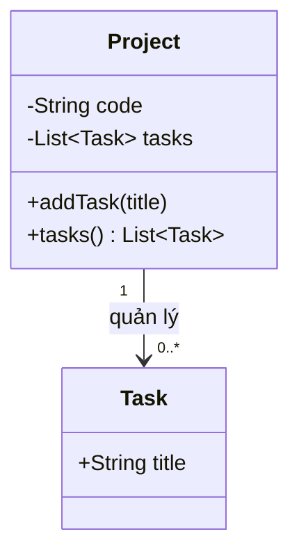

A common representation on the one side:

```java
private final List<Task> tasks = new ArrayList<>();
```

For a one-to-many relationship, you need to address **two sets of rules**:

1. **Cardinality:** may a project have 0 tasks, or must it have at least 1? Is there a maximum?
2. **Integrity:** may tasks move between projects, who may add/delete them, and do tasks with identical contents count as two separate tasks?

If `getTasks()` returns a mutable internal list, callers can use `clear()` or `add()` to bypass business constraints. Prefer explicit operations on the managing object, such as `addTask`, `removeTask`, and `moveTask`, with only read-only lists or snapshots exposed.

| Structure | Suitable when | Watch out for |
| --- | --- | --- |
| `List<Task>` | Order matters and elements may duplicate according to `equals` | Check for duplicate IDs if required |
| `Set<Task>` | Duplicates should be excluded according to `equals/hashCode` | Define stable equality |
| `Map<TaskId, Task>` | Fast lookups and uniqueness by ID are needed | Keep keys consistent with object IDs |

**Bidirectional relationship:** if `Task` also has `Project project`, each task move must update **all of** `oldProject.tasks`, `newProject.tasks`, and `task.project` as one valid operation. Avoid allowing arbitrary callers to invoke a setter on just one side, which can produce "task points to A but appears only in B's list."

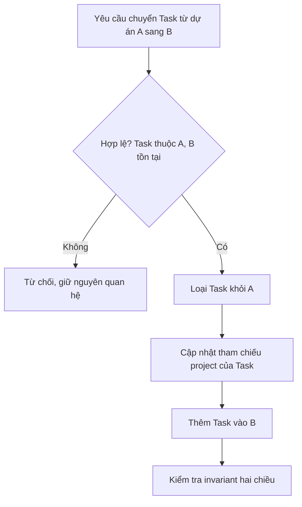

In transactional/database-backed applications, the entire update should be enclosed in an appropriate transaction to avoid partial state after a failure.

## 4. Many-to-many: choose the representation deliberately

For example, a `Student` may take many `Course` objects, and a `Course` may have many `Student` objects.

A straightforward in-memory representation uses two sets:

```java
class Student {
    Set<Course> courses = new HashSet<>();
}
class Course {
    Set<Student> students = new HashSet<>();
}
```

However, this sketch is not safe yet: who is authorized to update it? Adding to `student.courses` without updating `course.students` leaves the sides inconsistent; if `HashSet` is used, `equals/hashCode` must also remain stable. These fields also have default access and no business validation.

### Using an intermediate object when the relationship has its own data

Course enrollment often has `enrolledOn`, `status`, `grade`, and other properties. These are **attributes of the enrollment**, not of the student or course independently. Introduce `Enrollment` to give the relationship explicit identity and rules:

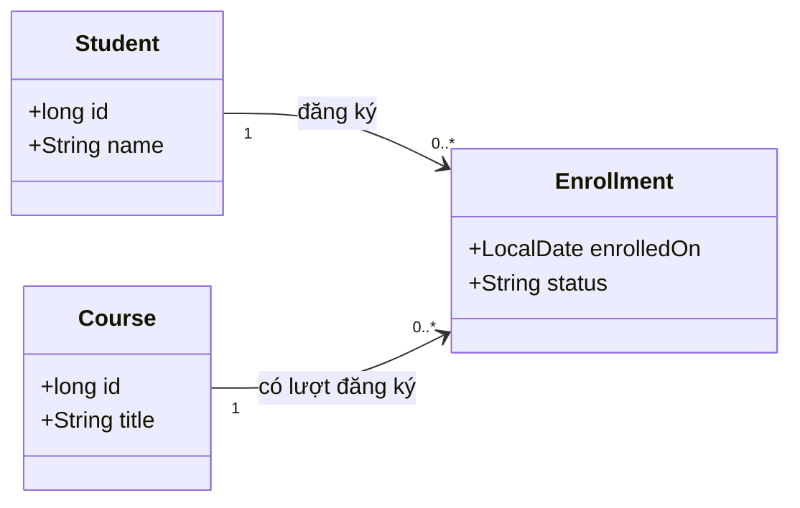

Each `Enrollment` is associated with exactly one `Student` and exactly one `Course`. The original N–N relationship is thus represented by **two 1–N relationships** involving the intermediate object.

Benefits include preventing duplicate enrollment for the `(studentId, courseId)` pair and storing enrollment dates, pending/confirmed status, grades, business history, or course-specific conditions.

In a relational database, the `enrollment` table typically has `student_id` and `course_id` foreign keys and a unique constraint on the pair if duplicate enrollment is forbidden. With JPA/Hibernate, `@ManyToMany` may be used for a pure link, but an `Enrollment` entity is usually clearer and easier to extend when the relationship has its own data. Annotations do not replace explicit rules for updating both sides or enforcing uniqueness.

## 5. Complete Java example of all three types

Place the following code in `MultiplicityDemo.java` (Java 17 or later). The example deliberately manages the many-to-many relationship in one registry; `Student` and `Course` do not each need separate lists that could become inconsistent.

```java
import java.time.LocalDate;
import java.util.ArrayList;
import java.util.LinkedHashMap;
import java.util.List;
import java.util.Map;
import java.util.Objects;

public class MultiplicityDemo {

    // 1–1 bắt buộc: mỗi User tạo đúng một Profile.
    static final class User {
        private final String email;
        private final Profile profile;

        User(String email, String displayName) {
            this.email = nonBlank(email, "email");
            this.profile = new Profile(nonBlank(displayName, "displayName"));
        }

        Profile profile() {
            return profile;
        }
    }

    record Profile(String displayName) { }

    // 1–N: mỗi Project quản lý từ 0 đến nhiều Task.
    static final class Project {
        private final String code;
        private final List<Task> tasks = new ArrayList<>();

        Project(String code) {
            this.code = nonBlank(code, "code");
        }

        void addTask(String title) {
            tasks.add(new Task(nonBlank(title, "title")));
        }

        List<Task> tasks() {
            return List.copyOf(tasks); // snapshot không thể chỉnh danh sách
        }
    }

    record Task(String title) { }

    record Student(long id, String name) {
        Student {
            if (id <= 0) throw new IllegalArgumentException("student id");
            name = nonBlank(name, "student name");
        }
    }

    record Course(long id, String title) {
        Course {
            if (id <= 0) throw new IllegalArgumentException("course id");
            title = nonBlank(title, "course title");
        }
    }

    // Khóa liên kết: cùng sinh viên + cùng khóa học => cùng một đăng ký.
    record EnrollmentKey(long studentId, long courseId) { }

    record Enrollment(Student student, Course course, LocalDate enrolledOn) {
        Enrollment {
            Objects.requireNonNull(student, "student");
            Objects.requireNonNull(course, "course");
            Objects.requireNonNull(enrolledOn, "enrolledOn");
        }
    }

    static final class EnrollmentRegistry {
        private final Map<EnrollmentKey, Enrollment> byPair =
                new LinkedHashMap<>();

        boolean enroll(Student student, Course course, LocalDate day) {
            Objects.requireNonNull(student, "student");
            Objects.requireNonNull(course, "course");
            Objects.requireNonNull(day, "day");

            EnrollmentKey key = new EnrollmentKey(student.id(), course.id());
            if (byPair.containsKey(key)) return false;

            byPair.put(key, new Enrollment(student, course, day));
            return true;
        }

        List<Enrollment> forStudent(Student student) {
            Objects.requireNonNull(student, "student");
            return byPair.values().stream()
                    .filter(e -> e.student().id() == student.id())
                    .toList();
        }

        int count() {
            return byPair.size();
        }
    }

    private static String nonBlank(String text, String field) {
        if (text == null || text.isBlank()) {
            throw new IllegalArgumentException(field + " must not be blank");
        }
        return text;
    }

    public static void main(String[] args) {
        User user = new User("an@example.com", "An");
        System.out.println(user.profile().displayName());

        Project project = new Project("P-01");
        project.addTask("Phan tich");
        project.addTask("Kiem thu");
        System.out.println(project.tasks().size());

        Student an = new Student(1, "An");
        Student binh = new Student(2, "Binh");
        Course java = new Course(10, "Java OOP");
        Course sql = new Course(11, "SQL");

        EnrollmentRegistry registry = new EnrollmentRegistry();
        System.out.println(registry.enroll(an, java, LocalDate.of(2026, 10, 1)));
        System.out.println(registry.enroll(an, java, LocalDate.of(2026, 10, 2)));
        registry.enroll(an, sql, LocalDate.of(2026, 10, 3));
        registry.enroll(binh, java, LocalDate.of(2026, 10, 3));

        System.out.println(registry.forStudent(an).size());
        System.out.println(registry.count());
    }
}
```

Run:

```bash
javac MultiplicityDemo.java
java MultiplicityDemo
```

Expected output:

```text
An
2
true
false
2
3
```

Explanation:

- `User` creates a `Profile` in its constructor. This implements a mandatory 1–1 relationship within the example's instances.
- `Project` has two `Task` objects; `List.copyOf` prevents callers from modifying the list through the getter. Because `Task` is a record with immutable `String` components, callers cannot directly modify the elements either.
- `EnrollmentRegistry` stores one link per ID pair. Repeating enrollment `(1, 10)` returns `false` and creates no new record.
- One student has 2 enrollments; the registry has 3 in total. Two students take the same `java` course, illustrating N–N.

**Demo limitations:** `EnrollmentRegistry` runs in memory, assumes student/course identifiers are unique, does not verify their existence in storage, and **is not thread-safe**. In a system handling concurrent requests, transactions and database uniqueness constraints are needed; checking `containsKey` and then calling `put` is not inherently atomic.

## 6. Multiplicity is not the same as ownership

Distinguish two independent questions:

- **Multiplicity:** **how many** objects may occur at each end?
- **Relationship type/lifecycle:** under what rules does one object **reference, share, manage, or own** the other?

For example, `Project 1 -- 0..* Task` could be modeled as an association in which tasks survive project reassignment, or as composition if tasks only make sense within a project's lifecycle. Both are 1–N, but deletion, transfer, and ownership behavior differ.

**Navigability** is also independent of multiplicity: `Project` may know its `Task` list, `Task` may know its `Project`, both may know each other, or a registry/query service may resolve the relationship. Having reference fields in both classes does not turn a 1–N relationship into N–N.

## 7. Invariants to maintain for each type

| Type | Important invariant | Where to enforce it |
| --- | --- | --- |
| Mandatory 1–1 | A has exactly one B, and B does not belong to two A objects if forbidden | Constructor/factory; domain checks; storage uniqueness |
| Optional 1–1 | A has at most one B; it may have none | Assignment/removal methods, uniqueness constraints, explicit nullability |
| 1–N | A child belongs to exactly one owner and never appears in two collections against the rules | Centralized add/move/remove operations |
| N–N | An A–B pair is valid and not duplicated if required | Association object/registry; unique composite key |
| All types | No orphaned, inconsistent, or bypassable links | Encapsulation, validation, transactions, tests |

Common mistakes include:

1. **Assuming `List` means many-to-many.** A `List` represents multiple objects at one end; whether the relationship is 1–N or N–N depends on the other end too.
2. **Assuming `@OneToOne` or a single field is enough.** Uniqueness and non-null constraints also depend on the model, API, and storage configuration.
3. **Omitting an intermediate object when the relationship has attributes.** `Enrollment.grade` is not a grade shared by every course or every student.
4. **Partially updating a bidirectional relationship.** Adding to only one collection makes in-memory data inconsistent.
5. **Exposing an internal mutable collection.** Callers may bypass minimum/maximum counts, uniqueness, or reverse-link rules.
6. **Using `Set` when `equals/hashCode` depends on mutable fields.** Changing such a field while the object is in a hash collection can break lookup and removal.
7. **Ignoring concurrency.** Two requests may both check that "no link exists" and then both write; suitable uniqueness constraints/transactions are required.

## 8. Application exercises

**Exercise A — Identify multiplicity.** Draw UML for these requirements:

- A customer may have zero or more delivery addresses; each address belongs to exactly one customer in the model.
- An employee may be issued zero or one access card; each card is assigned to exactly one employee.
- An author writes multiple books, and a book may have multiple authors.

**Exercise B — Implement bounded 1–N.** A `Team` has **1 to 5** members; duplicate member IDs are forbidden. Design `addMember`/`removeMember`. A team must initially have at least one member; removing the final member must either be rejected or dissolve the team according to business rules.

**Exercise C — Extend N–N.** Add `status` (`PENDING`, `ACTIVE`, `CANCELLED`) and `grade` to `Enrollment`. Decide whether re-enrolling in a cancelled course should *update the previous record* or *create a new enrollment*, then choose suitable keys/uniqueness constraints. The correct choice depends on history-retention rules.

**Exercise D — Code review.** Suppose `Course` contains `List<Student>` but `Student` stores no course list. Explain why the relationship **can still** be N–N; propose querying "courses taken by student X" through a repository/registry without maintaining two collections.

### Final design self-check

For each relationship, state two things: "**how many B objects can one A have?**" and "**how many A objects can one B have?**" Specify whether `0` is allowed, uniqueness requirements, how links are created/removed/moved, and where invariants are enforced. Only then choose a single field, `List`, `Set`, `Map`, or association class.


</details>

- [Back to top](#back-to-top)

---

## <a id="relationships-005">Association direction and navigability</a>

<details>
<summary>View details</summary>

# Association direction and navigability in OOP

## 1. What is association direction?

In object-oriented modeling, an **association** describes a relationship between objects. **Navigability** indicates whether an object can **follow the relationship to reach an object at the other end**.

For example, consider a sales management system:

- From an order, we need to find the customer who placed it to display their name and delivery address.
- From a customer, we *may* need to list all of their orders.
- These two access requirements **are different**: implementing `Order → Customer` does not automatically provide `Customer → Order`.

Distinguish three concepts:

| Concept | Design question | Example |
|---|---|---|
| **Association** | What business relationship exists between the object types? | An order belongs to a customer. |
| **Navigability** | From object A, can we directly access object B through the relationship? | `order.getCustomer()`. |
| **Multiplicity** | How many objects on the other side can one object be related to? | An order has exactly one customer; a customer has many orders. |

**Association direction is not the direction of data flow, control flow, or object creation.** A customer may be created before an order, even if navigation is only possible from `Order` to `Customer`.

## 2. Reading UML notation

### Unidirectional association

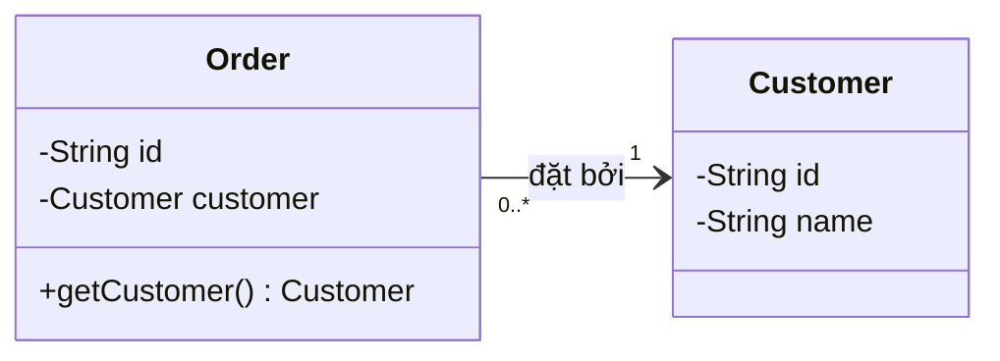

Read the diagram as follows:

- A **solid line with an arrow `Order → Customer`**: from an order object, the customer object can be accessed.
- `1` near `Customer`: **each order is associated with exactly one customer**.
- `0..*` near `Order`: **each customer may have zero or more orders**.
- No `orders` field exists in `Customer`: reverse navigation is not directly available through a call on the `Customer` object. A repository or other structure may still provide the query.

**Multiplicity reading rule:** a label near *one endpoint* counts how many objects at that end can be associated with *one object at the opposite endpoint*.

### Bidirectional association

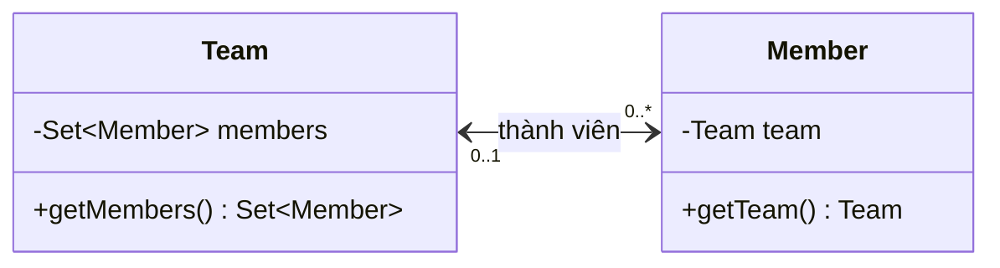

Reading the diagram:

- `Team` can locate its current `Member` objects.
- `Member` can locate the `Team` it currently belongs to.
- `0..1` next to `Team`: a member belongs to at most one team at a time.
- `0..*` next to `Member`: a team can have many members.

In UML, **an association line without arrows is not sufficient evidence that it is bidirectional**: depending on notation and diagram conventions, missing arrows may mean **navigability is unspecified**. If bidirectionality matters, explicitly model both directions or explain them in a note.

## 3. Unidirectional relationships in Java: store only the required path

Create `UnidirectionalDemo.java`:

```java
import java.util.Objects;

public class UnidirectionalDemo {

    static final class Customer {
        private final String id;
        private final String name;

        Customer(String id, String name) {
            this.id = Objects.requireNonNull(id);
            this.name = Objects.requireNonNull(name);
        }

        String getId() {
            return id;
        }

        String getName() {
            return name;
        }
    }

    static final class Order {
        private final String id;
        private final Customer customer;

        Order(String id, Customer customer) {
            this.id = Objects.requireNonNull(id);
            this.customer = Objects.requireNonNull(customer);
        }

        Customer getCustomer() {
            return customer;
        }

        String getId() {
            return id;
        }
    }

    public static void main(String[] args) {
        Customer lan = new Customer("C01", "Lan");
        Order order = new Order("O100", lan);

        // Điều hướng hợp lệ: từ Order đến Customer.
        System.out.println(order.getCustomer().getName()); // Lan
        System.out.println(order.getId());                 // O100

        // Không có lan.getOrders(): Customer không lưu chiều ngược.
    }
}
```

Run:

```bash
javac UnidirectionalDemo.java
java UnidirectionalDemo
```

Output:

```text
Lan
O100
```

What happens in memory?

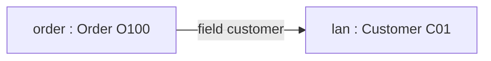

`order` holds **a reference** to `lan`, not a copy of the `Customer`. In Java, a `Customer` object without an `orders` field **has no built-in reverse navigation in this design**. We can still find `Order` objects by customer through storage or by scanning a collection of orders.

**When this works well:** the application often needs to display a customer from an order; a purchase-history page can query a repository instead of loading/storing all orders inside each `Customer`.

## 4. If both directions are needed: synchronize one relationship correctly

For `Team ↔ Member`, each `Member` belongs to at most one `Team`. If `Member.team == t`, the `t.members` set must contain that member; moving teams requires **removing from the old team → changing the reference → adding to the new team**.

The Java 11+ example below uses a single update entry point and maintains both references in the same object graph. Save it as `BidirectionalNavigationDemo.java`:

```java
import java.util.LinkedHashSet;
import java.util.Set;

public class BidirectionalNavigationDemo {
    static final class Team {
        private final Set<Member> members = new LinkedHashSet<>();

        Set<Member> members() {
            return Set.copyOf(members);
        }
    }

    static final class Member {
        private Team team;

        Team team() {
            return team;
        }

        void moveTo(Team next) {
            if (team == next) return;
            if (team != null) team.members.remove(this);
            team = next;
            if (next != null) next.members.add(this);
        }
    }

    public static void main(String[] args) {
        Team first = new Team();
        Team second = new Team();
        Member member = new Member();

        member.moveTo(first);
        member.moveTo(second);

        System.out.println(first.members().isEmpty());       // true
        System.out.println(second.members().contains(member)); // true
        System.out.println(member.team() == second);          // true
    }
}
```

```bash
javac BidirectionalNavigationDemo.java
java BidirectionalNavigationDemo
```

Output: three lines containing `true`. The two nested types share an enclosing class, so Java allows them to access one another's `private` fields. `Member` is the sole update entry point; `Team.members()` returns a snapshot so callers cannot break links using external `add/remove` calls.

This is only a minimal single-threaded demonstration; it **lacks capacity validation, partial-failure handling, and concurrency locking**. The lesson **Bidirectional relationships and data consistency** extends the idea to departmental transfers with pre-update validation, full-department cases, invariant tests, and a JPA example. Do not add reverse navigation simply to "complete the diagram" when the application does not query in that direction.

## 5. Choosing one or two directions: follow actual queries

| Scenario | Direction to consider | Reason |
|---|---|---|
| Display an order's customer | `Order → Customer` | The order needs the customer; little extra state to manage |
| Display a customer's purchase history | Query a repository, or `Customer → Order` if appropriate | Not every order must be held in a customer's RAM |
| Members must know their team, and teams must list members for assignments | Bidirectional `Team ↔ Member` | Business operations frequently query both directions |
| Check a document's permissions through its owner | `Document → Owner` | The document contains enough information for the check |
| Many-to-many between learners and courses, with enrollment dates/status | Intermediate `Enrollment` object | The relationship has its own data and rules |

Use a bidirectional association when the domain genuinely needs it. However, **do not implement both directions merely because the logical relationship is symmetric**. Adding reverse fields comes at a cost: synchronization, potential reference cycles, and often tighter coupling between classes.

### Example: many-to-many and an association class

If a student enrolls in many courses and each course has many students, storing a `Set` on each side may suffice when the link is just a pair. But if an "enrollment" has `registeredAt`, `status`, or `finalGrade`, introduce `Enrollment`:

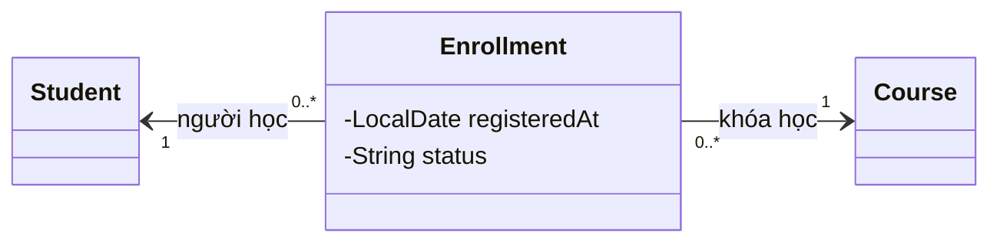

The `Enrollment` class holds information about **the association itself**. Whether Student or Course offers reverse navigation to Enrollment is still a separate decision based on fields and query design.

## 6. Two ways of providing access paths in a design

**Structural navigation in an object graph:** object A has a field referencing object B. For example, `member.getTeam()` works through `Member.team`.

**Repository-based query direction:** A does not store a B field/collection, but the application can still find B through a query. For example:

```java
interface OrderRepository {
    // Chỉ là contract minh họa, triển khai qua JDBC/JPA/...
    java.util.List<Order> findByCustomerId(String customerId);
}

// Ở service:
java.util.List<Order> orders = repository.findByCustomerId(customer.getId());
```

The above **does not automatically turn `Customer` into a bidirectional association in the object graph**; it only shows that a business operation can retrieve data in the reverse direction through another component. In practice, SQL/JPA mapping, lazy loading, and caching affect performance, but do not change what the direction means in an object diagram.

## 7. Are navigability and dependency the same thing?

No. UML distinguishes different kinds of relationships:

- **Association** (solid line): represents links between instances; navigability describes whether one end can be reached from the other.
- **Dependency** (dashed arrow): one component uses or depends on another component's definition, such as a service accepting an interface parameter.
- **Inheritance/generalization** (solid line with a hollow triangle pointing toward the parent): an "is-a" relationship, not a navigation path between two objects.

Example:

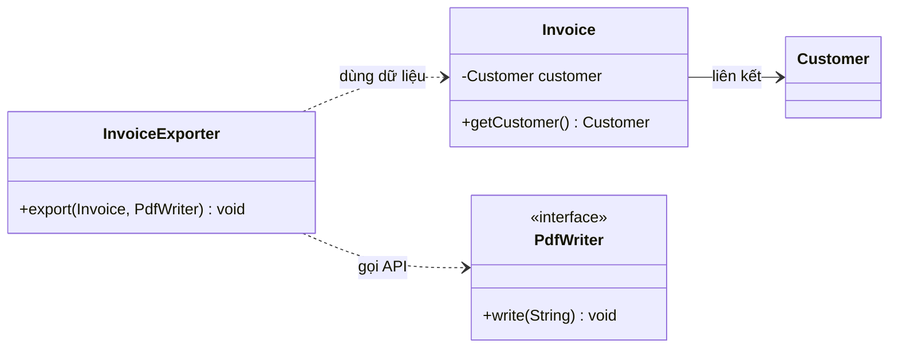

`InvoiceExporter` may use `Invoice` and `PdfWriter` in one call without retaining them as state. A dependency arrow does not imply a long-lived object link or that `PdfWriter` has reverse knowledge of the exporter.

## 8. Common navigability design mistakes

| Design mistake | Consequence | Improvement |
|---|---|---|
| Adding reverse fields without a query requirement | More state to synchronize and potential reference cycles | Use one direction plus a repository if sufficient |
| `getMembers()` returns a mutable internal collection | Callers bypass the update entry point | Return an appropriate snapshot or immutable view |
| Updating one side but not the other | `member.team` and `team.members` give different "truths" | One method coordinates the link |
| Two setters call each other unconditionally | Infinite recursion, possibly `StackOverflowError` | One side coordinates; internal helpers do not call back |
| Directly serializing `Team → Member → Team` | Cyclic object graphs may cause deeply recursive JSON | Use DTOs containing only the necessary data |
| Inferring ownership from a UML arrow | Mistakenly assuming changing a link deletes the other object | Separate navigability from lifecycle/cascade |
| Assuming JPA `mappedBy` automatically updates both Java sides | The two sides remain inconsistent until reloading | Synchronize the object graph; understand the owning side and transactions |

**Note:** a reference cycle between two objects does not itself cause a JVM memory leak; GC uses reachability from GC roots. However, retaining large collections and concurrently updating both directions still calls for suitable storage, locking, or transaction mechanisms. The next lesson shows concrete techniques for preserving invariants when operations may fail.

## 9. Design-check exercises

**Exercise 1.** Each warranty record belongs to one product. The system only opens records and views products, while the record list is queried from the database. Which navigation direction should be used?

**Hint:** `Warranty → Product` is sufficient in the object graph; the record list can be retrieved via a repository query using the product code.

**Exercise 2.** A library manages many books, and the application frequently asks "which library currently holds this book?" and "which books does this library currently manage?" Choose direction and multiplicity if books may be unassigned to any library.

**Hint:** `Library ↔ Book`: beside `Library`, put `0..1`; beside `Book`, put `0..*`. Moving a book from A to B requires removing it from A, updating its reference, and adding it to B.

**Exercise 3.** Identify the bug:

```java
// Giả sử Team có tập members, Member có field team.
member.setTeam(teamA);
teamB.getMembers().add(member);
```

**Hint:** the two sides are inconsistent, and unrestricted mutation APIs make the problem easier to introduce. Replace them with a controlled relationship operation that updates both sides correctly.

**Exercise 4.** Why can you call `findOrdersByCustomerId(id)` while still describing the `Order → Customer` object model as unidirectional?

**Hint:** the query lives in the repository and does not create a `Customer.orders` field. Application-level data access paths are broader than direct object references.

**Exercise 5.** Is a UML association without arrows necessarily bidirectional?

**Hint:** no. If a diagram must communicate navigability precisely, specify it explicitly or agree on conventions before interpreting the diagram.

---

**Key takeaway:** *Association* answers "who is related to whom?", *multiplicity* answers "how many objects can be related at each end?", and *navigability* answers "can this object directly reach the other one?" Implement only the directions actually needed, and if both ends are stored, preserve consistency through a controlled update API.


</details>

- [Back to top](#back-to-top)

---

## <a id="relationships-006">Bidirectional relationships and data consistency</a>

<details>
<summary>View details</summary>

# Bidirectional relationships and data consistency in OOP (Java)

In object-oriented programming, a **bidirectional association** exists when two objects can each navigate to the object at the other end. For example, an employee knows their department, and a department knows its list of employees.

The difficult part is not adding two reference fields. It is **keeping both fields consistent with the same reality** after every link addition, removal, transfer, error, and database update.

This lesson focuses on Java implementation rules, with a standalone runnable example and practical notes about JPA/Hibernate.

## 1. Unidirectional and bidirectional relationships

Suppose each `Employee` belongs to at most one `Department`, while each `Department` may have many `Employee` objects.

**Unidirectional:** only the employee stores a `department` reference; a repository can be queried to find the department's employees. A collection in `Department` is not necessarily required.

**Bidirectional:** `Employee` stores `department` and `Department` stores an `employees` collection.

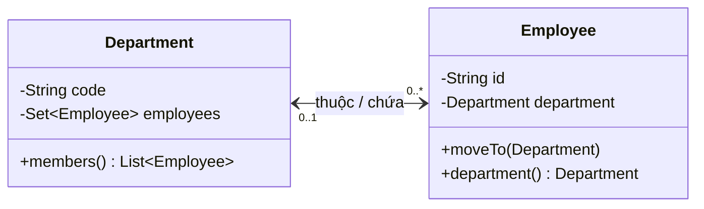

In the example, an employee may have no department (`0..1`), and a department may have no employees (`0..*`). **Multiplicity** and **navigability** are separate decisions: a 1–N relationship does not require bidirectional references.

| Design | Data stored in objects | Advantage | Cost |
| --- | --- | --- | --- |
| Unidirectional `Employee -> Department` | Each `Employee` knows one `Department` | Less duplicated state; simpler | Finding employees by department requires querying or scanning |
| Unidirectional `Department -> Employee` | The department stores an employee collection | Easy iteration over members | Cannot directly query an employee's department through a field |
| Bidirectional | Both sides store references | Fast navigation both ways in the object graph | Every update must synchronize both sides |
| IDs only, queried through a service | Object references need not be retained | Less coupling; convenient at system boundaries | Requires querying/caching and enforcing rules in the data layer |

**Do not choose bidirectionality just because it is possible:** adding a navigation path also increases the state that must be kept consistent.

## 2. Define invariants before writing code

For every `Employee e` and `Department d` within the same management scope:

```text
e.department == d   <=>   d.employees chứa đúng đối tượng e
```

This is a **bidirectional invariant**. It implies:

1. If `e.department == null`, `e` must not appear in any department's employee list.
2. If department `A` contains `e`, `e.department` must point back to `A`.
3. If an employee may belong to only one department, no other department may contain the employee simultaneously.
4. Additional constraints (capacity, active-employee status, unique employee IDs within a department, etc.) must also hold after a successful operation.

A common one-sided update mistake:

```java
// Giả sử employee đang thuộc phòng A:
employee.setDepartment(departmentB);

// Nếu A.employees vẫn chứa employee và B.employees chưa thêm,
// ba tham chiếu cùng mô tả ba trạng thái khác nhau.
```

Likewise, `departmentB.getEmployees().add(employee)` modifies only collection B, not `employee.department`. Two independent setters make it easy for callers to forget the other half.

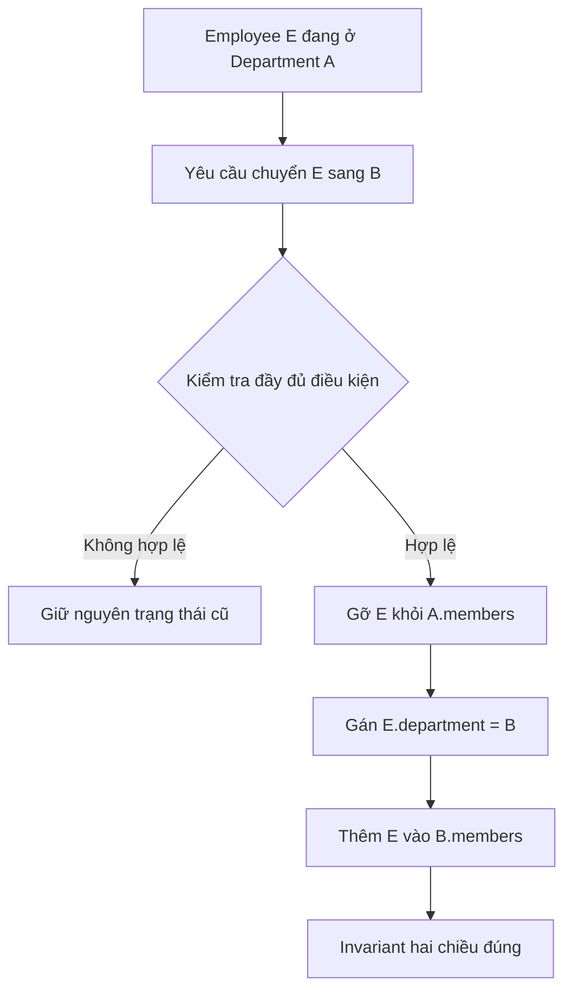

The diagram illustrates the logical order within **one controlled operation**. If the operation can fail partway through or run concurrently, protect the entire update with suitable transactions, locks, or recovery mechanisms.

## 3. Three principles for API design

**One entry point for relationship updates.** Expose `employee.moveTo(newDepartment)`, `department.assign(employee)`, or a domain service authorized to update both ends. Do not expose multiple independent setters and expect callers to remember synchronization.

**Encapsulate collections.** `getEmployees()` should not return the internal mutable collection. Return read-only snapshots/DTOs so callers cannot perform `add/remove` operations outside validation. If the elements themselves are mutable, a collection snapshot does not make them immutable.

**Validate first, modify second.** Check that the destination department exists, has capacity, permits the transfer, and that the current bidirectional state is consistent before changing anything. If validation fails, **nothing should change**.

| Operation | Required updates | What to protect |
| --- | --- | --- |
| Assign an unassigned employee to A | Add to A; `employee.department = A` | No duplicates; capacity in A |
| Transfer from A to B | Remove from A; set B; add to B | E must not belong to both A and B |
| Unassign an employee | Remove from old department; set `null` | No stale reverse link remains |
| Reassign to the same department | Do nothing (*idempotent*) | No duplicate entry or event |
| Assignment fails because B is full | Preserve the existing link to A | Do not remove E from A before validating B |

## 4. Complete Java 17 example: consistent department transfers

The example below compiles independently without Spring or a database. Both ends are updated through **one `Employee.moveTo(...)` method**; the employee collection is not exposed for direct modification.

Create `BidirectionalAssociationDemo.java`:

```java
import java.util.LinkedHashSet;
import java.util.List;
import java.util.Objects;
import java.util.Set;

public class BidirectionalAssociationDemo {

    static final class Department {
        private final String code;
        private final int capacity;
        private final Set<Employee> employees = new LinkedHashSet<>();

        Department(String code, int capacity) {
            if (code == null || code.isBlank()) {
                throw new IllegalArgumentException("Department code is blank");
            }
            if (capacity < 1) {
                throw new IllegalArgumentException("Capacity must be positive");
            }
            this.code = code;
            this.capacity = capacity;
        }

        String code() {
            return code;
        }

        List<Employee> members() {
            // Snapshot: không trao cho caller quyền add/remove collection gốc.
            return List.copyOf(employees);
        }

        private void validateIncoming(Employee person) {
            Objects.requireNonNull(person, "person");

            if (employees.contains(person)) {
                throw new IllegalStateException("Already in target collection");
            }
            if (employees.size() >= capacity) {
                throw new IllegalStateException("Department is full: " + code);
            }

            // Đây là ví dụ domain rule: ID nhân viên không trùng trong phòng.
            for (Employee existing : employees) {
                if (existing.id().equals(person.id())) {
                    throw new IllegalArgumentException(
                            "Duplicate employee id in " + code);
                }
            }
        }
    }

    static final class Employee {
        private final String id;
        private Department department; // null = chưa thuộc phòng nào

        Employee(String id) {
            if (id == null || id.isBlank()) {
                throw new IllegalArgumentException("Employee id is blank");
            }
            this.id = id;
        }

        String id() {
            return id;
        }

        Department department() {
            return department;
        }

        void moveTo(Department destination) {
            Department source = department;

            // Lời gọi lặp lại phải vô hại.
            if (source == destination) {
                return;
            }

            // Precondition: trạng thái hiện tại phải đã đồng bộ.
            if (source != null && !source.employees.contains(this)) {
                throw new IllegalStateException(
                        "Source department is inconsistent");
            }

            // Kiểm tra trước khi thay đổi: nếu đích không hợp lệ,
            // employee vẫn còn nguyên trong source.
            if (destination != null) {
                destination.validateIncoming(this);
            }

            // Chỉ sau khi toàn bộ kiểm tra thành công mới sửa quan hệ.
            if (source != null) {
                source.employees.remove(this);
            }
            department = destination;
            if (destination != null) {
                destination.employees.add(this);
            }
        }
    }

    private static void verify(
            Department first, Department second, Employee... employees) {
        for (Employee e : employees) {
            boolean inFirst = first.employees.contains(e);
            boolean inSecond = second.employees.contains(e);
            if (inFirst && inSecond) {
                throw new AssertionError("Employee in both departments");
            }
            if (inFirst != (e.department() == first)
                    || inSecond != (e.department() == second)) {
                throw new AssertionError("Broken bidirectional invariant");
            }
        }
    }

    public static void main(String[] args) {
        Department engineering = new Department("ENG", 2);
        Department sales = new Department("SAL", 1);

        Employee an = new Employee("E-01");
        Employee binh = new Employee("E-02");
        Employee chi = new Employee("E-03");

        an.moveTo(engineering);
        binh.moveTo(engineering);

        // ENG đầy: thất bại không được làm thay đổi bên nào.
        try {
            chi.moveTo(engineering);
        } catch (IllegalStateException expected) {
            System.out.println(expected.getMessage());
        }

        an.moveTo(sales);       // gỡ khỏi ENG, thêm vào SAL
        chi.moveTo(engineering);
        an.moveTo(sales);       // gọi lặp, không nhân đôi quan hệ

        verify(engineering, sales, an, binh, chi);
        System.out.println("ENG = " + engineering.members().size());
        System.out.println("SAL = " + sales.members().size());
        System.out.println("An o " + an.department().code());

        an.moveTo(null);        // hủy phân phòng
        verify(engineering, sales, an, binh, chi);
        System.out.println("SAL sau go = " + sales.members().size());
    }
}
```

Run:

```bash
javac BidirectionalAssociationDemo.java
java BidirectionalAssociationDemo
```

Expected output:

```text
Department is full: ENG
ENG = 2
SAL = 1
An o SAL
SAL sau go = 0
```

### Why does this code preserve the invariant?

- `Employee.department` and `Department.employees` are both `private`; callers can update the relationship only through `moveTo`.
- `moveTo` returns immediately if the destination is already the current department.
- Existing-state and new-capacity checks occur **before** the three modification steps. If validation throws an exception, the original state remains unchanged.
- On success, the method removes the old reverse link, updates the forward reference, and creates the new reverse link.
- `members()` returns a collection snapshot, so external operations such as `members().clear()` cannot modify the actual collection. The `Employee` objects in the snapshot are still referenced objects, but callers have no arbitrary setter with which to break the association.
- `verify` checks consistency from both directions for employees included in the test.

**Intentional limitations:** this is a **single-threaded, in-memory** model. Two concurrent requests may both pass the capacity check and then both add employees. All participating objects must be managed within the same scope, and the operation must not be interrupted midway. For multithreading, synchronize the entire operation appropriately or move the invariant to a different transactional layer.

The example also uses **object identity** to compare employees because `Employee` does not override `equals/hashCode`. Checking for duplicate IDs within a department is an additional business rule; a real system usually needs globally unique IDs managed by a repository or database.

## 5. When a many-to-many relationship is bidirectional

With `Student` and `Course`, each student takes multiple courses and each course has multiple students. If both classes store `Set` collections referencing one another, enrollment must update **both sets**.

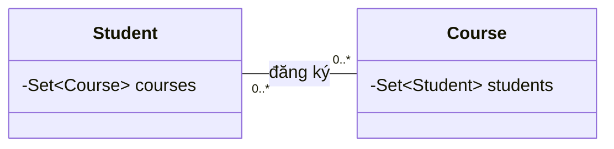

The idea behind a **centralized** method (illustrated with internally managed sets and stable identity rules):

```java
// Đoạn minh họa; studentCourses và courseStudents là các tập
// nội bộ được domain service sở hữu, không phải getter mutable.
void enroll(Student student, Course course) {
    validateEnrollment(student, course); // quyền, trùng, sĩ số...
    studentCourses(student).add(course);
    courseStudents(course).add(student);
}

void unenroll(Student student, Course course) {
    // Cũng phải kiểm tra và sửa hai phía trong cùng một thao tác.
    studentCourses(student).remove(course);
    courseStudents(course).remove(student);
}
```

Do not duplicate update methods on both ends and have them call each other without control: `student.addCourse(course)` calling `course.addStudent(student)` and vice versa can cause **infinite recursion**. One solution is to let one side coordinate while the other exposes an *internal helper* that updates only its local set. Update operations should check existing consistency before making changes if corrupt state is detected.

If the link has `enrolledAt`, `status`, `grade`, or enrollment history, an `Enrollment` class linking exactly one `Student` to exactly one `Course` often makes invariants easier to protect. It captures the state of **the relationship itself**, rather than placing association attributes on the wrong entity.

## 6. Bidirectional associations with JPA/Hibernate

In ORM, distinguish **two different meanings of "owner"**:

- **JPA owning side:** the side Hibernate/JPA uses to write the foreign key or association table to the database. `mappedBy` declares the *inverse side*.
- **Domain owner:** the component responsible for rules governing link additions, removals, and transfers. These two meanings do not necessarily coincide.

For `Department` 1–N `Employee`, a common design is:

```java
// Trong class Employee có @Entity:
@ManyToOne(fetch = FetchType.LAZY)
@JoinColumn(name = "department_id")
private Department department;

// Trong class Department có @Entity:
@OneToMany(mappedBy = "department")
private Set<Employee> employees = new HashSet<>();
```

`Employee.department` is the **owning side** of the `department_id` foreign key; `Department.employees` is the inverse collection used for navigation. If code only adds an `Employee` to `department.employees` without updating `employee.department`, the in-memory graph becomes inconsistent and the foreign key may not be persisted as expected.

Therefore, use a helper that synchronizes both sides:

```java
// Pseudo-implementation minh họa trong Department entity.
// Thực tế thêm validate, kiểm soát orphan và locking theo nghiệp vụ.
public void addEmployee(Employee e) {
    Objects.requireNonNull(e);
    if (e.getDepartment() == this) return;

    Department old = e.getDepartment();
    if (old != null) old.employees.remove(e);

    this.employees.add(e);
    e.assignDepartmentInternally(this);
}
```

In this helper example, `assignDepartmentInternally` has suitably restricted access and should not be invoked arbitrarily by application services. If a public setter remains available and used elsewhere, the invariant is still unprotected. The `old.employees.remove` and `this.employees.add` operations must also be managed in a transaction when the entities are persistent.

### What JPA does not solve automatically

| Feature | What does it provide? | What does it not guarantee automatically? |
| --- | --- | --- |
| `@OneToMany(mappedBy = "...")` | Identifies the inverse side and navigation mapping | Does not automatically synchronize two Java collections/fields during every operation |
| `@ManyToOne` and foreign key | Map the link stored on the child table | Do not prevent callers from corrupting the object graph before flush |
| `@Transactional` | Groups database writes into one transaction | Does not fix update logic that omits one end |
| `@Version` | Detects optimistic-locking conflicts when versions are checked/updated | Does not replace uniqueness constraints or necessarily detect every inverse-collection-only change |
| Unique/FK/check constraint | Prevents specific violations in database data | Does not immediately synchronize two already-loaded heap references |

**About `cascade` and `orphanRemoval`:** these are separate lifecycle/persistence policies. Do not apply `CascadeType.REMOVE` indiscriminately to shared relationships; removing one side could delete objects still in use elsewhere. `orphanRemoval = true` is appropriate only when the child truly depends on the owner's lifecycle according to business rules.

### Transferring departments within a transaction

An application service might execute:

```java
@Transactional
public void transferEmployee(Long employeeId, Long targetDepartmentId) {
    Employee e = employeeRepository.findById(employeeId)
            .orElseThrow();
    Department target = departmentRepository.findById(targetDepartmentId)
            .orElseThrow();

    // Helper domain cập nhật cả e.department và collection hai phía,
    // đồng thời áp dụng chính sách sức chứa/đủ điều kiện.
    e.moveTo(target);
}
```

This is **a hypothetical integration snippet** assuming an `Employee` entity with a helper and two suitable repositories; it is not a standalone Java file like the previous demo.

If the rule is "at most N people per department," two concurrent transactions may both see available capacity. Choose consistency mechanisms such as **pessimistic locking on the department record**, optimistic locking that updates the version protecting the constraint, or a suitable database constraint/strategy. Adding `@Transactional` alone is generally **not enough** to enforce a total membership limit under concurrency.

## 7. Common mistakes and how to detect them

### 7.1 A getter exposes a mutable collection

```java
// Sai: bỏ qua add/remove được kiểm soát
public Set<Employee> employees() {
    return employees;
}
```

Use a read-only snapshot, immutable DTO, or suitable immutable view. `Collections.unmodifiableSet(employees)` is a **live view** (it reflects internal updates); `Set.copyOf(employees)` is a **snapshot** of membership at call time. Both only prevent modification of **the collection through the returned reference**; neither makes mutable elements immutable.

### 7.2 Updating only JPA's inverse side

```java
department.getEmployees().add(employee);
// employee.department vẫn null hoặc trỏ về phòng cũ!
```

Update the owning side and the inverse side of the object graph so queries remain consistent within the transaction.

### 7.3 Removing a relationship but forgetting the reverse link

```java
employee.department = null;
// Phòng cũ vẫn chứa employee: còn dữ liệu "ma".
```

Remove the employee from the old department's set as part of the same operation.

### 7.4 `equals/hashCode` based on mutable fields

If an entity is stored in a `HashSet` and `hashCode()` depends on mutable properties such as `department` or name, changing them can break lookup/removal in the set. Use immutable identity or an equality strategy appropriate to the entity's lifecycle and ORM; do not arbitrarily include mutable associations in `equals/hashCode`.

### 7.5 Infinite recursion caused by symmetric updates

```text
A.addB(B) -> B.addA(A) -> A.addB(B) -> ...
```

Let **one side coordinate**, with the other exposing internal data-only update helpers, or add guards before operations. Do not depend on accidental call order.

### 7.6 Serializing reference cycles

```text
Department -> employees -> Employee.department -> Department -> ...
```

When returning entities directly as JSON, reference cycles can cause serialization errors, redundant data, or lazy loading outside a transaction. Design **DTOs** around API contracts (such as `DepartmentResponse(code, employeeIds)`) instead of exposing entire object graphs. JSON annotations may help but do not replace response-data design.

## 8. Strategies for testing consistency

Tests must check **both ends of the relationship** after every operation, including failed operations.

| Scenario | Expected checks |
| --- | --- |
| Assign an unassigned employee to A | `e.department == A` and `A.members` contains e |
| Transfer e from A to B | A does not contain e; B contains e; `e.department == B` |
| Transfer e to B again | Unchanged; no duplicate entry or unnecessary side effect |
| Unassign e from B | `e.department == null`; B does not contain e |
| B has reached its capacity limit | Rejected; A/B/e retain their exact pre-call states |
| Caller attempts to modify the returned list | Internal set remains unmodifiable from the outside |
| Two concurrent requests transfer/add employees | Total membership count and both ends remain valid afterward |
| Save/flush/clear/reload JPA entities | Reloaded relationships match database data |

An easy-to-read assertion example:

```java
// Giả sử employee đã chuyển từ oldDepartment sang newDepartment:
assert employee.department() == newDepartment;
assert !oldDepartment.members().contains(employee);
assert newDepartment.members().contains(employee);
```

In JPA tests, call `flush()` and `clear()`, then reload before asserting the database was updated: a correct object graph in the persistence context does not prove stored data is correct.

For concurrency, multithreaded tests or integration tests against a real database are more meaningful than repeated calls on a single thread. A sequential unit test does not prove a design is thread-safe.

## 9. Practice exercises

**Exercise 1 — School:** a `Classroom` contains many `Student` objects, and each `Student` belongs to one classroom at a time. Implement `transferTo(Classroom)` to synchronize both ends, enforce a limit of 40 students, and reject duplicate IDs. Test transfers from a full class to another, as well as transfers **into a full class** that must preserve the previous state.

**Exercise 2 — Many-to-many:** a `Developer` has many `Project` objects, and each `Project` has many `Developer` objects. Have a service control `joinProject`/`leaveProject`; test that both sets stay synchronized after joining, leaving, and repeated joins.

**Exercise 3 — JPA:** an `Order` contains many `OrderLine` objects, and each `OrderLine` references its `Order`. Choose the owning side, implement `addLine`/`removeLine` helpers, decide when `orphanRemoval` is appropriate, and verify against the database after `flush/clear`.

**Exercise 4 — Review a bug:** a system transfers an employee from A to B by calling `B.getEmployees().add(e)` and then `e.setDepartment(B)` without removing e from A. Identify the violated invariant, fix the API, and add tests for cases where B rejects the employee.

## 10. Bidirectional relationship design checklist

- Does the relationship **really need bidirectional navigation**, or is one direction plus querying enough?
- Have multiplicity, nullability, uniqueness, and relationship lifecycle been specified?
- **Who is the sole update entry point**, and do any mutable getters/setters bypass it?
- Do all add/remove/transfer operations **validate first and then update both ends completely**?
- If a transfer fails, is the previous state preserved?
- Do collection behavior and equality remain stable as entity fields change?
- With ORM, do owning side, `mappedBy`, `cascade`, and `orphanRemoval` match the business semantics?
- Does concurrent request handling require transactions, locks, uniqueness/foreign-key constraints, and concurrency tests?
- Have both directions been verified **after reloading from the database**, not just after in-memory object updates?

**Key point:** a bidirectional association is correct only when both directions represent **one consistent business state**. Manage changes through a centralized API, protect invariants, and verify both sides; with persistence or concurrent processing, add appropriate consistency mechanisms at the correct transaction boundaries.


</details>

- [Back to top](#back-to-top)

---

## <a id="relationships-007">Circular dependencies and how to break them</a>

<details>
<summary>View details</summary>

# Circular dependencies and how to break them in Java OOP design

> **Goal:** Identify circular dependencies between classes, objects, packages, modules, or beans; understand their practical consequences; and refactor to unidirectional collaboration without changing business behavior.

## 1. What is a circular dependency?

Suppose `OrderService` needs `ShippingService` to ship orders, but `ShippingService` calls back into `OrderService` to update order status.

~~~mermaid
flowchart LR
    O[OrderService] -->|cần để giao hàng| S[ShippingService]
    S -->|gọi để đổi trạng thái| O
~~~

This is a **directed cycle** in the dependency graph: starting from `OrderService`, following dependencies eventually leads back to itself. In a larger system, the cycle may be longer: `A → B → C → A`.

Several concepts must be distinguished:

- **Design-level dependency:** `A` needs the API, behavior, or structure of `B` to fulfill its responsibility. Mutual dependencies between classes or modules make changes and tests harder to isolate.
- **Object-construction cycle:** creating `A` requires `B`, but creating `B` requires `A`. If both must be supplied through constructors, the pair cannot be assembled in the usual way.
- **Runtime call cycle:** `A.method()` calls `B.method()`, and `B.method()` calls `A.method()` again without a termination condition. This can cause `StackOverflowError` even if the code compiles and objects have been initialized.
- **Reference cycle in an object graph:** `Parent` contains `Child`, and `Child` retains a `parent` reference for navigation. This is **not necessarily** a design defect or a Java memory leak; whether it is appropriate depends on the model, API, and lifecycle management.
- **Module/build cycle:** module `orders` depends on `shipping` while `shipping` depends on `orders`. Build tools may reject project/module cycles, even though two classes in the same compilation unit or source set can reference each other.

So the main question is not "are there arrows pointing in both directions?" but **do these responsibilities require mutual knowledge of implementation details, making initialization, testing, replacement, or evolution difficult?**

## 2. Example of a design with a cycle

The following code shows two services that require each other through their constructors:

~~~java
final class OrderService {
    private final ShippingService shippingService;

    OrderService(ShippingService shippingService) {
        this.shippingService = shippingService;
    }

    void confirm(String orderId) {
        shippingService.schedule(orderId);
    }

    void markShipped(String orderId) {
        System.out.println("Order shipped: " + orderId);
    }
}

final class ShippingService {
    private final OrderService orderService;

    ShippingService(OrderService orderService) {
        this.orderService = orderService;
    }

    void schedule(String orderId) {
        // Giả lập thao tác giao hàng
        orderService.markShipped(orderId);
    }
}
~~~

The class definitions compile when compiled together, but constructing the objects becomes a circular problem:

~~~java
// Không thể có đối tượng hoàn chỉnh để truyền vào ngay từ đầu.
// OrderService order = new OrderService(shipping);  // shipping chưa tồn tại
// ShippingService shipping = new ShippingService(order); // order chưa tồn tại
~~~

Passing `null`, using setters to "patch" the cycle, or creating partially initialized objects weakens design safety; an object might be invoked before its dependencies are ready. A DI container must also confront the construction cycle.

**Design cause:** `OrderService` both confirms orders and orchestrates shipping, while `ShippingService` both handles shipping and knows how to update order business state. The two responsibilities are entangled through two-way calls.

## 3. Breaking the cycle with a clearly responsible coordinator

A sensible refactoring introduces a **use-case coordinator** responsible for "placing an order and requesting shipment," while lower-level components perform separate tasks.

~~~mermaid
flowchart TD
    C[CheckoutCoordinator] --> R[OrderRepository]
    C --> G[ShippingGateway]
    R --> D[(Order data)]
    G --> E[Hệ thống vận chuyển]
~~~

In this design, `OrderRepository` never calls back into `CheckoutCoordinator`, and `ShippingGateway` does not depend on the coordinator either. Components used by the same coordinator need not know one another.

**Complete Java 17+ example, runnable as a standalone `OrderFlowDemo.java` file:**

~~~java
import java.util.Map;
import java.util.Objects;
import java.util.concurrent.ConcurrentHashMap;

record Order(String id, long totalCents) {
    Order {
        Objects.requireNonNull(id, "id");
        if (id.isBlank() || totalCents <= 0) {
            throw new IllegalArgumentException("Invalid order");
        }
    }
}

interface OrderRepository {
    void save(Order order);
    Order findById(String id);
}

final class InMemoryOrderRepository implements OrderRepository {
    private final Map<String, Order> data = new ConcurrentHashMap<>();

    @Override
    public void save(Order order) {
        data.put(order.id(), order);
    }

    @Override
    public Order findById(String id) {
        return data.get(id);
    }
}

interface ShippingGateway {
    void requestShipment(Order order);
}

final class ConsoleShippingGateway implements ShippingGateway {
    @Override
    public void requestShipment(Order order) {
        System.out.println("Request shipment for " + order.id());
    }
}

final class CheckoutCoordinator {
    private final OrderRepository orders;
    private final ShippingGateway shipping;

    CheckoutCoordinator(OrderRepository orders, ShippingGateway shipping) {
        this.orders = Objects.requireNonNull(orders, "orders");
        this.shipping = Objects.requireNonNull(shipping, "shipping");
    }

    void checkout(Order order) {
        Objects.requireNonNull(order, "order");
        orders.save(order);
        shipping.requestShipment(order);
    }
}

public class OrderFlowDemo {
    public static void main(String[] args) {
        OrderRepository repository = new InMemoryOrderRepository();
        ShippingGateway shipping = new ConsoleShippingGateway();
        CheckoutCoordinator checkout = new CheckoutCoordinator(repository, shipping);

        Order order = new Order("ORD-42", 250_000);
        checkout.checkout(order);

        System.out.println(repository.findById("ORD-42"));
    }
}
~~~

Run `javac OrderFlowDemo.java` followed by `java OrderFlowDemo` with JDK 17 or later. Expected output:

~~~text
Request shipment for ORD-42
Order[id=ORD-42, totalCents=250000]
~~~

Important points about this code:

1. **The dependency graph is unidirectional:** `CheckoutCoordinator` knows two ports (`OrderRepository`, `ShippingGateway`); neither port needs a reference back to the coordinator.
2. **Constructor injection:** both collaborators are supplied when the object is constructed, and `Objects.requireNonNull` ensures they are present.
3. **Ports are small interfaces:** the repository manages storage; the gateway handles shipment requests. Concrete implementations can change without modifying the business flow.
4. **Responsibilities have clear boundaries:** orchestration belongs in the coordinator instead of being spread across services that call each other.
5. **Do not gloss over transactional failures:** this code illustrates dependency structure only; saving an order successfully but failing to request shipment can leave inconsistent state. Real systems need suitable transactions, retries/idempotency, or a *transactional outbox* for communication between a database and an external system.

**Note:** Introducing an interface **does not automatically break a cycle**. With `OrderService → ShippingPort → ShippingService → OrderService`, the **bean/implementation graph** is still cyclic even though one edge goes through an abstraction. The interaction direction or actual responsibilities must change.

## 4. Ways to break cycles and when to use them

| Approach | Idea | Suitable when | Pitfall to avoid |
|---|---|---|---|
| **Extract shared responsibility** | Move shared logic into an independent `Policy`, `Calculator`, or domain service | Both components call each other only to reuse the same rule | Creating a giant `Utils` class and losing domain boundaries |
| **Coordinate at a higher layer** | A coordinator/use case invokes components in order | Two services call back to complete one workflow | Coordinator takes over all logic and becomes a "god object" |
| **Dependency Inversion** | Define a small port at the appropriate layer and implement it in a lower layer | The business layer depends directly on infrastructure | Merely renaming or inserting an interface while the runtime graph stays cyclic |
| **Domain event / message** | A publisher announces events; registered handlers react | Handling reactions to state changes without direct calls | Synchronous events can still nest calls or recurse; async requires idempotency and error observability |
| **Extract a contract module** | Move shared DTOs/interfaces to an independent module | Projects/modules import each other only for shared types | Moving all business logic into "common" |
| **Merge components with truly shared responsibility** | A new component owns one invariant and lifecycle | Original boundaries were artificially split | Merging merely to pass a build check and creating a huge class |
| **Remove unnecessary dependencies** | Pass minimal data such as IDs/values instead of an entire service | Calls exist only to retrieve a few fields or status values | Moving all state through redundant DTOs and creating new coupling |

Choose based on **the cycle's root cause**. If two classes merely share a fee-calculation function, extracting that calculation is often simplest. If both orchestrate a process, move the workflow into a coordinator. If two packages import each other for a few types, extracting a contract module may be appropriate. There is no need for an event bus in a simple synchronous workflow merely to make the arrows look cleaner.

## 5. Extracting a shared dependency: from A ↔ B to A → C ← B

Suppose `InvoiceService` needs `DiscountService` for pricing, but `DiscountService` calls back into `InvoiceService` only to learn the maximum discount. This design places the "maximum discount" rule in the wrong class.

**Before:**

~~~mermaid
flowchart LR
    I[InvoiceService] --> D[DiscountService]
    D --> I
~~~

**After:** extract the discount rule into an independent policy.

~~~mermaid
flowchart TD
    I[InvoiceService] --> P[DiscountPolicy]
    D[DiscountService] --> P
~~~

Example Java classes (in one file or their corresponding separate files):

~~~java
final class DiscountPolicy {
    // Dùng long vì đơn vị là cents; không dùng double cho tiền.
    long apply(long originalCents, int percent) {
        if (originalCents < 0 || percent < 0 || percent > 30) {
            throw new IllegalArgumentException("Invalid discount");
        }
        long discount = Math.multiplyExact(originalCents, percent) / 100;
        return originalCents - discount;
    }
}

final class InvoiceService {
    private final DiscountPolicy policy;

    InvoiceService(DiscountPolicy policy) {
        this.policy = policy;
    }

    long amountAfterDiscount(long cents, int percent) {
        return policy.apply(cents, percent);
    }
}

final class DiscountService {
    private final DiscountPolicy policy;

    DiscountService(DiscountPolicy policy) {
        this.policy = policy;
    }

    long quote(long cents, int percent) {
        return policy.apply(cents, percent);
    }
}
~~~

Both `InvoiceService` and `DiscountService` know `DiscountPolicy`, but need not know each other. `Math.multiplyExact` signals an error if integer multiplication overflows `long`; even when `long` represents cents, business rounding rules are needed, and this example uses integer division.

A `DiscountPolicy` object is an independent, stateless component across calls; sharing one instance or creating separate instances depends on application lifecycle and configuration.

## 6. Dependency Inversion: what direction actually changes?

In layered design, the domain should generally not import infrastructure directly.

**Design dependent on implementation:**

~~~mermaid
flowchart LR
    S[ApplicationService] --> J[JdbcOrderRepository]
~~~

**Design depending on a contract owned by the business layer:**

~~~mermaid
flowchart LR
    S[ApplicationService] --> P[OrderRepository interface]
    J[JdbcOrderRepository] -. implements .-> P
~~~

The `OrderRepository` port belongs in an appropriate application/domain module, and the `JdbcOrderRepository` adapter implements it. The adapter's package/module can depend on the contract, while the application service no longer depends directly on the adapter. This **inverts the source-code dependency** even though a real adapter object is still injected into the service at runtime.

Do not inspect only the imports in one file. If runtime wiring looks like:

~~~text
A -> PortB -> ImplementationB -> A
~~~

then **the object dependency cycle still exists**. Examine both **the class graph** and **the instantiated component graph**; they are not always identical.

## 7. Domain events can break direct calls, but need clear boundaries

Rather than have `OrderService` call `EmailService` and then have `EmailService` call back into `OrderService` to find an order, the domain can publish `OrderPlaced(orderId, customerId)`. An independent handler reads the required data and sends an email:

~~~mermaid
flowchart LR
    O[PlaceOrderUseCase] --> R[(OrderRepository)]
    O --> E[OrderPlaced event]
    E --> H[SendEmailHandler]
    H --> M[EmailGateway]
~~~

Use an event only when "the order was placed" is a **meaningful domain event**. If handlers need to query data, define a stable contract boundary (IDs or a minimal snapshot) rather than sending an entire ORM entity with lazy-loaded state through messages.

Distinguish three cases:

- **Synchronous event in the same process:** reduces direct coupling, but handlers still execute on the publisher's call stack. If a handler triggers the original event again, it may cause infinite recursive calls.
- **Asynchronous event:** the publisher does not wait for the handler on the same stack, but must handle at-least-once delivery, retries, duplicate messages, ordering, and eventual consistency.
- **Transactional outbox:** write data changes and an outbox record in the same database transaction, then have a worker turn outbox records into messages. Duplicate publication and consumer idempotency still need handling; an outbox does not guarantee end-to-end exactly-once delivery by itself.

If sending email does not determine whether an order can be created, an event may be appropriate. If the rules require an inventory check **before** confirming an order, a synchronous call with a clear contract may be easier to control.

## 8. Spring bean cycles and how to address them

The following example illustrates a cycle created by **constructor injection**:

~~~java
import org.springframework.stereotype.Service;

@Service
class OrderApplicationService {
    OrderApplicationService(ShippingApplicationService shipping) {
    }
}

@Service
class ShippingApplicationService {
    ShippingApplicationService(OrderApplicationService orders) {
    }
}
~~~

When the application context needs both singleton beans, neither can be fully constructed first and supplied to the other. Spring generally reports a circular-dependency initialization error, such as `BeanCurrentlyInCreationException` or a cycle analysis, depending on version and wiring.

**Design-level fix:** restructure into a `CheckoutCoordinator` using independent ports, as in section 3. Spring injects implementations through constructors, leaving a unidirectional runtime graph. With Spring annotations, coordinator/adapter classes may use `@Service`/`@Repository` or be configured through `@Bean`; get the architecture right before wiring it.

Workarounds have limitations:

- `@Lazy` on one edge can delay bean resolution but **does not turn** a logical cycle into a healthy graph. If operations still call each other recursively, the problem remains.
- `ObjectProvider<T>` or `Provider<T>` supports late dependency lookup and can help with dynamic scope/lifecycle needs, but is not the default remedy for architectural cycles.
- Setter/field injection can allow certain singleton cycles to initialize under suitable configuration, but objects may be used before all dependencies are ready; cyclic method calls still exist.
- Allowing circular references in configuration (if supported by the framework version) is **a temporary compatibility workaround**, not a replacement for correcting responsibilities.

**Another pitfall:** `@Transactional`, `@Async`, AOP proxies, and initialization callbacks can affect when beans are accessed. During refactoring, review transaction boundaries, proxy-mediated calls, exceptions, rollbacks, and event publication to avoid accidentally changing transaction semantics.

## 9. Circular dependencies at package and module levels

Suppose a Java project has this structure:

~~~text
orders/
    OrderService.java      -> import shipping.ShippingService
shipping/
    ShippingService.java   -> import orders.OrderService
~~~

Two packages in the same module may still compile, but the design creates an architectural cycle. With separate projects/modules, if `orders` depends on `shipping` while `shipping` depends on `orders`, the build system may be unable to find a valid build order. In the Java Platform Module System (JPMS), the `requires` graph between named modules may not contain cycles.

One possible organization:

~~~text
order-contract/
    OrderId.java
    ShippingRequest.java
orders/
    OrderService.java      -> order-contract
shipping/
    ShippingAdapter.java   -> order-contract
application/
    CheckoutCoordinator.java -> orders, shipping, order-contract
~~~

`order-contract` should contain only genuinely shared, stable contracts, not become a dumping ground for models and utilities. A dependency from the application to both adapters may be appropriate at the **composition root** where components are constructed, but application business logic should prefer interfaces and avoid importing concrete adapters.

For system modules, examine **build-time edges** (project dependencies), **compile-time edges** (imports/type references), and **runtime edges** (bean/provider wiring). Breaking an import cycle does not guarantee the runtime cycle is gone.

## 10. Diagnosing and refactoring with control

A practical process:

1. **Draw the real edges:** record which class/module depends on which, why, and whether the dependency is through a constructor, field, static call, or callback. Do not infer dependencies from names alone.
2. **Identify the level:** is the cycle in imports/project modules, bean constructors, runtime calls, or an ordinary object graph? A cycle at one level need not exist at another.
3. **Trace why each edge is needed:** does the caller need the whole service or just a value, rule, or event notification? Use this to identify misplaced responsibilities.
4. **Choose a meaningful cut:** eliminate unnecessary calls, extract a policy, move orchestration to a use case, use a correctly placed port, or extract shared contracts to an independent module.
5. **Migrate callers one by one:** update constructors, methods, and dependency-injection configuration. Avoid keeping old aliases indefinitely if they recreate the cycle.
6. **Test behavior:** preserve important operation order, results, exceptions, transactions, and state. For public APIs, assess source and binary compatibility.
7. **Recheck the graph:** inspect both static architecture and runtime wiring; try starting the application in a clean context.
8. **Monitor operational limitations:** for events, watch retries/duplicates and temporarily inconsistent states; for coordinators, avoid making them responsible for everything.

Example diagnostic commands (depending on the build tool):

~~~bash
# Maven: xem quan hệ dependency giữa các artifact
mvn dependency:tree

# Gradle: xem project dependencies ở cấu hình phù hợp
./gradlew dependencies

# JDK: phân tích phụ thuộc class/package của mã đã biên dịch
jdeps -verbose:class -filter:none -cp target/classes target/classes
~~~

Interpret the results according to their scope: `mvn dependency:tree` and `gradlew dependencies` show artifact/project relationships, **not enough** to find call cycles between every class. `jdeps` analyzes static bytecode dependencies but cannot fully see reflection, dynamic callbacks, or runtime bean wiring. On Windows with Gradle, use `gradlew.bat dependencies`; `target/classes` is a common Maven example path and must be adapted to the project. Complex architectures can enforce package/module dependency rules through architecture tests.

## 11. Ensure tests detect defects, not merely successful bean creation

Using `CheckoutCoordinator`, we can test the **order** "save first, then request shipment," correct data propagation, and the absence of callbacks into the coordinator. The following JUnit Jupiter 5 test uses fakes without a mocking framework:

**`CheckoutCoordinatorTest.java`** (place it alongside the classes from `OrderFlowDemo.java` in the same package):

~~~java
import static org.junit.jupiter.api.Assertions.*;
import org.junit.jupiter.api.Test;
import java.util.ArrayList;
import java.util.List;

class CheckoutCoordinatorTest {
    @Test
    void savesThenRequestsShipment() {
        List<String> calls = new ArrayList<>();

        OrderRepository repository = new OrderRepository() {
            @Override
            public void save(Order order) {
                calls.add("save:" + order.id());
            }

            @Override
            public Order findById(String id) {
                return null;
            }
        };

        ShippingGateway gateway = order ->
                calls.add("ship:" + order.id());

        CheckoutCoordinator checkout =
                new CheckoutCoordinator(repository, gateway);

        checkout.checkout(new Order("ORD-42", 250_000));

        assertEquals(List.of("save:ORD-42", "ship:ORD-42"), calls);
    }

    @Test
    void missingDependenciesAreRejectedAtConstruction() {
        OrderRepository repository = new InMemoryOrderRepository();
        ShippingGateway shipping = new ConsoleShippingGateway();

        assertThrows(NullPointerException.class,
                () -> new CheckoutCoordinator(null, shipping));
        assertThrows(NullPointerException.class,
                () -> new CheckoutCoordinator(repository, null));
    }
}
~~~

These tests protect the required contracts and interactions. A test using reflection only to confirm a `private final ShippingGateway` field, or merely searching source text for the absence of `extends`, is too implementation-dependent. For Spring applications, add **application-context startup integration tests** to catch bean cycles; with database/messaging integrations, test transactions and retries in a suitable test environment.

**Be careful about shipment failures:** the test establishes method order but does not prove atomicity across database writes and external-system actions. An integration test should cover gateway failure, the resulting order state, and recovery behavior.

## 12. Common misconceptions

| Claim | Accurate assessment |
|---|---|
| "Every reference cycle is wrong" | No. Bidirectional parent–child links can be useful; Java GC can reclaim an unreachable group when no GC-root path reaches it |
| "Adding an interface breaks the cycle" | Only if **the actual dependency graph** changes direction with no return path |
| "`@Lazy` completely solves circular dependencies" | It often merely defers initialization without fixing responsibilities or runtime call cycles |
| "An event bus solves every cycle" | Coupling may shift to schemas/events and create reaction cycles; failure/consistency complexity increases |
| "A Spring context error is the only evidence of a cycle" | Compilers, tests, runtime recursion, and package/module architecture must also be examined |
| "Bidirectional links cause memory leaks in Java" | Reference cycles alone do not prevent GC; leaks happen when GC-root references keep objects reachable |
| "The more dependencies a coordinator has, the better" | A coordinator should orchestrate use cases; distinct business rules belong in suitable components |

## 13. Application exercise: refactor course-enrollment notifications

**Original design:** `EnrollmentService` calls `NotificationService` after enrollment, but `NotificationService` calls back into `EnrollmentService` to obtain the email address and course name. Each service receives the other through constructor injection.

Rewrite it using either approach:

- **Synchronous:** `EnrollStudentUseCase` obtains information through `EnrollmentRepository`/`StudentDirectory`, saves the enrollment, and calls `NotificationGateway.sendConfirmation(recipient, courseName)`. The gateway does not call back into the use case.
- **Asynchronous:** After successful enrollment, publish `StudentEnrolled(enrollmentId)` and process notification through an independent handler. With a database and message broker, describe how an outbox, retries, and idempotency protect the workflow.

Self-check criteria: Can you draw a dependency graph **with no path back** to the use case? Can all components be constructor-injected from one composition root? Is the data sufficient at call or event boundaries? Is the enrollment state well-defined if notification fails?

---

**Remember:** To break a dependency cycle, identify **responsibilities pointing in the wrong direction**, move them to appropriate components or coordinators, then verify both **the dependency graph** and **actual behavior**. Successful initialization is necessary, but the design must also remain understandable, testable, and resilient to operational failures.

</details>

- [Back to top](#back-to-top)

---

## <a id="relationships-008">Reading relationship notation in class diagrams</a>

<details>
<summary>View details</summary>

# Reading relationship notation in UML class diagrams

## 1. Reading a class diagram: where should you start?

A *UML class diagram* shows **object types**, their members, and **relationships between those types**. When you see two boxes connected by a line, do not immediately conclude that "the two classes call each other." Read all of the following:

1. **Line style and endpoint symbol:** solid or dashed; ordinary arrow, hollow triangle, hollow diamond, or filled diamond?
2. **Source and destination ends:** which class depends on another, which is the general type, and which is the *whole*?
3. **Multiplicity at both ends:** how many objects on one side can relate to an object on the other?
4. **Relationship/role names:** what meaning is added by terms such as "manages," "placed by," "member," or "owns"?
5. **Java implementation:** does it correspond to a field, collection, method parameter, `extends`, or `implements`?

Example:

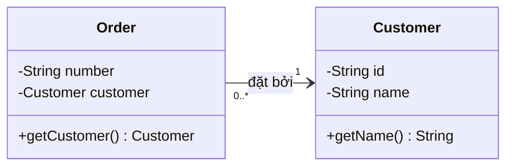

The full interpretation is: **each `Order` is associated with exactly one `Customer`**, **each `Customer` may be associated with 0 or more `Order` objects**, and the arrow indicates navigation from `Order` to `Customer` in this model. In Java, this suggests a `private Customer customer;` field in `Order`. It does not mean every customer automatically stores an in-memory list of orders.

## 2. Quick reference: six important relationships

| Relationship | Visual cue | Meaning | Possible Java implementation |
|---|---|---|---|
| **Association** | **Solid** line; may have an arrow indicating navigability | Instances are related | Reference field, `List`/`Set`, or another linking mechanism |
| **Dependency** | **Dashed** line with an open arrow toward the used component | Component A needs B to perform work | Parameters, local variables, API calls, or types in signatures |
| **Aggregation** | Solid line with a **hollow diamond** at the whole end | Whole–part relationship whose parts can exist independently | A group holds references to its members |
| **Composition** | Solid line with a **filled diamond** at the whole end | Strong ownership; a part's lifecycle is linked to one whole in the model | Whole creates/manages parts and enforces lifecycle rules |
| **Generalization / inheritance** | Solid line with a **hollow triangle** pointing to the general type | A subclass *is a kind of* parent class | `extends` |
| **Realization** | Dashed line with a **hollow triangle** pointing to a specification/interface | A class implements an interface contract | `implements` |

These relationships can coexist in a system. For example, `CheckoutService` depends on `PaymentGateway`, `StripeGateway` realizes `PaymentGateway`, while `Order` composes `OrderLine` objects and is associated with `Customer`.

## 3. Association: reading arrows, role names, and multiplicity

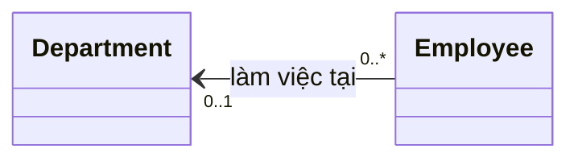

Read **multiplicity at an endpoint as the number of objects there that may be linked to one object at the opposite end**:

- `0..1` next to `Department`: each `Employee` works in **0 or 1 department**.
- `0..*` next to `Employee`: each `Department` has **0 or more employees**.
- The `Employee → Department` arrow: an employee can find their department. This **does not** establish that `Department` stores an `employees` collection.
- The "works in" label is **the relationship name**, not an assignment or a required method name.

### Common multiplicities

| UML multiplicity | Precise interpretation | Example |
|---|---|---|
| `1` | Exactly one | Every valid order has exactly one customer |
| `0..1` | Zero or one | An employee may have no assigned department |
| `*` or `0..*` | Zero or many | A department may have no employees yet |
| `1..*` | At least one | A completed handover record requires at least one item |
| `2..5` | From two to five | A duty team has between two and five people |
| `3` | Exactly three | A product bundle must have three components |

Remember that multiplicity is **a model constraint**, not something Java automatically enforces because a `List<Employee>` was declared. To guarantee "at least one," "no more than five," or "exactly one," code or the persistence layer must enforce those rules.

### About navigation direction

- A solid line with an open arrow toward B generally means **you can navigate from A to B**.
- A navigability arrow **does not** mean "B is A's parent class."
- An association **without arrows** must be interpreted according to the diagram's conventions: its direction may be unspecified, so do not automatically assume bidirectionality.
- If both directions must be clear, draw or annotate them explicitly or show the corresponding properties in both classes.

Example Java code corresponding to `Employee → Department`:

```java
final class Department {
    private final String name;
    Department(String name) { this.name = name; }
    String getName() { return name; }
}

final class Employee {
    private Department department; // có thể null: 0..1

    void moveTo(Department next) {
        this.department = next;
    }

    Department getDepartment() {
        return department;
    }
}
```

There is no `Department.getEmployees()` because the example implements only employee-to-department navigation. If the application needs employee lists, it can query a repository; it need not add bidirectional links to every object.

## 4. The two diamonds: aggregation and composition

Both diamond symbols appear at **the whole end**, not the part end. This is an important rule when reading direction.

### Aggregation – hollow diamond

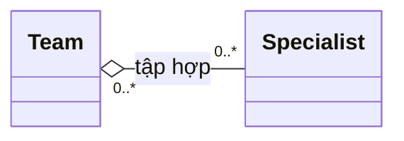

The **hollow diamond next to `Team`** identifies `Team` as the whole. A `Specialist` can exist independently of a team and can join multiple teams if business rules permit it. In this example, `0..*` at both ends indicates that one specialist may join several teams and one team may have several specialists.

```java
import java.util.ArrayList;
import java.util.List;

class Specialist {
    final String name;
    Specialist(String name) { this.name = name; }
}

class Team {
    private final List<Specialist> members = new ArrayList<>();

    void add(Specialist member) {
        members.add(member);
    }
}
```

Removing a Team from a management catalog does not automatically mean deleting its Specialist staff. Aggregation expresses grouping semantics; it **does not automatically create deletion/GC rules** in Java.

### Composition – filled diamond

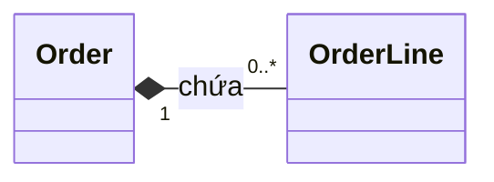

The **filled diamond next to `Order`** identifies `Order` as **the whole that owns** the `OrderLine` objects. Each order line belongs to exactly one order in the model, while an order may contain several lines. In UML composition, a *part* belongs to at most one *composite* at a time; its lifecycle depends on the whole according to domain rules.

Implementations should create and modify order lines through the order:

```java
import java.util.ArrayList;
import java.util.List;
import java.util.Objects;

final class OrderLine {
    final String sku;
    final int quantity;

    OrderLine(String sku, int quantity) {
        this.sku = Objects.requireNonNull(sku);
        if (quantity <= 0) throw new IllegalArgumentException("quantity");
        this.quantity = quantity;
    }
}

final class Order {
    private final List<OrderLine> lines = new ArrayList<>();

    void addLine(String sku, int quantity) {
        lines.add(new OrderLine(sku, quantity));
    }

    int lineCount() {
        return lines.size();
    }
}
```

Note that **`OrderLine` is still an ordinary Java object**. The filled diamond does not make the JVM immediately delete it when `Order` becomes unreachable, nor does it prevent other code from holding references to it. API design, persistence constraints, and business rules enforce ownership semantics. Here, `Order` controls line creation; if strict ownership is required, further restrict exposure and transfer of lines across orders.

**Do not infer composition from a field alone:** `private Customer customer;` is not enough to establish composition. A customer normally exists independently of individual orders.

## 5. Hollow triangles: distinguishing extends and implements

A hollow triangle always points toward **the general type or contract**. Whether the line is **solid or dashed** determines the relationship.

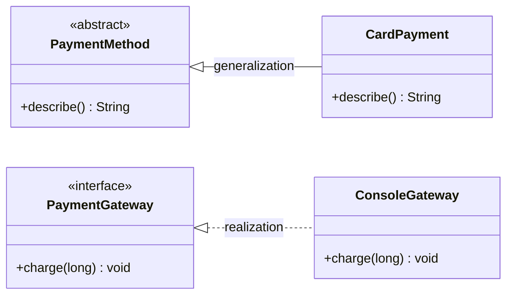

- `PaymentMethod <|-- CardPayment`: the triangle near `PaymentMethod` with a solid line means `CardPayment` **inherits from** `PaymentMethod`.
- `PaymentGateway <|.. ConsoleGateway`: the triangle near `PaymentGateway` with a dashed line means `ConsoleGateway` **implements** the `PaymentGateway` contract.

Java mapping:

```java
abstract class PaymentMethod {
    abstract String describe();
}

final class CardPayment extends PaymentMethod {
    @Override
    String describe() {
        return "Thanh toán bằng thẻ";
    }
}

interface PaymentGateway {
    void charge(long cents);
}

final class ConsoleGateway implements PaymentGateway {
    @Override
    public void charge(long cents) {
        System.out.println("Charged: " + cents);
    }
}
```

Do not confuse *hollow triangles* with *navigability arrows*. They answer different questions:

- Generalization/realization: "**which type does this class extend or which contract does it implement?**"
- Association: "**which objects is this object linked to and able to navigate to?**"

## 6. Dashed lines with open arrows: dependency

```mermaid
classDiagram
    direction LR
    class ReportExporter {
        +export(Report, Formatter) String
    }
    class Report
    class Formatter {
        <<interface>>
        +format(Report) String
    }
    ReportExporter ..> Formatter : sử dụng
    ReportExporter ..> Report : đọc dữ liệu
```

Here `ReportExporter` *depends on* `Formatter` and `Report` to perform its operation. The `..>` notation represents a dependency arrow pointing **from the user to the used component**.

```java
interface Formatter {
    String format(Report report);
}

final class Report {
    final String title;
    Report(String title) { this.title = title; }
}

final class ReportExporter {
    String export(Report report, Formatter formatter) {
        return formatter.format(report);
    }
}
```

The exporter has no `formatter` or `report` fields. That fits the example of using objects through parameters, but **dependencies are not limited to parameter scope**: class A still depends on interface B if it stores B in a field or invokes B elsewhere. UML dependency describes design-level reliance; it does not imply that object B is short-lived.

## 7. Runnable combined example: multiple symbols in one business scenario

Build an order-payment model with:

- `Order → Customer`: a unidirectional association.
- `Order ◆— OrderLine`: composition; each line belongs to an order.
- `CheckoutService ⋯▷ PaymentGateway`: dependency; the service uses the payment gateway during checkout.
- `ConsoleGateway ⋯▷ PaymentGateway` with a hollow triangle: realization; an implementation of the interface.

```mermaid
classDiagram
    direction LR
    class Customer {
        -String name
        +getName() String
    }
    class Order {
        -String id
        -Customer customer
        -List~OrderLine~ lines
        +addLine(String, int, long) void
        +totalCents() long
    }
    class OrderLine {
        -String sku
        -int quantity
        -long unitPriceCents
        +subtotalCents() long
    }
    class CheckoutService {
        +checkout(Order, PaymentGateway) void
    }
    class PaymentGateway {
        <<interface>>
        +charge(String, long) void
    }
    class ConsoleGateway {
        +charge(String, long) void
    }
    Order "0..*" --> "1" Customer : thuộc về
    Order "1" *-- "0..*" OrderLine : chứa
    CheckoutService ..> Order : xử lý
    CheckoutService ..> PaymentGateway : sử dụng
    PaymentGateway <|.. ConsoleGateway : hiện thực
```

Create a `RelationSymbolsDemo.java` file (JDK 11+):

```java
import java.util.ArrayList;
import java.util.List;
import java.util.Objects;

public class RelationSymbolsDemo {

    static final class Customer {
        private final String name;

        Customer(String name) {
            this.name = Objects.requireNonNull(name);
        }

        String getName() {
            return name;
        }
    }

    static final class OrderLine {
        private final String sku;
        private final int quantity;
        private final long unitPriceCents;

        // Chỉ Order tạo dòng thông qua addLine trong thiết kế ví dụ.
        private OrderLine(String sku, int quantity, long unitPriceCents) {
            this.sku = Objects.requireNonNull(sku);
            if (quantity <= 0 || unitPriceCents < 0) {
                throw new IllegalArgumentException("Invalid order line");
            }
            this.quantity = quantity;
            this.unitPriceCents = unitPriceCents;
        }

        long subtotalCents() {
            return Math.multiplyExact(quantity, unitPriceCents);
        }
    }

    static final class Order {
        private final String id;
        private final Customer customer; // Association: Order -> Customer
        private final List<OrderLine> lines = new ArrayList<>();

        Order(String id, Customer customer) {
            this.id = Objects.requireNonNull(id);
            this.customer = Objects.requireNonNull(customer);
        }

        void addLine(String sku, int quantity, long unitPriceCents) {
            // Composition: Order chịu trách nhiệm tạo/quản lý các dòng.
            lines.add(new OrderLine(sku, quantity, unitPriceCents));
        }

        String getId() {
            return id;
        }

        Customer getCustomer() {
            return customer;
        }

        long totalCents() {
            long result = 0L;
            for (OrderLine line : lines) {
                result = Math.addExact(result, line.subtotalCents());
            }
            return result;
        }
    }

    interface PaymentGateway {
        void charge(String orderId, long amountCents);
    }

    static final class ConsoleGateway implements PaymentGateway {
        @Override
        public void charge(String orderId, long amountCents) {
            System.out.println(
                    "Charge " + orderId + ": " + amountCents + " cents");
        }
    }

    static final class CheckoutService {
        void checkout(Order order, PaymentGateway gateway) {
            Objects.requireNonNull(order);
            Objects.requireNonNull(gateway);

            // Dependency: sử dụng gateway được truyền vào phương thức.
            gateway.charge(order.getId(), order.totalCents());
            System.out.println("Customer: " + order.getCustomer().getName());
        }
    }

    public static void main(String[] args) {
        Customer lan = new Customer("Lan");
        Order order = new Order("ORD-100", lan);
        order.addLine("BOOK-1", 2, 120_000L);
        order.addLine("PEN-5", 3, 10_000L);

        PaymentGateway gateway = new ConsoleGateway();
        new CheckoutService().checkout(order, gateway);
    }
}
```

Run:

```bash
javac RelationSymbolsDemo.java
java RelationSymbolsDemo
```

Output:

```text
Charge ORD-100: 270000 cents
Customer: Lan
```

From one diagram, we can identify which classes should hold **references**, which should **control their parts**, which need only **collaborator APIs**, and which must declare `implements`. A diagram guides structure; concrete behavior still needs to be implemented and tested to enforce constraints.

## 8. Symbols inside class boxes

To read relationships correctly, you also need to understand the information inside class boxes:

```mermaid
classDiagram
    class Account {
        -String id
        #boolean active
        ~int retryCount
        +getId() String
        +disable() void
    }
```

| Symbol | Meaning in UML | Common Java equivalent |
|---|---|---|
| `+` | Public | `public` |
| `-` | Private | `private` |
| `#` | Protected | `protected` |
| `~` | Package visibility | No modifier |
| Underlined name in UML | **Static** member | `static` |
| Italic name in UML | **Abstract** member | `abstract` |
| `operation(arg: Type): Result` | Method with parameter and return type | `Result operation(Type arg)` |

These symbols describe **access levels and members**, while the lines between boxes describe **relationships between classes**. A `-` before a field is **not** a dashed dependency; it means `private`.

## 9. Role names, constraints, and advanced details

In addition to an association name, a diagram may show a **role name** near an endpoint, such as `orders` near `Order` or `customer` near `Customer`. A role name expresses **the role of objects at that endpoint from the opposite end's perspective**; it may correspond to a field name in code.

Some constraints may appear beside an association or attribute:

- `{ordered}`: the order of associated objects matters.
- `{unique}`: the associated values/objects must not repeat according to the rule.
- `{readOnly}`: the association end/attribute does not allow reassignment in the stated context.

Do not mechanically equate UML `{ordered}` with `ArrayList` or `{unique}` with `HashSet`: these are **constraints that behavior must enforce**, and collection selection is only part of the implementation.

When **the association has its own data** (for example, a learner's enrollment has a date, status, and grade), use an **association class** in UML or introduce an intermediate domain class such as `Enrollment` in Java:

```mermaid
classDiagram
    direction LR
    class Student
    class Enrollment {
        +LocalDate enrolledAt
        +String status
    }
    class Course
    Student "1" <-- "0..*" Enrollment : người học
    Enrollment "0..*" --> "1" Course : khóa học
```

For readability, this Mermaid diagram uses **an ordinary intermediate class**; a standard UML association class has its own notation (the class is connected to the association line by a dashed line). Do not confuse intermediate-class notation with a dependency.

## 10. Common diagram-reading mistakes

| Misinterpretation | Correct reading |
|---|---|
| "The `1` next to Customer means each Customer has one Order." | `1` on the Customer end means **each Order has one Customer**; check the Order end to see how many orders each customer may have. |
| "Every arrow means inheritance." | Inheritance uses a **hollow triangle and solid line**; association uses a solid line with navigability arrows; dependency uses a dashed line and open arrow. |
| "The filled diamond belongs on the child class." | Diamonds belong at **the whole end** of whole–part relationships. |
| "Having `List<Child>` means composition." | A collection does not establish ownership or lifecycle; read and enforce domain rules. |
| "An arrowless association is definitely bidirectional." | Navigability may be **unspecified**; check the diagram's notes/conventions. |
| "A dependency line means each object has a reference field." | Dependencies may arise from parameters, local variables, or API calls; fields are not required. |
| "`extends` and `implements` use the same UML line style." | Generalization is **solid**, realization is **dashed**, and both use hollow triangles pointing to the general type/contract. |
| "UML makes the JVM delete parts when a whole is deleted." | UML models design rules; Java GC works through reference reachability and does not read diagrams. |

## 11. Self-check exercises

**Exercise 1.** The `Library "1" *-- "0..*" BookCopy` diagram has a filled diamond near `Library`. Interpret the roles, multiplicities, and lifecycle.

**Hint:** Library is the whole; each BookCopy belongs to one Library in the model, while a Library may have many BookCopy objects. Ownership/lifecycle rules must be enforced by business logic.

**Exercise 2.** `ReportGenerator ..> PdfWriter` is drawn with a dashed line and open arrow. Must `ReportGenerator` contain a `PdfWriter writer;` field?

**Answer:** No. `PdfWriter` may be used through a method parameter.

**Exercise 3.** In UML, how does `Gateway <|.. StripeGateway` differ from `Gateway <|-- StripeGateway`?

**Answer:** A dashed line with a hollow triangle means realization (typically `implements` an interface); a solid line with a hollow triangle means generalization (typically `extends`).

**Exercise 4.** Each employee may join up to three projects, and each project must have at least one employee. Supply the multiplicities for `Employee -- Project`.

**Answer:** Near `Project`, put `0..3`; near `Employee`, put `1..*`. Each label counts objects at its end associated with **one** object at the opposite end.

**Exercise 5.** Given `Course "0..*" -- "0..*" Student`, with each enrollment carrying a date, status, and grade, choose a suitable Java design.

**Hint:** Use an `Enrollment` class containing references to `Student` and `Course` plus enrollment data. Define a uniqueness constraint on the student–course pair if business rules require it.

---

**Remember when reading diagrams:** **Line style** identifies the relationship type; **arrows, triangles, and diamonds** determine direction and roles; **multiplicity** specifies object counts at each end; and **Java fields, collections, extends, implements, or parameters** reveal possible implementations. Interpret all these elements together before translating UML into code.


</details>

- [Back to top](#back-to-top)
