<a id="back-to-top"></a>

# Class Design

## Menu
- [Defining each class's responsibilities](#class-design-001)
- [Cohesion within a class](#class-design-002)
- [Coupling between classes](#class-design-003)
- [Separating data, business logic, and external interactions](#class-design-004)
- [Naming classes, fields, and methods](#class-design-005)
- [Entities, value objects, and services](#class-design-006)
- [Rich domain models and anemic data models](#class-design-007)
- [Separating queries from state-changing operations](#class-design-008)
- [Limiting deep navigation through object chains](#class-design-009)

## <a id="class-design-001">Defining each class's responsibilities</a>

<details>
<summary>View details</summary>

# Defining class responsibilities in OOP design (Java)

A system with many classes is not necessarily well designed. What matters is **which part of the problem each class owns, which rules it enforces, and which other classes it collaborates with**. Poor separation makes one class know too much, several classes change the same rule, and small changes trigger edits throughout the codebase.

This lesson shows how to derive class responsibilities from business requirements, distinguish responsibilities from technical operations, apply the **Single Responsibility Principle (SRP)** and **high cohesion/low coupling**, and validate the design with a standalone Java program.

## 1. What does a “class responsibility” mean?

A **responsibility** is something a class must **know** or **do** for the model to function correctly.

- **Information responsibilities (*knowing*)**: knowing a book-copy ID, order status, due date, product line items, and so on.
- **Behavioral responsibilities (*doing*)**: calculating totals, validating operations, changing state, coordinating workflows, storing/retrieving data, and so on.

In a good design, **closely related** data and behavior usually belong in the same class. If a class holds state but every important behavior lives in external “utilities,” business rules are easily duplicated or bypassed.

For example:

| Business requirement | Required responsibility | Possible owner |
| --- | --- | --- |
| A checked-out book copy cannot be borrowed again | Look up current loan status | Repository/transaction-management object |
| A borrower may have at most 2 active loans | Enforce the borrowing limit | `LoanPolicy` |
| A loan is due 14 days after checkout | Calculate the due date | `LoanPolicy` |
| A loan must have a valid borrower, copy, checkout date, and due date | Protect loan data | `Loan` |
| Borrowing requires validation followed by recording the result | Coordinate the borrowing workflow | `LoanService` |
| Loans must be stored and retrieved | Access persistent storage | `LoanRepository` |

These class names are merely **one reasonable design for this specific context**. There is no rigid rule that each line of requirements must become one class.

## 2. Responsibilities are not method lists

Naming operations makes responsibilities concrete, but **a class with many methods may still have just one responsibility**.

For example, `Money` may provide `add`, `subtract`, `multiply`, and `compareTo`; all serve the responsibility of representing and calculating monetary values. Conversely, a class with only two methods, `calculateSalary()` and `sendMarketingEmail()`, still has two unrelated business reasons to change.

A useful question to ask:

> **When a rule changes, which class should change because of that rule?**

If `LoanService` must change when the email protocol, SQL schema, due-date policy, or HTTP response shape changes, it likely owns responsibilities from several distinct concerns.

### SRP: One reason to change

The **Single Responsibility Principle** is often phrased as “a class should have only one reason to change.” “One reason” means **a cohesive set of responsibilities serving one stakeholder or related rule**, not “only one method.”

For example:

- When borrowing policies change → consider changing `LoanPolicy`.
- When persistence moves from memory to a database → change the `LoanRepository` implementation.
- When borrowing requires a new approval step → change or extend orchestration in `LoanService`.
- When HTTP request/response structures change → update the controller/DTO at the HTTP boundary.

SRP cannot be proved simply by counting lines or methods. A 200-line class can be cohesive; a 20-line class can still mix unrelated responsibilities.

## 3. Steps for deriving responsibilities from requirements

### Step 1 — Write use cases instead of guessing classes

For example: “A borrower selects a **specific, uniquely identified book copy**. The system rejects the request if that copy is already borrowed or the borrower has reached the loan limit, then creates a loan with a due date determined by the current policy.”

Break this down into events and rules:

1. Who performs the action? The borrower (`borrowerId`).
2. Which object is involved? A **specific book copy** (`BookCopy`), not just the book title (`BookTitle`).
3. Which state must be checked? Is there an active loan for this copy?
4. What are the rules? The borrowing limit and number of loan days.
5. What is the result? A new `Loan` is recorded.
6. What system constraints apply? Validation and recording must remain consistent, especially under concurrent requests.

### Step 2 — List responsibilities before assigning classes

| Responsibility | Required data/rules | Behavior category |
| --- | --- | --- |
| Identify a book copy | `copyId`, `title` | Domain data |
| Describe a loan | `borrowerId`, book copy, checkout date, due date | Domain entity/value |
| Enforce loan periods and limits | `loanDays`, `maxActiveLoans` | Domain policy |
| Query availability and record loans | The set of loans | Persistence abstraction |
| Coordinate a borrowing request | Repository + policy + current date | Application service |
| Display or receive HTTP data | Interface-specific input/output | Adapter/controller |

### Step 3 — Assign decisions to the object with sufficient information

This is the **Information Expert** approach: favor the object that knows the data needed to make a decision, provided dependency boundaries remain intact.

For example:

- `Loan` enforces its own invariants: the due date must come after the checkout date.
- `LoanPolicy` knows the due-date formula and borrowing threshold, so `LoanService` need not repeat the constant `14` in multiple places.
- `LoanRepository` knows current loan data, so the service queries it rather than maintaining a duplicate list.
- `LoanService` knows **the sequence** of operations without needing to know whether storage uses `HashMap`, SQL, or a REST API.

### Step 4 — Draw collaborations and verify dependency direction

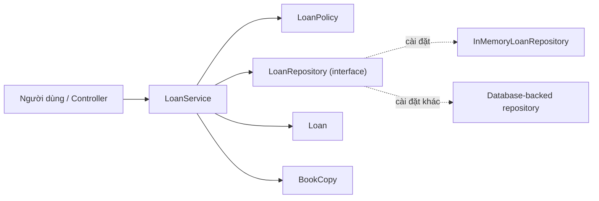

`LoanService` depends on **the repository contract**, so business policy need not change merely because storage switches from memory to SQL. The control flow is the service calling the repository; the diagram does not imply that entities or policies should freely access HTTP, databases, loggers, and email.

### Step 5 — Choose APIs that fit responsibilities

A good class has not only appropriate methods; it also **avoids exposing state mutations that violate rules**. Constructors and public methods should have clear preconditions and postconditions. Return snapshots or read-only views when callers should not modify internal collections.

## 4. CRC cards: does a class take on too much?

CRC stands for **Class – Responsibilities – Collaborators**. A concise card for each class helps the team discuss design before coding:

| Class | Responsibilities | Collaborators |
| --- | --- | --- |
| `BookCopy` | Preserve the identity and title of a book copy | None |
| `Loan` | Represent a valid borrowing event | `BookCopy` |
| `LoanPolicy` | Determine loan limits and due dates | No repository needed |
| `LoanRepository` | Find active loans and record loan data | `Loan` |
| `LoanService` | Check eligibility and coordinate borrowing | Policy, repository, `Clock` |

If a card lists too many unrelated responsibilities, review the design. If two cards contain the same rule, identify **a single source of truth** to prevent inconsistent results.

## 5. Complete Java 17 example: borrowing based on responsibilities

The example divides classes according to **how their rules change**, while remaining simple enough to run in one file. A saved loan is treated as active; **returning a book** is outside this demo's scope.

Create `ClassResponsibilityDemo.java`:

```java
import java.time.Clock;
import java.time.Instant;
import java.time.LocalDate;
import java.time.ZoneOffset;
import java.util.LinkedHashMap;
import java.util.Map;
import java.util.Objects;

public class ClassResponsibilityDemo {

    // 1. BookCopy: danh tính một bản sách vật lý cụ thể.
    record BookCopy(String copyId, String title) {
        BookCopy {
            copyId = notBlank(copyId, "copyId");
            title = notBlank(title, "title");
        }
    }

    // 2. Loan: dữ liệu và bất biến của một lần mượn.
    record Loan(String borrowerId, BookCopy copy,
                LocalDate borrowedOn, LocalDate dueOn) {
        Loan {
            borrowerId = notBlank(borrowerId, "borrowerId");
            Objects.requireNonNull(copy, "copy");
            Objects.requireNonNull(borrowedOn, "borrowedOn");
            Objects.requireNonNull(dueOn, "dueOn");
            if (!dueOn.isAfter(borrowedOn)) {
                throw new IllegalArgumentException(
                        "Due date must be after borrowed date");
            }
        }
    }

    // 3. LoanPolicy: quyết định giới hạn mượn và thời hạn.
    record LoanPolicy(int maxActiveLoans, int loanDays) {
        LoanPolicy {
            if (maxActiveLoans <= 0 || loanDays <= 0) {
                throw new IllegalArgumentException(
                        "Policy values must be positive");
            }
        }

        void ensureCanBorrow(long activeLoans) {
            if (activeLoans >= maxActiveLoans) {
                throw new IllegalStateException("Borrowing limit reached");
            }
        }

        LocalDate dueDate(LocalDate borrowedOn) {
            return borrowedOn.plusDays(loanDays);
        }
    }

    // 4. LoanRepository: hợp đồng lưu/truy vấn, không đặt luật 14 ngày.
    interface LoanRepository {
        boolean hasActiveLoanForCopy(String copyId);
        long activeLoanCount(String borrowerId);
        void save(Loan loan);
    }

    // Cài đặt bộ nhớ dùng cho demo và unit test.
    static final class InMemoryLoanRepository implements LoanRepository {
        // Các Loan lưu trong ví dụ đều được xem là đang hoạt động.
        private final Map<String, Loan> activeByCopy = new LinkedHashMap<>();

        @Override
        public boolean hasActiveLoanForCopy(String copyId) {
            return activeByCopy.containsKey(copyId);
        }

        @Override
        public long activeLoanCount(String borrowerId) {
            return activeByCopy.values().stream()
                    .filter(loan -> loan.borrowerId().equals(borrowerId))
                    .count();
        }

        @Override
        public void save(Loan loan) {
            Objects.requireNonNull(loan, "loan");
            Loan existing = activeByCopy.putIfAbsent(
                    loan.copy().copyId(), loan);
            if (existing != null) {
                throw new IllegalStateException("Copy already borrowed");
            }
        }
    }

    // 5. LoanService: phối hợp quy trình, không tự tính ngày trả
    // hay quyết định nơi cất dữ liệu.
    static final class LoanService {
        private final LoanRepository repository;
        private final LoanPolicy policy;
        private final Clock clock;

        LoanService(LoanRepository repository, LoanPolicy policy, Clock clock) {
            this.repository = Objects.requireNonNull(repository);
            this.policy = Objects.requireNonNull(policy);
            this.clock = Objects.requireNonNull(clock);
        }

        Loan borrow(String borrowerId, BookCopy copy) {
            borrowerId = notBlank(borrowerId, "borrowerId");
            Objects.requireNonNull(copy, "copy");

            if (repository.hasActiveLoanForCopy(copy.copyId())) {
                throw new IllegalStateException("Copy already borrowed");
            }

            policy.ensureCanBorrow(
                    repository.activeLoanCount(borrowerId));

            LocalDate today = LocalDate.now(clock);
            Loan loan = new Loan(
                    borrowerId, copy, today, policy.dueDate(today));
            repository.save(loan);
            return loan;
        }
    }

    private static String notBlank(String value, String name) {
        if (value == null || value.isBlank()) {
            throw new IllegalArgumentException(name + " is blank");
        }
        return value;
    }

    public static void main(String[] args) {
        LoanRepository repository = new InMemoryLoanRepository();
        LoanPolicy policy = new LoanPolicy(2, 14);
        Clock clock = Clock.fixed(
                Instant.parse("2026-10-15T00:00:00Z"), ZoneOffset.UTC);
        LoanService service = new LoanService(repository, policy, clock);

        BookCopy copy1 = new BookCopy("COPY-01", "Effective Java");
        BookCopy copy2 = new BookCopy("COPY-02", "Clean Code");
        BookCopy copy3 = new BookCopy("COPY-03", "Java Concurrency");

        Loan first = service.borrow("MEM-01", copy1);
        System.out.println("Due: " + first.dueOn());

        try {
            service.borrow("MEM-02", copy1);
        } catch (IllegalStateException ex) {
            System.out.println(ex.getMessage());
        }

        service.borrow("MEM-01", copy2);
        try {
            service.borrow("MEM-01", copy3);
        } catch (IllegalStateException ex) {
            System.out.println(ex.getMessage());
        }

        System.out.println(
                "Active loans: " + repository.activeLoanCount("MEM-01"));
    }
}
```

Run:

```bash
javac ClassResponsibilityDemo.java
java ClassResponsibilityDemo
```

Output:

```text
Due: 2026-10-29
Copy already borrowed
Borrowing limit reached
Active loans: 2
```

### Mapping each responsibility to a concrete behavior

| When this changes... | Directly affected component | Why? |
| --- | --- | --- |
| Loan period changes from 14 to 21 days | Configuration used to construct `LoanPolicy`, not `LoanService.borrow` | The service only uses the policy |
| Due-date calculation switches to business days | `LoanPolicy` and a calendar dependency if needed | Date calculation belongs to the policy |
| Add validation for due dates | `Loan` | Invariants of the loan itself |
| Switch in-memory storage to SQL | `LoanRepository` implementation and connection configuration | The service only knows the interface |
| Add audit logging after borrowing | The workflow in `LoanService` or a new audit collaborator | This is orchestration behavior |
| Change the response JSON format for mobile | Controller/response DTO outside the example | JSON is not the responsibility of an entity or domain policy |

**Important concurrency note:** this demo runs sequentially in memory. The sequence “count loans → check the limit → save” **is not atomic** when concurrent requests occur. In production, validation and persistence must be protected by transactions/locks or another mechanism that enforces the limit, together with a database constraint preventing two active loans for the same copy. Correct responsibility boundaries **do not automatically** guarantee concurrent consistency.

If book returns are added, the repository must distinguish active from returned loans. The state transition might then belong in `Loan` or an appropriate aggregate, while the application service coordinates the workflow. This is a new business requirement; the current code should not be assumed to handle it.

## 6. Detecting classes with misplaced responsibilities

Consider a `LibraryManager` that handles everything:

```java
class LibraryManager {
    void borrow(String userId, String copyId) {
        // SQL query lay ban sach
        // Kiem tra gioi han muon
        // Tinh ngay tra
        // Ghi SQL
        // Gui email
        // Format JSON response
    }
}
```

This often becomes a **God Class**, or a service with too many reasons to change. A database schema update, library policy change, email template revision, or HTTP JSON adjustment could all require editing the same class.

The better approach is to place responsibilities at their proper boundaries:

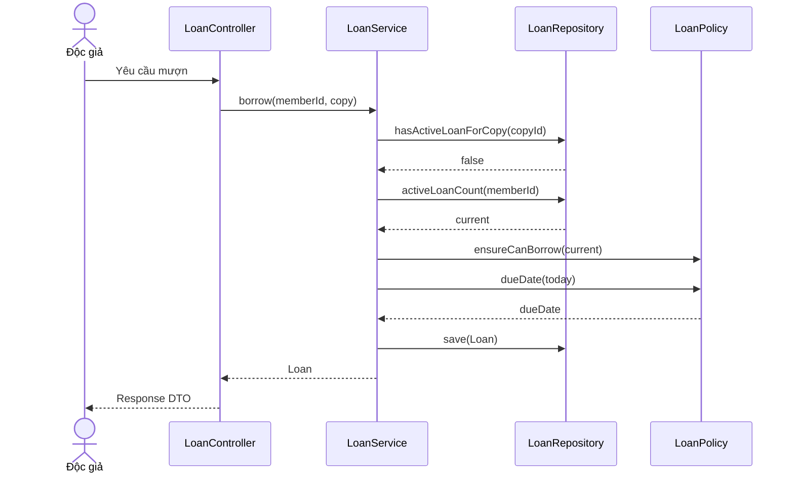

A `Loan` knows whether its own data is valid; `LoanPolicy` knows the limits; `LoanRepository` knows how to access stored data; `LoanService` knows the order of operations. The controller only maps requests/responses and handles appropriate communication concerns.

There is no need to immediately split `EmailSender`, `LoanFactory`, `DateCalculator`, and `LoanValidator` into separate classes. Introduce an abstraction when it represents **an independent responsibility worth managing**, an explicit rule, or a real substitution/testing need.

## 7. High cohesion and low coupling

- **Cohesion:** how closely do fields and methods inside one class contribute to a shared purpose?
- **Coupling:** how much of other classes' implementation details must this class know, and how do changes elsewhere affect it?

| Indicator | Good design direction | Signal to reconsider |
| --- | --- | --- |
| Cohesion | Methods protect related data and rules | Email delivery, SQL, and business formulas in one class |
| Coupling | A service depends on a repository interface | A service directly constructs `new SqlLoanRepository(...)` inside business logic |
| Encapsulation | State changes through valid operations | Public setters allow bypassing validation |
| Knowledge | A class knows only what its responsibility requires | A method traverses `a.getB().getC().getD()` and mutates deep state |
| Testability | A policy can be tested independently; current time is injected through `Clock` | Logic directly accesses the real clock, database, and email system to evaluate rules |

Optimizing one metric is not the only goal. Splitting into dozens of “one-method” classes, for example, can create more confusing dependencies than the original design. Balance clarity, change cost, testability, and actual needs.

### “Who owns the data, and who owns the behavior?”

Some computations span multiple objects and require information that no single entity completely owns. Do not force every behavior into an entity.

- **Entity/value object:** maintains invariants tied to its own state.
- **Domain service/policy:** enforces business rules spanning multiple objects or needing an independent policy model.
- **Application service:** coordinates use cases, access control, transactions, repositories, and integration ports.
- **Infrastructure adapter:** communicates with databases, files, queues, or external APIs.
- **Presentation adapter:** accepts and returns data for HTTP/CLI/UI.

These are common divisions, **not mandatory rules**. Smaller systems may use fewer classes. Boundaries should follow actual responsibilities and reasonably expected changes.

## 8. When should you split a class, and when should it stay intact?

### Consider splitting when

1. A class's behaviors change for **independent groups of requirements** (such as calculating charges and emailing invoices).
2. The same business rule is duplicated across multiple locations.
3. Testing a simple calculation requires starting a database, HTTP server, or external service.
4. Numerous `if/switch` branches choose strategies/policies based on transaction type.
5. Small changes break unrelated functionality, suggesting overly broad coupling.

### Do not split merely because

1. A class has more than one method.
2. A class exceeds an arbitrary line-count threshold.
3. A helper could be named separately but has no independent rule.
4. You want interfaces for **every** class before there is a boundary that needs substitution.
5. You imagine many hypothetical future scenarios without clear requirements.

For example, `LoanPolicy` is a small record and can keep related rules together. There is no need to automatically split `MaxLoanPolicy` and `DueDatePolicy` just because it has two methods. If borrowing limits are managed by department A and due dates by department B, or each rule has distinct variants, then separation has a sound justification.

## 9. Refactoring a large class into classes with clear responsibilities

Suppose `LoanController` queries SQL, calculates due dates, and returns JSON in one method. It can be refactored incrementally:

1. **Capture existing behavior:** inputs, outcomes, and errors when a copy is already borrowed or the limit is reached. Add tests for important rules.
2. **Define invariants:** each book copy has at most one active loan, and borrowers never exceed their limits.
3. **Extract pure rules:** move due-date calculations and thresholds into `LoanPolicy` (without I/O dependencies).
4. **Extract persistence:** move SQL behind `LoanRepository`, define a clear contract, and test the adapter.
5. **Place the workflow in the service:** fetch data, invoke the policy, save the loan, and return the result.
6. **Simplify the controller:** map requests, handle errors/response DTOs, and call the service.
7. **Revalidate:** test success/failure scenarios and inspect transactions, saved data, logs, and unintended side effects.

Making small changes and verifying behavior at each step is usually safer than rewriting the entire system at once. Do not use “separating responsibilities” as a reason to delete existing validation or transactional safeguards.

## 10. Testing responsibilities rather than individual getters

| Test target | Key scenario | Evidence |
| --- | --- | --- |
| `BookCopy` | Blank ID or title | Constructor rejects it |
| `Loan` | Due date on or before the checkout date | Invariant is enforced |
| `LoanPolicy` | Loan limit reached; calculating due dates | Results independent of database and real clock |
| `LoanService` | Copy already borrowed; borrower over limit | Does not call `save` on rejection |
| `LoanService` | Valid request | Asks repository to save a loan with the correct dates |
| Repository adapter | Saving/looking up loans and unique constraints | Meets the storage contract |
| Integrated use case | Two concurrent requests for the same copy | Does not create two active loans |

One way to test the service is to use an in-memory **fake repository** or mock and assert behavior in each scenario, instead of mocking every internal method. Test policies with actual inputs and outputs. In larger systems, separate integration tests for transactions and unique constraints are necessary because unit tests cannot prove database consistency.

## 11. Class-design exercises

**Exercise A — Divide order-management responsibilities.** Requirements: a shopper adds items, the system calculates totals, applies coupons, checks inventory, saves orders, and emails confirmations. List the responsibilities and propose suitable classes/collaborators. Explain why email formatting should not belong in `Order`.

**Exercise B — Evaluate a class with many methods.** `BankAccount` provides `deposit`, `withdraw`, `balance`, `transferTo`, and `exportMonthlyCsv`. Which methods fit the responsibility of managing a balance, and which suggest reporting concerns? How should `transferTo` coordinate two accounts and a transaction?

**Exercise C — Extend the borrowing example.** Add `returnBook(copyId)`, `ACTIVE/RETURNED` status, and a rule prohibiting returning the same loan twice. Decide which entity owns state transitions, what repository queries are needed, and how the service coordinates them. Verify there are no active loans after return.

**Exercise D — Review design indicators.** One `ReportService` has 15 methods that all transform one report structure into related metrics; another `UserHelper` has only 3 methods for passwords, SQL, and email. Which merits review first? Explain using **reasons to change and cohesion**, not method count.

## 12. Self-assessment checklist for class design

- Can you describe **each class's main responsibility in one clear sentence**?
- Does each invariant/rule have one authoritative owner, avoiding conflicting versions?
- Do a class's fields and methods all support that responsibility?
- How many external details must the class know? Could it depend on an interface at a changing boundary?
- Does the service only orchestrate, or does it implement every policy, SQL operation, and UI formatting rule itself?
- Can getters, setters, or constructors expose ways to violate invariants?
- Do common changes affect only a few classes, in the appropriate responsibility area?
- Can pure logic be tested independently of databases, networks, and real time?
- Under concurrent requests, where do transactions and locks protect cross-class invariants?
- Does splitting/merging classes provide benefits that clearly outweigh added abstraction costs?

**Core takeaway:** divide classes by **responsibility and change boundaries**, and place behavior where the information needed to protect a rule is available. Good OOP design tells readers *which class to inspect when requirement X changes* and minimizes changes to unrelated classes.


</details>

- [Back to top](#back-to-top)

---

## <a id="class-design-002">Cohesion within a class</a>

<details>
<summary>View details</summary>

# Cohesion within a class in Java OOP

> **Goal:** Understand cohesion; assess whether a class's data and behavior support one responsibility; recognize overloaded classes; and refactor into well-defined boundaries without excessive fragmentation.

## 1. What is cohesion?

**Class cohesion** describes how closely the fields, methods, and rules **within one class** serve one meaningful purpose. A class has **high cohesion** when its members form a coherent concept and tend to change for related business reasons.

For example:

- `Cart` holds line items, validates quantities, and calculates item totals: all these behaviors concern shopping-cart state → typically **high** cohesion.
- `CartManager` calculates prices, writes to databases, emails users, logs sign-ins, exports CSV reports, and checks permissions: these behaviors change for unrelated reasons → typically **low** cohesion.

Ask yourself: **“How would I describe this class in one clear sentence without the word ‘and’?”** This is a heuristic, not a mechanical standard. A use-case coordinator may combine several steps to accomplish **one** business goal and remain cohesive as long as it does not embed implementation details for each step.

**Cohesion does not mean “few methods” or “every method reads the same field.”** A class with only 2 unrelated methods still has low cohesion. A class with many operations around the same domain concept can have high cohesion.

## 2. Distinguishing cohesion from coupling

| Criterion | Cohesion – within a component | Coupling – between components |
|---|---|---|
| Main question | Do the parts **within one class** closely serve the same responsibility? | How much must this class know or assume about other classes? |
| Scope of observation | Fields, methods, invariants, reasons to change | Constructor dependencies, APIs, types, method calls, shared state |
| Typical design goal | **High**: coherent responsibility | **Low enough**: minimal dependencies, stable interfaces |
| Warning sign | One class handles unrelated tasks | Changing one class forces changes across many others |
| Common improvement | Extract Class; move behavior to its owner | Dependency Inversion, interfaces/ports, limited APIs |

These qualities are **distinct** but related. Splitting a class into smaller ones may increase local cohesion while adding dependencies; a good design balances both.

~~~mermaid
flowchart LR
    subgraph Low["Lớp đa trách nhiệm"]
        direction TB
        X[AccountManager]
        X1[Login]
        X2[Export CSV]
        X3[Send email]
        X4[Compute billing]
    end
    subgraph High["Các trách nhiệm rõ ràng"]
        direction TB
        A[AuthenticationService]
        B[CsvReportExporter]
        C[NotificationGateway]
        D[BillingCalculator]
    end
    Low -. tách trách nhiệm .-> High
~~~

The diagram illustrates the goal of **grouping behaviors that change together with their proper owner**, not “one class per method.”

## 3. Signs of low cohesion

1. **Overly generic names:** `Manager`, `Helper`, `Processor`, or `Util` with responsibilities spanning unrelated domains.
2. **Method groups use separate sets of fields:** `sendEmail()` only uses SMTP configuration, `calculateTax()` only uses taxRate, and `saveOrder()` only uses a JDBC connection.
3. **Multiple independent reasons to change:** a discount policy, email vendor, or database schema update all require modifying the same class/file.
4. **Mixed error categories in one class:** network exceptions, input validation, pricing rules, and serialization are interwoven in a large method.
5. **Hard to test independently:** testing a pure computation requires starting a database, HTTP client, or SMTP service.
6. **A constructor with too many dependencies unrelated to one task:** a signal worth investigating, not a definitive verdict.
7. **Features frequently change the same class while sharing little context:** increases merge conflicts and spreads changes.

Importantly, **do not infer low cohesion from a long method alone**. A long method may harm readability or complexity while the class still has one responsibility. Conversely, splitting a large method into ten small methods in the same class does not fix mixed responsibilities.

## 4. Before refactoring: one class handles too much

The simple example below can compile in a Java 17 project as `LegacyCheckoutService.java`. It highlights three groups of work: **calculating amounts**, **persistence**, and **sending notifications**.

~~~java
import java.math.BigDecimal;
import java.util.HashMap;
import java.util.List;
import java.util.Map;

record Line(String sku, int quantity, BigDecimal unitPrice) {}

// Ví dụ để phân tích thiết kế; chưa có kiểm tra dữ liệu đầu vào.
final class LegacyCheckoutService {
    private final Map<String, BigDecimal> database = new HashMap<>();

    BigDecimal calculateTotal(List<Line> lines) {
        BigDecimal total = BigDecimal.ZERO;
        for (Line line : lines) {
            total = total.add(
                    line.unitPrice().multiply(
                            BigDecimal.valueOf(line.quantity())));
        }
        return total;
    }

    void saveOrder(String orderId, BigDecimal amount) {
        database.put(orderId, amount);
    }

    void sendReceipt(String email, String orderId) {
        System.out.println("Send receipt to " + email + " for " + orderId);
    }

    void checkout(String orderId, String email, List<Line> lines) {
        BigDecimal total = calculateTotal(lines);
        saveOrder(orderId, total);
        sendReceipt(email, orderId);
    }
}
~~~

In this example, `database` is needed only for persistence; calculating totals and sending emails do not use it. Each group changes independently:

| Behavior group | When does it change? | Appropriate owner |
|---|---|---|
| `calculateTotal()` | Pricing rules, rounding, discounts | `Cart` or an appropriate domain pricing component |
| `saveOrder()` | Storage/database/schema changes | `OrderRepository` |
| `sendReceipt()` | Email provider/template changes | `ReceiptSender` |
| `checkout()` | Checkout workflow sequence and rules change | `CheckoutService` orchestrating the use case |

A single class must accommodate all four changes. That is a cohesion problem, **not merely a line-count problem**.

## 5. After refactoring: each class has a coherent responsibility

In the revised design:

- `Cart` protects **the item list and the rules for computing the total from existing lines**.
- `OrderRepository` defines a contract for **saving and finding orders**; the implementation chooses the storage mechanism.
- `ReceiptSender` defines a contract for **sending receipts**; the implementation chooses the delivery channel.
- `CheckoutService` **orchestrates a checkout use case** and delegates implementation details.

~~~mermaid
classDiagram
    direction LR
    class Cart {
        -List~CartLine~ lines
        +addLine(sku, quantity, unitPrice)
        +total() BigDecimal
        +snapshot() List
    }
    class CheckoutService {
        -OrderRepository repository
        -ReceiptSender sender
        +checkout(orderId, email, cart)
    }
    class OrderRepository {
        <<interface>>
        +save(Order)
        +findById(id) Optional
    }
    class ReceiptSender {
        <<interface>>
        +sendReceipt(Order, email)
    }
    class InMemoryOrderRepository
    class ConsoleReceiptSender
    CheckoutService --> Cart : dùng giá trị
    CheckoutService --> OrderRepository : lưu đơn
    CheckoutService --> ReceiptSender : thông báo
    InMemoryOrderRepository ..|> OrderRepository
    ConsoleReceiptSender ..|> ReceiptSender
~~~

**Complete Java 17+ code in one file, `CohesionDemo.java`:**

~~~java
import java.math.BigDecimal;
import java.util.ArrayList;
import java.util.List;
import java.util.Map;
import java.util.Objects;
import java.util.Optional;
import java.util.concurrent.ConcurrentHashMap;

// 1) Value object: một dòng hàng hợp lệ.
record CartLine(String sku, int quantity, BigDecimal unitPrice) {
    CartLine {
        Objects.requireNonNull(sku, "sku");
        Objects.requireNonNull(unitPrice, "unitPrice");
        if (sku.isBlank() || quantity <= 0 || unitPrice.signum() < 0) {
            throw new IllegalArgumentException("Invalid cart line");
        }
    }

    BigDecimal subtotal() {
        return unitPrice.multiply(BigDecimal.valueOf(quantity));
    }
}

// 2) Domain object: quản lý trạng thái và invariant của giỏ hàng.
final class Cart {
    private final List<CartLine> lines = new ArrayList<>();

    void addLine(String sku, int quantity, BigDecimal unitPrice) {
        lines.add(new CartLine(sku, quantity, unitPrice));
    }

    List<CartLine> snapshot() {
        return List.copyOf(lines);
    }

    BigDecimal total() {
        return lines.stream()
                .map(CartLine::subtotal)
                .reduce(BigDecimal.ZERO, BigDecimal::add);
    }

    boolean isEmpty() {
        return lines.isEmpty();
    }
}

// 3) Dữ liệu đơn hàng đã đặt, bất biến.
record Order(String id, List<CartLine> lines, BigDecimal total) {
    Order {
        Objects.requireNonNull(id, "id");
        Objects.requireNonNull(lines, "lines");
        Objects.requireNonNull(total, "total");
        if (id.isBlank() || lines.isEmpty()) {
            throw new IllegalArgumentException("Invalid order");
        }
        lines = List.copyOf(lines);
    }
}

// 4) Hợp đồng hạ tầng lưu trữ.
interface OrderRepository {
    void save(Order order);
    Optional<Order> findById(String id);
}

final class InMemoryOrderRepository implements OrderRepository {
    private final Map<String, Order> orders = new ConcurrentHashMap<>();

    @Override
    public void save(Order order) {
        orders.put(order.id(), order);
    }

    @Override
    public Optional<Order> findById(String id) {
        return Optional.ofNullable(orders.get(id));
    }
}

// 5) Hợp đồng thông báo.
interface ReceiptSender {
    void sendReceipt(Order order, String email);
}

final class ConsoleReceiptSender implements ReceiptSender {
    @Override
    public void sendReceipt(Order order, String email) {
        System.out.printf("Receipt %s: %s -> %s%n",
                order.id(), order.total(), email);
    }
}

// 6) Application service: điều phối use case checkout.
final class CheckoutService {
    private final OrderRepository repository;
    private final ReceiptSender receiptSender;

    CheckoutService(OrderRepository repository, ReceiptSender receiptSender) {
        this.repository = Objects.requireNonNull(repository, "repository");
        this.receiptSender = Objects.requireNonNull(receiptSender, "receiptSender");
    }

    Order checkout(String id, String email, Cart cart) {
        Objects.requireNonNull(id, "id");
        Objects.requireNonNull(email, "email");
        Objects.requireNonNull(cart, "cart");

        if (id.isBlank() || email.isBlank() || cart.isEmpty()) {
            throw new IllegalArgumentException("Invalid checkout");
        }

        Order order = new Order(id, cart.snapshot(), cart.total());
        repository.save(order);
        receiptSender.sendReceipt(order, email);
        return order;
    }
}

public class CohesionDemo {
    public static void main(String[] args) {
        Cart cart = new Cart();
        cart.addLine("JAVA-BOOK", 2, new BigDecimal("125000"));
        cart.addLine("NOTEBOOK", 1, new BigDecimal("30000"));

        OrderRepository repository = new InMemoryOrderRepository();
        ReceiptSender sender = new ConsoleReceiptSender();
        CheckoutService service = new CheckoutService(repository, sender);

        Order order = service.checkout(
                "ORD-42", "user@example.com", cart);

        System.out.println(order.total());                 // 280000
        System.out.println(repository.findById("ORD-42").isPresent()); // true
    }
}
~~~

Run:

~~~bash
javac CohesionDemo.java
java CohesionDemo
~~~

Illustrative output:

~~~text
Receipt ORD-42: 280000 -> user@example.com
280000
true
~~~

**Why is cohesion better?** `Cart` methods focus on shopping-cart state; `OrderRepository` handles persistence; `ReceiptSender` handles notifications. `CheckoutService` still uses both storage and messaging, but **its single goal** is to carry out checkout in sequence: prepare order data → save → request receipt delivery. Coordinating multiple steps does not imply low cohesion.

**Example limitations:** `ConsoleReceiptSender` only prints to the console; it sends no real email. The code focuses on class design and does not ensure atomicity across the database and notification infrastructure. A real system must define behavior if email delivery fails after an order is saved, considering transactions, retry/idempotency, or an outbox. If the cart can change concurrently between `snapshot()` and `total()`, the two values may disagree; use a consistent snapshot or restrict cart modifications to one thread during its lifecycle.

## 6. How does cohesion relate to SRP?

The **Single Responsibility Principle (SRP)** is often explained as “a class should have one reason to change,” more precisely **one primary group of business stakeholders/change needs**. Cohesion describes internal coherence; SRP is a principle about **responsibility boundaries and reasons for change**.

They are related but not identical:

- `Cart` has `addLine()`, `isEmpty()`, and `total()`: multiple operations that collectively protect cart rules.
- `CheckoutService` calls the repository and receipt sender: it coordinates **one** use case without implementing SQL or SMTP itself.
- If tax calculations become complex, vary across jurisdictions, or require multiple policy versions, consider extracting `TaxPolicy`/`PricingService`. If the cart simply sums existing line subtotals, however, `Cart.total()` is appropriate.
- Split classes by **real reasons to change**, not one class per method.

A helpful review question: **“If the pricing team changes tax rules, must we edit the receipt sender or order repository?”** If so, responsibility boundaries may be mixed.

## 7. Cohesion levels in design: a thinking tool

Some references classify program cohesion from weak to strong. These labels are traditionally taught at the **module or function** level; for **OOP classes**, use them as a qualitative analytical aid rather than an absolute standardized scoring scale.

| Cohesion type | Meaning | Java example | Assessment |
|---|---|---|---|
| **Coincidental** – accidental | Groups unrelated tasks | `MiscUtils` contains `sendEmail()`, `hashPassword()`, and `formatMoney()` | Usually very weak |
| **Logical** – technical grouping | Similar operations selected for unrelated purposes using a control flag | `Handler.process(type)` switches among email/SMS/CSV export | Often worth splitting |
| **Temporal** – same time | Tasks run together at startup/shutdown | `StartupTasks` opens a cache, runs migrations, and prints a banner | May be appropriate at the orchestration point |
| **Procedural** – ordered steps | Operations grouped because they execute in sequence | `Workflow` runs validate → save → notify | Can be cohesive for a single use case |
| **Communicational** – shared data | Methods work on the same domain data | `Cart` adds lines, computes totals, and checks for emptiness | Often good when domain-aligned |
| **Sequential** – output feeds next step | A parse → normalize → validate pipeline | `ImportPipeline` processes a record | May fit or require strategy extraction |
| **Functional** – one well-defined function | Component devoted to computing taxes under a consistent policy | `TaxCalculator` | Usually very strong |

**Do not score a class solely by the cohesion-category name:** An `ApplicationBootstrap` intentionally performs startup tasks and fits at the *composition root*. A `CheckoutService` intentionally runs three steps in order and can fit one use case. Problems arise when coordinators also embed algorithms belonging to separate responsibilities.

## 8. How to evaluate a class's cohesion

Use a **method × field** matrix (for example, 6 methods and 4 fields) to identify responsibility clusters. This is not a complete formula: pure methods that access no fields may still contribute to one coherent concept.

Consider a class with four unrelated fields: `orders`, `smtpClient`, `taxRate`, and `csvFormat`.

| Method | orders | smtpClient | taxRate | csvFormat |
|---|:---:|:---:|:---:|:---:|
| `saveOrder()` | ✓ | | | |
| `findOrder()` | ✓ | | | |
| `sendReceipt()` | | ✓ | | |
| `calculateTax()` | | | ✓ | |
| `exportCsv()` | | | | ✓ |

The matrix shows **disconnected clusters**: two methods concern order storage, one email, one tax, and one file export. This strongly suggests several independent responsibilities.

By contrast, for `Cart`:

| Method | lines / CartLine | Cart rules |
|---|:---:|:---:|
| `addLine()` | ✓ | validates data |
| `isEmpty()` | ✓ | prevents checkout with an empty cart |
| `total()` | ✓ | computes line totals |
| `snapshot()` | ✓ | avoids exposing mutable state |

All these operations protect the same domain object.

**Assess cohesion by meaning**, not just field overlap. For example, `validateEmail()` may read no fields yet fit a value object `EmailAddress` because it enforces that value's invariant.

### LCOM and other metrics

`LCOM` (*Lack of Cohesion of Methods*) is a family of metrics for **how little methods cohere**. Definitions include LCOM1, LCOM2, LCOM3, and LCOM4, and they **can produce different values** for the same class. Some variants measure shared field usage, while others use connectivity graphs between methods.

Key points:

- **The metric name alone is insufficient**: when reporting “LCOM = 3”, specify the variant/tool and calculation method.
- In some variants, a high LCOM indicates poor cohesion; there is no universal threshold suitable for every project.
- Static utilities, immutable value objects, inherited classes, delegation-heavy classes, DTOs, and framework adapters may yield metrics that misrepresent business meaning.
- Methods that access fields indirectly through getters/helpers may be interpreted differently by static metrics.
- Metrics help **identify classes for review**, not replace understanding of responsibilities and reasons to change.

Combine numerical indicators such as public-method count, number of fields/dependencies, Git change history, method complexity, and test duration when useful. But do not split a class merely to improve the numbers.

## 9. Refactoring low cohesion into high cohesion

~~~mermaid
flowchart TD
    A[Chọn lớp thường xuyên thay đổi] --> B[Liệt kê method, field, caller, thay đổi]
    B --> C[Nhóm theo mục tiêu và invariant]
    C --> D{Có nhóm trách nhiệm tách biệt?}
    D -->|Không| E[Giữ lớp, cải thiện tên hoặc method nếu cần]
    D -->|Có| F[Chọn owner mới: domain/service/adapter]
    F --> G[Extract Class hoặc Move Method]
    G --> H[Cập nhật caller và DI]
    H --> I[Chạy test và kiểm tra hành vi]
    I --> J{Ổn định API và invariant?}
    J -->|Chưa| F
    J -->|Có| K[Đánh giá lại cohesion và coupling]
~~~

**Proceed safely in stages:**

1. **Read the existing contract:** public methods, exceptions, side effects, thread safety, transactions, processing order, and how callers use the class.
2. **Map responsibilities:** instead of line counts, group methods/fields by use case and by “who requests changes to this functionality?”
3. **Identify invariants:** which data must change together to remain valid? Keep that data close to the behavior enforcing its invariants. Do not arbitrarily separate `Cart.lines` from `Cart.addLine()` and let callers modify the list.
4. **Create appropriately named classes:** for example, `ReceiptSender`, `OrderRepository`, and `PricePolicy`; favor small, stable APIs.
5. **Move logic before removing old entry points:** use `Extract Class`/`Move Method`. During migration, carefully maintained compatible adapters/delegation may help when many callers still depend on the previous API.
6. **Inject dependencies via constructors:** supports isolated testing and makes required collaborators explicit. But **do not introduce an interface for every class** without substitution or architectural-boundary needs.
7. **Run business and appropriate integration tests:** check database/email failures, rollbacks, calculated amounts, timing/latency, and API compatibility.
8. **Review system-wide effects:** has the refactor introduced tangled dependencies or scattered business rules? If so, reconsider the boundaries.

A typical failed refactor moves each method into its own service, after which simple operations traverse 8 services. Individual classes may look “highly cohesive,” but coupling rises and business flows become harder to understand. Group by **concepts and invariants**, not file size.

## 10. Testing the new design

Tests should verify **behavior and interaction boundaries**. For `CohesionDemo.java`, use JUnit Jupiter 5.

**`CohesionDemoTest.java`** (in the same package to access package-private classes):

~~~java
import static org.junit.jupiter.api.Assertions.*;
import org.junit.jupiter.api.Test;
import java.math.BigDecimal;
import java.util.ArrayList;
import java.util.List;
import java.util.Optional;

class CohesionDemoTest {
    @Test
    void cartOwnsItsPricingInvariant() {
        Cart cart = new Cart();

        cart.addLine("JAVA-BOOK", 2, new BigDecimal("125000"));
        cart.addLine("NOTEBOOK", 1, new BigDecimal("30000"));

        assertEquals(0, new BigDecimal("280000").compareTo(cart.total()));
        assertEquals(2, cart.snapshot().size());
        assertThrows(IllegalArgumentException.class,
                () -> cart.addLine("BAD", 0, BigDecimal.ONE));
        assertThrows(UnsupportedOperationException.class,
                () -> cart.snapshot().clear());
    }

    @Test
    void checkoutSavesThenSendsReceiptOnce() {
        List<String> calls = new ArrayList<>();

        OrderRepository repository = new OrderRepository() {
            @Override
            public void save(Order order) {
                calls.add("save:" + order.id());
            }

            @Override
            public Optional<Order> findById(String id) {
                return Optional.empty();
            }
        };

        ReceiptSender sender = (order, email) ->
                calls.add("send:" + order.id() + ":" + email);

        CheckoutService service = new CheckoutService(repository, sender);
        Cart cart = new Cart();
        cart.addLine("BOOK", 1, new BigDecimal("50000"));

        Order order = service.checkout("O-1", "a@example.com", cart);

        assertEquals(0, new BigDecimal("50000").compareTo(order.total()));
        assertEquals(List.of("save:O-1", "send:O-1:a@example.com"), calls);
    }

    @Test
    void invalidCheckoutDoesNotCallCollaborators() {
        List<String> calls = new ArrayList<>();
        OrderRepository repository = new OrderRepository() {
            public void save(Order order) { calls.add("saved"); }
            public Optional<Order> findById(String id) {
                return Optional.empty();
            }
        };
        ReceiptSender sender = (order, email) -> calls.add("sent");
        CheckoutService service = new CheckoutService(repository, sender);

        assertThrows(IllegalArgumentException.class,
                () -> service.checkout("O-2", "a@example.com", new Cart()));
        assertTrue(calls.isEmpty());
    }
}
~~~

**What does this test prove?**

- `Cart` enforces positive quantities, prevents callers from modifying its list through the snapshot, and correctly calculates totals.
- `CheckoutService` coordinates the correct sequence, invokes collaborators only through injected contracts, and avoids calling them on invalid input.
- No database or email service must be started to test the calculations.

**What does this test not prove?** It does not establish correct transactions, durable persistence, or successful delivery of real emails. Integration tests against actual repositories/gateways or suitable test environments are still required. A test checking only “the class has 3 fields” or “the method is called calculateTotal” does not establish cohesion; those are implementation details.

## 11. Cases where splitting classes mechanically is unhelpful

| Scenario | Why cohesion may still be good | What to watch for |
|---|---|---|
| **Aggregate/domain entity** with many behaviors | Behaviors protect the same state and invariants | Do not turn the domain into an anemic model |
| **Application service / coordinator** calling many dependencies | All dependencies serve **one use case** | Does it embed too many infrastructure algorithms? |
| **Value object** with factory, parse, validate, and normalize methods | One concept with immutable data | Avoid “utils” mixing different value types |
| **Controller** with multiple related endpoints | One resource or bounded context | Avoid mixing business logic with HTTP mapping |
| **Adapter** supporting many operations on the same API | One integration boundary | Avoid leaking implementations directly into the domain |
| **Startup/composition root** building many objects | Main responsibility is assembling the application | Keep wiring here; do not embed business rules |

For example, `Money` can support addition, subtraction, multiplication, and basic conversions/formatting; multiple methods alone do not imply it should be split. But converting currencies at real-time exchange rates should generally involve a separate collaborator rather than forcing an immutable value object to call HTTP.

## 12. Cohesion, performance, thread safety, and data

High cohesion often isolates changes, but **does not itself guarantee** performance, thread safety, or prevention of data loss:

- The example `Cart` uses a mutable `ArrayList` and is not thread-safe. That may be acceptable for a session cart modified by only one thread at a time. If concurrent requests modify the same cart, synchronization or immutable design is needed.
- Moving persistence into a separate repository class does not automatically make database transactions atomic. The transaction boundary belongs at the use case or another appropriate layer, depending on framework and business rules.
- If totals are repeatedly calculated over a large collection, caching and invalidating the result when `addLine()` is invoked may help. Optimize based on measurements without breaking invariants merely to reduce code size.
- `BigDecimal` is used for money to avoid binary floating-point inaccuracies of `double`; real applications also need agreed currency, scale, and rounding policies.

**Good class design balances multiple goals:** high cohesion, managed coupling, protected invariants, readable APIs, and complexity appropriate to the problem.

## 13. Exercise: improving UserManager cohesion

Consider this hypothetical class API:

~~~java
class UserManager {
    void register(String email, String password) { /* ... */ }
    boolean verifyPassword(String email, String password) { /* ... */ }
    void exportAllUsersToCsv(String path) { /* ... */ }
    void emailMonthlyNewsletter() { /* ... */ }
    long calculateRevenueForMonth(int year, int month) { /* ... */ }
}
~~~

**Task:** Group methods by source of change; propose classes such as `RegistrationService`, `PasswordVerifier`, `UserReportExporter`, `NewsletterService`, and `RevenueReportService` **only if** those boundaries truly fit the domain. Sketch the dependency diagram; do not let every class point back to `UserManager` as a disguised “god service.”

Write at least the following tests:

1. Valid registration and password verification according to the rules.
2. CSV export does not depend on SMTP; sending newsletters does not require opening a CSV file.
3. Revenue rule changes do not alter registration or authentication logic.
4. The coordinating use case can still run from a clear composition root without circular dependencies.

**Self-assessment:** Can you briefly explain each new class's responsibility in one sentence? Do methods and state that enforce an invariant stay with the same owner? Can you easily trace a use case's path through its collaborators?

---

**Remember:** *High cohesion* means members of a class **jointly serve one meaningful responsibility**, so business changes are easier to isolate and test independently. Evaluate cohesion by **semantics, invariants, and reasons to change**, not just class names, method counts, field counts, or LCOM scores.

</details>

- [Back to top](#back-to-top)

---

## <a id="class-design-003">Coupling between classes</a>

<details>
<summary>View details</summary>

# Coupling between classes in OOP design

## 1. Why does coupling matter?

Suppose a retail application has a `CheckoutService` that handles checkout. Initially it uses one payment gateway and emails receipts. Later it must switch payment providers, add SMS, run tests without charging real money, or demonstrate the system offline.

If `CheckoutService` constructs a concrete payment gateway, calls HTTP directly, configures email, and knows the database table structure, a small external change may force many edits to `CheckoutService`.

This is **coupling**: how strongly one class or component **depends on another**. The tighter the dependence on frequently changing details, the harder modification, testing, substitution, and reuse generally become.

**Coupling is not just the number of imported classes.** Two classes may communicate without depending on each other's internals. Conversely, one dependency can be tightly coupled if the consumer makes many implicit assumptions about call order, state, and exceptions.

The practical goal is to **remove unnecessary dependencies and point dependencies toward stable contracts**, not to reduce every dependency count to 0.

## 2. Three perspectives: source code, runtime objects, and change

| Perspective | What to observe | Useful question |
|---|---|---|
| **Source-code dependency** | Imports, method signatures, field types, `extends`, `implements`, API calls | If B's API or type changes, must class A change or be recompiled? |
| **Runtime dependency** | A holds/needs an instance of B; configuration, networking, transactions, shared data | How is A affected when B fails or slows down? |
| **Change dependency** | Assumptions about data, call sequences, formats, business policies | Does changing one rule require edits to many classes? |

Two classes can be linked at runtime yet remain fairly substitutable through a small interface with a clear contract. Conversely, “magic” data strings can create hidden coupling even when the source code contains almost no mutual imports.

A simple illustration:

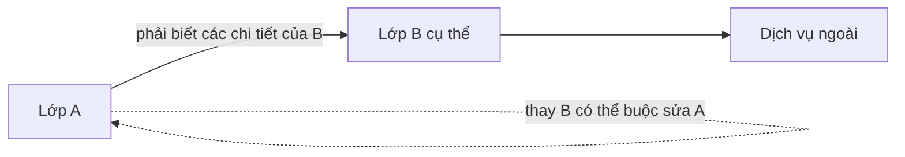

When B changes a method, return type, error format, or required call sequence, A may need to change as well. That propagation is a practical sign of coupling.

## 3. Two design approaches: tight and loose coupling

### 3.1. Tightly coupled example

```java
// Minh họa một thiết kế khó thay đổi, không phải chương trình đầy đủ.
final class CheckoutService {
    void checkout(Order order) {
        CardProcessor processor = new CardProcessor(
                "https://payment-provider.example/api", "merchant-001");
        String paymentId = processor.charge(
                order.getId(), order.getTotalCents());

        SmtpMailer mailer = new SmtpMailer("smtp.example", 587);
        mailer.sendReceipt(order.getCustomerEmail(), paymentId);
    }
}
```

Assume `CardProcessor`, `SmtpMailer`, and `Order` are already defined classes. The problems include:

- `CheckoutService` knows the **concrete classes** used for payments and messaging.
- The service **constructs its dependencies**, making it hard to inject fakes without calling real services.
- Server addresses and configuration reside in the business class.
- Changing providers or receipt-delivery channels forces service changes.
- The two side effects, “charge money” and “send mail,” are tied into one workflow and require appropriate failure handling.

Using `new` is not inherently wrong: creating `new Money(...)` or a DTO/value object inside the service is often reasonable. The issue is **directly constructing and depending on collaborators whose external implementation details are likely to change**.

### 3.2. Depend on contracts instead

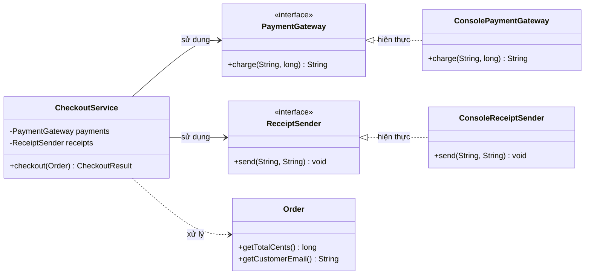

`CheckoutService` now needs two **meaningful business contracts**: `PaymentGateway` and `ReceiptSender`. Their implementations are supplied externally, usually through constructor injection.

As a result, the service need not know which HTTP client, mock, queue, or vendor adapter the payment gateway uses. It still depends on *payment behavior*, but is insulated from most implementation details.

## 4. Complete runnable Java 11+ example with self-checks

Save the entire example as `CouplingDemo.java`:

```java
import java.util.Objects;

public class CouplingDemo {

    static final class Order {
        private final String id;
        private final String customerEmail;
        private final int quantity;
        private final long unitPriceCents;

        Order(String id, String customerEmail,
              int quantity, long unitPriceCents) {
            this.id = Objects.requireNonNull(id, "id");
            this.customerEmail = Objects.requireNonNull(
                    customerEmail, "customerEmail");
            if (quantity <= 0 || unitPriceCents < 0) {
                throw new IllegalArgumentException(
                        "Invalid quantity or unit price");
            }
            this.quantity = quantity;
            this.unitPriceCents = unitPriceCents;
        }

        String getId() {
            return id;
        }

        String getCustomerEmail() {
            return customerEmail;
        }

        long getTotalCents() {
            return Math.multiplyExact(quantity, unitPriceCents);
        }
    }

    // Hai hợp đồng nhỏ, được đặt theo nhu cầu của checkout.
    interface PaymentGateway {
        String charge(String orderId, long amountCents);
    }

    interface ReceiptSender {
        void send(String email, String paymentId);
    }

    static final class CheckoutResult {
        private final String paymentId;
        private final long totalCents;

        CheckoutResult(String paymentId, long totalCents) {
            this.paymentId = paymentId;
            this.totalCents = totalCents;
        }

        String getPaymentId() {
            return paymentId;
        }

        long getTotalCents() {
            return totalCents;
        }
    }

    static final class CheckoutService {
        private final PaymentGateway payments;
        private final ReceiptSender receipts;

        CheckoutService(PaymentGateway payments, ReceiptSender receipts) {
            this.payments = Objects.requireNonNull(
                    payments, "payments");
            this.receipts = Objects.requireNonNull(
                    receipts, "receipts");
        }

        CheckoutResult checkout(Order order) {
            Objects.requireNonNull(order, "order");
            long total = order.getTotalCents();

            String paymentId = payments.charge(order.getId(), total);
            receipts.send(order.getCustomerEmail(), paymentId);

            return new CheckoutResult(paymentId, total);
        }
    }

    // Adapter dùng cho demo.
    static final class ConsolePaymentGateway
            implements PaymentGateway {
        @Override
        public String charge(String orderId, long amountCents) {
            System.out.println("Paid " + orderId + ": "
                    + amountCents + " cents");
            return "tx-" + orderId;
        }
    }

    static final class ConsoleReceiptSender
            implements ReceiptSender {
        @Override
        public void send(String email, String paymentId) {
            System.out.println("Receipt for " + email
                    + ": " + paymentId);
        }
    }

    // Fake để kiểm thử không cần gọi HTTP/thanh toán thật.
    static final class FakePaymentGateway
            implements PaymentGateway {
        String receivedOrderId;
        long receivedAmountCents;

        @Override
        public String charge(String orderId, long amountCents) {
            receivedOrderId = orderId;
            receivedAmountCents = amountCents;
            return "fake-transaction";
        }
    }

    static final class RecordingReceiptSender
            implements ReceiptSender {
        String receivedEmail;
        String receivedPaymentId;

        @Override
        public void send(String email, String paymentId) {
            receivedEmail = email;
            receivedPaymentId = paymentId;
        }
    }

    public static void main(String[] args) {
        Order order = new Order("ORD-7", "buyer@example.test",
                2, 140_000L);

        CheckoutService actual = new CheckoutService(
                new ConsolePaymentGateway(),
                new ConsoleReceiptSender());

        CheckoutResult result = actual.checkout(order);
        System.out.println("RESULT " + result.getPaymentId());

        FakePaymentGateway fakePayment = new FakePaymentGateway();
        RecordingReceiptSender fakeReceipt =
                new RecordingReceiptSender();

        CheckoutService underTest = new CheckoutService(
                fakePayment, fakeReceipt);
        CheckoutResult tested = underTest.checkout(order);

        if (!"ORD-7".equals(fakePayment.receivedOrderId)
                || fakePayment.receivedAmountCents != 280_000L
                || !"buyer@example.test".equals(
                        fakeReceipt.receivedEmail)
                || !"fake-transaction".equals(
                        fakeReceipt.receivedPaymentId)
                || tested.getTotalCents() != 280_000L) {
            throw new AssertionError("Checkout behavior incorrect");
        }

        System.out.println("Fake checks passed");
    }
}
```

Run on JDK 11 or later:

```bash
javac CouplingDemo.java
java CouplingDemo
```

Expected output:

```text
Paid ORD-7: 280000 cents
Receipt for buyer@example.test: tx-ORD-7
RESULT tx-ORD-7
Fake checks passed
```

In this design:

1. **`CheckoutService` is responsible for coordinating checkout**; `Order` calculates totals, `PaymentGateway` performs charges, and `ReceiptSender` delivers receipts.
2. **Business code uses interfaces**, so replacing `ConsolePaymentGateway` with another adapter does not require changing `CheckoutService` if contractual behavior and guarantees remain the same.
3. **Constructor injection** allows fake implementations in tests. Tests verify order IDs, amounts, and recipients instead of only comparing code structure.
4. **Dependencies have not disappeared:** checkout still needs a charging capability and a receipt-sending service. The design only reduces coupling to their details.

This demonstrates **dependency design**, not a complete production payment workflow. If charging succeeds but receipt delivery fails, the charge cannot simply be “undone.” Real systems need explicit transaction states, idempotency, retry/outbox, or other mechanisms to avoid double charging. Reducing coupling isolates integration policies, but **does not solve distributed-system problems on its own**.

## 5. Commonly discussed forms of coupling

Some OOP and structured-design references distinguish these forms of dependency. This is **a classification for reasoning**, not an absolute ranking for every modern Java architecture.

| Form | Indicator | Example / drawback | Improvement when needed |
|---|---|---|---|
| **Content coupling** | A directly interferes with or relies on B's internal implementation | A changes B's private structure using reflection | Encapsulate state; provide behavior-oriented APIs |
| **Common coupling** | Multiple components depend on shared state | A mutable `static` variable or global cache is changed in many places | Limit ownership and mutation rights for shared state |
| **External coupling** | Several components depend on an external protocol/format | Each class parses a vendor's JSON response on its own | Use an adapter/anti-corruption layer, contracts, and versioning |
| **Control coupling** | A passes flags/codes to select B's internal branches | `process(order, true, 3)` with opaque flags | Use intention-revealing operations or a policy/strategy |
| **Stamp coupling** | A passes an entire complex structure when B only needs part | Passing `UserProfile` merely to extract an email address | Pass only the needed data or focused contract |
| **Data coupling** | Components exchange clearly defined data | `charge(orderId, amountCents)` | Often acceptable and easy to understand |
| **Message coupling** | Communication occurs through calls/message contracts with limited knowledge of internals | `gateway.charge(request)` through a small interface | Pay attention to contracts, errors, and versioning; dependencies still exist |

Context matters: passing `UserProfile` is not necessarily wrong when the callee genuinely needs **the whole profile**. Passing too many primitive arguments may also cause *primitive obsession*; a value object such as `Money` or `PaymentRequest` can express the contract better.

### An example of control coupling

```java
// Mã khó đọc: caller phải biết giá trị mode/flag mang ý nghĩa gì.
void publish(Document doc, int mode, boolean urgent) {
    // mode=1: email; mode=2: archive; ...
}
```

Replace it with intention-revealing operations or a clearly named policy:

```java
interface DocumentPublisher {
    void publish(Document document);
}

final class EmailPublisher implements DocumentPublisher {
    @Override
    public void publish(Document document) {
        // Gửi email theo hợp đồng của adapter.
    }
}
```

Assume `Document` and the implementation details exist elsewhere. Introduce multiple implementation classes only when independently substitutable behaviors exist; for two simple, stable branches, a clear enum and `switch` may suffice.

## 6. Principles for reducing coupling and their boundaries

### A. Information hiding – conceal implementation details

Do not expose an object's internal storage structure to external classes merely so they can perform a business operation:

```java
// Tránh:
// order.lines.add(new OrderLine(...));
// order.status = "PAID";

// Tốt hơn nếu thuộc trách nhiệm của Order:
order.addLine(productId, quantity);
order.markPaid(paymentId);
```

Callers know **the behavior Order promises** rather than the number of fields to modify. When internal storage changes from a List to a Map, the external API can stay the same.

### B. Dependency Inversion Principle (DIP)

High-level business modules should not be tied to volatile infrastructure details; both can depend on a suitable abstraction. In this example, `CheckoutService` and the payment adapter both know the `PaymentGateway` interface.

**DIP is not the same as dependency injection (DI).** DIP is a principle for organizing dependencies; DI is a technique for supplying collaborators from outside. Constructor injection can still depend on a concrete class that is hard to replace. Conversely, a small interface can be valuable without a DI framework.

### C. Interface Segregation Principle (ISP)

An overly broad interface also creates coupling. If `PaymentProvider` contains `charge`, `refund`, `issueCard`, `manageAccount`, and `generateReport`, a checkout-only service depends on capabilities it does not need.

Split contracts by consumer roles when the roles are genuinely independent:

```java
interface PaymentCharger {
    String charge(String orderId, long amountCents);
}

interface PaymentRefunder {
    void refund(String paymentId, long amountCents);
}
```

Do not split interfaces merely to create more files. If several operations always belong together and change together, one cohesive contract may be simpler to understand.

### D. Single responsibility and cohesion

**Coupling** concerns **relationships between classes**; **cohesion** concerns **responsibilities within the same class**.

A class that processes payments, sends email, reads SQL, and generates PDFs often has many reasons to change. Assigning responsibilities correctly can reduce harmful coupling and improve cohesion. However, wrapping a simple operation in dozens of classes so that “each class has one line” can make workflows harder to follow.

Evaluate design with a balance of **high cohesion, appropriate coupling**, and a manageable number of components.

### E. Law of Demeter and navigation chains

Be careful when a class reaches through many levels of another object's internals:

```java
// Ràng buộc vào nhiều nấc cấu trúc:
String city = order.getCustomer()
        .getAddress().getCity();
```

If “shipping city” is a stable order concept, consider:

```java
String city = order.getShippingCity();
```

But do not automatically replace every nested getter with a forwarding method. A presentation DTO or pure data query may legitimately use access chains. The key question is **whether this class knows internal structure it should not need to know**.

## 7. Coupling at package and module level

At the system level, dependencies can form cycles:

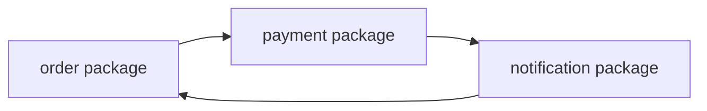

When all three modules import one another, changes and individual tests become hard to isolate. An alternative organization is:

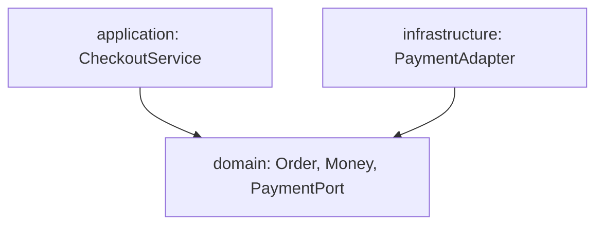

In this structure, stable domain types and required contracts can live in the domain/application layer; infrastructure implements those contracts. The application bootstrap (*composition root*) connects adapters to services. **Source-code** dependencies point toward contracts, even though **runtime** calls still flow from services to infrastructure implementations.

Do not impose one rigid architectural diagram on every problem. Small projects can have simple packages; large systems with many integrations and distinct change cycles often benefit from explicit boundaries.

### What if two modules must communicate in both directions?

First verify whether responsibilities have been split incorrectly. You may extract a shared contract, use callbacks, or publish domain events. Events still create **message coupling**: consumers depend on schemas, timing, order, duplication, and failure handling. “No mutual imports” does not mean “no dependencies.”

## 8. How can we measure coupling?

Metrics can help identify problems, but must be interpreted alongside actual behavior.

| Metric / indicator | Interpretation | Limitation |
|---|---|---|
| **CBO (Coupling Between Objects)** | Number of classes a class relates to or depends on, per a tool's definition | Counting rules differ across tools; does not reveal which dependency is risky |
| **Fan-out** | Number of outgoing dependencies from a module | Many dependencies on stable APIs may be safer than one dependency on volatile details |
| **Fan-in** | Number of consumers depending on a module | High fan-in may indicate a useful shared component, but changes require care |
| **Dependency cycle** | A → B → C → A | May complicate layering and independent deployment |
| **Change coupling** | Files/classes often have to change together | Check change history; shared features can also explain correlated edits |
| **Difficulty testing in isolation** | Tests require databases, networks, or several services | May indicate broad boundaries, hidden dependencies, or missing abstractions |

For example, a `ReportService` using five small, immutable value objects with stable contracts is not necessarily worse off than a `CheckoutService` depending on a single large, frequently changing payment SDK.

Assess **change costs**, **testability**, **contract stability**, and **knowledge of external details** together. Do not simply count `import` statements or fields.

## 9. A practical workflow for tightly coupled classes

1. **Identify what varies:** provider, data source, object structure, business rule, message format, or delivery mechanism?
2. **Determine each class's required responsibility:** `CheckoutService` needs to “charge a payment,” not know a particular HTTP endpoint.
3. **Define a focused but complete contract:** parameters, results, exceptions, and preconditions/postconditions should be explicit.
4. **Isolate frequently changing details in separate implementations:** database, HTTP, email adapters, or business policies with multiple variants.
5. **Supply dependencies deliberately:** use constructor injection for required collaborators stable over the service lifecycle; use method parameters for per-operation dependencies.
6. **Test through contracts:** simulate interfaces at boundaries and verify observable behavior; add integration tests for real adapters when needed.
7. **Reassess complexity:** if a refactor adds many classes without making actual changes easier, the design may be prematurely abstracted.

Not every class needs an interface. `Money`, `OrderId`, `LocalDate`, and stable internal algorithms can often be used directly without creating `IMoneyFactoryAdapter` and layers of pointless wrappers.

## 10. Common misconceptions

| Incorrect claim | Correct interpretation |
|---|---|
| “Fewer dependencies are always better.” | Classes must collaborate; seek **intentional, manageable dependencies**. |
| “Importing only one class guarantees low coupling.” | One class may know extensive details and assumptions about a single dependency. |
| “Having an interface means loose coupling.” | If the interface copies an entire external SDK or changes constantly, the consumer remains tightly coupled. |
| “Dependency injection solves all coupling.” | DI makes supplying implementations and testing easier; the contract can still be poorly designed. |
| “Events/message brokers remove all coupling.” | Dependencies on schemas, delivery semantics, versions, and processing order remain. |
| “Static utilities are always a problem.” | Pure, stateless functions such as `Math.multiplyExact` are often fine; shared mutable state needs closer scrutiny. |
| “More classes always mean easier maintenance.” | Excess abstractions and wrappers make navigation and management harder. |
| “Low coupling implies high cohesion.” | They are independent dimensions: relationships across classes versus responsibilities within them. |
| “A test passing with a fake means production integration is safe.” | Fakes validate application logic; adapters, networks, databases, and failure modes still need appropriate verification. |

## 11. Practice exercises

### Exercise 1 – Identify strong coupling

```java
class MonthlyReportService {
    byte[] generate() {
        OracleConnection db = new OracleConnection("...");
        var rows = db.query("SELECT ...");
        return new VendorPdfWriter().render(rows);
    }
}
```

*This is illustrative code; vendor classes have not been declared.*

Question: if the application switches from Oracle to PostgreSQL or changes PDF export libraries, where must the code change? How can `MonthlyReportService` know less about those details?

**Hint:** identify contracts for obtaining report data and rendering documents (when there is a genuine need for substitution or independent testing). Move adapter configuration and construction out of the service; design queries around domain needs.

### Exercise 2 – Is an interface enough?

A project contains:

```java
interface HugePaymentSdkFacade {
    void connectWithVendorCertificate(...);
    void setVendorRegion(...);
    void callVendorEndpoint(...);
    void parseVendorResponse(...);
}
```

`CheckoutService` calls all these methods. Why is coupling still high despite the interface?

**Hint:** the interface exposes vendor-specific details; changing vendors still forces changes to business code. A better contract should express an operation such as `charge(request)` and domain-level rules for results and failures.

### Exercise 3 – Choose how to pass dependencies

A formatter is used only during one report export, while a repository is used in most operations of a service. Would you pass them as method arguments or through the constructor?

**Hint:** the formatter can be a parameter when it varies per request. A stable, required repository usually fits constructor injection. This choice depends on lifecycle and API design; there is no absolute rule.

### Exercise 4 – Detect change coupling

Changing an address format requires editing `Customer`, `Order`, `Invoice`, `EmailSender`, and `CsvExporter` because all of them read `address.line1` and `address.line2` and concatenate strings independently.

Which boundary would you introduce to reduce this change propagation?

**Hint:** model `Address` as a value object with appropriately owned behavior/formatting, or create context-specific formatters. Do not force different email, invoice, and CSV requirements into one output string.

### Exercise 5 – Test substitutability

Using `CouplingDemo.java`, create a `FailingPaymentGateway` that throws an exception in `charge()`. Verify that `RecordingReceiptSender` **is not called** when charging fails.

**Hint:** add a `boolean called` field to the sender; call `checkout()`, catch the expected error, and assert `called == false`. Extension: if the gateway charges successfully but the sender fails, how should the system track state and retry receipts without charging twice?

---

**Remember:** coupling describes how much one class must know about, rely on, and be affected by another. Good design maintains **clear responsibilities**, **stable contracts**, **substitutable details at appropriate boundaries**, and **testable behavior**. Reduce actual change propagation without introducing abstractions prematurely.


</details>

- [Back to top](#back-to-top)

---

## <a id="class-design-004">Separating data, business logic, and external interactions</a>

<details>
<summary>View details</summary>

# Separating data, business logic, and external interactions in Java class design

An “order placement” feature may need to accept JSON, validate a cart, calculate an amount, save to a database, and email a confirmation. Putting everything in one class means that changes ranging from HTTP formats to promotion rules require editing the same place. Even testing a calculation would then require starting a database or email service.

The solution is to **establish clear boundaries among data, business logic, and interactions with the outside world**, and connect them through well-defined interfaces. The aim is to change and test each area without entangling core business rules.

## 1. Understanding three responsibility categories

| Category | Question the component answers | Examples | What to avoid |
| --- | --- | --- | --- |
| Data and domain model (*data/domain model*) | What state does an object have? Which values are valid? | `OrderLine`, `Order`, `Money` | Allowing arbitrary mutations that make an order invalid |
| Business logic (*business rules/use case*) | When may an order be placed? How are totals and discounts computed? What is the workflow? | `PricingPolicy`, `CheckoutService` | Embedding discount formulas directly in controllers/SQL/email |
| External interaction (*I/O, infrastructure, adapters*) | How are requests received, data stored, and notifications sent? | HTTP controller, JDBC repository, email gateway | Importing HTTP/SQL libraries into domain objects |

**Important clarification:** “separating data and business logic” **does not mean** entities become getter/setter containers while all rules move into services. Good domain entities can enforce invariants and expose valid behaviors. What must be separated is **core logic** from HTTP connections, databases, files, email, and other external systems.

For example, `OrderLine` knows that quantity must be positive and can calculate its line total. `Order` protects the validity of its total. `CheckoutService` coordinates creating and saving the order. `OrderRepository` defines the storage contract; only the JDBC implementation needs to know the actual SQL.

## 2. Why is mixing everything in one class problematic?

```java
// PSEUDOCODE: ví dụ cần cải tiến, không phải đoạn có thể chạy độc lập.
class CheckoutController {
    void checkout(HttpRequest request) {
        String customerId = request.json().get("customerId");
        long total = 0;

        // Vừa parse HTTP, vừa thực thi business rule.
        for (var item : request.json().items()) {
            total += item.quantity() * item.unitPriceCents();
        }
        if ("SAVE10".equals(request.json().promoCode())) {
            total = total - total / 10;
        }

        // Vừa làm I/O, vừa điều phối use case.
        database.execute("INSERT INTO orders ...");
        emailClient.send(customerId, "Order confirmed");
    }
}
```

The mixed dependencies cause several problems:

- Changing JSON request handling can affect pricing code.
- Testing a discount requires mocking HTTP, databases, and email.
- The same rule may be copied into a CLI, another API, or a background job.
- When saving succeeds but emailing fails, the system has no clear policy for the partial outcome.
- The controller has too many reasons to change, and errors in one layer are harder to detect with focused tests.

Separating responsibilities clarifies **who decides what** and **where errors are handled**. No single decomposition fits projects of every size.

## 3. Designing the dependency flow

A practical arrangement is that an adapter receives data, an application service coordinates, a domain model/policy enforces rules, and persistence/notifications are accessed through *ports* (interfaces).

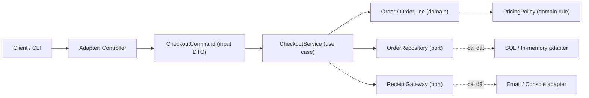

Solid arrows show where one component invokes or uses another in the flow. **Source-code dependency direction** must be controlled: the business layer defines its required ports; external adapters implement those ports. The domain layer does not import controllers, JDBC, `System.out`, or email libraries.

Under the **Dependency Inversion Principle**, `CheckoutService` depends on `OrderRepository`/ `ReceiptGateway` *interfaces*; `JdbcOrderRepository` and `SmtpReceiptGateway` depend on their respective technologies.

### Commonly confused terms

| Term | Actual responsibility | Does it contain business rules? |
| --- | --- | --- |
| DTO / Command | Carries data across boundaries | Mostly input-format validation; not the source of truth for invariants |
| Value object | Represents a meaningful domain value | Can validate itself and perform value-specific operations |
| Entity / Aggregate | Protects state and valid transitions | Yes; often essential for preserving invariants |
| Domain policy/service | Handles rules not owned by one entity or needing independent configuration | Yes |
| Application service | Coordinates one use case and its collaborators | May check workflow conditions, but should avoid embedding complex domain formulas |
| Repository port | Contract for storing/querying domain objects | The interface contains no SQL knowledge |
| Adapter | Converts I/O into system contracts | Should not redefine pricing rules, limits, and so on |

A `Data class` is not necessarily a record; that is an implementation choice. Java `record` is useful for immutable data, whereas entities with lifecycles and state transitions may be better represented by classes with encapsulated fields and behavior.

## 4. Standalone Java 17 example: placing orders and sending receipts

Requirements:

- A customer may place an order with at least one line item.
- Each line has a product code, a positive quantity, and a nonnegative price in **cents**.
- The `SAVE10` code discounts the pre-discount total by 10%, **rounding down to cents**; no code means no discount.
- Unsupported promotion codes must be rejected **before the order is saved**.
- Orders are stored through `OrderRepository`; receipts are sent through `ReceiptGateway`.
- The example can run with an in-memory repository and a console-output gateway, without HTTP or a database.

Create **`SeparationOfConcernsDemo.java`**:

```java
import java.math.BigDecimal;
import java.util.ArrayList;
import java.util.LinkedHashMap;
import java.util.List;
import java.util.Map;
import java.util.Objects;
import java.util.Optional;

public class SeparationOfConcernsDemo {

    // INPUT DTO: biểu diễn dữ liệu mà một adapter chuyển cho use case.
    record LineInput(String sku, int quantity, long unitPriceCents) { }
    record CheckoutCommand(
            String customerId,
            List<LineInput> items,
            String promoCode) { }

    // DOMAIN: value object; dữ liệu và hành vi luôn đi cùng bất biến.
    record OrderLine(String sku, int quantity, long unitPriceCents) {
        OrderLine {
            if (sku == null || sku.isBlank()) {
                throw new IllegalArgumentException("SKU is required");
            }
            if (quantity <= 0 || unitPriceCents < 0) {
                throw new IllegalArgumentException("Invalid line values");
            }
        }

        long lineTotalCents() {
            // Phát hiện tràn số thay vì âm thầm cho kết quả sai.
            return Math.multiplyExact(quantity, unitPriceCents);
        }
    }

    // DOMAIN POLICY: quy tắc giá độc lập với cách nhận và lưu dữ liệu.
    interface PricingPolicy {
        long payableCents(long subtotalCents, String promoCode);
    }

    static final class StandardPricingPolicy implements PricingPolicy {
        @Override
        public long payableCents(long subtotalCents, String promoCode) {
            if (subtotalCents < 0) {
                throw new IllegalArgumentException("Negative subtotal");
            }

            if (promoCode == null || promoCode.isBlank()) {
                return subtotalCents;
            }
            if ("SAVE10".equals(promoCode)) {
                long discountCents = subtotalCents / 10; // làm tròn xuống
                return subtotalCents - discountCents;
            }
            throw new IllegalArgumentException("Unknown promotion");
        }
    }

    // DOMAIN: Order bảo vệ dữ liệu và invariant tổng tiền.
    static final class Order {
        private final String id;
        private final String customerId;
        private final List<OrderLine> lines;
        private final long subtotalCents;
        private final long payableCents;

        private Order(String id, String customerId,
                      List<OrderLine> inputLines, String promoCode,
                      PricingPolicy policy) {
            this.id = required(id, "order id");
            this.customerId = required(customerId, "customer id");
            Objects.requireNonNull(policy, "policy");

            this.lines = List.copyOf(inputLines);
            if (lines.isEmpty()) {
                throw new IllegalArgumentException("Empty order");
            }

            long sum = 0L;
            for (OrderLine line : lines) {
                sum = Math.addExact(sum, line.lineTotalCents());
            }
            this.subtotalCents = sum;

            long proposed = policy.payableCents(sum, promoCode);
            if (proposed < 0 || proposed > sum) {
                throw new IllegalArgumentException(
                        "Pricing policy returned invalid amount");
            }
            this.payableCents = proposed;
        }

        static Order place(String id, String customerId,
                           List<OrderLine> lines, String promoCode,
                           PricingPolicy policy) {
            return new Order(id, customerId, lines, promoCode, policy);
        }

        String id() { return id; }
        String customerId() { return customerId; }
        long subtotalCents() { return subtotalCents; }
        long payableCents() { return payableCents; }
        List<OrderLine> lines() { return lines; }
    }

    // PORTS: hợp đồng dịch vụ ngoài do use case cần.
    interface OrderRepository {
        void save(Order order);
        Optional<Order> findById(String id);
    }

    interface ReceiptGateway {
        void sendReceipt(Order order);
    }

    interface OrderIdGenerator {
        String nextId();
    }

    // APPLICATION: điều phối, không tự tính tiền hay biết SQL.
    static final class CheckoutService {
        private final PricingPolicy pricing;
        private final OrderRepository orders;
        private final ReceiptGateway receipts;
        private final OrderIdGenerator ids;

        CheckoutService(PricingPolicy pricing, OrderRepository orders,
                        ReceiptGateway receipts, OrderIdGenerator ids) {
            this.pricing = Objects.requireNonNull(pricing);
            this.orders = Objects.requireNonNull(orders);
            this.receipts = Objects.requireNonNull(receipts);
            this.ids = Objects.requireNonNull(ids);
        }

        Order checkout(CheckoutCommand command) {
            Objects.requireNonNull(command, "command");
            Objects.requireNonNull(command.items(), "items");

            // Chuyển từ input DTO sang domain value object.
            List<OrderLine> lines = new ArrayList<>();
            for (LineInput input : command.items()) {
                Objects.requireNonNull(input, "line input");
                lines.add(new OrderLine(
                        input.sku(),
                        input.quantity(),
                        input.unitPriceCents()));
            }

            Order order = Order.place(
                    ids.nextId(), command.customerId(),
                    lines, command.promoCode(), pricing);

            orders.save(order);
            receipts.sendReceipt(order);
            return order;
        }
    }

    // ADAPTER: thay bằng JDBC/JPA mà không thay code tính tiền.
    static final class InMemoryOrderRepository implements OrderRepository {
        private final Map<String, Order> data = new LinkedHashMap<>();

        @Override
        public void save(Order order) {
            Objects.requireNonNull(order, "order");
            if (data.putIfAbsent(order.id(), order) != null) {
                throw new IllegalStateException("Order id already exists");
            }
        }

        @Override
        public Optional<Order> findById(String id) {
            return Optional.ofNullable(data.get(id));
        }
    }

    // ADAPTER: tương tác console, không nằm trong entity Order.
    static final class ConsoleReceiptGateway implements ReceiptGateway {
        @Override
        public void sendReceipt(Order order) {
            String amount = BigDecimal
                    .valueOf(order.payableCents(), 2)
                    .toPlainString();
            System.out.println(
                    "Receipt " + order.id() + " = " + amount);
        }
    }

    private static String required(String text, String field) {
        if (text == null || text.isBlank()) {
            throw new IllegalArgumentException(field + " is required");
        }
        return text;
    }

    public static void main(String[] args) {
        InMemoryOrderRepository repository = new InMemoryOrderRepository();
        CheckoutService service = new CheckoutService(
                new StandardPricingPolicy(),
                repository,
                new ConsoleReceiptGateway(),
                () -> "ORDER-001");

        CheckoutCommand command = new CheckoutCommand(
                "CUSTOMER-01",
                List.of(
                        new LineInput("BOOK", 2, 120_00),
                        new LineInput("PEN", 3, 25_00)),
                "SAVE10");

        Order order = service.checkout(command);
        System.out.println(
                "Saved = " + repository.findById(order.id()).isPresent());

        try {
            service.checkout(new CheckoutCommand(
                    "CUSTOMER-02",
                    List.of(new LineInput("BOOK", 1, 120_00)),
                    "INVALID"));
        } catch (IllegalArgumentException expected) {
            System.out.println(expected.getMessage());
        }
    }
}
```

Compile and run with Java 17 or later:

```bash
javac SeparationOfConcernsDemo.java
java SeparationOfConcernsDemo
```

Output:

```text
Receipt ORDER-001 = 283.50
Saved = true
Unknown promotion
```

Manually: `2 × 120.00 + 3 × 25.00 = 315.00`; a 10% discount is `31.50`; the amount payable is `283.50`. The code stores monetary amounts in integer cents to avoid `double` rounding errors; its discount and rounding rules are explicit. Multi-currency systems need a `Money` model with appropriate currency, scale, and rounding modes.

### Why does this example separate responsibilities correctly?

- `CheckoutCommand`/`LineInput` are input data structures; they do not know SQL, email, or pricing rules.
- `OrderLine` is a **value object with behavior** that enforces invariants and calculates a line total.
- `Order` is a domain model that guarantees a nonempty list and an amount payable within valid bounds. `List.copyOf` snapshots the list; its elements are records with immutable components, so mutable state is not exposed.
- `StandardPricingPolicy` knows promotions, not request handling or database persistence.
- `CheckoutService` converts input into domain objects and coordinates persistence and receipt delivery. It neither writes SQL nor reimplements the `SAVE10` formula.
- `InMemoryOrderRepository` and `ConsoleReceiptGateway` are adapters. Switching storage or notification mechanisms does not require changes to `OrderLine` or `Order`.

**Demo limitations:** the in-memory repository is not thread-safe, and the fixed ID generator supports only one successful checkout. A real system must generate unique IDs and enforce uniqueness constraints in storage.

Moreover, `orders.save(order)` may succeed while `receipts.sendReceipt(order)` fails. Then **the order is saved but the caller may receive an exception**. That is why production systems often use transactional outboxes, queues, and idempotent processing to deliver receipts reliably after commit. Putting both operations into one method or merely adding `@Transactional` does not automatically establish an atomic transaction across a database and an email system.

## 5. Processing flow and test boundaries

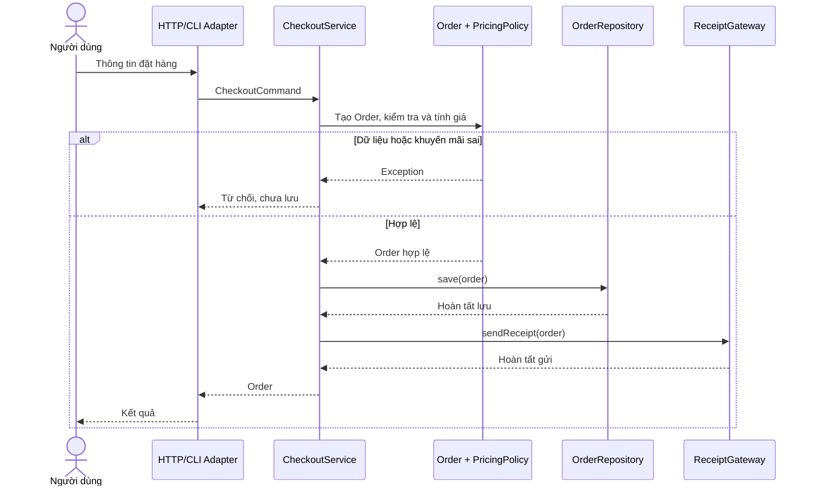

### Domain unit tests without I/O

The pricing policy is a pure calculation from inputs to outputs. It can be tested independently without mocking network or database operations:

```java
PricingPolicy policy = new StandardPricingPolicy();

assert policy.payableCents(31_500, "SAVE10") == 28_350;
assert policy.payableCents(31_500, null) == 31_500;
assert policy.payableCents(0, "SAVE10") == 0;
```

Run with `java -ea` to enable Java `assert`, or use JUnit in a real project. Add tests for totals not divisible by 10, unsupported codes, negative prices, quantity 0 and `long` overflow to verify boundary cases.

### Workflow unit tests with fakes/mocks

For `CheckoutService`, a fake `OrderRepository` can record whether `save` was called with the right total; a fake `ReceiptGateway` can count deliveries. Important assertions include:

| Scenario | What to assert |
| --- | --- |
| Valid line items + valid promotion | Creates Order with the right total, saves once, requests delivery once |
| Blank SKU or nonpositive quantity | Rejected before `save` or `sendReceipt` |
| Unsupported promotion | Neither saves nor sends |
| Repository failure | Does not send a receipt; propagates failure to the use case |
| Gateway failure after saving | Handles persisted state according to retry/outbox design |
| Two requests with the same ID | Real repository must enforce uniqueness |

Do not retest the discount formula in the controller. Controller tests should cover mapping HTTP into commands and mapping errors into status codes and JSON; policy tests cover the formula separately.

## 6. The boundary between “data” and domain: avoid anemic models

A common mistake is creating entities with unrestricted setters and pushing all business rules into services:

```java
// Thiết kế dễ bị phá vỡ invariant.
class Order {
    public List<OrderLine> lines;
    public long totalCents;
}
```

Callers can change `totalCents` so it no longer matches the sum of the line items. Layer separation must not leave domain state uncontrolled.

A better approach uses constructors/factories, encapsulates fields, and allows only valid state-changing operations such as `addLine`, `confirm`, and `cancel`. In the demo, `Order` is constructed once and remains immutable. If an order has a changing lifecycle, place state and business transitions in the appropriate aggregate.

Distinguish among:

| Data type | Example | Rules to contain |
| --- | --- | --- |
| Request DTO | `CheckoutCommand` | Input shape; basic parsing/formatting |
| Domain value object | `OrderLine` | Valid SKU, quantity, and line-price calculation |
| Domain entity/aggregate | `Order` | Order invariants and state transitions |
| Persistence record | SQL row/JPA mapping | Conversion to/from stored form |
| Response DTO | `OrderResponse` | Shape of the data promised by the API |

Not every project needs separate DTOs and persistence models distinct from entities. Decide based on boundary complexity and change frequency. But when entities become tightly coupled to schemas or serialization, separating them often improves domain independence.

## 7. “Pure core, imperative shell” in OOP

Another perspective keeps logic with few side effects at the center and places I/O at the edges.

**Pure core:** the same input yields the same output without writing to files, logs, networks, or databases. For example, `PricingPolicy.payableCents`. This code is easy to test and rerun.

**Imperative shell:** receives requests, invokes domain logic, persists data, and sends notifications. `CheckoutService` coordinates ports, while adapters perform real I/O.

Not every domain method is a pure function: an entity may legitimately change state through `confirm()` or `cancel()`. The useful principle is to **isolate I/O and volatile dependencies**, not prohibit all state changes within objects.

Dependencies that complicate testing include:

- System clocks: replace direct calls to `LocalDate.now()` with an injected `Clock` when time affects a rule.
- Random values/UUIDs: use `OrderIdGenerator` or an ID source injected through the constructor.
- Environment/configuration: obtain these externally and convert them into explicit settings/policies.
- Email/HTTP/SQL: define ports with appropriate adapters.
- Database transactions: place them at a suitable use-case or unit-of-work boundary, not inside pricing calculations.

## 8. Applying this design with Spring Boot/JPA

A typical package structure:

```text
com.example.orders
├── domain
│   ├── Order.java
│   ├── OrderLine.java
│   └── PricingPolicy.java
├── application
│   ├── CheckoutService.java
│   ├── CheckoutCommand.java
│   ├── OrderRepository.java
│   └── ReceiptGateway.java
├── infrastructure
│   ├── JpaOrderRepositoryAdapter.java
│   ├── OrderJpaEntity.java
│   └── SmtpReceiptAdapter.java
└── web
    ├── CheckoutController.java
    └── CheckoutResponse.java
```

This is **one possible organization**. Small systems may use simpler packages; attractive package names cannot compensate for incorrect dependencies.

Example Spring dependency flow:

```java
// application port
public interface OrderRepository {
    void save(Order order);
}

// infrastructure adapter
@Repository
public class JpaOrderRepositoryAdapter implements OrderRepository {
    private final SpringDataOrderRepository jpa;

    public JpaOrderRepositoryAdapter(SpringDataOrderRepository jpa) {
        this.jpa = jpa;
    }

    @Override
    public void save(Order order) {
        // Map domain sang persistence entity, rồi gọi jpa.save(...)
    }
}
```

This only illustrates integration: `SpringDataOrderRepository`, entities, and mappers must be defined in the real application. Domain classes do not need HTTP annotations or email-sending code.

`@Transactional` on an application service may wrap database writes, but **does not** extend ACID transactions across a separate SMTP/HTTP system. When notifications must eventually be sent after orders are stored, an outbox entry can be saved within the same database transaction; a separate worker reads the outbox, sends notifications, retries, and handles duplicates. This is *eventual consistency*: notifications may arrive after an order is saved.

## 9. Signs of flawed design and appropriate fixes

| Symptom | Why is it harmful? | Appropriate remedy |
| --- | --- | --- |
| Controller runs SQL and calculates discounts | Mixes adapters with business logic | Controller creates command, invokes service; policy calculates prices |
| Entity emails users or calls HTTP | Domain depends on I/O | Publish a domain event or let a service call a port |
| Repository contains a “10% discount” rule | Business rule buried in persistence | Move it to a domain policy |
| DTO exposes a mutable list directly to domain logic | Callers can change state without validation | Convert/validate and make defensive copies |
| Service has hundreds of pricing/tax `if` branches | Policy changes affect the use case | Extract a clearly named policy |
| Service constructs `new Jdbc...` | Hard to replace adapters; tests need a database | Use constructor injection and a port |
| “An interface for every class,” including simple value objects | Adds abstractions without value | Use interfaces only for meaningful contracts or boundaries that change |
| Email sent before saving an order | May notify about an order that does not exist | Define reliable write/commit and notification flow |
| Catch every exception and return “success” | Hides failures and violates API guarantees | Classify errors, rollback/retry as appropriate, report accurate status |

**Do not mechanically split one class per method.** A class should have a coherent responsibility and enough behavior to fulfill it. A small module with two use cases and one database need not copy the entire layered architecture of a large system.

## 10. Handling a new requirement

Suppose the requirement is “offer free shipping on eligible orders.” Follow these steps:

1. **Specify the rule:** is the threshold measured before or after discounts? Which currency applies? From which date?
2. **Identify input data:** cart, destination, rate table, policy information.
3. **Assign responsibility:** fee/waiver calculations belong in an appropriate domain policy; invoke a shipping service through a port if I/O is truly required; the service coordinates execution order.
4. **Preserve boundaries:** request DTO carries an address; mapper builds domain objects; shipping adapter transforms third-party requests/responses.
5. **Test rules first:** below/above thresholds, stacked promotions, other currencies, rate-lookup failures.
6. **Test integration next:** database, transactions, retries, API contracts, repeated submissions of the same request.

With these boundaries, adding a fee calculation does not force changes to both the controller and SQL just because they participate in the same use case.

## 11. Practice exercises

**Exercise A — Split an overloaded class.** A `RegistrationController` directly validates emails, checks existing accounts with SQL, hashes passwords, saves to a database, sends welcome emails, and returns JSON. Design new components and choose where to enforce the “unique email” invariant. Identify which steps need a transaction and which should be asynchronous.

**Exercise B — Move time to a boundary.** A book-rental policy sets a due date 14 days after borrowing, accounting for holidays. Design a pure domain policy from `LocalDate` and a supplied holiday calendar, while an adapter or application service obtains the current date/calendar source.

**Exercise C — Test without I/O.** Test `StandardPricingPolicy` with subtotals of 1 cent, 9 cents, 10 cents, and a large value near the `long` limit. Explain the round-down rule; ensure `Order` uses `Math.addExact` instead of returning negative totals from overflow.

**Exercise D — Handle post-save failure.** In checkout, a repository saves successfully but the receipt gateway throws an exception. Propose a minimal outbox with `PENDING/SENT` states, idempotent retries, and a way for customers to check that their order was placed, without repeating checkout because email failed.

**Exercise E — Swap an adapter.** Replace `ConsoleReceiptGateway` with a fake that only records delivery counts; verify the pricing logic and repository need no modifications. Then sketch a `JdbcOrderRepositoryAdapter` and identify which classes **should not** change.

## 12. Class-design review checklist

- Can **domain** logic be tested without starting frameworks, HTTP, files, databases, or email?
- Are DTOs transformed into domain objects and invariants checked at appropriate boundaries?
- Do entities/value objects protect state with behaviors rather than uncontrolled public setters?
- Does the application service coordinate use cases through clear contracts?
- Does any class calculate domain rules while also writing SQL and formatting responses?
- Do domain dependencies point into specific frameworks or adapters?
- Are volatile inputs such as clocks, IDs, configuration, and randomness controlled for testing?
- Are transactions, idempotency, retries, and side-effect failures governed by clear policies?
- Is a new interface/adapter really needed, or would a simpler design still express responsibilities clearly?
- When pricing formulas, database schemas, or email protocols change, is the number of affected classes reasonable?

**Key takeaway:** separating data, business logic, and external interactions means separating **responsibilities and change boundaries**. Domain models preserve invariants, use cases coordinate behavior, and adapters deal with I/O technology. Business features can then evolve without every change touching the database, controller, or email code.


</details>

- [Back to top](#back-to-top)

---

## <a id="class-design-005">Naming classes, fields, and methods</a>

<details>
<summary>View details</summary>

# Naming classes, fields, and methods in Java OOP

**Goal:** Names should reveal **a class's role**, **the meaning and units of data**, **a method's behavior**, and **side effects and return contracts**. Good names make code readable, clarify responsibilities, and reduce API misuse. Naming is not a substitute for sound design, but it is an essential part of it.

## 1. Core principle: names must tell the truth

Consider this code:

~~~java
DataManager m = new DataManager();
m.process(x);
boolean flag = m.check();
~~~

A reader cannot tell what `DataManager` manages, whether `process()` creates or deletes data, what condition `check()` checks, or what `flag` means. Vague names force people to inspect method bodies and trace several classes to understand code.

A more descriptive version:

~~~java
OrderRepository orders = new InMemoryOrderRepository();
orders.insert(order);
boolean exists = orders.findById(order.orderId()).isPresent();
~~~

Here, the names show that the repository manages orders, `insert()` adds an order, and `findById()` looks up an ID with a possibly missing result. The contract still needs to say what happens with duplicate IDs, but the API is easier to understand.

**Five questions before finalizing a name:**

1. **Which business concept does it represent?** `Order`, `Cart`, `Payment`, or infrastructure such as `OrderRepository`?
2. **Does it convey the role rather than just the data type?** `remainingSeats` is more useful than `number`; `userIds` is more useful than `stringList`.
3. **Can callers predict the action?** `cancelReservation()` is clearer than `handle()`.
4. **Does it reflect conditions and results?** `findById()` suggests “might not exist”; `requireById()` may indicate “throw if missing” if that convention is documented.
5. **Will it stay accurate if implementation changes?** `OrderRepository` accommodates a switch from JDBC to API calls; `JdbcOrderDao` contains technology details and only fits when the class truly is a JDBC adapter.

Do not optimize names solely for brevity. A longer, precise name is often cheaper than repeated reader inference. Conversely, names that repeat information already in context make code cumbersome.

## 2. Standard Java naming conventions

| Element | Common convention | Example | Notes |
|---|---|---|---|
| Class | `UpperCamelCase`, usually a noun/noun phrase | `ShoppingCart`, `OrderRepository` | Describes the object or responsibility |
| Interface | `UpperCamelCase` | `PaymentGateway`, `Runnable` | Named for the **contract**; no mandatory `I` prefix |
| Record | `UpperCamelCase` | `Money`, `OrderLine` | Describes a value or data grouping |
| Enum type | `UpperCamelCase` | `OrderStatus` | Names a set of states or categories |
| Enum constant | `UPPER_SNAKE_CASE` | `PENDING_PAYMENT`, `PAID` | Usually fixed values |
| Method | `lowerCamelCase`, usually a verb/verb phrase | `addLine()`, `findById()` | Names the action or query |
| Field | `lowerCamelCase` | `orderId`, `remainingSeats` | Avoid Hungarian-style prefixes `strName`, `mName` |
| Parameter / local variable | `lowerCamelCase` | `orderId`, `customerEmail` | Short names can work in very clear contexts |
| Named constant | `UPPER_SNAKE_CASE` | `MAX_RETRY_ATTEMPTS` | Typically `static final` for truly immutable constants |
| Package | Lowercase, grouped by domain/feature | `com.example.orders` | Avoid camelCase or underscores in new package names |
| Generic type parameter | Usually one meaningful uppercase letter | `T`, `E`, `K`, `V`, `ID` | Longer, clear names can help complex generics |

These are widely used Java **conventions**, not compiler-enforced naming laws. Java is case-sensitive: `orderId` and `OrderId` are different identifiers.

**Distinguish `final` from constants:** `private final List<Order> orders` makes only the list **reference** unassignable; elements may still be added/removed. Do not automatically rename it `ORDERS` just because it has `final`. `private static final int MAX_ITEMS = 100;` is a typical `UPPER_SNAKE_CASE` constant. Likewise, `private static final List<String> CODES = new ArrayList<>()` has a fixed reference but mutable contents, so consider actual immutability before treating it as a constant.

### Abbreviations and terminology

Prefer readable names such as `HttpClient`, `customerId`, `paymentUrl`, and `parseJson()`. Familiar abbreviations such as `URL`, `HTTP`, `DTO`, and `ID` are fine, but follow **a consistent project convention**, especially in public APIs. Existing Java libraries include types named `URL` and `URI`; do not arbitrarily rename library APIs.

For example, `getURL()` and `getUrl()` may produce different property names under JavaBeans introspection due to decapitalization rules. When renaming code used by reflection, serialization, or binding, verify actual behavior rather than merely changing letter case.

## 3. Naming classes: prioritize concepts and responsibilities

### Domain-model classes

Nouns such as `Invoice`, `ShoppingCart`, `OrderLine`, and `BankAccount` usually clarify which entity or value an object represents. Its methods enforce the concept's invariants.

~~~java
final class ShoppingCart {
    // Danh sách và hành vi thuộc cùng khái niệm giỏ hàng.
}

record OrderLine(String sku, int quantity) {}
~~~

If `Cart` already lives in package `com.example.checkout.cart`, there is no need to call it `CheckoutShoppingCartDataModel`. Be specific enough to avoid confusion with another `Cart` in context, but avoid redundant prefixes.

### Classes that provide behaviors

Some responsibilities are not “entities” but collaborators:

| Vague name | Suggested name | Clarified responsibility |
|---|---|---|
| `OrderManager` | `OrderRepository` | Store and query orders |
| `PaymentHelper` | `PaymentGateway` | Communicate with payment systems |
| `ThingProcessor` | `InvoiceCalculator` | Calculate invoice amounts |
| `ReportUtil` | `CsvReportExporter` | Export reports as CSV |
| `DataHandler` | `InventoryReservationService` | Reserve inventory under business rules |
| `EmailStuff` | `ReceiptSender` | Send receipts |

Suffixes such as `Service`, `Manager`, `Handler`, and `Processor` are not forbidden; they are weak only when they **fail to explain what the service does**. `CheckoutService` may be a good name for a clearly defined checkout use case. Do not force every class to become `SomethingService`.

**Interfaces:** name them by capability/contract, such as `TaxPolicy`, `ShippingGateway`, and `OrderRepository`. Implementation names should convey useful differences: `JdbcOrderRepository`, `InMemoryOrderRepository`, and `StripePaymentGateway`. Avoid reflexive `IOrderRepository`/`OrderRepositoryImpl` naming when it adds no information; follow any established project convention consistently.

**Exceptions:** a meaningful name such as `InsufficientBalanceException` or `OrderNotFoundException` tells callers what went wrong; avoid `MyException` or `CustomException` when a public API can be more specific.

**Classes with `Dto`/`Request`/`Response` suffixes:** appropriate at HTTP/integration boundaries when they transport data. Do not unknowingly treat a DTO as a domain entity; `CreateOrderRequest` need not enforce the same invariants as `Order`.

## 4. Naming fields: meaning, quantity, units, and state

A field name should communicate **what the stored data represents**:

~~~java
// Khó đọc vì thiếu ý nghĩa:
private long value;
private int t;
private boolean flag;
private List<String> data;

// Cụ thể hơn trong ngữ cảnh ví dụ:
private long balanceCents;
private int retryCount;
private boolean emailVerified;
private List<String> permittedCountryCodes;
~~~

### Collections and plurals

- One element: `order`, `customer`, `selectedProduct`.
- Multiple elements: `orders`, `customerIds`, `selectedProducts`.
- A lookup collection: `ordersById` for a `Map<String, Order>`; the name describes **the key** used.
- `pendingOrders` describes a filter, while `orders` merely describes the element type.

Avoid embedding technical collection types in every field name, such as `arrayListOfOrders`; switching `ArrayList` to `LinkedList`/`List` would make the name inaccurate. Prefer an appropriate abstraction: `List<Order> pendingOrders`.

### Units and value ranges

`timeout = 500` does not say whether 500 is milliseconds, seconds, or minutes. Two approaches are:

~~~java
long timeoutMillis = 500L;        // Nếu API thật sự lưu con số millis
java.time.Duration timeout =
        java.time.Duration.ofMillis(500); // Tốt khi API hỗ trợ Duration
~~~

Likewise, `balanceCents` is more precise than `balance` for an integer number of cents; `discountRate` (ratio 0–1) and `discountPercent` (0–100) **are not interchangeable** without an agreed convention. Real monetary values may require `Money(amount, currency)`, `BigDecimal`, and rounding rules, not just a renamed field.

### Boolean variables: use readable affirmative predicates

| Unclear | Suggested | Use case |
|---|---|---|
| `flag` | `emailVerified` | State field |
| Boolean `status` | `paymentCompleted` | A specific binary state |
| `notInvalid` | `valid` | Avoid double negation |
| `check()` | `hasAvailableSeats()` | Condition query |
| `testUser()` | `canAccessResource()` | Permission-checking method |
| `enabledOrNot` | `isEnabled()` | Boolean getter under API conventions |

Read it in a statement:

~~~java
if (account.isLocked()) {
    throw new IllegalStateException("Account is locked");
}

if (cart.hasItems() && payment.canBeCaptured()) {
    // Thực hiện bước tiếp theo.
}
~~~

Note that `isEnabled()` is a conventional JavaBeans name for Boolean methods; `record Settings(boolean enabled)` generates `enabled()`. Do not rename all record accessors to `getEnabled()` just to match JavaBeans; consider actual framework and API requirements.

## 5. Naming methods: express actions and contracts

Action methods should use **verbs or verb phrases**; query methods may use attribute names or clear predicates. A name should indicate not only “what happens” but also help callers anticipate state changes, I/O, failures, and absent results.

| Weak method | Clearer method | Benefit |
|---|---|---|
| `process(order)` | `placeOrder(order)` | Identifies the use case |
| `handle(orderId)` | `cancelOrder(orderId)` | Identifies the effect |
| `calculate(x)` | `calculateShippingFee(destination)` | Identifies the value being computed |
| `update(x)` | `changeDeliveryAddress(address)` | Identifies the field/invariant modified |
| `check(orderId)` | `existsById(orderId)` | Makes the return value easier to understand |
| `get(id)` | `findById(id)` | Indicates lookup by ID |
| `doPayment()` | `capturePayment()` | Distinguishes authorization from capture |
| `run()` | `generateMonthlyStatement()` | Makes the business outcome clear |

### Useful prefixes, not rigid rules

- `getName()` / `name()`: reads a property; follow JavaBeans rules when a framework requires them.
- `isLocked()`, `hasItems()`, `canSubmit()`: Boolean queries.
- `findById()`: suitable when **not found** is an expected outcome, such as returning `Optional<T>`.
- `requireById()` or `loadRequiredById()`: may indicate a **throw-if-missing** convention, which must be documented. Java does not mandate one global error policy for `get` or `find`.
- `calculateTotal()` / `subtotalAmount()`: computations not intended to have side effects.
- `createOrder()`, `placeOrder()`, `cancelOrder()`: actions that change state.
- `save()`, `insert()`, `update()`: document the difference between new writes, updates, upserts, duplicate-key handling, and transactions; a name alone does not ensure correct behavior.
- `sendEmail()`, `enqueueEmail()`, `scheduleEmail()`: distinguish initiating delivery, enqueuing, and scheduling. If code only publishes a message, `enqueue`/`publish` is more accurate than claiming successful delivery.
- `validate()` may throw or return a list of errors; if both semantics exist, distinguish them by names/contracts such as `isValid()` and `validateOrThrow()`.

**Do not hide side effects behind getter names:** a `getBalance()` that calls a remote payment API, changes state, or takes several seconds can surprise callers. If remote access is required, `fetchBalance()` with documented timing, errors, and caching may be clearer.

### Avoid Boolean flags that control separate workflows

~~~java
// Mơ hồ: true có nghĩa gì? Khó nhớ khi đọc lời gọi.
processOrder(order, true);

// Rõ ý định hơn nếu là hai thao tác khác nhau:
orderService.submitOrder(order);
orderService.previewOrder(order);
~~~

If the difference is merely a valid configuration setting within one operation, a named enum may work:

~~~java
enum DeliveryPriority { STANDARD, EXPRESS }

shippingService.scheduleShipment(order, DeliveryPriority.EXPRESS);
~~~

Not every Boolean parameter requires splitting a method: split when the flag selects independent behaviors that the generic name conceals.

## 6. Complete example: from generic names to a readable OOP API

Scenario: a user adds products to a cart, views a subtotal, and places an order. Legacy code often has vague names such as:

~~~java
// Mã Java hợp lệ nhưng tên không nói rõ trách nhiệm.
class Manager {
    private java.util.List<String> data = new java.util.ArrayList<>();
    private boolean flag;

    void add(String x) { data.add(x); }
    java.math.BigDecimal calc() { return java.math.BigDecimal.ZERO; }
    void process(String x) { flag = (x != null); }
}
~~~

Readers cannot tell whether `data` represents a cart or saved orders, what `flag` means, what `calc()` calculates, or whether `process()` persists anything.

### Revised names and responsibility boundaries

~~~mermaid
classDiagram
    class ShoppingCart {
        -List~CartLine~ lines
        +addProduct(String, int, BigDecimal)
        +hasItems() boolean
        +snapshot() CartSnapshot
    }
    class CartLine {
        <<record>>
        +sku
        +quantity
        +unitPrice
        +lineTotal()
    }
    class CheckoutService {
        -OrderRepository orders
        +placeOrder(String, ShoppingCart) Order
    }
    class OrderRepository {
        <<interface>>
        +insert(Order)
        +findById(String) Optional
    }
    class InMemoryOrderRepository
    ShoppingCart *-- CartLine
    CheckoutService --> ShoppingCart : đọc snapshot
    CheckoutService --> OrderRepository : lưu đơn
    InMemoryOrderRepository ..|> OrderRepository
~~~

- `ShoppingCart` is a noun representing a business object; `addProduct()` communicates an action, `hasItems()` a condition, and `snapshot()` that callers receive **a snapshot of data**.
- `CartLine` represents a line item with `quantity` and `unitPrice`; `lineTotal()` clearly means the total for that line.
- `CheckoutService.placeOrder()` names the use-case goal and main effect; `OrderRepository.insert()` denotes a new-write operation.
- `InMemoryOrderRepository` explains the implementation; consumers of the interface need not know it uses a `ConcurrentHashMap`.

**Complete code in `NamingDemo.java`, runnable with Java 17+:**

~~~java
import java.math.BigDecimal;
import java.util.ArrayList;
import java.util.List;
import java.util.Map;
import java.util.Objects;
import java.util.Optional;
import java.util.concurrent.ConcurrentHashMap;

record CartLine(String sku, int quantity, BigDecimal unitPrice) {
    CartLine {
        Objects.requireNonNull(sku, "sku");
        Objects.requireNonNull(unitPrice, "unitPrice");
        if (sku.isBlank() || quantity <= 0 || unitPrice.signum() < 0) {
            throw new IllegalArgumentException("Invalid cart line");
        }
    }

    BigDecimal lineTotal() {
        return unitPrice.multiply(BigDecimal.valueOf(quantity));
    }
}

// Snapshot bất biến tại thời điểm đặt đơn.
record CartSnapshot(List<CartLine> lines, BigDecimal subtotalAmount) {
    CartSnapshot {
        Objects.requireNonNull(lines, "lines");
        Objects.requireNonNull(subtotalAmount, "subtotalAmount");
        lines = List.copyOf(lines);
    }
}

final class ShoppingCart {
    private final List<CartLine> lines = new ArrayList<>();

    void addProduct(String sku, int quantity, BigDecimal unitPrice) {
        lines.add(new CartLine(sku, quantity, unitPrice));
    }

    boolean hasItems() {
        return !lines.isEmpty();
    }

    CartSnapshot snapshot() {
        List<CartLine> copiedLines = List.copyOf(lines);
        BigDecimal subtotalAmount = copiedLines.stream()
                .map(CartLine::lineTotal)
                .reduce(BigDecimal.ZERO, BigDecimal::add);

        return new CartSnapshot(copiedLines, subtotalAmount);
    }
}

record Order(String orderId, List<CartLine> lines, BigDecimal subtotalAmount) {
    Order {
        Objects.requireNonNull(orderId, "orderId");
        Objects.requireNonNull(lines, "lines");
        Objects.requireNonNull(subtotalAmount, "subtotalAmount");
        if (orderId.isBlank() || lines.isEmpty()) {
            throw new IllegalArgumentException("Invalid order");
        }
        lines = List.copyOf(lines);
    }
}

interface OrderRepository {
    void insert(Order order);              // Trùng mã thì báo lỗi
    Optional<Order> findById(String orderId); // Không thấy -> Optional.empty()
}

final class InMemoryOrderRepository implements OrderRepository {
    private final Map<String, Order> ordersById =
            new ConcurrentHashMap<>();

    @Override
    public void insert(Order order) {
        Objects.requireNonNull(order, "order");
        Order previous = ordersById.putIfAbsent(order.orderId(), order);
        if (previous != null) {
            throw new IllegalStateException("Order already exists");
        }
    }

    @Override
    public Optional<Order> findById(String orderId) {
        return Optional.ofNullable(ordersById.get(orderId));
    }
}

final class CheckoutService {
    private final OrderRepository orders;

    CheckoutService(OrderRepository orders) {
        this.orders = Objects.requireNonNull(orders, "orders");
    }

    Order placeOrder(String orderId, ShoppingCart cart) {
        Objects.requireNonNull(cart, "cart");

        CartSnapshot cartSnapshot = cart.snapshot();
        if (cartSnapshot.lines().isEmpty()) {
            throw new IllegalArgumentException("Cannot place an empty cart");
        }

        Order order = new Order(orderId,
                cartSnapshot.lines(), cartSnapshot.subtotalAmount());

        orders.insert(order);
        return order;
    }
}

public class NamingDemo {
    public static void main(String[] args) {
        ShoppingCart cart = new ShoppingCart();
        cart.addProduct("JAVA-BOOK", 2, new BigDecimal("125000"));
        cart.addProduct("NOTEBOOK", 1, new BigDecimal("30000"));

        OrderRepository orders = new InMemoryOrderRepository();
        CheckoutService checkout = new CheckoutService(orders);

        Order placedOrder = checkout.placeOrder("ORD-42", cart);

        System.out.println(placedOrder.subtotalAmount()); // 280000
        System.out.println(orders.findById("ORD-42").isPresent()); // true
    }
}
~~~

~~~bash
javac NamingDemo.java
java NamingDemo
~~~

Expected output:

~~~text
280000
true
~~~

In this example:

1. `orderId` is **the order ID**, `sku` is **the product code**, `quantity` is **the quantity**, and `unitPrice` is **the unit price**. Avoid opaque names such as `str1`, `x`, or `val`.
2. `CartSnapshot` represents copied data at order-placement time. `snapshot()` uses the same copied list to compute the subtotal, preventing discrepancies between calculated totals and stored items.
3. `OrderRepository.insert()` matches the behavior of rejecting duplicate IDs through `putIfAbsent`, while `findById()` indicates the possibility of returning `Optional.empty()`.
4. `CheckoutService.placeOrder()` returns the saved `Order`, so the caller names its variable `placedOrder` rather than a generic `result`.
5. `BigDecimal` is used for monetary calculations instead of `double`. Real applications also need currency, rounding/scale policies, and taxation/discount rules.

This illustrates **naming and class boundaries**, not a complete order-management system: mutable `ShoppingCart` has no thread-safety guarantees for concurrent updates; its in-memory repository does not persist across runs; and duplicate-ID rules, transactions, and authentication need further design for production.

**Why do the names fit together?** A call to `checkout.placeOrder("ORD-42", cart)` makes the order-placement action clear; `orders.findById(...)` is a query; and `cart.snapshot()` creates stable data for a new order. Readers need not open every method body to understand the basic functionality.

## 7. Good names must align with APIs and consistency

A name that sounds “good” cannot compensate for a broken contract:

~~~java
// Sai về mặt ý nghĩa: tên nói truy vấn nhưng thực tế xóa dữ liệu.
Order findById(String id) {
    return deleteOrderAndReturnOldValue(id);
}
~~~

If a query has side effects, reconsider the design rather than just making the name more attractive. A name is **a promise** to its caller.

Within one class, avoid multiple names for the same meaning unless real differences exist:

~~~java
findOrder(id);
lookupOrder(id);
getOrder(id);
fetchOrder(id);
~~~

If the four methods truly have different behaviors, documentation should distinguish in-memory lookup, database lookup, HTTP fetching, and throwing on a missing item. If they are only legacy aliases, reduce the number so the API is easier to learn.

### Should method names repeat the class name?

~~~java
// Lặp thừa ngữ cảnh:
cart.addCartProduct(product);
orderRepository.findOrderByOrderId(orderId);

// Tự nhiên hơn khi class đã cho biết bối cảnh:
cart.addProduct(product);
orderRepository.findById(orderId);
~~~

However, `OrderRepository.findByCustomerId()` contains meaningful `CustomerId` information because it distinguishes the query. Do not remove important information merely to shorten a name.

### Method names, exceptions, and null

If a method may not find data, choose and enforce **one consistent contract**:

~~~java
Optional<Order> findById(String orderId);  // Không tìm thấy -> empty()

Order requireById(String orderId);          // Không tìm thấy -> exception
~~~

This is **a deliberately designed API convention**, not a mandatory Java standard. `Optional` is useful for “present or absent” results; there is no need to wrap every variable or field in `Optional`. Explicitly document rejections and side effects of writes, especially for public APIs.

## 8. Naming parameters, local variables, and loop variables

Variable names should reflect **their scope of use**:

~~~java
// i là hợp lý khi chỉ là index của vòng lặp ngắn:
for (int i = 0; i < orderLines.size(); i++) {
    System.out.println(orderLines.get(i));
}

// Trong logic nghiệp vụ, hãy nói vai trò:
for (OrderLine orderLine : orderLines) {
    // ...
}
~~~

For transformed data, input and output names should describe their differences:

~~~java
String rawEmail = request.email();
String normalizedEmail = rawEmail.strip().toLowerCase(java.util.Locale.ROOT);
~~~

However, do not use `normalizedEmail` unless the business domain defines whether lowercasing an entire email address is valid; many systems lowercase only the domain portion, and email comparison policies must be consistent. This example demonstrates **naming data before and after transformation**, not a universal email-normalization rule.

A parameter named `timeoutMillis` is better than `time` when the API accepts only milliseconds; with a `Duration timeout` type, the type already conveys units, so `timeout` is sufficient.

Avoid ambiguous numerical names: what is `total` a total of, and does it include tax? In payments, `subtotalAmount`, `taxAmount`, `shippingFee`, and `grandTotalAmount` may all be distinct. Do not collapse them into `amount` when they appear together in a method.

## 9. JavaBeans, records, ORMs, and serialization

Naming affects more than readers. Some tools derive **property names**, bean identifiers, or column names from code.

### JavaBeans getters/setters

~~~java
public final class CustomerView {
    private String displayName;
    private boolean active;

    public String getDisplayName() {
        return displayName;
    }

    public void setDisplayName(String displayName) {
        this.displayName = displayName;
    }

    public boolean isActive() {
        return active;
    }
}
~~~

Many JavaBeans frameworks infer property `displayName` from `getDisplayName()` and `active` from `isActive()`. Actual behavior still depends on library versions and annotations. Avoid casually changing public getter signatures used by reflection-based clients.

### Record accessors

~~~java
public record CustomerSummary(String customerId, boolean active) {}
~~~

Records generate `customerId()` and `active()` accessors automatically, not `getCustomerId()` or `isActive()`. Library consumers need to know the type is a record and which versions of their frameworks support records.

### Published API/ORM/JSON contracts

If a REST payload uses `customer_id` but the Java field is `customerId`, map them explicitly via annotations/mappers rather than making every Java name match JSON formatting:

~~~java
// Ví dụ khái niệm với Jackson:
record CustomerDto(
    @com.fasterxml.jackson.annotation.JsonProperty("customer_id")
    String customerId
) {}
~~~

Similarly, JPA may derive column names or use `@Column(name = "...")`; changing Java field names can affect mappings unless schema names are fixed explicitly. Spring may also derive default bean names from class names; renaming classes can affect wiring through `@Qualifier` or name-based injection.

**Important:** renaming a public API can break source compatibility, binary compatibility, reflection, JSON contracts, database mappings, Spring configuration, documentation, log parsing, and external scripts. Renaming a private field not accessed through reflection usually has a much smaller impact.

## 10. Renaming safely in an existing codebase

Suppose the old API method `createOrder()` should be renamed `placeOrder()`:

1. **Understand current behavior:** does it create an in-memory object, persist to a database, or perform an entire workflow? Rename only when the new name matches the semantics.
2. **Find usages and public boundaries:** compile-time callers, overloads, method references, reflection, serialization, plugin SPIs, Spring/ORM configuration, and scripts.
3. **Use your IDE's Rename Symbol feature:** update symbols and references, then inspect string-based usages that tools may miss.
4. **Support legacy API clients:** keep a compatibility wrapper marked deprecated during a migration period if needed.
5. **Build and test:** compile all relevant modules; test reflection/JSON/database mappings where applicable; review API docs, examples, logs, and metrics.
6. **Remove the old name:** only according to versioning policy and after checking that consumers have migrated.

Example public wrapper:

~~~java
public final class OrderApplicationService {
    public Order placeOrder(String orderId, ShoppingCart cart) {
        // Triển khai đúng use case ở đây.
        throw new UnsupportedOperationException("Illustrative body");
    }

    /** @deprecated Use {@link #placeOrder(String, ShoppingCart)}. */
    @Deprecated(since = "2.1", forRemoval = false)
    public Order createOrder(String orderId, ShoppingCart cart) {
        return placeOrder(orderId, cart);
    }
}
~~~

The wrapper only demonstrates **a migration strategy**; it is not used directly with `NamingDemo.java` (the complete example calls its coordinating class `CheckoutService`). While keeping the wrapper, `createOrder()` must honor its old contract if `placeOrder()` has equivalent semantics; a rename must not silently change behavior. If method names are used as protocol or serialized keys, they need separate migration handling.

## 11. Reviewing and testing name quality

Name quality is difficult to quantify automatically because it depends on business context. Review these questions:

| Review question | Good example | Warning sign |
|---|---|---|
| Does the class express a clear role? | `ReceiptSender` | `GeneralHelper` handles 6 unrelated tasks |
| Does a field express meaning and units? | `retryDelayMillis` | `delay` with unspecified units |
| Does a Boolean read like a question? | `hasOutstandingInvoices()` | `check()` |
| Does a method reveal effects? | `cancelSubscription()` | `processSubscription()` |
| Are possibly missing results clear? | `findById(): Optional<Order>` | `get()` silently returns null |
| Does a public name avoid unnecessary implementation details? | `OrderRepository` | `JdbcMysqlV2Util` in a domain API |
| Does a name match behavior? | `insert()` reports a duplicate key | `find()` deletes data |

Test names also document behavior. With JUnit Jupiter 5, choose names describing **scenarios and outcomes**:

~~~java
import static org.junit.jupiter.api.Assertions.*;
import org.junit.jupiter.api.Test;
import java.math.BigDecimal;

class NamingDemoTest {
    @Test
    void placingOrderStoresAnImmutableCartSnapshot() {
        OrderRepository repository = new InMemoryOrderRepository();
        CheckoutService checkout = new CheckoutService(repository);
        ShoppingCart cart = new ShoppingCart();
        cart.addProduct("BOOK", 2, new BigDecimal("100"));

        Order placedOrder = checkout.placeOrder("O-1", cart);
        cart.addProduct("PEN", 1, new BigDecimal("10"));

        assertEquals(1, placedOrder.lines().size());
        assertEquals(0, new BigDecimal("200")
                .compareTo(placedOrder.subtotalAmount()));
        assertEquals(placedOrder, repository.findById("O-1").orElseThrow());
    }

    @Test
    void insertingDuplicateOrderIdIsRejected() {
        OrderRepository repository = new InMemoryOrderRepository();
        CheckoutService checkout = new CheckoutService(repository);

        ShoppingCart cart = new ShoppingCart();
        cart.addProduct("BOOK", 1, BigDecimal.TEN);

        checkout.placeOrder("O-2", cart);

        assertThrows(IllegalStateException.class,
                () -> checkout.placeOrder("O-2", cart));
    }

    @Test
    void addingLineWithInvalidQuantityIsRejected() {
        ShoppingCart cart = new ShoppingCart();

        assertThrows(IllegalArgumentException.class,
                () -> cart.addProduct("BOOK", 0, BigDecimal.ONE));
    }
}
~~~

`placingOrderStoresAnImmutableCartSnapshot` states the tested scenario; `insertingDuplicateOrderIdIsRejected` makes the error condition clear. This test requires JUnit Jupiter 5 configured in the project. Tests assert **actual behavior**, not just the presence of particular method names.

Regarding “immutable”: `Order.lines()` returns an unmodifiable list copy and `CartLine` is an immutable record with `String`, `int`, and `BigDecimal` components (all immutable). Thus the snapshot remains unchanged **in this example**. A list copy containing mutable elements does not automatically become a deep copy through `List.copyOf`, so `immutableSnapshot` would mislead without further precautions.

## 12. Common errors and fixes

| Error | Consequence | Resolution |
|---|---|---|
| Using `Manager`, `Helper`, or `Util` for unrelated tasks | Obscures class responsibility | Name the capability/domain; review cohesion |
| Using `data`, `temp`, or `flag` in broad scopes | Readers must trace many lines | Express role and state: `pendingOrders`, `paymentCaptured` |
| Hiding I/O or state changes in method names | Surprises callers with performance or failures | Choose accurate names or document the contract |
| Inconsistent abbreviations | Makes search and concept recognition harder | Maintain a shared terminology glossary and conventions |
| Unnecessary concrete type in a domain name | Becomes inaccurate after implementation changes | Name the meaning; let the type declaration provide details |
| Long names that repeat class/package context | Makes APIs cumbersome | Remove redundancy without losing meaning |
| Renaming public getters/DTOs without checking mappings | Breaks JSON, bean binding, or binary compatibility | Test boundaries and plan migration/versioning |
| Giving one behavior many synonymous names | API is hard to learn; aliases proliferate | Prefer one primary name with temporary deprecated wrappers if needed |
| Returning results that contradict names | Violates caller expectations | Align contracts, method names, and implementations |

## 13. Business-domain naming exercise

An enrollment application currently has this API:

~~~java
class ProcessManager {
    private int n;
    private boolean f;
    private java.util.List<String> values;

    void doWork(String x);
    boolean check(String x);
    void execute(String x, boolean flag);
    String get(String x);
}
~~~

**Business assumptions** to avoid guessing: the system manages seats in a classroom. `n` is the number of remaining seats; `f` indicates registration is closed; `values` stores enrolled student IDs. `doWork(studentId)` enrolls a student; `check(studentId)` checks enrollment; `execute(studentId, flag)` enrolls or cancels depending on the flag; `get(studentId)` returns a confirmation code if enrollment exists.

Complete the following:

1. Propose a class name for one responsibility, such as `ClassEnrollment` if it owns and protects enrollment records; avoid `Manager` unless needed.
2. Rename fields `remainingSeats`, `registrationClosed`, and `enrolledStudentIds`, or choose a data structure that prevents duplicate enrollment.
3. Implement intention-revealing methods `enrollStudent()`, `cancelEnrollment()`, `isEnrolled()`, and `findConfirmationCode()` (consider `Optional<String>` when missing data is normal); replace flag-driven behavior with two explicit operations.
4. Define invariants: no duplicate enrollments, no negative seat counts, no enrollment after registration closes, and cancellation must update the seat count.
5. Write behavior-oriented tests such as `enrollingStudentDecreasesAvailableSeats()`, `enrollingTwiceIsRejected()`, and `closedRegistrationRejectsEnrollment()`.
6. Verify that every name matches its actual behavior. If confirmation codes are created only after enrollment succeeds, `findConfirmationCode()` must not conceal an automatic new enrollment.

**Self-assessment:** Can someone unfamiliar with the code read a method call and predict its main effect? Will names remain accurate if lists become database tables? Does the API clearly separate queries from state-changing operations?

---

**Remember:** Naming well is **a design decision**. Classes reveal *what an object is or does*, fields reveal *data and units*, and methods reveal *behavior and contracts*. Names that reflect domain language, follow Java conventions, and accurately describe effects make code easier to read, test, and change.

</details>

- [Back to top](#back-to-top)

---

## <a id="class-design-006">Entities, value objects, and services</a>

<details>
<summary>View details</summary>

# Entities, value objects, and services in OOP class design

## 1. Three responsibility roles in a business domain model

Suppose we are designing a money-transfer application. It has **bank accounts**, **monetary amounts**, and the operation of **transferring money between accounts**. All three may be modeled as Java classes, but they differ in identity, lifecycle, and equality:

- **Entity:** has its own *identity* throughout its lifecycle. An account with ID `ACC-001` is still the same account after its balance changes.
- **Value Object:** is defined by *its constituent values*. Two objects representing the same 50.000 VND are equal by value without needing separate IDs.
- **Service:** provides *an operation or workflow* that does not naturally belong to one object. A transfer involves two accounts and can be coordinated by `TransferService`.

These are **design roles**, commonly used in Domain-Driven Design (DDD) and object-oriented domain modeling. They are not special Java keywords and do not automatically correspond to `@Entity`, `record`, or `@Service` framework constructs.

A useful guiding question is: **“Do we need to identify an individual object, represent a value, or carry out a behavior?”**

## 2. Comparison

| Criterion | Entity | Value Object | Service |
|---|---|---|---|
| Distinguishing feature | **Identity** distinguishes instances | **Attributes and values** determine equivalence | **Behavior/workflow** |
| Example | `Account`, `Customer`, `Order` | `Money`, `EmailAddress`, `DateRange` | `TransferService`, `ShippingFeeCalculator` |
| Equality | Usually based on a stable ID within the domain | Based on all semantically relevant components | Usually does not require domain-ID equality |
| State | May change through valid operations | Preferably *immutable* | Domain services often avoid mutable business state; application services may hold dependencies |
| Lifecycle | Create, modify, deactivate/delete; ID still identifies the entity | Can be replaced by another instance with the same value | Executes behavior when invoked |
| Logic ownership | Rules intrinsic to the entity | Validation and calculation rules of the value | Rules spanning objects or use-case coordination |
| Risk of misuse | Treating two entities as identical because names/balances match | Mutating a VO used as a Map/Set key | Creating a “god class” service containing all logic |

Not every **noun** should become an Entity, every **number/string** a Value Object, or every **verb** a Service. The role depends on business meaning and the need for identity, invariants, and transactions.

## 3. Diagram: how the three roles connect

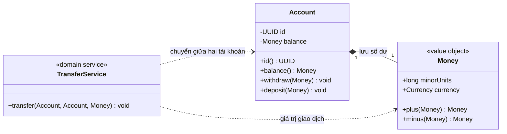

In the diagram:

- `Account` has its own identity and holds **the current balance value**. When a balance changes, a new `Money` can be created.
- `Money` represents an amount in minor currency units and a currency code; *two equal Money values* do not make their owning accounts the same account.
- `TransferService` coordinates changes to two entities using a Money value as the transfer amount.

The diamond illustrates **ownership of the balance value as part of account state**; the model defines lifecycle and constraints, not the Java syntax itself. An immutable Value Object may safely be shared by multiple entities.

## 4. Entities: identity is fundamental

An `Account` has these attributes:

```text
id       = 4d3d... (định danh ổn định)
balance  = 100.000 VND
status   = ACTIVE
```

After the owner withdraws 30.000 VND, `balance` becomes 70.000 VND but `id` stays unchanged. It is **still the same account**.

Minimal example:

```java
import java.util.Objects;
import java.util.UUID;

final class Customer {
    private final UUID id;
    private String displayName;

    Customer(UUID id, String displayName) {
        this.id = Objects.requireNonNull(id, "id");
        rename(displayName);
    }

    UUID id() {
        return id;
    }

    String displayName() {
        return displayName;
    }

    void rename(String newName) {
        if (newName == null || newName.isBlank()) {
            throw new IllegalArgumentException("Name is required");
        }
        this.displayName = newName;
    }

    @Override
    public boolean equals(Object other) {
        return other instanceof Customer customer
                && id.equals(customer.id);
    }

    @Override
    public int hashCode() {
        return id.hashCode();
    }
}
```

Here, **two `Customer` instances with the same UUID represent one entity**, even when `displayName` differs (for example, snapshots taken before and after renaming). Including `displayName` in `hashCode()` would be dangerous if the name changes while the object is stored in a `HashSet`.

However, no one-size-fits-all rule for `equals()/hashCode()` applies to every system:

- **IDs assigned at creation** and immutable (UUID, ULID, domain IDs): stable ID-based equality as shown can work.
- **Database-generated IDs assigned on persistence:** unpersisted entities may have a `null` ID; careless ID equality can equate two new objects or change their hash after persistence.
- **ORM/JPA proxies and inheritance:** equality must suit persistence lifecycles and proxy types. Do not blindly copy `getClass()`/`instanceof` from examples into complex JPA entities.
- If *logical equality* between instances is unnecessary, consider comparing IDs explicitly instead of overriding equality.

Good entities usually **encapsulate state and valid state transitions**: `account.withdraw(...)`, `order.cancel(...)`, `customer.rename(...)`. Exposing only getters and setters scatters business logic.

## 5. Value Objects: equal by value, not identity

A `Money` value comprises **an amount in minor units** (*minor units*) and **a currency**:

- `new Money(10_000, VND)` is equal in value to another object with the same components.
- `new Money(10_000, USD)` **does not equal** Money denominated in 10.000 VND.
- For VND, the common minor unit is 1 dong (ISO 4217 specifies 0 decimal places). For USD, 1.999 minor units equal 19,99 USD (100 cents = 1 USD).
- Addition is valid only for matching currencies; conversions need an exchange rate and explicit rounding rules.

**Why use a Money class rather than a plain `long` or `double`?**

```java
double price = 0.1 + 0.2;
System.out.println(price == 0.3); // false
```

`double` represents binary floating-point numbers and cannot exactly represent many decimal monetary values. `long` with minor units or `BigDecimal` with explicit scale/rounding conventions is usually more suitable.

With **Java 17+**, a `record` offers a concise way to create shallowly immutable Value Objects:

```java
import java.util.Currency;
import java.util.Objects;

record Money(long minorUnits, Currency currency) {
    Money {
        Objects.requireNonNull(currency, "currency");
    }

    static Money vnd(long dong) {
        return new Money(dong, Currency.getInstance("VND"));
    }

    Money plus(Money other) {
        sameCurrency(other);
        return new Money(
                Math.addExact(minorUnits, other.minorUnits), currency);
    }

    Money minus(Money other) {
        sameCurrency(other);
        return new Money(
                Math.subtractExact(minorUnits, other.minorUnits), currency);
    }

    private void sameCurrency(Money other) {
        Objects.requireNonNull(other, "other");
        if (!currency.equals(other.currency)) {
            throw new IllegalArgumentException("Currency mismatch");
        }
    }
}
```

`record` generates `equals()`, `hashCode()`, and `toString()` from record components. For example:

```java
Money first = Money.vnd(50_000);
Money second = Money.vnd(50_000);

System.out.println(first == second);      // false: hai instance
System.out.println(first.equals(second)); // true: cùng giá trị
System.out.println(first.plus(second));   // Money[minorUnits=100000, currency=VND]
```

The `plus()` method **creates a new Money**, leaving the original untouched. `Math.addExact()` and `Math.subtractExact()` detect integer overflow rather than silently producing wrong results.

**Records are only shallowly immutable (*shallow immutability*)**. When a field holds a mutable `List` or nested mutable object, defensive copying and careful design are required. For example, `record Basket(List<Item> items)` can still be modified through `basket.items().add(...)` by default if the list is unprotected. In `Money`, `Currency` is immutable and safe to share.

**An important BigDecimal detail:** `new BigDecimal("10.0").equals(new BigDecimal("10.00"))` returns `false` because scales differ, even though `compareTo() == 0`. When modeling Money with BigDecimal, normalize/constrain scale in the constructor and define consistent equality and rounding.

## 6. Services: behavior belonging to neither a single entity nor a value object

An account can enforce **a nonnegative balance on withdrawals**. Money can ensure **matching currencies on addition**. But transferring funds from A to B involves **two Account** objects, so assigning the whole operation to `Account A` or `Account B` may distort one account's responsibility.

A **Domain Service** represents domain behavior spanning objects when there is **no single natural owner**. For example, `TransferService.transfer(from, to, amount)`. Domain services can often be stateless, but **that does not mean all services have no fields**.

An **Application Service** coordinates an entire *use case*: authentication/authorization, opening transactions, loading entities through repositories, invoking domain behavior, saving results, publishing events, or sending notifications. It should avoid replacing the rules that belong in entities or Value Objects.

An example showing both layers:

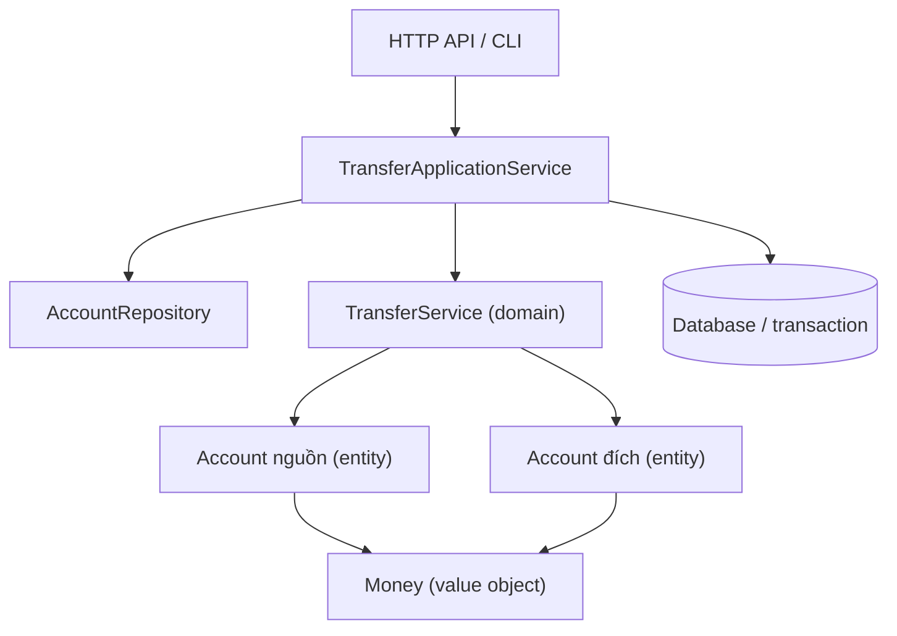

The `ApplicationService → repository/transaction` path separates loading/persisting from **transfer rules**. Very small applications need not give every layer its own class; correctly placed responsibilities and testability matter most.

## 7. Complete Java 17+ example: Account, Money, and TransferService

Save all the following code in `EntityValueServiceDemo.java`:

```java
import java.util.Currency;
import java.util.Objects;
import java.util.UUID;

public class EntityValueServiceDemo {

    // VALUE OBJECT: bằng nhau theo nội dung, bất biến.
    record Money(long minorUnits, Currency currency) {
        Money {
            Objects.requireNonNull(currency, "currency");
        }

        static Money vnd(long dong) {
            return new Money(dong, Currency.getInstance("VND"));
        }

        Money plus(Money other) {
            requireSameCurrency(other);
            return new Money(
                    Math.addExact(minorUnits, other.minorUnits),
                    currency);
        }

        Money minus(Money other) {
            requireSameCurrency(other);
            return new Money(
                    Math.subtractExact(minorUnits, other.minorUnits),
                    currency);
        }

        private void requireSameCurrency(Money other) {
            Objects.requireNonNull(other, "other");
            if (!currency.equals(other.currency)) {
                throw new IllegalArgumentException(
                        "Currency mismatch: " + currency
                                + " vs " + other.currency);
            }
        }
    }

    // ENTITY: định danh riêng, số dư thay đổi theo thời gian.
    static final class Account {
        private final UUID id;
        private Money balance;

        Account(UUID id, Money openingBalance) {
            this.id = Objects.requireNonNull(id, "id");
            this.balance = Objects.requireNonNull(
                    openingBalance, "openingBalance");
            if (balance.minorUnits() < 0) {
                throw new IllegalArgumentException(
                        "Opening balance must be nonnegative");
            }
        }

        UUID id() {
            return id;
        }

        Money balance() {
            return balance;
        }

        void deposit(Money amount) {
            requirePositive(amount);
            balance = balance.plus(amount);
        }

        void withdraw(Money amount) {
            requirePositive(amount);
            Money next = balance.minus(amount);
            if (next.minorUnits() < 0) {
                throw new IllegalStateException("Insufficient funds");
            }
            balance = next;
        }

        private static void requirePositive(Money amount) {
            Objects.requireNonNull(amount, "amount");
            if (amount.minorUnits() <= 0) {
                throw new IllegalArgumentException(
                        "Amount must be positive");
            }
        }

        @Override
        public boolean equals(Object other) {
            return other instanceof Account account
                    && id.equals(account.id);
        }

        @Override
        public int hashCode() {
            return id.hashCode();
        }
    }

    // DOMAIN SERVICE: quy tắc chuyển tiền qua hai Entity.
    static final class TransferService {
        void transfer(Account from, Account to, Money amount) {
            Objects.requireNonNull(from, "from");
            Objects.requireNonNull(to, "to");
            Objects.requireNonNull(amount, "amount");

            if (from.id().equals(to.id())) {
                throw new IllegalArgumentException(
                        "Cannot transfer to the same account");
            }

            if (amount.minorUnits() <= 0) {
                throw new IllegalArgumentException(
                        "Amount must be positive");
            }

            // Kiểm tra cả hai số dư trước khi bắt đầu thay đổi.
            Money sourceAfter = from.balance().minus(amount);
            if (sourceAfter.minorUnits() < 0) {
                throw new IllegalStateException("Insufficient funds");
            }
            to.balance().plus(amount); // Kiểm tra cùng currency và tràn số.

            from.withdraw(amount);
            to.deposit(amount);
        }
    }

    public static void main(String[] args) {
        Money a = Money.vnd(50_000);
        Money b = Money.vnd(50_000);
        System.out.println("Money equals: " + a.equals(b));

        Account source = new Account(
                UUID.fromString(
                        "00000000-0000-0000-0000-000000000001"),
                Money.vnd(100_000));
        Account destination = new Account(
                UUID.fromString(
                        "00000000-0000-0000-0000-000000000002"),
                Money.vnd(20_000));

        TransferService transfers = new TransferService();
        transfers.transfer(source, destination, Money.vnd(30_000));

        System.out.println("Source: "
                + source.balance().minorUnits() + " VND");
        System.out.println("Destination: "
                + destination.balance().minorUnits() + " VND");

        Account anotherSnapshot = new Account(
                source.id(), Money.vnd(999));
        System.out.println("Same Account identity: "
                + source.equals(anotherSnapshot));

        // Transfer không hợp lệ: source chỉ còn 70.000 VND.
        try {
            transfers.transfer(
                    source, destination, Money.vnd(90_000));
            throw new AssertionError("Expected insufficient funds");
        } catch (IllegalStateException expected) {
            System.out.println("Rejected: " + expected.getMessage());
        }

        System.out.println("Source after rejection: "
                + source.balance().minorUnits() + " VND");
    }
}
```

Compile and run with JDK 17 or later:

```bash
javac EntityValueServiceDemo.java
java EntityValueServiceDemo
```

Expected output:

```text
Money equals: true
Source: 70000 VND
Destination: 50000 VND
Same Account identity: true
Rejected: Insufficient funds
Source after rejection: 70000 VND
```

### Understanding the roles in the example

**`Account` is an Entity.** After the transfer, the balance falls from 100.000 VND to 70.000 VND, but `source.id()` remains unchanged. Two Account objects with the same UUID are treated as one *domain identity* under this example's convention, even if their balance snapshots differ. Do not freely update two independent snapshots bearing the same ID as though they were unrelated records.

**`Money` is a Value Object.** Two 50.000 VND Money values may be different instances yet equal under `equals()`. Addition/subtraction creates new Money values. `Money` enforces currency compatibility and detects overflow without knowing which account owns a balance.

**`TransferService` is a Domain Service.** It coordinates two accounts: prohibits transfers to the same account, requires a positive amount, checks sufficient funds and currency before invoking entity behavior. These are rules governing *an interaction*, not a natural responsibility of Money alone.

**Practical limitation:** the example models only **sequential in-memory** operations. Checking first and then calling `withdraw()` and `deposit()` **does not provide an atomic transaction** under multiple threads, processes, crashes, or databases. Real transfers require transactions, locking/optimistic concurrency, consistent balance checks in the database, idempotency, auditing, and failure recovery. The demo's preflight checks only avoid some failures before updates begin.

## 8. Where should each rule live?

Consider the order-management domain:

| Rule / behavior | Typical owner | Reason |
|---|---|---|
| Email must match the system's accepted format | `EmailAddress` (Value Object) | Invariant of the email value |
| Negative quantities cannot be added to orders | `Order.addLine()` or `OrderLine` | Invariant of an order entity/value |
| A cancelled order cannot become paid | `Order.pay()` | State-transition rule of the same Entity |
| Two Money amounts can be added only in one currency | `Money.plus()` | Mathematical rule of the value |
| Select a shipping charge by weight, region, and applicable policy | Possibly `ShippingFeeCalculator` (Domain Service) | The policy may not belong to any single entity |
| Load orders, authorize access, invoke payment, persist, publish events | `PlaceOrderApplicationService` | Coordinates use cases and infrastructure |
| Query orders by ID from a database | `OrderRepository` | Abstracts persistence rather than domain entities |
| Return display data as JSON to the client | DTO/Presenter/API layer | Communication responsibility, not domain entity behavior |

**Do not push every rule into services.** If `Order` only exposes getters/setters while checks such as “already cancelled?”, “can this be paid?”, and “can a line be added?” live across dozens of services, the result may be an *anemic domain model*. Simple CRUD applications can sometimes tolerate this, but domains with many invariants benefit from keeping behavior close to Entity/Value Object data.

**Do not force every function into an Entity either.** A shipping algorithm may combine rate policies, delivery regions, and service tiers. If no entity clearly owns it, a Domain Service is appropriate.

## 9. How do Domain Services and Application Services differ?

Both may end in `Service`, but their responsibilities differ.

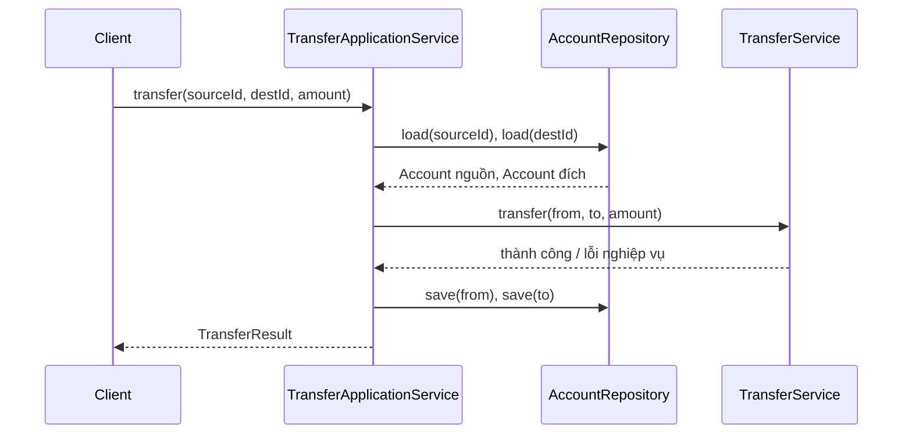

An object-oriented design can define contracts such as:

```java
// Trích đoạn minh họa về cấu trúc tầng ứng dụng,
// giả định Account, Money và TransferService là các kiểu của domain.
interface AccountRepository {
    Account load(java.util.UUID id);
    void save(Account account);
}

final class TransferApplicationService {
    private final AccountRepository accounts;
    private final TransferService domainTransfers;

    TransferApplicationService(
            AccountRepository accounts,
            TransferService domainTransfers) {
        this.accounts = java.util.Objects.requireNonNull(accounts);
        this.domainTransfers =
                java.util.Objects.requireNonNull(domainTransfers);
    }

    void transfer(java.util.UUID sourceId,
                  java.util.UUID destinationId,
                  Money amount) {
        Account from = accounts.load(sourceId);
        Account to = accounts.load(destinationId);

        domainTransfers.transfer(from, to, amount);

        accounts.save(from);
        accounts.save(to);
    }
}
```

This fragment illustrates **responsibility allocation**, not production transaction handling. Two separate `save()` calls can fail between operations. In a database application, the *transaction boundary* usually belongs to the Application Service/infrastructure: both balance changes must commit or roll back together; distributed systems impose additional constraints.

The key distinction:

- **Domain Service:** expresses domain rules (*what makes a money transfer valid?*), testable with plain entities/VOs.
- **Application Service:** orchestrates user/system actions (*what to load, whom to authorize, which transaction to start, what to save and return?*).
- **Infrastructure Service/Adapter:** implements email delivery, database access, HTTP calls, file storage, or caching.

You do not need three separate service classes for every operation. When an Entity owns all required behavior, an Application Service may call it directly for simpler, clearer design.

## 10. Domain Entities versus JPA Entities

A class annotated with `@jakarta.persistence.Entity` is **a persistence entity** in JPA. That does not automatically make it a well-designed **Domain Entity**:

- JPA typically requires constructors, primary-key strategies, lazy loading, and session-management rules.
- A database ID is not necessarily the **domain identifier** exposed through the API or to users.
- A Domain Value Object may be mapped with `@Embeddable`, converters, or a different column representation.
- A Domain Entity may be persisted through repositories using JDBC, NoSQL documents, event stores, files, or even only in memory; it does not require `@Entity`.
- Spring's `@Service` is a stereotype annotation for bean discovery; it **does not determine** whether the bean represents a Domain Service or an Application Service.

An example of embedded values in JPA:

```java
// Pseudocode minh họa ý tưởng ánh xạ; cần JPA dependency/annotation
// và cấu hình phù hợp trong dự án thực.
@Embeddable
class MoneyEmbeddable {
    long minorUnits;
    String currencyCode;
}
```

Do not choose Entity versus Value Object **solely based on database storage**. Start with domain rules, then select an appropriate persistence mapping.

## 11. Common design mistakes

### Mistake 1: treating entities with matching attributes as the same entity

Two customers both named “Lan” and born on the same date are not necessarily the same person. Entity equality must use the correct business identity, not attributes that may be duplicated or changed.

### Mistake 2: storing a mutable Value Object as a Map key

```java
// Không nên: lớp địa chỉ có thể sửa và hashCode phụ thuộc thành phần.
Map<Address, Integer> counts = new HashMap<>();
counts.put(address, 1);
address.setStreet("Đường khác");
```

If the hash changes after insertion, `get(address)` can return unexpected results. Use immutable Value Objects; represent address changes with new instances.

### Mistake 3: using raw primitives for rule-heavy values

```java
void charge(double amount, String currency);
```

Callers may pass negative values, NaN, incorrect currencies, or inconsistent rounding. A `Money` Value Object with validation in its constructor and a clear arithmetic API is safer.

### Mistake 4: letting services read/change all internal fields

```java
// Tránh mở public field để service tự gán không có kiểm soát:
account.balance = account.balance.minus(amount);
```

Keep invariants with Entities and expose named behaviors. When logic spans Entities, a domain service **coordinates through valid entity APIs**, rather than breaking encapsulation.

### Mistake 5: creating a service for every calculation

If `Money.plus()` simply adds values and checks currency, a separate `MoneyAdditionService` is unnecessary. That logic belongs naturally in the Value Object.

### Mistake 6: turning every value into an Entity

If `EmailAddress("a@example.test")` has no independent lifecycle or identity, adding an `emailId` and repository for every email only complicates the model. Use an Entity when **independent identity and history really matter**.

### Mistake 7: assuming stateless services have no dependencies

```java
final class ShippingFeeService {
    private final FeePolicy policy;

    ShippingFeeService(FeePolicy policy) {
        this.policy = policy;
    }

    Money calculate(Shipment shipment) {
        return policy.feeFor(shipment);
    }
}
```

A service may retain **references to dependencies**, such as a fee policy, without storing **mutable business state specific to each calculation**. Stateless describes how runtime state is managed, not an absence of fields.

## 12. Six questions when designing a new class

1. **Does changing an attribute make this a different object?** If not, it may be an Entity. An order remains the same order after its status changes.
2. **Can two objects with the same content replace each other?** If so, and independent identity is unnecessary, favor a Value Object.
3. **Are validation or calculation rules closely tied to this data?** Put them in a VO or Entity rather than copying them among services.
4. **Does the behavior affect several Entities or a domain policy without one natural owner?** Consider a Domain Service.
5. **Does the behavior mainly coordinate transactions, repositories, permissions, or networks?** Consider an Application Service or infrastructure adapter.
6. **When a business rule changes, is there one obvious place to edit?** If you must search multiple controllers/services/mappers, the responsibility boundaries may be wrong.

## 13. Exercises and self-checks

**Exercise 1 — Customer and EmailAddress.** Each customer has a UUID and an email address. Customers can change their email.

- **Hint:** `Customer` is an Entity because its UUID remains stable; `EmailAddress` is an immutable VO, replaced by a new instance when email changes. Email changes should go through Customer behavior and appropriate uniqueness checks if the system requires them.

**Exercise 2 — Identical addresses.** Two different customers receive shipments at “12 Nguyen Hue Street, Ho Chi Minh City”.

- **Hint:** two Address VOs can be equal by value while the two Customer Entities remain distinct. Do not use an address as customer identity.

**Exercise 3 — Balance reduction on withdrawal.** Where should the “balance must not become negative” rule live?

- **Hint:** the `Account` Entity protects the balance invariant on withdrawal; `Money` protects currency and arithmetic. A domain service coordinates interactions among accounts.

**Exercise 4 — Payment followed by email.** `PayOrderApplicationService` needs to load an order, check authorization, call a payment gateway, save the state, and publish a notification.

- **Hint:** orchestration belongs in the Application Service. The `Order` Entity determines whether a transition to `PAID` is permitted; gateway/email code belongs in adapters. Avoid moving every decision into the service.

**Exercise 5 — Test the Java example.** Extend `EntityValueServiceDemo.java` to verify:

```java
// Đặt trong main, sau khi khởi tạo hai Account:
Money x = Money.vnd(5_000);
Money y = Money.vnd(5_000);
if (!x.equals(y) || x == y) {
    throw new AssertionError("Value Object equality failed");
}

Money beforeSource = source.balance();
Money beforeDest = destination.balance();
try {
    transfers.transfer(source, destination, Money.vnd(-10));
    throw new AssertionError("Negative amount must fail");
} catch (IllegalArgumentException expected) {
    // Thao tác không hợp lệ đã bị chặn.
}

if (!source.balance().equals(beforeSource)
        || !destination.balance().equals(beforeDest)) {
    throw new AssertionError("Invalid transfer changed balances");
}
```

This tests the rule that **negative input is rejected** in a sequential flow. Ensuring real transfers are atomic across multiple threads or processes requires transaction/concurrency tests against the persistence system.

---

**Remember:** an **Entity** is identified by *identity*, a **Value Object** by *value*, and a **Service** provides *behavior/coordination* appropriate to the domain or use-case boundary. Assigning roles correctly keeps invariants in the right place, reduces duplicated logic, and makes Java classes easier to change and test.


</details>

- [Back to top](#back-to-top)

---

## <a id="class-design-007">Rich domain models and anemic data models</a>

<details>
<summary>View details</summary>

# Rich domain models and anemic data models in Java OOP

When designing classes, we often face a choice: should `Order` hold only `status`, `items`, `total`, and getters/setters, or should it know **how to add items, compute totals, confirm orders, and reject invalid changes**?

This is the core distinction between a **Rich Domain Model** and an **Anemic Domain Model** (usually mostly data). Both have classes representing data, but differ in **where business rules live, who can change state, and how invariants are enforced**.

This lesson aims to clarify the difference, guide correct Java modeling, select an approach based on business complexity, recognize when domain services are needed, and test valid states.

## 1. Two ways to model the same problem

Suppose a retail application has these rules:

1. An order starts in `DRAFT`.
2. Items may be added only while it remains `DRAFT`; each line has a positive quantity and nonnegative unit price.
3. An order may be confirmed only when it contains at least one line.
4. Items cannot be added after `CONFIRMED`.
5. The order total must always equal the sum of its line totals.

### Data-only (anemic) model

```java
// Minh họa một kiểu anemic có thể gây lỗi nếu mở setter công khai.
class OrderData {
    public String id;
    public String status;
    public java.util.List<OrderLineData> lines;
    public long totalCents;
}

class OrderLineData {
    public String sku;
    public int quantity;
    public long unitPriceCents;
}
```

Business logic is often pushed into services:

```java
// Phác thảo: toàn bộ nghiệp vụ ở service.
void confirm(OrderData order) {
    if (order.lines == null || order.lines.isEmpty()) {
        throw new IllegalStateException("Empty order");
    }
    order.status = "CONFIRMED";
}
```

Another caller can still directly assign `order.status = "CONFIRMED"` or `order.totalCents = -1` without invoking `confirm`. When many services independently perform these checks, rules are easily duplicated or become inconsistent.

**Not every data class is bad.** HTTP request/response DTOs, configuration objects, data-transfer records, and query results can reasonably contain only values. An “Anemic Domain Model” is concerning when **the business domain has many rules**, yet entities cannot protect their behavior or invariants.

### Rich domain model

```java
// API ở mức ý tưởng:
order.addItem("BOOK", 2, 120_00);
order.confirm();
long payable = order.totalCents();

// Không cung cấp order.setStatus(...) hoặc
// order.setTotalCents(...) cho bên ngoài gọi tùy ý.
```

Here, `Order` knows **which operations are valid for its own state**. Client code speaks in domain terms (`addItem`, `confirm`), rather than composing setters and hoping every caller remembers all the rules.

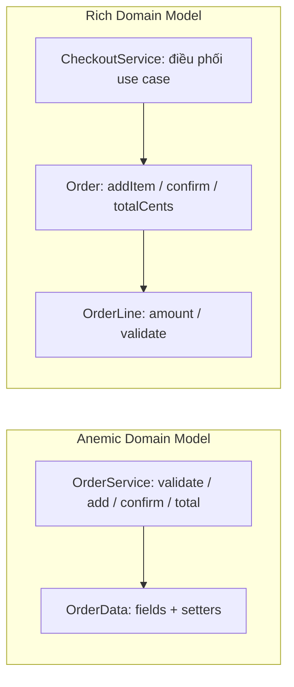

The diagram does not imply that a Rich Model contains **every** operation. Database writes, email delivery, and shipping API calls still belong to external components; they are not natural behaviors of an `Order` object.

## 2. Comparing important criteria

| Criterion | Rich Domain Model | Anemic Domain Model |
| --- | --- | --- |
| What does an entity contain? | Data, behaviors, and constraints together | Mainly fields, getters/setters, or records |
| Who enforces entity invariants? | Constructors/factories and domain methods | Usually external services; easy to bypass when mutation is exposed |
| How is state changed? | `order.confirm()`, `account.withdraw(amount)` | `order.setStatus(...)` or services changing fields |
| Cohesion | Behavior lives close to related data | Behavior may be separated from the data |
| Risk of duplicated rules | Lower when APIs protect state | Higher when multiple services mutate data |
| Initial simplicity | Requires designing domain APIs and state | Less code for simple data/CRUD |
| Best fit | Rule-heavy domains with states and transitions | DTOs, mapping, reporting, simple CRUD with few rules |
| Risks | Bloated entities, I/O inside domain, tricky ORM loading | Scattered “transaction scripts” and setters that break invariants |

**You cannot classify an architecture solely by whether getters/setters exist.** An entity may expose getters and controlled update methods while remaining rich. An immutable data class created by a service may be good design when business logic is genuinely simple.

## 3. Invariants: the most important criterion

An **invariant** is a condition that must hold in every publicly valid object state.

For orders:

- `lines` cannot contain a line with `quantity <= 0`.
- `totalCents` is nonnegative and equals the sum of `quantity × unitPriceCents` for all lines.
- `CONFIRMED` is reachable only when the order has line items.
- After `CONFIRMED`, `addItem` cannot succeed.
- State transitions follow only defined rules.

In a rich model, behaviors are designed around invariants:

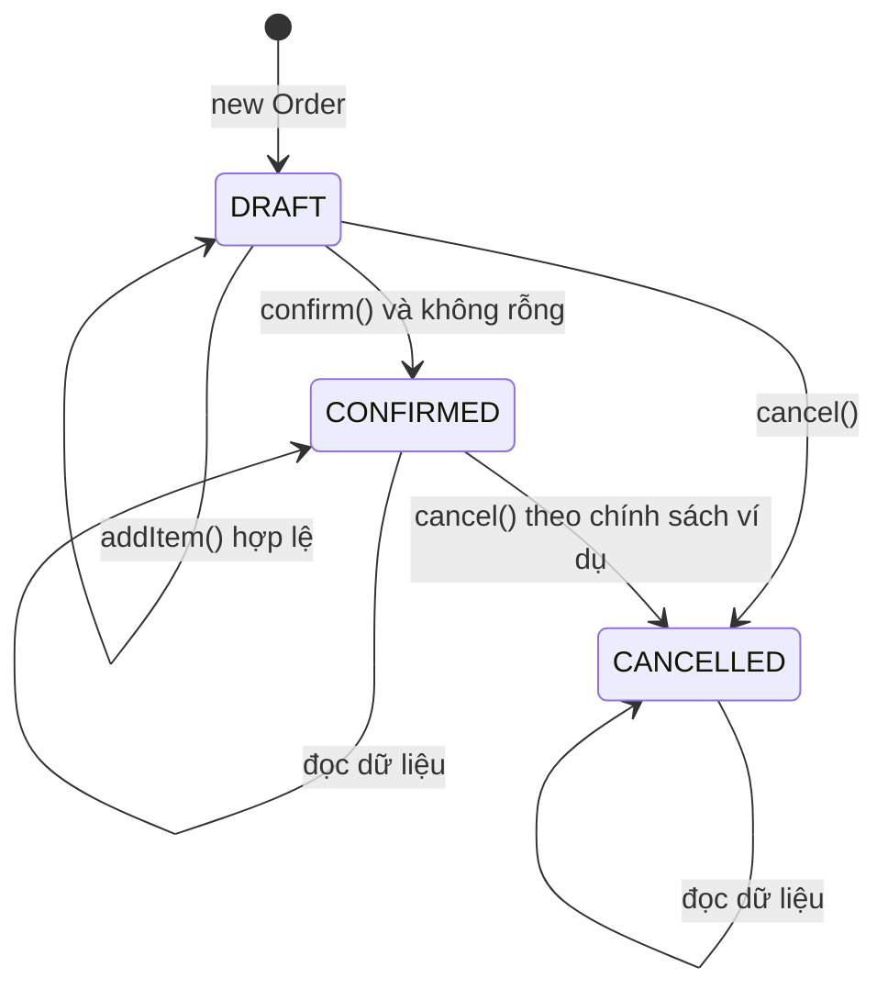

In real projects, canceling a paid order may require refunds, shipment checks, and additional steps. The diagram only describes **a simple policy**. Define states and transitions for the actual domain instead of applying `CANCELLED` indiscriminately to every system.

## 4. Complete Java 17 example: Rich Domain Model

The following is **a standalone runnable Java file**, requiring no Spring, JPA, database, or external libraries. It contains distinct responsibilities:

- `OrderLine`: a value object holding line data and calculating the line amount.
- `Order`: an entity/aggregate managing line items, totals, state, and behavior.
- `OrderRepository`: a persistence/query port.
- `OrderApplicationService`: coordinates the use case.
- `ConsoleOrderNotifier`: an adapter demonstrating an external interaction.

Create `RichVsAnemicDemo.java`:

```java
import java.util.ArrayList;
import java.util.LinkedHashMap;
import java.util.List;
import java.util.Map;
import java.util.Objects;

public class RichVsAnemicDemo {

    enum OrderStatus {
        DRAFT, CONFIRMED, CANCELLED
    }

    // Value object: một dòng đơn hàng hợp lệ ngay từ lúc khởi tạo.
    record OrderLine(String sku, int quantity, long unitPriceCents) {
        OrderLine {
            if (sku == null || sku.isBlank()) {
                throw new IllegalArgumentException("SKU is required");
            }
            if (quantity <= 0) {
                throw new IllegalArgumentException("Quantity must be positive");
            }
            if (unitPriceCents < 0) {
                throw new IllegalArgumentException("Negative unit price");
            }
        }

        long amountCents() {
            return Math.multiplyExact((long) quantity, unitPriceCents);
        }
    }

    static final class Order {
        private final String id;
        private final Map<String, OrderLine> lines = new LinkedHashMap<>();
        private OrderStatus status = OrderStatus.DRAFT;

        Order(String id) {
            if (id == null || id.isBlank()) {
                throw new IllegalArgumentException("Order id is required");
            }
            this.id = id;
        }

        String id() {
            return id;
        }

        OrderStatus status() {
            return status;
        }

        List<OrderLine> lines() {
            // Chỉ trả snapshot; caller không thể sửa danh sách nội bộ.
            return List.copyOf(lines.values());
        }

        void addItem(String sku, int quantity, long unitPriceCents) {
            requireDraft();

            // Tạo value object sẽ tự kiểm tra số lượng/đơn giá.
            OrderLine incoming = new OrderLine(sku, quantity, unitPriceCents);
            OrderLine old = lines.get(incoming.sku());

            OrderLine candidate;
            if (old == null) {
                candidate = incoming;
            } else {
                if (old.unitPriceCents() != incoming.unitPriceCents()) {
                    throw new IllegalArgumentException(
                            "Different price for the same SKU");
                }
                int merged = Math.addExact(
                        old.quantity(), incoming.quantity());
                candidate = new OrderLine(
                        incoming.sku(), merged, incoming.unitPriceCents());
            }

            // Bảo đảm tổng tiền không tràn long trước khi sửa trạng thái.
            long oldAmount = old == null ? 0 : old.amountCents();
            long nextTotal = Math.subtractExact(totalCents(), oldAmount);
            Math.addExact(nextTotal, candidate.amountCents());

            lines.put(candidate.sku(), candidate);
        }

        long totalCents() {
            long total = 0;
            for (OrderLine line : lines.values()) {
                total = Math.addExact(total, line.amountCents());
            }
            return total;
        }

        void confirm() {
            requireDraft();
            if (lines.isEmpty()) {
                throw new IllegalStateException("Cannot confirm empty order");
            }
            status = OrderStatus.CONFIRMED;
        }

        void cancel() {
            if (status == OrderStatus.CANCELLED) {
                return; // gọi lặp giữ nguyên kết quả
            }
            // Chính sách demo cho phép hủy DRAFT và CONFIRMED.
            status = OrderStatus.CANCELLED;
        }

        private void requireDraft() {
            if (status != OrderStatus.DRAFT) {
                throw new IllegalStateException(
                        "Order is not editable: " + status);
            }
        }
    }

    // Port: hợp đồng lưu trữ, domain không biết JDBC hay SQL.
    interface OrderRepository {
        Order getRequired(String orderId);
        void save(Order order);
    }

    // Adapter trong bộ nhớ dùng cho ví dụ.
    static final class InMemoryOrderRepository implements OrderRepository {
        private final Map<String, Order> byId = new LinkedHashMap<>();

        @Override
        public Order getRequired(String orderId) {
            Order found = byId.get(orderId);
            if (found == null) {
                throw new IllegalArgumentException("Order not found");
            }
            return found;
        }

        @Override
        public void save(Order order) {
            Objects.requireNonNull(order, "order");
            byId.put(order.id(), order);
        }
    }

    interface OrderNotifier {
        void confirmed(Order order);
    }

    static final class ConsoleOrderNotifier implements OrderNotifier {
        @Override
        public void confirmed(Order order) {
            System.out.println("Notified: " + order.id());
        }
    }

    // Application service: phối hợp, không lặp quy tắc của Order.
    static final class OrderApplicationService {
        private final OrderRepository orders;
        private final OrderNotifier notifier;

        OrderApplicationService(
                OrderRepository orders, OrderNotifier notifier) {
            this.orders = Objects.requireNonNull(orders);
            this.notifier = Objects.requireNonNull(notifier);
        }

        void addItem(String orderId, String sku, int qty, long priceCents) {
            Order order = orders.getRequired(orderId);
            order.addItem(sku, qty, priceCents);
            orders.save(order);
        }

        void confirm(String orderId) {
            Order order = orders.getRequired(orderId);
            order.confirm();
            orders.save(order);
            notifier.confirmed(order);
        }
    }

    public static void main(String[] args) {
        InMemoryOrderRepository repository = new InMemoryOrderRepository();
        Order order = new Order("O-100");
        repository.save(order);

        OrderApplicationService service = new OrderApplicationService(
                repository, new ConsoleOrderNotifier());

        service.addItem("O-100", "BOOK", 2, 12_000);
        service.addItem("O-100", "PEN", 3, 2_500);

        System.out.println("Total cents: " + order.totalCents());
        service.confirm("O-100");
        System.out.println("State: " + order.status());

        try {
            service.addItem("O-100", "ERASER", 1, 500);
        } catch (IllegalStateException expected) {
            System.out.println(expected.getMessage());
        }

        try {
            Order empty = new Order("O-200");
            empty.confirm();
        } catch (IllegalStateException expected) {
            System.out.println(expected.getMessage());
        }

        order.cancel();
        System.out.println("After cancel: " + order.status());
    }
}
```

Compile and run:

```bash
javac RichVsAnemicDemo.java
java RichVsAnemicDemo
```

Expected output:

```text
Total cents: 31500
Notified: O-100
State: CONFIRMED
Order is not editable: CONFIRMED
Cannot confirm empty order
After cancel: CANCELLED
```

### Why is this a “rich” model?

1. **There are no `status` or `totalCents` setters.** State changes only through named methods with explicit rules.
2. **`OrderLine` enforces its own invariants.** A line item with quantity 0 or negative price cannot be validly created.
3. **`Order` enforces aggregate rules.** It controls when lines may be added, merges SKUs, rejects inconsistent prices, and refuses to confirm empty orders.
4. **Totals are calculated from the actual source data.** There is no mutable `totalCents` field that can disagree with order lines.
5. **Overflow is detected explicitly.** `Math.multiplyExact` and `Math.addExact` throw `ArithmeticException` rather than silently producing invalid totals. When a correct total cannot be computed, `addItem` does not update the new line.
6. **Internal collections are not exposed.** `lines()` returns a `List.copyOf` snapshot of immutable `OrderLine` objects; callers cannot add/remove or modify line items through the getter.

The application service is still valuable: it loads orders through a repository, invokes domain behavior, persists changes, and requests notifications. It need not repeat `if (status != DRAFT)` checks or calculate line totals itself.

### Limitations to understand

This example **runs sequentially in memory**. `InMemoryOrderRepository` holds a reference to the same `Order` instance; if `confirm()` succeeds but `save()` or the notifier fails, there is no transactional rollback. Real systems need suitable transactions, correct entity loading/saving, versioning/locking for concurrent updates, and notification-after-commit policies (such as a transactional outbox).

Integer `long` cents illustrate exact arithmetic and overflow limits; for multiple currencies and rounding modes, use a `Money` value object with amount, currency, and explicit scale/rounding policies. Do not use `double` to store monetary amounts requiring exactness.

`Order.cancel()` permits cancellation after confirmation in the demo. A real application may prohibit cancellation after shipping or require refunds and authorization. Such rules belong in the domain model or an appropriate responsible service.

## 5. What should remain outside an entity?

“Rich” means **rich in business behavior**, not an object that does everything.

| Behavior | Typical owner | Reason |
| --- | --- | --- |
| `Order.addItem` | `Order` | Modifies the order's own state and invariants |
| `Order.confirm` | `Order` | Transitions aggregate state |
| `OrderLine.amountCents` | `OrderLine` | Calculates from the line's own data |
| `CheckoutService.checkout` | Application service | Coordinates domain objects, repositories, and transactions |
| `PricingPolicy.calculate` | Domain policy/service | Pricing rule may be independent and require multiple inputs |
| `OrderRepository.save` | Persistence port + adapter | Interacts with databases/data storage |
| `EmailSender.send` | Email port + adapter | Communicates with external systems |
| Receiving JSON and returning an HTTP status | Controller / web adapter | API communication contract |
| Running `@Transactional` | Usually at an application boundary | Transaction scope of a use case |

A warning sign is `Order.confirm()` directly calling `new JdbcConnection(...)` or `smtp.send(...)`. That couples the entity to infrastructure, forces database/email dependencies into state-transition tests, and lets I/O failures complicate invariants. A domain method should usually change state or return domain values/events while external components perform side effects.

### A domain service does not imply an anemic model

Sometimes a rule does not clearly belong to **one** entity:

- Transferring funds between accounts requires validating both and recording changes atomically.
- Customer-tier promotions may involve `Customer`, `Order`, `Promotion`, and a policy.
- Seat allocation may involve flights, seating plans, and booking permissions.

Use a domain service/policy for rules requiring a separate context, while entities still enforce their own invariants. For example, a transfer service coordinates `source.withdraw(...)` and `destination.deposit(...)` within a transaction; `Account` ensures withdrawals do not produce negative balances when that is an account rule.

Conversely, placing all rules in one service and only calling `setBalance`, `setStatus`, and `setLines` often indicates that entities have lost control over their state.

## 6. Do not confuse this with DTOs, records, and POJOs

**Records are not automatically anemic.** A Java record can validate in a compact constructor and provide calculations or immutable behaviors:

```java
record Quantity(int value) {
    Quantity {
        if (value <= 0) {
            throw new IllegalArgumentException("Positive only");
        }
    }

    Quantity plus(Quantity other) {
        return new Quantity(Math.addExact(value, other.value));
    }
}
```

`Quantity` has only one field but meaningful behavior, making it a good value object. Conversely, `record CheckoutRequest(String sku, int quantity)` may only carry input data, which is perfectly reasonable.

**POJO** (*Plain Old Java Object*) means a Java class does not require special framework inheritance; it does not indicate whether it is rich or anemic. **Entity** concerns identity/lifecycle; **DTO** concerns transporting data; **Rich/Anemic** concerns ownership of business behavior. These are separate dimensions.

| Type | Main purpose | Must it be rich/anemic? |
| --- | --- | --- |
| HTTP request DTO | Receives data through APIs | Data-only representation is often appropriate |
| HTTP response DTO | Returns data to clients | Data-only representation is often appropriate |
| Value object `Money` | Valid monetary values and arithmetic | Should enforce invariants and provide useful behavior |
| Domain entity `Order` | Identity, lifecycle, order invariants | Rich behavior helps when there are rules/state |
| ORM persistence entity | Represents stored database data | May be separated from the domain depending on architecture |
| Projection/read model | Reports and query/read-only results | Mainly data is sufficient |
| Domain service | Business rules spanning objects | Has behavior; not necessarily extensive state |

A system can **combine both approaches**: rich models for complex transactions and records/DTOs for lookups, reporting, import/export, and read-only screens.

## 7. Evaluating changing business requirements

A good design proves its value when requirements change.

**Requirement A:** “Once an order is confirmed, its line items cannot be changed.”

- In a rich model, this rule lives in `Order.addItem` (and every equivalent mutation method).
- With a data-only model and public setters, all controllers/services/jobs must remember the check. Missing one write path corrupts data.

**Requirement B:** “Add `PAID` status and forbid canceling paid orders.”

- Rich: add a `markPaid()` transition, update `cancel()` conditions, and test the state machine.
- Anemic: several services may need updates if each checks status independently; centralized and strictly enforced state changes in a domain service can still maintain consistency.

**Requirement C:** “Switch order storage from database A to database B.”

- This is an adapter/repository change, not a reason to modify `Order.confirm()`.
- If an entity directly calls SQL, the boundaries are mixed regardless of how many methods it contains.

**Requirement D:** “Change tax calculations by region and third-party configuration.”

- Do not force entities to call an external tax provider over HTTP.
- An application service obtains inputs through an adapter and uses a domain `TaxCalculator` policy; a dedicated policy object can handle rules requiring multiple types of inputs.

## 8. When is an Anemic Model appropriate?

“Anemic” should not be used to dismiss every data-only class. It can be **a deliberate choice** when:

1. An application is mostly **simple CRUD**: storing/editing forms with few rules.
2. The class is a **DTO/projection** used to transfer or read data, not decide business state.
3. Logic is primarily **pipeline data transformation** with little identity/lifecycle; pure functions may be clearer than forcing behavior into objects.
4. Business operations are centrally controlled and callers cannot bypass rules via arbitrary setters.
5. This is simple internal supporting code where complex aggregates/policies/services would cost more than they help.

An example read-only model:

```java
record MonthlySalesReport(
        java.time.YearMonth month,
        long orderCount,
        long revenueCents) { }
```

It need not call SQL or decide how reports are aggregated: a query service creates `MonthlySalesReport`, which only holds results. This is a suitable data model, not an unfinished rich entity.

**The deciding factor:** with many invariants and state transitions spanning workflows, rich domain models often offer clear benefits. When code mostly reads/writes data without core behaviors worth encapsulating, DTO/data models may be simpler.

## 9. Mistakes in applying Rich Models

### Mistake 1 — Turning an entity into a God Object

```java
class Order {
    void confirm() { /* domain */ }
    void persistByJdbc() { /* SQL */ }
    void emailCustomer() { /* SMTP */ }
    void renderJson() { /* HTTP serialization */ }
}
```

This is not a healthy rich domain model. `Order` has absorbed I/O and presentation responsibilities. Move them to adapters and application services, keeping entity behavior related to its own state and rules.

### Mistake 2 — Calling a model “rich” just by adding forwarding getters

```java
class Order {
    long getTotal() { return total; }
    String getStatus() { return status; }
    void setStatus(String next) { status = next; }
}
```

Method count alone does not make a rich model. The API must express **business intent** and prevent invalid state.

### Mistake 3 — Partially relying on external state, then forgetting to revalidate

For example, `Order` cannot know actual inventory when it belongs to an external service. The application service or a policy with the appropriate data source must check/reserve inventory; `Order` only owns invariants it can enforce with available information.

### Mistake 4 — Putting every formula in an entity even when it does not belong there

Customer-contract discounts or country-specific taxes may require `PromotionPolicy`, `TaxPolicy`, or a domain service; embedding all of these in `Order` adds coupling and excessive knowledge.

### Mistake 5 — Forgetting database constraints and concurrency

`Order.confirm()` enforces state rules for **one instance**. If two requests load and modify the same order concurrently, updates may be lost (*lost update*). Persisting through JPA/SQL requires transactions, optimistic locking (such as `@Version`), or appropriate synchronization. A correct in-memory domain method **does not guarantee** consistency across distributed processes.

### Mistake 6 — Invoking external services from entities inside transactions

Sending email in `Order.confirm()` does not make database and SMTP commits atomic. If email succeeds but the database rolls back, users see confirmation for an order that was not stored. One solution is an outbox entry committed with the database, followed by post-commit delivery with retries and idempotency.

## 10. DDD aggregates, encapsulation, and Spring/JPA

In **Domain-Driven Design (DDD)**, an *aggregate root* governs invariants that must remain immediately consistent within a group of objects. `Order` may be an aggregate root with `OrderLine` as an internal component.

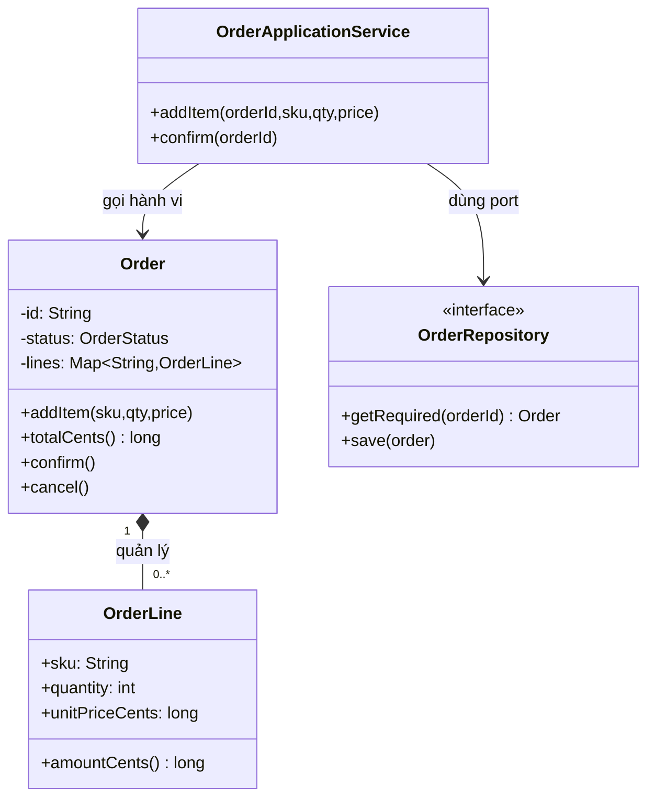

An **aggregate** does not mean every 1–N relationship is composition or that every object in the diagram must share one database table. Choose aggregate boundaries according to invariants that updates must preserve. For example, `Order` should not directly own all of `Customer` or `Product` merely because they are referenced.

A Spring Boot/JPA organization may include:

```text
orders/
  application/
    OrderApplicationService.java
  domain/
    Order.java
    OrderLine.java
    OrderStatus.java
    OrderRepository.java
    PricingPolicy.java
  infrastructure/
    JpaOrderRepositoryAdapter.java
    OrderJpaEntity.java
    OrderJpaMapper.java
    OutboxPublisher.java
  web/
    OrderController.java
    OrderRequest.java
    OrderResponse.java
```

There are two practical approaches:

- **Domain entity independent of JPA:** mappers convert between domain and persistence entities. Domain tests remain lightweight and framework-independent, and persistence changes are easier, at the cost of mapping code.
- **JPA entity also serving as domain entity:** reduces mapping, but requires care around ORM constructors, proxies, lazy loading, public setters, dirty checking, and `equals/hashCode` behavior. Whether using one class or two, public business methods should still enforce invariants.

Place `@Transactional` at an appropriate use-case boundary where several persistence steps must succeed together. It neither replaces domain-method rule enforcement nor extends a transaction automatically to mail servers or HTTP services.

**Appropriate testing strategy:**

| Test level | What to verify |
| --- | --- |
| Domain unit test | `Order.addItem` only works in `DRAFT`; invalid quantity/price is rejected; totals are correct |
| State-transition test | Empty orders cannot be confirmed; post-confirmation edits fail; cancellation follows policy |
| Application service test | Loads correct ID, invokes domain behavior, saves and requests notifications according to contract |
| Persistence integration test | Save/reload preserves invariants; verifies uniqueness, locking, and transactions |
| API test | JSON, input validation, HTTP statuses, and authorization |
| Concurrency/integration test | Two requests changing the same order do not silently overwrite each other's state |

## 11. Safely refactoring from an anemic to a rich model

Suppose the system uses `OrderData` with public fields while `OrderService` implements all the rules. There is no need to rewrite everything at once.

1. **Find every state-mutation path:** controllers, services, batch jobs, imports, message consumers; list where status, lines, and totals are assigned.
2. **Specify invariants:** valid states, confirmation conditions, total calculation, and quantity rules.
3. **Add tests for existing behavior:** cover valid flows, errors, and post-error states before moving code.
4. **Move behavior next to the data it protects:** add `Order.confirm()` and `Order.addItem()`, and create immutable `OrderLine` values.
5. **Migrate callers:** services replace `setStatus` or direct `List` mutations with domain operations.
6. **Narrow the API:** once callers have migrated, remove/restrict dangerous setters and getters exposing mutable collections.
7. **Keep orchestration in application services:** organize transactions, repositories, idempotency, and notifications at appropriate layers.
8. **Review persistence:** ORM mappings, migrations, concurrency, and reloading objects with older states.
9. **Stop where it adds value:** do not turn every DTO/report into a complex entity without business invariants to enforce.

These steps keep changes reviewable and verifiable. If legacy database records may violate new invariants, plan explicit remediation/migration instead of assuming new constructors can read every old record.

## 12. Review questions and exercises

### Exercise 1 — Spot the anemic model

```java
class BankAccount {
    public String id;
    public long balanceCents;
}
class TransferService {
    void transfer(BankAccount a, BankAccount b, long amount) {
        a.balanceCents -= amount;
        b.balanceCents += amount;
    }
}
```

Identify at least four problems: negative transfer amounts or an amount of 0, insufficient funds, overflow, null accounts, partial updates, or concurrency. Redesign `Account.withdraw`/`deposit` so each account protects its invariants. Decide where the transfer across **two** accounts belongs among application/domain services and transactions.

### Exercise 2 — Distinguish DTOs from rich entities

Using `CreateOrderRequest`, `Order`, `OrderLine`, and `OrderResponse`, identify which classes only transport data, which need behavior, and why. Do not let `OrderResponse` calculate totals instead of the domain.

### Exercise 3 — Add business rules

Extend the Java example: allow `cancel()` only in `DRAFT`; add `pay()` to transition from `CONFIRMED` to `PAID`; prohibit adding lines or canceling paid orders. Draw a state machine and test all valid and invalid transitions.

### Exercise 4 — Design inventory limits

A `Product` has stock that changes across thousands of orders. Should `Order` store the entire inventory? Propose `InventoryReservationService` or a separate inventory aggregate, and specify transactions/locking around reservations and order placement.

### Exercise 5 — Challenge an architectural choice

A screen only displays `MonthlySalesReport(month, totalOrders, revenue)` built from a SQL query without state transitions. What would a rich domain class add? Is it needed? Explain why a simple record/projection is appropriate.

## 13. Checklist for choosing rich or anemic models

- **Does the domain have many states/transitions?** If so, entities should provide behavior for those transitions.
- **Must invariants hold across every caller?** Enforce them in the responsible owner's constructor, factory, or domain methods.
- **Do multiple services repeat the same rule?** Choose one source of truth and eliminate invalid mutation paths.
- **Is the model only a DTO/projection or simple CRUD?** A data-only class may be sufficient and more readable.
- **Does behavior really belong to this object?** If it requires many entities or external policies, consider a domain service/policy.
- **Does the entity directly call SQL/email/HTTP?** Extract ports/adapters/application services to preserve boundaries.
- **Do public setters bypass invariants?** Narrow the API and expose domain-specific operations.
- **Are invariants protected during concurrency/persistence?** Use appropriate transactions, database constraints, locking, and tests as the design scales.
- **Is the resulting model easier to understand and test?** More classes with scattered rules do not achieve the goal.

**Conclusion:** Rich Domain Models fit domains where object state and rules need consistent protection; data-only models fit DTOs, projections, and simple business operations. Choose based on **actual responsibilities and invariant ownership**, not numbers of getters/setters or class length.


</details>

- [Back to top](#back-to-top)

---

## <a id="class-design-008">Separating queries from state-changing operations</a>

<details>
<summary>View details</summary>

# Separating queries from state-changing operations in class design (Command–Query Separation)

**Goal:** Distinguish read-only methods (*queries*) from methods that intentionally change state (*commands*); design understandable, testable Java APIs; handle practical exceptions without confusing CQS with CQRS architecture.

## 1. The problem: a question that silently changes something

Consider an inventory-management class:

~~~java
class Inventory {
    private int quantity = 10;

    // Nghe như truy vấn số lượng còn lại nhưng đồng thời trừ kho.
    int getAvailableQuantity(int requested) {
        if (requested > quantity) {
            throw new IllegalArgumentException("Not enough stock");
        }
        quantity -= requested;
        return quantity;
    }
}
~~~

The name `getAvailableQuantity` makes callers expect a read operation. But invoking it changes the available inventory. A UI refresh, logging operation, or test inspecting state could inadvertently reduce stock.

**Command–Query Separation (CQS)** is a method-design principle associated with Bertrand Meyer: an operation should be either **a query that provides information** or **a command that changes something**, with an explicit contract for its effects.

- **Query:** Returns data or a computed result without changing **observable business-domain state**. Examples: `availableQuantity()`, `canReserve(int)`, `balance()`.
- **Command:** Changes state or performs a side effect such as a database write, payment request, or event publication. Examples: `reserve(int)`, `deposit(amount)`, `submitOrder()`.
- **API contracts must explain potential effects:** whether repeat calls are allowed, whether an operation is idempotent, what exceptions it can raise, and what state remains after failure.

The key is not the `get...` prefix or a `void` return type, but **behavioral meaning**. A `void calculate()` method could be a poorly designed query that discards its computation. Conversely, `createOrder()` commonly needs to return the new order ID even though it is a command. CQS is **a design guideline**, not a syntax restriction.

## 2. Redesigning a small example

The original design combines reading and writing:

~~~java
final class BadStock {
    private int available = 10;

    int checkAndReserve(int units) {
        if (units <= 0 || units > available) {
            throw new IllegalArgumentException("Invalid quantity");
        }
        available -= units;
        return available;
    }
}
~~~

There are two separate business intentions: **checking stock availability** and **actually reserving stock**. Separate them:

~~~java
final class Stock {
    private int available = 10;

    // Query: không làm thay đổi số lượng.
    int availableUnits() {
        return available;
    }

    // Query: có thể hỏi nhiều lần, không tự giữ hàng.
    boolean canReserve(int units) {
        return units > 0 && units <= available;
    }

    // Command: giữ hàng nếu thỏa điều kiện tại thời điểm thực thi.
    void reserve(int units) {
        if (!canReserve(units)) {
            throw new IllegalArgumentException("Not enough stock or invalid units");
        }
        available -= units;
    }
}
~~~

Usage:

~~~java
Stock stock = new Stock();

System.out.println(stock.canReserve(4));   // true
System.out.println(stock.availableUnits()); // 10
stock.reserve(4);                           // Command
System.out.println(stock.availableUnits()); // 6
~~~

**Important:** `canReserve(4)` cannot guarantee `reserve(4)` will subsequently succeed when concurrent threads or transactions access the same inventory. The command must **recheck conditions at write time**. Do not split the system into “query checks availability, then command decrements unconditionally” under concurrency.

## 3. Java 17: account APIs with pure queries and safe commands

The complete example uses `BigDecimal` for money and synchronizes operations on one object so checking and changing a balance are atomic within **one process**. All amounts are treated as one currency unit; real financial systems must model currency, scale, and rounding policies.

**File `AccountDemo.java`:**

~~~java
import java.math.BigDecimal;
import java.util.ArrayList;
import java.util.List;
import java.util.Objects;

record AccountSnapshot(BigDecimal balance, List<String> movements) {
    AccountSnapshot {
        Objects.requireNonNull(balance, "balance");
        movements = List.copyOf(Objects.requireNonNull(movements, "movements"));
    }
}

final class Account {
    private BigDecimal balance = BigDecimal.ZERO;
    private final List<String> movements = new ArrayList<>();

    // Query: trả về giá trị bất biến; không sửa trạng thái.
    synchronized BigDecimal balance() {
        return balance;
    }

    // Query: không lộ danh sách có thể sửa của lớp.
    synchronized AccountSnapshot snapshot() {
        return new AccountSnapshot(balance, movements);
    }

    // Query: không tự động trừ tiền.
    synchronized boolean canWithdraw(BigDecimal amount) {
        return amount != null
                && amount.signum() > 0
                && balance.compareTo(amount) >= 0;
    }

    // Command: ghi nhận khoản tiền vào.
    synchronized void deposit(BigDecimal amount) {
        requirePositive(amount);
        balance = balance.add(amount);
        movements.add("DEPOSIT " + amount.toPlainString());
    }

    // Command: kiểm tra lại điều kiện ngay trong vùng đồng bộ.
    synchronized void withdraw(BigDecimal amount) {
        requirePositive(amount);
        if (balance.compareTo(amount) < 0) {
            throw new IllegalStateException("Insufficient balance");
        }
        balance = balance.subtract(amount);
        movements.add("WITHDRAW " + amount.toPlainString());
    }

    private static void requirePositive(BigDecimal amount) {
        Objects.requireNonNull(amount, "amount");
        if (amount.signum() <= 0) {
            throw new IllegalArgumentException("Amount must be positive");
        }
    }
}

public class AccountDemo {
    public static void main(String[] args) {
        Account account = new Account();

        account.deposit(new BigDecimal("100.00"));
        System.out.println(account.canWithdraw(new BigDecimal("40.00"))); // true
        System.out.println(account.balance()); // 100.00

        account.withdraw(new BigDecimal("40.00"));
        AccountSnapshot result = account.snapshot();
        System.out.println(result.balance()); // 60.00
        System.out.println(result.movements());
        // [DEPOSIT 100.00, WITHDRAW 40.00]
    }
}
~~~

Compile and run:

~~~bash
javac AccountDemo.java
java AccountDemo
~~~

**Why is CQS explicit in this design?**

| Method | Role | Return value | Changes business state? |
|---|---|---|---|
| `balance()` | Query | `BigDecimal` | No |
| `snapshot()` | Query | Immutable `AccountSnapshot` | No |
| `canWithdraw(amount)` | Query | `boolean` | No |
| `deposit(amount)` | Command | `void` | Yes: balance and history |
| `withdraw(amount)` | Command | `void` | Yes: balance and history |
| `requirePositive(amount)` | Internal validation helper | `void` or exception | No |

`AccountSnapshot` uses `List.copyOf` to create an unmodifiable collection snapshot. `BigDecimal` and `String` are immutable too. If a snapshot contains nested mutable objects, `List.copyOf` **does not** make those nested objects immutable.

`synchronized` coordinates operations on **the same Account object in one JVM**. It does not solve concurrent updates to one database account across multiple service instances; real applications need transactions, locks or optimistic locking, and concurrency control in persistence.

## 4. Visualizing reading and writing flows

~~~mermaid
flowchart TD
    Client[Ứng dụng/UI] --> Q[Query: snapshot / balance]
    Q --> S[(Trạng thái hiện tại)]
    S --> R[Trả dữ liệu, không sửa trạng thái]
    Client --> C[Command: deposit / withdraw]
    C --> V{Điều kiện hợp lệ?}
    V -->|Không| E[Trả lỗi, không thay đổi số dư]
    V -->|Có| U[Cập nhật số dư và lịch sử]
    U --> S
~~~

The UI can invoke queries repeatedly to display data without modifying an account. Commands express **an intent to take action** from a user or use case. If the UI retries a command, that is not automatically safe: consider idempotency.

## 5. CQS versus CQRS: related but different

**CQS** is a principle for **method/API design**, often applied within an OOP class. **CQRS** (*Command Query Responsibility Segregation*) is an **architectural approach** that separates command and query processing paths, sometimes with separate data models or stores.

| Aspect | CQS | CQRS |
|---|---|---|
| Level | Methods, classes, interfaces, APIs | Application/system/architecture |
| Question | Does this method read or change state? | Should reads and writes use separate models/components? |
| Must databases be split? | No | No; separate handlers may share one database |
| Goal | Predictable, usable, testable APIs | Independent read/write models based on business needs, scaling, and performance |
| Example | `account.balance()` / `account.withdraw(x)` | `WithdrawCommandHandler` / `AccountBalanceQueryHandler` |
| Cost | Usually low | Can be high: extra mapping, synchronization, eventual consistency |

An application with good CQS **does not need** CQRS. When CQRS read models update asynchronously, reads may **lag** behind successful commands; consistency requirements must be specified. CQS on one object does not inherently introduce that lag.

~~~mermaid
flowchart LR
    UI[Client] --> Query[Query API]
    UI --> Command[Command API]
    Query --> Read[(Read model)]
    Command --> Write[(Write model)]
    Write -. cập nhật/projection .-> Read
~~~

The diagram illustrates **one CQRS architecture with separate read and write models**, not a requirement for following CQS.

## 6. What counts as “not changing state”?

An ideal query has no **observable side effects** in the domain. Distinguish these cases:

1. **Business-state mutation:** `getBalance()` increments fees or `findOrder()` marks an order delivered → violates query expectations; use a clearly named command.
2. **Logs, metrics, tracing:** observability may record technical data without changing business results. Be transparent, especially for audit logs and privacy.
3. **Caching/memoization:** a getter that computes and stores a cache on first access changes internal state as an optimization. Pragmatic CQS can allow this when **observable behavior stays the same** and control flow, concurrency, and idempotency are unaffected; never hide a business command behind a cache.
4. **ORM lazy loading:** accessing a JPA entity getter may trigger SQL SELECT, network I/O, or an exception if the session is closed. Although it does not intentionally modify business data, it is no longer “pure” in the no-I/O sense. Understand persistence boundaries; do not assume all getters are cheap or safe after a transaction.
5. **Read counters or `lastSeen` updates:** when these change domain state, model them as separate commands or clearly named use cases that expose both reading and writing; do not hide them in `get...`.
6. **File reads or API calls:** these may be queries by intent when gathering information, yet they can time out or fail. “Does not change domain state” does not mean “never performs I/O.”

Repeated queries over the same data with no intervening changes should yield consistent contractual results. They need not return **the same object identity**, especially when producing fresh snapshots.

## 7. Must commands return void?

No. Classify operations by their **effects**, not just their return types.

For example, `createOrder(request)` persists a new order and returns an `OrderId`. It is still a **command**:

~~~java
record OrderId(String value) {}

interface OrderCommands {
    OrderId createOrder(CreateOrderRequest request); // Có hiệu ứng ghi
}

interface OrderQueries {
    OrderView findById(OrderId id);     // Chỉ trả dữ liệu
}
~~~

Returning an `OrderId`, success status, or new version is a valid way to report a command's outcome. However, avoid having a method silently write data and then return a complex collection while pretending to be a query. If business logic needs a newly calculated value after a write, consider returning an ID/version from the command and offering a separate query when that is useful. Do not split APIs merely to enforce “void-only commands” if this forces callers to make needless extra calls.

A useful naming convention:

- `get`, `find`, `list`, `calculate`, `can` → favor clear queries.
- `create`, `update`, `reserve`, `pay`, `withdraw`, `cancel` → clearly indicate commands.
- `getAndReset`, `readAndMarkSeen`, `checkAndReserve` → consider splitting responsibilities or renaming/documenting effects explicitly.

Names are only clues. Actual behavior depends on business rules, transactions, error handling, and permissions.

## 8. Avoid non-atomic check-then-act operations (TOCTOU)

Separating queries and commands is useful, but errors arise when callers assume a query result “locks” state:

~~~java
if (inventory.canReserve(2)) {
    inventory.reserve(2); // Một caller khác có thể đã giữ hàng trước đó.
}
~~~

This is **time-of-check to time-of-use (TOCTOU)**. To prevent it:

- The `canReserve` query helps the UI display only **temporary availability**; it cannot guarantee success.
- The `reserve` command must recheck the condition **inside the same protected update operation**.
- Within one JVM, `synchronized` or a suitable lock can combine the check and write.
- With a database, use a conditional update in a transaction or version-based/optimistic locking. For example, use `WHERE available >= :qty` and check the number of affected rows. An earlier `SELECT` alone does not prove that the condition still holds.
- Across services, define the consistency boundary where inventory is actually owned, rather than locking an object in just one application instance.

CQS separates **the intent to read** from **the intent to change**; atomicity is a separate requirement for commands.

## 9. Command idempotency and safe retries

**Queries have no business side effects**, but commands can. A command is not automatically idempotent:

- `setStatus("PAID")` is usually idempotent if repeating it creates no additional effects.
- Calling `deposit(100)` twice increases the balance twice: **not idempotent**.
- Repeating `sendEmail()` may send another email even when the data is unchanged.

When a client retries after a timeout, use an **idempotency key** linked to the transaction intent. For example, an API accepts a unique `requestId` and records the completed request so retries do not repeat its effects.

~~~text
POST /payments
Idempotency-Key: pay-req-8f9...
Body: {"orderId":"O-101","amountCents":50000}
~~~

To guarantee this across instances, key lookup/insertion and data changes must be atomic in suitable persistent storage; a single in-memory `HashSet<String>` does not ensure safety across processes or restarts.

## 10. Testing CQS through observable behavior

Using `AccountDemo.java` from section 3, create **`AccountTest.java`** with JUnit Jupiter 5:

~~~java
import static org.junit.jupiter.api.Assertions.*;
import java.math.BigDecimal;
import org.junit.jupiter.api.Test;

class AccountTest {
    @Test
    void queriesDoNotChangeBalanceOrMovements() {
        Account account = new Account();
        account.deposit(new BigDecimal("100.00"));

        AccountSnapshot before = account.snapshot();

        assertTrue(account.canWithdraw(new BigDecimal("40.00")));
        assertEquals(0, new BigDecimal("100.00").compareTo(account.balance()));
        assertEquals(before, account.snapshot()); // Cùng giá trị quan sát được
    }

    @Test
    void commandsChangeStateAndPreserveInvariant() {
        Account account = new Account();
        account.deposit(new BigDecimal("100.00"));
        account.withdraw(new BigDecimal("40.00"));

        assertEquals(0, new BigDecimal("60.00").compareTo(account.balance()));
        assertEquals(2, account.snapshot().movements().size());

        AccountSnapshot beforeError = account.snapshot();
        assertThrows(IllegalStateException.class,
                () -> account.withdraw(new BigDecimal("100.00")));
        assertEquals(beforeError, account.snapshot());
    }

    @Test
    void snapshotCannotBeMutatedFromOutside() {
        Account account = new Account();
        account.deposit(BigDecimal.ONE);

        assertThrows(UnsupportedOperationException.class,
                () -> account.snapshot().movements().clear());
        assertEquals(1, account.snapshot().movements().size());
    }
}
~~~

These tests confirm that queries do not alter business state, commands preserve invariants on success and failure, and snapshots do not expose mutable collections. They **do not** verify database durability, distributed guarantees, or real payment effects. Those require appropriate integration tests.

There is no need to use reflection to count methods with a `get` prefix or inspect whether return types are `void`; neither proves a read/write contract.

## 11. Refactoring methods that mix queries and commands

~~~mermaid
flowchart TD
    A[Nhận diện method vừa đọc vừa thay đổi] --> B[Liệt kê kết quả và side effect]
    B --> C[Thiết kế query không thay đổi domain]
    C --> D[Thiết kế command thể hiện ý định ghi]
    D --> E[Cập nhật callers và hợp đồng lỗi]
    E --> F[Đảm bảo validation và ghi atomic]
    F --> G[Kiểm thử kết quả, rollback và retry]
~~~

Follow this sequence:

1. **Find genuinely suspicious methods:** `getAndDelete`, `fetchAndMarkRead`, `calculateAndSave`, `checkAndReserve`, getters with hidden setters, or queries that publish notifications.
2. **Identify side effects that must be preserved:** field changes, database writes, business caches, events, emails, transactions; also list current return values and exceptions.
3. **Clarify the use case:** is the user inspecting state or requesting a change? Both may justify separate APIs.
4. **Create a read-only query contract:** return snapshots/DTOs/value objects when necessary to stop callers from mutating state through returned references.
5. **Create a command that names the change:** validate inputs and enforce invariants at write time; choose a useful return value.
6. **Migrate callers:** remove dependencies on hidden getter side effects; public APIs may require deprecation and migration.
7. **Review transactions, concurrency, and retries:** prevent unlocked check-then-write sequences and add idempotency when needed.
8. **Test:** ensure queries cause no unexpected changes, commands handle success/failure consistently, and integration tests verify real effects.

**Example refactoring decision:** `MessageService.fetchAndMarkRead(id)` can become `findById(id)` and `markRead(id)` if the UI needs both previewing without marking read and explicitly marking read. If the business rule says “opening a message marks it as read,” keep an explicit **use-case command** `openMessage(id)` that returns content and documents its effects, rather than hiding them behind `getMessage`.

## 12. Common mistakes

| Mistake | Consequence | Improvement |
|---|---|---|
| Getter writes business data | Refreshing the UI may cause unintended changes | Separate queries from commands or use names/contracts that disclose side effects |
| Assuming commands must return `void` | Awkward APIs and unnecessary queries for IDs/versions | Return necessary metadata from commands while keeping their identity as commands |
| Confusing CQS with CQRS | Adds architectural complexity to a simple problem | Distinguish method-level and architectural separation |
| Query returns an internal mutable `List` directly | Callers can mutate state without commands | Return a suitable snapshot or immutable view |
| Only checks a condition in an earlier query | TOCTOU/race condition | Have the command check and write atomically where the data is owned |
| Treating internal caching as a business mutation | Harmless optimizations are prohibited mechanically | Define observable state and permissible side effects precisely |
| Retrying non-idempotent commands | Repeats charges or writes | Use idempotency keys and appropriate transactions |
| Splitting every API excessively | Adds round trips and complexity | Split only where it provides real value |

## 13. Applied exercise

A library system has:

~~~java
BookView borrowAndGetBook(String bookId, String memberId);
~~~

The method decrements available copies, creates a loan receipt, and returns data for displaying the book.

Identify the actual requirements and redesign it:

- `BookView findBook(String bookId)` only reads metadata and available quantities at query time.
- `BorrowReceipt borrowBook(String bookId, String memberId, String requestId)` is a command that checks borrowing rights and inventory, then records the loan in a transaction. It can return a receipt for immediate use.
- If the UI needs the latest state after borrowing, it can query again; with optimistic updates, handle loan rejection due to competing requests.
- If the client retries, ensure `requestId` does not create duplicate loans.

**Self-check questions:** Can a caller tell which method changes the system? Are queries safe to repeat? Do commands enforce invariants at write time? Does the API specify failure states and effects on external systems?

---

**Remember:** Design methods so a question **does not secretly change business state**, while a command **clearly conveys the intent to change it**. Proper separation makes APIs predictable, but atomicity, consistency, and safe retries must still be enforced for commands with side effects.

</details>

- [Back to top](#back-to-top)

---

## <a id="class-design-009">Limiting deep navigation through object chains</a>

<details>
<summary>View details</summary>

# Limiting deep object-chain navigation in OOP class design

## 1. The problem: a class “knows” too much about objects behind another object

Suppose a library application calculates late fees when borrowers return books past their due dates. This code is easy to write:

```java
long fee = loan.getMember()
               .getMembershipPlan()
               .getDailyLateFeeCents()
           * overdueDays;
```

The example assumes those getter methods exist. Although readable at first glance, `LoanReturnService` (where the code runs) must know **at least three levels of internal structure**:

1. `Loan` stores a borrower of type `Member`;
2. `Member` stores a `MembershipPlan`;
3. `MembershipPlan` holds the daily late-fee rate.

If fees later depend on book type, loan date, grace periods, or promotions, the service must dig further into other classes. Changes to `Member` or `MembershipPlan` internals may also break compilation or produce incorrect fees.

This is commonly called a **message chain**, a **train wreck** (a long dotted method-call chain), or a violation of the practical **Law of Demeter (LoD), the principle of least knowledge**.

A more behavior-rich design might look like:

```java
long fee = loan.calculateLateFeeCents(overdueDays);
```

Now the service asks for the business operation **“calculate this loan's late fee”**, while the loan and its immediate collaborators decide how. The service does not need to know *how many objects must be traversed to obtain the rate*.

> Key idea: a class should communicate through interfaces exposed by its direct collaborators, instead of traversing them to inspect and control distant objects.

## 2. What does the Law of Demeter actually say?

A common interpretation of LoD is to favor method calls on **closely related objects** (*friends*):

- the current object (`this`);
- parameters passed directly to the method;
- objects held in its immediate state (fields/direct collaborators);
- objects created within the method.

Avoid invoking methods on an object **just retrieved from another object**:

```java
// Cấu trúc sâu: a nhận b từ một object rồi tiếp tục điều khiển b.
a.getB().getC().perform();

// Gọi trực tiếp một hành vi được a cung cấp.
a.performRequiredOperation();
```

Strict formulations of LoD include variants and exceptions for globals, returned values, and data structures. These bullets therefore offer **practical design guidance**, not an absolute syntax-checking algorithm.

**One dot does not inherently create a problem, and multiple dots do not automatically prove a design is wrong.** The real question is whether a caller must **know too much about the structure and responsibilities of other objects**.

For example:

```java
// Không phải cứ có dấu chấm là vi phạm có ý nghĩa:
String normalized = input.trim().toLowerCase();

// Fluent API/query DSL chủ động thiết kế để gọi chuỗi:
query.select("name").from("customers").where("active = true");
```

Data-processing APIs and builders may intentionally return objects for further operations. LoD is most helpful when protecting **behavioral boundaries among objects with distinct responsibilities** in the business domain.

## 3. “Ask for data” versus “Tell, don't ask”

The same late-return task can be implemented in two ways:

| Approach | Example | Design consequence |
|---|---|---|
| **Dig into objects and implement the rule externally** | `loan.getMember().getPlan().getRate() * days` | Caller knows Loan, Member, and Plan structure and the business formula |
| **Request behavior** | `loan.calculateLateFeeCents(days)` | Caller depends on Loan's capability; details can remain encapsulated |
| **Pass necessary data to a collaborator** | `feePolicy.calculate(loanSnapshot, days)` | Useful when the fee is an independent policy rather than Loan's own responsibility |

The **“Tell, don't ask”** maxim encourages asking an object *to perform work it owns*, rather than retrieving all its state and manipulating it externally.

This relates to:

- **Encapsulation:** protects invariants and internal state, exposing intentional behavior.
- **Information hiding:** internal structure can change with minimal impact on external classes.
- **Coupling:** reduces how much callers must know about distant classes.
- **High cohesion:** keeps rules close to the data and concepts that own them.

However, **“Tell, don't ask” does not ban getters**. Reading data for a UI, serializing DTOs, computing reports, or working with intentionally exposed data structures can be entirely appropriate.

## 4. UML illustration: internal structure versus behavioral calls

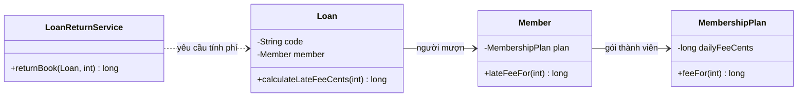

The diagram shows `LoanReturnService` knowing `Loan` directly; `Loan` knows `Member`; `Member` knows `MembershipPlan`. Each class only invokes **its direct collaborators**.

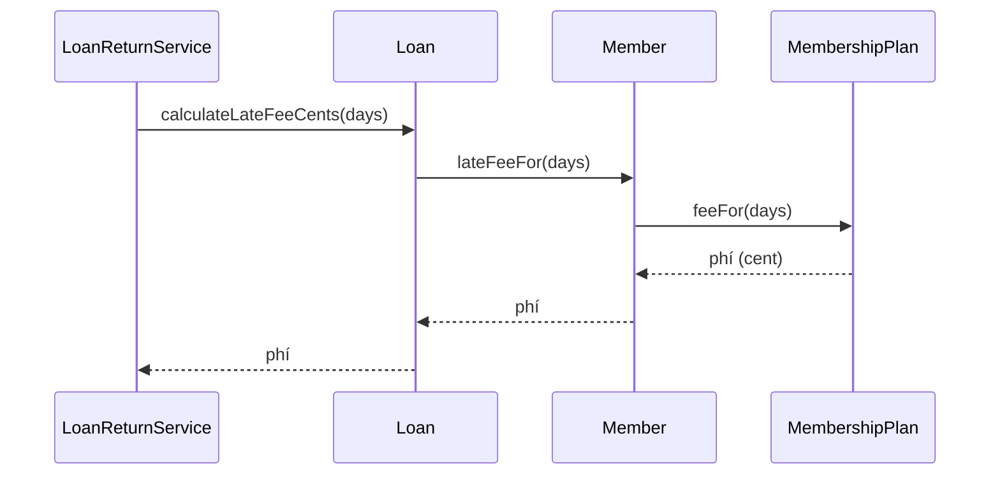

Runtime execution still involves multiple calls. The difference is that **the service does not navigate directly to Plan** or interpret days and rates itself. Each step stays within its object's responsibility boundary.

**Important distinction:** LoD does not forbid layered object structures or multi-step internal execution. It discourages a *caller* from knowing and depending unnecessarily on distant structure.

## 5. Runnable Java example: calculating overdue-book fees

Amounts use minor currency units (cents), avoiding `double` for exact monetary arithmetic. Save as `DemeterDemo.java` and compile with JDK 11 or later:

```java
import java.util.Objects;

public class DemeterDemo {

    // Value object: mức phí theo ngày.
    static final class MembershipPlan {
        private final String name;
        private final long dailyLateFeeCents;

        MembershipPlan(String name, long dailyLateFeeCents) {
            this.name = Objects.requireNonNull(name, "name");
            if (dailyLateFeeCents < 0) {
                throw new IllegalArgumentException(
                        "Daily late fee cannot be negative");
            }
            this.dailyLateFeeCents = dailyLateFeeCents;
        }

        long feeFor(int overdueDays) {
            if (overdueDays < 0) {
                throw new IllegalArgumentException(
                        "Overdue days cannot be negative");
            }
            return Math.multiplyExact(dailyLateFeeCents, overdueDays);
        }
    }

    // Entity: thành viên biết gói của chính mình.
    static final class Member {
        private final String id;
        private MembershipPlan plan;

        Member(String id, MembershipPlan plan) {
            this.id = Objects.requireNonNull(id, "id");
            this.plan = Objects.requireNonNull(plan, "plan");
        }

        String id() {
            return id;
        }

        void changePlan(MembershipPlan next) {
            plan = Objects.requireNonNull(next, "next");
        }

        long lateFeeFor(int overdueDays) {
            return plan.feeFor(overdueDays);
        }
    }

    // Entity: phiếu mượn biết người mượn, bảo vệ trạng thái đã trả.
    static final class Loan {
        private final String code;
        private final Member borrower;
        private boolean returned;

        Loan(String code, Member borrower) {
            this.code = Objects.requireNonNull(code, "code");
            this.borrower = Objects.requireNonNull(borrower, "borrower");
        }

        long calculateLateFeeCents(int overdueDays) {
            if (returned) {
                throw new IllegalStateException(
                        "Loan already returned: " + code);
            }
            return borrower.lateFeeFor(overdueDays);
        }

        void markReturned() {
            if (returned) {
                throw new IllegalStateException(
                        "Loan already returned: " + code);
            }
            returned = true;
        }
    }

    // Application-level collaborator: chỉ biết hành vi công khai của Loan.
    static final class LoanReturnService {
        long returnBook(Loan loan, int overdueDays) {
            Objects.requireNonNull(loan, "loan");

            long fee = loan.calculateLateFeeCents(overdueDays);
            // Demo: giả định phí được thu/xác nhận thành công tại đây.
            loan.markReturned();
            return fee;
        }
    }

    public static void main(String[] args) {
        MembershipPlan basic = new MembershipPlan("Basic", 125);
        MembershipPlan premium = new MembershipPlan("Premium", 40);
        Member member = new Member("M001", basic);
        LoanReturnService returns = new LoanReturnService();

        Loan first = new Loan("L001", member);
        System.out.println(
                "First fee: " + returns.returnBook(first, 4)); // 500

        member.changePlan(premium);
        Loan second = new Loan("L002", member);
        System.out.println(
                "Second fee: " + returns.returnBook(second, 4)); // 160

        try {
            returns.returnBook(second, 2);
            throw new AssertionError("Expected already-returned error");
        } catch (IllegalStateException expected) {
            System.out.println("Rejected duplicate return");
        }
    }
}
```

Run:

```bash
javac DemeterDemo.java
java DemeterDemo
```

Expected output:

```text
First fee: 500
Second fee: 160
Rejected duplicate return
```

Observe:

1. `LoanReturnService` only invokes `loan.calculateLateFeeCents(...)` and `loan.markReturned()`. It needs neither `getBorrower()` nor `getPlan()` getters.
2. `Loan` invokes a method on its direct `borrower` field.
3. `Member` invokes a method on its direct `plan` field.
4. `MembershipPlan` owns the fee formula and validates the number of days. `Math.multiplyExact()` detects overflow.
5. Changing rates for a membership plan does not require caller changes to traverse different properties.
6. `Loan` owns the rule that a loan may be marked returned only once.

**Business limitation of the demo:** the calculation uses the member's *current* plan at return time. If the fee must use the plan *at loan creation time* (unaffected by a later upgrade), `Loan` must snapshot the rate schedule at creation or record the applicable policy. This is a business decision, not an automatic outcome of LoD.

**Implementation limitation:** the demo marks `returned` after calculating a fee and assumes charging succeeds. Real systems must coordinate payment state, transactions/idempotency, and concurrency; LoD does not provide those guarantees.

## 6. Why do internal structure changes have less impact?

Suppose tomorrow the penalty formula changes from “days × fee per day” to “first two days free, with a maximum charge.” Deep-navigation code in several services may look like:

```java
long fee = loan.getMember()
               .getMembershipPlan()
               .getDailyLateFeeCents() * overdueDays;
```

Each location must find and revise the same rule. With behavior-oriented design:

```java
long fee = loan.calculateLateFeeCents(overdueDays);
```

We can change `MembershipPlan.feeFor(...)` or substitute a suitable fee policy while **preserving Loan's contract** if its semantics and inputs remain unchanged.

For example, a different formula:

```java
long feeFor(int overdueDays) {
    if (overdueDays < 0) {
        throw new IllegalArgumentException("days");
    }

    int billableDays = Math.max(0, overdueDays - 2);
    long calculated = Math.multiplyExact(
            dailyLateFeeCents, billableDays);
    return Math.min(calculated, 2_000L);
}
```

This is **an alternative implementation** of the `feeFor` method above; do not declare both methods with identical signatures in the same class. The grace period and fee cap are illustrative; real projects should derive them from approved rules and tests.

An API at the right abstraction level reduces caller coupling to storage and calculation details.

## 7. Are getters always wrong?

**No.** Getters serve many valid purposes:

- Providing data to DTOs or presentation components.
- Exposing read-only state that callers legitimately need.
- Returning immutable Value Objects as inputs to other algorithms.
- Allowing tests to observe public outcomes.
- Navigating data-centric structures such as `record` types, JSON DTOs, or query results designed for traversal.

Be concerned when **getters couple callers to nested structure and spread business logic across the codebase**.

| Expression | Assessment |
|---|---|
| `order.getCustomer().getMembership().getPlan().getDiscountRate()` | Worth reviewing if a service uses it to apply discounts itself |
| `order.calculateTotalAfterDiscount()` | Appropriate when Order/domain owns the total-calculation rule |
| `address.getCity()` | Reasonable when `address` is a formatter's direct input |
| `dto.customer().address().city()` | May be fine in presentation code when DTOs intentionally expose their structure |
| `builder.withName("A").withEmail("b@c.test").build()` | Fluent builder, not traversal through domain entities |
| `users.stream().filter(...).map(...).toList()` | Stream API operations are designed to compose |
| `service.getDao().getConnection().getMetaData().getTables(...)` | Can couple callers to resource internals and connection lifecycles; reconsider the boundary |

A simple check: **if changing storage inside an intermediate class requires changing the caller, does the caller know details it should not need?** If so, consider moving behavior to the right owner or passing data through a clear contract.

## 8. Do not “fix” chains by adding countless forwarding getters

Suppose a service needs a postal code to calculate shipping charges:

```java
String postalCode = order.getCustomer()
                         .getAddress()
                         .getPostalCode();
```

You could add:

```java
String Order.getCustomerPostalCode() {
    return customer.getAddress().getPostalCode();
}
```

That shortens the caller's chain but **does not necessarily improve the model**. Adding dozens of methods such as `getCustomerCity()`, `getCustomerStreet()`, and `getCustomerDistrict()` can turn `Order` into a forwarding facade for every `Customer` field, without clarifying Order's real responsibility.

Two better approaches depend on the requirement:

**Approach A: Move behavior to the owner of the rule.** If Order is responsible for preparing its own shipping destination, `order.shippingLabel()` or `order.confirmDeliveryDestination()` may be suitable APIs. Internally it collaborates with nearby components.

**Approach B: Define a clear data boundary.** If `ShippingRateCalculator` needs multiple address fields, pass an immutable **`ShippingAddress` Value Object** directly, rather than making the calculator navigate Order → Customer → Address:

```java
record ShippingAddress(String city, String postalCode) {
    ShippingAddress {
        java.util.Objects.requireNonNull(city);
        java.util.Objects.requireNonNull(postalCode);
    }
}

interface ShippingRateCalculator {
    long rateCents(ShippingAddress destination, int grams);
}
```

The rate calculator depends on **the necessary input contract**, not the Order/Customer structure. `Order` or the application layer supplies the appropriate address according to business rules (for example, an address *snapshotted when an order was placed*, not the customer's current address).

**Trade-off:** passing a VO through the application layer makes sense for **independent data required for a calculation**. If every class merely distributes raw data so services can reimplement its business rules, the design becomes an anemic model again.

## 9. Distinguishing navigation-chain avoidance from dependency reduction

LoD **does not mean** “every method may contain only one dot.” Dot count is an initial indicator, not a complete measure of design quality.

| Problem | Law of Demeter suggests | What it does not guarantee |
|---|---|---|
| Callers traverse deeply into domain models | Communicate with the nearest object through its behavior | Does not automatically identify correct class responsibilities |
| Internal structure changes break callers | Hide internal navigation behind a stable contract | The contract may still be vague or too broad |
| Business logic is duplicated outside Entities | Move rules to their owners or a domain policy | Does not replace domain analysis |
| Tests require constructing deep object graphs | Choose suitable collaboration boundaries | Not every object requires an interface/mock |
| Nested queries perform poorly | Review data models and access strategies | Shorter Java chains do not remove database round trips |

LoD is closely related to **encapsulation**, but **the Single Responsibility Principle (SRP)** and **cohesion** also matter. Concentrating all system behavior in one “God Object” merely to avoid deep calls **is not** good LoD design.

## 10. “Friend” objects at method scope

The following example classifies how closely objects relate to one another:

```java
final class InvoiceMailer {
    private final MailGateway gateway; // Cộng tác viên trực tiếp.

    InvoiceMailer(MailGateway gateway) {
        this.gateway = gateway;
    }

    void send(Invoice invoice) { // invoice là tham số trực tiếp.
        String content = "Invoice " + invoice.number();

        MailMessage message = new MailMessage(
                invoice.recipientEmail(), content); // object vừa tạo.

        gateway.send(message); // gọi trực tiếp field gateway.
    }
}
```

Assume `Invoice`, `MailMessage`, and `MailGateway` have been defined. The calls use the `invoice` parameter, `message` created within the method, and direct `gateway` field, which generally follow the common LoD interpretation.

By contrast:

```java
// Mailer phải biết cấu trúc internal của invoice → customer → profile.
gateway.send(new MailMessage(
    invoice.getCustomer().getProfile().getPrimaryEmail(),
    "Invoice " + invoice.number()));
```

If an invoice's delivery address is part of the Invoice concept, expose `invoice.recipientEmail()`. This ensures the rule for selecting an invoice email address belongs to its appropriate owner: it may use the email confirmed at invoice creation rather than the customer's current email.

**Key point:** invoking methods on direct parameters is normal; reconsider calls where a caller keeps **digging into objects retrieved from parameters** to control their internals.

## 11. Optional, null, Stream, and builders

### Null checks do not solve coupling

```java
String zip = order != null
    && order.getCustomer() != null
    && order.getCustomer().getAddress() != null
    ? order.getCustomer().getAddress().getZip()
    : "";
```

Adding null checks may prevent `NullPointerException`, but the caller still depends on the entire traversal path. Repeated getter calls might also cause side effects or produce different snapshots when data changes.

Using `Optional` does not automatically fix this:

```java
Optional.ofNullable(order)
    .map(Order::getCustomer)
    .map(Customer::getAddress)
    .map(Address::getZip)
    .orElse("");
```

The `map` chain removes some manual null checks, but callers still know the `Order → Customer → Address` structure. If obtaining a postal code is a responsibility of the order, define the API at that boundary.

### Fluent APIs are intentionally different

```java
String output = "  HELLO  ".trim().toLowerCase();

List<String> names = users.stream()
    .filter(User::isActive)
    .map(User::getName)
    .toList();
```

`Stream.toList()` requires Java 16+; Java 11 can use `collect(Collectors.toList())`. These immutable/fluent APIs expose clear public protocols, and chaining calls is an appropriate use. No extra wrapper is needed just to reduce dots.

## 12. Special considerations with ORM and JPA/Hibernate

A chain such as:

```java
String country = order.getCustomer()
                      .getAddress()
                      .getCountryCode();
```

may involve more than coupling. If `customer` or `address` is a **lazy-loaded** ORM relationship, getter access may trigger SQL queries. In a loop over many orders, this can cause **N+1 queries**, or exceptions such as `LazyInitializationException` when the session is closed (depending on the mapping and state).

However:

- Moving the chain into `order.shippingCountryCode()` **does not automatically remove SQL queries**; it only changes where they run.
- Appropriate fetch strategies, query projections, entity graphs, batch fetching, and DTOs address retrieval costs.
- Do not add every bidirectional relationship merely to make navigation convenient.
- Avoid serializing entire JPA object graphs directly to JSON when bidirectional relationships or lazy proxies cause reference cycles, data leakage, or excessive loading. Explicit DTO/API contracts usually provide better control.

Evaluate **both object-oriented boundaries and data access** rather than treating LoD as an automatic performance optimization.

## 13. A process for refactoring deep navigation chains

Suppose you find this code:

```java
if (order.getCustomer().getMembership().getTier().isGold()) {
    total = total * 90 / 100;
}
```

Follow these steps:

1. **Name the business question:** “What discount does this order qualify for under membership rules?” instead of “is the tier GOLD?”
2. **Find the responsible owner:** if membership itself determines discounts, put `membership.discountFor(orderAmount)` there. For complex rules with several inputs, use a `DiscountPolicy` or domain service.
3. **Define a clear contract:** for example, `order.discountedTotal(policy)` or `policy.calculate(orderSnapshot)`; specify currency units, rounding, promotions, and snapshot timing.
4. **Protect domain invariants:** entities calculate valid totals, policies determine discount rules, and controllers do not directly multiply by `90 / 100`.
5. **Switch callers to the new API:** controllers/services obtain only the pricing result, not a traversal of the customer graph.
6. **Test behavior before and after:** GOLD, non-GOLD, no membership, rounding, policy changes, and prevention of negative prices.
7. **Remove unnecessary getters when safe:** reduce the public API without deleting getters needed for legitimate data queries.

**Do not assume** every deep navigation problem is solved by another “get” method. It may be better to **reassign business responsibilities** or extract a meaningful Value Object/policy.

## 14. Common mistakes and solutions

| Common mistake | Consequence | Better approach |
|---|---|---|
| Caller reads several nested levels to enforce a rule | Depends on deep structure; logic becomes scattered | Invoke behavior on the object owning the rule |
| Adding dozens of forwarding getters | Intermediate class grows; API becomes confusing | Expose the actual capability or an appropriate VO boundary |
| Removing every getter because “LoD forbids getters” | Presentation/data-query layers become hard to use | Distinguish domain behavior from data projections |
| Putting all rules into one giant Service | Anemic entities and poor cohesion | Keep invariants with entities/VOs; use services when necessary |
| Mocking entire nested object graphs in tests | Brittle tests tied to getter implementation details | Test public behavior through objects/collaboration ports |
| Moving a Java chain into one method without changing DB access | N+1/lazy-loading issues remain | Design appropriate fetch/projection/transaction boundaries |
| Hiding every chain with `Optional.map(...)` | Reduces null checks but leaves coupling unchanged | Reassess responsibilities and APIs |
| Applying LoD rigidly to builders, Streams, and DTOs | Creates needless wrappers and hard-to-read code | Allow chains with clear data/fluent contracts |
| Hiding fields behind APIs that still expose SDK table/column names | Only changes the form of coupling | Design contracts around stable business semantics |

## 15. Practice exercises

### Exercise 1: Identify the class that knows too much

```java
void sendReminder(Loan loan) {
    String email = loan.getMember()
                       .getProfile()
                       .getEmailAddress()
                       .getValue();
    mailGateway.send(email, "Please return the book");
}
```

**Question:** How many structure levels are exposed to the reminder-sending code? If the loan's contact email must be fixed at checkout time, what should change?

**Hint:** replace the chain with an API such as `loan.reminderRecipientEmail()` or a VO/DTO containing reminder information. If the address must remain fixed, store a snapshot or choose the recipient through a policy at the appropriate boundary. Do not confuse the profile's current email with the address used when the loan began.

### Exercise 2: LoD and Value Objects

```java
long cents = invoice.total().minorUnits();
```

**Question:** Should this expression be forbidden merely because it contains two dots?

**Hint:** `invoice.total()` returns immutable `Money`; presentation code converting it to JSON or text can reasonably read `minorUnits()`. If a business caller performs many primitive monetary calculations by hand, use behavior on Money/invoice rather than extracting primitive values.

### Exercise 3: Protect entity behavior

An `Order` has `status` and `paidAt`. The controller writes:

```java
if (order.getStatus().equals("NEW")) {
    order.setStatus("PAID");
    order.setPaidAt(Instant.now());
}
```

**Hint:** use `order.markPaid(paymentReference, paidAt)` (or a domain-appropriate API) and keep transition checks and payment-timestamp consistency inside Order. The rule that an order may be paid only once belongs with its state.

### Exercise 4: Extend the Java example

In `DemeterDemo`, add a policy where “Premium plans waive the first late day and charge starting on the second day,” and test fees for 0, 1, 2, 4 late days.

**Hint:** a `LateFeePolicy` Value Object or interface may fit when several policies actually exist; locate it near `MembershipPlan`. Keep the service call `loan.calculateLateFeeCents(days)` unchanged. Enforce nonnegative amounts and detect overflow.

### Exercise 5: Consider an exception

A reporting screen receives a DTO:

```java
String city = reportDto.customer()
                       .shippingAddress()
                       .city();
```

**Question:** Must it be changed to `reportDto.getShippingCity()`?

**Hint:** no. DTOs are often meant to expose readable data structures; consider whether the schema is a public contract and the UI is entitled to use those fields. Reconsider boundaries only if presentation code implements domain rules or is tied to persistence internals.

---

**Remember:** limiting deep navigation is not a contest to reduce dots. Let callers **request meaningful behavior** from direct collaborators, let data owners **enforce their own rules and invariants**, and expose data structure only when it is an intentional contract. That way, internal changes to one class are less likely to force changes throughout its neighbors.


</details>

- [Back to top](#back-to-top)
