<a id="back-to-top"></a>

# Modeling

## Menu
- [Gathering use cases and business rules](#modeling-001)
- [Identifying objects from requirements](#modeling-002)
- [Assigning responsibilities and collaborators](#modeling-003)
- [CRC cards: classes, responsibilities, and collaborators](#modeling-004)
- [Class diagrams: members and relationships](#modeling-005)
- [Object diagrams: instances at a point in time](#modeling-006)
- [Sequence diagrams: interaction order](#modeling-007)
- [State diagrams: valid state transitions](#modeling-008)
- [Validating models against code and real scenarios](#modeling-009)

## <a id="modeling-001">Gathering use cases and business rules</a>

<details>
<summary>View details</summary>

# Gathering Use Cases and Business Rules for OOP Modeling

**Goal:** Start with the user's story, identify **use cases**, **business rules**, and **invariants**, and only then determine object responsibilities and build testable Java APIs. This lesson uses **student course enrollment**; its business rules are illustrative assumptions, not default policies for every learning platform.

## 1. Why Gather Requirements Before Designing Classes?

An initial requirement is often very brief:

> “A student wants to enroll in a course. The system reports success if enrollment is possible.”

Starting immediately with classes such as `Student`, `Course`, `EnrollmentService`, and `Database` risks overlooking questions that determine behavior:

- May students enroll before their accounts are activated?
- What happens when course registration is closed?
- Must prerequisites be completed first, or are exceptions allowed?
- Can a student enroll in the same course twice?
- If two students simultaneously request the last available seat, who gets it?
- What information must be stored and returned after successful enrollment?
- If the notification email fails, is the enrollment still successful?
- Who may change capacity, deadlines, and prerequisite lists?

A **use case** describes a goal an **actor** achieves through interaction with a system. A **business rule** specifies organizational conditions, policies, or constraints that use cases must follow. They complement each other:

- A use case asks: **Who does what, toward which goal, and through which flows?**
- A business rule asks: **Under which conditions may or must the system permit or reject that action?**
- A domain model asks: **Which concepts exist, what state do they hold, and which constraints must they protect?**

Do not assume every noun in a requirement must become a class or every use-case step a method. Modeling translates business language into software responsibilities and contracts.

## 2. Identify Scope and Information Sources

Before interviewing stakeholders, establish the **system boundary**, objectives, and involved parties.

| Element | Question to clarify | Example in the course-enrollment system |
|---|---|---|
| Primary actor | Who initiates the interaction to accomplish the goal? | Student |
| Other stakeholders | Who defines/approves rules, and who is affected? | Academic office, instructors, administrators |
| Goal | What outcome brings value to the actor? | A valid place in a course |
| External systems | Which systems does this depend on? | Authentication, academic records, email |
| Scope | Which part is this application responsible for? | Eligibility checks and enrollment |
| Uncertainty | Who has authority to decide the answer? | Academic office confirms eligibility policy |
| Nonfunctional constraints | Volume, response time, security, auditing? | Concurrent enrollments without exceeding capacity |

A request to “check whether a student has completed course A” may require data from another academic system. Identify the **source of truth**, when it updates, and how the application behaves when that service is unavailable.

## 3. Gather Requirements Through Concrete Scenarios

Combine practical techniques rather than only asking “which screens are needed?”

### Goal-Oriented Interviews

Ask students about their steps, academic staff about policies, and operations teams about exceptions and inconsistent data. For example:

1. “What happened the last time you enrolled in a course, from beginning to end?”
2. “When has the system rejected enrollment even though an authorized staff member granted an exception?”
3. “What counts as **one** course seat: one account, one student, or one enrollment event?”
4. “How should the system decide when two people request the last seat simultaneously?”
5. “What data or event proves enrollment succeeded?”
6. “Who may change the policy, and do we need version history?”

Avoid leading questions like “Should we have an Enroll button?” They shift discussion toward UI before the goal is understood.

### Observation and Process Shadowing

Observe staff processing real cases, inputs, decisions, and exceptional procedures. “Valid enrollment” may conceal credit limits, timetable clashes, prerequisites, and tuition debt checks. Do not add these rules to the model unless stakeholders confirm them.

### Workshops with Examples and Counterexamples

Use numerical examples to clarify ambiguous wording:

| Proposed scenario | Question to settle |
|---|---|
| 1 seat remains; 2 simultaneous requests arrive | Who wins? Is there a queue? |
| A student completed a prerequisite, but academic records have not synchronized | Reject, await synchronization, or conditionally enroll? |
| Already enrolled; the same request is sent again | Report “already enrolled,” return the previous result, or signal an error? |
| Enrollment succeeds; the email fails | Cancel enrollment? Retry notification? |
| Course is full; an administrator increases capacity | Who may do this, and must it be audited? |

Every example should specify **input, prior state, action, expected result, and rationale**. When stakeholders disagree, record the conflict and decision owner rather than picking an answer yourself.

### Lightweight Event Storming

Write down events that have occurred, such as “Student requested enrollment,” “Enrollment rejected,” or “Student enrolled,” then work backward:

- What triggered the event?
- Which actor or object made the decision?
- Which conditions had to hold before the event?
- Must the event be stored, or is the final state enough?
- Does another system react to the event afterward?

Event storming helps reveal responsibility boundaries, but **does not require** event sourcing or a message broker.

## 4. Standardize a Use Case Specification

An example use case, **UC-01 – Enroll in a Course**, within the hypothetical system:

| Attribute | Description |
|---|---|
| **ID / Name** | UC-01 / Enroll in a Course |
| **Goal** | A student obtains a valid enrollment in a course |
| **Primary actor** | Authenticated student |
| **Trigger** | Student requests enrollment in a selected course |
| **Preconditions** | The system identifies both student and course; user has permission to submit the request |
| **Success flow** | 1. Receive request → 2. Load student and course state → 3. Check policies → 4. Enroll atomically → 5. Return confirmation |
| **Alternative flows** | Inactive account, closed registration, missing prerequisites, duplicate enrollment, no remaining seats |
| **Success postconditions** | Exactly one enrollment exists for the student–course pair; available seats decrease according to policy |
| **Failure guarantee** | No new enrollment is created and capacity is never exceeded |
| **Output** | Course ID, student ID, status, and appropriate message |
| **Out of scope for this example** | Payment, withdrawal, waiting lists, manual enrollment by staff |

The “authenticated” precondition differs from the rule that an account must be **active**: a user may be able to sign in but be barred from enrollment by policy. A good use case specification distinguishes them.

Avoid details like “click the green button at the top right” in a **business use case**. That belongs to UI design or interface testing; a use case should remain abstract enough for APIs, web, and mobile clients to achieve the same goal.

## 5. Write Business Rules That Can Be Tested

The following rules are **assumptions chosen for the example**:

| ID | Business rule | Result of violation |
|---|---|---|
| BR-01 | Only students with **active** status may enroll | Reject without enrolling |
| BR-02 | Enrollments are accepted only while registration is **open** | Reject |
| BR-03 | A student must have completed **all prerequisites** for the course | Reject |
| BR-04 | A student may have **at most one** enrollment in the same course | Reject duplicate request |
| BR-05 | Enrollments must not exceed course **capacity** | Reject when full |
| BR-06 | Successful enrollment updates state **atomically** | No partially recorded state |

A well-specified rule includes:

- **Stable ID** for use in use cases, tickets, tests, and documentation.
- **Clear statement** of inputs, conditions, and behavior when conditions are not met.
- **Rule owner**: the business group authorized to make decisions.
- **Applicability**: course type, study program, location, time period, and exceptions.
- **Effective date and version** if policies change by term.
- **Valid and invalid examples** to remove ambiguity.

For example, “eligible to enroll” is not testable. Replace it with “BR-03: before enrollment, the set of completed courses must include every prerequisite of the selected course.”

Distinguish **business rules** from **technical constraints**:

- “A class with capacity = 30 must not enroll more than 30 students” is a business rule.
- “Column `student_id` has type VARCHAR(36)” is a technical choice.
- “Each student may have one enrollment per course” is a business rule; a DB unique constraint on `(course_id, student_id)` is **one mechanism** for enforcing it.

## 6. Specify Failure Flows as Carefully as Success Flows

Do not stop at “save to DB on success.” Build a business decision matrix:

| Initial state | Action | Expected outcome | Rule |
|---|---|---|---|
| Active student, open course, prerequisites met, seat available | Enroll | Success; available seats decrease by 1 | BR-01..06 |
| Inactive student | Enroll | Reject; enrollment count unchanged | BR-01 |
| Registration closed | Enroll | Reject; state unchanged | BR-02 |
| Prerequisites missing | Enroll | Reject; do not reserve a seat | BR-03 |
| Already enrolled in the course | Enroll again | Reject or return prior result, depending on chosen policy | BR-04 |
| Course at capacity | Enroll | Reject; capacity not exceeded | BR-05 |
| Two requests compete for the last seat | Enroll | At most one succeeds | BR-05, BR-06 |

These counterexamples become acceptance criteria and tests. For retransmitted network requests, **establish an idempotency policy**: a “duplicate enrollment” and “retry of the same request” may need different behavior. The simple Java example below **rejects duplicate enrollments** and does not implement idempotency keys.

## 7. Map Use Cases and Business Rules to a Class Model

First separate **concepts**, **state**, **invariants**, and **behavior**:

| Concept | Minimal state | Behavior / responsibility |
|---|---|---|
| `Student` | ID, active status, completed courses | Supplies eligibility facts and keeps student state consistent |
| `Course` | ID, capacity, registration status, prerequisites, enrolled student IDs | Decides whether to accept enrollment; enforces capacity and uniqueness |
| `EnrollmentReceipt` | Course ID, student ID, enrollment count after operation | Returns immutable data to the caller |
| `EnrollmentUseCase` (with a real DB/API) | Required dependencies | Loads data, checks permissions, invokes domain logic, persists in a transaction, returns result |
| Repository / Adapter | Storage technology | Loads/saves domain state and ensures transactions as designed |

Not every noun is a class. “Enroll button,” “screen,” and “email” may belong to presentation or integration rather than the domain. A simple capacity invariant does not justify a separate `CapacityValidator` class when `Course` can own it.

In this simplified example, `Course` can be viewed as an **aggregate root** for seat enrollment if every enrollment is managed through it. In a larger system, enrollment may be its own aggregate, with capacity protected by a reservation service or database. Boundaries should follow actual transactions, access volume, and invariants.

~~~mermaid
classDiagram
    direction LR
    class Student {
        +id: String
        +active: boolean
        +completedCourses: Set
    }
    class Course {
        +id: String
        +capacity: int
        +enroll(Student) EnrollmentReceipt
        +remainingSeats() int
        +closeRegistration()
    }
    class EnrollmentReceipt {
        +courseId: String
        +studentId: String
        +enrolledCount: int
    }
    Course ..> Student : kiểm tra điều kiện
    Course ..> EnrollmentReceipt : tạo kết quả
~~~

The diagram shows **behavioral dependencies**, not enough evidence to infer composition or aggregation. If enrollment has a separate lifecycle, introduce an `Enrollment` entity with identity and state; do not add one merely because the diagram contains several nouns.

## 8. Java 17+: A Sample Implementation Based on the Collected Rules

This is a **runnable, single-file example in `EnrollmentModelingDemo.java`**. It uses in-memory state to illustrate the domain and **does not** replace real database transactions or unique constraints.

~~~java
import java.util.LinkedHashSet;
import java.util.Objects;
import java.util.Set;

record Student(String id, boolean active, Set<String> completedCourses) {
    Student {
        Objects.requireNonNull(id, "id");
        Objects.requireNonNull(completedCourses, "completedCourses");
        if (id.isBlank()) {
            throw new IllegalArgumentException("Student id is blank");
        }
        completedCourses = Set.copyOf(completedCourses);
    }
}

record EnrollmentReceipt(
        String courseId, String studentId, int enrolledCount) {}

final class BusinessRuleViolation extends RuntimeException {
    private final String ruleId;

    BusinessRuleViolation(String ruleId, String message) {
        super(message);
        this.ruleId = ruleId;
    }

    String ruleId() {
        return ruleId;
    }
}

final class Course {
    private final String id;
    private final int capacity;
    private final Set<String> prerequisites;
    private final Set<String> enrolledStudentIds = new LinkedHashSet<>();
    private boolean registrationOpen;

    Course(String id, int capacity, Set<String> prerequisites,
            boolean registrationOpen) {
        this.id = Objects.requireNonNull(id, "id");
        Objects.requireNonNull(prerequisites, "prerequisites");
        if (id.isBlank() || capacity <= 0) {
            throw new IllegalArgumentException("Invalid course");
        }
        this.capacity = capacity;
        this.prerequisites = Set.copyOf(prerequisites);
        this.registrationOpen = registrationOpen;
    }

    // Command: kiểm tra và thay đổi trong cùng vùng đồng bộ.
    synchronized EnrollmentReceipt enroll(Student student) {
        Objects.requireNonNull(student, "student");

        if (!student.active()) {
            throw new BusinessRuleViolation("BR-01", "Student is inactive");
        }
        if (!registrationOpen) {
            throw new BusinessRuleViolation("BR-02", "Registration is closed");
        }
        if (!student.completedCourses().containsAll(prerequisites)) {
            throw new BusinessRuleViolation("BR-03", "Prerequisites missing");
        }
        if (enrolledStudentIds.contains(student.id())) {
            throw new BusinessRuleViolation("BR-04", "Already enrolled");
        }
        if (enrolledStudentIds.size() >= capacity) {
            throw new BusinessRuleViolation("BR-05", "Course is full");
        }

        enrolledStudentIds.add(student.id()); // BR-06 trong 1 JVM
        return new EnrollmentReceipt(
                id, student.id(), enrolledStudentIds.size());
    }

    // Query: không thay đổi dữ liệu.
    synchronized int remainingSeats() {
        return capacity - enrolledStudentIds.size();
    }

    synchronized void closeRegistration() {
        registrationOpen = false;
    }
}

public class EnrollmentModelingDemo {
    public static void main(String[] args) {
        Course oop = new Course("OOP-201", 2, Set.of("JAVA-101"), true);
        Student lan = new Student("ST-01", true, Set.of("JAVA-101"));
        Student minh = new Student("ST-02", true, Set.of("JAVA-101"));

        EnrollmentReceipt result = oop.enroll(lan);
        System.out.println(result);
        System.out.println("Remaining: " + oop.remainingSeats()); // 1

        oop.enroll(minh);
        System.out.println("Remaining: " + oop.remainingSeats()); // 0

        try {
            oop.enroll(new Student(
                    "ST-03", true, Set.of("JAVA-101")));
        } catch (BusinessRuleViolation exception) {
            System.out.println(
                    exception.ruleId() + ": " + exception.getMessage());
            // BR-05: Course is full
        }
    }
}
~~~

Run with JDK 17 or newer:

~~~bash
javac EnrollmentModelingDemo.java
java EnrollmentModelingDemo
~~~

**Design implications:**

- `Student` is an immutable `record`; `Set.copyOf` prevents callers from changing completed-course data after construction.
- `Course.enroll()` enforces rules owned by the course instead of putting them in a controller and hoping every caller checks them.
- `BusinessRuleViolation.ruleId()` creates **traceability** among BR-xx requirements, code, and tests; internal stack traces should not be shown to end users.
- `synchronized` prevents interleaving between checks and additions when **multiple threads access the same `Course` instance in one JVM**.
- `EnrollmentReceipt` contains only data returned by the use case. A real system may add enrollment ID, status, timestamps, and version when requirements confirm them.

**Important boundary:** If an application runs on several nodes and each loads a separate `Course` from the DB, `synchronized` locks **do not** coordinate across nodes. Enforcing BR-04/BR-05/BR-06 in production requires correct transactions, a unique constraint on `(course_id, student_id)`, locking/optimistic versioning or conditional updates, and checking their results. A business rule is not guaranteed merely because Java contains an `if` statement.

## 9. Trace Requirements to Classes and Tests

A traceability matrix helps manage scope and reveal unverified rules:

| Requirement source | Where it appears in the model | Test case |
|---|---|---|
| UC-01 success flow | `Course.enroll()`, `EnrollmentReceipt` | Eligible student enrolls; available seats decrease by 1 |
| BR-01 | `Student.active()`, `Course.enroll()` | Inactive student is rejected |
| BR-02 | `Course.registrationOpen` | Closed registration is rejected |
| BR-03 | `Student.completedCourses`, `Course.prerequisites` | Missing prerequisite is rejected |
| BR-04 | `Course.enrolledStudentIds` | Second enrollment attempt is rejected |
| BR-05 | `Course.capacity` | Full course rejects enrollment |
| BR-06 | `Course.enroll()` and persistence transaction when using a DB | Failed operation adds no record; competing requests never exceed capacity |

One business criterion may require **multiple** tests, while one test may exercise several rules. Traceability is useful when policy changes: find affected code and tests without putting every rule into a giant class.

### Illustrative JUnit Jupiter 5 Tests

**`EnrollmentModelingTest.java`** (in the same package as the demo file):

~~~java
import static org.junit.jupiter.api.Assertions.*;
import org.junit.jupiter.api.Test;
import java.util.Set;

class EnrollmentModelingTest {
    private static Student eligible(String id) {
        return new Student(id, true, Set.of("JAVA-101"));
    }

    @Test
    void successConsumesExactlyOneSeat() {
        Course course = new Course("OOP", 2, Set.of("JAVA-101"), true);

        EnrollmentReceipt receipt = course.enroll(eligible("S-01"));

        assertEquals("OOP", receipt.courseId());
        assertEquals("S-01", receipt.studentId());
        assertEquals(1, receipt.enrolledCount());
        assertEquals(1, course.remainingSeats());
    }

    @Test
    void duplicateDoesNotConsumeAnotherSeat() {
        Course course = new Course("OOP", 2, Set.of(), true);
        Student student = new Student("S-01", true, Set.of());
        course.enroll(student);

        BusinessRuleViolation exception = assertThrows(
                BusinessRuleViolation.class, () -> course.enroll(student));

        assertEquals("BR-04", exception.ruleId());
        assertEquals(1, course.remainingSeats());
    }

    @Test
    void missingPrerequisiteIsRejected() {
        Course course = new Course("OOP", 1, Set.of("JAVA-101"), true);

        BusinessRuleViolation exception = assertThrows(
                BusinessRuleViolation.class,
                () -> course.enroll(new Student("S-02", true, Set.of())));

        assertEquals("BR-03", exception.ruleId());
        assertEquals(1, course.remainingSeats());
    }

    @Test
    void capacityIsEnforced() {
        Course course = new Course("OOP", 1, Set.of(), true);
        course.enroll(new Student("S-01", true, Set.of()));

        BusinessRuleViolation exception = assertThrows(
                BusinessRuleViolation.class,
                () -> course.enroll(new Student("S-02", true, Set.of())));

        assertEquals("BR-05", exception.ruleId());
        assertEquals(0, course.remainingSeats());
    }

    @Test
    void closedRegistrationRejectsRequest() {
        Course course = new Course("OOP", 1, Set.of(), true);
        course.closeRegistration();

        BusinessRuleViolation exception = assertThrows(
                BusinessRuleViolation.class,
                () -> course.enroll(new Student("S-01", true, Set.of())));

        assertEquals("BR-02", exception.ruleId());
        assertEquals(1, course.remainingSeats());
    }
}
~~~

These tests check behavior against the chosen rules. They do not prove multi-node uniqueness or atomicity; a real system also needs DB integration tests and suitable concurrency tests.

## 10. Acceptance Criteria Using Given–When–Then

Detailed use cases provide context, while **Given–When–Then** turns individual scenarios into testable acceptance criteria.

~~~gherkin
Feature: Đăng ký khóa học

  Scenario: Đăng ký hợp lệ
    Given sinh viên ST-01 đang hoạt động
      And ST-01 đã hoàn thành JAVA-101
      And khóa OOP-201 đang mở với 1 chỗ trống
    When ST-01 đăng ký OOP-201
    Then hệ thống xác nhận đăng ký thành công
      And OOP-201 có 0 chỗ trống

  Scenario: Từ chối đăng ký trùng
    Given ST-01 đã ghi danh OOP-201
    When ST-01 đăng ký lại OOP-201
    Then hệ thống từ chối theo BR-04
      And số chỗ trống không thay đổi
~~~

The Gherkin is a **scenario specification**; automated execution requires an appropriate tool and step definitions (such as Cucumber). Merely placing it in a README does not execute it.

Not every UI detail is an acceptance criterion. “Green button is visible” might warrant a separate interface test; BR-04 must be enforced at the domain level even when a caller bypasses the web UI.

## 11. Business Flows, State, and Decision Points

~~~mermaid
flowchart TD
    A[Sinh viên yêu cầu ghi danh] --> B[Định danh người yêu cầu và khóa học]
    B --> C{Sinh viên active?}
    C -->|Không| X1[Từ chối BR-01]
    C -->|Có| D{Khóa đang mở?}
    D -->|Không| X2[Từ chối BR-02]
    D -->|Có| E{Đủ môn tiên quyết?}
    E -->|Không| X3[Từ chối BR-03]
    E -->|Có| F{Đã ghi danh?}
    F -->|Có| X4[Từ chối BR-04]
    F -->|Không| G{Còn capacity?}
    G -->|Không| X5[Từ chối BR-05]
    G -->|Có| H[Giữ chỗ và tạo ghi danh nguyên tử]
    H --> I[Trả biên nhận]
~~~

The diagram helps stakeholders identify undefined branches. Its error-check order is **only one illustrative choice**: a real system might check authorization first to avoid exposing course details or handle “already enrolled” differently. Error precedence is part of the contract that stakeholders must confirm.

If there is a longer lifecycle with states such as (`Requested → Approved → Cancelled`), draw a **state machine** and specify transition rules. But if the use case only decides success/failure and has no additional enduring states, do not invent numerous artificial states.

## 12. Business Rules Versus Functional and Nonfunctional Requirements

| Category | Example | Effect on the model |
|---|---|---|
| **Use case / functional requirement** | Student enrolls in a course | Requires orchestration and a returned outcome |
| **Business rule** | Do not exceed capacity or allow duplicates | Domain/transaction invariants and validation |
| **Non-functional requirement** | 99% of requests respond within a stakeholder-approved threshold | Influences database, caching, and load-distribution strategies |
| **Security rule** | Only account owners or authorized staff may enroll on someone else's behalf | Authorization at entry points and other suitable boundaries |
| **Data constraint** | Unique `(course_id, student_id)` | Protects consistency in storage |
| **UI behavior** | Show available seats and disable enrollment when full | Presentation; does not replace command validation |

Do not encode a vague business rule as hard constraints in several places and forget versioning. When the same rule is enforced by API, DB, and UI, specify the **authoritative definition** and a consistency strategy across those layers.

## 13. A Practical Requirements-to-Modeling Workflow

1. **Define goals and the system boundary.** List actors, related systems, and desired outcomes instead of starting with classes.
2. **Gather real stories.** Interview stakeholders, observe workflows, and use data-rich examples and counterexamples. Record who said what and which decisions remain unapproved.
3. **Name use cases using verbs and outcomes.** Examples: “Enroll in Course,” “Withdraw Enrollment,” “Approve Exception.” Give each a clear actor and goal.
4. **Specify main and exceptional flows.** Capture triggers, preconditions, postconditions, failure guarantees, and concurrent scenarios.
5. **Extract business rules separately.** Assign BR-xx IDs, use observable conditions, and specify owner, applicability, exceptions, and version.
6. **Confirm with concrete examples.** Use decision tables and Given–When–Then to confirm boundaries, null/blank cases, duplicates, and concurrency with stakeholders.
7. **Sketch the domain model.** Identify entities, value objects, aggregates, invariants, and responsibilities; introduce abstractions only where justified.
8. **Design APIs and use cases.** Commands should protect rules where data is managed; queries only read. Technical interfaces should not arbitrarily own domain policy.
9. **Create traceability.** Map use case → business rule → class/method → test, maintaining links as requirements change.
10. **Review with stakeholders and operations.** Assess feasibility, errors, auditing, transactions, integrations, and changes over time.

~~~mermaid
flowchart LR
    A[Stakeholder và tình huống thực] --> B[Use case]
    B --> C[Business rules và acceptance criteria]
    C --> D[Domain model và trách nhiệm]
    D --> E[Java API / transaction / persistence]
    E --> F[Test truy vết]
    F -. phát hiện thiếu hoặc mâu thuẫn .-> B
~~~

Modeling is **a controlled iterative process**, not a one-time document. If tests reveal an unclear domain case, return to the rule owner for confirmation rather than adding an `if` based solely on technical judgment.

## 14. Requirements-Gathering Risks and Mitigations

| Mistake | Consequence | Prevention |
|---|---|---|
| Recording only UI requirements | Missing domain rules that alternate APIs can bypass | Capture goal-level use cases |
| Asking one stakeholder to define every rule | Missed exceptions and decision rights | Identify owners, approvers, and affected parties |
| Using words like “valid,” “enough,” or “fast” | Untestable rules | Specify conditions, thresholds, and concrete examples |
| Confusing policy with implementation | Business documents must change when DB/framework changes | Separate business rules from SQL, HTTP, and classes |
| Describing only the happy path | Data failures, concurrency, and retries are undefined | Create decision tables and failure flows |
| Turning every noun into a class | More classes without clear responsibilities; increased coupling | Identify identity, state, and invariants first |
| Validating only in controllers | Jobs/background callers bypass rules | Enforce invariants at suitable domain/storage boundaries |
| Not linking rules to tests | Policy changes with unknown impact | Trace BR-ID to behavioral tests |
| Treating in-memory locking as distributed protection | Capacity can be exceeded across servers | Use suitable database transactions, constraints, and locking |
| Not recording assumptions or scope | Developers silently make stakeholder policy decisions | Maintain open questions, decisions, and versions |

## 15. Practice Exercise

**Another context:** a library lending books to members.

Gather and model the **“Borrow a Book Copy”** use case starting with “Members may borrow available books.” Before coding, propose questions about active accounts, maximum concurrent loans, due dates, specific book copies, reservations, overdue loans, request retries, and multiple members competing for the last copy.

Once the answers are known:

1. Write use case UC-LIB-01 with actor, trigger, success flow, failure branches, and postconditions.
2. Build a BR-LIB-01... table with valid/invalid examples for each confirmed rule.
3. Determine the identities and lifecycles of `BookTitle`, `BookCopy`, `Member`, and `Loan`, including where to protect the last available copy.
4. Draw concise use-case-flow and class diagrams; do not create classes solely from nouns.
5. Write Java APIs for command `borrowCopy(...)` and query `availableCopies(...)`, and check storage-level race conditions.
6. Convert at least three business rules into acceptance tests and map their IDs.

**Completion criteria:** Stakeholders can review scenarios and confirm behavior; developers can identify each class's responsibility; testers can trace every rule to a test case; failure paths cannot leave data violating policy.

---

**Remember:** Good OOP modeling begins with **the outcome users want** and **the conditions under which the organization permits it**. Use cases define goal-oriented flows, business rules define policies/invariants, and Java classes and tests implement, protect, and verify both.

</details>

- [Back to top](#back-to-top)

---

## <a id="modeling-002">Identifying objects from requirements</a>

<details>
<summary>View details</summary>

# Identifying Objects from Requirements in OOP (Java)

## The Modeling Challenge

Given a requirement such as “A member borrows a book copy; the system checks whether it is available, records the loan, and calculates a due date,” designers should not immediately write one class per noun. First identify **meaningful domain concepts**, the information they own, the behavior they govern, and the relationships that must stay consistent.

**Identifying objects from requirements** translates the user's language into *candidate objects*, evaluates each candidate's role, and proposes a class model. This is discovery and hypothesis validation, not a mechanical noun-finding exercise.

By the end, you should be able to:

- Read domain descriptions to extract objects, attributes, behavior, events, and rules.
- Distinguish **entities**, **value objects**, coordinating objects, and external dependencies.
- Discard misleading “classes” that are merely attributes, screens, roles, or technical implementation details.
- Validate models using domain scenarios, invariants, UML diagrams, and standalone runnable Java examples.
- Recognize when an unclear requirement or new rule calls for an object with an independent lifecycle.

## 1. Begin with Domain Language

Consider this sample requirement:

> “Members have member IDs and names. A library holds many book copies; each copy has a unique ID and belongs to one book title. Members may borrow at most two copies simultaneously. No copy may have two active loans. When a loan starts, the system records its start date and a due date 14 days later. Staff can search active loans.”

This is **an illustrative requirement** for analysis practice, not a universal library policy. The two-copy limit and 14-day term are example-specific rules.

Underline phrases that need clarification:

| Phrase in the requirement | Initial candidate | Question to confirm |
| --- | --- | --- |
| Member | `Borrower` | Does it have an independent ID, lifecycle, and history? |
| Member ID, name | Attributes of `Borrower` | Are special formatting rules or value types needed? |
| Book title | `BookTitle` or `Book` | Does it have ISBN, authors, and publication metadata? |
| Physical book copy | `BookCopy` | Does each copy have its own ID and independent lending availability? |
| Borrow a copy | `Loan` and `borrow(...)` behavior | Does each loan have distinct dates, state, and identity? |
| Two copies concurrently | `LoanPolicy` or a domain rule | Who is affected? Do member categories have exceptions? |
| Active loan | Status/condition on `Loan` | Does returning a copy close the loan or erase its history? |
| Borrow date, due date | Attributes of `Loan` | Use `LocalDate` or `Instant`? Which time zone applies? |
| Search | Use-case/query behavior | Is `LoanQueryService` needed, or just a repository query? |
| Library | Contextual concept | Does this feature actually require a `Library` object? |

**A book title and a physical copy are different concepts.** Three physical copies may share the same title. If the model only has `Book(title)` with no per-copy identity, it cannot identify which exact copy is on loan. This shows why domain questions must precede class selection.

## 2. The Noun–Verb–Rule Technique

Make three passes over the requirements:

1. **Nouns and noun phrases:** find entities, objects, documents, roles, and results with potential independent identity or value.
2. **Verbs:** identify actions such as *borrow*, *return*, *confirm*, *calculate*, *transfer*, *cancel*, and *search*.
3. **Conditions/constraints:** highlight *must*, *must not*, *at most*, *at least*, *only if*, *if... then...*, and *after ... days*.

Example:

```text
"Cá nhân [độc giả] mượn [bản sách]."
  Danh từ: độc giả, bản sách
  Động từ: mượn
  Câu hỏi: ai quyết định cho mượn, ai ghi nhận kết quả?

"Mỗi bản sách không có quá một [lượt mượn đang hoạt động]."
  Ứng viên: lượt mượn (Loan)
  Invariant: active-loan-count(copyId) <= 1

"Hạn trả sau 14 ngày."
  Dữ liệu: ngày mượn, hạn trả
  Quy tắc: dueDate = borrowedOn + 14 ngày
  Vị trí ứng viên: LoanPolicy hoặc nghiệp vụ tạo Loan
```

This technique only **generates candidates**. Do not apply “one noun → one class” or “one verb → one service.” A “borrow date” is often a `LocalDate` in `Loan`; a “check” may be a method rather than a `Check` class.

## 3. Classify Candidates with Testable Questions

A candidate deserves a class if it has **a distinct role** that would be lost or confused if merged with another class.

| Category | Recognition criteria | Example | Representation |
| --- | --- | --- | --- |
| Entity | Has identity and lifecycle; the same ID still identifies it when attributes change | `Borrower`, `BookCopy`, `Loan` | Class with ID, behavior, and invariants |
| Value object | Distinguished by value; usually immutable, no separate ID needed | `DateRange`, `Money`, `Address` | `record` or immutable class |
| Aggregate root | Controls invariants and updates of a set of objects | `Loan` or another borrowing coordinator, depending on design | Controlled mutation API |
| Domain policy/service | Rule requiring several inputs, not owned by one entity | `LoanPolicy` | Class/record with explicit behavior |
| Application service | Orchestrates a use case: loads data, applies policy, records result | `BorrowingService` | Service depending on ports |
| Repository/port | Contract for data access outside the domain | `LoanRepository` | Interface plus adapter |
| DTO/Command | Input/output carried across API, CLI, or message boundaries | `BorrowRequest` | Record/data carrier |
| Domain event | A significant event that has occurred | `LoanCreated` | Record/event object when needed |

You do not need every category. Small features can have only a few focused classes. **Entities, value objects, and services** are responsibility roles chosen for the problem, not labels every object must fit.

### Three Tests for a Candidate

- **Identity test:** if the name changes but the ID remains, is it still the same object? If so, it is probably an entity.
- **Responsibility test:** does this candidate own information or behavior that no other object should manage?
- **Lifecycle test:** must creation, changes, completion, or history be tracked independently?

A “loan” has a borrower, copy, start date, return date, and state. Its lifecycle differs from those of the book and borrower, making `Loan` meaningful as an object instead of storing `borrowerId` directly on `BookCopy` and losing history.

## 4. From Candidates to a Relationship Model

Ask questions at **both ends** of each relationship:

- How many copies can a book title have? How many titles can one copy belong to?
- How many loans can a member have? How many members does each loan belong to?
- How many loans can a copy have **historically**, and how many may be **active**?

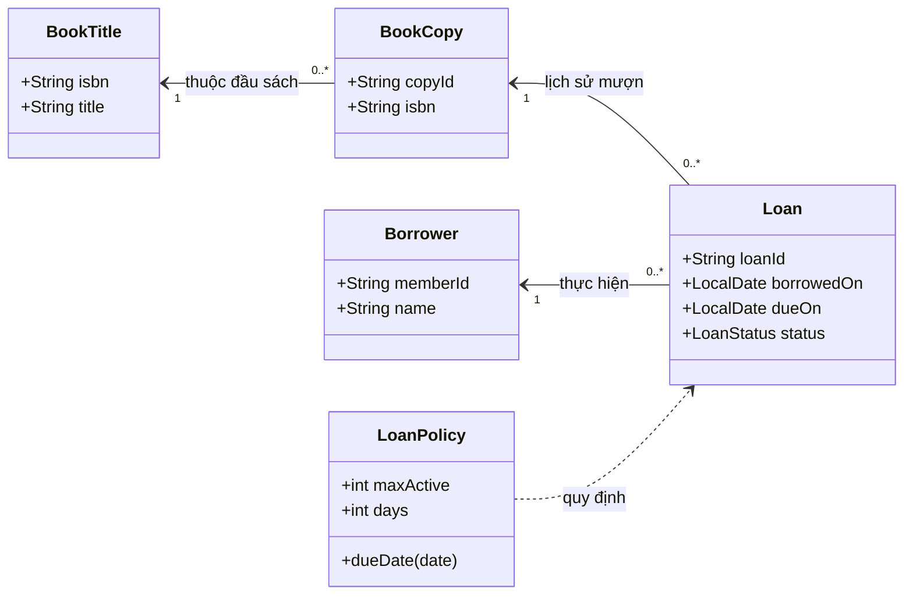

**Do not misread multiplicities:** `BookCopy 1 <-- 0..* Loan` does not mean a copy can be loaned to many people simultaneously. It is the **historical number of loans**. The “at most one active loan per copy” constraint must be enforced separately by business logic and, in persistent systems, appropriate transactional/data constraints.

In UML, the arrow direction indicates a navigability decision. Not every class needs a bidirectional collection. If one traversal direction serves the use case, other directions can be queried through a repository.

## 5. Assign Attributes and Behavior to the Right Owner

Finding classes does not mean making every field public. Decide which class **knows** each fact, which class **may change it**, and which rules must hold throughout its lifecycle.

| Object | Meaningful data | Behavior or invariant |
| --- | --- | --- |
| `Borrower` | `memberId`, `name` | Valid ID; member status may be added if required |
| `BookTitle` | ISBN, title | Validate ISBN/metadata where requirements demand it |
| `BookCopy` | `copyId`, book-title ID | Nonblank copy ID; independent of copies sharing its title |
| `Loan` | Loan ID, borrower ID, copy ID, start and due dates | Due date after start date; valid state transitions |
| `LoanPolicy` | Loan-count limit, duration in days | Reject limit violations; calculate due dates |
| `BorrowingService` | Repository, policy, clock, ID generator | Coordinate eligibility checks, loan creation, persistence |
| `LoanRepository` | Interface need not hold state | Query active loans, count loans per borrower, and save |

**Information Expert principle:** place behavior where the information it needs is held. `Loan` knows its start and due dates and can enforce date ordering; `LoanPolicy` defines permitted terms. `BorrowingService` coordinates several components but should not duplicate date calculations in multiple places.

## 6. Complete Java 17 Example: Turning Requirements into an Object Model

To focus on object identification, the example is an **in-memory book-lending program**. Each valid borrow creates a `Loan`; the demo `LoanRepository` retains only active loans and does not yet implement returns or history. Borrowers, copies, policies, and loans own distinct responsibilities; the service coordinates them.

Create `IdentifyObjectsDemo.java`:

```java
import java.time.Clock;
import java.time.Instant;
import java.time.LocalDate;
import java.time.ZoneOffset;
import java.util.LinkedHashMap;
import java.util.Map;
import java.util.Objects;
import java.util.concurrent.atomic.AtomicInteger;

public class IdentifyObjectsDemo {

    private static String required(String value, String label) {
        if (value == null || value.isBlank()) {
            throw new IllegalArgumentException(label + " must not be blank");
        }
        return value;
    }

    // Entity ứng viên: có mã thành viên riêng.
    record Borrower(String memberId, String name) {
        Borrower {
            memberId = required(memberId, "memberId");
            name = required(name, "name");
        }
    }

    // Entity ứng viên: từng bản sách có mã độc lập với đầu sách.
    record BookCopy(String copyId, String title) {
        BookCopy {
            copyId = required(copyId, "copyId");
            title = required(title, "title");
        }
    }

    // Một lượt mượn có danh tính và ngày tháng riêng.
    record Loan(String loanId, String memberId, String copyId,
                LocalDate borrowedOn, LocalDate dueOn) {
        Loan {
            loanId = required(loanId, "loanId");
            memberId = required(memberId, "memberId");
            copyId = required(copyId, "copyId");
            Objects.requireNonNull(borrowedOn, "borrowedOn");
            Objects.requireNonNull(dueOn, "dueOn");
            if (!dueOn.isAfter(borrowedOn)) {
                throw new IllegalArgumentException(
                        "Due date must be after borrowed date");
            }
        }
    }

    // Domain policy: số lượt cho phép và thời hạn.
    record LoanPolicy(int maxActiveLoans, int loanDays) {
        LoanPolicy {
            if (maxActiveLoans <= 0 || loanDays <= 0) {
                throw new IllegalArgumentException("Policy must be positive");
            }
        }

        void ensureAllowed(int activeCount) {
            if (activeCount >= maxActiveLoans) {
                throw new IllegalStateException("Borrow limit reached");
            }
        }

        LocalDate dueDate(LocalDate borrowedOn) {
            return borrowedOn.plusDays(loanDays);
        }
    }

    // Port: service biết hợp đồng, không biết SQL/JPA.
    interface LoanRepository {
        boolean isCopyBorrowed(String copyId);
        int activeCount(String memberId);
        void save(Loan loan);
    }

    // Adapter trong bộ nhớ; dùng để minh họa và unit test tuần tự.
    static final class InMemoryLoanRepository implements LoanRepository {
        private final Map<String, Loan> activeByCopy = new LinkedHashMap<>();

        @Override
        public boolean isCopyBorrowed(String copyId) {
            return activeByCopy.containsKey(copyId);
        }

        @Override
        public int activeCount(String memberId) {
            int count = 0;
            for (Loan loan : activeByCopy.values()) {
                if (loan.memberId().equals(memberId)) count++;
            }
            return count;
        }

        @Override
        public void save(Loan loan) {
            Objects.requireNonNull(loan, "loan");
            if (activeByCopy.putIfAbsent(loan.copyId(), loan) != null) {
                throw new IllegalStateException(
                        "Copy " + loan.copyId() + " is already borrowed");
            }
        }
    }

    interface LoanIdSource {
        String nextLoanId();
    }

    // Application service: thực hiện trình tự của use case.
    static final class BorrowingService {
        private final LoanRepository loans;
        private final LoanPolicy policy;
        private final Clock clock;
        private final LoanIdSource ids;

        BorrowingService(LoanRepository loans, LoanPolicy policy,
                         Clock clock, LoanIdSource ids) {
            this.loans = Objects.requireNonNull(loans);
            this.policy = Objects.requireNonNull(policy);
            this.clock = Objects.requireNonNull(clock);
            this.ids = Objects.requireNonNull(ids);
        }

        Loan borrow(Borrower borrower, BookCopy copy) {
            Objects.requireNonNull(borrower, "borrower");
            Objects.requireNonNull(copy, "copy");

            if (loans.isCopyBorrowed(copy.copyId())) {
                throw new IllegalStateException(
                        "Copy " + copy.copyId() + " is already borrowed");
            }

            policy.ensureAllowed(loans.activeCount(borrower.memberId()));

            LocalDate today = LocalDate.now(clock);
            Loan loan = new Loan(
                    ids.nextLoanId(),
                    borrower.memberId(),
                    copy.copyId(),
                    today,
                    policy.dueDate(today));

            loans.save(loan);
            return loan;
        }
    }

    public static void main(String[] args) {
        Borrower an = new Borrower("MEM-01", "An");
        Borrower binh = new Borrower("MEM-02", "Binh");
        BookCopy copy1 = new BookCopy("COPY-01", "OOP Java");
        BookCopy copy2 = new BookCopy("COPY-02", "SQL");
        BookCopy copy3 = new BookCopy("COPY-03", "Algorithms");

        InMemoryLoanRepository repo = new InMemoryLoanRepository();
        LoanPolicy policy = new LoanPolicy(2, 14);
        Clock clock = Clock.fixed(
                Instant.parse("2026-10-15T00:00:00Z"),
                ZoneOffset.UTC);
        AtomicInteger seq = new AtomicInteger();
        LoanIdSource ids = () -> "LOAN-" + seq.incrementAndGet();

        BorrowingService service =
                new BorrowingService(repo, policy, clock, ids);

        Loan first = service.borrow(an, copy1);
        System.out.println(
                "Loan: " + first.loanId() + ", due " + first.dueOn());

        try {
            service.borrow(binh, copy1);
        } catch (IllegalStateException ex) {
            System.out.println(ex.getMessage());
        }

        service.borrow(an, copy2);
        System.out.println("Active of An: " + repo.activeCount(an.memberId()));

        try {
            service.borrow(an, copy3);
        } catch (IllegalStateException ex) {
            System.out.println(ex.getMessage());
        }
    }
}
```

Run:

```bash
javac IdentifyObjectsDemo.java
java IdentifyObjectsDemo
```

Expected output:

```text
Loan: LOAN-1, due 2026-10-29
Copy COPY-01 is already borrowed
Active of An: 2
Borrow limit reached
```

### Trace the Example Back to Requirements

| Requirement statement | Code component | Evidence |
| --- | --- | --- |
| Member has ID and name | `Borrower` | `record Borrower(memberId, name)` |
| Each copy has its own ID | `BookCopy` | `copyId` identifies the copy |
| System records a loan | `Loan` | Includes `loanId`, borrower, copy, and dates |
| One copy cannot be loaned twice at once | `LoanRepository`, `BorrowingService` | Check active status; `putIfAbsent` rejects duplication |
| At most two copies | `LoanPolicy` | `ensureAllowed(activeCount)` |
| Due 14 days later | `LoanPolicy` | `borrowedOn.plusDays(loanDays)` |
| Loan workflow requires several components | `BorrowingService` | Validate, construct Loan, persist |
| DB/time source should be replaceable | `LoanRepository`, `Clock` | Inject dependencies into the service |

The demo uses `record` for brevity and immutable data. **Entities need not be records**; they may require classes with state-transition methods when returns, renewals, lost copies, or cancellations are added. Here `Loan` has domain identity even though it is implemented as an immutable record.

**Technical limitation:** this example executes sequentially. Two concurrent requests may each see remaining borrower quota and both invoke `save`, exceeding the total limit; `LinkedHashMap` is not thread-safe either. Production requires appropriate transactions/locking or other atomicity mechanisms, validation that borrower/copy IDs actually exist, history retention on return, and database constraints preventing two active loans for a copy. **A good object model enables correctness but does not itself provide concurrency control.**

## 7. Simulate Collaboration to Validate the Model

After proposing classes, **walk through the use case on paper**. If no one can explain who owns a step or the design needs arbitrary access to others' data, the model is not ready.

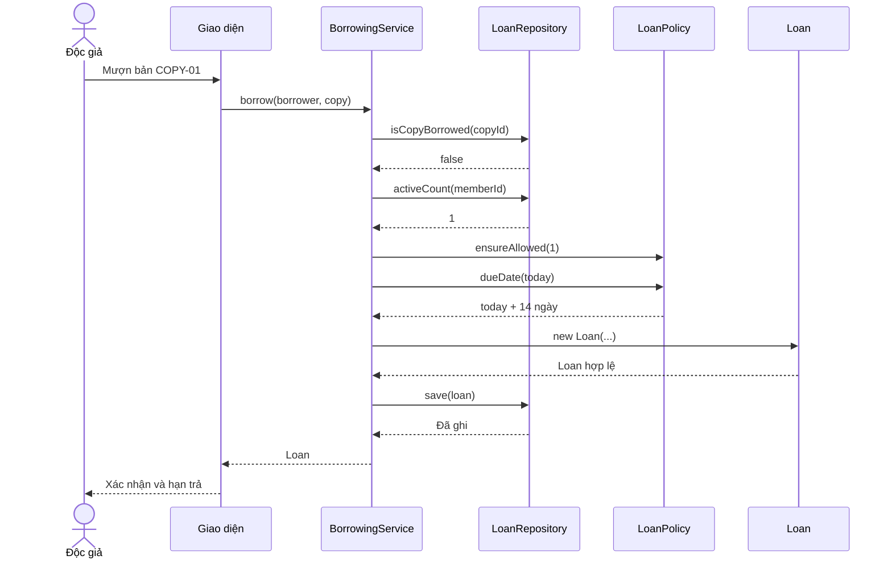

This is a **successful path**. Also simulate failures: copy already on loan, borrower at limit, invalid input, or database save failure. Each path needs an accountable component and must not leave inconsistent state.

Do not let the UI override `LoanPolicy` and allow 3 copies. A UI may precheck to provide feedback, but authorized domain code must enforce the rule.

## 8. Signs of Incorrect Class Identification

### 8.1 Turning Every Noun into a Class

Words such as “borrow date,” “name,” and “quantity” often denote fields or familiar value types (`LocalDate`, `String`, `int`). Introduce domain-specific types only for **meaningful rules or semantics**, such as `MembershipId` with special formatting or `Money` with currency and operations.

### 8.2 Turning Every Verb into a Service Class

It is possible to create `AddItemService`, `SetDueDateService`, or `ChangeStatusService` for each tiny action, but if behavior belongs to an entity's state and invariants, an entity method is clearer. `Loan.extendDueDate(...)` may express an intrinsic renewal rule better, while `RenewalService` helps when renewal must coordinate inventory, accounts, and external policy.

### 8.3 Combining Concepts with Different Lifecycles

Combining “book title” and “copy” loses per-copy inventory and condition. Combining “borrower” and “loan” complicates history, renewal, and returns. Compare the **identity, lifetime, and reasons for change** of each concept.

### 8.4 Confusing Actors or Roles with Domain Objects

“Librarian” is a use-case actor. An entity `StaffMember` may be justified if staff schedules, identity, and permissions are in scope. But “staff clicks Search” alone does not justify a domain class `Librarian`. System roles and the internal domain model serve different scopes.

### 8.5 Making `System`, `Manager`, or `Helper` Responsible for Everything

A `LibrarySystem` that handles ISBN data, schedules, fees, and email is often a God Object. Ask which concept owns the information each action requires. A coordinating service may work with many components but should not own every internal domain rule.

### 8.6 Prematurely Designing Around Tables or Screens

A DB table with many columns is not necessarily one domain object. A “Member Details and Loan History” screen may aggregate data from several entities. Model the domain using **identity, behavior, and invariants** before deciding tables, screens, and DTOs.

## 9. Validate Candidates with a Brief CRC Exercise

After identifying candidate classes, try a **Class–Responsibilities–Collaborators (CRC)** pass: each candidate must own a distinct obligation and know only its necessary collaborators.

- `Borrower`: member identity; need not know inventory.
- `BookCopy`: physical copy identity; does not decide borrower loan limits.
- `Loan`: a lending event with dates, identity, and lifecycle.
- `LoanPolicy`: limits and due-date rules.
- `BorrowingService`: coordinates policy, repository, clock, and ID source.

Try **returning and reborrowing a copy**: which class closes the prior loan, protects availability, and retains history? If removing a candidate loses no concept or responsibility, it may only need to be a field or method.

This only *validates the discovered candidates*; the lesson **CRC cards: classes, responsibilities, and collaborators** covers full CRC card writing and collaboration role-play.

## 10. When New Requirements Change the Model

No model is fixed after the first reading. For example:

**New requirement: “Allow reservations while a copy is on loan.”** A `Reservation` concept emerges with queue position and status. Avoid storing the entire waitlist as a `nextBorrowerId` field on `BookCopy` if reservations have their own lifecycle.

**New requirement: “Renew at most twice, unless another member has reserved the copy.”** `Loan` may need `renewalCount` and renewal behavior; checking the queue requires `ReservationRepository`/policy data, not necessarily all queries inside the entity.

**New requirement: “Each copy has a history of repairs.”** A `MaintenanceRecord` with dates, costs, and defect categories may be required; a single `lastRepairDate` field cannot preserve historical records.

**New requirement: “Returns may incur a fine.”** `Fine` could be a monetary value object, a payment-obligation entity, or a temporary calculation result, depending on payment/refund tracking. The word “fine” alone is insufficient; ask about identity, status, and lifecycle.

| Requirement change | Signal of a new object | Question to ask |
| --- | --- | --- |
| Reserve a book | Waitlist entries with status and position | May a person reserve multiple times? When does a reservation expire? |
| Renew a loan | Loan has state changes/rules | Who may renew? Must renewal history be kept? |
| Repair a book copy | Dated events and per-repair costs | Are audits and multi-year queries required? |
| Fine | Amount, deadline, payment | Is this a calculated value or an ID-bearing debt? |
| Due-date reminder email | External/asynchronous operation | What triggers it? How do retry and idempotency work? |

Object identification is **iterative as domain understanding evolves**: use case → candidate classes → simulate collaboration → clarify questions → revise the model.

## 11. An Immediately Usable Analysis Workflow

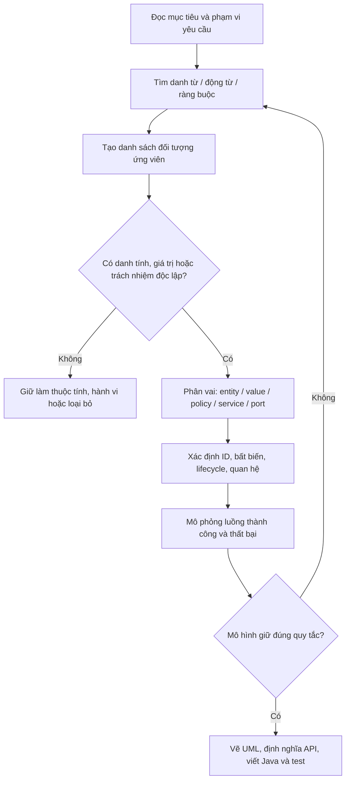

During a real analysis session:

1. **Preserve the user's own wording.** Do not immediately translate domain language into technical terms such as “table,” “controller,” or “service.”
2. **List candidates with reasons.** Every proposed class should have one sentence explaining why it exists.
3. **Identify ambiguous terms.** Does “book” mean title or physical copy? Does “registration” mean an account or an enrollment in a course?
4. **Try contrasting scenarios.** One borrower takes two copies; two borrowers want one copy; a copy is returned and borrowed again.
5. **Choose the source of truth.** Is “on loan” derived from active loans or stored as a separate flag? If both, who keeps them consistent?
6. **Only then select Java types.** Consider `record`, classes, enums, interfaces, `List`, `Map`, repositories, and DTOs.
7. **Derive tests from requirements.** Name tests after policy, such as `cannotBorrowCopyAlreadyOnLoan`, not merely `testGetter`.

A good model need not contain many classes. It must capture the **important domain objects** with clear places to put behavior and constraints.

## 12. Questions for Requirements Stakeholders

When the model is unclear, ask questions that could alter its design:

- “Can a title have multiple independent physical copies? Is every copy ID globally unique?”
- “Must returned loans remain stored for historical lookup?”
- “Are loans of the same copy on different dates separate records or updates to the old loan?”
- “Does the two-copy limit apply to every member type or vary by group?”
- “Does a 14-day term mean calendar days, business days, or an exact elapsed duration?”
- “Can lost, damaged, or maintenance states make a copy unavailable despite no active loan?”
- “When two borrowing requests arrive together, what must be guaranteed by the database?”

These questions establish whether `BookCopy`, `Loan`, `LoanPolicy`, `CopyStatus`, and `Reservation` should remain separate concepts. Do not turn every “unknown” into a speculative abstraction.

## 13. Practice Exercises

### Exercise 1 — Cinema Ticketing

Requirement: “A moviegoer selects a screening and two available seats, pays, and receives tickets. One seat at a screening cannot be sold twice. A ticket has a QR code.”

Extract nouns, verbs, and constraints, then propose candidate classes. Distinguish `Movie` (film), `Screening` (showtime), `Seat` (physical seat), `SeatReservation` (per-screening reservation), and `Ticket` (ticket) when they have distinct lifecycles. Explain why “seat A5” cannot be permanently marked sold for every screening.

### Exercise 2 — Shopping Cart

Requirement: “Customers add products to carts, change quantities, view totals, and apply discount codes.”

Identify candidates `Cart`, `CartLine`, `Product`, `Money`, and `DiscountPolicy`. Explain when a “discount code” should be a `String`, value object, or separate entity. Define at least three `Cart` invariants.

### Exercise 3 — Course Management

Requirement: “Students enroll in multiple course sections; each section has at most 30 students, and no student can enroll twice in the same section.”

Identify `Student`, `Course`, `Section`, and `Enrollment`; decide whether `Course` and `Section` must be separate. Draw UML multiplicities and explain where the “at most 30” rule is enforced under concurrent enrollment.

### Exercise 4 — Critique a Class List

Someone proposes: `Library`, `Name`, `Borrow`, `Check`, `Date`, `Database`, `Screen`, `Book`, `Loan`.

Classify domain classes with justification, actions, attributes/standard value types, technical adapters, and candidates lacking sufficient information. Explain using **identity, responsibility, and lifecycle**, not merely “this is a noun.”

### Exercise 5 — Extend the Java Demo

Add `returnCopy(copyId, date)` while preserving history, preventing a loan from being returned twice, and allowing the same copy to be borrowed again after return. Decide whether `Loan` becomes a stateful entity or history gets a separate record; update the repository and test borrow → return → borrow again.

## 14. Checklist Before Finalizing the Model

| Question | Ready when |
| --- | --- |
| Does every candidate represent a distinct domain concept? | Its responsibility or identity is clear in one sentence |
| Have similar-sounding concepts with different lifecycles been separated? | Titles, physical copies, and loans are distinguished |
| Have mere words, properties, and actions been filtered out? | No meaningless empty classes |
| Are entities distinguished from value objects? | ID-based versus value-based equality is understood |
| Are invariants identified and assigned to enforcers? | “At most one active loan” has a clear enforcement point |
| Are relationships and multiplicities correct at both ends? | Counterexamples separate historical from current state |
| Is behavior placed where the information exists? | Entities protect invariants, policies encode rules, services coordinate |
| Is the model unnecessarily tied to HTTP/DB/UI? | Core logic is testable without starting external technologies |
| Can it handle errors and concurrency? | Transaction and constraint responsibilities are known |
| Can each requirement be traced to code/tests? | No rule disappears after implementation |

**Remember:** noun extraction is only **a starting point**. Appropriate objects have domain reasons for existing, corresponding data and behavior, clear relationships, and protected invariants. Simulate real scenarios and refine the model before writing large amounts of code.


</details>

- [Back to top](#back-to-top)

---

## <a id="modeling-003">Assigning responsibilities and collaborators</a>

<details>
<summary>View details</summary>

# Assigning Responsibilities and Collaborators in OOP Modeling

## 1. From Business Requirements to Collaborating Objects

Suppose you are developing a library system with this requirement:

> A member may borrow a book if the account is active, the loan limit has not been reached, and the copy is available. When borrowing, the system creates a loan with a due date. When returning, the loan closes, the copy becomes available again, and the member's active-loan count decreases.

One approach is to put every check and operation into a huge `LibraryService`. But when policies change, all parts of the service must understand `Member`, `BookCopy`, and `Loan` state. A better object-oriented model identifies:

- **Responsibility:** what must an object *know* and *do* to fulfill its role?
- **Collaborator:** which object provides information or behavior that lets another fulfill its responsibilities?
- **Boundary:** which invariants belong to one object, and which operations coordinate several objects?
- **Contract:** which calls, inputs, outputs, and error representations are expected from collaborators?

A good model does not require every class to do everything independently. It gives each responsibility **a clear owner** and enables meaningful collaboration through APIs.

### Two Kinds of Responsibility

| Kind | Question | Example |
|---|---|---|
| **Knowing** | Which data and relationships must the object know? | `BookCopy` knows its copy ID and whether it is available or already borrowed |
| **Doing** | Which action or rule does the object enforce? | `BookCopy.markBorrowed()` prevents borrowing a copy that is unavailable |

Objects often do both: `Member` tracks open loans and enforces limits; `Loan` knows its due date and permits closing a loan only once.

**Knowing data does not imply exposing every field for external modification.** Control state through meaningful behaviors rather than unrestricted public getters and setters.

## 2. Use CRC to Explore **Collaboration Flows**, Not Just Class Lists

A small CRC table helps identify “who asks whom” before drawing a sequence diagram:

| Class | Responsibility in borrow/return use cases | Collaborators |
|---|---|---|
| `Member` | Enforces borrowing eligibility and active-loan count | Need not know `BookCopy` |
| `BookCopy` | Enforces availability of one copy | Need not know `Member` quota |
| `Loan` | Controls a loan and the rule for closing it | References member/copy |
| `LendingService` | Coordinates those behaviors in the correct order | `Member`, `BookCopy`, `Loan`, `Clock` |

**Walkthrough:** the service asks the member to validate quota, asks the copy to confirm availability, creates a loan, and then updates state. If quota checking moves from `Member` to `BookCopy`, the copy must know unrelated data—a sign of misplaced responsibility.

The lesson **CRC cards: classes, responsibilities, and collaborators** covers detailed cards, role-play, and failure paths. Here the focus is **choosing the owner of each rule and designing calls among objects**.

## 3. Put Rules Where Their Data Is Owned

A rule that depends only on **one** object's state usually belongs in that object.

For example:

```java
// Kiểu thiết kế yếu: service tự đọc rồi sửa trạng thái của Member.
if (member.getActiveLoanCount() < member.getMaxLoans()) {
    member.setActiveLoanCount(
            member.getActiveLoanCount() + 1);
}
```

This design allows callers to bypass the limit, increment incorrect counts, or invoke setters at inappropriate times.

Instead:

```java
// API theo ý nghĩa nghiệp vụ:
member.recordBorrow();
```

`Member` checks the rule and performs the permitted change. When a rule is added that suspended accounts may not borrow, the modification point is clear.

Similarly, `BookCopy` should enforce “a copy cannot be marked borrowed twice before return,” while `Loan` should enforce “a loan cannot be closed twice.”

But **borrowing a book** affects the member, copy, and loan together. Do not force `Member` to access inventory databases directly just to complete the whole operation. A **coordinator object** is appropriate for collaboration.

## 4. Understand Relationships Through a UML Class Diagram

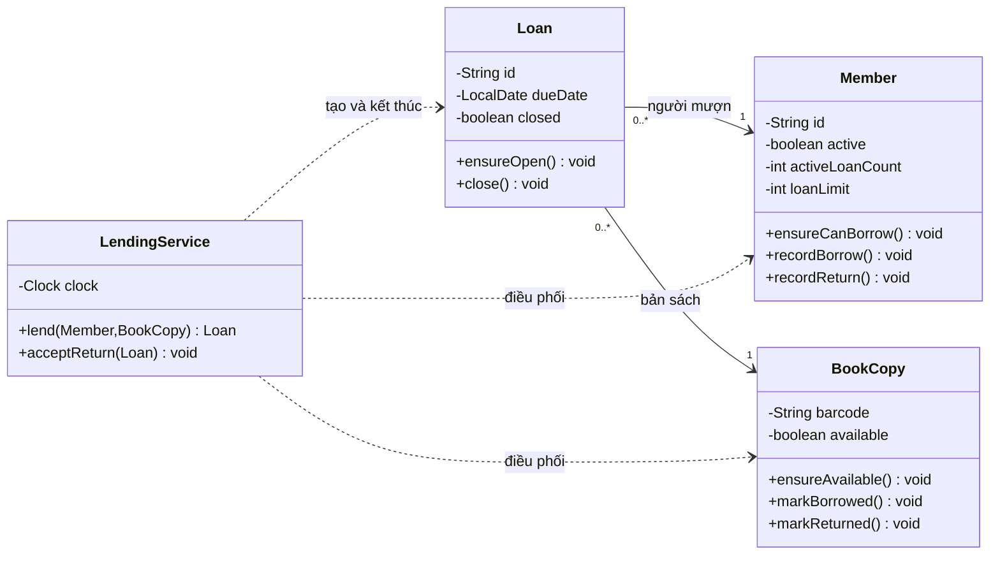

Read the diagram as follows:

- Each `Loan` is associated with exactly one `Member` and one `BookCopy`.
- A member or copy may appear on many loans **over time**. Availability is protected by state and invariants. Multiplicity `0..*` **does not** permit a copy to be borrowed concurrently more than once.
- `LendingService` receives objects and sends messages to them. A dashed dependency does not mean the service owns their lifecycles.
- `Clock` is a technical collaborator providing testable time, not a domain entity.

A **class diagram** shows who holds information and what methods exist. To validate actual collaboration, add a **sequence diagram**.

## 5. Sequence Diagrams: Each Object Performs Its Part

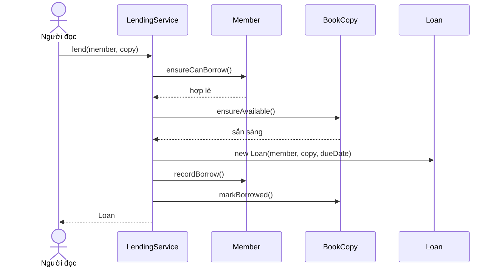

Each step has an owner. If `ensureCanBorrow()` rejects the request, the service stops without changing `BookCopy`. If `ensureAvailable()` rejects it, no loan is created.

The sequence diagram shows the **normal sequential in-memory flow**, not an atomic transaction across threads, processes, or databases. Production failures after state changes may require rollback or compensating actions, discussed later.

## 6. Runnable Java Example: Distinct Objects with Distinct Responsibilities

Save the complete code as `ResponsibilityDemo.java` (JDK 11+):

```java
import java.time.Clock;
import java.time.Instant;
import java.time.LocalDate;
import java.time.ZoneOffset;
import java.util.Objects;
import java.util.UUID;

public class ResponsibilityDemo {

    // Entity: biết và bảo vệ trạng thái mượn của thành viên.
    static final class Member {
        private final String id;
        private final int loanLimit;
        private boolean active;
        private int activeLoanCount;

        Member(String id, int loanLimit) {
            this.id = Objects.requireNonNull(id, "id");
            if (id.isBlank() || loanLimit < 1) {
                throw new IllegalArgumentException(
                        "Invalid member id or limit");
            }
            this.loanLimit = loanLimit;
            this.active = true;
        }

        void ensureCanBorrow() {
            if (!active) {
                throw new IllegalStateException("Member inactive");
            }
            if (activeLoanCount >= loanLimit) {
                throw new IllegalStateException("Loan limit reached");
            }
        }

        void recordBorrow() {
            ensureCanBorrow();
            activeLoanCount++;
        }

        void recordReturn() {
            if (activeLoanCount <= 0) {
                throw new IllegalStateException(
                        "No active loans to return");
            }
            activeLoanCount--;
        }

        int activeLoanCount() {
            return activeLoanCount;
        }

        void deactivate() {
            active = false;
        }
    }

    // Entity: một bản sách vật lý, có mã riêng.
    static final class BookCopy {
        private final String barcode;
        private boolean available = true;

        BookCopy(String barcode) {
            this.barcode = Objects.requireNonNull(
                    barcode, "barcode");
            if (barcode.isBlank()) {
                throw new IllegalArgumentException("Blank barcode");
            }
        }

        void ensureAvailable() {
            if (!available) {
                throw new IllegalStateException(
                        "Book copy is already on loan");
            }
        }

        void markBorrowed() {
            ensureAvailable();
            available = false;
        }

        void markReturned() {
            if (available) {
                throw new IllegalStateException(
                        "Book copy is not on loan");
            }
            available = true;
        }

        boolean isAvailable() {
            return available;
        }

        String barcode() {
            return barcode;
        }
    }

    // Entity: thông tin và vòng đời một lần mượn cụ thể.
    static final class Loan {
        private final String id;
        private final Member borrower;
        private final BookCopy copy;
        private final LocalDate dueDate;
        private boolean closed;

        Loan(String id, Member borrower, BookCopy copy,
             LocalDate dueDate) {
            this.id = Objects.requireNonNull(id, "id");
            this.borrower = Objects.requireNonNull(
                    borrower, "borrower");
            this.copy = Objects.requireNonNull(copy, "copy");
            this.dueDate = Objects.requireNonNull(
                    dueDate, "dueDate");
        }

        Member borrower() {
            return borrower;
        }

        BookCopy copy() {
            return copy;
        }

        LocalDate dueDate() {
            return dueDate;
        }

        void ensureOpen() {
            if (closed) {
                throw new IllegalStateException("Loan already closed");
            }
        }

        void close() {
            ensureOpen();
            closed = true;
        }

        boolean isClosed() {
            return closed;
        }
    }

    // Coordinator: không tự sửa các field riêng tư của entity.
    static final class LendingService {
        private final Clock clock;
        private final int loanDays;

        LendingService(Clock clock, int loanDays) {
            this.clock = Objects.requireNonNull(clock, "clock");
            if (loanDays < 1) {
                throw new IllegalArgumentException(
                        "loanDays must be positive");
            }
            this.loanDays = loanDays;
        }

        Loan lend(Member member, BookCopy copy) {
            Objects.requireNonNull(member, "member");
            Objects.requireNonNull(copy, "copy");

            // Kiểm tra trước khi bắt đầu thay đổi trạng thái.
            member.ensureCanBorrow();
            copy.ensureAvailable();

            Loan loan = new Loan(
                    UUID.randomUUID().toString(),
                    member,
                    copy,
                    LocalDate.now(clock).plusDays(loanDays));

            member.recordBorrow();
            copy.markBorrowed();
            return loan;
        }

        void acceptReturn(Loan loan) {
            Objects.requireNonNull(loan, "loan");
            loan.ensureOpen();

            loan.copy().markReturned();
            loan.borrower().recordReturn();
            loan.close();
        }
    }

    public static void main(String[] args) {
        Clock testClock = Clock.fixed(
                Instant.parse("2026-10-15T00:00:00Z"),
                ZoneOffset.UTC);

        Member lan = new Member("MEM-01", 1);
        BookCopy bookA = new BookCopy("COPY-A");
        BookCopy bookB = new BookCopy("COPY-B");
        LendingService lending = new LendingService(testClock, 14);

        Loan first = lending.lend(lan, bookA);
        System.out.println("Due: " + first.dueDate());
        System.out.println("Active loans: "
                + lan.activeLoanCount());
        System.out.println("Book A available: "
                + bookA.isAvailable());

        try {
            lending.lend(lan, bookB);
            throw new AssertionError(
                    "Expected loan-limit rejection");
        } catch (IllegalStateException expected) {
            System.out.println("Rejected: " + expected.getMessage());
        }

        System.out.println("Book B still available: "
                + bookB.isAvailable());

        lending.acceptReturn(first);
        System.out.println("After return, active loans: "
                + lan.activeLoanCount());

        Loan second = lending.lend(lan, bookB);
        System.out.println("Second loan due: "
                + second.dueDate());

        if (!first.isClosed() || bookB.isAvailable()
                || lan.activeLoanCount() != 1) {
            throw new AssertionError("State invariant failed");
        }
        System.out.println("State checks passed");
    }
}
```

Compile and run:

```bash
javac ResponsibilityDemo.java
java ResponsibilityDemo
```

Expected output:

```text
Due: 2026-10-29
Active loans: 1
Book A available: false
Rejected: Loan limit reached
Book B still available: true
After return, active loans: 0
Second loan due: 2026-10-29
State checks passed
```

### Noteworthy Design Decisions

**`Member` is the sole enforcer of the borrowing limit.** If the policy changes from one to three books, or members with outstanding fees must be blocked, that logic belongs in the member or its collaborating domain policy. `LendingService` does not read and compare `activeLoanCount` and `loanLimit` itself.

**`BookCopy` controls its own availability state.** Even if the service wants to lend it, the copy may reject `markBorrowed()` when unavailable. The service cannot simply set `available=false` through a public setter.

**`Loan` owns the loan's identity and due date.** Another `Loan` may refer to the same `BookCopy` historically, but only one active loan may occupy it at a given time.

**`LendingService` coordinates the steps.** It does not independently calculate a member's remaining quota or the copy's availability. It needs to know *whom to call* and *when*, not internal field layouts. An injected `Clock` makes due dates testable without using the system clock.

**This is a single-threaded domain-model demo.** The state changes `member.recordBorrow()` and `copy.markBorrowed()` are separate operations without a transaction or lock. Therefore the example is **unsafe for concurrent borrowing across threads/processes** and does not guarantee atomicity with a DB or failures between steps. Production requires transactions, data constraints, locking/optimistic concurrency strategies, and suitable notification timing.

## 7. Selecting Collaborators with GRASP

**GRASP** (*General Responsibility Assignment Software Patterns*) offers principles for deciding “who should own this responsibility?” Not every pattern needs a separate class, but these questions help with modeling.

| Principle | Question | Library application |
|---|---|---|
| **Information Expert** | Who owns the information needed to enforce the rule? | `Member` knows quota; `BookCopy` knows availability |
| **Creator** | Who should create an object because it has the necessary data/relationships? | Use case `LendingService` builds a `Loan` from the member, copy, and due date |
| **Controller** | Who receives a system/use-case event and coordinates it? | `LendingService.lend(...)` coordinates borrowing |
| **Low Coupling** | Can a class avoid knowing unrelated internals of others? | Service invokes named behavior rather than mutating fields |
| **High Cohesion** | Are a class's responsibilities focused and explainable? | `BookCopy` protects one copy's state |
| **Polymorphism** | Can behavior variants use one role-based contract? | Overdue-fee strategies may implement `LateFeePolicy` |
| **Indirection** | Is an intermediary needed to decouple tightly linked sides? | A notification port separates the domain from SMTP/HTTP |
| **Pure Fabrication** | Is there a technical responsibility that naturally belongs to no entity? | `LoanRepository` persists and loads loans |
| **Protected Variations** | Which changes should be hidden behind a stable contract? | `NotificationSender` abstracts email/SMS |

One GRASP principle does not always maximize another. It is fine for `LendingService` to have several collaborators because coordination inherently needs multiple objects; low coupling does not mean a service can know only one class.

## 8. Collaborate Through Behavior Instead of Fetching Data to Decide for Others

Compare two ways to verify borrowing eligibility.

**Approach A: service reads fields and decides for itself.**

```java
// Minh họa anti-pattern.
if (member.isActive()
        && member.getActiveLoanCount()
           < member.getLoanLimit()) {
    member.setActiveLoanCount(
            member.getActiveLoanCount() + 1);
}
```

This disperses logic: any controller or service can forget a condition.

**Approach B: delegate the rule to its owner.**

```java
member.recordBorrow();
```

A behavior-oriented API protects the rule within `Member`.

Sometimes a service digs too deeply:

```java
long fee = loan.getBorrower()
               .getMembershipPlan()
               .getLateFeePerDay()
           * overdueDays;
```

Instead, ask a responsible object to perform `loan.calculateLateFee(overdueDays)` or provide suitable data to a `LateFeePolicy`; callers then need not understand every layer of the object graph. This reflects the **Law of Demeter** and **Tell, Don't Ask**.

This does not prohibit getters entirely. Display DTOs, query data, immutable value objects, and fluent APIs can expose readable structure. Avoid **callers duplicating and owning rules that belong to another object**.

## 9. When Does Responsibility Belong to a Service Rather Than an Entity?

Put behavior into an entity or value object when its rule is **tightly coupled to that object's state and invariants**:

- `BookCopy.markBorrowed()` rejects borrowing when already loaned;
- `Member.recordBorrow()` prevents exceeding quota;
- `Loan.close()` prevents closing twice;
- `Money.plus()` rejects adding different currencies.

Use a **domain service** when behavior has clear domain meaning but **does not naturally belong to one object**. Examples include scheduling shifts across several employees or applying a fee policy to multiple member types.

Use an **application service/use-case controller** when the primary responsibility is coordination:

- check caller permissions;
- load entities from repositories;
- begin a transaction;
- ask domain objects to enforce rules;
- persist results, emit events, or coordinate notifications.

In this simple lending example, `LendingService` combines coordination in one class to make collaboration visible. A database-backed layered application may split `LendBookApplicationService` (load/save/transaction) from suitable domain logic. **Do not force the split** before the complexity justifies it.

## 10. Identify Stable Collaborators and Boundary Dependencies

Services often need infrastructure collaborators such as repositories, clocks, and notification senders. Domain entities should not need to know SQL, HTTP, or email construction.

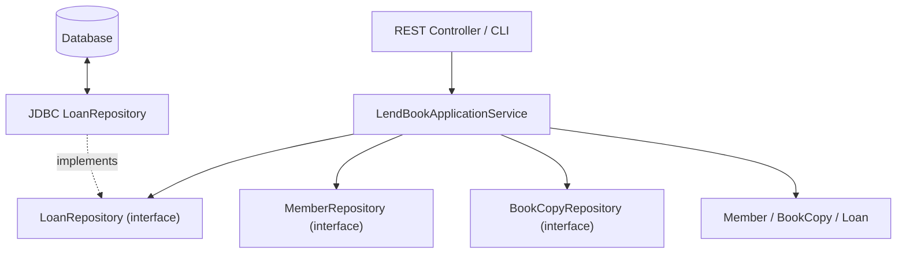

A repository contract could be:

```java
interface LoanRepository {
    void save(Loan loan);
    java.util.Optional<Loan> findById(String loanId);
}

interface BookCopyRepository {
    BookCopy getByBarcode(String barcode);
    void save(BookCopy copy);
}
```

This is an **interface sketch**, assuming `Loan` and `BookCopy` belong to the same domain or are properly imported. Entities need not hold database connections; application/infrastructure layers can supply collaborators through constructors.

**Dependency injection** makes adapters replaceable and tests easier to isolate. But do not introduce an interface for every class from the beginning: `Member`, `BookCopy`, and stable value objects can be used directly. Interfaces are valuable where alternative implementations exist or infrastructure boundaries must be isolated.

## 11. Transactions: Correct Collaboration Still Requires Consistency

Imagine a real application's lending workflow:

1. Load `Member` and `BookCopy` from the database.
2. Check lending eligibility.
3. Create a `Loan` record.
4. Update active-loan count and copy status.
5. Commit the transaction.
6. Notify the member.

Another process may fetch the same `BookCopy` between checks and commit, with both believing it available (a *race condition*).

A complete application design must address:

| Risk | Mitigation to consider |
|---|---|
| Two requests borrow the same copy | Optimistic locking/versioning, suitable locks, conditional updates within a transaction |
| DB failure after some data has changed | Transaction commits or rolls back related updates together |
| Notification fails after DB commit | Post-commit outbox/events and controlled retries |
| User resends the same request | Idempotency key or domain constraints detecting duplicates |
| Loan is closed twice | Entity state protection plus relevant DB/concurrency constraints |
| Concurrent requests exceed borrower quota | Lock/version or conditional source-data update; recheck before commit |

**Avoid sending email inside a DB transaction if it holds locks too long.** DB-to-mail coordination often needs post-commit processing or an outbox. A coordinating controller must not bypass domain invariants by directly mutating state.

## 12. The Model Is Not a Copy of the Database

Many projects map every table to a class of getters/setters and put all business logic in `XYZService`. That may be adequate for simple CRUD, but a rule-rich domain becomes a collection of data bags without meaningful OOP collaboration.

Compare the approaches:

| Question | Table-driven design | Responsibility-driven design |
|---|---|---|
| Who enforces the borrowing limit? | Controller reads `member.limit` and counts loans | Domain behavior/policy protects quota with necessary data supplied by the application |
| Who permits returning a copy? | Service sets `available` and `returned` columns | Guarded `BookCopy.markReturned()` and `Loan.close()` |
| Who determines the due date? | Each caller adds days independently | One policy or coordinator uses `Clock` and due-date rules |
| Who accesses the database? | Entities open their own connections | Repositories/adapters are supplied at the application boundary |

Domain responsibilities may require data from multiple objects or DB queries. Use a suitable **domain policy/service** or **coordinator** rather than forcing every constraint into an entity without enough information.

## 13. Test the Design Against Change Scenarios

Which design adapts when requirements evolve?

**Requirement 1: Premium members may borrow more books.** If `Member` owns quota policy, the change belongs in the entity or a collaborating `BorrowingPolicy`. Avoid modifying each controller separately.

**Requirement 2: E-books have access rules different from physical copies.** Determine the real behavior differences. Introduce a `BorrowableItem` contract or policy if borrowing truly varies by resource type. Do not rush to subclass everything from `BookCopy`.

**Requirement 3: Send SMS instead of email.** If notifications use a `NotificationSender` port, replacing the adapter does not affect borrowing invariants.

**Requirement 4: Due dates vary by member category and holidays.** Extract `DueDatePolicy.calculate(member, copy, borrowedAt)` if appropriate and let the use case collaborate with that policy. A domain service/policy fits when the formula belongs to neither member nor copy alone.

**Requirement 5: Record an audit trail.** The domain may produce “LoanCreated” and “LoanReturned” events, while application logic persists or publishes them after the transaction. Do not make each entity open log files or call HTTP.

A useful change scenario **identifies the change location and necessary collaborators** instead of forcing every class to know more about the others.

## 14. Signs of Poor Responsibility Allocation

| Symptom | Common problem | Remedy to consider |
|---|---|---|
| `LibraryService` spans thousands of lines | Unrelated rules with different reasons to change are combined | Move invariants to entities/value objects; extract policies/use cases when meaningful |
| Entities expose only getters/setters | External logic can bypass domain invariants | Introduce guarded `borrow`, `return`, or `close` behavior |
| Class A calls `b.getC().getD().setX()` | A knows too much of collaborators' internal structure | Request behavior from a closer object or pass an appropriate value object/policy |
| Changing quota modifies many controllers | Rule is duplicated | Assign it to one explicit owner |
| Every class depends on DB/framework details | Domain logic is hard to test or run independently | Place repositories/adapters at boundaries |
| Two entities are updated separately with no transaction | Failures or races can leave inconsistent data | Define transaction boundaries, locking, and idempotency |
| Every small class has a matching interface | Unnecessary indirection/files obscure flows | Abstract only meaningful variation points and boundaries |
| An interface contains dozens of unrelated methods | Clients depend on unused capabilities | Split interfaces by collaboration roles |
| Multiple locations check and mutate one field | Rules lack ownership and become race-prone | Expose behavior that protects state and handle concurrency correctly |

## 15. Practice Exercises

### Exercise 1 – CRC Cards for Ticket Reservations

Requirement: a customer may reserve an available seat; events have capacity; successful reservations need IDs and confirmations.

Create CRC cards for `Customer`, `Seat`, `Reservation`, and `ReservationService`.

**Hints:**

- `Seat` owns the rule determining whether it can be reserved;
- `Reservation` records reservation identity and lifecycle;
- `ReservationService` coordinates the request;
- `Customer` knows customer-specific status or eligibility conditions if the domain requires them;
- a `NotificationSender` sends confirmations rather than making `Seat` send email.

### Exercise 2 – Who Owns the Rule?

In a commerce application, `Order` has a status and order lines. The service writes:

```java
if (!order.getStatus().equals("CANCELLED")) {
    order.getLines().add(line);
}
```

**Suggested answer:** `Order` should expose `addLine(...)` to protect its own status, quantity rules, pricing, and consistency. If external stock checks are needed, application/domain services collaborate with Inventory without directly modifying the order's internal collection.

### Exercise 3 – Sequence Diagram for a Failure Branch

In the library scenario, suppose `BookCopy.ensureAvailable()` throws `IllegalStateException`.

Draw the flow and identify which objects must remain unchanged. **Hint:** The service stops before constructing Loan or making either state mutation, so `Member.activeLoanCount` and `BookCopy.available` remain unchanged in the sequential flow.

### Exercise 4 – Extend the Program

In `ResponsibilityDemo.java`, add `Member.deactivate()` and then try to borrow an otherwise available copy.

Verify:

```java
Member blocked = new Member("MEM-02", 2);
blocked.deactivate();
BookCopy free = new BookCopy("COPY-Z");

try {
    lending.lend(blocked, free);
    throw new AssertionError("Expected inactive member rejection");
} catch (IllegalStateException expected) {
    // Đã bị từ chối tại Member.
}

if (!free.isAvailable() || blocked.activeLoanCount() != 0) {
    throw new AssertionError("Rejected request changed state");
}
```

Place the code inside the example's `main`, after creating the `lending` variable. Verify that **Member owns the rejection logic** and the service only invokes its contract.

### Exercise 5 – When Is Another Service Unnecessary?

A `Money` value object has an amount and currency. Should adding two Money values of the same currency belong to `Money.plus(other)` or `MoneyAdditionService.add(a, b)`?

**Hint:** Addition and currency checks naturally belong to Money, making `plus` clearer in most cases. A service fits when policy, exchange rates, or data outside one Money object are involved.

---

**Key takeaway:** class design extends beyond turning nouns into classes. **Assign responsibility to the object that owns the information and invariants**, identify the **minimal necessary collaborators**, and describe cooperation through messages, contracts, and sequence diagrams. Changes then tend to stay localized, code is easier to test, and classes remain focused.


</details>

- [Back to top](#back-to-top)

---

## <a id="modeling-004">CRC cards: classes, responsibilities, and collaborators</a>

<details>
<summary>View details</summary>

# CRC Cards: Classes, Responsibilities, and Collaborators in OOP Modeling

**CRC** cards (*Class–Responsibilities–Collaborators*) are an object-oriented analysis technique: each card identifies **which class**, **what it is responsible for**, and **which classes it collaborates with**. By arranging cards and role-playing business scenarios, teams discover missing, duplicated, or misplaced responsibilities before committing to code.

CRC is especially useful when user requirements have not yet been divided into Java classes. It addresses three recurring questions:

1. **Class:** Which concepts or roles genuinely need modeling?
2. **Responsibilities:** What must each class know or do to uphold business rules?
3. **Collaborators:** When a class lacks information to complete a task, which other class should it ask for help?

CRC explores **responsibilities and collaboration** rather than specifying every field, constructor, or method signature. Once responsibilities are stable, design the appropriate APIs, UML, and code.

## 1. Anatomy of a CRC Card

Each card has three sections:

```text
+-----------------------------------------------------+
| CLASS: Workshop                                     |
+-----------------------------+-----------------------+
| RESPONSIBILITIES            | COLLABORATORS         |
| - Biết mã lớp và sức chứa    | - Student             |
| - Quản lý người đã đăng ký   | - Enrollment          |
| - Chặn đăng ký trùng         |                       |
| - Chặn vượt sức chứa         |                       |
| - Cho hủy đăng ký hợp lệ     |                       |
+-----------------------------+-----------------------+
```

**Class:** a name expressing a specific contextual concept, such as `Workshop` or `Enrollment`, rather than `DataManager` or `Helper`.

**Responsibilities:** describe the class's **obligations** and **outcomes** in business terms: “reject duplicate registrations,” “enforce capacity,” or “calculate the due date.” Avoid only listing “has `setX`,” which is an implementation detail, not a responsibility.

**Collaborators:** classes it genuinely needs to communicate with—not every class in the project. A class with no collaborators may be perfectly valid, such as a value object validating itself.

| Card section | Review question | Warning sign |
| --- | --- | --- |
| Class | Is its role distinct and clearly different from other concepts? | `EverythingService`, `GeneralUtils` |
| Responsibilities | What business knowledge or behavior does it own? | Only getters/setters are listed |
| Collaborators | Who supplies information or performs other tasks? | Every class in the system is listed |
| Boundary | Which class should change first if this rule changes? | Same rule belongs to three classes |

CRC cards can be written on paper, whiteboards, Markdown, or design tools. Their physical form is secondary; **discussion and validation of responsibilities** provide the value.

## 2. A Practical Scenario for Building Cards

Scenario: “A training center runs workshops. Students choose a uniquely coded workshop to register for. Each workshop has limited seats. A student may register **only once** in a workshop. After valid registration, the system stores enrollment, records the registration date, and sends a notification. Students may withdraw to release seats.”

Capture at least these cases:

- **Success flow:** An registers for a Java workshop with available seats.
- **Duplicate registration:** An attempts to register again and is rejected.
- **Full workshop:** Chi requests a full workshop; reject without creating enrollment.
- **Withdrawal:** An enrolled student withdraws, increasing available seats.
- **Notification failure:** Enrollment persists, but notification fails; a policy must define how to handle it.
- **Concurrency:** Two students compete for the last seat; successful registrations cannot exceed capacity.

Do not decide SQL, REST APIs, or JPA yet. Look for responsibilities that remain **even if technology changes**.

### Candidate Classes

| Candidate | Why it appears | Preliminary conclusion |
| --- | --- | --- |
| `Student` | Has independent student identity | Domain class/record |
| `Workshop` | Has code, capacity, and enrollment list | Domain class enforcing rules |
| `Enrollment` | Each registration has its own student, date, and lifecycle | Domain class/record |
| `RegistrationService` | Coordinates lookup, registration, persistence, and notification | Application service |
| `WorkshopRepository` | Loads/persists workshop state | Data-access interface |
| `RegistrationNotifier` | Sends registration notifications | External interaction port |
| `RegistrationDate` | Registration date | No new class yet; use `LocalDate` |
| `RegisterButton` | UI button | Not a domain object needing CRC in this scope |
| `RegistrationValidator` | Tentative name for “validation” | Unnecessary if `Workshop` already owns and enforces the rule |
| `Database` | Persistence detail | Adapter/infrastructure rather than domain rule |

Candidates are not permanent decisions. If registration later includes `WAITLISTED` status, payment, or history, `Enrollment` may become a behavior-rich entity instead of an immutable result record.

## 3. Create an Initial Set of CRC Cards

These cards are hypotheses for **role-play**, not mandatory classes for every registration system.

| Class | Responsibilities | Collaborators |
| --- | --- | --- |
| `Student` | Maintains valid student identity | Not required |
| `Workshop` | Knows capacity; tracks enrollments; decides add/withdraw; prevents duplicates and oversubscription | `Student`, `Enrollment` |
| `Enrollment` | Represents valid enrollment with student and registration date | `Student` via ID |
| `RegistrationService` | Coordinates registration/withdrawal use cases; gets current date; loads/saves workshops; requests notification | `Workshop`, `WorkshopRepository`, `RegistrationNotifier`, `Clock` |
| `WorkshopRepository` | Provides retrieval and persistence of `Workshop` | `Workshop`; implementing adapter |
| `RegistrationNotifier` | Publishes registration details to an external channel | `Student`, `Workshop`, `Enrollment` |

**Observation:** Duplicate and capacity rules belong to `Workshop` because it manages all registrations for that workshop. `RegistrationService` should not mutate the collection or copy those checks. Conversely, `Workshop` need not know how to persist to a database or send email.

If `RegistrationService` is removed and `Workshop.register()` opens JDBC connections and sends SMTP itself, the domain class becomes technology-dependent; responsibilities are misplaced.

### CRC Is Not a Project Staffing Matrix

The `Workshop` card does not say “developer A is responsible.” It says “**the Workshop object** is responsible for preserving capacity.” CRC describes **software object roles**, not implementers.

A collaborator is not necessarily an owned component. `RegistrationService` uses `WorkshopRepository`, but this does not give the service ownership of the database lifecycle or the right to close shared connections.

## 4. Role-Playing CRC Cards

One person or card represents each class. The facilitator reads a scenario; the responsible object accepts a task and asks collaborators for needed data. This exposes missing steps and unnatural dependency loops.

**Scenario A — An Registers Successfully:**

1. The UI submits `register(student, workshopCode)` to `RegistrationService`.
2. `RegistrationService` asks `WorkshopRepository` to load `Workshop` by code.
3. The service gets the current date from `Clock` and asks `Workshop` to register.
4. `Workshop` checks duplicates and capacity, creates an `Enrollment`, and holds it.
5. The service asks the repository to persist the changed `Workshop`.
6. The service asks `RegistrationNotifier` to send confirmation.

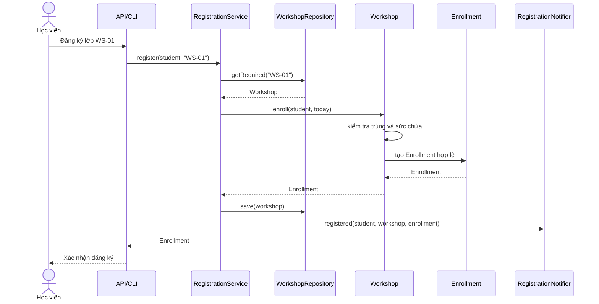

**Scenario B — Duplicate Registration:** `Workshop` detects `studentId` already exists and rejects before changing state. The service neither invokes `save` nor sends success notification.

**Scenario C — Full Workshop:** `Workshop` sees enrollment count equals capacity and rejects. No `Enrollment` is created. The class enforcing the constraint also decides whether mutation is allowed.

**Scenario D — Withdrawal:** `RegistrationService` loads `Workshop`; `Workshop` confirms enrollment and removes the association; the service persists the result. Add notifier collaboration to the withdrawal flow if confirmation emails become required.

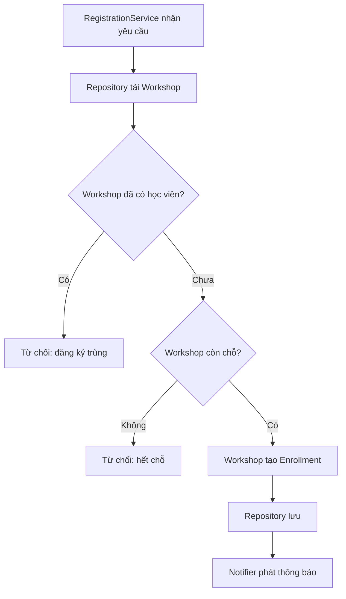

After each role-play, ask: “Who owns this step?”, “Which class handles failures?”, and “Does this require another collaborator or just a corrected card?” A card holding many unrelated behaviors indicates poor allocation.

## 5. From CRC Cards to Class Diagrams

CRC cards identify *responsibilities and collaborations*. UML class diagrams make associations, multiplicities, and APIs more concrete:

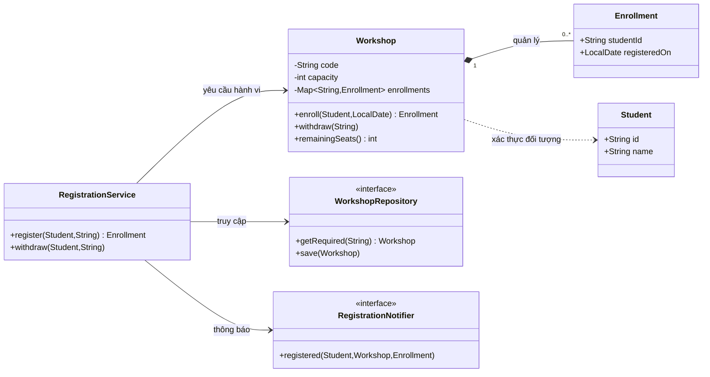

Some diagram choices are **specific to this example**: `Workshop` controls enrollment, and `Enrollment` belongs to its lifecycle. If canceled registration history must persist, revise classes and relationships. CRC **does not itself determine** composition, interfaces, transactions, or collection types; these emerge through further design.

### Turning Responsibilities into APIs

| CRC responsibility | Proposed Java API | Verification |
| --- | --- | --- |
| Valid student code and name | `Student` constructor | Empty ID/name rejected |
| Workshop capacity limit | `Workshop.enroll(...)` | Available seat accepted; full workshop rejected |
| No duplicate student registrations | `Workshop.enroll(...)` | Second request with the same ID rejected |
| Withdraw and release a seat | `Workshop.withdraw(...)` | Available seats increase |
| Find workshop by code | `WorkshopRepository.getRequired(...)` | Missing workshop produces an error |
| Coordinate a request | `RegistrationService.register(...)` | Calls correct steps and handles errors |
| Notify after registration | `RegistrationNotifier.registered(...)` | In the simple flow, runs only after a successful save |

This is **the bridge from CRC thinking to class design**. A single method can implement multiple aspects of a responsibility; there is no required one-to-one mapping between responsibilities and methods.

## 6. Complete Java 17 Program

Create `CrcCardsDemo.java`. The example uses an in-memory repository and console notifier to illustrate collaboration, with a fixed clock for reproducible output.

```java
import java.time.Clock;
import java.time.Instant;
import java.time.LocalDate;
import java.time.ZoneOffset;
import java.util.LinkedHashMap;
import java.util.List;
import java.util.Map;
import java.util.Objects;

public class CrcCardsDemo {

    // CRC: Student — giữ danh tính học viên hợp lệ.
    record Student(String id, String name) {
        Student {
            if (id == null || id.isBlank()) {
                throw new IllegalArgumentException("Student id is required");
            }
            if (name == null || name.isBlank()) {
                throw new IllegalArgumentException("Student name is required");
            }
        }
    }

    // CRC: Enrollment — thông tin hợp lệ của một lượt đăng ký.
    record Enrollment(String studentId, LocalDate registeredOn) {
        Enrollment {
            if (studentId == null || studentId.isBlank()) {
                throw new IllegalArgumentException("Student id is required");
            }
            Objects.requireNonNull(registeredOn, "registeredOn");
        }
    }

    // CRC: Workshop — điểm kiểm soát giới hạn và danh sách đăng ký.
    static final class Workshop {
        private final String code;
        private final int capacity;
        private final Map<String, Enrollment> enrollments =
                new LinkedHashMap<>();

        Workshop(String code, int capacity) {
            if (code == null || code.isBlank()) {
                throw new IllegalArgumentException("Workshop code is required");
            }
            if (capacity < 1) {
                throw new IllegalArgumentException(
                        "Workshop capacity must be positive");
            }
            this.code = code;
            this.capacity = capacity;
        }

        String code() {
            return code;
        }

        int remainingSeats() {
            return capacity - enrollments.size();
        }

        List<Enrollment> enrollments() {
            // Trả snapshot, không trao quyền sửa Map nội bộ.
            return List.copyOf(enrollments.values());
        }

        Enrollment enroll(Student student, LocalDate today) {
            Objects.requireNonNull(student, "student");
            Objects.requireNonNull(today, "today");

            // Các điều kiện được kiểm tra trước khi thay đổi dữ liệu.
            if (enrollments.containsKey(student.id())) {
                throw new IllegalStateException("Already registered");
            }
            if (enrollments.size() >= capacity) {
                throw new IllegalStateException("Workshop is full");
            }

            Enrollment enrollment = new Enrollment(student.id(), today);
            enrollments.put(student.id(), enrollment);
            return enrollment;
        }

        void withdraw(String studentId) {
            if (studentId == null || studentId.isBlank()) {
                throw new IllegalArgumentException("Student id is required");
            }
            if (!enrollments.containsKey(studentId)) {
                throw new IllegalStateException("Registration not found");
            }
            enrollments.remove(studentId);
        }
    }

    // CRC: WorkshopRepository — hợp đồng tìm và lưu lớp.
    interface WorkshopRepository {
        Workshop getRequired(String code);
        void save(Workshop workshop);
    }

    // Infrastructure adapter, thay được bằng một cài đặt JDBC/JPA.
    static final class InMemoryWorkshopRepository
            implements WorkshopRepository {
        private final Map<String, Workshop> workshops =
                new LinkedHashMap<>();

        @Override
        public Workshop getRequired(String code) {
            Workshop found = workshops.get(code);
            if (found == null) {
                throw new IllegalArgumentException("Workshop not found");
            }
            return found;
        }

        @Override
        public void save(Workshop workshop) {
            Objects.requireNonNull(workshop, "workshop");
            workshops.put(workshop.code(), workshop);
        }
    }

    // CRC: RegistrationNotifier — hợp đồng gửi thông báo.
    interface RegistrationNotifier {
        void registered(Student student, Workshop workshop,
                        Enrollment enrollment);
    }

    static final class ConsoleRegistrationNotifier
            implements RegistrationNotifier {
        @Override
        public void registered(Student student, Workshop workshop,
                               Enrollment enrollment) {
            System.out.println(
                    "Notified " + student.id() +
                    " for " + workshop.code() +
                    " on " + enrollment.registeredOn());
        }
    }

    // CRC: RegistrationService — điều phối use case qua collaborators.
    static final class RegistrationService {
        private final WorkshopRepository repository;
        private final RegistrationNotifier notifier;
        private final Clock clock;

        RegistrationService(WorkshopRepository repository,
                            RegistrationNotifier notifier, Clock clock) {
            this.repository = Objects.requireNonNull(repository);
            this.notifier = Objects.requireNonNull(notifier);
            this.clock = Objects.requireNonNull(clock);
        }

        Enrollment register(Student student, String workshopCode) {
            Objects.requireNonNull(student, "student");

            Workshop workshop = repository.getRequired(workshopCode);
            Enrollment result =
                    workshop.enroll(student, LocalDate.now(clock));
            repository.save(workshop);
            notifier.registered(student, workshop, result);
            return result;
        }

        void withdraw(Student student, String workshopCode) {
            Objects.requireNonNull(student, "student");

            Workshop workshop = repository.getRequired(workshopCode);
            workshop.withdraw(student.id());
            repository.save(workshop);
        }
    }

    public static void main(String[] args) {
        InMemoryWorkshopRepository repository =
                new InMemoryWorkshopRepository();
        Workshop java = new Workshop("WS-01", 2);
        repository.save(java);

        Clock clock = Clock.fixed(
                Instant.parse("2026-10-15T00:00:00Z"), ZoneOffset.UTC);
        RegistrationService service = new RegistrationService(
                repository, new ConsoleRegistrationNotifier(), clock);

        Student an = new Student("ST-01", "An");
        Student binh = new Student("ST-02", "Binh");
        Student chi = new Student("ST-03", "Chi");

        service.register(an, "WS-01");
        service.register(binh, "WS-01");

        try {
            service.register(an, "WS-01");
        } catch (IllegalStateException expected) {
            System.out.println(expected.getMessage());
        }

        try {
            service.register(chi, "WS-01");
        } catch (IllegalStateException expected) {
            System.out.println(expected.getMessage());
        }

        System.out.println("Remaining: " + java.remainingSeats());
        service.withdraw(binh, "WS-01");
        System.out.println("After withdrawal: " + java.remainingSeats());
    }
}
```

Compile and run:

```bash
javac CrcCardsDemo.java
java CrcCardsDemo
```

Output:

```text
Notified ST-01 for WS-01 on 2026-10-15
Notified ST-02 for WS-01 on 2026-10-15
Already registered
Workshop is full
Remaining: 0
After withdrawal: 1
```

### Map the Program Back to Each Card

- **`Student`** knows nothing about databases, workshop lists, or email delivery. Its identity and name are validated on construction.
- **`Enrollment`** records a dated registration; it is immutable within the demo scope.
- **`Workshop`** owns its enrollment set and rejects duplicates/full capacity; it provides no arbitrary collection setter.
- **`WorkshopRepository`** defines retrieval/persistence; `InMemoryWorkshopRepository` stores a `Map` without implementing capacity rules.
- **`RegistrationNotifier`** defines the notification port. `ConsoleRegistrationNotifier` prints to the console rather than deciding whether registration is valid.
- **`RegistrationService`** coordinates the repository, domain objects, clock, and notifier without calculating capacity or writing into `enrollments` itself.

Within `Workshop.enroll(...)`, duplicate/full checks occur **before modifying the Map**. `withdraw` rejects students who were not enrolled. Thus the single-threaded outcome follows the responsibilities assigned on the cards.

**Demo boundary:** `InMemoryWorkshopRepository` stores and returns the same `Workshop` reference; `enroll` mutates it before `save` is called. This is a sequential in-memory model for teaching responsibilities, **not a transaction with rollback**. Production requires coordinated checks and persistence under suitable synchronization/transactions to prevent concurrent oversubscription. If the notifier fails after persistence, define delivery retries, request state, and idempotency; a transactional outbox is a common solution.

## 7. Validate CRC Through Scenario Tests

A good CRC set should support deriving tests from responsibilities, especially when rules fail.

| Card | Test scenario | Required outcome |
| --- | --- | --- |
| `Student` | Blank ID or name | Constructor rejects |
| `Workshop` | Construct with capacity 0 | Constructor rejects |
| `Workshop` | First registration with a seat available | Adds an `Enrollment` |
| `Workshop` | Same student registers again | Reject; enrollment set unchanged |
| `Workshop` | Workshop is full | Reject; available seats never negative |
| `Workshop` | Withdraw a student not enrolled | Reject; state unchanged |
| `RegistrationService` | Valid registration | Load workshop, invoke behavior, persist, request notification |
| `RegistrationService` | Workshop rejects | Do not report success or request notification |
| Repository adapter | Workshop does not exist | Return an explicit error |
| Concurrent request integration | Two students request the last seat | At most one succeeds |

Extend the example with a fake `RegistrationNotifier` that counts calls; replace `ConsoleRegistrationNotifier` without changing `Workshop`. This directly tests **responsibility boundaries and coupling**.

Unit tests on `Workshop` verify sequential business rules, not thread safety. Add database-level integration and concurrency tests to validate system-wide invariants.

## 8. Assess CRC Card Quality

### Cohesion

Do responsibilities on one card serve the same purpose?

- Good: `Workshop` manages capacity, enrolled students, and registration validity.
- Reconsider: `Workshop` handles capacity while exporting PDF, connecting to SMTP, and parsing JSON.

### Coupling

Does the class depend on too many internal details of others?

- Good: `RegistrationService` uses the `WorkshopRepository` interface.
- Reconsider: the service knows repository SQL schemas and modifies `Workshop.enrollments` directly.

### Authoritative Rule Ownership

If capacity is enforced in `Workshop`, do not duplicate the formula in the controller, notifier, and repository. The UI may precheck for helpful feedback, but the authoritative invariant enforcement point must be clear.

### Adaptability

Try independent changes:

| Change | Which cards need review? | Which cards likely need no change? |
| --- | --- | --- |
| Workshop limit becomes 30 rather than 20 | `Workshop` configuration data | Notifier, repository interface |
| Switch console output to email | `RegistrationNotifier` implementation | `Workshop`, `Enrollment` |
| Switch in-memory persistence to PostgreSQL | `WorkshopRepository` adapter | `Workshop` registration rules |
| Introduce waiting lists | `Workshop`, possibly new `WaitlistEntry` | HTTP adapter may only need DTO changes |
| Require payment before confirmation | Workflow/service, payment port, enrollment state | Classes unrelated to payments |
| Grant priority to certain students | `RegistrationPolicy` or an appropriate domain rule | Notification adapter |

If an infrastructure change forces modifications across many domain classes, revisit collaborators and dependency direction.

## 9. Reassigning Responsibilities as Requirements Grow

CRC is a **living artifact** during modeling. New scenarios may revise cards rather than merely add methods.

**Scenario: “When a workshop is full, students join a time-ordered waitlist.”**

New questions: who tracks order, who gets invited after cancellation, and do offers expire? If entries have independent dates and states, consider `WaitlistEntry`. `Workshop` may coordinate seats and the queue or delegate priority decisions to a policy. Update CRC before adding arbitrary fields.

**Scenario: “Each student has a membership tier, and VIP members have priority.”**

Do not let the notifier decide admission just because it sees a VIP email. This is an **allocation rule**: consider an `AdmissionPolicy` collaborating with `Workshop` and student-tier information.

**Scenario: “Registration is valid only after payment.”**

`Enrollment` is no longer just a one-line immutable value. It may need an entity `Enrollment` with `PENDING_PAYMENT`, `CONFIRMED`, and `CANCELLED` states, plus `PaymentGateway`, timeouts, and seat-release rules. Define when a seat is reserved, what transaction grants entitlement, and how to handle repeated webhooks.

**Scenario: “Students cannot register for two overlapping workshops.”**

An individual `Workshop` cannot know other schedules. This rule needs a collaborator authorized to query a student's registrations/schedule or a policy/service at the appropriate boundary. It introduces responsibility **beyond one workshop**.

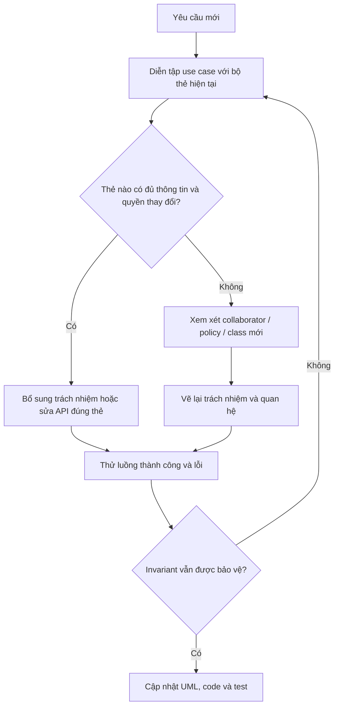

## 10. Common CRC Card Mistakes

**Mistake 1 — Turning every class into a service.** A `WorkshopService` “manages everything” while `Workshop` contains only setters. Move appropriate invariants back into `Workshop` and keep use-case coordination in the service, without forcing cross-aggregate rules into an entity lacking the data.

**Mistake 2 — Describing only methods and fields.** Listing `getCapacity`, `setCapacity`, and `getStudents` does not explain *who prevents oversubscription*. Write responsibilities first and derive the API later.

**Mistake 3 — Creating one class per noun.** “Registration date” does not necessarily require `RegistrationDateManager`; `LocalDate` may suffice. A new class needs distinct meaning, rules, or lifecycle.

**Mistake 4 — Listing every application dependency as a collaborator.** If a `Workshop` card names databases, REST controllers, logging frameworks, and email clients unrelated to its domain behavior, technical layers may be mixed into the wrong place.

**Mistake 5 — Two classes own the same decision.** If `RegistrationService` and `Workshop` each validate and update capacity differently, inconsistent outcomes can result. Choose the authority enforcing the invariant and define its contract.

**Mistake 6 — Role-playing only success.** Duplicates, full capacity, persistence failures, network loss, repeated cancellation, and concurrent requests expose missing responsibilities.

**Mistake 7 — Thinking CRC replaces detailed design.** CRC explores responsibilities and collaboration but **does not** prove code correctness, thread safety, table schemas, transactional outbox design, or permissions. These require APIs/UML, tests, reviews, and system verification.

**Mistake 8 — Automatically equating user actors with domain classes.** “Support staff sends notification” may describe a use-case role without requiring a `SupportStaff` object when staff identity/policy is outside scope.

## 11. CRC, UML, and Other Design Tools

| Tool | Main question answered | When to use it |
| --- | --- | --- |
| User story / use case | What outcome does the user want? When does it succeed/fail? | During requirements discovery |
| CRC cards | Which classes own which responsibilities, and whom do they consult? | During object/responsibility allocation |
| UML class diagram | What are classes, relationships, multiplicities, and APIs? | When precise structure is needed |
| UML sequence diagram | In what order do collaborators invoke one another? | When validating interaction flows |
| State machine | Which states and transitions can an object have? | For complex domain lifecycles |
| Unit/integration tests | Does implementation meet requirements? | To validate code and integration |

An effective progression is **use case → CRC role-play → UML at the needed level → Java/tests → revise cards as the domain becomes clearer**. CRC need not remain frozen while code and real operations evolve.

## 12. Practice Exercises

### Exercise 1 — CRC Cards for Movie Ticketing

Requirement: “A viewer selects a screening, holds seats for 5 minutes, pays, and receives tickets. A seat at a screening may not be sold to two people.”

Propose CRC cards for `Screening`, `SeatHold`, `Ticket`, `BookingService`, `PaymentGateway`, and `BookingRepository`. Identify who validates seat holds, who knows the hold expiration, and who coordinates payment confirmation.

### Exercise 2 — Identify Duplicated Responsibilities

A design includes `RegistrationController`, `RegistrationService`, `Workshop`, and `WorkshopRepository`; all four check “has the workshop reached 30 students?” Rewrite CRC cards to identify one source of truth, preserving needed boundary validation without duplicating business decisions.

### Exercise 3 — Role-Play a Failure Flow

Using the Java example's cards, suppose `save(workshop)` fails but the notifier still sends an “enrolled” email. Which cards need revised responsibilities or contracts? Propose suitable states, transactions, and retry policies. Explain why blindly retrying `register` is insufficient.

### Exercise 4 — Add a Waiting List

A workshop with 30 seats is full; the next student joins a waitlist. When someone withdraws, the first student on the waitlist receives an offer held for 15 minutes. Draw new CRC cards, describe `WAITING/OFFERED/CONFIRMED/EXPIRED` states, and assign expiration ownership.

### Exercise 5 — Turn CRC into Tests and Code

Add `registrationCount()`, test `Workshop` from 0 up to capacity, confirm duplicates do not change the count, and verify that withdrawal releases a seat. Write a fake notifier counting calls and check that `RegistrationService` never reports success after `Workshop` rejects.

## 13. CRC Design Completion Checklist

- Does each class have **a purpose expressible in business language**?
- Do responsibilities use meaningful verbs and describe **obligations**, not merely list methods?
- Is every “must/must not/at most/only if” condition assigned to a responsible enforcer?
- Are listed collaborators genuinely needed to fulfill responsibilities?
- Are there dependency cycles, excessive cross-references, or two classes claiming one rule?
- Can every class protect its invariants, or does it secretly mutate other classes' data?
- Have success, failure, and rollback-required flows been role-played?
- Have domain objects, policies, coordinators, repositories, and external adapters been distinguished?
- If requirements change, can you identify **which card must change** and why?
- Have responsibilities become explicit APIs/UML elements and test scenarios?
- With concurrent DB/network calls, are transaction, locking, retry, and idempotency boundaries identified?

**Remember:** a good CRC card is not better merely because it contains more classes or lines. It is useful when a reader can explain “who does what, why, and with whose help” and verify those answers using real scenarios and clear OOP code.


</details>

- [Back to top](#back-to-top)

---

## <a id="modeling-005">Class diagrams: members and relationships</a>

<details>
<summary>View details</summary>

# UML Class Diagrams: Members and Relationships in Java OOP Design

> **Goal:** Read, draw, and validate *UML class diagrams* showing class names, attributes, operations, visibility, types, multiplicity, and relationships. Translate them into Java and recognize what diagrams merely **describe**, rather than enforce automatically in Java/UML.

## 1. What Questions Do Class Diagrams Answer?

A class diagram is a **static structural model** showing which concepts exist, their state and behavior, and the relationships connecting them.

For example, an e-commerce requirement where “customers place orders, each order has several lines, each line selects a product, and payment uses a gateway” raises these questions:

- Which data belongs to `Customer`, `Order`, `OrderLine`, and `Product`?
- Who **owns** order lines, and who merely **references** products?
- How many orders may a customer have? May a draft order have no lines?
- Which behaviors belong in `Order` to protect business rules?
- How does `CheckoutService` depend on `PaymentGateway`, and how can implementations be swapped?

Class diagrams aid **design communication, responsibility allocation, relationship discovery, and architecture reviews**. They do not describe execution order; use an appropriate *sequence diagram* or *activity diagram* for checkout call sequences.

Class diagrams can be drawn at three levels:

| Model level | Focus | Useful details |
|---|---|---|
| **Domain analysis** | Concepts and rules | `Order` contains `OrderLine`; `Customer` places `Order` |
| **Software design** | Responsibilities, APIs, dependencies | `Order.addLine(...)`, `PaymentGateway.charge(...)`, multiplicities |
| **Implementation** | Structure close to Java code | Visibility, concrete types, constructors, collections, interfaces, static members |

Do not crowd a simple analysis diagram with every getter, setter, DTO, library type, and infrastructure dependency. Include only members and relationships necessary to explain its design decisions.

## 2. What Does a Class Box Contain?

The usual notation is a rectangle divided into three compartments: **class name**, **attributes**, and **operations**.

~~~text
┌──────────────────────────────────────┐
│                Order                 │  (1) Tên lớp
├──────────────────────────────────────┤
│ - id: String                         │  (2) Thuộc tính
│ - lines: List<OrderLine>             │
│ - status: OrderStatus                │
├──────────────────────────────────────┤
│ + addLine(p: Product, qty: int): void│  (3) Phương thức
│ + totalCents(): long                 │
│ + confirm(): void                    │
└──────────────────────────────────────┘
~~~

Common UML conventions:

- **Class name** goes in the top compartment; abstract classes may be italicized or marked `«abstract»`.
- **Attributes** describe state using `visibility name: Type [multiplicity] = defaultValue {property}`. Not every part must appear on every diagram.
- **Operations** describe provided behavior using `visibility name(parameter: Type = default): ReturnType`. Several parameters may appear.
- **Compartments or irrelevant members may be hidden** to improve readability; this changes the presentation detail, not what methods the class actually has.
- UML distinguishes *operations* (callable contracts) from *methods* (implementations). Java tutorials often call both “methods,” but the diagram does not necessarily show the method body.

### Visibility Symbols

| UML | Meaning | Approximate Java equivalent |
|---|---|---|
| `+` | Public | `public` |
| `-` | Private | `private` |
| `#` | Protected | `protected` |
| `~` | Package visibility | No modifier (package-private) |

One subtlety: Java `protected` permits same-package access and specific cross-package subclass access; it is not necessarily identical to all UML access interpretations across programming languages.

UML marks **derived attributes** with `/`, such as `/totalCents: long`: a value computed from order lines rather than necessarily stored in a Java `totalCents` field. Constraints like `{readOnly}` can represent readonly properties. Standard UML **underlines** `static` members; in Java they correspond to `static`. Diagram tools may have their own syntax and limitations for these details.

### UML Example with Mermaid

~~~mermaid
classDiagram
    class Order {
        -String id
        -List~OrderLine~ lines
        -OrderStatus status
        +addLine(Product product, int quantity) void
        +totalCents() long
        +confirm() void
    }
~~~

Mermaid fits READMEs because diagrams can be versioned alongside documentation. However, UML details such as text styling, derived properties, and complex constraints may not render faithfully across Mermaid implementations. Add nearby prose for important details.

## 3. Read Attributes and Operations Precisely

Sample attribute declarations:

~~~text
- id: UUID
- capacity: int = 30
- members: Set<Member> [0..*]
- /remainingSeats: int {readOnly}
~~~

Interpretation:

- `id` has identifier type `UUID` and is hidden from external access.
- `capacity` has a model default of 30 (which does not guarantee that the Java implementation sets 30).
- `members` holds several `Member` references; multiplicity `[0..*]` specifies the expected number of associated elements.
- `remainingSeats` is a **derived**, read-only value; Java may implement it as `remainingSeats()` rather than a stored field.

Sample operation declarations:

~~~text
+ enroll(student: Student): EnrollmentReceipt
+ findById(id: UUID): Optional<Member>
- validateCapacity(requested: int): void
# onStatusChanged(old: Status, next: Status): void
~~~

UML puts **parameter names before types**, while Java uses `Type parameterName`. For example:

~~~java
public EnrollmentReceipt enroll(Student student) {
    // implementation
    throw new UnsupportedOperationException("Example signature only");
}
~~~

`Optional<Member>` is a Java **return type**, not an association multiplicity. Do not infer from `Optional` that an entity must be stored in a collection, or from `List<>` that the association must be aggregation.

### Interfaces, Abstract Classes, and Enums

~~~mermaid
classDiagram
    class PaymentGateway {
        <<interface>>
        +charge(String orderId, long amountCents) void
    }
    class AbstractDiscountPolicy {
        <<abstract>>
        +discount(long amount) long
    }
    class OrderStatus {
        <<enumeration>>
        DRAFT
        CONFIRMED
    }
~~~

In Java:

- An `interface` defines a behavioral contract; concrete classes use `implements`.
- An `abstract class` can hold state and implemented methods as well as declare abstract methods.
- An `enum` represents a finite set of values and can have behavior; include it where transitions or allowed values matter.
- Not every class needs an interface or abstract superclass. Use these when a shared contract or meaningful substitution point exists.

## 4. Comparing UML Relationship Types

Arrowheads and diamonds convey distinct meanings; **do not decorate diagrams with every line type without purpose**.

| Relationship | UML / Mermaid notation | Meaning | Common Java representation |
|---|---|---|---|
| **Association** | `--` or `-->` | Objects are associated with each other | Field/reference or domain relationship |
| **Shared aggregation** | `o--` | Whole–part grouping with weak ownership semantics | `Team` references an independent `Employee` |
| **Composition** | `*--` | Whole owns a part; a part belongs to at most one composite at a time | `Order` owns `OrderLine` |
| **Generalization** | `<|--` | Subclass is a kind of superclass | `extends` |
| **Realization** | `<|..` | Class implements an interface | `implements` |
| **Dependency** | `<..` / `..>` | One element uses another for definitions or operations | Parameter, local variable, method call |
 
Key characteristics:

**Association:** A structural connection between objects. A line **without an arrow** indicates association but does not by itself specify navigability; an arrow conveys navigation or direction in the chosen notation. **Both classes need not hold reciprocal reference fields.**

**Aggregation:** A **hollow diamond at the whole end**, such as a team grouping employees. UML shared aggregation has fewer strict ownership semantics than composition; ordinary association is often clearer unless whole–part grouping is important.

**Composition:** A **filled diamond at the whole end**. Parts have strong ownership and cannot belong to two composites simultaneously. Domain rules and APIs must enforce this. Java GC does not automatically “delete a part when the whole is deleted”; DB cascading/orphan removal must also be configured intentionally.

**Generalization:** A **hollow triangle pointing to the superclass**. `Car extends Vehicle` is sound only when `Car` fulfills the `Vehicle` contract. Inheritance merely to “borrow code” often harms maintainability.

**Realization:** A **dashed line ending with a hollow triangle** pointing to the interface. `StripeGateway implements PaymentGateway` illustrates this, but an interface does not have to have multiple implementations.

**Dependency:** A **dashed line with a plain arrowhead** toward the used element. It often means a class receives a parameter or calls another API **without necessarily retaining a long-lived reference**. Do not equate dependency with composition.

A quick mnemonic: **association lines** connect objects; **diamonds** mark whole–part; **hollow triangles** indicate a parent type or contract; **simple dashed lines** indicate usage dependencies.

## 5. Multiplicity, Role Names, and Navigability

Multiplicity says how many objects at one end can correspond to **one object at the other end**.

| UML multiplicity | Interpretation |
|---|---|
| `1` | Exactly one |
| `0..1` | Zero or one |
| `*` or `0..*` | Zero or many |
| `1..*` | At least one |
| `2..5` | From two through five, inclusive |

Example:

~~~mermaid
classDiagram
    Customer "1" <-- "0..*" Order : places
    Order "1" *-- "0..*" OrderLine : owns
    OrderLine "0..*" --> "1" Product : refers to
~~~

Interpret the relationships:

- **Each `Order` belongs to exactly one `Customer`**; a customer may have 0 or more orders.
- **Each `OrderLine` belongs to exactly one `Order`**; a draft may have 0 lines. If confirmed orders require at least one line, that is a separate **state-dependent constraint**.
- **Each `OrderLine` references one `Product`**; a product may appear in many order lines across orders. Products exist independently and **are not** parts deleted with orders.

**The diamond is at `Order`**, not `OrderLine`. For relationships with role names (such as `customer` and `lines`), label association ends to clarify their roles; renderer support varies.

Corresponding Java API example:

~~~java
final class Order {
    private final Customer customer;          // Order --> 1 Customer
    private final List<OrderLine> lines;       // Order *-- 0..* OrderLine
    // ...
}
~~~

In Java, **field syntax does not automatically enforce multiplicity**: `Customer customer` may still be null if allowed by the constructor, and `List<OrderLine>` may contain an element from a different order unless checked. Enforce invariants, prevent direct collection mutation, and add DB constraints where necessary.

## 6. Full Design Example: Customer, Order, and Payment

Assumed requirements:

1. A customer may create many orders; each order belongs to one customer.
2. Every order has **its own lines**, each containing a product, quantity, and unit price fixed when added.
3. Catalog products remain independent when an order is canceled or deleted.
4. Draft orders may have no lines; only nonempty orders can be confirmed.
5. Checkout sends payment requests through an interface to allow adapter replacement.

### Class Diagram

~~~mermaid
classDiagram
    direction LR
    class Customer {
        <<entity>>
        +String id
        +String name
    }
    class Product {
        <<entity>>
        +String sku
        +String name
        +long priceCents
    }
    class Order {
        -String id
        -Customer customer
        -List~OrderLine~ lines
        -Status status
        +addLine(Product product, int quantity) void
        +totalCents() long
        +isEmpty() boolean
        +confirm() void
        +status() Status
    }
    class OrderLine {
        -Product product
        -int quantity
        -long unitPriceCents
        +subtotalCents() long
    }
    class CheckoutService {
        -PaymentGateway gateway
        +checkout(Order order) void
    }
    class PaymentGateway {
        <<interface>>
        +charge(String orderId, long amountCents) void
    }
    class ConsolePaymentGateway {
        +charge(String orderId, long amountCents) void
    }

    Customer "1" <-- "0..*" Order : places
    Order "1" *-- "0..*" OrderLine : owns
    OrderLine "0..*" --> "1" Product : refers to
    CheckoutService ..> Order : checkout parameter
    CheckoutService --> PaymentGateway : injected dependency
    ConsolePaymentGateway ..|> PaymentGateway : implements
~~~

Reasons for each choice:

- `Customer` is referenced by `Order` but can exist without orders: **association**. The diagram does not require a reverse collection on `Customer`.
- `OrderLine` is a part created and managed by `Order`: **composition**. Each line belongs to one order and its instance is not shared across orders.
- `Product` is an independent referenced entity/structure, not an order child: **association**.
- `CheckoutService` invokes `Order` behavior through parameters: **dependency**. It stores a constructor-injected `PaymentGateway` field; its directed line models association/dependency.
- `ConsolePaymentGateway` implements `PaymentGateway`: **realization**. Other adapters can replace it without changing checkout's interface.
- The `«entity»` stereotypes on `Customer` and `Product` emphasize stable `id`/`sku` identity and lifecycles independent of `Order`. The Java example uses immutable `record` types for simplicity; `record` alone does not determine whether a domain object is an entity or value object.

### Runnable Single-File Java 17+ Example

Create **`OrderDiagramDemo.java`** with the full code below:

~~~java
import java.util.ArrayList;
import java.util.List;
import java.util.Objects;

// Độc lập với vòng đời của một Order.
record Customer(String id, String name) {
    Customer {
        Objects.requireNonNull(id, "id");
        Objects.requireNonNull(name, "name");
        if (id.isBlank() || name.isBlank()) {
            throw new IllegalArgumentException("Invalid customer");
        }
    }
}

record Product(String sku, String name, long priceCents) {
    Product {
        Objects.requireNonNull(sku, "sku");
        Objects.requireNonNull(name, "name");
        if (sku.isBlank() || name.isBlank() || priceCents < 0) {
            throw new IllegalArgumentException("Invalid product");
        }
    }
}

// Chủ sở hữu vòng đời của từng dòng đơn.
final class Order {
    enum Status { DRAFT, CONFIRMED }

    private final String id;
    private final Customer customer;
    private final List<OrderLine> lines = new ArrayList<>();
    private Status status = Status.DRAFT;

    // Chỉ Order có thể tạo một dòng; không cung cấp API đổi owner.
    private static final class OrderLine {
        private final Product product;
        private final int quantity;
        private final long unitPriceCents;

        private OrderLine(Product product, int quantity) {
            this.product = Objects.requireNonNull(product, "product");
            if (quantity <= 0) {
                throw new IllegalArgumentException("Quantity must be positive");
            }
            this.quantity = quantity;
            this.unitPriceCents = product.priceCents(); // Chốt đơn giá
            Math.multiplyExact(unitPriceCents, quantity); // Kiểm tra tràn số
        }

        private long subtotalCents() {
            return Math.multiplyExact(unitPriceCents, quantity);
        }
    }

    Order(String id, Customer customer) {
        this.id = Objects.requireNonNull(id, "id");
        this.customer = Objects.requireNonNull(customer, "customer");
        if (id.isBlank()) {
            throw new IllegalArgumentException("Order id is blank");
        }
    }

    String id() {
        return id;
    }

    Customer customer() {
        return customer;
    }

    Status status() {
        return status;
    }

    boolean isEmpty() {
        return lines.isEmpty();
    }

    int lineCount() {
        return lines.size();
    }

    // Command: Owner kiểm tra và tạo part trong phạm vi của mình.
    void addLine(Product product, int quantity) {
        ensureDraft();
        lines.add(new OrderLine(product, quantity));
    }

    // Query: Tính tổng không sửa trạng thái.
    long totalCents() {
        long total = 0;
        for (OrderLine line : lines) {
            total = Math.addExact(total, line.subtotalCents());
        }
        return total;
    }

    void confirm() {
        ensureDraft();
        if (lines.isEmpty()) {
            throw new IllegalStateException("Cannot confirm empty order");
        }
        status = Status.CONFIRMED;
    }

    private void ensureDraft() {
        if (status != Status.DRAFT) {
            throw new IllegalStateException("Order is not a draft");
        }
    }
}

// Interface là hợp đồng, không có quan hệ sở hữu OrderLine.
interface PaymentGateway {
    void charge(String orderId, long amountCents);
}

final class ConsolePaymentGateway implements PaymentGateway {
    @Override
    public void charge(String orderId, long amountCents) {
        System.out.printf("Charge %s: %d cents%n", orderId, amountCents);
    }
}

// Use case nhận Order làm tham số, giữ dependency qua constructor.
final class CheckoutService {
    private final PaymentGateway gateway;

    CheckoutService(PaymentGateway gateway) {
        this.gateway = Objects.requireNonNull(gateway, "gateway");
    }

    void checkout(Order order) {
        Objects.requireNonNull(order, "order");

        if (order.status() != Order.Status.DRAFT || order.isEmpty()) {
            throw new IllegalStateException("Order not ready");
        }

        long amount = order.totalCents();
        gateway.charge(order.id(), amount);
        order.confirm();
    }
}

public class OrderDiagramDemo {
    public static void main(String[] args) {
        Customer customer = new Customer("C-01", "Linh");
        Product book = new Product("JAVA", "Java Book", 125_000);
        Product notebook = new Product("NOTE", "Notebook", 30_000);

        Order order = new Order("O-100", customer);
        order.addLine(book, 2);
        order.addLine(notebook, 1);

        System.out.println(order.totalCents()); // 280000
        CheckoutService checkout =
                new CheckoutService(new ConsolePaymentGateway());
        checkout.checkout(order);
        System.out.println(order.status()); // CONFIRMED
        System.out.println(order.customer().name()); // Linh
    }
}
~~~

Run:

~~~bash
javac OrderDiagramDemo.java
java OrderDiagramDemo
~~~

Expected output:

~~~text
280000
Charge O-100: 280000 cents
CONFIRMED
Linh
~~~

When comparing the diagram above with the Java code, note these points:

- `Order.customer` is a **private field**, but `Customer` may still exist independently and be referenced elsewhere.
- `OrderLine` is a **private nested class**; the diagram draws it as a separate box to clarify its structural role.
- `Order.addLine(...)` does not expose `OrderLine`, so callers cannot attach a part of order A to order B.
- `Product.priceCents` is sampled when creating a line and fixed as `unitPriceCents`. Real commerce requires additional rules for discounts, tax, currency, rounding, and price validity periods.
- `CheckoutService` does not inherit `PaymentGateway`; it collaborates with an instance of the interface.
- `Order.confirm()` changes state to `CONFIRMED` without solving an entire distributed transaction.

**Example scope:** This is a single-threaded flow with simulated console payments. If a real gateway charges money but the app fails before persisting `CONFIRMED`, state may become inconsistent. Production systems need transaction, idempotency, and reconciliation strategies. Class diagrams cannot fully express these temporal failure scenarios.

## 7. From Java to UML: Avoid Incorrect Relationships

Consider this Java code:

~~~java
final class ReportService {
    private final ReportRepository repository;

    ReportService(ReportRepository repository) {
        this.repository = repository;
    }

    Report generate(long id) {
        Report report = repository.findById(id);
        return report;
    }
}
~~~

Model `ReportService → ReportRepository` as a directed relationship because the service **holds a reference field**. However, `Report` appears only as an operation parameter/return type; at the relevant detail level this may be a dependency rather than a persistent association.

~~~mermaid
classDiagram
    class ReportService
    class ReportRepository {
        <<interface>>
    }
    class Report
    ReportService --> ReportRepository : collaborator
    ReportService ..> Report : uses as result
~~~

Useful mapping heuristics:

| Code pattern | Possible UML relationship | Further questions |
|---|---|---|
| `private B b;` | Association from A to B | Can B be null? Is it owned or only referenced? |
| `List<B> members;` | Association with many-valued multiplicity | Are elements shared? Who manages their lifecycle? |
| `new B()` inside A | May suggest composition | Does A exclusively own B? |
| `A extends B` | Generalization | Does A fulfill B's substitutability contract? |
| `A implements I` | Realization | At which layer does I define a contract? |
| B is a local variable or method parameter | Dependency | Is the relationship important enough for this diagram? |
| `@OneToMany` in JPA | Association with multiplicity | Do cascades, orphan removal, and DB ownership match the domain? |

**There is no automatic inference** from “has a field ⇒ composition.” An `Order` may reference a `Customer` without owning the customer's lifecycle. Nor does “no field ⇒ no relationship” hold: methods accepting `Customer` create source-code dependencies.

## 8. Inheritance, Interfaces, and Substitutability in Diagrams

A separate example illustrating class relationship types:

~~~mermaid
classDiagram
    class Animal {
        <<abstract>>
        +move() void
    }
    class Dog {
        +move() void
    }
    class Identifiable {
        <<interface>>
        +id() String
    }
    class Shelter {
        +register(Identifiable animal) void
    }
    Animal <|-- Dog : extends
    Identifiable <|.. Dog : implements
    Shelter ..> Identifiable : parameter
~~~

In Java:

~~~java
abstract class Animal {
    abstract void move();
}

interface Identifiable {
    String id();
}

final class Dog extends Animal implements Identifiable {
    private final String name;

    Dog(String name) {
        this.name = name;
    }

    @Override void move() {
        System.out.println("Running");
    }

    @Override public String id() {
        return name;
    }
}

final class Shelter {
    void register(Identifiable animal) {
        System.out.println(animal.id());
    }
}
~~~

**Read the UML lines accurately:**

- `Dog --|> Animal` is **generalization**: Dog is a subtype of Animal.
- `Dog ..|> Identifiable` is **realization**: Dog implements the interface.
- `Shelter ..> Identifiable` is **dependency**: the shelter accepts a contract-typed parameter; this diagram does not claim it stores every animal.

When drawing inheritance, check the *Liskov Substitution Principle*: `Dog` must meet the expectations of `Animal`. Do not inherit merely to reuse a helper method.

## 9. Class Diagram Quality Checklist

A useful diagram need not contain many classes. During review, check:

1. **Scope and detail level:** Is this domain analysis, design, or implementation? Are levels mixed excessively?
2. **Class names:** Use domain nouns or clear technical roles rather than unrelated collections of responsibilities named `Manager`/`Util`.
3. **Attributes:** Place state and invariants with their owners. Are fields unnecessarily public?
4. **Operations:** Does each behavior belong to the correct object? Are mutations named to convey intent?
5. **Visibility:** Is the public API minimal? Should helpers be private/protected/package-private?
6. **Types:** Are units such as money, identifiers, and time explicit? Is `double` used unsafely for monetary values?
7. **Multiplicity:** Are `1`, `0..1`, `0..*`, and `1..*` labels explained and enforced where needed?
8. **Relationship direction:** Are dependencies/navigability arrows correct? Is the diamond at the whole end?
9. **Ownership:** Is a whole–part relationship association, shared aggregation, or composition? Is there sufficient domain justification for a filled diamond?
10. **Inheritance/realization:** Do hollow triangles point to the superclass/interface? Is there a valid *is-a* relationship and subtype contract?
11. **Dependency cycles:** Are there unnecessary A → B → A paths? Could a policy/port be extracted or coordination moved up a level?
12. **Code consistency:** Are any important methods, fields, types, or access levels different from the diagram without updates?
13. **Notation limitations:** Do transactions, concurrency, state transitions, or operational failures need another diagram or explanatory note?

A diagram that omits internal attributes to emphasize the domain is not necessarily “wrong.” But **incorrect relationship types or multiplicities inconsistent with domain requirements** can mislead implementation and architecture decisions.

## 10. Common Class Diagram Mistakes

| Mistake | Why it is wrong | Correction |
|---|---|---|
| Diamond placed at the part end | Reverses whole–part meaning | Place diamond at the whole end |
| Drawing composition merely because of `List<T>` | Collections do not imply ownership | Check lifecycle and exclusivity |
| Drawing inheritance to reuse one method | Misrepresents the *is-a* type relationship | Use collaboration/delegation where appropriate |
| Omitting multiplicity | Cannot tell whether 0, 1, or many instances relate | Label and explain both association ends |
| Drawing transient dependency as long-lived association | Suggests an object stores state it does not own | Use dashed dependency when only briefly used |
| Defaulting to getters/setters for every field | Exposes state and breaks encapsulation | Use domain behaviors and necessary queries |
| Marking all fields and methods public | Callers can violate invariants easily | Use minimum appropriate visibility |
| Putting every DB table on the domain diagram | Loses class responsibility and meaning | Separate domain models from ERDs/persistence mappings |
| Assuming UML enforces rules in code | Diagrams are descriptive | Implement validation, tests, and needed DB constraints |
| Not updating diagrams after code changes | Documentation drifts from reality | Maintain diagram and code through reviews/version control |

## 11. Test What the Diagram Promises

Diagrams cannot execute themselves. Select **relationship invariants** and verify them through Java behavior.

For `OrderDiagramDemo.java` above, create `OrderDiagramTest.java` with JUnit Jupiter 5:

~~~java
import static org.junit.jupiter.api.Assertions.*;
import org.junit.jupiter.api.Test;

class OrderDiagramTest {
    @Test
    void oneOrderOwnsItsLinesAndKeepsCustomerReference() {
        Customer customer = new Customer("C-01", "Linh");
        Product product = new Product("JAVA", "Java Book", 125_000);
        Order first = new Order("O-1", customer);
        Order second = new Order("O-2", customer);

        first.addLine(product, 2);
        second.addLine(product, 1);

        assertSame(customer, first.customer());
        assertSame(customer, second.customer());
        assertEquals(1, first.lineCount());
        assertEquals(1, second.lineCount());
        assertEquals(250_000L, first.totalCents());
        assertEquals(125_000L, second.totalCents());
    }

    @Test
    void checkoutChangesStatusOnlyAfterSuccessfulCharge() {
        Order order = new Order(
                "O-3", new Customer("C-02", "Minh"));
        order.addLine(new Product("N", "Notebook", 30_000), 1);

        final long[] amountCharged = {0L};
        PaymentGateway gateway = (id, amount) -> amountCharged[0] = amount;

        new CheckoutService(gateway).checkout(order);

        assertEquals(30_000L, amountCharged[0]);
        assertEquals(Order.Status.CONFIRMED, order.status());
        assertThrows(IllegalStateException.class,
                () -> order.addLine(
                        new Product("P", "Pen", 1000), 1));
    }

    @Test
    void chargeFailureDoesNotConfirmOrder() {
        Order order = new Order(
                "O-4", new Customer("C-03", "An"));
        order.addLine(new Product("JAVA", "Java Book", 125_000), 1);

        PaymentGateway failingGateway = (id, amount) -> {
            throw new IllegalStateException("Gateway unavailable");
        };

        assertThrows(IllegalStateException.class,
                () -> new CheckoutService(failingGateway).checkout(order));
        assertEquals(Order.Status.DRAFT, order.status());
    }

    @Test
    void emptyOrderCannotBeConfirmed() {
        Order order = new Order(
                "O-5", new Customer("C-04", "Hoa"));
        assertThrows(IllegalStateException.class, order::confirm);
    }
}
~~~

The test checks meaningful model commitments: orders share references to independent customers/products, own **separate lines**, calculate totals correctly, do not transition on payment errors, and reject confirmation of empty orders.

**Limitation:** One test cannot prove that lines are “never shared” across every possible code revision, but this API uses a private nested `OrderLine` and exposes no operation for reattaching a part. Nor does the test prove that real payment transactions roll back completely after a network failure mid-processing; integration tests and reconciliation are still needed.

## 12. A Workflow for Drawing Class Diagrams from Requirements

~~~mermaid
flowchart TD
    A[Đọc tình huống sử dụng và quy tắc] --> B[Chọn khái niệm có identity/state]
    B --> C[Phân trách nhiệm và invariant]
    C --> D[Đặt thuộc tính và operation]
    D --> E[Chọn association / ownership / kiểu cha]
    E --> F[Ghi multiplicity và visibility]
    F --> G[Đối chiếu use case, Java và test]
    G --> H{Thể hiện đủ, không mâu thuẫn?}
    H -->|Chưa| C
    H -->|Rồi| I[Chốt sơ đồ cho mức thiết kế đã chọn]
~~~

**Practical approach:**

1. **Gather use cases:** for example, “Customer adds products to a draft order and pays.” Include the happy path and exceptions such as empty orders, invalid quantities, and failed payment.
2. **Select objects with responsibilities:** `Order` protects state and its line collection; `PaymentGateway` is an integration port.
3. **Identify owned data:** compare lines belonging to individual orders with shared product references.
4. **Identify necessary APIs:** `addLine`, `totalCents`, `confirm`, `checkout`, `charge`; avoid public setters on `status` and `lines`.
5. **Choose relationships:** composition for Order–Line, association for Order–Customer/Product, realization for a gateway implementation, dependency when a use case uses Order.
6. **Label multiplicities:** consider draft and confirmed states; specify an additional constraint if multiplicity depends on state.
7. **Verify with Java and tests:** where are objects created? Who may mutate them? Do tests protect invariants? Has code changed the diagram?

**You need not draw everything:** if too many classes or arrows clutter a diagram, split it by bounded context, use case, or design level and note omitted relationships.

## 13. Applied Exercise: Library Loans

**Sample requirement:** The library manages `BookTitle` records and physical `BookCopy` instances. A `Member` may borrow multiple copies through `Loan` records, but each physical copy may have at most one **active** loan at a time. Each loan records borrowing date, due date, and status.

Complete the following:

1. Identify minimal classes/relationships: `BookTitle`, `BookCopy`, `Member`, `Loan`. Decide identities: ISBN identifies a title, copy ID identifies a physical copy, loan ID identifies a borrowing event.
2. Draw a class diagram with attributes, operations, and visibility. Label parameter names/types in `borrowCopy(member, copy)`, `returnCopy()`, and `isAvailable()`.
3. Add multiplicities to `BookTitle–BookCopy`, `Member–Loan`, and `Loan–BookCopy` relationships. Distinguish “many **historical** loans for one copy” from “at most one **active** loan.”
4. Choose association, aggregation, or composition only after confirming lifecycles. Does removing a catalog title require destroying physical copies? Must member loan history remain for retention rules after deletion?
5. Implement a Java model preserving “one copy cannot have two simultaneous active loans,” with suitable commands and queries.
6. Test a successful loan, a duplicate active loan, returns, and competing requests; specify the DB transaction mechanism for multi-node execution.

**Self-assessment:** Can a new teammate use the diagram to determine **who owns which data**, **which operations protect invariants**, **how many other instances one object can reference**, and **which direction dependencies point**?

---

**Remember:** Class diagrams communicate meaningful **members and relationships**: class names and responsibilities; attributes, operations, and visibility; association, aggregation, composition, generalization, realization, dependency; plus multiplicity and navigability. Treat a diagram as a **design contract that Java and tests must enforce**, not as a picture that automatically guarantees every rule.

</details>

- [Back to top](#back-to-top)

---

## <a id="modeling-006">Object diagrams: instances at a point in time</a>

<details>
<summary>View details</summary>

# Object Diagrams: Instances at a Point in Time

## 1. What Questions Do Object Diagrams Answer?

A **UML Object Diagram** depicts **specific objects, their attribute values, and links among them at a particular moment**. It is a snapshot of system state.

Consider an e-commerce system: class `Order` describes orders generally, but when Lan places order `O-001`, the program has **one concrete Order object** holding an order code and a reference to Lan's customer object. The order may contain `OrderItem` objects, each linking to a `Product` object.

Object diagrams answer concrete questions:

- At this moment, **which customer** does order `O-001` reference?
- **How many** items does the order currently contain, and which products do they reference?
- Do two items reference the same product instance or two different objects?
- How does the object graph change after adding an item?

Do not confuse class diagrams with instance snapshots: “An Order **may have** many OrderItems” describes a **type/class-level** rule; “object `o01` currently has items `i01` and `i02`” states an **instance-level** fact at a specific time.

## 2. UML Notation: Objects, Slots, and Links

A UML **object** is commonly drawn as a rectangle. Its heading has the form `tênĐốiTượng:TênLớp` and is **underlined** in standard notation. For example, `o01:Order` is an instance named `o01` of class `Order`. Use `:Order` when the object name is not important, or `o01` when its type is clear from context.

An object's body may show *slots*—attribute values at snapshot time:

```text
┌──────────────────────────────┐
│         o01:Order            │  ← Tiêu đề được gạch chân khi vẽ UML chuẩn
├──────────────────────────────┤
│ code = "O-001"               │
│ status = "DRAFT"             │
└──────────────────────────────┘
```

A **link** connects **two concrete objects**, representing an instance of an association. To clarify fields or roles, annotate links with `customer`, `items`, or `product`.

Distinguish these elements:

| Element | In a class diagram | In an object diagram |
|---|---|---|
| Type | `Order`, `Customer` | `o01:Order`, `c01:Customer` |
| Attribute | `code: String` | `code = "O-001"` |
| Relationship | `Order → Customer` | Link from `o01` to `c01` |
| Multiplicity | `0..*`, `1` across **all** valid instances | Number of objects/links **present** in the snapshot |
| Purpose | Declares possible structure | Shows an actual state at a particular moment |

Object labels and values are **human-readable identifiers for the diagram**; they need not be Java variable names or database primary keys.

## 3. Running Example: An Order at t0

Suppose these objects exist:

- `c01:Customer` — Lan, the customer.
- `o01:Order` — order `O-001`, belonging to Lan.
- `i01:OrderItem` — line number 1, quantity 2.
- `p01:Product` — product with SKU `BOOK-01`.

**Snapshot t0:** the order contains one item line.

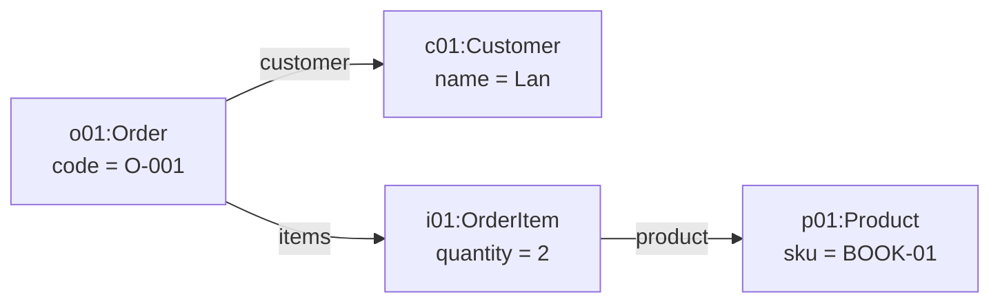

The diagram uses a **Mermaid flowchart** for Markdown display; it is **an object-graph illustration with equivalent meaning**, not a full UML Object Diagram compiler. In formal UML, object headings are underlined and links are usually plain lines. The Mermaid arrows clarify **which references are followed**, not execution order, method calls, or data movement.

Trace one path through the diagram:

```text
o01 (Order) --items--> i01 (OrderItem) --product--> p01 (Product)
```

And another:

```text
o01 (Order) --customer--> c01 (Customer)
```

Crucially, **links connect instances**, such as `o01 → c01`, rather than generic concepts `Order` and `Customer`.

## 4. Which States Does a Class Diagram Permit?

Before drawing object diagrams, understand the structural rules imposed by classes and associations. For this example:

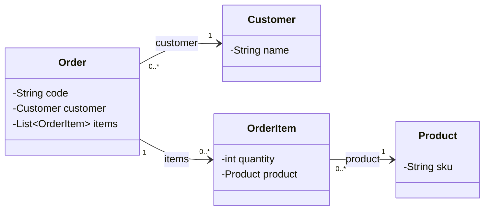

Read association multiplicities as follows:

- Each `Order` is linked to **1 Customer**; one `Customer` may be referenced by **0 or more Orders**.
- Each `OrderItem` belongs to **1 Order** by the domain model; an `Order` may contain **0 or more OrderItems**. The Java code below ensures each item is added to one order in this demo, but universal enforcement of “each item belongs to exactly one order” requires appropriate ownership and validation.
- Each `OrderItem` has **1 Product**; a `Product` may be referenced by **many items**.

At **t0**, the object diagram contains only *one* customer, *one* order, *one* item, and *one* product. That does not imply the entire application permits only four objects or one item per order.

**Object diagrams need not show every object in the JVM.** Usually they select just enough of an object graph to illustrate a scenario, invariant, or bug.

## 5. Runnable Java: Create an Object Graph and Capture Two Moments

Create `ObjectDiagramDemo.java`. No framework is needed; the example works with Java 11 or later.

```java
import java.util.ArrayList;
import java.util.List;
import java.util.Objects;

public class ObjectDiagramDemo {

    static final class Customer {
        final String label;  // Nhãn minh họa trên sơ đồ.
        final String name;

        Customer(String label, String name) {
            this.label = Objects.requireNonNull(label);
            this.name = Objects.requireNonNull(name);
        }
    }

    static final class Product {
        final String label;
        final String sku;

        Product(String label, String sku) {
            this.label = Objects.requireNonNull(label);
            this.sku = Objects.requireNonNull(sku);
        }
    }

    static final class OrderItem {
        final String label;
        final Product product;
        final int quantity;

        OrderItem(String label, Product product, int quantity) {
            this.label = Objects.requireNonNull(label);
            this.product = Objects.requireNonNull(product);

            if (quantity <= 0) {
                throw new IllegalArgumentException("quantity must be positive");
            }
            this.quantity = quantity;
        }
    }

    static final class Order {
        final String label;
        final String code;
        final Customer customer;
        final List<OrderItem> items = new ArrayList<>();

        Order(String label, String code, Customer customer) {
            this.label = Objects.requireNonNull(label);
            this.code = Objects.requireNonNull(code);
            this.customer = Objects.requireNonNull(customer);
        }

        void addItem(OrderItem item) {
            Objects.requireNonNull(item);
            if (items.contains(item)) {
                throw new IllegalArgumentException("Item already added");
            }
            items.add(item);
        }

        List<OrderItem> getItems() {
            return List.copyOf(items); // Không lộ collection sửa được.
        }
    }

    static void printSnapshot(String time, Order order) {
        System.out.println("=== " + time + " ===");
        System.out.println(order.label + ":Order code=" + order.code);
        System.out.println(order.label + " --customer--> " + order.customer.label);
        System.out.println(order.customer.label + ":Customer name=" + order.customer.name);

        for (OrderItem item : order.getItems()) {
            System.out.println(order.label + " --items--> " + item.label);
            System.out.println(item.label + ":OrderItem quantity=" + item.quantity);
            System.out.println(item.label + " --product--> " + item.product.label);
            System.out.println(item.product.label + ":Product sku=" + item.product.sku);
        }
    }

    public static void main(String[] args) {
        Customer c01 = new Customer("c01", "Lan");
        Product p01 = new Product("p01", "BOOK-01");
        Product p02 = new Product("p02", "NOTE-02");

        Order o01 = new Order("o01", "O-001", c01);
        OrderItem i01 = new OrderItem("i01", p01, 2);
        o01.addItem(i01);

        printSnapshot("t0", o01);

        OrderItem i02 = new OrderItem("i02", p02, 1);
        o01.addItem(i02);

        printSnapshot("t1", o01);

        // Những object cũ vẫn giữ nguyên danh tính tham chiếu.
        System.out.println("Same customer: " + (o01.customer == c01));
        System.out.println("Same first item: " + (o01.getItems().get(0) == i01));
    }
}
```

Compile and run:

```bash
javac ObjectDiagramDemo.java
java ObjectDiagramDemo
```

Output:

```text
=== t0 ===
o01:Order code=O-001
o01 --customer--> c01
c01:Customer name=Lan
o01 --items--> i01
i01:OrderItem quantity=2
i01 --product--> p01
p01:Product sku=BOOK-01
=== t1 ===
o01:Order code=O-001
o01 --customer--> c01
c01:Customer name=Lan
o01 --items--> i01
i01:OrderItem quantity=2
i01 --product--> p01
p01:Product sku=BOOK-01
o01 --items--> i02
i02:OrderItem quantity=1
i02 --product--> p02
p02:Product sku=NOTE-02
Same customer: true
Same first item: true
```

**Why is this a snapshot?** `printSnapshot("t0", o01)` observes the graph before `i02` is added. The second call observes **the same `o01` object** after a new link appears in its `items` list. Java does not need a new `Order` instance for a different snapshot.

Note: `label` maps instances to diagram names. Java uses **object references**; `==` in the final two lines confirms that two references point to **the exact same instance**. Two different objects may have equal `code` or `sku` values.

## 6. Snapshot t1: Same Order, More Links

After adding the second item, the graph looks like this:

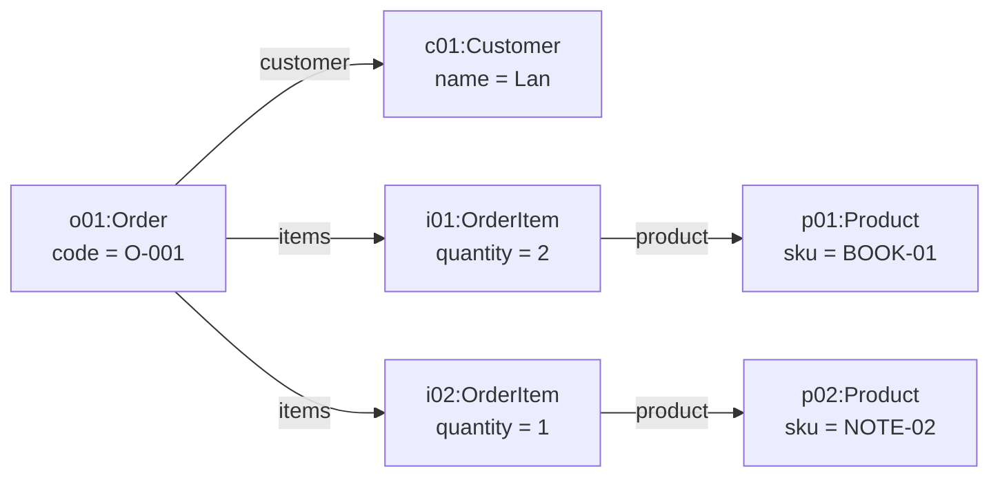

*Both snapshots show only fields actually present in the illustrative Java code (`code`, `name`, `quantity`, `sku`) and links among instances. If the domain introduces `status`, add the Java field, snapshot value, and test instead of inventing an unimplemented state label.*

Comparison:

| Observation | Snapshot `t0` | Snapshot `t1` |
|---|---|---|
| `o01:Order` | Present | Same `o01` object |
| `c01:Customer` | Present | Same `c01` object |
| `i01:OrderItem` | Present, quantity = 2 | Still present, quantity = 2 |
| `i02:OrderItem` | Not linked to `o01`; not yet created in the demo | Present, quantity = 1 |
| Link `o01 → i01` | Present | Present |
| Link `o01 → i02` | Absent | Present |
| Classes `Order`, `OrderItem` | Unchanged | Unchanged |

Two static pictures **do not constitute a sequence diagram**. Snapshots show “before/after” states; sequence diagrams answer **who calls whom, what messages are exchanged, and in what order**.

## 7. Multiple References to One Object

An important use of object diagrams is illustrating **shared references (aliasing)**.

Suppose two different orders both belong to customer Lan:

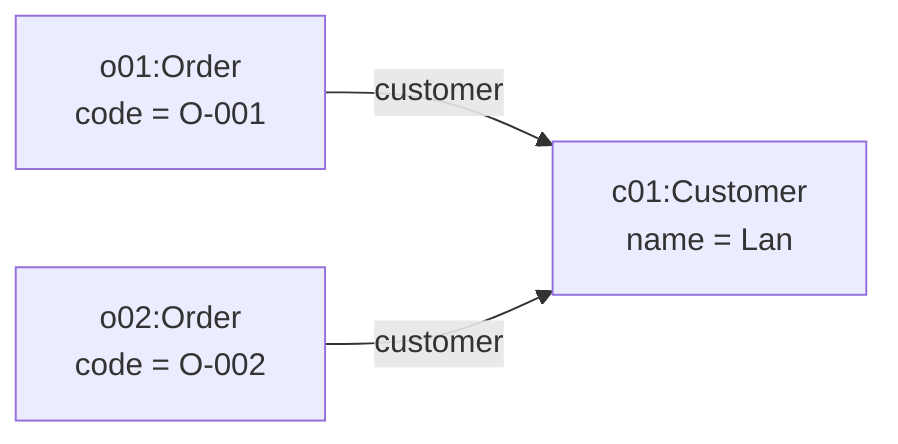

There are **three objects**, not four: two `Order` objects and one `Customer` object. Both links point to `c01`. In Java:

```java
Customer c01 = new Customer("c01", "Lan");
Order o01 = new Order("o01", "O-001", c01);
Order o02 = new Order("o02", "O-002", c01);

System.out.println(o01.customer == o02.customer); // true
```

This snippet runs inside `main` of `ObjectDiagramDemo` using the declared nested classes. If you create **two** different `Customer` objects with the name “Lan,” the snapshot needs **two separate boxes**. Equal attribute values do not make two objects one instance.

This is helpful for debugging data updates: changing a shared object may be observed through multiple reference paths, whereas changing another object with equal values is not.

## 8. When Should You Use Object Diagrams?

**Clarify requirements and domain scenarios.** For reservations, snapshot `room01`, `booking17`, and `guest03` to discuss “who reserved this room at a specified moment.”

**Check constraints and multiplicities.** If a class diagram requires every `OrderItem` to have a `Product`, a snapshot with an item lacking a product is **a rule-violating state**. The diagram makes the counterexample visible.

**Explain aliasing and shared state.** Two links to one object clarify why a change can be observed through different objects.

**Debug object graphs.** When tests fail because an item belongs to the wrong order or a user retains outdated access, before/after diagrams reveal incorrect links. Heap graphs can differ from database relationships before flushing or because of caches.

**Design tests.** Define an expected input snapshot and a resulting post-operation snapshot. Assertions can verify link counts, identities, attribute values, and domain invariants.

### Verify the Snapshot with Java Tests

Add suitable checks at the end of the example's `main`:

```java
if (o01.getItems().size() != 2) {
    throw new AssertionError("Order must contain two items at t1");
}

if (o01.customer != c01) {
    throw new AssertionError("Order customer link is incorrect");
}

if (o01.getItems().get(1).product != p02) {
    throw new AssertionError("Second item points to wrong product");
}
```

These assertions verify relationships **at t1**. If requirements change to allow multiple customers per order, update class diagrams, object diagrams, and tests consistently.

## 9. Common Mistakes

| Mistake | Why it is wrong | Better approach |
|---|---|---|
| Drawing classes `Order`, `Customer` and calling it an object diagram | No concrete instances are shown | Show `o01:Order`, `c01:Customer` and their links |
| Writing `quantity: int` inside an instance box | This declares an attribute's type | Write `quantity = 2` to show current state |
| Drawing two boxes for the same instance | Suggests two separate objects | Use one box with multiple links to it |
| Assuming missing links are impossible | A snapshot may intentionally omit some graph portions | State snapshot scope and assumptions |
| Treating snapshots as an execution sequence | Object links have no individual timestamps | Draw separate t0/t1 snapshots; use sequence/activity diagrams for processing steps |
| Equating the `o01` label with Java variable or DB ID | Object identity differs from variable names and domain/DB keys | Define labeling conventions; check reference identity when needed |
| Drawing a state violating multiplicity without explanation | Misleads readers about domain rules | Mark it as invalid or fix the association |
| Treating Mermaid arrows as method calls | Links between objects represent associations | Use field/role labels; distinguish from sequence-diagram messages |

## 10. Practice Exercises

**Exercise 1 — identify instances:** The system has `Student` and `Course`. Students An and Binh both enroll in a Java course. How many student and course objects are needed?

**Hint:** Two distinct `Student` objects and **one** `Course` object linked to both, assuming they refer to the same Java course.

**Exercise 2 — class model to snapshot:** A class diagram shows `Library 1 — 0..* Book`. At snapshot time, library `L1` holds books `B1` and `B2`. Draw three instance boxes and two links. What changes when `B2` moves to library `L2`?

**Hint:** Before: `L1—B1` and `L1—B2`. After: `L1—B1` and `L2—B2`. Book objects may remain the original instances.

**Exercise 3 — detect an invalid state:** Every `OrderItem` must reference exactly one product. A snapshot shows `i03:OrderItem` without a link to `Product`. Can you conclude that it is definitely an error?

**Hint:** If the snapshot is **complete with respect to product links**, it violates the constraint; if it intentionally omits details, verify before concluding.

**Exercise 4 — are two pictures a sequence diagram?** One shows an order in `DRAFT`, the other in `PAID`. What do the images reveal, and what do they omit?

**Hint:** They show values at two moments but not which APIs were called, how transactions ran, or the order of messages among components.

**Exercise 5 — check identity:** Two orders reference `customerA` and `customerB`, both named Lan, but `customerA != customerB`. Draw the correct number of boxes and links.

**Hint:** Four objects—two orders and two customers—because the customers are separate instances.

---

**Remember:** Class diagrams describe *types and structural rules*, while object diagrams describe *instances, values, and links at a chosen moment*. State the snapshot time, graph scope, identity labels, and how each link corresponds to real program state.


</details>

- [Back to top](#back-to-top)

---

## <a id="modeling-007">Sequence diagrams: interaction order</a>

<details>
<summary>View details</summary>

# Sequence Diagrams: Interaction Order in OOP

When a feature involves several objects, a class diagram shows **which objects are related**; a **UML sequence diagram** shows **who calls whom, in what order, and how results return** for a particular scenario.

For example, when a library member selects “Borrow Book,” the system checks copy availability, active-loan limits, due dates, and persistence before responding. A sequence diagram clarifies **who owns each step** and **which branch handles an invalid request**.

## 1. When Do You Need a Sequence Diagram?

Use sequence diagrams to answer:

- Which call originates from an actor, and which object receives it first?
- In what **order** does a use case pass through controller, service, repository, and domain objects?
- How is each call's result used to make decisions?
- Where does processing stop on failure? Is anything still persisted?
- Are there loops, optional calls, or parallel/asynchronous operations?
- Are responsibilities correctly placed, or does a controller/service do too much?

A diagram describes **one interaction or a group of scenarios for one behavior**, not necessarily the whole system. Start with **a use case that can be stated as a sentence**, such as “A member borrows a book copy.”

| Question | More suitable diagram type |
| --- | --- |
| Which classes have attributes, operations, and relationships? | Class diagram |
| Which steps and decision branches form an algorithm? | Activity diagram |
| Who sends which messages, and in what order? | **Sequence diagram** |
| Which states can an object transition through? | State machine |
| How are deployable components connected architecturally? | Component/deployment diagram |

Sequence diagrams help when objects collaborate, but adding one merely to document two numbers being added inside a method may be more complex than the code.

## 2. Elements and Top-to-Bottom Reading

A sequence diagram uses a **horizontal axis** for participants/lifelines and a **vertical axis** for message ordering. Messages lower on the diagram generally occur later in the scenario.

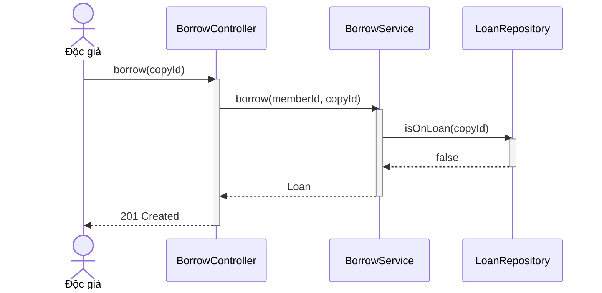

| Element | Meaning | Mermaid interpretation |
| --- | --- | --- |
| **Actor** | User or external system initiating interaction | `actor U as Độc giả` |
| **Participant** | Object, service, or component sending/receiving messages | `participant S as BorrowService` |
| **Lifeline** | Vertical line showing participant presence during interaction | Shown below participant label |
| **Message (call)** | Directed call or request from sender to recipient | `S->>R: isOnLoan(copyId)` |
| **Return message** | Result sent back, often drawn with a dashed arrow | `R-->>S: false` |
| **Activation** | Interval where a participant executes work in the interaction | `activate S`, `deactivate S` |
| **Combined fragment** | Box for branches, loops, options, parallel paths, etc. | `alt`, `opt`, `loop`, `par` |
| **Note** | Annotation for important rules or assumptions | `Note over S,R: ...` |

In standard UML, an *activation* is also called an **execution specification**. It represents an execution interval, **not necessarily** CPU time or measured duration. Lifelines are not necessarily separate threads.

**Important ordering note:** the diagram shows relative order of depicted interactions. The vertical distance between two arrows **does not automatically** represent elapsed milliseconds. Annotate durations, timeouts, or deadlines explicitly when needed.

## 3. Distinguish Message Types

### 3.1. Synchronous Calls and Returns

For an ordinary Java invocation:

```java
boolean borrowed = repository.isOnLoan(copyId);
```

The caller waits for completion or an exception before continuing along the same control flow. One common notation is:

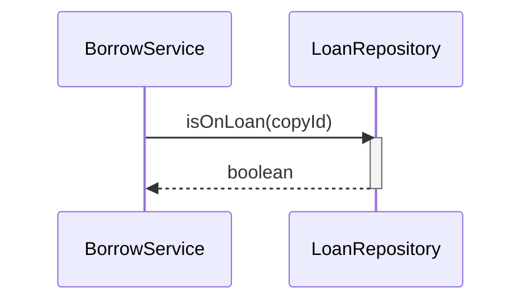

In Mermaid, `->>` is a solid arrow and `-->>` a dashed return arrow; **synchronous versus asynchronous semantics depend on the message meaning as well as notation**, not one arrow character alone. Standard UML has distinct call/return message notation.

### 3.2. Asynchronous Calls

For example, an application enqueues an email-generation request and continues without waiting for the email to be sent:

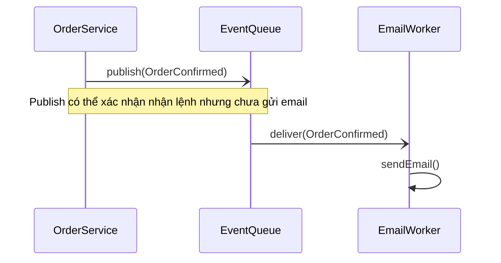

Mermaid `-)` denotes an open arrowhead often used for asynchronous messages. However, **changing a diagram symbol cannot make Java code asynchronous**. Real mechanisms include queues, event buses, callbacks, `CompletableFuture`, workers, or nonblocking protocols.

Also, `publish(...)` may itself be a synchronous queue-client call that waits for broker acknowledgment, while **email processing** runs asynchronously. Distinguish *publishing/enqueuing an event* from *executing the task*.

### 3.3. Self-Messages, Creation, and Destruction

- **Self-message:** an object invokes another of its own methods, such as `validator.validateState()`.
- **Create message:** an object requests a new instance, such as `new Loan(...)`.
- **Destroy message:** indicates the end of an object's lifecycle in the interaction model.

Do not confuse the end of a lifeline with Java garbage collection. The JVM does not guarantee collection when a variable leaves scope, and `AutoCloseable` resources still need explicit closing policies.

## 4. Combined Fragments: Branches and Loops

Control fragments avoid separate diagrams for every outcome.

| Fragment | Meaning | Example |
| --- | --- | --- |
| `alt` | Mutually exclusive branches based on guards | Copy borrowed / copy available |
| `opt` | Optional block that may execute or be skipped | Apply discount only when code exists |
| `loop` | Repeated interaction block | Check each order line in turn |
| `par` | Segments may run concurrently/interleave | Two independent jobs overlap |
| `break` | Early exit from surrounding interaction on a guard | Stop after authentication failure |
| `critical` | Critical interaction region requiring no interleaving under the model constraint | Operation protected against concurrent updates |

Example of three common fragments:

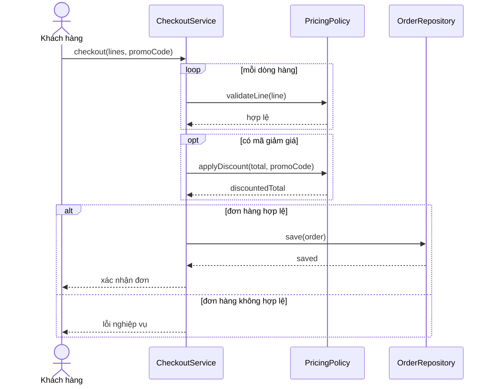

**Do not treat `par` or `critical` as synchronization mechanisms already present in the application.** Fragments record design intent. Competing transactions still require locks, isolation, optimistic concurrency, unique constraints, or equivalent enforcement at appropriate boundaries.

## 5. Running Scenario: Borrowing a Book Copy

Requirements:

1. Member submits `memberId` and `copyId`.
2. System rejects if the copy is currently borrowed.
3. System rejects if the member has reached the active-loan limit.
4. If allowed, calculate the due date from the borrowing date and policy, create a loan, and persist the result.
5. Success responds with **201** and loan data; unavailable copy returns **409**; quota violation returns **422** (illustrative API choices, not mandatory for every API).

### Full-Flow Sequence Diagram

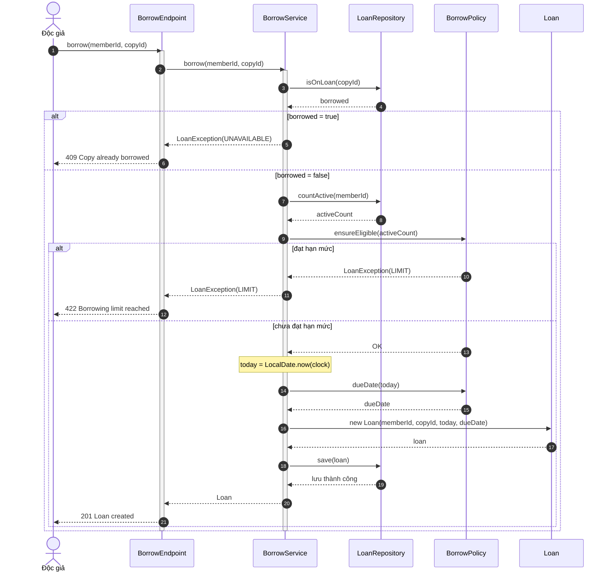

The diagram uses `autonumber` for **displayed message ordering**, not Java source lines or HTTP request counts. Exception arrows depict error responses across service/controller boundaries; Java exceptions **are not** ordinary return values.

When “copy already borrowed,” there is **no** `countActive` or `save` call. When “quota reached,” there is **no** `dueDate` or `save` call. These details validate call ordering and side effects, not merely final outcomes.

## 6. Runnable Java 17 Program Matching the Diagram

Put all code below in `SequenceDiagramDemo.java`:

```java
import java.time.Clock;
import java.time.Instant;
import java.time.LocalDate;
import java.time.ZoneOffset;
import java.util.LinkedHashMap;
import java.util.Map;
import java.util.Objects;

public class SequenceDiagramDemo {

    enum Reason { UNAVAILABLE, LIMIT }

    static final class LoanException extends RuntimeException {
        private final Reason reason;

        LoanException(Reason reason, String message) {
            super(message);
            this.reason = Objects.requireNonNull(reason);
        }

        Reason reason() { return reason; }
    }

    // Entity/value: bất biến nội tại được kiểm tra ở constructor.
    record Loan(String memberId, String copyId,
                LocalDate borrowedOn, LocalDate dueOn) {
        Loan {
            memberId = required(memberId, "memberId");
            copyId = required(copyId, "copyId");
            Objects.requireNonNull(borrowedOn, "borrowedOn");
            Objects.requireNonNull(dueOn, "dueOn");
            if (!dueOn.isAfter(borrowedOn)) {
                throw new IllegalArgumentException("dueOn must be later");
            }
        }
    }

    // Domain policy: luật hạn mức và hạn trả.
    record BorrowPolicy(int maxActive, int loanDays) {
        BorrowPolicy {
            if (maxActive <= 0 || loanDays <= 0) {
                throw new IllegalArgumentException("Invalid policy");
            }
        }

        void ensureEligible(long activeCount) {
            if (activeCount >= maxActive) {
                throw new LoanException(
                        Reason.LIMIT, "Borrowing limit reached");
            }
        }

        LocalDate dueDate(LocalDate start) {
            return start.plusDays(loanDays);
        }
    }

    // Port: hợp đồng truy vấn/lưu, không phụ thuộc database cụ thể.
    interface LoanRepository {
        boolean isOnLoan(String copyId);
        long countActive(String memberId);
        void save(Loan loan);
    }

    // Adapter cho demo: mỗi copyId có tối đa một Loan active.
    static final class InMemoryLoanRepository implements LoanRepository {
        private final Map<String, Loan> activeByCopy = new LinkedHashMap<>();

        @Override
        public boolean isOnLoan(String copyId) {
            return activeByCopy.containsKey(copyId);
        }

        @Override
        public long countActive(String memberId) {
            return activeByCopy.values().stream()
                    .filter(x -> x.memberId().equals(memberId))
                    .count();
        }

        @Override
        public void save(Loan loan) {
            Objects.requireNonNull(loan, "loan");
            if (activeByCopy.putIfAbsent(loan.copyId(), loan) != null) {
                throw new LoanException(
                        Reason.UNAVAILABLE, "Copy already borrowed");
            }
        }
    }

    // Application service: thứ tự gọi như trên sequence diagram.
    static final class BorrowService {
        private final LoanRepository loans;
        private final BorrowPolicy policy;
        private final Clock clock;

        BorrowService(LoanRepository loans, BorrowPolicy policy, Clock clock) {
            this.loans = Objects.requireNonNull(loans);
            this.policy = Objects.requireNonNull(policy);
            this.clock = Objects.requireNonNull(clock);
        }

        Loan borrow(String memberId, String copyId) {
            memberId = required(memberId, "memberId");
            copyId = required(copyId, "copyId");

            // Message 1: kiểm tra bản sách.
            if (loans.isOnLoan(copyId)) {
                throw new LoanException(
                        Reason.UNAVAILABLE, "Copy already borrowed");
            }

            // Message 2: truy vấn số lượt mượn của độc giả.
            long activeCount = loans.countActive(memberId);

            // Message 3: policy quyết định có được mượn thêm không.
            policy.ensureEligible(activeCount);

            // Message 4: thời gian được truyền từ ngoài để test ổn định.
            LocalDate today = LocalDate.now(clock);

            // Message 5: policy tính hạn trả, domain tạo đối tượng.
            Loan loan = new Loan(memberId, copyId,
                    today, policy.dueDate(today));

            // Message 6: repository ghi nhận.
            loans.save(loan);
            return loan;
        }
    }

    // Giao diện mô phỏng controller, không phụ thuộc HTTP framework.
    record Response(int status, String body) {
        @Override
        public String toString() {
            return status + " " + body;
        }
    }

    static final class BorrowEndpoint {
        private final BorrowService service;

        BorrowEndpoint(BorrowService service) {
            this.service = Objects.requireNonNull(service);
        }

        Response borrow(String memberId, String copyId) {
            try {
                Loan loan = service.borrow(memberId, copyId);
                return new Response(201,
                        "Loan created, due " + loan.dueOn());
            } catch (LoanException ex) {
                int status = ex.reason() == Reason.UNAVAILABLE ? 409 : 422;
                return new Response(status, ex.getMessage());
            }
        }
    }

    static String required(String s, String name) {
        if (s == null || s.isBlank()) {
            throw new IllegalArgumentException(name + " is required");
        }
        return s;
    }

    public static void main(String[] args) {
        Clock fixedClock = Clock.fixed(
                Instant.parse("2026-10-15T00:00:00Z"), ZoneOffset.UTC);

        LoanRepository repo = new InMemoryLoanRepository();
        BorrowPolicy policy = new BorrowPolicy(1, 14);
        BorrowEndpoint endpoint = new BorrowEndpoint(
                new BorrowService(repo, policy, fixedClock));

        System.out.println(endpoint.borrow("MEM-01", "COPY-01"));
        System.out.println(endpoint.borrow("MEM-02", "COPY-01"));
        System.out.println(endpoint.borrow("MEM-01", "COPY-02"));
        System.out.println(endpoint.borrow("MEM-02", "COPY-02"));
    }
}
```

Run:

```bash
javac SequenceDiagramDemo.java
java SequenceDiagramDemo
```

Expected output:

```text
201 Loan created, due 2026-10-29
409 Copy already borrowed
422 Borrowing limit reached
201 Loan created, due 2026-10-29
```

### Match Messages to Java Methods

| Logical order | Diagram arrow | Code invocation | Result / branch |
| --- | --- | --- | --- |
| 1 | Endpoint → Service | `service.borrow(memberId, copyId)` | Starts the use case |
| 2 | Service → Repository | `loans.isOnLoan(copyId)` | If true: throw `UNAVAILABLE` and stop |
| 3 | Service → Repository | `loans.countActive(memberId)` | Returns active loan count |
| 4 | Service → Policy | `policy.ensureEligible(activeCount)` | If over limit: throw `LIMIT` and stop |
| 5 | Service → Clock/Policy | `LocalDate.now(clock)`, `policy.dueDate(today)` | Calculate borrow/due dates |
| 6 | Service → Loan | `new Loan(...)` | Construct a valid Loan |
| 7 | Service → Repository | `loans.save(loan)` | Persist or reject if copy was taken |
| 8 | Service → Endpoint → Actor | `return loan` / `Response` | Success 201 or error 409/422 |

The diagram treats `Loan` as a participant to illustrate object creation. You need not give every `String`, `List`, or simple helper a lifeline. Show the participants important to **responsibility and communication** in the use case.

The example deliberately treats all loans in the repository as active. Returns, borrower authorization, and validation of genuine book-copy registration remain outside the model.

**Concurrency limitation:** the in-memory code demonstrates one sequential call, not multi-request transactions. Concurrent calls can both pass `countActive` and exceed one member's limit; `LinkedHashMap` is also not thread-safe. Production must check/enforce rules under suitable transactions, locks, or other invariant-preserving mechanisms with concurrency-safe repositories/databases. A sequence diagram describes interactions and **does not guarantee atomicity**.

## 7. Use Diagrams to Identify Design Defects

### Defect A: Wrong Call Order Causes Side Effects

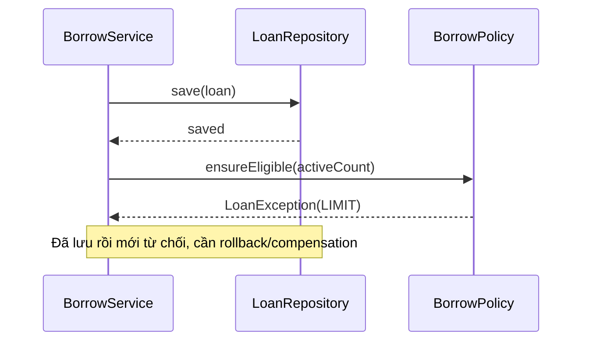

If `save` has already committed, policy checks are too late. A correctly configured transaction may roll back after an exception, but the design should not assume transactions always exist.

### Defect B: Controller Duplicates Domain Rules

If a diagram shows `Controller -> Repository -> Controller -> Policy -> Controller -> Repository` with the controller calculating prices/quotas, responsibilities may be misallocated. An application or domain service may coordinate better. **Many arrows are not inherently bad**; the concern is business details leaking to the wrong layer.

### Defect C: Missing Failure Paths

A “save → success” diagram may omit validation, timeouts, or failed persistence. At least describe branches that affect the **use-case contract**: what the user sees, which later calls are skipped, and whether partial state remains.

### Defect D: Confusing Asynchronous Notification with Completion

If a service emits `OrderCreated` and returns success, it has completed its synchronous portion. Do not depict email as already sent unless the system waits for the result. With event buses, model retries, dead letters, and at-least-once guarantees where relevant.

## 8. From Requirements to Sequence Diagrams: 7 Steps

1. **Choose a specific scenario.** Capture inputs, preconditions, successful outcome, and significant failures.
2. **Identify real participants.** Actor, adapter/controller, application service, domain policy/entity, repository, and external service. Do not create a class just to draw another arrow.
3. **Draw the success flow first.** List actual calls top-to-bottom; each recipient should own the requested behavior.
4. **Include meaningful returns.** Show results or exceptions that change decisions, not every Java `return` statement.
5. **Add `alt`, `opt`, and `loop`.** Clarify conditions and stopping points without diagramming insignificant branches.
6. **Review side effects.** Are `save`, `publish`, `send`, and `charge` called only after appropriate checks? Is state valid on failure?
7. **Compare against code and tests.** Check diagram order against actual methods and update one or both as design evolves.

Diagrams support communication and design verification. They are most useful when precise enough to compare against source code yet concise enough to read.

## 9. Testing Interaction Order

Not every flow needs an assertion for **every** internal call order. Test order when it is part of a **behavioral requirement**:

- If a copy is already on loan, `save` must never be called.
- If a member is over quota, `save` must not be called.
- If validation fails, no success notification must be emitted.
- If events are published after commit, verify publishing relative to persistence (or an outbox).

A **spy repository** can record observable calls:

```java
// Minh họa ý tưởng spy; có thể viết thành class implements LoanRepository.
List<String> calls = new ArrayList<>();
// isOnLoan -> calls.add("isOnLoan")
// countActive -> calls.add("countActive")
// save -> calls.add("save")

// Với nhánh thành công, mong đợi:
List<String> expected =
        List.of("isOnLoan", "countActive", "save");
```

For the `UNAVAILABLE` branch, expect only `["isOnLoan"]`. For `LIMIT`, expect `["isOnLoan", "countActive"]`. Such tests assert the absence of **incorrectly ordered side effects** without freezing every implementation detail. JUnit/Mockito projects may use spies/mocks for interactions that form part of the protected contract.

Under concurrency, one sequential sequence diagram cannot prove ordering between independent requests. Add contention models, storage constraints, and integration/concurrency tests.

## 10. Avoiding Common UML Misinterpretations

| Common misconception | Correct interpretation |
| --- | --- |
| Every participant is a thread | Usually an instance or role, not necessarily a thread |
| A lower arrow means N milliseconds later | Vertical position indicates relative order, not measured delay |
| Dashed arrow means an “asynchronous” message | Return messages are often dashed; asynchronous messages have separate semantics |
| Adding `par` makes Java execute concurrently | Real parallel-execution mechanisms are required |
| `alt` means both branches run simultaneously | `alt` selects one conditional branch |
| Diagram must show every setter/getter | Show messages important to the scenario and its responsibility allocation |
| Sequence diagrams replace class diagrams | They answer complementary, different questions |
| Diagram shows successful persistence, therefore it is thread-safe | Enforce invariants with suitable transactions/locking/constraints |
| Every exception is drawn as a return value | Error paths may be modeled but differ from normal returns |

Label messages with **actual operations** such as `countActive(memberId)`, `save(loan)`, and `publish(event)` instead of vague “process,” “call,” or “return data.” Give each `alt` guard enough detail to distinguish paths.

## 11. Practice Exercises

**Exercise A — Login.** Draw a sequence diagram for an actor, `LoginController`, `AuthenticationService`, `UserRepository`, `PasswordVerifier`, and `TokenIssuer`. Show missing-user, incorrect-password, and successful-login branches. Issue tokens only after authentication; do not show real systems using `==` against plaintext passwords.

**Exercise B — Shopping Cart.** Draw a `loop` over cart lines, an `opt` for promotions, and an `alt` for valid/invalid orders. Match diagram arrows to methods on Java classes you design.

**Exercise C — Fix Incorrect Ordering.** A payment diagram calls `notifySuccess()` before `charge()` and calls `charge()` before `checkAvailability()`. Redraw the flow and explain why refunds/inventory reservations need an explicit policy after external side effects.

**Exercise D — Distinguish Synchronous from Asynchronous.** After persisting an order, the application enqueues an event and immediately returns `202 Accepted`. Show publishing separately from later consumer processing, annotate retries/idempotency, and specify when “email sent” is actually true.

**Exercise E — Test Against the Diagram.** Write a fake/spy `LoanRepository` for the Java example. Record call order for three cases: copy borrowed, member at quota, and successful borrow. Ensure neither rejected case invokes `save`.

### Sequence Diagram Completion Checklist

- Does the diagram serve a clearly stated scenario or use case?
- Does each participant have a specific role in source code/design?
- Do messages reach **the right recipient in the right order**?
- Does `alt` include necessary success and failure outcomes?
- Are returns/exceptions distinguished from asynchronous delivery?
- Are `loop`, `opt`, and `par` used only for business/execution reasons?
- Are side effects such as persistence, payments, and event publication correctly ordered?
- Does the diagram match code and test call order?
- Are transaction, concurrency, and timing assumptions explicit?

**Remember:** A sequence diagram tells the story of **one OOP behavior over time** through messages among objects. Its value lies not in arrow count but in exposing ordering errors, misplaced responsibilities, and missing failure paths before those defects enter the code.


</details>

- [Back to top](#back-to-top)

---

## <a id="modeling-008">State diagrams: valid state transitions</a>

<details>
<summary>View details</summary>

# State Diagrams: Valid State Transitions in OOP

## 1. Why Model State?

An object is not always allowed to perform every action. A new order may be submitted for payment; a paid order may proceed to packing; a delivered order cannot return to its newly created state just by assigning another value to `status`.

If you only use:

```java
order.setStatus("SHIPPED");
```

then any code can mark an order “shipped,” even before payment or without a tracking number. When rules are scattered across controllers, services, and repositories, new flows can easily introduce invalid states.

A **UML state machine/state diagram** describes **one object's lifecycle**: available states, events triggering transitions, required conditions, and actions performed upon transition.

This is useful for orders, support tickets, contracts, accounts, approval requests, shipments, and background jobs with clear lifecycles.

## 2. Five Elements of a State Diagram

| Element | Meaning | Order example |
|---|---|---|
| **State** | Situation in which the object exists, determining available behavior | `DRAFT`, `PAID`, `SHIPPED` |
| **Event/trigger** | Occurrence or request triggering a transition | `SUBMIT`, `CONFIRM_PAYMENT` |
| **Guard** | Boolean expression required to take a transition | `[paidAmount == total]` |
| **Effect/action** | Operation performed on a successful transition | Store tracking number; create domain data |
| **Transition** | Edge connecting a source state to a target state | `PAID --START_PACKING--> PACKING` |

A UML transition label commonly follows this form:

```text
event [guard] / effect
```

For example:

```text
PACKING --> SHIPPED : SHIP [trackingCode hợp lệ] / lưu trackingCode
```

Read it as: “If an order is in `PACKING` and receives `SHIP`, it may transition to `SHIPPED` only with a valid tracking number; the transition saves that number.”

A **failed guard** means this transition **cannot execute**. Define what happens to invalid requests: a business error, unchanged state, or another branch. In the Java example, we **throw an exception without changing state**.

## 3. Order Lifecycle State Diagram

```mermaid
stateDiagram-v2
    [*] --> DRAFT : tạo đơn
    DRAFT --> WAITING_PAYMENT : SUBMIT
    DRAFT --> CANCELLED : CANCEL
    WAITING_PAYMENT --> PAID : CONFIRM_PAYMENT [paidAmount == total]
    WAITING_PAYMENT --> CANCELLED : CANCEL
    PAID --> PACKING : START_PACKING
    PACKING --> SHIPPED : SHIP [trackingCode hợp lệ] / lưu mã vận đơn
    SHIPPED --> DELIVERED : CONFIRM_DELIVERY
    DELIVERED --> [*]
    CANCELLED --> [*]
```

In the diagram:

- **`[*]` on the left** denotes the initial pseudostate and entry into `DRAFT`.
- **Rounded rectangles** (state labels in Mermaid) are stable order states.
- **Arrows** depict transitions, with labels for events, guards, and actions where relevant.
- **`[*]` on the right** denotes the modeled lifecycle's final state. It **does not mean the Java object or database record is automatically deleted**.
- `CANCELLED` is reachable from `DRAFT` and `WAITING_PAYMENT` **in this example only**. After payment, refunds generally need a separate workflow rather than simply allowing `PAID → CANCELLED` and ignoring collected money.

The diagram quickly answers:

- Can a `DRAFT` order be submitted or canceled? **Yes.**
- Can a `PAID` order move directly to `SHIPPED`? **No;** it must enter `PACKING` first.
- Can a `SHIPPED` order be confirmed delivered? **Yes.**
- Can a `DELIVERED` order be canceled in this simple flow? **No.**

You need not draw every prohibited transition. **Missing edges are disallowed by default** in a closed-transition state machine unless the model specifies another treatment.

## 4. Transition Tables as Testable Contracts

| Current state | Event | Guard | Domain action/effect | Next state |
|---|---|---|---|---|
| `DRAFT` | `SUBMIT` | No additional guard | Record order submission | `WAITING_PAYMENT` |
| `DRAFT` | `CANCEL` | No additional guard | Record cancellation | `CANCELLED` |
| `WAITING_PAYMENT` | `CONFIRM_PAYMENT` | Confirmed amount equals order total | Accept verified payment | `PAID` |
| `WAITING_PAYMENT` | `CANCEL` | No additional guard | Record cancellation | `CANCELLED` |
| `PAID` | `START_PACKING` | No additional guard | Begin packing | `PACKING` |
| `PACKING` | `SHIP` | Tracking number contains valid content | Store tracking number | `SHIPPED` |
| `SHIPPED` | `CONFIRM_DELIVERY` | No additional guard in example | Record successful delivery | `DELIVERED` |

Every `(state, event)` combination absent from the table is **rejected**. Adding a state requires reviewing incoming/outgoing edges, guards, effects, and tests; adding an enum constant alone is insufficient.

Important rules:

1. **Guards are evaluated using current state and event data.** Avoid mutations during a “check-only” phase.
2. **Transitions are not arbitrary setters.** Events may need parameters: payment confirmation needs an amount, shipping needs a tracking number.
3. **Terminal states need an explicit policy.** Reading, exporting, or reporting may remain allowed; lifecycle-mutating events are restricted.
4. **State lists are only part of the model.** Event/guard/transition tables determine valid behavior.

## 5. Complete Java Example: Reject Invalid State Transitions

Save as `OrderStateMachineDemo.java`. This uses JDK 11+ and **no external dependencies**.

```java
import java.util.ArrayList;
import java.util.EnumMap;
import java.util.List;
import java.util.Map;
import java.util.Objects;

public class OrderStateMachineDemo {

    enum Status {
        DRAFT, WAITING_PAYMENT, PAID, PACKING,
        SHIPPED, DELIVERED, CANCELLED
    }

    enum Event {
        SUBMIT, CONFIRM_PAYMENT, START_PACKING,
        SHIP, CONFIRM_DELIVERY, CANCEL
    }

    static final class InvalidTransitionException
            extends IllegalStateException {
        InvalidTransitionException(Status from, Event event) {
            super(from + " --" + event + "--> không hợp lệ");
        }
    }

    static final class Order {
        // Tập các cạnh duy nhất được phép trong vòng đời.
        private static final Map<Status, Map<Event, Status>> RULES =
                new EnumMap<>(Status.class);

        static {
            for (Status status : Status.values()) {
                RULES.put(status, new EnumMap<>(Event.class));
            }

            allow(Status.DRAFT, Event.SUBMIT, Status.WAITING_PAYMENT);
            allow(Status.DRAFT, Event.CANCEL, Status.CANCELLED);
            allow(Status.WAITING_PAYMENT, Event.CONFIRM_PAYMENT,
                    Status.PAID);
            allow(Status.WAITING_PAYMENT, Event.CANCEL,
                    Status.CANCELLED);
            allow(Status.PAID, Event.START_PACKING, Status.PACKING);
            allow(Status.PACKING, Event.SHIP, Status.SHIPPED);
            allow(Status.SHIPPED, Event.CONFIRM_DELIVERY,
                    Status.DELIVERED);
        }

        private static void allow(
                Status from, Event event, Status to) {
            if (RULES.get(from).putIfAbsent(event, to) != null) {
                throw new IllegalStateException(
                        "Duplicate rule: " + from + " / " + event);
            }
        }

        private final String id;
        private final long totalCents;
        private final List<String> history = new ArrayList<>();
        private Status status = Status.DRAFT;
        private String trackingCode;

        Order(String id, long totalCents) {
            if (id == null || id.isBlank()) {
                throw new IllegalArgumentException("Blank order id");
            }
            if (totalCents <= 0) {
                throw new IllegalArgumentException(
                        "Total must be positive");
            }
            this.id = id;
            this.totalCents = totalCents;
        }

        String id() {
            return id;
        }

        Status status() {
            return status;
        }

        String trackingCode() {
            return trackingCode;
        }

        List<String> history() {
            return List.copyOf(history);
        }

        // Chỉ những hành vi được đặt tên mới thay đổi trạng thái.
        void submit() {
            advance(Event.SUBMIT);
        }

        void cancel() {
            advance(Event.CANCEL);
        }

        void confirmPayment(long paidAmountCents) {
            // Kiểm tra event hợp lệ với trạng thái trước.
            Status next = nextStatus(Event.CONFIRM_PAYMENT);

            // Guard phụ thuộc dữ liệu của event.
            if (paidAmountCents != totalCents) {
                throw new IllegalArgumentException(
                        "Payment amount mismatch");
            }

            change(Event.CONFIRM_PAYMENT, next);
        }

        void startPacking() {
            advance(Event.START_PACKING);
        }

        void ship(String newTrackingCode) {
            Status next = nextStatus(Event.SHIP);
            if (newTrackingCode == null
                    || newTrackingCode.isBlank()) {
                throw new IllegalArgumentException(
                        "Tracking code is required");
            }

            // Tất cả validation trước khi đổi trạng thái.
            trackingCode = newTrackingCode;
            change(Event.SHIP, next);
        }

        void confirmDelivery() {
            advance(Event.CONFIRM_DELIVERY);
        }

        private Status nextStatus(Event event) {
            Objects.requireNonNull(event, "event");
            Status next = RULES.get(status).get(event);
            if (next == null) {
                throw new InvalidTransitionException(status, event);
            }
            return next;
        }

        private void advance(Event event) {
            Status next = nextStatus(event);
            change(event, next);
        }

        private void change(Event event, Status next) {
            Status previous = status;
            status = next;
            history.add(previous + " --" + event + "--> " + next);
        }
    }

    public static void main(String[] args) {
        Order order = new Order("OD-100", 120_000L);
        order.submit();

        try {
            order.confirmPayment(99_000L); // Sai số tiền.
            throw new AssertionError("Must reject wrong amount");
        } catch (IllegalArgumentException expected) {
            System.out.println("Từ chối số tiền sai");
        }

        System.out.println(
                "Sau guard thất bại: " + order.status());

        order.confirmPayment(120_000L);
        System.out.println("Sau thanh toán: " + order.status());

        try {
            order.cancel(); // Không có cạnh PAID -> CANCELLED.
            throw new AssertionError("Must reject cancel");
        } catch (InvalidTransitionException expected) {
            System.out.println("Từ chối hủy: "
                    + expected.getMessage());
        }

        System.out.println("Sau event sai: " + order.status());

        order.startPacking();
        order.ship("VN123");
        order.confirmDelivery();

        System.out.println("Đã giao: " + order.status()
                + ", tracking=" + order.trackingCode());

        Order draft = new Order("OD-101", 50_000L);
        draft.cancel();

        try {
            draft.submit();
            throw new AssertionError("Cancelled order cannot submit");
        } catch (InvalidTransitionException expected) {
            System.out.println("Không gửi lại đơn đã hủy");
        }

        if (order.status() != Status.DELIVERED
                || order.history().size() != 5
                || draft.status() != Status.CANCELLED) {
            throw new AssertionError("Invalid state history");
        }

        System.out.println("Các chuyển trạng thái đều hợp lệ");
    }
}
```

Run:

```bash
javac OrderStateMachineDemo.java
java OrderStateMachineDemo
```

Expected output:

```text
Từ chối số tiền sai
Sau guard thất bại: WAITING_PAYMENT
Sau thanh toán: PAID
Từ chối hủy: PAID --CANCEL--> không hợp lệ
Sau event sai: PAID
Đã giao: DELIVERED, tracking=VN123
Không gửi lại đơn đã hủy
Các chuyển trạng thái đều hợp lệ
```

### How Are Valid States Enforced?

- `status` is `private`; there is no external `setStatus(...)`.
- `RULES` contains **only** permitted edges; arbitrary enum-to-enum transitions are impossible.
- `nextStatus(event)` fails if the corresponding edge does not exist.
- `confirmPayment(...)` and `ship(...)` validate data **before updating state**.
- `change(...)` centralizes state updates and history recording; callers use named business APIs.
- `history()` returns an unmodifiable snapshot so callers cannot arbitrarily rewrite internal history.

The sample `Order` is an **entity enforcing lifecycle invariants**. Payment gateways, repositories, caller authorization, and emails belong to collaborators; `Order` should not open HTTP/SQL connections to complete a transition.

**Technical limitation:** The demo's field/history mutations run sequentially in memory. They **do not** establish atomic cross-thread or database transactions; later sections discuss preserving state in real applications.

## 6. When to Use Enums, Transition Tables, State Pattern, or Workflow Engines

| Implementation | Appropriate when | Caveats |
|---|---|---|
| `enum Status` with domain methods | Few states, simple and stable rules | May grow into large `if/switch` blocks |
| Transition table (such as `RULES`) | Explicit edges with source/event/target validation | Data-dependent guards still require modeling |
| **State Pattern** | Each state has many distinct behaviors that evolve separately | Adds classes; unnecessary for simple 3–5-state workflows |
| State machine library | Many branches, guards, entry/exit actions, nested states | Understand its event, persistence, and idempotency semantics |
| Workflow/process engine | Long-running flows with several parties, retries/timers/approvals | Operational complexity; does not replace domain invariants |

A small **State Pattern** example:

```java
interface OrderState {
    void submit(OrderContext context);
    void cancel(OrderContext context);
}

final class DraftState implements OrderState {
    @Override
    public void submit(OrderContext context) {
        context.changeTo(new WaitingPaymentState());
    }

    @Override
    public void cancel(OrderContext context) {
        context.changeTo(new CancelledState());
    }
}
```

This snippet **only illustrates the pattern's structure**, assuming `OrderContext`, `WaitingPaymentState`, and `CancelledState` are defined separately. In a real project, every state implementation must reject unsupported events and the context must permit changes only through controlled transitions. There is no need for one class per state if an enum and transition table suffice.

## 7. Extended UML State Machine Notation

A state diagram can express more than a graph of enum constants. Important symbols include:

| Symbol / concept | Interpretation | Example use |
|---|---|---|
| Initial pseudostate | Default entry point for a state machine or region | A new order enters `DRAFT` |
| Final state | Completes the state machine or region | Order processing has ended |
| Self-transition | An event returns to the same state, possibly executing exit/entry behaviors | Receive updated details while awaiting approval |
| Internal transition | Handles an event *within* a state without exiting and re-entering | Update supporting details while waiting |
| Entry / exit / do activity | Behavior on entering, leaving, or remaining in a state | Start/stop a task based on state |
| Choice / junction | Branches or joins transitions | Decide based on an approval result |
| Composite state | A state containing substates | `PROCESSING` contains packing and verification |
| History pseudostate | Returns to a previously active substate of a composite state | Resume a paused workflow |
| Orthogonal regions | Several state regions progress concurrently | Payment and shipping are separate state dimensions |

Distinguish **self-transitions** from **internal transitions**: both may leave the *state name* unchanged, but entry/exit behavior can differ. Do not assume an event that leaves an enum constant unchanged means “nothing happened.”

Mermaid example showing entry/exit behavior:

```mermaid
stateDiagram-v2
    [*] --> WAITING
    state WAITING {
        direction LR
        [*] --> READY
        READY --> REVIEWING : REVIEW
        REVIEWING --> READY : REVISION_REQUESTED
    }
    WAITING --> APPROVED : APPROVE [checksPassed]
    APPROVED --> [*]
```

This diagram uses a **composite state** `WAITING` with two substates, `READY` and `REVIEWING`. In larger workflows, nested states reduce duplicate conditions compared with forcing every variation into a flat enum.

## 8. Guards, Actions, Invariants, and Authorization Are Different Concerns

Do not collapse every rule into one vague `if`:

**Guard:** a condition required to take a specific transition, such as `paidAmount == total`.

**Action/effect:** a domain effect executed when the transition occurs, such as saving a tracking number, creating a domain event, or updating a confirmation timestamp.

**Invariant:** a condition that must always hold for an object in a valid state, for example:

- If `status == SHIPPED` or `DELIVERED`, a nonblank `trackingCode` must exist.
- If `status == PAID`, there must be a corresponding valid payment confirmation (in a real system).
- A terminal state cannot return to an unprocessed state without an explicitly defined transition.

**Authorization:** who may initiate an event? For example, warehouse staff may invoke `ship()`, while only a verified payment provider may request `confirmPayment()`. A transition **valid under state rules** can still be **forbidden for security reasons** if the caller lacks authorization. Authorization is generally checked at the application/API boundary using authenticated request information.

Each rule needs an explicit owner so that new APIs cannot bypass it.

## 9. State Diagrams Versus Class and Sequence Diagrams

| Diagram | Question answered | Application to orders |
|---|---|---|
| **Class diagram** | Which classes, fields, methods, and relationships exist? | `Order` has `status`, `totalCents`, `ship()` |
| **State diagram** | Which state is an object in, and which events permit transitions? | `PACKING --SHIP--> SHIPPED` |
| **Sequence diagram** | In a scenario, which objects call one another over time? | Controller → service → payment gateway → Order → repository |
| **Activity diagram** | How do activities and processing branches flow? | Verify payment, receive goods, pack, ship |

Example of coordinating payment confirmation:

```mermaid
sequenceDiagram
    participant Gateway as PaymentGateway
    participant App as OrderApplicationService
    participant Repo as OrderRepository
    participant Order
    Gateway->>App: callback(paymentId, amount, signature)
    App->>App: xác thực chữ ký / đối chiếu quyền
    App->>Repo: load(orderId)
    Repo-->>App: Order ở WAITING_PAYMENT
    App->>Order: confirmPayment(amount)
    Order-->>App: trạng thái PAID
    App->>Repo: save(order)
    App-->>Gateway: kết quả xử lý
```

A **state diagram** permits `WAITING_PAYMENT → PAID` when the guard holds; a **sequence diagram** shows *who* verifies the callback, loads the object, and persists the state. These diagrams complement rather than replace one another.

## 10. Real-World Failure Cases: Duplicate Callbacks, Concurrency, and Transactions

A diagram describes valid modeled transitions. When several requests affect the same database-backed object, additional mechanisms must preserve data consistency.

### Duplicate Payment Callbacks

A payment provider may resend callbacks. The first transitions the order from `WAITING_PAYMENT → PAID`; the second finds it already `PAID`. Repeated HTTP errors may lead the provider to retry indefinitely.

Apply **idempotency** at the event-handling layer:

1. Verify the signature and reconcile payment details.
2. Check whether the event ID/payment ID was already processed.
3. If the same event succeeded before, return an appropriate result **without recording payment again**.
4. For a new event, perform a valid transition within a transaction and store the idempotency key.
5. If an event has the same identifier but different content, treat it as an error or suspicious discrepancy.

Do not simply add `PAID --CONFIRM_PAYMENT--> PAID` while skipping validation; accepting an arbitrary self-transition can conceal invalid callbacks.

### Two Requests Processing the Same Stale State

Suppose two warehouse employees both load an order in `PACKING` and submit `SHIP`. Both in-memory objects see a valid event. Without version checks on the database update, a **lost update** may overwrite a tracking number or create duplicate shipping requests.

A common mechanism is **optimistic locking**:

```sql
-- Ví dụ giả định bảng orders có cột version.
UPDATE orders
SET status = 'SHIPPED',
    tracking_code = :trackingCode,
    version = version + 1
WHERE id = :orderId
  AND status = 'PACKING'
  AND version = :expectedVersion;
```

Only one request can update the expected version successfully. If the affected row count is 0, reload and report a conflict or retry according to policy. This SQL is illustrative; parameter binding depends on the library.

### Database Save Succeeds but Notification Fails

Updating state and persisting it should occur in a suitable transaction. External email/HTTP delivery **does not automatically participate in an ACID database transaction**. Often, an **outbox event** is stored within the transaction, then a worker delivers notifications after commit with retries/idempotency.

Avoid uncontrolled network operations inside state setters: failures halfway through may leave objects or stored data inconsistent.

## 11. Test State Transitions Using a Matrix

Rather than only testing “order delivered successfully,” cover **every valid edge** and important invalid events.

| Initial state | Operation | Expected result |
|---|---|---|
| `DRAFT` | `submit()` | `WAITING_PAYMENT` |
| `DRAFT` | `cancel()` | `CANCELLED` |
| `WAITING_PAYMENT` | `confirmPayment(total)` | `PAID` |
| `WAITING_PAYMENT` | `confirmPayment(wrongAmount)` | Error; remains `WAITING_PAYMENT` |
| `WAITING_PAYMENT` | `cancel()` | `CANCELLED` |
| `PAID` | `startPacking()` | `PACKING` |
| `PAID` | `cancel()` | Error; remains `PAID` |
| `PACKING` | `ship("")` | Error; remains `PACKING` |
| `PACKING` | `ship("VN123")` | `SHIPPED` and tracking number saved |
| `SHIPPED` | `confirmDelivery()` | `DELIVERED` |
| `CANCELLED` | `submit()` | Error; remains `CANCELLED` |
| `DELIVERED` | `confirmDelivery()` again | Error or idempotent result according to explicit policy |

For every invalid request, verify **that both state and related data remain unchanged unintentionally**. For instance, `ship("")` must not save an empty string before throwing.

### Additional Cases Worth Testing

- Boundary amounts `0`, negative and large values, and overflow risks.
- Tracking numbers containing only whitespace.
- Duplicate callbacks, out-of-order callbacks, and callbacks from unauthenticated sources.
- Concurrent requests transitioning the same order, especially with versioning.
- Reject operations by unauthorized users even when state otherwise permits the transition.
- Save state to the DB and load it again; verify persisted correctness and handle stale caches.
- Migrate from an earlier state machine version while orders are still in progress.

Edge-oriented testing can measure **state transition coverage** (edges exercised) and **negative transition coverage** (forbidden operations tested). You need not test infinitely many sequences; prioritize high-risk business edges and boundaries.

## 12. Avoiding State Explosion: Separate Independent Dimensions

An order may have **two relatively independent state dimensions**:

- Payment: `UNPAID`, `PAID`, `REFUND_PENDING`, `REFUNDED`.
- Fulfillment: `NOT_STARTED`, `PACKING`, `SHIPPED`, `DELIVERED`.

If you define `PAID_PACKING`, `PAID_SHIPPED`, `REFUNDED_PACKING`, and so on as enum members, combinations can grow rapidly.

Instead, model two state machines or orthogonal regions (*orthogonal regions*):

```mermaid
flowchart LR
    subgraph Payment["Trạng thái thanh toán"]
      U["UNPAID"] --> P["PAID"]
      P --> RP["REFUND_PENDING"]
      RP --> R["REFUNDED"]
    end
    subgraph Fulfillment["Trạng thái thực hiện"]
      N["NOT_STARTED"] --> K["PACKING"]
      K --> S["SHIPPED"]
      S --> D["DELIVERED"]
    end
```

These are **two graphs illustrating state dimensions** using flowcharts, not complete UML orthogonal-region notation. Separating dimensions still requires **cross-state constraints**: do not begin packing before payment or automatically refund after delivery, for example.

Use a flat enum when the lifecycle is genuinely linear and easy to read; consider multiple state machines when state dimensions progress independently and create too many combinations.

## 13. Common Design Mistakes

| Mistake | Consequence | Recommended response |
|---|---|---|
| Only an enum and a public status setter | Any caller can perform invalid transitions | Use named behavior and transition rules/tables |
| Ignoring branches from the source state | Cancellation/recovery paths may be missed | Draw explicit source–event–target edges |
| Evaluating guards after state changes | Failure leaves partially modified state | Check first and update within appropriate transactions |
| Silently ignoring every event | Caller assumes success although nothing changed | Return a clear result/error; design idempotency deliberately |
| Performing side-effecting network I/O inside guards | Checks are hard to repeat or roll back | Separate data verification, effects, and orchestration |
| Treating final state as object deletion | Confuses state lifecycle with storage lifecycle | Define retention/archival independently |
| Combining payment and delivery into many compound states | State explosion and maintainability problems | Separate dimensions where useful and define cross-state constraints |
| Testing only the happy path | Forbidden edges, retries, and failed guards remain untested | Use transition matrices and negative tests |
| Assuming diagrams protect DB from concurrent updates | Race conditions and lost updates | Locks, versions, conditional updates, and transactions |
| Adding states without migrating older data | Persisted data may contain no-longer-valid states | Plan migration and backward compatibility |

## 14. Exercise: Modeling a Helpdesk Ticket

A helpdesk system has these requirements:

- A new ticket starts in `OPEN`.
- A support agent accepts a ticket: `IN_PROGRESS`.
- The agent resolves it: `RESOLVED`.
- The user confirms resolution: `CLOSED`.
- If dissatisfied, the user reopens it from `RESOLVED` to `IN_PROGRESS`.
- Unresolved tickets cannot be closed.

Draw your own diagram and compare it with this model:

```mermaid
stateDiagram-v2
    [*] --> OPEN
    OPEN --> IN_PROGRESS : ASSIGN
    IN_PROGRESS --> RESOLVED : RESOLVE
    RESOLVED --> IN_PROGRESS : REOPEN
    RESOLVED --> CLOSED : CONFIRM
    CLOSED --> [*]
```

Self-check questions:

1. **Why is there no `OPEN → CLOSED` transition?** The business requires resolution before closure.
2. **Should `CLOSED → IN_PROGRESS` be allowed?** Only if reopening closed tickets is permitted; define an event and authorization/deadline checks.
3. **Which guards might `RESOLVE` need?** An assigned agent, nonblank resolution details, and adequate permissions.
4. **What action belongs to `CONFIRM`?** Record confirmation time and possibly publish a domain event for notifications.
5. **What if the user confirms twice?** Define idempotency and an explicit response policy.
6. **What if one agent closes a ticket while another reopens it?** Use transactions/version checks to persist a single valid final state.
7. **How would adding `WAITING_CUSTOMER` affect the model?** Define new incoming/outgoing events and update tests, not just the enum.

## 15. State Machine Completion Checklist

- Each state has **a business-meaningful name** and explicit validity conditions.
- There is **an initial state**; final states are defined where needed.
- Each event has **valid source and target states**, clear guards, and effects distinguished from validation.
- Missing transitions are handled **explicitly**.
- No setters or exposed data permit bypassing invariants.
- Tests cover **successful flows, failed guards, and forbidden transitions**, confirming state remains unchanged on failure.
- Caller authentication and authorization are enforced at suitable boundaries.
- DB or multi-worker execution uses **transactions, concurrency control, and idempotency**.
- External side effects follow appropriate retry, after-commit, or outbox policies.
- Adding states/events includes a plan for old data and callbacks still in flight.

**Core takeaway:** state indicates “where the object is”; **transition + event + guard** determines “when it may move where”; **effect and transaction** determine “which changes commit successfully.” Java code should enforce the model with named behaviors, reject missing edges, and test valid and invalid cases.


</details>

- [Back to top](#back-to-top)

---

## <a id="modeling-009">Validating models against code and real scenarios</a>

<details>
<summary>View details</summary>

# Validating OOP Models Against Java Code and Real Scenarios

> **Goal:** Learn to verify that an object-oriented model accurately represents business situations, is implemented correctly in Java, and remains correct during system operation. This lesson uses **borrowing and returning physical library book copies** to practice two-way traceability among requirements, diagrams, source code, tests, and real data.

## 1. Three Perspectives That Must Agree

An elegant model is not necessarily correct. A diagram may say “one active loan per copy,” while code still lets two people borrow the same copy. Conversely, code may pass one sample dataset yet omit late-return, return, or borrowing-limit policies.

Validation needs **three sources of evidence**:

1. **Real scenarios and business rules:** Who performs which action? Which conditions must hold? What happens for invalid requests, repeated operations, or simultaneous users?
2. **Design model:** Which concepts have identity and state? Do relationships accurately represent multiplicity, lifecycle, ownership, and responsibilities? Where are invariants enforced?
3. **Code and runtime behavior:** Do types, APIs, access levels, state changes, transactions, and tests enforce the model's promises?

~~~mermaid
flowchart TD
    R[Use case, ví dụ thực tế, business rule] <-->|kiểm chứng ý nghĩa| M[Mô hình lớp, quan hệ, invariant]
    M <-->|đối chiếu cấu trúc và trách nhiệm| C[Java API và implementation]
    C <-->|kiểm thử hành vi| T[Test và dữ liệu chạy thật]
    T -. lỗi hoặc trường hợp chưa rõ .-> R
~~~

**Validation is not just one-way from UML to code.** When reviewing existing software, work backward from code and tests to the model, then ask the domain owner whether observed behavior is intended. When they differ, **do not assume** the diagram or code is automatically right: find the domain decision and update the relevant artifacts.

## 2. Start with Observable Scenarios

Suppose the library's original requirement is:

> “Active members can borrow available book copies. Returning a copy makes it available for borrowing again.”

This raises important edge-case questions:

| Question | Assumption used in this lesson |
|---|---|
| Are loans for a title or a physical copy? | Borrow **one BookCopy** with its own unique copy ID |
| What if the account is suspended? | Borrowing is disallowed |
| How many active loans per member? | At most **3 copies** per member |
| How many people can borrow one copy? | At most **1 active loan at a time** |
| Loan duration? | **14 days** measured by calendar date |
| Returning an already returned loan? | Report an error; do not record another return |
| Does returning erase loan history? | No; retain the return date for traceability |
| Two members competing for the final available copy? | At most one request succeeds |
| Renewals, reservations, or fines? | Outside this example's scope |

These are **illustrative assumptions**, not universal library rules. Real projects must record policy approvers, effective dates, exceptions, and unresolved questions.

### Convert Them into Use Cases

**UC-BORROW: Borrow a Book Copy**

- **Primary actor:** Member (through a librarian or application).
- **Trigger:** Member requests a copy identified by `copyId`.
- **Preconditions:** The system can identify both member and copy.
- **Success flow:** Verify account → check active-loan limit → check copy availability → create loan → mark copy borrowed → return loan ID and due date.
- **Alternative flows:** Suspended account; missing copy; member already has 3 active loans; copy already has an active loan; persistence failure.
- **Success postcondition:** Exactly one new active loan exists, and the copy cannot be borrowed a second time concurrently.
- **Failure guarantee:** No partial loan record and no limit violation.

**UC-RETURN: Return a Book Copy**

- **Trigger:** Librarian receives the copy and loan identifier.
- **Success flow:** Find active loan → record return date → make copy available again.
- **Alternative flows:** Loan not found or already returned → report an error without deleting history.
- **Postcondition:** The previous loan remains stored with `returnedOn` and no longer counts as active.

A good use case describes **outcomes and failures**, not green-button clicks or framework specifics.

## 3. Turn Decisions into Identified Rules

| ID | Business rule | Relevant data | Example to verify |
|---|---|---|---|
| **BR-01** | Only `Member.active == true` may borrow | Member | Suspended member is rejected |
| **BR-02** | Each Member may have at most 3 active Loans | Member, Loan | Fourth copy is rejected |
| **BR-03** | A BookCopy may have at most 1 active Loan at any time | BookCopy, Loan | Two members competing for the last copy |
| **BR-04** | Due date = borrowing date + 14 days | Loan, business date | Borrowed 15/10 → due 29/10 |
| **BR-05** | Only an unreturned loan may be returned | Loan | Second return is rejected |
| **BR-06** | Returns do not erase Loan history | Loan | Previous loan remains queryable |
| **BR-07** | Failed borrowing must not create partial records | Loan, persistence | No half-completed loan |
 
Missing inputs, blank IDs, malformed data, and connection failures also require explicit contracts; depending on scope they may be technical validation requirements or separate business rules.

**Do not treat the rule list as the sole coding instruction.** BR-03 still needs a decision: does “active loan” mean `returnedOn == null`, or is overdue a distinct state? In this example, an overdue but **unreturned** loan still occupies the copy.

## 4. Build the Conceptual Model: Titles, Copies, and Loans

These three concepts must not be merged indiscriminately:

- **BookTitle:** Describes a work/title or edition; several physical copies may share one title.
- **BookCopy:** One physical copy with its own `copyId`; this is the resource occupied during borrowing.
- **Loan:** One member's specific borrowing event for one copy, including borrowed date, due date, and returned date.

Conceptual diagram:

~~~mermaid
classDiagram
    direction LR
    class Member {
        +String id
        +boolean active
    }
    class BookCopy {
        +String id
        +String title
    }
    class Loan {
        +String id
        +String memberId
        +String copyId
        +LocalDate borrowedOn
        +LocalDate dueOn
        +LocalDate returnedOn
        +isActive() boolean
        +returnOn(LocalDate) Loan
    }
    class Library {
        -Map members
        -Map copies
        -Map loans
        +borrow(memberId, copyId) Loan
        +returnLoan(loanId) void
        +isAvailable(copyId) boolean
    }
    Member "1" -- "0..*" Loan : lịch sử mượn
    BookCopy "1" -- "0..*" Loan : lịch sử bản sách
    Library --> Member : quản lý dữ liệu
    Library --> BookCopy : quản lý dữ liệu
    Library --> Loan : quản lý dữ liệu
~~~

**Multiplicity matters:** A `BookCopy` may have **many historical Loans**, but **at most one active Loan**. A historical `0..*` multiplicity **does not by itself represent** the active-loan constraint; document it separately and enforce it in code plus storage. This is a clear example of **checking the model against real scenarios**: one association line is insufficient.

Do not automatically model composition between `Member` and `Loan`: deletion of member accounts may need to preserve historical loans under retention policies. Decide ownership and lifecycle from requirements rather than from the existence of reference fields.

### Mapping the Model to Java

| Model component | Sample implementation | What to verify |
|---|---|---|
| Member has identity and active status | `record Member(String id, boolean active)` | Nonblank ID; does active reflect the domain meaning? |
| Physical copy has identity | `record BookCopy(String id, String title)` | Title is not used as a unique identifier |
| Loan has state | `record Loan(..., returnedOn)` | Active means `returnedOn == null` |
| Maximum 3 active loans | `Library.borrow()` counts active loans | Do not count all historical loans |
| Copy is currently borrowed | `Library.borrow()` checks active loan for the same copy | Atomic under contention |
| Return operation | `Library.returnLoan()` replaces Loan with a version containing return date | Preserve the historical record |
| Due date | `LocalDate.now(clock).plusDays(14)` | Clock/time zone, holiday policy |

## 5. Java 17: A Small Runnable, Verifiable Model

The example uses **one JVM and in-memory state** to focus on whether the model enforces its rules. Public APIs are simplified; production needs appropriate repositories, transactions, authentication, and logging.

Create **`LibraryModelDemo.java`**:

~~~java
import java.time.Clock;
import java.time.Instant;
import java.time.LocalDate;
import java.time.ZoneOffset;
import java.util.HashMap;
import java.util.Map;
import java.util.Objects;
import java.util.Optional;

record Member(String id, boolean active) {
    Member {
        Objects.requireNonNull(id, "id");
        if (id.isBlank()) {
            throw new IllegalArgumentException("Member id is blank");
        }
    }
}

record BookCopy(String id, String title) {
    BookCopy {
        Objects.requireNonNull(id, "id");
        Objects.requireNonNull(title, "title");
        if (id.isBlank() || title.isBlank()) {
            throw new IllegalArgumentException("Invalid book copy");
        }
    }
}

record Loan(
        String id,
        String memberId,
        String copyId,
        LocalDate borrowedOn,
        LocalDate dueOn,
        LocalDate returnedOn) {

    Loan {
        Objects.requireNonNull(id, "id");
        Objects.requireNonNull(memberId, "memberId");
        Objects.requireNonNull(copyId, "copyId");
        Objects.requireNonNull(borrowedOn, "borrowedOn");
        Objects.requireNonNull(dueOn, "dueOn");
        if (id.isBlank() || memberId.isBlank() || copyId.isBlank()) {
            throw new IllegalArgumentException("Invalid loan id/reference");
        }
        if (dueOn.isBefore(borrowedOn)) {
            throw new IllegalArgumentException("Due date before borrow date");
        }
        if (returnedOn != null && returnedOn.isBefore(borrowedOn)) {
            throw new IllegalArgumentException("Return date before borrow date");
        }
    }

    boolean isActive() {
        return returnedOn == null;
    }

    Loan returnOn(LocalDate day) {
        Objects.requireNonNull(day, "day");
        if (!isActive()) {
            throw new IllegalStateException("Loan already returned");
        }
        return new Loan(
                id, memberId, copyId, borrowedOn, dueOn, day);
    }
}

final class Library {
    private static final int MAX_ACTIVE_LOANS = 3;

    private final Clock clock;
    private final Map<String, Member> members = new HashMap<>();
    private final Map<String, BookCopy> copies = new HashMap<>();
    private final Map<String, Loan> loans = new HashMap<>();
    private long nextLoanNumber = 1;

    Library(Clock clock) {
        this.clock = Objects.requireNonNull(clock, "clock");
    }

    synchronized void addMember(Member member) {
        Objects.requireNonNull(member, "member");
        if (members.putIfAbsent(member.id(), member) != null) {
            throw new IllegalArgumentException("Duplicate member");
        }
    }

    synchronized void addCopy(BookCopy copy) {
        Objects.requireNonNull(copy, "copy");
        if (copies.putIfAbsent(copy.id(), copy) != null) {
            throw new IllegalArgumentException("Duplicate copy");
        }
    }

    // Query: số phiếu chưa trả của một member.
    synchronized long activeLoanCount(String memberId) {
        return loans.values().stream()
                .filter(loan -> loan.memberId().equals(memberId))
                .filter(Loan::isActive)
                .count();
    }

    // Query: chỉ đọc, không giữ sách.
    synchronized boolean isAvailable(String copyId) {
        if (!copies.containsKey(copyId)) {
            throw new IllegalArgumentException("Unknown book copy");
        }
        return loans.values().stream()
                .filter(Loan::isActive)
                .noneMatch(loan -> loan.copyId().equals(copyId));
    }

    // Command: kiểm tra và tạo phiếu trong cùng một lock.
    synchronized Loan borrow(String memberId, String copyId) {
        Member member = members.get(memberId);
        if (member == null) {
            throw new IllegalArgumentException("Unknown member");
        }
        if (!member.active()) {
            throw new IllegalStateException("Inactive member"); // BR-01
        }
        if (activeLoanCount(memberId) >= MAX_ACTIVE_LOANS) {
            throw new IllegalStateException("Loan limit"); // BR-02
        }
        if (!isAvailable(copyId)) {
            throw new IllegalStateException("Copy is already loaned"); // BR-03
        }

        LocalDate today = LocalDate.now(clock);
        Loan loan = new Loan(
                "L-" + nextLoanNumber++,
                memberId,
                copyId,
                today,
                today.plusDays(14), // BR-04
                null);
        loans.put(loan.id(), loan); // Chỉ ghi sau khi tất cả rule đạt.
        return loan;
    }

    synchronized void returnLoan(String loanId) {
        Loan old = loans.get(loanId);
        if (old == null) {
            throw new IllegalArgumentException("Unknown loan");
        }
        // returnOn từ chối Loan đã trả (BR-05).
        // Thay giá trị trong map, không xóa lịch sử (BR-06).
        loans.put(loanId, old.returnOn(LocalDate.now(clock)));
    }

    synchronized Optional<Loan> findLoan(String loanId) {
        return Optional.ofNullable(loans.get(loanId));
    }
}

public class LibraryModelDemo {
    public static void main(String[] args) {
        Clock fixedClock = Clock.fixed(
                Instant.parse("2026-10-15T09:00:00Z"),
                ZoneOffset.UTC);
        Library library = new Library(fixedClock);

        library.addMember(new Member("M-01", true));
        library.addMember(new Member("M-02", true));
        library.addCopy(new BookCopy("C-001", "Java Fundamentals"));

        Loan loan = library.borrow("M-01", "C-001");

        System.out.println(loan.dueOn());                // 2026-10-29
        System.out.println(library.isAvailable("C-001")); // false

        try {
            library.borrow("M-02", "C-001");
        } catch (IllegalStateException ex) {
            System.out.println(ex.getMessage()); // Copy is already loaned
        }

        library.returnLoan(loan.id());
        System.out.println(library.isAvailable("C-001")); // true
        System.out.println(library.findLoan(loan.id())
                .orElseThrow().isActive());              // false
    }
}
~~~

Compile and run (JDK 17+):

~~~bash
javac LibraryModelDemo.java
java LibraryModelDemo
~~~

Expected output:

~~~text
2026-10-29
false
Copy is already loaned
true
false
~~~

### Why Do These Java Choices Reflect the Model?

- `Member` and `BookCopy` have independent identities: a **physical copy** ID is different from a book title. Using only `title` as the key would fail to model multiple copies of the same title.
- `Loan` retains `borrowedOn`, `dueOn`, and `returnedOn` to distinguish active loans and preserve history.
- `Loan.returnOn()` returns a **new value** instead of mutating a record. Java records are shallowly immutable when their components are immutable; here the components are `String` and `LocalDate`.
- `Library.borrow()` checks BR-01, BR-02, and BR-03 before recording data rather than relying only on controller checks. The `isAvailable()` query does not mutate state.
- An injected `Clock` makes date tests independent of system time. For libraries spanning regions, specify the appropriate time zone and due-date policy before using `LocalDate.now(clock)`.
- `synchronized` keeps operations on **the same Library instance in one JVM** from interleaving between validation and updates. It does not coordinate separate processes or servers.
- Inside `borrow`, Java permits synchronized calls to `activeLoanCount` and `isAvailable` while holding the same monitor because `synchronized` uses a *reentrant* lock.

This is **one illustrative implementation**, not proof that the model requires one `Library` class containing three maps. Real persistence can move maps and ID generation into appropriate collaborators while keeping invariants protected at the transaction boundary.

## 6. Reverse Validation: Does the Code Still Match the Model?

During reviews or maintenance, work backward from code entities to requirements:

~~~mermaid
flowchart TD
    A[Đọc API public của class] --> B[Kiểm tra trạng thái được giữ và quyền thay đổi]
    B --> C[Đối chiếu quan hệ, multiplicity, ownership]
    C --> D[Truy vết từng BR vào lệnh thực thi]
    D --> E[Chạy test với ví dụ thực tế và phản ví dụ]
    E --> F{Có sai lệch?}
    F -->|Có| G[Hỏi lại business owner và sửa model/code/test]
    F -->|Không| H[Ghi nhận bằng chứng và phiên bản]
    G --> D
~~~

Common **mismatches** include:

| Model / requirement says | Code does | Why it diverges | Possible correction |
|---|---|---|---|
| Only 1 active loan per copy | `borrow()` checks only `copy != null` | Fails to check active loans | Validate at write time and use DB constraints/locks as needed |
| At most 3 copies per member | Counts every historical `Loan` | Someone who returned 3 copies is blocked forever | Count only `returnedOn == null` |
| Returns preserve history | Calls `loans.remove(loanId)` | Erases domain history | Update return date/state instead |
| Due date after 14 days | Calls `LocalDate.now()` in many places | Nonrepeatable tests, ambiguous time zone | Define one clock/date-policy boundary |
| Loan state cannot be changed arbitrarily | Exposes `public setReturnedOn` without validation | Could record a return before the borrow date | Validate invariants with `returnOn` command |
| Each physical copy has a unique code | Uses ISBN as the `BookCopy` key | Cannot distinguish copies sharing an ISBN | Add independent copy IDs |
| At most 1 active loan per copy across nodes | Uses per-node `synchronized` | Locks do not cross process boundaries | Database transaction plus constraint/locking |
| Availability query does not reserve copies | Getter secretly invokes `borrow` | Display operations mutate data | Distinguish queries from commands |

**Review principle:** Do not change code merely to make UML resemble Java. If the product has adopted an approved new policy, the old model may be outdated. Record decisions and update diagrams, rules, and tests together.

## 7. Tests Traceable to Individual Rules

A useful test answers “what does BR-xx require?” rather than simply asserting a class has a `loans` field.

**File `LibraryModelTest.java`**, in the same package as `LibraryModelDemo.java`, using **JUnit Jupiter 5**:

~~~java
import static org.junit.jupiter.api.Assertions.*;
import java.time.Clock;
import java.time.Instant;
import java.time.ZoneOffset;
import org.junit.jupiter.api.Test;

class LibraryModelTest {
    private static Library freshLibrary() {
        Clock fixed = Clock.fixed(
                Instant.parse("2026-10-15T09:00:00Z"),
                ZoneOffset.UTC);
        Library library = new Library(fixed);
        library.addMember(new Member("M-01", true));
        library.addMember(new Member("M-02", true));
        library.addCopy(new BookCopy("C-01", "Java"));
        return library;
    }

    @Test
    void borrowCreatesActiveLoanWithCorrectDueDate() {
        Library library = freshLibrary();

        Loan loan = library.borrow("M-01", "C-01");

        assertTrue(loan.isActive());
        assertEquals("2026-10-29", loan.dueOn().toString()); // BR-04
        assertEquals(1, library.activeLoanCount("M-01"));
        assertFalse(library.isAvailable("C-01"));           // BR-03
    }

    @Test
    void sameCopyCannotBeBorrowedTwice() {
        Library library = freshLibrary();
        library.borrow("M-01", "C-01");

        assertThrows(IllegalStateException.class,
                () -> library.borrow("M-02", "C-01"));

        assertEquals(1, library.activeLoanCount("M-01"));
        assertEquals(0, library.activeLoanCount("M-02"));
    }

    @Test
    void returningKeepsHistoryAndMakesCopyAvailable() {
        Library library = freshLibrary();
        Loan loan = library.borrow("M-01", "C-01");

        library.returnLoan(loan.id());

        Loan history = library.findLoan(loan.id()).orElseThrow();
        assertFalse(history.isActive());                     // BR-06
        assertNotNull(history.returnedOn());
        assertTrue(library.isAvailable("C-01"));
        assertThrows(IllegalStateException.class,
                () -> library.returnLoan(loan.id()));        // BR-05
    }

    @Test
    void inactiveMemberCannotBorrow() {
        Library library = freshLibrary();
        library.addMember(new Member("M-03", false));

        assertThrows(IllegalStateException.class,
                () -> library.borrow("M-03", "C-01"));

        assertTrue(library.isAvailable("C-01"));             // BR-01
    }

    @Test
    void fourthActiveLoanIsRejected() {
        Library library = freshLibrary();
        library.addCopy(new BookCopy("C-02", "OOP"));
        library.addCopy(new BookCopy("C-03", "Patterns"));
        library.addCopy(new BookCopy("C-04", "Testing"));

        library.borrow("M-01", "C-01");
        library.borrow("M-01", "C-02");
        library.borrow("M-01", "C-03");

        assertThrows(IllegalStateException.class,
                () -> library.borrow("M-01", "C-04"));       // BR-02
        assertEquals(3, library.activeLoanCount("M-01"));
        assertTrue(library.isAvailable("C-04"));
    }
}
~~~

This test suite can run when the project configures JUnit Jupiter 5 (for example, through Maven/Gradle); plain `javac` compiles `LibraryModelDemo.java` but does not supply JUnit libraries automatically.

**Remaining gap:** These tests verify sequential in-memory behavior, not correctness with a database or multiple nodes. Integration tests must verify transaction boundaries, unique constraints, rollback, and real contention at the persistence layer.

## 8. Concurrency Check: Does the UML Promise Hold?

The diagram permits multiple **historical** Loans for one BookCopy but at most one **active** Loan. If two members request the same copy almost simultaneously:

~~~mermaid
sequenceDiagram
    participant A as Độc giả A
    participant B as Độc giả B
    participant L as Library
    A->>L: borrow(M-01, C-01)
    B->>L: borrow(M-02, C-01)
    Note over L: Lock cùng instance trong Java
    L-->>A: Loan L-1 (thành công)
    L-->>B: Từ chối, copy đã được mượn
~~~

A-before-B is merely **one illustrative interleaving**. If B gets the lock first, B may succeed. The invariant is **never two simultaneous active loans** on the same copy, not “A must always win.”

### Contention Test Within One JVM

~~~java
import static org.junit.jupiter.api.Assertions.*;
import java.time.Clock;
import java.util.concurrent.*;
import org.junit.jupiter.api.Test;

class LibraryConcurrencyTest {
    @Test
    void onlyOneBorrowSucceedsForSameCopy() throws Exception {
        Library library = new Library(Clock.systemUTC());
        library.addMember(new Member("A", true));
        library.addMember(new Member("B", true));
        library.addCopy(new BookCopy("C", "Java"));

        ExecutorService pool = Executors.newFixedThreadPool(2);
        CountDownLatch start = new CountDownLatch(1);

        Callable<Boolean> first = () -> attempt(library, "A", start);
        Callable<Boolean> second = () -> attempt(library, "B", start);

        try {
            Future<Boolean> a = pool.submit(first);
            Future<Boolean> b = pool.submit(second);
            start.countDown();

            int success = (a.get() ? 1 : 0) + (b.get() ? 1 : 0);
            assertEquals(1, success);
            assertFalse(library.isAvailable("C"));
        } finally {
            pool.shutdownNow();
        }
    }

    private static boolean attempt(
            Library library, String memberId, CountDownLatch start)
            throws InterruptedException {
        start.await();
        try {
            library.borrow(memberId, "C");
            return true;
        } catch (IllegalStateException expected) {
            return false;
        }
    }
}
~~~

**Why is this test useful?** It directly exercises a scenario that could violate the model: two threads competing for one copy. Still, it **does not validate multi-node behavior**, and a contention test cannot explore every possible schedule. Concurrency correctness requires enforced transaction boundaries and appropriate integration verification.

### Using a Database

To preserve BR-03 in a distributed system, two transactions must not create active Loans for one BookCopy. With **PostgreSQL**, if `returned_on` is stored as `NULL` until return, one option is:

~~~sql
CREATE UNIQUE INDEX uq_active_loan_copy
ON loan(copy_id)
WHERE returned_on IS NULL;
~~~

This index ensures at most one active row per `copy_id` at the database level, even with concurrent writes from separate nodes. But the **BR-02 limit of 3 active loans per Member** is not enforced by the copy index: use a transaction with suitable member locking, an atomic reservation counter, or another verified concurrency design.

Production typically needs transactions, translation of unique-constraint violations into clear business errors, and retry/idempotency policies for clients resubmitting borrowing requests after network loss. Database constraints support domain invariants rather than making domain models unnecessary: one expresses the policy, the other protects consistency at the persistence boundary.

## 9. Compare Static Structure with Dynamic Execution

Class diagrams show **who relates to whom**. Runtime flows show **which actions occur and in what order**. Both matter when validating multi-step use cases.

| Question | Evidence to inspect |
|---|---|
| Does each Loan belong to exactly one member and copy? | Class diagram, data types, foreign keys |
| Must return preserve history? | Business rule, `returnLoan()`, history tests |
| How is an active Loan defined? | State definition, queries, tests |
| Could two active Loans refer to one copy? | Concurrency/transaction/unique constraint |
| Is borrowing rejected for an inactive account? | Use case, command validation, test |
| Which time zone applies to the 14-day due date? | Business rule, Clock, date tests |
| Does a failed DB write leave partial data? | Transaction boundary, integration tests |
| Has code diverged from the diagram? | Code review, diff, current diagram version |

A model **need not contain** every implementation detail, but domain-impacting decisions must align. For example, `HashMap` in the demo is an implementation choice; “at most one active Loan per copy” is the contract worth preserving in the model.

## 10. Detecting Gaps from Real Operational Scenarios

Suppose users report these production incidents:

- “A member changed library cards and the system treated them as a new member, allowing borrowing beyond the limit.”
- “A returned copy is still reported as on loan.”
- “A staff member entered the wrong return date, making history show a return before borrowing.”
- “A library has three branches, and two terminals still lend the same last available copy.”

Do not start with a random `if`. First determine **which part of the model is missing or wrong**:

| Incident | Modeling question | Possible improvement |
|---|---|---|
| Card replacement creates a “new member” | Does Member identity represent a person or a library card? | Stable Member ID and separate LibraryCard entity/value |
| Returned copy still appears borrowed | Is return a Loan state or temporary BookCopy attribute? | Define source of truth and synchronize indexes |
| Incorrect return date | Who validates dates? Are audited corrections permitted? | Authorized correction command and change history |
| Same copy borrowed at two branches | Where is the real transaction boundary? | DB constraint/lock and distributed workflow |
| Old loan record deleted | What retention/audit policy applies? | Loan lifecycle and retention rules |

**Do not confuse a display issue with a domain error.** An outdated “available copies” count might come from a query cache even when loan data is correct. Check the source of truth and observation timing before changing the model.

## 11. How Can You Tell a Class Diagram Matches Java?

A concise review cycle, repeatable during code review:

1. **Verify identity:** Does every entity have a meaningful ID? `BookTitle` differs from `BookCopy`; using a title/ISBN instead of a copy ID fails for multiple physical copies.
2. **Verify attributes:** Are `borrowedOn`, `dueOn`, `returnedOn`, and `active` correctly typed and modeled? Is `null` allowed intentionally or by accident?
3. **Verify APIs:** Are methods owned by the right objects? `borrow` is a command and `isAvailable` is a query; can any setter bypass an invariant?
4. **Verify relationships:** One Loan refers to one Member/copy; each Member/copy may have many historical Loans. Do multiplicities distinguish active versus historical?
5. **Verify lifecycle:** How do entity deletion or changes affect loans? Avoid arbitrary cascade deletion when history must be retained.
6. **Verify error contracts:** Missing copy, suspended member, quota reached, unavailable copy, returned loan, DB failure—each needs a defined outcome.
7. **Verify concurrency:** Are pre-command checks preserved atomically through commit?
8. **Verify tests:** Does each rule have at least one behavioral test that fails if code violates it? Are integration/contract tests needed?
9. **Verify implementation documentation:** Moving from maps to a DB might leave a domain diagram valid while requiring updated component/persistence diagrams.
10. **Verify stakeholder decisions:** Has an approved policy change invalidated an older diagram or test?

For each discrepancy, record **expected behavior → observed behavior → evidence → resolution decision → confirming test**. This replaces subjective debate about attractive diagrams or “standard” class names.

## 12. Requirements-to-Test Traceability Matrix

| ID | Scenario | Model / owner | Java API / mechanism | Test evidence |
|---|---|---|---|---|
| UC-BORROW | Member borrows an available copy | Member, BookCopy, Loan | `Library.borrow` | `borrowCreatesActiveLoanWithCorrectDueDate` |
| BR-01 | Account suspended | Member | Check `active` in the command | `inactiveMemberCannotBorrow` |
| BR-02 | Already has 3 active copies | Loans for Member | `activeLoanCount` plus limit validation | `fourthActiveLoanIsRejected` |
| BR-03 | One copy has no two active loans | BookCopy – Loan | `isAvailable` plus lock/DB constraint | `sameCopyCannotBeBorrowedTwice`; concurrency test |
| BR-04 | Due date after 14 days | Loan | `Clock` and `plusDays(14)` | Specific date-based test |
| BR-05 | Cannot return an already returned loan | Loan | `Loan.returnOn` | `returningKeepsHistoryAndMakesCopyAvailable` |
| BR-06 | Retain loan history | Loan | Update `returnedOn`, do not remove | Query loan after returning |
| BR-07 | Do not persist partial updates | Loan persistence | One in-memory lock; production requires transaction | Rollback/atomicity integration test |

One rule may have several enforcement layers: **domain validation** expresses policy and meaningful errors, while **database constraints** prevent violations from concurrent writers. Protecting the same invariant in both places is not necessarily wasteful duplication.

**Read the matrix backward:** A side-effecting public method without a traceable use case or policy deserves review for unintended behavior. A business rule lacking a proving API or test exposes a verification gap.

## 13. Validate Changes After Production Deployment

Models are **living documentation**. Suppose the library decides that next term teachers may borrow 6 copies instead of 3:

1. Record the new policy: who qualifies, effective dates, and treatment of existing loans.
2. Revise BR-02 into a **role- or policy-based rule**; do not replace 3 with 6 for every Member.
3. Decide where policy belongs: `BorrowingPolicy` may be suitable for multiple roles, effective dates, and exceptions; a domain constant may suffice while the rule remains simple.
4. Update the model, Java APIs, and tests; check compatibility for callers.
5. Revisit schema/configuration if role information or versioning is needed.
6. Deploy and observe whether older data now violates any constraints.

The change could be represented by a policy:

~~~java
interface BorrowingPolicy {
    int maxActiveLoans(Member member);
}
~~~

This is **a proposed extension**, not existing functionality in the demo. Creating an interface just to hide a constant that never varies may introduce needless complexity. Extract responsibilities when they have a clear reason to change.

## 14. Common Pitfalls

| Mistake | Why it is harmful | Corrective action |
|---|---|---|
| “The diagram has an association, so all rules are guaranteed” | Associations do not cap active loans | Document and enforce constraints during writes |
| “The demo runs, so the model is proven” | Happy paths omit failures and contention | Test counterexamples and boundaries |
| “Every UML class needs a same-named source file” | Conceptual models can differ from implementation structure | Choose an abstraction level and document mappings |
| “A `final` field makes its object immutable” | A final reference can still point to a mutable collection | Encapsulation, snapshots, constructor validation |
| “`synchronized` resolves all concurrency” | A lock applies only to one object/JVM | Enforce transactions at the shared persistence layer |
| “Historical loans belong to Member, so delete them with Member” | Auditing/retention may require another lifecycle | Derive lifecycles from domain policy |
| “Only update code, not documentation/tests” | Model drift and recurring regressions | Maintain traceability during changes |
| “Update diagrams only to resemble code” | May legitimize an existing bug | Validate against approved requirements |
| “Ignore production data that differs from the model” | Bugs may already exist in stored records | Investigate migrations, backfills, and integrity |

## 15. Exercise: Validate a Real Order Model

A team has diagrams `Customer "1" -- "0..*" Order` and `Order "1" *-- "1..*" OrderLine`. But the running application behaves as follows:

- The API creates an `Order` with no `OrderLine` in `DRAFT` state.
- `confirm()` rejects orders with no lines.
- `OrderLine` stores `productId` and the unit price captured at purchase time.
- A single Product may be referenced by many OrderLines.

Complete these tasks:

1. Check whether multiplicity `1..*` for `OrderLine` contradicts draft orders. Propose `0..*` with a **confirmed order must contain >=1 line** constraint.
2. Distinguish independent Products from order-owned OrderLines. Choose association or composition and justify it using lifecycles.
3. List at least four use cases or counterexamples: adding a line, confirming an empty order, modifying a confirmed order, and changing catalog prices after checkout.
4. Write a test ensuring an order's captured `total` does not change unexpectedly when current catalog prices change.
5. For concurrent confirmations, propose protection for state transitions and database consistency.
6. Build a traceability matrix of rule IDs, enforcement points, tests, and execution evidence.

**Success criteria:** Readers can distinguish **state-dependent intentional model differences** from actual bugs and describe a concrete verification method for every decision.

---

**Remember:** Comparing a model with code and real situations is a **two-way** verification cycle: use cases/rules challenge the design and implementation; tests and operational data reveal missing assumptions; then update the affected artifacts. A model's value lies in **verifiable behavior and invariants**, not in diagram box and arrow counts.

</details>

- [Back to top](#back-to-top)
