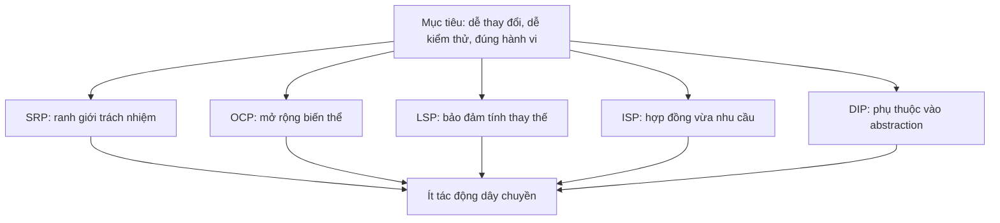
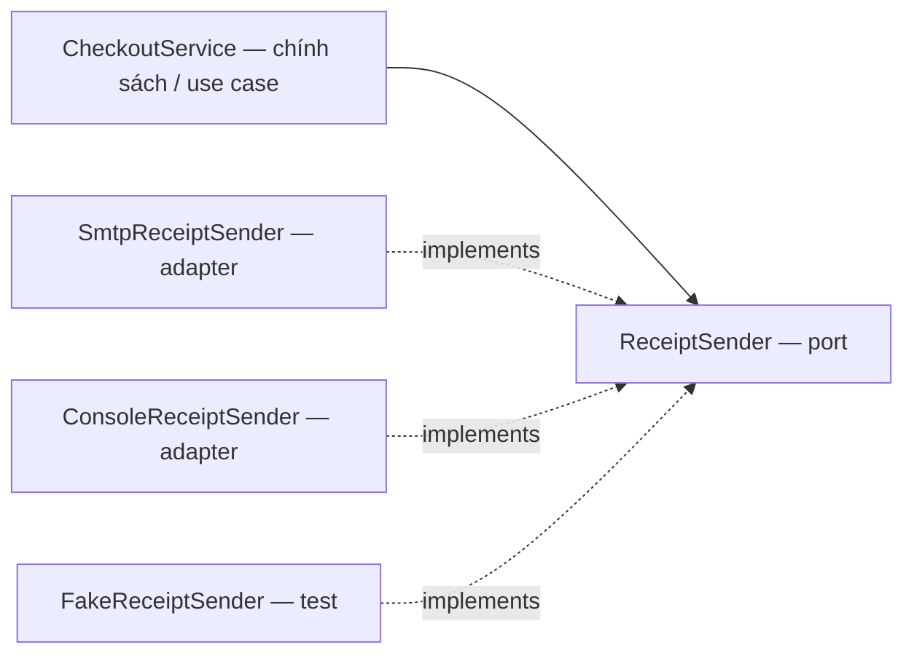
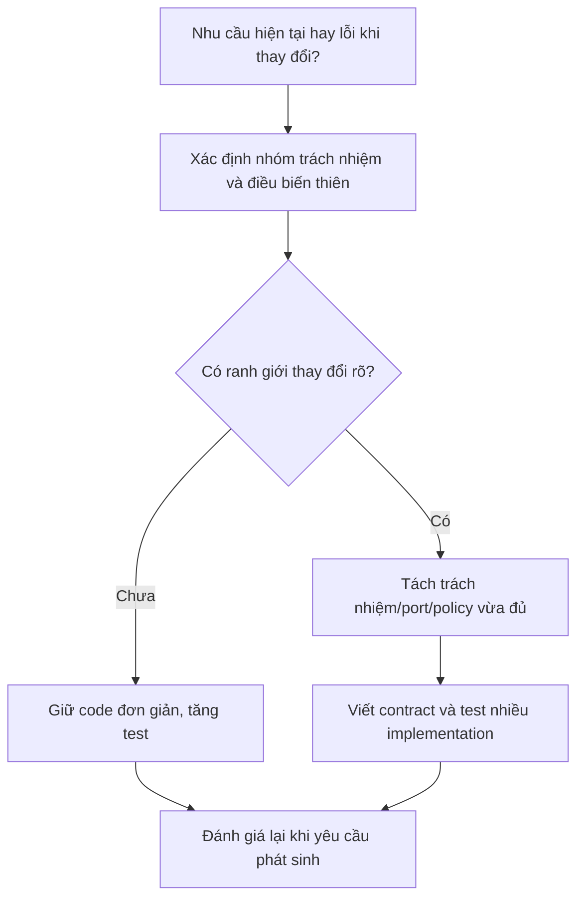
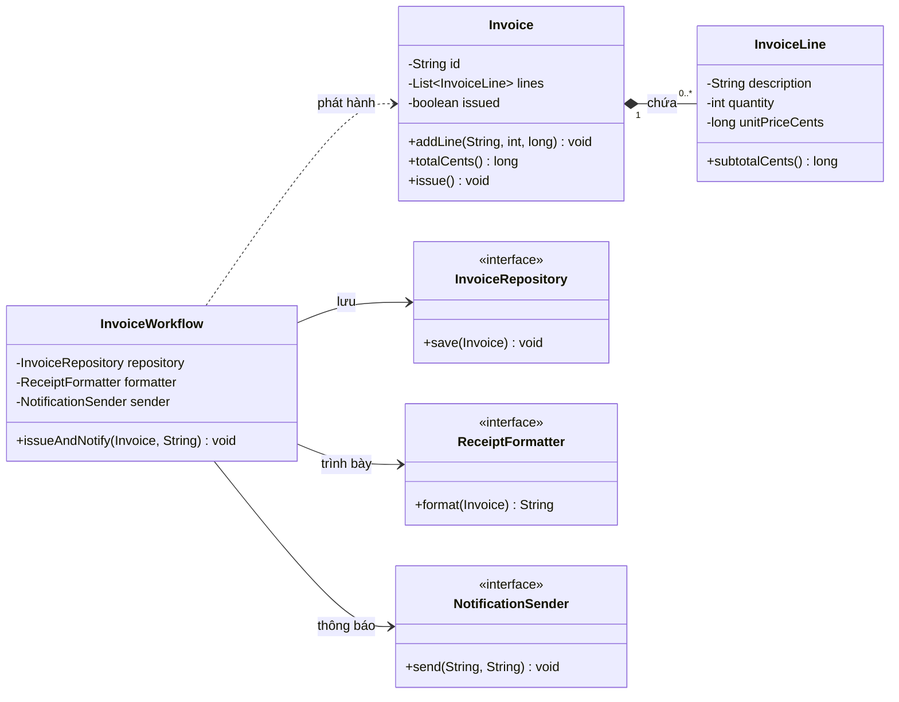
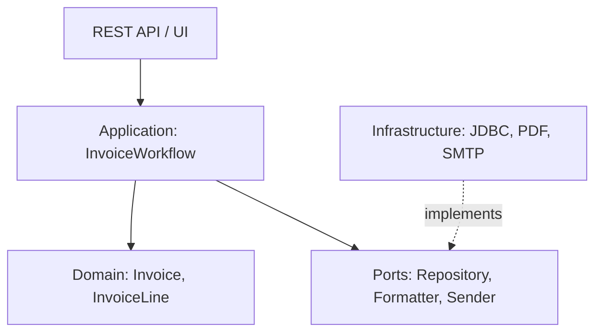
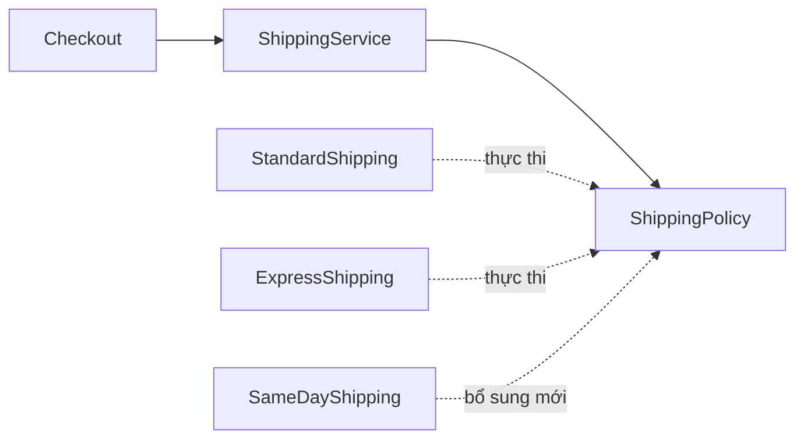
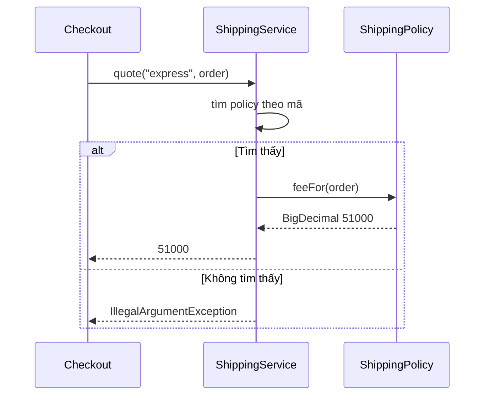
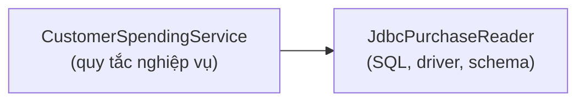
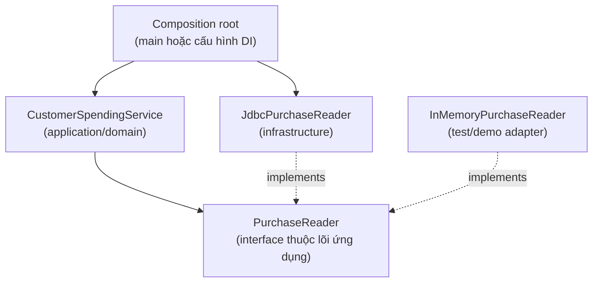
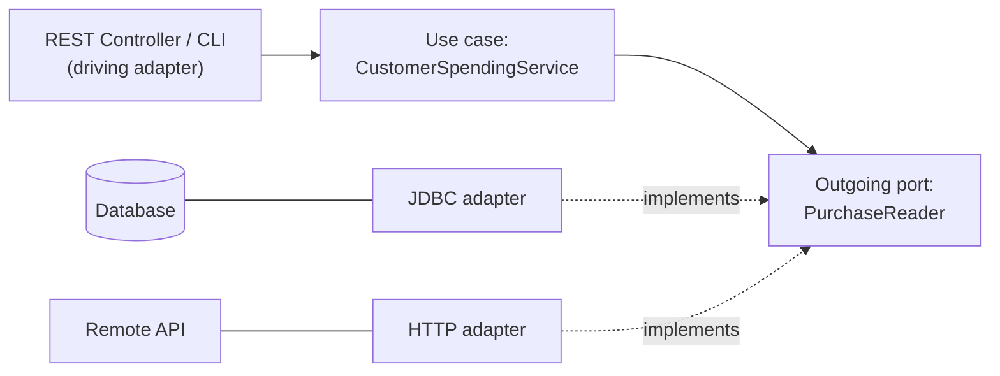

<a id="back-to-top"></a>

# SOLID

## Menu
- [Purpose and Scope of SOLID](#solid-001)
- [Single Responsibility: One Group of Reasons to Change](#solid-002)
- [Open/Closed: Extending Behavior with Controlled Changes](#solid-003)
- [Liskov Substitution: Preserving Supertype Contracts](#solid-004)
- [Interface Segregation: Contracts Tailored to Clients](#solid-005)
- [Dependency Inversion: Depending on Abstractions](#solid-006)
- [Distinguishing Dependency Inversion from Dependency Injection](#solid-007)
- [Balancing Principles Against Real-World Complexity](#solid-008)

## <a id="solid-001">Purpose and Scope of SOLID</a>

<details>
<summary>View details</summary>

# SOLID in OOP: Purpose and Scope

**SOLID** comprises five object-oriented design principles that make software easier to change and test while reducing cascading effects as requirements evolve. These are **guiding principles**, not mandatory Java syntax, a formula that automatically yields good architecture, or a requirement for every class to have an interface.

This lesson focuses on two questions: **What problems does SOLID address?** and **How extensively should it be applied in a particular context?** Understanding that scope helps us decide how to use SRP, OCP, LSP, ISP, and DIP in a specific design.

## 1. Why Do We Need SOLID?

Imagine a sales application where one `CheckoutService` calculates totals, applies promotions, calls SQL directly, and sends emails. Changing discount rules means editing that service; migrating to PostgreSQL means editing it again; switching email providers means yet another edit. A small bug in any of these concerns can affect checkout.

SOLID aims for concrete outcomes:

- **Controlled change:** Updating one rule should not require rewriting unrelated components.
- **Reduced dependence on volatile details:** Business code need not know the exact SQL or SMTP library or storage mechanism.
- **Easier testing:** Calculations and rules can be tested with fake data without running every external service.
- **Contract preservation:** Different implementations of one abstraction must not unexpectedly break client code.
- **Clearer responsibilities:** When a bug or new requirement appears, it is easier to identify what to change and regression-test.

However, SOLID has **costs**: additional abstractions, coordinating classes, contracts, and effort to understand dependency flows. Applying it mechanically to small features can increase the class count without delivering practical benefits.

> SOLID seeks to manage **the cost of change over time** and the quality of contracts between components, not to maximize the number of interfaces or classes.

## 2. What Do the Five Letters in SOLID Mean?

| Letter | Principle | Self-check question | Risk if ignored |
| --- | --- | --- | --- |
| **S** | **Single Responsibility Principle (SRP)** — one primary responsibility | How many independent groups of requirements cause this class/module to change? | SQL, email, and business-rule changes all force edits to one class |
| **O** | **Open/Closed Principle (OCP)** — extensible with limited modification of stable code | Can a new calculation or strategy be added as a new implementation? | Each variant requires another `if/switch` branch in the core |
| **L** | **Liskov Substitution Principle (LSP)** — safe substitutability | Does the subtype implementation preserve the contract expected of its supertype? | Code using an interface unexpectedly fails with one implementation |
| **I** | **Interface Segregation Principle (ISP)** — interfaces based on client needs | Must a consumer depend on methods it never uses? | A class implements meaningless methods or throws `UnsupportedOperationException` |
| **D** | **Dependency Inversion Principle (DIP)** — inversion of source dependencies | Do high-level policies depend directly on technology details? | Domain/application logic becomes tied to a database, HTTP, or specific libraries |

The five principles **reinforce one another** rather than being entirely separate rules. A small interface supports ISP; an application service depending on an interface instead of a concrete SMTP implementation demonstrates DIP; interchangeable implementations honoring one contract relate to LSP; adding implementations with minimal changes to the main workflow supports OCP.



## 3. Understand the Scope Before Designing

SOLID often pays off in systems with **many rules, many variants, or multiple independent drivers of change**. Simple business rules, however, do not necessarily justify a complex layered architecture.

| Context | Appropriate degree of application | Rationale |
| --- | --- | --- |
| A `Money` value object only validates and adds/subtracts amounts | Keep data and behavior cohesive; avoid extra abstractions | Adding two monetary amounts does not need an interface |
| Internal CRUD with few rules and one fixed storage mechanism | Clear class responsibilities and sufficient validation | Excessive layering hurts readability with little benefit |
| Multiple frequently changing discount/shipping options | Policies/strategies with a shared contract | OCP and LSP support controlled variation |
| Use cases that read/write databases, send email, or call external APIs | Separate rules from adapters; define ports where replacement is needed | SRP, DIP, and ISP make logic easier to test |
| A library/SDK exposes public interfaces to many consumers | Small, precise, stable contracts | LSP and ISP are especially important for long-lived client dependencies |
| A system has multiple development teams and modules | Define ownership of changes and abstractions at change boundaries | Reduces cross-team impact during parallel development |
| A one-off script with no reusable rules | Prefer simplicity, correctness, and necessary checks | Design overhead outweighs benefits over its short lifetime |

Ask **"What actually changes?"** before **"Which interface should we create?"** For example, if there is one simple tax calculation and no regional variation, a clear `calculateTax(...)` function may suffice. Abstraction gains value when multiple regional policies exist and change frequently.

## 4. SRP: Defining Responsibility Boundaries

SRP is often explained as a class having **one reason to change**. "One" refers to a cohesive group of responsibilities serving the same business rules or stakeholders, **not one method**.

Consider a class that does everything:

```java
// Phác thảo một cách viết cần xem lại, không phải chương trình chạy độc lập.
class CheckoutManager {
    void checkout(Order order) {
        // Tự áp dụng discount
        // Tự tạo SQL và lưu đơn
        // Tự xây nội dung email rồi gửi SMTP
        // Tự chuyển kết quả sang JSON
    }
}
```

Changes to discount formulas, database schemas, email providers, and JSON formatting all affect `CheckoutManager`. Separate the roles:

- `Order` protects order invariants and calculates totals from line items.
- `DiscountPolicy` determines discounts according to a policy.
- `CheckoutService` coordinates the workflow.
- `OrderRepository` persists and queries orders through a contract.
- `ReceiptSender` sends receipts through an external port.
- A controller/API adapter handles HTTP and DTOs.

This does not mean **every line of code needs its own class**. Two methods serving one responsibility can belong together. Creating dozens of classes to achieve "one method per class" misapplies SRP.

## 5. OCP: Choosing the Right Extension Points

OCP is often phrased as: objects/modules should be **open for extension but closed for modification**. In practice, this does not mean "never edit source code." Bugs, incorrect contracts, and previously unforeseen requirements still demand changes. OCP targets **known dimensions of variation likely to grow**, so adding variants requires little modification of the stable core.

For example, when discounts have multiple policies:

```java
interface DiscountPolicy {
    long discountCents(long subtotalCents);
}

final class NoDiscount implements DiscountPolicy {
    public long discountCents(long subtotalCents) {
        return 0;
    }
}

final class TenPercentDiscount implements DiscountPolicy {
    public long discountCents(long subtotalCents) {
        return subtotalCents / 10;
    }
}
```

`CheckoutService` depends only on `DiscountPolicy`. To add a conditional discount, create another implementation and configure its selection rather than changing checkout's calculation logic.

**Note:** The place that **selects an implementation** may still need changes or configuration, whether it is a composition root, factory, Spring DI configuration, or policy selector. OCP does not eliminate all code changes; it **limits their scope**.

## 6. LSP: Shared Interfaces Must Preserve Shared Expectations

If `CheckoutService` accepts `DiscountPolicy`, every policy must honor its contract:

- A valid subtotal input is a nonnegative number of cents.
- The discount output is an amount in cents within `0..subtotal`.
- It must not unexpectedly create an order, write to a database, or return `null`.
- If callers expect a policy to handle valid subtotals, an implementation must not silently narrow the accepted input domain just because "this policy type does not support it."

An LSP violation:

```java
final class BrokenDiscount implements DiscountPolicy {
    @Override
    public long discountCents(long subtotalCents) {
        return subtotalCents + 100; // Giảm nhiều hơn giá trị đơn!
    }
}
```

Although Java compiles it, this implementation violates `DiscountPolicy`'s postcondition. Substituting it for another policy can make checkout calculate a negative amount due.

Safeguards include **documenting the contract**, running shared contract tests against implementations, and validating important invariants at boundaries—especially when plugins or external partners supply implementations.

LSP applies beyond `extends`: objects implementing an interface must be substitutable in **behavior**, not merely match method signatures.

## 7. ISP: Interfaces Small Enough for Their Clients

An interface that stores orders, sends email, exports PDFs, issues refunds, and produces statistics forces each implementation or consumer to depend on capabilities it does not need.

```java
// Dễ gây ép buộc không cần thiết:
interface BusinessGateway {
    void saveOrder(Order order);
    void emailReceipt(Order order);
    void exportMonthlyReport();
}
```

Rather than forcing a fake repository in a test to implement `emailReceipt`, split the contracts:

```java
interface OrderRepository {
    void save(Order order);
}

interface ReceiptSender {
    void sendReceipt(Order order, long payableCents);
}
```

A service that stores orders depends only on `OrderRepository`; the receipt-sending component only needs `ReceiptSender`. Small contracts also make tests easier to understand.

However, ISP **does not require endless splitting** into single-method interfaces. If several operations form one stable protocol and its clients need them together, a cohesive interface is still appropriate.

## 8. How Do DIP and Dependency Injection Differ?

**DIP** is a design principle about **dependency direction**: high-level policies should depend on abstractions describing their needs, and low-level details should implement those abstractions.

**Dependency Injection (DI)** is the technique of supplying a dependency from outside, for example through a constructor. DI often helps implement DIP, but **injecting a concrete technology class does not automatically satisfy DIP**.

```java
// Có constructor injection nhưng vẫn phụ thuộc chi tiết SMTP:
class CheckoutService {
    private final SmtpMailClient client;
    CheckoutService(SmtpMailClient client) {
        this.client = client;
    }
}
```

A design following DIP:

```java
interface ReceiptSender {
    void sendReceipt(Order order, long payableCents);
}

class CheckoutService {
    private final ReceiptSender sender;

    CheckoutService(ReceiptSender sender) {
        this.sender = sender;
    }
}
```

At runtime, we can supply `SmtpReceiptSender`, `ConsoleReceiptSender`, or a fake for testing. The service still requires "sending a receipt," but it is not coupled to a particular SMTP class.



Placing the interface in the business/application module or an appropriate contract module ensures **high-level source code does not import the adapter**. Do not infer dependency direction from runtime call order: calling an adapter through an interface does not mean the service module must know its implementation details.

## 9. Standalone Java 17 Example: SOLID at the Right Change Boundaries

Scenario: A simple checkout offers multiple discount programs and supports different storage and receipt-delivery mechanisms. **Money and valid order state** belong to the model; **coordination** belongs to the service; **external interactions** go through two small interfaces.

Create `SolidScopeDemo.java`. The program uses one main class with nested classes so it can be compiled with a single command.

```java
import java.util.LinkedHashMap;
import java.util.List;
import java.util.Map;
import java.util.Objects;
import java.util.Optional;

public class SolidScopeDemo {

    // Domain value object: trường hợp quantity > 0, unit price >= 0.
    record OrderLine(String sku, int quantity, long unitPriceCents) {
        OrderLine {
            if (sku == null || sku.isBlank()) {
                throw new IllegalArgumentException("SKU is required");
            }
            if (quantity <= 0 || unitPriceCents < 0) {
                throw new IllegalArgumentException("Invalid order line");
            }
        }

        long amountCents() {
            return Math.multiplyExact((long) quantity, unitPriceCents);
        }
    }

    // Domain model: luôn có ít nhất một dòng hợp lệ.
    record Order(String id, List<OrderLine> lines) {
        Order {
            if (id == null || id.isBlank()) {
                throw new IllegalArgumentException("Order id is required");
            }
            Objects.requireNonNull(lines, "lines");
            lines = List.copyOf(lines);
            if (lines.isEmpty()) {
                throw new IllegalArgumentException("Order must have items");
            }
        }

        long subtotalCents() {
            long sum = 0;
            for (OrderLine line : lines) {
                sum = Math.addExact(sum, line.amountCents());
            }
            return sum;
        }
    }

    // Contract: 0 <= discount <= subtotal với subtotal không âm.
    interface DiscountPolicy {
        long discountCents(long subtotalCents);
    }

    static final class NoDiscount implements DiscountPolicy {
        @Override
        public long discountCents(long subtotalCents) {
            if (subtotalCents < 0) {
                throw new IllegalArgumentException("Negative subtotal");
            }
            return 0;
        }
    }

    static final class PercentDiscount implements DiscountPolicy {
        private final int percent;

        PercentDiscount(int percent) {
            if (percent < 0 || percent > 100) {
                throw new IllegalArgumentException("Invalid percent");
            }
            this.percent = percent;
        }

        @Override
        public long discountCents(long subtotalCents) {
            if (subtotalCents < 0) {
                throw new IllegalArgumentException("Negative subtotal");
            }
            // floor(subtotal * percent / 100) không tràn ở phép nhân.
            long whole = (subtotalCents / 100) * percent;
            long fraction = ((subtotalCents % 100) * percent) / 100;
            return Math.addExact(whole, fraction);
        }
    }

    interface OrderRepository {
        void save(Order order);
        Optional<Order> findById(String id);
    }

    interface ReceiptSender {
        void sendReceipt(Order order, long payableCents);
    }

    record CheckoutResult(Order order, long discountCents, long payableCents) { }

    static final class CheckoutService {
        private final DiscountPolicy discount;
        private final OrderRepository repository;
        private final ReceiptSender sender;

        CheckoutService(DiscountPolicy discount,
                        OrderRepository repository,
                        ReceiptSender sender) {
            this.discount = Objects.requireNonNull(discount);
            this.repository = Objects.requireNonNull(repository);
            this.sender = Objects.requireNonNull(sender);
        }

        CheckoutResult checkout(Order order) {
            Objects.requireNonNull(order, "order");
            long subtotal = order.subtotalCents();
            long reduction = discount.discountCents(subtotal);

            // Thực thi contract của policy tại ranh giới.
            if (reduction < 0 || reduction > subtotal) {
                throw new IllegalStateException("Invalid discount policy");
            }

            long payable = subtotal - reduction;
            repository.save(order);
            sender.sendReceipt(order, payable);
            return new CheckoutResult(order, reduction, payable);
        }
    }

    // Adapter bộ nhớ — thay bằng JDBC mà không phải sửa policy.
    static final class MemoryOrderRepository implements OrderRepository {
        private final Map<String, Order> data = new LinkedHashMap<>();

        @Override
        public void save(Order order) {
            Objects.requireNonNull(order);
            if (data.putIfAbsent(order.id(), order) != null) {
                throw new IllegalStateException("Duplicate order id");
            }
        }

        @Override
        public Optional<Order> findById(String id) {
            return Optional.ofNullable(data.get(id));
        }
    }

    // Adapter console — thay bằng SMTP hoặc message bus khi cần.
    static final class ConsoleReceiptSender implements ReceiptSender {
        @Override
        public void sendReceipt(Order order, long payableCents) {
            System.out.println(
                    "Receipt " + order.id() + ": " + payableCents + " cents");
        }
    }

    public static void main(String[] args) {
        MemoryOrderRepository repository = new MemoryOrderRepository();
        ReceiptSender sender = new ConsoleReceiptSender();

        Order first = new Order("O-01", List.of(
                new OrderLine("BOOK", 1, 15_000),
                new OrderLine("PEN", 2, 2_500)));

        CheckoutService promotionalCheckout = new CheckoutService(
                new PercentDiscount(10), repository, sender);
        CheckoutResult result = promotionalCheckout.checkout(first);
        System.out.println("Discount: " + result.discountCents());
        System.out.println("Saved: " +
                repository.findById("O-01").isPresent());

        Order second = new Order("O-02", List.of(
                new OrderLine("NOTE", 1, 10_000)));

        CheckoutService normalCheckout = new CheckoutService(
                new NoDiscount(), repository, sender);
        normalCheckout.checkout(second);
    }
}
```

Run with JDK 17 or later:

```bash
javac SolidScopeDemo.java
java SolidScopeDemo
```

Expected output:

```text
Receipt O-01: 18000 cents
Discount: 2000
Saved: true
Receipt O-02: 10000 cents
```

The first order is calculated as `15_000 + 2 × 2_500 = 20_000` cents; a 10% discount is `2_000` cents, leaving `18_000` cents due.

**Limitations of the example:** It has no taxes, refunds, real payments, or database transactions. `MemoryOrderRepository` is not thread-safe and is only for demonstration. `CheckoutService` saves the order before sending the receipt; if sending fails, the order may **already be saved** even though the caller receives an exception. Production systems need explicit transaction, retry, and idempotency policies and might use a *transactional outbox* to publish notifications after commit. SOLID separates responsibilities but **does not automatically guarantee atomicity, concurrency correctness, or cross-system consistency**.

### Where Does Each Principle Appear in the Example?

| Principle | Evidence in Java | Practical value |
| --- | --- | --- |
| SRP | `Order` protects invariants/calculates totals; `CheckoutService` coordinates; adapters handle I/O | Changing storage does not affect the total calculation |
| OCP | `PercentDiscount` and `NoDiscount` both implement `DiscountPolicy` | Add policies through implementations rather than editing checkout |
| LSP | Every policy must return `0..subtotal` | Replacing policies does not make `CheckoutService` produce negative amounts |
| ISP | `OrderRepository` and `ReceiptSender` are small contracts | Test fakes implement only what they need |
| DIP | The service receives three interfaces through its constructor | No direct dependency on `MemoryOrderRepository`/`ConsoleReceiptSender` |

**One design can apply several principles at once** without naming each principle in a class. Clear contracts and unsurprising dependencies matter more than displaying all "five patterns" in code.

## 10. What Should We Test to Validate the Design?

Test both **behavior** and **substitutability**:

1. Policies of 0%, 10%, and 100% always return discounts within the allowed range.
2. For a `subtotal=1` cent at 10%, the discount must be `0` cent under the round-down rule.
3. `Order` rejects empty line lists, nonpositive quantities, negative prices, or values whose total overflows `long`.
4. If a policy violates the contract, checkout rejects it **before saving**.
5. If the repository rejects a write, `ReceiptSender` is not called in this implementation's flow.
6. Replacing `ConsoleReceiptSender` with a fake must not change price calculations or order storage.
7. Replacing the repository with another adapter should not require changes to `Order` or policy code.

A minimal fake sender for testing:

```java
class CountingReceiptSender implements SolidScopeDemo.ReceiptSender {
    int sends;

    @Override
    public void sendReceipt(
            SolidScopeDemo.Order order, long payableCents) {
        sends++;
    }
}
```

If testing this code **from another file**, the demo's nested types have *package-private* access: place the test in the same package (for example, the default package) or adjust visibility when moving to a real project. For automated tests, use JUnit 5 and assert results instead of relying on `System.out`.

Example of a policy contract test:

```java
// Phác thảo phép kiểm thử, thêm vào test/JUnit của dự án.
void assertPolicyContract(
        SolidScopeDemo.DiscountPolicy policy, long subtotal) {
    long discount = policy.discountCents(subtotal);
    if (discount < 0 || discount > subtotal) {
        throw new AssertionError("Policy violates contract");
    }
}
```

Running the same contract checks against every `DiscountPolicy` implementation is a practical way to maintain LSP. Correct promotional behavior also requires tests for formulas and numeric boundaries.

## 11. What Does SOLID Not Replace?

A SOLID-compliant design can still fail if it ignores:

- **Business correctness:** Time, currency units, promotional conditions, or return policies may be misunderstood.
- **Data encapsulation:** A public setter can violate invariants even when a service has well-factored interfaces.
- **Transactions and concurrency:** Two requests checking inventory/limits and then updating can race.
- **Security and authorization:** A small interface does not check who is allowed to perform an operation.
- **Performance:** Too many queries, sequential network calls, or allocations can still be slow.
- **Observability:** Logs, metrics, traces, and errors need explicit handling.
- **Data modeling:** SOLID does not create foreign keys, uniqueness constraints, or other database constraints.
- **Simplicity:** Sometimes a straightforward class or factory is easier to maintain than an unnecessary strategy system.

Therefore, SOLID is **one part** of good design, not the sole measure of code quality.

## 12. Signs of Overapplying SOLID

| Symptom | Why reconsider? | Simpler approach |
| --- | --- | --- |
| Every helper has an interface and a single `Impl` class | No real substitution boundary exists | A concrete class or pure function, with tests |
| Every small operation on `Money`/entities becomes a service | Separates behavior that protects the same invariant | Keep `add`, `subtract`, and `compareTo` on the value object |
| Deep inheritance hierarchies for variants that do not yet exist | Deep coupling, many overrides, and difficult contracts | Introduce composition/policies when needed |
| Stable modules are forbidden from changing even when contracts are wrong | Confuses OCP with "never edit code" | Fix the contract and run regression tests |
| Every minor variation needs dynamic plugin configuration | Design and operational cost exceeds the benefit | Use a clear `if/switch` for a small, stable set of variants |

Do not evaluate SOLID by counting classes or interfaces. The lesson **Balancing Principles Against Real-World Complexity** examines shipping as it grows from one policy to several and assesses the actual costs of extension and abstraction.

## 13. A Quick Process Before Adding Abstractions



1. **Identify real pressure:** Dependency-related bugs, many variants changing the same place, tests requiring infrastructure, or subclasses violating contracts.
2. **Choose what to protect:** Prioritize business/domain rules, data, and invariants; place SQL/SMTP details and specialized policies behind suitable boundaries.
3. **Extend in the right place:** Use OCP for variation points, DIP for dependency direction, ISP for client-facing APIs, LSP for substitutability, and SRP for responsibility.
4. **Preserve previous outcomes with tests:** Compare outputs, exceptions, and side effects for existing cases; test new cases, boundaries, and failures separately.
5. **Evaluate the cost:** Does the abstraction reduce required edits and improve testing/readability, or merely add another forwarding layer?

This is introductory guidance, not a procedure to follow mechanically every time. There is no interface-to-class ratio or required percentage of code reduction that proves SOLID has been applied correctly.

## 14. Practice Exercises

**Exercise 1 — Assess the scope.** A personal note-taking app only needs to create, edit, and delete notes stored in one JSON file. Describe two designs: a simple one and a fully layered one. Which is appropriate now? What conditions would justify a repository port or separate policy?

**Exercise 2 — SRP and DIP.** A `ReportService` aggregates figures, writes CSV, and uploads to cloud storage. Redesign its responsibilities and ports so aggregation can be tested without a network connection to the cloud.

**Exercise 3 — OCP and LSP.** Add `FixedAmountDiscount` with a maximum discount of 5.000 cents, capped at the subtotal. Write contract tests for subtotals of 0, 1.000, and 10.000. Explain why returning -100 or a discount greater than the subtotal violates LSP.

**Exercise 4 — ISP.** A system has `Device` with `print()`, `scan()`, and `fax()`; a basic printer supports only printing. Design separate capability interfaces so the printer does not need to throw `UnsupportedOperationException` for `scan/fax`.

**Exercise 5 — Validate the benefit.** Count how many files must change when adding a discount policy **before** and **after** refactoring. Also consider the cost of additional classes/interfaces and the design's readability. Fewer edited files alone do not prove success: behavior must remain correct and maintainers must understand the design.

**Exercise 6 — Examine side effects.** Suppose the repository saves an order but sending its receipt fails. Design the returned result, retry/idempotency policy, and appropriate transaction boundary. Distinguish what SOLID helps with from the additional consistency mechanisms required.

## 15. Checklist Before Applying SOLID to Code

- Which rules or components are **actually** likely to change?
- Does a class have multiple **independent reasons to change**, or simply several methods serving one purpose?
- Is there enough real variation to justify an abstraction?
- Does the interface describe what a consumer needs, or merely copy every method of an implementation?
- Do implementations share the same **semantics and contract**?
- Does high-level logic directly import or create hard-to-replace I/O clients?
- Can domain rules be tested through input/output without a database or HTTP?
- Are data and invariants protected beyond interface boundaries?
- Have transactions, concurrent updates, security, and external failures been considered separately?
- Do maintenance benefits outweigh the added classes, interfaces, and configuration?

**Key takeaway:** SOLID helps design *boundaries that should remain stable as requirements change*. Apply it selectively according to system responsibilities, variation, and dependencies. For a simple feature, one clear class may be better than many abstractions; for a large and frequently changing domain, small contracts and clear responsibilities offer lasting benefits.


</details>

- [Back to top](#back-to-top)

---

## <a id="solid-002">Single Responsibility: One Group of Reasons to Change</a>

<details>
<summary>View details</summary>

# Single Responsibility: One Group of Reasons to Change (Single Responsibility Principle – SRP)

## 1. What Does SRP Really Mean?

The **Single Responsibility Principle (SRP)** is the **S** in **SOLID**. Its familiar formulation is:

> A module/class should have one reason to change.

However, interpreting "one reason" as **one method**, **one line of functionality**, or "every class should do the smallest possible thing" can easily produce dozens of fragmented classes that are difficult to follow.

A more useful interpretation is that **a class should own one cohesive group of change requests sharing a purpose or source**. Robert C. Martin also explains SRP in terms of an *actor*: a group or department requesting changes. If unrelated groups of requirements cause a class to change, it may be combining multiple responsibilities.

For example, an `Invoice` class may need to:

- Add line items while the invoice is still a draft.
- Validate quantities and unit prices.
- Calculate the total from its line items.
- Issue the invoice and reject repeated issuance.

These behaviors differ, but they jointly protect **the lifecycle and correctness of an invoice**. Each validation does not need its own service just to achieve one method per class.

Conversely, if `Invoice` also generates PDFs, writes SQL, and sends email, it must change whenever *invoice rules*, *document layouts*, *database systems*, or *email providers* change. These independent groups of changes may belong to different responsibilities.

**SRP seeks to improve class cohesion and reduce unrelated changes that require editing the same place.** It does not prohibit multiple methods, fields, or collaborators in one class.

## 2. What Is "One Group of Reasons to Change"?

Consider an invoicing system:

| Change request | Who typically requests it? | Related responsibility |
|---|---|---|
| Issue invoices only when they contain line items | Invoicing business team | Invoice domain rules |
| Require valid unit prices and quantities | Business/accounting team | Invoice-line invariants |
| Change the title/logo on a receipt | Brand design or operations | Receipt formatting |
| Move storage from files to a database | Infrastructure operations | Persistence |
| Replace the email delivery service | Integrations/infrastructure team | Notification delivery |
| Require authorization for invoice issuance | Product owner/security | Use-case coordination and permissions |

This table **does not imply one class per row**. The groups help identify **which changes belong together** and where the appropriate model boundaries lie.

For example, "cannot issue an empty invoice" and "cannot add lines after issuance" both belong to **one group of invoice-lifecycle invariants**, even though they are distinct rules. They usually belong together in `Invoice`.

By contrast, changing the receipt logo should not require modifying `Invoice`'s state-transition rules.

### A Quick Thought Experiment

Ask: "If only the receipt format changes tomorrow, which class must be edited?" If the answer includes the class protecting invoice state, SRP may have been compromised.

Conversely: "If the conditions for issuing invoices change, how many places must be edited?" If controllers, renderers, and repositories all check status against the `"DRAFT"` string, the rule may be scattered across layers.

## 3. Signs That a Class Carries Too Many Responsibilities

Consider a design that puts everything in `InvoiceManager`:

```java
// Đoạn minh họa vấn đề, không phải chương trình độc lập.
class InvoiceManager {
    void issueInvoice(Invoice invoice) {
        // 1. Kiểm tra nghiệp vụ.
        if (invoice.getLines().isEmpty()) {
            throw new IllegalStateException("Empty invoice");
        }

        // 2. Tự tính tiền và chuyển trạng thái.
        long total = invoice.getLines().stream()
                .mapToLong(l -> l.getQuantity() * l.getPrice())
                .sum();
        invoice.setStatus("ISSUED");

        // 3. Tự dựng HTML/PDF và biết logo công ty.
        String html = "<h1>My Brand</h1><p>" + total + "</p>";

        // 4. Tự thực hiện câu lệnh SQL.
        // connection.prepareStatement("INSERT INTO invoices ...");

        // 5. Tự gọi hệ thống gửi email.
        // smtpClient.send(invoice.getCustomerEmail(), html);
    }
}
```

Problems with this design:

- **Low cohesion:** Domain validation, calculations, content generation, persistence, and email have independent drivers of change.
- **Unrelated changes interfere:** Editing HTML requires touching the class containing issuance logic.
- **Difficult testing:** Testing "an empty invoice cannot be issued" may require SQL/SMTP configuration.
- **Risk of inconsistency:** Other code may update `status` without validation.
- **Difficult integration substitution:** The class depends directly on multiple technologies.

Note: The snippet deliberately omits dependency class definitions to highlight the design problem. The complete program later demonstrates a separation of responsibilities and compiles on its own.

## 4. Split by Responsibility, Not by Statement Count

One suitable model:



The roles of each component:

- **`Invoice`** protects invoice state and invariants.
- **`InvoiceLine`** holds a line item's data and calculation.
- **`ReceiptFormatter`** transforms invoice content into a representation (text, HTML, PDF, etc.).
- **`InvoiceRepository`** is responsible for saving/loading invoices.
- **`NotificationSender`** handles communication with recipients.
- **`InvoiceWorkflow`** coordinates *the invoice-issuance use case*: invoking collaborators in sequence. Knowing about several collaborators is normal for a class specializing in **coordination**.

This is a responsibility model, not a requirement to create a framework or give every interface three implementations. These boundaries illustrate independent types of change.

## 5. Runnable Java 11+ Example

Create `SrpDemo.java` with the complete code below:

```java
import java.util.ArrayList;
import java.util.HashMap;
import java.util.List;
import java.util.Map;
import java.util.Objects;

public class SrpDemo {

    // Value Object: dữ liệu và phép tính của một dòng hóa đơn.
    static final class InvoiceLine {
        private final String description;
        private final int quantity;
        private final long unitPriceCents;

        InvoiceLine(String description, int quantity, long unitPriceCents) {
            if (description == null || description.isBlank()) {
                throw new IllegalArgumentException("Description required");
            }
            if (quantity <= 0 || unitPriceCents < 0) {
                throw new IllegalArgumentException(
                        "Invalid quantity or unit price");
            }
            this.description = description;
            this.quantity = quantity;
            this.unitPriceCents = unitPriceCents;
        }

        String description() {
            return description;
        }

        int quantity() {
            return quantity;
        }

        long unitPriceCents() {
            return unitPriceCents;
        }

        long subtotalCents() {
            return Math.multiplyExact(quantity, unitPriceCents);
        }
    }

    // Entity: sở hữu quy tắc và vòng đời hóa đơn.
    static final class Invoice {
        private final String id;
        private final List<InvoiceLine> lines = new ArrayList<>();
        private boolean issued;

        Invoice(String id) {
            if (id == null || id.isBlank()) {
                throw new IllegalArgumentException("Invoice id required");
            }
            this.id = id;
        }

        String id() {
            return id;
        }

        boolean isIssued() {
            return issued;
        }

        void addLine(String description, int quantity,
                     long unitPriceCents) {
            if (issued) {
                throw new IllegalStateException(
                        "Cannot modify an issued invoice");
            }
            lines.add(new InvoiceLine(
                    description, quantity, unitPriceCents));
        }

        List<InvoiceLine> lines() {
            // Không cho code bên ngoài sửa collection nội bộ.
            return List.copyOf(lines);
        }

        long totalCents() {
            long sum = 0L;
            for (InvoiceLine line : lines) {
                sum = Math.addExact(sum, line.subtotalCents());
            }
            return sum;
        }

        void issue() {
            if (issued) {
                throw new IllegalStateException(
                        "Invoice has already been issued");
            }
            if (lines.isEmpty()) {
                throw new IllegalStateException(
                        "Cannot issue an empty invoice");
            }
            totalCents(); // Phát hiện tràn số trước khi đổi trạng thái.
            issued = true;
        }
    }

    // Contract trình bày: có thể thay text bằng HTML/PDF adapter.
    interface ReceiptFormatter {
        String format(Invoice invoice);
    }

    static final class PlainTextReceiptFormatter
            implements ReceiptFormatter {
        @Override
        public String format(Invoice invoice) {
            Objects.requireNonNull(invoice);
            StringBuilder sb = new StringBuilder();
            sb.append("HOA DON ").append(invoice.id()).append("\n");

            for (InvoiceLine line : invoice.lines()) {
                sb.append(line.description())
                  .append(" x ")
                  .append(line.quantity())
                  .append(" = ")
                  .append(line.subtotalCents())
                  .append(" VND\n");
            }

            return sb.append("TONG: ")
                     .append(invoice.totalCents())
                     .append(" VND")
                     .toString();
        }
    }

    // Contract lưu trữ: logic miền không biết SQL/file/NoSQL.
    interface InvoiceRepository {
        void save(Invoice invoice);
    }

    static final class InMemoryInvoiceRepository
            implements InvoiceRepository {
        private final Map<String, Invoice> invoices = new HashMap<>();

        @Override
        public void save(Invoice invoice) {
            Objects.requireNonNull(invoice);
            invoices.put(invoice.id(), invoice);
        }

        int size() {
            return invoices.size();
        }
    }

    // Contract gửi thông báo: logic hóa đơn không biết SMTP.
    interface NotificationSender {
        void send(String recipient, String content);
    }

    static final class RecordingNotificationSender
            implements NotificationSender {
        private final List<String> recipients = new ArrayList<>();
        private final List<String> messages = new ArrayList<>();

        @Override
        public void send(String recipient, String content) {
            if (recipient == null || recipient.isBlank()) {
                throw new IllegalArgumentException("Recipient required");
            }
            recipients.add(recipient);
            messages.add(Objects.requireNonNull(content));
        }

        int sentCount() {
            return recipients.size();
        }

        String lastRecipient() {
            return recipients.get(recipients.size() - 1);
        }

        String lastMessage() {
            return messages.get(messages.size() - 1);
        }
    }

    // Application Service: một trách nhiệm là điều phối use case.
    static final class InvoiceWorkflow {
        private final InvoiceRepository repository;
        private final ReceiptFormatter formatter;
        private final NotificationSender sender;

        InvoiceWorkflow(InvoiceRepository repository,
                        ReceiptFormatter formatter,
                        NotificationSender sender) {
            this.repository = Objects.requireNonNull(repository);
            this.formatter = Objects.requireNonNull(formatter);
            this.sender = Objects.requireNonNull(sender);
        }

        void issueAndNotify(Invoice invoice, String recipient) {
            Objects.requireNonNull(invoice, "invoice");
            if (recipient == null || recipient.isBlank()) {
                throw new IllegalArgumentException("Recipient required");
            }

            invoice.issue();
            repository.save(invoice);
            sender.send(recipient, formatter.format(invoice));
        }
    }

    public static void main(String[] args) {
        Invoice invoice = new Invoice("INV-9");
        invoice.addLine("But", 2, 5_000L);
        invoice.addLine("So", 1, 25_000L);

        InMemoryInvoiceRepository repository =
                new InMemoryInvoiceRepository();
        RecordingNotificationSender sender =
                new RecordingNotificationSender();
        ReceiptFormatter formatter = new PlainTextReceiptFormatter();

        InvoiceWorkflow workflow = new InvoiceWorkflow(
                repository, formatter, sender);
        workflow.issueAndNotify(invoice, "buyer@example.test");

        System.out.println("Issued: " + invoice.isIssued());
        System.out.println("Total: " + invoice.totalCents());
        System.out.println("Saved invoices: " + repository.size());
        System.out.println("Recipient: " + sender.lastRecipient());
        System.out.println("Receipt has total: "
                + sender.lastMessage().contains("TONG: 35000 VND"));

        try {
            workflow.issueAndNotify(invoice, "buyer@example.test");
            throw new AssertionError(
                    "An issued invoice must not be reissued");
        } catch (IllegalStateException expected) {
            System.out.println("Duplicate issue rejected");
        }

        if (sender.sentCount() != 1
                || invoice.totalCents() != 35_000L) {
            throw new AssertionError("Unexpected invoice state");
        }
    }
}
```

Run with JDK 11 or later:

```bash
javac SrpDemo.java
java SrpDemo
```

Expected output:

```text
Issued: true
Total: 35000
Saved invoices: 1
Recipient: buyer@example.test
Receipt has total: true
Duplicate issue rejected
```

### Where Does SRP Appear?

1. Changing "empty invoices cannot be issued" or "lines cannot change after issuance" → inspect **`Invoice`**.
2. Changing line formatting, switching to HTML, or adding a receipt layout → inspect **`ReceiptFormatter`** and its implementations.
3. Moving storage from memory to a database → provide a new **`InvoiceRepository`** implementation.
4. Replacing email delivery with a notification queue → inspect **`NotificationSender`** and its adapter.
5. Changing use-case order or error-handling policy between steps → inspect **`InvoiceWorkflow`**.

Note that **`InvoiceWorkflow` can have three dependencies and still follow SRP**: all serve the responsibility of coordinating one use case. Counting fields or imports alone does not establish whether a class follows SRP.

### Limitations of the Example

The example runs **sequentially in memory**. If `invoice.issue()` succeeds but `repository.save(...)` or `sender.send(...)` fails, local state may indicate that the invoice was issued even though the notification was not sent. Real applications often need suitable transactions and outbox/retry/idempotency mechanisms to persist data and record events for notification delivery.

Also, `InMemoryInvoiceRepository` keeps direct references to objects. It does not simulate independent persistence, isolation, optimistic locking, concurrency, or entity reloads from a database. This example illustrates **responsibility boundaries**; it is not a production invoicing system.

## 6. How Do Cohesion and Coupling Relate to SRP?

**Cohesion:** Do a class's fields and methods serve one consistent purpose?

**Coupling:** How many details of other classes must a class understand or depend on?

SRP aims for *high cohesion* within a responsibility boundary. Sensible separation often reduces unrelated dependencies but does not automatically guarantee low coupling.

| Design | Cohesion | Coupling | Assessment |
|---|---|---|---|
| One class builds PDFs, calculates taxes, sends email, and writes SQL | Usually low | Usually high | Many sources of change in one place |
| `Invoice` protects line-item and issuance invariants | High | Potentially low/moderate | One group of domain responsibilities |
| A separate class has only `calculateTotal()` to forward to `invoice.totalCents()` | Apparently high | Adds indirection | Class separation offers no obvious value |
| `InvoiceWorkflow` calls a repository, formatter, and sender | High if dedicated to coordination | Has necessary dependencies | Multiple collaborators, but a clear purpose |
| One `Utils` class validates emails, formats JSON, calculates fees, and runs SQL | Low | Hard to control | The "Utils" name conceals multiple responsibilities |

Do not assume a class with **many behaviors** has poor cohesion. For example, `Invoice.addLine()`, `Invoice.totalCents()`, and `Invoice.issue()` all work with the same invoice invariants; that relationship is desirable.

## 7. Why Can "One Method per Class" Undermine SRP?

The operations `Invoice.addLine()`, `Invoice.totalCents()`, and `Invoice.issue()` protect **one group of invariants**. Splitting them into `AddLineService`, `TotalCalculatorService`, and `IssueService` solely to give each class one method forces callers to coordinate state and lifecycle logic across multiple places. This adds indirection and can weaken encapsulation.

Distinguish *multiple operations within one responsibility* from *multiple independent sources of change*: adding lines and issuing invoices belong to invoice rules, whereas building PDFs, writing SQL, and sending email are separate dimensions. Validate boundaries through change scenarios and tests, not method/import counts.

## 8. Should Responsibilities Belong to an Entity, Value Object, or Service?

A common approach to responsibility allocation in domain design:

| Responsibility | Typical location | Example |
|---|---|---|
| Protecting entity state and state transitions | Entity | `Invoice.issue()` |
| Calculations tied to an immutable value | Value Object | `Money.plus()` or `InvoiceLine.subtotalCents()` |
| Business rules spanning several objects without naturally belonging to one | Domain Service/policy | `TaxPolicy.calculate(invoiceSnapshot)` |
| Coordinating a use case: load, invoke domain logic, save, return results | Application Service | `InvoiceWorkflow` |
| Reading/writing persistent data | Repository/adapter | `SqlInvoiceRepository` |
| Converting data into a communication format | Formatter/Presenter | `PdfReceiptFormatter` |
| Integrating an external service | Adapter/gateway | `SmtpNotificationSender` |

These are **guidelines for finding boundaries**, not mandatory rules.

For instance, "invoice tax" might be a fixed calculation under one consistent policy, in which case `Invoice.totalTax()` could be appropriate. If taxes vary by region, date, product type, and independently updated regulations, a `TaxPolicy` becomes more compelling. Responsibilities follow **meaning and sources of change**, not class names.

## 9. SRP Matters at the Package and Module Levels Too

SRP is often discussed at the class level, but in larger systems, **modules and packages** can also contain too many independently changing responsibilities.

For example, a `billing` package containing invoice domain rules, database access, email, and UI may require edits whenever any of those concerns changes. It can be organized around boundaries:

```text
billing/
  domain/
    Invoice.java
    InvoiceLine.java
  application/
    InvoiceWorkflow.java
    InvoiceRepository.java
    ReceiptFormatter.java
    NotificationSender.java
  infrastructure/
    JdbcInvoiceRepository.java
    PdfReceiptFormatter.java
    SmtpNotificationSender.java
```

This is merely an illustrative organization. A small project can reasonably keep several classes in one package when their names, cohesion, and dependencies are clear.



Components should know what they need to fulfill their roles. **Changing SMTP should not force the domain model to compile against an SMTP library**, and changing issuance rules should not require editing the PDF renderer if the data contract remains compatible.

## 10. SRP and Other SOLID Principles: How Do They Overlap and Differ?

SRP relates to other principles but asks **its own question**:

| Principle | Central question | Example |
|---|---|---|
| **SRP** | Does the class have one coherent group of reasons to change? | An invoice does not handle SMTP itself |
| **OCP** | Can behavior variants be added with minimal changes to stable code? | Add a formatter implementation through an interface |
| **LSP** | Does the implementation honor the supertype/interface contract? | Every formatter returns a contractually valid string |
| **ISP** | Must a client depend on methods it does not use? | Avoid a `CommunicationManager` with 30 unrelated APIs |
| **DIP** | Does business code depend on abstractions rather than volatile details? | A workflow depends on `NotificationSender`, not an SMTP SDK |

Using interfaces **does not automatically satisfy SRP**. An `AllPurposeService` with ten interface dependencies might still decide taxes, UI layout, and permissions simultaneously. An entity without interfaces can satisfy SRP if its responsibility is clear.

## 11. Actors Help Identify Reasons to Change, Not Rigid Organizational Labels

Accounting, security, and operations may all request changes to the invoice-issuance process. **Three actors do not necessarily mean three classes**. Identify where each rule belongs:

- `Invoice` enforces "issued invoices cannot be edited"; this is an entity-lifecycle rule.
- The application/authorization boundary checks **who is allowed** to request issuance.
- An adapter/audit component records events under security policies without granting arbitrary permission to change `Invoice` state.

A valid change may still affect multiple layers at once (domain, API, storage). SRP reduces *unrelated reasons for change* within the same component; it does not promise every requirement will touch exactly one file.

## 12. Refactoring a Class That May Violate SRP

Suppose an `OrderService` has more than 1.000 lines: checking inventory, applying vouchers, calculating totals, writing to a database, and sending notifications.

### Step 1 – List Actual Reasons to Change

Identify changes that have happened or could occur independently: voucher policies, pricing formulas, inventory mechanisms, database technology, and email templates. Do not assume every method has its own reason to change.

### Step 2 – Find Each Object's Behaviors and Invariants

State and conditions belonging to an Order should remain near that Order. Inventory rules belong to inventory management; discount rules may belong to a policy. Avoid "utility services" that merely move getters/setters from one place to another.

### Step 3 – Define Meaningful Inputs and Contracts

For example, business logic needs `reserveStock(productId, quantity)`; it does not need to know SQL table names to issue `UPDATE warehouse_stock` itself. Specify outputs and errors clearly.

### Step 4 – Extract Valuable Boundaries Incrementally

Prioritize components with clear reasons to change and independent testing potential: email gateways, repositories, formatters, and discount policies. Do not introduce many classes at once without assessing the impact.

### Step 5 – Keep the Use Case Easy to Follow

An application service can coordinate components in sequence. This does not violate SRP when its cohesive responsibility is **completing one use case**.

### Step 6 – Test Behavior, Not Class Shape

Verify that:
- Empty invoices are rejected.
- Lines cannot be added after issuance.
- Totals are correct and numeric overflow is detected.
- Switching formatters does not change Invoice rules.
- Fake repositories and senders can be substituted.
- Storage/delivery failures are handled consistently with application policy.

### Step 7 – Evaluate After Refactoring

File count is not the KPI. Evaluate whether change requests now **land in the right place**, unnecessary integration tests have decreased, and newcomers can quickly identify each class's responsibility.

## 13. Testing in a Way That Serves SRP

Clear responsibility boundaries allow tests to focus on **observable behavior**, not getters or internal implementation details.

Example of a simple entity test:

```java
Invoice invoice = new Invoice("INV-TEST");
invoice.addLine("Notebook", 2, 18_000L);
invoice.issue();

if (invoice.totalCents() != 36_000L || !invoice.isIssued()) {
    throw new AssertionError("Invoice invariant failed");
}

try {
    invoice.addLine("Pen", 1, 2_000L);
    throw new AssertionError("Issued invoice was modified");
} catch (IllegalStateException expected) {
    // Hợp lệ: bất biến ngăn thay đổi sau phát hành.
}
```

The snippet above must be placed where `Invoice` is accessible, such as the `main` method of `SrpDemo`. It needs no database or email service.

Test the formatter independently:

```java
String receipt = new PlainTextReceiptFormatter().format(invoice);
if (!receipt.contains("TONG: 36000 VND")) {
    throw new AssertionError("Wrong total in receipt");
}
```

Use-case tests should verify correct interactions with the repository, sender, and formatter. Fakes or spies can be used at integration boundaries without mocking every small domain object.

**Limitation:** Separating classes does not automatically guarantee correctness. Real database/email integrations, network failures, transactions, and retries still need appropriate tests.

## 14. Checklist for Avoiding SRP Misconceptions

| Misconception | More accurate understanding |
|---|---|
| "A class should only have one method or one `if`." | Behaviors protecting the same invariant can belong in one class. |
| "Multiple dependencies/interfaces violate SRP." | An application coordinator may need several ports to complete **one use case**. |
| "The smaller the classes, the better." | Classes that merely forward calls increase coupling and complicate tracing. |
| "A large class proves SRP is violated." | Examine sources of change: are domain rules, formatting, storage, and integrations mixed? |
| "After extracting a formatter, domain changes never affect the UI." | Legitimate changes to data contracts may require updates to both. |
| "Separating the repository and sender automatically creates safe transactions." | SRP does not replace transactions, retries, idempotency, or data constraints. |

Assess designs through *responsibilities and the consequences of real requirements*, not just `Service` class names, file sizes, or import counts.

## 15. Self-Practice Exercises

### Exercise 1 – Identify Reasons to Change

A `UserManager` class has these methods:

```java
registerUser();
changePassword();
deactivateUser();
generateCsvExport();
sendWelcomeEmail();
```

Group them by responsibility.

**Hint:** Account state and rules may belong to the same domain; CSV exports and email commonly belong to presentation/infrastructure. However, examine whether `UserManager` is intentionally an application coordinator or is directly implementing CSV/SMTP details.

### Exercise 2 – Avoid Excessive Splitting

An immutable `Money` has `plus()`, `minus()`, `multiply()`, and `sameCurrency()`. Should these become four separate services?

**Hint:** Not if they all operate on and protect Money values. Separate behavior when it introduces a policy external to Money, such as exchange rates obtained from an external provider.

### Exercise 3 – Test Issuance Rules

Using `SrpDemo.java`, try issuing an `Invoice` with no lines and verify that `isIssued()` remains `false`. Then add a line, issue it, and confirm that lines can no longer be modified.

**Hint:** Both conditions protect invoice-lifecycle invariants; put them in `Invoice`, not separately in the formatter or email sender.

### Exercise 4 – Change Formatting Without Editing the Domain

Add `HtmlReceiptFormatter implements ReceiptFormatter`. Replace only the object passed to `InvoiceWorkflow`:

```java
ReceiptFormatter formatter = new HtmlReceiptFormatter();
```

If the contract is properly designed, `Invoice` does not change. Ensure the formatter properly escapes user-supplied fields such as product descriptions in generated HTML to prevent unintended markup injection.

### Exercise 5 – Identify a Genuine Reason to Split

An application has a `TaxCalculator` that only performs a fixed multiplication with no anticipated rules, and an `Invoice` with 12 methods all managing invoice lines and lifecycle.

**Question:** Which class is more likely to need its boundaries reconsidered first?

**Hint:** Method count alone cannot answer this. Consider sources of change, policies, data requiring protection, and scope of use. A cohesive `Invoice` may be excellent, while `TaxCalculator` can also make sense if tax policy changes independently and frequently.

### Exercise 6 – Production Scenario

`InvoiceWorkflow` invokes `invoice.issue()`, then saves the invoice and sends a notification. Suppose saving succeeds but email delivery fails.

**Question:** Should NotificationSender reset `invoice.issued = false` on its own?

**Hint:** No. The sender should not mutate invoice invariants. Define a transaction around persistence of state and the send event, then process notifications with an outbox/retry/idempotency policy. This illustrates why responsibility boundaries matter when failures occur.

---

**Key takeaway:** SRP calls for **one cohesive group of responsibilities sharing a purpose and source of change**, not "one class = one method." Keep invariants near their owners, separate presentation/storage/integration details that change independently, and let a coordinator orchestrate collaborators when needed. A design following SRP helps maintainers identify where changes belong without losing the domain model's natural cohesion.


</details>

- [Back to top](#back-to-top)

---

## <a id="solid-003">Open/Closed: Extending Behavior with Controlled Changes</a>

<details>
<summary>View details</summary>

# Open/Closed Principle: Extending Behavior with Controlled Changes

> **Objective:** When a new business rule appears, introduce new behavior through an intentionally designed extension point without changing stable coordination code for each variant.

## 1. What Does OCP Really Say?

The Open/Closed Principle (OCP), the **O** in SOLID, is usually expressed as: a software component should be **open for extension** and **closed to modifications triggered by new variants**.

- **Open for extension:** New fee calculations, payment methods, report exporters, and so on can be introduced through contracts (interfaces/abstract classes), composition, or callbacks.
- **Closed to modification:** Stable core logic need not gain a new `if`, `switch`, or `instanceof` branch whenever another variant appears.
- **Controlled:** An extension-point contract defines inputs, outputs, exceptions, invariants, and how components are registered. Extension code must honor that contract; adding it must not inadvertently change existing behavior.

OCP **does not** mean "never edit a class once written." Bugs, unclear code, changes to fundamental requirements, and poorly designed abstractions still require edits. The goal is to minimize the affected code and regression risk **when adding an anticipated variant**.

### When Does the Problem Arise?

Suppose a sales system currently offers standard and express shipping, and a new delivery service is added every month. If one fee calculator contains every formula, each new service requires editing the same function and risks breaking existing rules.

```java
// Thiết kế ban đầu: thêm dịch vụ mới luôn phải sửa hàm này.
BigDecimal shippingFee(String service, int weightGrams) {
    if ("STANDARD".equals(service)) {
        return new BigDecimal("20000");
    } else if ("EXPRESS".equals(service)) {
        long kilograms = (weightGrams + 999L) / 1000;
        return new BigDecimal("35000")
                .add(new BigDecimal("8000")
                .multiply(BigDecimal.valueOf(kilograms)));
    }
    throw new IllegalArgumentException("Dịch vụ không hỗ trợ: " + service);
}
```

The problem is not `if/else` syntax itself. It is the **reason for change**: each service has independent rules, but all variants modify the same coordinating function. That increases conflicts among developers, regression-test effort, and the chance of missing a branch. If the set of options is small and fixed, a `switch` can still be reasonable.

## 2. Designing Extension Points with Strategy and Polymorphism

In the example below, `ShippingService` only knows the `ShippingPolicy` contract, not individual delivery providers' formulas. Each policy calculates fees and can be tested independently.



### Runnable Java 17 Example

Save the complete code below as `OpenClosedDemo.java` and run `javac OpenClosedDemo.java` followed by `java OpenClosedDemo`.

```java
import java.math.BigDecimal;
import java.util.Map;
import java.util.Objects;

public class OpenClosedDemo {

    // Hợp đồng ổn định: mỗi chính sách trả về phí giao hàng bằng VND.
    interface ShippingPolicy {
        BigDecimal feeFor(Order order);
    }

    record Order(BigDecimal subtotal, int weightGrams) {
        Order {
            Objects.requireNonNull(subtotal, "subtotal");
            if (subtotal.signum() < 0) {
                throw new IllegalArgumentException("subtotal phải >= 0");
            }
            if (weightGrams <= 0) {
                throw new IllegalArgumentException("weightGrams phải > 0");
            }
        }
    }

    static final class StandardShipping implements ShippingPolicy {
        @Override
        public BigDecimal feeFor(Order order) {
            Objects.requireNonNull(order, "order");
            return new BigDecimal("20000");
        }
    }

    static final class ExpressShipping implements ShippingPolicy {
        @Override
        public BigDecimal feeFor(Order order) {
            Objects.requireNonNull(order, "order");
            long kilograms = (order.weightGrams() + 999L) / 1000L;
            return new BigDecimal("35000")
                    .add(new BigDecimal("8000")
                    .multiply(BigDecimal.valueOf(kilograms)));
        }
    }

    // Ví dụ mở rộng: thêm một chính sách, không sửa ShippingService.
    static final class SameDayShipping implements ShippingPolicy {
        @Override
        public BigDecimal feeFor(Order order) {
            Objects.requireNonNull(order, "order");
            if (order.subtotal().compareTo(new BigDecimal("500000")) >= 0) {
                return new BigDecimal("45000");
            }
            return new BigDecimal("70000");
        }
    }

    static final class ShippingService {
        private final Map<String, ShippingPolicy> policies;

        ShippingService(Map<String, ShippingPolicy> policies) {
            Objects.requireNonNull(policies, "policies");
            // Bản sao không sửa được để tránh thay đổi đăng ký từ bên ngoài.
            this.policies = Map.copyOf(policies);
        }

        BigDecimal quote(String serviceCode, Order order) {
            Objects.requireNonNull(serviceCode, "serviceCode");
            Objects.requireNonNull(order, "order");
            ShippingPolicy policy = policies.get(serviceCode);
            if (policy == null) {
                throw new IllegalArgumentException(
                        "Dịch vụ không hỗ trợ: " + serviceCode);
            }
            BigDecimal amount = Objects.requireNonNull(
                    policy.feeFor(order), "ShippingPolicy returned null");
            if (amount.signum() < 0) {
                throw new IllegalStateException(
                        "ShippingPolicy returned a negative fee");
            }
            return amount;
        }
    }

    public static void main(String[] args) {
        ShippingService service = new ShippingService(Map.of(
                "standard", new StandardShipping(),
                "express", new ExpressShipping(),
                "same-day", new SameDayShipping()
        ));
        Order order = new Order(new BigDecimal("150000"), 1200);

        System.out.println(service.quote("standard", order)); // 20000
        System.out.println(service.quote("express", order));  // 51000
        System.out.println(service.quote("same-day", order)); // 70000
    }
}
```

Practical observations:

1. `ShippingPolicy` is **the variation point**. A new policy adds a class implementing this interface without requiring changes to `ShippingService`'s fee-calculation logic.
2. `ShippingService` is **the stable component**: it finds a policy, invokes `feeFor`, and rejects `null` or negative fees to protect the integration boundary. It does not use `instanceof` or inspect concrete types to branch.
3. `Map<String, ShippingPolicy>` provides **selection and registration**. When a service is added, updating the application assembly point (composition root: `main`, configuration, or a DI container) is intentional; OCP does not require zero changes anywhere in the system.
4. `BigDecimal` is better suited to money than `double` because it avoids binary floating-point errors. The example represents VND amounts as whole numbers and avoids arbitrary rounding in multiple places.
5. The `Order` object performs basic self-validation; new policies must return valid fees. Real projects may need `Money`/`Currency` types, rounding policies, weight limits, and specific fee bounds.

A good contract also states what **must not change**: `feeFor` must not return `null` or a negative fee, mutate `Order`, or use a different unit from VND; invalid-input behavior must be explicit. Method signatures alone cannot express all of this; documentation, contract tests, and reviews are necessary.

## 3. Change Impact: Before and After

| Scenario | Centralized `if/else` function | Design using `ShippingPolicy` |
|---|---|---|
| Add same-day delivery | Insert a branch in the common calculator | Implement `SameDayShipping` and register the policy |
| Update express-shipping fees | Edit the shared branch, potentially affecting other services | Edit `ExpressShipping` and its tests |
| Unit of testing | Many cases must be built around one function | Test policies separately under a shared contract |
| Code that should remain stable | Easily becomes a perpetual change hotspot | `ShippingService` and the `feeFor` call |
| Cost | Initially concise but grows with variants | Adds interfaces, classes, configuration, and lifecycle management |

Adding `SameDayShipping` still requires registration in `Map`. With Spring, each implementation may be a named bean, and `Map<String, ShippingPolicy>` can be injected into the service; Spring collects the corresponding beans. This is useful with many plugins but unnecessary for a plain Java application. Two simple formulas do not justify reflection or a plugin loader.

### Execution Flow Diagram



In the `quote` method, `if (policy == null)` remains because it **validates the request**. OCP does not forbid every `if`; it discourages coordinating behavior through an ever-growing list of concrete types.

## 4. What Should Be "Closed," and How Are Changes Controlled?

OCP is most valuable when **variation boundaries** are identified correctly:

- **Frequently changing behavior:** Fee calculations, promotion evaluation, notification delivery, etc. → candidates for interfaces.
- **Rarely changing or consistently shared behavior:** Invariants such as service-code validation, rejection of meaningless input, or error handling → keep in the coordinator.
- **Fundamental contract changes:** If all methods must accept a new `DeliveryContext`, interfaces and implementations may need updates. That is an intentional architectural change, not automatically an OCP violation.

For example, adding regional surcharges creates two distinct situations:

- If **each policy determines its own regional surcharge** and that logic varies by service, design the input contract (for example, add `Destination` to `Order` or `ShippingRequest`) and let each policy handle it.
- If **every policy always has the same base surcharge**, consider a shared service step or decorator around policies rather than duplicating the logic in every implementation.

Do not expand `ShippingPolicy` into an interface with dozens of speculative parameters for scenarios that do not yet exist. Every abstraction has costs: naming, contract documentation, testing, DI, dependency wiring, and debugging.

## 5. Advanced Extension Example Using Decorator

Suppose all services need a fixed **5.000 VND** surcharge for deliveries to remote areas. If the new requirement applies uniformly, existing policies can be wrapped instead of copying the surcharge formula into every service.

```java
static final class RemoteAreaSurcharge implements ShippingPolicy {
    private final ShippingPolicy delegate;

    RemoteAreaSurcharge(ShippingPolicy delegate) {
        this.delegate = Objects.requireNonNull(delegate);
    }

    @Override
    public BigDecimal feeFor(Order order) {
        return delegate.feeFor(order).add(new BigDecimal("5000"));
    }
}

// Ví dụ sử dụng trong cùng OpenClosedDemo:
ShippingPolicy policy =
        new RemoteAreaSurcharge(new ExpressShipping());
BigDecimal total = policy.feeFor(
        new Order(new BigDecimal("150000"), 1200));
// total = 56000
```

`RemoteAreaSurcharge` is written as **a nested class inside `OpenClosedDemo`**, so it can reuse `ShippingPolicy`, `Order`, and `ExpressShipping` from the previous example. This illustrates Decorator; in a real integration, wrap only shipments eligible for the remote-area surcharge (for example, at the composition root using validated addresses). Do not wrap every shipment indiscriminately.

This type of extension differs from subclassing `ShippingService` and overriding methods not designed for overriding. **Prefer composition when combining independent behaviors.** Do not treat inheritance as the default extension mechanism.

## 6. Testing to Protect the "Closed" Core

Extracting an interface alone does not guarantee safety. An implementation may silently violate its contract (return negative numbers or `null`, use the wrong unit, mutate input, or throw unexpected exceptions). Use two levels of tests:

**Policy-specific tests** (JUnit 5, assuming the example code resides in `OpenClosedDemo` and its nested types are accessible from a test in the same package):

```java
import static org.junit.jupiter.api.Assertions.*;
import java.math.BigDecimal;
import org.junit.jupiter.api.Test;

class ShippingPolicyTest {
    private final OpenClosedDemo.Order order =
            new OpenClosedDemo.Order(new BigDecimal("150000"), 1200);

    @Test
    void expressRoundsWeightUpToFullKilograms() {
        OpenClosedDemo.ShippingPolicy policy =
                new OpenClosedDemo.ExpressShipping();
        assertEquals(new BigDecimal("51000"), policy.feeFor(order));
    }

    @Test
    void aNewPolicyDoesNotChangeExistingExpressResult() {
        var policies = java.util.Map.<String, OpenClosedDemo.ShippingPolicy>of(
                "express", new OpenClosedDemo.ExpressShipping(),
                "same-day", new OpenClosedDemo.SameDayShipping()
        );
        var service = new OpenClosedDemo.ShippingService(policies);

        assertEquals(new BigDecimal("51000"), service.quote("express", order));
        assertEquals(new BigDecimal("70000"), service.quote("same-day", order));
    }
}
```

**Shared contract tests:** For **every** registered `ShippingPolicy`, test valid inputs and confirm non-`null`, nonnegative results with the correct units; specify behavior for rejected inputs. In a plugin system, `@ParameterizedTest` together with `@MethodSource` can run the same contract tests against all implementations. Checking only nonnegative results is insufficient: assert business checkpoints, weight boundaries, and each strategy's specific rules.

Integration tests should also confirm that new service names are registered and unknown service codes are rejected clearly. With a DI container, check duplicate bean names, missing beans, singleton lifecycles, and shared mutable state.

## 7. Pitfalls When Applying OCP

| Pitfall | Why it hurts | How to address it |
|---|---|---|
| Creating an interface for every class | Adds complexity without real variants | Create extension points where independent changes recur |
| Still checking each implementation with `instanceof` after extracting an interface | The service still changes for each new type | Put behavior in polymorphic interface methods |
| Putting all formulas and price tables in the service | The coordinator remains a hotspot for every new rule | Separate policies; use data/configuration where appropriate |
| Changing a public interface for every variant | Forces cascading changes to all implementations | Choose a stable contract; add separate capabilities for genuine differences |
| Deep inheritance hierarchies | Encourages implementation coupling and complicates behavior composition | Prefer small interfaces and composition/decorators |
| Hiding errors behind a default policy | Mistyped service codes may silently produce incorrect fees | Fail fast with clear messages or use a business-defined fallback |
| Ignoring the quality of new implementations | A faulty plugin breaks the shared workflow | Contract tests, logging, code review, and integration rules |
| Treating OCP as "never modify old code" | Preserves obsolete abstractions and encourages workarounds | Refactor carefully when evidence shows the contract must change |

**How OCP Relates to Other SOLID Principles:**

- **SRP:** Each policy has its own reason to change. A policy that calculates fees and sends emails has multiple responsibilities.
- **LSP:** An implementation must substitute for `ShippingPolicy` without breaking client assumptions. This is essential to safe extension.
- **ISP:** Small contracts prevent implementations from writing meaningless methods.
- **DIP:** `ShippingService` depends on the `ShippingPolicy` abstraction rather than a concrete class.

## 8. Refactoring Code That Violates OCP

1. **Identify variation:** List recent reasons for editing the same `if/switch`. Consider extraction if they are separate business rules.
2. **Extract a minimal contract:** Use domain names such as `ShippingPolicy.feeFor(Order)` and document invariants and error handling.
3. **Move behaviors individually:** Implement `StandardShipping` and `ExpressShipping` using existing logic and preserve previous results.
4. **Switch clients to the interface:** Inject a policy or registry; verify the service no longer inspects concrete types.
5. **Protect with tests:** Test previous results, edge cases, and the shared contract.
6. **Try adding a genuine variant:** Create `SameDayShipping`. If this still requires editing formulas in the service, the extension boundary is misplaced.
7. **Track complexity:** Evaluate class count, wiring, error observability, and real performance. Keep the simple design if abstraction costs exceed benefits.

### Self-Practice Exercises

**Exercise 1 – Payments.** The system currently handles `CASH` and `BANK_TRANSFER` with a `switch`. Design `PaymentMethod` with an explicit payment operation and result; add `QR_PAYMENT`. Distinguish shared concerns (validation, idempotency, logging) from method-specific behavior. Never log card numbers or sensitive information.

**Exercise 2 – Report export.** The system currently supports `PDF` and `CSV`. Refactor to `ReportExporter` with `export(ReportData)`. Add JSON without changing report-export coordination. Specify MIME types and error-handling rules.

**Exercise 3 – Critique the design.** A system has only two open/closed states that have remained stable for years. Would adding three interfaces, a registry, and a dynamic plugin loader help? Explain using change frequency, maintenance costs, and operational complexity.

## 9. Self-Check: Do You Understand OCP?

- Are the **stable components** and **dimensions of variation** clearly identified?
- Does adding a variant require editing stable coordination branches?
- Does the interface describe genuinely shared behavior clearly enough for contract tests?
- Can a new implementation replace an old one wherever clients expect it?
- Are registration/configuration explicit, fail-fast, and testable?
- Is added complexity proportional to how frequently changes are required?

**Key takeaway:** OCP is a decision about *change boundaries*. A good design puts frequently changing behavior behind stable contracts, enabling new behavior and focused testing while remaining willing to revise an abstraction when fundamental requirements actually change.


</details>

- [Back to top](#back-to-top)

---

## <a id="solid-004">Liskov Substitution: Preserving Supertype Contracts</a>

<details>
<summary>View details</summary>

# Liskov Substitution (LSP): Preserving Supertype Contracts

> Topic: OOP → SOLID → Liskov Substitution Principle. The focus is **behavioral substitutability**: a subtype object must work wherever a program expects its supertype while preserving the promises on which supertype clients rely.

## 1. What Does the Principle Say?

Suppose a function accepts an object of type `T`. If `S` is a subtype of `T`, passing an `S` object in place of `T` must preserve every property that the function is entitled to expect under `T`'s contract. In short:

~~~java
void process(T value) { /* chỉ dựa vào hợp đồng công khai của T */ }

// Nếu S <: T, process(new S(...)) vẫn phải đáp ứng hợp đồng của T.
~~~

LSP does not require subtypes to produce **identical concrete results**; each may use its own algorithm or policy. What matters is that every result and behavior stays within the supertype's promised contract.

Do not confuse "valid, compilable `extends` / `implements`" with "safe substitutability." The Java compiler enforces many type and method-override rules but cannot prove business contracts such as "discounts must not exceed the subtotal."

### What Does a Supertype Contract Include?

| Contract element | Supertype's promise | Subtype obligation |
|---|---|---|
| **Precondition** | Conditions a caller must satisfy before invoking a method, such as subtotal ≥ 0 | **Must not strengthen it:** Do not arbitrarily add new restrictions to valid inputs |
| **Postcondition** | Conditions that hold after a method completes, such as a discount in [0, subtotal] | **Must not weaken it:** Stronger guarantees are allowed, but all existing guarantees must remain |
| **Invariant** | State that must remain valid throughout the object's lifecycle | Never produce state that violates invariants relied upon by supertype clients |
| **Errors and exceptions** | How errors are reported for cases covered by the contract | Do not throw exceptions the contract disallows for valid inputs; Java's `checked exception` rules are only part of this |
| **Side effects/observable behavior** | Documented conventions for mutated data, call counts, order, or stability | Do not arbitrarily change promises on which clients are entitled to rely |

A method can define **invalid input** and throw corresponding errors. LSP does not require a subtype to accept every possible value; it must accept at least every input **valid under the supertype's contract**.

## 2. Practical Scenario: Calculating Checkout Discounts

Suppose a sales application offers multiple discount policies: fixed reductions and discounts for orders meeting a threshold. Checkout should not need to know each policy's type; it only needs the `DiscountPolicy` contract.

**Public contract:**

- The `subtotal` input must be non-`null` and ≥ 0. For `null` or negative values, throw `IllegalArgumentException`.
- For every valid `subtotal`, `discountFor(subtotal)` must return a `BigDecimal` that is not `null` and satisfies `0 ≤ discount ≤ subtotal`.
- Do not mutate the input or cause unexpected side effects; `BigDecimal` is already immutable here.
- A policy may choose its specific discount; it need not always apply a reduction or use the same amount.

### 2.1. LSP-Compliant Design (Java 17+)

Save the example as `LspDemo.java`; it compiles and runs with the JDK without external libraries.

~~~java
import java.math.BigDecimal;
import java.util.List;
import java.util.Objects;

interface DiscountPolicy {
    /**
     * @param subtotal khác null và >= 0
     * @return giá trị khác null, nằm trong [0, subtotal]
     * @throws IllegalArgumentException nếu subtotal null hoặc âm
     */
    BigDecimal discountFor(BigDecimal subtotal);
}

final class Discounts {
    private Discounts() {}

    static void requireValid(BigDecimal subtotal) {
        if (subtotal == null || subtotal.signum() < 0) {
            throw new IllegalArgumentException("subtotal must be >= 0");
        }
    }
}

/** Giảm một số tiền cố định, nhưng không bao giờ vượt tiền hàng. */
final class FixedDiscount implements DiscountPolicy {
    private final BigDecimal amount;

    FixedDiscount(BigDecimal amount) {
        Objects.requireNonNull(amount, "amount");
        if (amount.signum() < 0) {
            throw new IllegalArgumentException("amount must be >= 0");
        }
        this.amount = amount;
    }

    @Override
    public BigDecimal discountFor(BigDecimal subtotal) {
        Discounts.requireValid(subtotal);
        return amount.min(subtotal);
    }
}

/** Đơn dưới ngưỡng được giảm 0, không phát sinh ngoại lệ. */
final class ThresholdDiscount implements DiscountPolicy {
    private static final BigDecimal THRESHOLD =
            new BigDecimal("100.00");
    private static final BigDecimal REWARD =
            new BigDecimal("10.00");

    @Override
    public BigDecimal discountFor(BigDecimal subtotal) {
        Discounts.requireValid(subtotal);
        if (subtotal.compareTo(THRESHOLD) < 0) {
            return BigDecimal.ZERO;
        }
        return REWARD.min(subtotal);
    }
}

final class CheckoutService {
    BigDecimal total(BigDecimal subtotal, DiscountPolicy policy) {
        Discounts.requireValid(subtotal);
        BigDecimal discount =
                Objects.requireNonNull(policy, "policy")
                       .discountFor(subtotal);
        // Client được phép tin vào hợp đồng của DiscountPolicy.
        return subtotal.subtract(discount);
    }
}

public class LspDemo {
    public static void main(String[] args) {
        CheckoutService checkout = new CheckoutService();
        BigDecimal subtotal = new BigDecimal("25.00");

        List<DiscountPolicy> policies = List.of(
                new FixedDiscount(new BigDecimal("10.00")),
                new ThresholdDiscount()
        );
        for (DiscountPolicy policy : policies) {
            System.out.println(checkout.total(subtotal, policy));
        }
        // 15.00: chính sách giảm cố định
        // 25.00: chưa đạt ngưỡng nên giảm 0
    }
}
~~~

~~~bash
javac LspDemo.java
java LspDemo
~~~

**Why is substitution safe?** `CheckoutService.total` uses only `DiscountPolicy` and relies on discounts being nonnegative and no greater than the subtotal. Both implementations accept *every valid subtotal*, including 0 and very small orders. New policies can therefore be added without concrete-type branches in `CheckoutService`.

Viewed as a call flow:

~~~mermaid
flowchart TD
    C["CheckoutService.total(subtotal, policy)"]
    P["DiscountPolicy.discountFor(subtotal)"]
    F["FixedDiscount"]
    T["ThresholdDiscount"]
    R["Kiểm tra: 0 <= discount <= subtotal"]
    O["total = subtotal - discount"]
    C --> P
    P --> F
    P --> T
    F --> R
    T --> R
    R --> O
~~~

## 3. Two Common Ways to Violate LSP

### 3.1. Strengthening the Supertype's Precondition

~~~java
// Ví dụ SAI: chèn thêm class này vào cùng package với ví dụ trên.
final class BadVipDiscount implements DiscountPolicy {
    @Override
    public BigDecimal discountFor(BigDecimal subtotal) {
        Discounts.requireValid(subtotal);
        if (subtotal.compareTo(new BigDecimal("100")) < 0) {
            throw new UnsupportedOperationException(
                    "VIP discount only for orders >= 100");
        }
        return new BigDecimal("10.00");
    }
}
~~~

A subtotal of `25.00` is **valid input** under `DiscountPolicy`. Yet `BadVipDiscount` throws `UnsupportedOperationException`. This object cannot substitute for an arbitrary `DiscountPolicy` in `CheckoutService`, even though it compiles.

**Fix:** For orders below 100, return `BigDecimal.ZERO` as `ThresholdDiscount` does. If business rules require rejecting an order, define that behavior **in the supertype contract itself** or introduce a specialized abstraction; do not add hidden restrictions in a subclass.

### 3.2. Weakening a Postcondition

~~~java
// Ví dụ SAI: trả số tiền giảm cố định mà không chặn theo subtotal.
final class BadFixedDiscount implements DiscountPolicy {
    @Override
    public BigDecimal discountFor(BigDecimal subtotal) {
        Discounts.requireValid(subtotal);
        return new BigDecimal("50.00");
    }
}
~~~

For an order of `25.00`, the discount returned is `50.00`, violating `discount ≤ subtotal`. `CheckoutService.total` then produces `-25.00`; a business error reaches the client even though it used the API correctly.

**Fix:** Return `new BigDecimal("50.00").min(subtotal)` as `FixedDiscount` does. For monetary calculations, prefer `BigDecimal(String)` to `new BigDecimal(double)` to avoid introducing binary floating-point inaccuracies.

| Case | `subtotal = 25.00` | Contract | Conclusion |
|---|---:|---|---|
| `FixedDiscount(10)` | Discount 10, resulting total 15 | Valid | Substitutable |
| `ThresholdDiscount` | Discount 0, resulting total 25 | Valid | Substitutable |
| `BadVipDiscount` | Throws `UnsupportedOperationException` | Invalid: adds a precondition | Violates LSP |
| `BadFixedDiscount` | Discount 50, resulting total negative | Invalid: violates a postcondition | Violates LSP |

These errors differ: **introducing a reason to reject valid input** strengthens a precondition; **returning a value outside the permitted range** weakens a postcondition. One implementation can violate several contract clauses at once.

## 4. Shared Contract Tests for Every Implementation

Separate unit tests for individual classes can miss substitutability problems. Instead, run **the same test suite** against every new `DiscountPolicy`. The following example uses JUnit Jupiter and JUnit 5 parameterized tests; `DiscountPolicyContractTest.java` should reside in the same package as the example classes, within the test source set.

~~~java
import static org.junit.jupiter.api.Assertions.*;

import java.math.BigDecimal;
import java.util.function.Supplier;
import java.util.stream.Stream;
import org.junit.jupiter.params.ParameterizedTest;
import org.junit.jupiter.params.provider.Arguments;
import org.junit.jupiter.params.provider.MethodSource;

class DiscountPolicyContractTest {

    static Stream<Arguments> policies() {
        return Stream.of(
            Arguments.of("fixed",
                (Supplier<DiscountPolicy>) () ->
                    new FixedDiscount(new BigDecimal("10.00"))),
            Arguments.of("threshold",
                (Supplier<DiscountPolicy>) ThresholdDiscount::new)
        );
        // Thử bổ sung BadVipDiscount hoặc BadFixedDiscount vào đây:
        // bộ kiểm thử sẽ phát hiện hành vi phá hợp đồng.
    }

    @ParameterizedTest(name = "{0} respects valid inputs")
    @MethodSource("policies")
    void validSubtotalsReturnValidDiscount(
            String name, Supplier<DiscountPolicy> factory) {
        DiscountPolicy policy = factory.get();

        for (String input : new String[]{"0", "25.00", "100.00", "250.00"}) {
            BigDecimal subtotal = new BigDecimal(input);
            BigDecimal discount = assertDoesNotThrow(
                () -> policy.discountFor(subtotal),
                "A valid subtotal must not be rejected");

            assertNotNull(discount);
            assertTrue(discount.compareTo(BigDecimal.ZERO) >= 0);
            assertTrue(discount.compareTo(subtotal) <= 0);
        }
    }

    @ParameterizedTest(name = "{0} rejects invalid inputs as specified")
    @MethodSource("policies")
    void invalidSubtotalsFollowContract(
            String name, Supplier<DiscountPolicy> factory) {
        DiscountPolicy policy = factory.get();
        assertThrows(IllegalArgumentException.class,
            () -> policy.discountFor(null));
        assertThrows(IllegalArgumentException.class,
            () -> policy.discountFor(new BigDecimal("-1")));
    }
}
~~~

Note: Running this test requires JUnit Jupiter, JUnit Params, and test-runner configuration in Maven/Gradle. The goal is to **test observable behavior at the interface level**, not force every class to use the same formula. In the example, `BadVipDiscount` fails for `subtotal = 25`; `BadFixedDiscount` fails for `0` and `25`.

Testing a few values provides **limited evidence**, not mathematical proof for every input. For important monetary calculations, add boundary tests (0, exactly at thresholds, just below/above thresholds), very large values, high-precision decimal values, and property-based tests.

## 5. Classic OOP Example: Rectangle and Square

Suppose `Rectangle` exposes two independent setters, `setWidth(w)` and `setHeight(h)`, promising that each changes **only its corresponding dimension**. A `Square extends Rectangle` overrides `setWidth` to change the height as well, keeping both sides equal. This preserves the square's geometry but violates `Rectangle`'s promise that changing width does not affect height.

Example of a valid client of the supertype:

~~~java
void resize(Rectangle r) {
    r.setWidth(5);
    r.setHeight(4);
    // Theo hợp đồng setter độc lập: diện tích = 20.
    assert r.area() == 20;
}
~~~

If `Square` silently forces equal sides, the client no longer receives the behavior promised by the supertype. The problem lies in **the designed setter contract**, not in claiming that a square is not mathematically a rectangle.

Depending on requirements, a better design might use two immutable types implementing a common `Shape.area()` contract where the interface **makes no promise about independent setters**, or reuse behavior through composition instead of inheritance. Do not force a mathematical `is-a` relationship into `extends` when software contracts are incompatible.

## 6. How Does LSP Relate to the Other SOLID Principles?

- **SRP:** A class with clear responsibilities makes contracts easier to describe, but satisfying SRP does not guarantee LSP.
- **OCP:** When implementations honor contracts, a new `DiscountPolicy` can be added with minimal changes to `CheckoutService`; LSP is essential to safe extension.
- **ISP:** An overly broad interface may force implementations to `throw new UnsupportedOperationException()` for valid operations; capability-specific interfaces make contracts more honest.
- **DIP:** Clients depend on abstractions, but those abstractions only help if implementations follow the same behavioral contract.

LSP does not require class inheritance: using `implements` for an interface also creates a substitutability obligation. Conversely, a program without inheritance is not automatically "SOLID-compliant."

## 7. Applying LSP During Reviews or Refactoring

Before adding a subclass or implementation, answer these questions in order:

1. **Identify clients:** Which code accepts the supertype? What assumptions do clients rely on concerning parameters, results, errors, and side effects?
2. **Write the contract:** Specify valid inputs, exceptions for invalid inputs, valid outputs, invariants, and important behavior. Use JavaDoc, API documentation, and tests.
3. **Check the subtype:** Does it add input restrictions? Does it return `null`, throw unexpected exceptions, produce negative values or invalid states, mutate data, or introduce side effects for valid inputs?
4. **Run contract tests:** Apply the same interface-level test suite to every implementation. Add risk-based boundary and integration tests.
5. **Redesign incompatible contracts:** Split interfaces by capability, make "unsupported" an explicitly defined outcome, or use composition. Do not hide the problem with client-side `instanceof` branches for subtypes.

### Common Mistakes

- Checking only `@Override`, method signatures, or checked-exception restrictions and declaring the design "LSP-compliant."
- Writing subtype methods that throw `UnsupportedOperationException` even when the abstraction promises that operation.
- Allowing a subtype to return `null` when the supertype promises non-`null` results, or values outside the valid range.
- Using `instanceof BadVipDiscount` inside `CheckoutService` to compensate for a broken contract: this moves subtype knowledge into the client and increases branching as the system grows.
- Assuming every subtype must have identical results, performance, or algorithmic details: only contractually promised properties are required. If latency, processing order, idempotency, or thread safety are public guarantees, they must also be preserved.

**Key takeaway:** Syntactically valid inheritance is not enough. Ask: "If a caller knows only the supertype, can it safely accept this subtype?" If not, fix the implementation or redesign the contract and type relationships.


</details>

- [Back to top](#back-to-top)

---

## <a id="solid-005">Interface Segregation: Contracts Tailored to Clients</a>

<details>
<summary>View details</summary>

# Interface Segregation: Contracts Tailored to Clients (Interface Segregation Principle — ISP)

> **Context:** SOLID in object-oriented design. **Key idea:** A client should depend only on the operations it actually needs.

## 1. What Problem Does ISP Solve?

The **Interface Segregation Principle (ISP)** is often stated as: *Clients should not be forced to depend upon interfaces that they do not use*. Clients should not depend on unnecessary methods.

In Java, a **client** is a class, service, or module calling through a contract, not necessarily an end user. Here, **interface** means a programming contract, represented by a Java interface or abstract class. An overly broad contract (*fat interface*) forces very different clients to see the same operations.

For example, a document-management application has three distinct needs:

| Client | Actual need | Contract it should know |
| --- | --- | --- |
| Document download service | Read by ID | **DocumentReader** |
| Document import job | Save documents | **DocumentWriter** |
| Data cleanup job | Delete according to policy | **DocumentDeleter** |
| Read-only archive | Provide data for lookup | Only needs to implement **DocumentReader** |

If every client depends on **DocumentStorage** exposing read, write, and delete, the application creates unnecessary dependencies. A read-only archive may even be forced to declare operations it cannot support.

### Signs of an ISP Violation

- A class implements numerous methods only to throw **UnsupportedOperationException**, return fake values, or do nothing.
- A client uses 1–2 methods but must mock/stub a contract with dozens of methods for testing.
- Adding a feature needed by one client group forces changes to classes in another group.
- Different permission levels (read-only, write-only, admin) are all given the same unrestricted API.

**Important distinction:** An interface with many methods is *not automatically* wrong. The problem arises when client groups with different needs must depend on unrelated operations.

## 2. Initial Design: An Overly Broad Contract

Suppose every document store must support three operations:

~~~java
import java.util.Map;
import java.util.Optional;

interface DocumentStorage {
    Optional<String> findById(String id);
    void save(String id, String content);
    void delete(String id);
}

final class ReadOnlyArchive implements DocumentStorage {
    private final Map<String, String> snapshot = Map.of("A1", "Biên bản");

    @Override
    public Optional<String> findById(String id) {
        return Optional.ofNullable(snapshot.get(id));
    }

    @Override
    public void save(String id, String content) {
        throw new UnsupportedOperationException("Kho chỉ đọc");
    }

    @Override
    public void delete(String id) {
        throw new UnsupportedOperationException("Kho chỉ đọc");
    }
}
~~~

**Problem:** **ReadOnlyArchive** can only read, but **DocumentStorage** claims the object also supports writing and deletion. Clients can legitimately compile calls to **save/delete** but encounter failures at runtime. This also raises a **Liskov Substitution Principle (LSP)** concern: the implementation cannot fulfill expectations established by the broad contract.

Do not patch this by returning false success, adding no-op methods, or using **default methods** to conceal a missing capability. Narrow contracts according to client needs.

## 3. Redesigning with ISP: Small, Purposeful Contracts

Place the following code in **IspDemo.java**. It compiles and runs independently with **Java 17+**. Each interface describes a capability. **InMemoryStore** provides all three capabilities, while **ReadOnlyArchive** only provides reading. Clients receive exactly the contracts they need.

~~~java
import java.util.Map;
import java.util.NoSuchElementException;
import java.util.Objects;
import java.util.Optional;
import java.util.concurrent.ConcurrentHashMap;

public class IspDemo {

    // Hợp đồng dành cho client chỉ cần đọc.
    interface DocumentReader {
        Optional<String> findById(String id);
    }

    // Hợp đồng dành cho client cần nhập hoặc cập nhật.
    interface DocumentWriter {
        void save(String id, String content);
    }

    // Hợp đồng dành cho công việc dọn dữ liệu.
    interface DocumentDeleter {
        void delete(String id);
    }

    // Một adapter được phép hỗ trợ nhiều hợp đồng.
    static final class InMemoryStore
            implements DocumentReader, DocumentWriter, DocumentDeleter {
        private final Map<String, String> data = new ConcurrentHashMap<>();

        @Override
        public Optional<String> findById(String id) {
            return Optional.ofNullable(data.get(id));
        }

        @Override
        public void save(String id, String content) {
            data.put(Objects.requireNonNull(id),
                     Objects.requireNonNull(content));
        }

        @Override
        public void delete(String id) {
            data.remove(id);
        }
    }

    // Không cần triển khai phương thức ghi/xóa giả.
    static final class ReadOnlyArchive implements DocumentReader {
        private final Map<String, String> snapshot;

        ReadOnlyArchive(Map<String, String> source) {
            this.snapshot = Map.copyOf(source);
        }

        @Override
        public Optional<String> findById(String id) {
            return Optional.ofNullable(snapshot.get(id));
        }
    }

    static final class DownloadService {
        private final DocumentReader reader;

        DownloadService(DocumentReader reader) {
            this.reader = Objects.requireNonNull(reader);
        }

        String download(String id) {
            return reader.findById(id)
                    .orElseThrow(() -> new NoSuchElementException(id));
        }
    }

    static final class ImportService {
        private final DocumentWriter writer;

        ImportService(DocumentWriter writer) {
            this.writer = Objects.requireNonNull(writer);
        }

        void importFile(String id, String content) {
            writer.save(id, content);
        }
    }

    public static void main(String[] args) {
        InMemoryStore mainStore = new InMemoryStore();

        new ImportService(mainStore).importFile("D01", "Hợp đồng mới");
        System.out.println(
                new DownloadService(mainStore).download("D01"));

        DocumentReader archive =
                new ReadOnlyArchive(Map.of("A01", "Bản lưu năm trước"));
        System.out.println(
                new DownloadService(archive).download("A01"));
    }
}
~~~

Run:

~~~bash
javac IspDemo.java
java IspDemo
~~~

Output:

~~~text
Hợp đồng mới
Bản lưu năm trước
~~~

**Key observations from the example:**

1. **DownloadService** knows only **DocumentReader**. It cannot see the deletion API even if the underlying object supports deletion.
2. **ImportService** knows only **DocumentWriter**. It receives **InMemoryStore** but cannot assume read or delete capabilities.
3. **ReadOnlyArchive** needs no unsupported methods because its contract reflects its actual capabilities.
4. A class may **implement** multiple interfaces when it genuinely provides multiple capabilities. ISP does not require a separate class for each interface.
5. **Optional.empty()** indicates a missing document, not a network, authorization, or system error; such failures require appropriate error mechanisms.

For maintainable production applications, put each interface and business class in appropriate files/packages. The types are nested inside **IspDemo** only to make the example immediately runnable.

## 4. Dependency Diagram After Segregation

~~~mermaid
classDiagram
    class DocumentReader {
        <<interface>>
        +findById(id) Optional~String~
    }
    class DocumentWriter {
        <<interface>>
        +save(id, content) void
    }
    class DocumentDeleter {
        <<interface>>
        +delete(id) void
    }
    class DownloadService
    class ImportService
    class InMemoryStore
    class ReadOnlyArchive

    DownloadService --> DocumentReader : uses
    ImportService --> DocumentWriter : uses
    DocumentReader <|.. InMemoryStore
    DocumentWriter <|.. InMemoryStore
    DocumentDeleter <|.. InMemoryStore
    DocumentReader <|.. ReadOnlyArchive
~~~

Arrows from a **Service** to an **interface** represent client-side dependencies; **implements** arrows show capabilities provided by adapters. Each client can switch implementations without receiving methods outside its needs.

## 5. More Focused Testing

With **JUnit 5**, we can supply minimal implementations to each client. **DocumentReader** and **DocumentWriter** each have one abstract method, so lambdas may be appropriate.

~~~java
import static org.junit.jupiter.api.Assertions.assertEquals;

import java.util.Map;
import java.util.concurrent.atomic.AtomicReference;
import org.junit.jupiter.api.Test;

class IspDemoTest {

    @Test
    void taiTaiLieuTuKhoChiDoc() {
        var archive =
                new IspDemo.ReadOnlyArchive(Map.of("A1", "Bản lưu"));
        var service = new IspDemo.DownloadService(archive);

        assertEquals("Bản lưu", service.download("A1"));
    }

    @Test
    void nhapTaiLieuChiCanHopDongGhi() {
        AtomicReference<String> recorded = new AtomicReference<>();
        IspDemo.DocumentWriter writer =
                (id, content) -> recorded.set(id + ":" + content);

        var service = new IspDemo.ImportService(writer);
        service.importFile("D1", "Nội dung");

        assertEquals("D1:Nội dung", recorded.get());
    }
}
~~~

The first test confirms that a reading client works with a read-only archive. The second tests a writing client without stubs for read/delete. In Spring applications, the same principle applies when injecting only the needed interfaces into each **@Service**; **@Component/@Repository** adapters may implement multiple contracts. If multiple beans implement the same interface, select them using **@Qualifier**, **@Primary**, or suitable configuration.

## 6. Distinguishing ISP from Related Principles

| Principle | Design question | Connection to the example |
| --- | --- | --- |
| **ISP** — Interface Segregation | Does a client depend on methods it does not need? | DownloadService receives only DocumentReader. |
| **SRP** — Single Responsibility | How many independent reasons to change does a module have? | Document download and import logic live in separate services when their responsibilities differ. |
| **DIP** — Dependency Inversion | Does business code depend on suitable abstractions instead of storage details? | DownloadService depends on DocumentReader, not InMemoryStore. |
| **LSP** — Liskov Substitution | Does an implementation honor its contract? | ReadOnlyArchive does not claim write/delete capabilities only to throw when called. |

These principles complement but do not replace one another. Using an interface instead of a concrete class does not satisfy ISP if the interface remains too broad.

## 7. Designing Contract Boundaries in Real Projects

There is no "one method per interface" rule. Split contracts according to **client roles, capabilities, and reasons to change**.

| Scenario | Sensible decision | Rationale |
| --- | --- | --- |
| Every client always needs the same cohesive set of operations | Keep one concise, consistent interface | Avoids creating too many meaningless types. |
| Viewers only read; synchronization jobs only write | Separate **Reader** and **Writer** | Clients see only the capabilities they need. |
| One adapter supports every role | Let it implement multiple interfaces | Avoids duplicating logic or instances. |
| An administrative client truly needs all capabilities | A composite interface may fit that client | For example, **DocumentAdmin extends DocumentReader, DocumentWriter, DocumentDeleter**. |
| An operation always throws **UnsupportedOperationException** because it is unsupported | Revisit the contract's promise | The interface may cover too many capabilities. |

In REST/Spring systems, separating Java interfaces **does not automatically enforce security authorization**. Giving a client only **DocumentReader** limits its compile-time/design API; write/delete endpoints still require authentication, authorization, and business-rule checks at system boundaries.

### Safely Refactoring a Large Interface

1. **Map clients:** Document which methods each client calls and which behavior groups change together.
2. **Define small contracts:** Name interfaces after meaningful domain capabilities, such as **DocumentReader** and **DocumentWriter**.
3. **Migrate dependencies gradually:** Update each client's constructors, fields, and tests to use the relevant interface; let existing adapters implement only the contracts they support.
4. **Handle the old contract:** Remove the old interface only when it has no consumers; for public libraries, consider source/binary compatibility and a migration plan.
5. **Verify behavior:** Do not sacrifice semantics (not-found errors, access rights, data consistency) merely to shorten interfaces.

**Common ISP mistakes:**

- Mechanically splitting interfaces method by method, making the API harder to navigate.
- Creating many interfaces but still injecting one composite interface into clients.
- Hiding a "God Service" behind multiple interfaces without improving real dependencies or responsibilities; ISP reduces client coupling but does not automatically solve all implementation problems.
- Mistaking a read-only Java interface for runtime authorization.

## 8. Practice Exercise

A notification system has a **NotificationService** contract with **sendEmail()**, **sendSms()**, and **sendPush()**. One job only sends email, while another adapter supports only SMS.

Design interfaces for the client groups (**EmailSender**, **SmsSender**, **PushSender**), write an **OtpService** that only depends on SMS sending, and create a fake **SmsSender** for tests. Then ask:

- Must an SMS-only adapter declare fake email/push methods?
- Can **OtpService** see and accidentally call **sendEmail()**?
- If one provider supports both email and SMS, can it implement both interfaces without duplicating the provider?
- If a chat channel is added later, must SMS-only clients change?

**Success criterion:** Client-facing contracts expose only operations clients genuinely need, and every implementation correctly performs all operations it advertises. That is the practical value of the **Interface Segregation Principle**.

</details>

- [Back to top](#back-to-top)

---

## <a id="solid-006">Dependency Inversion: Depending on Abstractions</a>

<details>
<summary>View details</summary>

# Dependency Inversion Principle (DIP): Depending on Abstractions

> **Objective:** Design important business rules so they do not need to change whenever databases, external APIs, storage mechanisms, or notification tools change. By the end, you should be able to identify incorrect dependency directions, define interfaces at appropriate boundaries, and assemble implementations using Java/Spring.

## 1. What Is DIP?

The **Dependency Inversion Principle (DIP)** is the **D** in SOLID and contains two important statements:

1. **High-level modules should not depend on low-level modules; both should depend on abstractions.**
2. **Abstractions should not depend on implementation details; details should depend on abstractions.**

Here, a **high-level** component expresses business decisions, such as calculating a customer's valid spending. **Low-level** components implement technical details such as SQL/JDBC, HTTP clients, file reading, or caching. This distinction concerns **policy level and stability**, not which package is visually "higher."

DIP concerns **source-code dependency direction** (imports, type usage, module references, compile-time linkage). At runtime, business code may still *call through an interface* to execute JDBC/HTTP operations; that is ordinary execution flow and does not contradict DIP.

### Illustrating Dependency Direction

**Before – business logic knows technology details directly:**



An inflexible example:

```java
// Phác họa một thiết kế bị phụ thuộc hạ tầng.
// Giả sử JdbcPurchaseReader đã được định nghĩa ở nơi khác.
class CustomerSpendingService {
    private final JdbcPurchaseReader reader = new JdbcPurchaseReader();

    long totalSpentVnd(String customerId) {
        // Mọi xử lý nghiệp vụ giờ gắn cứng với JDBC.
        return reader.findByCustomer(customerId)
                .stream()
                .filter(p -> !p.refunded())
                .mapToLong(Purchase::amountVnd)
                .sum();
    }
}
```

Switching from a database to an API, or running unit tests without a database, then requires the business class to change how it creates/uses the dependency or to start real infrastructure. The snippet above is **illustrative**, not a standalone compilable example.

**After – both business logic and JDBC depend on a contract:**



The key point is that `CustomerSpendingService` knows only **which purchases it needs to read**, not whether data comes from JDBC, HTTP, or memory. The infrastructure implementation must satisfy that requirement.

## 2. Complete Java 17 Example: Total Spending Excluding Refunds

Business rule: Calculate a customer's total spending from **non-refunded** purchases, representing amounts as integer VND. The purchase data source may change, but the total calculation must remain the same.

Save the following example as `DipDemo.java` and run it:

```bash
javac DipDemo.java
java DipDemo
```

```java
import java.util.ArrayList;
import java.util.HashMap;
import java.util.List;
import java.util.Map;
import java.util.Objects;

public class DipDemo {

    // Dữ liệu nghiệp vụ: độc lập SQL, HTTP, Spring và driver.
    record Purchase(String customerId, long amountVnd, boolean refunded) {
        Purchase {
            Objects.requireNonNull(customerId, "customerId");
            if (customerId.isBlank()) {
                throw new IllegalArgumentException("customerId phải có giá trị");
            }
            if (amountVnd < 0) {
                throw new IllegalArgumentException("amountVnd không được âm");
            }
        }
    }

    // PORT/ABSTRACTION do phía ứng dụng định nghĩa.
    // Hợp đồng: trả List khác null, rỗng khi không có giao dịch,
    // chỉ chứa giao dịch của customerId tương ứng.
    @FunctionalInterface
    interface PurchaseReader {
        List<Purchase> findByCustomer(String customerId);
    }

    // Chính sách nghiệp vụ: chỉ phụ thuộc PurchaseReader.
    static final class CustomerSpendingService {
        private final PurchaseReader reader;

        // Constructor injection: caller cung cấp implementation.
        CustomerSpendingService(PurchaseReader reader) {
            this.reader = Objects.requireNonNull(reader, "reader");
        }

        long totalSpentVnd(String customerId) {
            Objects.requireNonNull(customerId, "customerId");
            if (customerId.isBlank()) {
                throw new IllegalArgumentException("customerId phải có giá trị");
            }

            long total = 0L;
            List<Purchase> purchases =
                    Objects.requireNonNull(reader.findByCustomer(customerId),
                            "PurchaseReader phải trả List khác null");

            for (Purchase p : purchases) {
                Objects.requireNonNull(p, "giao dịch không được null");
                if (!customerId.equals(p.customerId())) {
                    throw new IllegalStateException(
                            "PurchaseReader trả sai customerId");
                }
                if (!p.refunded()) {
                    total = Math.addExact(total, p.amountVnd());
                }
            }
            return total;
        }
    }

    // ADAPTER: dữ liệu bộ nhớ phục vụ demo và test.
    static final class InMemoryPurchaseReader implements PurchaseReader {
        private final Map<String, List<Purchase>> data;

        InMemoryPurchaseReader(Map<String, List<Purchase>> source) {
            Objects.requireNonNull(source, "source");
            Map<String, List<Purchase>> copy = new HashMap<>();
            source.forEach((customerId, purchases) ->
                    copy.put(customerId, List.copyOf(purchases)));
            this.data = Map.copyOf(copy);
        }

        @Override
        public List<Purchase> findByCustomer(String customerId) {
            return data.getOrDefault(customerId, List.of());
        }
    }

    // COMPOSITION ROOT: là nơi duy nhất ví dụ biết implementation cụ thể.
    public static void main(String[] args) {
        PurchaseReader reader = new InMemoryPurchaseReader(Map.of(
            "KH01", List.of(
                new Purchase("KH01", 250_000, false),
                new Purchase("KH01", 100_000, true),
                new Purchase("KH01", 80_000, false)
            )
        ));

        CustomerSpendingService service = new CustomerSpendingService(reader);
        System.out.println(service.totalSpentVnd("KH01")); // 330000
        System.out.println(service.totalSpentVnd("KH02")); // 0
    }
}
```

**Why Does This Follow DIP?**

- `CustomerSpendingService` contains the calculation and the `refunded` filtering rule. It imports no JDBC classes, constructs no concrete repository, and has no framework dependency.
- `PurchaseReader` expresses **the business data requirement** using simple Java types without exposing `ResultSet`, `Connection`, `ResponseEntity`, or `HttpResponse`.
- `InMemoryPurchaseReader` **depends back on the contract** through `implements PurchaseReader`. SQL/REST adapters can be added later without changing the spending calculation.
- `main` knows concrete classes because it **assembles the system**. This is intentional at the composition root and does not violate DIP in the service.
- `Math.addExact` throws `ArithmeticException` if a `long` total overflows. Multicurrency finance or fractional amounts may require `Money`/`BigDecimal` with explicit units and rounding rules.

DIP does not make infrastructure code disappear. It **creates boundaries** so infrastructure knowledge stays in the right place.

## 3. DIP, DI, and IoC Are Not Three Names for the Same Thing

| Concept | Question | How it appears in the example |
|---|---|---|
| **DIP** — architectural principle | Which **abstraction** does the use-case code depend on, and does the adapter depend on it in reverse? | `CustomerSpendingService → PurchaseReader ← InMemoryPurchaseReader` |
| **DI** — assembly technique | How is a concrete dependency **supplied to an object**? | `new CustomerSpendingService(reader)` |
| **IoC** — broader inversion of control | Does an external component control creation, call flow, or callbacks? | `main` or the Spring container creates and connects objects |
| **Composition root** | Where does the application select actual implementations? | `main`, Spring configuration, or bootstrap |

```java
// DI có, nhưng DIP chưa đạt nếu nghiệp vụ phụ thuộc hạ tầng cụ thể:
class BadService {
    private final JdbcPurchaseReader jdbc;
    BadService(JdbcPurchaseReader jdbc) { this.jdbc = jdbc; }
}
```

A constructor accepting `PurchaseReader` and receiving `InMemoryPurchaseReader` or a SQL adapter **uses DI and supports DIP**, provided the abstraction resides at the correct package/module boundary. Spring is not required. For required dependencies, constructor injection and `final` fields are usually clearest; setter/field injection introduces initialization-state concerns. The deeper lesson **Distinguishing Dependency Inversion from Dependency Injection** covers standalone payment code, Spring `@Bean` configuration, fake tests, injection styles, and confusion between DI and DIP.

## 4. Applying the Design with JDBC: Swap Data Sources, Keep the Calculation

The following adapter assumes a `purchases` table with three columns: `customer_id`, `amount_vnd`, and `refunded`. It uses standard Java JDBC; give `Purchase` and `PurchaseReader` suitable public/package access when splitting files across packages.

```java
import java.sql.*;
import java.util.ArrayList;
import java.util.List;
import java.util.Objects;
import javax.sql.DataSource;

// Phác họa adapter thực tế; Purchase/PurchaseReader dùng chung
// hợp đồng từ ví dụ phần 2.
final class JdbcPurchaseReader implements PurchaseReader {
    private final DataSource dataSource;

    JdbcPurchaseReader(DataSource dataSource) {
        this.dataSource = Objects.requireNonNull(dataSource);
    }

    @Override
    public List<Purchase> findByCustomer(String customerId) {
        String sql = """
            SELECT customer_id, amount_vnd, refunded
            FROM purchases
            WHERE customer_id = ?
            """;
        List<Purchase> result = new ArrayList<>();

        try (Connection connection = dataSource.getConnection();
             PreparedStatement stmt = connection.prepareStatement(sql)) {
            stmt.setString(1, customerId);
            try (ResultSet rs = stmt.executeQuery()) {
                while (rs.next()) {
                    result.add(new Purchase(
                        rs.getString("customer_id"),
                        rs.getLong("amount_vnd"),
                        rs.getBoolean("refunded")
                    ));
                }
            }
        } catch (SQLException ex) {
            throw new IllegalStateException("Không thể đọc giao dịch", ex);
        }
        return List.copyOf(result);
    }
}
```

In a real application, adapters should **map** infrastructure failures to suitable application-level errors (such as `PurchaseReadException`), and provide metrics, timeouts, connection pooling, and safe logging. If SQL columns can contain `NULL`, define the policy and check `ResultSet.wasNull()` when reading primitive types; this example assumes the database enforces `NOT NULL`. Use `PreparedStatement` for parameter binding rather than concatenating `customerId` into SQL.

**After introducing `JdbcPurchaseReader`:** Switch assembly from `new InMemoryPurchaseReader(...)` to `new JdbcPurchaseReader(dataSource)`. `CustomerSpendingService` remains unchanged. For the real integration, database configuration and table definitions belong to infrastructure, not `PurchaseReader`.

### Where to Place Abstractions

One common package layout:

```text
com.example.shop
├── application
│   ├── CustomerSpendingService.java
│   └── port
│       └── PurchaseReader.java
├── domain
│   └── Purchase.java
├── infrastructure
│   ├── jdbc
│   │   └── JdbcPurchaseReader.java
│   └── memory
│       └── InMemoryPurchaseReader.java
└── bootstrap
    └── Application.java
```

The `application` layer may depend on `domain`; `infrastructure` knows `application` contracts; `bootstrap` knows implementations for assembly. Application code should not import infrastructure. If the project uses Maven/Gradle **modules**, verify module dependencies rather than relying on package names alone.

Note: DIP does not require every interface to live in the domain. Place it **with the component that owns the need**: a data-fetching contract for a use case might belong in `application.port`, while pure domain rules belong in `domain`. Putting everything in one enormous "common" module can create hard-to-manage shared dependencies.

## 5. DI with Spring: The Framework Manages Assembly

With Spring Boot and Spring JDBC, an adapter can receive `JdbcTemplate` through its constructor while the service still knows only `PurchaseReader`.

```java
// Ví dụ dạng nhiều file trong project Spring Boot có spring-jdbc.
// Imports rút gọn: @Repository/@Service/JdbcTemplate/List.

@Repository
class SpringJdbcPurchaseReader implements PurchaseReader {
    private final JdbcTemplate jdbc;

    SpringJdbcPurchaseReader(JdbcTemplate jdbc) {
        this.jdbc = jdbc;
    }

    @Override
    public List<Purchase> findByCustomer(String customerId) {
        return jdbc.query(
            "SELECT customer_id, amount_vnd, refunded " +
            "FROM purchases WHERE customer_id = ?",
            (rs, rowNum) -> new Purchase(
                rs.getString("customer_id"),
                rs.getLong("amount_vnd"),
                rs.getBoolean("refunded")
            ),
            customerId
        );
    }
}

@Service
class CustomerSpendingService {
    private final PurchaseReader reader;

    CustomerSpendingService(PurchaseReader reader) {
        this.reader = reader;
    }

    // totalSpentVnd(...) giữ nguyên nghiệp vụ ở phần 2.
}
```

Spring injects an implementation automatically when exactly **one suitable `PurchaseReader` bean** exists. With multiple candidates, choose explicitly using `@Qualifier`, `@Primary`, `@Bean` configuration, or `@Profile`. This is a **wiring/deployment** concern; do not put `if (isProduction) new Jdbc...` inside the service.

**Compilation note:** This sketches classes in separate files and requires imports for `org.springframework.stereotype.Repository`, `org.springframework.stereotype.Service`, `org.springframework.jdbc.core.JdbcTemplate`, Java `List`, and appropriate declarations for `Purchase`/`PurchaseReader`. It cannot simply be pasted next to same-named nested classes in `DipDemo.java`. The plain Java example in section 2 is directly runnable without Spring.

For even greater decoupling, keep the service as plain Java without `@Service` and register it in configuration:

```java
@Configuration
class SpendingConfiguration {
    @Bean
    CustomerSpendingService customerSpendingService(PurchaseReader reader) {
        return new CustomerSpendingService(reader);
    }
}
```

The service then needs no Spring imports. Choose based on project scale and framework-independence goals; either design can follow DIP when dependency direction is correct.

## 6. Testing: A Measurable Benefit of DIP

Unit tests need no database connection: supply a simple `PurchaseReader` implementation. Because the interface has only one method, a Java lambda can provide a **fake/stub**.

JUnit 5 example (place the test in the same package and reference the nested `DipDemo` types from section 2):

```java
import static org.junit.jupiter.api.Assertions.*;
import java.util.List;
import org.junit.jupiter.api.Test;

class CustomerSpendingServiceTest {
    @Test
    void ignoresRefundedPurchases() {
        DipDemo.PurchaseReader fake = customerId -> List.of(
            new DipDemo.Purchase(customerId, 90_000, false),
            new DipDemo.Purchase(customerId, 40_000, true),
            new DipDemo.Purchase(customerId, 10_000, false)
        );

        var service = new DipDemo.CustomerSpendingService(fake);
        assertEquals(100_000L, service.totalSpentVnd("KH01"));
    }

    @Test
    void returnsZeroForCustomerWithoutPurchases() {
        DipDemo.PurchaseReader fake = customerId -> List.of();
        var service = new DipDemo.CustomerSpendingService(fake);

        assertEquals(0L, service.totalSpentVnd("UNKNOWN"));
    }

    @Test
    void rejectsWrongCustomerReturnedByAdapter() {
        DipDemo.PurchaseReader faulty = customerId ->
            List.of(new DipDemo.Purchase("KH_KHAC", 50_000, false));
        var service = new DipDemo.CustomerSpendingService(faulty);

        assertThrows(IllegalStateException.class,
            () -> service.totalSpentVnd("KH01"));
    }
}
```

Adequate testing requires three different levels:

| Test level | What it verifies | Real DB required? |
|---|---|---|
| **Service unit tests** | Refund filtering, correct totals, input validation, broken-contract handling | No; use a fake `PurchaseReader` |
| **JDBC adapter integration tests** | Correct SQL, mapping of `NULL`/data types, transactions, connection errors, and ordering when required | Yes; use a test database/Testcontainers where appropriate |
| **Application wiring tests** | Container/`main` chooses the correct bean/adapter, dependencies are present, configuration works | Depends on scope; infrastructure may be mocked |

DIP reduces infrastructure requirements for **unit tests** but does not replace integration tests. Correct results from a fake do not prove that SQL was written correctly.

## 7. Good Contracts Invert Dependencies Without Leaking Details

An interface serving DIP should describe **the capability the business needs**, rather than copying a technical API.

| Infrastructure-leaking contract | Application-oriented contract | Reason |
|---|---|---|
| `ResultSet executeQuery(String sql)` | `List<Purchase> findByCustomer(String id)` | The use case need not know SQL or connection lifecycles |
| `HttpResponse<byte[]> fetch(String url)` | `ExchangeRate getRate(CurrencyPair pair)` | Hides URLs, status codes, and parsing |
| `void sendSmtp(MimeMessage message)` | `void notifyOrderConfirmed(OrderConfirmation confirmation)` | The use case need not construct SMTP messages |
| `RedisTemplate getCache()` | `Optional<Product> findProduct(ProductId id)` | Application logic is not forced to depend on Redis |

When designing a port, specify:

1. **Units and invariants:** `amountVnd` is a nonnegative integer VND amount; do not silently mix VND and USD.
2. **Missing data:** No purchases means an empty list, not `null`. Distinguish "not found" from "infrastructure failed."
3. **Result semantics:** Return purchases belonging to the correct customer, define inclusion of refunded transactions, and specify ordering when necessary.
4. **Failure behavior:** Timeouts, retries, exception types, and safe repeatability. Do not turn every database failure into an "empty list."
5. **Time and consistency:** For period-based or multisource reports, define time zones, snapshots, consistency levels, and pagination.
6. **Safety and security:** Authentication/data authorization belong at appropriate boundaries; having an interface does not prevent SQL injection or data exposure.

If a use case needs large-scale pagination, returning all results as `List` may cause memory issues. Design a suitable `Page`/`Cursor` for the real use case, but avoid pulling framework-specific pagination classes into the core when framework independence is required.

## 8. DIP and Ports & Adapters (Hexagonal Architecture)

DIP is **a principle governing dependency direction**. Ports & Adapters is an architectural organization that helps implement it.



At runtime, `CustomerSpendingService` calls `findByCustomer` and Java dynamic dispatch executes the selected implementation, but the service's **source dependency** points only to `PurchaseReader`.

Clean Architecture applies DIP similarly, although layer names and interface locations vary across organizations. Adopting a complete hexagonal architecture is not required to use DIP; even a small application can isolate one highly volatile dependency.

**When Should You Avoid Creating a Port?**

- For pure computation that rarely changes, a direct class/function may be simpler.
- For stable data objects or utilities that are not external technology boundaries, arbitrary interfaces complicate navigation.
- With one implementation but volatile infrastructure or unit tests requiring isolation, a port may still have strong value.
- If interfaces merely reproduce a library's public methods (for example, `IJdbcTemplate` with every operation) without expressing a business-owned contract, the boundary is not meaningful.

Practical rule: introduce abstractions when they **protect stable policies from volatile details** or enable valuable isolated tests. Do not evaluate DIP by interface count.

## 9. Mistakes That Make Dependency Inversion Ineffective

| Symptom | Root cause | Fix |
|---|---|---|
| `new JdbcPurchaseReader()` or `JdbcTemplate` inside a use case | Policy code imports technical details directly | Inject an application-owned `PurchaseReader` port |
| Constructor injection uses a `JdbcPurchaseReader` type | Assembly changed, but dependency direction did not | Type parameters/fields using the port |
| A port returns `ResultSet`, `ResponseEntity`, or `EntityManager` | Infrastructure leaks through signatures | Return application-domain models/results |
| The port lives in the infrastructure module | The core still imports a lower layer | Move the port to application/domain or a suitable contract module |
| An adapter returns `List.of()` after a DB failure | Confuses "no data" with "cannot read" | Distinguish failures using explicit exceptions/results |
| Fake tests pass but JDBC violates the contract | Only business logic was tested with fake data | Add adapter contract and integration tests |
| Creating interfaces for every helper | Abstraction overhead creates no stable boundary | Keep concrete classes/pure functions in low-variation areas |

A small `PurchaseReader` port supports ISP; adding adapters without editing policies supports OCP; returning the correct customer's records and non-null results supports LSP. **DIP does not replace contracts, input validation, transactions, or authorization.**

## 10. Safely Refactoring a Concrete Dependency

1. **Identify logic to protect:** For example, `CustomerSpendingService.totalSpentVnd` expresses a business rule.
2. **List tightly coupled details:** `JdbcTemplate`, `DataSource`, SQL, HTTP SDKs, and construction methods.
3. **Propose a port based on use-case needs:** `PurchaseReader.findByCustomer` with clear models and data-result rules.
4. **Make the existing adapter implement the port:** Move SQL/HTTP code into infrastructure and map data to shared models.
5. **Inject through the use-case constructor:** Remove adapter construction from the business class.
6. **Assemble at the composition root:** Select adapters per environment through explicit configuration.
7. **Preserve behavior with tests:** Unit tests for business rules, integration tests for adapters, and wiring tests when DI is used.
8. **Assess remaining coupling:** Package imports, return types, errors, transactions, logging, test fixtures, and adapter replaceability.
9. **Add abstractions only when worthwhile:** Evaluate reasons for changing the use case, test independence, and flexibility to change infrastructure.

### Practice Exercises

**Exercise 1 – Switch adapters:** Write `CsvPurchaseReader implements PurchaseReader` to read a sample CSV file (clearly define delimiters, UTF-8 encoding, required columns, and format errors). Keep `CustomerSpendingService` and its unit tests unchanged.

**Exercise 2 – Order notifications:** Initially, `OrderService` calls `SmtpClient` directly. Design an `OrderNotificationPort` matching business needs with `EmailNotificationAdapter` and `FakeNotificationAdapter` implementations. Explain where beans are created, how sending failures are handled, and how retries avoid duplicate notifications.

**Exercise 3 – Critique:** A developer creates `IStringFormatter` for every `String.format` call and calls it DIP. Analyze whether business logic actually depends on volatile details and whether the new interfaces provide any practical benefit.

**Exercise 4 – Multimodule architecture:** Design Maven/Gradle dependencies for `domain`, `application`, `infrastructure`, and `bootstrap`. Draw build-time dependency arrows and demonstrate that `application` must not import the `infrastructure` package.

## 11. Self-Assessment Checklist

- [ ] I can identify **high-level policies** and **low-level details** in the design.
- [ ] The service does not invoke `new` on a concrete adapter or import infrastructure libraries.
- [ ] Abstractions express *business needs* without unnecessary technical APIs.
- [ ] Adapters implement contracts, and adapter selection happens at the composition root.
- [ ] I can distinguish DIP (principle), DI (technique), and IoC (control).
- [ ] Unit tests use simple fakes, and integration tests verify real adapters.
- [ ] Contracts define empty results, errors, units, consistency, and edge cases.
- [ ] The level of abstraction is proportional to change costs and maintainability.

**Key takeaway:** DIP does not mean "always use interfaces or Spring." It means **details must conform to the needs of stable business logic**, so technology can change within controlled boundaries while important logic remains understandable and testable.


</details>

- [Back to top](#back-to-top)

---

## <a id="solid-007">Distinguishing Dependency Inversion from Dependency Injection</a>

<details>
<summary>View details</summary>

# Distinguishing Dependency Inversion (DIP) from Dependency Injection (DI)

> **Topic:** OOP → SOLID. These concepts often appear together in Java/Spring but answer **two different questions**: *What should source code depend on?* (DIP) and *How are dependency objects supplied?* (DI).

## 1. Defining the Concepts Precisely

The **Dependency Inversion Principle (DIP)** is the **D** in SOLID. Robert C. Martin describes two main ideas:

1. **High-level modules** (business rules/policies) should not directly depend on **low-level modules** (databases, email, HTTP clients, payment gateways). Both should depend on **abstractions**.
2. **Abstractions should not depend on implementation details; implementation details should depend on abstractions**.

**Dependency Injection (DI)** is a technique for supplying dependencies to an object externally, commonly through a **constructor**, **setter**, or container-managed mechanism. The object need not create dependencies using `new` inside its business logic.

For example, a `CheckoutService` must charge an order. DIP suggests that the service should know the `PaymentGateway` business contract rather than a concrete `BankSdkClient`. DI is the act of passing a `PaymentGateway` implementation into the `CheckoutService` constructor during application assembly.

| Aspect | DIP: Dependency Inversion Principle | DI: Dependency Injection |
|---|---|---|
| Nature | Principle of **architecture and source-code dependency direction** | Technique for **object creation and assembly** |
| Main question | "Who may depend on whom?" | "Where does the dependency come from?" |
| Direct goal | Keep business logic independent of infrastructure details for easier substitution and maintenance | Stop consuming classes from instantiating their own dependencies |
| Common tools | Interfaces/abstract classes, module boundaries, ports/adapters | Constructor injection, setter injection, factories, DI containers |
| Is Spring required? | No | No; `new CheckoutService(gateway)` is also DI |
| What does it guarantee on its own? | Architectural guidance; package/module dependencies must also be checked | A dependency comes from outside; **DIP is not automatically satisfied** |

**DIP is not the same as DI**. DI conveniently supports a DIP-oriented design, but an application using DI may still depend directly on concrete implementations.

## 2. The Underlying Problem: Business Logic Knows Too Much Infrastructure

The following snippet hardwires the payment gateway choice into the use case:

~~~java
// Minh họa thiết kế bị phụ thuộc vào lớp cụ thể
final class TightlyCoupledCheckoutService {
    private final DemoBankAdapter bank = new DemoBankAdapter();

    String checkout(String orderId, long amountVnd) {
        // Trong ví dụ rút gọn, bỏ qua bước kiểm tra đầu vào.
        return bank.charge(orderId, amountVnd);
    }
}
~~~

Suppose `DemoBankAdapter` wraps a real bank SDK. Switching providers, testing without real API calls, or using different adapters across environments can force changes to `TightlyCoupledCheckoutService`. Business code is influenced by the technical choice of "which adapter to use."

Replacing `new` with a constructor **that accepts `DemoBankAdapter` itself** achieves DI only:

~~~java
final class CheckoutWithDiButWithoutDip {
    private final DemoBankAdapter bank;

    CheckoutWithDiButWithoutDip(DemoBankAdapter bank) {
        this.bank = bank; // Được truyền từ bên ngoài: có DI.
    }

    String checkout(String orderId, long amountVnd) {
        return bank.charge(orderId, amountVnd);
    }
}
~~~

Despite constructor injection, the declared type remains `DemoBankAdapter`. The business module still depends on a concrete infrastructure class, so DIP's objective has not been achieved.

## 3. Correct Design: Depend on a Business-Defined Contract

Define the abstraction around the use case's need: "charge a VND amount for an order ID and receive a transaction ID." A concrete adapter then implements that contract.

~~~mermaid
flowchart TB
    subgraph Business["Nghiệp vụ / application"]
        S["CheckoutService (high-level policy)"]
        P["PaymentGateway (port/interface)"]
        S -->|"tham chiếu kiểu"| P
    end

    subgraph Infrastructure["Hạ tầng"]
        A["DemoBankAdapter (low-level detail)"]
    end

    A -->|"implements"| P

    subgraph Bootstrap["Lắp ghép khi khởi động"]
        C["Main / Spring configuration"]
    end

    C -.->|"tạo và truyền dependency"| S
    C -.->|"tạo instance"| A
~~~

**Solid arrows** indicate source/type dependencies: `CheckoutService → PaymentGateway ← DemoBankAdapter`. **Dashed arrows** indicate object assembly, where both interfaces and implementations may be known. At runtime, calls still flow from `CheckoutService` to the banking implementation through the interface: inverting source dependencies **does not mean** reversing runtime call direction.

### 3.1. Standalone Java 17 Example (Without Spring)

Create `DipDiDemo.java`:

~~~java
import java.util.Objects;

/**
 * Port do use case định nghĩa.
 *
 * Hợp đồng:
 * - orderId khác null và không rỗng;
 * - amountVnd > 0;
 * - trả về mã giao dịch khác null, không rỗng nếu thu thành công;
 * - lỗi thanh toán được báo bằng exception phù hợp chính sách ứng dụng.
 */
interface PaymentGateway {
    String charge(String orderId, long amountVnd);
}

/** Kết quả của use case. */
record Receipt(String orderId, long amountVnd, String transactionId) {}

/**
 * Chính sách nghiệp vụ: chỉ biết port; không phụ thuộc SDK ngân hàng.
 */
final class CheckoutService {
    private final PaymentGateway paymentGateway;

    // Constructor injection: dependency là bắt buộc.
    CheckoutService(PaymentGateway paymentGateway) {
        this.paymentGateway = Objects.requireNonNull(
                paymentGateway, "paymentGateway");
    }

    Receipt checkout(String orderId, long amountVnd) {
        if (orderId == null || orderId.isBlank()) {
            throw new IllegalArgumentException("orderId must not be blank");
        }
        if (amountVnd <= 0) {
            throw new IllegalArgumentException("amountVnd must be positive");
        }

        String transactionId = paymentGateway.charge(orderId, amountVnd);
        if (transactionId == null || transactionId.isBlank()) {
            throw new IllegalStateException("Gateway returned invalid transaction ID");
        }

        return new Receipt(orderId, amountVnd, transactionId);
    }
}

/**
 * Adapter DEMO để mô phỏng ngân hàng; không chuyển tiền thật.
 * Khi tích hợp thực, lớp hạ tầng này sẽ bọc SDK/API của nhà cung cấp.
 */
final class DemoBankAdapter implements PaymentGateway {
    @Override
    public String charge(String orderId, long amountVnd) {
        System.out.printf(
                "[DEMO] Thu %d VND cho đơn %s%n", amountVnd, orderId);
        return "TX-DEMO-" + orderId;
    }
}

public class DipDiDemo {
    public static void main(String[] args) {
        // Composition root: chỉ tại đây chọn implementation cụ thể.
        PaymentGateway gateway = new DemoBankAdapter();

        // DI thủ công, không cần Spring.
        CheckoutService checkout = new CheckoutService(gateway);

        Receipt receipt = checkout.checkout("ORD-001", 150_000L);
        System.out.println(receipt);
    }
}
~~~

Run:

~~~bash
javac DipDiDemo.java
java DipDiDemo
~~~

Illustrative output:

~~~text
[DEMO] Thu 150000 VND cho đơn ORD-001
Receipt[orderId=ORD-001, amountVnd=150000, transactionId=TX-DEMO-ORD-001]
~~~

Here, the constructor receiving `PaymentGateway` is **DI**. Having `CheckoutService` refer only to `PaymentGateway` while `DemoBankAdapter implements PaymentGateway` expresses **DIP**. `DipDiDemo.main` is the **composition root**, selecting an adapter and supplying it to the use case.

The example uses `long` for whole VND amounts to focus on dependencies. For multiple currencies, fractions, exchange rates, or rounding, design an appropriate money value object (`BigDecimal`/minor units + currency) rather than using `double` for monetary amounts.

### 3.2. Replace Implementations Without Editing the Use Case

For example, a development environment may require a fake adapter to avoid real transactions:

~~~java
final class LocalFakePaymentGateway implements PaymentGateway {
    @Override
    public String charge(String orderId, long amountVnd) {
        return "LOCAL-" + orderId;
    }
}

// Ở composition root:
PaymentGateway gateway = new LocalFakePaymentGateway();
CheckoutService checkout = new CheckoutService(gateway);
~~~

Now `CheckoutService` contains no `if (gateway instanceof ...)` and need not know whether the current adapter is a bank, sandbox, or fake. Every implementation must honor the `PaymentGateway` contract (for example, not returning an empty transaction ID on success). DIP creates the substitution point; safe substitution requires a clear interface contract.

**Important boundary:** If `PaymentGateway` returns `BankSdkPaymentResponse` or requires callers to pass `BankSdkRequest`, the abstraction leaks banking details. Even if the service names only an interface, the business module must still know SDK types. Prefer business-owned types (`Receipt`, `PaymentId`, `PaymentRequest`, etc.) and perform conversions in the adapter.

## 4. DI with Spring: The Framework Assembles Objects, DIP Remains a Design Choice

With Spring, dependencies can be configured as beans. This example uses **the Java classes from section 3.1** in the same package with the `spring-context` dependency:

~~~java
import org.springframework.context.annotation.Bean;
import org.springframework.context.annotation.Configuration;

@Configuration
class CheckoutConfiguration {
    @Bean
    PaymentGateway paymentGateway() {
        return new DemoBankAdapter();
    }

    @Bean
    CheckoutService checkoutService(PaymentGateway gateway) {
        // Spring cấp đúng bean PaymentGateway qua method parameter.
        return new CheckoutService(gateway);
    }
}
~~~

Spring creates `DemoBankAdapter`, injects that bean into `CheckoutService`, and manages its lifecycle. `@Autowired` is unnecessary here because a `@Bean` method parameter is used; when a `@Service` has **one constructor**, Spring typically selects it for injection automatically.

When integrating a real bank, the `PaymentGateway` bean can be replaced with another adapter (and its dependencies configured), provided exactly one bean matches or `@Qualifier`/`@Primary` selects among implementations. Declaring multiple beans of the same type without resolution rules can trigger an ambiguity error during Spring startup.

**Avoid confusion:** `@Autowired`, `@Inject`, `@Component`, and `@Bean` do not automatically turn an SDK-dependent design into DIP. The following example uses DI but remains tightly coupled:

~~~java
// Đây là DI, nhưng service vẫn phụ thuộc class hạ tầng cụ thể:
final class CoupledCheckout {
    private final DemoBankAdapter bank;

    CoupledCheckout(DemoBankAdapter bank) {
        this.bank = bank;
    }
}
~~~

In a multimodule project, place `PaymentGateway` in the appropriate application/business module. Infrastructure depends inward on the interface's module, while business code does not import infrastructure. Bootstrap or Spring configuration may reference both to connect them. Check **module diagrams and build dependencies**, not just constructor signatures.

## 5. Easier Testing Through Abstractions and DI

Testing `CheckoutService` logic does not require starting Spring, connecting to a network or database, or invoking a payment gateway. Create a fake recording call counts and run tests with JUnit Jupiter (JUnit 5).

File `CheckoutServiceTest.java` (in the same package as the demo):

~~~java
import static org.junit.jupiter.api.Assertions.*;

import java.util.concurrent.atomic.AtomicInteger;
import org.junit.jupiter.api.Test;

class CheckoutServiceTest {
    @Test
    void validOrderUsesInjectedGateway() {
        AtomicInteger calls = new AtomicInteger();

        PaymentGateway fake = (orderId, amountVnd) -> {
            assertEquals("ORD-123", orderId);
            assertEquals(150_000L, amountVnd);
            calls.incrementAndGet();
            return "FAKE-TX-123";
        };

        CheckoutService service = new CheckoutService(fake);
        Receipt receipt = service.checkout("ORD-123", 150_000L);

        assertEquals("FAKE-TX-123", receipt.transactionId());
        assertEquals(150_000L, receipt.amountVnd());
        assertEquals(1, calls.get());
    }

    @Test
    void invalidOrderIsRejectedBeforeExternalCall() {
        AtomicInteger calls = new AtomicInteger();
        PaymentGateway fake = (id, amountVnd) -> {
            calls.incrementAndGet();
            return "unexpected";
        };
        CheckoutService service = new CheckoutService(fake);

        assertThrows(IllegalArgumentException.class,
                () -> service.checkout("ORD-123", 0));
        assertThrows(IllegalArgumentException.class,
                () -> service.checkout(" ", 100));

        assertEquals(0, calls.get());
    }

    @Test
    void malformedGatewayReplyIsDetected() {
        CheckoutService service =
                new CheckoutService((id, amountVnd) -> "");

        assertThrows(IllegalStateException.class,
                () -> service.checkout("ORD-123", 100));
    }
}
~~~

These three tests verify input rules, interactions through abstractions, and protection against adapters violating contracts. They do not prove that an HTTP/SDK adapter really works; real adapters still need integration tests with a sandbox or controlled test environment.

An important advantage of **constructor injection** is that required dependencies are explicit at construction; a `final` field prevents subsequent reference reassignment. Tests can assemble fake adapters transparently.

## 6. DI Approaches and Appropriate Choices

| Dependency-supply method | Short example | When appropriate | Considerations |
|---|---|---|---|
| **Constructor injection** | `new CheckoutService(gateway)` | Required dependencies; usually the preferred default | Too many constructor parameters may indicate excessive class responsibilities |
| **Setter injection** | `service.setGateway(gateway)` | Optional dependencies or post-construction reconfiguration | Partially initialized states may exist and require management |
| **Field injection** | `@Autowired private PaymentGateway gateway;` | Legacy Spring code or special circumstances | Required dependencies are less visible; plain Java object creation is harder |
| **DI container** | `@Bean`, `@Service`, `@Autowired` | Applications needing bean configuration and lifecycle management | Assembly infrastructure does not replace abstraction design |

Beyond constructor/setter/field injection, **method parameter injection** fits dependencies or strategies used by one call rather than throughout an object's lifetime. Not every method input belongs in a constructor field.

A **service locator** such as `GlobalContainer.get(PaymentGateway.class)` called from business logic lacks constructor injection's transparency: it hides dependencies and makes tests depend on global container state. If a container is used, access it at the assembly boundary and pass dependencies explicitly to business classes.

## 7. How Do DIP, DI, and IoC Differ?

**Inversion of Control (IoC)** is broader: an external component controls part of execution or object initialization, such as Spring invoking application code or a container managing object configuration and lifecycles.

**DI** is one way to implement IoC for dependency provision. **DIP** governs module dependency structure. These concepts are related but operate at different levels:

~~~mermaid
flowchart LR
    D["DIP: thiết kế hướng phụ thuộc"] -->|"tạo ra nhu cầu về port"| P["Abstraction / interface"]
    I["DI: lắp ghép đối tượng"] -->|"truyền implementation vào"| S["Service"]
    C["IoC container (tùy chọn)"] -->|"có thể thực hiện"| I
    P -->|"là kiểu dependency của"| S
~~~

A plain Java application can apply DIP with manual DI without an IoC container. Conversely, a system using Spring DI extensively can still violate DIP if business classes depend directly on adapters, framework classes, or SDK DTOs.

## 8. Misconceptions and Code-Review Checks

- **"Having an interface means DIP is satisfied":** Not necessarily. If the interface lives in infrastructure and forces business code to depend on that module, the build dependency direction is still wrong. The more stable layer should own the required abstraction, with module dependencies pointing correctly.
- **"Moving `new` into a constructor achieves DIP":** It definitely achieves DI, but check whether the constructor parameter is a business-owned abstraction or a concrete infrastructure implementation.
- **"DIP requires an interface for every class":** No. Value objects, domain entities, stable algorithms, or internal classes without multiple substitution needs may not require new abstractions. Create ports at genuinely volatile boundaries or where testing/module isolation warrants them.
- **"DIP means infrastructure code must never be called":** At runtime, services still call infrastructure adapters. **Type/module dependency direction** is inverted, not execution order.
- **"With Spring, dependencies no longer need management":** The container helps wire objects, but bean counts, lifecycles, dependency cycles, and thread safety for stateful singletons still matter.
- **"Importing SDK request/response types into business code is harmless":** This leaks details. Convert types in adapters and define use-case-owned contract data types.
- **"The more injection, the better":** A constructor with dozens of unrelated services may indicate a class with too many responsibilities. DI makes complexity visible; it does not remove it.

### Refactoring a Real-World Case

1. Identify the **policy/use case** to keep stable, such as order validation and payment requests.
2. Define the exact business **contract**: parameters, results, exceptions, and idempotency, retry, and timeout rules when required.
3. Define the **port** in the correct module/layer, avoiding provider-specific types and annotations in the API.
4. Write an **adapter** implementing the port, with DTO conversion, error mapping, and network interaction in infrastructure.
5. Use **constructor injection** to connect objects in `main` or Spring configuration.
6. Write **unit tests** for the use case using fake/mock ports and separate **integration tests** for adapters; inspect module dependencies to prevent business code from importing infrastructure.

A crucial real-world contract example: if a payment gateway may retry after a timeout, merely defining `charge` and replacing its implementation is insufficient. Clarify idempotency keys, uncertain transaction states, and retry policies. DIP isolates provider APIs; a correct contract makes provider substitution operationally safe.

## 9. Practice Exercise

Consider this design:

~~~java
class ReportService {
    private final SqlReportRepository repository = new SqlReportRepository();

    String loadReport(String id) {
        return repository.load(id);
    }
}
~~~

Refactor so `ReportService` uses a business-defined `ReportRepository` while `SqlReportRepository implements ReportRepository` resides in storage. Create an `InMemoryReportRepository` for database-free unit tests. Finally, compare:

- Passing `SqlReportRepository` through the constructor: DI is present, but business code still depends on the concrete type.
- Passing `ReportRepository` through the constructor: DI is present **and** the design follows DIP, provided module dependencies also point in the correct direction.

**Self-check:** When switching from SQL to in-memory storage, must `ReportService` be edited or import another repository type? If so, revisit interface placement, constructor signatures, and where construction logic resides.

---

**Key takeaway:** **DIP determines "which abstraction to depend on and in which direction"; DI determines "who supplies the concrete implementation."** DI can exist without DIP. Appropriately placed abstractions, constructor injection, and an explicit composition root make infrastructure changes, business testing, and architectural control easier in Java/Spring.


</details>

- [Back to top](#back-to-top)

---

## <a id="solid-008">Balancing Principles Against Real-World Complexity</a>

<details>
<summary>View details</summary>

# Balancing Principles Against Real-World Complexity

**Scope:** OOP — SOLID in Java.  
**Objective:** Learn when to apply a design principle, how extensively to apply it, and when to keep a solution simple so the system stays understandable, testable, and adaptable.

SOLID consists of five object-oriented design guidelines, not laws requiring every class and method to involve interfaces, inheritance, and dependency injection. Good designs meet current needs while keeping future change costs reasonable. Sometimes that means one concise class with a few branches; sometimes it means independent abstractions.

## 1. Why Can Overapplying SOLID Backfire?

The principles encourage managing **dependencies** and **reasons to change**:

| Principle | Key question | Sign of overapplication |
| --- | --- | --- |
| **SRP — Single Responsibility** | Does a module focus on one responsibility and a coherent group of reasons to change? | Splitting every function into a separate class, forcing a simple workflow through many intermediaries. |
| **OCP — Open/Closed** | Is there a stable variation point that needs extension without modifying tested code? | Creating Strategy/Factory/Plugin systems for speculative branches without real requirements. |
| **LSP — Liskov Substitution** | Does every implementation honor the contract and invariants expected by its clients? | Using inheritance solely for code reuse even though a subtype must reject valid base-type operations. |
| **ISP — Interface Segregation** | Must clients depend on capabilities they do not use? | Splitting interfaces into countless one-method types when every client consistently needs the same set of operations. |
| **DIP — Dependency Inversion** | Does important logic depend too heavily on volatile details (database, HTTP, providers)? | Wrapping every simple class in a matching interface and DI configuration despite having one fixed workflow with no substitution need. |

**Separating responsibilities** does not mean "one method per class." **Being open for extension** does not mean "never modify a class." **Programming to abstractions** does not mean "every class needs an interface."

Every abstraction has costs: naming, extra indirection when reading code, dependency management, public-contract maintenance, IDE navigation, mock/fake upkeep, and explanations for teammates. These costs are justified only when they meaningfully reduce change or testing costs.

## 2. Start with a Genuinely Simple Case

Suppose a store's first version offers **only** standard shipping:

- Shipping fee: **30.000 VND**.
- Orders of **500.000 VND** or more ship free.
- There are no third-party APIs or alternative shipping plans yet.
- Monetary amounts are stored as integer VND to avoid floating-point rounding errors.

In this situation, a single class may be appropriate:

~~~java
final class SimpleCheckout {
    long totalVnd(long goodsTotalVnd) {
        if (goodsTotalVnd < 0) {
            throw new IllegalArgumentException("Tổng tiền hàng không hợp lệ");
        }

        long shippingFee = goodsTotalVnd >= 500_000L ? 0L : 30_000L;
        return Math.addExact(goodsTotalVnd, shippingFee);
    }
}
~~~

The code is short, has clear rules, and is easy to debug and test. Immediately introducing **FeePolicy**, **PolicyFactory**, **PolicyRegistry**, and dynamic configuration solely because "more delivery plans *might* be added someday" increases complexity before there is evidence of benefit.

When rules remain few and stable, a handful of simple, testable **if/switch** branches can be a sound choice. Refactor when requirements actually expand, using verified existing behavior as the baseline.

## 3. Designs Should Evolve as Requirements Change

Six months later, the requirements are different:

- **Express** shipping is added with a base fee of 50.000 VND plus 5.000 VND per kilogram, rounding partial kilograms up.
- **Standard** shipping still becomes free for subtotals of at least 500.000 VND.
- The two policies are owned by different business teams and change independently.
- New shipping policies may be connected through configuration.

Now the *independently changing rules* provide a concrete reason to extract an abstraction. The approach could look like this:

~~~mermaid
flowchart TD
    A["Checkout cần tính phí"] --> B["DeliveryFeePolicy (hợp đồng)"]
    B --> C["StandardFeePolicy"]
    B --> D["ExpressFeePolicy"]
    E["Cấu hình chế độ giao hàng"] --> F["Bảng chọn policy"]
    F --> A
~~~

### Complete Java 17+ Example

Save as **DeliveryDemo.java**. The example uses **record**, **enum**, and **Map** to keep the model small while allowing policies to vary independently.

~~~java
import java.util.Map;
import java.util.Objects;

public class DeliveryDemo {
    enum DeliveryMode {
        STANDARD, EXPRESS
    }

    record Order(long goodsTotalVnd, long weightGrams) {
        Order {
            if (goodsTotalVnd < 0 || weightGrams < 0) {
                throw new IllegalArgumentException(
                        "Tiền hàng và khối lượng phải không âm");
            }
        }
    }

    record Receipt(
            long goodsTotalVnd,
            long deliveryFeeVnd,
            long grandTotalVnd
    ) {}

    // Abstraction nhỏ: một chính sách chịu trách nhiệm tính phí.
    interface DeliveryFeePolicy {
        long calculateFeeVnd(Order order);
    }

    static final class StandardFeePolicy implements DeliveryFeePolicy {
        @Override
        public long calculateFeeVnd(Order order) {
            return order.goodsTotalVnd() >= 500_000L
                    ? 0L : 30_000L;
        }
    }

    static final class ExpressFeePolicy implements DeliveryFeePolicy {
        @Override
        public long calculateFeeVnd(Order order) {
            // Phần lẻ kilogram được tính thành một kilogram đầy đủ.
            long grams = order.weightGrams();
            // Ceil(grams / 1000) mà không cộng 999 gây overflow long.
            long kilograms = grams / 1_000L
                    + (grams % 1_000L == 0 ? 0 : 1);
            long weightSurchargeVnd = Math.multiplyExact(kilograms, 5_000L);
            return Math.addExact(50_000L, weightSurchargeVnd);
        }
    }

    static final class Checkout {
        private final Map<DeliveryMode, DeliveryFeePolicy> policies;

        Checkout(Map<DeliveryMode, DeliveryFeePolicy> policies) {
            this.policies = Map.copyOf(
                    Objects.requireNonNull(policies));
        }

        Receipt price(Order order, DeliveryMode mode) {
            Objects.requireNonNull(order, "order");
            Objects.requireNonNull(mode, "mode");

            DeliveryFeePolicy policy = policies.get(mode);
            if (policy == null) {
                throw new IllegalArgumentException(
                        "Chưa cấu hình chính sách cho: " + mode);
            }

            long fee = policy.calculateFeeVnd(order);
            if (fee < 0) {
                throw new IllegalStateException(
                        "Chính sách trả về phí âm");
            }

            long total = Math.addExact(order.goodsTotalVnd(), fee);
            return new Receipt(order.goodsTotalVnd(), fee, total);
        }
    }

    public static void main(String[] args) {
        Checkout checkout = new Checkout(Map.of(
                DeliveryMode.STANDARD, new StandardFeePolicy(),
                DeliveryMode.EXPRESS, new ExpressFeePolicy()
        ));

        Order order = new Order(600_000L, 1_500L);
        System.out.println(checkout.price(order, DeliveryMode.STANDARD));
        System.out.println(checkout.price(order, DeliveryMode.EXPRESS));
    }
}
~~~

Run:

~~~bash
javac DeliveryDemo.java
java DeliveryDemo
~~~

Output:

~~~text
Receipt[goodsTotalVnd=600000, deliveryFeeVnd=0, grandTotalVnd=600000]
Receipt[goodsTotalVnd=600000, deliveryFeeVnd=60000, grandTotalVnd=660000]
~~~

In this design:

1. **SRP:** Each policy contains the fee rule for one delivery mode; **Checkout** coordinates policy selection and total calculation.
2. **OCP:** New policy implementations can be added without editing total-calculation logic in **Checkout**. Adding a mode to **DeliveryMode**, updating configuration, and adjusting related components may still require changes—OCP does not make the entire system immutable when features are added.
3. **LSP:** Policies must honor a consistent contract: return valid, nonnegative fees for valid orders without arbitrarily mutating order objects. A policy that reports false success or negative fees is not safely substitutable.
4. **ISP:** **Checkout** only needs **calculateFeeVnd**. Policies are not forced to send email, export invoices, or persist data.
5. **DIP:** **Checkout** depends on **DeliveryFeePolicy** rather than directly on **StandardFeePolicy** or **ExpressFeePolicy**. Configuration in **main** (the composition root) determines the implementation to supply.

**Intentional limitation:** A simple **enum** and registry suffice for the two modes in this example. If real requirements have only two very stable branches, a clear **switch** may still cost less than two policy classes and a registry. The abstraction becomes worthwhile when policies evolve, are tested, and are replaced independently.

## 4. What Should Be Tested to Justify the Separation?

Test **meaningful behavior**, not internal structure just to prove how many classes exist. With JUnit Jupiter (JUnit 5), the following cases exercise business boundaries and calculations:

~~~java
import static org.junit.jupiter.api.Assertions.assertEquals;
import static org.junit.jupiter.api.Assertions.assertThrows;

import java.util.Map;
import org.junit.jupiter.api.Test;

class DeliveryDemoTest {
    @Test
    void standardMiễnPhíKhiĐạtNgưỡng() {
        var checkout = new DeliveryDemo.Checkout(Map.of(
                DeliveryDemo.DeliveryMode.STANDARD,
                new DeliveryDemo.StandardFeePolicy()));

        var result = checkout.price(
                new DeliveryDemo.Order(500_000L, 1_800L),
                DeliveryDemo.DeliveryMode.STANDARD);

        assertEquals(0L, result.deliveryFeeVnd());
        assertEquals(500_000L, result.grandTotalVnd());
    }

    @Test
    void expressLàmTrònLênTheoKilogram() {
        var policy = new DeliveryDemo.ExpressFeePolicy();

        assertEquals(50_000L, policy.calculateFeeVnd(
                new DeliveryDemo.Order(100_000L, 0L)));
        assertEquals(55_000L, policy.calculateFeeVnd(
                new DeliveryDemo.Order(100_000L, 1L)));
        assertEquals(60_000L, policy.calculateFeeVnd(
                new DeliveryDemo.Order(100_000L, 1_001L)));
        // Với khối lượng cực lớn, phí tràn long phải báo lỗi,
        // không tạo ra số kilogram âm do phép cộng bị overflow.
        assertThrows(ArithmeticException.class, () ->
                policy.calculateFeeVnd(
                        new DeliveryDemo.Order(100_000L, Long.MAX_VALUE)));
    }

    @Test
    void chưaCấuHìnhPolicyPhảiBáoLỗiRõRàng() {
        var checkout = new DeliveryDemo.Checkout(Map.of());

        assertThrows(IllegalArgumentException.class, () ->
                checkout.price(
                        new DeliveryDemo.Order(50_000L, 100L),
                        DeliveryDemo.DeliveryMode.EXPRESS));
    }
}
~~~

**Note:** These tests require JUnit Jupiter on the project's classpath. The rounding rule in the example is an illustrative business assumption. If a carrier specifies a minimum kilogram, volumetric weight, monetary rounding, or regional surcharges, update the specification and tests accordingly before changing implementations.

A fake **DeliveryFeePolicy** can be passed to **Checkout** to verify total calculation without invoking a real shipping service. However, if the entire logic is one stable formula, directly testing a pure function may be sufficient; creating an interface solely for mocking is unnecessary.

## 5. Choosing Between Simplicity and Extensibility

A design technique is worthwhile only when it addresses *specific change pressures*. The following table can guide reviews:

| Real-world situation | Approach to consider | Why |
| --- | --- | --- |
| One small rule that rarely changes | Pure function or simple class | Fewer concepts; easy to read and test. |
| Two variants with short, stable conditions | Clear, tested **if/switch** | Lower total cost than Strategy/Factory may be possible. |
| Many algorithms serving the same role and varying independently | **Strategy** or a policy interface | Isolates change impact and supports per-algorithm tests. |
| Important business logic calls replaceable database/HTTP services | Port/repository interface at the appropriate boundary | Reduces infrastructure coupling and enables isolated business tests. |
| Reader and writer clients have different needs | Separate read/write interfaces when warranted | Avoids forcing clients to depend on unused operations. |
| One class calculates prices, sends email, accesses DB, and renders PDFs | Split responsibilities with different reasons to change | Isolates failures and change impact. |
| Inheritance forces a subclass to throw **UnsupportedOperationException** | Revisit the subtype; prefer composition or a suitable contract | Preserves behavioral promises to clients. |
| Many interface layers wrap a small immutable model | Consolidate/remove intermediaries without value | Reduces navigation depth and synchronization costs. |

Do not decide solely by **line count**, **class count**, or **interface count**. A coherent module with many lines may be better than a deeply layered design requiring readers to open 12 files to understand one calculation.

### Questions Before Creating an Abstraction

- **Who are the clients?** Which clients need different operations or rules?
- **What actually varies?** Are there two or more existing cases, confirmed requirements, or recurring changes?
- **Where is the boundary?** Do business changes vary independently from databases, protocols, UIs, or providers?
- **Is there a shared contract?** Do implementations honor one behavioral contract or merely share a name?
- **What does the simple approach cost?** How many places must change to add a variant, and how many regression tests are affected?
- **What does abstraction cost?** How many types, DI configurations, implementation-selection rules, API versions, and readability risks does it introduce?

**No fixed number determines the abstraction threshold.** "Wait for three cases before abstracting" can help prevent excessive upfront design, but it is not a law. A payment, legal, or external-integration boundary may warrant separation immediately because its independence and change risk are already clear.

## 6. Three Kinds of Complexity to Recognize

### 6.1. Inherent Business Complexity

For example, delivery depends on distance, weight, peak hours, geographic region, free-shipping conditions, and refund rules. Design patterns cannot make these requirements disappear. We must represent them as explicit, tested rules.

### 6.2. Complexity Introduced by Implementation

Examples include the same formula duplicated in a controller, service, repository, and frontend, or a client calling through five adapters that add no value. Reduce this complexity by centralizing rules, separating dependencies at appropriate boundaries, and removing unnecessary intermediaries.

### 6.3. Complexity Added for Speculative Future Needs

For example, supporting hundreds of dynamically loaded shipping plugins before the project has a second carrier. Here, **YAGNI** (*You Aren't Gonna Need It*) suggests postponing reversible decisions. However, delaying design does not mean ignoring known architectural flaws; high-risk future changes or data incompatibility may justify early investment.

**KISS** (*Keep It Simple*) encourages choosing the simplest solution that meets requirements. **DRY** (*Don't Repeat Yourself*) cautions against duplicating knowledge/rules that may diverge; it does not require merging all syntactically similar code. Combining two similar-looking rules owned by different business stakeholders can create dangerous coupling.

## 7. Assessing Design Quality Through the Consequences of Change

Instead of asking "have we applied all five SOLID letters?", evaluate representative change scenarios.

| Signal | What to observe | Careful interpretation |
| --- | --- | --- |
| **Change surface** | How many modules and public contracts must change for a small request? | Editing multiple places is not automatically bad, but may reveal unnecessary coupling. |
| **Testability** | Do error/edge-case tests require excessive infrastructure setup? | Easy testing often signals good boundaries; too many mocks can hide an unclear design. |
| **Readability** | Can a newcomer quickly trace data flow and business rules? | Forwarding layers without logic add cognitive cost. |
| **Substitutability** | Do replacement adapters, payment methods, or policies honor contracts? | Extensibility matters only when the variation point is real. |
| **Regression risk** | Which tests establish old and new behavior after a change? | Good design works alongside specifications and tests; it does not replace them. |
| **Operational cost** | Does configuration, dependency management, bean initialization, or tracing/debugging increase? | Patterns may shift cost from code into configuration and operations. |

No single score fits all projects. A public library used by many teams usually needs different boundaries from a one-off internal script.

## 8. Refactor Based on Evidence, Not Fashion

A controlled sequence:

1. **Document existing behavior** and protect it with tests covering main cases, boundaries, and errors.
2. **Identify observed reasons to change:** Two rules have different release schedules, a database adapter changes frequently, or a client depends on unused operations.
3. **Choose the narrowest boundary** that actually makes change easier; use domain names rather than merely appending **Manager**, **Processor**, or **Factory**.
4. **Refactor in small steps**, preserving business results for existing inputs and running tests after each impactful change.
5. **Add the new variant** through the newly stabilized contract and verify that existing logic need not be changed broadly.
6. **Remove obsolete classes/adapters** when no clients depend on them; public APIs require compatibility and migration plans.

In Java/Spring, dependency injection supplies implementations through constructors, but DI containers do not decide architectural boundaries. A simple value or pure helper does not need to become a Spring bean just to "follow DIP." Interfaces are often useful with multiple implementations, infrastructure boundaries, public contracts requiring stability, or clients with different needs.

### Mistakes to Watch for During Reviews

- **Speculative generality:** Adding plugin registries, layered overrides, or complex generics before requirements exist.
- **Premature optimization:** Optimizing or restructuring before measuring real performance problems.
- **Shotgun surgery:** A small rule change requires touching many unrelated modules.
- **Feature envy/God class:** One class reads and manipulates too many other classes' states to make business decisions.
- **Inheritance misuse:** A subclass violates its base type's preconditions, postconditions, or invariants.
- **Implementation-coupled tests:** Testing internal call order rather than business outcomes, so behavior-preserving refactors still break tests.

## 9. Practice Exercise

An application initially provides a fixed 5% discount to every customer, then adds discounts by membership tier and promotional code.

**Exercise requirements:**

1. Implement the first version with one function calculating the discount amount, using integers or **BigDecimal** with an explicit rounding rule.
2. Add membership tiers using **if/switch** and tests; determine when the logic remains easy to understand.
3. Simulate changing business requirements: Each promotion has its own lifecycle and eligibility checks. Consider **DiscountPolicy**, but only when multiple policies genuinely need to change independently.
4. Verify **LSP**: Do all policies share input requirements and return nonnegative discounts no greater than the subtotal?
5. Count the files/classes needing edits when a new program is added; simplify again if complexity increases without reducing the cost of change.

**Self-assessment criteria:** The solution meets business requirements, preserves important invariants, tests edge cases, uses an appropriate number of abstractions for known changes, and lets others understand data flow without navigating meaningless layers.

**Core message:** SOLID helps manage dependencies and the cost of change. Apply principles where real risks exist, keep designs small for small problems, and expand abstractions when requirements materialize or strong evidence justifies them.

</details>

- [Back to top](#back-to-top)
