<a id="back-to-top"></a>

# Design Patterns

## Menu
- [Design Patterns: Problems, Context, and Trade-offs](#design-patterns-001)
- [Factory Method and Abstract Factory](#design-patterns-002)
- [Builder and Creating Complex Objects](#design-patterns-003)
- [Singleton and the Risks of Shared State](#design-patterns-004)
- [Adapter and Integrating Different Interfaces](#design-patterns-005)
- [Decorator and Adding Behavior](#design-patterns-006)
- [Facade and Simplifying Usage](#design-patterns-007)
- [Strategy and Interchangeable Algorithms](#design-patterns-008)
- [State and State-Dependent Behavior](#design-patterns-009)
- [Observer and Change Notifications](#design-patterns-010)
- [Template Method and the Algorithm Skeleton](#design-patterns-011)
- [Command and Encapsulating Requests](#design-patterns-012)
- [When Design Patterns Make a System More Complex Than Necessary](#design-patterns-013)

## <a id="design-patterns-001">Design Patterns: Problems, Context, and Trade-offs</a>

<details>
<summary>View details</summary>

# Design Patterns: Problems, Context, and Trade-offs

> **Learning objective:** Go beyond memorizing Design Pattern names: analyze the problem at hand, understand its context and constraints, compare alternatives, choose an appropriate design pattern, and measure the actual impact of that choice through Java code and tests.

## 1. What Problems Do Design Patterns Solve?

**Design Pattern** refers to an established way of organizing collaboration among objects or components to address **a recurring design problem in a particular context**.

A design pattern **is not**:
- A class, library, or code snippet that can be copied unchanged into every project.
- A mandatory requirement for object-oriented programming.
- Automatic proof of good architecture, high performance, or maintainability.
- A substitute for understanding the domain, data design, security, transactions, and testing.

A thorough description of a pattern typically covers:

| Element | Question to answer |
|---|---|
| **Name / intent** | What kind of problem does this pattern address? |
| **Problem** | What currently makes changes or replacements difficult, introduces errors, or duplicates code? |
| **Context** | How many variants does the system have, how often do they change, who uses them, and what constraints apply? |
| **Forces / tensions** | Which goals compete: flexibility versus simplicity, reuse versus isolation, performance versus comprehensibility? |
| **Solution** | Which objects fulfill which roles, and where are the relationships and variation points? |
| **Consequences** | Where is coupling reduced, which abstractions are added, and what are the runtime and testing costs? |
| **Applicability** | What signals indicate a suitable pattern, and when would a simpler approach be preferable? |

**Decision framework:** concrete problem + real-world context + acceptable trade-offs → **design decision**. The pattern name is merely shorthand for discussing an already understood decision.

### Example Problem Statements

Vague statement: “Our discount calculation module needs the Strategy Pattern.”

Testable statement:

> “We have four independent groups of discount rules, with more planned for each campaign. Each new rule currently requires changing `CheckoutService` by adding an `if/else` branch. We want to add rules without changing the checkout algorithm and to test each rule independently.”

The second statement clarifies the **pain point**, **motivation for change**, and **success criteria**. Only then does Strategy become an option worth considering.

## 2. Context Determines Which Pattern Fits

Two programs may look alike in a class diagram yet warrant different patterns. Before choosing, ask:

1. **What changes?** The number of processing types, algorithms, formats, states, external APIs, or object lifecycles?
2. **How often does it change, and who owns it?** Does one rule change a few times per year, or do multiple teams add variants every week?
3. **What must stay stable?** The public contract, payment calculation results, schema, latency, error handling, or release process?
4. **What is the call path?** Is processing synchronous or asynchronous; are threads, transactions, or networks involved?
5. **What is the organizational cost?** Can the team easily trace execution through an interface/DI registry? Can an operator identify the implementation actually running?
6. **How observable and testable is it?** Are there tests for existing rules, contract tests for new implementations, and sufficient logging/metrics for troubleshooting?
7. **Which problems do not yet need solving?** Avoid adding extension points for dozens of merely imagined possibilities.

Four signals often suggest considering a pattern:

- A behavior-selection branch keeps growing, and each branch represents an **independent rule** → consider **Strategy**.
- Complex objects can be created in several ways, and clients should not depend on concrete classes → consider **Factory Method / Abstract Factory**.
- You must interact with an API that exposes a different contract or wrap additional behavior around an object → consider **Adapter / Decorator**, depending on the goal.
- Several components must react when an event or state changes → consider **Observer** or an appropriate event-notification mechanism.

These are **diagnostic clues**, not rigid rules. The same problem might be solved more simply with a pure function, a `switch`, a data table, ordinary composition, or a separate module.

## 3. A Running Example: Calculating Checkout Discounts

Suppose a sales system offers three options:

- No discount.
- Members receive **5% of the cart value** as a discount.
- A fixed voucher of **30.000 VND**, capped at the cart value.

In this example, the cart is represented by a whole-number total in VND; percentage discounts are rounded to the nearest VND using `HALF_UP`. Each checkout applies **one selected policy**. This is a business assumption that keeps the example clear, not a claim that every commerce system permits only one promotion.

### 3.1. A Simple Approach for Few, Stable Variants

```java
enum DiscountKind { NONE, MEMBER, VOUCHER }

static long discountVnd(long subtotalVnd, DiscountKind kind) {
    if (subtotalVnd < 0) {
        throw new IllegalArgumentException("Tổng tiền không được âm");
    }
    return switch (kind) {
        case NONE -> 0L;
        // Ví dụ số nguyên gần đúng: phải thận trọng với quy tắc làm tròn,
        // overflow và đơn vị tiền khi xây dựng hệ thống thật.
        case MEMBER -> java.math.BigDecimal.valueOf(subtotalVnd)
                .multiply(new java.math.BigDecimal("0.05"))
                .setScale(0, java.math.RoundingMode.HALF_UP)
                .longValueExact();
        case VOUCHER -> Math.min(30_000L, subtotalVnd);
    };
}
```

A `switch` here **is not wrong**. If the three options are stable, owned by one team, and all rules are concise, this may be the best design: fewer classes, easier call tracing, and fewer configuration points. Do not automatically replace every `switch` with Strategy.

### 3.2. When Variants Represent a Real Axis of Change: Strategy

When several teams add discount types and each type has its own tests, the rules can be separated into policies that share a contract.

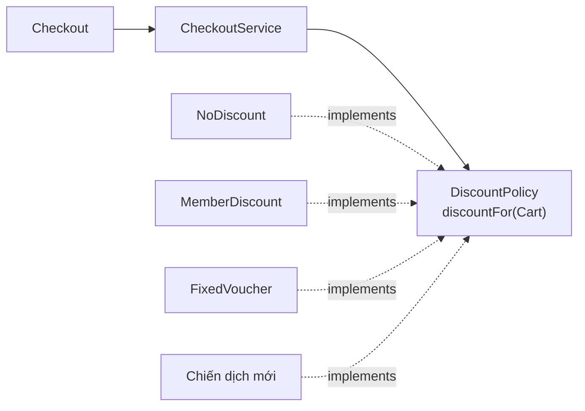

A **standalone Java 17** example: save it as `PatternDecisionDemo.java`, then run `javac PatternDecisionDemo.java` and `java PatternDecisionDemo`:

```java
import java.math.BigDecimal;
import java.math.RoundingMode;
import java.util.Objects;

public class PatternDecisionDemo {

    record Cart(BigDecimal subtotalVnd) {
        Cart {
            Objects.requireNonNull(subtotalVnd, "subtotalVnd");
            if (subtotalVnd.signum() < 0 ||
                    subtotalVnd.stripTrailingZeros().scale() > 0) {
                throw new IllegalArgumentException(
                        "subtotalVnd phải là số nguyên VND không âm");
            }
        }
    }

    // Hợp đồng nhỏ, diễn đạt một khả năng thay đổi độc lập.
    interface DiscountPolicy {
        BigDecimal discountFor(Cart cart);
    }

    static final class NoDiscount implements DiscountPolicy {
        @Override
        public BigDecimal discountFor(Cart cart) {
            Objects.requireNonNull(cart, "cart");
            return BigDecimal.ZERO;
        }
    }

    static final class MemberDiscount implements DiscountPolicy {
        @Override
        public BigDecimal discountFor(Cart cart) {
            Objects.requireNonNull(cart, "cart");
            return cart.subtotalVnd()
                    .multiply(new BigDecimal("0.05"))
                    .setScale(0, RoundingMode.HALF_UP);
        }
    }

    static final class FixedVoucher implements DiscountPolicy {
        private final BigDecimal amountVnd;

        FixedVoucher(BigDecimal amountVnd) {
            Objects.requireNonNull(amountVnd, "amountVnd");
            if (amountVnd.signum() < 0 ||
                    amountVnd.stripTrailingZeros().scale() > 0) {
                throw new IllegalArgumentException(
                        "amountVnd phải là số nguyên VND không âm");
            }
            this.amountVnd = amountVnd;
        }

        @Override
        public BigDecimal discountFor(Cart cart) {
            Objects.requireNonNull(cart, "cart");
            return amountVnd.min(cart.subtotalVnd());
        }
    }

    // Không hỏi cụ thể từng kiểu chính sách.
    static final class CheckoutService {
        private final DiscountPolicy policy;

        CheckoutService(DiscountPolicy policy) {
            this.policy = Objects.requireNonNull(policy, "policy");
        }

        BigDecimal payableFor(Cart cart) {
            Objects.requireNonNull(cart, "cart");
            BigDecimal discount = Objects.requireNonNull(
                    policy.discountFor(cart), "discount không được null");

            // Bảo vệ invariant của phần điều phối.
            if (discount.signum() < 0 ||
                    discount.compareTo(cart.subtotalVnd()) > 0 ||
                    discount.stripTrailingZeros().scale() > 0) {
                throw new IllegalStateException(
                        "Chính sách trả mức chiết khấu không hợp lệ");
            }
            return cart.subtotalVnd().subtract(discount);
        }
    }

    public static void main(String[] args) {
        Cart cart = new Cart(new BigDecimal("400000"));

        CheckoutService member = new CheckoutService(
                new MemberDiscount());
        CheckoutService voucher = new CheckoutService(
                new FixedVoucher(new BigDecimal("30000")));
        CheckoutService none = new CheckoutService(
                new NoDiscount());

        System.out.println(member.payableFor(cart));  // 380000
        System.out.println(voucher.payableFor(cart)); // 370000
        System.out.println(none.payableFor(cart));    // 400000
    }
}
```

**Roles in the Strategy pattern:**

| Element | Role | Rationale |
|---|---|---|
| `DiscountPolicy` | Strategy interface | Defines the shared operation and input/output expectations |
| `MemberDiscount`, `FixedVoucher`, `NoDiscount` | Concrete strategies | Each encapsulates an independent formula |
| `CheckoutService` | Context | Coordinates checkout, invokes the strategy, and enforces invariants |
| `main` | Composition root | Selects which strategy to use when assembling objects |

**Extending behavior:** add `SeasonalDiscount implements DiscountPolicy` without adding another branch to `CheckoutService`. If users can choose a discount type through a UI, the **wiring** must still map campaign codes to strategies or obtain them through an appropriate registration mechanism; this change is expected.

**Actual trade-off:** more classes, an additional interface, strategy-selection configuration, and the need for a strict contract across implementations. The principal benefits are separating variants, reducing changes to orchestration code, and testing strategies independently; this does not inherently make the program faster.

### 3.3. Compare Before Deciding

| Criterion | Centralized `switch` | Strategy |
|---|---|---|
| Three short rules that rarely change | Usually simpler and clearer | May introduce unnecessary abstraction |
| Adding new rules frequently | Requires changing the `switch` | Add an implementation and wiring |
| Testing each rule | Possible, usually within the same code unit | Easier to isolate each strategy |
| Tracing execution | Read one function | Follow the interface, implementation, and assembly |
| Supporting plugins/other teams adding rules | Harder to separate ownership | Better suited when the contract is clear |
| Cognitive cost | Low initially, but may grow with the number of branches | Higher initially, more stable with many variants |
| System risks | Large function; a new branch may affect others | Wrong strategy configuration or implementations violating the contract |

Do not choose Strategy simply because you see an `if`. Show that **the processing approach is an axis of variation** with sufficient frequency and independence.

## 4. Trade-offs: A Pattern Resolves One Tension and Creates Another

Design principles often conflict:

- **Less coupling** to implementations ↔ **more indirection** (extra layers to navigate).
- **Extension through new classes** ↔ **more object types and configuration** to maintain.
- **Hiding infrastructure details** ↔ **less visibility into the actual implementation** when DI/registry configuration is opaque.
- **Flexible composition** ↔ **component assembly order** may affect behavior.
- **Decoupled event notifications** ↔ **harder to determine ordering, failures, and consistency**.
- **Object creation through a factory** ↔ **additional concentration of object-selection logic in the factory**.

A pattern succeeds when its new costs are **consciously accepted** and outweighed by the pain it addresses. In a design review, asking “Where does this pattern move responsibility and cost?” is often more useful than asking “Which category does this pattern belong to?”

## 5. Common Pattern Categories

The classic **Gang of Four (GoF)** catalog groups 23 patterns into three categories by intent. The table below selects representative patterns only; classification cannot replace analysis of the specific situation.

| Category | Pattern | When to consider it | Trade-off to remember |
|---|---|---|---|
| **Creational** | Factory Method | Defer concrete class selection to subclasses or an object-creation extension point | Adds hierarchy and indirection |
| **Creational** | Abstract Factory | Create consistent **families** of related objects (for example, a Windows/Mac UI suite) | Hard to add a *new product type* to every factory |
| **Creational** | Builder | An object has many options or a complex construction process that should remain readable | Adds a builder/state and validation step |
| **Creational** | Singleton | A single instance is truly required within a defined scope | Global state, coupling, and testing difficulty; a DI singleton scope differs from a private constructor |
| **Structural** | Adapter | A caller needs one interface while an external library exposes another API | Adds a conversion layer and may lose information or semantics |
| **Structural** | Decorator | Add behavior around an object while keeping the same interface | Wrapping order matters; multiple layers are harder to trace |
| **Structural** | Facade | Several complex subsystem APIs should have one simple entry point | A facade can grow too large and hide specialized capabilities |
| **Behavioral** | Strategy | Several algorithms need to be interchangeable by context | Multiple implementations and a suitable selection mechanism |
| **Behavioral** | Observer | One change must notify multiple observers | Ordering, subscription lifecycle, callback failures, and backpressure |
| **Behavioral** | Command | Represent a request as an object for queuing, logging, undo, or retry | Adds objects/data structures; retries require idempotency management |
| **Behavioral** | State | Behavior depends on state, and transitions are complex | Multiple state classes; valid transitions must be controlled |
| **Behavioral** | Template Method | A fixed algorithm skeleton has steps specialized through inheritance | Inheritance coupling; substitution is harder than composition |

**Distinguish the scope:** GoF Design Patterns generally describe collaboration among objects; **architectural patterns** (such as Layered Architecture and Hexagonal Architecture) affect boundaries across an entire system. An **idiom** is a language-specific coding convention (such as `try-with-resources` in Java). Do not apply a pattern at every level merely because its name is familiar.

## 6. Choosing the Right Pattern for the Same Requirement

Suppose you need to integrate a new provider's messaging service. If the goal is adapting its SDK interface to an internal contract:

```java
interface SmsSender {
    void send(String phoneNumber, String message);
}

// API nhà cung cấp bên ngoài có chữ ký khác.
final class VendorSmsSdk {
    void dispatchText(String destination, String payload) {
        // Gọi API thực tế, xử lý HTTP/auth tại adapter.
    }
}

// Adapter biến lời gọi nội bộ thành lời gọi SDK.
final class VendorSmsAdapter implements SmsSender {
    private final VendorSmsSdk sdk;

    VendorSmsAdapter(VendorSmsSdk sdk) {
        this.sdk = java.util.Objects.requireNonNull(sdk);
    }

    @Override
    public void send(String phoneNumber, String message) {
        sdk.dispatchText(phoneNumber, message);
    }
}
```

This is an **Adapter**: it changes the *contract's shape* while hiding the vendor API. It does not automatically handle retries, SMS charges, security, or phone-number validity.

If the `SmsSender` contract is already suitable but you want to **add metrics** to every send operation:

```java
interface SendMetrics {
    void countSuccess();
    void countFailure();
}

final class MeteredSmsSender implements SmsSender {
    private final SmsSender delegate;
    private final SendMetrics metrics;

    MeteredSmsSender(SmsSender delegate, SendMetrics metrics) {
        this.delegate = java.util.Objects.requireNonNull(delegate);
        this.metrics = java.util.Objects.requireNonNull(metrics);
    }

    @Override
    public void send(String phoneNumber, String message) {
        try {
            delegate.send(phoneNumber, message);
            metrics.countSuccess();
        } catch (RuntimeException e) {
            metrics.countFailure();
            throw e;
        }
    }
}
```

This is a **Decorator**: it preserves the same interface and wraps extra behavior around the delegate's processing. The Java snippets in this section are **examples intended for separate files or assembly within a package** to illustrate the structure; the complete standalone, compilable `main` appears in section 3.

**Different problems call for different patterns:**

| What needs to change | Option to consider | Why |
|---|---|---|
| Replace a vendor API with the application's shared contract | Adapter | Converts the interface |
| Add metrics, tracing, or surrounding behavior | Decorator | Wraps an object while retaining its interface |
| Choose among SMS/email/push channels | Strategy | Interchanges algorithms or sending approaches |
| Several systems need to react after an order is approved | Observer or event messaging | Notifies interested consumers |
| Package a resend request as a queueable/retryable job | Command/job object | Represents the request as transferable data |

If notifications require transactional guarantees and reliable network delivery, **in-process Observer** is insufficient: message brokers, outboxes, retries, idempotency, and partial failures must be addressed. A pattern does not replace distributed-systems requirements.

### Wrapping Order Changes the Result

```text
new RetrySender(new MeteredSmsSender(actual, metrics))
    → metrics ghi nhận từng attempt được retry

new MeteredSmsSender(new RetrySender(actual), metrics)
    → metrics ghi nhận một lần gửi logic sau retry
```

Both compositions can be valid; choose according to the measurement requirements. This illustrates a **Decorator/composition** consequence, rather than complete `RetrySender` code.

## 7. A Process for Choosing Patterns in Real Situations

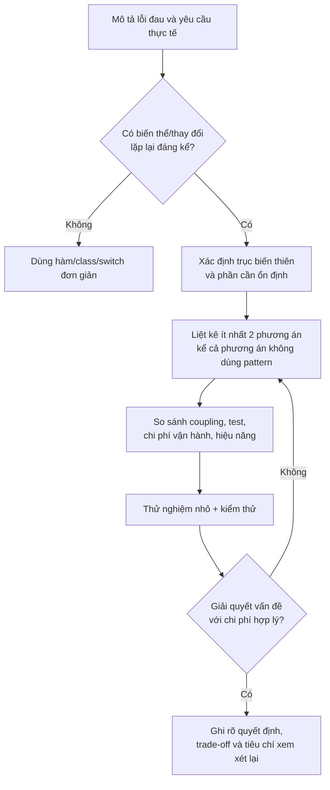

Apply the process to a concrete situation:

1. **Record recent changes:** count modifications to the module over the past 3–6 months, independent branches, and regressions (rather than relying entirely on intuition).
2. **Separate the “what” from the “how”:** what behavior does the business policy require, and which techniques does the implementation use?
3. **State mandatory constraints:** correctness, security, latency, thread safety, transactions, and backward compatibility.
4. **Compare the baseline with candidates:** first try better naming, method extraction, or data mappings; introduce Strategy/Factory/Observer only when beneficial.
5. **Build a small spike:** can a completely new variant be added with few changes to the core? Does debugging become unreasonably difficult?
6. **Define the contract and tests:** specify results, exceptions, invariants, limits, and concurrency.
7. **Write a short design decision:** include context, alternatives considered, reasons for selection, consequences, and conditions for reconsideration.
8. **Reassess with evidence:** retain, simplify, or replace the pattern as the context changes.

### Example Architecture Decision Record (ADR)

```markdown
# ADR: Tách chính sách chiết khấu khỏi CheckoutService

Trạng thái: Chấp nhận (ví dụ minh họa)

Bối cảnh:
- Có nhiều chương trình khuyến mãi được phát triển độc lập.
- Phần điều phối checkout phải ổn định và dùng chung validation.
- Các quy tắc cần unit test riêng, thêm mới thường xuyên.

Phương án:
1. Duy trì switch tập trung.
2. Dùng bảng cấu hình nếu mọi quy tắc thuần dữ liệu.
3. Dùng DiscountPolicy (Strategy) cho quy tắc có hành vi khác nhau.

Quyết định:
- Chọn Strategy cho các chiến dịch có thuật toán khác biệt.
- Composition root ánh xạ mã chiến dịch sang implementation.

Hệ quả:
+ Ít sửa luồng checkout khi thêm chiến dịch.
+ Test được từng chính sách riêng.
- Thêm interface, class và cấu hình.
- Phải kiểm tra contract: mức giảm nằm trong [0, subtotal].

Xem xét lại khi:
- Các chiến dịch chủ yếu chuyển thành cấu hình dữ liệu,
  hoặc số chiến dịch giảm và rất hiếm thay đổi.
```

## 8. Test Patterns Through Behavior and Contracts

A good pattern should help **control change** without breaking invariants. In the Strategy example, prioritize these tests:

- When `subtotalVnd = 400000`, a member receives a 20000 VND discount.
- For a cart worth 20000 VND, a 30000 VND voucher discounts at most 20000 VND; the payable amount is 0.
- With `subtotalVnd = 0`, the payable amount is 0 for every valid policy.
- Reject a new implementation that returns a negative discount, one larger than the cart total, or `null`.
- With a dynamic registry/DI, an unknown policy code must produce a clear error instead of silently selecting another policy.

JUnit 5 example: put the test class in the same package as `PatternDecisionDemo`:

```java
import static org.junit.jupiter.api.Assertions.*;
import java.math.BigDecimal;
import org.junit.jupiter.api.Test;

class PatternDecisionDemoTest {

    @Test
    void memberDiscountIsFivePercent() {
        var cart = new PatternDecisionDemo.Cart(
                new BigDecimal("400000"));
        var checkout = new PatternDecisionDemo.CheckoutService(
                new PatternDecisionDemo.MemberDiscount());

        assertEquals(new BigDecimal("380000"),
                checkout.payableFor(cart));
    }

    @Test
    void fixedVoucherNeverMakesPayableNegative() {
        var cart = new PatternDecisionDemo.Cart(
                new BigDecimal("20000"));
        var checkout = new PatternDecisionDemo.CheckoutService(
                new PatternDecisionDemo.FixedVoucher(
                        new BigDecimal("30000")));

        assertEquals(BigDecimal.ZERO,
                checkout.payableFor(cart));
    }

    @Test
    void invalidStrategyIsRejected() {
        PatternDecisionDemo.DiscountPolicy bad =
                cart -> new BigDecimal("-1");
        var checkout = new PatternDecisionDemo.CheckoutService(bad);

        assertThrows(IllegalStateException.class,
                () -> checkout.payableFor(
                        new PatternDecisionDemo.Cart(
                                new BigDecimal("100000"))));
    }
}
```

These tests demonstrate the correctness of **behavior currently in use**. They do not prove that all future campaigns will be correct; add shared contract tests, boundary tests, and specific tests for new algorithms. If the system combines multiple voucher types, define their order, compatibility, and mutually exclusive rules. **Do not arbitrarily apply multiple Strategies in sequence** unless the contract permits it.

## 9. Common Mistakes When Learning Design Patterns

| Mistake | Why it causes harm | How to fix it |
|---|---|---|
| Memorizing names and then looking for places to apply them | Adds code and abstractions without solving a problem | Start with actual risks from change |
| Treating `if/switch/new` as an absolute code smell | Discards an already correct, concise solution | Evaluate variant frequency, complexity, and ownership |
| Adding multiple interfaces for one fixed case | Adds indirection and navigation costs | Keep the design simple until a need emerges |
| Using Singleton to share mutable data | Increases global coupling, race conditions, and interdependent tests | Manage lifecycles explicitly; prefer immutable data/dependency injection |
| Adapting APIs by renaming methods but losing errors or semantics | Misleads clients about the third-party contract | Define data mapping, timeouts, exceptions, and limits explicitly |
| Failing to test Decorator wrapping order | Metrics, retries, caches, or transactions take on different meanings | Test composition order and side effects |
| Assuming Observer callbacks are always safe | One observer's failure may affect the publisher; unsubscribe may be forgotten | Design error, lifecycle, ordering, and backpressure policies |
| Having factories return objects incompatible with the contract | Errors only surface at runtime | Validate types, invariants, and compatibility |
| Combining patterns into dependency cycles | Complicates initialization and maintenance, obscures lifecycles | Diagram dependencies; separate boundaries |
| Measuring “quality” by pattern count | Makes code harder to maintain despite its architectural appearance | Measure bug-fix time, tests, coupling, and debuggability |

**One important question:** If the kind of change a pattern supports **stopped occurring** tomorrow, would the architecture still make sense? If not, revisit the cost of the abstraction.

## 10. Questions That Distinguish Similar Patterns

**Strategy or State?** Both may use interfaces and composition, but their purposes differ. Strategy interchanges **algorithms/policies**; State represents the **current state and valid transitions**, where an object's behavior depends on a state machine. Switching classes at runtime alone does not make something State.

**Adapter or Decorator?** Adapter enables communication between incompatible interfaces. Decorator generally retains the **same interface** while adding behavior around the wrapped object. A real system may need both.

**Factory Method or a factory function?** The GoF Factory Method relies on an object-creation method that subclasses can specialize; a **static factory method** in Java (such as `Color.of(...)`) is not automatically the GoF Factory Method pattern. Avoid conflating the terms in design reviews.

**Observer or event bus?** Observer models a publisher–subscriber relationship within an application or among objects. An event bus/message broker may use publish–subscribe concepts but must also address delivery, retries, ordering, distribution, and idempotency.

**Builder or constructor?** Builder suits numerous optional parameters or a multistep construction process requiring validation. For a record with two clear required parameters, a constructor may be easier to understand.

## 11. Applied Exercises

### Exercise 1 – Choose Strategy or Do Without It

A service-pricing system has two fixed rules that change only once a year. Implement two alternatives: one using a `switch` and one using Strategy. Estimate their class counts, change points, and situations in which the second approach would become more useful. Explain your final choice.

### Exercise 2 – Adapter by Contract

An external provider returns temperatures in Fahrenheit, but the domain needs Celsius. Design a `TemperatureProvider` that returns degrees Celsius, an adapter for the external SDK, and a rule for handling invalid values. Test the boundaries 32°F → 0°C and 212°F → 100°C; distinguish unit conversion in the adapter from temperature-alert rules.

### Exercise 3 – Decorator and Ordering

Design a `Notifier` wrapped with retries and metrics. Explain how placing `RetryNotifier` **outside** versus **inside** `MetricsNotifier` affects the counts. If a send operation ultimately fails, which composition counts attempts and which counts a single business request?

### Exercise 4 – Diagnose the Context

A team wants Observer to “send an email after successful payment.” Analyze a system where payments and emails run in separate processes, networks can fail, duplicate sends are forbidden, durable storage is required, and retries are necessary. Explain why an in-memory synchronous Observer is insufficient and propose additional mechanisms.

### Exercise 5 – Write an ADR

Choose an existing Java code fragment with many conditionals. Write a brief ADR covering the actual problem, context, two options (including a simple one), decision, benefits, risks, and conditions for review. Do not conclude merely with “because SOLID”.

## 12. Checklist Before Introducing a Pattern into Production Code

- [ ] There is a **measurable or observable problem**, beyond merely wanting to use a pattern.
- [ ] The context, change frequency, and performance/security limits are understood.
- [ ] There is a **simple alternative** for comparison.
- [ ] **Stable points** are distinguished from **extension points**.
- [ ] The pattern's benefits outweigh the additional classes, configuration, and debugging costs.
- [ ] The interface/contract specifies valid values, errors, and side effects.
- [ ] Tests cover current behavior, edge cases, and implementations.
- [ ] Registration, initialization, lifecycle management, and object tracking are planned.
- [ ] The review can explain **why to choose** the pattern and **when to remove** it.

**Remember:** good design does not mean using the greatest number of patterns. A pattern is worthwhile when it addresses a problem **that exists in a specific context**, offers enough long-term benefit, and has trade-offs that are understood, tested, and explicitly accepted.


</details>

- [Back to top](#back-to-top)

---

## <a id="design-patterns-002">Factory Method and Abstract Factory</a>

<details>
<summary>View details</summary>

# Factory Method and Abstract Factory in Java

> **Category:** Design Patterns → *Creational patterns* (patterns for object creation).  
> **Goal:** Understand why object creation should be separated from consuming code, implement the correct **Factory Method** and **Abstract Factory** structures, recognize their differences, choose based on the problem, and avoid confusing them with ordinary object-creation functions.

## 1. The Shared Problem: Business Code Is Coupled to Object Creation

Consider an application that sends notifications by email or SMS. If the business class chooses the implementation itself:

~~~java
void notifyCustomer(String channel, String customerId, String message) {
    if ("email".equals(channel)) {
        new EmailSender().send(customerId, message);
    } else if ("sms".equals(channel)) {
        new SmsSender().send(customerId, message);
    } else {
        throw new IllegalArgumentException("Unsupported channel");
    }
}
~~~

Adding a new channel requires modifying an `if/else` branch at the call site. Object-creation code is mixed with notification orchestration. If multiple places choose channels, the conditionals are easily duplicated.

Both patterns below use **abstraction** to reduce coupling, but they focus on different concerns:

- **Factory Method** lets a **base class define an extension point for product creation**, while subclasses decide which product type to instantiate.
- **Abstract Factory** lets clients use **a factory object** to create **a family of related products** without knowing the family's concrete classes.

Do not rush to introduce a factory when you only have one simple `new` with little chance of change. A factory becomes useful when object creation is an **intentional variation point**.

## 2. Factory Method — Deferring Product Creation to Subclasses

**GoF definition:** Define an interface for creating an object, but let subclasses decide which class to instantiate. Factory Method lets a class defer instantiation of concrete products to subclasses.

Typical roles:

| Role | Responsibility | Example |
|---|---|---|
| **Product** | Contract of the created object | `Sender` |
| **Concrete Product** | Implementations of Product | `EmailSender`, `SmsSender` |
| **Creator** | Contains the common processing flow and declares the factory method | `NotificationCampaign` |
| **Concrete Creator** | Overrides the factory method to return a concrete product | `EmailCampaign`, `SmsCampaign` |

Key point: **a Creator is not necessarily just a “factory class”**. It often implements real processing logic and calls the factory method to obtain an appropriate collaborator. In the example below, `notifyCustomer` is the shared flow; `createSender` is the factory method.

### 2.1. Standalone Java Example: Creating a Notification Channel

Create `FactoryMethodDemo.java`. The code runs on Java 17+ without contacting real email or SMS services.

~~~java
import java.util.List;
import java.util.Objects;

// Product: client chỉ cần thao tác trên hợp đồng này.
interface Sender {
    void send(String customerId, String message);
}

// Concrete products: các adapter mô phỏng để dễ chạy demo.
final class EmailSender implements Sender {
    @Override
    public void send(String customerId, String message) {
        System.out.printf("[EMAIL] %s: %s%n", customerId, message);
    }
}

final class SmsSender implements Sender {
    @Override
    public void send(String customerId, String message) {
        System.out.printf("[SMS] %s: %s%n", customerId, message);
    }
}

// Creator: thuật toán chung, đồng thời công bố factory method.
abstract class NotificationCampaign {
    public final void notifyCustomer(String customerId, String message) {
        Objects.requireNonNull(customerId, "customerId");
        Objects.requireNonNull(message, "message");

        if (customerId.isBlank() || message.isBlank()) {
            throw new IllegalArgumentException("Blank customer/message");
        }

        // Không cần biết Sender cụ thể là email hay SMS.
        Sender sender = Objects.requireNonNull(
                createSender(), "createSender returned null");
        sender.send(customerId, message);
    }

    protected abstract Sender createSender(); // Factory Method
}

// Concrete creators: lựa chọn sản phẩm bằng polymorphism.
final class EmailCampaign extends NotificationCampaign {
    @Override
    protected Sender createSender() {
        return new EmailSender();
    }
}

final class SmsCampaign extends NotificationCampaign {
    @Override
    protected Sender createSender() {
        return new SmsSender();
    }
}

public class FactoryMethodDemo {
    public static void main(String[] args) {
        List<NotificationCampaign> campaigns = List.of(
                new EmailCampaign(),
                new SmsCampaign()
        );

        for (NotificationCampaign campaign : campaigns) {
            campaign.notifyCustomer("CUST-42", "Don hang da xac nhan");
        }
    }
}
~~~

Run from the directory containing the file:

~~~bash
javac FactoryMethodDemo.java
java FactoryMethodDemo
~~~

Output:

~~~text
[EMAIL] CUST-42: Don hang da xac nhan
[SMS] CUST-42: Don hang da xac nhan
~~~

**What happens:**

1. The client chooses `EmailCampaign` or `SmsCampaign` at the assembly point (for example, in `main`).
2. The client calls the **same API**, `notifyCustomer(customerId, message)`.
3. The Creator validates the input and calls `createSender()`.
4. The method is dynamically dispatched to the subclass; the subclass creates an `EmailSender` or `SmsSender`.
5. The common processing flow does not require `if (sender instanceof EmailSender)` or modification when another Concrete Creator is added.

In a real system, `EmailSender` might call an email provider while `SmsSender` calls an SMS gateway. Here `customerId` is a general identifier, not an email address or phone number; real adapters would need contact-information lookup and appropriate error-handling rules.

### 2.2. Relationship Diagram

~~~mermaid
classDiagram
    class Sender {
        <<interface>>
        +send(customerId, message) void
    }
    class EmailSender {
        +send(customerId, message) void
    }
    class SmsSender {
        +send(customerId, message) void
    }
    class NotificationCampaign {
        <<abstract>>
        +notifyCustomer(customerId, message) void
        #createSender() Sender
    }
    class EmailCampaign {
        #createSender() Sender
    }
    class SmsCampaign {
        #createSender() Sender
    }

    Sender <|.. EmailSender
    Sender <|.. SmsSender
    NotificationCampaign <|-- EmailCampaign
    NotificationCampaign <|-- SmsCampaign
    NotificationCampaign ..> Sender : sử dụng
    EmailCampaign ..> EmailSender : tạo
    SmsCampaign ..> SmsSender : tạo
~~~

This is the **GoF Factory Method structure**, because **a subclass overrides a product-creation method declared by the Creator**. It is not simply a function with “factory” in its name.

### 2.3. When Should You Use It?

Factory Method is useful when the **Creator has a stable workflow** but the component created within that workflow varies by Creator type: rendering reports with suitable renderers, creating message senders for campaigns, creating specialized parsers in a pipeline, or creating documents in an editor.

Trade-off: each variant may require a Concrete Creator, increasing the number of classes and the use of inheritance. If objects differ only by runtime configuration or the Creator has no genuine shared behavior, passing a factory or strategy through composition may be more concise.

## 3. Abstract Factory — Creating a Consistent Product Family

**GoF definition:** Provide an interface for creating **families of related or dependent objects** without specifying their concrete classes.

Example: a desktop application supports **Light** and **Dark** interfaces. Each theme has multiple components: `Button` and `Checkbox`. Clients expect those components to be created **consistently within one theme**.

| Product family | Button | Checkbox |
|---|---|---|
| **Light** | `LightButton` | `LightCheckbox` |
| **Dark** | `DarkButton` | `DarkCheckbox` |

If clients instantiate each class separately throughout the code, they may accidentally mix `LightButton` with `DarkCheckbox`. Abstract Factory centralizes the choice of the entire family.

### 3.1. Standalone Java Example: Light/Dark UI

Create a **separate** file, `AbstractFactoryDemo.java`, and compile and run it independently of the Factory Method example.

~~~java
import java.util.Objects;

// Abstract products: hợp đồng của từng loại thành phần UI.
interface Button {
    String render();
}

interface Checkbox {
    String render();
}

// Abstract factory: danh sách sản phẩm mà MỌI họ cần cung cấp.
interface UiFactory {
    Button createButton();
    Checkbox createCheckbox();
}

// Họ Light: hai sản phẩm có cùng phong cách.
final class LightButton implements Button {
    @Override
    public String render() {
        return "Button[LIGHT]";
    }
}

final class LightCheckbox implements Checkbox {
    @Override
    public String render() {
        return "Checkbox[LIGHT]";
    }
}

final class LightUiFactory implements UiFactory {
    @Override
    public Button createButton() {
        return new LightButton();
    }

    @Override
    public Checkbox createCheckbox() {
        return new LightCheckbox();
    }
}

// Họ Dark: cùng interface sản phẩm, implementation khác.
final class DarkButton implements Button {
    @Override
    public String render() {
        return "Button[DARK]";
    }
}

final class DarkCheckbox implements Checkbox {
    @Override
    public String render() {
        return "Checkbox[DARK]";
    }
}

final class DarkUiFactory implements UiFactory {
    @Override
    public Button createButton() {
        return new DarkButton();
    }

    @Override
    public Checkbox createCheckbox() {
        return new DarkCheckbox();
    }
}

// Client chỉ biết các abstraction Button, Checkbox và UiFactory.
final class SettingsScreen {
    private final Button button;
    private final Checkbox checkbox;

    SettingsScreen(UiFactory factory) {
        Objects.requireNonNull(factory, "factory");

        // Tất cả thành phần được tạo qua CÙNG MỘT factory.
        this.button = Objects.requireNonNull(
                factory.createButton(), "button");
        this.checkbox = Objects.requireNonNull(
                factory.createCheckbox(), "checkbox");
    }

    void render() {
        System.out.println(button.render() + " | " + checkbox.render());
    }
}

public class AbstractFactoryDemo {
    public static void main(String[] args) {
        UiFactory light = new LightUiFactory();
        UiFactory dark = new DarkUiFactory();

        new SettingsScreen(light).render();
        new SettingsScreen(dark).render();
    }
}
~~~

Run:

~~~bash
javac AbstractFactoryDemo.java
java AbstractFactoryDemo
~~~

Output:

~~~text
Button[LIGHT] | Checkbox[LIGHT]
Button[DARK] | Checkbox[DARK]
~~~

`SettingsScreen` knows only the **Abstract Products** (`Button`, `Checkbox`) and the **Abstract Factory** (`UiFactory`). It neither instantiates nor imports `DarkButton` / `LightCheckbox`.

A concrete factory creates products from **the same family**; replacing `UiFactory` at the **composition root** switches the entire UI suite. If a concrete factory mixes products from different themes, that is an implementation/product-family contract error; the Java interface alone cannot enforce this consistency.

### 3.2. Abstract Factory Diagram

~~~mermaid
flowchart TD
    Client["SettingsScreen (client)"] --> Abstract["UiFactory"]
    Client --> BP["Button"]
    Client --> CP["Checkbox"]
    Light["LightUiFactory"] -.->|"implements"| Abstract
    Dark["DarkUiFactory"] -.->|"implements"| Abstract
    Light --> LB["LightButton"]
    Light --> LC["LightCheckbox"]
    Dark --> DB["DarkButton"]
    Dark --> DC["DarkCheckbox"]
    LB -.->|"implements"| BP
    DB -.->|"implements"| BP
    LC -.->|"implements"| CP
    DC -.->|"implements"| CP
~~~

The defining feature is **a factory with multiple methods that create different Product types**, such as `createButton()` and `createCheckbox()`. Each Concrete Factory implements all those methods to produce **one consistent variant**.

### 3.3. When Should You Use It?

- There are **multiple related product types** that must be selected together as a family: Light/Dark UI, AWS/Azure cloud connector suites (storage, queues, notifications), document-export components by format, or adapters for multiple providers in the same ecosystem.
- You need to switch product families at startup or when constructing a session, without making clients depend on concrete classes.
- You need to isolate the rules for constructing product suites and test compatibility among products in the same family.

**Important trade-off:** Adding a **new family** usually requires only a new Concrete Factory and its Concrete Products. But adding a **new product type** to the interface (such as `createSlider()`) may require changing every Concrete Factory. Abstract Factory fits when the set of product types is relatively stable but the number of families changes.

## 4. Side-by-Side Comparison

| Criterion | Factory Method | Abstract Factory |
|---|---|---|
| Core problem | Vary how **one Product type** is created within a Creator's algorithm | Create **a family of related Products** |
| Characteristic variation mechanism | **Inheritance + overriding** a factory method | **Composition**: pass a factory object to the client |
| Creation interface | `protected Sender createSender()` in the Creator | `UiFactory` exposes `createButton()` and `createCheckbox()` |
| Adding a variant | Add a Concrete Creator and corresponding Product | Add a Concrete Factory and the Products of the new family |
| Adding an entirely new product type | May require a new Creator abstraction/workflow | Usually requires extending the API and updating every concrete factory |
| Primary client | Uses the Creator (or invokes its shared operation) | Uses the Abstract Factory and Abstract Products |
| Example above | `EmailCampaign` selects `EmailSender` | `DarkUiFactory` creates both `DarkButton` + `DarkCheckbox` |
| Main concern | Many subclasses may exist just to choose a single product | Hard to extend by adding product types |

**The two patterns are not mutually exclusive.** A concrete Abstract Factory may internally use factory methods to create each product type. The distinction lies in **design intent and the client's usage structure**, not in method names.

## 5. Distinguishing Simple Factory and Static Factory Methods

Many resources call every function that returns an object a “Factory Method,” which creates confusion.

A **Simple Factory** is usually a class or function that selects an implementation centrally based on a parameter:

~~~java
enum Channel { EMAIL, SMS }

final class SenderFactory {
    static Sender create(Channel channel) {
        return switch (channel) {
            case EMAIL -> new EmailSender();
            case SMS -> new SmsSender();
        };
    }
}

// Client:
Sender sender = SenderFactory.create(Channel.EMAIL);
~~~

The snippet above assumes the `Sender`, `EmailSender`, and `SmsSender` classes from `FactoryMethodDemo.java` are reused (when placed in the same package). This is commonly called a **simple factory**: one function makes a selection based on an enum, with **no Creator subclass overriding a factory method**. Adding an enum value requires changing the `switch`; a simple factory may still be entirely appropriate for a small system.

A **Static factory method** is a `static` method that creates or returns an object, such as `List.of(...)` and `LocalDate.of(...)` in Java. It is an API-design technique and **does not imply** the GoF **Factory Method** pattern. Depending on its API contract, a static factory may return a new object, a cached object, or a hidden implementation.

The name does not determine the pattern. Ask **whether the variation point is in a subclass, in a factory object, or simply in an argument passed to the method**.

## 6. How Do Factories Differ from DI and Strategy?

**Dependency Injection (DI)** is the technique of **supplying an object's dependencies from outside**. With `new SettingsScreen(new DarkUiFactory())`, constructor injection supplies `UiFactory`; Abstract Factory is the kind of dependency being injected. DI itself is not automatically Factory Method or Abstract Factory.

**Strategy** encapsulates an **interchangeable algorithm/behavior**. A factory creates **objects**. They can work together: a factory creates or selects a `PricingStrategy`, while a service uses Strategy to calculate a price.

A practical rule:

- If the variation concerns **how an existing operation behaves**, consider Strategy first.
- If the variation concerns **which class is created within a shared process, as chosen by a subclass**, consider Factory Method.
- If you must create a **set of products in the same variant** (several related interfaces), consider Abstract Factory.
- If only one implementation needs to be selected at startup with few variants, constructor DI at the composition root may already suffice.

In Spring, `@Bean` and the DI container handle bean creation, wiring, and lifecycle, but **do not automatically** turn every `@Bean` into a GoF Factory Method/Abstract Factory. If the only requirement is configuring a `Sender`, direct injection may suffice; a separate factory class is not always needed.

## 7. Clean Factory Design in Real Applications

### 7.1. Separate Variant Selection from Client Code

Both examples have a **composition root**:

~~~java
// Factory Method:
NotificationCampaign campaign = new EmailCampaign();

// Abstract Factory:
UiFactory uiFactory = new DarkUiFactory();
SettingsScreen screen = new SettingsScreen(uiFactory);
~~~

With runtime configuration, variant selection may occur in `main`, a bootstrap module, or DI configuration. The main client should not scatter `new DarkButton()` or `if (factory instanceof DarkUiFactory)` throughout its logic.

Distinguish **changing configuration between startups** from **selecting variants per request**. If each HTTP request requires a different provider, a fixed singleton factory chosen at startup is insufficient; you may need a registry/selector that governs selection permissions, or to pass the appropriate factory with each request. This choice depends on the operating context; the pattern itself does not provide it.

### 7.2. Avoid Exposing Concrete Classes in the API Without Good Reason

If `UiFactory.createButton()` returns `DarkButton` and clients must cast to access special behavior, the goal of decoupling concrete products is weakened. A product interface should provide operations **that clients actually need**, without adding methods relevant to only one family.

Avoid an interface with dozens of methods where most implementations merely throw `UnsupportedOperationException`. Reconsider how interfaces are split, which capabilities are supported, or how capabilities are represented.

### 7.3. Specify Creation Time, Ownership, and Lifecycle

Both demos use `new`, so each factory-method call can create a new object. In production, expensive dependencies such as HTTP clients, connection pools, or SDKs may need reuse. A factory **may** return an existing, pooled, or new object, provided its contract permits that.

Specify clearly:
- Does the factory-produced object contain request-specific state?
- Is it safe to share across threads?
- Who is responsible for closing `AutoCloseable` instances and managing resource lifecycles?
- May the client mutate product state after creation?

Do not default to caching/singletons merely because a factory is called repeatedly, especially if the product contains user data or transaction context.

### 7.4. Handle Object-Creation Failures

Initialization may fail because of invalid configuration, missing credentials, unavailable providers, or exhausted resources. Distinguish **startup configuration errors** from **operational errors while invoking a method**. The contract should specify whether a factory may return `null` or must throw an exception; returning a valid object or throwing a meaningful exception by default simplifies client code.

## 8. Test Each Pattern Against Its Purpose

### Factory Method: Verify That the Shared Algorithm Uses the Created Product

Because `Sender` only prints to the console in the demo, a test can create a Creator that returns a fake Sender and records the invocation. The following uses `NotificationCampaign`/`Sender` from the Factory Method example and runs with JUnit Jupiter:

~~~java
import static org.junit.jupiter.api.Assertions.*;

import java.util.concurrent.atomic.AtomicInteger;
import org.junit.jupiter.api.Test;

class FactoryMethodContractTest {
    @Test
    void creatorDelegatesToProduct() {
        AtomicInteger sent = new AtomicInteger();
        NotificationCampaign campaign = new NotificationCampaign() {
            @Override
            protected Sender createSender() {
                return (id, message) -> {
                    assertEquals("CUST-1", id);
                    assertEquals("Hello", message);
                    sent.incrementAndGet();
                };
            }
        };

        campaign.notifyCustomer("CUST-1", "Hello");
        assertEquals(1, sent.get());
    }

    @Test
    void invalidInputIsRejectedBeforeCreation() {
        AtomicInteger creations = new AtomicInteger();
        NotificationCampaign campaign = new NotificationCampaign() {
            @Override
            protected Sender createSender() {
                creations.incrementAndGet();
                return (id, msg) -> {};
            }
        };

        assertThrows(IllegalArgumentException.class,
                () -> campaign.notifyCustomer("", "Hello"));
        assertEquals(0, creations.get());
    }
}
~~~

### Abstract Factory: Verify a Consistent Product Family

A test can instantiate each concrete factory, verify that it creates all required non-`null` products, exercise their interface operations, and verify theme conventions. This JUnit Jupiter example uses classes from `AbstractFactoryDemo.java`:

~~~java
import static org.junit.jupiter.api.Assertions.*;
import org.junit.jupiter.api.Test;

class AbstractFactoryContractTest {
    @Test
    void darkFactoryCreatesMatchingProducts() {
        UiFactory factory = new DarkUiFactory();

        Button button = assertDoesNotThrow(factory::createButton);
        Checkbox checkbox = assertDoesNotThrow(factory::createCheckbox);

        assertNotNull(button);
        assertNotNull(checkbox);
        assertEquals("Button[DARK]", button.render());
        assertEquals("Checkbox[DARK]", checkbox.render());
    }
}
~~~

The test above uses demo output as a signal of theme consistency. In a real UI application, you could inspect exposed theme/token properties on the abstraction or perform screenshot/visual tests at the integration level. This test alone does not prove that the interface renders correctly in every environment.

**Execution note:** Each main example is a separate `.java` file; place tests in the appropriate package/source set and add the `org.junit.jupiter:junit-jupiter` dependency and a JUnit test runner. The corresponding example classes must be on the classpath.

## 9. Decision Questions and Exercises

### Scenario Table

| Scenario | Option to consider | Rationale |
|---|---|---|
| One shared import tool where XML/JSON subclasses create suitable parsers | **Factory Method** | The Creator retains the import workflow; subclasses choose parsers |
| An app creates Button, Checkbox, and Dialog in Light/Dark themes | **Abstract Factory** | Selects one consistent **product family** |
| One function returns a Sender based on an EMAIL/SMS enum | **Simple Factory** | Centralizes parameter-based creation without Creator subclasses |
| A service only needs one `EmailSender` configured at startup | **Constructor DI** | May be sufficiently simple without an extra factory |
| Changing the discount algorithm on the same order object | **Strategy** | The variable aspect is behavior/algorithm |
| Creating Storage + Queue + Email adapters for AWS/Azure | **Abstract Factory** (if a consistent family is required) | Multiple products belong to one provider; avoid mixed configurations |

### Exercise 1 — Factory Method

Design a fixed `DocumentExporter.export(Document)` process that validates input, creates a `Renderer`, and calls `render(Document)`. Implement two subclasses, `PdfExporter` and `HtmlExporter`, that override `createRenderer()`. Verify that the Creator does not import `PdfRenderer`/`HtmlRenderer`; adding `MarkdownExporter` must not change the shared algorithm. You can implement demo renderers returning `String` values without a real PDF library.

### Exercise 2 — Abstract Factory

Design `CloudFactory` with `createObjectStorage()` and `createMessageQueue()`. Implement `AwsFactory` and `AzureFactory`, each supplying its matching adapters. A `BackupWorkflow` accepts only `CloudFactory`. Write a unit test using a fake factory to test the workflow; then investigate the design error when an implementation accidentally creates AWS Storage and an Azure Queue in the same factory.

### Self-Check

1. In Factory Method, which object **owns the shared algorithm**, and which object **decides the product class**?
2. If clients need three product types from the same theme, which pattern avoids choosing each type separately?
3. Why is `static Sender create(Channel)` not automatically a GoF Factory Method?
4. In Abstract Factory, how do adding a **new family** and adding a **new product type** affect source code differently?
5. When is passing a dependency through a constructor sufficient, without introducing another factory layer?

**Remember:** **Factory Method** extends *how a Product is created inside a Creator's workflow through subclasses*. **Abstract Factory** encapsulates *creating several related Products as one consistent family through a factory object*. Choose based on **the variation point in the problem**, rather than whether the code contains the word “Factory”.


</details>

- [Back to top](#back-to-top)

---

## <a id="design-patterns-003">Builder and Creating Complex Objects</a>

<details>
<summary>View details</summary>

# Builder and Creating Complex Objects in Java

**Topic:** Design Patterns — Builder.  
**Goal:** Understand why Builder helps when objects have many components and constraints, implement a fluent Builder in Java, ensure that constructed objects are valid, and recognize when a simpler form of object creation is preferable.

## 1. Why Can Object Initialization Become Difficult to Control?

When an object has only two required fields, a direct constructor is usually clear enough:

~~~java
record Point(int x, int y) {}

Point point = new Point(10, 20);
~~~

Now imagine creating an **order** with the following information:

| Element | Required? | Constraint |
| --- | --- | --- |
| Customer ID | Yes | Must not be empty or whitespace only |
| Shipping address | Yes | Must not be empty |
| Item list | At least one item | Each item has an SKU, positive quantity, and nonnegative unit price |
| Shipping method | No | Defaults to **STANDARD**, optionally **EXPRESS** |
| Coupon code | No | Must not be blank if provided |
| Gift wrapping | No | Defaults to **false** |
| Delivery note | No | Defaults to the empty string |

If everything becomes a constructor argument:

~~~java
// Khó nhận ra ý nghĩa của các giá trị ở giữa.
new Order("C01", "12 Nguyễn Huệ", items,
          ShippingMode.EXPRESS, "WELCOME",
          true, "Gọi trước khi giao");
~~~

Clients must remember parameter order, optional-field representations, and valid combinations of values. Parameters that all use **String** are especially easy to swap without a compiler error. Adding many overloaded constructors (*telescoping constructors*) to fix this can make the number of variants grow rapidly. Alternatively, using an empty constructor followed by setters can leave an object temporarily invalid while it is configured:

~~~java
MutableOrder order = new MutableOrder();
order.setCustomerId("C01");
// Nếu bị sử dụng tại đây, order có thể chưa có địa chỉ và mặt hàng.
order.setShippingAddress("12 Nguyễn Huệ");
~~~

**Builder** provides an organized object-construction process: collect configuration choices in a builder, give each operation a clear name, validate before completion, and create the resulting object.

## 2. What Is Builder?

Builder is a *creational pattern*. Its core idea is to **separate construction steps from the final object**. In Java, a common variant is the **fluent Builder**: each configuration method returns the builder itself to allow method chaining.

~~~java
Order order = Order.builder("C01", "12 Nguyễn Huệ")
        .addItem("BOOK-01", 2, new BigDecimal("125000"))
        .addItem("PEN-05", 1, new BigDecimal("35000"))
        .shippingMode(ShippingMode.EXPRESS)
        .couponCode("WELCOME")
        .giftWrap(true)
        .build();
~~~

Read the code as a sequence: create an order for a customer, add items, choose shipping, enter a coupon, request gift wrapping, and complete construction. Method signatures make the meaning of each value clear.

Builder does not require a fluent chain, a nested class, or fixed method names. The classic GoF Builder may include **Builder**, **ConcreteBuilder**, **Director**, and **Product**; a Java fluent Builder may need only **Product** and **Builder**, without a Director. The pattern name helps organize construction; it does not mandate implementing every role for every problem.

~~~mermaid
flowchart LR
    A["Client"] -->|"builder(required fields)"| B["Order.Builder"]
    B -->|"addItem / shippingMode / couponCode"| B
    B -->|"build(): kiểm tra bất biến"| C["Order (bất biến)"]
    C --> D["Client sử dụng Order hoàn chỉnh"]
~~~

### Benefits to Recognize Accurately

- **Readability:** configuration steps are named, reducing mistakes in parameter order.
- **Centralized validation:** the Builder/Product constructor can validate constraints spanning multiple fields before returning the object.
- **Options and defaults:** clients provide only choices that differ from the defaults.
- **Immutable final object:** public setters are unnecessary when values are complete at **build()**.
- **Reusable construction process:** a builder can support additional steps or business-specific variants.

**Not automatic benefits:** Builder does not inherently guarantee immutability, business correctness, thread safety, or the elimination of complexity. Those properties depend on the actual code.

## 3. Java 17+ Example: Creating an Order with Explicit Constraints

Save the following code as **BuilderDemo.java** and run it with JDK 17 or later. The example uses a **record** for immutable line items, **BigDecimal** for precise unit prices, **List.copyOf** to snapshot the item list when creating an order, and a builder entry point that requires the mandatory parameters.

~~~java
import java.math.BigDecimal;
import java.util.ArrayList;
import java.util.List;
import java.util.Objects;

public class BuilderDemo {

    enum ShippingMode {
        STANDARD, EXPRESS
    }

    // Value object: record tự sinh accessor, equals/hashCode và toString.
    // Các thành phần của record này đều là giá trị bất biến.
    public record LineItem(String sku, int quantity, BigDecimal unitPriceVnd) {
        public LineItem {
            sku = requiredText(sku, "sku");
            if (quantity <= 0) {
                throw new IllegalArgumentException(
                        "Số lượng phải lớn hơn 0");
            }
            Objects.requireNonNull(unitPriceVnd, "unitPriceVnd");
            if (unitPriceVnd.signum() < 0) {
                throw new IllegalArgumentException(
                        "Đơn giá không được âm");
            }
        }

        public BigDecimal lineTotalVnd() {
            return unitPriceVnd.multiply(BigDecimal.valueOf(quantity));
        }
    }

    public static final class Order {
        private final String customerId;
        private final String shippingAddress;
        private final List<LineItem> items;
        private final ShippingMode shippingMode;
        private final String couponCode;
        private final boolean giftWrap;
        private final String note;

        private Order(Builder builder) {
            // Một lần nữa xác nhận bất biến tại ranh giới tạo đối tượng.
            this.customerId =
                    requiredText(builder.customerId, "customerId");
            this.shippingAddress =
                    requiredText(builder.shippingAddress, "shippingAddress");

            // Bản sao độc lập; không giữ danh sách mutable của Builder.
            this.items = List.copyOf(builder.items);
            if (items.isEmpty()) {
                throw new IllegalStateException(
                        "Đơn hàng cần ít nhất một mặt hàng");
            }

            this.shippingMode =
                    Objects.requireNonNull(builder.shippingMode);
            this.couponCode = builder.couponCode;
            this.giftWrap = builder.giftWrap;
            this.note = builder.note;
        }

        // Bắt buộc có khách hàng và địa chỉ ngay khi khởi tạo builder.
        public static Builder builder(
                String customerId, String shippingAddress) {
            return new Builder(customerId, shippingAddress);
        }

        public String customerId() {
            return customerId;
        }

        public String shippingAddress() {
            return shippingAddress;
        }

        public List<LineItem> items() {
            return items;
        }

        public ShippingMode shippingMode() {
            return shippingMode;
        }

        public String couponCode() {
            return couponCode;
        }

        public boolean giftWrap() {
            return giftWrap;
        }

        public String note() {
            return note;
        }

        public BigDecimal goodsTotalVnd() {
            return items.stream()
                    .map(LineItem::lineTotalVnd)
                    .reduce(BigDecimal.ZERO, BigDecimal::add);
        }

        public static final class Builder {
            private final String customerId;
            private final String shippingAddress;
            private final List<LineItem> items = new ArrayList<>();
            private ShippingMode shippingMode = ShippingMode.STANDARD;
            private String couponCode;
            private boolean giftWrap;
            private String note = "";

            private Builder(String customerId, String shippingAddress) {
                this.customerId = requiredText(customerId, "customerId");
                this.shippingAddress =
                        requiredText(shippingAddress, "shippingAddress");
            }

            public Builder addItem(
                    String sku, int quantity, BigDecimal unitPriceVnd) {
                items.add(new LineItem(sku, quantity, unitPriceVnd));
                return this;
            }

            public Builder shippingMode(ShippingMode mode) {
                this.shippingMode =
                        Objects.requireNonNull(mode, "shippingMode");
                return this;
            }

            public Builder couponCode(String code) {
                this.couponCode = requiredText(code, "couponCode");
                return this;
            }

            public Builder giftWrap(boolean enabled) {
                this.giftWrap = enabled;
                return this;
            }

            public Builder note(String value) {
                this.note = Objects.requireNonNull(value, "note");
                return this;
            }

            public Order build() {
                return new Order(this);
            }
        }
    }

    private static String requiredText(String value, String field) {
        if (value == null || value.isBlank()) {
            throw new IllegalArgumentException(
                    field + " không được rỗng");
        }
        return value.trim();
    }

    public static void main(String[] args) {
        Order order = Order.builder("C01", "12 Nguyễn Huệ")
                .addItem("BOOK-01", 2, new BigDecimal("125000"))
                .addItem("PEN-05", 1, new BigDecimal("35000"))
                .shippingMode(ShippingMode.EXPRESS)
                .couponCode("WELCOME")
                .giftWrap(true)
                .note("Gọi trước khi giao")
                .build();

        System.out.println(
                order.customerId() + " | " +
                order.shippingMode() + " | " +
                order.goodsTotalVnd().toPlainString() + " VND");
        System.out.println("Số dòng mặt hàng: " + order.items().size());
    }
}
~~~

Run:

~~~bash
javac BuilderDemo.java
java BuilderDemo
~~~

Output:

~~~text
C01 | EXPRESS | 285000 VND
Số dòng mặt hàng: 2
~~~

**Explanation of the design choices:**

1. **The Order constructor is private.** Clients cannot create an **Order** while bypassing the validation boundary.
2. **Order.builder(customerId, shippingAddress)** requires two minimum pieces of information. The compiler enforces that arguments are supplied; null/blank validation occurs at runtime.
3. **addItem(...)** creates a valid **LineItem** when it is added to the builder; **build()** validates the whole-order constraint: at least one line item is required.
4. **shippingMode** has a default. **couponCode == null** means no coupon, **giftWrap == false** means no gift wrapping, and **note == ""** means no note. These meanings must be explicit in the API.
5. **Order** has only **private final** fields and accessors. There are no setters to change its state after construction.
6. **List.copyOf** produces a list that cannot be modified through its accessor and separates the order's list from the builder's internal list. Because **LineItem** uses **String**, **int**, and **BigDecimal** (all immutable in this example), individual elements cannot be altered through mutable references either.
7. **goodsTotalVnd()** is the merchandise total before shipping charges and discounts. The Builder does not automatically apply coupons; discount rules belong in separate business processing.

The code uses **BigDecimal** instead of **double** for money to avoid binary floating-point errors. In real projects, standardize rounding rules, currencies, and taxes, and do not treat the presence of a coupon string as proof that a discount has been applied.

## 4. Two Validation Points: Configuration and Completion

Do not mechanically postpone every check until **build()**, and do not assume that individually valid setters guarantee a valid final combination.

| When | What to validate | Example |
| --- | --- | --- |
| When initializing the builder | Independent required values | Nonblank customer ID/address |
| When invoking configuration methods | Validity of individual choices | Quantity > 0, nonnegative unit price, non-null shipping mode |
| When invoking **build()** | Invariants involving multiple components | At least one item; delivery date after order date if business rules require it |
| In the business service | Rules requiring dynamic data or infrastructure | Inventory, coupon validity, ordering permissions, carrier rates |

For example, an optional rule may require an **EXPRESS** order to include a contact phone number. You can add **contactPhone** to the builder and validate the combination at **build()**:

~~~java
// Minh họa đoạn điều kiện đặt trong constructor của Product:
if (builder.shippingMode == ShippingMode.EXPRESS
        && (builder.contactPhone == null
            || builder.contactPhone.isBlank())) {
    throw new IllegalStateException(
            "Giao EXPRESS yêu cầu số điện thoại liên hệ");
}
~~~

This is an **illustrative extension**, not a snippet that can be pasted unchanged into **BuilderDemo.java**, because the complete example above does not yet declare **contactPhone**. To implement it, add a field and method to the builder, an immutable field to Order, an accessor, and tests for the constraint.

Important: inventory checks or external shipping-rate calculations should not automatically make network calls inside a value object's **build()** if that makes construction unpredictable, difficult to test, or side-effectful. Let a service coordinate appropriate dependencies before creating or confirming the order.

## 5. Understanding Immutability and Builder Reuse

**Builders are usually mutable**, while **Products may be immutable**. These properties do not conflict.

A builder can be reused to create multiple object snapshots:

~~~java
var builder = BuilderDemo.Order
        .builder("C02", "45 Lê Lợi")
        .addItem("BOOK-01", 1, new java.math.BigDecimal("100000"));

var first = builder.build();           // 1 dòng
builder.addItem("PEN-05", 2,
        new java.math.BigDecimal("10000"));
var second = builder.build();          // 2 dòng

System.out.println(first.items().size());   // 1
System.out.println(second.items().size());  // 2
~~~

This works because every **build()** copies the list. If the Product constructor retains **builder.items** directly, modifying the builder after building will also change the previously created product, violating the expectation of immutability.

However, **List.copyOf only makes a shallow copy of the elements**. If the list contains mutable objects such as **MutableAddress**, a nested **ArrayList**, or objects with setters, anyone holding references to those elements may still change their contents. For deeper immutability, use immutable value objects, defensively copy each element, or avoid exposing mutable references.

**A mutable Builder is not inherently thread-safe.** Do not share a builder under modification across threads without suitable synchronization/concurrency controls. The simplest option is to give each thread/task its own builder.

Common mistakes:

- Public setters on **Order** undermine the idea of “complete at build time”.
- **build()** returns the builder itself or a product that retains mutable references owned by the builder.
- The Builder permits creating a product with missing required fields without reporting an error.
- Defaults silently change over time, unexpectedly altering existing behavior.
- Validation occurs in one setter, but combinations of configuration steps can bypass invariants.
- Exceptions are used for valid but frequently failing business outcomes without a clear contract; larger applications may use a specialized validation-result type.

## 6. Testing Builder with JUnit 5

Put the following tests in **BuilderDemoTest.java** (with JUnit Jupiter on the project's classpath). The goal is to verify the correctness of the **constructed** object, defaults, invariants, and input errors.

~~~java
import static org.junit.jupiter.api.Assertions.*;

import java.math.BigDecimal;
import org.junit.jupiter.api.Test;

class BuilderDemoTest {

    @Test
    void taoDonHangVoiMacDinh() {
        var order = BuilderDemo.Order.builder("C01", "12 Nguyễn Huệ")
                .addItem("BOOK-01", 2, new BigDecimal("125000"))
                .build();

        assertEquals(BuilderDemo.ShippingMode.STANDARD,
                order.shippingMode());
        assertFalse(order.giftWrap());
        assertNull(order.couponCode());
        assertEquals("", order.note());
        assertEquals(new BigDecimal("250000"), order.goodsTotalVnd());
    }

    @Test
    void khongChoTaoDonRong() {
        var builder = BuilderDemo.Order.builder("C01", "12 Nguyễn Huệ");

        assertThrows(IllegalStateException.class, builder::build);
    }

    @Test
    void chanSoLuongKhongHopLe() {
        var builder = BuilderDemo.Order.builder("C01", "12 Nguyễn Huệ");

        assertThrows(IllegalArgumentException.class, () ->
                builder.addItem("BOOK-01", 0,
                        new BigDecimal("125000")));
    }

    @Test
    void danhSachCuaOrderKhongTheSuaVaKhongBiAnhHuongKhiTaiSuDungBuilder() {
        var builder = BuilderDemo.Order.builder("C01", "12 Nguyễn Huệ")
                .addItem("BOOK-01", 1, new BigDecimal("100000"));
        var first = builder.build();

        assertThrows(UnsupportedOperationException.class, () ->
                first.items().clear());

        builder.addItem("PEN-05", 1, new BigDecimal("10000"));
        var second = builder.build();

        assertEquals(1, first.items().size());
        assertEquals(2, second.items().size());
    }

    @Test
    void batBuocCoMaKhachHangHopLe() {
        assertThrows(IllegalArgumentException.class, () ->
                BuilderDemo.Order.builder("   ", "12 Nguyễn Huệ"));
    }
}
~~~

A more complete test suite should cover boundaries: extremely large quantities, negative unit prices, nulls, blank strings, cross-field rules, defaults, and repeated builder configuration. Match the testing effort to business risk; there is no need to test that every setter returns the builder if end-to-end results already cover the behavior.

## 7. Comparing Object-Creation Approaches in Java

| Approach | Appropriate when | Trade-off |
| --- | --- | --- |
| Ordinary constructor | Few fields, all clear and required | Can become hard to read with many same-type parameters |
| **record** | Small value object with clear components and value-based equality | Does not inherently solve many options or multistep construction |
| Static factory | Clear business naming, implementation selection, or controlled instantiation is needed | Numerous options may cause factory overloads to proliferate |
| Setters on a mutable object | The object truly needs to change continuously after creation | May expose invalid intermediate states |
| **Builder** | Many optional fields, multistep creation, and a need for valid/immutable products | Extra code, intermediate state, and API learning cost |
| Factory + Builder | Select an object family/implementation, then configure many parameters | Consider overall complexity; the patterns serve different purposes |

**A Factory mainly answers “what type of object to create, and through which mechanism?”; Builder answers “what information and steps are needed to create that object?”.** Combine them when the problem requires both, not merely to increase the pattern count.

In particular, Java **record** suits small data values such as **LineItem**. Builder offers more obvious value for an **Order** aggregate with many options, a list, and cross-field constraints.

## 8. Fluent Builder, Staged Builder, and Director

### Ordinary Fluent Builder

The **Order.Builder** example above lets callers invoke optional steps in flexible order. Some mandatory inputs are enforced through **builder(customerId, shippingAddress)**, while the “at least one item” requirement is checked at runtime by **build()**.

### Staged Builder / Step Builder

If a complex workflow must enforce the order of calls at *compile time*, split the API into stage-specific interfaces:

~~~java
interface CustomerStep {
    AddressStep customer(String customerId);
}

interface AddressStep {
    BuildStep address(String shippingAddress);
}

interface BuildStep {
    BuildStep giftWrap(boolean enabled);
    Order build();
}
~~~

Clients only see methods valid for the current stage. This can reduce missing mandatory fields, but it introduces more interfaces, generics, or complex types. It is rarely worthwhile for ordinary configuration objects. The snippet above only illustrates the **stage interfaces**; a matching implementation and a real **Order** type are required before use.

### Director in GoF Builder

A **Director** knows a standard construction sequence. It invokes a builder to create variants such as “gift order,” “detailed report,” or “default test-environment configuration”:

~~~java
static BuilderDemo.Order createGiftOrder(
        String customerId, String address) {
    return BuilderDemo.Order.builder(customerId, address)
            .addItem("GIFT-01", 1, new java.math.BigDecimal("200000"))
            .giftWrap(true)
            .build();
}
~~~

Here a static factory is enough to express the “recipe” without a separate **Director** class. An independent Director may help when multiple builder types produce different products through the same construction process.

## 9. Builder with Lombok, Spring, or Other Libraries

In codebases using Lombok, **@Builder** can generate a builder API and reduce boilerplate:

~~~java
// Ví dụ ý tưởng, cần dependency Lombok và cấu hình annotation processing:
@lombok.Builder
record ExportOptions(
        String format,
        boolean includeImages,
        int maxRows
) {}
~~~

This is not a direct substitute for the validation in the **Order** example. The annotation generates a builder and construction mechanism, but business invariants, defensive copies of mutable data, default choices, and cross-field constraints still need to be designed and verified. Reviews should also consider interactions among **@Builder**, records/constructors, **@Builder.Default** (where supported), and generated code.

With Spring Boot, a configuration class can be bound from YAML/properties through constructors/records with framework-provided validation. Do not add Builder to every **@ConfigurationProperties** when constructor binding or a record is clear enough; Builder better suits cases where client code genuinely constructs objects step by step or sets many optional code-defined choices.

**Performance note:** a builder introduces another short-lived object and method calls. Usually prioritize correctness, clarity, and maintainability. Optimize allocations only when profiling demonstrates a real bottleneck.

## 10. Designing Builder APIs for Usability and Maintenance

Small decisions can have substantial effects:

| Decision | Suggestion | Rationale |
| --- | --- | --- |
| Required fields | Include them in the static **builder(required...)** factory or use staged steps when needed | Reduces omissions and clarifies the entry point |
| Default values | Define them transparently and consistently in the builder | Clients need not resupply common values |
| Lists/maps | Accumulate in the builder and make defensive copies at build time | Prevents exposing mutable state through the product |
| Typed values | Prefer **enum** and value objects over uncontrolled strings | Reduces invalid states |
| Similar field names | Use method names from the business domain | Avoids ambiguity such as **setFlag(true)** |
| Exceptions | Report the affected field or violated invariant | Helps callers correct input |
| Multiple builds | Specify whether they are supported; if so, return independent objects | Prevents accidental mutation |
| Concurrency | Scope builders to one task/thread unless synchronization is explicitly designed | Limits data races |
| Copying/variants | Consider **toBuilder()** only when necessary | Avoids copying through setters on an immutable product |

A common implementation places the **Builder inside the Product class**, but this is not a limitation of the pattern. An external Builder works when the Product source is unavailable, several construction strategies are needed, or the Product API should remain compact.

## 11. When Should You Avoid Builder?

Builder has implementation and maintenance costs. Keep object creation simple when:

- An object has 2–3 clear parameters, with few options or intermediate states.
- Data is mainly a small immutable record; a **record** or constructor suffices.
- The object is an ORM-managed entity with lifecycle/proxy requirements unlike those of a value object. Examine the framework's requirements instead of applying Builder mechanically.
- Every change is a valid state transition throughout the object's lifetime; controlled mutation APIs, commands, or aggregate methods may be more appropriate.
- A builder is introduced only because “the project must use Design Patterns,” while readers now need another layer to understand an assignment.

A practical principle: **choose Builder when it clarifies a complex construction process, protects invariants, or makes the calling API substantially clearer than a constructor/factory**. Do not measure design quality by the number of classes or patterns.

## 12. Practical Exercise

Design **ReportConfig** for exporting revenue reports:

- **reportName**, **fromDate**, and **toDate** are required.
- **format** defaults to **CSV**, with **PDF** as an option.
- **includeCharts** defaults to false; PDF reports may contain charts, but CSV reports may not.
- The list of departments to filter by may be empty (meaning all departments) but must not contain null/blank department codes.
- The start date must not be after the end date.

Implement **ReportConfig.builder(reportName, fromDate, toDate)**, and add **format(...)**, **includeCharts(...)**, **addDepartment(...)**, and **build()**. Use **LocalDate**, **enum Format**, **List.copyOf**, and **final** fields where appropriate. At a minimum, test that CSV is the default, reversed date ranges are rejected, CSV with charts is rejected, the department list on the Product cannot be modified, and reusing a builder does not alter previously created ReportConfig instances.

Self-assess with three questions: (1) can readers understand each option at the call site; (2) is it possible to create a ReportConfig that violates an invariant; (3) when adding a new option, must every constructor call site in the system change?

**Conclusion:** Builder is most valuable when it turns object creation with many parameters into meaningful steps, centralizes validation, and produces a complete product. Ensure the boundary between a mutable Builder and an immutable Product is implemented correctly, and accept the pattern's complexity only when maintenance benefits are clear.

</details>

- [Back to top](#back-to-top)

---

## <a id="design-patterns-004">Singleton and the Risks of Shared State</a>

<details>
<summary>View details</summary>

# Singleton and the Risks of Shared State in Java

**Context:** An application has many components that need to use shared configuration, a logger, or a common coordinator. We want to avoid redundant object creation. But what happens when a single object also stores data that changes per user or per request while multiple threads access it?

This lesson explains the actual scope of **Singleton**, Java implementation options, why **one instance does not imply thread safety**, how to design safe shared state, and when to prefer **dependency injection (DI)** over a global variable.

## 1. What Is Singleton?

**Singleton** is a *creational design pattern* with two goals:

1. Control creation so that only one instance of a type exists within a **defined scope**.
2. Provide access to that instance for components that need it.

The classic definition usually includes a global access point. In larger applications, however, global access hides dependencies; it is often preferable for a DI container to manage the lifecycle and supply dependencies explicitly.

Suitable examples include **read-only configuration after startup**, immutable rule sets, or a shared service that uses a specific resource with an explicit synchronization policy.

Error-prone examples include a cart being processed, the current logged-in user, a request ID, the current order total, or an object holding a temporary buffer that changes after each request. Such data belongs to **request/session scope or local variables**, not to a global Singleton.

### The Scope of “One Instance” Is Not Absolute

- For a Java Singleton based on `static`, there is usually **one instance per class loader** that loads the class. Different class loaders can have separate copies.
- When an application runs in multiple processes, containers, or pods, each process has its own Singleton. Singleton **does not** guarantee one instance across a cluster.
- In Spring, a `singleton`-scoped bean is **one instance per bean definition per IoC container**; this is different from claiming that a class has only one object throughout the JVM.
- If the business requires system-wide coordination (for example, transaction sequence numbers unique across machines), use a suitable mechanism such as **database sequences, transactions, distributed locks, or coordinators**, rather than an in-memory Singleton.

## 2. Read-Only Singleton Example: Initialization-on-Demand Holder

When static access is genuinely needed, a **static holder** is a concise and generally safe Java option. Java guarantees synchronized class initialization according to its class-initialization rules.

Create `AppSettings.java`:

```java
import java.util.Map;

public final class AppSettings {
    private final Map<String, String> properties;

    private AppSettings() {
        // Giả lập cấu hình cố định đã được nạp.
        this.properties = Map.of(
                "currency", "VND",
                "region", "VN",
                "supportEmail", "support@example.com"
        );
    }

    // Holder chỉ được khởi tạo khi AppSettings.getInstance()
    // truy cập Holder.INSTANCE lần đầu tiên.
    private static final class Holder {
        private static final AppSettings INSTANCE = new AppSettings();
    }

    public static AppSettings getInstance() {
        return Holder.INSTANCE;
    }

    public String get(String key) {
        return properties.get(key);
    }

    public static void main(String[] args) {
        AppSettings a = AppSettings.getInstance();
        AppSettings b = AppSettings.getInstance();

        System.out.println(a == b);                // true
        System.out.println(a.get("currency"));       // VND
    }
}
```

Run with Java 17+:

```bash
javac AppSettings.java
java AppSettings
```

**Key points:**

- A `private` constructor prevents ordinary external Java code from calling `new AppSettings()`.
- A `final` class prevents ordinary subclassing.
- The `Holder` class provides **lazy initialization** and safe publication of the instance through class initialization, without manually adding a `synchronized` block to `getInstance()`.
- `Map.of(...)` creates a map whose entries cannot be modified. `String` is also immutable, so the example's configuration values do not change during use.
- A `private final Map` **is not sufficient** to guarantee immutability if initialized from a `HashMap` whose contents external code can still mutate. `final` only prevents reassigning the **reference**; it does not freeze the referenced object's state.

This illustrates a technique; it is not advice to put every configuration value in a `static` class. In production, inject configuration into the components that need it for easier testing and environment-specific changes.

## 3. One Instance Does Not Imply Thread Safety

These are distinct concepts:

| Property | Question it addresses | What it **does not** guarantee |
|---|---|---|
| Singleton | How many instances exist within the managed scope? | Are concurrent method calls safe? |
| Thread safety | Do concurrent operations preserve invariants, ordering, and valid visibility? | Only one instance exists throughout the program |
| Immutability | Can state change after construction? | Every referenced dependency is immutable |
| Safe publication | Can other threads see a properly initialized state? | Subsequent updates are atomic |
| Transaction/concurrency control | Do multistep changes preserve business rules? | Adding `volatile` alone is sufficient |

### Counterexample: Storing Request State in a Singleton

```java
import java.math.BigDecimal;

final class UnsafeCheckoutService {
    // Nếu class này chỉ có một instance và phục vụ nhiều request,
    // các trường này sẽ bị mọi request chia sẻ.
    private String currentCustomerId;
    private BigDecimal currentAmount;

    String prepareReceipt(String customerId, BigDecimal amount) {
        currentCustomerId = customerId;
        currentAmount = amount;

        // Thực tế có thể có I/O hoặc scheduler chuyển luồng ở đây.
        return currentCustomerId + ":" + currentAmount;
    }
}
```

Suppose thread A processes customer `AN`, 100.000 VND, and thread B processes customer `BINH`, 900.000 VND:

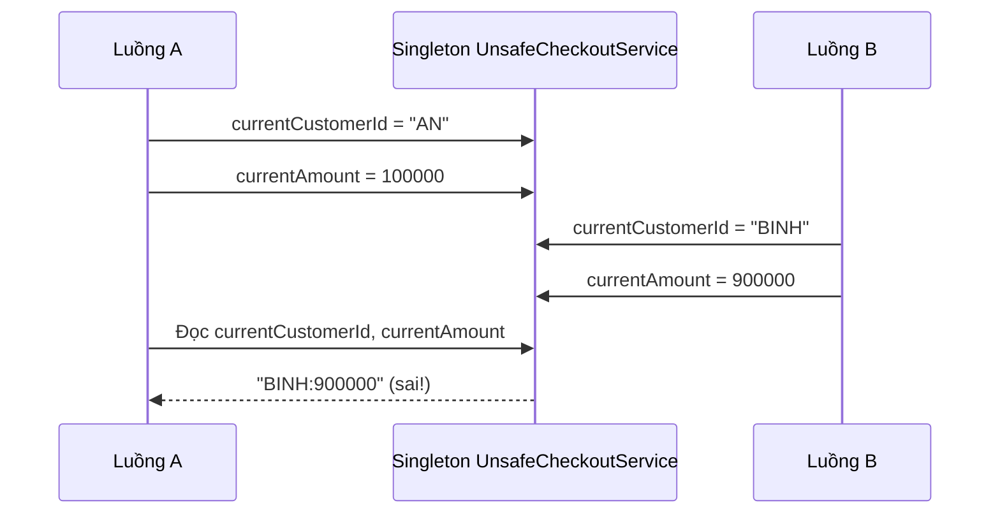

This is a **possible interleaving**, even before considering the Java Memory Model. Without synchronization, visibility across threads can be even more complex. `Thread.sleep` cannot “fix” this situation.

The bug is independent of whether the Singleton uses a holder, `enum`, `synchronized getInstance()`, a Spring bean, or constructor injection. **If request-dependent mutable state lives in a shared object, the design remains unsafe.**

### Correct Fix: Use Local Variables and Properly Scoped Dependencies

```java
import java.math.BigDecimal;
import java.util.Objects;

public final class SafeCheckoutService {
    private final PaymentGateway gateway;

    public SafeCheckoutService(PaymentGateway gateway) {
        this.gateway = Objects.requireNonNull(gateway, "gateway");
    }

    public Receipt checkout(String customerId, BigDecimal amount) {
        Objects.requireNonNull(customerId, "customerId");
        Objects.requireNonNull(amount, "amount");

        if (customerId.isBlank() || amount.signum() <= 0) {
            throw new IllegalArgumentException("Thông tin đơn hàng không hợp lệ");
        }

        // Không có currentCustomerId/currentAmount làm field.
        // Mỗi lời gọi chỉ dùng tham số và biến cục bộ của chính nó.
        String confirmationCode = gateway.charge(customerId, amount);
        return new Receipt(customerId, amount, confirmationCode);
    }

    public interface PaymentGateway {
        String charge(String customerId, BigDecimal amount);
    }

    public record Receipt(String customerId,
                          BigDecimal amount,
                          String confirmationCode) {}

    public static void main(String[] args) {
        PaymentGateway fakeGateway = (id, amount) -> "CONFIRMED-" + id;
        SafeCheckoutService service = new SafeCheckoutService(fakeGateway);

        System.out.println(service.checkout("AN", new BigDecimal("100000")));
        System.out.println(service.checkout("BINH", new BigDecimal("900000")));
    }
}
```

`SafeCheckoutService` can be shared by multiple requests **because it has no request-specific mutable state of its own**. However, `gateway.charge(...)` must also be safe under concurrent calls; the safety of dependencies must be evaluated separately. In production, payments also require idempotency keys, timeouts, controlled retries, and avoiding sensitive data in logs.

**Practical principle:** request-specific data → parameters, local variables, or correctly scoped dependencies. Shared immutable data → may live in long-lived objects. Shared mutable data → requires explicit invariants, synchronization strategy, and test plan.

## 4. When a Singleton Must Hold Mutable State

Some state has a legitimate reason to be shared: in-process metrics, caches, resource pools, or work queues. In those cases, the main question becomes “are all updates correct under concurrency?” rather than “how do we obtain the instance?”

### Incorrect: Nonatomic Increment

```java
final class UnsafeCounter {
    private long total = 0L;

    public void increment() {
        total++; // Đọc -> cộng -> ghi: nhiều bước, có thể mất cập nhật.
    }

    public long get() {
        return total;
    }
}
```

Even with exactly **one** `UnsafeCounter`, two threads can read `total = 5`, both write `6`, and lose an increment. Declaring `volatile long total` only improves visibility/ordering for that variable; `total++` still is not atomic.

### Correct for an In-Process Counter: AtomicLong

Create `CounterDemo.java`:

```java
import java.util.ArrayList;
import java.util.List;
import java.util.concurrent.Callable;
import java.util.concurrent.ExecutorService;
import java.util.concurrent.Executors;
import java.util.concurrent.Future;
import java.util.concurrent.atomic.AtomicLong;

public class CounterDemo {
    enum RequestCounter {
        INSTANCE;

        private final AtomicLong count = new AtomicLong();

        public long incrementAndGet() {
            return count.incrementAndGet();
        }

        public long get() {
            return count.get();
        }
    }

    public static void main(String[] args) throws Exception {
        int workers = 8;
        int incrementsPerWorker = 10_000;
        ExecutorService executor = Executors.newFixedThreadPool(workers);

        try {
            List<Callable<Void>> jobs = new ArrayList<>();
            for (int worker = 0; worker < workers; worker++) {
                jobs.add(() -> {
                    for (int i = 0; i < incrementsPerWorker; i++) {
                        RequestCounter.INSTANCE.incrementAndGet();
                    }
                    return null;
                });
            }

            List<Future<Void>> futures = executor.invokeAll(jobs);
            for (Future<Void> future : futures) {
                future.get(); // Chờ tác vụ hoàn tất và nhận lỗi nếu có.
            }

            System.out.println(RequestCounter.INSTANCE.get());
            // 80000 khi chạy một lần trong một JVM mới, không có caller khác.
        } finally {
            executor.shutdown();
        }
    }
}
```

`enum RequestCounter` provides a compact Singleton: Java initializes enum constants safely, applies special enum serialization semantics, and prevents ordinary reflection-based enum instantiation. `AtomicLong` makes **each increment** atomic. However:

- The counter belongs to **one JVM/class loader**; it does not aggregate metrics from other pods.
- The value is lost on process restart; do not use it as a durable unique transaction ID.
- If several fields must remain consistent with one another, a single `AtomicLong` does not solve multistep transactions.
- `enum` does not make arbitrary state held within it thread-safe.

This example demonstrates that Singleton creation and state updates are **two independent design decisions**.

## 5. Common Concurrency Pitfalls

| Problem | Example | Mitigation |
|---|---|---|
| Lost update | `count++` across threads | `AtomicLong`, `synchronized`, or `Lock`, depending on invariants |
| Visibility | One thread writes a flag that another never sees | `volatile`, locks, atomics, or appropriate synchronization |
| Concurrent collection mutation | Multiple threads write to a `HashMap` | `ConcurrentHashMap` or locking around access |
| Multiple steps must remain consistent | Decrement inventory, then persist an order | Transaction/CAS/lock, with an explicit atomicity boundary |
| Request data leaks | Fields such as `currentUser`, `currentOrder` | Local variables, parameters, or correct scope |
| Non-thread-safe dependency | A Singleton holds an object with unsafe internal state | Use a thread-safe API, protect it with locks, or avoid sharing it |
| State persists between tests | Test A increments a counter, but test B expects zero | Inject a fresh instance, isolate fixtures, avoid global mutable state |
| Conflicts across application instances | Each pod issues the same sequence number 101 | Coordinate identity/synchronization in the data or distributed layer |

In particular, `ConcurrentHashMap` makes individual operations safe under concurrency, but **does not turn a sequence of `get` + calculation + `put` into one atomic transaction**. To increment a counter by key, use suitable `merge` or `compute` operations:

```java
import java.util.concurrent.ConcurrentHashMap;

final class OperationMetrics {
    private final ConcurrentHashMap<String, Long> counts =
            new ConcurrentHashMap<>();

    void record(String operation) {
        counts.merge(operation, 1L, Long::sum);
    }

    long count(String operation) {
        return counts.getOrDefault(operation, 0L);
    }
}
```

Here a single `merge` call performs an atomic update for the corresponding key under the `ConcurrentHashMap` contract. Reading several keys consecutively still **does not** produce a consistent snapshot of the entire map. Accurate same-instant reporting or DB-transaction consistency requires a different mechanism.

### Why Doesn't `synchronized getInstance()` Protect Other Methods?

```java
public static synchronized SharedState getInstance() {
    // Chỉ tuần tự hóa việc truy cập phương thức getInstance().
    return INSTANCE;
}
```

The snippet above does not protect operations such as `getInstance().addItem()` or `getInstance().updateBalance()` **unless those operations themselves** are appropriately synchronized. If double-checked locking is required for lazy initialization, the instance field must follow proper memory-visibility rules (such as `volatile`). In most cases, a holder or DI is simpler and less error-prone.

## 6. Singleton in Spring: Scope and State

By default, Spring uses `singleton` bean scope, meaning injection points for the same bean definition within an application context receive the same object. Spring manages lifecycle, injection, and proxies according to configuration; this scope **does not guarantee one object across all contexts/JVMs**.

Example of a service bean without request-specific state:

```java
import java.math.BigDecimal;
import org.springframework.stereotype.Service;

@Service // Mặc định scope singleton trong Spring
public class PriceService {
    public BigDecimal total(BigDecimal unitPrice, int quantity) {
        if (unitPrice == null || unitPrice.signum() < 0 || quantity < 0) {
            throw new IllegalArgumentException("Giá hoặc số lượng không hợp lệ");
        }
        // Chỉ dùng tham số và kết quả cục bộ.
        return unitPrice.multiply(BigDecimal.valueOf(quantity));
    }
}
```

When concurrent HTTP requests call `PriceService.total(...)`, there are no request-specific temporary fields that overwrite one another. A singleton works here because the code is **stateless**.

Conversely, the following approach is dangerous:

```java
@Service
public class BadCartService {
    private String activeUserId; // Dữ liệu của request hiện tại!

    public void setActiveUser(String id) {
        activeUserId = id;
    }

    public String activeUser() {
        return activeUserId;
    }
}
```

Do not attempt to “patch” this with `synchronized` when the data fundamentally belongs to a user/request. A global lock reduces throughput and can still produce incorrect behavior when requests make several separate calls.

### Choosing the Right Scope and Lifecycle

| Data/Component | Usually appropriate scope | Notes |
|---|---|---|
| Stateless business service | Spring singleton | Internal dependencies must also be safe |
| Data used only within one call | Local variables, parameters | Simple and avoids unintended sharing |
| State of one HTTP request | `request` scope or explicit parameter passing | Request scope requires a web-aware context |
| State associated with an HTTP session | `session` scope or suitable storage | Concurrent access is possible when one session opens multiple tabs |
| An object must be new on each retrieval | `prototype` scope | Injecting a prototype directly into a singleton does not create a new instance each time it is used |
| Shared cache/pool | Singleton with thread-safe primitives/design | Requires size limits, timeouts, eviction, and monitoring |
| Durable transactional data | Database/transaction | Do not keep the sole authoritative copy in a bean field |

When a singleton bean needs a request-scoped bean, Spring requires a way to obtain the instance for the active context (for example, a scoped proxy, `ObjectProvider`, or dependency passing from the request layer). Adding scope annotations arbitrarily does not solve session rules, security, or asynchronous handling.

## 7. Singleton and Dependency Injection: Testing Concerns

A major risk of `GlobalState.getInstance()` is its **hidden dependency**. The class constructor does not reveal its reliance on global facilities, tests may become order-dependent, and replacing an implementation for a test environment is difficult.

**Example of a hidden dependency:**

```java
final class NotificationService {
    void sendWelcome(String email) {
        GlobalMailClient.getInstance().send(email, "Welcome!");
    }
}
```

The code above retrieves a global service directly. Unit tests cannot easily supply an independent fake client or verify calls precisely without manipulating global state.

**Design with constructor injection:**

```java
import java.util.Objects;

interface MailClient {
    void send(String recipient, String message);
}

final class NotificationService {
    private final MailClient mailClient;

    NotificationService(MailClient mailClient) {
        this.mailClient = Objects.requireNonNull(mailClient);
    }

    void sendWelcome(String email) {
        mailClient.send(email, "Welcome!");
    }
}

final class FakeMailClient implements MailClient {
    int sent = 0;

    @Override
    public void send(String recipient, String message) {
        sent++;
    }
}
```

Here each test can create `new NotificationService(new FakeMailClient())`. The fake's `sent` variable **belongs only to that test's fixture**; it need not be shared throughout the application or synchronized when each test calls it sequentially. In production, a container may manage `MailClient` as a singleton if its implementation is suitable.

**Do not automatically equate these concepts:**

- Singleton pattern: a class controls its own instance and usually provides a global access point.
- DI container singleton scope: the container decides to share one bean instance; consuming code may only know an injected interface.
- Global state: widely accessible data or services, which may or may not be managed through Singleton. The key concerns are scope, mutability, and control.

A completely stateless component usually does not need the traditional Java Singleton pattern; instance reuse can be chosen by the DI container or composition root.

## 8. Testing Singleton Safety

Tests should start from specific **business invariants**, rather than merely calling `getInstance()` twice.

### Check Identity Within the Same Class Loader

```java
import static org.junit.jupiter.api.Assertions.*;
import org.junit.jupiter.api.Test;

class AppSettingsTest {
    @Test
    void returnsSameInstanceWithinTestClassLoader() {
        assertSame(AppSettings.getInstance(), AppSettings.getInstance());
    }

    @Test
    void exposesExpectedImmutableConfiguration() {
        assertEquals("VND", AppSettings.getInstance().get("currency"));
    }
}
```

`assertSame` verifies single-instance behavior **within that test context**. It does not verify that every Singleton method is thread-safe, nor does it prove that only one instance exists across a distributed cluster.

### Test Updates Under Concurrent Load

The `CounterDemo` example in section 4 runs multiple tasks incrementing an `AtomicLong` and waits for every `Future`. In production, also test exceptions, timeouts, executor shutdown, and invariants involving multiple fields.

Important: a race-condition unit test can pass even when code is incorrect, because thread interleavings are nondeterministic. Latches/barriers can coordinate competing operations and repeated tests, but **tests cannot replace reasoning about synchronization**. Avoid assertions based on `sleep(...)` or arbitrary timing.

When tests run in parallel, a globally mutable Singleton can make results unstable. Prefer to **inject a new stateful collaborator per test**, or design a controlled reset mechanism with guaranteed ordering if absolutely necessary.

## 9. Lifecycle and Resource Management Are Also Responsibilities

Long-lived Singletons often hold resources: connection pools, file watchers, schedulers, thread pools, or caches. Consider:

- **Close resources** at application shutdown (`AutoCloseable`, container lifecycle callbacks such as `@PreDestroy`).
- **Avoid long-lived references** to requests/sessions/users that prevent data from being released.
- **Bound memory usage** in caches (TTL, entry count, size, and eviction).
- **Avoid overly broad locks** around long-running I/O, which reduce throughput or cause deadlocks.
- **Do not use Singleton as a substitute for DB transactions** across processes or when durability is required.
- **Do not assume one object guarantees exactly-once processing**: retries, crashes, and multiple workers require separate idempotency design.

A Singleton containing dependencies with different lifecycles and state characteristics is particularly difficult to operate. Separating responsibilities, reducing state, and managing lifecycles in a container often improves observability.

## 10. When Should You Use Singleton?

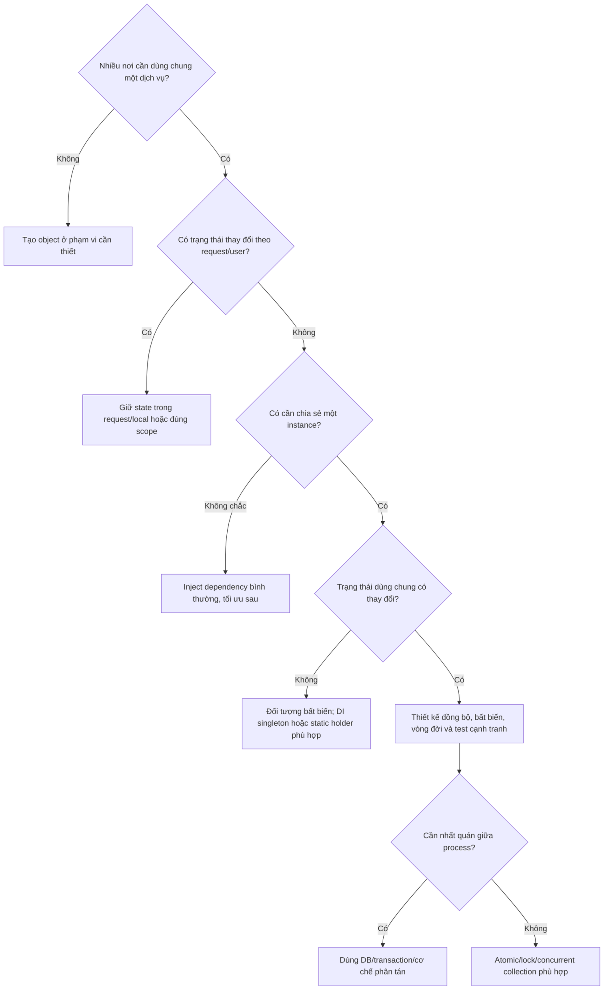

**Signs to avoid a manual Singleton:** number of active users; current context; mutable data from HTTP requests; objects that must be replaced with fakes in tests; multi-instance deployment requirements; classes that know too many dependencies; globals that introduce initialization-order dependence.

**Potentially valid cases:** configuration loaded once and kept immutable, a read-heavy/rarely updated registry with explicit synchronization, a facade for a long-lived resource managed by the container, or local in-process metrics using `AtomicLong` with defined lifecycle semantics.

## 11. Applied Exercises

### Exercise 1 – Detect a Race Condition

A singleton service declares:

```java
private String currentOrderId;

public void process(String orderId) {
    currentOrderId = orderId;
    audit(currentOrderId);
}
```

Describe an interleaving of two requests that makes `audit` receive the wrong order ID. Refactor the method to use local parameters rather than storing request data in a shared field. Explain why `synchronized process` can work mechanically but does not address the proper ownership of the data.

### Exercise 2 – Design a Counter

Implement `RequestMetrics` to count requests by type. Propose two alternatives:

- Use `ConcurrentHashMap<String, AtomicLong>` or `ConcurrentHashMap.merge` for per-key updates.
- Store metrics in a database or metrics service when aggregating across containers.

Analyze differences in reset behavior, snapshot accuracy, and durability.

### Exercise 3 – Refactor for Testability

An `InvoiceService` calls `TaxRules.getInstance()` in every method. Switch to a `TaxCalculator` interface injected through the constructor; implement a fake tax calculator for tests. Explain how an immutable `TaxRules` can still reuse one instance without exposing `getInstance()` to clients.

### Exercise 4 – Spring Scope

A singleton `OrderService` receives a mutable prototype `ShoppingCart` through constructor injection. Explain why this **does not** guarantee a fresh cart per request, and propose passing the cart as a parameter or using an appropriate scope/instance-creation mechanism.

## 12. Questions to Check Before Designing

1. Is “one” instance scoped to a **class loader, IoC container, process, or entire cluster**?
2. Does the object have only stateless processing methods or hold mutable state? Who owns that state?
3. If two threads call the same method, which fields do they touch? Are updates atomic?
4. Which **specific invariant** is being protected by the chosen `final`, `volatile`, `synchronized`, `AtomicLong`, or concurrent collection?
5. With multiple servers, power failures, or restarts, must data persist or remain consistent?
6. Can tests create separate dependencies and run independently and in parallel?
7. Who owns initialization, configuration, resource cleanup, and error monitoring?

**Remember:** Singleton only answers questions about **instance count and access within a scope**. Sharing safety depends on **state, concurrency contracts, lifecycles, and deployment boundaries**. Prefer local data, immutable objects, and dependency injection; use intentional shared state only after defining suitable synchronization and tests.


</details>

- [Back to top](#back-to-top)

---

## <a id="design-patterns-005">Adapter and Integrating Different Interfaces</a>

<details>
<summary>View details</summary>

# Adapter Pattern in Java: Integrating Different Interfaces

**Category:** OOP → Design Patterns  
**Topic:** Adapter and integrating different interfaces

## 1. The Problem: Two Systems Do the Same Job but Speak Different “Languages”

Your application has standardized payments through a `PaymentGateway` interface with explicit request and result objects. The business then needs to integrate a legacy payment SDK:

- The application sends amounts as `BigDecimal` in USD; the legacy SDK expects `long` in **cents**.
- The application calls `charge(PaymentRequest)`; the legacy SDK calls `execute(String merchantRef, long amountInCents)`.
- The application needs `APPROVED` or `DECLINED` results; the SDK returns string codes `"00"`, `"05"`, `"91"`.
- Rewriting all of `CheckoutService` to depend on the legacy SDK would couple business functionality to that provider.

**Adapter** inserts an intermediary class that converts the interface provided by the existing SDK (*Adaptee*) into the interface expected by the application (*Target*). The consumer (*Client*) continues using `Target`. The `Adapter` class converts calls, parameters, responses, and errors within the defined contract.

### Adapter Pattern Participants

| Role | In this example | Responsibility |
|---|---|---|
| **Client** | `CheckoutService` | Invokes payment operations through a unified interface |
| **Target** | `PaymentGateway` | Contract understood by the client: `charge(PaymentRequest)` |
| **Adaptee** | `LegacyPaymentApi` / `LegacyPaymentSdk` | Legacy API with its own signatures and data conventions |
| **Adapter** | `LegacyPaymentAdapter` | Implements `PaymentGateway` and delegates to the converted legacy API |

~~~mermaid
classDiagram
    direction LR
    class PaymentGateway {
        <<interface>>
        +charge(PaymentRequest) PaymentReceipt
    }
    class LegacyPaymentApi {
        <<interface>>
        +execute(String, long) LegacyReply
    }
    class CheckoutService {
        -PaymentGateway gateway
        +checkout(PaymentRequest) String
    }
    class LegacyPaymentAdapter {
        -LegacyPaymentApi legacy
        +charge(PaymentRequest) PaymentReceipt
    }
    class LegacyPaymentSdk {
        +execute(String, long) LegacyReply
    }
    CheckoutService --> PaymentGateway : uses
    LegacyPaymentAdapter ..|> PaymentGateway : implements
    LegacyPaymentAdapter --> LegacyPaymentApi : delegates
    LegacyPaymentSdk ..|> LegacyPaymentApi : implements
~~~

> This is an **Object Adapter**: it holds a reference to the wrapped object through *composition*. An adapter class does not have to inherit from the SDK class.

## 2. Define the Contract Before Writing the Adapter

Agree on data semantics before converting anything. In this learning example:

1. `PaymentRequest` represents only transactions in **USD**, with positive amounts exactly representable in cents within the `long` range, and a nonblank order ID. Invalid data is rejected at request construction.
2. `PaymentGateway.charge` accepts a valid request. For a definitive provider response, it returns a `PaymentReceipt` with `APPROVED` or `DECLINED` status.
3. The SDK code `"00"` means approved, `"05"` means declined, and `"91"` means the result is temporarily unknown. **These codes are simulated conventions for the example only**, not universal codes for real SDKs.
4. Missing replies, unknown codes, and infrastructure failures must surface as explicit errors. Do not turn an unknown outcome into `DECLINED` or `APPROVED`.
5. Clients never access `LegacyReply`, internal error codes, or SDK-specific methods.

In production, consult the provider's official documentation to verify monetary units, final statuses, rounding rules, timeout limits, and idempotency requirements. **An Adapter cannot manufacture guarantees absent from the external service**.

## 3. Java 17+: Complete Standalone Example

Save all the code in **`AdapterDemo.java`**. The SDK below is only a **simulated stub** for learning design; it neither transfers funds nor connects to a real service.

~~~java
import java.math.BigDecimal;
import java.util.Objects;

// ====== API mà nghiệp vụ của ứng dụng mong đợi (Target) ======

enum PaymentStatus {
    APPROVED,
    DECLINED
}

record PaymentRequest(String orderId, BigDecimal amountUsd) {
    PaymentRequest {
        if (orderId == null || orderId.isBlank()) {
            throw new IllegalArgumentException("orderId must not be blank");
        }
        if (amountUsd == null) {
            throw new IllegalArgumentException("amountUsd is required");
        }

        // Không chấp nhận đơn vị nhỏ hơn 1 cent hoặc giá trị
        // không biểu diễn vừa trong long.
        try {
            long cents = amountUsd.movePointRight(2).longValueExact();
            if (cents <= 0) {
                throw new IllegalArgumentException("amount must be positive");
            }
        } catch (ArithmeticException ex) {
            throw new IllegalArgumentException(
                    "amount must be an exact cent value within long range", ex);
        }
    }
}

record PaymentReceipt(PaymentStatus status, String reference) {
    PaymentReceipt {
        Objects.requireNonNull(status, "status");
        if (status == PaymentStatus.APPROVED &&
                (reference == null || reference.isBlank())) {
            throw new IllegalArgumentException(
                    "approved payment needs provider reference");
        }
    }
}

interface PaymentGateway {
    /**
     * Nhận PaymentRequest hợp lệ, trả APPROVED hoặc DECLINED
     * khi phản hồi đã xác định.
     *
     * @throws GatewayUnavailableException nếu chưa xác định
     *         được kết quả từ nhà cung cấp
     * @throws ProviderProtocolException nếu phản hồi phá hợp đồng
     */
    PaymentReceipt charge(PaymentRequest request);
}

final class GatewayUnavailableException extends RuntimeException {
    GatewayUnavailableException(String message) {
        super(message);
    }
}

final class ProviderProtocolException extends RuntimeException {
    ProviderProtocolException(String message) {
        super(message);
    }
}

// ====== API của SDK cũ (Adaptee) ======

record LegacyReply(String code, String transactionId) {}

interface LegacyPaymentApi {
    // Nhận cents (long), trả mã giao thức riêng.
    LegacyReply execute(String merchantRef, long amountInCents);
}

// Stub mô phỏng SDK thực tế. "00" là thành công theo quy ước demo.
final class LegacyPaymentSdk implements LegacyPaymentApi {
    @Override
    public LegacyReply execute(String merchantRef, long amountInCents) {
        return new LegacyReply("00", "LEGACY-" + merchantRef);
    }
}

// ====== Adapter: bọc SDK cũ, cung cấp API mới ======

final class LegacyPaymentAdapter implements PaymentGateway {
    private final LegacyPaymentApi legacy;

    LegacyPaymentAdapter(LegacyPaymentApi legacy) {
        this.legacy = Objects.requireNonNull(legacy, "legacy");
    }

    @Override
    public PaymentReceipt charge(PaymentRequest request) {
        Objects.requireNonNull(request, "request");

        // Request đã kiểm tra cent chính xác ngay khi khởi tạo.
        long cents = request.amountUsd()
                            .movePointRight(2)
                            .longValueExact();

        LegacyReply reply = legacy.execute(request.orderId(), cents);

        if (reply == null || reply.code() == null) {
            throw new ProviderProtocolException(
                    "legacy provider returned an invalid reply");
        }

        return switch (reply.code()) {
            case "00" -> {
                if (reply.transactionId() == null ||
                        reply.transactionId().isBlank()) {
                    throw new ProviderProtocolException(
                            "approved reply has no transaction id");
                }
                yield new PaymentReceipt(
                        PaymentStatus.APPROVED, reply.transactionId());
            }
            case "05" -> new PaymentReceipt(
                    PaymentStatus.DECLINED, reply.transactionId());
            case "91" -> throw new GatewayUnavailableException(
                    "provider result is not confirmed; reconcile first");
            default -> throw new ProviderProtocolException(
                    "unknown provider code: " + reply.code());
        };
    }
}

// ====== Client: không biết tên SDK, mã lỗi hoặc đơn vị cents ======

final class CheckoutService {
    private final PaymentGateway gateway;

    CheckoutService(PaymentGateway gateway) {
        this.gateway = Objects.requireNonNull(gateway, "gateway");
    }

    String checkout(PaymentRequest request) {
        PaymentReceipt receipt = gateway.charge(request);

        return switch (receipt.status()) {
            case APPROVED -> "Paid: " + receipt.reference();
            case DECLINED -> "Payment declined";
        };
    }
}

public class AdapterDemo {
    public static void main(String[] args) {
        LegacyPaymentApi oldSdk = new LegacyPaymentSdk();
        PaymentGateway gateway = new LegacyPaymentAdapter(oldSdk);
        CheckoutService checkout = new CheckoutService(gateway);

        PaymentRequest order = new PaymentRequest(
                "ORDER-1001", new BigDecimal("12.34"));

        System.out.println(checkout.checkout(order));
        // Paid: LEGACY-ORDER-1001
    }
}
~~~

Run with JDK 17 or later:

~~~bash
javac AdapterDemo.java
java AdapterDemo
~~~

**Actual Data Flow in the Example:**

~~~mermaid
sequenceDiagram
    participant C as CheckoutService
    participant A as LegacyPaymentAdapter
    participant L as LegacyPaymentApi
    C->>A: charge(ORDER-1001, USD 12.34)
    Note over A: BigDecimal 12.34 → long 1234 cents
    A->>L: execute("ORDER-1001", 1234)
    L-->>A: LegacyReply("00", "LEGACY-ORDER-1001")
    Note over A: "00" → APPROVED
    A-->>C: PaymentReceipt(APPROVED, reference)
~~~

`CheckoutService` depends only on `PaymentGateway`. If the application later switches SDKs, developers can supply another `PaymentGateway` implementation and change startup/dependency-injection configuration. Checkout business logic need not understand the legacy SDK protocol.

### Why Use `BigDecimal` and `longValueExact()`?

Payments require exact amounts. With `new BigDecimal("12.34")`:

`12.34 USD × 100 = 1234 cents`

The expression `movePointRight(2).longValueExact()` does not round automatically: `12.345` is rejected because it cannot be represented as an integer number of cents. This is a **data-contract decision**; if rounding is actually required, its mode and location must be specified explicitly rather than arbitrarily calling `doubleValue()` and casting to `long`.

## 4. What Does an Adapter Actually Convert?

| Difference | Application side | Legacy SDK side | Conversion in adapter |
|---|---|---|---|
| Signature | `charge(PaymentRequest)` | `execute(String,long)` | Extracts request data and delegates |
| Monetary unit | `BigDecimal` USD | `long` cents | Multiplies by 100 with exact conversion |
| Output | `PaymentReceipt` | `LegacyReply` | Creates a domain result type |
| Outcome | `APPROVED` / `DECLINED` | `"00"` / `"05"` | Maps agreed-upon codes |
| Unknown outcome | Integration-domain error | `"91"` | Throws `GatewayUnavailableException` |
| Protocol-invalid response | Integration-domain error | `null` / unknown code | Throws `ProviderProtocolException` |
| Dependency | `PaymentGateway` | `LegacyPaymentApi` | The SDK appears only in the composition root and adapter |

Remember that **`DECLINED` is a definitive business result**; a network failure, timeout, or unknown status does not mean “the customer was declined.” Distinguishing these cases prevents incorrect notifications or reckless payment retries.

## 5. Test at the Correct Integration Boundary

To test the adapter without a real network, the example exposes `LegacyPaymentApi` as an interface replaceable with a lambda. The `LegacyPaymentAdapterTest.java` file below uses JUnit Jupiter 5 (requiring the JUnit Jupiter dependency and JUnit test-runner configuration in Maven or Gradle). Put the test in the same package as the demo; both are shown in the default package for brevity in this single-file Java example.

~~~java
import static org.junit.jupiter.api.Assertions.*;

import java.math.BigDecimal;
import java.util.concurrent.atomic.AtomicLong;
import org.junit.jupiter.api.Test;

class LegacyPaymentAdapterTest {

    @Test
    void convertsAmountToCentsWithoutRounding() {
        AtomicLong receivedCents = new AtomicLong(-1L);

        LegacyPaymentApi fake = (ref, cents) -> {
            assertEquals("ORDER-42", ref);
            receivedCents.set(cents);
            return new LegacyReply("00", "TX-1");
        };

        PaymentGateway gateway = new LegacyPaymentAdapter(fake);
        PaymentReceipt result = gateway.charge(
                new PaymentRequest("ORDER-42", new BigDecimal("12.34")));

        assertEquals(1234L, receivedCents.get());
        assertEquals(PaymentStatus.APPROVED, result.status());
        assertEquals("TX-1", result.reference());
    }

    @Test
    void declinedIsAResultRatherThanProviderOutage() {
        PaymentGateway gateway = new LegacyPaymentAdapter(
                (ref, cents) -> new LegacyReply("05", null));

        PaymentReceipt result = gateway.charge(
                new PaymentRequest("ORDER-43", new BigDecimal("2.00")));

        assertEquals(PaymentStatus.DECLINED, result.status());
    }

    @Test
    void ambiguousProviderResultMustNotBeTreatedAsDeclined() {
        PaymentGateway gateway = new LegacyPaymentAdapter(
                (ref, cents) -> new LegacyReply("91", null));

        assertThrows(GatewayUnavailableException.class,
                () -> gateway.charge(new PaymentRequest(
                        "ORDER-44", new BigDecimal("2.00"))));
    }

    @Test
    void unknownCodeDoesNotBecomeSuccess() {
        PaymentGateway gateway = new LegacyPaymentAdapter(
                (ref, cents) -> new LegacyReply("??", null));

        assertThrows(ProviderProtocolException.class,
                () -> gateway.charge(new PaymentRequest(
                        "ORDER-45", new BigDecimal("2.00"))));
    }

    @Test
    void rejectsFractionalCentAtRequestBoundary() {
        assertThrows(IllegalArgumentException.class,
                () -> new PaymentRequest(
                        "ORDER-46", new BigDecimal("12.345")));
    }

    @Test
    void approvedReplyMustHaveTransactionReference() {
        PaymentGateway gateway = new LegacyPaymentAdapter(
                (ref, cents) -> new LegacyReply("00", ""));

        assertThrows(ProviderProtocolException.class,
                () -> gateway.charge(new PaymentRequest(
                        "ORDER-47", new BigDecimal("1.00"))));
    }
}
~~~

These tests verify **conversion and mapping rules**, not the correctness of the external SDK. Real integrations also need contract tests against API documentation, sandbox integration tests, and infrastructure scenarios: timeouts before/after the provider receives a request, duplicate responses, late webhooks, and API version changes.

### Avoiding Duplicate Charges After Network Failures

If an `execute` call times out, the application may not yet know whether funds were charged. Do not retry automatically merely because the adapter threw an exception: another attempt may create a second transaction.

The solution must be agreed at the system-design level: use **idempotency keys** when supported, persist transaction state and prevent duplicate processing, query/reconcile with the provider before retrying, and handle webhooks idempotently. In the example, `orderId` is merely the `merchantRef`; there is **no automatic duplicate-prevention guarantee** because the stub does not implement idempotency.

## 6. Object Adapter and Class Adapter

Two common Adapter variants are:

**Object Adapter (common in Java):** the Adapter *contains* an Adaptee object and calls its methods, as in the example:

~~~java
final class LegacyPaymentAdapter implements PaymentGateway {
    private final LegacyPaymentApi legacy;
    // ... chuyển đổi rồi gọi legacy.execute(...)
}
~~~

Advantages: less dependency on class hierarchies, the ability to wrap multiple implementations of an interface, easier substitution of fakes in tests, and compatibility with an SDK using a `final class` (provided it can be wrapped directly or through an appropriate wrapper).

**Class Adapter:** an Adapter inherits from the Adaptee class while implementing Target. In Java, `extends LegacyBaseSdk implements PaymentGateway` is possible if the SDK class permits inheritance. This is hard to use with `final`, couples the adapter more tightly to superclass details, and Java does not support multiple class inheritance. Thus **composition** is generally easier to maintain.

Example Class Adapter structure (a sketch that does not need to be added to the standalone demo):

~~~java
class LegacyBaseSdk {
    String oldOperation(String value) { return "old:" + value; }
}
interface NewApi {
    String run(String value);
}
class InheritanceAdapter extends LegacyBaseSdk implements NewApi {
    @Override public String run(String value) {
        return oldOperation(value);
    }
}
~~~

Whichever form is chosen, the defining feature of Adapter is **converting the old interface into the new one expected by the client**, rather than merely “having a wrapper class.”

## 7. How Does Adapter Differ from Similar Patterns?

| Pattern | Primary purpose | Recognition scenario |
|---|---|---|
| **Adapter** | Enable incompatible interfaces to work together | Domain uses `PaymentGateway`, SDK exposes `execute(ref,cents)` |
| **Facade** | Provide a simple entry point into a complex subsystem | One method combines several calls for payments, inventory, and shipping |
| **Decorator** | Add behavior while retaining the wrapped interface | Add logging/metrics/retry policies around a `PaymentGateway` |
| **Proxy** | Represent an object and control access to it | Lazy initialization, authorization, remote access |
| **Bridge** | Separate an abstraction from its implementation so both can vary independently | Mix multiple notification types and delivery channels flexibly |

Patterns can be composed: for example, a Decorator such as `MetricsPaymentGateway` can wrap `LegacyPaymentAdapter`, with `PaymentGateway` still exposed externally. Not every wrapper should be called an Adapter if its actual purpose is timing operations or controlling access.

## 8. Integrating Multiple SDKs or API Versions

Suppose a second provider uses HTTP JSON instead of a Java SDK:

~~~text
CheckoutService
      |
      v
  PaymentGateway (hợp đồng chung)
      |                     |
      v                     v
LegacyPaymentAdapter    HttpPaymentAdapter
      |                     |
      v                     v
 LegacyPaymentApi        HTTP/JSON API
~~~

Each adapter encapsulates its own mappings while preserving the `PaymentGateway` contract. Adapter selection can be configured or injected, for example with Spring:

~~~java
// Phác họa wiring với Spring; cần có các bean tương ứng.
// @Bean
// PaymentGateway paymentGateway(LegacyPaymentApi legacyPaymentApi) {
//     return new LegacyPaymentAdapter(legacyPaymentApi);
// }
//
// @Service
// class CheckoutService {
//     CheckoutService(PaymentGateway gateway) { ... }
// }
~~~

If the system encounters two different interpretations of `DECLINED`, or one provider only supports “submit a request and await a callback,” revisit the **shared contract**. Do not pretend an asynchronous API always yields an immediate definitive result. As appropriate, separate capabilities, introduce `PENDING` as part of a revised contract and deliberately update clients, or design a specialized port for the asynchronous workflow.

An Adapter is often part of a DDD **Anti-Corruption Layer**: it keeps external terminology, models, states, and errors at the integration boundary rather than allowing them into the domain. An Anti-Corruption Layer can contain more than one adapter, however, including mapping, validation, translation, and client/repository components.

## 9. Design Mistakes to Avoid

1. **Returning `LegacyReply` directly to the domain.** Clients then still know codes `"00"` and `"05"`; the Adapter has not hidden the incompatibility.
2. **Scattering `if (provider == ...)` throughout business logic.** Each new provider bloats clients and increases inconsistent behavior. Use a clear contract with appropriate implementations.
3. **Casting money through `double` or rounding implicitly.** For example, `(long)(12.345 * 100)` silently discards fractional digits. Declare monetary rules first.
4. **Catching every exception and returning `DECLINED`.** Infrastructure failures and unknown statuses can cause incorrect reconciliation.
5. **Retrying after a timeout without checking idempotency.** Uncontrolled retries of side-effectful commands can duplicate payments.
6. **Creating an “adapter” that also handles orders, pricing, and inventory.** Protocol conversion belongs at the boundary; business rules belong in the appropriate layer.
7. **Ignoring data security.** Do not log card numbers, payment tokens, or secrets; implement TLS, authentication, and secret management as required by the real API.
8. **Assuming compatible signatures are enough.** If a second implementation returns different states, errors, or timing guarantees from the interface, it may violate legitimate client expectations.

## 10. Checklist for Applying Adapter in a Project

- [ ] The **Target** is an application-controlled contract with explicit inputs, outputs, and errors.
- [ ] The correct **Adaptee** (SDK/API to integrate) has been identified, and its official conventions reviewed.
- [ ] Units, data types, and states have explicit conversions without losing important information.
- [ ] External failures map to meaningful domain errors or states, without reporting false success.
- [ ] Clients depend on the application interface; the adapter isolates SDK details.
- [ ] Unit tests cover mappings and boundaries, and sandbox integration tests cover the external contract.
- [ ] Timeouts, reconciliation, retries, and idempotency are handled according to provider capabilities.
- [ ] Changing providers primarily affects adapters and connection configuration, without entering core business logic.

### Practice Exercise

Implement `HttpPaymentAdapter implements PaymentGateway` for a simulated API accepting JSON `{"order":"ORDER-1","amountMinor":1234}` and returning `{"state":"accepted","reference":"REMOTE-1"}`. Map `accepted → APPROVED`, `rejected → DECLINED`, and `pending →` an unresolved outcome according to **the chosen contract**. Use a fake HTTP client to test JSON mapping, parsing errors, timeouts, and missing transaction references. Verify that `CheckoutService` still does not need to change.

**Key point:** Adapter does not change how third-party systems work; it creates a **contract-based translation boundary**. Business logic speaks the application's language, while provider details stay in the integration layer.

</details>

- [Back to top](#back-to-top)

---

## <a id="design-patterns-006">Decorator and Adding Behavior</a>

<details>
<summary>View details</summary>

# Decorator and Adding Behavior in Java

> **Topic:** OOP → Design Patterns → **Decorator Pattern**.  
> **Objective:** Understand how to extend an object's behavior by *wrapping* another object with the same contract, compose several decorators, control execution order, and recognize cases where the pattern is inappropriate.

## 1. The Problem: Adding Behavior Without Modifying Every Implementation

Suppose an application has a notification-sending component:

~~~java
interface MessageChannel {
    void send(Message message);
}
~~~

Initially, a **ConsoleChannel** prints notifications to the console for testing. Later, new requirements appear:

- Add an **[APP]** prefix to the content before sending.
- Reject content exceeding a length limit.
- Count calls that successfully complete the sending chain.
- Later, introduce **EmailChannel**, **SmsChannel**, or third-party provider adapters.

A hasty solution adds prefixing, length validation, counting, and logging logic to every notification class. This duplicates logic; each shared-rule change then affects multiple implementations. Another approach creates subclasses such as **LoggedEmailChannel**, **CheckedEmailChannel**, **CheckedLoggedEmailChannel**, and so on. The inheritance combinations become hard to maintain, especially when behaviors must be enabled or disabled flexibly.

**Decorator** addresses this through **composition**: an object implements the same interface as the wrapped object, holds a reference to it, and adds behavior before or after delegating the call.

~~~mermaid
flowchart LR
    Client["Client"] --> Count["CountingDecorator"]
    Count --> Prefix["PrefixDecorator"]
    Prefix --> Limit["LengthLimitDecorator"]
    Limit --> Core["ConsoleChannel"]
    Core --> Output["Đầu ra console"]
~~~

The diagram shows the call path **from outermost to innermost**. As calls return, outer decorators may perform further work after inner components finish.

**Core idea:** callers can use the entire chain through the same **MessageChannel** interface without knowing how many wrappers it contains.

## 2. Decorator Structure

| Role | In the notification example | Responsibility |
| --- | --- | --- |
| **Component** | **MessageChannel** | Defines the shared contract used by clients |
| **Concrete Component** | **ConsoleChannel** | Provides the original behavior: receiving and outputting notifications |
| **Decorator** | **ChannelDecorator** | Holds a reference to another **MessageChannel** while implementing the same contract |
| **Concrete Decorator** | **PrefixDecorator** | Transforms the content before sending |
| **Concrete Decorator** | **LengthLimitDecorator** | Validates a constraint before forwarding |
| **Concrete Decorator** | **CountingDecorator** | Tracks calls that return successfully |
| **Client** | **main** or business service | Assembles wrapper chains and invokes the shared interface |

Each wrapper can invoke its delegate **before**, **after**, or **around** the added behavior. It may also refuse to forward a call when a documented constraint is violated. However, changes to contract preconditions/postconditions must be explicitly designed and described; matching an interface syntactically does not guarantee safe substitutability among wrappers.

### Class Diagram

~~~mermaid
classDiagram
    class MessageChannel {
        <<interface>>
        +send(message) void
    }
    class ConsoleChannel {
        +send(message) void
    }
    class ChannelDecorator {
        <<abstract>>
        #next: MessageChannel
    }
    class PrefixDecorator {
        -prefix: String
        +send(message) void
    }
    class LengthLimitDecorator {
        -maxCodePoints: int
        +send(message) void
    }
    class CountingDecorator {
        -accepted: AtomicInteger
        +send(message) void
        +acceptedCalls() int
    }
    MessageChannel <|.. ConsoleChannel
    MessageChannel <|.. ChannelDecorator
    ChannelDecorator o--> MessageChannel : delegates
    ChannelDecorator <|-- PrefixDecorator
    ChannelDecorator <|-- LengthLimitDecorator
    ChannelDecorator <|-- CountingDecorator
~~~

An intermediate **ChannelDecorator** base class is optional for a single small wrapper; each decorator may directly implement **MessageChannel** and accept a **MessageChannel** in its constructor. The intermediate abstract class helps only when it reduces genuine duplication, such as shared non-null delegate validation.

## 3. Standalone Java 17 Example

Create **DecoratorDemo.java**. The example uses a **Message record** for immutable message values, **AtomicInteger** to count calls through a wrapper, and **String.codePointCount** to enforce a Unicode code-point limit rather than simply counting UTF-16 code units using **String.length()**.

~~~java
import java.util.Objects;
import java.util.concurrent.atomic.AtomicInteger;

public class DecoratorDemo {

    public record Message(String recipient, String body) {
        public Message {
            if (recipient == null || recipient.isBlank()) {
                throw new IllegalArgumentException(
                        "Người nhận không được rỗng");
            }
            if (body == null || body.isBlank()) {
                throw new IllegalArgumentException(
                        "Nội dung không được rỗng");
            }
        }
    }

    public interface MessageChannel {
        void send(Message message);
    }

    // Thành phần gốc: chỉ giả lập gửi bằng console.
    public static final class ConsoleChannel implements MessageChannel {
        @Override
        public void send(Message message) {
            Objects.requireNonNull(message, "message");
            System.out.println(
                    "SEND " + message.recipient()
                    + ": " + message.body());
        }
    }

    // Lớp nền tùy chọn: giữ delegate của chuỗi decorator.
    public static abstract class ChannelDecorator
            implements MessageChannel {

        protected final MessageChannel next;

        protected ChannelDecorator(MessageChannel next) {
            this.next = Objects.requireNonNull(next, "next");
        }
    }

    // Thêm tiền tố nhưng không sửa đối tượng Message ban đầu.
    public static final class PrefixDecorator extends ChannelDecorator {
        private final String prefix;

        public PrefixDecorator(MessageChannel next, String prefix) {
            super(next);
            this.prefix = Objects.requireNonNull(prefix, "prefix");
        }

        @Override
        public void send(Message message) {
            Objects.requireNonNull(message, "message");
            next.send(new Message(
                    message.recipient(),
                    prefix + message.body()
            ));
        }
    }

    // Kiểm tra độ dài của thông điệp tại vị trí đặt decorator.
    public static final class LengthLimitDecorator
            extends ChannelDecorator {

        private final int maxCodePoints;

        public LengthLimitDecorator(
                MessageChannel next, int maxCodePoints) {
            super(next);
            if (maxCodePoints <= 0) {
                throw new IllegalArgumentException(
                        "Giới hạn phải lớn hơn 0");
            }
            this.maxCodePoints = maxCodePoints;
        }

        @Override
        public void send(Message message) {
            Objects.requireNonNull(message, "message");
            String body = message.body();
            int length = body.codePointCount(0, body.length());

            if (length > maxCodePoints) {
                throw new IllegalArgumentException(
                        "Thông điệp vượt quá "
                        + maxCodePoints + " Unicode code points");
            }
            next.send(message);
        }
    }

    // Chỉ đếm các lời gọi delegate trở về bình thường.
    public static final class CountingDecorator
            extends ChannelDecorator {

        private final AtomicInteger accepted = new AtomicInteger();

        public CountingDecorator(MessageChannel next) {
            super(next);
        }

        @Override
        public void send(Message message) {
            next.send(message);
            accepted.incrementAndGet();
        }

        public int acceptedCalls() {
            return accepted.get();
        }
    }

    public static void main(String[] args) {
        CountingDecorator channel = new CountingDecorator(
                new PrefixDecorator(
                        new LengthLimitDecorator(
                                new ConsoleChannel(), 80),
                        "[APP] "
                )
        );

        channel.send(new Message(
                "user-01", "Hóa đơn đã phát hành"));

        System.out.println(
                "Số lần xử lý không ném lỗi: "
                        + channel.acceptedCalls());
    }
}
~~~

Run in a terminal with JDK 17 or later:

~~~bash
javac DecoratorDemo.java
java DecoratorDemo
~~~

Output:

~~~text
SEND user-01: [APP] Hóa đơn đã phát hành
Số lần xử lý không ném lỗi: 1
~~~

In this example, **ConsoleChannel** only simulates sending by printing to the console. A normal return **does not guarantee** that a recipient actually received an email/SMS. Therefore the counter is called **acceptedCalls**, not **deliveredMessages**. In a real integration, define accepted, submitted-to-provider, and successfully delivered states according to the provider's contract.

**Call sequence:**

1. The client invokes **CountingDecorator.send(message)**.
2. **CountingDecorator** forwards the call to **PrefixDecorator**.
3. **PrefixDecorator** creates a new **Message** with the prefix and forwards it.
4. **LengthLimitDecorator** measures the content length **after the prefix is added**; if it exceeds the limit, it throws **IllegalArgumentException** without invoking the underlying component.
5. **ConsoleChannel** prints the message.
6. If the chain returns normally, **CountingDecorator** increments its counter; if an inner layer throws, the counter remains unchanged.

**Extensibility:** replace **ConsoleChannel** with another **MessageChannel** implementation while reusing the wrappers. Wrappers need not understand HTTP/SMTP libraries or destination devices.

## 4. Wrapping Order Determines Behavior

One of the most error-prone aspects of Decorator is **ordering**. Consider two assemblies:

~~~java
// A: thêm tiền tố trước, sau đó kiểm tra nội dung cuối cùng.
MessageChannel pipelineA =
        new DecoratorDemo.PrefixDecorator(
                new DecoratorDemo.LengthLimitDecorator(
                        new DecoratorDemo.ConsoleChannel(), 12),
                "[A] ");

// B: kiểm tra nội dung gốc trước, rồi mới thêm tiền tố.
MessageChannel pipelineB =
        new DecoratorDemo.LengthLimitDecorator(
                new DecoratorDemo.PrefixDecorator(
                        new DecoratorDemo.ConsoleChannel(), "[A] "),
                12);
~~~

With a body containing **10** ASCII characters, the **[A]** prefix plus a space takes **4** code points:

- **pipelineA:** checks 14 code points and **rejects** the message because the limit is 12.
- **pipelineB:** checks 10 code points and **accepts** the message; the underlying component receives 14 characters.

Both chains are valid Java, but only **pipelineA** ensures that the final output does not exceed 12 code points. If the external service limits **UTF-8 bytes**, counting code points is **still insufficient**: measure the encoded bytes with the required charset. Real systems must specify whether limits concern bytes, code points, UTF-16 code units, or displayed characters.

Ordering matters similarly for compression/encryption, caching/authorization, and retries/logging:

| Wrapping chain | Possible effect | Decision required |
| --- | --- | --- |
| Prefix → length validation | Checks the fully transformed text | Is the limit measured before or after transformation? |
| Cache → authorization | A cache serving data before authorization can leak information | Authenticate/authorize each request correctly, and partition caches by suitable context |
| Logging → retry | An outer logging wrapper may see only one overall call | Log one request or every attempt? |
| Retry → logging | The inner logging wrapper may run on every attempt | Is retrying the operation allowed without duplicate side effects? |
| Compression → encryption | Usually compresses before encrypting | The receiver must decrypt and then decompress using matching formats |

The table illustrates structural consequences. In production, safety also depends on the contract, data, persistence, failures, and security policy of each decorator. **Do not add retries to side-effectful operations merely by wrapping them in another class**; sending messages, charging payments, and writing data require idempotency keys or appropriate duplicate-prevention mechanisms. A timeout may occur after the recipient has already processed the request.

## 5. Testing Individual Decorators and Their Chain

One advantage of interface-based design is the ability to replace the underlying component with a small **fake** that records behavior. The JUnit 5 example below goes in **DecoratorDemoTest.java**, in the same package as the sample source.

~~~java
import static org.junit.jupiter.api.Assertions.*;

import org.junit.jupiter.api.Test;

class DecoratorDemoTest {

    static final class RecordingChannel
            implements DecoratorDemo.MessageChannel {
        DecoratorDemo.Message lastMessage;
        int calls;

        @Override
        public void send(DecoratorDemo.Message message) {
            lastMessage = message;
            calls++;
        }
    }

    @Test
    void tienToDuocThemMaKhongThayDoiMessageGoc() {
        RecordingChannel fake = new RecordingChannel();
        var channel = new DecoratorDemo.PrefixDecorator(fake, "[APP] ");
        var original =
                new DecoratorDemo.Message("u01", "Xin chào");

        channel.send(original);

        assertEquals("[APP] Xin chào", fake.lastMessage.body());
        assertEquals("Xin chào", original.body());
        assertEquals(1, fake.calls);
    }

    @Test
    void chuoiChanDuocNoiDungQuaDaiSauKhiThemTienTo() {
        RecordingChannel fake = new RecordingChannel();

        var channel = new DecoratorDemo.PrefixDecorator(
                new DecoratorDemo.LengthLimitDecorator(fake, 8),
                "[A] ");

        assertThrows(IllegalArgumentException.class, () ->
                channel.send(
                        new DecoratorDemo.Message("u01", "12345")));
        // "[A] " dài 4, cộng "12345" dài 5 = 9 > 8.
        assertEquals(0, fake.calls);
    }

    @Test
    void boDemChiTangKhiDelegateTroVeBinhThuong() {
        RecordingChannel fake = new RecordingChannel();
        var counted = new DecoratorDemo.CountingDecorator(
                new DecoratorDemo.LengthLimitDecorator(fake, 5));

        counted.send(
                new DecoratorDemo.Message("u01", "Hello"));
        assertThrows(IllegalArgumentException.class, () ->
                counted.send(
                        new DecoratorDemo.Message("u01", "123456")));

        assertEquals(1, counted.acceptedCalls());
        assertEquals(1, fake.calls);
    }
}
~~~

These tests need no network or SMTP/SMS server. They verify exactly what each wrapper promises: forwarding, transformation, blocking delegation, and the condition for incrementing the counter. JUnit Jupiter must be on the project's classpath to run the test file; standalone **DecoratorDemo.java** does not require JUnit.

Add integration tests when connecting to a real provider to check encoding, payload limits, retry policies, and delivery-state mapping. Fake-based tests cannot prove that the real provider always behaves according to the fake's assumptions.

## 6. How Does Decorator Differ from Other Extension Techniques?

| Technique | How it works | When to consider it |
| --- | --- | --- |
| **Decorator** | An object with the **same interface** wraps another object and adds composable behavior | Add logging, metrics, validation, buffering, compression, transformation, etc. per instance |
| **Inheritance** | A subclass changes/extends the behavior of a base class | A genuine subtype relationship is stable and has few independent combinations |
| **Proxy** | May share the interface and delegate, but primarily **controls access** to another object (lazy loading, remote access, access control, etc.) | Clients need a representative object or controlled access |
| **Adapter** | Converts an incompatible **contract/interface** into the contract expected by clients | Integrate a library, legacy API, or provider with another interface |
| **Strategy** | Encapsulates **alternative** algorithms and selects an appropriate one | Several ways exist to perform the same task |
| **Chain of Responsibility** | Passes requests along handlers, each typically choosing to handle or forward | Several processing steps have their own stop/forward conditions |
| **AOP** | Declares cross-cutting advice at framework-supported join points | Apply shared policies to many beans/methods without manually wrapping them |

**Proxy and Decorator have similar structures**, so classify them by design intent and actual responsibility rather than diagrams alone. **Strategy** selects *one implementation approach*; Decorator adds *behavioral layers* around the selected implementation. They can be combined.

In Spring, **@Transactional**, some interceptors, and proxies provide mechanisms for cross-cutting concerns, but that does not mean every Decorator use case should move to AOP. For per-instance customization or explicit assembly order, plain Java Decorators are easier to read and test. Conversely, a policy applied uniformly across hundreds of endpoints may fit filters/interceptors/AOP, depending on interception points. Spring proxy-based AOP also has subtleties: for example, internal calls from one method to another on the same object generally bypass the proxy.

## 7. Familiar Decorator Examples in the JDK

A clear example is **java.io.InputStream**:

~~~java
import java.io.BufferedInputStream;
import java.io.FileInputStream;
import java.io.IOException;
import java.io.InputStream;

class InputExample {
    static int firstByte(String path) throws IOException {
        try (InputStream in = new BufferedInputStream(
                new FileInputStream(path))) {
            return in.read();
        }
    }
}
~~~

**FileInputStream** reads bytes from a file; **BufferedInputStream** wraps an **InputStream** to add buffering during reads. Clients continue invoking **read()** through the **InputStream** contract. When **try-with-resources** closes the wrapper, that wrapper closes the inner stream according to its contract.

Two lessons follow: (1) clients need no changes when a wrapper is added; (2) wrappers can manage resources/lifecycles, so understand closing, flushing, and composition order instead of assuming decorators are entirely independent.

A related example is **Collections.unmodifiableList(list)**, which creates a view that cannot be modified through that view, but **does not create a copy**: changes to the original list may still appear in the view. For an independent snapshot, consider **List.copyOf(list)** and the immutability of its elements. This illustrates a wrapper that extends/restricts behavior without necessarily copying data.

## 8. Designing Safe Decorators for Production

### 8.1. Preserve the Component Contract

A wrapper must preserve the meaning of **send**, error-handling rules, and invariants expected by clients. For example:

- A decorator should not silently drop a message while reporting success if the contract promises delegation or an explicit error.
- When adding content limits, define them as part of the pipeline's public policy; clients should know when validation errors occur.
- For asynchronous results (**CompletableFuture**), do not immediately measure/count a future's creation; decide whether to measure scheduling, successful future completion, or provider-confirmed delivery.
- If a wrapper owns resources that must be closed, make the lifecycle explicit (for example, **AutoCloseable**) and avoid double closing or leaks.

### 8.2. Decide How to Handle Exceptions

Decorators execute **before** and **after** delegates, so exception timing matters. In the **CountingDecorator** above, the counter increases after a normal return; it does not report real-world delivery.

For timing, **finally** is often appropriate if failed requests should also be measured:

~~~java
@Override
public void send(Message message) {
    long start = System.nanoTime();
    try {
        next.send(message);
    } finally {
        long elapsedNanos = System.nanoTime() - start;
        recordDuration(elapsedNanos); // Phương thức đo lường do ứng dụng định nghĩa.
    }
}
~~~

The snippet only illustrates **the body of a timing decorator**; standalone compilation also requires a class declaring **next**, the **send** contract, and **recordDuration**. Do not use **finally** to silently turn failure into success; exceptions must still propagate or be converted according to the defined contract. Also prevent metric-recording exceptions from masking primary failures.

### 8.3. Consider State, Concurrency, and Scope

In the example, **PrefixDecorator** and **LengthLimitDecorator** hold **final** configuration and do not mutate their state. **CountingDecorator** uses **AtomicInteger**, so incrementing and reading the counter are individually safe under concurrent updates; that **does not make the entire chain thread-safe**. Safety also depends on **next**, the data passed through, external resources, and any other mutation.

When caching by user, ensure keys contain sufficient authorization context and suitable expiration. When logging, do not log personal information, tokens, or sensitive data by default. When retrying, require duplicate-execution protection. When rate-limiting, distinguish per-instance, per-user, per-tenant, and system-wide limits.

### 8.4. Avoid Turning Assembly into a Maze

A very long chain, implicit configuration ordering, or wrappers with non-obvious side effects can be harder to debug than the original solution. Instead:

1. Name each decorator by its **specific behavior**, such as **LengthLimitDecorator**, rather than a vague name like **EnhancedChannel**.
2. Centralize assembly in the **composition root** or a clearly named factory, especially for shared chains.
3. Document outer-to-inner order and the reasons for it; write integration tests for risky interactions.
4. Avoid a single wrapper that logs, caches, retries, and transforms content when those responsibilities vary independently.
5. When behavior applies everywhere without variation, consider a shared service, interceptor, or the implementation itself instead of excessive wrappers.

## 9. When Should You Choose Decorator, and When Should You Avoid It?

**Consider Decorator when** behaviors must be enabled, disabled, or composed around individual objects, multiple implementations share extra logic, changing the original implementation is impossible or undesirable, and one contract can represent the pipeline.

**Avoid applying it mechanically when** a simple call or helper function is enough, behavior never needs composition, or multiple wrappers obscure the contract. A rule mandatory for all objects may belong at the domain boundary rather than depending on clients to remember a wrapper. Do not use Decorator merely to avoid refactoring a class with tangled responsibilities.

Decorator's dynamic flexibility is useful, but must be balanced against **KISS** (*Keep It Simple*) and **composition over inheritance**: composition improves flexibility but does not eliminate the cost of controlling complexity.

## 10. Practical Exercise

Build a document-reading system with this contract:

~~~java
interface DocumentReader {
    String read(String documentId);
}
~~~

An **InMemoryDocumentReader** reads from a **Map<String, String>**. Implement three independent decorators:

- **TrimmingReader** removes leading/trailing whitespace from returned content.
- **CachingReader** caches content by document ID after the first read. Define TTL/invalidation if the data can change; for the exercise, assume the source data is immutable.
- **CountingReader** counts calls to **read()** on the wrapper. Clarify whether this counts requests or accesses to the actual source.

Assemble two pipelines:

~~~text
Counting → Caching → Trimming → InMemory
Counting → Trimming → Caching → InMemory
~~~

Read the same document ID twice and compare: how often was the source called, what content was cached, and does moving the cache change behavior if trimming rules change? Use a fake reader for testing rather than depending on files or networks.

**Success criteria:**

- All decorators implement the same **DocumentReader** interface.
- Adding trim/cache/count does not modify **InMemoryDocumentReader**.
- Each wrapper has one clearly named responsibility; pipeline order is intentional.
- Tests verify final results, delegate call counts, and behavior when the source throws an exception.
- Do not share cached sensitive data between users when keys or access policies do not distinguish users.

**Remember:** Decorator extends behavior **by wrapping another object with the same contract**. Its practical value is composing behaviors without proliferating subclasses or changing core code; its practical challenges are preserving the contract, managing order, and clarifying errors/state at each wrapper layer.

</details>

- [Back to top](#back-to-top)

---

## <a id="design-patterns-007">Facade and Simplifying Usage</a>

<details>
<summary>View details</summary>

# Facade Pattern: Simplifying Access to a Multi-Component System

> **Topic:** Facade and simplifying usage (Design Patterns – OOP).  
> **Objective:** Recognize when clients depend on too many subsystem classes, design a concise, intentional high-level entry point, implement Facade in Java, test its contract, and understand trade-offs involving coupling, boundaries, and error handling.

## 1. The Problem Facade Solves

In a real application, a user operation often requires coordinating several services or subsystem libraries. For example, to **quote a shopping cart**, controller code may need to:

1. Look up product information.
2. Check inventory.
3. Calculate merchandise prices.
4. Apply member discounts.
5. Calculate shipping charges.
6. Assemble the resulting quote.

If controllers, batch jobs, and partner APIs each perform this sequence themselves, every client must know several classes, call order, error rules, and result construction. Even a small change in the order in which fees are applied may force multiple clients to change.

**Facade** is a *structural pattern* that provides **a unified, more convenient high-level interface** to a subsystem that otherwise exposes many separate interfaces.

- **Intent:** simplify access to a particular subsystem capability.
- **Role:** the client invokes the Facade, which coordinates subsystems to complete a high-level operation.
- **Benefit:** reduce the number of dependencies clients must know and centralize a shared usage workflow.
- **Limitation:** Facade does not make underlying classes “disappear” or automatically guarantee transactions, retries, concurrency safety, business correctness, or security.

A good problem statement is: “Multiple clients need to know and repeat the **coordination workflow** among subsystem classes; we need a simple, stable API for common operations.”

### Before and After Introducing a Facade

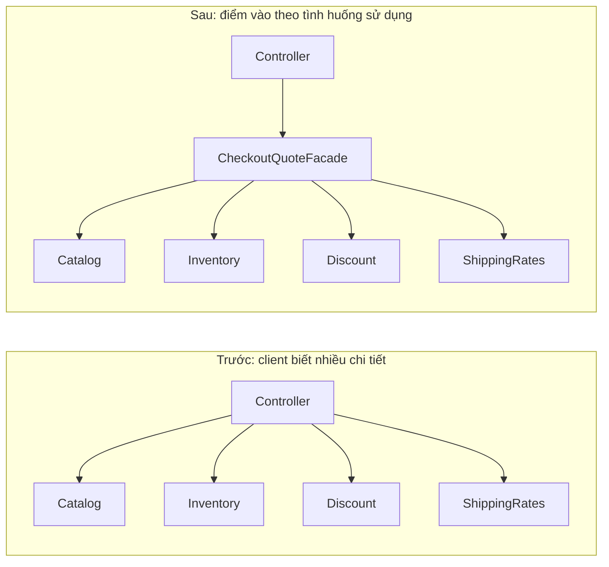

In the second design, **the subsystem's total complexity does not automatically decrease**. That complexity is **encapsulated behind a boundary**, so client code becomes shorter and needs less internal knowledge.

## 2. Facade Pattern Participants

| Component | Responsibility | What should it know? |
|---|---|---|
| **Client** | Performs a user operation by calling the high-level API | Quotation needs, inputs, and results |
| **Facade** | Coordinates common steps and appropriately handles/maps errors | Subsystem contracts and the high-level workflow |
| **Subsystem classes** | Perform specialized operations | Catalog, inventory, pricing policies, shipping rates |
| **Composition root / DI container** | Creates and wires dependencies | Which implementations are used in the current environment |

Facade commonly uses **composition**: it holds references to subordinate objects without inheriting from them.

A good Facade API expresses an explicit purpose, such as `quote(sku, quantity, member)`; it should not merely expose dozens of getters like `getCatalog()`, `getInventory()`, and `getDiscountCalculator()`. Such getters leave clients deeply dependent on the subsystem.

## 3. Standalone Java 17 Example: Checkout Quotation

**Example context:** an order contains one product type, priced in **whole VND**. A member receives a 5% discount on merchandise; shipping costs 25.000 VND and is free when **the merchandise total after discounts** reaches at least 500.000 VND. A quote only **checks** current stock; it neither reserves nor deducts inventory.

These rules must be clear before implementing the Facade: if shipping depends on the amount *before* discounts, or orders may contain multiple products, both the API and algorithm must change according to business requirements.

Create `FacadeDemo.java`, then run:

```bash
javac FacadeDemo.java
java FacadeDemo
```

```java
import java.math.BigDecimal;
import java.math.RoundingMode;
import java.util.Map;
import java.util.Objects;

public class FacadeDemo {

    // ----- Các loại dữ liệu công khai ở mức ví dụ -----
    record Product(String sku, BigDecimal unitPriceVnd) {
        Product {
            Objects.requireNonNull(sku, "sku");
            Objects.requireNonNull(unitPriceVnd, "unitPriceVnd");
            if (sku.isBlank() || unitPriceVnd.signum() < 0 ||
                    unitPriceVnd.stripTrailingZeros().scale() > 0) {
                throw new IllegalArgumentException(
                        "SKU phải có giá trị, đơn giá là số nguyên VND không âm");
            }
        }
    }

    record Quote(
            BigDecimal subtotalVnd,
            BigDecimal discountVnd,
            BigDecimal shippingVnd,
            BigDecimal totalVnd) {}

    // ----- Các subsystem độc lập -----
    static final class Catalog {
        private final Map<String, Product> products;

        Catalog(Map<String, Product> products) {
            this.products = Map.copyOf(Objects.requireNonNull(products));
        }

        Product findRequired(String sku) {
            Product product = products.get(sku);
            if (product == null) {
                throw new IllegalArgumentException(
                        "Không tìm thấy sản phẩm: " + sku);
            }
            return product;
        }
    }

    static final class Inventory {
        private final Map<String, Integer> availableUnits;

        Inventory(Map<String, Integer> availableUnits) {
            this.availableUnits =
                    Map.copyOf(Objects.requireNonNull(availableUnits));
        }

        boolean canFulfill(String sku, int quantity) {
            return availableUnits.getOrDefault(sku, 0) >= quantity;
        }
    }

    static final class MemberDiscount {
        BigDecimal calculate(BigDecimal subtotalVnd, boolean isMember) {
            Objects.requireNonNull(subtotalVnd, "subtotalVnd");
            if (!isMember) {
                return BigDecimal.ZERO;
            }
            return subtotalVnd.multiply(new BigDecimal("0.05"))
                    .setScale(0, RoundingMode.HALF_UP);
        }
    }

    static final class ShippingRates {
        BigDecimal forAmountAfterDiscount(BigDecimal amountVnd) {
            Objects.requireNonNull(amountVnd, "amountVnd");
            return amountVnd.compareTo(new BigDecimal("500000")) >= 0
                    ? BigDecimal.ZERO : new BigDecimal("25000");
        }
    }

    // ----- FACADE: một thao tác cấp cao dễ dùng -----
    static final class CheckoutQuoteFacade {
        private final Catalog catalog;
        private final Inventory inventory;
        private final MemberDiscount discounts;
        private final ShippingRates shipping;

        CheckoutQuoteFacade(
                Catalog catalog,
                Inventory inventory,
                MemberDiscount discounts,
                ShippingRates shipping) {
            this.catalog = Objects.requireNonNull(catalog);
            this.inventory = Objects.requireNonNull(inventory);
            this.discounts = Objects.requireNonNull(discounts);
            this.shipping = Objects.requireNonNull(shipping);
        }

        Quote quote(String sku, int quantity, boolean isMember) {
            Objects.requireNonNull(sku, "sku");
            if (sku.isBlank() || quantity <= 0) {
                throw new IllegalArgumentException(
                        "SKU phải có giá trị và quantity phải > 0");
            }

            // Client không phải tự gọi các bước này.
            Product product = catalog.findRequired(sku);
            if (!inventory.canFulfill(sku, quantity)) {
                throw new IllegalStateException("Không đủ hàng cho " + sku);
            }

            BigDecimal subtotal = product.unitPriceVnd()
                    .multiply(BigDecimal.valueOf(quantity));
            BigDecimal discount =
                    discounts.calculate(subtotal, isMember);
            BigDecimal amountAfterDiscount = subtotal.subtract(discount);
            BigDecimal delivery =
                    shipping.forAmountAfterDiscount(amountAfterDiscount);
            BigDecimal total = amountAfterDiscount.add(delivery);

            return new Quote(subtotal, discount, delivery, total);
        }
    }

    // ----- Composition root: nơi biết các lớp cụ thể -----
    public static void main(String[] args) {
        Catalog catalog = new Catalog(Map.of(
                "KBD", new Product("KBD", new BigDecimal("180000"))));
        Inventory inventory = new Inventory(Map.of("KBD", 10));

        CheckoutQuoteFacade checkout = new CheckoutQuoteFacade(
                catalog, inventory,
                new MemberDiscount(), new ShippingRates());

        Quote twoItems = checkout.quote("KBD", 2, true);
        System.out.println(twoItems);
        // Quote[subtotalVnd=360000, discountVnd=18000,
        //       shippingVnd=25000, totalVnd=367000]

        Quote threeItems = checkout.quote("KBD", 3, true);
        System.out.println(threeItems.totalVnd()); // 513000
        // 540000 - 27000 = 513000, đạt ngưỡng miễn phí giao
    }
}
```

This is a self-contained example requiring neither Spring, a database, nor libraries beyond JDK 17. Nested classes in `FacadeDemo` have scopes suitable for the example; in a real project, place each class in the appropriate file/package and expose the APIs clients need.

### Why Is This Example a Facade?

1. **One high-level operation:** the client calls only `checkout.quote(...)` to obtain a quote.
2. **Hides coordination order:** product lookup, inventory checking, discount calculation, and shipping are all coordinated by the Facade.
3. **Reuses existing responsibilities:** `Catalog` handles product lookup, and `Inventory` reports availability; the Facade does not reimplement these details.
4. **Returns only necessary results:** `Quote` represents quotation details without exposing the inventory `Map` or catalog structure.
5. **External assembly:** the Facade receives constructor-injected dependencies; choosing implementations in `main` enables adapters, mocks, or fakes in tests.

**Key point:** Facade may serve as an entry point and coordinate business operations, but the **Facade pattern itself** means **providing a simpler interface to a subsystem**. It does not determine whether a class is a Domain Service, Application Service, or transaction boundary.

## 4. Execution Flow of One Call

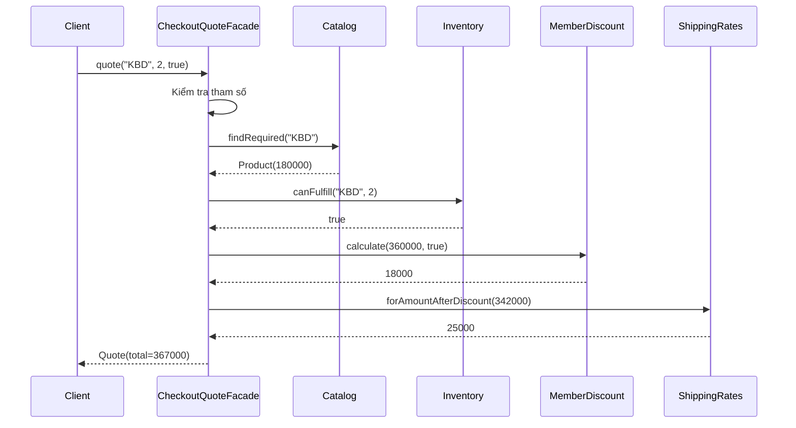

Errors are handled at appropriate boundaries: an unknown SKU results in `IllegalArgumentException`, while insufficient stock results in `IllegalStateException`. An external API (such as a REST controller) may map these to suitable HTTP statuses. The demo's two exception types are not mandatory conventions; production code should use a clearer, testable business-error model with stable error codes.

**Error path:** if a product is missing or stock is insufficient, the Facade stops before further pricing. Do not silently map an inventory-service timeout to `false`: **out of stock** and **unable to check inventory** are different conditions.

## 5. Where Does Facade Simplify the API?

Before Facade, several clients may repeat this workflow (illustrative code; dependencies are assumed to be initialized):

```java
Product product = catalog.findRequired(sku);
if (!inventory.canFulfill(sku, quantity)) {
    throw new IllegalStateException("Không đủ hàng");
}
BigDecimal subtotal = product.unitPriceVnd()
        .multiply(BigDecimal.valueOf(quantity));
BigDecimal discount = discounts.calculate(subtotal, isMember);
BigDecimal net = subtotal.subtract(discount);
BigDecimal fee = shipping.forAmountAfterDiscount(net);
Quote quote = new Quote(subtotal, discount, fee, net.add(fee));
```

After Facade:

```java
Quote quote = checkoutQuoteFacade.quote(sku, quantity, isMember);
```

The benefit is not merely **fewer lines of code**. More significantly, clients **do not need to know** the order of discounts and fees, how the catalog is queried, or each subsystem's API.

When the rule “calculate shipping after discounts” changes because of a deliberate business decision, one coordination point can be updated and tested centrally. Facade reduces **client coupling to coordination details**, even though the Facade itself still depends on its subsystems.

### Two Kinds of Simplification to Distinguish

- **Interface simplification:** fewer calls, task-oriented API names, and more understandable inputs/outputs.
- **Architectural simplification:** not guaranteed. The catalog, inventory, discounts, and shipping still exist, along with many business rules.

A poorly designed Facade can become a new bottleneck if every use case and every rule is pushed into it.

## 6. How Does Facade Differ from Adapter, Decorator, Proxy, and Mediator?

These patterns can all involve an object “in the middle,” but their **intentions** differ.

| Pattern | Primary intent | Typical structure | Example |
|---|---|---|---|
| **Facade** | Provide a simple API for several components/subsystems | `checkout.quote(...)` coordinates four subsystems | A unified shopping-cart quotation API |
| **Adapter** | Convert an **incompatible interface** to one required by clients | `VendorSmsAdapter implements SmsSender` invokes an SDK with different method names | Hide differences among provider APIs |
| **Decorator** | Add behavior while preserving the wrapped object's contract | `CachedCatalog implements CatalogReader` delegates to the source | Add controlled caching, metrics, or logging |
| **Proxy** | Stand in for an object to manage access, lifecycle, or calls | `RemoteImageProxy` delays loading or enforces authorization | Lazy loading, remote proxies, protection proxies |
| **Mediator** | Centralize interactions among multiple collaborating objects | `DialogMediator` coordinates buttons, input fields, and notifications | Reduce cross-callbacks among UI controls |

**Identify the pattern by asking:**

- “Must clients invoke **too many steps** in a subsystem?” → Facade.
- “Does this library have **a different API** from the interface the application needs?” → Adapter.
- “Do we need to **wrap extra behavior** around the same interface?” → Decorator.
- “Do we need to **control access** to an object?” → Proxy.
- “Do multiple objects **call each other through a tangled network of relationships**?” → Mediator.

A class can play several roles in practice, but when describing the design, name it after **the main reason** it exists. Merely “having an intermediary class” is insufficient to call something Facade.

## 7. Is Facade the Same as an Application Service, Domain Service, or Controller?

They are not equivalent.

- A **Controller** accepts HTTP/requests, parses inputs, handles authentication/authorization at the appropriate layer, and transforms responses. It may use a Facade to perform a high-level business operation.
- An **Application Service** coordinates a use case, enforces transaction boundaries, and applies application-flow policies. It may **also act as a Facade** when exposing a simple API over several subsystems, but not every Application Service should be named `Facade`.
- A **Domain Service** contains business rules that do not naturally belong to a particular entity/value object. A domain should not depend on SQL/HTTP merely to introduce a Facade.
- **Facade** concerns **reducing the complexity of client interaction with a subsystem**. It does not prescribe the architectural layer, framework, transactions, or placement of business invariants.

Example package organization:

```text
application/
  CheckoutQuoteFacade.java   # API báo giá cấp cao
domain/
  Product.java
  PricingPolicy.java
infrastructure/
  JdbcCatalog.java
  WarehouseInventoryClient.java
bootstrap/
  Configuration.java         # Lắp dependency
web/
  CheckoutController.java    # HTTP ↔ API ứng dụng
```

Do not copy this package structure mechanically. A small system may need only a few classes and one Facade; a larger system may place Facade in a separate **API module** that depends on application-owned ports/contracts.

## 8. Organizing Dependencies for Testable, Technology-Independent Facades

In the demo, the Facade receives `Catalog`, `Inventory`, and two calculator classes directly. In a real application, the catalog might read MySQL, inventory may come from HTTP, or a partner API may have multiple environments. When these details vary, use interfaces that describe the capabilities clients need.

```java
// Phác họa khi tách các class ra package rõ ràng:
interface ProductLookup {
    Product findRequired(String sku);
}

interface StockAvailability {
    boolean canFulfill(String sku, int quantity);
}

// CheckoutQuoteFacade phụ thuộc các interface,
// JdbcProductLookup/HttpStockAvailability implements interface.
```

With Spring, dependencies can be constructor-injected and the Facade declared as a bean:

```java
// Phác họa với Spring Boot. Imports tương ứng:
// org.springframework.stereotype.Service
@Service
public class CheckoutQuoteFacade {
    private final ProductLookup catalog;
    private final StockAvailability inventory;

    public CheckoutQuoteFacade(
            ProductLookup catalog, StockAvailability inventory) {
        this.catalog = catalog;
        this.inventory = inventory;
    }

    // quote(...) phối hợp thêm các pricing policy liên quan.
}
```

The Spring code is an **architectural sketch**, not code to paste unchanged into `FacadeDemo`, which already contains a nested class of the same name. If several beans implement the same interface, configure implementation selection explicitly (`@Qualifier`, `@Primary`, `@Bean`, etc.).

**Facade does not require an interface.** If there is one orchestration path and no reason to replace the Facade, a regular `CheckoutQuoteFacade` class is appropriate. Creating `ICheckoutQuoteFacade` merely to increase the interface count does not improve the design; abstraction helps when it shields clients from volatile dependencies or specifies a meaningful contract for multiple implementations.

## 9. Trade-offs and Limitations

| Benefit | Cost / risk |
|---|---|
| Clients need to remember only a few high-level operations | Adds a class and indirection; trace calls from clients through the Facade |
| Reduces direct coupling between clients and subsystems | The Facade can become a central dependency and grow too large |
| Centralizes call ordering and error policies for common operations | An overly broad Facade may affect many clients when one use case changes |
| Makes it easier to fake/mock the client boundary | Requires tests for the Facade contract and its subsystem coordination |
| Hides technical details irrelevant to API consumers | May conceal timeouts, partial failures, and data semantics |
| Helps standardize a module's public API | Makes versioning and backward compatibility explicit responsibilities |
| Allows specialized subsystems to remain available for direct use | Can be misused as an “only path” that forbids advanced use cases |

### Facade Does Not Create Distributed Transactions

The **quotation** example above intentionally avoids writes: checking inventory provides only a **point-in-time snapshot**, not a reservation. Two customers might both receive “available” quotes, yet only the first to place an order succeeds. This does not violate the contract when the API is explicitly named **quote**, rather than **reserve/order**.

If a `placeOrder(...)` Facade reserves inventory, takes payment, and sends a notification:

- These operations may span **multiple systems** without a shared DB transaction.
- Failure after payment can leave a partially completed state.
- Design **idempotency keys**, order states, saga/compensation, or outbox mechanisms as appropriate.
- Retries must distinguish transient failures from business failures; do not assume retrying a charge is safe.

Facade supplies a **coordination point**. It does not make network operations an atomic transaction. Never swallow partial failures and report success.

### Latency Does Not Disappear Automatically

A call to `facade.quote` may still trigger four underlying DB/API calls. Fewer calls **from clients** do not guarantee lower total latency:

```text
Tổng thời gian xấp xỉ:
  validation + catalog + inventory + discount + shipping + overhead

Nếu các thành phần gọi dịch vụ từ xa, network latency,
timeout, số lần retry và contention thường chi phối kết quả.
```

Parallelize only steps that are **truly independent**, with a clear understanding of consistency limits. For example, shipping calculated from a discounted price depends on the discount result; do not run every operation concurrently without analysis.

## 10. When to Use Facade and When to Avoid It

**Strong use cases:**

- A subsystem exposes many small APIs, while most clients need only 2–3 high-level operations.
- Several clients repeat the same ordered sequence of calls.
- Controllers/API consumers should know less about a module's internal structure.
- A library/SDK exposes a complex API that needs an entry point for common business operations.
- You want to limit the impact of subsystem changes while keeping the external contract stable.

**Consider a simpler approach when:**

- Clients invoke only one simple API and do not repeat an orchestration flow.
- The Facade merely forwards an identical call without a useful abstraction or boundary.
- Different clients have entirely different workflows; forcing them into one Facade produces many client-type `if` branches.
- Responsibilities cannot be clearly described, leading to a “God Facade” that prices orders, writes DB records, sends emails, runs reports, and does everything else.
- The Facade hides infrastructure failures behind incorrect defaults, making users believe data is certain.

### Designing a Good Facade API

Practical guidelines:

1. **Name operations by intent:** `quote`, `previewInvoice`, `generateReport`, `startCheckout`. Avoid names like `processEverything`.
2. **Keep inputs/outputs stable:** use appropriate DTOs/value objects; avoid returning raw infrastructure types such as `ResultSet`, `Connection`, and `HttpResponse`.
3. **Avoid arbitrarily exposing internal objects:** if a client must call `getInventoryService()` to continue coordination itself, the Facade has not simplified the workflow.
4. **Split Facades by client group/use case when needed:** `CheckoutQuoteFacade` and `AdminPricingFacade` may share subsystems while exposing different APIs.
5. **Do not put every business formula inside the Facade:** keep specialized rules/algorithms in the classes that own them, and let the Facade coordinate.
6. **Specify errors and states explicitly:** not found, out of stock, stale price, timeout, and permission denied are distinct cases.
7. **Design thread safety:** singleton-style Facades should avoid request-specific mutable fields; the demo uses local variables within `quote`.
8. **Provide operational observability:** log/trace high-level operation boundaries without logging payment data or other sensitive information.

## 11. Testing Facade: Verify Outcomes and Coordination Order

Unit tests should do more than verify that a class exists. They must assert **the contract from the client's perspective**, including successful paths, failures, and invariants.

JUnit 5 example: put the test in the same package as `FacadeDemo` (its nested types have package-level visibility):

```java
import static org.junit.jupiter.api.Assertions.*;
import java.math.BigDecimal;
import java.util.Map;
import org.junit.jupiter.api.Test;

class FacadeDemoTest {

    private FacadeDemo.CheckoutQuoteFacade newFacade(int stock) {
        var catalog = new FacadeDemo.Catalog(Map.of(
                "KBD", new FacadeDemo.Product(
                        "KBD", new BigDecimal("180000"))));
        var inventory =
                new FacadeDemo.Inventory(Map.of("KBD", stock));
        return new FacadeDemo.CheckoutQuoteFacade(
                catalog, inventory,
                new FacadeDemo.MemberDiscount(),
                new FacadeDemo.ShippingRates());
    }

    @Test
    void memberQuoteIncludesDiscountAndShipping() {
        var quote = newFacade(10).quote("KBD", 2, true);

        assertEquals(new BigDecimal("360000"), quote.subtotalVnd());
        assertEquals(new BigDecimal("18000"), quote.discountVnd());
        assertEquals(new BigDecimal("25000"), quote.shippingVnd());
        assertEquals(new BigDecimal("367000"), quote.totalVnd());
    }

    @Test
    void freeShippingUsesAmountAfterDiscount() {
        var quote = newFacade(10).quote("KBD", 3, true);
        assertEquals(BigDecimal.ZERO, quote.shippingVnd());
        assertEquals(new BigDecimal("513000"), quote.totalVnd());
    }

    @Test
    void insufficientStockStopsQuote() {
        assertThrows(IllegalStateException.class,
                () -> newFacade(1).quote("KBD", 2, false));
    }

    @Test
    void invalidQuantityIsRejected() {
        assertThrows(IllegalArgumentException.class,
                () -> newFacade(10).quote("KBD", 0, true));
    }
}
```

These tests use small, real in-memory subsystems and run quickly. When underlying components access databases/HTTP, **fake the ports** in unit tests and add separate integration tests for real adapters.

**About ordering:** the example has an explicit data dependency: discounts must be calculated first to obtain the discounted amount needed for shipping. Asserting `513000` and `shippingVnd = 0` tests this ordering's business meaning. If steps have **side effects**, tests should verify that payment/DB writes do not happen after validation failure, and validate rollback/compensation policies as required. Avoid over-testing “exactly four methods called in an exact order” when such ordering is an implementation detail irrelevant to client behavior.

### Testing Quality Checklist

| Case | Expected outcome |
|---|---|
| Product exists, stock suffices, customer is a member | Correct merchandise, discount, shipping, and total amounts |
| Customer is not a member | No discount; shipping is based on the corresponding amount |
| Missing SKU or invalid quantity | Clear input error without an incorrect quote |
| SKU not found | “Not found” error, never assume a zero price |
| Insufficient stock | No successful quote |
| External inventory/pricing service times out | Proper data-access error; do not convert it into out-of-stock |
| Free-shipping boundary | Amounts just below, at, and just above the threshold |
| Concurrent requests are required | Request data is not stored in shared fields |
| A new subsystem implementation is added | Facade contract remains stable and core tests still pass |

## 12. Refactoring Toward Facade Step by Step

Suppose a controller has become long because it calls five subsystems. A safe migration process is:

1. **Scope one concrete use case:** “view quote,” rather than starting with “collect all services into a Facade.”
2. **List operations and conditions:** specify inputs, order, error types, returned data, side effects, and invariant boundaries.
3. **Introduce one high-level method:** `Quote quote(String sku, int quantity, boolean member)`.
4. **Move coordination logic:** leave the controller to pass inputs and map responses; business rules remain in appropriate classes.
5. **Constructor-inject dependencies:** create/wire objects at the composition root or DI container.
6. **Preserve behavior through tests:** compare before/after outputs for boundary and failure cases.
7. **Migrate clients gradually:** avoid changing every major flow simultaneously before checking compatibility.
8. **Remove duplicate orchestration** after all relevant clients use the new API and the old dependency is gone.
9. **Reassess complexity:** client coupling, API surface, test/debug time, latency, and error rates.
10. **Review the scope:** if the Facade accumulates too many unrelated methods, consider splitting it by use case.

A Facade can coexist with **direct** subsystem access for clients needing advanced functionality. **Prohibiting all other access** is a module/API decision, not a mandatory Facade Pattern rule.

## 13. Practice Exercises

**Exercise 1 – Report-export Facade.** The system has `DataFetcher`, `SalesAggregator`, `CsvRenderer`, and `FileStore`. Implement `SalesReportFacade.exportMonthlyReport(YearMonth month)`; specify how time zones and file formats are passed, how large files are handled, and how write failures are reported. There is no need to expose every query function through the Facade's public API.

**Exercise 2 – Refactor a controller.** An `OrderController` directly invokes `Catalog`, `Inventory`, `Discount`, and `ShippingRates`. Extract the Java example's quotation API into a Facade, write tests comparing outcomes, and identify which responsibilities remain in the controller.

**Exercise 3 – Distributed failure.** Replace quoting with real order placement that reserves inventory, charges payment, and sends notifications. Design a minimal order-state table and discuss successful payment followed by notification failure. Which **API coordination** belongs to Facade, and which parts require outbox/saga/idempotency?

**Exercise 4 – Compare patterns.** An external payments library provides `payWithRawSdkRequest(...)`. The application wants `PaymentGateway.pay(PaymentRequest)` and a `Checkout.placeOrder()` API coordinating inventory, gateway, and invoices. Identify which component should be an **Adapter** and which should be a **Facade**.

**Exercise 5 – Design review.** A `SystemFacade` class has 45 methods covering email, CSV import, point calculation, invoicing, image downloads, and password changes. Why might this become a God Object? Propose splitting APIs by capability or bounded context, and explain the consequences for clients.

## 14. Self-Check: Do You Understand Facade?

- [ ] I can describe the **specific problem**: clients know too many APIs or repeat coordination sequences.
- [ ] I can design a **meaningful high-level API** with few parameters and the required return data.
- [ ] I understand how Facade uses **composition** to coordinate subsystems.
- [ ] I can distinguish Facade from Adapter, Decorator, Proxy, and Mediator.
- [ ] I do not treat Facade as an automatic solution for transactions, network latency, caching, or thread safety.
- [ ] I make business invariants, error handling, tests, and observability explicit.
- [ ] I know when a Facade class becomes too broad and should be split.
- [ ] I am willing to keep a simpler solution when a client needs only one direct call.

**Remember:** Facade is useful when it provides a **simple, stable, meaningful entry point** to a capability that requires coordinating many details. It reduces the knowledge clients must carry and moves orchestration into one testable, maintainable boundary.


</details>

- [Back to top](#back-to-top)

---

## <a id="design-patterns-008">Strategy and Interchangeable Algorithms</a>

<details>
<summary>View details</summary>

# Strategy Pattern in Java: Replacing Algorithms Through Composition

> **Topic:** OOP → Design Patterns → Strategy and interchangeable algorithms.  
> **Objective:** Understand why Strategy is useful, identify the Context–Strategy–Concrete Strategy roles, implement it in Java, select algorithms at runtime, test their shared contract, and recognize when extra abstraction is unnecessary.

## 1. What Is Strategy?

**Strategy** is a *behavioral design pattern* in the GoF catalog. The idea is to **encapsulate interchangeable algorithms as objects sharing the same contract**, then let the object using the algorithm (Context) work through that contract.

When processing needs to change, the Context receives another implementation instead of embedding detailed `if/else` or `switch` branches. An interchangeable algorithm might calculate fees, choose shipping routes, sort data, apply promotions, authenticate users, compress data, or assign scores.

Three core roles:

| Role | Responsibility | Used in this example |
|---|---|---|
| **Strategy** | Defines the shared operation and input/output contract | `DiscountStrategy` |
| **Concrete Strategy** | Implements one algorithm variant | `NoDiscount`, `PercentageDiscount`, `FixedDiscount` |
| **Context** | Coordinates business logic and invokes Strategy through its interface | `Checkout` |
| **Client / composition root** | Selects the appropriate Strategy for the context and supplies it | `StrategyDemo.main` |

**Core point:** Context does not need to know how a concrete algorithm is implemented. It relies solely on the behavior guaranteed by Strategy.

## 2. The Problem Before Introducing Strategy

An online store may support three discount policies: none, percentage-based, and fixed amount. If the algorithms are embedded directly in Checkout:

~~~java
// Minh họa mã khó mở rộng — không phải chương trình hoàn chỉnh.
BigDecimal calculateDiscount(String type, BigDecimal subtotal) {
    if ("NONE".equals(type)) {
        return BigDecimal.ZERO;
    }
    if ("PERCENT".equals(type)) {
        return subtotal.multiply(new BigDecimal("0.10"));
    }
    if ("FIXED".equals(type)) {
        return new BigDecimal("30.00").min(subtotal);
    }
    throw new IllegalArgumentException("Unknown discount type");
}
~~~

The example is deliberately simplified and **does not yet handle monetary rounding**. Design problems arise as algorithms, configuration values, and rules proliferate:

- Each new policy requires changing the method serving the main business operation.
- Variants mix selection conditions with calculation formulas, making existing branches easy to modify accidentally.
- Testing each algorithm independently becomes difficult when everything lives in one large method.
- If several screens or use cases calculate discounts, the branches may be duplicated.

This does not mean `if/else` is always wrong. For **two short, stable conditions with no independent change requirements**, a simple function may be clearer than several classes. Strategy helps when **the algorithm is truly an independent axis of variation**.

## 3. Strategy Structure

~~~mermaid
classDiagram
    class DiscountStrategy {
        <<interface>>
        +discountFor(subtotal) BigDecimal
    }
    class NoDiscount {
        +discountFor(subtotal) BigDecimal
    }
    class PercentageDiscount {
        -rate : BigDecimal
        +discountFor(subtotal) BigDecimal
    }
    class FixedDiscount {
        -amount : BigDecimal
        +discountFor(subtotal) BigDecimal
    }
    class Checkout {
        -strategy : DiscountStrategy
        +Checkout(strategy)
        +quote(subtotal) PriceQuote
    }
    class StrategyDemo {
        +main(args) void
    }

    DiscountStrategy <|.. NoDiscount
    DiscountStrategy <|.. PercentageDiscount
    DiscountStrategy <|.. FixedDiscount
    Checkout --> DiscountStrategy : sử dụng
    StrategyDemo ..> Checkout : khởi tạo
    StrategyDemo ..> DiscountStrategy : lựa chọn
~~~

The important arrow is **`Checkout → DiscountStrategy`**: the Context depends on an abstraction. New Concrete Strategies can be added without rewriting the Context's orchestration formula.

Strategy usually uses **composition**: the Context **has a** Strategy object. This favors composition over creating multiple Context subclasses; it does not prohibit inheritance in every situation.

## 4. Standalone Java 17 Example: Discount Strategies

Define a clear contract before writing implementations:

- `subtotal` is nonnegative money represented **to the cent** (up to two meaningful decimal places; additional trailing zeros are allowed).
- `discountFor(subtotal)` returns a non-null, **nonnegative amount no greater than subtotal**, with at most two meaningful decimal places.
- Strategy **does not modify subtotal**, initiate payments, or create side effects beyond calculation. `BigDecimal` itself is immutable.
- Context validates the input amount and rejects results that violate the contract so algorithm errors are detected near their source.

> This is a two-decimal-place monetary model for teaching Strategy. Real products need business-defined currencies, smallest units, taxes, rounding rules, and promotion scopes; not all currencies have two fractional digits.

Save the full example as **`StrategyDemo.java`**:

~~~java
import java.math.BigDecimal;
import java.math.RoundingMode;
import java.util.List;
import java.util.Map;
import java.util.Objects;

// Strategy: một thuật toán giảm giá, không thực hiện thanh toán.
@FunctionalInterface
interface DiscountStrategy {
    /**
     * Tiền điều kiện: subtotal không null, >= 0, chính xác tới 2 số lẻ.
     * Hậu điều kiện: 0 <= kết quả <= subtotal; tối đa 2 số lẻ.
     */
    BigDecimal discountFor(BigDecimal subtotal);
}

// Concrete Strategy A: không giảm.
final class NoDiscount implements DiscountStrategy {
    @Override
    public BigDecimal discountFor(BigDecimal subtotal) {
        return new BigDecimal("0.00");
    }
}

// Concrete Strategy B: giảm theo tỷ lệ.
// Ví dụ: rate = 0.10 tương ứng 10%.
final class PercentageDiscount implements DiscountStrategy {
    private final BigDecimal rate;

    PercentageDiscount(BigDecimal rate) {
        Objects.requireNonNull(rate, "rate");
        if (rate.compareTo(BigDecimal.ZERO) < 0
                || rate.compareTo(BigDecimal.ONE) > 0) {
            throw new IllegalArgumentException("rate must be in [0, 1]");
        }
        this.rate = rate;
    }

    @Override
    public BigDecimal discountFor(BigDecimal subtotal) {
        return subtotal.multiply(rate)
                .setScale(2, RoundingMode.HALF_UP);
    }
}

// Concrete Strategy C: giảm số tiền cố định, không vượt subtotal.
final class FixedDiscount implements DiscountStrategy {
    private final BigDecimal amount;

    FixedDiscount(BigDecimal amount) {
        Objects.requireNonNull(amount, "amount");
        if (amount.signum() < 0) {
            throw new IllegalArgumentException("amount must be >= 0");
        }
        try {
            this.amount = amount.setScale(2, RoundingMode.UNNECESSARY);
        } catch (ArithmeticException ex) {
            throw new IllegalArgumentException("amount has fractions of cent", ex);
        }
    }

    @Override
    public BigDecimal discountFor(BigDecimal subtotal) {
        return amount.min(subtotal);
    }
}

// Giá trước giảm, mức giảm và giá cuối cùng là một kết quả bất biến.
record PriceQuote(
        BigDecimal subtotal,
        BigDecimal discount,
        BigDecimal total
) {}

// Context: giữ quy trình báo giá, ủy quyền công thức cho Strategy.
final class Checkout {
    private final DiscountStrategy strategy;

    Checkout(DiscountStrategy strategy) {
        this.strategy = Objects.requireNonNull(strategy, "strategy");
    }

    PriceQuote quote(BigDecimal subtotal) {
        Objects.requireNonNull(subtotal, "subtotal");
        if (subtotal.signum() < 0) {
            throw new IllegalArgumentException("subtotal must be >= 0");
        }

        final BigDecimal normalized;
        try {
            normalized = subtotal.setScale(2, RoundingMode.UNNECESSARY);
        } catch (ArithmeticException ex) {
            throw new IllegalArgumentException(
                    "subtotal has fractions of cent", ex);
        }

        BigDecimal rawDiscount = Objects.requireNonNull(
                strategy.discountFor(normalized),
                "Strategy must return a discount");

        final BigDecimal discount;
        try {
            discount = rawDiscount.setScale(2, RoundingMode.UNNECESSARY);
        } catch (ArithmeticException ex) {
            throw new IllegalStateException(
                    "Strategy returned fractions of cent", ex);
        }

        if (discount.signum() < 0
                || discount.compareTo(normalized) > 0) {
            throw new IllegalStateException(
                    "Strategy must return discount in [0, subtotal]");
        }

        return new PriceQuote(
                normalized,
                discount,
                normalized.subtract(discount));
    }
}

public class StrategyDemo {
    public static void main(String[] args) {
        // Đây là nơi cấu hình/chọn chiến lược theo tên.
        Map<String, DiscountStrategy> strategies = Map.of(
                "NONE", new NoDiscount(),
                "TEN_PERCENT",
                    new PercentageDiscount(new BigDecimal("0.10")),
                "FIXED_30",
                    new FixedDiscount(new BigDecimal("30.00"))
        );

        BigDecimal subtotal = new BigDecimal("120.00");

        for (String key : List.of("NONE", "TEN_PERCENT", "FIXED_30")) {
            DiscountStrategy selected = strategies.get(key);
            Checkout checkout = new Checkout(selected);
            PriceQuote quote = checkout.quote(subtotal);

            System.out.println(
                    key + " -> discount=" + quote.discount()
                    + ", total=" + quote.total());
        }
    }
}
~~~

Run with JDK 17 or later:

~~~bash
javac StrategyDemo.java
java StrategyDemo
~~~

Expected output:

~~~text
NONE -> discount=0.00, total=120.00
TEN_PERCENT -> discount=12.00, total=108.00
FIXED_30 -> discount=30.00, total=90.00
~~~

**Reading the example component by component:**

1. `DiscountStrategy` is a **unified contract** that specifies “calculate a discount” without prescribing an algorithm.
2. `NoDiscount`, `PercentageDiscount`, and `FixedDiscount` implement independent algorithms.
3. `Checkout` receives a Strategy through **constructor injection**. It validates shared rules and calls `strategy.discountFor(...)`. It never uses `instanceof` or depends on concrete class names.
4. `StrategyDemo.main` selects a strategy from a `Map`, constructs the Context, and runs the same workflow. This demonstrates **runtime algorithm selection** before Context creation.
5. For a new policy such as `LoyaltyDiscount`, add a class implementing `DiscountStrategy` and register it at the selection point; most `Checkout` code remains unchanged.

Note that `Map` is merely a **mechanism for selecting** a Strategy. A Map/Registry does not define Strategy; what defines it is **supplying an algorithm with a shared contract to a Context** through a common interface.

## 5. When Can Strategy Change?

In the GoF description, a Strategy may be chosen when creating the Context or replaced with a different implementation as needed. Two common approaches and an additional per-call option are:

| Approach | Illustration | Appropriate when |
|---|---|---|
| **Select when creating Context (immutable)** | `new Checkout(new PercentageDiscount(rate))` | Each request/session has its own policy; concurrency is easier to control |
| **Change Strategy within Context** | `context.setStrategy(other)` | A long-lived object deliberately switches algorithms with explicit state management |
| **Pass Strategy to each method** | `quote(subtotal, strategy)` | One Context handles many independent requests, with algorithms as per-call arguments |

Example of switching Strategy directly (separate from the earlier `Checkout` class):

~~~java
// Chỉ minh họa cơ chế thay đổi động trên một Context.
final class MutableQuoteService {
    private DiscountStrategy strategy;

    MutableQuoteService(DiscountStrategy initial) {
        setStrategy(initial);
    }

    void setStrategy(DiscountStrategy next) {
        strategy = Objects.requireNonNull(next);
    }

    BigDecimal calculateDiscount(BigDecimal validSubtotal) {
        return strategy.discountFor(validSubtotal);
    }
}
~~~

When one `MutableQuoteService` is shared by several HTTP requests, calling `setStrategy` for one request may affect another. Do not use a mutable singleton to store user-specific strategy selection without synchronization/race-condition controls. Usually **select a Strategy per request and pass it explicitly**, or use an immutable Context such as `Checkout`.

Note that `MutableQuoteService` intentionally omits monetary contract checks. The full example assigns those checks to `Checkout`; preserve them in real implementations.

## 6. Writing Strategy with Java Lambdas

Because `DiscountStrategy` has **one abstract method** (`@FunctionalInterface`), Java can represent a short algorithm without complex state as a lambda instead of a concrete class.

~~~java
DiscountStrategy weekendDiscount = subtotal ->
        subtotal.multiply(new BigDecimal("0.05"))
                .setScale(2, RoundingMode.HALF_UP);

Checkout checkout = new Checkout(weekendDiscount);
PriceQuote result = checkout.quote(new BigDecimal("200.00"));
// Giảm 10.00, tổng còn 190.00
~~~

These lines use the types/imports already defined in `StrategyDemo.java`; they can go inside `main` or a compatible Java method.

**Choose a dedicated class** when a Strategy has multiple steps, configuration parameters, dependencies (services or repositories), specialized logging, or complex tests. **Choose a lambda** when behavior is short, the variable name is self-explanatory, and business rules remain clear. A lambda is still a `DiscountStrategy` contract implementation.

## 7. Strategy and OOP/SOLID Principles

Strategy clearly illustrates three OOP ideas:

- **Encapsulation:** Each algorithm variant owns its calculation details.
- **Polymorphism:** A call to `discountFor` dispatches to the injected implementation.
- **Composition:** Context holds a Strategy reference without requiring inheritance of Context.

Connections to SOLID:

| Principle | How Strategy helps | Caveat |
|---|---|---|
| **SRP** | Separates checkout orchestration from individual discount calculations | Avoid useless classes for tiny expressions |
| **OCP** | Add `LoyaltyDiscount` without changing the shared `Checkout` algorithm | The composition root still must register/select variants |
| **LSP** | Strategies must actually be substitutable under `0 ≤ discount ≤ subtotal` | Having an interface **does not imply** every implementation is valid |
| **ISP** | One-operation interface sufficient for Context | Avoid bloated interfaces that force unrelated responsibilities on Strategies |
| **DIP** | `Checkout` depends on `DiscountStrategy` rather than a concrete class | Respect dependency direction among packages/modules when separating code |

DI and Strategy are also different: **DI** describes supplying dependencies externally; **Strategy** describes a **family of interchangeable algorithms**. The example uses both by constructor-injecting a Strategy into its Context.

## 8. Testing Strategy Systematically

Algorithm separation enables two levels of tests: (a) each Strategy’s formula, and (b) the common contract and how Context invokes Strategy. The snippets below use JUnit Jupiter (JUnit 5) in the same package as `StrategyDemo.java` under the test source set; they require the project’s `junit-jupiter` dependency and test runner.

### 8.1. Unit-Test Algorithms and Boundary Cases

~~~java
import static org.junit.jupiter.api.Assertions.*;
import java.math.BigDecimal;
import org.junit.jupiter.api.Test;

class DiscountStrategyTest {
    @Test
    void percentageDiscountRoundsToCents() {
        Checkout checkout = new Checkout(
                new PercentageDiscount(new BigDecimal("0.10")));

        PriceQuote quote = checkout.quote(new BigDecimal("12.34"));

        assertEquals(new BigDecimal("1.23"), quote.discount());
        assertEquals(new BigDecimal("11.11"), quote.total());
    }

    @Test
    void fixedDiscountNeverExceedsSubtotal() {
        Checkout checkout = new Checkout(
                new FixedDiscount(new BigDecimal("30.00")));

        PriceQuote quote = checkout.quote(new BigDecimal("12.00"));

        assertEquals(new BigDecimal("12.00"), quote.discount());
        assertEquals(new BigDecimal("0.00"), quote.total());
    }

    @Test
    void invalidAmountAndBadStrategyAreRejected() {
        Checkout checkout = new Checkout(new NoDiscount());

        assertThrows(IllegalArgumentException.class,
                () -> checkout.quote(new BigDecimal("-1.00")));
        assertThrows(IllegalArgumentException.class,
                () -> checkout.quote(new BigDecimal("1.001")));

        // Một Strategy phá hợp đồng trả mức giảm lớn hơn subtotal.
        DiscountStrategy broken = amount -> amount.add(BigDecimal.ONE);
        Checkout guarded = new Checkout(broken);

        assertThrows(IllegalStateException.class,
                () -> guarded.quote(new BigDecimal("10.00")));
    }
}
~~~

In the test above, `BigDecimal.equals` compares **scale** as well; `1.23` and `1.230` are different under `equals`. The example normalizes values to two decimal places for exact comparisons. If only numeric value matters, use `compareTo`.

### 8.2. Reusable Contract Tests for Every Strategy

Every new Strategy must honor the same contract: valid input, non-null output, nonnegative result, and a discount no greater than the original price. Use `@ParameterizedTest` to avoid duplicating tests when adding variants:

~~~java
import static org.junit.jupiter.api.Assertions.*;
import java.math.BigDecimal;
import java.util.stream.Stream;
import org.junit.jupiter.params.ParameterizedTest;
import org.junit.jupiter.params.provider.Arguments;
import org.junit.jupiter.params.provider.MethodSource;

class DiscountStrategyContractTest {
    static Stream<Arguments> strategies() {
        return Stream.of(
                Arguments.of("none", new NoDiscount()),
                Arguments.of("percent",
                        new PercentageDiscount(new BigDecimal("0.10"))),
                Arguments.of("fixed",
                        new FixedDiscount(new BigDecimal("30.00")))
        );
    }

    @ParameterizedTest(name = "{0} preserves discount bounds")
    @MethodSource("strategies")
    void allStrategiesSatisfyContract(
            String name, DiscountStrategy strategy) {
        for (String value : new String[]{"0.00", "0.01", "12.34", "120.00"}) {
            BigDecimal subtotal = new BigDecimal(value);
            BigDecimal discount = assertDoesNotThrow(
                    () -> strategy.discountFor(subtotal));
            assertNotNull(discount);
            assertTrue(discount.compareTo(BigDecimal.ZERO) >= 0);
            assertTrue(discount.compareTo(subtotal) <= 0);
            assertEquals(0, discount.setScale(2,
                    java.math.RoundingMode.UNNECESSARY)
                    .compareTo(discount));
        }
    }
}
~~~

The final assertion checks whether the discount is exactly representable with two decimal places; if a Strategy returns a value with three meaningful fractional digits, `setScale(2, UNNECESSARY)` throws `ArithmeticException` and the test fails. The test requires the additional `junit-jupiter-params` dependency. This is a **sample test suite**, not exhaustive coverage; add property-based tests, extreme values, and specific boundaries (at, just below, and just above thresholds, or large orders).

In production, pricing must be tested alongside **rounding, promotion limits, taxes, and currency rules**. The Strategy contract is where these shared rules should be stated explicitly.

## 9. Comparing Strategy with Similar Patterns and Approaches

| Approach | Main idea | How it differs from Strategy |
|---|---|---|
| **Strategy** | Select an algorithm among implementations sharing a contract | Context delegates behavior to a Strategy object |
| **State** | Behavior depends on the internal state of Context; transitions belong to the model | State objects typically govern **transitions**; Strategies are generally chosen by clients or configuration |
| **Template Method** | A base class fixes the algorithm skeleton, subclasses override steps | Uses **inheritance**, while Strategy primarily uses **composition/delegation** |
| **Command** | Encapsulates a request/action as an object | Often focuses on execution, queues, logs, or undo; Strategy varies an algorithm |
| **Factory Method / Factory** | Creates objects | A Factory may **create or select** a Strategy, while Strategy focuses on behavior |
| **A simple `switch`** | Selects algorithms with direct conditionals | Fewer classes; appropriate when branches are short, few, and rarely change |

A caution: Strategy and State can have **similar UML diagrams** (Context holds an interface with multiple implementations). Distinguish them by **model semantics**: choosing a way to do the same task versus representing object state and transitions.

### When Strategy May Not Be the Best Choice

Do not automatically create an interface and five classes to replace one short addition. Consider:
- Are variants real, or only hypothetical future requirements?
- Is each variant complex enough or independently changeable enough to benefit from a separate class?
- Is the contract stable and easy to express?
- Is the code used only once or shared by multiple Contexts?
- Must variants change at runtime or only at build time?
- Are the costs of classes, registration, configuration, and tests justified?

A pure function or `switch` can still be a good design. Refactor toward Strategy once the variation is evident.

## 10. Advanced: Safely Selecting Strategy from User Data

In the main example, `Map` holds pre-registered, trusted instances. When strategy names come from HTTP requests, configuration files, or databases, **do not** load arbitrary classes from input names via reflection. Map valid keys to explicitly registered/configured Strategies.

Extension of `StrategyDemo.java`:

~~~java
// strategies là Map<String, DiscountStrategy> trong main.
String requested = "TEN_PERCENT"; // Ví dụ giá trị đã đọc từ request.
DiscountStrategy strategy = strategies.get(requested);

if (strategy == null) {
    throw new IllegalArgumentException(
            "Unsupported discount policy: " + requested);
}

PriceQuote quote = new Checkout(strategy)
        .quote(new BigDecimal("200.00"));
System.out.println(quote.total()); // 180.00
~~~

For policies that call a database or external API, a Strategy may be a dedicated class receiving constructor-injected dependencies. Shared Strategies should be thread-safe or created at the right scope. Do not store the order of user A in a singleton Strategy field when the request of user B may also use it.

When policies are selected from a database, store controlled **business codes and parameters** (such as `DISCOUNT_RATE` and `0.10`); mapping codes to implementations belongs in the Strategy selection/configuration layer. Order processing may need to record the **policy version** to reproduce audited results.

## 11. Practical Exercise: Shipping Fee Strategies

You are implementing `ShippingService`. The same order has three shipping-fee algorithms:

| Strategy | Example rule | Output for 3 kg |
|---|---|---:|
| `StandardShipping` | 15.000 VND + 5.000 VND/kg | 30.000 VND |
| `ExpressShipping` | 30.000 VND + 10.000 VND/kg | 60.000 VND |
| `FreeShipping` | 0 VND | 0 VND |

Assume positive integer kilogram weights for simplicity. Then:
1. Define `ShippingStrategy` with `long feeFor(int weightKg)`.
2. Implement the three Concrete Strategies from the table. In production, define handling for fractional weights, limits, regions, and multiplication/addition overflow.
3. Implement `ShippingService` accepting `ShippingStrategy` through its constructor, validating `weightKg > 0`, and returning a nonnegative fee.
4. Select Strategy from buyer choices through a `Map` or `enum` at the composition root; do not embed `if/else` strings inside `ShippingService`.
5. Write JUnit tests for all three methods and a shared contract test; try adding `SameDayShipping` without changing the `ShippingService` core.

### Self-Check Questions

1. Must `Checkout` know the `PercentageDiscount` class? If it does, where is the dependency misplaced?
2. Does Strategy choose **the pricing algorithm** or handle **object creation**? Where can Factory participate?
3. What problems can arise if a singleton Strategy is changed through a setter under concurrent requests?
4. Why must a new Strategy preserve `0 ≤ discount ≤ subtotal` even though the Java interface only declares a `BigDecimal` return type?
5. With only two simple expressions and no changes required, why might a `switch` be preferable?

**Practical conclusion:** **Strategy = one behavioral contract + multiple algorithm implementations + a Context that delegates through composition.** Select the Strategy at configuration boundaries or per request; keep Context focused on shared business operations while enforcing input/output contracts. The pattern adds value when algorithms genuinely vary independently, not merely to eliminate every `if` statement.


</details>

- [Back to top](#back-to-top)

---

## <a id="design-patterns-009">State and State-Dependent Behavior</a>

<details>
<summary>View details</summary>

# State Pattern: Organizing Behavior by Object State

**Topic:** OOP → Design Patterns → **State and state-dependent behavior**.

**Objective:** Understand why the same call may produce different outcomes depending on current state; implement State Pattern in Java, define valid transitions, test workflows, and recognize when an enum or simple switch suffices.

## 1. Why Does State Affect Behavior?

Consider an online order. The system lets customers or staff perform operations such as:

- **Confirm payment** for a newly created order.
- **Mark the order as handed over for shipping** after payment confirmation.
- **Cancel an order** while it is still awaiting payment.

The same **cancel()** request has different meanings: a new order can be canceled, but a shipped order cannot be canceled through the same workflow. Likewise, a paid order should not have its payment reconfirmed as if no payment had occurred.

In other words, **valid behavior depends on state**. Ignoring state can let the system accept meaningless operations or execute an incorrect workflow.

For a small version, a direct check works:

~~~java
void confirmPayment() {
    if (status != OrderStatus.CREATED) {
        throw new IllegalStateException(
                "Chỉ đơn mới tạo mới được xác nhận thanh toán");
    }
    status = OrderStatus.PAID;
}
~~~

This code is perfectly reasonable with only a few states and short rules. As operations and variants grow, **if/switch** conditions may spread across methods such as **confirmPayment()**, **markShipped()**, **cancel()**, **allowedActions()**, and **nextStep()**. Adding a state then requires editing multiple places, and branches can contradict one another.

**State Pattern** organizes those behaviors by placing each state's logic in a dedicated object and letting the business object delegate to its current state object.

## 2. What Is State Pattern?

State is a **behavioral design pattern** that lets an object respond differently to operations as its **internal state** changes. To callers, the object appears to change behavior while its public API can remain unchanged.

Four common roles:

| Role | Meaning | Example |
| --- | --- | --- |
| **Context** | Object used by clients; holds the current state and delegates behavior | **Order** |
| **State** | Contract for state-dependent operations | **OrderState** |
| **Concrete State** | Implements behavior for one state | **CreatedState**, **PaidState**, **ShippedState**, **CancelledState** |
| **Client** | Invokes Context APIs without directly controlling the state class | Controller, service, or code in **main** |

General relationship:

~~~mermaid
classDiagram
    class Order {
        -state: OrderState
        +confirmPayment()
        +markShipped()
        +cancel()
        +status() OrderStatus
        +allowedActions() Set~Action~
    }
    class OrderState {
        <<interface>>
        +status() OrderStatus
        +allowedActions() Set~Action~
        +confirmPayment(order)
        +markShipped(order)
        +cancel(order)
    }
    class CreatedState
    class PaidState
    class ShippedState
    class CancelledState
    Order o--> OrderState : trạng thái hiện tại
    OrderState <|.. CreatedState
    OrderState <|.. PaidState
    OrderState <|.. ShippedState
    OrderState <|.. CancelledState
~~~

Here **Order** does not have to ask “what is the current state?” in every operation. It invokes **state.confirmPayment(this)** or **state.cancel(this)**. Each state determines which behavior is allowed and which state follows.

**Key point:** State Pattern does not remove business rules. When state-specific differences are substantial, it places those rules in units that are easier to find, test, and extend.

## 3. Define the State Machine Before Writing Classes

Before writing Java, list states and transition events. This example simplifies the workflow to four states:

| Current state | Confirm payment | Mark shipped | Cancel |
| --- | --- | --- | --- |
| **CREATED** — newly created | Transition to **PAID** | Reject | Transition to **CANCELLED** |
| **PAID** — payment confirmed | Reject | Transition to **SHIPPED** | Reject |
| **SHIPPED** — handed over to shipping | Reject | Reject | Reject |
| **CANCELLED** — canceled | Reject | Reject | Reject |

**Example business assumption:** an order cannot be canceled after payment, because that case requires a separate refund workflow. Real systems may permit cancellation requests, refunds, returns, or additional intermediate states. Do not copy this table as a universal commerce policy.

State transition diagram:

~~~mermaid
stateDiagram-v2
    [*] --> CREATED
    CREATED --> PAID: confirmPayment()
    CREATED --> CANCELLED: cancel()
    PAID --> SHIPPED: markShipped()
    SHIPPED --> [*]
    CANCELLED --> [*]
~~~

In this diagram, **SHIPPED** and **CANCELLED** have no outgoing transitions *within the illustrative model*. That does not mean a shipped order cannot later become **DELIVERED**, **RETURNED**, or another state in a real workflow.

### Distinguish State, Event, and Behavior

- **State:** where the order currently is in its lifecycle, such as **PAID**.
- **Event/command:** an operation being requested, such as **markShipped()**.
- **Guard/condition:** what must be true to accept a command, such as being in **PAID** with confirmed handover information.
- **State transition:** a change from **PAID** to **SHIPPED**.
- **Side effect:** sending email, calling a payment gateway, or writing to a database. Design these separately to prevent duplicate execution.

State Pattern mainly organizes **behavior and transitions**; it does not guarantee transactions, authentication, synchronization, or validity of external events.

## 4. Complete Java 17+ Example

Create **OrderStateDemo.java**. The code is standalone and requires neither Spring nor external libraries.

**Chosen design:**

1. **Order** is the Context and keeps its current **OrderState** in a **private** field.
2. **OrderState** defines operations a state can handle; the default implementation rejects invalid transitions.
3. Each concrete state overrides only the operations it permits.
4. State objects are shared as singletons **because they hold no mutable state of their own**.
5. **allowedActions()** tells the UI which operations are allowed; the domain still enforces actual validity.

~~~java
import java.util.Objects;
import java.util.Set;

public class OrderStateDemo {

    public enum OrderStatus {
        CREATED, PAID, SHIPPED, CANCELLED
    }

    public enum Action {
        CONFIRM_PAYMENT, MARK_SHIPPED, CANCEL
    }

    public static final class Order {
        private static final OrderState CREATED_STATE = new CreatedState();
        private static final OrderState PAID_STATE = new PaidState();
        private static final OrderState SHIPPED_STATE = new ShippedState();
        private static final OrderState CANCELLED_STATE = new CancelledState();

        private final String id;
        private OrderState state = CREATED_STATE;

        public Order(String id) {
            if (id == null || id.isBlank()) {
                throw new IllegalArgumentException(
                        "Mã đơn hàng không được rỗng");
            }
            this.id = id.trim();
        }

        public String id() {
            return id;
        }

        public OrderStatus status() {
            return state.status();
        }

        public Set<Action> allowedActions() {
            return state.allowedActions();
        }

        public String nextStep() {
            return state.nextStep();
        }

        // Client chỉ gọi API nghiệp vụ của Order.
        public void confirmPayment() {
            state.confirmPayment(this);
        }

        public void markShipped() {
            state.markShipped(this);
        }

        public void cancel() {
            state.cancel(this);
        }

        // Chỉ code bên trong Order được chuyển trạng thái trực tiếp.
        private void transitionTo(OrderState next) {
            state = Objects.requireNonNull(next, "next");
        }

        private static IllegalStateException invalid(
                OrderState state, String operation) {
            return new IllegalStateException(
                    operation + " is not allowed in " + state.status());
        }

        private interface OrderState {
            OrderStatus status();

            Set<Action> allowedActions();

            String nextStep();

            default void confirmPayment(Order order) {
                throw invalid(this, "confirmPayment");
            }

            default void markShipped(Order order) {
                throw invalid(this, "markShipped");
            }

            default void cancel(Order order) {
                throw invalid(this, "cancel");
            }
        }

        private static final class CreatedState implements OrderState {
            @Override
            public OrderStatus status() {
                return OrderStatus.CREATED;
            }

            @Override
            public Set<Action> allowedActions() {
                return Set.of(Action.CONFIRM_PAYMENT, Action.CANCEL);
            }

            @Override
            public String nextStep() {
                return "Chờ xác nhận thanh toán";
            }

            @Override
            public void confirmPayment(Order order) {
                order.transitionTo(PAID_STATE);
            }

            @Override
            public void cancel(Order order) {
                order.transitionTo(CANCELLED_STATE);
            }
        }

        private static final class PaidState implements OrderState {
            @Override
            public OrderStatus status() {
                return OrderStatus.PAID;
            }

            @Override
            public Set<Action> allowedActions() {
                return Set.of(Action.MARK_SHIPPED);
            }

            @Override
            public String nextStep() {
                return "Chờ bàn giao vận chuyển";
            }

            @Override
            public void markShipped(Order order) {
                order.transitionTo(SHIPPED_STATE);
            }
        }

        private static final class ShippedState implements OrderState {
            @Override
            public OrderStatus status() {
                return OrderStatus.SHIPPED;
            }

            @Override
            public Set<Action> allowedActions() {
                return Set.of();
            }

            @Override
            public String nextStep() {
                return "Đơn đã bàn giao vận chuyển";
            }
        }

        private static final class CancelledState implements OrderState {
            @Override
            public OrderStatus status() {
                return OrderStatus.CANCELLED;
            }

            @Override
            public Set<Action> allowedActions() {
                return Set.of();
            }

            @Override
            public String nextStep() {
                return "Đơn đã hủy";
            }
        }
    }

    public static void main(String[] args) {
        Order first = new Order("ORD-001");

        System.out.println(first.status());
        first.confirmPayment();
        System.out.println(first.status());

        try {
            first.cancel();
        } catch (IllegalStateException error) {
            System.out.println(error.getMessage());
        }

        System.out.println(first.status()); // Thao tác lỗi không đổi state.
        first.markShipped();
        System.out.println(first.status());

        Order second = new Order("ORD-002");
        second.cancel();
        System.out.println(second.status());
    }
}
~~~

Run with JDK 17 or later:

~~~bash
javac OrderStateDemo.java
java OrderStateDemo
~~~

Output:

~~~text
CREATED
PAID
cancel is not allowed in PAID
PAID
SHIPPED
CANCELLED
~~~

### Explanation of the Execution Flow

- **new Order("ORD-001")** creates the Context in **CREATED_STATE**.
- Calling **confirmPayment()** makes **Order** delegate to **CreatedState**, which transitions the Order to **PAID_STATE**.
- Calling **cancel()** in **PAID_STATE** finds no permitted override, so **OrderState.cancel()** throws **IllegalStateException**. The state remains **PAID**.
- Calling **markShipped()** makes **PaidState** permit a transition to **SHIPPED_STATE**.
- Another new order can be canceled while in **CREATED** and move to **CANCELLED_STATE**.

The **confirmPayment()** method simulates recording verified payment. **Do not invoke it merely because a client sends a “I have paid” message**: in a real integration, the server must check a trusted event/callback or a verified payment status with the payment system before recording the change.

### Why Use a Private State Instead of a Public Setter?

If **order.setStatus(OrderStatus.SHIPPED)** existed, any caller could jump directly from **CREATED** to **SHIPPED**, bypassing rules. The example uses meaningful **command methods** such as **confirmPayment()** and **markShipped()**, with direct transitions encapsulated inside **Order**.

State objects can be shared safely **with respect to their own internal data**, because they have no mutable state. However, **Order** still has a mutable **state** field, so the entire Order **is not automatically thread-safe**. Production concurrency is discussed later.

## 5. Same API, Different Behavior by State

State Pattern does more than “store an enum as a class.” It is especially useful when a state governs **many different behaviors**.

In this example:

| Behavior | CREATED | PAID | SHIPPED | CANCELLED |
| --- | --- | --- | --- | --- |
| **confirmPayment()** | Transition to PAID | Error | Error | Error |
| **markShipped()** | Error | Transition to SHIPPED | Error | Error |
| **cancel()** | Transition to CANCELLED | Error | Error | Error |
| **allowedActions()** | Confirm payment, cancel | Mark shipped | Empty | Empty |
| **nextStep()** | Await payment confirmation | Await shipping handover | Handed over to shipping | Canceled |

A client invokes the same **nextStep()** method yet receives different descriptions from the current state. When there are state-specific behaviors such as **calculating cancellation charges**, **allowing address changes**, **determining SLAs**, **checking operation permissions**, or **deciding next events**, organizing them by state may be clearer than sprawling switches across classes.

For a UI, **allowedActions()** helps hide or disable irrelevant buttons, but it is **not a security control**. The server must still authenticate the user, check permissions and business constraints, and verify current state when executing the command. State displayed by the UI may be stale.

## 6. Testing State Transition Rules

State Pattern needs tests for both **valid paths** and **rejected operations**. Adding an enum value or changing state permissions can easily cause bugs if only happy paths are tested.

Example with **JUnit 5 (Jupiter)**: place **OrderStateDemoTest.java** in the same package:

~~~java
import static org.junit.jupiter.api.Assertions.*;

import java.util.Set;
import org.junit.jupiter.api.Test;

class OrderStateDemoTest {

    @Test
    void dongThanhToanVaBanGiaoDungThuTu() {
        var order = new OrderStateDemo.Order("ORD-001");

        assertEquals(OrderStateDemo.OrderStatus.CREATED,
                order.status());

        order.confirmPayment();
        assertEquals(OrderStateDemo.OrderStatus.PAID,
                order.status());

        order.markShipped();
        assertEquals(OrderStateDemo.OrderStatus.SHIPPED,
                order.status());
    }

    @Test
    void donMoiTaoCoTheHuy() {
        var order = new OrderStateDemo.Order("ORD-002");
        order.cancel();

        assertEquals(OrderStateDemo.OrderStatus.CANCELLED,
                order.status());
        assertEquals(Set.of(), order.allowedActions());
    }

    @Test
    void khongDuocBanGiaoKhiChuaThanhToan() {
        var order = new OrderStateDemo.Order("ORD-003");

        assertThrows(IllegalStateException.class,
                order::markShipped);
        assertEquals(OrderStateDemo.OrderStatus.CREATED,
                order.status());
    }

    @Test
    void khongDuocHuySauKhiXacNhanThanhToan() {
        var order = new OrderStateDemo.Order("ORD-004");
        order.confirmPayment();

        assertThrows(IllegalStateException.class, order::cancel);
        assertEquals(OrderStateDemo.OrderStatus.PAID,
                order.status());
    }

    @Test
    void hanhDongDuocPhepThayDoiTheoState() {
        var order = new OrderStateDemo.Order("ORD-005");

        assertEquals(Set.of(
                OrderStateDemo.Action.CONFIRM_PAYMENT,
                OrderStateDemo.Action.CANCEL),
                order.allowedActions());

        order.confirmPayment();

        assertEquals(Set.of(OrderStateDemo.Action.MARK_SHIPPED),
                order.allowedActions());
    }
}
~~~

These tests require JUnit Jupiter on the classpath. **OrderStateDemo.java** runs independently without JUnit. In production, add tests for refunds, timeouts, duplicate confirmations, restoring state from a database, and concurrent operations.

### State-Matrix Tests

For systems with many states, create a **state × operation matrix** and test which cells accept or reject an operation. A single end-to-end happy path misses invalid transitions. Treat the transition table as a design artifact reviewed alongside code/tests when these rules form important business requirements.

## 7. How Does State Differ from Strategy, Enum, and State Machines?

These concepts are related but not identical:

| Technique | Primary mechanism | Appropriate when |
| --- | --- | --- |
| **Enum + if/switch** | Stores a state code, uses conditionals to decide behavior | Few states and operations; simple, stable rules |
| **State Pattern** | Context delegates to a state object; each state defines behavior/transitions | Many state-dependent behaviors, complex branches, or frequent changes |
| **Strategy Pattern** | Client/Context uses an interchangeable algorithm | Multiple approaches to one task: taxes, shipping costs, export formats |
| **Finite State Machine (FSM)** | Formal model of states, events, guards, and transitions | Need specifications, verification, detection of unreachable states, or complex flows |
| **Workflow/State Machine Framework** | Executes configured/coded transitions, guards, events, persistence, and actions | Long, branching workflows with async steps and specific operational requirements |

**State Pattern is one way to implement a state machine**, but not every FSM needs State Pattern. A transition table and pure function may suffice for a small workflow. Conversely, a workflow library can implement an FSM using data tables/configuration without one concrete class per state.

### State and Strategy Both Use Composition/Polymorphism but Serve Different Purposes

Suppose **ShippingFeePolicy** has two algorithms, **StandardFeePolicy** and **ExpressFeePolicy**. The client or configuration usually selects which policy to use; that suggests **Strategy**. An **Order** transitioning from **CREATED** to **PAID** following payment confirmation instead represents evolving **lifecycle state**, suggesting **State**.

A common distinction: **Strategy** may be selected externally and remain unchanged after a call; **State** often determines or influences the next state of Context. This is about **intent**, not a rigid syntactic restriction.

## 8. Who Decides the Next State?

In the example, each **concrete state** invokes **order.transitionTo(...)**. That is one valid design.

There are at least three reasonable options:

1. **State requests the transition:** the concrete state knows the next state, keeping code close to the deciding behavior. The Java example uses this approach.
2. **Context coordinates the transition:** the concrete state returns a result/event, and Context applies the transition. Useful when Context must enforce further invariants or execute a uniform workflow.
3. **External coordinator:** a workflow engine or application service evaluates guards, executes actions, and persists state. Useful when processes involve transactions, several aggregates, timeouts, or asynchronous events.

Do not introduce a coordinator merely to “follow the pattern.” Put rules where readers can easily answer: **in which state, which operation is allowed, why, and with what result?**

### Should Default Methods Reject Operations?

In the example, **OrderState** uses default methods that throw errors. This keeps concrete state code concise and focused on allowed operations, while providing consistent rejection behavior.

However, if a state fails to override a method because of a programming error, the default rejection may conceal missing behavior. For critical business rules, test the entire matrix. Another design could require interfaces to declare every behavior or use a data-driven transition table for easier audits. **Default methods here are illustrative, not a requirement of State Pattern.**

## 9. Production: Databases, Transactions, and Concurrency

The in-memory example teaches the State model but is not a complete ordering system. Three boundaries matter.

### 9.1. Persist State Durably

When the application restarts, the **state** field in RAM disappears. Real applications commonly store a state code such as **CREATED** or **PAID** in a database. When loading the aggregate, the system maps the stored code to its corresponding State object.

**There is no need to serialize the State implementation directly.** Storing a state code separates business data from Java class names and supports schema migrations. State restoration should be a controlled internal API, not a public setter allowing any client to jump between states.

### 9.2. Concurrent Requests Can Violate Expectations

Suppose an order is in **CREATED**. One request invokes **confirmPayment()** while another invokes **cancel()** at nearly the same time. If both read the old state and write a new one without coordination, the result may include a *lost update* or two conflicting business events.

Possible controls depend on the architecture:

- Transactions and database locks appropriate to the data model.
- **Optimistic locking** with a version column: only one update against the old version succeeds, while another request must recheck state.
- **Conditional updates** with state preconditions, such as “change CREATED → PAID only if current state is still CREATED.”
- Serializing commands per order ID if the architecture truly requires it.

Illustrative SQL idea (actual syntax and transaction semantics depend on the database):

~~~sql
UPDATE orders
SET status = 'PAID', version = version + 1
WHERE id = :order_id
  AND status = 'CREATED'
  AND version = :expected_version;
~~~

If the affected row count is **0**, the state/version may have changed or the order may be missing. The application must distinguish causes and respond appropriately. **State Pattern inside the JVM does not provide atomicity across requests or instances.**

### 9.3. Side Effects Must Match Transaction Outcomes

A transition may need to send an email or publish an event. Do not automatically send email before a transaction commits: if the commit fails, a customer may receive a “paid” email even though the database state was never updated.

Depending on requirements, a **transactional outbox** can persist an event in the same transaction as the state change, then a worker publishes it. Consumers need suitable idempotency/deduplication because events may be delivered more than once.

For payments, **confirmPayment** only illustrates a **CREATED** → **PAID** transition after verification. Real systems require transaction IDs, duplicate-callback protection, signature/event verification, refund handling, and pending/failed states. Those are business and infrastructure responsibilities, not guarantees obtained merely by creating State classes.

## 10. Common Mistakes with State Pattern

| Mistake | Consequence | Prevention |
| --- | --- | --- |
| Each state returns only an enum name without distinct behavior | More classes without less complexity | Keep **enum + switch** if it is clear enough |
| Context exposes public **setState(...)** | Clients bypass transition rules | Encapsulate state and expose meaningful business commands |
| Concrete states mix unrelated business operations with direct DB/email calls | High coupling, difficult tests and transaction control | Handle side effects and infrastructure at well-defined boundaries |
| Shared State instances contain mutable data for individual Orders | Cross-order interference and race conditions | Shared States should be stateless; per-order data belongs to Order or a separate State instance |
| State checks rely on UI data fetched earlier | Operations use stale state | Recheck during request handling, with conditional updates |
| Restoring from the DB allows arbitrary transitions | Lifecycle invariants are violated | Use a separate internal restore mechanism; validate data and events |
| Exceptions are inconsistent or swallowed | Clients cannot tell whether transitions failed | Define error outcomes and preserve state after rejected commands |
| Terminal/refund/failure paths are forgotten | Workflows become stuck or branch incorrectly | Diagram and review the full state matrix |
| State Pattern substitutes for authentication/authorization | Users may still call forbidden APIs | Check authorization on the server by user, resource, and operation |

**Do not confuse a change of state with a change of object type.** An **Order** remains the same order with the same identity while responding differently at different processing stages. It is not destroyed and replaced with a new Order subtype after each payment or shipment.

## 11. When to Apply State Pattern and When to Keep Things Simple

**Consider State Pattern when** behavior truly varies by state across many methods, transition logic grows tangled, business teams add states, or state-specific rules are substantial enough to encapsulate independently.

**Keep enum/switch when** there are only 2–3 states, a few readable rules, mostly identical behavior, and little pressure to change. Four classes replacing a short switch may not improve the code.

A practical design-selection process:

1. List states and events; draw a transition matrix.
2. Implement the simplest solution that still preserves invariants.
3. When many behaviors depend on the same state and conditions recur, group logic into State objects.
4. Test all important transitions and invalid cases.
5. Define transaction, persistence, permission, and external-integration boundaries separately from the pattern.
6. Measure readability and modification costs; remove abstractions that do not solve a problem.

The number of states **is not** the only criterion. Two states with complex behavior may warrant State Pattern; many states with data-driven transitions may fit an FSM engine or configuration table better.

## 12. Exercise: Customer Support Ticket Lifecycle

A support system has states **NEW**, **ASSIGNED**, **RESOLVED**, and **CLOSED**. The business rules are:

- From **NEW**, **assign(agentId)** transitions to **ASSIGNED**, or **close()** closes an erroneously created ticket.
- From **ASSIGNED**, **resolve(solution)** transitions to **RESOLVED**.
- From **RESOLVED**, **reopen()** goes back to **ASSIGNED**, or **close()** transitions to **CLOSED**.
- **CLOSED** permits no additional operations in this model.

Implement the exercise:

1. Draw a **Mermaid stateDiagram-v2** and a complete transition table including rejected cases.
2. Implement **Ticket** (Context), **TicketState**, and concrete states in Java. Keep **ticketId**, **agentId**, and **solution** as Ticket business data; never store per-ticket data in a shared singleton State.
3. Design **assign**, **resolve**, **reopen**, and **close** so clients cannot bypass transitions through a public setter.
4. Test the path **NEW → ASSIGNED → RESOLVED → CLOSED**, the path **RESOLVED → ASSIGNED**, and errors such as resolving before assignment or reopening a CLOSED ticket.
5. Explain how you would protect database-backed transitions when users A and B act on the same ticket concurrently.

**Completion criteria:** every event is accepted only in appropriate states, rejected commands leave state unchanged, responsibility for each state is explicit, and database/user-permission dependencies are handled at the proper boundary.

**Remember:** State Pattern organizes behavior that varies by **the current state of the same object**. Used well, transition rules become easier to find and test, avoiding conditionals spread throughout code. Its value follows from real business requirements; persistence, transaction, and concurrency control remain system-design responsibilities.

</details>

- [Back to top](#back-to-top)

---

## <a id="design-patterns-010">Observer and Change Notifications</a>

<details>
<summary>View details</summary>

# Observer Pattern – Notifying When State Changes

> **Topic:** Observer and change notifications, a *behavioral design pattern*. This lesson explains **when Observer is useful**, how to design event contracts and subscription lifecycles, implement them in Java, test behavior, and recognize risks when moving from in-process callbacks to distributed systems.

## 1. The Problem: One Change, Many Interested Components

Suppose an order moves from `CREATED` to `PAID`. Several components may need to react:

- The user interface updates its status label.
- An audit system records the state transition.
- A notification module alerts the customer.
- An analytics component updates metrics.

One implementation has `OrderService` invoke each component directly:

```java
// Mã minh họa vấn đề coupling; các tên bên dưới giả định đã có class.
void markPaid(String orderId) {
    repository.updateStatus(orderId, "PAID");
    auditLogger.record(orderId, "PAID");
    emailSender.sendPaymentConfirmation(orderId);
    dashboard.refresh(orderId);
}
```

These calls may be reasonable in a very small application, but when reactions frequently change, `OrderService` must know more and more services. Adding an auxiliary feature (metrics, notifications, UI) requires editing the code that produces the state change.

**Observer Pattern** lets a source object (*Subject/Publisher*) maintain a list of interested objects (*Observers/Subscribers*). When a relevant change occurs, the source **notifies** them through a common contract, and each observer decides how to react.

The essentials of Observer are:

1. An Observer can **subscribe** to a type of change.
2. When a change occurs, Subject **publishes a notification**.
3. The Observer receives the notification and performs its own reaction.
4. The Observer can **unsubscribe** to avoid retained references and unwanted events.

Observer **reduces direct coupling** between event producers and secondary reactions. It **does not eliminate** all dependencies or guarantee that notifications are durable or reach another system after failures.

## 2. Roles and Structure

| Role | Function | Example |
|---|---|---|
| **Subject / Publisher** | Manages subscriptions and publishes notifications | `OrderService` emits `OrderStatusChanged` |
| **Observer / Listener** | Contract for receiving notifications | `OrderStatusListener` |
| **Concrete observers** | React for their specific purposes | Audit, email notifications, UI updates |
| **Event payload** | Describes *what happened*, usually with immutable data | `OrderStatusChanged(orderId, before, after)` |
| **Subscription** | Represents one registration and allows cancellation | `Subscription.close()` |

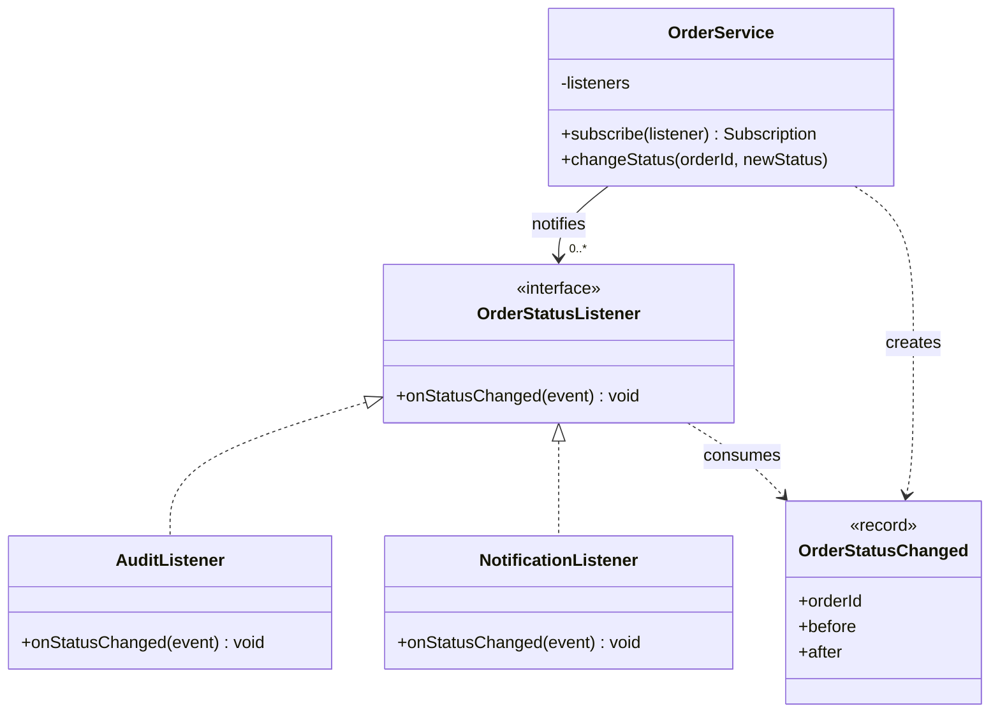

**A common misconception:** the diagram describes a collaboration contract; Observer does not require inheriting from a heavyweight abstract class. In modern Java, a **functional interface** suffices for simple listeners.

## 3. Complete Java 17 Example: Subscribe, Publish, and Unsubscribe

This example simulates order-state changes in **one execution thread**. Valid state progression is `CREATED → PAID → SHIPPED`. Updating to the current state emits no event; invalid transitions are rejected.

The event uses an immutable `record`, and registration returns a `Subscription` object tied to that specific registration.

Create `ObserverDemo.java` and run:

```bash
javac ObserverDemo.java
java ObserverDemo
```

```java
import java.util.HashMap;
import java.util.Map;
import java.util.Objects;
import java.util.concurrent.CopyOnWriteArrayList;

public class ObserverDemo {

    enum OrderStatus { CREATED, PAID, SHIPPED }

    // Payload chỉ đọc: observer không thể thay đổi trạng thái event.
    record OrderStatusChanged(
            String orderId,
            OrderStatus before,
            OrderStatus after) {
        OrderStatusChanged {
            Objects.requireNonNull(orderId, "orderId");
            Objects.requireNonNull(before, "before");
            Objects.requireNonNull(after, "after");
        }
    }

    @FunctionalInterface
    interface OrderStatusListener {
        void onStatusChanged(OrderStatusChanged event);
    }

    // AutoCloseable, nhưng close() không ném checked exception.
    @FunctionalInterface
    interface Subscription extends AutoCloseable {
        @Override
        void close();
    }

    static final class OrderService {
        private final Map<String, OrderStatus> orders = new HashMap<>();
        private final CopyOnWriteArrayList<Registration> listeners =
                new CopyOnWriteArrayList<>();

        // Một token riêng cho mỗi lần đăng ký: cùng listener có thể
        // đăng ký nhiều lần nhưng hủy đúng subscription tương ứng.
        private static final class Registration {
            private final OrderStatusListener listener;

            private Registration(OrderStatusListener listener) {
                this.listener = listener;
            }
        }

        void createOrder(String id) {
            requireId(id);
            if (orders.putIfAbsent(id, OrderStatus.CREATED) != null) {
                throw new IllegalArgumentException(
                        "Đơn hàng đã tồn tại: " + id);
            }
        }

        Subscription subscribe(OrderStatusListener listener) {
            Objects.requireNonNull(listener, "listener");
            Registration registration = new Registration(listener);
            listeners.add(registration);
            return () -> listeners.remove(registration);
        }

        void changeStatus(String id, OrderStatus next) {
            requireId(id);
            Objects.requireNonNull(next, "next");
            OrderStatus current = orders.get(id);

            if (current == null) {
                throw new IllegalArgumentException(
                        "Không tìm thấy đơn hàng: " + id);
            }

            if (current == next) {
                return; // Không có sự thay đổi: không phát event.
            }

            boolean allowed =
                    current == OrderStatus.CREATED &&
                            next == OrderStatus.PAID
                    || current == OrderStatus.PAID &&
                            next == OrderStatus.SHIPPED;

            if (!allowed) {
                throw new IllegalStateException(
                        "Không thể chuyển từ " + current + " sang " + next);
            }

            orders.put(id, next);
            OrderStatusChanged event =
                    new OrderStatusChanged(id, current, next);

            // Best effort, đồng bộ, trong tiến trình.
            for (Registration r : listeners) {
                try {
                    r.listener.onStatusChanged(event);
                } catch (RuntimeException ex) {
                    // Demo: một listener lỗi không chặn listener còn lại.
                    // Production: log/metrics, error policy rõ ràng.
                    System.err.println(
                            "Listener gặp lỗi: " + ex.getMessage());
                }
            }
        }

        OrderStatus statusOf(String id) {
            requireId(id);
            OrderStatus status = orders.get(id);
            if (status == null) {
                throw new IllegalArgumentException(
                        "Không tìm thấy đơn hàng: " + id);
            }
            return status;
        }

        private static void requireId(String id) {
            Objects.requireNonNull(id, "orderId");
            if (id.isBlank()) {
                throw new IllegalArgumentException(
                        "orderId không được rỗng");
            }
        }
    }

    public static void main(String[] args) {
        OrderService orders = new OrderService();
        orders.createOrder("DH-100");

        Subscription audit = orders.subscribe(event ->
                System.out.printf(
                        "AUDIT %s: %s -> %s%n",
                        event.orderId(),
                        event.before(),
                        event.after()));

        Subscription notification = orders.subscribe(event -> {
            if (event.after() == OrderStatus.PAID) {
                System.out.println(
                        "NOTIFY: Đã thanh toán " + event.orderId());
            }
        });

        orders.changeStatus("DH-100", OrderStatus.PAID);
        // AUDIT DH-100: CREATED -> PAID
        // NOTIFY: Đã thanh toán DH-100

        notification.close(); // Dừng listener notification.
        orders.changeStatus("DH-100", OrderStatus.SHIPPED);
        // AUDIT DH-100: PAID -> SHIPPED

        orders.changeStatus("DH-100", OrderStatus.SHIPPED);
        // Không có thay đổi, không có thông báo mới.

        audit.close();
        System.out.println(orders.statusOf("DH-100")); // SHIPPED
    }
}
```

### Important Design Decisions in the Example

- **No audit/email logic inside `OrderService`:** the service knows only `OrderStatusListener`; it does not import email SDKs or dashboard classes.
- **The event carries sufficient data:** observers know which order changed and the before/after states without inferring the difference from global state.
- **No event without a change:** the `SHIPPED → SHIPPED` call is a no-op, avoiding duplicate side effects in this example.
- **`Subscription` manages lifecycle:** `close()` removes exactly one registration. Repeated `close()` calls are harmless. Subject need not expose a global observer-removal API.
- **`CopyOnWriteArrayList` snapshots iteration:** subscribing/unsubscribing during dispatch does not throw `ConcurrentModificationException`. A listener registered or removed during dispatch may or may not receive *the event currently in progress*, depending on the snapshot. Do not assume immediate callback effects.
- **Error handling is a design choice:** the demo catches `RuntimeException` and continues notifying other listeners, writing errors only to stderr. Production requires error classification, metrics, and retry/investigation policies.
- **Single-threaded order-state updates only:** `HashMap` and the read–validate–write sequence are unsynchronized. `CopyOnWriteArrayList` supports concurrent listener-list changes but **does not** make `OrderService` thread-safe.

**The demo is not a production ordering system**: it has no DB persistence or transactions, cannot safely coordinate concurrent updates to one order, and cannot replay notifications after process failure.

## 4. Invocation Order and Event Timing

```mermaid
sequenceDiagram
    participant U as Client
    participant S as OrderService
    participant A as AuditObserver
    participant N as NotificationObserver
    U->>S: changeStatus("DH-100", PAID)
    S->>S: Validate transition
    S->>S: Lưu PAID
    S->>A: onStatusChanged(event)
    A-->>S: Return
    S->>N: onStatusChanged(event)
    N-->>S: Return
    S-->>U: Return
    Note over S,N: Dispatch đồng bộ; callback chậm làm chậm caller
```

In the example, **registration order** is usually also the `CopyOnWriteArrayList` iteration order during one dispatch. However, the application should not depend on “Observer A always runs before Observer B” for critical business rules. An observer may be registered, removed, slow, faulty, or may trigger nested dispatch.

If A must complete successfully **before** B for correctness, that is generally **mandatory workflow coordination** belonging to the use case/workflow, not an implicit guarantee of Observer order.

### Push or Pull?

There are two ways to structure event payloads:

- **Push model:** the publisher sends relevant data through `OrderStatusChanged`, as in the example. Processing is straightforward, but the event contract needs careful design and versioning.
- **Pull model:** the publisher only announces “something changed,” and the observer queries Subject for current state. Payloads are smaller, but coupling increases and the observer may read a later state after further changes.

For audit events or reactions tied to a particular transition, **an immutable payload describing what happened** is generally easier to test and less vulnerable to timing races.

## 5. Testing Observer: Subscription, Cancellation, State, and Errors

Observer tests should prove behavior from the client perspective, not merely that “a listener was called.”

JUnit 5 example: place `ObserverDemoTest.java` in the same package as `ObserverDemo`:

```java
import static org.junit.jupiter.api.Assertions.*;
import java.util.ArrayList;
import java.util.List;
import org.junit.jupiter.api.Test;

class ObserverDemoTest {

    @Test
    void notifiesOnceForRealChange() {
        var service = new ObserverDemo.OrderService();
        service.createOrder("DH-1");

        List<ObserverDemo.OrderStatusChanged> received =
                new ArrayList<>();
        service.subscribe(event -> { received.add(event); });

        service.changeStatus("DH-1", ObserverDemo.OrderStatus.PAID);
        service.changeStatus("DH-1", ObserverDemo.OrderStatus.PAID);

        assertEquals(1, received.size());
        assertEquals("DH-1", received.get(0).orderId());
        assertEquals(ObserverDemo.OrderStatus.CREATED,
                received.get(0).before());
        assertEquals(ObserverDemo.OrderStatus.PAID,
                received.get(0).after());
    }

    @Test
    void unsubscribeStopsFutureNotifications() {
        var service = new ObserverDemo.OrderService();
        service.createOrder("DH-2");
        List<ObserverDemo.OrderStatusChanged> events =
                new ArrayList<>();

        ObserverDemo.Subscription sub =
                service.subscribe(event -> { events.add(event); });
        service.changeStatus("DH-2", ObserverDemo.OrderStatus.PAID);
        sub.close();
        sub.close(); // idempotent
        service.changeStatus("DH-2", ObserverDemo.OrderStatus.SHIPPED);

        assertEquals(1, events.size());
    }

    @Test
    void invalidTransitionDoesNotNotifyOrChangeState() {
        var service = new ObserverDemo.OrderService();
        service.createOrder("DH-3");
        List<ObserverDemo.OrderStatusChanged> events =
                new ArrayList<>();
        service.subscribe(event -> { events.add(event); });

        assertThrows(IllegalStateException.class,
                () -> service.changeStatus(
                        "DH-3", ObserverDemo.OrderStatus.SHIPPED));

        assertEquals(ObserverDemo.OrderStatus.CREATED,
                service.statusOf("DH-3"));
        assertTrue(events.isEmpty());
    }

    @Test
    void brokenObserverDoesNotBlockOtherObservers() {
        var service = new ObserverDemo.OrderService();
        service.createOrder("DH-4");
        List<ObserverDemo.OrderStatusChanged> received =
                new ArrayList<>();

        service.subscribe(event -> {
            throw new IllegalStateException("Lỗi mô phỏng");
        });
        service.subscribe(event -> { received.add(event); });

        service.changeStatus("DH-4", ObserverDemo.OrderStatus.PAID);
        assertEquals(1, received.size());
        assertEquals(ObserverDemo.OrderStatus.PAID,
                service.statusOf("DH-4"));
    }
}
```

The last test illustrates **the error policy selected in this demo**: one listener throws `RuntimeException`, but subsequent listeners still run. If production needs *fail-fast* behavior or must tell the caller that notification failed, adjust the **contract** and tests accordingly without misrepresenting the domain state.

Other useful tests include registering the same callback twice, unsubscribing inside a callback, publishing only after successful changes, handling very slow subscribers, and multithreaded behavior. A mock framework is unnecessary for testing this simple mechanism.

## 6. Subscription Lifecycles and Memory Leaks

Subjects usually **hold strong references** to listeners. If a listener refers to a UI controller or large object no longer needed, but remains registered with a long-lived Subject, garbage collection may **fail to reclaim** those associated objects.

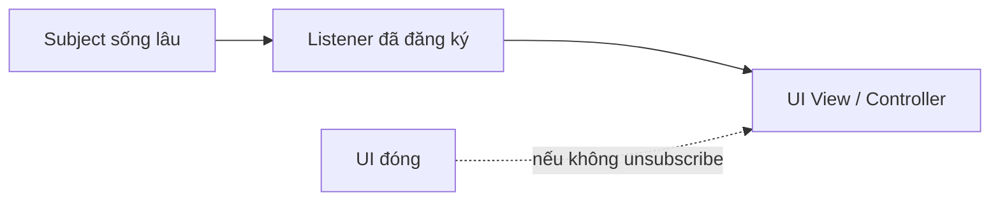

Prevention measures:

- Return a **subscription token** and invoke `close()` when the object no longer observes changes.
- Tie subscriptions to the lifecycle of the UI, request scope, or component.
- For asynchronous APIs/frameworks, use framework-supported disposal/unsubscription mechanisms.
- Avoid repeatedly registering the same listener after every render/request without bounding registration counts.
- Test repeated open/close operations to detect leaks and duplicate events.

**Weak references** can help in certain frameworks but may let observers be collected unexpectedly if no strong reference keeps them alive; they are not a general replacement for explicit lifecycle management.

## 7. Synchronous Callbacks, Concurrency, and Reentrancy

Observer Pattern describes a subscription–notification relationship; it **does not inherently mean “asynchronous execution.”**

| Property | Synchronous in-process (example) | Asynchronous dispatch via queue/executor |
|---|---|---|
| Processing time | Immediately on the publisher thread | On another thread/task |
| Publisher latency | Sum of observer execution times | May reduce waiting, but adds enqueueing/coordination |
| Ordering | One dispatch can follow listener order, but this should not become a business rule | Depends on queue, workers, partitions, and concurrency |
| Listener errors | May propagate up the call stack or be caught by publisher | Need recording, retry, and dead-letter handling |
| Backpressure | A slow listener blocks the publisher | Queues may fill, consume memory, or reject tasks |
| Lifecycle | In-process memory | Requires executor/queue management and shutdown |

### Special Cases Requiring Explicit Decisions

**Reentrancy:** a listener may call `changeStatus` again while Subject is dispatching. The new call then runs inside the original; another observer might receive the newer event before the older one unless ordering is designed explicitly. Prevent infinite self-triggering callbacks. If order matters, coordinate changes using a queue or state machine with explicit serialization.

**Race condition:** two threads reading the same `CREATED` and updating it can cause lost updates or incorrect events. Locks, transactions, or optimistic locking must protect **the whole read–validate–update operation**, not only the listener list. `CopyOnWriteArrayList` does not make updates to `HashMap` safe.

**Slow callbacks:** sending email or invoking REST directly inside a synchronous listener can prolong API response times. Moving side effects to tasks/jobs requires handling full queues, retries, error visibility, and safe shutdown.

**Errors:** three common policies are *fail-fast*, *continue and aggregate errors*, or *best effort with error reporting*. No policy fits every application. Callers must know whether the main update succeeded and what notification guarantees exist.

**Ordering and at-most-once:** never assume Observer means “each recipient gets exactly one event.” Failures, retries, and nested callbacks can lead to missing or duplicate deliveries.

## 8. How Do Observer, Event Bus, and Publish–Subscribe Differ?

**Observer** in object-oriented design usually connects a source directly to its registered listeners within one process.

An **in-process event bus** adds an intermediary for receiving and routing events by type. Producers know only the bus, while handlers subscribe through it. This reduces direct references but can make it harder to identify which handlers consume which events when configuration is scattered.

**Publish–subscribe through a message broker** (such as Kafka or RabbitMQ) separates producers from consumers across networks and time. This introduces distributed-systems concerns: durable messages, acknowledgments, retries, ordering, consumer groups, poison messages, and idempotency.

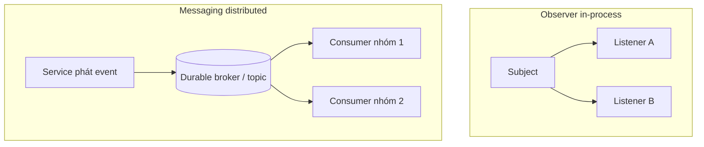

| Question | In-process Observer | Distributed messaging |
|---|---|---|
| Uses a network? | Usually no | Yes |
| Requires a separate broker? | No | Usually |
| Are notifications automatically durable? | No | Depends on configuration and write/read acknowledgments |
| What if a process stops mid-dispatch? | Remaining observers may miss the event | Replay may be possible under system delivery semantics |
| Must duplicates be handled? | Depends on code and retries | Idempotent consumers are usually needed |
| Who manages lifecycle? | Subject and subscriptions | Broker/client/consumer group and application |
| Is end-to-end “exactly once” guaranteed? | No | Not by default; depends on transaction scope and side effects |

Do not call Kafka messaging “Observer over Kafka” as if it were just a listener list replaced by a topic. It is a **different architectural level** with additional operational and consistency requirements.

## 9. Domain Events and Publishing Timing with Databases

Suppose payment processing uses a transaction:

1. Validate the order and transition preconditions.
2. Persist `PAID` to the database.
3. Commit.
4. Notify email/audit/analytics components.

If an event is published **before commit**, listeners may observe state that was never committed or receive “paid” even after rollback. Publishing **after commit** through an in-memory call creates a failure window: the DB commits but the process dies before publishing, losing the notification.

When reliability matters, consider a **Transactional Outbox**:

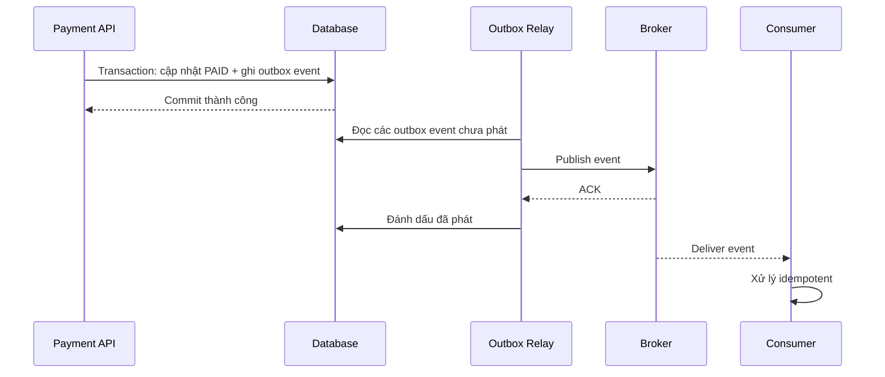

Outbox addresses **the gap between DB updates and message writes** when both are recorded in one database transaction. But a relay may duplicate publication if it crashes after publishing but before marking the outbox row as sent; consumers still need **idempotency**. Do not assume global event ordering or exactly-once processing.

Events should describe **facts that already occurred** using past-tense names such as `OrderPaid` and `OrderShipped`. A command such as `SendEmail` expresses **work being requested**; distinguishing events from commands clarifies the contract.

### Minimum Requirements for Shareable Events

- Unique event ID `eventId` for deduplication.
- `aggregateId`/`orderId` identifying the business entity.
- Event type and occurrence time `occurredAt`, with UTC time-zone considerations.
- Schema version when long-lived contracts need to evolve.
- Minimal payload without unnecessary sensitive data.
- Backward-compatibility rules and conditions under which consumers can retry safely.

These fields are **recommendations for durable/distributed events**, not mandatory for every local observer in this lesson.

## 10. Comparing Observer with Related Design Patterns

| Pattern / mechanism | Intent | Key distinction |
|---|---|---|
| **Observer** | A changing source notifies registered listeners | Mainly one-to-many reactions after a change |
| **Strategy** | Swaps algorithms/policies for a task | Usually chooses *one processing strategy* rather than notifying multiple interested parties |
| **Mediator** | Centralizes interactions among collaborators | Manages complex/two-way coordination, not merely “change triggers notification” |
| **Command** | Encapsulates a request for action as an object | Commands express *what is requested*; events express *what happened* |
| **Decorator** | Adds behavior through a wrapper preserving the same interface | Wraps one object/call path rather than building a subscriber list |
| **Single callback** | Invokes one function when an operation completes | May be part of Observer but need not have a registry or lifecycle |

For example, clicking Place Order may use a **Command** named `PlaceOrder`, a discount algorithm selected with **Strategy**, and **Observer** notifications to views/audit after state changes. Patterns can collaborate, but each must solve a specific problem.

## 11. Not Every Reaction Should Be an Observer

Distinguish **actions required for correctness** from **secondary reactions**:

| Situation | Design to consider |
|---|---|
| Inventory must be decremented before confirming an order | Explicit workflow/use case with transaction or saga; do not rely on implicit listener order |
| Update the UI when ViewModel state changes | Observer/property listeners are well suited |
| Record best-effort metrics after processing | Observer/listener may be suitable |
| Confirmation email may be slow and requires retries | Job queue, outbox, or durable consumer |
| Audit records must never be lost | Persist audit in the same transaction or an equivalent durable mechanism |
| Two classes make a simple one-to-one call | A direct method call may be clearer |
| Thousands of event types have uncontrolled registrations everywhere | Need event catalog, tracing, schema, and subscription permissions |

An **observer failure after the publisher has already changed state** must be defined in advance. If an observer failure must fail the entire business operation, synchronous rollback/compensation may be required; never assume “event published” means “all side effects completed.”

## 12. Techniques for Maintainable Observer APIs

**Use domain names.** `OrderStatusChanged` is more meaningful than a vague `SomethingUpdated` event if consumers depend on business semantics. Avoid an `Object payload` that requires `instanceof` casts everywhere.

**Keep payloads immutable.** Java `record` is convenient for small records but guarantees only *shallow immutability*. If a record contains mutable `List` values or mutable classes, make defensive copies (`List.copyOf`) and use immutable element types.

**Define subject scope.** Does `OrderService` belong to one order or observe all orders? Each design affects event filtering, lifecycle, access control, and memory.

**Define duplication policy.** To emit an event *for every attempted operation* even when state does not change, use an “attempted action” event rather than pretending it is `StatusChanged`. If the same callback can be registered multiple times, specify whether duplicate subscriptions are allowed.

**Manage unsubscription.** When views close, sessions expire, or modules unload, release subscriptions. Java `AutoCloseable` works well with `try-with-resources` for short scopes:

```java
try (ObserverDemo.Subscription sub =
         service.subscribe(event -> System.out.println(event))) {
    service.changeStatus("DH-10", ObserverDemo.OrderStatus.PAID);
}
// sub.close() tự gọi khi ra khỏi khối
```

The small snippet assumes `service` already exists and has an order `DH-10` in `CREATED` state; it cannot run independently.

**Observe event handling.** Production systems should measure observer counts, callback duration, callback errors, queue lag, and correlation IDs. Avoid unnecessary personal or payment details in logs.

**Avoid unbounded slow I/O in synchronous listeners.** Network requests can hang callbacks, delaying all listeners and the caller. Use timeouts, circuit breakers, and/or queues where needed, based on product requirements.

## 13. Refactoring from Hardcoded Calls to Observer

1. **Identify a meaningful change:** for example, transitioning an order to `PAID`.
2. **Classify reactions:** actions required to commit successfully differ from secondary metrics/UI/notification tasks.
3. **Define the event contract:** `OrderStatusChanged` contains the minimum data observers need.
4. **Create the listener contract:** such as `onStatusChanged(event)`; Subject should not know concrete listener classes.
5. **Choose dispatch policy:** synchronous or async, effect of observer failures on the caller, and whether ordering is guaranteed.
6. **Create registry/subscriptions:** support cancellation and prevent retaining listeners too long.
7. **Publish only after meaningful valid changes:** do not create “ghost events” for failed commands.
8. **Write contract tests:** actual changes, no-ops, invalid transitions, multiple observers, listener failure, and unsubscription.
9. **Evaluate durability for DB/network systems:** transaction boundaries, outbox, retries, idempotency, and consumer lag.
10. **Monitor and simplify:** when tracing becomes difficult, use consistent event naming/catalogs or move mandatory steps back into application services.

## 14. Common Pitfalls

| Pitfall | Symptom | Resolution |
|---|---|---|
| Missing unsubscription | Each UI reopen creates multiple callbacks for one event | Return a subscription handle tied to lifecycle |
| Slow I/O in callbacks | One observer delays the entire request | Suitable dispatch, queues/timeouts |
| Observer A calls Subject recursively | Nested events, unpredictable ordering, or recursion | Limit reentrancy; queue events if necessary |
| Catch and ignore every exception | Notifications disappear without visibility | Logging/metrics/alerts and a defined error policy |
| Observers can mutate the shared event payload | Later listeners see changed content | Immutable events and defensive collection copies |
| Treat `CopyOnWriteArrayList` as making all domain state thread-safe | Order states race | Locks/transactions/CAS around state updates |
| Depend on registration order for business decisions | Configuration changes break workflows | Move mandatory steps into explicit orchestration |
| Publish before commit | Observers receive events even if the transaction rolls back | Publish after commit or use an appropriate outbox |
| Publish after commit in RAM and assume it is durable | A crash between commit and publish loses the event | Transactional Outbox where durability matters |
| Assume exactly-once | Consumers repeat side effects on redelivery | Event IDs, deduplication, idempotent consumers |
| Overly generic events such as `onChange(Object)` | Runtime casts and implicit coupling | Typed events with clear schemas |
| Use Observer for every call | Difficult debugging and dependency tracing | Keep direct calls for clear mandatory interactions |

## 15. Practical Exercises

**Exercise 1 — Track price changes:** Build `PriceCatalog` emitting `PriceChanged(sku, oldPrice, newPrice)`. One observer updates the UI while another records metrics. Emit no event if the price is unchanged; test subscription and unsubscription.

**Exercise 2 — Duplicate subscriptions:** Invoke `subscribe` twice with the same listener. Determine how many notifications arrive. Cancel one `Subscription` and verify the other remains active. Explain why each registration needs its own identity token.

**Exercise 3 — Observer failure:** One listener throws an exception while another records the event in a list. Test the chosen policy (continue, fail-fast, or aggregate errors). Describe what business state the caller observes after the failure.

**Exercise 4 — Concurrency:** Two threads both attempt to change an order from `CREATED` to `PAID`. Propose a conditional update with DB or locking, and publish only **one** event for the successful transition. Explain the risk if the process dies after commit but before publish.

**Exercise 5 — Reliable email:** Extend the order example with the requirement “an email notification must not be lost after transaction commit; duplicates must be handled safely.” Diagram the outbox, relay, broker, and consumer, and propose an `eventId`/idempotency key.

## 16. Self-Check: Do You Understand Observer?

- [ ] I can identify Subject, Observer, events, subscriptions, and publish timing.
- [ ] I know how **change notifications** differ from **required operations**.
- [ ] I can distinguish synchronous Java callbacks from broker-based pub/sub.
- [ ] I can handle unchanged state, invalid transitions, and faulty listeners.
- [ ] I understand memory-leak risks when Subjects outlive their UI listeners.
- [ ] I do not confuse listener-list safety with safe business-state updates.
- [ ] I can choose policies for ordering, reentrancy, latency, errors, and retries.
- [ ] I understand why outbox/idempotency is needed for reliable event delivery between services.

**Remember:** Observer lets *one changing source notify multiple interested objects* without directly knowing all their reactions. A good design manages subscription lifecycles, event contracts, error handling, and notification guarantees appropriate to its context—especially when moving from local callbacks to distributed systems.


</details>

- [Back to top](#back-to-top)

---

## <a id="design-patterns-011">Template Method and the Algorithm Skeleton</a>

<details>
<summary>View details</summary>

# Template Method in Java: Fixing an Algorithm Skeleton, Customizing Individual Steps

> **Learning path:** OOP → Design Patterns → Template Method and the algorithm skeleton.  
> **Objective:** Understand Template Method, identify fixed versus variable steps, implement a superclass and subclasses in Java, verify execution order, distinguish Strategy/Factory Method, and recognize when inheritance adds cost.

## 1. What Problem Does Template Method Solve?

Many programs perform tasks with **the same overall process** but different steps. Consider generating a sales report:

1. Receive and validate transaction data.
2. Calculate total revenue.
3. Generate the report heading.
4. Render each transaction.
5. Generate the summary line.
6. Optionally add a footer.

Plain-text and Markdown reports must perform these steps **in the correct order**; only the presentation of headings, transaction lines, and summaries differs.

If each report type independently implements the complete `generate()` process, data validation, total calculation, and step order may be duplicated. One variant might forget to reject negative amounts or omit a summary.

**Template Method** is a GoF *behavioral pattern*: define **an algorithm skeleton in a superclass method** while letting subclasses implement or override selected steps **without changing the overall algorithm structure**.

How to read a Template Method design:

| Component | Role |
|---|---|
| **Abstract Class** | Superclass owns the workflow and defines extension steps |
| **Template Method** | Coordinates step order; often marked `final` to prevent overrides |
| **Concrete Operation** | Fully implemented step in the superclass, shared by all variants |
| **Primitive Operation** | An `abstract` step that subclasses must provide |
| **Hook** | A step with default behavior that subclasses **may** override |
| **Concrete Class** | Subclass implementing differences specific to a variant |

The pattern name refers to a **“workflow template”**, not a C++ generic-type template or a UI template file.

## 2. From Duplicated Code to a Shared Skeleton

An initial design often has two independent classes:

~~~java
// Phác thảo để thấy chỗ trùng lặp, không phải chương trình hoàn chỉnh.
class TextReport {
    String generate(List<Sale> sales) {
        validate(sales);
        BigDecimal total = calculateTotal(sales);
        // Render tiêu đề văn bản, từng dòng, tổng kết...
        return "...";
    }
}

class MarkdownReport {
    String generate(List<Sale> sales) {
        validate(sales);
        BigDecimal total = calculateTotal(sales);
        // Render tiêu đề Markdown, từng dòng, tổng kết...
        return "...";
    }
}
~~~

Both classes must preserve the order `validate → calculateTotal → render`. If the business adds a shared step, such as checking transaction IDs, both may need modification.

Refactoring idea:

- **Keep in the superclass:** input-list validation, snapshotting, total calculation, step order, and result assembly.
- **Customize in subclasses:** heading content, transaction representation, and summary format.
- **Use a hook:** the optional report footer can default to empty or be customized by subclasses.

This mechanism is often expressed as the “**Hollywood Principle**”: *Do not call us; we will call you*. The superclass chooses when to invoke steps provided by subclasses, so subclasses need not reconstruct the entire workflow.

## 3. Complete Java 17 Example: Generating Sales Reports

The example uses only the JDK. Every transaction has a transaction code and an amount in VND with two decimal places **to simplify the lesson**; this is a demo convention, not a claim that VND always requires two decimal digits.

Input contract:

- Transaction codes contain only uppercase `A–Z`, digits, or `-` for safe plain-text/Markdown rendering.
- Amounts must be nonnegative, non-null, and exactly representable with two decimal places.
- The transaction list must not be null and may be empty; null elements are forbidden.
- Subclasses only **format** output; they must not modify amounts or silently drop transactions.

Create **`TemplateMethodDemo.java`** and copy the full example below:

~~~java
import java.math.BigDecimal;
import java.math.RoundingMode;
import java.util.List;
import java.util.Objects;

// Mỗi Sale là một value object bất biến.
// Compact constructor của record chuẩn hóa số tiền.
record Sale(String code, BigDecimal amount) {
    Sale {
        Objects.requireNonNull(code, "code");
        Objects.requireNonNull(amount, "amount");

        if (!code.matches("[A-Z0-9-]+")) {
            throw new IllegalArgumentException(
                    "code must contain only A-Z, 0-9 or -");
        }
        if (amount.signum() < 0) {
            throw new IllegalArgumentException(
                    "amount must be nonnegative");
        }

        try {
            amount = amount.setScale(2, RoundingMode.UNNECESSARY);
        } catch (ArithmeticException ex) {
            throw new IllegalArgumentException(
                    "amount has fractions smaller than 0.01", ex);
        }
    }
}

// Abstract Class: chứa quy trình chung và các extension points.
abstract class SalesReportTemplate {

    // TEMPLATE METHOD: luồng xử lý cuối cùng của mọi biến thể.
    public final String generate(List<Sale> source) {
        Objects.requireNonNull(source, "source");

        // Snapshot; List.copyOf cũng từ chối phần tử null.
        List<Sale> sales = List.copyOf(source);

        // Concrete operation: cùng công thức tổng cho mọi báo cáo.
        BigDecimal total = sales.stream()
                .map(Sale::amount)
                .reduce(BigDecimal.ZERO, BigDecimal::add)
                .setScale(2, RoundingMode.UNNECESSARY);

        StringBuilder output = new StringBuilder();

        // Các primitive operations sẽ được dispatch tới subclass.
        output.append(Objects.requireNonNull(
                header(), "header returned null"));

        for (Sale sale : sales) {
            output.append(Objects.requireNonNull(
                    row(sale), "row returned null"));
        }

        output.append(Objects.requireNonNull(
                summary(sales.size(), total),
                "summary returned null"));

        // Hook tùy chọn: không yêu cầu mọi subclass tự viết lại.
        output.append(Objects.requireNonNull(
                footer(), "footer returned null"));

        return output.toString();
    }

    // Primitive operations: subclass bắt buộc cài đặt.
    protected abstract String header();
    protected abstract String row(Sale sale);
    protected abstract String summary(int count, BigDecimal total);

    // Hook: hành vi mặc định là không thêm phần cuối báo cáo.
    protected String footer() {
        return "";
    }
}

// Concrete Class A: định dạng văn bản thuần.
final class TextSalesReport extends SalesReportTemplate {
    @Override
    protected String header() {
        return "BÁO CÁO DOANH THU\n-----------------\n";
    }

    @Override
    protected String row(Sale sale) {
        return sale.code() + ": "
                + sale.amount().toPlainString() + " VND\n";
    }

    @Override
    protected String summary(int count, BigDecimal total) {
        return "Tổng " + count + " giao dịch: "
                + total.toPlainString() + " VND\n";
    }

    // Không ghi đè footer(): dùng hành vi mặc định của hook.
}

// Concrete Class B: định dạng bảng Markdown.
final class MarkdownSalesReport extends SalesReportTemplate {
    @Override
    protected String header() {
        return "| Mã giao dịch | Số tiền (VND) |\n"
                + "|---|---:|\n";
    }

    @Override
    protected String row(Sale sale) {
        return "| " + sale.code() + " | "
                + sale.amount().toPlainString() + " |\n";
    }

    @Override
    protected String summary(int count, BigDecimal total) {
        return "| **Tổng (" + count + ")** | **"
                + total.toPlainString() + "** |\n";
    }

    @Override
    protected String footer() {
        return "\n_Tự động tạo báo cáo._\n";
    }
}

public class TemplateMethodDemo {
    public static void main(String[] args) {
        List<Sale> sales = List.of(
                new Sale("S-01", new BigDecimal("120.00")),
                new Sale("S-02", new BigDecimal("30.50"))
        );

        SalesReportTemplate textReport = new TextSalesReport();
        SalesReportTemplate markdownReport = new MarkdownSalesReport();

        System.out.println(textReport.generate(sales));
        System.out.println(markdownReport.generate(sales));
    }
}
~~~

Compile and run:

~~~bash
javac TemplateMethodDemo.java
java TemplateMethodDemo
~~~

Output:

~~~text
BÁO CÁO DOANH THU
-----------------
S-01: 120.00 VND
S-02: 30.50 VND
Tổng 2 giao dịch: 150.50 VND

| Mã giao dịch | Số tiền (VND) |
|---|---:|
| S-01 | 120.00 |
| S-02 | 30.50 |
| **Tổng (2)** | **150.50** |

_Tự động tạo báo cáo._
~~~

**Why Is This Template Method?**

1. `SalesReportTemplate.generate()` owns the **order** of the steps.
2. `generate()` is `final`, so subclasses cannot override it to skip total calculation, reorder steps, or forget shared processing.
3. `header()`, `row()`, and `summary()` are **primitive operations**: abstract methods invoked by the template and implemented by subclasses.
4. `footer()` is a **hook** defaulting to `""`. `TextSalesReport` need not override it; `MarkdownSalesReport` adds an optional note.
5. `TextSalesReport`/`MarkdownSalesReport` determine **how results are presented**, not how to orchestrate the algorithm.

Note that `final` only prevents overriding **the template method**; it cannot automatically prevent all subclass bugs. For example, a subclass implementation of `row()` could return an incorrect value or produce unexpected side effects. Contracts and tests still matter.

## 4. Class Diagram and Execution Sequence

### 4.1. Class Structure

~~~mermaid
classDiagram
    class SalesReportTemplate {
        <<abstract>>
        +generate(source) String
        #header() String*
        #row(sale) String*
        #summary(count,total) String*
        #footer() String
    }
    class TextSalesReport {
        #header() String
        #row(sale) String
        #summary(count,total) String
    }
    class MarkdownSalesReport {
        #header() String
        #row(sale) String
        #summary(count,total) String
        #footer() String
    }
    SalesReportTemplate <|-- TextSalesReport
    SalesReportTemplate <|-- MarkdownSalesReport
~~~

The `*` marker in the diagram indicates abstract steps. The example Java code declares `generate()` as `final`; the diagram merely summarizes method signatures.

### 4.2. Who Controls the Order?

~~~mermaid
sequenceDiagram
    actor Client
    participant Context as SalesReportTemplate
    participant Sub as Concrete Report
    Client->>Context: generate(sales)
    Note over Context: Snapshot danh sách + tính total
    Context->>Sub: header()
    Sub-->>Context: Văn bản tiêu đề
    loop Mỗi Sale
        Context->>Sub: row(sale)
        Sub-->>Context: Dòng đã format
    end
    Context->>Sub: summary(count, total)
    Sub-->>Context: Dòng tổng kết
    Context->>Sub: footer()
    Sub-->>Context: Nội dung hook hoặc chuỗi rỗng
    Context-->>Client: Chuỗi báo cáo hoàn chỉnh
~~~

When calling `new MarkdownSalesReport().generate(...)`, execution still starts in the method inherited from `SalesReportTemplate`. Only the individual virtual steps are dispatched by the JVM to the runtime implementation.

## 5. Three Groups of Steps in Template Method

A good design distinguishes **invariant steps**, **required variation steps**, and **optional steps**:

| Group | Java characteristic | Example | Usage |
|---|---|---|---|
| **Shared step** | `private` or `final` method with complete logic | Snapshot, total calculation, data validation | Keep in the superclass; do not create an override point unnecessarily |
| **Abstract step** | `protected abstract` | `header()`, `row(...)`, `summary(...)` | Subclasses must provide an implementation |
| **Hook** | `protected` method with a default | `footer() { return ""; }` | Subclasses override only when needed |
| **Template Method** | Often `public final` | `generate(...)` | Coordinates steps in a deliberate order |

The word “**often**” matters: GoF does not require every Template Method to be `final`. Java permits a template method that is not `final`, and some frameworks intentionally extend the entire process. When the goal is **preserving the algorithm skeleton**, marking it `final` protects the design intent.

### 5.1. What Is a Hook For?

A hook is an **optional** extension point. Most reports need no footer, but Markdown may add a note. A hook should have safe, understandable default behavior without requiring subclasses to implement empty methods.

A hook may also control a decision:

~~~java
// Ví dụ minh họa, giả sử đặt trong một abstract class khác.
protected boolean shouldAddTimestamp() {
    return false;
}
~~~

The Template Method may invoke `shouldAddTimestamp()` at a predetermined point. This works for one small option; numerous interdependent hooks can create unpredictable combinations of overrides.

### 5.2. Should Subclasses Modify Shared Data?

In the example, `row(Sale)` receives an immutable `record`. The subclass cannot modify `Sale` in place, protecting input data. If a hook receives a mutable `List`, one subclass might remove elements, reorder them, or affect the summary step.

Therefore:

- Pass immutable parameters, value objects, or appropriate copies.
- Distinguish **extending presentation** from **changing business rules**.
- Clearly specify which hooks can change which values and what must remain invariant.
- Do not expose the entire superclass internals as `protected` merely for subclass convenience; that increases coupling and complicates refactoring.

## 6. Common Design Mistakes

### Mistake 1: Every Subclass Overrides the Whole Template

~~~java
abstract class ImportTask {
    // Không final; mọi subclass đều có thể thay đổi thứ tự.
    public void execute() {
        validate();
        parse();
        save();
    }

    protected abstract void validate();
    protected abstract void parse();
    protected abstract void save();
}
~~~

If the required order is `validate → parse → save`, consider `public final void execute()`. If a subclass legitimately needs a different order, **the algorithm skeleton may not actually be stable**; reconsider the abstraction instead of arbitrarily changing subclass code.

### Mistake 2: Calling Overridable Methods from a Superclass Constructor

~~~java
abstract class UnsafeBase {
    UnsafeBase() {
        configure(); // Nguy hiểm: dispatch tới subclass khi chưa khởi tạo xong.
    }
    protected abstract void configure();
}

final class UnsafeChild extends UnsafeBase {
    private final String prefix = "ready";

    @Override
    protected void configure() {
        System.out.println(prefix.length());
    }
}
~~~

In Java, the superclass constructor runs **before** subclass field initialization completes. `configure()` may execute while `prefix == null`, causing `NullPointerException`. Avoid calling hooks/abstract methods from constructors; invoke the template after full object initialization or use a factory that constructs objects before starting work.

### Mistake 3: Forcing Subclasses to Support Nonsensical Steps

If an `ImportTask` defines `decrypt()` but many sources are never encrypted, requiring every subclass to implement `decrypt() { throw new UnsupportedOperationException(); }` suggests a poorly designed contract.

Depending on requirements, use a safe default hook, split abstractions by capability, or inject a decoding Strategy. Do not use empty hooks mechanically when skipping decryption could create security risks.

### Mistake 4: Too Many Order-Dependent Hooks

A custom framework with dozens of methods such as `beforeValidate`, `afterValidate`, `beforeParse`, `afterParse`, `onError`, and `finally...` becomes hard to understand when subclasses override many steps. Template Method helps most when **the skeleton is genuinely stable** and only a few steps require replacement.

### Mistake 5: Using Inheritance for Every Variation Axis

Suppose there are two output formats (Text/Markdown), two languages (VI/EN), and three delivery approaches (file/email/API). Encoding every combination as a subclass produces `2 × 2 × 3 = 12` possible variants and can lead to class explosion.

With **multiple independent axes of variation**, consider composition: inject `ReportFormatter`, `Translator`, and `ReportPublisher` separately. Template Method may still orchestrate a stable outer workflow while collaborator objects provide particular variants.

## 7. Comparing Template Method with Strategy, Factory Method, and Other Techniques

| Criterion | Template Method | Strategy | Factory Method |
|---|---|---|---|
| Purpose | Preserve **an algorithm skeleton** while subclasses vary selected steps | Replace **a complete algorithm/behavior** using a collaborator object | Let subclasses choose **the class to instantiate** |
| Primary mechanism | **Inheritance + dynamic dispatch** of overridden steps | **Composition + delegation** through an interface | **Inheritance + overriding** a creation method |
| Variation point | Steps inside the superclass workflow | Strategy implementation supplied to Context | Method that creates a Product |
| Changing variants at runtime | Can select a **different subclass object**, but cannot dynamically alter the process structure within one object | Usually easy to select/swap Strategy through DI or parameters | Select a Creator subclass or use a factory supplied by the Creator |
| Benefit | Avoid duplicated workflow steps while maintaining order | Decouple algorithms and flexibly choose behaviors | Isolate product creation from business processing |
| Risk | Subclass coupling to superclass; excessive hooks | Too many small Strategies, plus selection mechanisms | Too many Creator subclasses solely to choose product types |

**Recognize the patterns through examples:**

- `SalesReportTemplate.generate()` fixes `header → rows → summary → footer`: **Template Method**.
- `PricingService` receives `PricingStrategy` and calls `calculate(...)`: **Strategy**.
- `DocumentCreator` calls `createDocument()`, overridden by subclasses to create `PdfDocument` or `HtmlDocument`: **Factory Method**.

A Template Method **may invoke a Factory Method** at a step, such as document export calling `createRenderer()`; it may also accept a Strategy for part of its calculations. Patterns are composable tools, not mutually exclusive categories.

### Template Method or Strategy for a Given Problem?

Ask:

1. Is there a **mandatory step sequence** with many shared steps and only a few differences? → Consider **Template Method**.
2. Are there multiple **complete algorithms** to interchange, especially at runtime or per request? → **Strategy** is usually more flexible.
3. Are there several independent dimensions (format, language, output)? → Prefer **composition** or combine Strategy with a common workflow.
4. Can subclasses violate processing order or the contract? → Limit extension points, specify preconditions/postconditions, and test every subclass.

Template Method inheritance tightly couples subclasses to the superclass. Changing step order or hook semantics may affect many subclasses; Strategy instead requires a clear interface and object-selection/creation mechanism.

## 8. How Template Method Differs from an Ordinary Interface

An interface only declares operations:

~~~java
interface Exporter {
    String export(List<Sale> sales);
}
~~~

If each implementation of `Exporter` independently decides the entire process, there is no **shared algorithm skeleton** in a superclass. That is interface-based polymorphism but **does not suffice** to identify Template Method.

An `abstract class` containing a `final generate()` that invokes `protected abstract` steps/hooks is characteristic. Java interfaces can use `default` methods, but have different extension/state mechanisms from abstract classes; examine **who actually owns the skeleton**, not merely the keywords.

## 9. Testing the Actual Properties of Template Method

Production tests should verify more than the final result:

- **Step order** is preserved.
- **Shared steps** execute for every subclass.
- Subclasses produce correctly formatted results under the contract.
- The default hook works when a subclass does not override it.
- Boundary data (empty list, null values, invalid amounts) is handled correctly.

The following tests use JUnit Jupiter 5; place `TemplateMethodDemo.java` under the main source set and `SalesReportTemplateTest.java` under the test source set in the same package, with a `junit-jupiter` dependency and suitable test runner.

### 9.1. Test Data, Summaries, and Hooks

~~~java
import static org.junit.jupiter.api.Assertions.*;

import java.math.BigDecimal;
import java.util.List;
import org.junit.jupiter.api.Test;

class SalesReportTemplateTest {
    @Test
    void textAndMarkdownUseSameTotal() {
        List<Sale> sales = List.of(
                new Sale("S-01", new BigDecimal("120.00")),
                new Sale("S-02", new BigDecimal("30.50"))
        );

        String text = new TextSalesReport().generate(sales);
        String markdown = new MarkdownSalesReport().generate(sales);

        assertTrue(text.contains(
                "Tổng 2 giao dịch: 150.50 VND"));
        assertTrue(markdown.contains(
                "| **Tổng (2)** | **150.50** |"));

        // Hook mặc định không thêm chú thích; Markdown có override.
        assertFalse(text.contains("_Tự động tạo báo cáo._"));
        assertTrue(markdown.endsWith(
                "_Tự động tạo báo cáo._\n"));
    }

    @Test
    void emptyListStillGetsASummary() {
        String result = new TextSalesReport()
                .generate(List.of());

        assertTrue(result.contains(
                "Tổng 0 giao dịch: 0.00 VND"));
    }

    @Test
    void invalidSalesAreRejected() {
        assertThrows(IllegalArgumentException.class,
                () -> new Sale("BAD|ID", new BigDecimal("10.00")));
        assertThrows(IllegalArgumentException.class,
                () -> new Sale("S-01", new BigDecimal("-1.00")));
        assertThrows(IllegalArgumentException.class,
                () -> new Sale("S-01", new BigDecimal("1.005")));
        assertThrows(NullPointerException.class,
                () -> new TextSalesReport().generate(null));
    }
}
~~~

### 9.2. Test Step Order with a Subclass That Records Calls

This test catches accidental reordering when someone later changes the template:

~~~java
import static org.junit.jupiter.api.Assertions.*;

import java.math.BigDecimal;
import java.util.ArrayList;
import java.util.List;
import org.junit.jupiter.api.Test;

class SalesReportOrderTest {
    static final class TracingReport extends SalesReportTemplate {
        final List<String> calls = new ArrayList<>();

        @Override
        protected String header() {
            calls.add("header");
            return "";
        }

        @Override
        protected String row(Sale sale) {
            calls.add("row:" + sale.code());
            return "";
        }

        @Override
        protected String summary(int count, BigDecimal total) {
            calls.add("summary:" + count);
            return "";
        }

        @Override
        protected String footer() {
            calls.add("footer");
            return "";
        }
    }

    @Test
    void templateControlsTheStepOrder() {
        TracingReport report = new TracingReport();

        report.generate(List.of(
                new Sale("S-01", new BigDecimal("20.00")),
                new Sale("S-02", new BigDecimal("15.00"))
        ));

        assertEquals(List.of(
                "header",
                "row:S-01",
                "row:S-02",
                "summary:2",
                "footer"
        ), report.calls);
    }
}
~~~

The ordering test uses only one tracing subclass. When variants proliferate, shared contract tests should cover all product subclasses too. If a hook performs real side effects (database writes, emails), inject fake dependencies to avoid unwanted effects in unit tests.

## 10. Using Template Method in Real Systems

Examples with relatively stable algorithm skeletons:

| Use case | Shared steps | Customized steps |
|---|---|---|
| ETL data import | Validate → read → transform → persist → summarize | Parse CSV/XML; normalize each record type |
| Report generation | Fetch data → aggregate → present → export | Header, row format, footer |
| Batch jobs | Initialize → process each item → update state → finish | Per-item processing, pre/post-batch hooks |
| Document processing | Check permission → read content → transform → write | Transformation/renderer implementation |
| Base test workflows | Shared setup → run scenario → assert invariants → clean up | Fixture data and scenario-specific steps |

For **ETL**, clarify that a template fixing step order **does not guarantee atomic transactions**. If a failure occurs midway through storing records, partial writes may remain; transactions, rollbacks, or idempotency must be designed according to requirements. Do not attribute framework transaction capabilities to the pattern.

### Algorithm-Skeleton Design Checklist

1. Write down **step names and order** before defining an abstract class. Put only truly invariant parts in the template.
2. Document **each extension-point contract**: inputs, outputs, errors, and permitted side effects.
3. Mark the template method `final` if subclasses must not alter the skeleton.
4. Use `protected abstract` for required steps and hooks with safe defaults for optional steps.
5. Keep validation, state protection, and shared rules in the superclass.
6. Avoid overridable calls in constructors, and do not give subclasses unrestricted access to mutable data.
7. Test **call order, shared steps, results, and variants**, including boundaries.
8. If variants grow along multiple independent axes, reconsider inheritance and move some variation into Strategy/composition.

## 11. Exercise: Product Import File Workflow

A system accepts partner product files in two illustrative formats: `CSV-SIMPLE` and `PIPE-SIMPLE`. Every line contains a product ID and quantity, but fields are separated differently.

Design the following:

~~~java
abstract class ProductImportTemplate {
    public final int importText(String raw) {
        // 1. validate raw
        // 2. parseRecords(raw) - abstract
        // 3. validate từng Product
        // 4. persistAll(records) - bước chung
        // 5. afterImport(count) - hook tùy chọn
        // 6. return count
        throw new UnsupportedOperationException("Exercise");
    }

    protected abstract List<Product> parseRecords(String raw);

    protected void afterImport(int count) {
        // mặc định không làm gì
    }
}
~~~

This is only an **exercise skeleton**, not a complete implementation; learners must define `Product`, `persistAll`, and correct error handling.

Exercise requirements:

- Implement two subclasses, `CsvProductImport` and `PipeProductImport`.
- The superclass checks that quantity is greater than 0 before persisting.
- Subclasses must not override `importText` to bypass validation.
- Write tests confirming that parsing/validation failures occur **before the persistence step is called**.
- If the entire file must either be committed or rolled back, specify where transactions begin/end in your design.
- Discuss when introducing a `RecordParser` interface and using Strategy would be clearer than format-based subclasses.

### Self-Check Questions

1. Which method in the report example is the **Template Method**? Why is it `final`?
2. Is `header()` a primitive operation or hook? What is `footer()`?
3. If Text and Markdown need **different formulas for revenue totals**, is changing only formatting enough? Which abstraction would need to change?
4. Why can invoking an overridable method from an abstract-class constructor cause a `NullPointerException`?
5. Should you use Strategy or create a Template Method subclass per HTTP request to switch pricing algorithms? Why?
6. Does an abstract class containing shared validation automatically qualify as Template Method without a method orchestrating an algorithm skeleton?

**Remember:** Template Method gives **the superclass control over a stable workflow**, while subclasses only **implement approved variation points**. Clear boundaries between fixed operations, abstract steps, and hooks provide its value; an `abstract class` alone does not constitute Template Method.


</details>

- [Back to top](#back-to-top)

---

## <a id="design-patterns-012">Command and Encapsulating Requests</a>

<details>
<summary>View details</summary>

# Command Pattern — Encapsulating Requests as Objects in Java

**Chapter:** OOP → Design Patterns.  
**Objective:** Understand Command Pattern, separate request producers from handlers, organize undo/redo, write a runnable Java example, and recognize the limitations of asynchronous commands and side-effectful operations.

## 1. The Problem: An Action Can Originate in Many Places

Suppose a task-management application allows users to:

- Click **Add Task** or use a keyboard shortcut.
- Mark a task as **completed**.
- Undo the most recent action (**Undo**) and perform it again (**Redo**).
- Later, invoke the same operation through a web interface, desktop menu, automated job, or scheduled process.

If UI buttons contain all data-modification logic, adding another invocation path tends to duplicate the business operation. Implementing undo then also forces the button code to understand pre-action state.

**Command Pattern** solves this by **turning a request into an object with an execution contract**. A request producer merely passes a Command to an invoker; the Command knows how to invoke the business Receiver and may retain data for history, logging, scheduling, or undo.

Example invocation:

~~~java
manager.execute(new AddTaskCommand(board, "T1", "Học Command"));
manager.execute(new CompleteTaskCommand(board, "T1"));

manager.undo(); // Hoàn tác việc đánh dấu hoàn thành
manager.redo(); // Thực hiện lại thao tác đó
~~~

In this snippet, **manager** does not know which fields must change to “add a task” or “complete a task.” It manages Commands through a common protocol.

## 2. Command Pattern Roles

| Role | Responsibility | In this example |
| --- | --- | --- |
| **Command** | Contract for an encapsulated action | **Command** with **execute()**, **undo()** |
| **Concrete Command** | Stores required parameters and invokes the Receiver | **AddTaskCommand**, **CompleteTaskCommand** |
| **Receiver** | Owns the business logic or data being modified | **TaskBoard** |
| **Invoker** | Triggers Commands and manages history or scheduling | **CommandManager** |
| **Client** | Creates Commands, selects Receivers, and requests execution | **main**, controller, UI handler |

~~~mermaid
flowchart LR
    Client["Client / UI"] -->|tạo lệnh| Add["AddTaskCommand"]
    Client -->|tạo lệnh| Done["CompleteTaskCommand"]
    Add --> Invoker["CommandManager"]
    Done --> Invoker
    Invoker -->|execute / undo| Contract["Command"]
    Contract -->|ủy quyền| Receiver["TaskBoard"]
    Invoker <--> History["Undo / Redo stacks"]
~~~

The diagram emphasizes logical relationships; both **AddTaskCommand** and **CompleteTaskCommand** implement the **Command** contract. During execution, they invoke appropriate methods on the Receiver.

**Key point:** not every Command requires **undo()**. GoF descriptions usually focus on an execution contract; undo support is a common extension. This example deliberately uses **execute/undo** because its requirements include Undo/Redo.

### Command Is More Than a Renamed Function Call

If a Command only implements **execute()** to invoke a single function, a **Runnable** or lambda may suffice. The benefits become clearer when a request needs identity and management: parameters, error policies, authorization, history, queues, cancellation, retries, or auditing. Avoid creating dozens of Command classes for trivial operations without those needs.

## 3. Designing Commands and Undo/Redo Rules

Before writing code, specify:

1. **AddTaskCommand** adds a task with an ID and title. Undo removes exactly that task; redo recreates it.
2. **CompleteTaskCommand** sets **done = true**. Undo restores the prior value of **done** (which may be true or false).
3. **CommandManager.execute(command)** adds a Command to history only after **execute()** succeeds, and a new command clears redo history.
4. **undo()** peeks at the most recent history command, invokes **undo()**, then moves it to the redo stack.
5. **redo()** peeks at the redo stack, invokes **execute()** again, then moves the command to the undo stack.
6. If a command throws, the manager **does not move the command between stacks**. This alone *does not guarantee* that Receiver was not partially modified before the exception.

This example uses an in-memory **TaskBoard** updated sequentially through one manager. That assumption keeps history aligned with state. If external code modifies the board between commands, undo may become meaningless or fail.

~~~mermaid
sequenceDiagram
    participant UI as Client
    participant M as CommandManager
    participant C as CompleteTaskCommand
    participant B as TaskBoard
    UI->>M: execute(command)
    M->>C: execute()
    C->>B: setDone("T1", true)
    B-->>C: previousDone
    C-->>M: success
    Note over M: push undo; clear redo
    UI->>M: undo()
    M->>C: undo()
    C->>B: setDone("T1", previousDone)
    C-->>M: success
    Note over M: move from undo to redo
~~~

## 4. Complete Java 17 Example: Command, Receiver, and Invoker

Create **CommandDemo.java**. It runs on JDK 17+ without Spring or external libraries. Classes are nested in one file for learning; production projects may split them into appropriate packages.

~~~java
import java.util.ArrayDeque;
import java.util.ArrayList;
import java.util.Deque;
import java.util.LinkedHashMap;
import java.util.List;
import java.util.Map;
import java.util.Objects;

public class CommandDemo {

    // Command contract: hai thao tác phục vụ lịch sử.
    public interface Command {
        void execute();
        void undo();
    }

    // Dữ liệu chỉ đọc được đưa cho bên ngoài.
    public record TaskView(String id, String title, boolean done) {}

    // Receiver: sở hữu dữ liệu và các bất biến.
    public static final class TaskBoard {
        private static final class Task {
            final String id;
            final String title;
            boolean done;

            Task(String id, String title) {
                this.id = id;
                this.title = title;
            }
        }

        private final Map<String, Task> tasks = new LinkedHashMap<>();

        private void add(String id, String title) {
            id = required(id, "id");
            title = required(title, "title");

            if (tasks.containsKey(id)) {
                throw new IllegalArgumentException(
                        "Mã công việc đã tồn tại: " + id);
            }
            tasks.put(id, new Task(id, title));
        }

        private void remove(String id) {
            if (tasks.remove(id) == null) {
                throw new IllegalArgumentException(
                        "Không tìm thấy công việc: " + id);
            }
        }

        // Trả về trạng thái cũ để Command có thể hoàn tác chính xác.
        private boolean setDone(String id, boolean value) {
            Task task = tasks.get(id);
            if (task == null) {
                throw new IllegalArgumentException(
                        "Không tìm thấy công việc: " + id);
            }
            boolean previous = task.done;
            task.done = value;
            return previous;
        }

        public List<TaskView> snapshot() {
            List<TaskView> result = new ArrayList<>();
            for (Task task : tasks.values()) {
                result.add(new TaskView(
                        task.id, task.title, task.done));
            }
            return List.copyOf(result);
        }
    }

    public static final class AddTaskCommand implements Command {
        private final TaskBoard board;
        private final String id;
        private final String title;
        private boolean active;

        public AddTaskCommand(TaskBoard board, String id, String title) {
            this.board = Objects.requireNonNull(board, "board");
            this.id = required(id, "id");
            this.title = required(title, "title");
        }

        @Override
        public void execute() {
            if (active) {
                throw new IllegalStateException(
                        "Lệnh thêm đã được thực hiện");
            }
            board.add(id, title);
            active = true;
        }

        @Override
        public void undo() {
            if (!active) {
                throw new IllegalStateException(
                        "Không thể undo lệnh chưa thực hiện");
            }
            board.remove(id);
            active = false;
        }
    }

    public static final class CompleteTaskCommand implements Command {
        private final TaskBoard board;
        private final String id;
        private boolean active;
        private boolean previousDone;

        public CompleteTaskCommand(TaskBoard board, String id) {
            this.board = Objects.requireNonNull(board, "board");
            this.id = required(id, "id");
        }

        @Override
        public void execute() {
            if (active) {
                throw new IllegalStateException(
                        "Lệnh hoàn thành đã được thực hiện");
            }
            previousDone = board.setDone(id, true);
            active = true;
        }

        @Override
        public void undo() {
            if (!active) {
                throw new IllegalStateException(
                        "Không thể undo lệnh chưa thực hiện");
            }
            board.setDone(id, previousDone);
            active = false;
        }
    }

    // Invoker: có thể thực thi nhiều loại Command.
    public static final class CommandManager {
        private final Deque<Command> undoStack = new ArrayDeque<>();
        private final Deque<Command> redoStack = new ArrayDeque<>();

        public void execute(Command command) {
            Objects.requireNonNull(command, "command");

            // Chỉ cập nhật lịch sử sau khi lệnh thành công.
            command.execute();
            undoStack.push(command);
            redoStack.clear();
        }

        public boolean undo() {
            if (undoStack.isEmpty()) {
                return false;
            }
            Command command = undoStack.peek();
            command.undo(); // Nếu lỗi, giữ nguyên lịch sử.
            undoStack.pop();
            redoStack.push(command);
            return true;
        }

        public boolean redo() {
            if (redoStack.isEmpty()) {
                return false;
            }
            Command command = redoStack.peek();
            command.execute(); // Nếu lỗi, giữ nguyên lịch sử.
            redoStack.pop();
            undoStack.push(command);
            return true;
        }

        public boolean canUndo() {
            return !undoStack.isEmpty();
        }

        public boolean canRedo() {
            return !redoStack.isEmpty();
        }
    }

    private static String required(String value, String name) {
        if (value == null || value.isBlank()) {
            throw new IllegalArgumentException(
                    name + " không được rỗng");
        }
        return value.trim();
    }

    public static void main(String[] args) {
        TaskBoard board = new TaskBoard();
        CommandManager manager = new CommandManager();

        manager.execute(new AddTaskCommand(
                board, "T1", "Học Command Pattern"));
        manager.execute(new CompleteTaskCommand(board, "T1"));

        System.out.println(board.snapshot());

        manager.undo();
        System.out.println(board.snapshot());

        manager.redo();
        System.out.println(board.snapshot());
    }
}
~~~

Compile and run:

~~~bash
javac CommandDemo.java
java CommandDemo
~~~

Output:

~~~text
[TaskView[id=T1, title=Học Command Pattern, done=true]]
[TaskView[id=T1, title=Học Command Pattern, done=false]]
[TaskView[id=T1, title=Học Command Pattern, done=true]]
~~~

### Detailed Analysis of Each Role

**TaskBoard (Receiver)** owns the data and basic invariants: IDs must be unique, titles nonblank, and nonexistent tasks cannot be modified. Commands need not know how the Receiver stores its internal list.

**AddTaskCommand** holds a board reference, task ID, title, and **active** flag. After a successful add, **active = true**. Undo removes the task and resets the flag, allowing the same instance to redo after undo. That is specific to this example: not every real Command can or should be executed repeatedly.

**CompleteTaskCommand** remembers **previousDone** from its latest execution. Undo restores that previous value rather than always forcing **false**. An important rule: undo should restore *the pre-operation state*, not guess it.

**CommandManager** coordinates history without understanding the business meaning of individual Commands. It stores **command objects**, not merely action names, allowing commands to retain data needed for undo. Executing a new command successfully discards the old redo branch, as is common in text editors.

**TaskView** is an immutable **record** used as a snapshot for external code. **List.copyOf(...)** returns an unmodifiable list. Because the record components are **String/boolean**, elements in this example carry no mutable state either.

### Limitations of the Example

- **TaskBoard** and the manager run sequentially in one thread and process. They implement no locks, transactions, persistence, or authorization.
- **TaskBoard** mutation methods are **private**; nested classes of the same top-level class may access one another private members under Java rules. In production, design APIs so only authorized application services/command handlers can modify the Receiver.
- The manager **does not prevent a Command instance from being passed to two different managers**. The **active** flag rejects some invalid calls but is not a general ownership/lifecycle mechanism.
- When users request “undo sending an email” or “undo payment,” the real-world action may already have left the system. Then RAM-state reversal through **undo()** is insufficient; use a compensating business workflow where available.
- Keeping **history in memory** loses it after restart; persistence is needed if recovery across restarts is required.

## 5. What Does Safe Undo/Redo Require?

Safe undo depends on the nature of the action.

| Command | Possible inverse | Considerations |
| --- | --- | --- |
| Change checkbox state | Restore previous value | Receiver must not have been modified unexpectedly in between |
| Insert a document line | Remove the exact inserted segment | Record location, ID, or version to avoid deleting the wrong segment |
| Delete a task | Save a necessary snapshot, then recreate | Restore all required attributes and order |
| Move an internal file | Move back to its previous location | Handle naming conflicts, missing files, and access permissions |
| Send email | Usually cannot retract a delivered message | May need *a new command* to send a correction |
| Complete payment | Cannot simply negate an account balance | Refund is a separate business workflow with its own constraints and states |

An **undoable** command should meet these expectations:

1. It retains enough information about the prior state to determine a valid inverse action.
2. A successful undo preserves required business invariants.
3. A failed undo reports a clear error to callers rather than pretending to succeed.
4. Concurrent/intervening edits have explicit conflict detection or recalculation rules.
5. Side effects outside the local system are handled under a separate policy.

A **memento/snapshot** can sometimes help: store the pre-execution state for restoration. For large data sets, full snapshots per command may consume too much memory; recording deltas or inverse-operation descriptions may be more efficient but more complex. Choose based on data size and needs.

### Why Does the Manager Change Stacks Only After Success?

Suppose **undo()** throws because another task changed the data. If the manager pops the Command from **undoStack** before invoking undo, history loses that command even though no undo completed. The example therefore does the following:

~~~java
Command command = undoStack.peek();
command.undo();          // Chưa động tới stack
undoStack.pop();         // Chỉ sau khi thành công
redoStack.push(command);
~~~

**Caution:** if **command.undo()** partially modifies data and then throws, leaving the stack unchanged still does not repair Receiver state. For multistep atomic changes, use transactions, suitable command error handling, or a verified rollback mechanism.

## 6. Testing Commands and History

The following tests use **JUnit 5 Jupiter**. Place them in **CommandDemoTest.java** in the same package as the example.

~~~java
import static org.junit.jupiter.api.Assertions.*;

import java.util.List;
import org.junit.jupiter.api.Test;

class CommandDemoTest {

    @Test
    void executeUndoRedoGiuDungTrangThai() {
        var board = new CommandDemo.TaskBoard();
        var manager = new CommandDemo.CommandManager();

        manager.execute(new CommandDemo.AddTaskCommand(
                board, "T1", "Học Java"));
        manager.execute(new CommandDemo.CompleteTaskCommand(
                board, "T1"));

        assertEquals(List.of(
                new CommandDemo.TaskView("T1", "Học Java", true)),
                board.snapshot());

        assertTrue(manager.undo());
        assertEquals(List.of(
                new CommandDemo.TaskView("T1", "Học Java", false)),
                board.snapshot());

        assertTrue(manager.redo());
        assertEquals(List.of(
                new CommandDemo.TaskView("T1", "Học Java", true)),
                board.snapshot());
    }

    @Test
    void lenhMoiXoaNhanhRedoCu() {
        var board = new CommandDemo.TaskBoard();
        var manager = new CommandDemo.CommandManager();

        manager.execute(new CommandDemo.AddTaskCommand(
                board, "T1", "Làm A"));
        manager.execute(new CommandDemo.CompleteTaskCommand(
                board, "T1"));

        assertTrue(manager.undo());
        assertTrue(manager.canRedo());

        manager.execute(new CommandDemo.AddTaskCommand(
                board, "T2", "Làm B"));

        assertFalse(manager.canRedo());
        assertFalse(manager.redo());
        assertEquals(2, board.snapshot().size());
    }

    @Test
    void lenhThatBaiKhongThemVaoLichSu() {
        var board = new CommandDemo.TaskBoard();
        var manager = new CommandDemo.CommandManager();

        assertThrows(IllegalArgumentException.class, () ->
                manager.execute(new CommandDemo.CompleteTaskCommand(
                        board, "KHONG-TON-TAI")));

        assertFalse(manager.canUndo());
        assertFalse(manager.canRedo());
    }

    @Test
    void undoLenhThemXoaDungCongViec() {
        var board = new CommandDemo.TaskBoard();
        var manager = new CommandDemo.CommandManager();

        manager.execute(new CommandDemo.AddTaskCommand(
                board, "T1", "Viết test"));
        assertTrue(manager.undo());
        assertTrue(board.snapshot().isEmpty());

        assertTrue(manager.redo());
        assertEquals("T1", board.snapshot().get(0).id());
    }
}
~~~

Tests verify business results and history without assuming the manager invokes an exact number of internal methods. If many Command types exist, consider parameterized tests for shared contracts and specific tests for complex rules, particularly when Commands affect several objects.

## 7. Command Enables Macros, Queues, and Scheduling

### 7.1. Macro Command: One Command Containing Several Others

Commands can be composed:

~~~java
final class CompositeCommand implements CommandDemo.Command {
    private final java.util.List<CommandDemo.Command> commands;

    CompositeCommand(java.util.List<CommandDemo.Command> commands) {
        this.commands = java.util.List.copyOf(commands);
    }

    @Override
    public void execute() {
        for (var command : commands) {
            command.execute();
        }
    }

    @Override
    public void undo() {
        for (int i = commands.size() - 1; i >= 0; i--) {
            commands.get(i).undo();
        }
    }
}
~~~

**Important:** this snippet only illustrates a **Composite Command**; it **does not guarantee atomicity**. If the third command fails during **execute()**, the first two may already have completed, and undoing the whole list may then be incorrect. A production implementation must track completed commands and undo only those in reverse order when appropriate, or execute all updates in a transaction. Even compensating rollback can fail, so define failure states and recovery procedures.

### 7.2. Queueing Commands: Separate Receipt from Execution

Because Command represents a request, an Invoker can enqueue it:

~~~java
java.util.Queue<CommandDemo.Command> queue =
        new java.util.ArrayDeque<>();

queue.add(new CommandDemo.AddTaskCommand(
        new CommandDemo.TaskBoard(), "T1", "Xử lý sau"));

CommandDemo.Command next = queue.remove();
next.execute();
~~~

The snippet shows an **in-memory queue**, not a durable message queue. Do not enqueue a Java object holding a Receiver, database connection, or closure and assume it can be serialized and executed on another machine.

Distributed systems commonly use **command descriptions** carrying fields such as **commandId**, **type**, **taskId**, **payload**, **createdAt**, and **expectedVersion**. A consumer-side handler reconstructs the business operation from that description and appropriate dependencies.

~~~java
// Mô tả dữ liệu lệnh, không chứa tham chiếu TaskBoard.
record CompleteTaskRequest(
        String commandId,
        String taskId,
        long expectedVersion
) {}
~~~

A local Command object and a request message sent through a queue **may have different types** despite representing the same action. Moving from a local queue to a broker requires explicit serialization, schema versioning, security, timeouts, dead letters, retries, and observability.

### 7.3. Retries and Idempotency

A command may be redelivered after a network timeout even though the handler already completed it. Re-executing **AddTaskCommand** against the Receiver may report a duplicate ID. Production systems should define:

- A **Command ID / idempotency key** uniquely identifying a business request.
- Duplicate-processing rules: return an earlier result, reject duplicates, or prevent repeated side effects according to the contract.
- Transactions/unique constraints or recorded processing state so concurrent workers cannot execute the same command twice.
- Retry policies based on error types: transient failures differ from business-validation errors.

**Do not confuse redo with retry**. **Redo** is a user-requested repeat after undo; **retry** is another attempt to process a request with an unknown result or previous failure. Automatic execution twice may be unsafe for some Commands.

## 8. Comparing Command with Related Concepts

| Concept | Main purpose | Distinguishing feature |
| --- | --- | --- |
| **Command Pattern** | Turns requests into objects for passing, recording, scheduling, and lifecycle management | Focuses on **the action requested** |
| **Strategy Pattern** | Encapsulates interchangeable algorithms | Focuses on **how to perform one task** |
| **Observer Pattern** | Notifies several subscribers after an event | Focuses on **reactions to events** |
| **State Pattern** | Changes behavior according to the state of the same Context | Focuses on **object lifecycle/state** |
| **Memento Pattern** | Saves/restores snapshots without exposing internals | Can be combined with Command for undo |
| **Event** | Records **what has happened** | Unlike Command, which expresses **an intended action** |
| **Runnable/Callable** | Java execution-function abstractions | May suffice for simple actions; do not inherently provide business identity, undo, or persistence |

Examples:

- **Command:** “Complete task T1.”
- **Event:** “Task T1 was completed.”
- **Strategy:** “Use priority-scoring algorithm A or B for this task?”
- **State:** “Is this task NEW or DONE, and which operations are allowed?”

A handler may process a Command, change State, then publish an Event. These mechanisms work together, but they are not interchangeable.

## 9. Using Command in Real Applications

### 9.1. Desktop UI and Menus

Actions such as Save, Undo, Redo, and Delete Selection may appear on toolbar buttons, context menus, and keyboard shortcuts. Different Invokers can create/execute the same Command type without duplicating business logic.

This fits naturally with **JavaFX** or **Swing**: UI handlers convert user intent into commands while Receivers/services execute them. In very small applications, direct action callbacks may still be clearer than introducing several layers.

### 9.2. Backend Services and CQRS

In a Java/Spring backend, an application service can serve as a command handler:

~~~java
// Phác thảo kiến trúc, không phải class Spring chạy độc lập:
record ApproveInvoiceCommand(String invoiceId, String actorId) {}

final class ApproveInvoiceHandler {
    private final InvoiceRepository invoices;

    ApproveInvoiceHandler(InvoiceRepository invoices) {
        this.invoices = invoices;
    }

    void handle(ApproveInvoiceCommand command) {
        // Kiểm tra quyền, load aggregate, kiểm tra trạng thái,
        // thực hiện chuyển đổi, lưu trong transaction phù hợp.
    }
}
~~~

This is an **architectural sketch** because **InvoiceRepository** and invoice business rules have not been defined. It illustrates a common variation: a **Command as an immutable DTO**, with a **Handler** performing business logic, rather than a Command object holding a Receiver and exposing **execute()**. Both encapsulate requests but have different trade-offs.

**CQRS** (Command Query Responsibility Segregation) separates state-changing operations from data queries; it does not require a command bus, event sourcing, or two databases in every project. Clear command handlers can also help in ordinary architectures.

### 9.3. Transactions, Concurrency, and Authorization

With concurrent requests:

- Enforce **authorization** for the actor, resource, and operation on the server. Never allow clients to supply arbitrary class names or payloads to invoke arbitrary methods.
- Use **version/optimistic locking** or conditional updates so concurrent commands do not overwrite each other.
- Define each Command **transaction** boundary; an in-memory history stack does not replace a transaction.
- If audit is required, record command identity, actor, timestamp, resources, results, and error details under an appropriate security policy; avoid unnecessary sensitive data.
- If a Command creates side effects beyond the database, consider **outbox**, idempotency, saga/compensation, and operational recovery policies.

**UI undo history must not be treated as a way to cancel a real payment transaction.** Once a change takes effect externally, undo requires a clearly defined compensating business operation with auditability and appropriate authorization.

## 10. When to Use Command and When to Avoid It

**Consider Command when:**

- The same operation originates from several places and needs a consistent execution contract.
- You need **undo/redo**, macros, history, or controlled replay.
- Requests need to be queued, scheduled, audited, or processed with retry/idempotency policies.
- You want to separate business handlers from UI, controllers, schedulers, or transport mechanisms.
- You want operations represented as independently testable objects with explicit identity and data.

**Do not use Command simply because every operation is a function.** A pure **calculateTotal()**, small internal helper, or button callback with no special lifecycle/management needs may not need a Command class, Manager, and factory.

If you merely need to defer a callback within one process, **Runnable** may suffice:

~~~java
Runnable task = () -> System.out.println("Đã thực thi");
task.run();
~~~

Command Pattern becomes valuable when beyond “execute later,” the request requires **business meaning, parameters, lifecycle, history, error control, or execution policies** to be made explicit.

### Common Pitfalls

| Mistake | Effect | Remedy |
| --- | --- | --- |
| Command contains UI code, DB queries, email sending, and unrelated rules | God object, difficult to test | Keep business logic in Receiver/service; Command retains intent and parameters |
| Undo always “sets the flag to false” regardless of previous value | Corrupts prior state | Save the previous value or a correct inverse operation |
| History stack is popped before knowing undo succeeded | Loses commands on failure | Update stacks only after successful operations |
| Reuse an active Command instance | Unintended repeated execution | Specify each Command lifecycle and state |
| Retry side-effectful commands without idempotency | Duplicate sends, writes, or charges | Command ID plus suitable guards/transactions |
| Treat an in-memory command object as a durable message | Receiver/dependencies cannot be serialized | Use request DTOs/handlers and versioned schemas |
| Share undo history across unrelated users | One user can affect another user history | Partition by session/user/resource and enforce authorization |
| Use Command for every trivial operation | Boilerplate and extra layers | Keep direct methods/lambdas when sufficiently clear |

## 11. Practical Exercise

Design a simple Java text editor with **TextDocument** as Receiver and **CommandManager** as Invoker.

Required commands:

1. **AppendTextCommand(text):** append text to the document; undo removes only the inserted text at its correct position.
2. **ReplaceTextCommand(from, to):** replace the first matching segment; store sufficient information for exact undo.
3. **ClearDocumentCommand:** remove all content, optionally saving a pre-clear snapshot for restoration.
4. Support multistep undo/redo, clearing redo history when a new command executes.

**Recommended test cases:** append twice, then undo/redo; replace with no match; clear then restore accented Unicode; failed commands must not enter history; edits outside the manager should be rejected or reported as explicit conflicts.

Try extending it: store a Command as a DTO with **commandId** and **expectedVersion**, applying it to a document persisted in a database. Distinguish serializable data from Receiver/runtime services. If two users edit the same document, explain conflict detection/handling rather than trusting an in-memory undo stack.

**Acceptance criteria:** clients submit Commands through one contract; Receiver owns editing logic; history changes only after operations complete; undo/redo preserve data; tests cover valid paths, failures, and conflicts.

**Remember:** Command Pattern encapsulates **the intent to perform an action** so a request can be passed, managed, and processed through one interface. It decouples Invokers from Receivers, while undo, retry, history persistence, authorization, and data consistency still require explicit design around the real business operation.

</details>

- [Back to top](#back-to-top)

---

## <a id="design-patterns-013">When Design Patterns Make a System More Complex Than Necessary</a>

<details>
<summary>View details</summary>

# When Design Patterns Make a System More Complex Than Necessary

> **Topic:** Design Patterns in OOP — identifying and addressing *overengineering*.  
> **Objective:** Distinguish genuinely necessary flexibility from speculative abstractions; evaluate a Design Pattern's costs, choose a sufficiently simple solution, test it, and refactor when evidence shows that the current architecture is too heavy.

## 1. Why Can a Textbook Design Pattern Still Be Poor Design?

**Design Pattern** is a reusable way to solve a recurring design problem in an appropriate context. It is not a goal in itself. A `Factory` class, `Strategy` interface, chain of `Decorator` instances, or `Observer` may all be structurally correct yet make the application harder to understand when the problem they address **does not yet exist or is too small**.

Imagine the requirement: “An internal application must export a CSV string with three columns.” A design might include `IExporterFactory`, `AbstractExportBuilder`, `ExporterRegistry`, `CsvExportStrategy`, and `ExportFacade`. But with only one format, one caller, and stable rules, a well-tested CSV export function is usually easier to read, modify, and operate.

**Overengineering** occurs when structural costs (classes, interfaces, configuration, and orchestration) outweigh the expected benefits in the current and reasonably foreseeable context. This does not mean “fewer classes are always better”; an abstraction can sometimes reduce the system's overall complexity. The right question is:

> Do the improvements a pattern provides in *changeability, testability, or safety* outweigh the added difficulty of *navigation, configuration, and predicting behavior*?

### Costs That Are Often Overlooked

| Cost | Practical symptom |
|---|---|
| **Cognitive load** | Understanding one calculation requires opening an interface, three implementations, a factory, a registry, and a configuration file |
| **Navigation** | The call site does not reveal which class executes; developers must trace DI container configuration/annotations |
| **Maintenance** | Changing one data type requires synchronizing several abstractions and tests |
| **Testing** | Tests use many mocks for a simple workflow and verify calls more readily than behavior |
| **Configuration** | Incorrect bean names, keys, or decorator order cause runtime failures |
| **Contract risks** | A new implementation returns invalid values or different semantics despite sharing the same interface |
| **Performance** | Depending on the design, additional indirection, allocations, lookups, remote calls, or serialization; many pure-Java patterns have negligible overhead |
| **Ownership** | The team cannot tell whether a rule belongs in the core, adapter, or factory |
| **Operations** | Hard to identify the active implementation, source of failures, configuration, and monitoring |

Do not claim that “Design Patterns always slow programs down.” The JVM can often optimize a Java interface call; much greater costs may come from networks, databases, or algorithm design. **Measure actual performance** if it is part of the decision.

## 2. Recognizing Premature Abstraction

Several strong warning signs:

1. **An interface has exactly one implementation**, without a real need for substitution, infrastructure isolation, or a module boundary.
2. **A factory merely calls one constructor**, with no object-creation decision or invariant to protect.
3. **The pattern is selected before the problem is described**: a meeting calls for “applying GoF” without identifying a difficult change.
4. **Classes merely forward unchanged** parameters and results through three or four layers, adding no policy, boundary, or variability.
5. **Extension points are opened for unverified assumptions**, such as building a plugin system for an application with one processing mechanism.
6. **More configuration combinations exist than actual use cases**, creating invalid states that are difficult to test.
7. **A small change touches too many classes**, even though the original goal was “easy extensibility.”
8. **Debugging requires tracing a long event/callback chain**, making ordering and missing errors difficult to understand.

Each sign **is not conclusive evidence**. An interface with one implementation can still make sense as a port keeping business logic independent of a database/SDK or as a module's public contract. A factory producing one class can still provide valuable validation or lifecycle control. What matters is **why it exists and its total cost**.

### Do Not Confuse Simplicity with Brevity

A 200-line method full of boolean flags and hidden state is not necessarily simpler than five small classes with clear responsibilities. Conversely, five classes that merely wrap an addition are not inherently better than a function.

- **Simple:** easy to understand conditions and verify correctness, with little state and few hidden assumptions.
- **Short:** fewer lines of code or files.
- **Flexible:** a variation point allows one kind of behavior to be replaced.
- **Maintainable:** common changes affect few places, tests are meaningful, and failures are observable.

These four qualities may reinforce each other, but they are **not equivalent**.

## 3. Java 17 Example: Do “Three Fee Levels” Need Strategy and Factory?

The problem: an internal delivery application has three predetermined service levels:

| Code | Fee in VND |
|---|---:|
| `STANDARD` | 20.000 |
| `EXPRESS` | 35.000 |
| `PRIORITY` | 50.000 |

Current requirement: look up a fee by code. There are no independent algorithms, external plugins, or frequent tariff changes. The input is one of the three enum values.

### 3.1. A Design That Is Too Complex for This Problem

The example below is a **sketch** illustrating the roles and amount of indirection:

```java
interface DeliveryPriceStrategy {
    long calculateFeeVnd();
}

final class StandardStrategy implements DeliveryPriceStrategy {
    public long calculateFeeVnd() { return 20_000L; }
}

final class ExpressStrategy implements DeliveryPriceStrategy {
    public long calculateFeeVnd() { return 35_000L; }
}

final class PriorityStrategy implements DeliveryPriceStrategy {
    public long calculateFeeVnd() { return 50_000L; }
}

interface DeliveryPriceFactory {
    DeliveryPriceStrategy create(String code);
}

final class DefaultPriceFactory implements DeliveryPriceFactory {
    public DeliveryPriceStrategy create(String code) {
        return switch (code) {
            case "STANDARD" -> new StandardStrategy();
            case "EXPRESS" -> new ExpressStrategy();
            case "PRIORITY" -> new PriorityStrategy();
            default -> throw new IllegalArgumentException("Mã không hỗ trợ");
        };
    }
}

final class PriceFacade {
    private final DeliveryPriceFactory factory;

    PriceFacade(DeliveryPriceFactory factory) {
        this.factory = factory;
    }

    long quote(String code) {
        return factory.create(code).calculateFeeVnd();
    }
}
```

All the classes above could be valid, but they **do not address any additional real requirement**. Even with three strategies and a factory, adding a new code still requires modifying `DefaultPriceFactory`. The fee calculation is just one constant per code. `PriceFacade` also simply forwards a call.

### 3.2. A Sufficiently Simple, Independently Compilable Solution

Create the file `SimpleDeliveryPricing.java`:

```java
public final class SimpleDeliveryPricing {

    public enum ServiceLevel {
        STANDARD(20_000),
        EXPRESS(35_000),
        PRIORITY(50_000);

        private final long feeVnd;

        ServiceLevel(long feeVnd) {
            if (feeVnd < 0) {
                throw new IllegalArgumentException("Phí không được âm");
            }
            this.feeVnd = feeVnd;
        }

        public long feeVnd() {
            return feeVnd;
        }
    }

    public static long quote(ServiceLevel level) {
        if (level == null) {
            throw new IllegalArgumentException(
                    "Mức giao hàng không được null");
        }
        return level.feeVnd();
    }

    public static void main(String[] args) {
        System.out.println(quote(ServiceLevel.STANDARD)); // 20000
        System.out.println(quote(ServiceLevel.EXPRESS));  // 35000
        System.out.println(quote(ServiceLevel.PRIORITY)); // 50000
    }
}
```

Run:

```bash
javac SimpleDeliveryPricing.java
java SimpleDeliveryPricing
```

**Why does this approach fit?**

- `enum` provides a finite set of values, helping prevent misspelled strings in core logic.
- Each level's fee appears beside its name and can be read directly in one file.
- There is no need to create a strategy object for every quote.
- Adding or changing a fee is a direct change where the price table is owned, with corresponding tests.
- Logic is framework-independent and needs no DI/registry.

This approach **is not the universal solution for pricing tables**. If prices must vary by date or region or be configured by business users, hardcoded enum values become limiting. Then consider **configuration/database data** or an appropriate pricing-rule system. There is no need to jump directly to Strategy when the variations are merely data values.

## 4. A Situation Where Strategy Is Worth Using

Suppose new requirements arrive:

- STANDARD: a fixed 20.000 VND.
- EXPRESS: 35.000 VND plus 8.000 VND per kilogram, with weight rounded up to the nearest kilogram.
- PRIORITY: a 50% discount on the base fee when the order value reaches 1 million VND.
- Different teams develop rules, with new variants likely to be added frequently.

Now **the calculation behavior differs**, rather than just constants in a table. Strategy can separate these algorithms from orchestration.

Standalone Java 17 example, saved as `FlexibleDeliveryPricing.java`:

```java
import java.util.Map;
import java.util.Objects;

public final class FlexibleDeliveryPricing {

    record Shipment(long orderValueVnd, int weightGrams) {
        Shipment {
            if (orderValueVnd < 0 || weightGrams <= 0) {
                throw new IllegalArgumentException("Dữ liệu đơn không hợp lệ");
            }
        }
    }

    @FunctionalInterface
    interface FeePolicy {
        long feeVnd(Shipment shipment);
    }

    static final class QuoteService {
        private final Map<String, FeePolicy> policies;

        QuoteService(Map<String, FeePolicy> policies) {
            this.policies = Map.copyOf(Objects.requireNonNull(policies));
        }

        long quote(String code, Shipment shipment) {
            Objects.requireNonNull(code, "code");
            Objects.requireNonNull(shipment, "shipment");
            FeePolicy policy = policies.get(code);
            if (policy == null) {
                throw new IllegalArgumentException(
                        "Dịch vụ không hỗ trợ: " + code);
            }
            long result = policy.feeVnd(shipment);
            if (result < 0) {
                throw new IllegalStateException(
                        "FeePolicy không được trả phí âm");
            }
            return result;
        }
    }

    public static void main(String[] args) {
        FeePolicy standard = shipment -> 20_000L;
        FeePolicy express = shipment -> {
            long kilograms = (shipment.weightGrams() + 999L) / 1000L;
            return Math.addExact(
                    35_000L, Math.multiplyExact(kilograms, 8_000L));
        };
        FeePolicy priority = shipment ->
                shipment.orderValueVnd() >= 1_000_000L
                        ? 25_000L : 50_000L;

        QuoteService service = new QuoteService(Map.of(
                "STANDARD", standard,
                "EXPRESS", express,
                "PRIORITY", priority
        ));

        Shipment shipment = new Shipment(1_200_000L, 1_500);
        System.out.println(service.quote("STANDARD", shipment)); // 20000
        System.out.println(service.quote("EXPRESS", shipment));  // 51000
        System.out.println(service.quote("PRIORITY", shipment)); // 25000
    }
}
```

**Contextual difference:** the `FeePolicy` interface now represents a real algorithm; the policies use different inputs, have their own tests, and have independent reasons to change. `QuoteService` need not accumulate expressions or type checks when more policies are added. `Map` handles **registration** and could be replaced with DI/container wiring as the project grows. Adding a policy still requires updating that wiring, which is normal.

**Example limitations:** it uses integer VND amounts; `Math.multiplyExact`/`addExact` prevent arithmetic overflow in the EXPRESS calculation, and positive `weightGrams` allows rounding by the formula safely within the `int` range. Currencies with fractional amounts, multiple currencies, or multi-package quotes require suitable value types and rounding rules. Do not treat these demonstration formulas as real shipping policy.

### Benefits Compared with Costs

| Criterion | Enum-based fee table | Algorithm-based Strategy |
|---|---|---|
| The rules are only three constants | Short, clear, with few mechanisms | Unnecessary classes/selection layers |
| Several independent formulas exist | The `enum` may accumulate more and more logic | Each algorithm owns its behavior |
| Another team adds an algorithm | May require editing a shared file | Add a `FeePolicy` and update registration |
| Testing | Verify fee values | Test each policy and shared contract |
| Finding the runtime implementation | Look up the enum directly | Inspect the map/DI configuration |
| Admin-entered prices, no new algorithms | Configuration data may be better | Strategy alone does not solve configurability |

We cannot conclude that Strategy has become universally “better” merely because the context changed. The lesson is that **architecture should follow a real axis of variation**.

## 5. Read Dependency Diagrams to Understand Indirection Costs

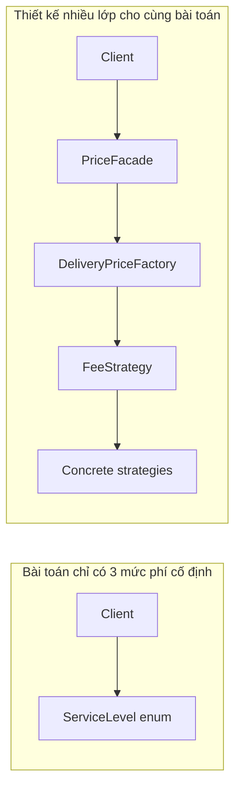

The diagram does not claim “fewer arrows = better.” It illustrates **how many places must be inspected to understand a call**. If every layer provides a genuine independent boundary and has its own reason to change, the arrows may be justified. If every layer merely forwards calls, they add cost without meaning.

## 6. Patterns Commonly Applied Too Broadly

| Pattern | Sign of overuse | When it actually fits |
|---|---|---|
| **Strategy** | Interfaces and multiple classes for constants or two unchanging branches | Several independently evolving algorithms |
| **Factory Method / Abstract Factory** | Factory only wraps `new SimpleClass()` without a reason to create other objects | Complex creation or related product families that must remain compatible and vary by environment |
| **Builder** | An object has two clear required parameters but uses a multistep builder | Many optional choices, validation of construction invariants, avoiding unreadable constructors |
| **Singleton** | A mutable global singleton is used merely for convenient dependency access | One instance truly needs management within a defined scope, with clear lifecycle/concurrency rules |
| **Observer** | A mandatory operation is hidden in a hard-to-trace callback with only one consumer | Several independent components react to one change, with explicit event/lifecycle policies |
| **Decorator** | Four layers of wrappers where each only invokes `delegate` | Cross-cutting behavior with explicit contract and composition order |
| **Adapter** | Two compatible APIs are wrapped despite no boundary needing protection | Convert an incompatible external API to a client-side contract |
| **Facade** | A class forwards identical parameters to one simple method | A client must coordinate several complex subsystems |
| **Template Method** | Inheritance shares only two lines of code across a deep hierarchy | A genuinely stable algorithm skeleton with specialized steps |
| **Command** | Every method call gets a command class, handler, and dispatcher without other requirements | Queues, undo, retry, persistent history, or object-based request dispatch |
| **State** | Only two states and one unchanging conditional | Complex transitions, with state-specific behavior and transition rules |

Note: the middle column contains **signals to review**, not automatic verdicts. For example, `Command` can still make sense for one task type if the application needs durable commands for later processing.

## 7. Principles for Keeping a Design Appropriately Simple

### YAGNI – You Aren't Gonna Need It

**Do not implement features just because “they might be needed someday.”** Without a real runtime-plugin requirement, avoid building a complex plugin loader. Without multiple algorithms, start with a short function and extract variants when they actually arise.

YAGNI does not mean ignoring known requirements or major risks. If a public API is difficult to change after release, creating a sensible boundary early may cost less than breaking compatibility later.

### KISS – Keep It Simple

Choose the **simplest solution that still meets all constraints**. Simplicity includes correctness, security, testability, and safety, not merely a small file count.

An exhaustive `switch` over an enum, a pure data method, and a few clear tests can be good design. If the `switch` grows into dozens of algorithms maintained by multiple teams, revisit it.

### DRY – Avoid Duplicating *Knowledge*, Not Every Syntax Fragment

Do not abstract two similar code fragments when they express **business rules that may change independently**. Combining them too early often leads to boolean parameters, special cases, and artificial coupling.

Conversely, an invariant such as rejecting negative fees, repeated throughout a codebase, may deserve enforcement in a value type or suitable shared boundary.

### Rule of Three – A Heuristic, Not a Law

After **several genuine similar cases** exist, identifying commonality and variation is more reliable than abstracting from a single example. Do not wait for exactly three repetitions when requirements are already clear or future architectural changes would be very costly.

### Prefer Reversible Changes

For internal application code, a small class followed by later refactoring may be inexpensive. For public APIs, event formats consumed by third parties, or durable stored data, the wrong decision can be expensive: consider boundaries, versioning, and compatibility early.

## 8. Do Not Confuse Extensibility with Interface Count

An “extensible” architecture should answer:

- **Which new variations can be added without breaking stable parts?**
- **Who owns the shared contract and its invariants?**
- **Where are new implementations registered?**
- **Can logs/metrics identify the implementation currently running?**
- **How much damage can a faulty implementation cause?**
- **Which tests protect existing behavior when adding a new option?**

If these questions cannot be answered, a collection of interfaces may amount to **coupling hidden behind DI**.

### Is an Interface with One Implementation Always Wrong?

No. For example, `PaymentGateway` with one `BankApiGateway` may be a real infrastructure boundary: a use case needs to process payments without importing an HTTP SDK and can use a fake in unit tests. Define the contract **according to business needs**, rather than copying SDK methods into the interface.

Conversely, `IPriceAdder` with one `PriceAdderImpl` that merely calls `a + b`, both in the same package and with no variation boundary, is usually unnecessary indirection.

## 9. Recognizing God Factories, God Facades, and Overly Broad Registries

Another mistake is applying a legitimate pattern but **expanding its responsibility too far**:

- **God Factory:** knows how to create every kind of object throughout the system and changes constantly for unrelated domains.
- **God Facade:** groups authentication, payments, shipping, notifications, and reporting into one large API.
- **Unbounded Generic Repository:** tries to hide all query types behind an API with dozens of options and hard-to-verify dynamic queries.
- **Event bus everywhere:** replaces explicit calls with anonymous events that obscure outcomes and failures.
- **String-based DI registry:** invalid keys only fail at runtime, and configuration becomes a secondary programming language that is difficult to debug.

When a “central” class has many unrelated reasons to change, the solution may be **splitting by use case, bounded context, or capability**, rather than adding yet another coordination layer.

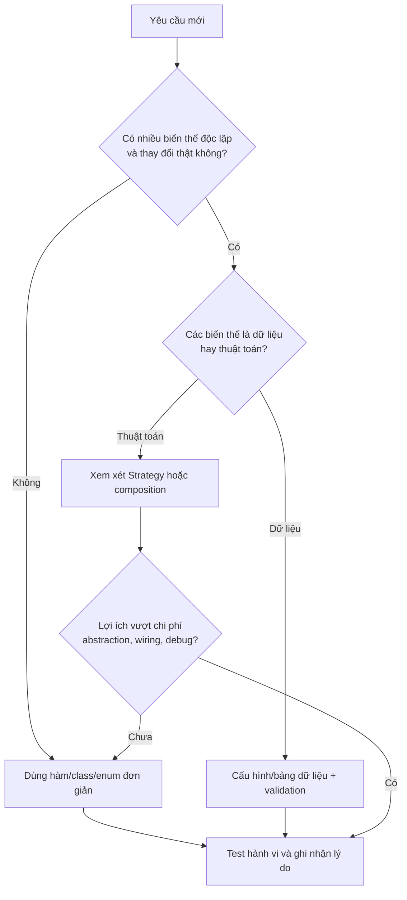

This flowchart offers a decision process for one axis of variation; more complex situations must also consider concurrency, security, compatibility, and data durability.

## 10. Good Tests Do Not Require Complex Patterns

JUnit 5 example for the enum design in section 3: place `SimpleDeliveryPricingTest.java` beside `SimpleDeliveryPricing.java` in the same package:

```java
import static org.junit.jupiter.api.Assertions.*;
import org.junit.jupiter.api.Test;

class SimpleDeliveryPricingTest {
    @Test
    void quotesEachSupportedServiceLevel() {
        assertEquals(20_000L,
                SimpleDeliveryPricing.quote(
                        SimpleDeliveryPricing.ServiceLevel.STANDARD));
        assertEquals(35_000L,
                SimpleDeliveryPricing.quote(
                        SimpleDeliveryPricing.ServiceLevel.EXPRESS));
        assertEquals(50_000L,
                SimpleDeliveryPricing.quote(
                        SimpleDeliveryPricing.ServiceLevel.PRIORITY));
    }

    @Test
    void rejectsNullServiceLevel() {
        assertThrows(IllegalArgumentException.class,
                () -> SimpleDeliveryPricing.quote(null));
    }
}
```

When using Strategy, add **contract tests** for every implementation: nonnegative results, no input mutation, proper VND units, and agreed error behavior. But avoid building a complicated set of mocks solely to assert that “the factory was called exactly once” if the user requirement is simply **correct fee calculation**.

### Testing When Simplifying Existing Code

When refactoring away unnecessary Factory/Decorator/Observer layers, write or retain tests **at behavioral boundaries**:

1. Valid inputs produce the same outputs.
2. Invalid inputs produce equivalent error types and semantics.
3. Required side effects and ordering remain unchanged.
4. For public APIs, signatures and compatibility are preserved or migrated according to a plan.
5. For concurrent objects, concurrency behavior and lifecycles do not change silently.

There is no need to test whether an intermediary class still exists: that is an implementation detail being intentionally changed.

## 11. How to Safely Refactor a Design with Too Many Patterns

Suppose the current flow is:

`OrderController → QuoteFacade → PricingFactory → StrategyRegistry → FixedPriceStrategy`

and the whole system has only one fixed pricing rule used in one place. Do not delete several layers simultaneously and hope all clients continue to behave correctly. Instead:

1. **Verify usage:** find every caller, object-creation path, public API, bean configuration, reflection/serialization usage, and dependent systems outside the module.
2. **Lock in behavior with tests:** verify current results, errors, and side effects, including boundary cases.
3. **Choose a clear target API:** for example, `PricingService.quote(Order)`, or a pure function when state is unnecessary.
4. **Move logic to its owner:** remove forwarding-only classes while preserving business rules and necessary infrastructure adapters.
5. **Migrate callers incrementally:** keep a temporary thin compatibility adapter if necessary; do not establish a permanent parallel system.
6. **Remove obsolete configuration:** delete mappings, beans, registries, and reflection rules after verifying that no callers depend on them.
7. **Run appropriately scoped tests:** unit, integration, and public-contract tests as applicable.
8. **Measure the result:** number of edit points for a rule change, call-stack depth, files required to understand the flow, build/test time, and runtime error rates.
9. **Record the refactoring rationale:** benefits, costs, and criteria for reopening extension points if genuine requirements arise later.

Simplification should **reduce knowledge and state that developers must manage**, rather than merely rename or merge files. Removing an abstraction that protects a contract used by several teams may create more coupling than it removes.

## 12. Two Misguided Ways to Simplify

### Putting Everything into One Class

A 1,000-line class handling everything may use fewer files but increases independent reasons to change and regression risk. Removing a pattern still requires **clear responsibilities** and separation of genuinely independent rules.

### Removing an Interface Just to Call the Implementation Directly

If removing an interface forces application code to import an SQL driver or HTTP SDK, you may be **leaking infrastructure** into business logic. Evaluate whether the port meets actual needs, rather than removing interfaces based on a count.

A sensible approach is to retain application-owned `PaymentGateway` while removing `GatewayFactoryFactory` and `GatewayProviderAdapterBuilder` layers that merely forward calls. This can **preserve DIP while reducing overengineering**.

## 13. Comparing Expected Costs with a Decision Table

For a module that may add new pricing methods:

| Question | If the answer is “yes” | Decision impact |
|---|---|---|
| Is each variant a different algorithm tested independently? | Yes | Supports Strategy |
| Do only a few constants differ, updated by admins? | Yes | Favors data/configuration |
| Do several teams develop implementations concurrently? | Yes | Favors stable contracts |
| Is the API already public to third parties? | Yes | Consider long-term compatibility |
| Does the rule change once per year, with three clear branches? | Yes | Favors a direct solution |
| Is there a risk of configuring the wrong implementation? | Yes | Increases Strategy/registry costs |
| Does the implementation depend on a database or external service? | Yes | Consider a port/adapter to isolate infrastructure |
| Must operators know the exact runtime execution path? | Yes | Prefer explicit wiring and logs/traces |

You do not need an artificial score to “prove” which pattern wins. A short **Architecture Decision Record (ADR)** is often enough for a decision with long-term consequences.

```markdown
# ADR: Giữ bảng phí giao hàng dưới dạng enum

Bối cảnh:
- Có ba mức phí cố định, hiếm thay đổi.
- Không có thuật toán theo đơn hàng hay plugin bên ngoài.
- Nhóm cần dễ đọc và dễ kiểm tra.

Các phương án:
1. Strategy + Factory + Registry.
2. Enum chứa phí và một hàm quote.

Quyết định:
- Chọn phương án 2.

Lý do:
- Chi phí cấu hình và số lớp của phương án 1 chưa tạo ra lợi ích.
- Test có thể kiểm tra toàn bộ mức phí trực tiếp.

Hệ quả:
+ Ít code, dễ truy vết.
- Muốn thêm thuật toán phức tạp sau này sẽ phải refactor.

Xem xét lại khi:
- Phí tính theo trọng lượng/vùng hoặc nhiều đội bổ sung thuật toán.
- Phí trở thành dữ liệu do người dùng quản lý, cần chuyển sang config/DB.
```

## 14. Practical Exercises

**Exercise 1 — Choosing an abstraction.** An application has two fixed shipping fees and expects no changes. Implement one version using `enum` and another using Strategy. Compare edit points when adding a fee level, class counts, testing approaches, and call-path clarity.

**Exercise 2 — When requirements change.** Add “8.000 VND/kg, rounded up” pricing and a service discount when the order total exceeds a threshold. Refactor `SimpleDeliveryPricing` into `FlexibleDeliveryPricing`, retaining tests for existing levels before replacement and adding threshold-boundary tests.

**Exercise 3 — God Facade.** A team has an `ApplicationFacade` class with 50 methods handling invoices, users, search, and shipping. Propose grouping APIs by responsibility; identify when to retain a small facade and when to call an application service directly.

**Exercise 4 — “Automatic” does not mean simple.** A team proposes using `Observer` to publish “order paid” and then send a mandatory email. Analyze listener failures, DB commit failures, and duplicate events; identify when explicit workflow orchestration or a transactional outbox is needed.

**Exercise 5 — Real maintenance costs.** Choose a module with at least three consecutive abstraction layers. Draw its call graph, list why each layer exists, and write an ADR deciding whether to keep/remove each. Refactor only after tests confirm existing behavior.

## 15. Checklist Before Introducing a Design Pattern

- [ ] I can explain the actual problem without mentioning a pattern name.
- [ ] I can identify **which kinds of change** are expected and support their frequency with evidence.
- [ ] I have a **simple alternative** that meets correctness requirements for comparison.
- [ ] Every new abstraction adds a useful responsibility or boundary rather than merely forwarding calls.
- [ ] I understand the added costs of classes, DI/configuration, callbacks, debugging, and testing.
- [ ] I know whether the solution remains easy to use with only one implementation.
- [ ] I have considered error handling, concurrency, and side effects beyond the core functionality.
- [ ] I have behavioral and contract tests for current cases.
- [ ] I know the concrete conditions that would require revisiting this design decision.
- [ ] I can explain the choice to teammates without merely saying “because GoF/SOLID”.

**Remember:** A Design Pattern is a **tool with trade-offs**. Apply a pattern when it solves **a real problem** involving change, collaboration, or responsibilities and its benefits outweigh structural costs. Keep the solution simple while requirements are simple; refactor with tests when the context changes. Good architecture helps a system evolve safely, not accumulate the greatest number of pattern names.


</details>

- [Back to top](#back-to-top)
